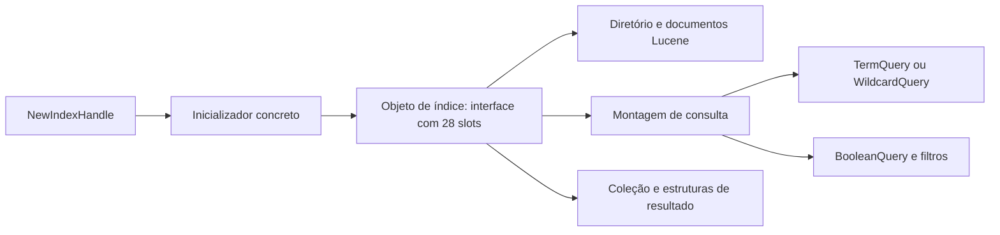

# Foxit Reader: investigação com REA e Ghidra

## Escopo atual

Após o pedido mestre de 2026-10-16, a reconstrução incremental foi iniciada.
Os resultados estáticos abaixo permanecem válidos para a amostra identificada;
a implementação e seus testes são registrados separadamente, sem converter
testes internos em equivalência Foxit.

A pedido do usuário, esta etapa trata exclusivamente da engenharia reversa do
Foxit Reader. O objetivo posterior é uma implementação própria no projeto Linuxit PDF,
priorizando Linux e distribuição Flatpak, com uma fronteira de plataforma que
permita Windows. Não se retomam nesta etapa o UPDF ou as outras melhorias
propostas anteriormente.

A referência é o **programa completo** já recebido pela pasta compartilhada,
não apenas um instalador. O caminho `A:\OneDrive\...` informado pelo usuário é
local do Windows e não está montado neste ambiente. A cópia disponível é:

```text
/workspace/pdf-reference-analysis/foxit/Foxit PDF Reader/FoxitPDFReader.exe
```

Versão declarada: **2025.2.0.33046**, PE32/x86, 133.250.144 bytes,
image base `0x00400000`. SHA-256:

```text
90208c9e8da92c8e546b76c8f4a2f8fb999105d124e663bbea6744fb6bb6b3a6
```

Esse hash identifica os bytes examinados; não autentica o editor do arquivo.
Os endereços deste relatório são endereços virtuais preferidos dessa amostra,
não offsets de arquivo nem endereços de outra versão ou de um processo com ASLR.

## Ferramentas e evidências

REA **6.4.0** está instalado em `/workspace/.rea-cli/bin/rea`. Ghidra
**12.1.4**, com decompilador Linux x64 e JDK **21.0.12.1**, foi instalado
separadamente em `/workspace/ghidra-tools`. O ZIP oficial foi conferido pelo
SHA-256 publicado no release NSA; o pacote JDK foi conferido contra os índices
APT assinados do Debian. Não foi utilizado `rea setup` para instalar o Ghidra
ou alterar configurações de clientes.

O diagnóstico explícito `rea doctor --provider ghidra --format json` passou
em todas as verificações desse provedor. O diagnóstico geral ainda inclui
alertas de plataforma Debian 13 e de ferramentas/registros não usados nesta
análise. A prontidão do provedor e a conclusão das consultas são verificações
distintas. Na reconexão final, o sandbox restrito fez `spawnSync` do Node
retornar `EPERM` apesar de o Java terminar com sucesso; o diagnóstico executado
fora dessa restrição voltou a passar em todas as verificações do escopo.
Não foi necessário alterar o REA ou o JDK.

O REA é utilizado por seu servidor MCP local, com uma sessão persistente por
binário. Isso conserva o programa importado entre consultas de funções e evita
refazer a importação inteira a cada comando. `open_binary` estabelece a
identidade; a primeira consulta ao provedor dispara importação e autoanálise.

O REA também foi compilado, sem alterar seu código, no commit
`b9b3a9098b072313119eccb3ae574faa57c3e517` de `morluto/rea`, com Node
24.19.0 e npm 11.16.0 nas sessões iniciais. A preparação reproduzível foi
depois executada com Node **24.18.0**, conforme `.nvmrc`, npm 11.16.0 e build
forçado; o diagnóstico do provedor também passou nesse build. O comando é `node /workspace/rea/scripts/rea.mjs`.
Embora ambos declarem 6.4.0, esse checkout oferece a seleção explícita de
analisadores que não existe na CLI npm instalada. Os perfis não são tratados
como equivalentes.

### Limite da autoanálise completa e perfil dirigido

A primeira consulta ao executável principal, `list_segments`, disparou a
autoanálise completa e terminou com `provider_timeout` após **1.801,7 segundos**,
com limite de 1.800.000 ms. Ela não é contada como uma análise concluída.
A fila foi interrompida para evitar novas importações iguais em cascata.

A continuação concluída usa o build do checkout REA e 21 seeds nos handlers
conhecidos. O perfil mais restrito concluiu a primeira consulta em **471,1
segundos** e decompilou os 21 pontos selecionados. Foram desativados explicitamente:

```text
Decompiler Switch Analysis
Decompiler Parameter ID
Function ID
Function Start Pre Search
Function Start Search
Function Start Search After Code
Function Start Search After Data
Disassemble Entry Points
Windows x86 PE RTTI Analyzer
Windows x86 PE Exception Handling
x86 Constant Reference Analyzer
Create Address Tables
Subroutine References
Non-Returning Functions - Discovered
Non-Returning Functions - Known
```

O Ghidra confirmou a criação dos 21 seeds sem falhas e validou os nomes das
opções. Esse perfil dirige a descoberta aos pontos conhecidos e seus fluxos,
permitindo decompilar funções selecionadas sob demanda. Ele não fornece
descoberta exaustiva, identificação global de funções ou resolução global de
switches. Referências indiretas e tipos podem continuar incompletos.
O manifesto registra a conclusão efetiva de cada consulta separadamente.

Um perfil intermediário, com 13 dessas opções desativadas, também concluiu
em 614,2 segundos. Os perfis retornaram 6.473 e 5.458 entradas de procedimentos,
respectivamente; isso mede sua descoberta limitada, não todas as funções do
Foxit. Em 20 das 21 consultas iniciais, o texto decompilado foi idêntico entre
os perfis. A recuperação de abrir pasta divergiu e continua provisória.
Tentativas anteriores interrompidas e o timeout geral permanecem registrados.

Uma verificação complementar utilizou o backend Ghidra diretamente com
`-noanalysis` e o script de seeds do REA. Ela está identificada separadamente,
sem ser apresentada como Evidence MCP. Seu projeto local permite consultas
posteriores com `-process`, sem nova importação. Sucesso de decompilação não
garante tipos, limites ou comportamento corretos: alguns resultados têm avisos,
inferências de tipos inadequadas e chamadas indiretas não resolvidas.

Evidências completas, resultados MCP, logs, inventário de funções e
decompilações ficam fora do código do aplicativo em
`/workspace/foxit-rea-analysis`. O executável de referência não foi executado.
O Ghidra trabalha sobre uma cópia e sua base de análise; os bytes de entrada
não são modificados.

As evidências publicáveis deste trabalho ficam em
[`windows-evidence/foxit-rea/`](windows-evidence/foxit-rea/):

- `toolchain.json`: versões, origem, hash do Ghidra e diagnóstico do provedor;
- `ui-command-map.json`: itens de interface e candidatos estruturais de rotas;
- `module-inventory.json`: identidade, arquitetura, dependências e entradas de
  plugin dos módulos encontrados;
- `plugin-ui-command-map.json`: recursos de UI e rotas candidatas dos 35 FPI.
- `analysis-manifest.json`: consultas, sucessos/erros, identidades, hashes dos
  resultados e cobertura de funções por amostra/perfil de análise.
- `index-interface.json`: observações e lacunas em cada um dos 28 slots;
- `dispatch-catalog.json`: descritores, inicializadores e registros de chamadas;
- `headless-cross-checks.json`: hashes e resultados do backend complementar;
- `validation.json`: verificações efetivamente executadas e seus limites;
- `fx-resource-inventory.json` e `selected-fx-ui-controls.json`: identidades dos
  XML recuperados e controles selecionados, sem distribuir os templates.

As decompilações são instrumentos de investigação. A implementação própria
deverá ser escrita a partir dos contratos de comportamento e validada com PDFs
e resultados conhecidos; não serão incluídos binários, ícones ou código
proprietário recuperado no aplicativo.

## Cobertura efetivamente examinada

O manifesto contém **122 entradas distintas examinadas por `analyze_function`**,
contadas por amostra: 51 em `fxLuceneLib.dll`, 19 em `Bookmark.fpi`, seis em
`agnosticuilib.dll` e 46 no executável principal. Consultas repetidas em dois
perfis não aumentam essa contagem. Os nomes atribuídos pelo analista ou pelo
FID não são automaticamente símbolos originais.

O backend complementar decompilou 30 entradas do executável: 21 para comparação
e nove entradas adicionais, identificadas separadamente nos metadados.
As 190 consultas MCP concluídas incluem inventários e leitura de bytes; não
representam 190 funções. O manifesto conserva oito erros de consultas, perfis
cancelados e pedidos não executados, sem convertê-los em sucessos.

Os resultados completos de cada consulta foram preservados localmente. Após a
reconexão do ambiente, os dois drivers do executável encerraram seus servidores
com `close_binary` registrado como bem-sucedido, mas os pedidos finais de exportação
e snapshot não geraram resultado; eles constam como não concluídos. Os outros
módulos têm suas exportações próprias e o projeto Ghidra complementar permanece
no diretório de análise. Não se afirma restauração automática das sessões vivas.

## Mapa da aplicação

O parser PE independente, complementar ao REA, leu os recursos sem erros e
produziu o seguinte inventário:

| Elemento | Quantidade | O que a medida significa |
|---|---:|---|
| Recursos PE | 2.429 | Entradas de tipo/nome/idioma |
| Diálogos | 405 | Templates de janela decodificados |
| Menus | 61 | Recursos de menu decodificados |
| Strings de tabelas | 4.471 | Entradas não vazias de RT_STRING |
| Itens de interface | 2.969 | Controles/comandos em inglês ou idioma neutro, com repetições entre recursos |
| Rotas candidatas | 1.914 | Estruturas compatíveis com message maps MFC para WM_COMMAND |
| Endereços candidatos distintos | 1.690 | Destinos dessas estruturas; não é uma contagem de todas as funções do executável |
| Módulos PE na pasta | 141 | EXE, DLL e FPI, incluindo runtimes de terceiros |
| Plugins FPI | 35 | Arquivos que exportam PlugInMain; carregamento em tempo de execução ainda não observado |

Os 35 plugins também foram inventariados individualmente: **179 diálogos,
22 menus e 867 itens de interface** adicionais, sem erros de parsing. São
contagens por recurso/módulo, com repetições, não quantidades de funcionalidades
únicas.

Esse inventário Win32 foi complementado pela recuperação dos arquivos externos
`auiresources/**/*.ui.fx` e `lang/**/*.xml.fx`/`*.ts.fx`, descrita abaixo.
As contagens dos dois formatos não devem ser somadas como funcionalidades
únicas: existem layouts e textos compartilhados entre recursos/produtos.

Identificadores de controle são reutilizados por diferentes classes. Um mesmo
ID com dois handlers não permite escolher um deles apenas pelo texto do botão.
Uma rotina de “Find Next” de uma janela de texto embutida também não deve ser
confundida com a busca do documento PDF.

Existem recursos com nomes do Foxit Editor, controles de redação e funções
compartilhadas. Sua presença no arquivo não prova disponibilidade no Reader,
licença ativa, visibilidade na interface ou comportamento correto.

### Fronteiras entre módulos

O executável contém a interface Win32/MFC e imports GDI/spooler, incluindo
`StartDocW`, `StartPage`, `EndPage`, `EndDoc`, `OpenPrinterW`,
`DocumentPropertiesW` e `WritePrinter`. Imports demonstram interfaces
disponíveis, não um fluxo completo já comprovado.

Há módulos candidatos para marcadores (`Bookmark.fpi`), assinaturas (`Signature.fpi`, `InkSign.fpi`,
`FoxitSign.fpi`), acessibilidade (`PDFAccessibility.fpi`), camadas
(`LayerPanelToolPlugin.fpi`), portfólios (`Portfolio.fpi`), segurança
(`Security.fpi`) e integrações remotas. A associação pelos nomes orienta a
investigação; o contrato de cada plugin exige rastrear `PlugInMain`, tabelas
de funções e seus consumidores.

`FRMSPlgV2.fpi` é associado a proteção RMS, não deve ser classificado como
formulários por semelhança de sigla: contém `MicrosoftIRMServices`,
`FoxitRMSV2` e importa `msipc.dll`. O caminho de formulários ainda precisa
ser localizado e rastreado separadamente.

`fxLuceneLib.dll` tem 39 exports, incluindo `NewIndexHandle` e
`DeleteIndexHandle`, e acompanha `lucene++.dll`. Isso fornece um caminho
específico para investigar indexação/busca. Não prova que toda busca do Reader
use esse índice, nem que a busca simples e a avançada tenham o mesmo motor.

## Executável principal: contratos recuperados

### Impressão e atualização da prévia

Os handlers confirmaram o fluxo **alterar opções → notificar a janela de
impressão** observado anteriormente em assembly:

| Entrada | Comportamento observado |
|---|---|
| `0x16dfb10`, subset do livreto | Lê `CB_GETCURSEL`; índices 0/1/2 são gravados em `+0xcc`; chama a atualização simples ou em lote conforme o objeto pai |
| `0x16dfa50`, binding | Mapeia índice 0 para 1 e índice 1 para 0 em `+0xd0`; zera `+0xdc`/`+0xe4` antes de atualizar |
| `0x167e5d0`, livreto | Seleciona o grupo de UI 3 e encaminha o modo 6 para `0x1677770` |
| `0x167e6d0`, mosaico | Seleciona o grupo de UI 1 e encaminha o modo 5 para `0x1677770` |
| `0x1677770`, troca de modo | Converte 6→4, 3→3, 5→2 e demais→1; evita atualizar quando o modo já está selecionado e não há pedido de atualização forçada; nos outros casos limpa/recompõe campos e chama `0x16772e0` |
| `0x16715b0` | Grava o modo no campo `+0x1b0` do objeto de opções |
| `0x167ed50`, duplex | Habilita/desabilita os controles de borda; grava 1 quando desmarcado e 2/3 conforme o rádio de borda selecionado |
| `0x80eb30`, aba atual | Obtém a janela ativa e envia `WM_COMMAND` com `0xe107` (`ID_FILE_PRINT`) |
| `0x80e220`, todas as abas | Percorre janelas/documentos, aplica condições e encaminha o mesmo comando de impressão; consulta preferências em `Preferences\Print` |

A seleção Multiple Pages Per Sheet, controle 10425, aponta para `0x167e600`.
Esse ponto não estava definido no perfil MCP; a extração direta confirmou os
argumentos 2 para o grupo de UI e 3 para `0x1677770`. Sua correspondência com
modo interno 3 fica, assim, apoiada em código e no recurso. O controle Scale
10426 aponta para `0x167e640`; sua decompilação complementar mistura fluxos e
continua sujeita a confirmação por limites/assembly.

Os valores de duplex são compatíveis com simplex/borda longa/borda curta do
Windows. O ponteiro obtido pelo helper ainda não foi provado como início de
uma `DEVMODE`; não se deve copiar o offset `+0xe` para uma estrutura Windows
ou Linux própria.

Também não se atribui a cada número de subset/binding um rótulo sem confirmar
os itens da combo e seus consumidores. Imprimir todas as abas não demonstra
um trabalho único combinado nem a geometria final de imposição. Permanecem
pendentes a geração das folhas, a rasterização e a saída física.

**Contrato independente:** opções semânticas compartilhadas pela UI e pelo
plano de impressão, troca de modo idempotente, prévia derivada do mesmo plano
usado na saída e encaminhamento por documento. CUPS/IPP e Win32 implementam a
fronteira de impressora, sem expor offsets/handles ao núcleo.

### Registro interno de chamadas e ligação com impressão

O caminho `0x861310` consulta a tabela interna `0x1a`, método `0x13`.
As rotinas `0x19bd910`, `0x19bd270`, `0x19bd330`, `0x19bda40`, `0x19bd900`
e `0x19bd8f0` permitiram relacionar a inicialização, alocação, obtenção da
tabela e obtenção do método. Leituras de bytes pelo REA confirmaram:

- contador em `0x6b71dd8`: **717 descritores**;
- array em `0x6b6fc1c`: descritores de 12 bytes com capacidade, callback e tag;
- **683 descritores não vazios**, 34 vazios e **9.973 slots declarados**;
- tabela `0x1a`: 237 slots, inicializador `0x19a7f90`;
- registro estático do slot `0x13`: destino `0x1a76b60`.

O parser próprio com Capstone reconheceu os registros literais nos 717
inicializadores e catalogou os 9.973 slots. A repetição gerou arquivos idênticos;
os 237 registros da tabela `0x1a` também coincidiram, na mesma ordem, com a
extração independente de seu inicializador pelo Ghidra.

Isso é uma cobertura **estrutural do registro**, não uma recuperação semântica
de 9.973 funções ou funcionalidades. Destinos podem se repetir; condições de
carregamento, substituições em tempo de execução e assinaturas ainda precisam
ser verificadas. O parser registra limites de decodificação, desvios e cobertura
por callback. Os endereços estão vinculados exclusivamente ao hash desta amostra.

O destino `0x1a76b60` não estava definido no perfil MCP e a tentativa conservou
o erro. A definição dirigida no backend complementar recuperou a iteração de
objetos associados ao argumento e a comparação de uma referência de documento;
no objeto correspondente, há uma chamada a `0x860610` com `0, -1, -1`.
Isso prolonga o caminho estático do comando de impressão. Não demonstra ainda
a geometria de folhas, o diálogo completo, a rasterização ou a saída ao spooler.

### Continuação dirigida do caminho de impressão

A extração complementar de `0x860610` confirmou 2.613 bytes de corpo e chamadas
a duas fábricas: `0x1647750` e `0x16475e0`. Elas foram definidas e examinadas
separadamente (195 e 205 bytes). O código encaminha a criação para
`0x1645c30` e `0x1645f50`, respectivamente. Os tipos/assinaturas inferidos pelo
decompilador permanecem provisórios; os endereços e chamadas têm suporte em assembly.

A rotina principal conserva um objeto por chamadas virtuais, obtém um retorno
e pode entrar em um caminho de acompanhamento `0x861170` (414 bytes), com uma
fábrica reutilizada e tratamento de um nome temporário com `DeleteFileW`.
Não se atribui ainda uma mensagem ou um erro de impressão a cada retorno. O
contrato observado de ciclo de vida não prova a composição geométrica das folhas,
a rasterização ou a aceitação de trabalhos pelo spooler.

Os quatro resultados novos são do backend direto, identificados em
`headless-cross-checks.json`, sem serem contados como novas consultas MCP.

### Busca: controles, estado e concorrência

A busca REA por bytes encontrou três referências a `PUSH 7909`. O trecho em
`0x177240b..0x17724ad`, com prólogo em `0x17722b0`, passa os IDs e endereços
de campos do objeto ao helper `0x4918b11`. A extração direta desse helper
confirmou escrita com `BM_SETCHECK` (`0xf1`) e leitura com `BM_GETCHECK`
(`0xf0`), conforme a direção da troca de dados.

| Controle no diálogo 6359 | Campo relativo do objeto |
|---|---|
| Whole Words Only, 7909 | `+0x1d50` |
| Case-Sensitive, 7910 | `+0x1d54` |
| Include Bookmarks, 7911 | `+0x1d58` |
| Include Comments, 7858 | `+0x1d5c` |
| Include Page Text, 7913 | `+0x1d60` |
| Include Attachments, 7859 | `+0x1d64` |
| Proximity, 8036 | `+0x1d68` |
| Stemming, 8035 | `+0x1d6c` |
| Highlight All Text, 7921 | `+0x1d70` |

`0x17901e0`, ação de busca, muda de caminho conforme um estado em `+0x1dc0`.
Antes de retomar um trabalho, consulta `GetExitCodeThread` e retorna quando o
resultado é `STILL_ACTIVE` (`0x103`), evitando iniciar trabalho duplicado naquele
caminho. Há duas referências alternativas de trabalho, escolhidas conforme
opções de escopo, e uso de `ResumeThread`.

`0x1790e70`, New Search, grava 1 em `+0x1dd8` quando o estado é 3; em estados
2/4 passa pela ação de busca e por outra rotina de UI. O papel de pedido de
cancelamento dessa flag é uma interpretação; ainda falta conferir o consumidor
no worker. Os helpers `0x1776b80` e `0x1776bd0` leem a seleção e depois
`CB_GETITEMDATA`, portanto o valor de escopo não deve ser inferido apenas da
posição visual da opção.

Estão confirmadas as ligações dos controles ao estado da janela. A passagem
completa desses campos para os 24 bytes de `fxindex::SearchOption`, bem como
normalização Unicode, stemming, distância de proximidade e geometria dos
destaques, permanece parcial. O `Find Next` da janela de texto embutida é
mantido separado da busca do documento PDF.

**Contrato independente:** uma requisição conserva consulta, escopo, filtros e
geração; a UI apresenta estados explícitos e progresso. Um trabalho ativo não
é duplicado; resultados de gerações canceladas não atualizam outra consulta
ou documento. Esse contrato é portável, sem depender de handles de threads.

### Zoom e apresentação

Os comandos de zoom passam por `0x7bf480`/`0x7bf490` e chegam a
`0x8706c0`/`0x870790`. O builder `0x8702a0` começa com **20 doubles** em
`0x650b4a0`, confirmados com `read_bytes`:

```text
1%, 8,33%, 12,5%, 25%, 33,33%, 50%, 66,67%, 75%, 100%, 125%,
150%, 200%, 300%, 400%, 600%, 800%, 1.200%, 1.600%, 3.200%, 6.400%
```

Em um ramo, são inseridas quatro escalas calculadas pela visualização.
`0x8703d0` escolhe um valor estritamente maior/menor para os modos 1/2 e
classifica fatores de ajuste pelos códigos 3/4/5/7. Os nomes exatos desses
quatro códigos ainda não foram estabelecidos. Isso demonstra uma seleção por
degraus e modos, sem provar uma regra de multiplicador fixo.

`0x870850` aplica zoom; em um ramo calcula um ponto de referência e chama a
movimentação usando o centro de `GetClientRect`. Há strings de diagnóstico
`CPDF_TVPreview::ZoomToPreview`, `CalcSelectPoint` e `MovePage`. Elas ajudam
na identificação, sem significar acesso ao arquivo-fonte citado no diagnóstico.

O handler de tela cheia `0x85ec70` contém transição de estado e consulta a
`FullScreenApprovedFiles`. Ainda não foram recuperados todos os casos de
aprovação, restauração de UI, escala e monitor. Essa entrada não demonstra,
sozinha, o algoritmo de preencher/centralizar página nem a estratégia de cache.

**Contrato independente:** preservar separadamente escala, modo de ajuste e
ponto de ancoragem. Alterar o zoom ou o tamanho da janela deve recalcular a
transformação de página de maneira consistente. A equivalência visual e de
latência exige testes com documentos e janelas reais, ainda não realizados.

## Busca indexada: fluxo confirmado pelo REA

Além do executável principal, foi aberta uma sessão Ghidra específica para
`fxLuceneLib.dll`, SHA-256
`20908415a56a8bf63ad4500a2696e6da38a10191402a36b4d84fc577b61c82e1`.
A autoanálise inicial levou aproximadamente **138 segundos** nesta máquina.
O inventário retornou 10.417 entradas de procedimentos, incluindo 510 externas;
as demais incluem código interno e thunks, não somente funções do produto.

### Ciclo de vida e interface

- `NewIndexHandle` (`0x10033c90`) aloca `0x20` bytes e chama o inicializador
  `0x10037e40`; se a alocação falha, retorna nulo.
- O inicializador chama o construtor base `fxindex::fxIndexLib` e instala a
  vtable da classe concreta `fxindex::fxLuncenLib` em `0x100d841c`.
- A interface base tem 28 slots. Seus slots não implementados apontam para
  uma rotina de erro/abort; ela não é a implementação concreta de busca.
- Foram examinados os **28 destinos concretos** da vtable, incluindo
  abertura/fechamento, verificação de existência do índice, manipulação de
  documentos e montagem de resultados. Os nomes atribuídos aos métodos
  internos ainda são interpretações, exceto os nomes preservados pelo binário.
- `DeleteIndexHandle` (`0x10033c70`) aceita nulo; com objeto válido, chama o
  primeiro slot virtual com argumento 1, compatível com destruição/liberação.

Essa diferença entre interface abstrata e objeto concreto evita implementar
por engano os stubs em vez do comportamento usado pelo leitor.

### Índice, consulta e resultados

| Endereço no módulo | Observação confirmada no código |
|---|---|
| `0x100397d0` | Utiliza `Lucene::FSDirectory::open` e verifica diretório |
| `0x10042990` | Consulta `Lucene::IndexReader::indexExists` |
| `0x10038a20` | Constrói campos de documento Lucene, chama `Document::add` e, em um ramo, `CompressionTools::compressString` |
| `0x10039a60` | Abre o índice e usa os campos `path`, `docididx` e `onedocididx` |
| `0x10042530` | Abre o índice e consulta `datepath`, `propdocididx` e `lastupdtt` |
| `0x10039d50` | Constrói consulta booleana, filtra `isattach` em um ramo e lê `path`, `pdfid` e `docididx` para montar resultados |
| `0x10021e80` | Monta consultas compostas com `Lucene::BooleanQuery::add`; escolhe caminhos por opções e pela presença de `?`/`*` |
| `0x10019280` | Constrói efetivamente `Lucene::TermQuery` |
| `0x10019340` | Constrói efetivamente `Lucene::WildcardQuery` |
| `0x1001f7e0` | Distingue asterisco no início, no fim, em ambos ou ausente; passa modos 1, 2, 3 e 0, respectivamente, ao construtor seguinte |
| `0x10027d40` | Retorna `-15` quando a contagem consultada é menor que 1; retorna `-17` quando a coleção obtida está vazia; retorna 0 no caminho de sucesso |
| `0x1000cf20` e `0x1000cf80` | Copiam a estrutura `SearchOption`, cobrindo 24 bytes; os nomes de todos os campos ainda não foram recuperados |

As leituras REA em `0x100d7ae0` e `0x100d7890` confirmaram os caracteres
UTF-16 `?` e `*`, respectivamente. A assinatura importada de `WildcardQuery`
inclui três booleanos e `StarCharPosition`; não se presume que seja idêntica
ao comportamento da versão pública padrão do Lucene++.

Os códigos de retorno acima são descritos pelas condições observadas; ainda
não se atribuem mensagens de interface ou significados de enums sem verificar
o consumidor. Também permanecem pendentes o vínculo entre cada checkbox da
janela 6359 e os campos de `SearchOption`, o algoritmo de normalização, a
geometria de destaque e a ligação da busca simples com esse módulo.

**Contrato independente resultante:** separar o ciclo de vida do índice da
consulta e dos resultados; conservar identidade do documento e metadados de
atualização; modelar consulta exata/curingas e filtros explicitamente. Esse
contrato pode ser implementado com bibliotecas Linux, mas a equivalência das
opções ainda deve ser demonstrada por casos de busca no Reader e no Print&View.



O diagrama representa a biblioteca examinada. A ligação da janela de busca do
Reader com cada operação dessa interface ainda precisa ser confirmada.

## Marcadores: fronteira entre plugin e leitor

O REA também abriu `plugins/Bookmark.fpi`. A importação/autoanálise inicial
levou aproximadamente **175 segundos** nesta máquina.

`PlugInMain` (`0x1008ac20`) informa a versão `0x10000`, entrega o callback
`0x1008abc0` e retorna sucesso. Esse callback rejeita uma versão diferente,
obtém referências do host e registra callbacks adicionais. Em `0x10042c40`
foi observado o registro dos nomes `FoxitInnerPluginBookmark` e `Bookmark`,
além de uma estrutura de callbacks com tamanho `0x24`.

O caminho `0x10042d20` chama `0x10041540`. Essa rotina mantém estado por
identificador, consulta a capacidade `Editing` e cria/configura elementos de
ribbon, incluindo `Ribbon_Category_Home`, `Home_Links_BookMark` e, sob condições,
comandos de criação automática de marcadores. Isso demonstra por que a presença
de um recurso de edição não garante que ele seja oferecido por todo host.
O caminho `0x10042d70` chama `0x10042f70`, que remove uma entrada do estado
por identificador. O significado exato dos eventos do host ainda requer
reconstrução da tabela usada por seus callbacks.

Quatro endereços registrados não tinham função definida na primeira
autoanálise; as tentativas retornaram erro e estão preservadas no manifesto,
sem contar como decompilações bem-sucedidas naquele perfil. Uma nova análise
dirigida aplicou oito seeds nos destinos de callbacks observados e conseguiu
decompilar os oito. Alguns são stubs sem efeito; outros delegam para rotinas
internas ou consultam o documento/capacidades antes de habilitar comandos.
Assim, os quatro destinos inicialmente ausentes foram recuperados no segundo
perfil, sem apagar o registro das falhas iniciais. Os nomes
`analyst_callback_*` são rótulos atribuídos por esta investigação, não símbolos
originais. Identificações automáticas FID também são indícios, não prova de
nome/classe original.

O contrato independente que já emerge é separar o modelo de marcadores PDF,
o estado de cada documento e a apresentação dos comandos conforme capacidades.
Registro de plugin/ribbon não basta para concluir como criar, mover ou gravar
um marcador; essas operações precisam de rastreamento adicional.

## Formato de interface e traduções recuperado

Foi analisada com REA/Ghidra a `agnosticuilib.dll`, SHA-256
`90d7a3482c88ccabf5f992fc449a6fc3e341ac9405b399daea4d0179042e2658`.
O export `Encrypter::ReadAndDecryptFile`, em `0x1003f130`, revelou este formato:

1. O arquivo contém um payload e um trailer de 16 bytes.
2. O trailer é comparado com MD5 do **payload ainda cifrado**.
3. Com a comparação válida, `Encrypter::RC4CryptBlock` (`0x1003efc0`)
   decodifica o payload usando uma constante de formato de 27 bytes.
4. O resultado é tratado como UTF-8; a rotina `0x1003e060` configura a conversão
   para caracteres largos no Windows.

`Encrypter::MD5Generate` (`0x1003e630`) usa as constantes e as rotinas de
atualização/finalização MD5. A constante de formato foi localizada pelo REA
em `0x10106354` (RVA `0x106354`), dentro da DLL identificada acima.
O helper próprio [`catalog_foxit_fx.py`](../scripts/catalog_foxit_fx.py) lê
essa constante da DLL fornecida, implementa RC4 padrão independentemente e
verifica o trailer antes de interpretar XML. Não executa a DLL.

O formato foi validado sobre **todos os 869 arquivos `.fx` da pasta**:

| Conteúdo | Resultado |
|---|---:|
| Somas MD5 válidas e XML decodificados | 869 de 869 |
| Templates de interface (`ui`) | 204 |
| Tabelas Qt de tradução (`TS`) | 321 |
| Tabelas de strings (`Reader`) | 344 |
| Controles nos templates | 2.543 |
| Entradas de texto em todos os idiomas | 68.839, incluindo repetições |
| Conexões declaradas de controles | 52 |
| Erros de integridade/decodificação/parsing na verificação final | 0 |

O parser foi ajustado para aceitar a declaração simples `<!DOCTYPE TS>` das
tabelas de tradução, sem subconjuntos/entidades. A primeira passagem recusou
essas 321 declarações; a verificação final cobre o corpus inteiro. Os recursos
originais permanecem fora do aplicativo e não foram redistribuídos como XML.
A repetição completa produziu o mesmo catálogo.

`auiresources/FindTool/ui/searchreplace.ui.fx`, por exemplo, declara o campo
`lineEdit_FindWhat`, botões Previous/Next, campo de substituição e botões
Replace/Replace All. Isso confirma o layout compartilhado; não comprova que
substituição esteja disponível no Reader. Os templates de criação/níveis de
marcadores também foram recuperados e precisam ser relacionados às condições
de `Editing` vistas no código do plugin.

Também foram decompilados `Translator::LoadStrings` (`0x100e0ba0`) e
`SkinManager::LoadXMLSkin` (`0x10019410`). Esta última aplica cores padrão a
diversos campos por `SkinManagerColor::SetDefaultColor`; seu nome, sozinho,
não prova que ela faça leitura XML nessa chamada. Esses dados descrevem o
Foxit, sem retomar alterações de tema no aplicativo próprio nesta etapa.

As versões e datas gravadas nos XML pertencem aos recursos e podem ser antigas;
não substituem a versão 2025.2.0.33046 identificada no executável. MD5 aqui
valida o formato observado, sem autenticar o fornecedor.

Os nomes `QDialog`/`QPushButton` descrevem o formato dos templates. Não provam
que este Foxit utilize um runtime Qt; os imports examinados mostram a fronteira
Win32/MFC/agnosticuilib. Uma interface declarada e sua implementação devem ser
identificadas separadamente.

## Roteiro de cobertura funcional

A cobertura será registrada por função do produto e por fluxo, com os estados
**inventariado**, **ligação confirmada no código**, **contrato reconstruído**
e **equivalência testada**. Contar labels ou decompilar uma função não equivale
a concluir os quatro estados.

| Família | Evidência inicial / alvo da investigação | O que falta estabelecer |
|---|---|---|
| Abrir, fechar, salvar e abas | Comandos de menu; rotas candidatas para fechar aba e abrir pasta | Estado por documento, gravação, falhas, arquivos protegidos e recuperação |
| Navegação, rotação e zoom | Entradas candidatas de zoom e visualização | Transformação de coordenadas, limites, layouts e preservação de posição |
| Apresentação e leitura | Comando candidato de tela cheia | Ajuste, preenchimento, atalhos, múltiplos monitores e transições |
| Busca simples e avançada | Diálogo 6359, preferências 6515, fxLuceneLib | Flags, escopo, navegação de ocorrências, geometria, cancelamento e cache |
| Seleção, cópia e snapshot | Menus e controles inventariados | Ordem de texto, quadriláteros, rotação e permissões de cópia |
| Impressão | Diálogos 7792, 7786, 7790 e 7794; handlers de livreto/mosaico | Geometria, ordem das faces, capacidades da impressora e envio ao spooler |
| Marcadores e links | Menus e Bookmark.fpi | Destinos, edição, persistência e navegação |
| Comentários e anotações | Recursos e CommentsSummary.fpi | Tipos, edição, undo/redo, aparência e serialização PDF |
| Formulários | Recursos de interface; motor ainda a localizar | AcroForm/XFA, validação, eventos e gravação |
| Anexos e portfólios | Recursos e Portfolio.fpi | Estrutura de arquivos, extração e conservação ao salvar |
| Assinaturas e certificados | Plugins de assinatura e APIs criptográficas | Assinatura visual, assinatura criptográfica, validação e serviços remotos são fluxos distintos |
| Proteção e permissões | Recursos, Security.fpi e FRMSPlgV2.fpi | Abertura com senha, permissões PDF e políticas externas |
| Acessibilidade e voz | PDFAccessibility.fpi, Speech.fpi | Estrutura marcada, ordem de leitura e integração com tecnologia assistiva |
| Medição | Comandos inventariados | Unidade, calibração, distância, perímetro e área |
| Camadas, mídia e 3D | LayerPanelToolPlugin.fpi, U3DBrowser.fpi | Estado de visibilidade, recursos suportados e persistência |
| Preferências e aparência | Diálogos e controles inventariados | Valores padrão, persistência e dependências entre opções |
| Nuvem e colaboração | Plugins OneDrive, GoogleDrive, Box, Dropbox e revisão | Autenticação, APIs, disponibilidade e dependência dos serviços |
| Criação e conversão | Recursos compartilhados presentes | Separar as funções reais do Reader das funções do Editor |
| Integrações e atualização | Shell extensions, Browser.fpi e Updater.fpi | Separar integrações Windows de funcionalidades portáveis |

Esse roteiro não afirma que todas as funções estejam recuperadas. Testes
dinâmicos do Foxit, equivalência com a implementação própria, impressão física
e disponibilidade dos serviços ainda não foram demonstrados.

## Contratos para a futura implementação Linux/Flatpak

Os contratos abaixo são uma proposta de engenharia da implementação própria;
não são afirmações sobre código interno do Foxit que ainda não foi examinado.

1. **Documento e página:** uma identidade de documento por aba, origem do
   arquivo, permissões e versão do estado. Páginas expõem caixas, rotação,
   texto, objetos e transformações explícitas entre PDF, tela e impressão.
2. **Renderização:** pedidos com chave de documento/página/escala/rotação e
   geração, cancelamento de trabalhos obsoletos, cache com orçamento e
   publicação de resultados apenas no documento/estado correspondente.
3. **Busca:** consulta e opções imutáveis por execução, progresso/cancelamento,
   resultados com página, faixa de texto e geometria, navegação reversível e
   índice opcional que possa ser invalidado quando o documento mudar.
4. **Impressão:** um mesmo plano de folhas/faces alimenta a prévia e a saída.
   Escala, margens, rotação, N-up, mosaico, livreto, intervalo e duplex são
   opções explícitas. Cópias/duplex devem respeitar capacidades reais.
5. **Persistência e edição:** alterações em anotações, formulários e marcadores
   têm identidade, histórico e gravação verificável. Testes devem reabrir o PDF
   salvo com um leitor independente e conferir o conteúdo.
6. **Sistema operacional:** CUPS/IPP e portais do desktop no Linux; adaptador
   Win32 no Windows. O núcleo de texto, geometria, busca e imposição não deve
   depender de mensagens MFC, handles GDI ou caminhos `A:\`.
7. **Flatpak:** validar a aplicação no sandbox real, incluindo abertura e
   gravação pelo seletor de arquivos, impressão, fontes, diretórios de
   preferências e limites de acesso. Um bundle gerado sozinho não demonstra
   essas integrações.

Integrações com contas, serviços de assinatura e armazenamento remoto exigem
contratos próprios de autenticação e API. Copiar uma chamada Windows não
reproduz o serviço remoto nem elimina essa dependência.

## Reprodução do inventário

No ambiente Debian 13 Linux x64 preparado:

```bash
# Executar a partir da raiz do Linuxit-PDF; REA no commit documentado em /workspace/rea.
python3 -m pip install --target /workspace/.pdf-analysis-python -r scripts/requirements-analysis.txt
bash scripts/setup-rea-ghidra.sh
bash scripts/setup-rea-source.sh
source /workspace/ghidra-tools/env.sh
/workspace/.rea-cli/bin/rea doctor --provider ghidra --format json

PYTHONPATH=/workspace/.pdf-analysis-python python3 scripts/catalog_foxit_ui.py \
  '/workspace/pdf-reference-analysis/foxit/Foxit PDF Reader/FoxitPDFReader.exe' \
  --module-root '/workspace/pdf-reference-analysis/foxit/Foxit PDF Reader' \
  --output /workspace/foxit-catalog-new
```

O diretório de saída deve ser novo para preservar resultados anteriores. O
script usa `pefile 2024.8.26`; não precisa nem executa o Foxit. A repetição do
inventário de UI e de módulos produziu resultados idênticos nesta amostra.
Ferramentas e referências ficam fora do runtime e do Flatpak do aplicativo.

Para repetir a recuperação das interfaces externas:

```bash
PYTHONPATH=/workspace/.pdf-analysis-python python3 scripts/catalog_foxit_fx.py \
  '/workspace/pdf-reference-analysis/foxit/Foxit PDF Reader' \
  --output /workspace/foxit-fx-new
```

O helper exige a DLL com o hash estudado e registra hashes tanto da entrada
quanto do XML recuperado. Templates completos não são escritos na saída,
somente metadados, controles, traduções e conexões declaradas.

### Consultas REA na mesma sessão

`scripts/rea_mcp_queue.py --session-dir /workspace/uma-sessao-nova` inicia um
servidor REA local e processa arquivos `queue/*.json`, em ordem de nome. O
diretório `results` precisa estar vazio no início; resultados anteriores não
podem ser confundidos com o estado vivo de um servidor novo. Uma requisição
de abertura tem o formato:

```json
{"name":"open_binary","arguments":{"path":"/caminho/absoluto/FoxitPDFReader.exe","provider_id":"ghidra"}}
```

Depois, `binary_overview` retorna contagens e segmentos sem despejar todas as
funções; `analyze_function` recebe `{"procedure":"0x016dfb10"}`. O catálogo
MCP efetivamente instalado é salvo pela ferramenta e deve prevalecer sobre
nomes/parâmetros descritos apenas no checkout de desenvolvimento do REA.
Acrescente novas consultas ao mesmo diretório de fila para reutilizar a análise.
Publicar cada JSON por rename evita que o leitor veja um arquivo incompleto.
Em caso de erro, o helper cria `PAUSE` e conserva o servidor para inspeção;
depois de corrigir a fila, remover `PAUSE` libera as consultas seguintes. Isso
evita repetir importações demoradas em cascata. `STOP` também é verificado
entre consultas. A pausa por erro e a preservação da consulta seguinte foram
verificadas por um pedido de abertura de arquivo inexistente.

Para encerrar, consulte `export_evidence_bundle` e `close_binary` com caminhos
de saída novos; depois crie o arquivo `STOP` no diretório da sessão. O helper
também fecha a sessão ao sair e conserva o log em `logs/driver.log`. Um snapshot de evidências não é uma base Ghidra
pronta para evitar nova importação: essa distinção deve ser mantida ao retomar
o trabalho em outro processo/ambiente.


### Registro interno e verificação complementar

```bash
PYTHONPATH=/workspace/.pdf-analysis-python python3 scripts/catalog_foxit_dispatch.py \
  '/workspace/pdf-reference-analysis/foxit/Foxit PDF Reader/FoxitPDFReader.exe' \
  --output /workspace/foxit-dispatch-new

bash scripts/analyze_foxit_headless.sh \
  '/workspace/pdf-reference-analysis/foxit/Foxit PDF Reader/FoxitPDFReader.exe' \
  docs/windows-evidence/foxit-rea/main-focused-seeds.tsv \
  /workspace/foxit-headless-new
```

O wrapper headless exige o hash da amostra, recusa diretório existente e usa
`-noanalysis`, o script de seeds do REA e o helper Java próprio. O helper Java
foi compilado e utilizado pelo Ghidra nas verificações descritas. O pipeline
headless equivalente foi executado; não se afirma uma segunda importação fria
pelo wrapper após sua criação. Seus resultados são complementares ao MCP.

Para reproduzir o perfil MCP dirigido, antes de iniciar um driver novo:

```bash
source /workspace/ghidra-tools/env.sh
export PATH=/workspace/rea-tools/node-v24.18.0-linux-x64/bin:$PATH
export REA_GHIDRA_SEED_FILE="$PWD/docs/windows-evidence/foxit-rea/main-focused-seeds.tsv"
export REA_GHIDRA_DISABLED_ANALYZERS="$(python3 -c 'import json; print(",".join(json.load(open("docs/windows-evidence/foxit-rea/main-commands-profile.json"))["disabled_analyzers"]))')"
python3 scripts/rea_mcp_queue.py --session-dir /workspace/foxit-session-new \
  --rea /workspace/rea/scripts/rea.mjs
```

As filas são criadas conforme o formato acima e o catálogo de ferramentas salvo
pelo driver. O conjunto de seeds é um ponto de partida limitado; funções não
definidas devem ser investigadas antes de alterar o perfil, sem repetir a mesma
consulta ou atribuir significado a um endereço somente por seu nome.

Para gerar novamente o manifesto a partir das evidências locais preservadas:

```bash
python3 scripts/manifest_foxit_rea.py \
  --session-root /workspace/foxit-rea-analysis \
  --output-dir /workspace/foxit-manifest-new
```

A próxima implementação Linux/Flatpak depende dos contratos ainda incompletos
na matriz de cobertura e de testes funcionais independentes. A etapa inicial, publicada em `f5073e4`, não gerou um novo leitor nem um
Flatpak. A reconstrução incremental posterior é acompanhada em
[`progresso`](../progresso/progresso.md); ela não demonstra equivalência de todas
as funções do Foxit.
