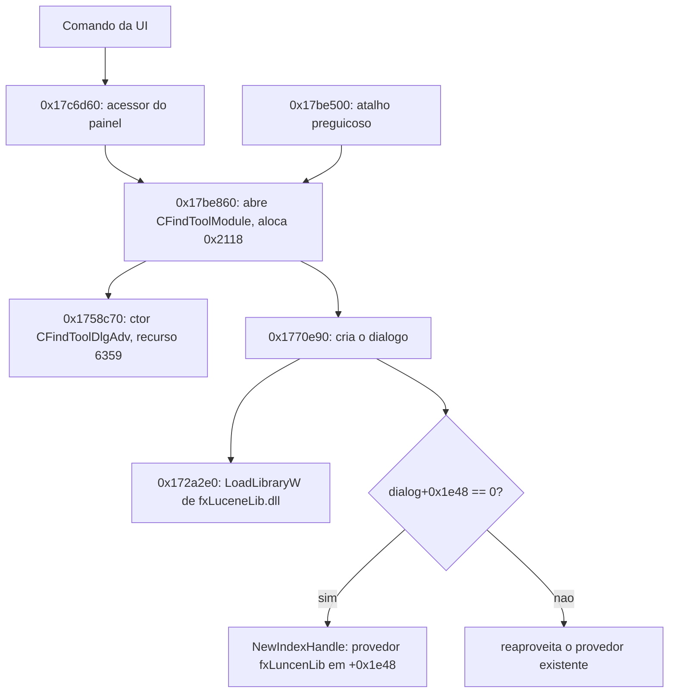
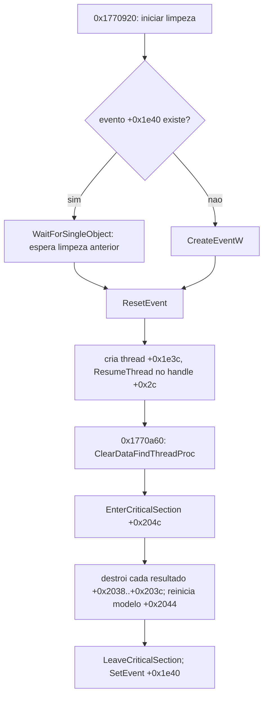

# Fluxo de busca do Foxit — mapa estrutural completo — 22/10/2026

Registrado em 2026/10/22 (America/Sao_Paulo, UTC-03:00). Tarefa **A1** da lista
[O-QUE-FAZER-AGORA-2026-10-22.md](O-QUE-FAZER-AGORA-2026-10-22.md). Continua o provedor do índice
de [REA-PROVEDOR-BUSCA-2026-10-21.md](REA-PROVEDOR-BUSCA-2026-10-21.md).

Análise estática na nuvem, com o `FoxitPDFReader.exe` conferido por hash (`90208c9e…b3a6`) e o
Ghidra 12.1.4. O Foxit **não foi executado** e a VM não recebeu comandos. Sete entradas novas
(cinco da busca, duas da impressão) foram conferidas instrução a instrução por Capstone (454
instruções, 1.850 bytes, todas as fronteiras conferem); o catálogo passou de 336 para **343**.

## O diálogo e seu dono

A busca avançada pertence a um módulo próprio, **CFindToolModule** (destrutor `0x1726b90`,
examinado na E22). O caminho de criação, agora ligado de ponta a ponta:

1. **Acessor do painel `0x17c6d60`.** Pega um subobjeto pelo slot virtual `+0x278` do objeto em
   `+4`, chama o slot `+0x94`, procura o módulo com `0x17289e0` e, se existir, chama
   `0x17be860` e devolve um ponteiro lido em `[[módulo+0x1c]+0x20]`. É o ponto por onde a UI
   obtém o diálogo de busca.
2. **Abertura do módulo `0x17be860`.** Aloca **0x2118 bytes**, constrói **CFindToolDlgAdv**
   (`0x1758c70`, recurso 6359) e chama `0x1770e90`. Há um atalho preguiçoso `0x17be500`
   (`jmp 0x17be860`): se `+0x1c` já existe, apenas ajusta `+0x10=1` e `+0xc=0` e não recria.
3. **Criação do diálogo `0x1770e90`.** Grava o dono em `dialog+0x1d7c`, chama o carregador
   `0x172a2e0` (LoadLibraryW de `\fxLuceneLib.dll`), e se `dialog+0x1e48` é zero grava ali o
   retorno de `NewIndexHandle` (classe `fxindex::fxLuncenLib`, 0x20 bytes). Abre o recurso
   `0x18d7`.

## Busca em segundo plano: a thread de limpeza de resultados

O diálogo tem uma thread dedicada a **esvaziar a lista de resultados** fora da thread da UI. Isso
foi confirmado por um texto de log embutido no binário:
`CFindToolDlgAdv::ClearDataFindThreadProc`, com o caminho de compilação
`F:\phantompdfci\jenkins\workspace\TAA-PH-AUTO-COMPILE\Starship\findtool\src\find...`.

- **Início `0x1770920`.** Se há resultados a limpar (`+0x203c − +0x2038`), chama o slot `+0x1c`
  do objeto `+0x1f34` com `(0,1)`. Se o evento `+0x1e40` já existe, espera por ele com
  `WaitForSingleObject(INFINITE)` (deixa a limpeza anterior terminar); senão cria com
  `CreateEventW`. `ResetEvent`, cria a thread (wrapper de 0x44 bytes, `0x48f4b59`, proc
  `0x1770a60`) guardada em `+0x1e3c` liberando a anterior, zera `+0x28` e `ResumeThread` no
  handle `+0x2c`.
- **Procedimento `0x1770a60` (ClearDataFindThreadProc).** `EnterCriticalSection(+0x204c)`, loga
  "ClearAllItem----start", percorre o vetor de resultados `+0x2038..+0x203c` chamando o destrutor
  `0x175dea0` por elemento, reduz o vetor de itens de página, reinicia o modelo `+0x2044` pelo
  slot virtual `+0x14`, `LeaveCriticalSection`, `SetEvent(+0x1e40)` e marca `+0x2064=1`.

Ou seja, `+0x1e3c` é a **thread de limpeza**, `+0x1e40` o **evento de limpeza concluída** e
`+0x204c` a **seção crítica** que protege o vetor de resultados. No destrutor `0x175eb50` (E24) é
exatamente essa thread que é esperada (`GetExitCodeThread` no handle `+0x2c`, depois
`WaitForSingleObject`) antes de liberar o provedor — corrige a leitura da E24, que a tinha chamado
de "thread de busca".

## Opções da busca

A estrutura de 24 bytes montada por `0x1783ac0` (E18/18-10, confirmada antes) reúne, neste
caminho: byte 0/1 caixa e palavra inteira; byte 2 anexos; byte 4 proximidade (condicionada a
escopo de índice e modo "todas as palavras", confirmado na E24); byte 8 modo por tabela de três
valores; `+0x14` a enumeração de quatro textos do provedor (`1.0.0`…`1.3.0`, via `0x177fc50` e
`0x17323e0`). Os bytes 3, 5, 6, 7, `+0xc` e `+0x10` continuam sem contrato completo. A caixa
**Highlight All** aciona a flag `+0x1dd8`, consumida pelos laços de iteração `0x1794b40` e
`0x1767ea0` (cancelamento cooperativo), já documentados.

## O que ainda falta (gap declarado)

Este é um mapa **estrutural completo** do fluxo de busca na aplicação, mas não a reconstrução
algorítmica interna:

- O algoritmo da DLL `0x1003f6b0` (montagem de BooleanQuery, 7.655 bytes) continua examinado só
  em recortes; a avaliação Lucene, o cancelamento interno e todas as combinações de consulta não
  estão reconstruídos.
- O objeto `+0x1f34` (slot `+0x1c`) e o modelo `+0x2044` (slot `+0x14`) têm os papéis observados,
  mas não a classe concreta.
- Os bytes 3/5/6/7/`+0xc`/`+0x10` das opções seguem parciais.

Por isso o critério "Fluxo completo de busca reconstruído" (etapa 8) **permanece parcial**: o
caminho na aplicação está ligado de ponta a ponta, mas a algoritmia interna do índice é uma
lacuna declarada.

## Evidências

- Sementes: [static-search-print-flow-2026-10-22-seeds.tsv](windows-evidence/foxit-rea/static-search-print-flow-2026-10-22-seeds.tsv).
- Metadados: [headless-cross-checks-static-search-print-flow-2026-10-22.json](windows-evidence/foxit-rea/headless-cross-checks-static-search-print-flow-2026-10-22.json).
- Conferência de máquina: [machine-checks.json](../testes/resultados/static-search-print-flow-2026-10-22/machine-checks.json) (7 entradas, 454 instruções, 1.850 bytes).
- Resultados brutos e pseudocódigo fora do Git, em `analysis-local/headless/static-search-print-flow-2026-10-22/`.

## Consequência para o Linuxit PDF

O índice próprio (`app/search_*`) não usa essas classes. O contrato útil é o de concorrência: a
limpeza da lista de resultados corre numa thread própria, protegida por seção crítica e sinalizada
por evento, e precisa terminar antes de liberar o provedor. A implementação própria roda a busca
em processos de trabalho isolados e aguarda o fim com `proc.wait()`. Este lote é referência para a
comparação futura, sem afirmar paridade.
