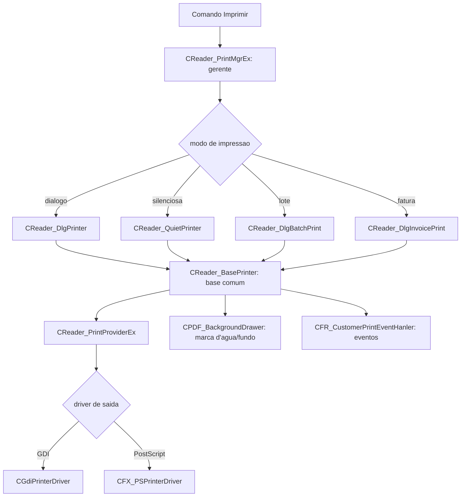

# Fluxo de impressão do Foxit — mapa estrutural — 22/10/2026

Registrado em 2026/10/22 (America/Sao_Paulo, UTC-03:00). Tarefa **A2** da lista
[O-QUE-FAZER-AGORA-2026-10-22.md](O-QUE-FAZER-AGORA-2026-10-22.md). Continua
[REA-IMPRESSAO-CONSUMIDORES.md](REA-IMPRESSAO-CONSUMIDORES.md) e a impressão de
[REA-BUSCA-IMPRESSAO.md](REA-BUSCA-IMPRESSAO.md).

Análise estática na nuvem, com o `FoxitPDFReader.exe` conferido por hash (`90208c9e…b3a6`) e o
Ghidra 12.1.4. O Foxit **não foi executado**. As duas entradas de impressão deste lote
(`0x1645710` e `0x165c230`) estão entre as sete conferidas instrução a instrução (ver A1); o
restante do mapa é por RTTI e vtables do PE, sem execução.

## Hierarquia de classes da impressão (por RTTI)

Os nomes abaixo vêm dos descritores RTTI do próprio binário:

- **Gerente:** `IReader_PrintMgr` → **`CReader_PrintMgrEx`** (vtable `0x53d6bfc`, base `0x53d6af0`).
- **Estratégias de impressora:** `CReader_BasePrinter` (vtable `0x53d7788`) →
  **`CReader_DlgPrinter`** (interativa, com diálogo), **`CReader_QuietPrinter`** (silenciosa),
  **`CReader_DlgBatchPrint`** (lote) e **`CReader_DlgInvoicePrint`** (fatura).
- **Provedor:** `IReader_PrintProvider` → `CReader_PrintProviderEx` (vtable `0x653950c`).
- **Drivers de saída:** **`CGdiPrinterDriver`** (vtable, ctor em `0x21114db`) e
  **`CFX_PSPrinterDriver`** / `CPSPrinterDriver` (PostScript, ctor em `0x211ff35`/`0x2120147`) —
  a escolha entre GDI e PostScript acontece na construção dos drivers, caminhos distintos.
- **Marca d'água/fundo:** `IPDF_BackgroundDrawer` → **`CPDF_BackgroundDrawer`** (vtable
  `0x54151a0`, três slots `0x1b88ea0` destruir, `0x1b8e560` preparar/consumir, `0x1b8cf60`
  trabalho), já examinada na E22, e `CFPD_CustomerBackgroundDrawHandler`.
- **Eventos:** `IReader_PrintEventHandler` → `CFR_CustomerPrintEventHanler`.

## Construtores confirmados

- **`CReader_PrintMgrEx::ctor` `0x1645710`.** Instala a vtable `0x53d6bfc` sobre a base
  `0x53d6af0`, zera um objeto grande (até `+0xac` em palavras, ~0x2c0 bytes), inicializa
  subobjetos por `0x164bc10`, `0x16541c0` e `0x165c390`, e copia um vetor de elementos de **0x18
  bytes** vindo do segundo argumento (a lista de impressoras disponíveis) quando não é o próprio
  campo interno. É um gerente com estado extenso, não uma função de impressão por si.
- **`CReader_BasePrinter::ctor` `0x165c230`.** Instala a vtable `0x53d7788`, define vários campos:
  `+0x18` (palavra `+0x6`) = 1, `+0x54` (`+0x15`) = `0xffffffff`, `+0x74`/`+0x78` (`+0x1d`/`+0x1e`)
  = 1, `+0x8c` (`+0x23`) = **0x48**, e chama `0x165f4d0`. Os valores são padrões de impressão (o
  `0x48` é um candidato a DPI/escala padrão, ainda não confirmado).

## O que ainda falta (gap declarado)

Este é um mapa **estrutural** do subsistema de impressão: a hierarquia de classes, a escolha entre
impressão com diálogo/silenciosa/lote/fatura e entre driver GDI e PostScript, e o desenho de
fundo. **Não** é a reconstrução completa:

- O método de impressão em si (o laço por página do `CReader_BasePrinter`, a montagem do DEVMODE,
  o envio ao spooler) não foi decompilado neste lote.
- O contexto de **0x138 bytes** do `CPDF_BackgroundDrawer` (E22) continua sem classe/contrato
  completo; `0x1b88520` inicializa 56 bytes (0x38), estrutura diferente.
- A concorrência da impressão (fila, cancelamento) e o resultado físico não foram observados; a
  impressão física depende de equipamentos (E23).

Por isso o critério "Fluxo completo de impressão reconstruído" (etapa 8) **permanece parcial**: as
fronteiras e as estratégias estão identificadas, mas o algoritmo de renderização e envio é uma
lacuna declarada.

## Evidências

- Sementes e metadados: os mesmos de A1,
  [static-search-print-flow-2026-10-22](windows-evidence/foxit-rea/static-search-print-flow-2026-10-22-seeds.tsv)
  (as duas entradas de impressão fazem parte da rodada).
- Conferência de máquina: [machine-checks.json](../testes/resultados/static-search-print-flow-2026-10-22/machine-checks.json).
- RTTI e vtables lidos do PE; sem execução. Resultados brutos fora do Git em
  `analysis-local/headless/static-search-print-flow-2026-10-22/`.

## Consequência para o Linuxit PDF

A impressão própria usa CUPS por `lp`/`lpstat` e imposição própria. O contrato útil é a separação
de papéis: um gerente que escolhe a estratégia (interativa, silenciosa, lote), um driver de saída
(no Linux, o backend CUPS no lugar de GDI/PostScript) e um desenhador de fundo separado. A
implementação própria já separa a sessão de impressão da imposição. Referência para a comparação
futura, sem afirmar paridade.
