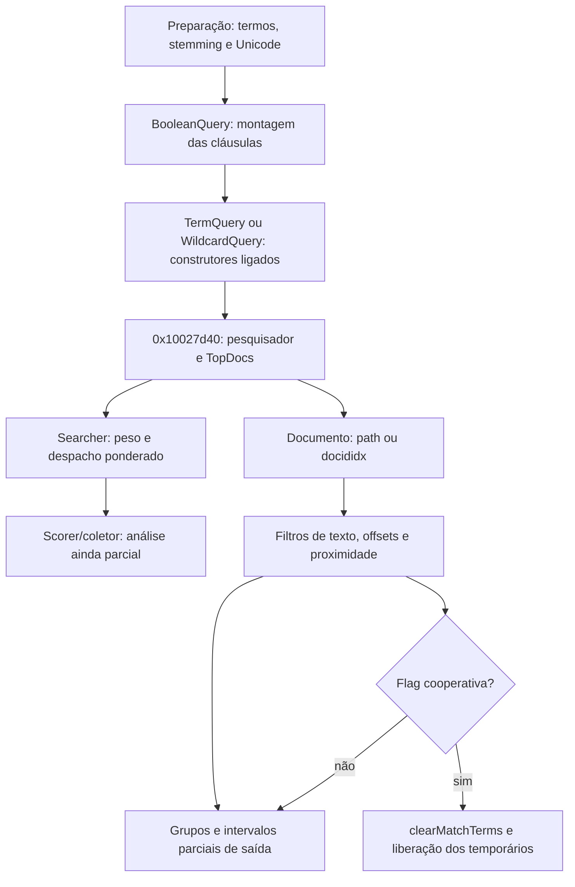

# S1 — construção, avaliação e pós-processamento da consulta

Revisão de Codex em 23/10/2026, America/Sao_Paulo. Esta continuação reutiliza
resultados interrompidos em 22/10 e segue chamadas justificadas por eles.
É análise estática: o Foxit não foi executado para produzir estes resultados.

## Identidades e verificação

- `fxLuceneLib.dll`: SHA-256 `20908415a56a8bf63ad4500a2696e6da38a10191402a36b4d84fc577b61c82e1`.
- `lucene++.dll`: SHA-256 `52bc60eda1744d5d354e216baeb1692611262ca064a0f2f54b5b064b8ad0484d`.
- Ghidra12.1.4, Temurin21 e sementes REA6.7.0, perfil dirigido `-noanalysis`.
  Projetos anteriores foram copiados, sem modificar os originais da análise.
- Todos os endereços de instruções dos corpos registrados foram conferidos por
  Capstone5.0.6/pefile2024.8.26 contra os arquivos fixados. Isso não recupera
  automaticamente tipos C++, todas as fronteiras ou comportamento dinâmico.
- Os resultados integrais e os projetos ficam em `analysis-local/headless/`.
  O Git recebe metadados e a descrição das conclusões, sem código proprietário.

| Lote | Observações | Instruções | Bytes | Conferência |
|---|---:|---:|---:|---|
| `s1-query-constructors-2026-10-22` | 6 | 751 | 2.826 | [máquina](../testes/resultados/s1-query-constructors-2026-10-22/machine-checks.json) |
| `s1-query-evaluation-2026-10-23` | 7 | 2.020 | 7.375 | [máquina](../testes/resultados/s1-query-evaluation-2026-10-23/machine-checks.json) |
| `s1-index-provider-2026-10-23` | 7 | 810 | 2.595 | [máquina](../testes/resultados/s1-index-provider-2026-10-23/machine-checks.json) |
| `s1-searcher-2026-10-23` | 7 | 410 | 1.194 | [máquina](../testes/resultados/s1-searcher-2026-10-23/machine-checks.json) |
| Total destes quatro lotes | 27 | 3.991 | 13.990 | 22 entradas novas e cinco revisitas |

`0x1001a060`, `0x1001a0d0`, `0x10019280`, `0x10019340` e `0x10027d40`
já constavam no catálogo de350 entradas. São revisitas para resolver perguntas
específicas, não funções recuperadas novamente. Não se contam saltos finais,
slots virtuais ou excertos como funções únicas adicionais.

## Os wrappers e as consultas concretas

`0x10011290` e `0x10011350` movem objetos com ponteiro de controle e zeram a
origem. Não são, isoladamente, os construtores de `TermQuery`/`WildcardQuery`.
O predicado `0x1001dff0` testa se o ponteiro armazenado é nulo. Isso esclarece
o caminho interno `-8` previamente localizado na montagem da consulta.

A cadeia de construção agora tem destinos concretos:

| Caminho | Evidência examinada |
|---|---|
| `0x1001a060` → `0x10019ca0` → `0x10019280` | Alocação de `0x30` bytes e chamada ao import do construtor `Lucene::TermQuery` |
| `0x1001a0d0` → `0x10019cc0` → `0x10019340` | Alocação de `0x80` bytes e chamada ao import do construtor `Lucene::WildcardQuery`, com booleanos e `StarCharPosition` |

Os imports são do módulo efetivamente ligado ao executável. As opções exatas
de todas as variantes do construtor de curinga e o contrato completo de escapes
continuam abertos. A identidade da classe não prova todas as suas regras.

## Ocorrência booleana conferida na biblioteca instalada

O significado dos inteiros não foi tomado de uma versão genérica do Lucene.
Na `lucene++.dll` fixada:

- `BooleanClause::isRequired`, export em `0x101ddec0`, compara o campo `+0x24`
  com **zero**.
- `BooleanClause::isProhibited`, export em `0x101ddeb0`, compara o mesmo campo
  com **dois**.

Portanto, o zero observado em `BooleanQuery::add` é requerido. O valor um não é
requerido nem proibido segundo esses predicados. Essa conclusão é mais precisa
que atribuir nomes de enum sem verificar a ABI. Não se afirma que todos os
modos da interface estejam integralmente caracterizados por esses dois testes.

## Entrada no pesquisador e termos correspondentes

`0x10018df0` aloca `0x7c` bytes, chama o import do construtor de
`Lucene::IndexSearcher(IndexReader)` e grava as tabelas `0x100d75c0` e
`0x100d7630`. O wrapper `0x10019df0` liga essa construção ao caminho chamado
por `0x100243b0`.

Na tabela principal deste objeto, os slots examinados resolvem para:

| Slot | Destino via thunk/IAT | Significado comprovado pelo import |
|---|---|---|
| `+0x28` | `0x10043004` / `0x100d624c` | `IndexSearcher::doc(int)` |
| `+0x34` | `0x100430ca` / `0x100d62d0` | `Searcher::search(Query,int)` |
| `+0x64` | `0x10042cde` / `0x100d67e8` | `IndexSearcher::getMatchTerms()` |
| `+0x68` | `0x10042ce4` / `0x100d67e4` | `IndexSearcher::clearMatchTerms()` |

As duas últimas funções são importadas de `lucene++-contrib.dll`; isso não
significa que seus corpos tenham sido descompilados nesta rodada. A vinculação
de slots/imports está no [recibo suplementar](../testes/resultados/s1-query-evaluation-2026-10-23/interface-links.json).

Essa identidade esclarece o cancelamento antes descrito apenas como “slot
virtual +0x68”: neste caminho do pesquisador ele limpa os **termos
correspondentes**, não prova limpeza de toda a lista visível de resultados.
Não aplicar o significado desse slot a tabelas de outros tipos.

O objeto construído por `0x10018d40`/`0x10003c80`, por outro lado, chama o
construtor de `Analyzer` e instala a tabela `0x100d6a38`. Não é o leitor de
índice. Os getters `0x1001e720` e `0x1001e730` simplesmente retornam o primeiro
ponteiro do objeto recebido; o nome atribuído pelo analista não basta para
tipar todos os chamadores desses helpers genéricos.

## Avaliação e retornos internos

`0x10027d40` consulta um método `+0x74` do objeto de entrada; quando o valor é
menor que1, devolve **-15**. O tipo concreto desse outro objeto não foi fechado
por esta leitura, portanto o teste não foi renomeado como uma condição pública
de erro por dedução.

No caminho restante, chama `IndexSearcher::search(Query,int)`, transfere o
intervalo de resultados e consulta sua quantidade. Quantidade zero leva a
`clearMatchTerms()` e retorno **-17**; o caminho com resultados devolve zero.
Não foram recuperadas aqui as mensagens ou a tradução pública desses códigos.

Na biblioteca, o export `Searcher::search(Query,int)` em `0x10276070` encaminha
ao overload com filtro (`0x10276000`). Esse overload chama o slot `+0x54` para
obter peso e despacha para a busca ponderada pelo slot `+0x0c`.

`IndexSearcher::search(Weight,Filter,int)`, `0x102419f0`, exige quantidade
positiva, consulta limites do índice, constrói o coletor e despacha para sua
busca antes de obter os resultados. A quantidade não positiva toma um caminho
de exceção; a classe/mensagem dessa exceção não foi nomeada nesta revisão.

`IndexSearcher::search(Weight,Filter,Collector)`, `0x10241c50`, separa caminhos
conforme a presença de filtro, itera os leitores internos e chama os métodos
do coletor/peso. Há um caminho de scorer e outro helper `0x10241e80`. A criação
de peso booleano em `0x101e2fa0` encaminha para `0x101e0770`.

**Ainda falta seguir os helpers de peso/scorer/coletor e seus tipos concretos.**
Este lote liga a consulta ao motor real e estende o laço, mas não descreve como
completos o ranqueamento, todos os scorers e as combinações de filtros.

## Pós-processamento e cancelamento

`0x100243b0` monta a consulta, chama `0x10027d40`, percorre os resultados,
recupera documentos e escolhe a propriedade `path` ou `docididx` conforme o
provedor. Esses nomes são strings UTF-16 do binário, não nomes inventados para
os campos de saída.

Esse coordenador também verifica o ponteiro cooperativo de cancelamento em
mais de um laço. A saída observada chama `clearMatchTerms`; os caminhos de
limpeza/liberação são separados da atualização dos widgets da UI. O retorno
`-10` do coordenador externo continua documentado no relatório anterior.

Os novos corpos `0x100227b0` e `0x100228f0` percorrem vetores de termos;
o segundo usa offsets inicial/final, verifica limites da string e pode aplicar
as flags de largura/acentos antes da comparação por `0x10026740`.

`0x100280d0` percorre grupos/posições, consulta offsets e grava intervalos em
registros de saída, incluindo campos `+0x1c` e `+0x20`. Há ramos de
correspondência textual e um teste cooperativo de cancelamento. Os nomes e
tipos completos dos registros ainda não estão estabelecidos; a assinatura
automática não foi promovida a contrato público.

O caminho de proximidade passa por `0x10024fc0`, `0x1002db60` e `0x1001fa90`.
Foram examinados a obtenção de vetores, o mapeamento de limites/grupos, os
offsets, a eliminação/agregação de posições repetidas e novas verificações de
cancelamento. O mapeamento tem sentinela final `0x9fff`, mas isso não define,
isoladamente, o intervalo público de proximidade. O campo `+0x10` identificado
nas preferências **não recebeu uma fórmula de distância inventada**.

## Fluxo estabelecido e lacunas

S1 permanece parcial: faltam o contrato completo de `+3`/`+0xc`, o consumo
integral do intervalo de proximidade, os pesos/scorers/ranqueamento, escapes,
erros/exceções, propriedade e ciclo de vida integral da interface e a ligação
dinâmica dos estados. Próximos destinos justificados: `0x101e0770`,
`0x10241e80`, helpers do coletor e consumidores do bloco de opções.
Os dois primeiros receberam continuação no [lote de pesos/scorers de23/10](REA-S1-PESOS-E-SCORERS-2026-10-23.md):
seis entradas adicionais, com BooleanWeight, partição dos filhos e interseção porDocID.
O estado acima corresponde a este lote original; os próximos alvos restantes e as lacunas
atualizadas estão no complemento, sem promover S1 a concluída.

Complementos desta rodada: [opções](REA-S1-OPCOES-2026-10-23.md),
[Unicode](REA-S1-UNICODE-2026-10-23.md) e
[objetos da UI/errata](REA-S1-OBJETOS-UI-2026-10-23.md).
Aplicativo, candidato0.1.19 e seus testes preservados; nenhum critério amplo,
peso ou percentual de paridade foi alterado por esta análise.
