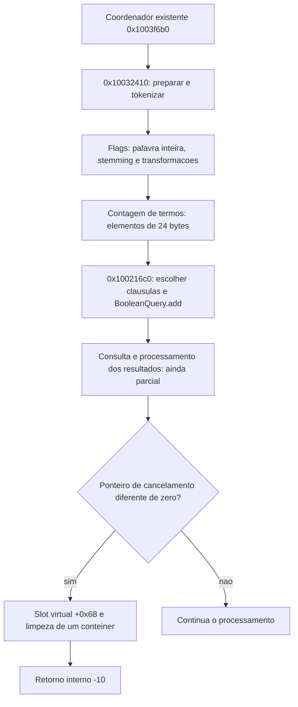

# S1 — preparação da consulta e cancelamento interno

Continuação por Codex em 22/10/2026, depois do registro do Passo 7. O horário
exato da revisão consta em `testes/resultados/s1-query-pipeline-2026-10-22/review.json`
e na nota de continuidade. Complementa o
[mapa estrutural anterior](REA-FLUXO-BUSCA-2026-10-22.md).

## Resultado desta rodada

Sete funções novas da `fxLuceneLib.dll` foram examinadas. O catálogo passou de
**343 para 350 entradas distintas**. O Ghidra decompilou as sete sem mensagem de
erro; o Capstone conferiu, contra os bytes originais, todas as fronteiras das
**1.593 instruções e 5.278 bytes** desses corpos.

O lote esclarece preparação dos termos, um campo de stemming, tratamento de
curingas e parte do cancelamento interno. **S1 permanece parcial.** A avaliação
completa do índice, todos os campos das opções, as classes concretas de dois
objetos da UI e as combinações de consulta ainda não estão reconstruídos.

Não houve execução do Foxit, entrada na VM, teste diferencial, alteração do app
Linuxit, rebuild do candidato ou publicação de versão.

## Identidade, ferramentas e preservação

- Módulo: `fxLuceneLib.dll`, x86, instalado no caminho original já autorizado.
- SHA-256: `20908415a56a8bf63ad4500a2696e6da38a10191402a36b4d84fc577b61c82e1`.
- Ghidra 12.1.4 e Temurin JDK 21 existentes no PC; REA 6.7.0 fornece o script de
  sementes. Nenhuma instalação ou alteração da configuração MCP nesta rodada.
- As ferramentas REA MCP não estão anunciadas nesta sessão. Foi usado o backend
  complementar já existente, com `-noanalysis`, a partir de **cópia** do projeto
  preservado `static-index-options-2026-10-18/project`.
- O projeto anterior não foi modificado. Resultados completos e projeto novo:
  `analysis-local/headless/s1-query-pipeline-2026-10-22/`, ignorados pelo Git.
- A fonte foi conferida por hash antes e depois. O perfil não é um Evidence ID
  do MCP. Tipos e limites de função continuam sujeitos à revisão semântica.

As sete sementes foram comparadas ao catálogo antes da execução: nenhuma estava
catalogada. A função antiga `0x1003f6b0` foi relida para ligar os consumidores;
essa releitura **não** conta como uma oitava entrada nova.

## Funções novas e o que foi possível estabelecer

| Endereço | Bytes | Papel observado neste lote | Limite da conclusão |
|---|---:|---|---|
| `0x10032410` | 1.432 | Prepara texto/termos; usa um fluxo de tokens, conversão para minúsculas, stemming condicional e expansão com asteriscos | Não é sozinho o algoritmo completo de busca; assinaturas automáticas omitem argumentos |
| `0x10032260` | 23 | Calcula a quantidade de elementos de 24 bytes pela diferença entre início e fim | O layout do elemento e a propriedade dos objetos não ficam totalmente resolvidos pelo contador |
| `0x100321c0` | 24 | Obtém um contêiner por `0x1001e6c0` e calcula a quantidade de elementos de oito bytes | Não foi renomeado como quantidade universal de resultados/hits |
| `0x10026860` | 1.222 | Percorre termos/tokens e trata `*`, `?` e variantes de largura total em ramos condicionais | A assinatura e o objeto de saída ainda são provisórios; não é uma função de cancelamento |
| `0x100216c0` | 1.982 | Monta cláusulas booleanas, distingue modos e chama o import real `BooleanQuery::add` | Classes dos wrappers e equivalência dos modos com todos os controles da UI continuam parciais |
| `0x10024d90` | 558 | Encadeia `0x100243b0`, percorre coleções e propaga o retorno; em um ramo produz `-17` | O significado público desse código não foi inferido como mensagem da UI |
| `0x10041fd0` | 37 | Limpa o intervalo ocupado de um contêiner e coloca o fim novamente no início | O papel foi corrigido: não é, por si só, um setter da flag de cancelamento |

## Preparação de texto e opções

### Base da estrutura e stemming

O chamador antigo `0x1003f6b0`, no ponto `0x1003f965`, passa uma cópia de
24 bytes das opções para `0x10032410`, além da string e dos argumentos auxiliares.
O consumidor lê os primeiros DWORDs em `[EBP+0x20]` e `[EBP+0x24]`.

No segundo DWORD, o deslocamento de oito bits seleciona o **byte +5** das opções.
Quando esse byte está habilitado, e o primeiro caractere do termo satisfaz os
predicados Unicode de dígito/letra, o ramo chama o import real
`SnowballFilter::to_Stemming`, no slot IAT `0x100d662c`. Portanto, neste caminho,
o byte +5 controla stemming. Isso não prova ainda o nome, a disponibilidade ou
todas as dependências do controle correspondente na interface.

O processamento também chama `StringUtils::toLower`. A presença dessa conversão
não significa que o programa inteiro ignore a opção de maiúsculas/minúsculas:
outros estados do analisador e etapas posteriores participam do contrato.

### Bytes +6 e +7

Esses bytes são extraídos do mesmo segundo DWORD. Se algum estiver habilitado,
o código chama `DealsText::PDFText_UnicodeDeals` no slot `0x100d63e8`, passando os
dois valores como flags e um terceiro booleano zero. Os nomes e a ABI do import
foram lidos da tabela PE da própria DLL.

Há também seleção de ramos por +6/+7 na montagem das cláusulas. O efeito exato
de cada flag sobre diacríticos, largura de caracteres ou outras normalizações
**não foi declarado como resolvido**: isso exige examinar o destino na
`lucene++.dll` e ligar cada escrita da estrutura aos controles de origem.

### Palavra inteira e curingas

O consumidor lê o byte +1 no primeiro DWORD. No ramo em que esse byte está
desabilitado, há composição de asteriscos em torno de termos elegíveis. O ramo
também depende do modo e da posição do token: primeiro, último ou token único.
Isso amplia a evidência do campo já associado a palavra inteira, sem transformar
todos os casos de entrada em um contrato final.

Foram lidos diretamente os literais UTF-16 usados pelos ramos:

| Endereço VA | Literal |
|---|---|
| `0x100d7890` | `*` — U+002A |
| `0x100d7ae0` | `?` — U+003F |
| `0x100d7ae4` | `＊` — U+FF0A |
| `0x100d7ae8` | `？` — U+FF1F |

As variantes de largura total não são nomes inventados para opções: são
constantes do binário utilizadas em ramos de transformação/construção.
`0x10026860` distingue essas variantes e também concatena `*` em um dos caminhos.
Ainda faltam regras integrais de escape, combinações e correspondência em runtime.

## Montagem booleana

`0x100216c0` lê o modo em `opções+8`. O código separa o modo zero dos modos
1, 2 e 3 e devolve `-9` para valor fora desse conjunto quando o laço processa um termo.
Não se inferiu esse retorno para uma entrada sem termos.

O laço usa a quantidade calculada por `0x10032260` e escolhe ramos conforme a
presença de curingas, os bytes +6/+7 e outro campo booleano. As cláusulas chegam
ao import real `BooleanQuery::add`, slot IAT `0x100d6678` da `lucene++.dll`.
Há valores numéricos 0 e 1 para o argumento `BooleanClause::Occur` nesses ramos.
Não foram traduzidos automaticamente para nomes de enum de outra versão Lucene.

A rotina também pode devolver `-8` após um predicado interno e zero no caminho
de conclusão. Os códigos brutos são observações estáticas; seus nomes públicos,
mensagens e apresentação pela UI continuam sem confirmação.

Os wrappers chamados antes de `add` ainda precisam ser ligados às classes
concretas de consulta. A presença de imports de `TermQuery` e `WildcardQuery` na
DLL ajuda a selecionar alvos, mas não atribui essas classes a cada wrapper sem
seguir sua construção. Nenhuma dessas chamadas observa o índice sendo avaliado.

## Cancelamento interno e assinatura automática incompleta

Na função antiga `0x1003f6b0`, a comparação em `0x1003fb83` lê um inteiro por
ponteiro. Quando ele é diferente de zero, o salto em `0x1003fb88` segue para
`0x10041404`. Esse caminho chama um método virtual no slot +0x68, limpa um
contêiner por `0x10041fd0` e grava **-10** no registrador usado como retorno.

O epílogo em `0x10041340` move esse registrador para EAX e a função encerra com
`RET 0x58`. Isso mostra uma limitação importante da decompilação antiga: ela
apresentava a assinatura como `void`, embora o assembly retorne o valor em EAX.
O relatório preservado não foi reescrito para ocultar a diferença.

O novo helper de limpeza confirma que o caminho esvazia um intervalo de objetos;
não confirma que a lista visível de resultados da UI seja inteiramente apagada.
Não foi identificado aqui quem escreve a flag, qual sincronização a protege ou
se outros cancelamentos retornam o mesmo código. O teste do botão Parar e a
comparação com a UI continuam uma evidência separada, dependente da VM.

O diagrama liga trechos examinados; não substitui os laços, tipos ou estados
ainda não reconstruídos.

## Perguntas de S1 após este lote

| Pergunta | Situação |
|---|---|
| O que faz o byte +5 no caminho de preparação? | Respondida no recorte: habilita chamada de stemming; controle de origem ainda aberto |
| Onde +6/+7 são consumidos? | Parcial: chamada UnicodeDeals e ramos de cláusulas ligados; sem semântica integral de cada flag |
| Há tratamento explícito de curingas? | Respondida no recorte; regras completas/escapes e runtime ainda abertos |
| Onde são adicionadas as cláusulas booleanas? | Helper/import ligados; tipos concretos dos wrappers e avaliação completa ainda abertos |
| Como um cancelamento sai do laço? | Um caminho estático ligado a limpeza e retorno -10; escritor/sincronização/UI ainda abertos |
| Campos +3, +0xc e +0x10 das opções? | Abertos neste lote; não foram atribuídos significados por exclusão |
| Classes concretas de dialog+0x1f34 e +0x2044? | Abertas; os offsets da UI pertencem ao executável principal, não a esses contêineres da DLL |

## Evidências e continuidade

- [Sementes](windows-evidence/foxit-rea/s1-query-pipeline-2026-10-22-seeds.tsv).
- [Metadados por função](windows-evidence/foxit-rea/headless-cross-checks-s1-query-pipeline-2026-10-22.json).
- [Conferência de máquina](../testes/resultados/s1-query-pipeline-2026-10-22/machine-checks.json).
- [Revisão, identidade e limites](../testes/resultados/s1-query-pipeline-2026-10-22/review.json).
- [Catálogo consolidado](../engenharia-reversa/funcoes.csv).

Próximos alvos justificados: wrappers `0x10011290`/`0x10011350` e seus
construtores; `0x1001a060`/`0x1001a0d0`; predicado `0x1001dff0`; a chamada
`0x100243b0` que antecede a filtragem; e o destino de `PDFText_UnicodeDeals`,
com identidade do módulo conferida antes de nova análise. Consultar primeiro o
catálogo: algumas dessas sementes podem já existir em dossiers REA anteriores.

A etapa 8 continua parcial e os pesos permanecem os mesmos. Este lote não fecha
S1, não altera os resultados próprios744/744 do candidato9fb4f3a nem cria nova
evidência de paridade com o Foxit.
