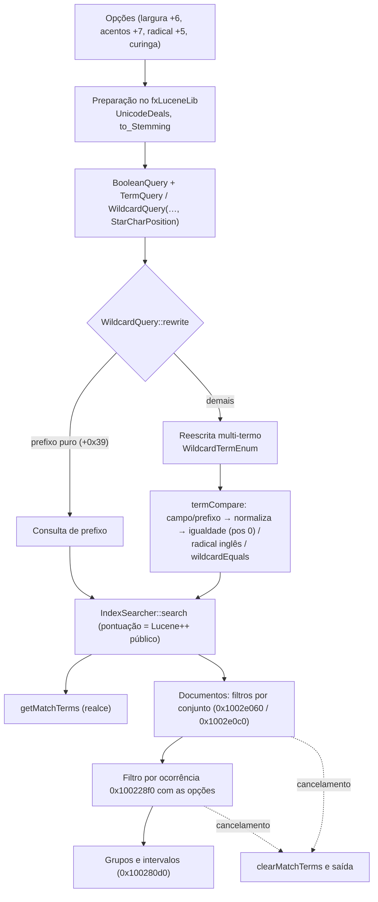

# S1 — modificações do Foxit no Lucene++ e fronteira da busca — 23/10/2026

Claude, 2026/10/23, das 12:35 às 12:47 (America/Sao_Paulo, UTC-03:00). A análise foi **somente
estática**: o Foxit não foi executado, a VM não foi tocada e nenhum código do Foxit foi versionado
ou incorporado. Este lote continua os documentos [consulta e cancelamento](REA-S1-CONSULTA-E-CANCELAMENTO-2026-10-22.md),
[avaliação](REA-S1-AVALIACAO-2026-10-23.md), [pesos e scorers](REA-S1-PESOS-E-SCORERS-2026-10-23.md),
[opções](REA-S1-OPCOES-2026-10-23.md) e [Unicode](REA-S1-UNICODE-2026-10-23.md), sem repetir as
entradas já analisadas neles.

**Resultado:** o critério "Fluxo completo de busca reconstruído" (etapa 8) **continua parcial**. O
lote fecha a pergunta "o que o Foxit mudou no Lucene++". Ficam abertas as lacunas listadas no
fim. Nenhum status, peso ou índice foi alterado por este lote.

## Identidade e verificação

| Módulo | SHA-256 | Rodada | Entradas | Instruções / bytes |
|---|---|---|---:|---:|
| `lucene++.dll` | `52bc60ed…484d` | `claude-s1-luc` | 12 (todas novas) | 1.160 / 3.465 |
| `fxLuceneLib.dll` | `20908415…82e1` | `claude-s1-fx` | 4 (3 novas, `0x100243b0` revisita) | 683 / 2.606 |

- **Ferramentas:** Ghidra 12.1.4 com `-noanalysis` e o script de sementes do REA 6.7.0, sem MCP.
  Capstone 5.0.6 e pefile 2024.8.26 conferiram todas as fronteiras de instrução
  ([lucene++](../testes/resultados/s1-lucene-foxit-2026-10-23/machine-checks-lucene.json),
  [fxLuceneLib](../testes/resultados/s1-lucene-foxit-2026-10-23/machine-checks-fxlucenelib.json)).
- **Sementes e metadados:** `docs/windows-evidence/foxit-rea/static-s1-claude-{luc,fx}-2026-10-23-seeds.tsv`
  e `headless-cross-checks-claude-s1-{luc,fx}-2026-10-23.json`.
- **Resultados brutos:** ficam em `analysis-local/headless/claude-s1-*`, fora do Git.

## APIs próprias do Foxit no Lucene++ (exports sem equivalente no Lucene++ público)

Busca pelos nomes exportados (5.282 exports). Os nomes vêm do próprio binário.

| Export | VA | Observado |
|---|---|---|
| `WildcardQuery(Term, bool, bool, bool, StarCharPosition)` | `0x10296a60` | Guarda três booleanos em `+0x78`, `+0x79` e `+0x7a` e a posição do asterisco em `+0x7c`. Marca `+0x38` se o texto tem `*` ou `?` e marca `+0x39` (prefixo puro) quando o único curinga é um `*` final, sem `?`. |
| `WildcardTermEnum(IndexReader, Term, bool, bool, bool, StarCharPosition)` | `0x102979c0` | `+0x81` = radical, `+0x82` = largura, `+0x83` = acentos, `+0x88` = posição do asterisco, `+0x80` (fim) = 0. O prefixo vai até o primeiro `*` ou `?`, com tamanho em `+0x7c`. |
| `WildcardTermEnum::termCompare` | `0x10297e20` | Comparação modificada; ver abaixo |
| `WildcardTermEnum::wildcardEquals` | `0x10298120` | Comparação recursiva de padrão, chamada pelo `termCompare` |
| `WildcardQuery::rewrite` | `0x10297690` | Prefixo puro vira consulta de prefixo com o mesmo boost; os demais casos vão para a reescrita multi-termo (`0x10256690`) |
| `WildcardQuery::addTerm` | `0x10297080` | Acrescenta uma `wstring` a uma coleção interna; não há chamada direta em nenhuma das duas DLLs, só o slot `+0x70` da vtable |
| `SnowballFilter::to_Stemming` (estático) | `0x1003cfb0` | Ver "Radicais" |
| `SnowballFilter::incrementToken` | `0x1003ce20` | Mesmo estemizador aplicado no fluxo de tokens; uma falha lança exceção |
| `IndexSearcher::AddMatchTerms` / `getMatchTerms` / `clearMatchTerms` | `0x10241410` / `0x100f1a50` / `0x100ef640` | Vetor `vector<vector<wstring>>` em `searcher+0x70..+0x78`. `get` devolve `this+0x70`, `clear` destrói os elementos e faz fim = início, `Add` acrescenta cada grupo recebido. Slots `+0x60`, `+0x64` e `+0x68` da vtable `IndexSearcher`. |
| `IndexReader::clearMatchTerms` | `0x1008e400` | Mesmo padrão sobre `reader+0x24..+0x28` |
| `DealsText::PDFText_UnicodeDeals` | `0x10297d80` (wrapper de `0x102c9540`) | Já analisado em [Unicode](REA-S1-UNICODE-2026-10-23.md) |

### Comparação de termos com curinga (`termCompare`)

Para cada termo do índice, nesta ordem:

1. **Campo e prefixo.** Se o campo difere ou o texto não começa com o prefixo, grava fim (`+0x80 = 1`)
   e devolve.
2. **Normalização.** Com largura (`+0x82`) ou acentos (`+0x83`) ligados, passa o padrão e o termo
   candidato por `PDFText_UnicodeDeals(texto, largura, acentos, 0, 0)` e por `0x10297cb0`.
   - Se a posição do asterisco (`+0x88`) for **0**, compara por **igualdade exata** das formas
     normalizadas, sem curinga.
   - Se não for 0, segue para o passo 3.
3. **Radical.** Com o radical ligado (`+0x81`), só se aplica quando o primeiro caractere é dígito,
   minúscula ou maiúscula (exports `UnicodeUtil::isDigit/isLower/isUpper`, `0x103157d0`,
   `0x103157e0` e `0x10315840`). Nesse caso compara `to_Stemming(candidato)` com o padrão.
4. **Curinga.** Nos demais casos, usa `wildcardEquals(padrão, 0, texto, tamanho do prefixo)`.

Ligação com o lado do Foxit: o `fxLuceneLib` chama esse construtor em três pontos (`0x100193c2`,
`0x100194c5`, `0x100366d5`).

- Os dois primeiros recebem booleanos e a posição do asterisco vindos das opções, conforme
  [avaliação](REA-S1-AVALIACAO-2026-10-23.md).
- O terceiro passa **zeros** em tudo: sem radical, sem normalização e com posição 0.

### Radicais: só inglês

- **Idioma fixo.** `to_Stemming` cria o estemizador Snowball com o texto literal **`english`** e
  a codificação `UTF_8`.
- **Falhas.** Sem o idioma, monta `language not available for stemming: english`. Uma falha ao
  derivar lança `exception stemming word:`.

O estemizador do Foxit observado é **somente inglês**. O Linuxit tem radicais PT/EN próprios
(`app/search_*`). Isso é uma diferença de contrato, e não deve ser tratada como paridade.

### Termos casados (realce)

- **Leitura.** Depois da busca (`0x10027d40`), o coordenador `0x100243b0` lê `getMatchTerms`
  (slot `+0x64`, em `0x100244ea`).
- **Limpeza.** Nas três saídas de cancelamento ou fim, chama `clearMatchTerms` (slot `+0x68`, em
  `0x10024d1c`, `0x10024d53` e `0x10024d75`).
- **Escrita.** Nenhuma chamada direta a `AddMatchTerms` foi encontrada no `fxLuceneLib` nem no
  `lucene++`; o único acesso é pela vtable. Quem preenche o vetor continua aberto.

### Pontuação

Não há export próprio do Foxit em `Similarity`, `Scorer` ou `Weight`.

- **No `fxLuceneLib`:** `Searcher::setSimilarity` e `IndexWriter::setSimilarity` aparecem só
  como cópias de slot de vtable (thunks `0x100430ee` e `0x1004320e`), sem chamada direta.
- **Na fronteira:** os nomes e a ABI dos predicados de cláusula já conferidos (Codex) coincidem
  com o Lucene++ público.

A pontuação é portanto **tratada como a do Lucene++ público** (biblioteca de código aberto, usada
só como referência de comportamento), com uma ressalva: chamadas virtuais não resolvidas podem
trocar a `Similarity` em runtime, o que não foi observado.

## Coordenador `0x100243b0` (revisita, só o que é novo)

- **Opções.** As opções chegam por valor, em 8 bytes (dois DWORDs), e são repassadas inteiras ao
  filtro por ocorrência `0x100228f0` e a `0x1002fc50`.
- **Filtros por documento.** Antes desses filtros, dois conjuntos ordenados funcionam como filtros
  de documento:
  - `0x10032210` com `0x1002e0c0`: se o primeiro conjunto não estiver vazio, o documento precisa
    pertencer a ele;
  - `0x100321f0` com `0x1002e060`: segundo critério de pertença, comparado com um valor local.

  Os getters são identidades (`0x100170b0` e `0x100170d0`), e `0x10009390` lê `+0x10`. O
  significado dos dois conjuntos (arquivos selecionados ou índice de documento) não foi nomeado.

## Fluxo atualizado

## Lacunas que mantêm S1 parcial

1. **Opções `+3` e `+0xc`.** O consumidor e o significado continuam sem prova. Os getters indicados
   antes (`0x100321f0`, `0x10032210`, `0x1002aa80`, `0x1002aac0`) acabaram sendo acessores de
   conjunto, não de opção.
2. **Proximidade (`+0x10`).** A unidade e a regra de aplicação em `0x10024fc0`, `0x1002db60` e
   `0x1001fa90` continuam sem fórmula.
3. **Escrita dos termos casados.** Quem chama `AddMatchTerms` não foi identificado.
4. **Escapes e erros.** Não há tabela completa de escapes da consulta. Os códigos `-8`, `-9` e
   `-10` são conhecidos só por recortes, e as exceções do estemizador não foram mapeadas até a UI.
5. **Pontuação em runtime.** Fica tratada como a do Lucene++ público; uma troca dinâmica de
   `Similarity` não está excluída.
6. **Execução.** Nada foi observado em execução: ordem real, realce na tela e cancelamento
   (etapas 10, 11 e 18).

## Consequência para o Linuxit PDF

Contratos para a comparação futura, sem paridade:

- **Radicais.** O Foxit só tem o inglês.
- **Normalização.** Largura e acentos se aplicam ao termo do índice e ao padrão, antes da
  comparação.
- **Prefixo.** Um `*` final é tratado como prefixo.
- **Realce.** Os termos casados vêm do mecanismo de busca, não de nova análise do texto.

O índice próprio (`app/search_*`) já faz radicais PT/EN, normalização e curingas de forma
independente.
