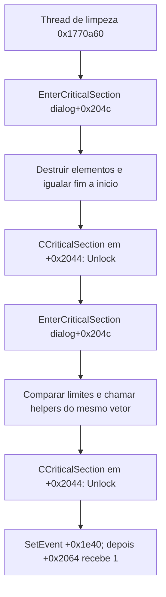

# S1 — objetos da busca e correção da seção crítica

Revisão estática de 23/10/2026, America/Sao_Paulo. Foram retomadas oito entradas
preservadas em 22/10 e examinadas quatro entradas adicionais da fábrica de
controles. O original e a VM não foram executados. O aplicativo próprio, o
candidato 0.1.19 e os critérios de progresso não foram alterados.

## Resultado e correção de interpretação

**`dialog+0x2044` é um objeto `CCriticalSection` embutido no diálogo.** Não é
ponteiro para outro modelo de resultados. A chamada virtual pelo slot `+0x14`
nesse endereço executa `Unlock`, que chama `LeaveCriticalSection` no endereço
`dialog+0x204c`.

Isso corrige a descrição “reinicia o modelo +0x2044” na seção da thread de
limpeza do [mapa estrutural anterior](REA-FLUXO-BUSCA-2026-10-22.md). O texto e
o diagrama anteriores devem ser lidos com esta errata; não há um reset de
modelo comprovado por essa chamada.

O objeto que contém o vetor está em `dialog+0x2034`; a RTTI o identifica como
`CVector<std::unique_ptr<DataNode>>`. Seus três campos de armazenamento ficam
em `+0x2038`, `+0x203c` e `+0x2040`. A seção crítica fica a `+0x10` desse objeto,
portanto em `dialog+0x2044`; o corpo nativo da seção crítica começa oito bytes
depois, em `dialog+0x204c`.

Para `dialog+0x1f34`, a inicialização chama a fábrica de controles com ID
`0x1f5a` (8026) e tipo `0x10` (16). No despachante de
`CFXBCGControlManager`, esse tipo constrói **`CFXBCGStyleTreeCtrl`**, com a
interface no início da alocação e o controle nativo a `+8`. A correspondência
foi ligada por código, tabela de seleção, construção e RTTI; não apenas pela
semelhança entre nomes. A implementação alternativa de uma fábrica devolvida
por outro proprietário e a identidade da instância em runtime não foram
testadas: a afirmação de classe é relativa ao caminho da fábrica padrão.

## Identidade e método

O executável examinado foi `FoxitPDFReader.exe`, SHA-256
`90208c9e8da92c8e546b76c8f4a2f8fb999105d124e663bbea6744fb6bb6b3a6`.
Os resultados completos continuam em `analysis-local/`, fora do Git.

A análise dirigida usou Ghidra 12.1.4 com `-noanalysis`, o script de sementes do
REA 6.7.0 e o JDK Temurin 21. O segundo lote copiou um projeto preservado antes
de criar suas funções; não alterou o projeto de origem. Esse perfil é o backend
direto complementar e **não** uma nova coleção de Evidence do REA MCP.

| Lote | Entradas examinadas | Instruções conferidas | Bytes de corpo |
|---|---:|---:|---:|
| Objetos preservados, 22/10 | 8 | 591 | 2.628 |
| Fábrica e destruição, 23/10 | 4 | 132 | 438 |
| Total destes dois lotes | 12 | 723 | 3.066 |

As fronteiras de todas essas instruções conferem com Capstone 5.0.6 nos bytes
do executável fixado. Isso não prova assinatura C++, limites universais das
funções, equivalência comportamental ou execução correta no Linux.

## Construção e layout do vetor protegido

O construtor preservado do diálogo, `0x1758c70`, passa
`this=dialog+0x2034` para `0x1756230`, na chamada `0x1759885`. O novo exame de
`0x1756230` confirma:

| Campo relativo ao diálogo | Papel confirmado estaticamente |
|---|---|
| `+0x2034` | vptr `0x53e0198`, RTTI do vetor de `unique_ptr<DataNode>` |
| `+0x2038` | início do armazenamento |
| `+0x203c` | fim dos elementos utilizados |
| `+0x2040` | limite de armazenamento |
| `+0x2044` | vptr `0x532dc84`, RTTI `CCriticalSection` |
| `+0x204c` | endereço passado a `InitializeCriticalSectionAndSpinCount` |

O construtor zera os três ponteiros e inicializa a seção crítica com spin count
zero. Se a inicialização falhar, consulta `GetLastError`, converte erros
positivos para o formato HRESULT de Win32 e segue para o tratamento de erro.
Não foi observado aqui o texto mostrado ao usuário nessa falha.

A RTTI da seção crítica tem descritor `0x6d15178` e nome
`.?AVCCriticalSection@@`. O slot virtual `+0x14` contém `0x7b9850`; a função
chama o import `LeaveCriticalSection` com `this+8` e retorna 1. A relação é de
objeto embutido: ler sua primeira palavra obtém a vtable, enquanto o endereço
do objeto continua sendo `dialog+0x2044`.

O descritor RTTI do vetor está em `0x6cc2480`. O nome inclui `DataNode`,
`std::unique_ptr` e `std::default_delete`; a grafia exata e os bytes completos
ficam no resultado privado. Essa evidência identifica armazenamento e posse
dos elementos pelo vetor; não fornece o layout completo de `DataNode`.

## A limpeza usa dois pares de entrada e saída

A inspeção direta do procedimento já catalogado `0x1770a60`, sem contá-lo como
entrada nova, mostra duas regiões críticas sucessivas:

1. A chamada em `0x1770b04` entra na seção crítica de `dialog+0x204c`.
   O intervalo de elementos é percorrido, `0x175dea0` é chamado por elemento
   e o fim utilizado volta ao início. A chamada virtual em `0x1770b45`
   libera a seção por `CCriticalSection::Unlock`.
2. A chamada em `0x1770b4f` entra novamente na mesma seção. O procedimento
   compara o fim e a capacidade e, conforme os limites correntes, chama
   `0x17ab3a0` ou `0x174e6f0` passando o mesmo armazenamento. A leitura como
   reorganização de capacidade é uma inferência desses acessos; os dois
   helpers não receberam exame completo neste lote. A chamada virtual em
   `0x1770b91` libera essa segunda entrada.
3. Em seguida, `SetEvent` recebe o evento de `dialog+0x1e40`; ao final,
   `dialog+0x2064` recebe 1.

Portanto, a descoberta de `Unlock` não indica duas saídas para uma única
entrada: há dois pares separados. Também corrige a descrição de que o segundo
par apenas reduziria um “vetor de itens de página” diferente: os acessos
examinados usam o mesmo armazenamento em `dialog+0x2038`.

Este fluxo não identifica o escritor da flag de cancelamento da DLL nem
confirma que uma chamada a Parar tenha o mesmo efeito visual em toda situação.
Essas perguntas pertencem a outros caminhos da busca.

## Fábrica do controle em dialog+0x1f34

`0x1785590` obtém uma fábrica por uma cadeia de interfaces do proprietário do
diálogo. Em `0x1785d37`, chama o slot zero dessa fábrica com o identificador
`0x1f5a` e o tipo `0x10`; em `0x1785d39`, grava o retorno diretamente no campo
`dialog+0x1f34`. Não há ajuste de oito bytes nessa gravação.

O despachante padrão `0x5a48c0` é o primeiro slot da vtable `0x6533b38`.
O descritor RTTI `0x6d12630` identifica `CFXBCGControlManager`. A função aceita
tipos de zero a 16 e retorna zero no caminho fora dessa faixa. A entrada 16 da
tabela em `0x5a49a8` aponta para `0x5a495c`, que chama `0x5a5610`.

`0x5a5610` usa `0x5ac320` para construir o objeto de retorno:

- são alocados `0x1e80` bytes;
- a vtable final da interface é `0x652109c`, RTTI
  `CFXBCGStyleTreeCtrl`, descritor `0x6d10870`;
- o construtor do controle nativo `0xbe50d0` recebe `objeto+8`;
- o endereço devolvido é o início da alocação, preservado pela fábrica;
- o retorno nulo permanece possível no ramo de alocação nula; não foi
  demonstrada aqui uma recuperação visível da aplicação para essa falha.

O slot `+0x1c` dessa interface contém `0x5aa0e0`. A chamada da limpeza com
`(0,1)` pertence, assim, à interface da árvore. A função trabalha no subobjeto
nativo a `+8`, altera o campo `+0xf0` do wrapper e executa operações virtuais
do controle nativo. Não atribuímos um nome de método MFC ou um efeito visual
universal a todas essas chamadas indiretas sem examiná-las.

Três slots adjacentes também foram examinados. `+0x3c` aponta para
`0x5aa210`, que retorna zero para ponteiro nulo ou encaminha ao slot `+0x160`
do objeto recebido. `+0x40` aponta para `0x5aa230`, com retorno zero no caso
nulo e chamada a `0xbb24a0` no outro caso. `+0x44` aponta para `0x5aa250`,
que retorna -1 para ponteiro nulo ou lê o campo `+0xe8`. São contratos
estáticos dos wrappers, sem inferir por seus offsets que todos sejam
operações de seleção ou contagem.

O destrutor da interface, `0x5adfb0`, trata o caso nulo, restaura a vtable da
classe concreta, chama `0xbe5260` com o subobjeto nativo a `+8`, restaura a
vtable da interface base e libera a alocação de `0x1e80` bytes. Isso liga a
construção à destruição do controle. **Ainda não identifica, de ponta a ponta,
quem invoca esse destrutor em cada fechamento do diálogo.**

`0xbdf0f0`, no lote inicial, contém uma operação semelhante sobre o controle
nativo. A diferença de oito bytes nos acessos é compatível com a composição
observada no construtor e nos wrappers, e não com duas instâncias do diálogo.

## Limitações de tipagem e perguntas restantes

A decompilação de `0x5a5610` mostra uma variável de pilha como retorno e remove
um bloco de destruição como inalcançável. A leitura do assembly foi necessária
para conferir o endereço produzido pelo helper e o retorno em EAX. Sua
assinatura automática não foi promovida a uma API C++ recuperada.

As duas lacunas de classe anteriores foram reduzidas de forma objetiva:
`+0x2044` está identificado por construção, RTTI e método; `+0x1f34` está
ligado à classe produzida pela fábrica padrão de tipo 16. Permanecem abertos
a vinculação universal de qualquer fábrica de proprietário, todas as
operações da árvore, a posse completa do controle pelo diálogo, o layout de
`DataNode`, o cancelamento cooperativo em outros caminhos e a comparação
dinâmica. Este documento não conclui S1 sozinho nem encerra a etapa 8.

## Evidências reproduzíveis

- [Sementes dos oito objetos](windows-evidence/foxit-rea/s1-ui-objects-2026-10-22-seeds.tsv),
  [metadados](windows-evidence/foxit-rea/headless-cross-checks-s1-ui-objects-2026-10-22.json)
  e [conferência de máquina](../testes/resultados/s1-ui-objects-2026-10-22/machine-checks.json).
- [Sementes da fábrica](windows-evidence/foxit-rea/s1-ui-factory-2026-10-23-seeds.tsv),
  [metadados](windows-evidence/foxit-rea/headless-cross-checks-s1-ui-factory-2026-10-23.json)
  e [conferência de máquina](../testes/resultados/s1-ui-factory-2026-10-23/machine-checks.json).
- [RTTI, offsets e revisão dos dois lotes](../testes/resultados/s1-ui-factory-2026-10-23/review.json).

Os resultados completos ficam em
`analysis-local/headless/s1-ui-objects-2026-10-22/` e
`analysis-local/headless/s1-ui-factory-2026-10-23/`. A leitura auxiliar de
RTTI, da tabela e dos trechos reutilizados fica em
`analysis-local/s1-ui-static-2026-10-23.json`.
