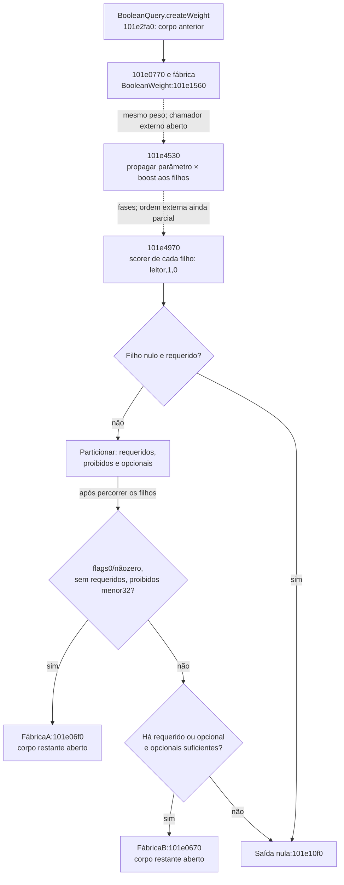
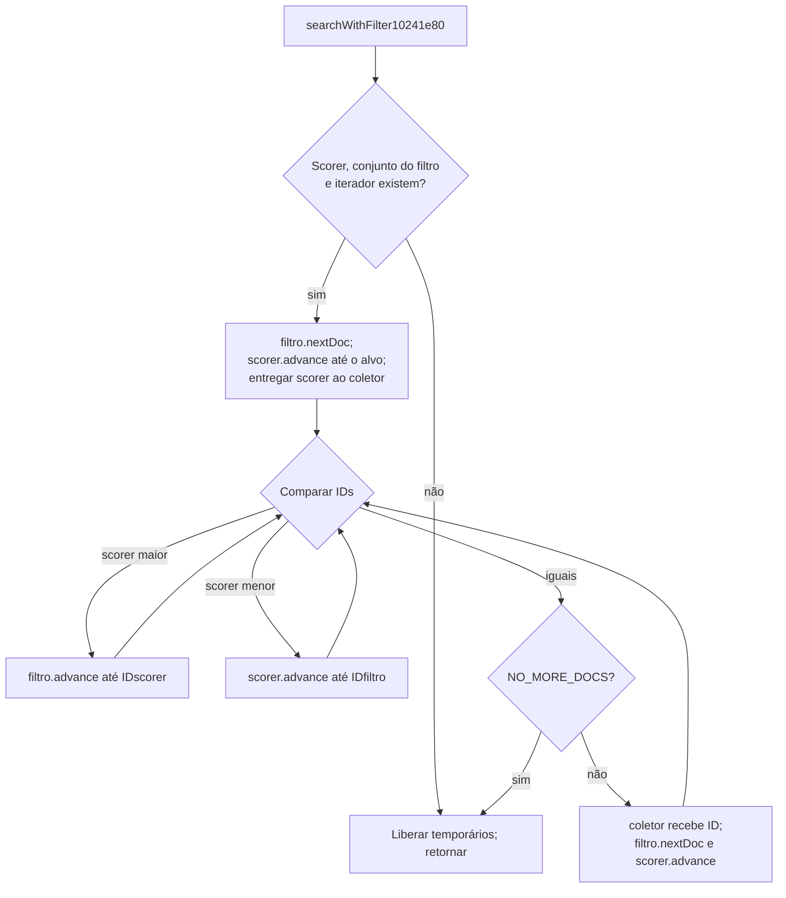

# S1 — BooleanWeight, normalização e interseção com filtro

Continuação estática de Codex em23/10/2026. O lote segue os dois próximos
alvos identificados em [avaliação da consulta](REA-S1-AVALIACAO-2026-10-23.md):
`0x101e0770` e `0x10241e80`. Foram examinadas **seis entradas novas**, sem
repetir os lotes anteriores. **S1 continua parcial.**

O avanço estabelece a classe concreta do peso booleano, a propagação de um
fator de normalização, a separação de scorers filhos e o algoritmo de
interseção dos IDs do filtro com os IDs produzidos pelo scorer. Os cálculos
internos dos scorers concretos e o ranqueamento final continuam abertos.

## Identidade e verificação

- Módulo: `lucene++.dll`, x86, SHA-256
  `52bc60eda1744d5d354e216baeb1692611262ca064a0f2f54b5b064b8ad0484d`.
- Ghidra12.1.4/Temurin21 e sementes REA6.7.0, backend complementar direto
  `-noanalysis`. Não são novos Evidence IDs do MCP.
- Cópia do projeto preservado `s1-searcher-2026-10-23/project`; projeto e
  resultados completos novos em `analysis-local/headless/s1-scorer-weight-2026-10-23/`,
  fora do Git. O projeto anterior e o original não foram alterados.
- Capstone5.0.6/pefile2024.8.26 conferiram **557 instruções/1.653bytes**, todos
  os endereços coincidentes com os bytes fixados. [Máquina](../testes/resultados/s1-scorer-weight-2026-10-23/machine-checks.json).
- As seis entradas estavam ausentes do catálogo antes da execução. Leituras
  de ponteiros, exports, pequenos getters e trechos de fábricas complementam
  a prova, mas não aumentam essa contagem de funções decompiladas.

| Entrada | Bytes | Efeito estabelecido neste lote |
|---|---:|---|
| `0x101e0770` | 114 | Encaminha a construção de peso e chama o slot+0x20 do objeto retornado |
| `0x101e1560` | 371 | Constrói BooleanWeight, conserva a consulta/similaridade e reúne os pesos das cláusulas |
| `0x101e3ee0` | 17 | Encaminha por salto final ao método+0x40 da consulta, ligado a `Query::getBoost` |
| `0x101e4530` | 144 | Multiplica o parâmetro double pelo boost e propaga o produto a todos os pesos filhos |
| `0x101e4970` | 637 | Particiona scorers em requeridos/proibidos/opcionais e escolhe uma de duas fábricas ou saída nula |
| `0x10241e80` | 370 | `IndexSearcher::searchWithFilter`: interseção por avanço de dois iteradores e encaminhamento ao coletor |

## Classe concreta e construção dos pesos filhos

O ponto anterior `BooleanQuery::createWeight`, `0x101e2fa0`, chama o wrapper
`0x101e0770`. Leituras de trechos de máquina ligam esse wrapper a
`0x101e05d0`, depois a `0x101dffe0`: a fábrica reserva0x48bytes e chama
`0x101e1560`.

O construtor grava a vtable **`0x104465a0`** em `0x101e159c`. O ponteiro
anterior à tabela leva ao CompleteObjectLocator `0x104a19d0`, cujo TypeDescriptor
`0x105b2da4` contém **`BooleanWeight@Lucene`**. Isso identifica a classe nesta
cadeia, sem depender apenas do nome de um wrapper genérico.

Na tabela desse objeto:

| Deslocamento | Destino observado | Limite |
|---|---|---|
| +0x20 | `0x10300c70` | O pequeno trecho retorna sem operação local; não é o cálculo dos pesos filhos |
| +0x44 | `0x101e3ee0` | Delegação para boost, e não soma de quadrados |
| +0x48 | `0x101e4530` | Propagação de normalização examinada |
| +0x4c | `0x101e4970` | Produção/seleção de scorer examinada |

`0x101e1560` conserva a consulta em `this+0x1c`. Pela vtable exportada da
BooleanQuery, o slot+0x60 resolve para `getSimilarity`; seu resultado é
conservado em `this+0x24`. O contêiner em `this+0x2c` recebe pesos obtidos
ao percorrer as cláusulas da consulta e chamar o slot+0x48 de cada consulta
filha. Na vtable exportada da BooleanQuery, esse slot resolve para
`createWeight`.

Essa construção fornece os pesos filhos consumidos pelos dois métodos
seguintes. A propriedade integral dos shared_ptr, todas as exceções e as
subclasses possíveis não foram recuperadas apenas por esta cadeia.

[RTTI, campos e ponteiros](../testes/resultados/s1-scorer-weight-2026-10-23/interface-links.json)
e [exports/interfaces de comparação](../testes/resultados/s1-scorer-weight-2026-10-23/export-links.json).

## Boost e normalização: efeitos efetivamente encontrados

`0x101e3ee0` obtém a consulta armazenada e termina com um salto ao slot+0x40
da consulta. Na vtable exportada da BooleanQuery, esse slot aponta para o
export **`Query::getBoost`**, `0x102725a0`. O pseudocódigo sugeriu `void` por
causa do salto indireto; não se adotou essa assinatura como contrato real.

Esse corpo não é uma soma de quadrados. Tampouco se deve aplicar o significado
de “slot+0x40” a tabelas de tipos diferentes.

`0x101e4530` obtém o mesmo boost e executa, em instruções x87, a multiplicação
do valor retornado pelo argumento double. Armazena o produto em double e
percorre o contêiner de pesos filhos, chamando o slot+0x48 de **cada filho**
com esse produto. Neste corpo não há uma exclusão por tipo de cláusula.

O contrato limitado é: **parâmetro recebido × boost da consulta**, propagado
aos filhos. Não foi afirmada uma fórmula completa do score, uma nova regra de
IDF/TF ou uma equivalência com qualquer versão de código-fonte do Lucene.
A agregação dos pesos e a origem integral do fator recebido continuam abertas.

## Produção de scorers: listas e saídas antecipadas

`0x101e4970` percorre, em paralelo, pesos e cláusulas. Para cada peso filho,
chama seu slot+0x4c com o leitor e os booleanos **1,0**. Em seguida avalia se
o scorer retornado é nulo e consulta os predicados das cláusulas já conferidos
na biblioteca fixada:

- `0x101ddec0`: requerido quando o campo da cláusula+0x24 é0.
- `0x101ddeb0`: proibido quando esse campo é2.

As instruções corrigem uma omissão do pseudocódigo, que ocultava qual lista
recebia cada inserção:

| Situação | Destino/efeito no assembly |
|---|---|
| Scorer filho não nulo, cláusula requerida | Contêiner local `EBP-0x80` |
| Scorer filho não nulo, cláusula proibida | Contêiner local `EBP-0x64` |
| Scorer filho não nulo, demais cláusulas | Contêiner local `EBP-0x48`, tratado como opcional neste seletor |
| Scorer filho nulo e cláusula requerida | Constrói saída com ponteiro nulo e abandona a seleção |
| Scorer filho nulo e cláusula não requerida | Não insere esse filho e continua |

Os desvios relevantes estão em `0x101e4a4f`–`0x101e4aa7`. O helper de saída
nula, `0x101e10f0`, grava zero no primeiro ponteiro e inicializa o controle
associado. Não se transformou essa saída nula em código de erro público.

Depois da partição, há dois caminhos de fábrica:

| Caminho | Condição estabelecida no seletor | Destino |
|---|---|---|
| A | Primeiro booleano=0, segundo não nulo, lista requerida vazia e menos de32 scorers proibidos | `0x101e06f0` |
| B | Não tomou A; há algum requerido ou opcional, e a quantidade opcional é pelo menos o campo da consulta+0x48 | `0x101e0670` |
| Saída nula | Filho requerido sem scorer; ou não tomou A e não satisfaz as condições de B | `0x101e10f0` |

O campo **BooleanQuery+0x48** foi vinculado ao export
`getMinimumNumberShouldMatch`, `0x101e3e10`, cujo pequeno corpo lê esse campo.
Ele não é o intervalo de proximidade da estrutura de opções da Foxit.
A origem, limites e todas as escritas desse mínimo continuam fora deste lote.

Não foram atribuídos nomes finais às classes produzidas pelas fábricasA/B:
seus construtores e os cálculos internos dos scorers não foram decompilados
nesta rodada. A condição de A também não foi renomeada como ganho de
desempenho comprovado. Os booleanos mantêm seus valores/posições observados;
seus nomes públicos completos continuam sem confirmação.

O diagrama não afirma que o wrapper da construção chama diretamente a
normalização: são fases relacionadas pelo objeto, e o chamador que fornece o
fator e sua ordem completa ainda precisa de análise.

## Busca com filtro: interseção por avanço de IDs

`0x10241e80` é o export **`IndexSearcher::searchWithFilter`**. A assinatura
decorada da própria PE identifica leitor, peso, filtro e coletor. O
pseudocódigo automático mostrava apenas um argumento; as leituras da pilha e
o `RET0x10` confirmam os quatro parâmetros deste método de instância.

O método pede ao peso um scorer para o leitor com flags **1,0**. Se não houver
scorer, encerra esse caminho após liberar temporários. Caso exista, solicita
ao filtro seu conjunto de IDs e ao conjunto seu iterador. Ausência de conjunto
ou de iterador também termina o caminho.

Os slots de iteração foram ligados a exports da biblioteca instalada usando a
vtable exportada de `FilteredDocIdSetIterator`, não nomes tomados de uma versão
genérica do Lucene:

| Slot | Export usado para conferir a ABI |
|---|---|
| +0x3c | `docID`, `0x102387d0` |
| +0x40 | `nextDoc`, `0x102387e0` |
| +0x44 | `advance`, `0x10238730` |

O algoritmo começa pelo próximo ID do filtro e avança o scorer até esse alvo.
Entrega o scorer ao coletor pelo slot+0x3c. Depois:

- Se os IDs são iguais e diferentes da sentinela, passa o ID ao slot+0x40 do
  coletor; pede o próximo ID do filtro e avança o scorer até ele.
- Se o ID do scorer é maior, avança o iterador do filtro até o ID do scorer.
- Se o ID do scorer é menor, avança o scorer até o ID do filtro.
- Quando ambos alcançam a sentinela, sai do laço e libera os temporários.

A constante em **`0x104482c8`** tem o export nominal
`DocIdSetIterator::NO_MORE_DOCS` e o valor **`0x7fffffff`**. Não foi inferida
como timeout ou limite de resultados. Os desvios do laço estão em
`0x10241f70`–`0x10241fc4`.

O helper realiza a interseção e disponibiliza o scorer ao coletor; não calcula
um score localmente nesse laço. O corpo do coletor que consulta o scorer,
mantém a fila TopDocs e ordena resultados ainda não foi examinado neste lote.

Como a chamada deste caminho passa1,0 ao peso, ela não satisfaz a condição
0/nãozero da fábricaA quando o peso é o BooleanWeight analisado. Nesse recorte,
a seleção passa pela fábricaB ou retorna nulo. Isso não exclui A de outros
chamadores da biblioteca.

## Lacunas e próximo recorte

Continuam abertos os scorers concretos das fábricas `0x101e06f0` e
`0x101e0670`, os demais métodos do peso, a agregação que origina o fator de
normalização, TF/IDF/coordenação, todas as subclasses de consulta/filtro,
coletor/ordenação, exceções, ownership e comportamento dinâmico. São próximos
alvos justificados as duas fábricas, os slots BooleanWeight+0x3c/+0x40
(`0x101e3350`/`0x101e3e20`) e o chamador exportado `Query::weight`,
`0x10273860`, sem antecipar seus efeitos completos.

As opções Foxit+3/+0xc, escapes, proximidade integral e comparação em runtime
permanecem pendentes conforme os relatórios anteriores. Nenhum critério amplo,
peso, porcentagem, app, teste, workflow, release, candidato0.1.19 ou VM foi
alterado. O operador reservado da VM continua Claude; esta subfrente não a
acessou.

[Revisão estruturada](../testes/resultados/s1-scorer-weight-2026-10-23/review.json).
