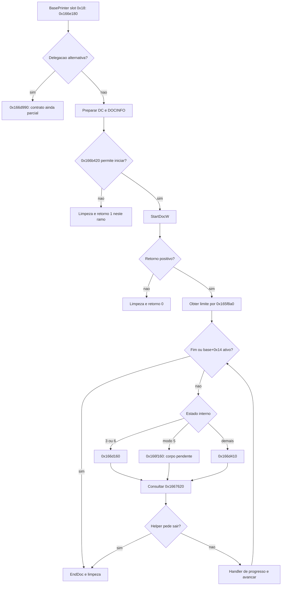
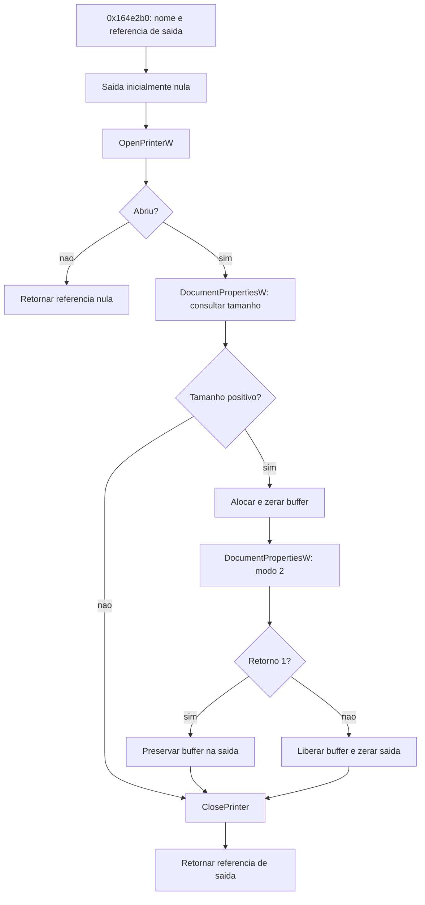
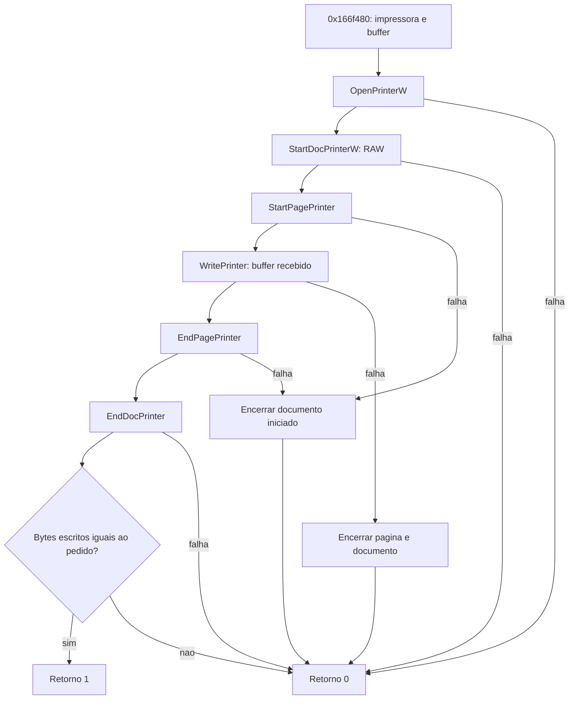
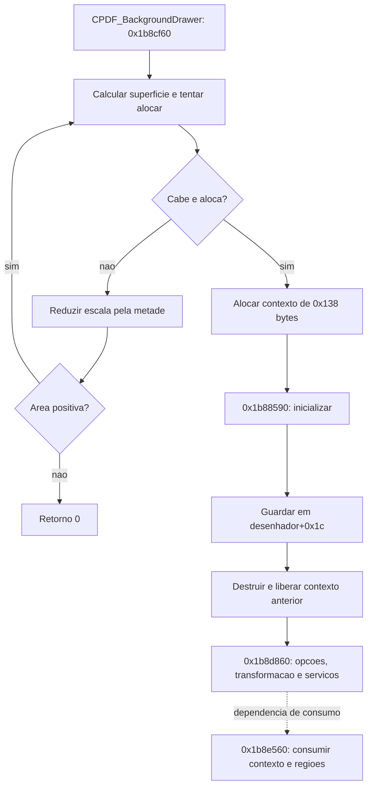

# S2 — laços de impressão, DEVMODE e envio RAW

Revisão estática de **2026/10/23**, America/Sao_Paulo (UTC−03:00), por Codex.
Continuação de [REA-FLUXO-IMPRESSAO-2026-10-22](REA-FLUXO-IMPRESSAO-2026-10-22.md).
Os lotes e conferências terminaram antes da interrupção por limite de uso;
a redação deste relatório foi retomada depois das 05:30 do mesmo dia.

Foram examinados o despacho de páginas do `CReader_BasePrinter`, a obtenção e
atualização de `DEVMODEW` e uma via separada que envia um buffer `RAW` ao spooler.
O contexto de fundo de `0x138` bytes recebeu um mapa mais preciso de propriedade
e campos. **S2 permanece parcial:** contagem completa das unidades de saída,
todos os modos, cancelamento da fila, serviços internos de renderização e o
contrato integral do contexto ainda têm lacunas.

Esta subfrente não executou o original nem acessou a VM, não alterou o
aplicativo, seus testes, workflows, releases ou critérios. A campanha da VM
conduzida pela coordenação em paralelo é evidência distinta e não está
incorporada como teste desta análise.

## Identidade, lotes e verificações

Alvo `FoxitPDFReader.exe`, SHA-256
`90208c9e8da92c8e546b76c8f4a2f8fb999105d124e663bbea6744fb6bb6b3a6`,
conferido antes e depois. Ghidra 12.1.4, JDK 21 e script de sementes do REA
6.7.0, pelo backend complementar direto `-noanalysis`, com cópias novas de
projetos preservados. Não são resultados de chamadas MCP REA.

O primeiro lote reutilizou uma cópia de `windows-print-02/project`; o segundo
copiou o projeto já encerrado do primeiro. O original e os projetos anteriores
foram preservados. Pseudocódigo, assembly e bancos continuam em `analysis-local/`.

| Lote novo de análise | Observações | Instruções conferidas | Bytes |
| --- | ---: | ---: | ---: |
| `s2-print-loop-2026-10-23` | 6 | 1.690 | 5.644 |
| `s2-spooler-devmode-2026-10-23` | 2 | 699 | 2.488 |
| Total dos dois lotes | **8** | **2.389** | **8.132** |

Das oito entradas, **quatro são novas** e quatro são revisitas, comparadas com
o catálogo de 397 entradas anterior a este lote. Separadamente, cinco resultados
antigos foram relidos e novamente conferidos contra seus hashes e bytes:
1.611 instruções/5.519 bytes. Eles não são novas descompilações nem novas funções.
Excertos curtos, imports e RTTI também não são contados como novas entradas.

| Entrada dos lotes novos | Bytes | Papel examinado | Identidade no catálogo anterior |
| --- | ---: | --- | --- |
| `0x165f4d0` | 164 | Reinicialização de campos da impressora base | Nova |
| `0x166e180` | 1.829 | Trabalho GDI e despacho de unidades de saída | Revisita |
| `0x166e960` | 661 | Via alternativa de trabalho GDI e progresso acumulado | Revisita |
| `0x166d160` | 681 | Agrupa entradas numa página iniciada uma vez | Revisita |
| `0x166d410` | 1.395 | Atualiza configuração e inicia/encerra página por entrada selecionada | Revisita |
| `0x1670450` | 914 | Ajusta orientação/papel/ordenação e chama `ResetDCW` | Nova |
| `0x164e2b0` | 1.194 | Obtém buffer `DEVMODEW` por `DocumentPropertiesW` | Nova |
| `0x166f480` | 1.294 | Envia um buffer por `WritePrinter` com tipo `RAW` | Nova |

As conferências independentes de endereços passaram no Capstone 5.0.6. Isso
verifica os intervalos e instruções retornados, não torna corretos todos os
tipos, fronteiras, argumentos automáticos ou significados visuais.

Evidências: [revisão estruturada](../testes/resultados/s2-print-2026-10-23/review.json),
[máquina do primeiro lote](../testes/resultados/s2-print-2026-10-23/machine-print-loop.json),
[máquina do segundo](../testes/resultados/s2-print-2026-10-23/machine-spooler-devmode.json),
[metadados do primeiro](windows-evidence/foxit-rea/headless-cross-checks-s2-print-loop-2026-10-23.json)
e [do segundo](windows-evidence/foxit-rea/headless-cross-checks-s2-spooler-devmode-2026-10-23.json).

## Classe base e fronteira da vtable

O RTTI ligado à vtable `0x53d7788` identifica `CReader_BasePrinter`.
O descritor de tipo está em `0x6cc0ae8`, pelo localizador em `0x6598720`.
Foram confirmados **sete slots**, até `+0x18`; depois começa uma string ASCII,
portanto os DWORDs seguintes não são uma continuação dessa lista de métodos.

| Slot | Destino |
| --- | --- |
| `+0` | `0x165e800` |
| `+4` | `0x1663e80` |
| `+8` | `0x166a990` |
| `+0xc` | `0x1671670` |
| `+0x10` | `0x16669d0` |
| `+0x14` | `0x1666830` |
| `+0x18` | `0x166e180` |

Os dois slots `+0x10/+0x14` têm corpos curtos que inicializam uma saída de
string vazia. O laço de trabalho examinado está no destino de `+0x18`.
Essa identificação não prova que cada classe derivada ou modo execute o
mesmo corpo; as substituições das subclasses continuam uma pergunta separada.

`0x165f4d0`, chamada pelo construtor, reinicializa campos como `+8`, `+0x14`,
`+0x20`, o retângulo `+0x44..+0x50`, ponteiros e contadores. Mantém sentinela
`-1` em `+0x54` e valor 1 em `+0x18/+0x74`. **Não escreve `+0x8c`**:
o padrão 72 atribuído pelo construtor não foi reinterpretado como parte dessa
reinicialização.

## Trabalho GDI e despacho de páginas

`0x166e180` começa com uma possível delegação para `0x166d990`, segundo campos
dos objetos associados. O caminho GDI examinado zera o estado em `base+0x14`
e prepara uma estrutura de cinco DWORDs com tamanho `0x14`, usada em
`StartDocW`. A preparação por `0x166b420` constitui uma decisão anterior ao
início do trabalho. Se ela retorna falso, esse caminho pode retornar **1 sem
chamar `StartDocW`**; não se classificou essa decisão como sucesso de impressão
física ou como erro sem compreender o contrato do helper.

Em `0x166e4e6`, a chamada ao IAT `0x531c2a0` é realmente `StartDocW`.
Retorno menor que 1 leva a limpeza e retorno zero. Após início válido:

1. `0x165f8a0` fornece o limite do laço externo. O significado completo desse
   total ainda precisa ser reconstruído; não foi chamado de total universal de
   páginas físicas, cópias ou folhas.
2. A quantidade de entradas da coleção associada é calculada por
   `(fim-início)/4`, pelos campos `+0x3c/+0x40` do objeto em `base+0x20`.
3. Antes de cada unidade externa, `base+0x14` é testado. Se diferente de zero,
   o fluxo sai do laço para a finalização.
4. Os valores 3 ou 6 de `associado+0x1a8` selecionam `0x166d160`; caso contrário,
   `associado+0xb0==5` seleciona `0x166f160`; os demais seguem para `0x166d410`.
   São valores internos, ainda sem nomes visuais atribuídos neste lote.
5. Depois do trabalho por unidade, `0x1667620` recebe o identificador retornado
   pelo início do trabalho. Retorno não zero também interrompe o laço.
6. Um handler opcional em `base+0x80`, slot `+4`, recebe posição/total de
   progresso. Finalmente ocorre `EndDoc` no IAT `0x531c2a4`, em `0x166e8a0`.

A via `0x166e960` também chama `StartDocW/EndDoc`, usa o mesmo despacho e
combina progresso com os acumuladores recebidos por ponteiro. Em um ramo de
interrupção entre itens, zera `base+0x14`, atualiza o handler e retorna zero.
Isso não estabelece, por si só, o contrato completo de impressão em lote.

### Diferença entre os dois trabalhadores examinados

`0x166d160` chama `StartPage` uma vez quando não recebe um destino gráfico
alternativo. Percorre a coleção, confere o índice dentro do limite, exige que
o agrupador da entrada corresponda à unidade externa e que a entrada esteja
ativa. Para entradas válidas, calcula geometria por `0x1668ac0`, prepara
conteúdo por `0x1663a80` e submete por `0x1663410`, seguido de etapas
complementares. Encerra com `EndPage`. Portanto, várias entradas podem ser
tratadas dentro de uma única página de saída nesse caminho.

`0x166d410` percorre as entradas correspondentes, chama `0x1670450` antes de
iniciar a página e, no caminho sem destino gráfico alternativo, chama
`StartPage` e `EndPage` em torno do trabalho da entrada. Retorno de `StartPage`
menor que 1 produz zero. Há estados que permitem continuar a varredura e
outros que saem depois da primeira entrada processada; o laço não foi
reduzido a uma correspondência universal um PDF/uma folha.

Ambos testam `base+0x14` durante o processamento. O caminho de interrupção
examinado de `0x166d410` ainda chama `EndPage`; o coordenador chama `EndDoc`.
**Não há chamada a `AbortDoc` no corpo examinado de `0x166e180`.** Isso não
prova ausência de cancelamento do spooler no programa inteiro: os escritores
da flag, o helper `0x1667620`, callbacks e outros caminhos ainda precisam ser
seguidos. Também não prova que uma impressora física pararia imediatamente.

Retornos de `EndPage` e `EndDoc` não são usados como aprovação completa nesses
corpos. Na via principal, o retorno de `0x166d410` é guardado; os retornos de
outras variantes não têm necessariamente o mesmo tratamento. Não se equiparou
um retorno 1 à validação de todas as páginas impressas.

## Aquisição de DEVMODE e atualização entre páginas

A função `0x164e2b0` foi encontrada por referências de código ao thunk real
`DocumentPropertiesW`, e não apenas por uma string da API. Seu contrato
delimitado é:

- Entrada: referência de saída e nome de impressora no formato de string
  interna. A referência de saída começa nula.
- Abre a impressora por `OpenPrinterW`, thunk `0x48ed042`.
- Consulta `DocumentPropertiesW`, thunk `0x48ed072`, com saídas nulas e modo
  zero para obter a quantidade necessária de bytes.
- Se a quantidade é positiva, aloca e zera um buffer desse tamanho; escreve
  inicialmente o WORD de tamanho no deslocamento `+0x44`.
- Chama a API novamente com o buffer de saída e modo **2**. Somente retorno
  **1** mantém o buffer. Falha libera o buffer e limpa a referência de saída.
- Fecha a impressora pelo thunk `0x48ed04e`, confirmado como `ClosePrinter`.
  A função retorna a referência de saída, não um booleano de impressão.

`0x1670450`, chamada pelo trabalhador de página, obtém a configuração
associada à impressora e examina dimensões da entrada. A montagem confirma
leituras de dimensões como **float32**; alguns inteiros aparentes do
pseudocódigo não devem virar tipos de implementação.

O buffer passado a `ResetDCW` tem os WORDs `+0x4c` e `+0x4e` usados para
orientação e papel, e `+0x64` para ordenação de cópias. Essa identificação
combina os acessos reais com o layout e campos de
[`DEVMODEW` documentados pela Microsoft](https://learn.microsoft.com/en-us/windows/win32/api/wingdi/ns-wingdi-devmodew).
Existem condições diferentes para alterar papel e orientação; se os valores
relevantes já coincidirem, a chamada pode ser evitada.

Em `0x167078e`, o IAT `0x531c334` chama `ResetDCW` com o handle obtido do
wrapper de DC e o buffer de configuração. A API serve para atualizar o DC de
impressão a partir do DEVMODE, incluindo mudanças de orientação, conforme a
[documentação oficial](https://learn.microsoft.com/en-us/windows/win32/api/wingdi/nf-wingdi-resetdcw).
O retorno não é testado nesse corpo; segue uma atualização auxiliar por
`0x1671680`. O significado completo desse helper e a propagação de falhas
continuam pendentes.

Não foi estabelecida uma ligação direta entre **toda** aquisição feita por
`0x164e2b0` e **toda** atualização feita por `0x1670450`; há caches e helpers
intermediários. O mapa não os une por mera compatibilidade de tipo.

## Via RAW do spooler, separada do trabalho GDI

`0x166f480` usa os thunks de `WINSPOOL.DRV`, com sequência própria. O literal
UTF-16 em `0x53d7c0c` é efetivamente **`RAW`** e é passado no campo de tipo do
documento. O corpo examinado envia um único buffer recebido, dentro de uma
página delimitada; não é o laço de renderização GDI anterior.

| Etapa | Destino confirmado |
| --- | --- |
| Abrir impressora | `0x48ed042` → `OpenPrinterW` |
| Iniciar documento, nível 1 | `0x48ed084` → `StartDocPrinterW` |
| Iniciar página | `0x48ed08a` → `StartPagePrinter` |
| Escrever o buffer e obter quantidade escrita | `0x48ed090` → `WritePrinter`, IAT `0x531d480` |
| Encerrar página | `0x48ed096` → `EndPagePrinter` |
| Encerrar documento | `0x48ed09c` → `EndDocPrinter` |

A ordenação das APIs coincide com o contrato do spooler descrito pela
[Microsoft](https://learn.microsoft.com/windows/win32/printdocs/startdocprinter).
A observação do binário acrescenta suas próprias guardas: ponteiro de entrada
nulo e falhas em qualquer etapa levam a retorno zero. Mesmo que `WritePrinter`
tenha retornado sucesso, a quantidade de bytes escrita deve ser igual à
quantidade recebida; escrita parcial também produz zero, depois da tentativa
de finalizar página/documento. Esse corpo não implementa uma repetição de
escrita para completar um buffer parcialmente consumido.

Há uma limpeza por `0x165d1f0` e um objeto de guarda preparado por `0x1659ff0`.
A liberação completa desses objetos deve ser seguida antes de afirmar um
contrato integral de recursos. O sucesso das chamadas tampouco demonstra saída
física correta ou identifica o formato interno do buffer enviado.

## Contexto de fundo de 0x138 bytes

Foram reutilizados os resultados íntegros de `0x1b8e560`, `0x1b8cf60`,
`0x1b88590` e `0x1b8d860`. A vtable `0x54151a0` continua identificada por RTTI
como **CPDF_BackgroundDrawer**, pelos destinos destruir/preparar/trabalhar.
Esse RTTI pertence ao objeto proprietário, não ao contexto interno de
`0x138` bytes. O inicializador do contexto não instala uma vtable própria
nos intervalos examinados; não se inventou um nome de classe.

Em `0x1b8cf60`, o desenhador prepara uma superfície e tenta alocação com
dimensões calculadas. Se o tamanho ultrapassa a guarda ou a alocação falha,
reduz a escala por um fator **0,5**, recalcula e tenta novamente enquanto há
área positiva. Isso esclarece uma estratégia de redução de memória no caminho
examinado, sem provar todos os formatos ou serviços de imagem envolvidos.

O objeto mantém o contexto no campo **desenhador+0x1c**. Um contexto novo de
`0x138` bytes é alocado e inicializado por `0x1b88590`; o contexto anterior,
quando existe, é destruído por `0x1b88c60` e liberado. O helper `0x1b8d860`
recebe o contexto como receptor e preenche estado de renderização.

| Campo do contexto | Fato estático delimitado |
| --- | --- |
| `+0..+0x37` | Bloco de opções copiado quando fornecido; é distinto do objeto proprietário |
| `+0x58` | Seleção de objeto/serviço interno em ramos de modo/flags; identidade integral pendente |
| `+0x68/+0x6c` | Ponteiro e controle de referência de serviço auxiliar; cria ou reaproveita conforme contexto anterior |
| `+0x70` | Referência recebida e usada como origem de estado associado |
| `+0x94/+0x98` | Argumentos armazenados da preparação; tipos integrais ainda não fechados |
| `+0xa4..+0xbb` | Seis valores de transformação; inicialização contém os elementos unitários da identidade |
| `+0x110` | Sentinela inicial `-1`, atualizada a partir de opções/serviço |
| byte `+0x114` | Padrão 1, depois copiado de estado associado |
| `+0x120` | Objeto auxiliar opcional, condicionado por flags; propriedade completa pendente |
| byte `+0x130`, `+0x134` | Inicialmente zero; consumidores completos ainda abertos |

O consumo por `0x1b8e560` exige campos associados e pode delegar a um handler
opcional em `desenhador+0xa4`. No caminho próprio, trabalha com transformações,
regiões e objetos temporários. O contexto de `0x138` bytes e o bloco de
`0x38` bytes inicializado por `0x1b88520` continuam sendo estruturas distintas.

O diagrama representa a propriedade e dependência estática entre os corpos;
não prova que o consumidor final seja chamado nessa ordem em toda execução
do programa, nem que todas as flags e subserviços estejam caracterizados.

## Campo base+0x8c: avanço numérico, nome ainda aberto

O construtor atribui **72 (`0x48`)** a esse campo. O getter em `0x166a370`
devolve seu conteúdo. Um consumidor em `0x1666490` compara com **300** e
encaminha um fator ao helper `0x16664e0`: até 300, fator 1; acima de 300,
o cálculo assinado corresponde a divisão inteira por 300 mais 1.

O resultado antigo de `0x1664c00`, novamente conferido, contém a mesma regra
e usa o fator para reduzir dimensões antes do processamento de imagem.
Isso é evidência de um parâmetro que influencia a subdivisão/redução da
saída, mas **não basta para nomeá-lo definitivamente DPI, qualidade ou escala**.
O significado 72 pontos por polegada permanece hipótese até seguir os demais
escritores, chamadas e transformações do mesmo receptor.

## Pendências concretas e critério de encerramento

| Pergunta | Estado após este lote | Continuação justificada |
| --- | --- | --- |
| Onde está o laço da base? | Destino `+0x18`, início/finalização e despacho examinados | Resolver total por `0x165f8a0`, destino alternativo `0x166d990` e substituições das derivadas |
| Como todas as páginas/modos são emitidos? | Dois trabalhadores revisitados e modo 5 identificado como chamada distinta | Corpo de `0x166f160`, todos os agrupamentos, cópias, orientação e retornos |
| Como o DEVMODE é adquirido? | Consulta em duas fases por `0x164e2b0` caracterizada | Caches, dados privados de drivers e ligações com todos os chamadores |
| Como muda entre páginas? | Acessos de orientação/papel/ordenação e `ResetDCW` identificados | Helpers `0x164fa10`, `0x1657410`, `0x165f300`, `0x1671680` e propagação de falhas |
| Como envia RAW? | Uma via de buffer/página e rejeição de escrita parcial caracterizada | Origem/formato do buffer, guardas, todos os chamadores e limpeza completa |
| Como cancela a fila? | Testes de `base+0x14` e saída por `EndPage/EndDoc` observados | Escritores da flag, `0x1667620`, callbacks, outros caminhos de aborto e observação diferencial |
| Que classe é o contexto de 0x138? | Propriedade e parte dos campos mapeadas, sem RTTI próprio confirmado | Tipagem dos serviços, estados, consumidores e ciclo de vida completo |
| O que significa +0x8c? | Padrão, getter, limiar 300 e fator de redução confirmados | Escritores/chamadores que estabeleçam unidade e significado público |
| Há equivalência física? | Não observada nesta subfrente | Equipamento/ambiente autorizado e comparação de saídas; testes próprios não substituem isso |

O critério amplo da etapa 8 não foi fechado. Catálogo maior, chamadas de API
corretamente nomeadas e instruções conferidas não são um percentual de
reconstrução nem uma campanha diferencial concluída.
