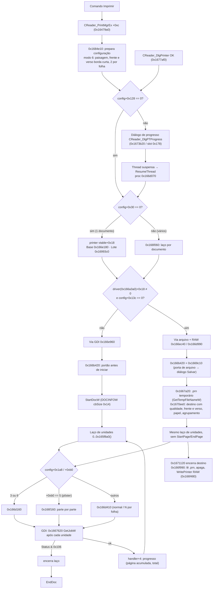
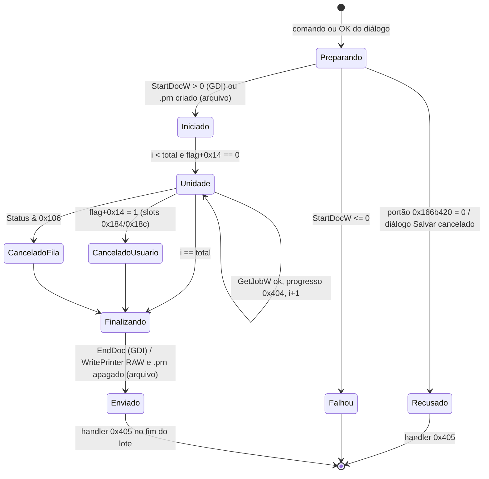

# S2 — fechamento do fluxo de impressão do Foxit — 23/10/2026

Claude, 2026/10/23, de 12:05 a 12:33 (America/Sao_Paulo, UTC-03:00). Análise **somente estática**.
O Foxit não foi executado, a VM não foi tocada e nenhum código do Foxit foi incorporado ao
aplicativo ou versionado. Este documento completa o [mapa estrutural de 22/10](REA-FLUXO-IMPRESSAO-2026-10-22.md),
que deixou três lacunas: o laço de impressão, a montagem do DEVMODE e o envio ao spooler, e o
contexto de 0x138 bytes. As três agora estão cobertas no nível da orquestração. O que continua aberto
está listado, com o motivo, em [Lacunas declaradas](#lacunas-declaradas).

## Ambiente e evidências

- **Alvo:** `FoxitPDFReader.exe`. O SHA-256 `90208c9e…b3a6` foi conferido antes e depois de cada
  rodada.
- **Ferramentas:** Ghidra 12.1.4 PUBLIC, copiado do PC (Framework, Base, Decompiler linux_x86_64 e
  x86 com os `.sla` distribuídos; os `.sinc` foram datados de antes para o Sleigh não recompilar).
  Também foram usados o REA 6.7.0 (script de sementes), `scripts/analyze_foxit_headless.py` com
  `-noanalysis` e `--project-snapshot`, Capstone 5.0.6 e pefile 2024.8.26.
- **Rodadas:** 4 rodadas, `claude-s2-1` a `claude-s2-4`, com **54 entradas**. São **7.668
  instruções e 24.721 bytes**, e todas as fronteiras conferem com os bytes do PE
  ([machine-checks lote 1](../testes/resultados/s2-fechamento-2026-10-23/machine-checks-lote1.json),
  [2](../testes/resultados/s2-fechamento-2026-10-23/machine-checks-lote2.json),
  [3](../testes/resultados/s2-fechamento-2026-10-23/machine-checks-lote3.json),
  [4](../testes/resultados/s2-fechamento-2026-10-23/machine-checks-lote4.json)).
  As tentativas que falharam ficam em `analysis-local/headless/claude-s2-1-attempt{1,2,3}-*`.
- **Catálogo:** de **424 para 472 entradas distintas**. São 48 entradas novas; outras 6, já
  catalogadas (`0x165ef50`, `0x166e960`, `0x166f160`, `0x1670ee0`, `0x1698cf0`, `0x1b88c60`),
  ganharam uma evidência a mais. As demais linhas ficaram idênticas.
- **Sementes e metadados:** `docs/windows-evidence/foxit-rea/static-s2-fechamento-lote{1..4}-2026-10-23-seeds.tsv`
  e `headless-cross-checks-s2-fechamento-lote{1..4}-2026-10-23.json`.
- **Ligações conferidas fora do Ghidra:** chamadores diretos `E8`, thunks de import, vtables e RTTI
  foram lidos com Capstone e pefile (helpers em `analysis-local/`, fora do Git). A revisão está em
  [review.json](../testes/resultados/s2-fechamento-2026-10-23/review.json).

## Relação com o lote do Codex das 05:46

Este fechamento usa e não repete o [lote S2 do Codex](REA-S2-CONTINUACAO-2026-10-23.md). Esse
lote já cobria:

- o despacho de `0x166e180`;
- `0x166d160`, que agrupa entradas numa página iniciada uma vez;
- `0x166d410`, que inicia e encerra uma página por entrada e chama `0x1670450`, que ajusta
  orientação, papel e ordenação e chama `ResetDCW`;
- `0x164e2b0`, que obtém o `DEVMODEW` por `DocumentPropertiesW`;
- `0x166f480`, que chama `WritePrinter` em modo RAW;
- a ausência de `AbortDoc` em `0x166e180`, que continua valendo: o cancelamento encerra com
  `EndDoc`, não com `AbortDoc`.

O Codex chamou `0x166e960` de "via alternativa de trabalho GDI". Aqui ela aparece como o
trabalhador GDI **por documento** do laço de vários documentos (`0x166f060`). A via alternativa
propriamente dita, com arquivo e envio RAW, é `0x166ec40` / `0x166d990`.

## Pontos de entrada (quem inicia a impressão)

| Entrada | Classe (RTTI) e slot | Papel observado |
|---|---|---|
| `0x16479a0` | `CReader_PrintMgrEx` vtable `0x53d6bfc` slot `+0xc` | Comando do gerente. Monta a configuração e chama `0x1684e10`; cita o texto `InvoicePrint` |
| `0x1684e10` | chamado só por `0x16479a0` | Prepara a configuração (modo 6, DEVMODE, `GetDeviceCaps`) e escolhe entre execução direta e diálogo de progresso |
| `0x167f6c0` → `0x1677af0` | `CReader_DlgPrinter` vtable `0x53d8a40` slot `0x180` | OK/Imprimir do diálogo: prepara pôster, imprime direto ou com progresso, depois grava orientação, frente e verso e cópias no DEVMODE |
| `0x1681050` | `CReader_DlgPrinter` slot `0x10c` (PreTranslateMessage) | PageUp/PageDown navegam a pré-visualização |
| `0x166e180` | `CReader_BasePrinter` vtable `+0x18`, compartilhado por Dlg/Quiet/Invoice | Impressão de **um** documento |
| `0x16993c0` | `CReader_DlgBatchPrint` vtable `0x53d9ae0` slot `+0x18` | Impressão em **lote**; delega a `0x1695380` ou `0x169aba0` |

## Fluxo completo (orquestração)

### Laço por documento e por unidade

1. **Total de unidades (`0x165f8a0`).** Há três modos:
   - **Pôster** (`associado+0xb0 == 5`): soma linhas × colunas (`+0x34 × +0x38`) de cada entrada
     ativa e grava em `+0x3c` o índice inicial de cada entrada.
   - **Unidade única** (`associado+0xc8` igual a 1 ou 2).
   - **Demais casos:** `ceil(entradas / 0x165ef50(2))`. O divisor é linhas (`+0xe8`) × colunas
     (`+0xec`) quando `+0xa8 == 1`, ou seja, no modo N por folha.
2. **Despacho por unidade.**
   - Modos `config+0x1a8` 3 ou 6 vão para `0x166d160`.
   - O pôster vai para `0x166f160`. Ele localiza a entrada cuja faixa contém a unidade, calcula a
     geometria da parte (`0x1668f60`) e desenha (`0x1663a80`, `0x1663410`, `0x1663870`). Depois
     deriva coluna e linha com `%` e `/`, chama `0x1662a30` (`GetDeviceCaps`, `GetMapMode`,
     `SelectObject`) e `0x1660ae0`. Na última parte de cada entrada, chama `0x165fa90`.
   - Os demais modos vão para `0x166d410`.
3. **Página física.** Na via GDI, cada unidade fica entre `StartPage` e `EndPage`. Na via de
   arquivo, esse par não existe: o destino alternativo recebe os desenhos.
4. **Cancelamento** (dois mecanismos):
   - **Pelo usuário.** A flag `printer+0x14` é testada antes de cada unidade.
     - O slot `0x184` do diálogo de progresso (`0x167ea70`) grava 1 nela.
     - O slot `0x18c` (`0x167f090`) grava 1 quando a thread ainda está ativa (código de saída
       `0x103`) e espera a thread terminar.
     - Na via de arquivo, um cancelamento no meio de vários documentos zera a flag e devolve 0. O
       laço de documentos (`0x166f060`) para no primeiro 0.
   - **Pela fila do Windows** (só na via GDI). Após cada unidade, `0x1667620` chama
     **`GetJobW`** nível 2 (thunk `0x48ed07e` → `WINSPOOL.DRV!GetJobW`). Se `JOB_INFO_2W.Status`
     (+0x34) mudou e contém `0x106` (ERROR|DELETING|DELETED), o laço termina. O último estado fica
     em `base+0x88`.
5. **Progresso e eventos.** O handler `printer+0x80` é a interface secundária do diálogo de
   progresso (vtable `0x53d8dbc`). Cada slot chama `PostMessage` com uma mensagem:

   | Slot | Mensagem | Quando é chamado | Argumentos |
   |---|---|---|---|
   | `+4` | `0x404` | após cada unidade | página acumulada, total |
   | `+0x10` | `0x407` | antes de `StartDocW` | documento atual, número de documentos |
   | `+0xc` | `0x405` | fim do lote ou recusa do portão | — |
   | `+8` | `0x406` | — | — |

   As mensagens `0x404` a `0x407` correspondem a WM_USER+4 a WM_USER+7.

### Portão antes de iniciar (`0x166b420`)

- Sem a interface `base+0x5c`, o portão devolve 1 e a impressão segue.
- Com ela, reúne os dados da impressora (`0x164e220`: porta, driver e os atributos
  LOCAL/NETWORK/SHARED de `PRINTER_INFO_2W.Attributes` em +0x34), o modo e a lista de páginas
  ativas, e pergunta à interface se pode imprimir.
- Uma recusa chama o handler `+0xc` e o documento termina com 0, sem `StartDocW`.

### DEVMODE e capacidades do dispositivo

- **`0x1677af0`** (OK do diálogo), depois da impressão, grava no DEVMODE:
  - orientação (+0x4c);
  - frente e verso (+0x5e);
  - cópias (+0x56).
- **`0x1684e10`**, no modo 6 (livreto, por inferência):
  - **Orientação:** grava paisagem (2) em +0x4c. Se o papel (+0x4e) for 0x100 (personalizado) com
    largura menor que a altura, troca para retrato (1).
  - **Frente e verso:** grava `(config+0xcc == 0) * 2 + 1` em +0x5e, ou seja, 3
    (DMDUP_HORIZONTAL, borda curta) ou 1 (simplex).
  - **Imposição:** fixa 1 × 2 por folha (`+0xec = 1`, `+0xe8 = 2`).
  - **Capacidades:** relê `GetDeviceCaps` 0x6e a 0x71 (PHYSICALWIDTH/HEIGHT e
    PHYSICALOFFSETX/Y).
- **`0x1671680`**, após `ResetDCW`, relê LOGPIXELSX/Y, PHYSICALWIDTH/HEIGHT e PHYSICALOFFSETX/Y e
  recalcula a escala `+0x28` conforme o modo de escala.
- **`0x1670ee0`** prepara o destino da via de arquivo com qualidade (+0x5a), frente e verso
  (+0x5e), papel (+0x4e) e agrupamento (+0x64).

### Via de arquivo e envio RAW

- **Seleção.** A via é escolhida quando o objeto de `0x166a3a0` tem `+0x18 ≠ 0` e `config+0x13c == 0`.
  É a mesma condição em `0x166e180` e `0x166f060`.
- **Porta de arquivo.** `0x1669c10` compara a porta com `FILE:`, `PORTPROMPT:`, `XPSPort:`,
  `Documents\*.pdf` e `Desktop\*.pdf`. Para elas, abre um diálogo Salvar do MFC (OPENFILENAMEW de
  0x58 bytes quando `GetVersion` > 4, filtro com `|` convertido em `\0`, `nMaxFile = 0x7fff`). Uma
  recusa ou falha chama o handler `+0xc`.
- **Saída.** `0x1667a20` cria um temporário com extensão `prn` via `GetTempFileNameW`. As unidades
  são desenhadas nesse destino. Ao fim, `0x1671120` fecha o destino e `0x166f990` lê o arquivo,
  apaga-o e envia os bytes com `WritePrinter` em modo RAW (`0x166f480`, guarda `0x1659ff0` /
  `0x165d1f0` que fecha a impressora no destrutor).

### Lote (`CReader_DlgBatchPrint`)

`0x16993c0` percorre os arquivos do lote e, conforme o estado do diálogo, delega a `0x1695380` ou
`0x169aba0`. Os dois escolhem, para cada arquivo, entre `0x1698cf0` (GDI) e `0x1698f90` (arquivo +
RAW). Essas funções repetem a sequência das vias de documento único:

- **GDI:** `0x166b420`, `StartDocW`, `0x165f8a0`, trabalhadores `0x166f160`, `0x166d410` e
  `0x166d160`, `GetJobW` (`0x1667620`) e `EndDoc`.
- **Arquivo + RAW:** `0x1669c10`, `0x1667a20`, `0x1670ee0`, os mesmos trabalhadores, `0x1671120` e
  `0x166f990`.

### Contexto de 0x138 bytes

`0x1b88c60` destrói o contexto liberando, nesta ordem: `+0xe4`, `+0x120` (se `+0x11d`), `+0x124`,
`+0x78`, `+0x7c`, a referência contada `+0xbc`, o ponteiro compartilhado `+0x6c` e o bloco `+0x44`.
A liberação está fechada; o construtor e o nome de classe não foram identificados (ver lacunas).

## Estados (impressão de um documento)

## Lacunas declaradas

Fechar este critério não significa paridade. O que segue foi conscientemente deixado de fora e não
afeta a ordem do fluxo documentada acima:

1. **Desenho dentro de cada unidade.** `0x166d410`, `0x166d160` e `0x1663a80`, `0x1663410` e
   `0x1663870` chamam o motor de renderização do PDF, que é outro subsistema (critério "Motor PDF e
   fronteiras", etapa 3). A geometria de cada parte do pôster (`0x1668f60`, `0x1660ae0`) foi lida só
   nas chamadas, não na fórmula.
2. **Significado dos modos.**
   - O modo `config+0x1a8 == 6` como livreto é inferência, feita pelo DEVMODE gravado em
     `0x1684e10`.
   - O modo 3 não foi nomeado.
   - Os campos `+0x18` do objeto de `0x166a3a0` (candidato a "driver PostScript") e `config+0x13c`
     (candidato a "imprimir como imagem") também são inferências.
3. **Fatura (`CReader_DlgInvoicePrint`).** Usa o mesmo slot `+0x18` da base. O pré-processamento
   próprio (texto `InvoicePrint`) não foi decompilado.
4. **Contexto 0x138.** Falta identificar o construtor e o nome de classe; só a destruição está fechada.
5. **Execução.** Nada foi observado em execução: ordem real entre threads, mensagens, conteúdo do
   `.prn` e saída física. Isso continua nos critérios de VM e equipamentos (etapas 10, 11 e 18 e
   E23).
6. **`0x1674dc0`** (`mov [ecx+0x14],1; ret`). Grava a mesma flag de cancelamento, mas não tem
   referências diretas nem em vtable encontradas.

## Consequência para o Linuxit PDF

Contratos úteis para comparação futura, sem afirmar paridade:

- **Cancelamento.** É testado entre unidades, não no meio de uma página. Existem dois sinais: o
  pedido do usuário e o estado da fila do sistema.
  - O Linuxit envia por `lp` ao CUPS e consulta a fila com `lpstat` (`app/cups_backend.py`, `app/print_queue.py`, `app/print_tasks.py`).
  - O equivalente à detecção pela fila é observar o trabalho do CUPS sendo cancelado ou removido.
- **Progresso.** É reportado por unidade, com página acumulada e total.
- **Portas de arquivo.** Pedem um nome de saída antes de começar.
- **Livreto.** Força paisagem, frente e verso na borda curta e 2 por folha. A imposição própria
  (`app/imposition.py`) faz o livreto por conta própria.

A comparação lado a lado depende da VM e não foi feita.
