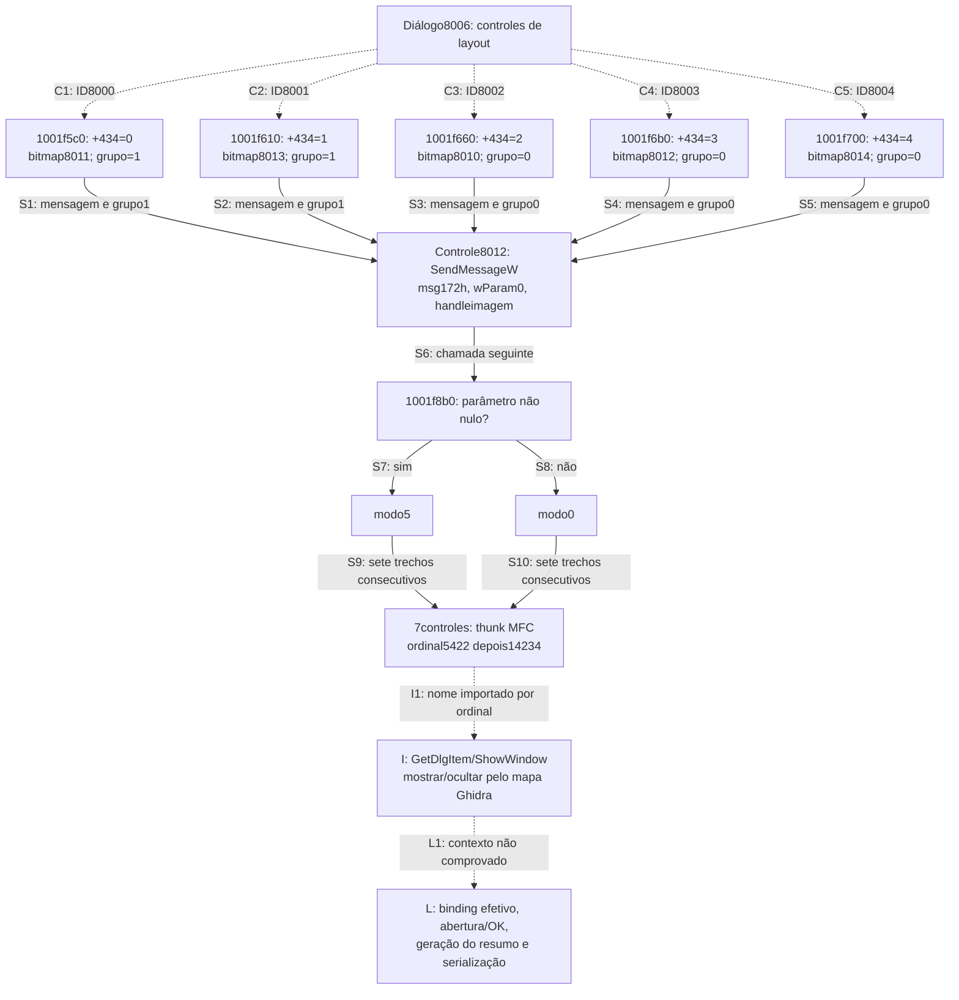

# S3 — seletores de layout do resumo de comentários

Continuação estática de Codex em 23/10/2026. A importação Ghidra iniciada antes
da interrupção terminou e deixou **nove resultados completos preservados**.
Na retomada das05:30 eles foram examinados, sem repetir a importação.

O resultado estabelece os cinco valores de seleção de layout, as imagens de
prévia escolhidas e o parâmetro comum que controla um grupo de sete controles.
**Não é a recuperação do editor integral de anotações nem do gerador completo
de resumos. S3 permanece parcial.**

## Amostra e perfil

- Arquivo: `plugins/CommentsSummary.fpi`, 612.448bytes, PE x86, base preferida
  `0x10000000`.
- SHA-256: `0a7d7ed6178eaea5787871858f3f4e1cf15fdcae45a24f5ccf5ac441776c3ca8`.
  Coincide com o inventário preservado e com o arquivo local examinado.
- Ghidra12.1.4, Temurin JDK21 e script de sementes REA6.7.0; backend direto
  `-noanalysis`, não Evidence MCP.
- Uma importação para nove sementes, sem executar o plugin ou o Foxit. Projeto,
  código decompilado e listagens ficam em
  `analysis-local/headless/s3-comments-summary-2026-10-23/`, fora do Git.
- Os hashes do original antes/depois da rodada e na retomada coincidem.
- Capstone5.0.6/pefile2024.8.26 conferiram todos os endereços de
  **191 instruções/608bytes**. [Conferência](../testes/resultados/s3-comments-summary-2026-10-23/machine-checks.json).

As nove entradas não estavam catalogadas para esse módulo antes deste lote.
São sete corpos locais e dois thunks de importação de seis bytes. Os thunks
são endereços examinados, não dois algoritmos adicionais ou novas
funcionalidades do produto. Slots, controles e recursos não foram contados
como funções únicas. A integração do catálogo é feita pela coordenação.

## Valores de layout e prévia

O inventário de recursos associa os controles8000–8004 do diálogo8006 às cinco
rotas MFC candidatas abaixo. A análise dos corpos estabelece agora o que cada
destino faz quando chamado com um receptor válido. A execução dessa tabela
pela classe ativa não foi observada.

Todos os cinco corpos têm74bytes e seguem a mesma ordem:

1. Gravam uma constante DWORD em **`receptor+0x434`**.
2. Obtêm o controle **8012 (`0x1f4c`)** por um thunk de importação MFC.
3. Passam o global `0x1003354c` e um ID de bitmap a `0x1001d430`.
4. Chamam o import nominal real `USER32!SendMessageW`, IAT `0x10029124`, com
   destino em `controle+0x20`, mensagem **`0x172`**, `wParam=0` e o handle
   retornado como `lParam`.
5. Chamam `0x1001f8b0` com1 nos dois primeiros layouts e0 nos demais.

| Controle / função | Layout no recurso | DWORD em+0x434 | Bitmap solicitado | Parâmetro para0x1001f8b0 |
|---|---|---:|---:|---:|
| 8000 / `0x1001f5c0` | Documento e comentários com conectores em páginas separadas | 0 | 8011 (`0x1f4b`) | 1 |
| 8001 / `0x1001f610` | Documento e comentários com conectores na mesma página | 1 | 8013 (`0x1f4d`) | 1 |
| 8002 / `0x1001f660` | Somente comentários | 2 | 8010 (`0x1f4a`) | 0 |
| 8003 / `0x1001f6b0` | Documento e comentários numerados em páginas separadas | 3 | 8012 (`0x1f4c`) | 0 |
| 8004 / `0x1001f700` | Documento e comentários numerados na mesma página | 4 | 8014 (`0x1f4e`) | 0 |

Os cinco IDs de bitmap existem no recurso RT_BITMAP do módulo. Recursos de
bitmap e IDs de controles são espaços distintos: bitmap8012 não é o próprio
controle8012, e bitmap8014 não é o botão8014.

A leitura da mensagem é compatível com a atualização de imagem de um controle
estático por `STM_SETIMAGE`. A documentação oficial descreve a associação de
uma imagem a esse controle e o retorno do handle anterior; os corpos examinados
não usam o retorno de `SendMessageW`. Isso não basta para declarar vazamento:
o ciclo de vida dos handles fora desses corpos ainda não foi rastreado.
[Microsoft: STM_SETIMAGE](https://learn.microsoft.com/en-us/windows/win32/controls/stm-setimage).

## Helper comum: os sete controles e o modo0/5

`0x1001f8b0` tem161bytes. Recebe um inteiro e calcula **0 se ele for zero;
5 se não for zero**. A sequência `NEG`, `SBB`, `AND0x5` estabelece essa regra
para qualquer valor não nulo, não apenas para o literal1 dos chamadores.

O helper trata sete IDs de controle em sete trechos consecutivos, sem um laço
que leia uma lista em runtime. Em cada trecho,
empilha o modo, obtém o controle pelo thunk `0x100204e0`, move o ponteiro
retornado paraECX e chama `0x100204e6`. O `RET0x4` de `0x1001f8b0`
confirma o consumo do argumento do próprio helper.

| Ordem | ID / hexadecimal | Informação do recurso8006 |
|---:|---|---|
| 1 | 8018 / `0x1f52` | Grupo “Connector Line”, classe ordinal128 |
| 2 | 8019 / `0x1f53` | Texto de cor, classe ordinal130 |
| 3 | 8014 / `0x1f4e` | Controle sem legenda, classe ordinal128 |
| 4 | 8020 / `0x1f54` | Texto de opacidade, classe ordinal130 |
| 5 | 8021 / `0x1f55` | Texto `%`, classe ordinal130 |
| 6 | 8015 / `0x1f4f` | Controle sem legenda, classe `msctls_trackbar32` |
| 7 | 8016 / `0x1f50` | Controle sem legenda, classe ordinal129 |

O mapa de ordinais x86 do Ghidra atribui `CWnd::GetDlgItem` e
`CWnd::ShowWindow` aos dois imports. Sob essa identificação, modo5 corresponde
a mostrar e modo0 a ocultar os sete controles; essas constantes são
documentadas pelo Windows. A conclusão visual é **condicionada à identificação
do import**, e não é uma captura da UI em execução.
[Microsoft: ShowWindow](https://learn.microsoft.com/en-us/windows/win32/api/winuser/nf-winuser-showwindow).

Há um artefato importante de assinatura: o pseudocódigo apresenta o modo
como argumento adicional de `GetDlgItem` e esvazia os argumentos de
`ShowWindow`. As instruções mostram que o modo é empilhado antes da obtenção
do filho e permanece para a chamada seguinte. Portanto, a aparência do
pseudocódigo não foi transformada em assinatura C++ recuperada.

## Proveniência e lacuna dos imports MFC

| Thunk local | Destino IAT / import do plugin | Nome atribuído pelo mapa do Ghidra |
|---|---|---|
| `0x100204e0` | `0x10029234`, `mfc140u.dll!ordinal5422` | `?GetDlgItem@CWnd@@QBEPAV1@H@Z` |
| `0x100204e6` | `0x10029238`, `mfc140u.dll!ordinal14234` | `?ShowWindow@CWnd@@QAEHH@Z` |

O plugin importa esses símbolos **por ordinal, sem nome textual**. Os nomes
vêm de `Ghidra/Features/Base/data/symbols/win32/mfc140u.exports`, cujo hash foi
registrado. Não foram apresentados como nomes exportados diretamente pelo
plugin nem como binding runtime observado.

A cópia adjacente de `mfc140u.dll` tem SHA-256
`5deee7047ac0dc407ccc82e852910e55384e04c61474c8c28bb31581ce174198`,
também coincidente com o inventário. Ela é x86 e possui9.280 exports com
ordinais entre256 e9539. **O ordinal14234 não está nela.** Assim, não foi
afirmado que essa cópia adjacente fornece a chamada observada. Versão,
redirecionamento ou módulo efetivamente carregado continuam sem prova neste
lote. Isso não é um resultado de falha do Foxit na VM, que não foi acessada.

Os dois thunks decompilaram com avisos no texto sobre salto indireto. A
listagem mostra exatamente um `JMP [IAT]` em cada um; não se trata de recursão
real ou de uma tabela de saltos do algoritmo. A semântica do enum e os valores
empilhados independem dessa lacuna de binding.

[Imports, mapa de ordinais e controles conferidos](../testes/resultados/s3-comments-summary-2026-10-23/imports-and-controls.json).

## Helper de imagem: fronteira estabelecida e o que falta

`0x1001d430`,65bytes, recebe os dois argumentos fornecidos pelos seletores e
chama `0x1001d410`. Em seguida obtém um valor de ponto flutuante por
`0x1001d290`, armazena-o como double e o passa, junto com o primeiro resultado,
a `0x10002f90`. Conserva o segundo resultado, chama o import nominal real
`GDI32!DeleteObject` no primeiro handle e retorna o segundo emEAX.

Isso estabelece aquisição/transformação/descarte de um objeto GDI temporário
nesse caminho. O algoritmo de transformação, o significado exato do fator,
as falhas de alocação e a propriedade de todos os handles ainda não foram
examinados. Não se chamou o fator de DPI, escala de acessibilidade ou zoom
apenas por sua posição no fluxo.

## Diagrama da seleção

Linhas tracejadas C são as rotas MFC candidatas ligadas aos recursos. Linhas S
são efeitos/chamadas das instruções examinadas. I é a interpretação baseada
no mapa de ordinais da ferramenta. L mantém lacunas explícitas.

O diagrama não mostra transição automática de um layout para outro. Mostra
qual efeito cada handler produz quando chamado. Estado inicial do campo,
restauração de preferência e seleção programática não foram examinados.

## Estado desta entrega e próximos consumidores

Resolvidos no recorte: constantes0–4, bitmap por layout, destino da mensagem,
parâmetro1/0, conversão para5/0 e sequência dos sete IDs. A associação entre
“com conectores” e parâmetro1 é agora sustentada por recursos e código.

Permanecem abertos:

- Binding MFC efetivo e execução pela classe ativa.
- Escritores iniciais e leitores de `receptor+0x434`, incluindo confirmação
  do diálogo e início da geração do resumo.
- Escopo de páginas, filtro de tipos, ordenação, tamanho de papel/fonte,
  leitura dos controles de cor/opacidade e produção das páginas do resumo.
- Tratamento de Cancel, erros, documento fechado/trocado e limpeza integral
  das imagens; a ausência de guardas nesses cinco corpos não prova ausência
  de tratamento em chamadores.
- Criação, edição, seleção, aparência, undo/redo e persistência das anotações
  em geral. Não foram deduzidos a partir do resumo de comentários.

Próximos alvos justificados, ainda sem execução: consumidores/escritores de
`+0x434` dentro de COMMENTS, helpers de imagem `0x1001d410`, `0x1001d290`,
`0x10002f90` e os seletores de páginas `0x1001f750`, `0x1001f790`,
`0x1001f7d0`. Cada lote exige preservar identidade e contexto; os alvos não
foram automaticamente promovidos a motores completos.

Não houve alteração do app, suíte de testes, critérios, pesos, B3, workflows,
candidato0.1.19, releases ou VM. [Revisão estruturada](../testes/resultados/s3-comments-summary-2026-10-23/review.json).
