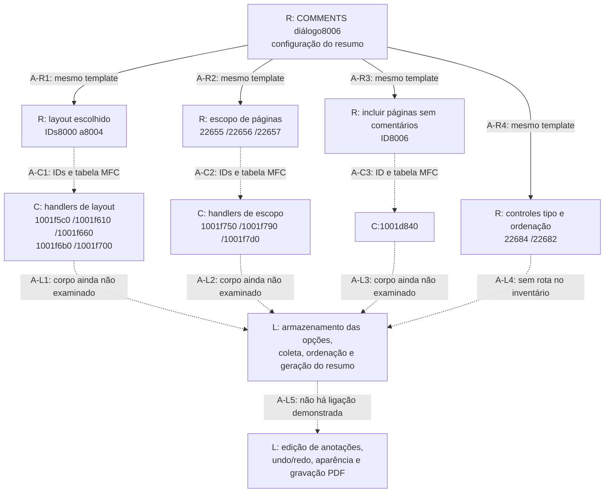
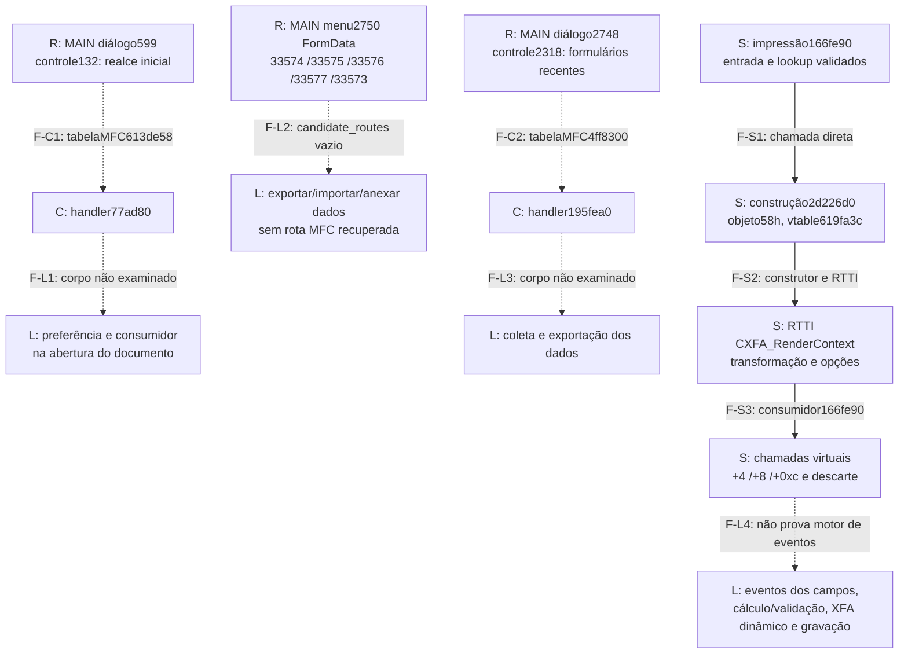
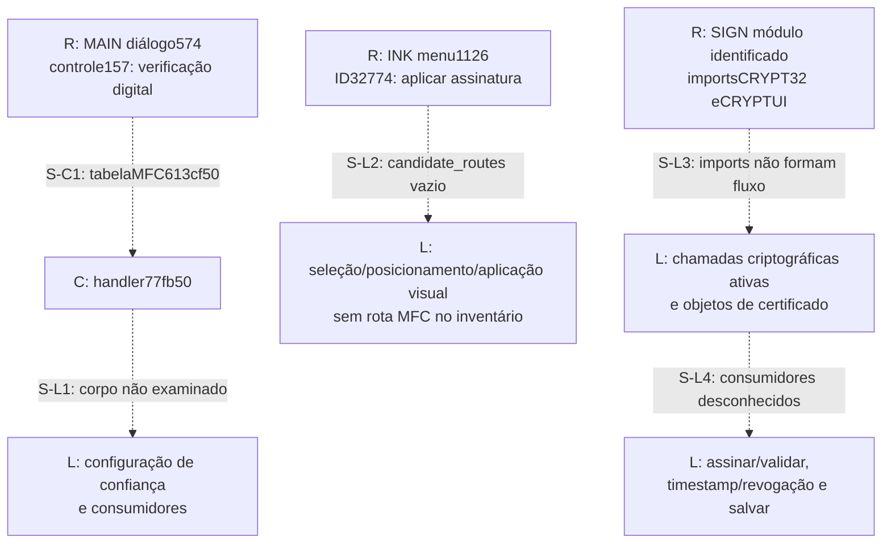
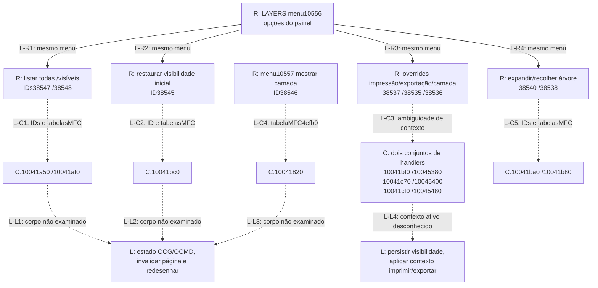

# S3/C1 — estados e fronteiras de quatro subsistemas

Levantamento de Codex em 23/10/2026, a partir dos registros estáticos já
preservados. As quatro seções cobrem anotações, formulários, assinaturas e
camadas. **S3 permanece parcial:** os diagramas tornam rastreável o que foi
localizado, inclusive as partes ainda sem ligação, em vez de completar um
fluxo do original por suposição.

Não houve nova rodada Ghidra, execução do Foxit, entrada na VM, teste do app,
alteração de implementação ou publicação. Nenhuma função foi acrescentada ao
catálogo por este levantamento.

## Como ler os diagramas

- **S:** ligação estática estabelecida pelo código/RTTI já examinado. Não é uma
  observação da aplicação em execução.
- **C:** associação estrutural candidata: recurso, ID e entrada de tabela MFC.
  A associação existe no inventário, mas a classe ativa e a execução do
  handler ainda não foram demonstradas. Aparece com seta tracejada.
- **R:** vínculo entre recursos do mesmo template, sem afirmar uma chamada.
- **L:** lacuna identificada. Setas tracejadas para caixas L indicam o ponto
  até o qual a prova alcança, não uma transição de estado comprovada.

Não foram acrescentadas arestas de carregamento de `PlugInMain` até comandos
de edição. Um export de entrada de plugin não identifica seu motor, a ordem de
ativação ou a disponibilidade de recursos na edição Reader. Também não se
confunde código próprio do Linuxit com código recuperado do original.

## Fontes e identidades

| Referência | Identidade / localização | O que sustenta |
|---|---|---|
| MAIN | Executável `90208c9e8da92c8e546b76c8f4a2f8fb999105d124e663bbea6744fb6bb6b3a6` | Recursos e candidatos MFC do executável |
| COMMENTS | `CommentsSummary.fpi`, `0a7d7ed6178eaea5787871858f3f4e1cf15fdcae45a24f5ccf5ac441776c3ca8` | Diálogo de resumo; não é o motor inteiro de anotações |
| INK | `InkSign.fpi`, `72a9eb87654bac3367a24d076b3a571d7128d6c1db890d5372d36a13c40dab52` | Recurso de aplicar assinatura visual |
| SIGN | `Signature.fpi`, `7359d9656d7dfbad0d256617f2df01b306a40eb3c011cf1b0d630358253b9e5e` | Módulo candidato de assinatura; importa CRYPT32 e CRYPTUI |
| LAYERS | `LayerPanelToolPlugin.fpi`, `d3dd66d68601a203dce417b4e9f24ac43d881b91faa0c39a91c50c540f4e759f` | Menus de camadas e seus candidatos MFC |

Os endereços são VAs preferidos da amostra identificada, não offsets de arquivo
nem endereços atuais de processos com ASLR.

Fontes comuns:

- [Inventário dos módulos](windows-evidence/foxit-rea/module-inventory.json).
- [Recursos e candidatos MFC dos plugins](windows-evidence/foxit-rea/plugin-ui-command-map.json).
- [Recursos e candidatos MFC do executável](windows-evidence/foxit-rea/ui-command-map.json).
- [Catálogo de funções examinadas](../engenharia-reversa/funcoes.csv).
- [Limites da análise original](FOXIT-REA.md#fronteiras-entre-módulos).

## 1. Anotações — configuração de resumo e fronteira da edição

O recorte preservado localiza opções de **resumo de comentários**. Ele não
contém ainda a máquina de estados que cria, seleciona, move, altera aparência,
desfaz, refaz e serializa todas as anotações.

| Arestas | Prova / endereço | Limite |
|---|---|---|
| A-R1 a A-R4 | Itens COMMENTS, `source=dialog`, `resource_id=8006`, idioma1033 | Associação de controles ao template, não estado runtime |
| A-C1 | IDs8000–8004; offsets de tabela `0x29e58`, `0x29e70`, `0x29e88`, `0x29ea0`, `0x29eb8`; funções na ordem do diagrama | Candidatos estruturais, notificação0 |
| A-C2 | IDs22655–22657; offsets `0x29ed0`, `0x29ee8`, `0x29f00` | Ainda não foi comprovada a escrita de um campo de escopo |
| A-C3 | ID8006; offset `0x29f18` → `0x1001d840` | ID igual ao número do diálogo não significa mesma entidade |
| A-L1 a A-L3 | Candidatos não constam entre os corpos decompilados preservados | Próximo trabalho estático: examinar as escritas e consumidores |
| A-L4 | IDs22684 e22682 com `candidate_routes=[]` | Não inventar destino usando proximidade de IDs |
| A-L5 | Lacunas de anotações em `FOXIT-REA.md`, tabela das25famílias | Resumo não prova criação/edição/persistência das anotações |

O recurso inclui Cancel, ID2, sem candidato de rota nesse inventário. Isso não
prova ausência de tratamento padrão MFC, limpeza ou rollback. O ciclo de vida
do diálogo e a confirmação que efetivamente inicia a geração continuam abertos.

## 2. Formulários — preferências, dados e fronteira XFA comprovada

Há duas fronteiras distintas: recursos de interação/dados, ainda sem motor
rastreado, e um contexto XFA identificado estaticamente em um caminho de
impressão. Elas não são ligadas artificialmente no diagrama.

| Aresta | Prova | Limite |
|---|---|---|
| F-C1 | MAIN, diálogo599/controle132, offset `0x613de58` → `0x77ad80` | Preferência de realce, não motor AcroForm |
| F-C2 | MAIN, diálogo2748/controle2318, offset `0x4ff8300` → `0x195fea0` | Controle da seleção de formulários recentes |
| F-S1 | `0x166fe90` chama `0x2d226d0`; [metadados de impressão](windows-evidence/foxit-rea/headless-cross-checks-windows-followup-2026-10-16.json) | Caminho de impressão, não abertura/validação de formulário |
| F-S2 | `0x2d226d0`: alocação0x58 e vtable `0x619fa3c`; [metadados](windows-evidence/foxit-rea/headless-cross-checks-no-vm-2026-10-17.json) e [RTTI revisado](AVANCO-SEM-VM.md) | Identifica CXFA_RenderContext neste caminho |
| F-S3 | Assembly de `0x166fe90`, explicado em [consumidores](REA-IMPRESSAO-CONSUMIDORES.md) | Seis valores com padrão identidade e opções condicionais; sem contrato visual integral |
| F-L1/F-L3 | Candidatos MFC identificados, sem corpo decompilado no acervo consultado | Precisam de análise dos handlers e consumidores |
| F-L2 | Menu2750, cinco comandos listados, todos sem candidatos MFC | A ausência da rota no inventário não prova ausência do recurso |
| F-L4 | Fronteira XFA de impressão identificada; motor de campos ainda aberto | Não se infere AcroForm/XFA interativo a partir do renderer |

Não classificar `FRMSPlgV2.fpi` como motor de formulários: a evidência
preservada o associa a proteção RMS. Também não transportar o funcionamento do
motor próprio de formulários do Linuxit para este mapa do original.

## 3. Assinaturas — três caminhos que continuam separados

Os recursos preservados distinguem configuração de verificação, aplicação
visual e um módulo criptográfico candidato. Falta a ligação de estados entre
seleção de certificado, digest, assinatura, atualização incremental, política
de confiança, timestamp e validação.

| Aresta | Referência exata | O que não foi demonstrado |
|---|---|---|
| S-C1 | MAIN, diálogo574/ID157, offset `0x613cf50`, notificação0, destino `0x77fb50` | Não foi denominado handler de validar assinatura: o recurso é uma opção de configuração |
| S-L1 | Corpo de `0x77fb50` ainda não examinado | Estado da preferência, persistência e efeito sobre validação |
| S-L2 | INK, menu1126/ID32774, `candidate_routes=[]` | Classe de ferramenta, aparência e commit no PDF |
| S-L3 | SIGN, imports CRYPT32/CRYPTUI no inventário de módulos | Imports só indicam dependências disponíveis, não sequência nem política |
| S-L4 | Nenhum caminho decompilado preservado ligando a fronteira aos estados finais | Certificado, CMS, ByteRange, RFC3161, OCSP/CRL e validação completa |

O export `SIGN!PlugInMain=0x10066eb0` permanece inventário; não foi eleito como
“algoritmo de assinatura”. `FoxitSign.fpi` é outra fronteira possível, que não
foi ligada a serviço remoto por nomes. A nuvem direta continua adiada.

## 4. Camadas — modos de listagem, visibilidade e overrides

O inventário possui rotas candidatas claras para o painel de camadas. Elas
ainda não demonstram qual estrutura de OCG/OCMD é modificada, a invalidacão do
renderer, persistência ou disponibilidade de operações de edição no Reader.

| Arestas | Offset(s) de tabela → destino(s) no inventário LAYERS |
|---|---|
| L-R1 a L-R4 | `source=menu`, recurso10556; são relações de conteúdo do menu |
| L-C1 | ID38547: `0x4efe0/0x4f808` → `0x10041a50`; ID38548: `0x4eff8/0x4f820` → `0x10041af0` |
| L-C2 | ID38545: `0x4f040/0x4f868` → `0x10041bc0` |
| L-C3 | ID38537: `0x4f058` → `0x10041bf0`, `0x4f880` → `0x10045380`; ID38535: `0x4f070` → `0x10041c70`, `0x4f898` → `0x10045400`; ID38536: `0x4f088` → `0x10041cf0`, `0x4f8b0` → `0x10045480` |
| L-C4 | Menu10557/ID38546: `0x4efb0` → `0x10041820` |
| L-C5 | ID38540: `0x4f028/0x4f850` → `0x10041ba0`; ID38538: `0x4f010/0x4f838` → `0x10041b80` |
| L-L1 a L-L4 | Os candidatos têm associação de recursos, mas não corpos decompilados/consumidores examinados nesta família |

A existência de dois destinos diferentes para um ID de override é preservada:
não foi escolhida arbitrariamente uma classe ativa. Expandir ou recolher a
árvore do painel também não é sinônimo de alterar visibilidade no PDF.
Importar, mesclar, achatar e excluir camadas aparecem nos recursos, mas essa
presença não prova a disponibilidade no Reader. Mídia e 3D não receberam
arestas: 3D continua adiado, e um painel de camadas não comprova seu motor.

## Próximos lotes estáticos propostos — ainda não executados

Estas sementes vêm das rotas candidatas observadas, não de um export genérico.
Cada lote precisa de reserva e confirmação da coordenação antes do Ghidra.
O primeiro objetivo é transformar C em ligação por instruções e identificar
escritas/chamadas; não prometer de antemão encontrar o motor completo.

| Família / lote | Módulo e sementes exatas | Pergunta limitada |
|---|---|---|
| Anotações/resumo | COMMENTS: `0x1001f5c0`, `0x1001f660`, `0x1001f750` | Onde os handlers de dois layouts e de todas as páginas escrevem estado? Quem consome esses campos? |
| Formulários | MAIN: `0x77ad80`, `0x195fea0` | Escritas da preferência de realce e da seleção de formulários recentes; confirmar que são fronteiras de configuração, localizando seus consumidores |
| Assinaturas | MAIN: `0x77fb50` | Qual preferência o controle de verificação altera e qual consumidor a lê? Este lote não se denomina motor de assinatura |
| Camadas | LAYERS: `0x10041820`, `0x10041bc0`, `0x10041bf0`, `0x10045380` | Mostrar/restaurar: alterações de estado e notificações; comparar os dois handlers do mesmo ID de override para identificar contextos |

Para chegar aos motores que faltam será necessário seguir os consumidores
reais revelados por esses lotes, ou localizar outras referências com identidade
e contexto. Ausência de resultado mantém a lacuna aberta; não autoriza usar
nomes de funções por semelhança para fechá-la.

## Estado de entrega

Entregues quatro mapas com fontes e lacunas, uma fila de dez sementes
justificadas e revisão de consistência dos recursos/endpoints. **Nenhum dos
quatro fluxos integrais está encerrado.** A distinção entre assinatura visual e
criptográfica, renderer XFA e motor de campos, resumo e edição de anotações,
árvore de UI e visibilidade PDF foi mantida.

Não foram alterados `fluxos.md`, AGENTS, catálogo, progresso, critérios, pesos,
app, testes, candidato0.1.19, releases ou VM. A integração nos documentos
centrais fica com a coordenação Codex. O registro estruturado da revisão está
em [review.json](../testes/resultados/s3-estados-2026-10-23/review.json).
