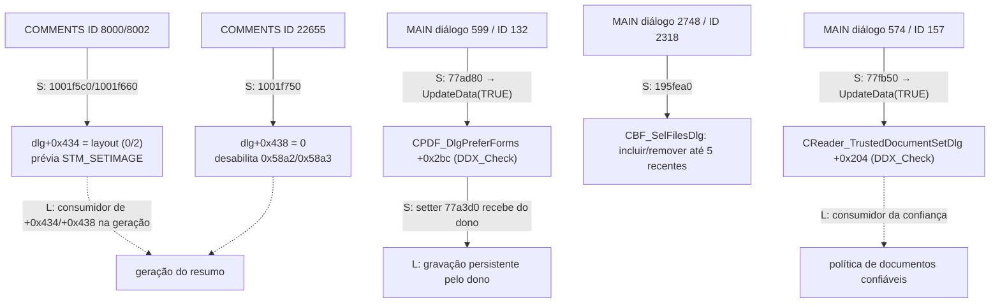

# S3 — handlers candidatos convertidos em ligações estáticas — 23/10/2026

Claude, 2026/10/23, das 12:38 às 12:47 (America/Sao_Paulo, UTC-03:00). A análise foi **somente
estática**: o Foxit não foi executado, a VM não foi tocada e nenhum código foi versionado. Este
lote executa seis das dez sementes propostas em [S3/C1 — estados](REA-S3-ESTADOS-2026-10-23.md).
As quatro sementes de camadas ficaram para depois, porque `LayerPanelToolPlugin.fpi`
(`d3dd66d6…759f`, conferido) não está entre os alvos fixados em
`docs/windows-evidence/foxit-rea/analysis-manifest.json`. Incluí-lo como alvo é uma decisão de
coordenação.

## Identidade e verificação

| Módulo | Rodada | Entradas | Instruções / bytes |
|---|---|---:|---:|
| `FoxitPDFReader.exe` (`90208c9e…b3a6`) | `claude-s3-main` | 3 novas | 200 / 704 |
| `CommentsSummary.fpi` (`0a7d7ed6…3ca8`) | `claude-s3-comments` | 1 nova e 2 revisitas | 60 / 203 |

- **Conferência:** as fronteiras foram conferidas por Capstone
  ([main](../testes/resultados/s3-handlers-2026-10-23/machine-checks-main.json),
  [comments](../testes/resultados/s3-handlers-2026-10-23/machine-checks-comments.json)).
- **Sementes:** `static-s3-claude-{main,comments}-2026-10-23-seeds.tsv`.
- **Ligações extras:** as ligações a seguir foram lidas com Capstone, pefile e RTTI: entradas da
  message map, `GetMessageMap`, vtable e `DoDataExchange`.
- **Endereços:** os offsets de tabela do documento S3 são **offsets de arquivo**. Os VAs
  correspondentes estão na tabela abaixo.

## Achados

| Semente | Entrada da message map (VA) | Classe dona (RTTI pela `GetMessageMap`) | O que o handler faz |
|---|---|---|---|
| MAIN `0x77ad80` | `0x653f258`: `WM_COMMAND` (0x111), código 0, ID 0x84 (132), assinatura 0x3a | **`CPDF_DlgPreferForms`** (vtable `0x653f294`, `GetMessageMap` `0x77a3c0` via thunk `0x77a3b0`) | Chama `0x48fc2d8(1)` = **`CWnd::UpdateData(TRUE)`** do MFC estático. A identificação é pela estrutura: troca o hWnd de bloqueio em `+0x13c` do estado da thread e chama o `DoDataExchange` virtual (`+0x100`), com guarda CFG e mensagem de falha. |
| MAIN `0x77fb50` | `0x653e350`: `WM_COMMAND`, ID 0x9d (157) | **`CReader_TrustedDocumentSetDlg`** (vtable `0x653e38c`) | Também chama `UpdateData(TRUE)` |
| MAIN `0x195fea0` | `0x53f9700`: `WM_COMMAND`, ID 0x90e (2318) | **`CBF_SelFilesDlg`** (vtable `0x53f9394`) | Ver abaixo |
| COMMENTS `0x1001f5c0` | (S3, ID 8000) | diálogo de resumo | Grava `dlg+0x434 = 0`, carrega o bitmap 0x1f4b e o envia ao controle 0x1f4c (`STM_SETIMAGE` 0x172), chama `0x1001f8b0(1)` |
| COMMENTS `0x1001f660` | (S3, ID 8002) | diálogo de resumo | Grava `dlg+0x434 = 2`, usa o bitmap 0x1f4a e chama `0x1001f8b0(0)` |
| COMMENTS `0x1001f750` | (S3, ID 22655) | diálogo de resumo | Grava `dlg+0x438 = 0` e desabilita os controles 0x58a2 e 0x58a3 (22690/22691) pelas ordinais 5422 e 4477 da `mfc140u` (candidatas a GetDlgItem/EnableWindow) |

### Contratos derivados

- **Formulários: preferência de realce.**
  - `CPDF_DlgPreferForms::DoDataExchange` (`0x77a2f0`) liga, entre outros, o controle 0x84 a
    **`+0x2bc`** por `DDX_Check` (`0x4918b11`, que usa BM_GETCHECK 0xf0 e BM_SETCHECK 0xf1).
  - O membro é zerado em `0x77a157` e preenchido pelo setter `0x77a3d0`, que recebe da página
    dona os valores `+0x200`, `+0x204`, `+0x214`, `+0x218`, `+0x21c`, `+0x2bc` e `+0x2c0`.
  - O clique só move o estado do controle para o membro. A gravação persistente fica com o dono,
    fora da classe.
- **"Verificação digital" (S-C1) era outra coisa.** O destino `0x77fb50` pertence a
  **`CReader_TrustedDocumentSetDlg`**, ou seja, à configuração de **documentos confiáveis**, e
  não a um handler de assinatura.
  - O `DoDataExchange` (`0x77faa0`) liga os controles 0x95 a `+0x200` e 0x9d a `+0x204` por
    `DDX_Check`.
  - O setter `0x77fb00` recebe os dois valores.
  - A aresta S-C1 do documento S3 deve ser lida como **configuração de confiança**, como aquele
    documento já advertia, e não como validação de assinatura.
- **"Formulários recentes" (F-C2).** O destino pertence a **`CBF_SelFilesDlg`** (diálogo de seleção
  de arquivos).
  - Lê o estado do botão 0x90e e obtém até 5 entradas de uma lista persistente (formato com
    índice, provedor de perfil pelo slot `+0x1e4` e leitura pelo slot `+0x3c`).
  - Separa cada caminho com `0x4b747d1`.
  - Conforme o estado do botão, acrescenta (`0x195e530`) ou remove (`0x195e820` → `0x195e6b0`)
    os arquivos recentes da lista.
  - Por fim, habilita o botão seguinte quando a lista não está vazia e, no modo `+0x208 == 1`,
    chama `0x19615e0`.
  - É um controle "incluir arquivos recentes" de um seletor de arquivos, e não um motor de
    formulários.
- **Resumo de comentários.** O layout escolhido fica em `dlg+0x434` (valores 0 e 2 observados) e a
  prévia é um bitmap de recurso. O escopo "todas as páginas" grava `dlg+0x438 = 0` e desabilita os
  campos de intervalo.

## Diagramas atualizados (S = ligação estática estabelecida neste lote)

## Lacunas

- **Consumidores.** Faltam os consumidores de `+0x434/+0x438` (geração do resumo), de `+0x2bc`
  (realce na abertura) e de `+0x204` (confiança).
- **Mapa de ordinais.** Os nomes das ordinais da `mfc140u` dependem do mapa de ordinais, que não
  está fixado no repositório.
- **Camadas.** As quatro sementes ainda não foram executadas, porque falta o alvo fixado.
- **Motores.** Os motores de edição de anotações, de campos de formulário e de assinatura
  criptográfica não foram alcançados por estes handlers de configuração. Continuam como lacunas
  L dos diagramas S3.
- **Execução.** Nada foi observado em execução.

O critério "Diagramas e estados rastreáveis por subsistema" (etapa 9) **continua parcial**. Este
lote troca seis arestas C por S e corrige a identidade de duas, mas os motores dos quatro
subsistemas continuam como lacunas.
