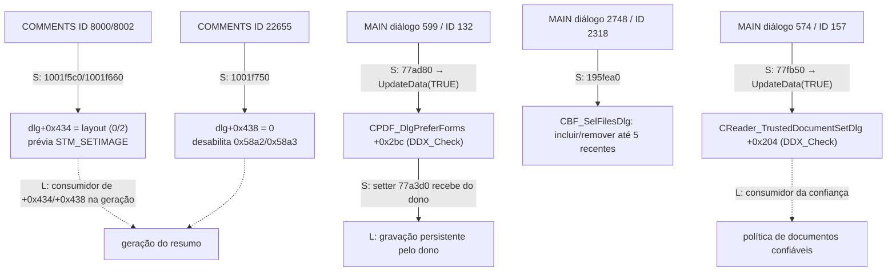

# S3 — handlers candidatos convertidos em ligações estáticas — 23/10/2026

Claude, 2026/10/23, das 12:38 às 12:47 (America/Sao_Paulo, UTC-03:00). A análise foi **somente
estática**: o Foxit não foi executado, a VM não foi tocada e nenhum código foi versionado. Este
lote executa seis das dez sementes propostas em [S3/C1 — estados](REA-S3-ESTADOS-2026-10-23.md).
As quatro de camadas foram executadas no lote 2 (fim do documento), depois que
`LayerPanelToolPlugin.fpi` (`d3dd66d6…759f`, conferido) foi incluído como alvo fixado, a pedido
do usuário de concluir as etapas.

## Identidade e verificação

| Módulo | Rodada | Entradas | Instruções / bytes |
|---|---|---:|---:|
| `FoxitPDFReader.exe` (`90208c9e…b3a6`) | `claude-s3-main` | 3 novas | 200 / 704 |
| `CommentsSummary.fpi` (`0a7d7ed6…3ca8`) | `claude-s3-comments` | 1 nova e 2 revisitas | 60 / 203 |

- **Conferência:** as fronteiras foram conferidas por Capstone
  ([main](../testes/resultados/s3-handlers-2026-10-23/machine-checks-main.json),
  [comments](../testes/resultados/s3-handlers-2026-10-23/machine-checks-comments.json)).
- **Sementes:** `static-s3-claude-{main,comments}-2026-10-23-seeds.tsv`.
- **Ligações extras:** as ligações a seguir foram lidas com Capstone, pefile e RTTI: entradas da
  message map, `GetMessageMap`, vtable e `DoDataExchange`.
- **Endereços:** os offsets de tabela do documento S3 são **offsets de arquivo**. Os VAs
  correspondentes estão na tabela abaixo.

## Achados

| Semente | Entrada da message map (VA) | Classe dona (RTTI pela `GetMessageMap`) | O que o handler faz |
|---|---|---|---|
| MAIN `0x77ad80` | `0x653f258`: `WM_COMMAND` (0x111), código 0, ID 0x84 (132), assinatura 0x3a | **`CPDF_DlgPreferForms`** (vtable `0x653f294`, `GetMessageMap` `0x77a3c0` via thunk `0x77a3b0`) | Chama `0x48fc2d8(1)` = **`CWnd::UpdateData(TRUE)`** do MFC estático. A identificação é pela estrutura: troca o hWnd de bloqueio em `+0x13c` do estado da thread e chama o `DoDataExchange` virtual (`+0x100`), com guarda CFG e mensagem de falha. |
| MAIN `0x77fb50` | `0x653e350`: `WM_COMMAND`, ID 0x9d (157) | **`CReader_TrustedDocumentSetDlg`** (vtable `0x653e38c`) | Também chama `UpdateData(TRUE)` |
| MAIN `0x195fea0` | `0x53f9700`: `WM_COMMAND`, ID 0x90e (2318) | **`CBF_SelFilesDlg`** (vtable `0x53f9394`) | Ver abaixo |
| COMMENTS `0x1001f5c0` | (S3, ID 8000) | diálogo de resumo | Grava `dlg+0x434 = 0`, carrega o bitmap 0x1f4b e o envia ao controle 0x1f4c (`STM_SETIMAGE` 0x172), chama `0x1001f8b0(1)` |
| COMMENTS `0x1001f660` | (S3, ID 8002) | diálogo de resumo | Grava `dlg+0x434 = 2`, usa o bitmap 0x1f4a e chama `0x1001f8b0(0)` |
| COMMENTS `0x1001f750` | (S3, ID 22655) | diálogo de resumo | Grava `dlg+0x438 = 0` e desabilita os controles 0x58a2 e 0x58a3 (22690/22691) pelas ordinais 5422 e 4477 da `mfc140u` (candidatas a GetDlgItem/EnableWindow) |

### Contratos derivados

- **Formulários: preferência de realce.**
  - `CPDF_DlgPreferForms::DoDataExchange` (`0x77a2f0`) liga, entre outros, o controle 0x84 a
    **`+0x2bc`** por `DDX_Check` (`0x4918b11`, que usa BM_GETCHECK 0xf0 e BM_SETCHECK 0xf1).
  - O membro é zerado em `0x77a157` e preenchido pelo setter `0x77a3d0`, que recebe da página
    dona os valores `+0x200`, `+0x204`, `+0x214`, `+0x218`, `+0x21c`, `+0x2bc` e `+0x2c0`.
  - O clique só move o estado do controle para o membro. A gravação persistente fica com o dono,
    fora da classe.
- **"Verificação digital" (S-C1) era outra coisa.** O destino `0x77fb50` pertence a
  **`CReader_TrustedDocumentSetDlg`**, ou seja, à configuração de **documentos confiáveis**, e
  não a um handler de assinatura.
  - O `DoDataExchange` (`0x77faa0`) liga os controles 0x95 a `+0x200` e 0x9d a `+0x204` por
    `DDX_Check`.
  - O setter `0x77fb00` recebe os dois valores.
  - A aresta S-C1 do documento S3 deve ser lida como **configuração de confiança**, como aquele
    documento já advertia, e não como validação de assinatura.
- **"Formulários recentes" (F-C2).** O destino pertence a **`CBF_SelFilesDlg`** (diálogo de seleção
  de arquivos).
  - Lê o estado do botão 0x90e e obtém até 5 entradas de uma lista persistente (formato com
    índice, provedor de perfil pelo slot `+0x1e4` e leitura pelo slot `+0x3c`).
  - Separa cada caminho com `0x4b747d1`.
  - Conforme o estado do botão, acrescenta (`0x195e530`) ou remove (`0x195e820` → `0x195e6b0`)
    os arquivos recentes da lista.
  - Por fim, habilita o botão seguinte quando a lista não está vazia e, no modo `+0x208 == 1`,
    chama `0x19615e0`.
  - É um controle "incluir arquivos recentes" de um seletor de arquivos, e não um motor de
    formulários.
- **Resumo de comentários.** O layout escolhido fica em `dlg+0x434` (valores 0 e 2 observados) e a
  prévia é um bitmap de recurso. O escopo "todas as páginas" grava `dlg+0x438 = 0` e desabilita os
  campos de intervalo.

## Diagramas atualizados (S = ligação estática estabelecida neste lote)

## Lote 2 (12:58 às 13:05) — preferências do resumo e camadas

### Resumo de comentários: onde o estado mora e quem o consome

Leitura dos acessos a `+0x434/+0x438` no `CommentsSummary.fpi`, com os textos UTF-16 empilhados
lidos por Capstone:

- **Inicialização (`0x1001d850`).** Lê a seção de preferências **`CommentsSummary`** com as chaves
  `Layout` (padrão 3, em `+0x434`), `CommentType`, `PageSize`, `FontSize`, `SortBy`,
  `IncludePages` (padrão 0, em `+0x438`), `PagesNoComments`, `LineColor` e `LineOpacity`.
- **Confirmação (`0x1001e400`).**
  - Grava as mesmas chaves de volta. `FontSize` e `SortBy` vêm de `CB_GETCURSEL` (0x147) dos
    controles `+0xc8` e `+0x350`.
  - Grava também `PageRange`, `SummarizeComments` e `Comment`.
  - Depois **consome** `+0x434` (passado ao serviço do host) e escolhe o escopo por `+0x438`:
    0, 1 ou 2, com 2 = intervalo, que habilita os campos 22690/22691.
- **Serviços do host.** São obtidos pela tabela de funções do host do SDK de plugins
  (`[0x100335e0]+4`, com pares categoria/seletor como `0x14/0x2d` para gravar e `0x22/0xa`).

As arestas A-L1 a A-L3 do mapa S3 passam a **S**: o estado fica no perfil `CommentsSummary` e o
consumidor é `0x1001e400`. A geração do resumo em si é um serviço do host e continua **L**.

### Camadas (`LayerPanelToolPlugin.fpi`, agora alvo fixado)

O módulo foi incluído em `analysis-manifest.json` como alvo fixado, com o hash do inventário
de módulos.

- **Rodadas e conferência:**
  - `claude-s3-layers`: 12 handlers, 497 instruções / 1.402 bytes;
  - `claude-s3-layers2`: 6 consumidores, 1.038 instruções / 3.181 bytes;
  - Capstone: [handlers](../testes/resultados/s3-layers-2026-10-23/machine-checks-layers.json),
    [consumidores](../testes/resultados/s3-layers-2026-10-23/machine-checks-layers-2.json).
- **Painel.** Todos os handlers obtêm o painel por `FromHandle(GetParent(hwnd))` (ordinal 4886 da
  `mfc140u`, candidata).
- **Contexto de override (`painel+0xa8`).** Valores: 0 = nenhum, 1 = impressão (ID 38537),
  2 = exportação (38535), 3 = camada (38536). Cada handler alterna o seu valor:
  - se já está ativo, desliga (`0x1002ef60(0)`);
  - se outro está ativo, desliga o outro e liga o seu;
  - se nenhum está ativo, liga o seu.

  **A ambiguidade L-C3 se resolve:** os dois conjuntos de handlers do mesmo ID (`0x10041bf0` /
  `0x10045380` etc.) têm a mesma semântica. O segundo só chama `0x100178a0` antes; é a variante
  de outra classe hospedeira do mesmo menu.
- **Modo de lista (`painel+0x88`).** "Listar todas" (38547) grava 0 e "só visíveis" (38548) grava
  1. Depois reaplica o override ativo ou reconstrói a árvore com `0x10034a10(modo, 0)`.
  - A reconstrução usa WM_SETREDRAW, `TVM_SETBKCOLOR`/`TVM_DELETEITEM`, os serviços do host para
    documento e contexto e `TVM_EXPAND`.
- **Restaurar visibilidade inicial (38545).** Chama `0x1002f490(1)`, que percorre o mapa de
  estados salvo e reaplica pelo host (`0x26/5`).
- **Expandir/recolher (38540/38538).** `0x100354a0(2|1)` envia `TVM_EXPAND` com TVE_EXPAND /
  TVE_COLLAPSE a cada item. É só a árvore, sem efeito no PDF, o que confirma a ressalva do S3.
- **Mostrar camada (38546, `0x10041820`).**
  - Lê a seleção (`TVM_GETNEXTITEM` 0x110a) e alterna a imagem de estado (`TVIS_STATEIMAGEMASK`
    0xf000; 0x1000 ↔ 0x3000).
  - Chama `0x1003d6a0`. Para os estados 2/3, liga o OCG pelo serviço do host `0x26/6(contexto,
    ocg, 1, 1)`; para 1/4, desliga com `(…, 0, 1)`.
  - Em seguida percorre as vistas de página (`0x1f/4`, `0x1f/5`) e chama **`InvalidateRect`** em
    cada uma.
  - No contexto 3 (override de camada), não altera o OCG.

As arestas L-L1 a L-L3 passam a **S até a fronteira do host**: o estado OCG é alterado por um
serviço `0x26/6` e as páginas são invalidadas para redesenho. A estrutura OCG/OCMD que o host
modifica e a persistência continuam **L**: estão do outro lado da tabela de funções, no executável
principal.

## Lacunas

- **Consumidores.** Faltam os consumidores de `+0x2bc` (realce na abertura) e de `+0x204`
  (confiança), que estão no dono das páginas de preferência, fora da classe. Os de `+0x434/+0x438`
  ficaram fechados no lote 2.
- **Mapa de ordinais.** Os nomes das ordinais da `mfc140u` e dos pares categoria/seletor da tabela
  de funções do host dependem de mapas que não estão fixados no repositório.
- **Camadas.** Faltam o motor OCG do host e a persistência da visibilidade.
- **Motores.** Os motores de edição de anotações, de campos de formulário e de assinatura
  criptográfica não foram alcançados por estes handlers de configuração. Continuam como lacunas
  L dos diagramas S3.
- **Execução.** Nada foi observado em execução.

O critério "Diagramas e estados rastreáveis por subsistema" (etapa 9) **continua parcial**. Os
dois lotes trocam por S as dez sementes propostas e mais os consumidores do resumo e das camadas,
e corrigem a identidade de duas arestas. Os motores dos quatro subsistemas continuam como
lacunas: edição de anotações, campos de formulário, assinatura criptográfica e OCG no host.
