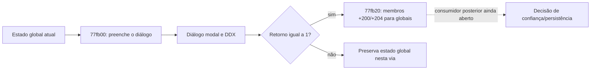
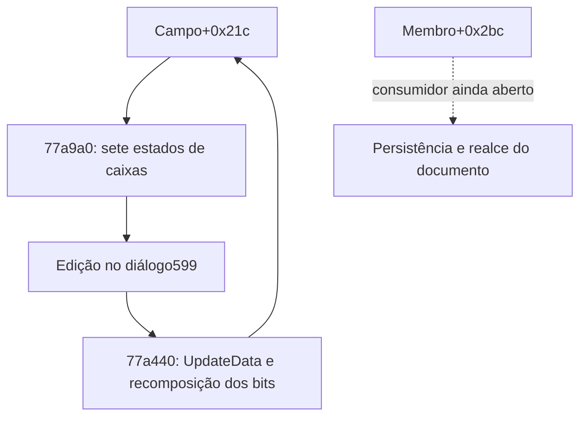

# S3/S4: confiança nas preferências e consumidores do reflow

Continuação Codex de 23/10/2026, após a ordem humana para assumir a execução. Não houve execução do Foxit ou entrada na VM.

Alvo `FoxitPDFReader.exe`, SHA-256 `90208c9e8da92c8e546b76c8f4a2f8fb999105d124e663bbea6744fb6bb6b3a6`. Backend direto Ghidra 12.1.4/JDK21, projetos anteriores copiados, nunca sobrescritos. Capstone/pefile conferiram cinco entradas em dois lotes: **411 instruções/1.305 bytes**. Fronteiras e tipos continuam provisórios; sucesso do decompilador não estabelece equivalência funcional.

## Documentos confiáveis: consumidor de +0x204

O chamador `0x77e560` constrói o diálogo, preenche os valores atuais a partir dos globais `0x6d82a54/0x6d82a58` e chama o diálogo modal. Somente quando o retorno é 1 passa a `0x77fb20`; o caminho de cancelamento não passa por essa gravação.

`0x77fb20` copia `diálogo+0x200` para `0x6d82a54` e `diálogo+0x204` para `0x6d82a58`. Fecha-se essa aresta delimitada entre a página de configuração, os membros atualizados por DDX e o estado global. Não houve prova nova de persistência em disco nem do consumidor posterior que toma decisões sobre documentos confiáveis. Isso também não é verificação criptográfica de assinatura.

## Preferência de formulários: limite preservado

O corpo de `0x77a3d0` confirma dez atribuições ao diálogo, incluindo `+0x2bc` a partir do décimo parâmetro e `+0x2c0` do décimo primeiro, contando o receptor na assinatura provisória do decompilador. Não é consumidor de saída: preenche os membros do diálogo. A busca dirigida por chamadas diretas E8 não encontrou chamada a esse endereço; isso não prova ausência de chamadas indiretas ou código inutilizado. O consumidor de saída de `+0x2bc` continua pendente.

## Reflow

* `0x15cd130` recebe um deslocamento, compara-o com o campo `+4`, obtém uma extensão de viewport e chama o limitador conhecido `0x15ca180`. Atualiza `+4` e sua cópia float `+0x34`, depois entrega ao helper `0x15c7d20` a diferença entre o pedido e o deslocamento calculado. O efeito final desse helper sobre a vista continua aberto.
* `0x15cd1a0` é uma via mais extensa sobre `+8`, os mapas `+0x48`, contagem `+0x78` e índice `+0x7c`. Seleciona intervalos usando prefixos/métricas e dois parâmetros de controle antes de chegar ao mesmo limitador. Existem comparações inteiras e float; não foi atribuída unidade física nem uma garantia geral de overflow.
* A varredura de chamadas encontrou `0x15ca380`, já examinado anteriormente, além dos dois chamadores acima. `0x15ca380` é contexto preservado e não nova função.

As condições por modo e flags, efeito final sobre o viewer, todos os caminhos de inicialização dos mapas e a ligação integral de OCG, anotações, formulários e assinaturas continuam pendentes. S3/S4 e os critérios amplos seguem parciais; B3 e pesos não foram alterados.

Evidências públicas em `testes/resultados/s3-s4-followup-2026-10-23/` e nos arquivos de metadados `headless-cross-checks-preference-reflow-2026-10-23.json`/`headless-cross-checks-preference-results-2026-10-23.json`. Resultados completos ficam em `analysis-local/headless/preference-reflow-consumers-2026-10-23-2013` e `preference-results-2026-10-23-2018`.

## Ciclo do diálogo de formulários — lote adicional

Rodada `s3-forms-owner-2026-10-23-2058`: seis entradas novas,379 instruções/1.377 bytes conferidos por Capstone. Catálogo532→538. A busca da referência à vtable fixada localizou o construtor `0x77a070`, que instala `0x653f294`, usa o diálogo599 e inicializa os membros. Essa ligação confirma a classe concreta dos membros observados; não estabelece a persistência deles.

`0x77a9a0`, destino do slot+0x178 na tabela examinada, decompõe os sete bits do campo+0x21c nas caixas+0x2a0…+0x2b8 e prepara a interface. `0x77a440` faz o caminho inverso após `UpdateData(TRUE)`: se+0x2a0 está ligado, acrescenta o bit1 e retorna; caso contrário, limpa esse bit e atualiza separadamente2,0x10,0x20,4,8,0x40 a partir de+0x2a4,+0x2a8,+0x2ac,+0x2b8,+0x2b4,+0x2b0. Não limpa os demais bits por suposição. **Esse campo+0x21c é distinto do+0x2bc cujo consumidor ainda falta.**

`0x77afd0` é o destino+0x10c: filtra mensagens de teclado, incluindo Enter/Escape, consulta controles habilitados e encaminha cancelamento pela mensagemWM_COMMAND/ID2 em uma das vias. Não se trata de gravação do valor de realce.

As entradas adjacentes `0x77a000/0x77a020` chamam atualização de dados e helpers sobre+0x594/+0x598. A inspeção ampla ultrapassou o conjunto de slots cuja propriedade pela classe foi confirmada; elas ficam **sem atribuição à classe de formulários**, e não são prova de consumidores de+0x2bc nem motor PDF. Foram conferidas como endereços candidatos, não como duas funcionalidades recuperadas.

O construtor é alcançável por mecanismos indiretos ainda não caracterizados: a busca de CALL rel32 não encontrou referência direta a ele. Ausência nessa busca não prova código morto. Evidência: `forms-owner-machine.json` e `headless-cross-checks-s3-forms-owner-2026-10-23.json`. S3 permanece parcial; nenhum critério/peso foi modificado.
