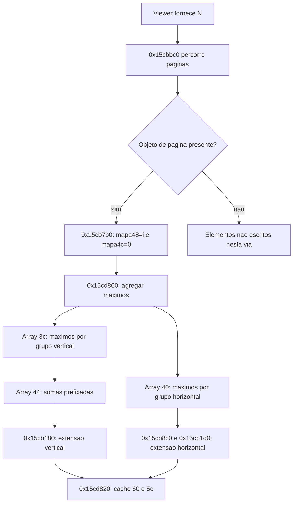
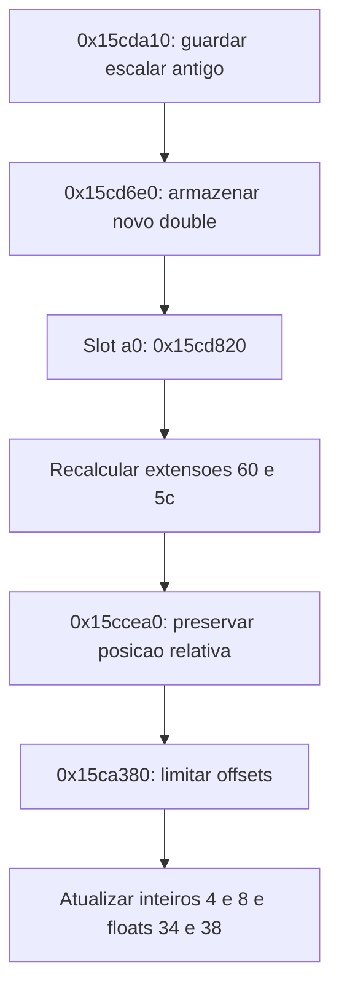

# S4 — reflow: arrays, escala e limites de deslocamento

Análise estática de **2026/10/23**, America/Sao_Paulo (UTC−03:00), por Codex.
Continua [arrays de reflow](REA-ARRAYS-REFLOW-2026-10-19.md),
[transições](REA-TRANSICOES-REFLOW-2026-10-19.md) e
[geometria](REA-REFLOW-GEOMETRIA.md).

Este recorte liga as somas dos arrays ao cálculo de extensões, ao ajuste dos
deslocamentos e à preservação de uma posição relativa quando muda o escalar.
Também esclarece o reset do bloco de quatro valores em `+0x68` e identifica
um escritor dos mapas de índices. **Não é o algoritmo integral do reflow:**
unidades físicas, todos os chamadores, domínio de índices, ownership,
não finitos e casos extremos continuam parcialmente conhecidos. S4 e seus
critérios amplos permanecem abertos, inclusive a dependência de B3.

Não houve execução do original, acesso à VM, alteração do aplicativo,
workflows, testes funcionais, critérios ou releases nesta subfrente.
A VM continua reservada ao Claude; sua campanha não foi usada como prova
dinâmica dos caminhos abaixo.

## Identidade, proveniência e contagem

Alvo `FoxitPDFReader.exe`, SHA-256
`90208c9e8da92c8e546b76c8f4a2f8fb999105d124e663bbea6744fb6bb6b3a6`,
conferido antes e depois. Ghidra 12.1.4/JDK 21, script de sementes REA 6.7.0,
backend complementar direto `-noanalysis`, sem análise MCP nova.

O primeiro projeto foi copiado de `static-reflow-arrays-2026-10-19/project`;
o segundo copiou o primeiro já encerrado. Nenhum projeto anterior foi
alterado. Os resultados integrais ficam em `analysis-local/headless/`.

| Lote | Entradas novas | Instruções conferidas | Bytes |
| --- | ---: | ---: | ---: |
| `s4-reflow-consumers-2026-10-23` | 4 | 231 | 704 |
| `s4-reflow-extents-2026-10-23` | 4 | 143 | 403 |
| Total | **8** | **374** | **1.107** |

As oito entradas não constam do catálogo de 397 registros na revisão
`452174e01ee403e4501c5edf5c649a919b8071ea`. A deduplicação foi conferida
contra esse arquivo Git, pelo módulo e endereço. Não houve repetição de
descompilação neste lote. Oito resultados anteriores foram relidos e tiveram
seus hashes e limites de instrução reconferidos separadamente: **231
instruções/668 bytes**. Esses resultados antigos não aumentam o catálogo.

| Entrada | Bytes | Papel delimitado confirmado |
| --- | ---: | --- |
| `0x15c8d50` | 32 | Inicializa quatro DWORDs recebidos e retorna o mesmo receptor |
| `0x15ca180` | 102 | Limita um deslocamento usando extensão visível e extensão do conteúdo |
| `0x15ca380` | 216 | Aplica o limitador a `+4/+8` e mantém cópias float em `+0x34/+0x38` |
| `0x15ccea0` | 354 | Recalcula deslocamentos entre dois escalares usando mapas e posições relativas |
| `0x15cb180` | 74 | Calcula extensão vertical combinando prefixo, escalar e espaçamento |
| `0x15cb1d0` | 74 | Calcula extensão horizontal por acumulador dependente do modo |
| `0x15cb8c0` | 232 | Obtém uma métrica ou soma métricas de colunas, conforme estado do contexto |
| `0x15cd820` | 23 | Atualiza as duas extensões em cache, `+0x60/+0x5c` |

Os nomes aplicados nas sementes são **nomes de analista**, não símbolos
recuperados. Em particular, a semente de `0x15ca180` foi chamada
`position_lookup` antes da leitura completa. O corpo demonstra um limitador
de deslocamento; **não faz busca de índice de página**. A interpretação final
é a descrita neste relatório, preservando o registro bruto original.

Evidências: [revisão estruturada](../testes/resultados/s4-reflow-2026-10-23/review.json),
[máquina dos consumidores](../testes/resultados/s4-reflow-2026-10-23/machine-consumers.json),
[máquina das extensões](../testes/resultados/s4-reflow-2026-10-23/machine-extents.json),
[metadados dos consumidores](windows-evidence/foxit-rea/headless-cross-checks-s4-reflow-consumers-2026-10-23.json)
e [das extensões](windows-evidence/foxit-rea/headless-cross-checks-s4-reflow-extents-2026-10-23.json).
Capstone 5.0.6 e pefile 2024.8.26 conferem instruções e identidade; não provam
todos os tipos, fronteiras, unidades ou equivalência visual.

## Arrays: o que fica mais preciso

O construtor e RTTI anteriores identificam o receptor como
`CReflowViewerLayout`, vtable `0x53d34bc`, nesta via concreta.
O construtor obtém `N` pelo viewer; os mapas `+0x48/+0x4c` têm quatro bytes
por entrada. A revisão dos helpers existentes confirma que, no construtor
de agregados `0x15cd860`, **A=1 e B=N**: `0x15cb840` retorna 1 e
`0x15cbb90` retorna o campo `layout+0x78`.

O escritor antigo `0x15cb7b0` grava o índice recebido no primeiro destino e
zero no segundo. Seu chamador `0x15cbbc0` percorre os índices `0..N-1`, obtém
um objeto de página e, **somente se o objeto não é nulo**, passa os destinos
`mapa48[i]` e `mapa4c[i]` para esse escritor. Assim, nesse caminho:

- página presente: `mapa48[i]=i` e `mapa4c[i]=0`;
- página nula: esse chamador não escreve aqueles elementos;
- inicialização de todos os índices, em todas as vias e estados, permanece
  sem prova. Não se presumiu que os elementos ignorados já sejam válidos.

Com todos os objetos presentes e os mapas preparados, o agregador existente
é compatível com uma sequência de N grupos verticais e um grupo horizontal:

| Campo | Papel operacional no caminho examinado |
| --- | --- |
| `+0x48` | Mapa de índice para grupo vertical |
| `+0x4c` | Mapa de índice para grupo horizontal |
| `+0x3c` | Máximo da métrica `0x15c7010` por grupo vertical; N elementos |
| `+0x40` | Máximo da métrica `0x15c7100` por grupo horizontal; um elemento neste construtor |
| `+0x44` | Soma prefixada dos máximos verticais; N+1 elementos, começando em zero |
| `+0x54/+0x58` | A/B armazenados pelo agregador |

As interpretações vertical/horizontal são sustentadas pelos novos consumidores
de Y/X e suas extensões. Isso não atribui unidade física às métricas do viewer.
Outras classes derivadas, modos e construtores não foram generalizados a
partir desta disposição concreta.

O gráfico liga produtores e consumidores; não prova que o chamador sempre
respeita essa ordem ou que a página nula seja alcançável no fluxo normal.

### Reset do bloco em +0x68

O helper novo `0x15c8d50` apenas armazena quatro DWORDs passados como argumentos.
No final de `0x15cd860`, os quatro argumentos são **zero**, e os 16 bytes
resultantes são copiados para os campos com início em `+0x68/+0x6c/+0x70/+0x74`.
Portanto, nesse ponto ocorre **reset para quatro zeros**, não cálculo de um
novo retângulo a partir das páginas. A nota de 19/10 sobre copiar um retângulo
fica refinada por esta leitura do helper. O significado global do cache ainda
exige seus demais leitores e escritores.

## Extensões e atualização do cache

O slot **`+0xa0`** da vtable `0x53d34bc` aponta para `0x15cd820`.
O método chama `0x15cb180`, grava o resultado em `+0x60`, depois chama
`0x15cb1d0` e grava em `+0x5c`. Os ponteiros foram conferidos diretamente no PE.
Separadamente, o slot `+0x98` aponta para `0x15cd590`, que apenas marca
`+0x50=1` nesse corpo. Não se confundiu atualização de extensões com
inicialização ou reconstrução dos arrays.

`0x15cb180` calcula a soma prefixada na posição B pelo accessor `0x15cb8a0`,
multiplica pelo double do contexto em `+0x30`, soma o resultado de
`0x15cbaf0(B)` e converte para inteiro. A fórmula operacional é:

`extensãoY = conversão_int(prefixo[B] × escalar + ajusteY(B))`.

`0x15cb1d0` faz a combinação horizontal correspondente:

`extensãoX = conversão_int(acumuladoX(A) × escalar + ajusteX(A))`.

Os ajustes são helpers internos com comportamento dependente do contexto,
não margens ou unidades físicas universalmente identificadas.

O acumulador horizontal `0x15cb8c0(k)` tem dois caminhos importantes:

- para os estados 0 ou 2 de `contexto+8`, retorna zero se k não é positivo;
  caso contrário, consulta a métrica da página corrente `layout+0x7c`;
- nos demais estados, soma os primeiros k elementos de `+0x40`, com blocos
  de oito e uma cauda de elementos. Não há guarda local completa contra
  k maior que o array; isso permanece pré-condição do chamador.

Logo, esse helper não é um getter indiferenciado do mesmo array em todos os
modos. A conversão e a soma de inteiros não receberam uma garantia geral de
ausência de overflow.

## Preservação relativa quando muda o escalar

O chamador anterior `0x15cda10` guarda o double antigo do contexto,
encaminha o novo a `0x15cd6e0`, invoca o slot `+0xa0`, chama
`0x15ccea0(antigo,novo,índice)` e finalmente `0x15ca380`.
O encadeamento completo nesse recorte passa a ser:

`0x15ccea0` recebe dois doubles e um índice. Quando os escalares diferem,
consulta os mapas `+0x48/+0x4c` pelo índice, sem uma checagem local completa
de seu domínio. Nos eixos aplicáveis, obtém a magnitude do deslocamento após
converter o inteiro para float32 e remover o sinal por `ANDPS`.

Para o eixo vertical, uma descrição matemática dos passos observados é:

1. Obter o prefixo do grupo e o ajuste de espaçamento/margem desse grupo.
2. Subtrair da magnitude do deslocamento o prefixo escalado antigo e o ajuste.
3. Substituir o resíduo negativo por zero.
4. Dividir o resíduo pelo escalar antigo, recolocar o prefixo, aplicar o
   escalar novo e recolocar o ajuste.
5. Multiplicar por **−1,0** e converter ao inteiro armazenado em `+8`.

O eixo horizontal usa a mesma organização, com seus próprios helpers e
grupos, e grava `+4`. A constante em `0x6573a20` foi novamente lida como
float64 **−1,0**, e a máscara em `0x6573ec0` contém quatro palavras
`0x7fffffff`. Não são fatores de centralização 0,5.

Esse comportamento sustenta a interpretação de preservar uma posição local
relativa ao grupo durante uma mudança de escalar. Não demonstra que seja
sempre o centro da tela, uma posição de cursor ou uma âncora definida pela UI.
As condições de aplicação incluem comparação da magnitude com valores do
contexto; não se afirmou que os dois eixos sejam sempre recalculados.

Há divisão pelo escalar antigo nesse caminho. Não foram fechados os contratos
de todos os chamadores para zero, NaN, infinito, valores negativos ou extremos.
O pseudocódigo não substitui uma prova desse domínio; este lote não testou
esses casos dinamicamente.

## Limitador de deslocamento e unidades

`0x15ca180` recebe quatro inteiros: extensão visível, deslocamento, um ajuste
inferior e extensão do conteúdo. Nas chamadas de `0x15ca380`, o ajuste
inferior é zero. O helper retorna zero para deslocamentos que excedem o início
ou quando o conteúdo cabe na extensão visível. No outro extremo, compara
magnitudes e pode devolver `extensãoVisível−extensãoConteúdo`; caso contrário,
preserva o deslocamento recebido.

Para os valores ordinários compatíveis com as conversões observadas, isso
corresponde a manter o deslocamento entre um limite negativo e zero.
**A implementação literal mistura aritmética inteira, negação de 32 bits e
comparações float32**; não se promoveu essa descrição matemática a um contrato
exato para todos os inteiros extremos.

`0x15ca380` obtém os quatro limites do viewport pelo helper anterior
`0x15cbc10`. Para Y, os estados 0/2 usam a página/grupo corrente e uma extensão
calculada; outros estados usam o cache `+0x60`. Para X, usa `+0x5c`.
Depois grava os deslocamentos inteiros `+4/+8` e suas cópias float
`+0x34/+0x38`.

Ficam, portanto, ligados **métricas inteiras não escaladas → escalar double →
extensões inteiras → offsets e cópias float**. A origem física das unidades
continua aberta: este recorte não prova pixels de tela, pontos PDF, milímetros
ou uma relação fixa com DPI. Também não estabelece uma API pública RECT para
o bloco de quatro DWORDs.

## Aritmética dos arrays: guardas e limites da conclusão

A montagem antiga de `0x15cd860` foi relida e reconferida, sem nova
descompilação. As alocações usam `MUL` e `CMOVC` para substituir por
`0xffffffff` o tamanho cujo produto por quatro excede 32 bits. Isso é
distinto de validar todo cálculo anterior ou todo uso posterior:

- o cálculo de **B+1** precede o `MUL` em uma instrução `LEA`; não há uma
  verificação local separada da adição nesse trecho;
- os comprimentos usados para zerar as regiões também são expressões de
  32 bits; não receberam uma nova prova geral de tamanho;
- a soma prefixada usa `ADD` de 32 bits, sem ramo local de overflow;
- o limitador e as transformações posteriores combinam inteiros e ponto
  flutuante, com domínios de conversão ainda incompletos.

Essas observações não provam que algum excesso seja alcançável por um PDF
válido ou que exista uma falha explorável. O viewer, os chamadores, os limites
de páginas/métricas e o alocador podem impor restrições ainda não
caracterizadas. Não foi produzido caso de falha do Foxit.

Como condições matemáticas suficientes para raciocinar sobre o caminho,
seria necessário justificar índices dentro das contagens, os tamanhos dos
arrays representáveis e somas prefixadas dentro do domínio consumido. São
obrigações de análise pendentes, não garantias já encontradas no original
nem novos critérios impostos ao projeto.

## O que este lote encerra e o que continua aberto

| Questão delimitada | Resultado |
| --- | --- |
| O que o helper final dos arrays copia para `+0x68`? | Quatro zeros nesse caminho; construtor de quatro DWORDs identificado |
| Que valores A/B o agregador recebe nesta classe concreta? | A=1 e B=N, pelos helpers já preservados |
| Há um escritor dos mapas de índices? | Sim: índice/zero para páginas presentes; inicialização de todos os elementos continua aberta |
| Onde as extensões em cache são recalculadas? | Slot `+0xa0` → `0x15cd820` → `0x15cb180/0x15cb1d0` |
| O escalar é aplicado antes de limitar o deslocamento? | Sim, no encadeamento examinado; comportamento de todos os chamadores não foi generalizado |
| `0x15ca180` busca página por posição? | Não; o corpo limita deslocamento a partir de extensões |
| A unidade física está provada? | Não; tipos e sequência numérica estão mais precisos, unidade final continua aberta |
| Overflow/índices estão totalmente seguros ou comprovadamente defeituosos? | Nenhuma dessas conclusões foi demonstrada; guardas locais e obrigações restantes estão registradas |
| O reflow integral ou S4 terminou? | Não; famílias completas e universo B3 continuam abertos |

Próximas investigações justificadas: demais inicializadores/chamadores dos
mapas, ocorrência e tratamento de páginas nulas, origem/unidades das métricas
do viewer, domínios de escala e índices em todos os chamadores, caminhos de
alocação/falha e comportamento de classes derivadas. Esta rodada não acrescenta
testes próprios, comparação diferencial, percentual global ou conclusão de família.
