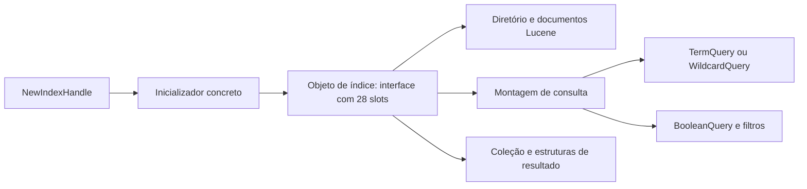
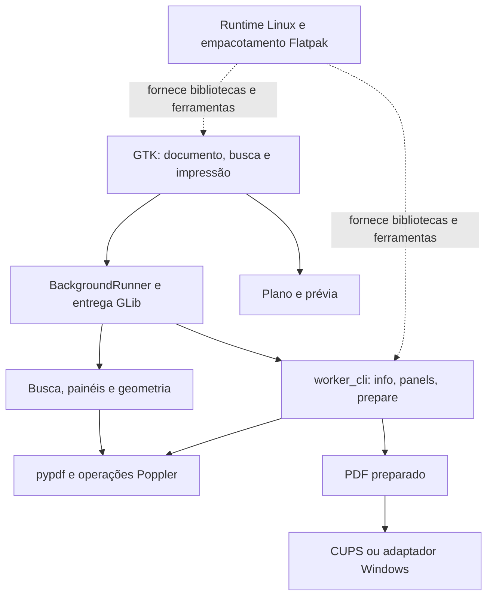
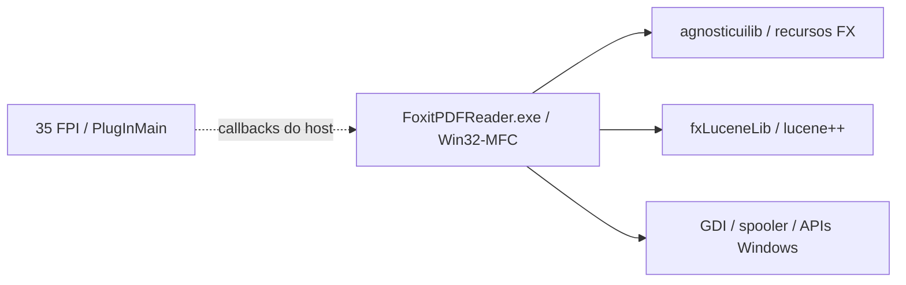
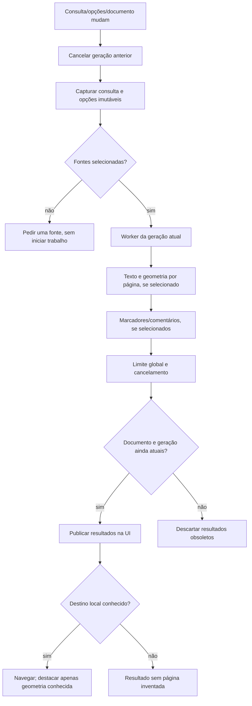
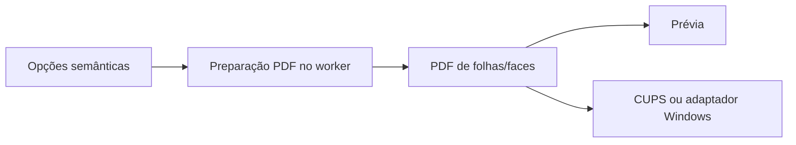
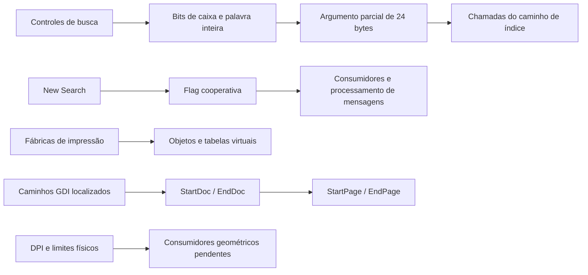
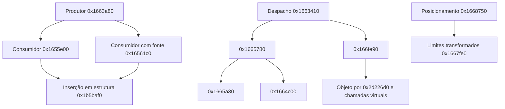
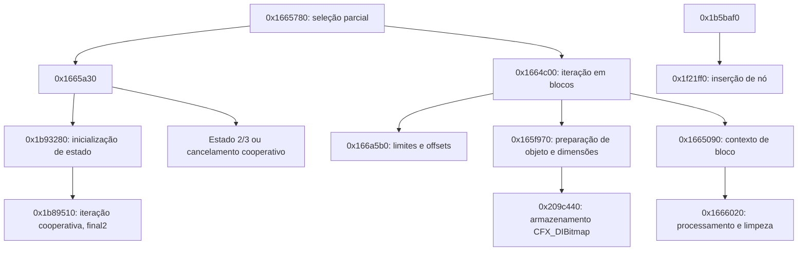
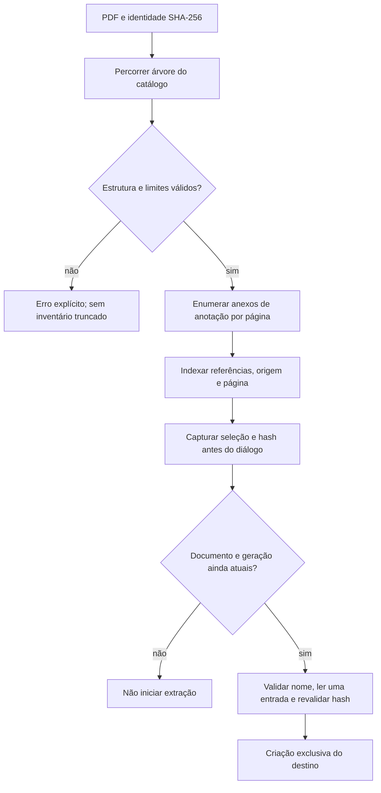
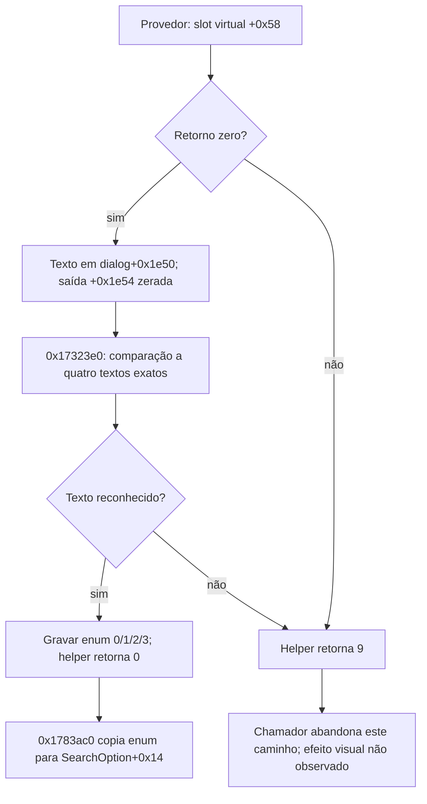

# Linuxit PDF — relatório completo de trabalho, pendências e conclusão

Elaborado em **2026/10/19 às 21:40 (America/Sao_Paulo, UTC-03:00)**. Fotografia técnica: `b2bb82114b58468b75f44fd1b77cfb2f354ba25e`. Este relatório não executou o Foxit, não acessou a VM e não repetiu as suítes do aplicativo. Ele examinou os registros, seus vínculos e hashes e organizou o conteúdo preservado.

### Navegação

- [1. Leitura do relatório e significado de conclusão](#sec-1)
- [2. Identidade, escopo, entrega atual e medição](#sec-2)
- [3. Todas as 25 famílias e 111 operações conhecidas](#sec-3)
- [4. As 21 etapas e seus 58 critérios](#sec-4)
- [5. Os 19 critérios ainda abertos](#sec-5)
- [6. Planos P01–P10, lotes B01–B10 e tarefas S01–S12](#sec-6)
- [7. Engenharia reversa e catálogo estático completo](#sec-7)
- [8. VM, observações, 20 casos dinâmicos e 10 casos de interface](#sec-8)
- [9. Os 17 recortes comparativos e seus limites](#sec-9)
- [10. Os 564 testes próprios da entrega atual](#sec-10)
- [11. Todas as versões e provas de entrega](#sec-11)
- [12. Arquitetura: 75 módulos, 60 interfaces e dependências](#sec-12)
- [13. Por que ainda está demorando](#sec-13)
- [14. Caminho até um fechamento verificável](#sec-14)
- [15. Divergências documentais e pendências antigas](#sec-15)
- [16. Cronologia Git e notas de continuidade completas](#sec-16)
- [17. Documentos técnicos completos da fotografia](#sec-17)
- [18. Dados estruturados integrais e relatórios atuais](#sec-18)
- [19. Inventário completo de arquivos versionados](#sec-19)
- [20. Proveniência, cobertura e conferência do relatório](#sec-20)

Na versão HTML, os anexos extensos podem ser expandidos. Todo o conteúdo está no próprio arquivo, inclusive os textos integrais dos documentos históricos e dos registros estruturados. As referências externas são links de conferência; não são necessárias para ler o conteúdo já incorporado. Use a busca do navegador/editor por um ID, funcionalidade ou arquivo. Nenhum trecho foi substituído por reticências para reduzir o inventário.

<a id="sec-1"></a>

## 1. Leitura do relatório e significado de conclusão

### Como interpretar este levantamento

Este levantamento foi solicitado para mostrar, sem reduzir a uma resposta curta, tudo que está registrado como realizado, parcialmente realizado, pendente, adiado ou desconhecido no Linuxit PDF. O documento reúne o estado atual e preserva os registros anteriores com sua identificação histórica. A referência da fotografia é o commit `b2bb82114b58468b75f44fd1b77cfb2f354ba25e`, confirmado localmente e no GitHub antes da elaboração deste relatório.

“Tudo” aqui significa a totalidade do inventário conhecido e dos documentos técnicos versionados naquela revisão. O universo integral do Foxit ainda não foi delimitado. Não seria correto afirmar que conseguimos listar comportamentos que ainda não foram descobertos. Os originais proprietários, projetos completos de Ghidra e pseudocódigo mantidos fora do Git continuam em seus locais próprios; eles não foram incorporados a este relatório ou ao aplicativo. O catálogo publicável identifica entradas, evidências e limitações, sem redistribuir o código do Foxit.

O relatório contém as 25 famílias, as 111 operações do inventário provisório, as 21 etapas e seus 58 critérios, os 19 critérios ainda abertos, os 50 planos iniciais de aceitação, os pacotes P01–P10, os lotes B01–B10, a sequência S01–S12, os 75 módulos próprios documentados, as 60 interfaces, as 329 entradas do catálogo estático, os 564 métodos de teste da entrega atual, os 17 manifestos de versões de 0.1.0 a 0.1.16, a cronologia Git disponível e os documentos históricos integrais. Os anexos mantêm os dados estruturados completos para permitir conferência por outra IA.

#### Recompilar, reconstruir e comprovar equivalência são trabalhos diferentes

O projeto já gera um aplicativo executável e um Flatpak instalável. A versão de desenvolvimento 0.1.16 foi construída, instalada e auditada. Portanto, não estamos esperando a conclusão de toda a engenharia reversa para finalmente apertar um botão de compilação. Há entregas utilizáveis anteriores e um pacote atual publicado.

O código próprio principal usa Python e GTK. O processo de build organiza o código e as bibliotecas necessárias, confere as dependências e gera o pacote Flatpak. Poppler, pypdf, Pango, Cairo, GStreamer, OpenSSL, Tesseract e outras dependências possuem funções próprias nessa implementação. Isso não é uma recompilação do código-fonte C++ original do Foxit: o projeto não recebeu esse código-fonte. A investigação de binários serve para esclarecer contratos e comportamentos; a implementação é independente, com as licenças e a base reaproveitada identificadas.

A reconstrução integral pretendida exige completar as funcionalidades aprovadas, os tratamentos de erro, estados, persistência, interface e integrações. A comprovação de equivalência exige ainda observar os comportamentos correspondentes no Foxit, executar as mesmas situações em ambos e examinar as diferenças. Uma entrega funcional pode estar pronta para teste antes de a equivalência integral estar demonstrada.

Se “até a recompilação” significa obter um pacote para instalar no Linux, esse ponto já foi alcançado. Se significa terminar toda a reconstrução e entregar uma versão final com o escopo integral comprovado, ainda há implementação, especificação, observação e aceitação a concluir. Este relatório mostra as duas coisas separadamente.

#### O que os estados significam

- **Realizado no recorte descrito:** existe uma entrega concreta e uma evidência compatível com aquele recorte. Isso não encerra automaticamente uma família inteira.
- **Código próprio presente:** há implementação identificada por arquivo e símbolo. O nome de uma operação pode representar uma necessidade mais ampla que a parte implementada.
- **Validado por testes próprios:** o Linuxit passou nas situações executadas. Os testes não provam comportamento universal para qualquer PDF e não substituem o Foxit como referência.
- **Observado no original:** o Foxit foi executado no ambiente offline documentado e houve registro do que foi possível observar. Observação parcial não é uma família integralmente aceita.
- **Comparado:** uma medição delimitada das duas aplicações foi confrontada. Igualdade nessa medição não prova que toda a operação ou família seja equivalente.
- **Parcial:** existe trabalho preservado, mas alguma obrigação do contrato continua aberta. O relatório identifica o que já existe e a parte ainda ausente.
- **Pendente ou a caracterizar:** falta implementação, falta definir o contrato ou falta confirmar a disponibilidade no Reader de referência. Essas situações não devem ser confundidas.
- **Adiado pelo usuário:** nuvem direta continua no inventário, mas não deve ser implementada agora. Pastas sincronizadas por um cliente externo são um fluxo local distinto.
- **Excluído:** o assistente de IA e os recursos generativos do Foxit não fazem parte da reconstrução solicitada.
- **Desconhecido / `null`:** o dado não foi comprovado. Não significa zero, aprovado ou irrelevante.

O software é derivado de uma base própria MIT Winux/Print&View, com origem registrada. Abrir, renderizar, navegar, apresentar e preparar imposição já tinham componentes reaproveitados. Isso é trabalho útil preservado, mas não deve ser contabilizado como recuperação nova de código do Foxit. Dependências abertas também não são subsistemas proprietários reconstruídos.

<a id="sec-2"></a>

## 2. Identidade, escopo, entrega atual e medição

| Campo | Valor |
|---|---|
| Referência | Foxit Reader 2025.2.0.33046 x86 |
| SHA-256 original fixado | 90208c9e8da92c8e546b76c8f4a2f8fb999105d124e663bbea6744fb6bb6b3a6 |
| Revisão da fotografia | b2bb82114b58468b75f44fd1b77cfb2f354ba25e |
| Aplicativo/pacote | 0.1.16/devel, desenvolvimento |
| Fonte do pacote | a5ebda9dc358c59db24fe940e473ad4f1c90857c |
| Tamanho Flatpak | 118393760 |
| SHA-256 Flatpak | ad02f4c5ebb3d3d740a1a5c56fa3f4a71b52e4ac2b94171973f92b7526190816 |
| ID/arquitetura/runtime | io.github.airtonbp19edu.LinuxitPDF / x86_64 / org.freedesktop.Platform/x86_64/25.08 |
| Arquivos app comparados | 177 |
| Arquivos dependências / ELF / pacotes Debian | 3684 / 483 / 297 |
| Suíte por ambiente | 564/564, sem falhas/erros/skips |
| Checklist histórico | 45.13%;39done/19abertos |
| Conclusão global de reconstrução | não comprovado (`null`) |
| Famílias integralmente equivalentes | 0/25; universo global ainda aberto |
| Todas as tarefas sem VM encerradas | não |
| Nuvem direta | adiada pelo usuário |
| Assistente IA/generativa | excluída |
| Original/VM | Testes suspensos; sem inspeção nova para este relatório |

Evidência: [releases/manifest-0.1.16.json](https://github.com/airtonbp19edu/Linuxit-PDF/blob/b2bb82114b58468b75f44fd1b77cfb2f354ba25e/releases/manifest-0.1.16.json)

Evidência: [testes/resultados/0.1.16/validation-review.json](https://github.com/airtonbp19edu/Linuxit-PDF/blob/b2bb82114b58468b75f44fd1b77cfb2f354ba25e/testes/resultados/0.1.16/validation-review.json)

Evidência: [testes/resultados/0.1.16/audit/review.json](https://github.com/airtonbp19edu/Linuxit-PDF/blob/b2bb82114b58468b75f44fd1b77cfb2f354ba25e/testes/resultados/0.1.16/audit/review.json)

Evidência: [testes/resultados/0.1.16/desktop/review.json](https://github.com/airtonbp19edu/Linuxit-PDF/blob/b2bb82114b58468b75f44fd1b77cfb2f354ba25e/testes/resultados/0.1.16/desktop/review.json)

Evidência: [testes/resultados/0.1.16/download-integrity-2026-10-19.json](https://github.com/airtonbp19edu/Linuxit-PDF/blob/b2bb82114b58468b75f44fd1b77cfb2f354ba25e/testes/resultados/0.1.16/download-integrity-2026-10-19.json)

Pacote público: [LinuxitPDF-0.1.16-x86_64.flatpak](https://github.com/airtonbp19edu/Linuxit-PDF/releases/download/v0.1.16-devel/LinuxitPDF-0.1.16-x86_64.flatpak). O asset publicado é o mesmo arquivo aprovado, sem rebuild na auditoria. A identidade do pacote não é uma assinatura digital nem declaração de versão estável.

Fórmula do checklist: `peso da etapa × soma dos pesos internos done / soma de todos os pesos internos`. Critérios parciais não pontuam nesse índice. Não se calcula97/111,23/25 ou329/denominador desconhecido como porcentagem de código reconstruído.

<a id="sec-3"></a>

## 3. Todas as 25 famílias e 111 operações conhecidas

Cada família apresenta a avaliação atual, os limites, o trabalho restante e todas as suas operações. Os campos antigos são preservados com esse rótulo para não substituir a realidade posterior por uma descrição histórica. A existência de código ou de testes relacionados não altera automaticamente o estado de aceitação integral da operação.

<!-- family: open-render -->
### 3.1. Abrir PDF e renderizar páginas — `open-render`

#### Realizado nos recortes atuais

- Inspeção de páginas, caixas e metadados; abertura/renderização pelo backend próprio baseado em Poppler; cache separado pela identidade do documento.
- Abertura transacional: o documento anterior só é substituído depois de a nova sessão e o primeiro render serem aceitos; falha, cancelamento e troca concorrente preservam a leitura anterior.
- Senha conhecida transportada por stdin, representação privada de leitura, permissões da fonte preservadas como política da sessão e senha ausente de argv/resultados.
- Recuperação consentida de estruturas que o pypdf consegue interpretar; cópia nova, leitura privada com leases e conferência da identidade/alteração da fonte.
- Salvar cópia local completa com publicação exclusiva; a função não anuncia sincronização remota.

#### O que continua parcial ou limitado

- Recuperação não é universal e a representação de leitura não conserva automaticamente a assinatura do original.
- A integração posterior com edição/impressão autenticadas está coberta por testes próprios da0.1.16; textos antigos que dizem que isso não foi aprovado precisam ser lidos como históricos.
- Corpus de PDFs danificados, variantes de cifra, permissões, fontes e geometrias ainda não é universal.

#### O que falta para fechar o escopo amplo

- Ampliar corpus/aceitação por formato e situação de falha.
- Concluir observação comparável do ciclo completo no Reader; nenhum resultado atual encerra toda a família.

#### Ambiente e dependências

- Corpus e aceitações próprias:sem VM.
- Equivalência ao Reader:original offline operacional.

Implementação registrada na matriz atual: Leitura transacional com senha via worker, recuperação consentida, render inicial antes do commit e preservação em falha/cancelamento. Subconjunto0.1.14; família integral aberta. Preservado na regressão própria0.1.15.

Observação original preservada: Abertura/erros/cópia em recortes; senha correta em abertura independenteD15 abriu8 páginas. Não é contrato completo de recuperação/renderização.

Questões abertas no inventário (texto da fonte, que pode conter partes posteriormente esclarecidas): Broad damaged/encrypted format corpus, permission/edit/print integration beyond this reading subset and full original lifecycle comparison remain open.

#### Contrato e casos de aceitação registrados

Os campos de contrato abaixo são reproduzidos da fonte estruturada, que contém trechos legados. Quando divergem de uma entrega posterior, consultar a avaliação atual acima e a reconciliação do capítulo15; não interpretar automaticamente uma recusa histórica como limitação nova do código0.1.16.

**Entradas**

- Caminho de PDF local legível; página interna baseada em zero.
- Viewport, tamanho solicitado e identidade do documento para cache.
- Senha opcional até127caracteres e consentimento separado para leitura recuperada.

**Saídas**

- document_info: pages, sizes após CropBox/rotação intrínseca e metadata (title, author, subject, creator, producer).
- Imagem de página concluída; render obsoleto não deve substituir o documento atual.
- Sessão preparada e primeira imagem verificadas antes da troca; representação privada cifrada/recuperada quando necessária.

**Erros**

- {"trigger": "Arquivo ausente, inválido, vazio ou protegido sem senha vazia válida", "response": "Falha do parser/worker; abertura não pode ser registrada como bem-sucedida. Mensagens e preservação do documento anterior precisam de teste GUI.", "basis": "current_linuxit_source"}
- {"trigger": "Processo de renderização falha, excede tempo ou é cancelado", "response": "Erro/cancelamento sem publicar imagem parcial; subprocesso cancelável tem prazo próprio.", "basis": "current_linuxit_source"}
- {"trigger": "Senha incorreta, recuperação recusada ou candidato inválido", "response": "Manter documento anterior; mostrar erro fixo sem credencial; permitir cancelar.", "basis": "current_linuxit_source"}

**Estado e efeitos**

- Cache local pode ser criado; original permanece sem edição.
- Abertura/fechamento muda o documento e invalida trabalhos da geração anterior.
- Representação temporária usada somente para leitura, com leases para leitores ativos; original intacto.

Campo `scope` legado, mantido para rastreabilidade; a avaliação atual acima tem prioridade quando há evolução posterior: Abertura local transacional com senha, cópia privada de leitura e recuperação consentida de estruturas interpretáveis pelo pypdf. Valida render inicial antes da troca. Falha/cancelamento preserva leitura anterior. Original não é sobrescrito; recuperação universal, assinatura da representação e impressão cifrada/recuperada não aprovadas.

<!-- acceptance: S12-01-1 -->
##### S12-01-1 — nominal

| Aspecto | Registro |
|---|---|
| Dado | busca-escopos.pdf legível. |
| Ação | Inspecionar e abrir as duas páginas. |
| Resultado esperado próprio | pages=2; tamanhos positivos; a imagem de cada página pertence ao documento aberto. |
| Base | current_linuxit_source |
| Execução integral | not_run |
| Esperado Foxit | não comprovado (`null`) |
| Observado Foxit | não comprovado (`null`) |

<!-- acceptance: S12-01-2 -->
##### S12-01-2 — exception

| Aspecto | Registro |
|---|---|
| Dado | Arquivo inexistente ou PDF inválido. |
| Ação | Solicitar inspeção/abertura. |
| Resultado esperado próprio | O parser/worker falha; não produzir uma página válida fictícia. |
| Base | current_linuxit_source |
| Execução integral | not_run |
| Esperado Foxit | não comprovado (`null`) |
| Observado Foxit | não comprovado (`null`) |

#### Todas as operações desta família

<!-- operation: open-render/inspect -->
##### `open-render/inspect` — Inspecionar páginas, caixas e metadados

**Estado:** Código de um recorte presente; operação/família integral não aceita.

**Contrato registrado:** PDF local legível => páginas/tamanhos/metadados; erro de parser não produz documento válido fictício.

**Entradas/contexto:**

- Caminho de PDF local legível; página interna baseada em zero.
- Viewport, tamanho solicitado e identidade do documento para cache.

Código: [app/rendering.py](https://github.com/airtonbp19edu/Linuxit-PDF/blob/b2bb82114b58468b75f44fd1b77cfb2f354ba25e/app/rendering.py) — `document_info`, linhas67–87; SHA-256 `8d519f2129f2061b370b0b9d2eca6ee81f788b6a100c3e3f47c3552063cf08e4`.

Aceitação integral nova: `not_run`. Comparação: `not_verified_as_complete_operation`. Pacote de continuidade indicado: `P08`.

<details>
<summary>Registro integral desta operação:todos os campos, vínculos, testes históricos e hashes</summary>

```json
{
  "id": "open-render/inspect",
  "family_id": "open-render",
  "title": "Inspecionar páginas, caixas e metadados",
  "implementation_state": "bounded_source_present",
  "input_context": [
    "Caminho de PDF local legível; página interna baseada em zero.",
    "Viewport, tamanho solicitado e identidade do documento para cache."
  ],
  "output_and_acceptance": "PDF local legível => páginas/tamanhos/metadados; erro de parser não produz documento válido fictício.",
  "failure_contract_refs": [
    {
      "family_id": "open-render",
      "error_index": 0
    },
    {
      "family_id": "open-render",
      "error_index": 1
    }
  ],
  "source_evidence": [
    {
      "path": "app/rendering.py",
      "symbol": "document_info",
      "line": 67,
      "end_line": 87,
      "file_sha256": "8d519f2129f2061b370b0b9d2eca6ee81f788b6a100c3e3f47c3552063cf08e4",
      "excerpt_sha256": "8c7d5415c965b9d5928db6d2cf10084198e5d69c39c4e79903c7b7c5b6c5b808"
    }
  ],
  "recorded_related_tests": [
    {
      "id": "test_regressions.CoreRegressionTests.test_cache_distinguishes_documents",
      "path": "tests/test_regressions.py",
      "line": 43,
      "recorded_status": "passed",
      "execution_ref": "testes/resultados/busca-autor-2026-10-18/review.json",
      "ci_run_id": 39172130287,
      "rerun_by_catalog": false,
      "scope": "Related bounded test, not full acceptance of this operation."
    }
  ],
  "operation_acceptance_new_execution": "not_run",
  "target_availability": "partial_family_observation_only",
  "original_observation_refs": [
    "docs/VM-FOXIT-2026-10-18.md",
    "docs/VM-SENHA-E-PARADA-2026-10-18.md"
  ],
  "original_scope": "Family references only; they do not prove all behaviors of this operation.",
  "comparison_state": "not_verified_as_complete_operation",
  "next_package": "P08",
  "complete_operation_or_family_equivalence": false,
  "historical_own_test_ids": [
    {
      "evidence_ref": "testes/resultados/leitura-2026-10-19/validated-cases.json",
      "ids": [
        "test_document_session.DocumentSessionTests.test_broken_xref_requires_consent_then_recovers_content",
        "test_document_session.DocumentSessionTests.test_cancellation_before_worker_leaves_no_reading_file",
        "test_document_session.DocumentSessionTests.test_close_waits_for_active_reader_and_removes_private_view",
        "test_document_session.DocumentSessionTests.test_invalid_request_and_existing_view_are_refused",
        "test_document_session.DocumentSessionTests.test_irrecoverable_and_empty_sources_do_not_publish_view",
        "test_document_session.DocumentSessionTests.test_owner_password_can_read_without_rewriting_original_permissions",
        "test_document_session.DocumentSessionTests.test_password_is_absent_from_argv_and_worker_errors",
        "test_document_session.DocumentSessionTests.test_password_required_then_invalid_then_correct_in_real_worker",
        "test_document_session.DocumentSessionTests.test_plain_session_preserves_original_identity_and_no_view_copy",
        "test_document_session.DocumentSessionTests.test_private_reading_file_is_not_world_readable",
        "test_document_session.DocumentSessionTests.test_unicode_password_and_original_permission_policy",
        "test_document_session.NavigationDomainTests.test_page_bounds_and_rejected_nonintegers",
        "test_document_session.NavigationDomainTests.test_rotated_fit_page_stays_in_viewport",
        "test_document_session.NavigationDomainTests.test_zoom_percent_decimal_and_clamped_bounds",
        "test_reading_workflows_gtk.ReadingWorkflowsGTKTests.test_authenticated_open_renders_searches_and_presents_without_mutating_source",
        "test_reading_workflows_gtk.ReadingWorkflowsGTKTests.test_cancel_password_and_wrong_password_preserve_previous_document",
        "test_reading_workflows_gtk.ReadingWorkflowsGTKTests.test_changed_source_after_initial_render_does_not_commit",
        "test_reading_workflows_gtk.ReadingWorkflowsGTKTests.test_document_close_cancels_open_and_resets_controls",
        "test_reading_workflows_gtk.ReadingWorkflowsGTKTests.test_failed_open_preserves_document_page_and_image",
        "test_reading_workflows_gtk.ReadingWorkflowsGTKTests.test_first_render_failure_does_not_commit_candidate",
        "test_reading_workflows_gtk.ReadingWorkflowsGTKTests.test_real_password_dialog_masks_and_clears_entry",
        "test_reading_workflows_gtk.ReadingWorkflowsGTKTests.test_recovery_decline_then_accept_preserves_original_and_content",
        "test_reading_workflows_gtk.ReadingWorkflowsGTKTests.test_superseded_open_cannot_replace_newer_document_and_cleans_session"
      ]
    },
    {
      "evidence_ref": "testes/resultados/lotes-2026-10-19/release-validated-cases.json",
      "ids": [
        "test_document_session.DocumentSessionTests.test_broken_xref_requires_consent_then_recovers_content",
        "test_document_session.DocumentSessionTests.test_cancellation_before_worker_leaves_no_reading_file",
        "test_document_session.DocumentSessionTests.test_close_waits_for_active_reader_and_removes_private_view",
        "test_document_session.DocumentSessionTests.test_invalid_request_and_existing_view_are_refused",
        "test_document_session.DocumentSessionTests.test_irrecoverable_and_empty_sources_do_not_publish_view",
        "test_document_session.DocumentSessionTests.test_owner_password_can_read_without_rewriting_original_permissions",
        "test_document_session.DocumentSessionTests.test_password_is_absent_from_argv_and_worker_errors",
        "test_document_session.DocumentSessionTests.test_password_required_then_invalid_then_correct_in_real_worker",
        "test_document_session.DocumentSessionTests.test_plain_session_preserves_original_identity_and_no_view_copy",
        "test_document_session.DocumentSessionTests.test_private_reading_file_is_not_world_readable",
        "test_document_session.DocumentSessionTests.test_unicode_password_and_original_permission_policy",
        "test_document_session.NavigationDomainTests.test_page_bounds_and_rejected_nonintegers",
        "test_document_session.NavigationDomainTests.test_rotated_fit_page_stays_in_viewport",
        "test_document_session.NavigationDomainTests.test_zoom_percent_decimal_and_clamped_bounds",
        "test_reading_workflows_gtk.ReadingWorkflowsGTKTests.test_authenticated_open_renders_searches_and_presents_without_mutating_source",
        "test_reading_workflows_gtk.ReadingWorkflowsGTKTests.test_cancel_password_and_wrong_password_preserve_previous_document",
        "test_reading_workflows_gtk.ReadingWorkflowsGTKTests.test_changed_source_after_initial_render_does_not_commit",
        "test_reading_workflows_gtk.ReadingWorkflowsGTKTests.test_document_close_cancels_open_and_resets_controls",
        "test_reading_workflows_gtk.ReadingWorkflowsGTKTests.test_failed_open_preserves_document_page_and_image",
        "test_reading_workflows_gtk.ReadingWorkflowsGTKTests.test_first_render_failure_does_not_commit_candidate",
        "test_reading_workflows_gtk.ReadingWorkflowsGTKTests.test_real_password_dialog_masks_and_clears_entry",
        "test_reading_workflows_gtk.ReadingWorkflowsGTKTests.test_recovery_decline_then_accept_preserves_original_and_content",
        "test_reading_workflows_gtk.ReadingWorkflowsGTKTests.test_superseded_open_cannot_replace_newer_document_and_cleans_session"
      ]
    }
  ]
}
```

</details>

<!-- operation: open-render/render -->
##### `open-render/render` — Renderizar página e reutilizar cache

**Estado:** Código de um recorte presente; operação/família integral não aceita.

**Contrato registrado:** PDF, página e largura => imagem válida associada à identidade do documento; cache não mistura documentos.

**Entradas/contexto:**

- Caminho de PDF local legível; página interna baseada em zero.
- Viewport, tamanho solicitado e identidade do documento para cache.

Código: [app/rendering.py](https://github.com/airtonbp19edu/Linuxit-PDF/blob/b2bb82114b58468b75f44fd1b77cfb2f354ba25e/app/rendering.py) — `render_page`, linhas126–212; SHA-256 `8d519f2129f2061b370b0b9d2eca6ee81f788b6a100c3e3f47c3552063cf08e4`.

Aceitação integral nova: `not_run`. Comparação: `not_verified_as_complete_operation`. Pacote de continuidade indicado: `P08`.

<details>
<summary>Registro integral desta operação:todos os campos, vínculos, testes históricos e hashes</summary>

```json
{
  "id": "open-render/render",
  "family_id": "open-render",
  "title": "Renderizar página e reutilizar cache",
  "implementation_state": "bounded_source_present",
  "input_context": [
    "Caminho de PDF local legível; página interna baseada em zero.",
    "Viewport, tamanho solicitado e identidade do documento para cache."
  ],
  "output_and_acceptance": "PDF, página e largura => imagem válida associada à identidade do documento; cache não mistura documentos.",
  "failure_contract_refs": [
    {
      "family_id": "open-render",
      "error_index": 0
    },
    {
      "family_id": "open-render",
      "error_index": 1
    }
  ],
  "source_evidence": [
    {
      "path": "app/rendering.py",
      "symbol": "render_page",
      "line": 126,
      "end_line": 212,
      "file_sha256": "8d519f2129f2061b370b0b9d2eca6ee81f788b6a100c3e3f47c3552063cf08e4",
      "excerpt_sha256": "453ba4a5a95936efdb3f85dcfbe9047ed7e4846e72b6e28c4863998331d93690"
    }
  ],
  "recorded_related_tests": [
    {
      "id": "test_regressions.CoreRegressionTests.test_cache_distinguishes_documents",
      "path": "tests/test_regressions.py",
      "line": 43,
      "recorded_status": "passed",
      "execution_ref": "testes/resultados/busca-autor-2026-10-18/review.json",
      "ci_run_id": 39172130287,
      "rerun_by_catalog": false,
      "scope": "Related bounded test, not full acceptance of this operation."
    }
  ],
  "operation_acceptance_new_execution": "not_run",
  "target_availability": "partial_family_observation_only",
  "original_observation_refs": [
    "docs/VM-FOXIT-2026-10-18.md",
    "docs/VM-SENHA-E-PARADA-2026-10-18.md"
  ],
  "original_scope": "Family references only; they do not prove all behaviors of this operation.",
  "comparison_state": "not_verified_as_complete_operation",
  "next_package": "P08",
  "complete_operation_or_family_equivalence": false,
  "historical_own_test_ids": [
    {
      "evidence_ref": "testes/resultados/leitura-2026-10-19/validated-cases.json",
      "ids": [
        "test_document_session.DocumentSessionTests.test_broken_xref_requires_consent_then_recovers_content",
        "test_document_session.DocumentSessionTests.test_cancellation_before_worker_leaves_no_reading_file",
        "test_document_session.DocumentSessionTests.test_close_waits_for_active_reader_and_removes_private_view",
        "test_document_session.DocumentSessionTests.test_invalid_request_and_existing_view_are_refused",
        "test_document_session.DocumentSessionTests.test_irrecoverable_and_empty_sources_do_not_publish_view",
        "test_document_session.DocumentSessionTests.test_owner_password_can_read_without_rewriting_original_permissions",
        "test_document_session.DocumentSessionTests.test_password_is_absent_from_argv_and_worker_errors",
        "test_document_session.DocumentSessionTests.test_password_required_then_invalid_then_correct_in_real_worker",
        "test_document_session.DocumentSessionTests.test_plain_session_preserves_original_identity_and_no_view_copy",
        "test_document_session.DocumentSessionTests.test_private_reading_file_is_not_world_readable",
        "test_document_session.DocumentSessionTests.test_unicode_password_and_original_permission_policy",
        "test_document_session.NavigationDomainTests.test_page_bounds_and_rejected_nonintegers",
        "test_document_session.NavigationDomainTests.test_rotated_fit_page_stays_in_viewport",
        "test_document_session.NavigationDomainTests.test_zoom_percent_decimal_and_clamped_bounds",
        "test_reading_workflows_gtk.ReadingWorkflowsGTKTests.test_authenticated_open_renders_searches_and_presents_without_mutating_source",
        "test_reading_workflows_gtk.ReadingWorkflowsGTKTests.test_cancel_password_and_wrong_password_preserve_previous_document",
        "test_reading_workflows_gtk.ReadingWorkflowsGTKTests.test_changed_source_after_initial_render_does_not_commit",
        "test_reading_workflows_gtk.ReadingWorkflowsGTKTests.test_document_close_cancels_open_and_resets_controls",
        "test_reading_workflows_gtk.ReadingWorkflowsGTKTests.test_failed_open_preserves_document_page_and_image",
        "test_reading_workflows_gtk.ReadingWorkflowsGTKTests.test_first_render_failure_does_not_commit_candidate",
        "test_reading_workflows_gtk.ReadingWorkflowsGTKTests.test_real_password_dialog_masks_and_clears_entry",
        "test_reading_workflows_gtk.ReadingWorkflowsGTKTests.test_recovery_decline_then_accept_preserves_original_and_content",
        "test_reading_workflows_gtk.ReadingWorkflowsGTKTests.test_superseded_open_cannot_replace_newer_document_and_cleans_session"
      ]
    },
    {
      "evidence_ref": "testes/resultados/lotes-2026-10-19/release-validated-cases.json",
      "ids": [
        "test_document_session.DocumentSessionTests.test_broken_xref_requires_consent_then_recovers_content",
        "test_document_session.DocumentSessionTests.test_cancellation_before_worker_leaves_no_reading_file",
        "test_document_session.DocumentSessionTests.test_close_waits_for_active_reader_and_removes_private_view",
        "test_document_session.DocumentSessionTests.test_invalid_request_and_existing_view_are_refused",
        "test_document_session.DocumentSessionTests.test_irrecoverable_and_empty_sources_do_not_publish_view",
        "test_document_session.DocumentSessionTests.test_owner_password_can_read_without_rewriting_original_permissions",
        "test_document_session.DocumentSessionTests.test_password_is_absent_from_argv_and_worker_errors",
        "test_document_session.DocumentSessionTests.test_password_required_then_invalid_then_correct_in_real_worker",
        "test_document_session.DocumentSessionTests.test_plain_session_preserves_original_identity_and_no_view_copy",
        "test_document_session.DocumentSessionTests.test_private_reading_file_is_not_world_readable",
        "test_document_session.DocumentSessionTests.test_unicode_password_and_original_permission_policy",
        "test_document_session.NavigationDomainTests.test_page_bounds_and_rejected_nonintegers",
        "test_document_session.NavigationDomainTests.test_rotated_fit_page_stays_in_viewport",
        "test_document_session.NavigationDomainTests.test_zoom_percent_decimal_and_clamped_bounds",
        "test_reading_workflows_gtk.ReadingWorkflowsGTKTests.test_authenticated_open_renders_searches_and_presents_without_mutating_source",
        "test_reading_workflows_gtk.ReadingWorkflowsGTKTests.test_cancel_password_and_wrong_password_preserve_previous_document",
        "test_reading_workflows_gtk.ReadingWorkflowsGTKTests.test_changed_source_after_initial_render_does_not_commit",
        "test_reading_workflows_gtk.ReadingWorkflowsGTKTests.test_document_close_cancels_open_and_resets_controls",
        "test_reading_workflows_gtk.ReadingWorkflowsGTKTests.test_failed_open_preserves_document_page_and_image",
        "test_reading_workflows_gtk.ReadingWorkflowsGTKTests.test_first_render_failure_does_not_commit_candidate",
        "test_reading_workflows_gtk.ReadingWorkflowsGTKTests.test_real_password_dialog_masks_and_clears_entry",
        "test_reading_workflows_gtk.ReadingWorkflowsGTKTests.test_recovery_decline_then_accept_preserves_original_and_content",
        "test_reading_workflows_gtk.ReadingWorkflowsGTKTests.test_superseded_open_cannot_replace_newer_document_and_cleans_session"
      ]
    }
  ]
}
```

</details>

<!-- operation: open-render/obsolete -->
##### `open-render/obsolete` — Descartar renderização obsoleta

**Estado:** Código de um recorte presente; operação/família integral não aceita.

**Contrato registrado:** Troca/fechamento durante render => callback antigo não substitui documento atual.

**Entradas/contexto:**

- Caminho de PDF local legível; página interna baseada em zero.
- Viewport, tamanho solicitado e identidade do documento para cache.

Código: [app/main.py](https://github.com/airtonbp19edu/Linuxit-PDF/blob/b2bb82114b58468b75f44fd1b77cfb2f354ba25e/app/main.py) — `PDFWindow.request_render`, linhas1070–1108; SHA-256 `80a21a460bc3c252604973a6d04f4f51df47f00e3d4bc14f2a0eaae0d0fe04d3`.

Aceitação integral nova: `not_run`. Comparação: `not_verified_as_complete_operation`. Pacote de continuidade indicado: `P08`.

<details>
<summary>Registro integral desta operação:todos os campos, vínculos, testes históricos e hashes</summary>

```json
{
  "id": "open-render/obsolete",
  "family_id": "open-render",
  "title": "Descartar renderização obsoleta",
  "implementation_state": "bounded_source_present",
  "input_context": [
    "Caminho de PDF local legível; página interna baseada em zero.",
    "Viewport, tamanho solicitado e identidade do documento para cache."
  ],
  "output_and_acceptance": "Troca/fechamento durante render => callback antigo não substitui documento atual.",
  "failure_contract_refs": [
    {
      "family_id": "open-render",
      "error_index": 0
    },
    {
      "family_id": "open-render",
      "error_index": 1
    }
  ],
  "source_evidence": [
    {
      "path": "app/main.py",
      "symbol": "PDFWindow.request_render",
      "line": 1070,
      "end_line": 1108,
      "file_sha256": "80a21a460bc3c252604973a6d04f4f51df47f00e3d4bc14f2a0eaae0d0fe04d3",
      "excerpt_sha256": "8cc1e23767f3df77e754c656eab1a46073f74cbdd2599925ccb2a6ca642651a2"
    }
  ],
  "recorded_related_tests": [
    {
      "id": "test_viewer.ViewerTests.test_latest_renderer_skips_obsolete_queue_entries",
      "path": "tests/test_viewer.py",
      "line": 163,
      "recorded_status": "passed",
      "execution_ref": "testes/resultados/busca-autor-2026-10-18/review.json",
      "ci_run_id": 39172130287,
      "rerun_by_catalog": false,
      "scope": "Related bounded test, not full acceptance of this operation."
    }
  ],
  "operation_acceptance_new_execution": "not_run",
  "target_availability": "partial_family_observation_only",
  "original_observation_refs": [
    "docs/VM-FOXIT-2026-10-18.md",
    "docs/VM-SENHA-E-PARADA-2026-10-18.md"
  ],
  "original_scope": "Family references only; they do not prove all behaviors of this operation.",
  "comparison_state": "not_verified_as_complete_operation",
  "next_package": "P08",
  "complete_operation_or_family_equivalence": false,
  "historical_own_test_ids": [
    {
      "evidence_ref": "testes/resultados/leitura-2026-10-19/validated-cases.json",
      "ids": [
        "test_document_session.DocumentSessionTests.test_broken_xref_requires_consent_then_recovers_content",
        "test_document_session.DocumentSessionTests.test_cancellation_before_worker_leaves_no_reading_file",
        "test_document_session.DocumentSessionTests.test_close_waits_for_active_reader_and_removes_private_view",
        "test_document_session.DocumentSessionTests.test_invalid_request_and_existing_view_are_refused",
        "test_document_session.DocumentSessionTests.test_irrecoverable_and_empty_sources_do_not_publish_view",
        "test_document_session.DocumentSessionTests.test_owner_password_can_read_without_rewriting_original_permissions",
        "test_document_session.DocumentSessionTests.test_password_is_absent_from_argv_and_worker_errors",
        "test_document_session.DocumentSessionTests.test_password_required_then_invalid_then_correct_in_real_worker",
        "test_document_session.DocumentSessionTests.test_plain_session_preserves_original_identity_and_no_view_copy",
        "test_document_session.DocumentSessionTests.test_private_reading_file_is_not_world_readable",
        "test_document_session.DocumentSessionTests.test_unicode_password_and_original_permission_policy",
        "test_document_session.NavigationDomainTests.test_page_bounds_and_rejected_nonintegers",
        "test_document_session.NavigationDomainTests.test_rotated_fit_page_stays_in_viewport",
        "test_document_session.NavigationDomainTests.test_zoom_percent_decimal_and_clamped_bounds",
        "test_reading_workflows_gtk.ReadingWorkflowsGTKTests.test_authenticated_open_renders_searches_and_presents_without_mutating_source",
        "test_reading_workflows_gtk.ReadingWorkflowsGTKTests.test_cancel_password_and_wrong_password_preserve_previous_document",
        "test_reading_workflows_gtk.ReadingWorkflowsGTKTests.test_changed_source_after_initial_render_does_not_commit",
        "test_reading_workflows_gtk.ReadingWorkflowsGTKTests.test_document_close_cancels_open_and_resets_controls",
        "test_reading_workflows_gtk.ReadingWorkflowsGTKTests.test_failed_open_preserves_document_page_and_image",
        "test_reading_workflows_gtk.ReadingWorkflowsGTKTests.test_first_render_failure_does_not_commit_candidate",
        "test_reading_workflows_gtk.ReadingWorkflowsGTKTests.test_real_password_dialog_masks_and_clears_entry",
        "test_reading_workflows_gtk.ReadingWorkflowsGTKTests.test_recovery_decline_then_accept_preserves_original_and_content",
        "test_reading_workflows_gtk.ReadingWorkflowsGTKTests.test_superseded_open_cannot_replace_newer_document_and_cleans_session"
      ]
    },
    {
      "evidence_ref": "testes/resultados/lotes-2026-10-19/release-validated-cases.json",
      "ids": [
        "test_document_session.DocumentSessionTests.test_broken_xref_requires_consent_then_recovers_content",
        "test_document_session.DocumentSessionTests.test_cancellation_before_worker_leaves_no_reading_file",
        "test_document_session.DocumentSessionTests.test_close_waits_for_active_reader_and_removes_private_view",
        "test_document_session.DocumentSessionTests.test_invalid_request_and_existing_view_are_refused",
        "test_document_session.DocumentSessionTests.test_irrecoverable_and_empty_sources_do_not_publish_view",
        "test_document_session.DocumentSessionTests.test_owner_password_can_read_without_rewriting_original_permissions",
        "test_document_session.DocumentSessionTests.test_password_is_absent_from_argv_and_worker_errors",
        "test_document_session.DocumentSessionTests.test_password_required_then_invalid_then_correct_in_real_worker",
        "test_document_session.DocumentSessionTests.test_plain_session_preserves_original_identity_and_no_view_copy",
        "test_document_session.DocumentSessionTests.test_private_reading_file_is_not_world_readable",
        "test_document_session.DocumentSessionTests.test_unicode_password_and_original_permission_policy",
        "test_document_session.NavigationDomainTests.test_page_bounds_and_rejected_nonintegers",
        "test_document_session.NavigationDomainTests.test_rotated_fit_page_stays_in_viewport",
        "test_document_session.NavigationDomainTests.test_zoom_percent_decimal_and_clamped_bounds",
        "test_reading_workflows_gtk.ReadingWorkflowsGTKTests.test_authenticated_open_renders_searches_and_presents_without_mutating_source",
        "test_reading_workflows_gtk.ReadingWorkflowsGTKTests.test_cancel_password_and_wrong_password_preserve_previous_document",
        "test_reading_workflows_gtk.ReadingWorkflowsGTKTests.test_changed_source_after_initial_render_does_not_commit",
        "test_reading_workflows_gtk.ReadingWorkflowsGTKTests.test_document_close_cancels_open_and_resets_controls",
        "test_reading_workflows_gtk.ReadingWorkflowsGTKTests.test_failed_open_preserves_document_page_and_image",
        "test_reading_workflows_gtk.ReadingWorkflowsGTKTests.test_first_render_failure_does_not_commit_candidate",
        "test_reading_workflows_gtk.ReadingWorkflowsGTKTests.test_real_password_dialog_masks_and_clears_entry",
        "test_reading_workflows_gtk.ReadingWorkflowsGTKTests.test_recovery_decline_then_accept_preserves_original_and_content",
        "test_reading_workflows_gtk.ReadingWorkflowsGTKTests.test_superseded_open_cannot_replace_newer_document_and_cleans_session"
      ]
    }
  ]
}
```

</details>

<!-- operation: open-render/copy -->
##### `open-render/copy` — Salvar cópia local completa e exclusiva

**Estado:** Código de um recorte presente; operação/família integral não aceita.

**Contrato registrado:** Origem identificada e destino novo => cópia completa sem sobrescrita; não afirmar sincronização remota.

**Entradas/contexto:**

- Caminho de PDF local legível; página interna baseada em zero.
- Viewport, tamanho solicitado e identidade do documento para cache.

Código: [app/local_files.py](https://github.com/airtonbp19edu/Linuxit-PDF/blob/b2bb82114b58468b75f44fd1b77cfb2f354ba25e/app/local_files.py) — `copy_local_document`, linhas106–128; SHA-256 `94bfb4d55fa59232253a667ce4cf869ea0b447d8e771ca041cfbab9e2e6b663b`.

Aceitação integral nova: `not_run`. Comparação: `not_verified_as_complete_operation`. Pacote de continuidade indicado: `P08`.

<details>
<summary>Registro integral desta operação:todos os campos, vínculos, testes históricos e hashes</summary>

```json
{
  "id": "open-render/copy",
  "family_id": "open-render",
  "title": "Salvar cópia local completa e exclusiva",
  "implementation_state": "bounded_source_present",
  "input_context": [
    "Caminho de PDF local legível; página interna baseada em zero.",
    "Viewport, tamanho solicitado e identidade do documento para cache."
  ],
  "output_and_acceptance": "Origem identificada e destino novo => cópia completa sem sobrescrita; não afirmar sincronização remota.",
  "failure_contract_refs": [
    {
      "family_id": "open-render",
      "error_index": 0
    },
    {
      "family_id": "open-render",
      "error_index": 1
    }
  ],
  "source_evidence": [
    {
      "path": "app/local_files.py",
      "symbol": "copy_local_document",
      "line": 106,
      "end_line": 128,
      "file_sha256": "94bfb4d55fa59232253a667ce4cf869ea0b447d8e771ca041cfbab9e2e6b663b",
      "excerpt_sha256": "6dc5bdd2aec00003e76c0ad73ee19456cea9c8bba32cb375299ab7298d0453fb"
    }
  ],
  "recorded_related_tests": [
    {
      "id": "test_sync_folders.AtomicLocalCopyTests.test_worker_roundtrip_preserves_source_and_never_claims_remote_sync",
      "path": "tests/test_sync_folders.py",
      "line": 71,
      "recorded_status": "passed",
      "execution_ref": "testes/resultados/busca-autor-2026-10-18/review.json",
      "ci_run_id": 39172130287,
      "rerun_by_catalog": false,
      "scope": "Related bounded test, not full acceptance of this operation."
    }
  ],
  "operation_acceptance_new_execution": "not_run",
  "target_availability": "partial_family_observation_only",
  "original_observation_refs": [
    "docs/VM-FOXIT-2026-10-18.md",
    "docs/VM-SENHA-E-PARADA-2026-10-18.md"
  ],
  "original_scope": "Family references only; they do not prove all behaviors of this operation.",
  "comparison_state": "not_verified_as_complete_operation",
  "next_package": "P08",
  "complete_operation_or_family_equivalence": false,
  "historical_own_test_ids": [
    {
      "evidence_ref": "testes/resultados/leitura-2026-10-19/validated-cases.json",
      "ids": [
        "test_document_session.DocumentSessionTests.test_broken_xref_requires_consent_then_recovers_content",
        "test_document_session.DocumentSessionTests.test_cancellation_before_worker_leaves_no_reading_file",
        "test_document_session.DocumentSessionTests.test_close_waits_for_active_reader_and_removes_private_view",
        "test_document_session.DocumentSessionTests.test_invalid_request_and_existing_view_are_refused",
        "test_document_session.DocumentSessionTests.test_irrecoverable_and_empty_sources_do_not_publish_view",
        "test_document_session.DocumentSessionTests.test_owner_password_can_read_without_rewriting_original_permissions",
        "test_document_session.DocumentSessionTests.test_password_is_absent_from_argv_and_worker_errors",
        "test_document_session.DocumentSessionTests.test_password_required_then_invalid_then_correct_in_real_worker",
        "test_document_session.DocumentSessionTests.test_plain_session_preserves_original_identity_and_no_view_copy",
        "test_document_session.DocumentSessionTests.test_private_reading_file_is_not_world_readable",
        "test_document_session.DocumentSessionTests.test_unicode_password_and_original_permission_policy",
        "test_document_session.NavigationDomainTests.test_page_bounds_and_rejected_nonintegers",
        "test_document_session.NavigationDomainTests.test_rotated_fit_page_stays_in_viewport",
        "test_document_session.NavigationDomainTests.test_zoom_percent_decimal_and_clamped_bounds",
        "test_reading_workflows_gtk.ReadingWorkflowsGTKTests.test_authenticated_open_renders_searches_and_presents_without_mutating_source",
        "test_reading_workflows_gtk.ReadingWorkflowsGTKTests.test_cancel_password_and_wrong_password_preserve_previous_document",
        "test_reading_workflows_gtk.ReadingWorkflowsGTKTests.test_changed_source_after_initial_render_does_not_commit",
        "test_reading_workflows_gtk.ReadingWorkflowsGTKTests.test_document_close_cancels_open_and_resets_controls",
        "test_reading_workflows_gtk.ReadingWorkflowsGTKTests.test_failed_open_preserves_document_page_and_image",
        "test_reading_workflows_gtk.ReadingWorkflowsGTKTests.test_first_render_failure_does_not_commit_candidate",
        "test_reading_workflows_gtk.ReadingWorkflowsGTKTests.test_real_password_dialog_masks_and_clears_entry",
        "test_reading_workflows_gtk.ReadingWorkflowsGTKTests.test_recovery_decline_then_accept_preserves_original_and_content",
        "test_reading_workflows_gtk.ReadingWorkflowsGTKTests.test_superseded_open_cannot_replace_newer_document_and_cleans_session"
      ]
    },
    {
      "evidence_ref": "testes/resultados/lotes-2026-10-19/release-validated-cases.json",
      "ids": [
        "test_document_session.DocumentSessionTests.test_broken_xref_requires_consent_then_recovers_content",
        "test_document_session.DocumentSessionTests.test_cancellation_before_worker_leaves_no_reading_file",
        "test_document_session.DocumentSessionTests.test_close_waits_for_active_reader_and_removes_private_view",
        "test_document_session.DocumentSessionTests.test_invalid_request_and_existing_view_are_refused",
        "test_document_session.DocumentSessionTests.test_irrecoverable_and_empty_sources_do_not_publish_view",
        "test_document_session.DocumentSessionTests.test_owner_password_can_read_without_rewriting_original_permissions",
        "test_document_session.DocumentSessionTests.test_password_is_absent_from_argv_and_worker_errors",
        "test_document_session.DocumentSessionTests.test_password_required_then_invalid_then_correct_in_real_worker",
        "test_document_session.DocumentSessionTests.test_plain_session_preserves_original_identity_and_no_view_copy",
        "test_document_session.DocumentSessionTests.test_private_reading_file_is_not_world_readable",
        "test_document_session.DocumentSessionTests.test_unicode_password_and_original_permission_policy",
        "test_document_session.NavigationDomainTests.test_page_bounds_and_rejected_nonintegers",
        "test_document_session.NavigationDomainTests.test_rotated_fit_page_stays_in_viewport",
        "test_document_session.NavigationDomainTests.test_zoom_percent_decimal_and_clamped_bounds",
        "test_reading_workflows_gtk.ReadingWorkflowsGTKTests.test_authenticated_open_renders_searches_and_presents_without_mutating_source",
        "test_reading_workflows_gtk.ReadingWorkflowsGTKTests.test_cancel_password_and_wrong_password_preserve_previous_document",
        "test_reading_workflows_gtk.ReadingWorkflowsGTKTests.test_changed_source_after_initial_render_does_not_commit",
        "test_reading_workflows_gtk.ReadingWorkflowsGTKTests.test_document_close_cancels_open_and_resets_controls",
        "test_reading_workflows_gtk.ReadingWorkflowsGTKTests.test_failed_open_preserves_document_page_and_image",
        "test_reading_workflows_gtk.ReadingWorkflowsGTKTests.test_first_render_failure_does_not_commit_candidate",
        "test_reading_workflows_gtk.ReadingWorkflowsGTKTests.test_real_password_dialog_masks_and_clears_entry",
        "test_reading_workflows_gtk.ReadingWorkflowsGTKTests.test_recovery_decline_then_accept_preserves_original_and_content",
        "test_reading_workflows_gtk.ReadingWorkflowsGTKTests.test_superseded_open_cannot_replace_newer_document_and_cleans_session"
      ]
    }
  ]
}
```

</details>

<!-- operation: open-render/password-open -->
##### `open-render/password-open` — Abrir PDF cifrado integrado ao leitor

**Estado:** Código de um recorte presente; operação/família integral não aceita.

**Contrato registrado:** Credential via stdin, private reading representation and first-render commit; reject/cancel preserves prior document. Original unchanged; printing the representation remains refused.

**Entradas/contexto:**

- Caminho de PDF local legível; página interna baseada em zero.
- Viewport, tamanho solicitado e identidade do documento para cache.

Código: [app/document_session.py](https://github.com/airtonbp19edu/Linuxit-PDF/blob/b2bb82114b58468b75f44fd1b77cfb2f354ba25e/app/document_session.py) — `prepare_document`, linhas35–124; SHA-256 `ee12f0fdb15a0903df9cc160da498196c12f15407e2fc7e902111f6f610801cd`.

Código: [app/main.py](https://github.com/airtonbp19edu/Linuxit-PDF/blob/b2bb82114b58468b75f44fd1b77cfb2f354ba25e/app/main.py) — `PDFWindow.open_document`, linhas863–941; SHA-256 `80a21a460bc3c252604973a6d04f4f51df47f00e3d4bc14f2a0eaae0d0fe04d3`.

Aceitação integral nova: `not_run`. Comparação: `not_verified_as_complete_operation`. Pacote de continuidade indicado: `P06`.

<details>
<summary>Registro integral desta operação:todos os campos, vínculos, testes históricos e hashes</summary>

```json
{
  "id": "open-render/password-open",
  "family_id": "open-render",
  "title": "Abrir PDF cifrado integrado ao leitor",
  "implementation_state": "bounded_source_present",
  "input_context": [
    "Caminho de PDF local legível; página interna baseada em zero.",
    "Viewport, tamanho solicitado e identidade do documento para cache."
  ],
  "output_and_acceptance": "Credential via stdin, private reading representation and first-render commit; reject/cancel preserves prior document. Original unchanged; printing the representation remains refused.",
  "failure_contract_refs": [
    {
      "family_id": "open-render",
      "error_index": 0
    },
    {
      "family_id": "open-render",
      "error_index": 1
    }
  ],
  "source_evidence": [
    {
      "path": "app/document_session.py",
      "symbol": "prepare_document",
      "line": 35,
      "end_line": 124,
      "file_sha256": "ee12f0fdb15a0903df9cc160da498196c12f15407e2fc7e902111f6f610801cd",
      "excerpt_sha256": "a7e42417b8e719447b79b7a92959e4ac1df1ced32725837d7038891df3792b57"
    },
    {
      "path": "app/main.py",
      "symbol": "PDFWindow.open_document",
      "line": 863,
      "end_line": 941,
      "file_sha256": "80a21a460bc3c252604973a6d04f4f51df47f00e3d4bc14f2a0eaae0d0fe04d3",
      "excerpt_sha256": "4c7f8b6b13aeb7fe870ea6772dfe1fdd2f81ed9198054d08e31e97a253c5c51d"
    }
  ],
  "recorded_related_tests": [],
  "operation_acceptance_new_execution": "not_run",
  "target_availability": "partial_family_observation_only",
  "original_observation_refs": [
    "docs/VM-FOXIT-2026-10-18.md",
    "docs/VM-SENHA-E-PARADA-2026-10-18.md"
  ],
  "original_scope": "Family references only; they do not prove all behaviors of this operation.",
  "comparison_state": "not_verified_as_complete_operation",
  "next_package": "P06",
  "complete_operation_or_family_equivalence": false,
  "historical_own_test_ids": [
    {
      "evidence_ref": "testes/resultados/leitura-2026-10-19/validated-cases.json",
      "ids": [
        "test_document_session.DocumentSessionTests.test_broken_xref_requires_consent_then_recovers_content",
        "test_document_session.DocumentSessionTests.test_cancellation_before_worker_leaves_no_reading_file",
        "test_document_session.DocumentSessionTests.test_close_waits_for_active_reader_and_removes_private_view",
        "test_document_session.DocumentSessionTests.test_invalid_request_and_existing_view_are_refused",
        "test_document_session.DocumentSessionTests.test_irrecoverable_and_empty_sources_do_not_publish_view",
        "test_document_session.DocumentSessionTests.test_owner_password_can_read_without_rewriting_original_permissions",
        "test_document_session.DocumentSessionTests.test_password_is_absent_from_argv_and_worker_errors",
        "test_document_session.DocumentSessionTests.test_password_required_then_invalid_then_correct_in_real_worker",
        "test_document_session.DocumentSessionTests.test_plain_session_preserves_original_identity_and_no_view_copy",
        "test_document_session.DocumentSessionTests.test_private_reading_file_is_not_world_readable",
        "test_document_session.DocumentSessionTests.test_unicode_password_and_original_permission_policy",
        "test_document_session.NavigationDomainTests.test_page_bounds_and_rejected_nonintegers",
        "test_document_session.NavigationDomainTests.test_rotated_fit_page_stays_in_viewport",
        "test_document_session.NavigationDomainTests.test_zoom_percent_decimal_and_clamped_bounds",
        "test_reading_workflows_gtk.ReadingWorkflowsGTKTests.test_authenticated_open_renders_searches_and_presents_without_mutating_source",
        "test_reading_workflows_gtk.ReadingWorkflowsGTKTests.test_cancel_password_and_wrong_password_preserve_previous_document",
        "test_reading_workflows_gtk.ReadingWorkflowsGTKTests.test_changed_source_after_initial_render_does_not_commit",
        "test_reading_workflows_gtk.ReadingWorkflowsGTKTests.test_document_close_cancels_open_and_resets_controls",
        "test_reading_workflows_gtk.ReadingWorkflowsGTKTests.test_failed_open_preserves_document_page_and_image",
        "test_reading_workflows_gtk.ReadingWorkflowsGTKTests.test_first_render_failure_does_not_commit_candidate",
        "test_reading_workflows_gtk.ReadingWorkflowsGTKTests.test_real_password_dialog_masks_and_clears_entry",
        "test_reading_workflows_gtk.ReadingWorkflowsGTKTests.test_recovery_decline_then_accept_preserves_original_and_content",
        "test_reading_workflows_gtk.ReadingWorkflowsGTKTests.test_superseded_open_cannot_replace_newer_document_and_cleans_session"
      ]
    },
    {
      "evidence_ref": "testes/resultados/lotes-2026-10-19/release-validated-cases.json",
      "ids": [
        "test_document_session.DocumentSessionTests.test_broken_xref_requires_consent_then_recovers_content",
        "test_document_session.DocumentSessionTests.test_cancellation_before_worker_leaves_no_reading_file",
        "test_document_session.DocumentSessionTests.test_close_waits_for_active_reader_and_removes_private_view",
        "test_document_session.DocumentSessionTests.test_invalid_request_and_existing_view_are_refused",
        "test_document_session.DocumentSessionTests.test_irrecoverable_and_empty_sources_do_not_publish_view",
        "test_document_session.DocumentSessionTests.test_owner_password_can_read_without_rewriting_original_permissions",
        "test_document_session.DocumentSessionTests.test_password_is_absent_from_argv_and_worker_errors",
        "test_document_session.DocumentSessionTests.test_password_required_then_invalid_then_correct_in_real_worker",
        "test_document_session.DocumentSessionTests.test_plain_session_preserves_original_identity_and_no_view_copy",
        "test_document_session.DocumentSessionTests.test_private_reading_file_is_not_world_readable",
        "test_document_session.DocumentSessionTests.test_unicode_password_and_original_permission_policy",
        "test_document_session.NavigationDomainTests.test_page_bounds_and_rejected_nonintegers",
        "test_document_session.NavigationDomainTests.test_rotated_fit_page_stays_in_viewport",
        "test_document_session.NavigationDomainTests.test_zoom_percent_decimal_and_clamped_bounds",
        "test_reading_workflows_gtk.ReadingWorkflowsGTKTests.test_authenticated_open_renders_searches_and_presents_without_mutating_source",
        "test_reading_workflows_gtk.ReadingWorkflowsGTKTests.test_cancel_password_and_wrong_password_preserve_previous_document",
        "test_reading_workflows_gtk.ReadingWorkflowsGTKTests.test_changed_source_after_initial_render_does_not_commit",
        "test_reading_workflows_gtk.ReadingWorkflowsGTKTests.test_document_close_cancels_open_and_resets_controls",
        "test_reading_workflows_gtk.ReadingWorkflowsGTKTests.test_failed_open_preserves_document_page_and_image",
        "test_reading_workflows_gtk.ReadingWorkflowsGTKTests.test_first_render_failure_does_not_commit_candidate",
        "test_reading_workflows_gtk.ReadingWorkflowsGTKTests.test_real_password_dialog_masks_and_clears_entry",
        "test_reading_workflows_gtk.ReadingWorkflowsGTKTests.test_recovery_decline_then_accept_preserves_original_and_content",
        "test_reading_workflows_gtk.ReadingWorkflowsGTKTests.test_superseded_open_cannot_replace_newer_document_and_cleans_session"
      ]
    }
  ]
}
```

</details>

<!-- operation: open-render/recovery -->
##### `open-render/recovery` — Recuperar documentos danificados

**Estado:** Código de um recorte presente; operação/família integral não aceita.

**Contrato registrado:** Explicit consent permits pypdf best-effort recovery; broken xref fixture opens, irrecoverable input fails without replacing prior document. No universal repair guarantee.

**Entradas/contexto:**

- Caminho de PDF local legível; página interna baseada em zero.
- Viewport, tamanho solicitado e identidade do documento para cache.

Código: [app/document_session.py](https://github.com/airtonbp19edu/Linuxit-PDF/blob/b2bb82114b58468b75f44fd1b77cfb2f354ba25e/app/document_session.py) — `prepare_document`, linhas35–124; SHA-256 `ee12f0fdb15a0903df9cc160da498196c12f15407e2fc7e902111f6f610801cd`.

Código: [app/main.py](https://github.com/airtonbp19edu/Linuxit-PDF/blob/b2bb82114b58468b75f44fd1b77cfb2f354ba25e/app/main.py) — `PDFWindow.open_document`, linhas863–941; SHA-256 `80a21a460bc3c252604973a6d04f4f51df47f00e3d4bc14f2a0eaae0d0fe04d3`.

Aceitação integral nova: `not_run`. Comparação: `not_verified_as_complete_operation`. Pacote de continuidade indicado: `P06`.

<details>
<summary>Registro integral desta operação:todos os campos, vínculos, testes históricos e hashes</summary>

```json
{
  "id": "open-render/recovery",
  "family_id": "open-render",
  "title": "Recuperar documentos danificados",
  "implementation_state": "bounded_source_present",
  "input_context": [
    "Caminho de PDF local legível; página interna baseada em zero.",
    "Viewport, tamanho solicitado e identidade do documento para cache."
  ],
  "output_and_acceptance": "Explicit consent permits pypdf best-effort recovery; broken xref fixture opens, irrecoverable input fails without replacing prior document. No universal repair guarantee.",
  "failure_contract_refs": [
    {
      "family_id": "open-render",
      "error_index": 0
    },
    {
      "family_id": "open-render",
      "error_index": 1
    }
  ],
  "source_evidence": [
    {
      "path": "app/document_session.py",
      "symbol": "prepare_document",
      "line": 35,
      "end_line": 124,
      "file_sha256": "ee12f0fdb15a0903df9cc160da498196c12f15407e2fc7e902111f6f610801cd",
      "excerpt_sha256": "a7e42417b8e719447b79b7a92959e4ac1df1ced32725837d7038891df3792b57"
    },
    {
      "path": "app/main.py",
      "symbol": "PDFWindow.open_document",
      "line": 863,
      "end_line": 941,
      "file_sha256": "80a21a460bc3c252604973a6d04f4f51df47f00e3d4bc14f2a0eaae0d0fe04d3",
      "excerpt_sha256": "4c7f8b6b13aeb7fe870ea6772dfe1fdd2f81ed9198054d08e31e97a253c5c51d"
    }
  ],
  "recorded_related_tests": [],
  "operation_acceptance_new_execution": "not_run",
  "target_availability": "partial_family_observation_only",
  "original_observation_refs": [
    "docs/VM-FOXIT-2026-10-18.md",
    "docs/VM-SENHA-E-PARADA-2026-10-18.md"
  ],
  "original_scope": "Family references only; they do not prove all behaviors of this operation.",
  "comparison_state": "not_verified_as_complete_operation",
  "next_package": "P06",
  "complete_operation_or_family_equivalence": false,
  "historical_own_test_ids": [
    {
      "evidence_ref": "testes/resultados/leitura-2026-10-19/validated-cases.json",
      "ids": [
        "test_document_session.DocumentSessionTests.test_broken_xref_requires_consent_then_recovers_content",
        "test_document_session.DocumentSessionTests.test_cancellation_before_worker_leaves_no_reading_file",
        "test_document_session.DocumentSessionTests.test_close_waits_for_active_reader_and_removes_private_view",
        "test_document_session.DocumentSessionTests.test_invalid_request_and_existing_view_are_refused",
        "test_document_session.DocumentSessionTests.test_irrecoverable_and_empty_sources_do_not_publish_view",
        "test_document_session.DocumentSessionTests.test_owner_password_can_read_without_rewriting_original_permissions",
        "test_document_session.DocumentSessionTests.test_password_is_absent_from_argv_and_worker_errors",
        "test_document_session.DocumentSessionTests.test_password_required_then_invalid_then_correct_in_real_worker",
        "test_document_session.DocumentSessionTests.test_plain_session_preserves_original_identity_and_no_view_copy",
        "test_document_session.DocumentSessionTests.test_private_reading_file_is_not_world_readable",
        "test_document_session.DocumentSessionTests.test_unicode_password_and_original_permission_policy",
        "test_document_session.NavigationDomainTests.test_page_bounds_and_rejected_nonintegers",
        "test_document_session.NavigationDomainTests.test_rotated_fit_page_stays_in_viewport",
        "test_document_session.NavigationDomainTests.test_zoom_percent_decimal_and_clamped_bounds",
        "test_reading_workflows_gtk.ReadingWorkflowsGTKTests.test_authenticated_open_renders_searches_and_presents_without_mutating_source",
        "test_reading_workflows_gtk.ReadingWorkflowsGTKTests.test_cancel_password_and_wrong_password_preserve_previous_document",
        "test_reading_workflows_gtk.ReadingWorkflowsGTKTests.test_changed_source_after_initial_render_does_not_commit",
        "test_reading_workflows_gtk.ReadingWorkflowsGTKTests.test_document_close_cancels_open_and_resets_controls",
        "test_reading_workflows_gtk.ReadingWorkflowsGTKTests.test_failed_open_preserves_document_page_and_image",
        "test_reading_workflows_gtk.ReadingWorkflowsGTKTests.test_first_render_failure_does_not_commit_candidate",
        "test_reading_workflows_gtk.ReadingWorkflowsGTKTests.test_real_password_dialog_masks_and_clears_entry",
        "test_reading_workflows_gtk.ReadingWorkflowsGTKTests.test_recovery_decline_then_accept_preserves_original_and_content",
        "test_reading_workflows_gtk.ReadingWorkflowsGTKTests.test_superseded_open_cannot_replace_newer_document_and_cleans_session"
      ]
    },
    {
      "evidence_ref": "testes/resultados/lotes-2026-10-19/release-validated-cases.json",
      "ids": [
        "test_document_session.DocumentSessionTests.test_broken_xref_requires_consent_then_recovers_content",
        "test_document_session.DocumentSessionTests.test_cancellation_before_worker_leaves_no_reading_file",
        "test_document_session.DocumentSessionTests.test_close_waits_for_active_reader_and_removes_private_view",
        "test_document_session.DocumentSessionTests.test_invalid_request_and_existing_view_are_refused",
        "test_document_session.DocumentSessionTests.test_irrecoverable_and_empty_sources_do_not_publish_view",
        "test_document_session.DocumentSessionTests.test_owner_password_can_read_without_rewriting_original_permissions",
        "test_document_session.DocumentSessionTests.test_password_is_absent_from_argv_and_worker_errors",
        "test_document_session.DocumentSessionTests.test_password_required_then_invalid_then_correct_in_real_worker",
        "test_document_session.DocumentSessionTests.test_plain_session_preserves_original_identity_and_no_view_copy",
        "test_document_session.DocumentSessionTests.test_private_reading_file_is_not_world_readable",
        "test_document_session.DocumentSessionTests.test_unicode_password_and_original_permission_policy",
        "test_document_session.NavigationDomainTests.test_page_bounds_and_rejected_nonintegers",
        "test_document_session.NavigationDomainTests.test_rotated_fit_page_stays_in_viewport",
        "test_document_session.NavigationDomainTests.test_zoom_percent_decimal_and_clamped_bounds",
        "test_reading_workflows_gtk.ReadingWorkflowsGTKTests.test_authenticated_open_renders_searches_and_presents_without_mutating_source",
        "test_reading_workflows_gtk.ReadingWorkflowsGTKTests.test_cancel_password_and_wrong_password_preserve_previous_document",
        "test_reading_workflows_gtk.ReadingWorkflowsGTKTests.test_changed_source_after_initial_render_does_not_commit",
        "test_reading_workflows_gtk.ReadingWorkflowsGTKTests.test_document_close_cancels_open_and_resets_controls",
        "test_reading_workflows_gtk.ReadingWorkflowsGTKTests.test_failed_open_preserves_document_page_and_image",
        "test_reading_workflows_gtk.ReadingWorkflowsGTKTests.test_first_render_failure_does_not_commit_candidate",
        "test_reading_workflows_gtk.ReadingWorkflowsGTKTests.test_real_password_dialog_masks_and_clears_entry",
        "test_reading_workflows_gtk.ReadingWorkflowsGTKTests.test_recovery_decline_then_accept_preserves_original_and_content",
        "test_reading_workflows_gtk.ReadingWorkflowsGTKTests.test_superseded_open_cannot_replace_newer_document_and_cleans_session"
      ]
    }
  ]
}
```

</details>

<details>
<summary>Contrato integral da família, incluindo todas as referências de fonte/testes/fixtures e limites do original</summary>

```json
{
  "id": "open-render",
  "name": "Abrir PDF e renderizar páginas",
  "matrix_implementation": "Leitura transacional com senha via worker, recuperação consentida, render inicial antes do commit e preservação em falha/cancelamento. Subconjunto0.1.14; família integral aberta. Preservado na regressão própria0.1.15.",
  "contract_kind": "implemented_subset",
  "scope": "Abertura local transacional com senha, cópia privada de leitura e recuperação consentida de estruturas interpretáveis pelo pypdf. Valida render inicial antes da troca. Falha/cancelamento preserva leitura anterior. Original não é sobrescrito; recuperação universal, assinatura da representação e impressão cifrada/recuperada não aprovadas.",
  "inputs": [
    "Caminho de PDF local legível; página interna baseada em zero.",
    "Viewport, tamanho solicitado e identidade do documento para cache.",
    "Senha opcional até127caracteres e consentimento separado para leitura recuperada."
  ],
  "outputs": [
    "document_info: pages, sizes após CropBox/rotação intrínseca e metadata (title, author, subject, creator, producer).",
    "Imagem de página concluída; render obsoleto não deve substituir o documento atual.",
    "Sessão preparada e primeira imagem verificadas antes da troca; representação privada cifrada/recuperada quando necessária."
  ],
  "errors": [
    {
      "trigger": "Arquivo ausente, inválido, vazio ou protegido sem senha vazia válida",
      "response": "Falha do parser/worker; abertura não pode ser registrada como bem-sucedida. Mensagens e preservação do documento anterior precisam de teste GUI.",
      "basis": "current_linuxit_source"
    },
    {
      "trigger": "Processo de renderização falha, excede tempo ou é cancelado",
      "response": "Erro/cancelamento sem publicar imagem parcial; subprocesso cancelável tem prazo próprio.",
      "basis": "current_linuxit_source"
    },
    {
      "trigger": "Senha incorreta, recuperação recusada ou candidato inválido",
      "response": "Manter documento anterior; mostrar erro fixo sem credencial; permitir cancelar.",
      "basis": "current_linuxit_source"
    }
  ],
  "state_and_side_effects": [
    "Cache local pode ser criado; original permanece sem edição.",
    "Abertura/fechamento muda o documento e invalida trabalhos da geração anterior.",
    "Representação temporária usada somente para leitura, com leases para leitores ativos; original intacto."
  ],
  "source_refs": [
    "app/rendering.py",
    "app/main.py",
    "app/async_core.py",
    "app/local_files.py",
    "app/folder_dialogs.py",
    "docs/PASTAS-SINCRONIZADAS.md",
    "app/document_session.py",
    "app/navigation.py",
    "app/page_surface.py",
    "docs/LEITURA-ABERTURA-NAVEGACAO-APRESENTACAO.md",
    "testes/resultados/0.1.16/validation-review.json"
  ],
  "foxit": {
    "evidence_state": "runtime_observed_subset",
    "source_refs": [
      "docs/ETAPA-11.md",
      "docs/windows-evidence/foxit-rea/ui-state-contracts-2026-10-16.json",
      "docs/REA-ESTATICA-BUSCA-IMPRESSAO-2026-10-18.md",
      "docs/REA-ESTATICA-CONTINUACAO-2026-10-18.md",
      "docs/VM-FOXIT-2026-10-18.md",
      "docs/VM-SENHA-E-PARADA-2026-10-18.md"
    ],
    "runtime_observed": true,
    "unresolved": [
      "D15 independent correct password and bounded opening/error/copy variants are observed; remaining recovery/rendering states remain open.",
      "The own security backend authenticates known passwords, but opening/rendering in the main viewer does not have the complete password flow."
    ],
    "runtime_observation_refs": [
      "docs/VM-FOXIT-2026-10-18.md",
      "docs/VM-SENHA-E-PARADA-2026-10-18.md"
    ],
    "full_family_runtime_verified": false,
    "recorded_runtime_scope": "Abertura/erros/cópia em recortes; senha correta em abertura independenteD15 abriu8 páginas. Não é contrato completo de recuperação/renderização."
  },
  "existing_test_refs": [
    {
      "path": "tests/test_regressions.py",
      "test": "test_cache_distinguishes_documents"
    },
    {
      "path": "tests/test_viewer.py",
      "test": "test_latest_renderer_skips_obsolete_queue_entries"
    },
    {
      "path": "tests/test_sync_folders.py",
      "test": "test_final_name_is_absent_while_real_copy_is_in_progress"
    },
    {
      "path": "tests/test_sync_folders_gtk.py",
      "test": "test_save_copy_uses_worker_preserves_original_and_only_confirms_local_save"
    },
    {
      "path": "tests/test_document_session.py",
      "test": "test_broken_xref_requires_consent_then_recovers_content"
    },
    {
      "path": "tests/test_document_session.py",
      "test": "test_cancellation_before_worker_leaves_no_reading_file"
    },
    {
      "path": "tests/test_document_session.py",
      "test": "test_close_waits_for_active_reader_and_removes_private_view"
    },
    {
      "path": "tests/test_document_session.py",
      "test": "test_invalid_request_and_existing_view_are_refused"
    },
    {
      "path": "tests/test_document_session.py",
      "test": "test_irrecoverable_and_empty_sources_do_not_publish_view"
    },
    {
      "path": "tests/test_document_session.py",
      "test": "test_owner_password_can_read_without_rewriting_original_permissions"
    },
    {
      "path": "tests/test_document_session.py",
      "test": "test_password_is_absent_from_argv_and_worker_errors"
    },
    {
      "path": "tests/test_document_session.py",
      "test": "test_password_required_then_invalid_then_correct_in_real_worker"
    },
    {
      "path": "tests/test_document_session.py",
      "test": "test_plain_session_preserves_original_identity_and_no_view_copy"
    },
    {
      "path": "tests/test_document_session.py",
      "test": "test_private_reading_file_is_not_world_readable"
    },
    {
      "path": "tests/test_document_session.py",
      "test": "test_unicode_password_and_original_permission_policy"
    },
    {
      "path": "tests/test_document_session.py",
      "test": "test_page_bounds_and_rejected_nonintegers"
    },
    {
      "path": "tests/test_document_session.py",
      "test": "test_rotated_fit_page_stays_in_viewport"
    },
    {
      "path": "tests/test_document_session.py",
      "test": "test_zoom_percent_decimal_and_clamped_bounds"
    },
    {
      "path": "tests/test_reading_workflows_gtk.py",
      "test": "test_authenticated_open_renders_searches_and_presents_without_mutating_source"
    },
    {
      "path": "tests/test_reading_workflows_gtk.py",
      "test": "test_cancel_password_and_wrong_password_preserve_previous_document"
    },
    {
      "path": "tests/test_reading_workflows_gtk.py",
      "test": "test_changed_source_after_initial_render_does_not_commit"
    },
    {
      "path": "tests/test_reading_workflows_gtk.py",
      "test": "test_document_close_cancels_open_and_resets_controls"
    },
    {
      "path": "tests/test_reading_workflows_gtk.py",
      "test": "test_failed_open_preserves_document_page_and_image"
    },
    {
      "path": "tests/test_reading_workflows_gtk.py",
      "test": "test_first_render_failure_does_not_commit_candidate"
    },
    {
      "path": "tests/test_reading_workflows_gtk.py",
      "test": "test_real_password_dialog_masks_and_clears_entry"
    },
    {
      "path": "tests/test_reading_workflows_gtk.py",
      "test": "test_recovery_decline_then_accept_preserves_original_and_content"
    },
    {
      "path": "tests/test_reading_workflows_gtk.py",
      "test": "test_superseded_open_cannot_replace_newer_document_and_cleans_session"
    }
  ],
  "dynamic_case_refs": [
    "D01",
    "D02",
    "D13",
    "D14",
    "D15",
    "D19",
    "D20"
  ],
  "fixture_refs": [
    {
      "path": "testes/fixtures/busca-escopos.pdf",
      "status": "existing"
    }
  ],
  "acceptance_cases": [
    {
      "id": "S12-01-1",
      "kind": "nominal",
      "given": "busca-escopos.pdf legível.",
      "when": "Inspecionar e abrir as duas páginas.",
      "expected_linuxit": "pages=2; tamanhos positivos; a imagem de cada página pertence ao documento aberto.",
      "expected_basis": "current_linuxit_source",
      "foxit_expected": null,
      "foxit_observed": null,
      "execution_status": "not_run"
    },
    {
      "id": "S12-01-2",
      "kind": "exception",
      "given": "Arquivo inexistente ou PDF inválido.",
      "when": "Solicitar inspeção/abertura.",
      "expected_linuxit": "O parser/worker falha; não produzir uma página válida fictícia.",
      "expected_basis": "current_linuxit_source",
      "foxit_expected": null,
      "foxit_observed": null,
      "execution_status": "not_run"
    }
  ],
  "parity": "not_verified"
}
```

</details>

<!-- family: navigation -->
### 3.2. Navegação/rotação/zoom — `navigation`

#### Realizado nos recortes atuais

- Página anterior/próxima, seleção de página e atalhos com validação de limites; callbacks e cache impedem que render antigo substitua a página atual.
- Zoom digitável de1% a6400%, ajustar página/largura, rotação, CropBox e viewport virtual para navegação em zoom grande.
- Transformações próprias compartilhadas com seleção, medidas e apresentação; testes de geometria e integração GTK.

#### O que continua parcial ou limitado

- O raster tem limite de resolução:zoom virtual não promete nitidez ilimitada.
- Documentos incomuns e todas as combinações de caixas, rotação, escala e input físico não foram integralmente comparados com o original.

#### O que falta para fechar o escopo amplo

- Executar a aceitação completa de navegação e ampliar comparações/variantes de documento e entrada.

#### Ambiente e dependências

- Geometria e testes próprios:sem VM.
- Referência integral:VM offline.

Implementação registrada na matriz atual: Página/zoom digitáveis, zoom1–6400%, viewport virtual, geometria/rotação e foco. Subconjunto0.1.14; família integral aberta. Preservado na regressão própria0.1.15.

Observação original preservada: UI03/04 em geometria.pdf: sem documento controles pálidos; Next1→2→3, Last8/8 e Next mantém8/8. Menu1% e6400%; menos/mais nos extremos mantêm os valores. FitPage47.15%, PAGE0011/8. Recorte visual sem vínculo comprovado aos IDs estáticos; entradas arbitrárias e demais modos abertos.

Questões abertas no inventário (texto da fonte, que pode conter partes posteriormente esclarecidas): Complete original modes/inputs/focus and static-ID correspondence remain open; own input/zoom/CropBox/rotation controls passed in0.1.14.

#### Contrato e casos de aceitação registrados

Os campos de contrato abaixo são reproduzidos da fonte estruturada, que contém trechos legados. Quando divergem de uma entrega posterior, consultar a avaliação atual acima e a reconciliação do capítulo15; não interpretar automaticamente uma recusa histórica como limitação nova do código0.1.16.

**Entradas**

- Documento carregado e índice solicitado; indicação UI usa página baseada em um.
- Ação anterior/próxima, percentual de zoom, ajustar página/largura ou giro.
- Percentual de zoom finito1–6400; página inteira limitada ao documento.

**Saídas**

- Página exibida, zoom/posição e orientação atualizados.
- Resultados de busca/miniaturas navegam para destinos conhecidos.

**Erros**

- {"trigger": "Página ou entrada textual fora do domínio", "response": "Não acessar índice inexistente; registrar a política atual de clamp/entrada no teste GUI.", "basis": "current_linuxit_source"}
- {"trigger": "Render antigo termina depois de nova navegação", "response": "A geração atual prevalece; callback antigo não substitui a página selecionada.", "basis": "current_linuxit_source"}

**Estado e efeitos**

- Estado de leitura local; não altera a árvore de páginas do arquivo.
- Zoom/rotação devem conservar consistência entre texto, seleção e imagem.

Campo `scope` legado, mantido para rastreabilidade; a avaliação atual acima tem prioridade quando há evolução posterior: Navegação por página e teclado com limites, zoom digitável1–6400% e ajustar página/largura, rotação/CropBox e viewport virtual. Raster tem limite de resolução; não promete nitidez ilimitada ou geometria integral Foxit.

<!-- acceptance: S12-02-1 -->
##### S12-02-1 — nominal

| Aspecto | Registro |
|---|---|
| Dado | PDF de duas páginas na primeira página. |
| Ação | Navegar para a segunda e girar a visualização. |
| Resultado esperado próprio | Página selecionada é a segunda; transformação visual permanece coerente com a geometria. |
| Base | current_linuxit_source |
| Execução integral | not_run |
| Esperado Foxit | não comprovado (`null`) |
| Observado Foxit | não comprovado (`null`) |

<!-- acceptance: S12-02-2 -->
##### S12-02-2 — exception

| Aspecto | Registro |
|---|---|
| Dado | Render da página anterior ainda em andamento. |
| Ação | Mudar página e aguardar os callbacks. |
| Resultado esperado próprio | O resultado obsoleto não toma o lugar da página atual. |
| Base | current_linuxit_source |
| Execução integral | not_run |
| Esperado Foxit | não comprovado (`null`) |
| Observado Foxit | não comprovado (`null`) |

#### Todas as operações desta família

<!-- operation: navigation/goto -->
##### `navigation/goto` — Ir para página válida

**Estado:** Código de um recorte presente; operação/família integral não aceita.

**Contrato registrado:** Documento e índice => página correta; limites/sem documento não acessam índice inválido.

**Entradas/contexto:**

- Documento carregado e índice solicitado; indicação UI usa página baseada em um.
- Ação anterior/próxima, percentual de zoom, ajustar página/largura ou giro.

Código: [app/main.py](https://github.com/airtonbp19edu/Linuxit-PDF/blob/b2bb82114b58468b75f44fd1b77cfb2f354ba25e/app/main.py) — `PDFWindow.goto_page`, linhas1200–1214; SHA-256 `80a21a460bc3c252604973a6d04f4f51df47f00e3d4bc14f2a0eaae0d0fe04d3`.

Aceitação integral nova: `not_run`. Comparação: `not_verified_as_complete_operation`. Pacote de continuidade indicado: `P08`.

<details>
<summary>Registro integral desta operação:todos os campos, vínculos, testes históricos e hashes</summary>

```json
{
  "id": "navigation/goto",
  "family_id": "navigation",
  "title": "Ir para página válida",
  "implementation_state": "bounded_source_present",
  "input_context": [
    "Documento carregado e índice solicitado; indicação UI usa página baseada em um.",
    "Ação anterior/próxima, percentual de zoom, ajustar página/largura ou giro."
  ],
  "output_and_acceptance": "Documento e índice => página correta; limites/sem documento não acessam índice inválido.",
  "failure_contract_refs": [
    {
      "family_id": "navigation",
      "error_index": 0
    },
    {
      "family_id": "navigation",
      "error_index": 1
    }
  ],
  "source_evidence": [
    {
      "path": "app/main.py",
      "symbol": "PDFWindow.goto_page",
      "line": 1200,
      "end_line": 1214,
      "file_sha256": "80a21a460bc3c252604973a6d04f4f51df47f00e3d4bc14f2a0eaae0d0fe04d3",
      "excerpt_sha256": "1eb90bb3c3e2e3e591c39150b549c6a60a18cabdd3c2f6fe050a69f95862927a"
    }
  ],
  "recorded_related_tests": [
    {
      "id": "test_gui.GUIRegressionTests.test_search_navigation_selection_and_rotation",
      "path": "tests/test_gui.py",
      "line": 53,
      "recorded_status": "passed",
      "execution_ref": "testes/resultados/busca-autor-2026-10-18/review.json",
      "ci_run_id": 39172130287,
      "rerun_by_catalog": false,
      "scope": "Related bounded test, not full acceptance of this operation."
    }
  ],
  "operation_acceptance_new_execution": "not_run",
  "target_availability": "partial_family_observation_only",
  "original_observation_refs": [
    "docs/VM-FOXIT-2026-10-18.md",
    "docs/VM-SENHA-E-PARADA-2026-10-18.md",
    "docs/P03-INTERFACE-E-PARADA-2026-10-19.md"
  ],
  "original_scope": "UI03/04 em geometria.pdf: sem documento controles pálidos; Next1→2→3, Last8/8 e Next mantém8/8. Menu1% e6400%; menos/mais nos extremos mantêm os valores. FitPage47.15%, PAGE0011/8. Recorte visual sem vínculo comprovado aos IDs estáticos; entradas arbitrárias e demais modos abertos.",
  "comparison_state": "not_verified_as_complete_operation",
  "next_package": "P08",
  "complete_operation_or_family_equivalence": false,
  "latest_bounded_observation_ref": "testes/resultados/p03-2026-10-19-0930/review.json",
  "historical_own_test_ids": [
    {
      "evidence_ref": "testes/resultados/leitura-2026-10-19/validated-cases.json",
      "ids": [
        "test_document_session.NavigationDomainTests.test_page_bounds_and_rejected_nonintegers",
        "test_document_session.NavigationDomainTests.test_rotated_fit_page_stays_in_viewport",
        "test_document_session.NavigationDomainTests.test_zoom_percent_decimal_and_clamped_bounds",
        "test_reading_workflows_gtk.ReadingWorkflowsGTKTests.test_keyboard_page_changes_do_not_move_focus_to_thumbnail_list",
        "test_reading_workflows_gtk.ReadingWorkflowsGTKTests.test_page_entries_clamp_and_restore_invalid_value_and_disable_edges",
        "test_reading_workflows_gtk.ReadingWorkflowsGTKTests.test_rotated_cropbox_geometry_matches_selection_and_presentation",
        "test_reading_workflows_gtk.ReadingWorkflowsGTKTests.test_zoom_extremes_use_logical_surface_and_reject_nonfinite_input"
      ]
    },
    {
      "evidence_ref": "testes/resultados/lotes-2026-10-19/release-validated-cases.json",
      "ids": [
        "test_document_session.NavigationDomainTests.test_page_bounds_and_rejected_nonintegers",
        "test_document_session.NavigationDomainTests.test_rotated_fit_page_stays_in_viewport",
        "test_document_session.NavigationDomainTests.test_zoom_percent_decimal_and_clamped_bounds",
        "test_reading_workflows_gtk.ReadingWorkflowsGTKTests.test_keyboard_page_changes_do_not_move_focus_to_thumbnail_list",
        "test_reading_workflows_gtk.ReadingWorkflowsGTKTests.test_page_entries_clamp_and_restore_invalid_value_and_disable_edges",
        "test_reading_workflows_gtk.ReadingWorkflowsGTKTests.test_rotated_cropbox_geometry_matches_selection_and_presentation",
        "test_reading_workflows_gtk.ReadingWorkflowsGTKTests.test_zoom_extremes_use_logical_surface_and_reject_nonfinite_input"
      ]
    }
  ]
}
```

</details>

<!-- operation: navigation/zoom -->
##### `navigation/zoom` — Aplicar zoom e ajuste

**Estado:** Código de um recorte presente; operação/família integral não aceita.

**Contrato registrado:** Zoom/ajuste e viewport => página posicionada no recorte próprio; limites Foxit ainda requerem UI04.

**Entradas/contexto:**

- Documento carregado e índice solicitado; indicação UI usa página baseada em um.
- Ação anterior/próxima, percentual de zoom, ajustar página/largura ou giro.

Código: [app/main.py](https://github.com/airtonbp19edu/Linuxit-PDF/blob/b2bb82114b58468b75f44fd1b77cfb2f354ba25e/app/main.py) — `PDFWindow._fit_page`, linhas1252–1254; SHA-256 `80a21a460bc3c252604973a6d04f4f51df47f00e3d4bc14f2a0eaae0d0fe04d3`.

Aceitação integral nova: `not_run`. Comparação: `not_verified_as_complete_operation`. Pacote de continuidade indicado: `P08`.

<details>
<summary>Registro integral desta operação:todos os campos, vínculos, testes históricos e hashes</summary>

```json
{
  "id": "navigation/zoom",
  "family_id": "navigation",
  "title": "Aplicar zoom e ajuste",
  "implementation_state": "bounded_source_present",
  "input_context": [
    "Documento carregado e índice solicitado; indicação UI usa página baseada em um.",
    "Ação anterior/próxima, percentual de zoom, ajustar página/largura ou giro."
  ],
  "output_and_acceptance": "Zoom/ajuste e viewport => página posicionada no recorte próprio; limites Foxit ainda requerem UI04.",
  "failure_contract_refs": [
    {
      "family_id": "navigation",
      "error_index": 0
    },
    {
      "family_id": "navigation",
      "error_index": 1
    }
  ],
  "source_evidence": [
    {
      "path": "app/main.py",
      "symbol": "PDFWindow._fit_page",
      "line": 1252,
      "end_line": 1254,
      "file_sha256": "80a21a460bc3c252604973a6d04f4f51df47f00e3d4bc14f2a0eaae0d0fe04d3",
      "excerpt_sha256": "b7295c96009956c6e5790da30968d303af7503d64555d82b4efdbe28ce61bf38"
    }
  ],
  "recorded_related_tests": [
    {
      "id": "test_viewer.ViewerTests.test_historical_reading_mode_keeps_top_at_250_percent",
      "path": "tests/test_viewer.py",
      "line": 69,
      "recorded_status": "passed",
      "execution_ref": "testes/resultados/busca-autor-2026-10-18/review.json",
      "ci_run_id": 39172130287,
      "rerun_by_catalog": false,
      "scope": "Related bounded test, not full acceptance of this operation."
    }
  ],
  "operation_acceptance_new_execution": "not_run",
  "target_availability": "partial_family_observation_only",
  "original_observation_refs": [
    "docs/VM-FOXIT-2026-10-18.md",
    "docs/VM-SENHA-E-PARADA-2026-10-18.md",
    "docs/P03-INTERFACE-E-PARADA-2026-10-19.md"
  ],
  "original_scope": "UI03/04 em geometria.pdf: sem documento controles pálidos; Next1→2→3, Last8/8 e Next mantém8/8. Menu1% e6400%; menos/mais nos extremos mantêm os valores. FitPage47.15%, PAGE0011/8. Recorte visual sem vínculo comprovado aos IDs estáticos; entradas arbitrárias e demais modos abertos.",
  "comparison_state": "not_verified_as_complete_operation",
  "next_package": "P08",
  "complete_operation_or_family_equivalence": false,
  "latest_bounded_observation_ref": "testes/resultados/p03-2026-10-19-0930/review.json",
  "historical_own_test_ids": [
    {
      "evidence_ref": "testes/resultados/leitura-2026-10-19/validated-cases.json",
      "ids": [
        "test_document_session.NavigationDomainTests.test_page_bounds_and_rejected_nonintegers",
        "test_document_session.NavigationDomainTests.test_rotated_fit_page_stays_in_viewport",
        "test_document_session.NavigationDomainTests.test_zoom_percent_decimal_and_clamped_bounds",
        "test_reading_workflows_gtk.ReadingWorkflowsGTKTests.test_keyboard_page_changes_do_not_move_focus_to_thumbnail_list",
        "test_reading_workflows_gtk.ReadingWorkflowsGTKTests.test_page_entries_clamp_and_restore_invalid_value_and_disable_edges",
        "test_reading_workflows_gtk.ReadingWorkflowsGTKTests.test_rotated_cropbox_geometry_matches_selection_and_presentation",
        "test_reading_workflows_gtk.ReadingWorkflowsGTKTests.test_zoom_extremes_use_logical_surface_and_reject_nonfinite_input"
      ]
    },
    {
      "evidence_ref": "testes/resultados/lotes-2026-10-19/release-validated-cases.json",
      "ids": [
        "test_document_session.NavigationDomainTests.test_page_bounds_and_rejected_nonintegers",
        "test_document_session.NavigationDomainTests.test_rotated_fit_page_stays_in_viewport",
        "test_document_session.NavigationDomainTests.test_zoom_percent_decimal_and_clamped_bounds",
        "test_reading_workflows_gtk.ReadingWorkflowsGTKTests.test_keyboard_page_changes_do_not_move_focus_to_thumbnail_list",
        "test_reading_workflows_gtk.ReadingWorkflowsGTKTests.test_page_entries_clamp_and_restore_invalid_value_and_disable_edges",
        "test_reading_workflows_gtk.ReadingWorkflowsGTKTests.test_rotated_cropbox_geometry_matches_selection_and_presentation",
        "test_reading_workflows_gtk.ReadingWorkflowsGTKTests.test_zoom_extremes_use_logical_surface_and_reject_nonfinite_input"
      ]
    }
  ]
}
```

</details>

<!-- operation: navigation/view-rotation -->
##### `navigation/view-rotation` — Rotacionar visualização

**Estado:** Código de um recorte presente; operação/família integral não aceita.

**Contrato registrado:** Rotação visual => tela e coordenadas coerentes sem alterar arquivo fonte.

**Entradas/contexto:**

- Documento carregado e índice solicitado; indicação UI usa página baseada em um.
- Ação anterior/próxima, percentual de zoom, ajustar página/largura ou giro.

Código: [app/main.py](https://github.com/airtonbp19edu/Linuxit-PDF/blob/b2bb82114b58468b75f44fd1b77cfb2f354ba25e/app/main.py) — `PDFWindow._rotate`, linhas1260–1264; SHA-256 `80a21a460bc3c252604973a6d04f4f51df47f00e3d4bc14f2a0eaae0d0fe04d3`.

Aceitação integral nova: `not_run`. Comparação: `not_verified_as_complete_operation`. Pacote de continuidade indicado: `P08`.

<details>
<summary>Registro integral desta operação:todos os campos, vínculos, testes históricos e hashes</summary>

```json
{
  "id": "navigation/view-rotation",
  "family_id": "navigation",
  "title": "Rotacionar visualização",
  "implementation_state": "bounded_source_present",
  "input_context": [
    "Documento carregado e índice solicitado; indicação UI usa página baseada em um.",
    "Ação anterior/próxima, percentual de zoom, ajustar página/largura ou giro."
  ],
  "output_and_acceptance": "Rotação visual => tela e coordenadas coerentes sem alterar arquivo fonte.",
  "failure_contract_refs": [
    {
      "family_id": "navigation",
      "error_index": 0
    },
    {
      "family_id": "navigation",
      "error_index": 1
    }
  ],
  "source_evidence": [
    {
      "path": "app/main.py",
      "symbol": "PDFWindow._rotate",
      "line": 1260,
      "end_line": 1264,
      "file_sha256": "80a21a460bc3c252604973a6d04f4f51df47f00e3d4bc14f2a0eaae0d0fe04d3",
      "excerpt_sha256": "19c108be5fbaecc96d972a65b97a04aac217440ac10ea85d8d1e66d516c6861e"
    }
  ],
  "recorded_related_tests": [
    {
      "id": "test_gui.GUIRegressionTests.test_search_navigation_selection_and_rotation",
      "path": "tests/test_gui.py",
      "line": 53,
      "recorded_status": "passed",
      "execution_ref": "testes/resultados/busca-autor-2026-10-18/review.json",
      "ci_run_id": 39172130287,
      "rerun_by_catalog": false,
      "scope": "Related bounded test, not full acceptance of this operation."
    }
  ],
  "operation_acceptance_new_execution": "not_run",
  "target_availability": "partial_family_observation_only",
  "original_observation_refs": [
    "docs/VM-FOXIT-2026-10-18.md",
    "docs/VM-SENHA-E-PARADA-2026-10-18.md"
  ],
  "original_scope": "Family references only; they do not prove all behaviors of this operation.",
  "comparison_state": "not_verified_as_complete_operation",
  "next_package": "P08",
  "complete_operation_or_family_equivalence": false,
  "historical_own_test_ids": [
    {
      "evidence_ref": "testes/resultados/leitura-2026-10-19/validated-cases.json",
      "ids": [
        "test_document_session.NavigationDomainTests.test_page_bounds_and_rejected_nonintegers",
        "test_document_session.NavigationDomainTests.test_rotated_fit_page_stays_in_viewport",
        "test_document_session.NavigationDomainTests.test_zoom_percent_decimal_and_clamped_bounds",
        "test_reading_workflows_gtk.ReadingWorkflowsGTKTests.test_keyboard_page_changes_do_not_move_focus_to_thumbnail_list",
        "test_reading_workflows_gtk.ReadingWorkflowsGTKTests.test_page_entries_clamp_and_restore_invalid_value_and_disable_edges",
        "test_reading_workflows_gtk.ReadingWorkflowsGTKTests.test_rotated_cropbox_geometry_matches_selection_and_presentation",
        "test_reading_workflows_gtk.ReadingWorkflowsGTKTests.test_zoom_extremes_use_logical_surface_and_reject_nonfinite_input"
      ]
    },
    {
      "evidence_ref": "testes/resultados/lotes-2026-10-19/release-validated-cases.json",
      "ids": [
        "test_document_session.NavigationDomainTests.test_page_bounds_and_rejected_nonintegers",
        "test_document_session.NavigationDomainTests.test_rotated_fit_page_stays_in_viewport",
        "test_document_session.NavigationDomainTests.test_zoom_percent_decimal_and_clamped_bounds",
        "test_reading_workflows_gtk.ReadingWorkflowsGTKTests.test_keyboard_page_changes_do_not_move_focus_to_thumbnail_list",
        "test_reading_workflows_gtk.ReadingWorkflowsGTKTests.test_page_entries_clamp_and_restore_invalid_value_and_disable_edges",
        "test_reading_workflows_gtk.ReadingWorkflowsGTKTests.test_rotated_cropbox_geometry_matches_selection_and_presentation",
        "test_reading_workflows_gtk.ReadingWorkflowsGTKTests.test_zoom_extremes_use_logical_surface_and_reject_nonfinite_input"
      ]
    }
  ]
}
```

</details>

<!-- operation: navigation/saved-rotation -->
##### `navigation/saved-rotation` — Persistir rotação em cópia

**Estado:** Código de um recorte presente; operação/família integral não aceita.

**Contrato registrado:** Página e ângulo aceito => /Rotate persistido na cópia, fonte preservada.

**Entradas/contexto:**

- Documento carregado e índice solicitado; indicação UI usa página baseada em um.
- Ação anterior/próxima, percentual de zoom, ajustar página/largura ou giro.

Código: [app/pdf_changes.py](https://github.com/airtonbp19edu/Linuxit-PDF/blob/b2bb82114b58468b75f44fd1b77cfb2f354ba25e/app/pdf_changes.py) — `_apply`, linhas291–508; SHA-256 `e74ad577d23e5a98f8780975e56b87a5978f0fbe7762f8841d5cd3b76a6afb36`.

Aceitação integral nova: `not_run`. Comparação: `not_verified_as_complete_operation`. Pacote de continuidade indicado: `P08`.

<details>
<summary>Registro integral desta operação:todos os campos, vínculos, testes históricos e hashes</summary>

```json
{
  "id": "navigation/saved-rotation",
  "family_id": "navigation",
  "title": "Persistir rotação em cópia",
  "implementation_state": "bounded_source_present",
  "input_context": [
    "Documento carregado e índice solicitado; indicação UI usa página baseada em um.",
    "Ação anterior/próxima, percentual de zoom, ajustar página/largura ou giro."
  ],
  "output_and_acceptance": "Página e ângulo aceito => /Rotate persistido na cópia, fonte preservada.",
  "failure_contract_refs": [
    {
      "family_id": "navigation",
      "error_index": 0
    },
    {
      "family_id": "navigation",
      "error_index": 1
    }
  ],
  "source_evidence": [
    {
      "path": "app/pdf_changes.py",
      "symbol": "_apply",
      "line": 291,
      "end_line": 508,
      "file_sha256": "e74ad577d23e5a98f8780975e56b87a5978f0fbe7762f8841d5cd3b76a6afb36",
      "excerpt_sha256": "a265f1069d3bfb0d4646be759977f27ecaaea2ae8bf2b627c0727a5a02d180b3"
    }
  ],
  "recorded_related_tests": [
    {
      "id": "test_extended_edits.ExtendedEditTests.test_all_supported_rotations_persist",
      "path": "tests/test_extended_edits.py",
      "line": 52,
      "recorded_status": "passed",
      "execution_ref": "testes/resultados/busca-autor-2026-10-18/review.json",
      "ci_run_id": 39172130287,
      "rerun_by_catalog": false,
      "scope": "Related bounded test, not full acceptance of this operation."
    }
  ],
  "operation_acceptance_new_execution": "not_run",
  "target_availability": "partial_family_observation_only",
  "original_observation_refs": [
    "docs/VM-FOXIT-2026-10-18.md",
    "docs/VM-SENHA-E-PARADA-2026-10-18.md"
  ],
  "original_scope": "Family references only; they do not prove all behaviors of this operation.",
  "comparison_state": "not_verified_as_complete_operation",
  "next_package": "P08",
  "complete_operation_or_family_equivalence": false,
  "historical_own_test_ids": [
    {
      "evidence_ref": "testes/resultados/leitura-2026-10-19/validated-cases.json",
      "ids": [
        "test_document_session.NavigationDomainTests.test_page_bounds_and_rejected_nonintegers",
        "test_document_session.NavigationDomainTests.test_rotated_fit_page_stays_in_viewport",
        "test_document_session.NavigationDomainTests.test_zoom_percent_decimal_and_clamped_bounds",
        "test_reading_workflows_gtk.ReadingWorkflowsGTKTests.test_keyboard_page_changes_do_not_move_focus_to_thumbnail_list",
        "test_reading_workflows_gtk.ReadingWorkflowsGTKTests.test_page_entries_clamp_and_restore_invalid_value_and_disable_edges",
        "test_reading_workflows_gtk.ReadingWorkflowsGTKTests.test_rotated_cropbox_geometry_matches_selection_and_presentation",
        "test_reading_workflows_gtk.ReadingWorkflowsGTKTests.test_zoom_extremes_use_logical_surface_and_reject_nonfinite_input"
      ]
    },
    {
      "evidence_ref": "testes/resultados/lotes-2026-10-19/release-validated-cases.json",
      "ids": [
        "test_document_session.NavigationDomainTests.test_page_bounds_and_rejected_nonintegers",
        "test_document_session.NavigationDomainTests.test_rotated_fit_page_stays_in_viewport",
        "test_document_session.NavigationDomainTests.test_zoom_percent_decimal_and_clamped_bounds",
        "test_reading_workflows_gtk.ReadingWorkflowsGTKTests.test_keyboard_page_changes_do_not_move_focus_to_thumbnail_list",
        "test_reading_workflows_gtk.ReadingWorkflowsGTKTests.test_page_entries_clamp_and_restore_invalid_value_and_disable_edges",
        "test_reading_workflows_gtk.ReadingWorkflowsGTKTests.test_rotated_cropbox_geometry_matches_selection_and_presentation",
        "test_reading_workflows_gtk.ReadingWorkflowsGTKTests.test_zoom_extremes_use_logical_surface_and_reject_nonfinite_input"
      ]
    }
  ]
}
```

</details>

<details>
<summary>Contrato integral da família, incluindo todas as referências de fonte/testes/fixtures e limites do original</summary>

```json
{
  "id": "navigation",
  "name": "Navegação/rotação/zoom",
  "matrix_implementation": "Página/zoom digitáveis, zoom1–6400%, viewport virtual, geometria/rotação e foco. Subconjunto0.1.14; família integral aberta. Preservado na regressão própria0.1.15.",
  "contract_kind": "implemented_subset",
  "scope": "Navegação por página e teclado com limites, zoom digitável1–6400% e ajustar página/largura, rotação/CropBox e viewport virtual. Raster tem limite de resolução; não promete nitidez ilimitada ou geometria integral Foxit.",
  "inputs": [
    "Documento carregado e índice solicitado; indicação UI usa página baseada em um.",
    "Ação anterior/próxima, percentual de zoom, ajustar página/largura ou giro.",
    "Percentual de zoom finito1–6400; página inteira limitada ao documento."
  ],
  "outputs": [
    "Página exibida, zoom/posição e orientação atualizados.",
    "Resultados de busca/miniaturas navegam para destinos conhecidos."
  ],
  "errors": [
    {
      "trigger": "Página ou entrada textual fora do domínio",
      "response": "Não acessar índice inexistente; registrar a política atual de clamp/entrada no teste GUI.",
      "basis": "current_linuxit_source"
    },
    {
      "trigger": "Render antigo termina depois de nova navegação",
      "response": "A geração atual prevalece; callback antigo não substitui a página selecionada.",
      "basis": "current_linuxit_source"
    }
  ],
  "state_and_side_effects": [
    "Estado de leitura local; não altera a árvore de páginas do arquivo.",
    "Zoom/rotação devem conservar consistência entre texto, seleção e imagem."
  ],
  "source_refs": [
    "app/main.py",
    "app/page_cache.py",
    "app/rendering.py",
    "app/pdf_changes.py",
    "app/edit_tasks.py",
    "app/worker_cli.py",
    "docs/SEGURANCA-ACESSIBILIDADE.md",
    "app/local_files.py",
    "app/folder_dialogs.py",
    "docs/PASTAS-SINCRONIZADAS.md",
    "app/document_session.py",
    "app/navigation.py",
    "app/page_surface.py",
    "docs/LEITURA-ABERTURA-NAVEGACAO-APRESENTACAO.md",
    "testes/resultados/0.1.16/validation-review.json"
  ],
  "foxit": {
    "evidence_state": "runtime_observed_subset",
    "source_refs": [
      "docs/ETAPA-11.md",
      "docs/windows-evidence/foxit-rea/ui-state-contracts-2026-10-16.json",
      "docs/windows-evidence/foxit-rea/zoom-presets.json",
      "docs/REA-ESTATICA-BUSCA-IMPRESSAO-2026-10-18.md",
      "docs/REA-ESTATICA-CONTINUACAO-2026-10-18.md",
      "docs/VM-FOXIT-2026-10-18.md",
      "docs/VM-SENHA-E-PARADA-2026-10-18.md",
      "docs/P03-INTERFACE-E-PARADA-2026-10-19.md"
    ],
    "runtime_observed": true,
    "unresolved": [
      "Limites e modos efetivos Foxit dependem da classe/estado ativo.",
      "Updaters de zoom só enviam desabilitação nos limites; política completa não foi reconstruída."
    ],
    "runtime_observation_refs": [
      "docs/VM-FOXIT-2026-10-18.md",
      "docs/VM-SENHA-E-PARADA-2026-10-18.md",
      "docs/P03-INTERFACE-E-PARADA-2026-10-19.md"
    ],
    "full_family_runtime_verified": false,
    "recorded_runtime_scope": "UI03/04 em geometria.pdf: sem documento controles pálidos; Next1→2→3, Last8/8 e Next mantém8/8. Menu1% e6400%; menos/mais nos extremos mantêm os valores. FitPage47.15%, PAGE0011/8. Recorte visual sem vínculo comprovado aos IDs estáticos; entradas arbitrárias e demais modos abertos."
  },
  "existing_test_refs": [
    {
      "path": "tests/test_gui.py",
      "test": "test_search_navigation_selection_and_rotation"
    },
    {
      "path": "tests/test_regressions.py",
      "test": "test_intrinsic_rotation_and_cropbox_match_text_geometry"
    },
    {
      "path": "tests/test_sidebar_layout_gtk.py",
      "test": "test_five_panel_headers_fit_default_and_small_window"
    },
    {
      "path": "tests/test_extended_edits.py",
      "test": "test_combined_edits_preserve_tree_destinations_geometry_and_source"
    },
    {
      "path": "tests/test_sync_folders.py",
      "test": "test_final_name_is_absent_while_real_copy_is_in_progress"
    },
    {
      "path": "tests/test_sync_folders_gtk.py",
      "test": "test_save_copy_uses_worker_preserves_original_and_only_confirms_local_save"
    },
    {
      "path": "tests/test_document_session.py",
      "test": "test_page_bounds_and_rejected_nonintegers"
    },
    {
      "path": "tests/test_document_session.py",
      "test": "test_rotated_fit_page_stays_in_viewport"
    },
    {
      "path": "tests/test_document_session.py",
      "test": "test_zoom_percent_decimal_and_clamped_bounds"
    },
    {
      "path": "tests/test_reading_workflows_gtk.py",
      "test": "test_keyboard_page_changes_do_not_move_focus_to_thumbnail_list"
    },
    {
      "path": "tests/test_reading_workflows_gtk.py",
      "test": "test_page_entries_clamp_and_restore_invalid_value_and_disable_edges"
    },
    {
      "path": "tests/test_reading_workflows_gtk.py",
      "test": "test_rotated_cropbox_geometry_matches_selection_and_presentation"
    },
    {
      "path": "tests/test_reading_workflows_gtk.py",
      "test": "test_zoom_extremes_use_logical_surface_and_reject_nonfinite_input"
    }
  ],
  "dynamic_case_refs": [
    "D03",
    "UI03",
    "UI04"
  ],
  "fixture_refs": [
    {
      "path": "testes/fixtures/busca-escopos.pdf",
      "status": "existing"
    }
  ],
  "acceptance_cases": [
    {
      "id": "S12-02-1",
      "kind": "nominal",
      "given": "PDF de duas páginas na primeira página.",
      "when": "Navegar para a segunda e girar a visualização.",
      "expected_linuxit": "Página selecionada é a segunda; transformação visual permanece coerente com a geometria.",
      "expected_basis": "current_linuxit_source",
      "foxit_expected": null,
      "foxit_observed": null,
      "execution_status": "not_run"
    },
    {
      "id": "S12-02-2",
      "kind": "exception",
      "given": "Render da página anterior ainda em andamento.",
      "when": "Mudar página e aguardar os callbacks.",
      "expected_linuxit": "O resultado obsoleto não toma o lugar da página atual.",
      "expected_basis": "current_linuxit_source",
      "foxit_expected": null,
      "foxit_observed": null,
      "execution_status": "not_run"
    }
  ],
  "parity": "not_verified"
}
```

</details>

<!-- family: presentation -->
### 3.3. Apresentação ajustar/preencher — `presentation`

#### Realizado nos recortes atuais

- Janela de apresentação com ajustar/preencher, pan, zoom, ponteiro, página/rotação e sessão herdadas.
- Seleção de monitor, fallback quando o monitor desaparece, navegação por teclado, foco e saída por Escape.
- Testes próprios de layout, dois monitores virtuais e hotplug; apresentação de sessão autenticada exercitada.

#### O que continua parcial ou limitado

- Fullscreen e comportamento final dependem do compositor.
- O usuário informou não ter um desktop Linux com dois monitores físicos; o teste virtual não aprova esse hardware nem todos os compositores/Wayland.

#### O que falta para fechar o escopo amplo

- Aceitação física em telas disponíveis e comparação de todos os fluxos da apresentação do Reader.

#### Ambiente e dependências

- Aprimoramentos próprios:sem VM.
- Telas/compositor reais:hardware e desktop.
- Paridade:original offline.

Implementação registrada na matriz atual: Apresentação com sessão autenticada, rotação, foco/atalhos e seleção de monitor/fallback. Subconjunto0.1.14; desktop físico e original pendentes. Preservado na regressão própria0.1.15.

Observação original preservada: No dynamic observation of this family found in the examined preserved reports.

Questões abertas no inventário (texto da fonte, que pode conter partes posteriormente esclarecidas): Real Linux desktop/compositor and physical dual-monitor/hotplug behavior; original presentation remains unobserved. Own GTK control tests and virtual desktop evidence are separate.

#### Contrato e casos de aceitação registrados

Os campos de contrato abaixo são reproduzidos da fonte estruturada, que contém trechos legados. Quando divergem de uma entrega posterior, consultar a avaliação atual acima e a reconciliação do capítulo15; não interpretar automaticamente uma recusa histórica como limitação nova do código0.1.16.

**Entradas**

- Documento, tamanhos de página, página inicial e dimensões do monitor/view.
- Ações de navegação, fit/fill, pan e cor do ponteiro.
- MonitorGDK selecionado e eventos de remoção/restauração; sessão/rotação herdadas.

**Saídas**

- Janela de apresentação com página assíncrona e imagem centralizada/recortada segundo o modo.
- Estado de erro visível quando a renderização falha.

**Erros**

- {"trigger": "Renderização falha", "response": "A janela registra o erro; não reutilizar imagem de documento diferente.", "basis": "current_linuxit_source"}
- {"trigger": "Janela fecha durante tarefa", "response": "Cancelar/descartar tarefas e impedir atualização de widgets destruídos.", "basis": "current_linuxit_source"}

**Estado e efeitos**

- Estado de tela/ponteiro é local; original não é modificado.

Campo `scope` legado, mantido para rastreabilidade; a avaliação atual acima tem prioridade quando há evolução posterior: Apresentação GTK ajustar/preencher, pan/zoom/ponteiro, sessão/rotação herdadas, foco/F6/Tab/Escape e seleção de monitor/fallback. Fullscreen depende do compositor; validação virtual não aprova hardware físico.

<!-- acceptance: S12-03-1 -->
##### S12-03-1 — nominal

| Aspecto | Registro |
|---|---|
| Dado | Página retrato e viewport paisagem. |
| Ação | Alternar ajustar página e preencher. |
| Resultado esperado próprio | A escala e o centro respeitam o modo próprio; não atribuir esse cálculo ao Foxit. |
| Base | current_linuxit_source |
| Execução integral | not_run |
| Esperado Foxit | não comprovado (`null`) |
| Observado Foxit | não comprovado (`null`) |

<!-- acceptance: S12-03-2 -->
##### S12-03-2 — exception

| Aspecto | Registro |
|---|---|
| Dado | Worker retorna falha de imagem. |
| Ação | Entregar o erro à apresentação. |
| Resultado esperado próprio | Exibir estado de falha, mantendo o ciclo de vida da janela válido. |
| Base | current_linuxit_source |
| Execução integral | not_run |
| Esperado Foxit | não comprovado (`null`) |
| Observado Foxit | não comprovado (`null`) |

#### Todas as operações desta família

<!-- operation: presentation/fit-fill -->
##### `presentation/fit-fill` — Apresentar com ajustar/preencher

**Estado:** Código de um recorte presente; operação/família integral não aceita.

**Contrato registrado:** Página e modo ajustar/preencher => enquadramento esperado no contrato próprio.

**Entradas/contexto:**

- Documento, tamanhos de página, página inicial e dimensões do monitor/view.
- Ações de navegação, fit/fill, pan e cor do ponteiro.

Código: [app/presentation.py](https://github.com/airtonbp19edu/Linuxit-PDF/blob/b2bb82114b58468b75f44fd1b77cfb2f354ba25e/app/presentation.py) — `PresentationWindow._target_width_for`, linhas320–321; SHA-256 `323211b98e8665a360a72a9714b0342af21ac8c08c0369e832b8e4d54af5d4c1`.

Aceitação integral nova: `not_run`. Comparação: `not_verified_as_complete_operation`. Pacote de continuidade indicado: `P08`.

<details>
<summary>Registro integral desta operação:todos os campos, vínculos, testes históricos e hashes</summary>

```json
{
  "id": "presentation/fit-fill",
  "family_id": "presentation",
  "title": "Apresentar com ajustar/preencher",
  "implementation_state": "bounded_source_present",
  "input_context": [
    "Documento, tamanhos de página, página inicial e dimensões do monitor/view.",
    "Ações de navegação, fit/fill, pan e cor do ponteiro."
  ],
  "output_and_acceptance": "Página e modo ajustar/preencher => enquadramento esperado no contrato próprio.",
  "failure_contract_refs": [
    {
      "family_id": "presentation",
      "error_index": 0
    },
    {
      "family_id": "presentation",
      "error_index": 1
    }
  ],
  "source_evidence": [
    {
      "path": "app/presentation.py",
      "symbol": "PresentationWindow._target_width_for",
      "line": 320,
      "end_line": 321,
      "file_sha256": "323211b98e8665a360a72a9714b0342af21ac8c08c0369e832b8e4d54af5d4c1",
      "excerpt_sha256": "5a6683ab55a37a0efd5ae352d977421886f474cb9ce7bcaa456b5d49e35e066f"
    }
  ],
  "recorded_related_tests": [
    {
      "id": "test_viewer.ViewerTests.test_presentation_fit_fill_center_and_error",
      "path": "tests/test_viewer.py",
      "line": 91,
      "recorded_status": "passed",
      "execution_ref": "testes/resultados/busca-autor-2026-10-18/review.json",
      "ci_run_id": 39172130287,
      "rerun_by_catalog": false,
      "scope": "Related bounded test, not full acceptance of this operation."
    }
  ],
  "operation_acceptance_new_execution": "not_run",
  "target_availability": "unconfirmed_for_operation",
  "original_observation_refs": [],
  "original_scope": "Family references only; they do not prove all behaviors of this operation.",
  "comparison_state": "not_verified_as_complete_operation",
  "next_package": "P08",
  "complete_operation_or_family_equivalence": false,
  "historical_own_test_ids": [
    {
      "evidence_ref": "testes/resultados/leitura-2026-10-19/validated-cases.json",
      "ids": [
        "test_reading_workflows_gtk.ReadingWorkflowsGTKTests.test_monitor_selection_removal_and_fullscreen_request",
        "test_reading_workflows_gtk.ReadingWorkflowsGTKTests.test_presentation_keys_respect_control_focus_and_restore_parent_focus",
        "test_reading_workflows_gtk.ReadingWorkflowsGTKTests.test_rotated_cropbox_geometry_matches_selection_and_presentation"
      ]
    },
    {
      "evidence_ref": "testes/resultados/lotes-2026-10-19/release-validated-cases.json",
      "ids": [
        "test_reading_workflows_gtk.ReadingWorkflowsGTKTests.test_monitor_selection_removal_and_fullscreen_request",
        "test_reading_workflows_gtk.ReadingWorkflowsGTKTests.test_presentation_keys_respect_control_focus_and_restore_parent_focus",
        "test_reading_workflows_gtk.ReadingWorkflowsGTKTests.test_rotated_cropbox_geometry_matches_selection_and_presentation"
      ]
    }
  ]
}
```

</details>

<!-- operation: presentation/pan -->
##### `presentation/pan` — Mover página na apresentação

**Estado:** Código de um recorte presente; operação/família integral não aceita.

**Contrato registrado:** Página retrato/paisagem e movimento => pan limitado ao conteúdo e viewport.

**Entradas/contexto:**

- Documento, tamanhos de página, página inicial e dimensões do monitor/view.
- Ações de navegação, fit/fill, pan e cor do ponteiro.

Código: [app/presentation.py](https://github.com/airtonbp19edu/Linuxit-PDF/blob/b2bb82114b58468b75f44fd1b77cfb2f354ba25e/app/presentation.py) — `PresentationWindow._pan_bounds`, linhas427–438; SHA-256 `323211b98e8665a360a72a9714b0342af21ac8c08c0369e832b8e4d54af5d4c1`.

Aceitação integral nova: `not_run`. Comparação: `not_verified_as_complete_operation`. Pacote de continuidade indicado: `P08`.

<details>
<summary>Registro integral desta operação:todos os campos, vínculos, testes históricos e hashes</summary>

```json
{
  "id": "presentation/pan",
  "family_id": "presentation",
  "title": "Mover página na apresentação",
  "implementation_state": "bounded_source_present",
  "input_context": [
    "Documento, tamanhos de página, página inicial e dimensões do monitor/view.",
    "Ações de navegação, fit/fill, pan e cor do ponteiro."
  ],
  "output_and_acceptance": "Página retrato/paisagem e movimento => pan limitado ao conteúdo e viewport.",
  "failure_contract_refs": [
    {
      "family_id": "presentation",
      "error_index": 0
    },
    {
      "family_id": "presentation",
      "error_index": 1
    }
  ],
  "source_evidence": [
    {
      "path": "app/presentation.py",
      "symbol": "PresentationWindow._pan_bounds",
      "line": 427,
      "end_line": 438,
      "file_sha256": "323211b98e8665a360a72a9714b0342af21ac8c08c0369e832b8e4d54af5d4c1",
      "excerpt_sha256": "5b3d4c60d46dae9d26b7be76d38ed220fb70f3756128337b7550b325a3339679"
    }
  ],
  "recorded_related_tests": [
    {
      "id": "test_viewer.ViewerTests.test_presentation_handles_portrait_and_landscape",
      "path": "tests/test_viewer.py",
      "line": 176,
      "recorded_status": "passed",
      "execution_ref": "testes/resultados/busca-autor-2026-10-18/review.json",
      "ci_run_id": 39172130287,
      "rerun_by_catalog": false,
      "scope": "Related bounded test, not full acceptance of this operation."
    }
  ],
  "operation_acceptance_new_execution": "not_run",
  "target_availability": "unconfirmed_for_operation",
  "original_observation_refs": [],
  "original_scope": "Family references only; they do not prove all behaviors of this operation.",
  "comparison_state": "not_verified_as_complete_operation",
  "next_package": "P08",
  "complete_operation_or_family_equivalence": false,
  "historical_own_test_ids": [
    {
      "evidence_ref": "testes/resultados/leitura-2026-10-19/validated-cases.json",
      "ids": [
        "test_reading_workflows_gtk.ReadingWorkflowsGTKTests.test_monitor_selection_removal_and_fullscreen_request",
        "test_reading_workflows_gtk.ReadingWorkflowsGTKTests.test_presentation_keys_respect_control_focus_and_restore_parent_focus",
        "test_reading_workflows_gtk.ReadingWorkflowsGTKTests.test_rotated_cropbox_geometry_matches_selection_and_presentation"
      ]
    },
    {
      "evidence_ref": "testes/resultados/lotes-2026-10-19/release-validated-cases.json",
      "ids": [
        "test_reading_workflows_gtk.ReadingWorkflowsGTKTests.test_monitor_selection_removal_and_fullscreen_request",
        "test_reading_workflows_gtk.ReadingWorkflowsGTKTests.test_presentation_keys_respect_control_focus_and_restore_parent_focus",
        "test_reading_workflows_gtk.ReadingWorkflowsGTKTests.test_rotated_cropbox_geometry_matches_selection_and_presentation"
      ]
    }
  ]
}
```

</details>

<!-- operation: presentation/monitors -->
##### `presentation/monitors` — Apresentar em múltiplos monitores

**Estado:** Código de um recorte presente; operação/família integral não aceita.

**Contrato registrado:** Select enumerated GDK monitor and request fullscreen; track granted state, fallback on removal. Physical compositor/device behavior and Foxit comparison remain open.

**Entradas/contexto:**

- Documento, tamanhos de página, página inicial e dimensões do monitor/view.
- Ações de navegação, fit/fill, pan e cor do ponteiro.

Código: [app/presentation.py](https://github.com/airtonbp19edu/Linuxit-PDF/blob/b2bb82114b58468b75f44fd1b77cfb2f354ba25e/app/presentation.py) — `PresentationWindow._refresh_monitors`, linhas158–180; SHA-256 `323211b98e8665a360a72a9714b0342af21ac8c08c0369e832b8e4d54af5d4c1`.

Código: [app/presentation.py](https://github.com/airtonbp19edu/Linuxit-PDF/blob/b2bb82114b58468b75f44fd1b77cfb2f354ba25e/app/presentation.py) — `PresentationWindow._fullscreen_on_selected_monitor`, linhas182–186; SHA-256 `323211b98e8665a360a72a9714b0342af21ac8c08c0369e832b8e4d54af5d4c1`.

Aceitação integral nova: `not_run`. Comparação: `not_verified_as_complete_operation`. Pacote de continuidade indicado: `P06`.

<details>
<summary>Registro integral desta operação:todos os campos, vínculos, testes históricos e hashes</summary>

```json
{
  "id": "presentation/monitors",
  "family_id": "presentation",
  "title": "Apresentar em múltiplos monitores",
  "implementation_state": "bounded_source_present",
  "input_context": [
    "Documento, tamanhos de página, página inicial e dimensões do monitor/view.",
    "Ações de navegação, fit/fill, pan e cor do ponteiro."
  ],
  "output_and_acceptance": "Select enumerated GDK monitor and request fullscreen; track granted state, fallback on removal. Physical compositor/device behavior and Foxit comparison remain open.",
  "failure_contract_refs": [
    {
      "family_id": "presentation",
      "error_index": 0
    },
    {
      "family_id": "presentation",
      "error_index": 1
    }
  ],
  "source_evidence": [
    {
      "path": "app/presentation.py",
      "symbol": "PresentationWindow._refresh_monitors",
      "line": 158,
      "end_line": 180,
      "file_sha256": "323211b98e8665a360a72a9714b0342af21ac8c08c0369e832b8e4d54af5d4c1",
      "excerpt_sha256": "a567b2c5b30c55b9dc1b117207575904d6fa2fc030989966e67c9b92aeb83e85"
    },
    {
      "path": "app/presentation.py",
      "symbol": "PresentationWindow._fullscreen_on_selected_monitor",
      "line": 182,
      "end_line": 186,
      "file_sha256": "323211b98e8665a360a72a9714b0342af21ac8c08c0369e832b8e4d54af5d4c1",
      "excerpt_sha256": "e6780a7153ee00a30792b2cf3e1667daf734779cad94ed56ec107b9fc253d976"
    }
  ],
  "recorded_related_tests": [],
  "operation_acceptance_new_execution": "not_run",
  "target_availability": "unconfirmed_for_operation",
  "original_observation_refs": [],
  "original_scope": "Family references only; they do not prove all behaviors of this operation.",
  "comparison_state": "not_verified_as_complete_operation",
  "next_package": "P06",
  "complete_operation_or_family_equivalence": false,
  "historical_own_test_ids": [
    {
      "evidence_ref": "testes/resultados/leitura-2026-10-19/validated-cases.json",
      "ids": [
        "test_reading_workflows_gtk.ReadingWorkflowsGTKTests.test_monitor_selection_removal_and_fullscreen_request",
        "test_reading_workflows_gtk.ReadingWorkflowsGTKTests.test_presentation_keys_respect_control_focus_and_restore_parent_focus",
        "test_reading_workflows_gtk.ReadingWorkflowsGTKTests.test_rotated_cropbox_geometry_matches_selection_and_presentation"
      ]
    },
    {
      "evidence_ref": "testes/resultados/lotes-2026-10-19/release-validated-cases.json",
      "ids": [
        "test_reading_workflows_gtk.ReadingWorkflowsGTKTests.test_monitor_selection_removal_and_fullscreen_request",
        "test_reading_workflows_gtk.ReadingWorkflowsGTKTests.test_presentation_keys_respect_control_focus_and_restore_parent_focus",
        "test_reading_workflows_gtk.ReadingWorkflowsGTKTests.test_rotated_cropbox_geometry_matches_selection_and_presentation"
      ]
    }
  ]
}
```

</details>

<details>
<summary>Contrato integral da família, incluindo todas as referências de fonte/testes/fixtures e limites do original</summary>

```json
{
  "id": "presentation",
  "name": "Apresentação ajustar/preencher",
  "matrix_implementation": "Apresentação com sessão autenticada, rotação, foco/atalhos e seleção de monitor/fallback. Subconjunto0.1.14; desktop físico e original pendentes. Preservado na regressão própria0.1.15.",
  "contract_kind": "implemented_subset",
  "scope": "Apresentação GTK ajustar/preencher, pan/zoom/ponteiro, sessão/rotação herdadas, foco/F6/Tab/Escape e seleção de monitor/fallback. Fullscreen depende do compositor; validação virtual não aprova hardware físico.",
  "inputs": [
    "Documento, tamanhos de página, página inicial e dimensões do monitor/view.",
    "Ações de navegação, fit/fill, pan e cor do ponteiro.",
    "MonitorGDK selecionado e eventos de remoção/restauração; sessão/rotação herdadas."
  ],
  "outputs": [
    "Janela de apresentação com página assíncrona e imagem centralizada/recortada segundo o modo.",
    "Estado de erro visível quando a renderização falha."
  ],
  "errors": [
    {
      "trigger": "Renderização falha",
      "response": "A janela registra o erro; não reutilizar imagem de documento diferente.",
      "basis": "current_linuxit_source"
    },
    {
      "trigger": "Janela fecha durante tarefa",
      "response": "Cancelar/descartar tarefas e impedir atualização de widgets destruídos.",
      "basis": "current_linuxit_source"
    }
  ],
  "state_and_side_effects": [
    "Estado de tela/ponteiro é local; original não é modificado."
  ],
  "source_refs": [
    "app/presentation.py",
    "app/page_cache.py",
    "app/document_session.py",
    "app/navigation.py",
    "app/page_surface.py",
    "docs/LEITURA-ABERTURA-NAVEGACAO-APRESENTACAO.md",
    "testes/resultados/0.1.16/validation-review.json"
  ],
  "foxit": {
    "evidence_state": "partial_static_only",
    "source_refs": [
      "docs/FOXIT-REA.md"
    ],
    "runtime_observed": false,
    "unresolved": [
      "Ajuste/preenchimento, atalhos e múltiplos monitores do original não foram observados."
    ],
    "runtime_observation_refs": [],
    "full_family_runtime_verified": false,
    "recorded_runtime_scope": "No original dynamic observation of this family recorded in reviewed evidence."
  },
  "existing_test_refs": [
    {
      "path": "tests/test_viewer.py",
      "test": "test_presentation_fit_fill_center_and_error"
    },
    {
      "path": "tests/test_viewer.py",
      "test": "test_presentation_handles_portrait_and_landscape"
    },
    {
      "path": "tests/test_reading_workflows_gtk.py",
      "test": "test_monitor_selection_removal_and_fullscreen_request"
    },
    {
      "path": "tests/test_reading_workflows_gtk.py",
      "test": "test_presentation_keys_respect_control_focus_and_restore_parent_focus"
    },
    {
      "path": "tests/test_reading_workflows_gtk.py",
      "test": "test_rotated_cropbox_geometry_matches_selection_and_presentation"
    }
  ],
  "dynamic_case_refs": [
    "D03"
  ],
  "fixture_refs": [
    {
      "path": "testes/fixtures/busca-escopos.pdf",
      "status": "existing"
    }
  ],
  "acceptance_cases": [
    {
      "id": "S12-03-1",
      "kind": "nominal",
      "given": "Página retrato e viewport paisagem.",
      "when": "Alternar ajustar página e preencher.",
      "expected_linuxit": "A escala e o centro respeitam o modo próprio; não atribuir esse cálculo ao Foxit.",
      "expected_basis": "current_linuxit_source",
      "foxit_expected": null,
      "foxit_observed": null,
      "execution_status": "not_run"
    },
    {
      "id": "S12-03-2",
      "kind": "exception",
      "given": "Worker retorna falha de imagem.",
      "when": "Entregar o erro à apresentação.",
      "expected_linuxit": "Exibir estado de falha, mantendo o ciclo de vida da janela válido.",
      "expected_basis": "current_linuxit_source",
      "foxit_expected": null,
      "foxit_observed": null,
      "execution_status": "not_run"
    }
  ],
  "parity": "not_verified"
}
```

</details>

<!-- family: search-text -->
### 3.4. Busca literal/palavra inteira/maiúsculas — `search-text`

#### Realizado nos recortes atuais

- Busca literal em texto das páginas, caixa, palavra inteira, acentos e hifenização conforme o contrato próprio; limite de consulta e limite de hits.
- Destinos e retângulos associados à página, navegação de hits, progresso e cancelamento do worker; isolamento de gerações/sessões e descarte de resultados obsoletos.
- Comparações delimitadas de contagem e consultas preservadas; busca ausente D11 observada com zero resultados no original.

#### O que continua parcial ou limitado

- As medições comparadas não equivalem à aceitação de toda busca, de todos os destinos ou de cada condição de cancelamento.
- A lógica completa do provedor/engine original, todos os estados e campos internos continuam parcialmente caracterizados.

#### O que falta para fechar o escopo amplo

- Aceitações integrais de consultas, destinos, cancelamento, arquivo alterado, documento grande e variantes relevantes.
- Concluir os chamadores/serviços/campos do fluxo original ainda abertos e comparar seus efeitos.

#### Ambiente e dependências

- Backend e casos próprios:sem VM.
- Observação e equivalência:original offline.

Implementação registrada na matriz atual: Recorte próprio0.1.15: Parar preserva hits entregues, descarta callbacks antigos e limita a construção de geometria. Recorte próprio validado no Linux e Flatpak0.1.15; original/família completa abertos.

Observação original preservada: D12 no corpus5000: Stop ativo encerra e preserva232 resultados; troca para geometria mantém busca em12.pdf; fechar12.pdf durante busca encerra em1738 e conserva lista parcial. Contagens não determinísticas/latência não medida; contrato próprio não substituído. D10 misto anterior preservado.

Questões abertas no inventário (texto da fonte, que pode conter partes posteriormente esclarecidas): Destinos e ordenação mista, destaques, normalização completa, limites/cancelamento e vazio sem presumir retorno de backend.

#### Contrato e casos de aceitação registrados

Os campos de contrato abaixo são reproduzidos da fonte estruturada, que contém trechos legados. Quando divergem de uma entrega posterior, consultar a avaliação atual acima e a reconciliação do capítulo15; não interpretar automaticamente uma recusa histórica como limitação nova do código0.1.16.

**Entradas**

- Consulta de até 256 caracteres; opções imutáveis; max_hits padrão 5000.
- Identidade do arquivo, cancelamento e callback de lotes por página.

**Saídas**

- Lista ordenada de ocorrências com source=page_text, page, width, height, rects, text e snippet.
- Somente geometria conhecida é destacada; texto segue NFC/casefold segundo a opção.

**Erros**

- {"trigger": "Consulta maior que 256 caracteres", "response": "ValueError; nenhuma busca é iniciada.", "basis": "current_linuxit_source"}
- {"trigger": "Arquivo mudou após indexação", "response": "RuntimeError pedindo reabertura; não reutilizar resultados antigos.", "basis": "current_linuxit_source"}
- {"trigger": "Consulta vazia, max_hits<=0 ou cancelamento prévio", "response": "Lista vazia; cancelamento posterior preserva apenas resultados já emitidos.", "basis": "current_linuxit_source"}

**Estado e efeitos**

- Cache limitado por páginas e identidade do arquivo.
- Sem fonte selecionada, a UI pede uma fonte; preferência de destaque não refaz a busca.

Campo `scope` legado, mantido para rastreabilidade; a avaliação atual acima tem prioridade quando há evolução posterior: Busca literal em texto de páginas, com caixa/palavra inteira e extensões próprias de acentos/hifenização.

<!-- acceptance: S12-04-1 -->
##### S12-04-1 — nominal

| Aspecto | Registro |
|---|---|
| Dado | Fixture de busca; só páginas, sem caixa/palavra inteira. |
| Ação | Pesquisar alvo. |
| Resultado esperado próprio | Contrato próprio: três ocorrências; palavra inteira reduz para duas. |
| Base | current_linuxit_source |
| Execução integral | not_run |
| Esperado Foxit | não comprovado (`null`) |
| Observado Foxit | não comprovado (`null`) |

<!-- acceptance: S12-04-2 -->
##### S12-04-2 — exception

| Aspecto | Registro |
|---|---|
| Dado | Consulta com 257 caracteres. |
| Ação | Chamar TextSearchIndex.search. |
| Resultado esperado próprio | ValueError antes de extrair páginas. |
| Base | current_linuxit_source |
| Execução integral | not_run |
| Esperado Foxit | não comprovado (`null`) |
| Observado Foxit | não comprovado (`null`) |

#### Todas as operações desta família

<!-- operation: search-text/literal -->
##### `search-text/literal` — Pesquisar texto literal

**Estado:** Código de um recorte presente; operação/família integral não aceita.

**Contrato registrado:** Consulta literal em páginas => contagem, origem e coordenadas; opções de fontes explícitas.

**Entradas/contexto:**

- Consulta de até 256 caracteres; opções imutáveis; max_hits padrão 5000.
- Identidade do arquivo, cancelamento e callback de lotes por página.

Código: [app/search_engine.py](https://github.com/airtonbp19edu/Linuxit-PDF/blob/b2bb82114b58468b75f44fd1b77cfb2f354ba25e/app/search_engine.py) — `TextSearchIndex.search`, linhas162–212; SHA-256 `66814535741e5a521bcb163a99150a7f7c95546031cbf20d2a0bc4e8d893ef83`.

Aceitação integral nova: `not_run`. Comparação: `not_verified_as_complete_operation`. Pacote de continuidade indicado: `P08`.

<details>
<summary>Registro integral desta operação:todos os campos, vínculos, testes históricos e hashes</summary>

```json
{
  "id": "search-text/literal",
  "family_id": "search-text",
  "title": "Pesquisar texto literal",
  "implementation_state": "bounded_source_present",
  "input_context": [
    "Consulta de até 256 caracteres; opções imutáveis; max_hits padrão 5000.",
    "Identidade do arquivo, cancelamento e callback de lotes por página."
  ],
  "output_and_acceptance": "Consulta literal em páginas => contagem, origem e coordenadas; opções de fontes explícitas.",
  "failure_contract_refs": [
    {
      "family_id": "search-text",
      "error_index": 0
    },
    {
      "family_id": "search-text",
      "error_index": 1
    },
    {
      "family_id": "search-text",
      "error_index": 2
    }
  ],
  "source_evidence": [
    {
      "path": "app/search_engine.py",
      "symbol": "TextSearchIndex.search",
      "line": 162,
      "end_line": 212,
      "file_sha256": "66814535741e5a521bcb163a99150a7f7c95546031cbf20d2a0bc4e8d893ef83",
      "excerpt_sha256": "480bf5620922ba10e12a07f124c377942c0040c0e6bf0eeed95c088d1d9c5a26"
    }
  ],
  "recorded_related_tests": [
    {
      "id": "test_search.SearchTests.test_options_and_real_pdf",
      "path": "tests/test_search.py",
      "line": 14,
      "recorded_status": "passed",
      "execution_ref": "testes/resultados/busca-autor-2026-10-18/review.json",
      "ci_run_id": 39172130287,
      "rerun_by_catalog": false,
      "scope": "Related bounded test, not full acceptance of this operation."
    }
  ],
  "operation_acceptance_new_execution": "not_run",
  "target_availability": "partial_family_observation_only",
  "original_observation_refs": [
    "docs/VM-FOXIT-2026-10-18.md",
    "docs/VM-BUSCA-2026-10-18-2020.md",
    "docs/P03-BUSCA-IMPRESSAO-2026-10-19.md"
  ],
  "original_scope": "Family references only; they do not prove all behaviors of this operation.",
  "comparison_state": "not_verified_as_complete_operation",
  "next_package": "P08",
  "complete_operation_or_family_equivalence": false,
  "latest_bounded_observation_ref": "testes/resultados/p03-2026-10-19-2359.json"
}
```

</details>

<!-- operation: search-text/whole -->
##### `search-text/whole` — Aplicar palavra inteira

**Estado:** Código de um recorte presente; operação/família integral não aceita.

**Contrato registrado:** Consulta e texto => respeitar fronteiras de palavra do contrato próprio.

**Entradas/contexto:**

- Consulta de até 256 caracteres; opções imutáveis; max_hits padrão 5000.
- Identidade do arquivo, cancelamento e callback de lotes por página.

Código: [app/search_matching.py](https://github.com/airtonbp19edu/Linuxit-PDF/blob/b2bb82114b58468b75f44fd1b77cfb2f354ba25e/app/search_matching.py) — `literal_spans`, linhas60–73; SHA-256 `2b40ef4e901fa7b48cf6ce377417ffda761970d6940353f8f62fac73137e0303`.

Aceitação integral nova: `not_run`. Comparação: `not_verified_as_complete_operation`. Pacote de continuidade indicado: `P08`.

<details>
<summary>Registro integral desta operação:todos os campos, vínculos, testes históricos e hashes</summary>

```json
{
  "id": "search-text/whole",
  "family_id": "search-text",
  "title": "Aplicar palavra inteira",
  "implementation_state": "bounded_source_present",
  "input_context": [
    "Consulta de até 256 caracteres; opções imutáveis; max_hits padrão 5000.",
    "Identidade do arquivo, cancelamento e callback de lotes por página."
  ],
  "output_and_acceptance": "Consulta e texto => respeitar fronteiras de palavra do contrato próprio.",
  "failure_contract_refs": [
    {
      "family_id": "search-text",
      "error_index": 0
    },
    {
      "family_id": "search-text",
      "error_index": 1
    },
    {
      "family_id": "search-text",
      "error_index": 2
    }
  ],
  "source_evidence": [
    {
      "path": "app/search_matching.py",
      "symbol": "literal_spans",
      "line": 60,
      "end_line": 73,
      "file_sha256": "2b40ef4e901fa7b48cf6ce377417ffda761970d6940353f8f62fac73137e0303",
      "excerpt_sha256": "a4e6cb92e1c0d59fdf08acdc667bbfc4c4dac469ea80fe8254397a5ce6d1d354"
    }
  ],
  "recorded_related_tests": [
    {
      "id": "test_search_modes.SearchModeTests.test_literal_preserves_punctuation_unicode_and_whole_words",
      "path": "tests/test_search_modes.py",
      "line": 15,
      "recorded_status": "passed",
      "execution_ref": "testes/resultados/busca-autor-2026-10-18/review.json",
      "ci_run_id": 39172130287,
      "rerun_by_catalog": false,
      "scope": "Related bounded test, not full acceptance of this operation."
    }
  ],
  "operation_acceptance_new_execution": "not_run",
  "target_availability": "partial_family_observation_only",
  "original_observation_refs": [
    "docs/VM-FOXIT-2026-10-18.md",
    "docs/VM-BUSCA-2026-10-18-2020.md"
  ],
  "original_scope": "Family references only; they do not prove all behaviors of this operation.",
  "comparison_state": "not_verified_as_complete_operation",
  "next_package": "P08",
  "complete_operation_or_family_equivalence": false
}
```

</details>

<!-- operation: search-text/case -->
##### `search-text/case` — Distinguir maiúsculas/minúsculas

**Estado:** Código de um recorte presente; operação/família integral não aceita.

**Contrato registrado:** Consulta e opção de caixa => resultados conforme configuração, inclusive expansão casefold.

**Entradas/contexto:**

- Consulta de até 256 caracteres; opções imutáveis; max_hits padrão 5000.
- Identidade do arquivo, cancelamento e callback de lotes por página.

Código: [app/search_matching.py](https://github.com/airtonbp19edu/Linuxit-PDF/blob/b2bb82114b58468b75f44fd1b77cfb2f354ba25e/app/search_matching.py) — `normalized`, linhas6–13; SHA-256 `2b40ef4e901fa7b48cf6ce377417ffda761970d6940353f8f62fac73137e0303`.

Aceitação integral nova: `not_run`. Comparação: `not_verified_as_complete_operation`. Pacote de continuidade indicado: `P08`.

<details>
<summary>Registro integral desta operação:todos os campos, vínculos, testes históricos e hashes</summary>

```json
{
  "id": "search-text/case",
  "family_id": "search-text",
  "title": "Distinguir maiúsculas/minúsculas",
  "implementation_state": "bounded_source_present",
  "input_context": [
    "Consulta de até 256 caracteres; opções imutáveis; max_hits padrão 5000.",
    "Identidade do arquivo, cancelamento e callback de lotes por página."
  ],
  "output_and_acceptance": "Consulta e opção de caixa => resultados conforme configuração, inclusive expansão casefold.",
  "failure_contract_refs": [
    {
      "family_id": "search-text",
      "error_index": 0
    },
    {
      "family_id": "search-text",
      "error_index": 1
    },
    {
      "family_id": "search-text",
      "error_index": 2
    }
  ],
  "source_evidence": [
    {
      "path": "app/search_matching.py",
      "symbol": "normalized",
      "line": 6,
      "end_line": 13,
      "file_sha256": "2b40ef4e901fa7b48cf6ce377417ffda761970d6940353f8f62fac73137e0303",
      "excerpt_sha256": "dab9bc4c9c2462d0382fb61ee1cb828af91afa30898ee5d460f77003ef348ad7"
    }
  ],
  "recorded_related_tests": [
    {
      "id": "test_regressions.CoreRegressionTests.test_search_phrases_and_casefold_expansion",
      "path": "tests/test_regressions.py",
      "line": 112,
      "recorded_status": "passed",
      "execution_ref": "testes/resultados/busca-autor-2026-10-18/review.json",
      "ci_run_id": 39172130287,
      "rerun_by_catalog": false,
      "scope": "Related bounded test, not full acceptance of this operation."
    }
  ],
  "operation_acceptance_new_execution": "not_run",
  "target_availability": "partial_family_observation_only",
  "original_observation_refs": [
    "docs/VM-FOXIT-2026-10-18.md",
    "docs/VM-BUSCA-2026-10-18-2020.md"
  ],
  "original_scope": "Family references only; they do not prove all behaviors of this operation.",
  "comparison_state": "not_verified_as_complete_operation",
  "next_package": "P08",
  "complete_operation_or_family_equivalence": false
}
```

</details>

<!-- operation: search-text/normalization -->
##### `search-text/normalization` — Normalizar acentos e hifenização

**Estado:** Código de um recorte presente; operação/família integral não aceita.

**Contrato registrado:** Texto/colunas => normalização própria sem unir colunas indevidamente; algoritmo Foxit completo aberto.

**Entradas/contexto:**

- Consulta de até 256 caracteres; opções imutáveis; max_hits padrão 5000.
- Identidade do arquivo, cancelamento e callback de lotes por página.

Código: [app/search_engine.py](https://github.com/airtonbp19edu/Linuxit-PDF/blob/b2bb82114b58468b75f44fd1b77cfb2f354ba25e/app/search_engine.py) — `page_hits`, linhas33–73; SHA-256 `66814535741e5a521bcb163a99150a7f7c95546031cbf20d2a0bc4e8d893ef83`.

Aceitação integral nova: `not_run`. Comparação: `not_verified_as_complete_operation`. Pacote de continuidade indicado: `P08`.

<details>
<summary>Registro integral desta operação:todos os campos, vínculos, testes históricos e hashes</summary>

```json
{
  "id": "search-text/normalization",
  "family_id": "search-text",
  "title": "Normalizar acentos e hifenização",
  "implementation_state": "bounded_source_present",
  "input_context": [
    "Consulta de até 256 caracteres; opções imutáveis; max_hits padrão 5000.",
    "Identidade do arquivo, cancelamento e callback de lotes por página."
  ],
  "output_and_acceptance": "Texto/colunas => normalização própria sem unir colunas indevidamente; algoritmo Foxit completo aberto.",
  "failure_contract_refs": [
    {
      "family_id": "search-text",
      "error_index": 0
    },
    {
      "family_id": "search-text",
      "error_index": 1
    },
    {
      "family_id": "search-text",
      "error_index": 2
    }
  ],
  "source_evidence": [
    {
      "path": "app/search_engine.py",
      "symbol": "page_hits",
      "line": 33,
      "end_line": 73,
      "file_sha256": "66814535741e5a521bcb163a99150a7f7c95546031cbf20d2a0bc4e8d893ef83",
      "excerpt_sha256": "4adbe5ffedb9aab6b214f81f82f5587d4b3b4bdbda3ad999bf7147a6b2638c4d"
    }
  ],
  "recorded_related_tests": [
    {
      "id": "test_search.SearchTests.test_hyphenation_does_not_join_columns",
      "path": "tests/test_search.py",
      "line": 39,
      "recorded_status": "passed",
      "execution_ref": "testes/resultados/busca-autor-2026-10-18/review.json",
      "ci_run_id": 39172130287,
      "rerun_by_catalog": false,
      "scope": "Related bounded test, not full acceptance of this operation."
    }
  ],
  "operation_acceptance_new_execution": "not_run",
  "target_availability": "partial_family_observation_only",
  "original_observation_refs": [
    "docs/VM-FOXIT-2026-10-18.md",
    "docs/VM-BUSCA-2026-10-18-2020.md"
  ],
  "original_scope": "Family references only; they do not prove all behaviors of this operation.",
  "comparison_state": "not_verified_as_complete_operation",
  "next_package": "P08",
  "complete_operation_or_family_equivalence": false
}
```

</details>

<!-- operation: search-text/highlight -->
##### `search-text/highlight` — Destacar e navegar por ocorrências

**Estado:** Código de um recorte presente; operação/família integral não aceita.

**Contrato registrado:** Resultado e destaque global => pixels/navegação atualizados sem nova busca indevida.

**Entradas/contexto:**

- Consulta de até 256 caracteres; opções imutáveis; max_hits padrão 5000.
- Identidade do arquivo, cancelamento e callback de lotes por página.

Código: [app/main.py](https://github.com/airtonbp19edu/Linuxit-PDF/blob/b2bb82114b58468b75f44fd1b77cfb2f354ba25e/app/main.py) — `PDFWindow._select_search_hit`, linhas1918–1936; SHA-256 `80a21a460bc3c252604973a6d04f4f51df47f00e3d4bc14f2a0eaae0d0fe04d3`.

Aceitação integral nova: `not_run`. Comparação: `not_verified_as_complete_operation`. Pacote de continuidade indicado: `P08`.

<details>
<summary>Registro integral desta operação:todos os campos, vínculos, testes históricos e hashes</summary>

```json
{
  "id": "search-text/highlight",
  "family_id": "search-text",
  "title": "Destacar e navegar por ocorrências",
  "implementation_state": "bounded_source_present",
  "input_context": [
    "Consulta de até 256 caracteres; opções imutáveis; max_hits padrão 5000.",
    "Identidade do arquivo, cancelamento e callback de lotes por página."
  ],
  "output_and_acceptance": "Resultado e destaque global => pixels/navegação atualizados sem nova busca indevida.",
  "failure_contract_refs": [
    {
      "family_id": "search-text",
      "error_index": 0
    },
    {
      "family_id": "search-text",
      "error_index": 1
    },
    {
      "family_id": "search-text",
      "error_index": 2
    }
  ],
  "source_evidence": [
    {
      "path": "app/main.py",
      "symbol": "PDFWindow._select_search_hit",
      "line": 1918,
      "end_line": 1936,
      "file_sha256": "80a21a460bc3c252604973a6d04f4f51df47f00e3d4bc14f2a0eaae0d0fe04d3",
      "excerpt_sha256": "c746779b750a06f4f91f9bfb49c536c12a3ed60739830535088bbc057ca9e4fa"
    }
  ],
  "recorded_related_tests": [
    {
      "id": "test_search_highlights.SearchHighlightGUITests.test_highlight_preference_and_navigation_change_pixels_without_new_search",
      "path": "tests/test_search_highlights.py",
      "line": 54,
      "recorded_status": "passed",
      "execution_ref": "testes/resultados/busca-autor-2026-10-18/review.json",
      "ci_run_id": 39172130287,
      "rerun_by_catalog": false,
      "scope": "Related bounded test, not full acceptance of this operation."
    }
  ],
  "operation_acceptance_new_execution": "not_run",
  "target_availability": "partial_family_observation_only",
  "original_observation_refs": [
    "docs/VM-FOXIT-2026-10-18.md",
    "docs/VM-BUSCA-2026-10-18-2020.md",
    "docs/P03-BUSCA-IMPRESSAO-2026-10-19.md"
  ],
  "original_scope": "Family references only; they do not prove all behaviors of this operation.",
  "comparison_state": "not_verified_as_complete_operation",
  "next_package": "P08",
  "complete_operation_or_family_equivalence": false,
  "latest_bounded_observation_ref": "testes/resultados/p03-2026-10-19-2359.json"
}
```

</details>

<!-- operation: search-text/cancel -->
##### `search-text/cancel` — Cancelar pesquisa e descartar resultados antigos

**Estado:** Código de um recorte presente; operação/família integral não aceita.

**Contrato registrado:** Consulta alterada/fechamento => encerrar tarefa antiga e não repopular resultados obsoletos.

**Entradas/contexto:**

- Consulta de até 256 caracteres; opções imutáveis; max_hits padrão 5000.
- Identidade do arquivo, cancelamento e callback de lotes por página.

Código: [app/main.py](https://github.com/airtonbp19edu/Linuxit-PDF/blob/b2bb82114b58468b75f44fd1b77cfb2f354ba25e/app/main.py) — `PDFWindow._start_search`, linhas1976–2029; SHA-256 `80a21a460bc3c252604973a6d04f4f51df47f00e3d4bc14f2a0eaae0d0fe04d3`.

Aceitação integral nova: `not_run`. Comparação: `not_verified_as_complete_operation`. Pacote de continuidade indicado: `P08`.

<details>
<summary>Registro integral desta operação:todos os campos, vínculos, testes históricos e hashes</summary>

```json
{
  "id": "search-text/cancel",
  "family_id": "search-text",
  "title": "Cancelar pesquisa e descartar resultados antigos",
  "implementation_state": "bounded_source_present",
  "input_context": [
    "Consulta de até 256 caracteres; opções imutáveis; max_hits padrão 5000.",
    "Identidade do arquivo, cancelamento e callback de lotes por página."
  ],
  "output_and_acceptance": "Consulta alterada/fechamento => encerrar tarefa antiga e não repopular resultados obsoletos.",
  "failure_contract_refs": [
    {
      "family_id": "search-text",
      "error_index": 0
    },
    {
      "family_id": "search-text",
      "error_index": 1
    },
    {
      "family_id": "search-text",
      "error_index": 2
    }
  ],
  "source_evidence": [
    {
      "path": "app/main.py",
      "symbol": "PDFWindow._start_search",
      "line": 1976,
      "end_line": 2029,
      "file_sha256": "80a21a460bc3c252604973a6d04f4f51df47f00e3d4bc14f2a0eaae0d0fe04d3",
      "excerpt_sha256": "bcd85060e829fb2402bd76dbda1b972c01ec9e4a10badcbd1d56a13da7eea13d"
    }
  ],
  "recorded_related_tests": [
    {
      "id": "test_gui.GUIRegressionTests.test_search_results_arrive_before_end_and_options_cancel_old_query",
      "path": "tests/test_gui.py",
      "line": 122,
      "recorded_status": "passed",
      "execution_ref": "testes/resultados/busca-autor-2026-10-18/review.json",
      "ci_run_id": 39172130287,
      "rerun_by_catalog": false,
      "scope": "Related bounded test, not full acceptance of this operation."
    }
  ],
  "operation_acceptance_new_execution": "not_run",
  "target_availability": "partial_family_observation_only",
  "original_observation_refs": [
    "docs/VM-FOXIT-2026-10-18.md",
    "docs/VM-BUSCA-2026-10-18-2020.md",
    "docs/P03-BUSCA-IMPRESSAO-2026-10-19.md",
    "docs/P03-PARADA-2026-10-19-0105.md",
    "docs/P03-CANCELAMENTO-MOSAICO-2026-10-19.md"
  ],
  "original_scope": "D12 no corpus5000: Stop ativo encerra e preserva232 resultados; troca para geometria mantém busca em12.pdf; fechar12.pdf durante busca encerra em1738 e conserva lista parcial. Contagens não determinísticas/latência não medida; contrato próprio não substituído. D10 misto anterior preservado.",
  "comparison_state": "not_verified_as_complete_operation",
  "next_package": "P08",
  "complete_operation_or_family_equivalence": false,
  "latest_bounded_observation_ref": "testes/resultados/p03-2026-10-19-0113/review.json"
}
```

</details>

<details>
<summary>Contrato integral da família, incluindo todas as referências de fonte/testes/fixtures e limites do original</summary>

```json
{
  "id": "search-text",
  "name": "Busca literal/palavra inteira/maiúsculas",
  "matrix_implementation": "Recorte próprio0.1.15: Parar preserva hits entregues, descarta callbacks antigos e limita a construção de geometria. Recorte próprio validado no Linux e Flatpak0.1.15; original/família completa abertos.",
  "contract_kind": "implemented_subset",
  "scope": "Busca literal em texto de páginas, com caixa/palavra inteira e extensões próprias de acentos/hifenização.",
  "inputs": [
    "Consulta de até 256 caracteres; opções imutáveis; max_hits padrão 5000.",
    "Identidade do arquivo, cancelamento e callback de lotes por página."
  ],
  "outputs": [
    "Lista ordenada de ocorrências com source=page_text, page, width, height, rects, text e snippet.",
    "Somente geometria conhecida é destacada; texto segue NFC/casefold segundo a opção."
  ],
  "errors": [
    {
      "trigger": "Consulta maior que 256 caracteres",
      "response": "ValueError; nenhuma busca é iniciada.",
      "basis": "current_linuxit_source"
    },
    {
      "trigger": "Arquivo mudou após indexação",
      "response": "RuntimeError pedindo reabertura; não reutilizar resultados antigos.",
      "basis": "current_linuxit_source"
    },
    {
      "trigger": "Consulta vazia, max_hits<=0 ou cancelamento prévio",
      "response": "Lista vazia; cancelamento posterior preserva apenas resultados já emitidos.",
      "basis": "current_linuxit_source"
    }
  ],
  "state_and_side_effects": [
    "Cache limitado por páginas e identidade do arquivo.",
    "Sem fonte selecionada, a UI pede uma fonte; preferência de destaque não refaz a busca."
  ],
  "source_refs": [
    "app/search_engine.py",
    "app/main.py",
    "app/rendering.py",
    "testes/resultados/0.1.16/validation-review.json"
  ],
  "foxit": {
    "evidence_state": "runtime_observed_subset",
    "source_refs": [
      "docs/REA-BUSCA-IMPRESSAO.md",
      "docs/windows-evidence/foxit-rea/search-print-contracts.json",
      "docs/REA-ESTATICA-CONTINUACAO-2026-10-18.md",
      "docs/VM-FOXIT-2026-10-18.md",
      "docs/VM-BUSCA-2026-10-18-2020.md",
      "docs/P03-BUSCA-IMPRESSAO-2026-10-19.md",
      "docs/P03-CANCELAMENTO-MOSAICO-2026-10-19.md"
    ],
    "runtime_observed": true,
    "unresolved": [
      "Normalização e algoritmos completos do Foxit; ordem/limites/destaques precisam de comparação."
    ],
    "runtime_observation_refs": [
      "docs/VM-FOXIT-2026-10-18.md",
      "docs/VM-BUSCA-2026-10-18-2020.md",
      "docs/P03-BUSCA-IMPRESSAO-2026-10-19.md",
      "docs/P03-CANCELAMENTO-MOSAICO-2026-10-19.md"
    ],
    "full_family_runtime_verified": false,
    "recorded_runtime_scope": "D12 no corpus5000: Stop ativo encerra e preserva232 resultados; troca para geometria mantém busca em12.pdf; fechar12.pdf durante busca encerra em1738 e conserva lista parcial. Contagens não determinísticas/latência não medida; contrato próprio não substituído. D10 misto anterior preservado."
  },
  "existing_test_refs": [
    {
      "path": "tests/test_search.py",
      "test": "test_options_and_real_pdf"
    },
    {
      "path": "tests/test_search_scopes.py",
      "test": "test_global_limit_progress_and_cancel_cover_metadata"
    },
    {
      "path": "tests/test_search_highlights.py",
      "test": "test_highlight_preference_and_navigation_change_pixels_without_new_search"
    }
  ],
  "dynamic_case_refs": [
    "D04",
    "D05",
    "D06",
    "D10",
    "D11",
    "D12",
    "UI08"
  ],
  "fixture_refs": [
    {
      "path": "testes/fixtures/busca-escopos.pdf",
      "status": "existing"
    }
  ],
  "acceptance_cases": [
    {
      "id": "S12-04-1",
      "kind": "nominal",
      "given": "Fixture de busca; só páginas, sem caixa/palavra inteira.",
      "when": "Pesquisar alvo.",
      "expected_linuxit": "Contrato próprio: três ocorrências; palavra inteira reduz para duas.",
      "expected_basis": "current_linuxit_source",
      "foxit_expected": null,
      "foxit_observed": null,
      "execution_status": "not_run"
    },
    {
      "id": "S12-04-2",
      "kind": "exception",
      "given": "Consulta com 257 caracteres.",
      "when": "Chamar TextSearchIndex.search.",
      "expected_linuxit": "ValueError antes de extrair páginas.",
      "expected_basis": "current_linuxit_source",
      "foxit_expected": null,
      "foxit_observed": null,
      "execution_status": "not_run"
    }
  ],
  "parity": "not_verified"
}
```

</details>

<!-- family: search-bookmarks -->
### 3.5. Busca em marcadores — `search-bookmarks`

#### Realizado nos recortes atuais

- Busca em títulos de marcadores com identificação da origem; hits com página conhecida navegam e hits sem destino local conservam page=null e rects vazios.
- Não atribui a primeira página a um título que não tenha destino local válido.

#### O que continua parcial ou limitado

- Observação de seleção versus ativação e destino no Foxit é limitada; parte da campanha ficou inconclusiva ou interrompida.

#### O que falta para fechar o escopo amplo

- Fechar aceitação de ativação, destinos não locais/inválidos e demais variantes identificadas no original.

#### Ambiente e dependências

- Testes próprios:sem VM.
- Destino/ativação no Reader:original offline.

Implementação registrada na matriz atual: Recorte próprio0.1.15: identificador estável e seleção da linha de destino; destino externo/ausente não recebe página inventada. Recorte próprio validado no Linux e Flatpak0.1.15; família completa aberta.

Observação original preservada: D07: dois hits selecionam marcadores no painel; ativação nativa do primeiro navega1→2. Seleção/duplo clique no resultado não provou salto; segundo mantém página2 sem diálogo. Não inferir destino nulo.

Questões abertas no inventário (texto da fonte, que pode conter partes posteriormente esclarecidas): Ativação/destinos dos dois resultados, ordenação e associação dinâmica 7911/7913.

#### Contrato e casos de aceitação registrados

Os campos de contrato abaixo são reproduzidos da fonte estruturada, que contém trechos legados. Quando divergem de uma entrega posterior, consultar a avaliação atual acima e a reconciliação do capítulo15; não interpretar automaticamente uma recusa histórica como limitação nova do código0.1.16.

**Entradas**

- Consulta e flags; include_bookmarks=True, demais fontes conforme seleção.
- Títulos, nível e destinos locais conhecidos; página ausente fica null.

**Saídas**

- Hits source=bookmark, rects=[] e destino local ou page=null.
- Na busca combinada, marcadores vêm após o texto de páginas no contrato próprio.

**Erros**

- {"trigger": "Destino não resolvido", "response": "Resultado continua sem página; não inventar destino nem retângulo.", "basis": "current_linuxit_source"}
- {"trigger": "Documento mudou", "response": "Rejeitar o cache e pedir reabertura.", "basis": "current_linuxit_source"}

**Estado e efeitos**

- Metadados são cacheados por identidade; seleção pode navegar, sem editar o outline.

Campo `scope` legado, mantido para rastreabilidade; a avaliação atual acima tem prioridade quando há evolução posterior: Pesquisa em títulos de marcadores; leitura e navegação não equivalem a edição/persistência.

<!-- acceptance: S12-05-1 -->
##### S12-05-1 — nominal

| Aspecto | Registro |
|---|---|
| Dado | Fixture com dois títulos contendo alvo, só marcadores. |
| Ação | Pesquisar alvo e selecionar os resultados. |
| Resultado esperado próprio | Dois hits; um aponta à segunda página e outro permanece page=null; rects=[] em ambos. |
| Base | current_linuxit_source |
| Execução integral | not_run |
| Esperado Foxit | não comprovado (`null`) |
| Observado Foxit | não comprovado (`null`) |

<!-- acceptance: S12-05-2 -->
##### S12-05-2 — exception

| Aspecto | Registro |
|---|---|
| Dado | Hit de marcador sem destino local. |
| Ação | Selecionar esse resultado. |
| Resultado esperado próprio | Não fabricar página de destino ou retângulo de destaque. |
| Base | current_linuxit_source |
| Execução integral | not_run |
| Esperado Foxit | não comprovado (`null`) |
| Observado Foxit | não comprovado (`null`) |

#### Todas as operações desta família

<!-- operation: search-bookmarks/titles -->
##### `search-bookmarks/titles` — Pesquisar títulos de marcadores

**Estado:** Código de um recorte presente; operação/família integral não aceita.

**Contrato registrado:** Consulta só marcadores => resultados independentes com destino local quando conhecido.

**Entradas/contexto:**

- Consulta e flags; include_bookmarks=True, demais fontes conforme seleção.
- Títulos, nível e destinos locais conhecidos; página ausente fica null.

Código: [app/search_engine.py](https://github.com/airtonbp19edu/Linuxit-PDF/blob/b2bb82114b58468b75f44fd1b77cfb2f354ba25e/app/search_engine.py) — `TextSearchIndex._metadata_hits`, linhas128–160; SHA-256 `66814535741e5a521bcb163a99150a7f7c95546031cbf20d2a0bc4e8d893ef83`.

Aceitação integral nova: `not_run`. Comparação: `not_verified_as_complete_operation`. Pacote de continuidade indicado: `P08`.

<details>
<summary>Registro integral desta operação:todos os campos, vínculos, testes históricos e hashes</summary>

```json
{
  "id": "search-bookmarks/titles",
  "family_id": "search-bookmarks",
  "title": "Pesquisar títulos de marcadores",
  "implementation_state": "bounded_source_present",
  "input_context": [
    "Consulta e flags; include_bookmarks=True, demais fontes conforme seleção.",
    "Títulos, nível e destinos locais conhecidos; página ausente fica null."
  ],
  "output_and_acceptance": "Consulta só marcadores => resultados independentes com destino local quando conhecido.",
  "failure_contract_refs": [
    {
      "family_id": "search-bookmarks",
      "error_index": 0
    },
    {
      "family_id": "search-bookmarks",
      "error_index": 1
    }
  ],
  "source_evidence": [
    {
      "path": "app/search_engine.py",
      "symbol": "TextSearchIndex._metadata_hits",
      "line": 128,
      "end_line": 160,
      "file_sha256": "66814535741e5a521bcb163a99150a7f7c95546031cbf20d2a0bc4e8d893ef83",
      "excerpt_sha256": "6830a0d738251514b2157f8f48a8d8b6694c79843e119f17745ec6048d146f88"
    }
  ],
  "recorded_related_tests": [
    {
      "id": "test_search_scopes.SearchScopeTests.test_real_document_scopes_are_independent_and_keep_destination",
      "path": "tests/test_search_scopes.py",
      "line": 38,
      "recorded_status": "passed",
      "execution_ref": "testes/resultados/busca-autor-2026-10-18/review.json",
      "ci_run_id": 39172130287,
      "rerun_by_catalog": false,
      "scope": "Related bounded test, not full acceptance of this operation."
    }
  ],
  "operation_acceptance_new_execution": "not_run",
  "target_availability": "partial_family_observation_only",
  "original_observation_refs": [
    "docs/VM-FOXIT-2026-10-18.md",
    "docs/VM-BUSCA-2026-10-18-2020.md",
    "docs/P03-BUSCA-IMPRESSAO-2026-10-19.md"
  ],
  "original_scope": "Family references only; they do not prove all behaviors of this operation.",
  "comparison_state": "not_verified_as_complete_operation",
  "next_package": "P08",
  "complete_operation_or_family_equivalence": false,
  "latest_bounded_observation_ref": "testes/resultados/p03-2026-10-19-2359.json"
}
```

</details>

<!-- operation: search-bookmarks/destinations -->
##### `search-bookmarks/destinations` — Ativar resultados com destino válido ou ausente

**Estado:** Código de um recorte presente; operação/família integral não aceita.

**Contrato registrado:** Hit com página ou sem destino => navegar apenas quando conhecido; não inventar página0. Ativação Foxit ainda inconclusiva.

**Entradas/contexto:**

- Consulta e flags; include_bookmarks=True, demais fontes conforme seleção.
- Títulos, nível e destinos locais conhecidos; página ausente fica null.

Código: [app/main.py](https://github.com/airtonbp19edu/Linuxit-PDF/blob/b2bb82114b58468b75f44fd1b77cfb2f354ba25e/app/main.py) — `PDFWindow._select_search_hit`, linhas1918–1936; SHA-256 `80a21a460bc3c252604973a6d04f4f51df47f00e3d4bc14f2a0eaae0d0fe04d3`.

Aceitação integral nova: `not_run`. Comparação: `not_verified_as_complete_operation`. Pacote de continuidade indicado: `P08`.

<details>
<summary>Registro integral desta operação:todos os campos, vínculos, testes históricos e hashes</summary>

```json
{
  "id": "search-bookmarks/destinations",
  "family_id": "search-bookmarks",
  "title": "Ativar resultados com destino válido ou ausente",
  "implementation_state": "bounded_source_present",
  "input_context": [
    "Consulta e flags; include_bookmarks=True, demais fontes conforme seleção.",
    "Títulos, nível e destinos locais conhecidos; página ausente fica null."
  ],
  "output_and_acceptance": "Hit com página ou sem destino => navegar apenas quando conhecido; não inventar página0. Ativação Foxit ainda inconclusiva.",
  "failure_contract_refs": [
    {
      "family_id": "search-bookmarks",
      "error_index": 0
    },
    {
      "family_id": "search-bookmarks",
      "error_index": 1
    }
  ],
  "source_evidence": [
    {
      "path": "app/main.py",
      "symbol": "PDFWindow._select_search_hit",
      "line": 1918,
      "end_line": 1936,
      "file_sha256": "80a21a460bc3c252604973a6d04f4f51df47f00e3d4bc14f2a0eaae0d0fe04d3",
      "excerpt_sha256": "c746779b750a06f4f91f9bfb49c536c12a3ed60739830535088bbc057ca9e4fa"
    }
  ],
  "recorded_related_tests": [
    {
      "id": "test_search_scopes.SearchScopeTests.test_bookmark_without_local_page_is_not_given_a_fake_destination",
      "path": "tests/test_search_scopes.py",
      "line": 77,
      "recorded_status": "passed",
      "execution_ref": "testes/resultados/busca-autor-2026-10-18/review.json",
      "ci_run_id": 39172130287,
      "rerun_by_catalog": false,
      "scope": "Related bounded test, not full acceptance of this operation."
    }
  ],
  "operation_acceptance_new_execution": "not_run",
  "target_availability": "partial_family_observation_only",
  "original_observation_refs": [
    "docs/VM-FOXIT-2026-10-18.md",
    "docs/VM-BUSCA-2026-10-18-2020.md",
    "docs/P03-BUSCA-IMPRESSAO-2026-10-19.md"
  ],
  "original_scope": "Family references only; they do not prove all behaviors of this operation.",
  "comparison_state": "not_verified_as_complete_operation",
  "next_package": "P08",
  "complete_operation_or_family_equivalence": false,
  "latest_bounded_observation_ref": "testes/resultados/p03-2026-10-19-2359.json"
}
```

</details>

<details>
<summary>Contrato integral da família, incluindo todas as referências de fonte/testes/fixtures e limites do original</summary>

```json
{
  "id": "search-bookmarks",
  "name": "Busca em marcadores",
  "matrix_implementation": "Recorte próprio0.1.15: identificador estável e seleção da linha de destino; destino externo/ausente não recebe página inventada. Recorte próprio validado no Linux e Flatpak0.1.15; família completa aberta.",
  "contract_kind": "implemented_subset",
  "scope": "Pesquisa em títulos de marcadores; leitura e navegação não equivalem a edição/persistência.",
  "inputs": [
    "Consulta e flags; include_bookmarks=True, demais fontes conforme seleção.",
    "Títulos, nível e destinos locais conhecidos; página ausente fica null."
  ],
  "outputs": [
    "Hits source=bookmark, rects=[] e destino local ou page=null.",
    "Na busca combinada, marcadores vêm após o texto de páginas no contrato próprio."
  ],
  "errors": [
    {
      "trigger": "Destino não resolvido",
      "response": "Resultado continua sem página; não inventar destino nem retângulo.",
      "basis": "current_linuxit_source"
    },
    {
      "trigger": "Documento mudou",
      "response": "Rejeitar o cache e pedir reabertura.",
      "basis": "current_linuxit_source"
    }
  ],
  "state_and_side_effects": [
    "Metadados são cacheados por identidade; seleção pode navegar, sem editar o outline."
  ],
  "source_refs": [
    "app/search_engine.py",
    "app/pdf_panels.py",
    "testes/resultados/0.1.16/validation-review.json"
  ],
  "foxit": {
    "evidence_state": "runtime_observed_subset",
    "source_refs": [
      "docs/REA-BUSCA-IMPRESSAO.md",
      "docs/windows-evidence/foxit-rea/search-print-contracts.json",
      "docs/windows-evidence/foxit-rea/search-checkbox-bindings.json",
      "docs/REA-ESTATICA-CONTINUACAO-2026-10-18.md",
      "docs/VM-FOXIT-2026-10-18.md",
      "docs/VM-BUSCA-2026-10-18-2020.md",
      "docs/P03-BUSCA-IMPRESSAO-2026-10-19.md"
    ],
    "runtime_observed": true,
    "unresolved": [
      "Classe dos IDs 7911/7913 e comportamento de busca/navegação Foxit.",
      "A junção estrutural de ID 7913 ao handler de +0x1d58 continua ambígua."
    ],
    "runtime_observation_refs": [
      "docs/VM-FOXIT-2026-10-18.md",
      "docs/VM-BUSCA-2026-10-18-2020.md",
      "docs/P03-BUSCA-IMPRESSAO-2026-10-19.md"
    ],
    "full_family_runtime_verified": false,
    "recorded_runtime_scope": "D07: dois hits selecionam marcadores no painel; ativação nativa do primeiro navega1→2. Seleção/duplo clique no resultado não provou salto; segundo mantém página2 sem diálogo. Não inferir destino nulo."
  },
  "existing_test_refs": [
    {
      "path": "tests/test_search_scopes.py",
      "test": "test_bookmark_without_local_page_is_not_given_a_fake_destination"
    },
    {
      "path": "tests/test_search_scopes.py",
      "test": "test_ui_toggles_scopes_and_navigates_bookmark_result"
    }
  ],
  "dynamic_case_refs": [
    "D07",
    "UI06"
  ],
  "fixture_refs": [
    {
      "path": "testes/fixtures/busca-escopos.pdf",
      "status": "existing"
    }
  ],
  "acceptance_cases": [
    {
      "id": "S12-05-1",
      "kind": "nominal",
      "given": "Fixture com dois títulos contendo alvo, só marcadores.",
      "when": "Pesquisar alvo e selecionar os resultados.",
      "expected_linuxit": "Dois hits; um aponta à segunda página e outro permanece page=null; rects=[] em ambos.",
      "expected_basis": "current_linuxit_source",
      "foxit_expected": null,
      "foxit_observed": null,
      "execution_status": "not_run"
    },
    {
      "id": "S12-05-2",
      "kind": "exception",
      "given": "Hit de marcador sem destino local.",
      "when": "Selecionar esse resultado.",
      "expected_linuxit": "Não fabricar página de destino ou retângulo de destaque.",
      "expected_basis": "current_linuxit_source",
      "foxit_expected": null,
      "foxit_observed": null,
      "execution_status": "not_run"
    }
  ],
  "parity": "not_verified"
}
```

</details>

<!-- family: search-comments -->
### 3.6. Busca em comentários — `search-comments`

#### Realizado nos recortes atuais

- Assunto, conteúdo e autor pesquisáveis com suas origens registradas; correção específica da divergência de autoria encontrada na comparação.
- Leitura de respostas /IRT, IDs de objetos, extração textual de rich text e avisos de relações inválidas, com limites para conversas.
- Casos de autoria/assunto/conteúdo preservados e regressões próprias da correção.

#### O que continua parcial ou limitado

- Pesquisar comentário não significa editar todos os seus tipos; a edição/conversa tem contrato próprio em outra família.
- Nem todo vínculo, tipo de anotação ou corpus de rich text foi aceito integralmente no Reader.

#### O que falta para fechar o escopo amplo

- Aceitar o fluxo completo de busca/navegação de conversas e variantes de autoria/assunto/conteúdo, com referência ampliada.

#### Ambiente e dependências

- Implementação e corpus próprios:sem VM.
- Paridade:original offline.

Implementação registrada na matriz atual: Autor incluído no Flatpak0.1.14 validado432/432. Fonte0.1.15 acrescenta respostas /IRT, deduplicação por objeto, campos separados e destinos; recorte próprio validado no Linux e Flatpak0.1.15. Família completa aberta.

Observação original preservada: Recortes de corpo/assunto/autor preservados; D10 seleciona nota na página1 e abre Format sem editar. Autor corrigido somente na fonte; demais tipos/respostas ainda abertos.

Questões abertas no inventário (texto da fonte, que pode conter partes posteriormente esclarecidas): Demais tipos/campos/respostas, duplicação, destinos e ordenação; empacotar correção de autor já validada na fonte.

#### Contrato e casos de aceitação registrados

Os campos de contrato abaixo são reproduzidos da fonte estruturada, que contém trechos legados. Quando divergem de uma entrega posterior, consultar a avaliação atual acima e a reconciliação do capítulo15; não interpretar automaticamente uma recusa histórica como limitação nova do código0.1.16.

**Entradas**

- Consulta, flags e include_comments=True; comentários com página associada.
- As demais fontes podem ficar desativadas.

**Saídas**

- Hits source=comment, página conhecida e rects=[].
- Assunto, conteúdo e autor são pesquisáveis pelas mesmas opções de consulta; resultados de metadados não recebem retângulos inventados.
- Hits identificam campo e comentário/resposta; referências repetidas ao mesmo objeto não duplicam resultados. Comentários distintos com texto igual são preservados.

**Erros**

- {"trigger": "Sem texto pesquisável ou termo ausente", "response": "Nenhum hit correspondente; não tratar ausência como falha de motor.", "basis": "current_linuxit_source"}
- {"trigger": "Cache pertence a arquivo alterado", "response": "Falhar e pedir reabertura antes de publicar novos resultados.", "basis": "current_linuxit_source"}

**Estado e efeitos**

- A leitura não cria nem altera anotações; pode navegar à página.

Campo `scope` legado, mantido para rastreabilidade; a avaliação atual acima tem prioridade quando há evolução posterior: Subconjunto próprio: assunto, conteúdo e autor pesquisados separadamente; respostas /IRT na mesma página, IDs de objetos, rich text textual e avisos de vínculos inválidos. Não modifica anotações.

<!-- acceptance: S12-06-1 -->
##### S12-06-1 — nominal

| Aspecto | Registro |
|---|---|
| Dado | Só comentários da fixture. |
| Ação | Pesquisar assunto, depois alvo. |
| Resultado esperado próprio | Uma ocorrência em cada consulta; o campo assunto é separado do conteúdo. |
| Base | current_linuxit_source |
| Execução integral | not_run |
| Esperado Foxit | não comprovado (`null`) |
| Observado Foxit | não comprovado (`null`) |

<!-- acceptance: S12-06-2 -->
##### S12-06-2 — exception

| Aspecto | Registro |
|---|---|
| Dado | Só comentários, consulta Autor. |
| Ação | Pesquisar o campo de autor com o contrato corrigido na fonte posterior ao pacote0.1.13. |
| Resultado esperado próprio | Uma ocorrência source=comment na página1 do fixture preservado; autoria é pesquisável junto de assunto/conteúdo. |
| Base | current_linuxit_source |
| Execução integral | not_run |
| Esperado Foxit | não comprovado (`null`) |
| Observado Foxit | não comprovado (`null`) |

#### Todas as operações desta família

<!-- operation: search-comments/body-subject -->
##### `search-comments/body-subject` — Pesquisar assunto/conteúdo de comentário

**Estado:** Código de um recorte presente; operação/família integral não aceita.

**Contrato registrado:** Nota sintética e consulta => assunto e conteúdo pesquisáveis; fontes/ordem explícitas.

**Entradas/contexto:**

- Consulta, flags e include_comments=True; comentários com página associada.
- As demais fontes podem ficar desativadas.

Código: [app/search_engine.py](https://github.com/airtonbp19edu/Linuxit-PDF/blob/b2bb82114b58468b75f44fd1b77cfb2f354ba25e/app/search_engine.py) — `TextSearchIndex._metadata_hits`, linhas128–160; SHA-256 `66814535741e5a521bcb163a99150a7f7c95546031cbf20d2a0bc4e8d893ef83`.

Aceitação integral nova: `not_run`. Comparação: `not_verified_as_complete_operation`. Pacote de continuidade indicado: `P08`.

<details>
<summary>Registro integral desta operação:todos os campos, vínculos, testes históricos e hashes</summary>

```json
{
  "id": "search-comments/body-subject",
  "family_id": "search-comments",
  "title": "Pesquisar assunto/conteúdo de comentário",
  "implementation_state": "bounded_source_present",
  "input_context": [
    "Consulta, flags e include_comments=True; comentários com página associada.",
    "As demais fontes podem ficar desativadas."
  ],
  "output_and_acceptance": "Nota sintética e consulta => assunto e conteúdo pesquisáveis; fontes/ordem explícitas.",
  "failure_contract_refs": [
    {
      "family_id": "search-comments",
      "error_index": 0
    },
    {
      "family_id": "search-comments",
      "error_index": 1
    }
  ],
  "source_evidence": [
    {
      "path": "app/search_engine.py",
      "symbol": "TextSearchIndex._metadata_hits",
      "line": 128,
      "end_line": 160,
      "file_sha256": "66814535741e5a521bcb163a99150a7f7c95546031cbf20d2a0bc4e8d893ef83",
      "excerpt_sha256": "6830a0d738251514b2157f8f48a8d8b6694c79843e119f17745ec6048d146f88"
    }
  ],
  "recorded_related_tests": [
    {
      "id": "test_search_scopes.SearchScopeTests.test_comment_subject_contents_and_author_are_searchable",
      "path": "tests/test_search_scopes.py",
      "line": 48,
      "recorded_status": "passed",
      "execution_ref": "testes/resultados/busca-autor-2026-10-18/review.json",
      "ci_run_id": 39172130287,
      "rerun_by_catalog": false,
      "scope": "Related bounded test, not full acceptance of this operation."
    }
  ],
  "operation_acceptance_new_execution": "not_run",
  "target_availability": "partial_family_observation_only",
  "original_observation_refs": [
    "docs/VM-FOXIT-2026-10-18.md",
    "docs/BUSCA-AUTOR-COMENTARIOS.md",
    "docs/P03-BUSCA-IMPRESSAO-2026-10-19.md"
  ],
  "original_scope": "Family references only; they do not prove all behaviors of this operation.",
  "comparison_state": "not_verified_as_complete_operation",
  "next_package": "P08",
  "complete_operation_or_family_equivalence": false,
  "latest_bounded_observation_ref": "testes/resultados/p03-2026-10-19-2359.json"
}
```

</details>

<!-- operation: search-comments/author -->
##### `search-comments/author` — Pesquisar autor de comentário

**Estado:** Código de um recorte presente; operação/família integral não aceita.

**Contrato registrado:** Autor1 na nota preservada => um hit página1; correção na fonte posterior ao Flatpak.

**Entradas/contexto:**

- Consulta, flags e include_comments=True; comentários com página associada.
- As demais fontes podem ficar desativadas.

Código: [app/search_engine.py](https://github.com/airtonbp19edu/Linuxit-PDF/blob/b2bb82114b58468b75f44fd1b77cfb2f354ba25e/app/search_engine.py) — `TextSearchIndex._metadata_hits`, linhas128–160; SHA-256 `66814535741e5a521bcb163a99150a7f7c95546031cbf20d2a0bc4e8d893ef83`.

Aceitação integral nova: `not_run`. Comparação: `not_verified_as_complete_operation`. Pacote de continuidade indicado: `P08`.

<details>
<summary>Registro integral desta operação:todos os campos, vínculos, testes históricos e hashes</summary>

```json
{
  "id": "search-comments/author",
  "family_id": "search-comments",
  "title": "Pesquisar autor de comentário",
  "implementation_state": "bounded_source_present",
  "input_context": [
    "Consulta, flags e include_comments=True; comentários com página associada.",
    "As demais fontes podem ficar desativadas."
  ],
  "output_and_acceptance": "Autor1 na nota preservada => um hit página1; correção na fonte posterior ao Flatpak.",
  "failure_contract_refs": [
    {
      "family_id": "search-comments",
      "error_index": 0
    },
    {
      "family_id": "search-comments",
      "error_index": 1
    }
  ],
  "source_evidence": [
    {
      "path": "app/search_engine.py",
      "symbol": "TextSearchIndex._metadata_hits",
      "line": 128,
      "end_line": 160,
      "file_sha256": "66814535741e5a521bcb163a99150a7f7c95546031cbf20d2a0bc4e8d893ef83",
      "excerpt_sha256": "6830a0d738251514b2157f8f48a8d8b6694c79843e119f17745ec6048d146f88"
    }
  ],
  "recorded_related_tests": [
    {
      "id": "test_search_comment_author.CommentAuthorTests.test_preserved_author_only_term_matches_the_recorded_page",
      "path": "tests/test_search_comment_author.py",
      "line": 20,
      "recorded_status": "passed",
      "execution_ref": "testes/resultados/busca-autor-2026-10-18/review.json",
      "ci_run_id": 39172130287,
      "rerun_by_catalog": false,
      "scope": "Related bounded test, not full acceptance of this operation."
    }
  ],
  "operation_acceptance_new_execution": "not_run",
  "target_availability": "partial_family_observation_only",
  "original_observation_refs": [
    "docs/VM-FOXIT-2026-10-18.md",
    "docs/BUSCA-AUTOR-COMENTARIOS.md"
  ],
  "original_scope": "Family references only; they do not prove all behaviors of this operation.",
  "comparison_state": "not_verified_as_complete_operation",
  "next_package": "P08",
  "complete_operation_or_family_equivalence": false
}
```

</details>

<!-- operation: search-comments/replies -->
##### `search-comments/replies` — Pesquisar respostas e demais tipos/campos

**Estado:** Código de um recorte presente; operação/família integral não aceita.

**Contrato registrado:** Own inspection exposes stable object IDs, parent/type/depth, deduplicates aliases, preserves distinct same-text objects, reports invalid/partial graphs. Runtime validation pending; no equivalence asserted.

**Entradas/contexto:**

- PDF annotations; same-page /IRT and /RT R/Group; at most50000 annotations and64levels; text fields truncated65536characters after decoding.

Código: [app/pdf_comments.py](https://github.com/airtonbp19edu/Linuxit-PDF/blob/b2bb82114b58468b75f44fd1b77cfb2f354ba25e/app/pdf_comments.py) — `inspect_comments`, linhas47–163; SHA-256 `12aab9e4588e6e54cfe5612e1c6a958e9b499acb19a42cc7b9180b11592ba23a`.

Aceitação integral nova: `not_run`. Comparação: `not_verified_as_complete_operation`. Pacote de continuidade indicado: `P06`.

<details>
<summary>Registro integral desta operação:todos os campos, vínculos, testes históricos e hashes</summary>

```json
{
  "id": "search-comments/replies",
  "family_id": "search-comments",
  "title": "Pesquisar respostas e demais tipos/campos",
  "implementation_state": "bounded_source_present",
  "input_context": [
    "PDF annotations; same-page /IRT and /RT R/Group; at most50000 annotations and64levels; text fields truncated65536characters after decoding."
  ],
  "output_and_acceptance": "Own inspection exposes stable object IDs, parent/type/depth, deduplicates aliases, preserves distinct same-text objects, reports invalid/partial graphs. Runtime validation pending; no equivalence asserted.",
  "failure_contract_refs": [
    {
      "family_id": "search-comments",
      "error_index": 0
    },
    {
      "family_id": "search-comments",
      "error_index": 1
    }
  ],
  "source_evidence": [
    {
      "path": "app/pdf_comments.py",
      "symbol": "inspect_comments",
      "line": 47,
      "end_line": 163,
      "file_sha256": "12aab9e4588e6e54cfe5612e1c6a958e9b499acb19a42cc7b9180b11592ba23a",
      "excerpt_sha256": "1daa2f33b4d4ca60d1a736511a3aa4777600b48332eca32a37265c4e7a68ffd0"
    }
  ],
  "recorded_related_tests": [],
  "operation_acceptance_new_execution": "not_run",
  "target_availability": "partial_family_observation_only",
  "original_observation_refs": [
    "docs/VM-FOXIT-2026-10-18.md",
    "docs/BUSCA-AUTOR-COMENTARIOS.md"
  ],
  "original_scope": "Family references only; they do not prove all behaviors of this operation.",
  "comparison_state": "not_verified_as_complete_operation",
  "next_package": "P06",
  "complete_operation_or_family_equivalence": false
}
```

</details>

<details>
<summary>Contrato integral da família, incluindo todas as referências de fonte/testes/fixtures e limites do original</summary>

```json
{
  "id": "search-comments",
  "name": "Busca em comentários",
  "matrix_implementation": "Autor incluído no Flatpak0.1.14 validado432/432. Fonte0.1.15 acrescenta respostas /IRT, deduplicação por objeto, campos separados e destinos; recorte próprio validado no Linux e Flatpak0.1.15. Família completa aberta.",
  "contract_kind": "implemented_subset",
  "scope": "Subconjunto próprio: assunto, conteúdo e autor pesquisados separadamente; respostas /IRT na mesma página, IDs de objetos, rich text textual e avisos de vínculos inválidos. Não modifica anotações.",
  "inputs": [
    "Consulta, flags e include_comments=True; comentários com página associada.",
    "As demais fontes podem ficar desativadas."
  ],
  "outputs": [
    "Hits source=comment, página conhecida e rects=[].",
    "Assunto, conteúdo e autor são pesquisáveis pelas mesmas opções de consulta; resultados de metadados não recebem retângulos inventados.",
    "Hits identificam campo e comentário/resposta; referências repetidas ao mesmo objeto não duplicam resultados. Comentários distintos com texto igual são preservados."
  ],
  "errors": [
    {
      "trigger": "Sem texto pesquisável ou termo ausente",
      "response": "Nenhum hit correspondente; não tratar ausência como falha de motor.",
      "basis": "current_linuxit_source"
    },
    {
      "trigger": "Cache pertence a arquivo alterado",
      "response": "Falhar e pedir reabertura antes de publicar novos resultados.",
      "basis": "current_linuxit_source"
    }
  ],
  "state_and_side_effects": [
    "A leitura não cria nem altera anotações; pode navegar à página."
  ],
  "source_refs": [
    "app/search_engine.py",
    "app/pdf_panels.py",
    "app/pdf_comments.py",
    "testes/resultados/0.1.16/validation-review.json"
  ],
  "foxit": {
    "evidence_state": "runtime_observed_subset",
    "source_refs": [
      "docs/REA-BUSCA-IMPRESSAO.md",
      "docs/windows-evidence/foxit-rea/search-print-contracts.json",
      "docs/REA-ESTATICA-CONTINUACAO-2026-10-18.md",
      "docs/VM-FOXIT-2026-10-18.md",
      "testes/resultados/vm-2026-10-18/foxit-observations.json",
      "docs/BUSCA-AUTOR-COMENTARIOS.md",
      "docs/P03-BUSCA-IMPRESSAO-2026-10-19.md"
    ],
    "runtime_observed": true,
    "unresolved": [
      "Demais tipos e campos pesquisados, respostas, duplicação entre campos, ordenação e destinos da busca mista. A observação inicial cobre somente a nota sintética preservada."
    ],
    "bounded_runtime_observation": {
      "report": "docs/VM-FOXIT-2026-10-18.md",
      "cases": [
        "C18-D08-comments",
        "C18-D09-subject",
        "C18-D09-author"
      ],
      "whole_family_runtime_observed": false
    },
    "runtime_observation_refs": [
      "docs/VM-FOXIT-2026-10-18.md",
      "docs/BUSCA-AUTOR-COMENTARIOS.md",
      "docs/P03-BUSCA-IMPRESSAO-2026-10-19.md"
    ],
    "full_family_runtime_verified": false,
    "recorded_runtime_scope": "Recortes de corpo/assunto/autor preservados; D10 seleciona nota na página1 e abre Format sem editar. Autor corrigido somente na fonte; demais tipos/respostas ainda abertos."
  },
  "existing_test_refs": [
    {
      "path": "tests/test_search_scopes.py",
      "test": "test_comment_subject_contents_and_author_are_searchable"
    },
    {
      "path": "tests/test_search_comment_author.py",
      "test": "test_preserved_author_only_term_matches_the_recorded_page"
    },
    {
      "path": "tests/test_search_comment_author.py",
      "test": "test_author_matching_respects_case_whole_words_and_accents"
    },
    {
      "path": "tests/test_search_comment_author.py",
      "test": "test_comment_without_author_still_searches_subject_and_body"
    }
  ],
  "dynamic_case_refs": [
    "D08",
    "D09"
  ],
  "fixture_refs": [
    {
      "path": "testes/fixtures/busca-escopos.pdf",
      "status": "existing"
    }
  ],
  "acceptance_cases": [
    {
      "id": "S12-06-1",
      "kind": "nominal",
      "given": "Só comentários da fixture.",
      "when": "Pesquisar assunto, depois alvo.",
      "expected_linuxit": "Uma ocorrência em cada consulta; o campo assunto é separado do conteúdo.",
      "expected_basis": "current_linuxit_source",
      "foxit_expected": null,
      "foxit_observed": null,
      "execution_status": "not_run"
    },
    {
      "id": "S12-06-2",
      "kind": "exception",
      "given": "Só comentários, consulta Autor.",
      "when": "Pesquisar o campo de autor com o contrato corrigido na fonte posterior ao pacote0.1.13.",
      "expected_linuxit": "Uma ocorrência source=comment na página1 do fixture preservado; autoria é pesquisável junto de assunto/conteúdo.",
      "expected_basis": "current_linuxit_source",
      "foxit_expected": null,
      "foxit_observed": null,
      "execution_status": "not_run"
    }
  ],
  "parity": "not_verified"
}
```

</details>

<!-- family: search-attachments -->
### 3.7. Busca em anexos — `search-attachments`

#### Realizado nos recortes atuais

- Busca passiva em anexos suportados, com índice/nome/origem/página interna, sem criar um destino fictício na página principal.
- Extração textual de UTF-8 e PDF, DOCX incluindo cabeçalhos/rodapés/notas/comentários, ODT com estilos, XLSX com strings/valores em cache, PPTX com notas e RTF Unicode.
- Objetos, macros, instruções e fórmulas não são executados; limites de ZIP/XML, texto, partes e profundidade, com omissões/motivos explícitos.
- OCR local opt-in de imagens anexas em português/inglês, com limites por imagem, quantidade e tempo; resultados não afirmam precisão universal.

#### O que continua parcial ou limitado

- A ordem das partes Office não garante a ordem visual completa.
- Fórmulas de planilha não são calculadas, variantes não decodificáveis e imagens multiquadro são recusadas por esse extrator; não há recursão irrestrita de anexos.

#### O que falta para fechar o escopo amplo

- Ampliar formatos/variantes conforme inventário confirmado e executar a aceitação de omissões, destinos internos, cifrados, limites e falhas.

#### Ambiente e dependências

- Extratores e aceitações próprias:sem VM.
- Compatibilidade do Reader:original offline.

Implementação registrada na matriz atual: Fonte0.1.15: texto/PDF e extração passiva HTML/corpo DOCX/ODT com omissões explícitas; Recorte próprio validado no Linux e Flatpak0.1.15. Família completa aberta. Atualização0.1.16: contratos delimitados emdocs/EXECUCAO-SEM-VM.md, suíte própria564/564 por ambiente; família completa não aprovada.

Observação original preservada: No dynamic observation of this family found in the examined preserved reports.

Questões abertas no inventário (texto da fonte, que pode conter partes posteriormente esclarecidas): Travessia/extratores/formatos/limites e associação de resultados comparados com o original.

#### Contrato e casos de aceitação registrados

Os campos de contrato abaixo são reproduzidos da fonte estruturada, que contém trechos legados. Quando divergem de uma entrega posterior, consultar a avaliação atual acima e a reconciliação do capítulo15; não interpretar automaticamente uma recusa histórica como limitação nova do código0.1.16.

**Entradas**

- PDF host, consulta literal/coringa/proximidade, flags e seletor de anexos.
- Até100 anexos;2MiB por payload/8MiB total,100 páginas e2MiB de texto por anexo; limites pós-decodificação.

**Saídas**

- Hits com índice/nome/SHA256 do anexo, hash do host e página interna; sem página/retângulo do host inventado.
- Omissões e possível corte expostos separadamente, inclusive na UI.

**Erros**

- {"trigger": "Formato não suportado, bytes inválidos, PDF cifrado ou limite", "response": "Omitir esse anexo com razão e declarar pesquisa parcial.", "basis": "current_linuxit_source"}
- {"trigger": "Host alterado/estrutura inválida ou worker indisponível", "response": "Falhar sem afirmar cobertura completa; cancelar encerra o worker.", "basis": "current_linuxit_source"}

**Estado e efeitos**

- Sem execução/exportação de anexos ou alteração da fonte; worker cancelável.
- Sem OCR, recursão de anexos internos, portfólios ou senha; limite real aplicado após extração.

Campo `scope` legado, mantido para rastreabilidade; a avaliação atual acima tem prioridade quando há evolução posterior: Fonte0.1.6: busca em anexos UTF-8 e texto de PDF de catálogo/árvores/anotações, com omissões explícitas e sem execução/recursão.

<!-- acceptance: S12-07-1 -->
##### S12-07-1 — nominal

| Aspecto | Registro |
|---|---|
| Dado | PDF sintético com anexo textual contendo alvo; fixture ainda a especializar. |
| Ação | Pesquisar incluindo anexos. |
| Resultado esperado próprio | Encontrar o termo no anexo suportado e identificar índice/nome/página interna sem destino principal fictício. |
| Base | current_linuxit_source |
| Execução integral | not_run |
| Esperado Foxit | não comprovado (`null`) |
| Observado Foxit | não comprovado (`null`) |

<!-- acceptance: S12-07-2 -->
##### S12-07-2 — exception

| Aspecto | Registro |
|---|---|
| Dado | Mesmo PDF com um anexo não suportado. |
| Ação | Pesquisar incluindo anexos. |
| Resultado esperado próprio | Informar o anexo omitido e seu motivo; UI deve indicar anexos parciais. |
| Base | current_linuxit_source |
| Execução integral | not_run |
| Esperado Foxit | não comprovado (`null`) |
| Observado Foxit | não comprovado (`null`) |

#### Todas as operações desta família

<!-- operation: search-attachments/utf8 -->
##### `search-attachments/utf8` — Pesquisar anexo UTF-8

**Estado:** Código de um recorte presente; operação/família integral não aceita.

**Contrato registrado:** Anexo UTF8/BOM => hits ligados à identidade do anexo; nenhuma execução de anexo.

**Entradas/contexto:**

- PDF host, consulta literal/coringa/proximidade, flags e seletor de anexos.
- Até100 anexos;2MiB por payload/8MiB total,100 páginas e2MiB de texto por anexo; limites pós-decodificação.

Código: [app/attachment_search.py](https://github.com/airtonbp19edu/Linuxit-PDF/blob/b2bb82114b58468b75f44fd1b77cfb2f354ba25e/app/attachment_search.py) — `search_attachment_text`, linhas26–115; SHA-256 `99a991b80e9ad6388d46b6526cb645eece4f052bfc5cc0a36d519615b329dd8a`.

Aceitação integral nova: `not_run`. Comparação: `not_verified_as_complete_operation`. Pacote de continuidade indicado: `P08`.

<details>
<summary>Registro integral desta operação:todos os campos, vínculos, testes históricos e hashes</summary>

```json
{
  "id": "search-attachments/utf8",
  "family_id": "search-attachments",
  "title": "Pesquisar anexo UTF-8",
  "implementation_state": "bounded_source_present",
  "input_context": [
    "PDF host, consulta literal/coringa/proximidade, flags e seletor de anexos.",
    "Até100 anexos;2MiB por payload/8MiB total,100 páginas e2MiB de texto por anexo; limites pós-decodificação."
  ],
  "output_and_acceptance": "Anexo UTF8/BOM => hits ligados à identidade do anexo; nenhuma execução de anexo.",
  "failure_contract_refs": [
    {
      "family_id": "search-attachments",
      "error_index": 0
    },
    {
      "family_id": "search-attachments",
      "error_index": 1
    }
  ],
  "source_evidence": [
    {
      "path": "app/attachment_search.py",
      "symbol": "search_attachment_text",
      "line": 26,
      "end_line": 115,
      "file_sha256": "99a991b80e9ad6388d46b6526cb645eece4f052bfc5cc0a36d519615b329dd8a",
      "excerpt_sha256": "88385b936b74444f5068ea9730407bb3afe9f3c868f7e96b925bf89b993e0fb2"
    }
  ],
  "recorded_related_tests": [
    {
      "id": "test_attachment_search.AttachmentSearchTests.test_utf8_bom_case_accents_and_whole_words_preserve_source",
      "path": "tests/test_attachment_search.py",
      "line": 55,
      "recorded_status": "passed",
      "execution_ref": "testes/resultados/busca-autor-2026-10-18/review.json",
      "ci_run_id": 39172130287,
      "rerun_by_catalog": false,
      "scope": "Related bounded test, not full acceptance of this operation."
    }
  ],
  "operation_acceptance_new_execution": "not_run",
  "target_availability": "unconfirmed_for_operation",
  "original_observation_refs": [],
  "original_scope": "Family references only; they do not prove all behaviors of this operation.",
  "comparison_state": "not_verified_as_complete_operation",
  "next_package": "P08",
  "complete_operation_or_family_equivalence": false
}
```

</details>

<!-- operation: search-attachments/pdf -->
##### `search-attachments/pdf` — Pesquisar texto de PDF anexado

**Estado:** Código de um recorte presente; operação/família integral não aceita.

**Contrato registrado:** PDF anexado => página interna separada da página do hospedeiro e omissões explícitas.

**Entradas/contexto:**

- PDF host, consulta literal/coringa/proximidade, flags e seletor de anexos.
- Até100 anexos;2MiB por payload/8MiB total,100 páginas e2MiB de texto por anexo; limites pós-decodificação.

Código: [app/attachment_search.py](https://github.com/airtonbp19edu/Linuxit-PDF/blob/b2bb82114b58468b75f44fd1b77cfb2f354ba25e/app/attachment_search.py) — `search_attachment_text`, linhas26–115; SHA-256 `99a991b80e9ad6388d46b6526cb645eece4f052bfc5cc0a36d519615b329dd8a`.

Aceitação integral nova: `not_run`. Comparação: `not_verified_as_complete_operation`. Pacote de continuidade indicado: `P08`.

<details>
<summary>Registro integral desta operação:todos os campos, vínculos, testes históricos e hashes</summary>

```json
{
  "id": "search-attachments/pdf",
  "family_id": "search-attachments",
  "title": "Pesquisar texto de PDF anexado",
  "implementation_state": "bounded_source_present",
  "input_context": [
    "PDF host, consulta literal/coringa/proximidade, flags e seletor de anexos.",
    "Até100 anexos;2MiB por payload/8MiB total,100 páginas e2MiB de texto por anexo; limites pós-decodificação."
  ],
  "output_and_acceptance": "PDF anexado => página interna separada da página do hospedeiro e omissões explícitas.",
  "failure_contract_refs": [
    {
      "family_id": "search-attachments",
      "error_index": 0
    },
    {
      "family_id": "search-attachments",
      "error_index": 1
    }
  ],
  "source_evidence": [
    {
      "path": "app/attachment_search.py",
      "symbol": "search_attachment_text",
      "line": 26,
      "end_line": 115,
      "file_sha256": "99a991b80e9ad6388d46b6526cb645eece4f052bfc5cc0a36d519615b329dd8a",
      "excerpt_sha256": "88385b936b74444f5068ea9730407bb3afe9f3c868f7e96b925bf89b993e0fb2"
    }
  ],
  "recorded_related_tests": [
    {
      "id": "test_attachment_search.AttachmentSearchTests.test_embedded_pdf_page_is_distinct_from_host_and_model_keeps_scope",
      "path": "tests/test_attachment_search.py",
      "line": 65,
      "recorded_status": "passed",
      "execution_ref": "testes/resultados/busca-autor-2026-10-18/review.json",
      "ci_run_id": 39172130287,
      "rerun_by_catalog": false,
      "scope": "Related bounded test, not full acceptance of this operation."
    }
  ],
  "operation_acceptance_new_execution": "not_run",
  "target_availability": "unconfirmed_for_operation",
  "original_observation_refs": [],
  "original_scope": "Family references only; they do not prove all behaviors of this operation.",
  "comparison_state": "not_verified_as_complete_operation",
  "next_package": "P08",
  "complete_operation_or_family_equivalence": false
}
```

</details>

<!-- operation: search-attachments/formats -->
##### `search-attachments/formats` — Cobrir demais extratores e travessia completa

**Estado:** Código de um recorte presente; operação/família integral não aceita.

**Contrato registrado:** Formato/catálogo ainda não suportado => caracterizar extração/limites/ordem; não converter omissão em busca completa.

**Entradas/contexto:**

- PDF host, consulta literal/coringa/proximidade, flags e seletor de anexos.
- Até100 anexos;2MiB por payload/8MiB total,100 páginas e2MiB de texto por anexo; limites pós-decodificação.

Código: [app/attachment_formats.py](https://github.com/airtonbp19edu/Linuxit-PDF/blob/b2bb82114b58468b75f44fd1b77cfb2f354ba25e/app/attachment_formats.py) — `extract_passive_text`, linhas66–127; SHA-256 `8d15d1d6a25fb762613d71c8a49505f3a14df263008b983c4fc4f371c9b585ac`.

Aceitação integral nova: `not_run`. Comparação: `not_verified_as_complete_operation`. Pacote de continuidade indicado: `P06`.

<details>
<summary>Registro integral desta operação:todos os campos, vínculos, testes históricos e hashes</summary>

```json
{
  "id": "search-attachments/formats",
  "family_id": "search-attachments",
  "title": "Cobrir demais extratores e travessia completa",
  "implementation_state": "bounded_source_present",
  "input_context": [
    "PDF host, consulta literal/coringa/proximidade, flags e seletor de anexos.",
    "Até100 anexos;2MiB por payload/8MiB total,100 páginas e2MiB de texto por anexo; limites pós-decodificação."
  ],
  "output_and_acceptance": "Formato/catálogo ainda não suportado => caracterizar extração/limites/ordem; não converter omissão em busca completa.",
  "failure_contract_refs": [
    {
      "family_id": "search-attachments",
      "error_index": 0
    },
    {
      "family_id": "search-attachments",
      "error_index": 1
    }
  ],
  "source_evidence": [
    {
      "path": "app/attachment_formats.py",
      "symbol": "extract_passive_text",
      "line": 66,
      "end_line": 127,
      "file_sha256": "8d15d1d6a25fb762613d71c8a49505f3a14df263008b983c4fc4f371c9b585ac",
      "excerpt_sha256": "c69763c5fc05c6fadc6378515c08a3f28615818c3e3b50d84d8479e9bb7210b4"
    }
  ],
  "recorded_related_tests": [],
  "operation_acceptance_new_execution": "not_run",
  "target_availability": "unconfirmed_for_operation",
  "original_observation_refs": [],
  "original_scope": "Family references only; they do not prove all behaviors of this operation.",
  "comparison_state": "not_verified_as_complete_operation",
  "next_package": "P06",
  "complete_operation_or_family_equivalence": false
}
```

</details>

<details>
<summary>Contrato integral da família, incluindo todas as referências de fonte/testes/fixtures e limites do original</summary>

```json
{
  "id": "search-attachments",
  "name": "Busca em anexos",
  "matrix_implementation": "Fonte0.1.15: texto/PDF e extração passiva HTML/corpo DOCX/ODT com omissões explícitas; Recorte próprio validado no Linux e Flatpak0.1.15. Família completa aberta. Atualização0.1.16: contratos delimitados emdocs/EXECUCAO-SEM-VM.md, suíte própria564/564 por ambiente; família completa não aprovada.",
  "contract_kind": "implemented_subset",
  "scope": "Fonte0.1.6: busca em anexos UTF-8 e texto de PDF de catálogo/árvores/anotações, com omissões explícitas e sem execução/recursão.",
  "inputs": [
    "PDF host, consulta literal/coringa/proximidade, flags e seletor de anexos.",
    "Até100 anexos;2MiB por payload/8MiB total,100 páginas e2MiB de texto por anexo; limites pós-decodificação."
  ],
  "outputs": [
    "Hits com índice/nome/SHA256 do anexo, hash do host e página interna; sem página/retângulo do host inventado.",
    "Omissões e possível corte expostos separadamente, inclusive na UI."
  ],
  "errors": [
    {
      "trigger": "Formato não suportado, bytes inválidos, PDF cifrado ou limite",
      "response": "Omitir esse anexo com razão e declarar pesquisa parcial.",
      "basis": "current_linuxit_source"
    },
    {
      "trigger": "Host alterado/estrutura inválida ou worker indisponível",
      "response": "Falhar sem afirmar cobertura completa; cancelar encerra o worker.",
      "basis": "current_linuxit_source"
    }
  ],
  "state_and_side_effects": [
    "Sem execução/exportação de anexos ou alteração da fonte; worker cancelável.",
    "Sem OCR, recursão de anexos internos, portfólios ou senha; limite real aplicado após extração."
  ],
  "source_refs": [
    "app/attachment_search.py",
    "app/search_tasks.py",
    "app/search_matching.py",
    "app/pdf_attachments.py",
    "app/search_engine.py",
    "app/worker_cli.py",
    "app/main.py",
    "app/attachment_formats.py",
    "app/attachment_rtf.py",
    "app/attachment_images.py",
    "testes/resultados/0.1.16/validation-review.json"
  ],
  "foxit": {
    "evidence_state": "partial_static_only",
    "source_refs": [
      "docs/REA-BUSCA-IMPRESSAO.md",
      "docs/windows-evidence/foxit-rea/search-print-contracts.json",
      "docs/REA-ESTATICA-CONTINUACAO-2026-10-18.md"
    ],
    "runtime_observed": false,
    "unresolved": [
      "Travessia completa, extratores, formatos, limites, ordenação e associação de resultados no original."
    ],
    "runtime_observation_refs": [],
    "full_family_runtime_verified": false,
    "recorded_runtime_scope": "No original dynamic observation of this family recorded in reviewed evidence."
  },
  "existing_test_refs": [
    {
      "path": "tests/test_attachment_search.py",
      "test": "test_embedded_pdf_page_is_distinct_from_host_and_model_keeps_scope"
    },
    {
      "path": "tests/test_attachment_search.py",
      "test": "test_unsupported_invalid_utf8_malformed_and_encrypted_pdf_report_omissions"
    },
    {
      "path": "tests/test_attachment_search.py",
      "test": "test_cancellation_terminates_the_actual_child_and_does_not_create_files"
    },
    {
      "path": "tests/test_search_extensions_gtk.py",
      "test": "test_attachment_scope_displays_partial_coverage_and_distinct_identity"
    },
    {
      "path": "tests/test_search_extensions_gtk.py",
      "test": "test_old_attachment_results_do_not_repopulate_another_document"
    }
  ],
  "dynamic_case_refs": [
    "D16"
  ],
  "fixture_refs": [
    {
      "path": "testes/fixtures/busca-avancada/manifest.json",
      "status": "existing",
      "description": "Manifesto de três PDFs sintéticos próprios, sem execução Foxit."
    }
  ],
  "acceptance_cases": [
    {
      "id": "S12-07-1",
      "kind": "nominal",
      "given": "PDF sintético com anexo textual contendo alvo; fixture ainda a especializar.",
      "when": "Pesquisar incluindo anexos.",
      "expected_linuxit": "Encontrar o termo no anexo suportado e identificar índice/nome/página interna sem destino principal fictício.",
      "expected_basis": "current_linuxit_source",
      "foxit_expected": null,
      "foxit_observed": null,
      "execution_status": "not_run"
    },
    {
      "id": "S12-07-2",
      "kind": "exception",
      "given": "Mesmo PDF com um anexo não suportado.",
      "when": "Pesquisar incluindo anexos.",
      "expected_linuxit": "Informar o anexo omitido e seu motivo; UI deve indicar anexos parciais.",
      "expected_basis": "current_linuxit_source",
      "foxit_expected": null,
      "foxit_observed": null,
      "execution_status": "not_run"
    }
  ],
  "parity": "not_verified",
  "contract_revisions": [
    {
      "date_local": "2026-10-17T18:03:43-03:00",
      "from": "proposed_only",
      "to": "implemented_subset",
      "reason": "Implemented bounded own contract; acceptance expectations revised explicitly, execution statuses remain not_run and Foxit reference null."
    }
  ]
}
```

</details>

<!-- family: search-index -->
### 3.8. Índice persistente/pesquisa de coleção — `search-index`

#### Realizado nos recortes atuais

- Índice local versionado de uma coleção explicitamente escolhida, com consulta, reabertura e exclusão de fontes alteradas dos hits.
- Construção/atualização controladas e snapshot JSON com identidade das fontes.
- Backup exclusivo e recuperação validada por hash/esquema; destino anterior preservado antes da substituição, detecção de concorrência.
- Travas com host/pid/token; revisão explícita e remoção somente de trava local comprovadamente abandonada; não remove uma trava substituída por outro processo.

#### O que continua parcial ou limitado

- O índice próprio não é prova de compatibilidade de formato ou algoritmo com fxLuceneLib.
- Travas legadas/remotas/ativas são preservadas; a recuperação não inventa dados e arquivos fontes alterados continuam excluídos.

#### O que falta para fechar o escopo amplo

- Aceitação completa de manutenção, falhas, recuperação, concorrência e corpus de coleções.
- Caracterizar e comparar as partes ainda desconhecidas do provedor de índice do original.

#### Ambiente e dependências

- Índice/recuperação próprios:sem VM.
- Formato/provedor original:estática e VM para comportamento.

Implementação registrada na matriz atual: Fonte0.1.15: índice local próprio, revisão/exclusão/atualização da lista, trava de escritor e publicação atômica; Recorte próprio validado no Linux e Flatpak0.1.15. Índice Foxit/família completa abertos. Atualização0.1.16: contratos delimitados emdocs/EXECUCAO-SEM-VM.md, suíte própria564/564 por ambiente; família completa não aprovada.

Observação original preservada: No dynamic observation of this family found in the examined preserved reports.

Questões abertas no inventário (texto da fonte, que pode conter partes posteriormente esclarecidas): Disponibilidade Reader, manutenção/exclusões/locking/recuperação e formatos do índice; caracterizar suporte antes de ampliar.

#### Contrato e casos de aceitação registrados

Os campos de contrato abaixo são reproduzidos da fonte estruturada, que contém trechos legados. Quando divergem de uma entrega posterior, consultar a avaliação atual acima e a reconciliação do capítulo15; não interpretar automaticamente uma recusa histórica como limitação nova do código0.1.16.

**Entradas**

- Lista explícita de1–100 PDFs e arquivo .linuxit-index.json escolhido para criação/atualização.
- Consulta/flags/mode; até64MiB por fonte/256MiB total,1000 páginas,16MiB texto e64MiB índice.

**Saídas**

- Índice próprio versionado com SHA256 do corpo/fontes; varredura de texto durante consulta, sem formato Lucene/FTS.
- Hits identificam caminho absoluto/SHA256/página e fontes alteradas são excluídas;5000 hits/350 linhas na UI com aviso.

**Erros**

- {"trigger": "Fonte ausente/alterada após indexação", "response": "Excluir seus hits e indicar atualização explícita; revalidar antes de abrir resultado.", "basis": "current_linuxit_source"}
- {"trigger": "Índice inválido, fonte criptografada ou falha de gravação", "response": "Recusar operação; preservar índice anterior íntegro e limpar temporário em falhas tratadas.", "basis": "current_linuxit_source"}

**Estado e efeitos**

- Não varrer pastas automaticamente nem alterar PDFs; gravação só no destino escolhido.
- Índice contém texto e caminhos locais; não é portátil entre máquinas e não faz OCR.
- Atualização revalida fontes/índice e usa temporário/os.replace; cancelamento forçado pode deixar temporário ou ocorrer após commit.

Campo `scope` legado, mantido para rastreabilidade; a avaliação atual acima tem prioridade quando há evolução posterior: Fonte0.1.6: snapshot JSON local versionado de texto de PDFs explicitamente escolhidos, com consulta e exclusão de fontes desatualizadas.

<!-- acceptance: S12-08-1 -->
##### S12-08-1 — nominal

| Aspecto | Registro |
|---|---|
| Dado | Coleção sintética de dois documentos e índice em pasta nova. |
| Ação | Construir índice e consultar um termo presente em um documento. |
| Resultado esperado próprio | Criar/reabrir índice e localizar termo no PDF/página corretos, sem alterar fontes. |
| Base | current_linuxit_source |
| Execução integral | not_run |
| Esperado Foxit | não comprovado (`null`) |
| Observado Foxit | não comprovado (`null`) |

<!-- acceptance: S12-08-2 -->
##### S12-08-2 — exception

| Aspecto | Registro |
|---|---|
| Dado | Uma fonte foi alterada após indexação. |
| Ação | Consultar sem atualização completa. |
| Resultado esperado próprio | Excluir a fonte alterada e indicar que precisa atualizar o índice. |
| Base | current_linuxit_source |
| Execução integral | not_run |
| Esperado Foxit | não comprovado (`null`) |
| Observado Foxit | não comprovado (`null`) |

#### Todas as operações desta família

<!-- operation: search-index/build -->
##### `search-index/build` — Construir snapshot de coleção

**Estado:** Código de um recorte presente; operação/família integral não aceita.

**Contrato registrado:** PDFs escolhidos e índice local => snapshot versionado com identidade de fontes.

**Entradas/contexto:**

- Lista explícita de1–100 PDFs e arquivo .linuxit-index.json escolhido para criação/atualização.
- Consulta/flags/mode; até64MiB por fonte/256MiB total,1000 páginas,16MiB texto e64MiB índice.

Código: [app/collection_index.py](https://github.com/airtonbp19edu/Linuxit-PDF/blob/b2bb82114b58468b75f44fd1b77cfb2f354ba25e/app/collection_index.py) — `build_index`, linhas96–104; SHA-256 `ce90f5c0a7b26469602966c09c2aef9a062099bea5f1179febaa1bc1d7585173`.

Aceitação integral nova: `not_run`. Comparação: `not_verified_as_complete_operation`. Pacote de continuidade indicado: `P08`.

<details>
<summary>Registro integral desta operação:todos os campos, vínculos, testes históricos e hashes</summary>

```json
{
  "id": "search-index/build",
  "family_id": "search-index",
  "title": "Construir snapshot de coleção",
  "implementation_state": "bounded_source_present",
  "input_context": [
    "Lista explícita de1–100 PDFs e arquivo .linuxit-index.json escolhido para criação/atualização.",
    "Consulta/flags/mode; até64MiB por fonte/256MiB total,1000 páginas,16MiB texto e64MiB índice."
  ],
  "output_and_acceptance": "PDFs escolhidos e índice local => snapshot versionado com identidade de fontes.",
  "failure_contract_refs": [
    {
      "family_id": "search-index",
      "error_index": 0
    },
    {
      "family_id": "search-index",
      "error_index": 1
    }
  ],
  "source_evidence": [
    {
      "path": "app/collection_index.py",
      "symbol": "build_index",
      "line": 96,
      "end_line": 104,
      "file_sha256": "ce90f5c0a7b26469602966c09c2aef9a062099bea5f1179febaa1bc1d7585173",
      "excerpt_sha256": "92bf3ca7a87f9b75bee88468db120aa1ac1fe6cd0983105c4bca1e1bcc91e4f9"
    }
  ],
  "recorded_related_tests": [
    {
      "id": "test_collection_index.CollectionIndexTests.test_build_reopen_worker_and_query_preserve_sources_and_real_pages",
      "path": "tests/test_collection_index.py",
      "line": 28,
      "recorded_status": "passed",
      "execution_ref": "testes/resultados/busca-autor-2026-10-18/review.json",
      "ci_run_id": 39172130287,
      "rerun_by_catalog": false,
      "scope": "Related bounded test, not full acceptance of this operation."
    }
  ],
  "operation_acceptance_new_execution": "not_run",
  "target_availability": "unconfirmed_for_operation",
  "original_observation_refs": [],
  "original_scope": "Family references only; they do not prove all behaviors of this operation.",
  "comparison_state": "not_verified_as_complete_operation",
  "next_package": "P08",
  "complete_operation_or_family_equivalence": false
}
```

</details>

<!-- operation: search-index/query -->
##### `search-index/query` — Consultar índice e excluir fonte alterada

**Estado:** Código de um recorte presente; operação/família integral não aceita.

**Contrato registrado:** Índice e consulta => hits de fontes válidas; fonte ausente/alterada excluída até rebuild explícito.

**Entradas/contexto:**

- Lista explícita de1–100 PDFs e arquivo .linuxit-index.json escolhido para criação/atualização.
- Consulta/flags/mode; até64MiB por fonte/256MiB total,1000 páginas,16MiB texto e64MiB índice.

Código: [app/collection_index.py](https://github.com/airtonbp19edu/Linuxit-PDF/blob/b2bb82114b58468b75f44fd1b77cfb2f354ba25e/app/collection_index.py) — `search_index`, linhas166–197; SHA-256 `ce90f5c0a7b26469602966c09c2aef9a062099bea5f1179febaa1bc1d7585173`.

Aceitação integral nova: `not_run`. Comparação: `not_verified_as_complete_operation`. Pacote de continuidade indicado: `P08`.

<details>
<summary>Registro integral desta operação:todos os campos, vínculos, testes históricos e hashes</summary>

```json
{
  "id": "search-index/query",
  "family_id": "search-index",
  "title": "Consultar índice e excluir fonte alterada",
  "implementation_state": "bounded_source_present",
  "input_context": [
    "Lista explícita de1–100 PDFs e arquivo .linuxit-index.json escolhido para criação/atualização.",
    "Consulta/flags/mode; até64MiB por fonte/256MiB total,1000 páginas,16MiB texto e64MiB índice."
  ],
  "output_and_acceptance": "Índice e consulta => hits de fontes válidas; fonte ausente/alterada excluída até rebuild explícito.",
  "failure_contract_refs": [
    {
      "family_id": "search-index",
      "error_index": 0
    },
    {
      "family_id": "search-index",
      "error_index": 1
    }
  ],
  "source_evidence": [
    {
      "path": "app/collection_index.py",
      "symbol": "search_index",
      "line": 166,
      "end_line": 197,
      "file_sha256": "ce90f5c0a7b26469602966c09c2aef9a062099bea5f1179febaa1bc1d7585173",
      "excerpt_sha256": "8c6f5ef55d8e40f45c0f0282da47b26e7675ab5e17d333750761a39cccae3733"
    }
  ],
  "recorded_related_tests": [
    {
      "id": "test_collection_index.CollectionIndexTests.test_changed_missing_sources_are_excluded_until_explicit_rebuild",
      "path": "tests/test_collection_index.py",
      "line": 39,
      "recorded_status": "passed",
      "execution_ref": "testes/resultados/busca-autor-2026-10-18/review.json",
      "ci_run_id": 39172130287,
      "rerun_by_catalog": false,
      "scope": "Related bounded test, not full acceptance of this operation."
    }
  ],
  "operation_acceptance_new_execution": "not_run",
  "target_availability": "unconfirmed_for_operation",
  "original_observation_refs": [],
  "original_scope": "Family references only; they do not prove all behaviors of this operation.",
  "comparison_state": "not_verified_as_complete_operation",
  "next_package": "P08",
  "complete_operation_or_family_equivalence": false
}
```

</details>

<!-- operation: search-index/maintenance -->
##### `search-index/maintenance` — Manter índice completo e recuperação

**Estado:** Código de um recorte presente; operação/família integral não aceita.

**Contrato registrado:** Índice Reader, exclusões e falha concorrente => formato/manutenção/locking a caracterizar; snapshot próprio não prova equivalência.

**Entradas/contexto:**

- Lista explícita de1–100 PDFs e arquivo .linuxit-index.json escolhido para criação/atualização.
- Consulta/flags/mode; até64MiB por fonte/256MiB total,1000 páginas,16MiB texto e64MiB índice.

Código: [app/collection_index.py](https://github.com/airtonbp19edu/Linuxit-PDF/blob/b2bb82114b58468b75f44fd1b77cfb2f354ba25e/app/collection_index.py) — `build_index`, linhas96–104; SHA-256 `ce90f5c0a7b26469602966c09c2aef9a062099bea5f1179febaa1bc1d7585173`.

Código: [app/collection_window.py](https://github.com/airtonbp19edu/Linuxit-PDF/blob/b2bb82114b58468b75f44fd1b77cfb2f354ba25e/app/collection_window.py) — `CollectionWindow._maintain`, linhas151–180; SHA-256 `ecd1f402c44600f9f09b7921336b4321454d1b2da83980e7cc23340aa8722875`.

Aceitação integral nova: `not_run`. Comparação: `not_verified_as_complete_operation`. Pacote de continuidade indicado: `P06`.

<details>
<summary>Registro integral desta operação:todos os campos, vínculos, testes históricos e hashes</summary>

```json
{
  "id": "search-index/maintenance",
  "family_id": "search-index",
  "title": "Manter índice completo e recuperação",
  "implementation_state": "bounded_source_present",
  "input_context": [
    "Lista explícita de1–100 PDFs e arquivo .linuxit-index.json escolhido para criação/atualização.",
    "Consulta/flags/mode; até64MiB por fonte/256MiB total,1000 páginas,16MiB texto e64MiB índice."
  ],
  "output_and_acceptance": "Índice Reader, exclusões e falha concorrente => formato/manutenção/locking a caracterizar; snapshot próprio não prova equivalência.",
  "failure_contract_refs": [
    {
      "family_id": "search-index",
      "error_index": 0
    },
    {
      "family_id": "search-index",
      "error_index": 1
    }
  ],
  "source_evidence": [
    {
      "path": "app/collection_index.py",
      "symbol": "build_index",
      "line": 96,
      "end_line": 104,
      "file_sha256": "ce90f5c0a7b26469602966c09c2aef9a062099bea5f1179febaa1bc1d7585173",
      "excerpt_sha256": "92bf3ca7a87f9b75bee88468db120aa1ac1fe6cd0983105c4bca1e1bcc91e4f9"
    },
    {
      "path": "app/collection_window.py",
      "symbol": "CollectionWindow._maintain",
      "line": 151,
      "end_line": 180,
      "file_sha256": "ecd1f402c44600f9f09b7921336b4321454d1b2da83980e7cc23340aa8722875",
      "excerpt_sha256": "4c072f7ceb226112a6122a40f7399f0021389663d110f71ba846c7c86872c41d"
    }
  ],
  "recorded_related_tests": [],
  "operation_acceptance_new_execution": "not_run",
  "target_availability": "unconfirmed_for_operation",
  "original_observation_refs": [],
  "original_scope": "Family references only; they do not prove all behaviors of this operation.",
  "comparison_state": "not_verified_as_complete_operation",
  "next_package": "P06",
  "complete_operation_or_family_equivalence": false
}
```

</details>

<details>
<summary>Contrato integral da família, incluindo todas as referências de fonte/testes/fixtures e limites do original</summary>

```json
{
  "id": "search-index",
  "name": "Índice persistente/pesquisa de coleção",
  "matrix_implementation": "Fonte0.1.15: índice local próprio, revisão/exclusão/atualização da lista, trava de escritor e publicação atômica; Recorte próprio validado no Linux e Flatpak0.1.15. Índice Foxit/família completa abertos. Atualização0.1.16: contratos delimitados emdocs/EXECUCAO-SEM-VM.md, suíte própria564/564 por ambiente; família completa não aprovada.",
  "contract_kind": "implemented_subset",
  "scope": "Fonte0.1.6: snapshot JSON local versionado de texto de PDFs explicitamente escolhidos, com consulta e exclusão de fontes desatualizadas.",
  "inputs": [
    "Lista explícita de1–100 PDFs e arquivo .linuxit-index.json escolhido para criação/atualização.",
    "Consulta/flags/mode; até64MiB por fonte/256MiB total,1000 páginas,16MiB texto e64MiB índice."
  ],
  "outputs": [
    "Índice próprio versionado com SHA256 do corpo/fontes; varredura de texto durante consulta, sem formato Lucene/FTS.",
    "Hits identificam caminho absoluto/SHA256/página e fontes alteradas são excluídas;5000 hits/350 linhas na UI com aviso."
  ],
  "errors": [
    {
      "trigger": "Fonte ausente/alterada após indexação",
      "response": "Excluir seus hits e indicar atualização explícita; revalidar antes de abrir resultado.",
      "basis": "current_linuxit_source"
    },
    {
      "trigger": "Índice inválido, fonte criptografada ou falha de gravação",
      "response": "Recusar operação; preservar índice anterior íntegro e limpar temporário em falhas tratadas.",
      "basis": "current_linuxit_source"
    }
  ],
  "state_and_side_effects": [
    "Não varrer pastas automaticamente nem alterar PDFs; gravação só no destino escolhido.",
    "Índice contém texto e caminhos locais; não é portátil entre máquinas e não faz OCR.",
    "Atualização revalida fontes/índice e usa temporário/os.replace; cancelamento forçado pode deixar temporário ou ocorrer após commit."
  ],
  "source_refs": [
    "app/collection_index.py",
    "app/collection_window.py",
    "app/search_tasks.py",
    "app/search_matching.py",
    "app/worker_cli.py",
    "app/main.py",
    "app/collection_recovery.py",
    "testes/resultados/0.1.16/validation-review.json"
  ],
  "foxit": {
    "evidence_state": "partial_static_only",
    "source_refs": [
      "docs/windows-evidence/foxit-rea/index-interface.json",
      "docs/FOXIT-REA.md",
      "docs/REA-ESTATICA-BUSCA-IMPRESSAO-2026-10-18.md",
      "docs/REA-ESTATICA-CONTINUACAO-2026-10-18.md"
    ],
    "runtime_observed": false,
    "unresolved": [
      "Formato e manutenção do índice completo, exclusões, locking, recuperação e disponibilidade Reader."
    ],
    "runtime_observation_refs": [],
    "full_family_runtime_verified": false,
    "recorded_runtime_scope": "No original dynamic observation of this family recorded in reviewed evidence."
  },
  "existing_test_refs": [
    {
      "path": "tests/test_collection_index.py",
      "test": "test_build_reopen_worker_and_query_preserve_sources_and_real_pages"
    },
    {
      "path": "tests/test_collection_index.py",
      "test": "test_changed_missing_sources_are_excluded_until_explicit_rebuild"
    },
    {
      "path": "tests/test_collection_index.py",
      "test": "test_update_failure_preserves_old_index_and_removes_temporary"
    },
    {
      "path": "tests/test_search_extensions_gtk.py",
      "test": "test_collection_build_query_and_open_result_on_its_actual_page"
    },
    {
      "path": "tests/test_search_extensions_gtk.py",
      "test": "test_collection_changed_result_is_refused_before_opening"
    },
    {
      "path": "tests/test_search_extensions_gtk.py",
      "test": "test_closing_collection_terminates_pending_worker_without_callbacks"
    }
  ],
  "dynamic_case_refs": [],
  "fixture_refs": [
    {
      "path": "testes/fixtures/busca-avancada/manifest.json",
      "status": "existing",
      "description": "Manifesto de três PDFs sintéticos próprios, sem execução Foxit."
    }
  ],
  "acceptance_cases": [
    {
      "id": "S12-08-1",
      "kind": "nominal",
      "given": "Coleção sintética de dois documentos e índice em pasta nova.",
      "when": "Construir índice e consultar um termo presente em um documento.",
      "expected_linuxit": "Criar/reabrir índice e localizar termo no PDF/página corretos, sem alterar fontes.",
      "expected_basis": "current_linuxit_source",
      "foxit_expected": null,
      "foxit_observed": null,
      "execution_status": "not_run"
    },
    {
      "id": "S12-08-2",
      "kind": "exception",
      "given": "Uma fonte foi alterada após indexação.",
      "when": "Consultar sem atualização completa.",
      "expected_linuxit": "Excluir a fonte alterada e indicar que precisa atualizar o índice.",
      "expected_basis": "current_linuxit_source",
      "foxit_expected": null,
      "foxit_observed": null,
      "execution_status": "not_run"
    }
  ],
  "parity": "not_verified",
  "contract_revisions": [
    {
      "date_local": "2026-10-17T18:03:43-03:00",
      "from": "proposed_only",
      "to": "implemented_subset",
      "reason": "Implemented bounded own contract; acceptance expectations revised explicitly, execution statuses remain not_run and Foxit reference null."
    }
  ]
}
```

</details>

<!-- family: search-language -->
### 3.9. Stemming/proximidade/coringas — `search-language`

#### Realizado nos recortes atuais

- Coringas por palavra, proximidade ordenada com distância explícita e tratamento de sintaxes não suportadas.
- Stemming com36 algoritmos Snowball3.1.1 selecionáveis explicitamente; português/inglês anteriores preservados e casos de outros idiomas exercitados.

#### O que continua parcial ou limitado

- Não há detecção automática universal de idioma nem equivalência demonstrada com a tokenização/análise Lucene do original.
- Campos de opções, prioridades e estados do provedor original permanecem parcialmente reconstruídos.

#### O que falta para fechar o escopo amplo

- Ampliar corpus linguístico e aceitações dos operadores/limites/ordem.
- Concluir caracterização do contrato do Reader antes de afirmar compatibilidade integral.

#### Ambiente e dependências

- Algoritmos e testes próprios:sem VM.
- Equivalência:estática dirigida e original offline.

Implementação registrada na matriz atual: Fonte0.1.15: literal, coringas, proximidade e radicais Snowball3.1.1 português/inglês; licença BSD preservada. Recorte próprio validado no Linux e Flatpak0.1.15; algoritmo/idiomas originais não comprovados. Atualização0.1.16: contratos delimitados emdocs/EXECUCAO-SEM-VM.md, suíte própria564/564 por ambiente; família completa não aprovada.

Observação original preservada: No dynamic observation of this family found in the examined preserved reports.

Questões abertas no inventário (texto da fonte, que pode conter partes posteriormente esclarecidas): Stemming por idioma, distância/proximidade, escaping/expansão e combinação com índice.

#### Contrato e casos de aceitação registrados

Os campos de contrato abaixo são reproduzidos da fonte estruturada, que contém trechos legados. Quando divergem de uma entrega posterior, consultar a avaliação atual acima e a reconciliação do capítulo15; não interpretar automaticamente uma recusa histórica como limitação nova do código0.1.16.

**Entradas**

- Consulta de até256 caracteres antes da normalização e modo explícito.
- Coringa: um padrão até64 caracteres normalizados, até8* ou?; proximidade:2–8 palavras ordenadas/distância total0–50.

**Saídas**

- Hits não sobrepostos; proximidade destaca intervalo com palavras intermediárias, sem cruzar bloco/página do documento.
- Mesma semântica para páginas, metadados, anexos e coleção, respeitando fronteiras de extração.

**Erros**

- {"trigger": "Padrão/sintaxe/modo ou distância inválida", "response": "Erro explícito, sem reinterpretar silenciosamente como literal.", "basis": "current_linuxit_source"}
- {"trigger": "Palavra acima de4096 caracteres nos modos avançados", "response": "Recusar operação ou omitir anexo com razão; não executar regex nem expansão ilimitada.", "basis": "current_linuxit_source"}

**Estado e efeitos**

- Preservar modo literal, inclusive* e? literais e casefold com expansão Unicode.
- NFC/casefold e opção de acentos compartilhados; palavra inteira só precisa de flag no modo literal.
- Stemming não implementado e não exposto como recurso funcional.

Campo `scope` legado, mantido para rastreabilidade; a avaliação atual acima tem prioridade quando há evolução posterior: Fonte0.1.6: coringas por palavra e proximidade ordenada com contratos próprios; stemming/idiomas/Lucene ainda pendentes.

<!-- acceptance: S12-09-1 -->
##### S12-09-1 — nominal

| Aspecto | Registro |
|---|---|
| Dado | Corpus sintético com duas palavras separadas por distâncias conhecidas. |
| Ação | Executar proximidade com duas distâncias explícitas. |
| Resultado esperado próprio | Duas consultas com distâncias diferentes produzem hits conforme distância total/ordem documentadas. |
| Base | current_linuxit_source |
| Execução integral | not_run |
| Esperado Foxit | não comprovado (`null`) |
| Observado Foxit | não comprovado (`null`) |

<!-- acceptance: S12-09-2 -->
##### S12-09-2 — exception

| Aspecto | Registro |
|---|---|
| Dado | Consulta com coringa/operador cuja sintaxe não foi implementada. |
| Ação | Executar esse modo. |
| Resultado esperado próprio | Recusar sintaxe/operador não suportado sem trocar silenciosamente para literal. |
| Base | current_linuxit_source |
| Execução integral | not_run |
| Esperado Foxit | não comprovado (`null`) |
| Observado Foxit | não comprovado (`null`) |

#### Todas as operações desta família

<!-- operation: search-language/wildcard -->
##### `search-language/wildcard` — Pesquisar coringas por palavra

**Estado:** Código de um recorte presente; operação/família integral não aceita.

**Contrato registrado:** Token com coringa => casar palavras Unicode completas segundo contrato próprio.

**Entradas/contexto:**

- Consulta de até256 caracteres antes da normalização e modo explícito.
- Coringa: um padrão até64 caracteres normalizados, até8* ou?; proximidade:2–8 palavras ordenadas/distância total0–50.

Código: [app/search_matching.py](https://github.com/airtonbp19edu/Linuxit-PDF/blob/b2bb82114b58468b75f44fd1b77cfb2f354ba25e/app/search_matching.py) — `query_spans`, linhas96–134; SHA-256 `2b40ef4e901fa7b48cf6ce377417ffda761970d6940353f8f62fac73137e0303`.

Aceitação integral nova: `not_run`. Comparação: `not_verified_as_complete_operation`. Pacote de continuidade indicado: `P08`.

<details>
<summary>Registro integral desta operação:todos os campos, vínculos, testes históricos e hashes</summary>

```json
{
  "id": "search-language/wildcard",
  "family_id": "search-language",
  "title": "Pesquisar coringas por palavra",
  "implementation_state": "bounded_source_present",
  "input_context": [
    "Consulta de até256 caracteres antes da normalização e modo explícito.",
    "Coringa: um padrão até64 caracteres normalizados, até8* ou?; proximidade:2–8 palavras ordenadas/distância total0–50."
  ],
  "output_and_acceptance": "Token com coringa => casar palavras Unicode completas segundo contrato próprio.",
  "failure_contract_refs": [
    {
      "family_id": "search-language",
      "error_index": 0
    },
    {
      "family_id": "search-language",
      "error_index": 1
    }
  ],
  "source_evidence": [
    {
      "path": "app/search_matching.py",
      "symbol": "query_spans",
      "line": 96,
      "end_line": 134,
      "file_sha256": "2b40ef4e901fa7b48cf6ce377417ffda761970d6940353f8f62fac73137e0303",
      "excerpt_sha256": "588e6fb29680bbe45a9a406ee51ac2e83cb4883faffac459f7c65be2be8f8c86"
    }
  ],
  "recorded_related_tests": [
    {
      "id": "test_search_modes.SearchModeTests.test_wildcards_match_complete_unicode_words_without_regex",
      "path": "tests/test_search_modes.py",
      "line": 24,
      "recorded_status": "passed",
      "execution_ref": "testes/resultados/busca-autor-2026-10-18/review.json",
      "ci_run_id": 39172130287,
      "rerun_by_catalog": false,
      "scope": "Related bounded test, not full acceptance of this operation."
    }
  ],
  "operation_acceptance_new_execution": "not_run",
  "target_availability": "unconfirmed_for_operation",
  "original_observation_refs": [],
  "original_scope": "Family references only; they do not prove all behaviors of this operation.",
  "comparison_state": "not_verified_as_complete_operation",
  "next_package": "P08",
  "complete_operation_or_family_equivalence": false
}
```

</details>

<!-- operation: search-language/proximity -->
##### `search-language/proximity` — Pesquisar proximidade ordenada

**Estado:** Código de um recorte presente; operação/família integral não aceita.

**Contrato registrado:** Termos e distância => respeitar ordem e palavras intermediárias no contrato próprio; algoritmo Foxit não confirmado.

**Entradas/contexto:**

- Consulta de até256 caracteres antes da normalização e modo explícito.
- Coringa: um padrão até64 caracteres normalizados, até8* ou?; proximidade:2–8 palavras ordenadas/distância total0–50.

Código: [app/search_matching.py](https://github.com/airtonbp19edu/Linuxit-PDF/blob/b2bb82114b58468b75f44fd1b77cfb2f354ba25e/app/search_matching.py) — `query_spans`, linhas96–134; SHA-256 `2b40ef4e901fa7b48cf6ce377417ffda761970d6940353f8f62fac73137e0303`.

Aceitação integral nova: `not_run`. Comparação: `not_verified_as_complete_operation`. Pacote de continuidade indicado: `P08`.

<details>
<summary>Registro integral desta operação:todos os campos, vínculos, testes históricos e hashes</summary>

```json
{
  "id": "search-language/proximity",
  "family_id": "search-language",
  "title": "Pesquisar proximidade ordenada",
  "implementation_state": "bounded_source_present",
  "input_context": [
    "Consulta de até256 caracteres antes da normalização e modo explícito.",
    "Coringa: um padrão até64 caracteres normalizados, até8* ou?; proximidade:2–8 palavras ordenadas/distância total0–50."
  ],
  "output_and_acceptance": "Termos e distância => respeitar ordem e palavras intermediárias no contrato próprio; algoritmo Foxit não confirmado.",
  "failure_contract_refs": [
    {
      "family_id": "search-language",
      "error_index": 0
    },
    {
      "family_id": "search-language",
      "error_index": 1
    }
  ],
  "source_evidence": [
    {
      "path": "app/search_matching.py",
      "symbol": "query_spans",
      "line": 96,
      "end_line": 134,
      "file_sha256": "2b40ef4e901fa7b48cf6ce377417ffda761970d6940353f8f62fac73137e0303",
      "excerpt_sha256": "588e6fb29680bbe45a9a406ee51ac2e83cb4883faffac459f7c65be2be8f8c86"
    }
  ],
  "recorded_related_tests": [
    {
      "id": "test_search_modes.SearchModeTests.test_proximity_uses_total_intervening_words_and_query_order",
      "path": "tests/test_search_modes.py",
      "line": 30,
      "recorded_status": "passed",
      "execution_ref": "testes/resultados/busca-autor-2026-10-18/review.json",
      "ci_run_id": 39172130287,
      "rerun_by_catalog": false,
      "scope": "Related bounded test, not full acceptance of this operation."
    }
  ],
  "operation_acceptance_new_execution": "not_run",
  "target_availability": "unconfirmed_for_operation",
  "original_observation_refs": [],
  "original_scope": "Family references only; they do not prove all behaviors of this operation.",
  "comparison_state": "not_verified_as_complete_operation",
  "next_package": "P08",
  "complete_operation_or_family_equivalence": false
}
```

</details>

<!-- operation: search-language/stemming -->
##### `search-language/stemming` — Aplicar stemming por idioma

**Estado:** Código de um recorte presente; operação/família integral não aceita.

**Contrato registrado:** Idioma e consulta => regras de derivação/expansão a caracterizar; não implementado como algoritmo Foxit.

**Entradas/contexto:**

- Consulta de até256 caracteres antes da normalização e modo explícito.
- Coringa: um padrão até64 caracteres normalizados, até8* ou?; proximidade:2–8 palavras ordenadas/distância total0–50.

Código: [app/search_matching.py](https://github.com/airtonbp19edu/Linuxit-PDF/blob/b2bb82114b58468b75f44fd1b77cfb2f354ba25e/app/search_matching.py) — `query_spans`, linhas96–134; SHA-256 `2b40ef4e901fa7b48cf6ce377417ffda761970d6940353f8f62fac73137e0303`.

Aceitação integral nova: `not_run`. Comparação: `not_verified_as_complete_operation`. Pacote de continuidade indicado: `P06`.

<details>
<summary>Registro integral desta operação:todos os campos, vínculos, testes históricos e hashes</summary>

```json
{
  "id": "search-language/stemming",
  "family_id": "search-language",
  "title": "Aplicar stemming por idioma",
  "implementation_state": "bounded_source_present",
  "input_context": [
    "Consulta de até256 caracteres antes da normalização e modo explícito.",
    "Coringa: um padrão até64 caracteres normalizados, até8* ou?; proximidade:2–8 palavras ordenadas/distância total0–50."
  ],
  "output_and_acceptance": "Idioma e consulta => regras de derivação/expansão a caracterizar; não implementado como algoritmo Foxit.",
  "failure_contract_refs": [
    {
      "family_id": "search-language",
      "error_index": 0
    },
    {
      "family_id": "search-language",
      "error_index": 1
    }
  ],
  "source_evidence": [
    {
      "path": "app/search_matching.py",
      "symbol": "query_spans",
      "line": 96,
      "end_line": 134,
      "file_sha256": "2b40ef4e901fa7b48cf6ce377417ffda761970d6940353f8f62fac73137e0303",
      "excerpt_sha256": "588e6fb29680bbe45a9a406ee51ac2e83cb4883faffac459f7c65be2be8f8c86"
    }
  ],
  "recorded_related_tests": [],
  "operation_acceptance_new_execution": "not_run",
  "target_availability": "unconfirmed_for_operation",
  "original_observation_refs": [],
  "original_scope": "Family references only; they do not prove all behaviors of this operation.",
  "comparison_state": "not_verified_as_complete_operation",
  "next_package": "P06",
  "complete_operation_or_family_equivalence": false
}
```

</details>

<details>
<summary>Contrato integral da família, incluindo todas as referências de fonte/testes/fixtures e limites do original</summary>

```json
{
  "id": "search-language",
  "name": "Stemming/proximidade/coringas",
  "matrix_implementation": "Fonte0.1.15: literal, coringas, proximidade e radicais Snowball3.1.1 português/inglês; licença BSD preservada. Recorte próprio validado no Linux e Flatpak0.1.15; algoritmo/idiomas originais não comprovados. Atualização0.1.16: contratos delimitados emdocs/EXECUCAO-SEM-VM.md, suíte própria564/564 por ambiente; família completa não aprovada.",
  "contract_kind": "implemented_subset",
  "scope": "Fonte0.1.6: coringas por palavra e proximidade ordenada com contratos próprios; stemming/idiomas/Lucene ainda pendentes.",
  "inputs": [
    "Consulta de até256 caracteres antes da normalização e modo explícito.",
    "Coringa: um padrão até64 caracteres normalizados, até8* ou?; proximidade:2–8 palavras ordenadas/distância total0–50."
  ],
  "outputs": [
    "Hits não sobrepostos; proximidade destaca intervalo com palavras intermediárias, sem cruzar bloco/página do documento.",
    "Mesma semântica para páginas, metadados, anexos e coleção, respeitando fronteiras de extração."
  ],
  "errors": [
    {
      "trigger": "Padrão/sintaxe/modo ou distância inválida",
      "response": "Erro explícito, sem reinterpretar silenciosamente como literal.",
      "basis": "current_linuxit_source"
    },
    {
      "trigger": "Palavra acima de4096 caracteres nos modos avançados",
      "response": "Recusar operação ou omitir anexo com razão; não executar regex nem expansão ilimitada.",
      "basis": "current_linuxit_source"
    }
  ],
  "state_and_side_effects": [
    "Preservar modo literal, inclusive* e? literais e casefold com expansão Unicode.",
    "NFC/casefold e opção de acentos compartilhados; palavra inteira só precisa de flag no modo literal.",
    "Stemming não implementado e não exposto como recurso funcional."
  ],
  "source_refs": [
    "app/search_matching.py",
    "app/search_engine.py",
    "app/attachment_search.py",
    "app/collection_index.py",
    "app/main.py",
    "app/collection_window.py",
    "docs/proveniencia-snowball.json",
    "app/search_languages.py",
    "testes/resultados/0.1.16/validation-review.json"
  ],
  "foxit": {
    "evidence_state": "partial_static_only",
    "source_refs": [
      "docs/REA-BUSCA-IMPRESSAO.md",
      "docs/windows-evidence/foxit-rea/search-print-contracts.json",
      "docs/ETAPA-11.md",
      "docs/REA-ESTATICA-BUSCA-IMPRESSAO-2026-10-18.md",
      "docs/REA-ESTATICA-CONTINUACAO-2026-10-18.md"
    ],
    "runtime_observed": false,
    "unresolved": [
      "Stemming por idioma, distância/proximidade, escaping, expansão e combinações com índice."
    ],
    "runtime_observation_refs": [],
    "full_family_runtime_verified": false,
    "recorded_runtime_scope": "No original dynamic observation of this family recorded in reviewed evidence."
  },
  "existing_test_refs": [
    {
      "path": "tests/test_search_modes.py",
      "test": "test_proximity_uses_total_intervening_words_and_query_order"
    },
    {
      "path": "tests/test_search_modes.py",
      "test": "test_invalid_syntax_distance_and_expansion_are_rejected"
    },
    {
      "path": "tests/test_search_modes.py",
      "test": "test_page_geometry_keeps_owner_rectangles_for_both_modes"
    },
    {
      "path": "tests/test_search_extensions_gtk.py",
      "test": "test_mode_controls_geometry_distance_and_bad_syntax"
    }
  ],
  "dynamic_case_refs": [
    "UI07"
  ],
  "fixture_refs": [
    {
      "path": "testes/fixtures/busca-avancada/manifest.json",
      "status": "existing",
      "description": "Manifesto de três PDFs sintéticos próprios, sem execução Foxit."
    }
  ],
  "acceptance_cases": [
    {
      "id": "S12-09-1",
      "kind": "nominal",
      "given": "Corpus sintético com duas palavras separadas por distâncias conhecidas.",
      "when": "Executar proximidade com duas distâncias explícitas.",
      "expected_linuxit": "Duas consultas com distâncias diferentes produzem hits conforme distância total/ordem documentadas.",
      "expected_basis": "current_linuxit_source",
      "foxit_expected": null,
      "foxit_observed": null,
      "execution_status": "not_run"
    },
    {
      "id": "S12-09-2",
      "kind": "exception",
      "given": "Consulta com coringa/operador cuja sintaxe não foi implementada.",
      "when": "Executar esse modo.",
      "expected_linuxit": "Recusar sintaxe/operador não suportado sem trocar silenciosamente para literal.",
      "expected_basis": "current_linuxit_source",
      "foxit_expected": null,
      "foxit_observed": null,
      "execution_status": "not_run"
    }
  ],
  "parity": "not_verified",
  "contract_revisions": [
    {
      "date_local": "2026-10-17T18:03:43-03:00",
      "from": "proposed_only",
      "to": "implemented_subset",
      "reason": "Implemented bounded own contract; acceptance expectations revised explicitly, execution statuses remain not_run and Foxit reference null."
    }
  ]
}
```

</details>

<!-- family: selection -->
### 3.10. Seleção/cópia/snapshot — `selection`

#### Realizado nos recortes atuais

- Seleção retangular de palavras, cópia de texto, snapshot de região e transformação conforme a página visualizada.
- Ferramenta Caracteres:caixas reais PopplerGLib, seleção parcial/arrasto, cursor, setas visuais, Shift, Home/End e Ctrl+A/C.
- Limites nativos de grafema Pango quando disponíveis; fallback portátil cobre os agrupamentos explicitados; preserva a ordem Unicode entregue pelo extrator em vez de inverter strings RTL.
- Worker vinculado à sessão/página/rotação, cache, limite de100000caracteres por página e permissão de cópia da sessão.

#### O que continua parcial ou limitado

- Fallback não é implementação universal de todas as regras Unicode.
- Um PDF sem ordem lógica confiável não passa a ter semântica perfeita por possuir caixas de caracteres.
- Caixas/texto inconsistentes e limites excedidos são recusados, não corrigidos por geometria fictícia.

#### O que falta para fechar o escopo amplo

- Aceitação completa de clipboard, seleção vazia, idiomas complexos, documentos rotacionados e mudanças concorrentes.
- Comparar variantes do original e ampliar corpus de ordem de leitura.

#### Ambiente e dependências

- Seleção e corpus próprios:sem VM.
- Aceitação física e referência:desktop/clipboard real e original conforme o caso.

Implementação registrada na matriz atual: 0.1.16: seleção por caractere/cursor com caixas PopplerGLib, limites nativos Pango e movimento visual; seleção retangular preservada. Suíte própria564/564 por ambiente. Ordem lógica universal de PDF e paridade completa abertas.

Observação original preservada: No dynamic observation of this family found in the examined preserved reports.

Questões abertas no inventário (texto da fonte, que pode conter partes posteriormente esclarecidas): Ordem lógica/bidirecional, permissões, snapping e coordenadas em todos os modos previstos.

#### Contrato e casos de aceitação registrados

Os campos de contrato abaixo são reproduzidos da fonte estruturada, que contém trechos legados. Quando divergem de uma entrega posterior, consultar a avaliação atual acima e a reconciliação do capítulo15; não interpretar automaticamente uma recusa histórica como limitação nova do código0.1.16.

**Entradas**

- Retângulo em pixels e transformação da página atual.
- Mapa de palavras ou imagem da página; ação de copiar/snapshot.

**Saídas**

- Texto de palavras intersectadas, agrupado por bloco/linha; cópia para clipboard.
- Snapshot de região visual ou exportação de página em PNG segundo a ação.

**Erros**

- {"trigger": "Nenhuma palavra intersecta a seleção", "response": "Status de nenhum texto; não copiar texto inventado.", "basis": "current_linuxit_source"}
- {"trigger": "Extração falha ou documento/página muda", "response": "Erro ou descarte do resultado antigo; não copiar conteúdo de outro documento.", "basis": "current_linuxit_source"}

**Estado e efeitos**

- Pode alterar clipboard ou gerar arquivo solicitado; não editar PDF.
- Permissões PDF e seleção semântica completa não estão estabelecidas.

Campo `scope` legado, mantido para rastreabilidade; a avaliação atual acima tem prioridade quando há evolução posterior: Seleção retangular de palavras e cópia; snapshot de região; sem garantir ordem semântica ou permissões completas.

<!-- acceptance: S12-10-1 -->
##### S12-10-1 — nominal

| Aspecto | Registro |
|---|---|
| Dado | PDF sintético e retângulo contendo uma palavra conhecida. |
| Ação | Selecionar e copiar. |
| Resultado esperado próprio | Clipboard contém a palavra selecionada; a seleção acompanha a transformação da imagem. |
| Base | current_linuxit_source |
| Execução integral | not_run |
| Esperado Foxit | não comprovado (`null`) |
| Observado Foxit | não comprovado (`null`) |

<!-- acceptance: S12-10-2 -->
##### S12-10-2 — exception

| Aspecto | Registro |
|---|---|
| Dado | Retângulo sobre região sem texto. |
| Ação | Concluir seleção de texto. |
| Resultado esperado próprio | Status informa ausência de texto; nenhum conteúdo fictício é produzido. |
| Base | current_linuxit_source |
| Execução integral | not_run |
| Esperado Foxit | não comprovado (`null`) |
| Observado Foxit | não comprovado (`null`) |

#### Todas as operações desta família

<!-- operation: selection/text -->
##### `selection/text` — Selecionar e copiar palavras por área

**Estado:** Código de um recorte presente; operação/família integral não aceita.

**Contrato registrado:** Região da visualização => palavras/cópia com transformação coerente no recorte próprio.

**Entradas/contexto:**

- Retângulo em pixels e transformação da página atual.
- Mapa de palavras ou imagem da página; ação de copiar/snapshot.

Código: [app/main.py](https://github.com/airtonbp19edu/Linuxit-PDF/blob/b2bb82114b58468b75f44fd1b77cfb2f354ba25e/app/main.py) — `PDFWindow._finish_text_selection`, linhas1788–1805; SHA-256 `80a21a460bc3c252604973a6d04f4f51df47f00e3d4bc14f2a0eaae0d0fe04d3`.

Aceitação integral nova: `not_run`. Comparação: `not_verified_as_complete_operation`. Pacote de continuidade indicado: `P08`.

<details>
<summary>Registro integral desta operação:todos os campos, vínculos, testes históricos e hashes</summary>

```json
{
  "id": "selection/text",
  "family_id": "selection",
  "title": "Selecionar e copiar palavras por área",
  "implementation_state": "bounded_source_present",
  "input_context": [
    "Retângulo em pixels e transformação da página atual.",
    "Mapa de palavras ou imagem da página; ação de copiar/snapshot."
  ],
  "output_and_acceptance": "Região da visualização => palavras/cópia com transformação coerente no recorte próprio.",
  "failure_contract_refs": [
    {
      "family_id": "selection",
      "error_index": 0
    },
    {
      "family_id": "selection",
      "error_index": 1
    }
  ],
  "source_evidence": [
    {
      "path": "app/main.py",
      "symbol": "PDFWindow._finish_text_selection",
      "line": 1788,
      "end_line": 1805,
      "file_sha256": "80a21a460bc3c252604973a6d04f4f51df47f00e3d4bc14f2a0eaae0d0fe04d3",
      "excerpt_sha256": "8c62be73a4cbc67e777f66c1571ff478f41d29acff21501cc6bc3dcfafd73f63"
    }
  ],
  "recorded_related_tests": [
    {
      "id": "test_gui.GUIRegressionTests.test_search_navigation_selection_and_rotation",
      "path": "tests/test_gui.py",
      "line": 53,
      "recorded_status": "passed",
      "execution_ref": "testes/resultados/busca-autor-2026-10-18/review.json",
      "ci_run_id": 39172130287,
      "rerun_by_catalog": false,
      "scope": "Related bounded test, not full acceptance of this operation."
    }
  ],
  "operation_acceptance_new_execution": "not_run",
  "target_availability": "unconfirmed_for_operation",
  "original_observation_refs": [],
  "original_scope": "Family references only; they do not prove all behaviors of this operation.",
  "comparison_state": "not_verified_as_complete_operation",
  "next_package": "P08",
  "complete_operation_or_family_equivalence": false
}
```

</details>

<!-- operation: selection/snapshot -->
##### `selection/snapshot` — Copiar snapshot de região

**Estado:** Código de um recorte presente; operação/família integral não aceita.

**Contrato registrado:** Região da página => imagem do recorte, sem declarar ordem semântica de texto; teste dedicado não mapeado nesta revisão.

**Entradas/contexto:**

- Retângulo em pixels e transformação da página atual.
- Mapa de palavras ou imagem da página; ação de copiar/snapshot.

Código: [app/main.py](https://github.com/airtonbp19edu/Linuxit-PDF/blob/b2bb82114b58468b75f44fd1b77cfb2f354ba25e/app/main.py) — `PDFWindow._finish_snapshot`, linhas1747–1757; SHA-256 `80a21a460bc3c252604973a6d04f4f51df47f00e3d4bc14f2a0eaae0d0fe04d3`.

Aceitação integral nova: `not_run`. Comparação: `not_verified_as_complete_operation`. Pacote de continuidade indicado: `P08`.

<details>
<summary>Registro integral desta operação:todos os campos, vínculos, testes históricos e hashes</summary>

```json
{
  "id": "selection/snapshot",
  "family_id": "selection",
  "title": "Copiar snapshot de região",
  "implementation_state": "bounded_source_present",
  "input_context": [
    "Retângulo em pixels e transformação da página atual.",
    "Mapa de palavras ou imagem da página; ação de copiar/snapshot."
  ],
  "output_and_acceptance": "Região da página => imagem do recorte, sem declarar ordem semântica de texto; teste dedicado não mapeado nesta revisão.",
  "failure_contract_refs": [
    {
      "family_id": "selection",
      "error_index": 0
    },
    {
      "family_id": "selection",
      "error_index": 1
    }
  ],
  "source_evidence": [
    {
      "path": "app/main.py",
      "symbol": "PDFWindow._finish_snapshot",
      "line": 1747,
      "end_line": 1757,
      "file_sha256": "80a21a460bc3c252604973a6d04f4f51df47f00e3d4bc14f2a0eaae0d0fe04d3",
      "excerpt_sha256": "7f2068aff3666b7c267c5233d78d805eecc858a92e6730003c0e751db2b9a754"
    }
  ],
  "recorded_related_tests": [],
  "operation_acceptance_new_execution": "not_run",
  "target_availability": "unconfirmed_for_operation",
  "original_observation_refs": [],
  "original_scope": "Family references only; they do not prove all behaviors of this operation.",
  "comparison_state": "not_verified_as_complete_operation",
  "next_package": "P08",
  "complete_operation_or_family_equivalence": false
}
```

</details>

<!-- operation: selection/bidi -->
##### `selection/bidi` — Garantir ordem lógica e texto bidirecional

**Estado:** Código de um recorte presente; operação/família integral não aceita.

**Contrato registrado:** Character/caret subset uses actual Poppler offsets and Unicode text; native Pango boundaries added after initial498/498 Linux run. No universal recovery of malformed PDF reading order or full original parity.

**Entradas/contexto:**

- Retângulo em pixels e transformação da página atual.
- Mapa de palavras ou imagem da página; ação de copiar/snapshot.

Código: [app/character_selection.py](https://github.com/airtonbp19edu/Linuxit-PDF/blob/b2bb82114b58468b75f44fd1b77cfb2f354ba25e/app/character_selection.py) — `select_range`, linhas85–95; SHA-256 `bc4e3945fd900f50a36766262771a43041822804374abd755fdd4cf72640c6c9`.

Aceitação integral nova: `not_run`. Comparação: `not_verified_as_complete_operation`. Pacote de continuidade indicado: `P06`.

<details>
<summary>Registro integral desta operação:todos os campos, vínculos, testes históricos e hashes</summary>

```json
{
  "id": "selection/bidi",
  "family_id": "selection",
  "title": "Garantir ordem lógica e texto bidirecional",
  "implementation_state": "bounded_source_present",
  "input_context": [
    "Retângulo em pixels e transformação da página atual.",
    "Mapa de palavras ou imagem da página; ação de copiar/snapshot."
  ],
  "output_and_acceptance": "Character/caret subset uses actual Poppler offsets and Unicode text; native Pango boundaries added after initial498/498 Linux run. No universal recovery of malformed PDF reading order or full original parity.",
  "failure_contract_refs": [
    {
      "family_id": "selection",
      "error_index": 0
    },
    {
      "family_id": "selection",
      "error_index": 1
    }
  ],
  "source_evidence": [
    {
      "path": "app/character_selection.py",
      "symbol": "select_range",
      "line": 85,
      "end_line": 95,
      "file_sha256": "bc4e3945fd900f50a36766262771a43041822804374abd755fdd4cf72640c6c9",
      "excerpt_sha256": "2c414011969b6041700dfff98c7a0411e131521054295f922f1d4b26162cf936"
    }
  ],
  "recorded_related_tests": [],
  "operation_acceptance_new_execution": "not_run",
  "target_availability": "unconfirmed_for_operation",
  "original_observation_refs": [],
  "original_scope": "Family references only; they do not prove all behaviors of this operation.",
  "comparison_state": "not_verified_as_complete_operation",
  "next_package": "P06",
  "complete_operation_or_family_equivalence": false
}
```

</details>

<details>
<summary>Contrato integral da família, incluindo todas as referências de fonte/testes/fixtures e limites do original</summary>

```json
{
  "id": "selection",
  "name": "Seleção/cópia/snapshot",
  "matrix_implementation": "0.1.16: seleção por caractere/cursor com caixas PopplerGLib, limites nativos Pango e movimento visual; seleção retangular preservada. Suíte própria564/564 por ambiente. Ordem lógica universal de PDF e paridade completa abertas.",
  "contract_kind": "implemented_subset",
  "scope": "Seleção retangular de palavras e cópia; snapshot de região; sem garantir ordem semântica ou permissões completas.",
  "inputs": [
    "Retângulo em pixels e transformação da página atual.",
    "Mapa de palavras ou imagem da página; ação de copiar/snapshot."
  ],
  "outputs": [
    "Texto de palavras intersectadas, agrupado por bloco/linha; cópia para clipboard.",
    "Snapshot de região visual ou exportação de página em PNG segundo a ação."
  ],
  "errors": [
    {
      "trigger": "Nenhuma palavra intersecta a seleção",
      "response": "Status de nenhum texto; não copiar texto inventado.",
      "basis": "current_linuxit_source"
    },
    {
      "trigger": "Extração falha ou documento/página muda",
      "response": "Erro ou descarte do resultado antigo; não copiar conteúdo de outro documento.",
      "basis": "current_linuxit_source"
    }
  ],
  "state_and_side_effects": [
    "Pode alterar clipboard ou gerar arquivo solicitado; não editar PDF.",
    "Permissões PDF e seleção semântica completa não estão estabelecidas."
  ],
  "source_refs": [
    "app/main.py",
    "app/rendering.py",
    "app/text_selection.py",
    "app/character_selection.py",
    "app/character_extraction.py",
    "testes/resultados/0.1.16/validation-review.json"
  ],
  "foxit": {
    "evidence_state": "partial_static_only",
    "source_refs": [
      "docs/FOXIT-REA.md"
    ],
    "runtime_observed": false,
    "unresolved": [
      "Ordem lógica, texto bidirecional, permissões de cópia, snapping e coordenadas de todos os modos do original."
    ],
    "runtime_observation_refs": [],
    "full_family_runtime_verified": false,
    "recorded_runtime_scope": "No original dynamic observation of this family recorded in reviewed evidence."
  },
  "existing_test_refs": [
    {
      "path": "tests/test_gui.py",
      "test": "test_search_navigation_selection_and_rotation"
    },
    {
      "path": "tests/test_regressions.py",
      "test": "test_intrinsic_rotation_and_cropbox_match_text_geometry"
    }
  ],
  "dynamic_case_refs": [],
  "fixture_refs": [
    {
      "path": "testes/fixtures/busca-escopos.pdf",
      "status": "existing"
    }
  ],
  "acceptance_cases": [
    {
      "id": "S12-10-1",
      "kind": "nominal",
      "given": "PDF sintético e retângulo contendo uma palavra conhecida.",
      "when": "Selecionar e copiar.",
      "expected_linuxit": "Clipboard contém a palavra selecionada; a seleção acompanha a transformação da imagem.",
      "expected_basis": "current_linuxit_source",
      "foxit_expected": null,
      "foxit_observed": null,
      "execution_status": "not_run"
    },
    {
      "id": "S12-10-2",
      "kind": "exception",
      "given": "Retângulo sobre região sem texto.",
      "when": "Concluir seleção de texto.",
      "expected_linuxit": "Status informa ausência de texto; nenhum conteúdo fictício é produzido.",
      "expected_basis": "current_linuxit_source",
      "foxit_expected": null,
      "foxit_observed": null,
      "execution_status": "not_run"
    }
  ],
  "parity": "not_verified"
}
```

</details>

<!-- family: printing -->
### 3.11. Prévia/plano de impressão — `printing`

#### Realizado nos recortes atuais

- Preparação de PDF de saída, prévia, plano escolhido e envio ao backend; caminho de saída exclusivo e preservação do original.
- Impressão da representação atual da sessão autenticada/recuperada e das camadas, com captura da origem e leases.
- Baixa qualidade imposta a150DPI quando a permissão original exige; salvar saída PDF exige cópia permitida.
- Consulta e cancelamento somente dos recibos CUPS capturados nesta execução, com IDs validados e sem shell.
- Fila IPP sintética real com trabalho retido, consulta/cancelamento e verificação da fila; quatro controles passaram.

#### O que continua parcial ou limitado

- Enviar ao CUPS não comprova impressão física; ausência na fila não é confirmação de página impressa.
- Cancelamento não recolhe folhas que o dispositivo já imprimiu.
- A saída de impressão é derivada e não preserva assinatura/proteção como o arquivo original.
- O fechamento/resíduo do Foxit teve comportamentos diferentes em rodadas e uma espera em splwow64; causa definitiva ainda aberta.

#### O que falta para fechar o escopo amplo

- Impressora/papel reais:escala, margens, orientação, duplex e cancelamento.
- Fechar fluxo do original, estados internos, erros e processo residual com ambiente respondendo.
- Executar aceitação completa dos planos e dos destinos, inclusive indisponibilidade de backend.

#### Ambiente e dependências

- Preparação/backend próprios:sem VM.
- Papel/fila do dispositivo:impressora real.
- Original/processos:VM offline operacional.

Implementação registrada na matriz atual: 0.1.16: impressão da sessão autenticada, recuperação/camadas, leases e captura da origem;150DPI quando a permissão exige baixa qualidade e cópia autorizada para salvar PDF. Cancelamento CUPS próprio validado em fila IPP retida. Suíte564/564 por ambiente; impressão física e ciclo original abertos.

Observação original preservada: Duas novas saídas virtuais13.pdf/14.pdf; fechamento normal e consulta posterior sem Foxit/atualizador/splwow64, fila vazia. Espera histórica não reproduzida nem explicada; impressão física e fluxo completo abertos.

Questões abertas no inventário (texto da fonte, que pode conter partes posteriormente esclarecidas): Predefinições/margens/fontes/flags e fluxo completo da fila; impressão física e encerramento após impressão.

#### Contrato e casos de aceitação registrados

Os campos de contrato abaixo são reproduzidos da fonte estruturada, que contém trechos legados. Quando divergem de uma entrega posterior, consultar a avaliação atual acima e a reconciliação do capítulo15; não interpretar automaticamente uma recusa histórica como limitação nova do código0.1.16.

**Entradas**

- PDF, intervalo, subconjunto par/ímpar, ordem, papel, orientação e modo.
- Destino save-pdf, impressora CUPS ou adaptador Windows; opções específicas do backend.

**Saídas**

- PDF preparado e prévia; em salvar PDF, arquivo no destino solicitado.
- Em CUPS, resposta de aceitação/erro do comando lp; Windows usa o adaptador próprio.

**Erros**

- {"trigger": "Nenhuma impressora ou comando lp ausente", "response": "Backend recusa envio com mensagem; salvar PDF é um destino independente.", "basis": "current_linuxit_source"}
- {"trigger": "Worker de preparação falha ou ultrapassa prazo", "response": "Erro; não enviar ao spooler saída reconhecida como incompleta.", "basis": "current_linuxit_source"}
- {"trigger": "Rasterização excede 45 MP por página", "response": "Recusar a preparação como imagem; DPI atual é limitado entre 72 e 600.", "basis": "current_linuxit_source"}

**Estado e efeitos**

- Gera PDF temporário; impressão física tem efeito externo somente após ação de envio.
- Testes nesta fase devem usar salvar/cancelar ou backend simulado; sem impressoras do host na VM.

Campo `scope` legado, mantido para rastreabilidade; a avaliação atual acima tem prioridade quando há evolução posterior: Preparar PDF de saída, mostrar prévia e enviar ao backend escolhido; envio não comprova impressão física.

<!-- acceptance: S12-11-1 -->
##### S12-11-1 — nominal

| Aspecto | Registro |
|---|---|
| Dado | Fixture e destino Salvar como PDF. |
| Ação | Preparar saída e reabri-la. |
| Resultado esperado próprio | Arquivo reabre e preserva o plano escolhido; sucesso de geração não é prova de impressão física. |
| Base | current_linuxit_source |
| Execução integral | not_run |
| Esperado Foxit | não comprovado (`null`) |
| Observado Foxit | não comprovado (`null`) |

<!-- acceptance: S12-11-2 -->
##### S12-11-2 — exception

| Aspecto | Registro |
|---|---|
| Dado | Comando lp indisponível. |
| Ação | Solicitar envio ao CUPS. |
| Resultado esperado próprio | RuntimeError explícito; nenhum sucesso de envio é reportado. |
| Base | current_linuxit_source |
| Execução integral | not_run |
| Esperado Foxit | não comprovado (`null`) |
| Observado Foxit | não comprovado (`null`) |

#### Todas as operações desta família

<!-- operation: printing/preview -->
##### `printing/preview` — Preparar prévia e opções de impressão

**Estado:** Código de um recorte presente; operação/família integral não aceita.

**Contrato registrado:** Documento e opções => prévia correspondente ao plano próprio; envio/saída final são controles separados.

**Entradas/contexto:**

- PDF, intervalo, subconjunto par/ímpar, ordem, papel, orientação e modo.
- Destino save-pdf, impressora CUPS ou adaptador Windows; opções específicas do backend.

Código: [app/print_window.py](https://github.com/airtonbp19edu/Linuxit-PDF/blob/b2bb82114b58468b75f44fd1b77cfb2f354ba25e/app/print_window.py) — `PrintWindow._draw_preview`, linhas1261–1468; SHA-256 `94fcab4bfe97d9745997270ce940438560580b90e1dc711ef0f3d61de7f8ea39`.

Aceitação integral nova: `not_run`. Comparação: `not_verified_as_complete_operation`. Pacote de continuidade indicado: `P08`.

<details>
<summary>Registro integral desta operação:todos os campos, vínculos, testes históricos e hashes</summary>

```json
{
  "id": "printing/preview",
  "family_id": "printing",
  "title": "Preparar prévia e opções de impressão",
  "implementation_state": "bounded_source_present",
  "input_context": [
    "PDF, intervalo, subconjunto par/ímpar, ordem, papel, orientação e modo.",
    "Destino save-pdf, impressora CUPS ou adaptador Windows; opções específicas do backend."
  ],
  "output_and_acceptance": "Documento e opções => prévia correspondente ao plano próprio; envio/saída final são controles separados.",
  "failure_contract_refs": [
    {
      "family_id": "printing",
      "error_index": 0
    },
    {
      "family_id": "printing",
      "error_index": 1
    },
    {
      "family_id": "printing",
      "error_index": 2
    }
  ],
  "source_evidence": [
    {
      "path": "app/print_window.py",
      "symbol": "PrintWindow._draw_preview",
      "line": 1261,
      "end_line": 1468,
      "file_sha256": "94fcab4bfe97d9745997270ce940438560580b90e1dc711ef0f3d61de7f8ea39",
      "excerpt_sha256": "c5182c1774bd425372c05de903081ca77a10e1553559a17f8f74dd1beabef29d"
    }
  ],
  "recorded_related_tests": [
    {
      "id": "test_gui.GUIRegressionTests.test_booklet_preview_sides_binding_and_submit",
      "path": "tests/test_gui.py",
      "line": 97,
      "recorded_status": "passed",
      "execution_ref": "testes/resultados/busca-autor-2026-10-18/review.json",
      "ci_run_id": 39172130287,
      "rerun_by_catalog": false,
      "scope": "Related bounded test, not full acceptance of this operation."
    }
  ],
  "operation_acceptance_new_execution": "not_run",
  "target_availability": "partial_family_observation_only",
  "original_observation_refs": [
    "docs/VM-FOXIT-2026-10-18.md",
    "docs/P03-BUSCA-IMPRESSAO-2026-10-19.md"
  ],
  "original_scope": "Family references only; they do not prove all behaviors of this operation.",
  "comparison_state": "not_verified_as_complete_operation",
  "next_package": "P08",
  "complete_operation_or_family_equivalence": false,
  "latest_bounded_observation_ref": "testes/resultados/p03-2026-10-19-2359.json"
}
```

</details>

<!-- operation: printing/submit -->
##### `printing/submit` — Enviar arquivo ao backend Linux

**Estado:** Código de um recorte presente; operação/família integral não aceita.

**Contrato registrado:** PDF preparado e destino => chamada ao backend e resultado de submissão; não prova papel impresso.

**Entradas/contexto:**

- PDF, intervalo, subconjunto par/ímpar, ordem, papel, orientação e modo.
- Destino save-pdf, impressora CUPS ou adaptador Windows; opções específicas do backend.

Código: [app/cups_backend.py](https://github.com/airtonbp19edu/Linuxit-PDF/blob/b2bb82114b58468b75f44fd1b77cfb2f354ba25e/app/cups_backend.py) — `print_file`, linhas397–450; SHA-256 `d4d4bd3db7c39e725af7fb33de2e37900c23c3afae0e917dbdaa44535c5b01f0`.

Aceitação integral nova: `not_run`. Comparação: `not_verified_as_complete_operation`. Pacote de continuidade indicado: `P08`.

<details>
<summary>Registro integral desta operação:todos os campos, vínculos, testes históricos e hashes</summary>

```json
{
  "id": "printing/submit",
  "family_id": "printing",
  "title": "Enviar arquivo ao backend Linux",
  "implementation_state": "bounded_source_present",
  "input_context": [
    "PDF, intervalo, subconjunto par/ímpar, ordem, papel, orientação e modo.",
    "Destino save-pdf, impressora CUPS ou adaptador Windows; opções específicas do backend."
  ],
  "output_and_acceptance": "PDF preparado e destino => chamada ao backend e resultado de submissão; não prova papel impresso.",
  "failure_contract_refs": [
    {
      "family_id": "printing",
      "error_index": 0
    },
    {
      "family_id": "printing",
      "error_index": 1
    },
    {
      "family_id": "printing",
      "error_index": 2
    }
  ],
  "source_evidence": [
    {
      "path": "app/cups_backend.py",
      "symbol": "print_file",
      "line": 397,
      "end_line": 450,
      "file_sha256": "d4d4bd3db7c39e725af7fb33de2e37900c23c3afae0e917dbdaa44535c5b01f0",
      "excerpt_sha256": "3ab77e942bfb92343f30b3fa6f886f2d78900cc2c310d602cba7c1cb1646fb34"
    }
  ],
  "recorded_related_tests": [
    {
      "id": "test_gui.GUIRegressionTests.test_booklet_preview_sides_binding_and_submit",
      "path": "tests/test_gui.py",
      "line": 97,
      "recorded_status": "passed",
      "execution_ref": "testes/resultados/busca-autor-2026-10-18/review.json",
      "ci_run_id": 39172130287,
      "rerun_by_catalog": false,
      "scope": "Related bounded test, not full acceptance of this operation."
    }
  ],
  "operation_acceptance_new_execution": "not_run",
  "target_availability": "partial_family_observation_only",
  "original_observation_refs": [
    "docs/VM-FOXIT-2026-10-18.md",
    "docs/P03-BUSCA-IMPRESSAO-2026-10-19.md"
  ],
  "original_scope": "Family references only; they do not prove all behaviors of this operation.",
  "comparison_state": "not_verified_as_complete_operation",
  "next_package": "P08",
  "complete_operation_or_family_equivalence": false,
  "latest_bounded_observation_ref": "testes/resultados/p03-2026-10-19-2359.json"
}
```

</details>

<!-- operation: printing/physical -->
##### `printing/physical` — Imprimir e cancelar em dispositivo físico

**Estado:** Pendente ou contrato/disponibilidade do alvo ainda a caracterizar.

**Contrato registrado:** Impressora/papel reais => escala/margens/duplex/fila/cancelamento conferidos; ambiente ainda pendente.

**Entradas/contexto:**

- PDF, intervalo, subconjunto par/ímpar, ordem, papel, orientação e modo.
- Destino save-pdf, impressora CUPS ou adaptador Windows; opções específicas do backend.

Aceitação integral nova: `not_run`. Comparação: `not_verified_as_complete_operation`. Pacote de continuidade indicado: `P06`.

<details>
<summary>Registro integral desta operação:todos os campos, vínculos, testes históricos e hashes</summary>

```json
{
  "id": "printing/physical",
  "family_id": "printing",
  "title": "Imprimir e cancelar em dispositivo físico",
  "implementation_state": "pending_or_target_characterization",
  "input_context": [
    "PDF, intervalo, subconjunto par/ímpar, ordem, papel, orientação e modo.",
    "Destino save-pdf, impressora CUPS ou adaptador Windows; opções específicas do backend."
  ],
  "output_and_acceptance": "Impressora/papel reais => escala/margens/duplex/fila/cancelamento conferidos; ambiente ainda pendente.",
  "failure_contract_refs": [
    {
      "family_id": "printing",
      "error_index": 0
    },
    {
      "family_id": "printing",
      "error_index": 1
    },
    {
      "family_id": "printing",
      "error_index": 2
    }
  ],
  "source_evidence": [],
  "recorded_related_tests": [],
  "operation_acceptance_new_execution": "not_run",
  "target_availability": "partial_family_observation_only",
  "original_observation_refs": [
    "docs/VM-FOXIT-2026-10-18.md"
  ],
  "original_scope": "Family references only; they do not prove all behaviors of this operation.",
  "comparison_state": "not_verified_as_complete_operation",
  "next_package": "P06",
  "complete_operation_or_family_equivalence": false
}
```

</details>

<!-- operation: printing/shutdown -->
##### `printing/shutdown` — Encerrar após impressão sem processo preso

**Estado:** Pendente ou contrato/disponibilidade do alvo ainda a caracterizar.

**Contrato registrado:** Trabalho/fechamento => inspecionar processos/esperas; splwow64 anterior continua sem causa definitiva.

**Entradas/contexto:**

- PDF, intervalo, subconjunto par/ímpar, ordem, papel, orientação e modo.
- Destino save-pdf, impressora CUPS ou adaptador Windows; opções específicas do backend.

Aceitação integral nova: `not_run`. Comparação: `not_verified_as_complete_operation`. Pacote de continuidade indicado: `P06`.

<details>
<summary>Registro integral desta operação:todos os campos, vínculos, testes históricos e hashes</summary>

```json
{
  "id": "printing/shutdown",
  "family_id": "printing",
  "title": "Encerrar após impressão sem processo preso",
  "implementation_state": "pending_or_target_characterization",
  "input_context": [
    "PDF, intervalo, subconjunto par/ímpar, ordem, papel, orientação e modo.",
    "Destino save-pdf, impressora CUPS ou adaptador Windows; opções específicas do backend."
  ],
  "output_and_acceptance": "Trabalho/fechamento => inspecionar processos/esperas; splwow64 anterior continua sem causa definitiva.",
  "failure_contract_refs": [
    {
      "family_id": "printing",
      "error_index": 0
    },
    {
      "family_id": "printing",
      "error_index": 1
    },
    {
      "family_id": "printing",
      "error_index": 2
    }
  ],
  "source_evidence": [],
  "recorded_related_tests": [],
  "operation_acceptance_new_execution": "not_run",
  "target_availability": "partial_family_observation_only",
  "original_observation_refs": [
    "docs/VM-FOXIT-2026-10-18.md",
    "docs/P03-BUSCA-IMPRESSAO-2026-10-19.md",
    "docs/P03-CANCELAMENTO-MOSAICO-2026-10-19.md"
  ],
  "original_scope": "Duas novas saídas virtuais13.pdf/14.pdf; fechamento normal e consulta posterior sem Foxit/atualizador/splwow64, fila vazia. Espera histórica não reproduzida nem explicada; impressão física e fluxo completo abertos.",
  "comparison_state": "not_verified_as_complete_operation",
  "next_package": "P06",
  "complete_operation_or_family_equivalence": false,
  "latest_bounded_observation_ref": "testes/resultados/p03-2026-10-19-0113/review.json"
}
```

</details>

<details>
<summary>Contrato integral da família, incluindo todas as referências de fonte/testes/fixtures e limites do original</summary>

```json
{
  "id": "printing",
  "name": "Prévia/plano de impressão",
  "matrix_implementation": "0.1.16: impressão da sessão autenticada, recuperação/camadas, leases e captura da origem;150DPI quando a permissão exige baixa qualidade e cópia autorizada para salvar PDF. Cancelamento CUPS próprio validado em fila IPP retida. Suíte564/564 por ambiente; impressão física e ciclo original abertos.",
  "contract_kind": "implemented_subset",
  "scope": "Preparar PDF de saída, mostrar prévia e enviar ao backend escolhido; envio não comprova impressão física.",
  "inputs": [
    "PDF, intervalo, subconjunto par/ímpar, ordem, papel, orientação e modo.",
    "Destino save-pdf, impressora CUPS ou adaptador Windows; opções específicas do backend."
  ],
  "outputs": [
    "PDF preparado e prévia; em salvar PDF, arquivo no destino solicitado.",
    "Em CUPS, resposta de aceitação/erro do comando lp; Windows usa o adaptador próprio."
  ],
  "errors": [
    {
      "trigger": "Nenhuma impressora ou comando lp ausente",
      "response": "Backend recusa envio com mensagem; salvar PDF é um destino independente.",
      "basis": "current_linuxit_source"
    },
    {
      "trigger": "Worker de preparação falha ou ultrapassa prazo",
      "response": "Erro; não enviar ao spooler saída reconhecida como incompleta.",
      "basis": "current_linuxit_source"
    },
    {
      "trigger": "Rasterização excede 45 MP por página",
      "response": "Recusar a preparação como imagem; DPI atual é limitado entre 72 e 600.",
      "basis": "current_linuxit_source"
    }
  ],
  "state_and_side_effects": [
    "Gera PDF temporário; impressão física tem efeito externo somente após ação de envio.",
    "Testes nesta fase devem usar salvar/cancelar ou backend simulado; sem impressoras do host na VM."
  ],
  "source_refs": [
    "app/print_window.py",
    "app/worker_cli.py",
    "app/cups_backend.py",
    "app/windows_print.py",
    "app/print_tasks.py",
    "app/print_queue.py",
    "testes/resultados/0.1.16/validation-review.json"
  ],
  "foxit": {
    "evidence_state": "runtime_observed_subset",
    "source_refs": [
      "docs/REA-IMPRESSAO-CONSUMIDORES.md",
      "docs/windows-evidence/foxit-rea/windows-print-followup-contracts.json",
      "docs/AVANCO-SEM-VM.md",
      "docs/REA-ESTATICA-BUSCA-IMPRESSAO-2026-10-18.md",
      "docs/REA-ESTATICA-CONTINUACAO-2026-10-18.md",
      "docs/VM-FOXIT-2026-10-18.md",
      "docs/P03-BUSCA-IMPRESSAO-2026-10-19.md",
      "docs/P03-CANCELAMENTO-MOSAICO-2026-10-19.md"
    ],
    "runtime_observed": true,
    "unresolved": [
      "Predefinições, margens, fontes, flags, spooler físico e estados completos do original."
    ],
    "runtime_observation_refs": [
      "docs/VM-FOXIT-2026-10-18.md",
      "docs/P03-BUSCA-IMPRESSAO-2026-10-19.md",
      "docs/P03-CANCELAMENTO-MOSAICO-2026-10-19.md"
    ],
    "full_family_runtime_verified": false,
    "recorded_runtime_scope": "Duas novas saídas virtuais13.pdf/14.pdf; fechamento normal e consulta posterior sem Foxit/atualizador/splwow64, fila vazia. Espera histórica não reproduzida nem explicada; impressão física e fluxo completo abertos."
  },
  "existing_test_refs": [
    {
      "path": "tests/test_gui.py",
      "test": "test_booklet_preview_sides_binding_and_submit"
    },
    {
      "path": "tests/test_regressions.py",
      "test": "test_manual_booklet_sides_are_not_duplex"
    }
  ],
  "dynamic_case_refs": [
    "D17",
    "UI02",
    "UI05"
  ],
  "fixture_refs": [
    {
      "path": "testes/fixtures/busca-escopos.pdf",
      "status": "existing"
    }
  ],
  "acceptance_cases": [
    {
      "id": "S12-11-1",
      "kind": "nominal",
      "given": "Fixture e destino Salvar como PDF.",
      "when": "Preparar saída e reabri-la.",
      "expected_linuxit": "Arquivo reabre e preserva o plano escolhido; sucesso de geração não é prova de impressão física.",
      "expected_basis": "current_linuxit_source",
      "foxit_expected": null,
      "foxit_observed": null,
      "execution_status": "not_run"
    },
    {
      "id": "S12-11-2",
      "kind": "exception",
      "given": "Comando lp indisponível.",
      "when": "Solicitar envio ao CUPS.",
      "expected_linuxit": "RuntimeError explícito; nenhum sucesso de envio é reportado.",
      "expected_basis": "current_linuxit_source",
      "foxit_expected": null,
      "foxit_observed": null,
      "execution_status": "not_run"
    }
  ],
  "parity": "not_verified"
}
```

</details>

<!-- family: imposition -->
### 3.12. Livreto/N-up/mosaico — `imposition`

#### Realizado nos recortes atuais

- Livreto, N-up e mosaico com parâmetros próprios; reabertura da saída e preservação da origem.
- Correção de normalização de CropBox/rotação e desvinculação de referência indireta para evitar mutação do stream do reader.
- Marcas/legendas dependentes de Cairo incorporadas no runtime; oráculos próprios de geometria e ordem.
- Comparação delimitada N-up e saídas observadas de livreto/mosaico preservadas.

#### O que continua parcial ou limitado

- Algumas saídas originais usaram parâmetros distintos dos planos iniciais; não podem ser consideradas automaticamente a mesma aceitação.
- Cairo ausente em um perfil não prova marcas/legendas, mesmo que o PDF básico seja gerado.

#### O que falta para fechar o escopo amplo

- Igualar parâmetros/fixtures nas comparações ainda abertas; aceitar todos os lados, layouts, margens e marcas contratados.
- Confirmar o resultado em papel quando a obrigação for física.

#### Ambiente e dependências

- Geometria própria:sem VM.
- Referência:original offline.
- Resultado físico:impressora.

Implementação registrada na matriz atual: Fonte0.1.15: geometria finita limitada, modo explícito e original protegido,9 regressões CropBox passaram no host. Comparação integral/original aberta.

Observação original preservada: N-up A4 retrato2x2/horizontal/margem4mm gerou2 páginas, sequência1-4/5-8 igual em C18-D18-nup. Mosaico200%/sobreposição5mm sem marcas/legendas gerou48 páginas, todas renderizadas. Livreto5mm/medianiz3mm, geometria e combinações completas ainda abertos.

Questões abertas no inventário (texto da fonte, que pode conter partes posteriormente esclarecidas): Saída PDF com margens/medidas/ordem correspondentes, rotações e combinações de livreto/N-up/mosaico.

#### Contrato e casos de aceitação registrados

Os campos de contrato abaixo são reproduzidos da fonte estruturada, que contém trechos legados. Quando divergem de uma entrega posterior, consultar a avaliação atual acima e a reconciliação do capítulo15; não interpretar automaticamente uma recusa histórica como limitação nova do código0.1.16.

**Entradas**

- Índices selecionados, ordem, papel e orientação.
- N-up em {1,2,4,6,9,16}; livreto com binding/lados; mosaico com escala/sobreposição/área imprimível.

**Saídas**

- PDF de faces/folhas; ordem e páginas em branco conforme modo.
- Livreto separa ambas/frente/verso; frente/verso manual não solicita duplex automático.
- Na fonte pós-0.1.1, conteúdo/caixas são normalizados para a origem do CropBox após rotação; a cópia não substitui o stream do reader original. Ver docs/ETAPA-19.md.

**Erros**

- {"trigger": "N-up fora do conjunto, incluindo quantidade fracionária", "response": "ValueError; não preparar saída como se a quantidade fosse válida.", "basis": "current_linuxit_source"}
- {"trigger": "Mosaico excede limites próprios de folhas", "response": "ValueError; limitar a expansão do trabalho antes de gerar saída excessiva.", "basis": "current_linuxit_source"}

**Estado e efeitos**

- Somente arquivo de saída; nenhum envio físico nesta função.
- Escalas e margens próprias não são apresentadas como geometria reconstruída do Foxit.

Campo `scope` legado, mantido para rastreabilidade; a avaliação atual acima tem prioridade quando há evolução posterior: Composição independente em livreto, N-up e mosaico, herdada da base MIT e adaptada.

<!-- acceptance: S12-12-1 -->
##### S12-12-1 — nominal

| Aspecto | Registro |
|---|---|
| Dado | PDF sintético de oito páginas. |
| Ação | Gerar livreto em ambos os lados e reabrir. |
| Resultado esperado próprio | Quatro faces; ordem das duplas própria verificável, sem alterar o original. |
| Base | current_linuxit_source |
| Execução integral | not_run |
| Esperado Foxit | não comprovado (`null`) |
| Observado Foxit | não comprovado (`null`) |

<!-- acceptance: S12-12-2 -->
##### S12-12-2 — exception

| Aspecto | Registro |
|---|---|
| Dado | pages_per_sheet=4.5. |
| Ação | Preparar modo multiple. |
| Resultado esperado próprio | ValueError, sem aceitar silenciosamente uma quantidade inteira diferente. |
| Base | current_linuxit_source |
| Execução integral | not_run |
| Esperado Foxit | não comprovado (`null`) |
| Observado Foxit | não comprovado (`null`) |

#### Todas as operações desta família

<!-- operation: imposition/booklet -->
##### `imposition/booklet` — Compor livreto

**Estado:** Código de um recorte presente; operação/família integral não aceita.

**Contrato registrado:** Páginas, papel, lado e encadernação => sequência/posições próprias; parâmetros/saída Foxit ainda inconclusivos.

**Entradas/contexto:**

- Índices selecionados, ordem, papel e orientação.
- N-up em {1,2,4,6,9,16}; livreto com binding/lados; mosaico com escala/sobreposição/área imprimível.

Código: [app/imposition.py](https://github.com/airtonbp19edu/Linuxit-PDF/blob/b2bb82114b58468b75f44fd1b77cfb2f354ba25e/app/imposition.py) — `create_booklet`, linhas277–304; SHA-256 `0d5ad9cc82648512473caf6ca5247e0f72a3ae77cc6779103967e2d30b47bf5d`.

Aceitação integral nova: `not_run`. Comparação: `not_verified_as_complete_operation`. Pacote de continuidade indicado: `P08`.

<details>
<summary>Registro integral desta operação:todos os campos, vínculos, testes históricos e hashes</summary>

```json
{
  "id": "imposition/booklet",
  "family_id": "imposition",
  "title": "Compor livreto",
  "implementation_state": "bounded_source_present",
  "input_context": [
    "Índices selecionados, ordem, papel e orientação.",
    "N-up em {1,2,4,6,9,16}; livreto com binding/lados; mosaico com escala/sobreposição/área imprimível."
  ],
  "output_and_acceptance": "Páginas, papel, lado e encadernação => sequência/posições próprias; parâmetros/saída Foxit ainda inconclusivos.",
  "failure_contract_refs": [
    {
      "family_id": "imposition",
      "error_index": 0
    },
    {
      "family_id": "imposition",
      "error_index": 1
    }
  ],
  "source_evidence": [
    {
      "path": "app/imposition.py",
      "symbol": "create_booklet",
      "line": 277,
      "end_line": 304,
      "file_sha256": "0d5ad9cc82648512473caf6ca5247e0f72a3ae77cc6779103967e2d30b47bf5d",
      "excerpt_sha256": "785db8e71fdde149a5a6976e2e4af31ce9d75fbfaaf8ce05d0578bfe732feaa7"
    }
  ],
  "recorded_related_tests": [
    {
      "id": "test_regressions.CoreRegressionTests.test_booklet_generated_sides_and_binding",
      "path": "tests/test_regressions.py",
      "line": 51,
      "recorded_status": "passed",
      "execution_ref": "testes/resultados/busca-autor-2026-10-18/review.json",
      "ci_run_id": 39172130287,
      "rerun_by_catalog": false,
      "scope": "Related bounded test, not full acceptance of this operation."
    }
  ],
  "operation_acceptance_new_execution": "not_run",
  "target_availability": "partial_family_observation_only",
  "original_observation_refs": [
    "docs/VM-FOXIT-2026-10-18.md",
    "docs/P03-BUSCA-IMPRESSAO-2026-10-19.md"
  ],
  "original_scope": "Family references only; they do not prove all behaviors of this operation.",
  "comparison_state": "not_verified_as_complete_operation",
  "next_package": "P08",
  "complete_operation_or_family_equivalence": false,
  "latest_bounded_observation_ref": "testes/resultados/p03-2026-10-19-2359.json"
}
```

</details>

<!-- operation: imposition/nup -->
##### `imposition/nup` — Compor N-up

**Estado:** Código de um recorte presente; operação/família integral não aceita.

**Contrato registrado:** Páginas e grade/ordem => células e CropBox corretos no contrato próprio.

**Entradas/contexto:**

- Índices selecionados, ordem, papel e orientação.
- N-up em {1,2,4,6,9,16}; livreto com binding/lados; mosaico com escala/sobreposição/área imprimível.

Código: [app/imposition.py](https://github.com/airtonbp19edu/Linuxit-PDF/blob/b2bb82114b58468b75f44fd1b77cfb2f354ba25e/app/imposition.py) — `create_nup`, linhas215–246; SHA-256 `0d5ad9cc82648512473caf6ca5247e0f72a3ae77cc6779103967e2d30b47bf5d`.

Aceitação integral nova: `not_run`. Comparação: `not_verified_as_complete_operation`. Pacote de continuidade indicado: `P08`.

<details>
<summary>Registro integral desta operação:todos os campos, vínculos, testes históricos e hashes</summary>

```json
{
  "id": "imposition/nup",
  "family_id": "imposition",
  "title": "Compor N-up",
  "implementation_state": "bounded_source_present",
  "input_context": [
    "Índices selecionados, ordem, papel e orientação.",
    "N-up em {1,2,4,6,9,16}; livreto com binding/lados; mosaico com escala/sobreposição/área imprimível."
  ],
  "output_and_acceptance": "Páginas e grade/ordem => células e CropBox corretos no contrato próprio.",
  "failure_contract_refs": [
    {
      "family_id": "imposition",
      "error_index": 0
    },
    {
      "family_id": "imposition",
      "error_index": 1
    }
  ],
  "source_evidence": [
    {
      "path": "app/imposition.py",
      "symbol": "create_nup",
      "line": 215,
      "end_line": 246,
      "file_sha256": "0d5ad9cc82648512473caf6ca5247e0f72a3ae77cc6779103967e2d30b47bf5d",
      "excerpt_sha256": "ae06dcc9d05aefee6fe024f6c3185e73056dcebb8587c65bad1992f8d5aa8aa7"
    }
  ],
  "recorded_related_tests": [
    {
      "id": "test_imposition_cropbox.CropBoxImpositionTests.test_nup_orders_place_shifted_pages_in_same_cells",
      "path": "tests/test_imposition_cropbox.py",
      "line": 109,
      "recorded_status": "passed",
      "execution_ref": "testes/resultados/busca-autor-2026-10-18/review.json",
      "ci_run_id": 39172130287,
      "rerun_by_catalog": false,
      "scope": "Related bounded test, not full acceptance of this operation."
    }
  ],
  "operation_acceptance_new_execution": "not_run",
  "target_availability": "partial_family_observation_only",
  "original_observation_refs": [
    "docs/VM-FOXIT-2026-10-18.md",
    "docs/P03-BUSCA-IMPRESSAO-2026-10-19.md",
    "docs/P03-CANCELAMENTO-MOSAICO-2026-10-19.md"
  ],
  "original_scope": "N-up A4 retrato2x2/horizontal/margem4mm gerou2 páginas, sequência1-4/5-8 igual em C18-D18-nup. Mosaico200%/sobreposição5mm sem marcas/legendas gerou48 páginas, todas renderizadas. Livreto5mm/medianiz3mm, geometria e combinações completas ainda abertos.",
  "comparison_state": "not_verified_as_complete_operation",
  "next_package": "P08",
  "complete_operation_or_family_equivalence": false,
  "latest_bounded_observation_ref": "testes/resultados/p03-2026-10-19-0113/review.json"
}
```

</details>

<!-- operation: imposition/poster -->
##### `imposition/poster` — Compor mosaico

**Estado:** Código de um recorte presente; operação/família integral não aceita.

**Contrato registrado:** Página/escala/papel/sobreposição => tiles próprios; marcas dependem de Cairo e têm validação separada.

**Entradas/contexto:**

- Índices selecionados, ordem, papel e orientação.
- N-up em {1,2,4,6,9,16}; livreto com binding/lados; mosaico com escala/sobreposição/área imprimível.

Código: [app/imposition.py](https://github.com/airtonbp19edu/Linuxit-PDF/blob/b2bb82114b58468b75f44fd1b77cfb2f354ba25e/app/imposition.py) — `create_poster`, linhas525–594; SHA-256 `0d5ad9cc82648512473caf6ca5247e0f72a3ae77cc6779103967e2d30b47bf5d`.

Aceitação integral nova: `not_run`. Comparação: `not_verified_as_complete_operation`. Pacote de continuidade indicado: `P08`.

<details>
<summary>Registro integral desta operação:todos os campos, vínculos, testes históricos e hashes</summary>

```json
{
  "id": "imposition/poster",
  "family_id": "imposition",
  "title": "Compor mosaico",
  "implementation_state": "bounded_source_present",
  "input_context": [
    "Índices selecionados, ordem, papel e orientação.",
    "N-up em {1,2,4,6,9,16}; livreto com binding/lados; mosaico com escala/sobreposição/área imprimível."
  ],
  "output_and_acceptance": "Página/escala/papel/sobreposição => tiles próprios; marcas dependem de Cairo e têm validação separada.",
  "failure_contract_refs": [
    {
      "family_id": "imposition",
      "error_index": 0
    },
    {
      "family_id": "imposition",
      "error_index": 1
    }
  ],
  "source_evidence": [
    {
      "path": "app/imposition.py",
      "symbol": "create_poster",
      "line": 525,
      "end_line": 594,
      "file_sha256": "0d5ad9cc82648512473caf6ca5247e0f72a3ae77cc6779103967e2d30b47bf5d",
      "excerpt_sha256": "1791b26d4dc968d2d5181d50a15158c51d5d1d0fea483d3470389a74ef3263e6"
    }
  ],
  "recorded_related_tests": [
    {
      "id": "test_regressions.CoreRegressionTests.test_worker_prepares_nup_and_poster",
      "path": "tests/test_regressions.py",
      "line": 84,
      "recorded_status": "passed",
      "execution_ref": "testes/resultados/busca-autor-2026-10-18/review.json",
      "ci_run_id": 39172130287,
      "rerun_by_catalog": false,
      "scope": "Related bounded test, not full acceptance of this operation."
    }
  ],
  "operation_acceptance_new_execution": "not_run",
  "target_availability": "partial_family_observation_only",
  "original_observation_refs": [
    "docs/VM-FOXIT-2026-10-18.md",
    "docs/P03-CANCELAMENTO-MOSAICO-2026-10-19.md"
  ],
  "original_scope": "N-up A4 retrato2x2/horizontal/margem4mm gerou2 páginas, sequência1-4/5-8 igual em C18-D18-nup. Mosaico200%/sobreposição5mm sem marcas/legendas gerou48 páginas, todas renderizadas. Livreto5mm/medianiz3mm, geometria e combinações completas ainda abertos.",
  "comparison_state": "not_verified_as_complete_operation",
  "next_package": "P08",
  "complete_operation_or_family_equivalence": false,
  "latest_bounded_observation_ref": "testes/resultados/p03-2026-10-19-0113/review.json"
}
```

</details>

<details>
<summary>Contrato integral da família, incluindo todas as referências de fonte/testes/fixtures e limites do original</summary>

```json
{
  "id": "imposition",
  "name": "Livreto/N-up/mosaico",
  "matrix_implementation": "Fonte0.1.15: geometria finita limitada, modo explícito e original protegido,9 regressões CropBox passaram no host. Comparação integral/original aberta.",
  "contract_kind": "implemented_subset",
  "scope": "Composição independente em livreto, N-up e mosaico, herdada da base MIT e adaptada.",
  "inputs": [
    "Índices selecionados, ordem, papel e orientação.",
    "N-up em {1,2,4,6,9,16}; livreto com binding/lados; mosaico com escala/sobreposição/área imprimível."
  ],
  "outputs": [
    "PDF de faces/folhas; ordem e páginas em branco conforme modo.",
    "Livreto separa ambas/frente/verso; frente/verso manual não solicita duplex automático.",
    "Na fonte pós-0.1.1, conteúdo/caixas são normalizados para a origem do CropBox após rotação; a cópia não substitui o stream do reader original. Ver docs/ETAPA-19.md."
  ],
  "errors": [
    {
      "trigger": "N-up fora do conjunto, incluindo quantidade fracionária",
      "response": "ValueError; não preparar saída como se a quantidade fosse válida.",
      "basis": "current_linuxit_source"
    },
    {
      "trigger": "Mosaico excede limites próprios de folhas",
      "response": "ValueError; limitar a expansão do trabalho antes de gerar saída excessiva.",
      "basis": "current_linuxit_source"
    }
  ],
  "state_and_side_effects": [
    "Somente arquivo de saída; nenhum envio físico nesta função.",
    "Escalas e margens próprias não são apresentadas como geometria reconstruída do Foxit."
  ],
  "source_refs": [
    "app/imposition.py",
    "app/worker_cli.py",
    "testes/resultados/0.1.16/validation-review.json"
  ],
  "foxit": {
    "evidence_state": "runtime_observed_subset",
    "source_refs": [
      "docs/REA-IMPRESSAO-CONSUMIDORES.md",
      "docs/windows-evidence/foxit-rea/windows-print-followup-contracts.json",
      "docs/AVANCO-SEM-VM.md",
      "docs/REA-ESTATICA-BUSCA-IMPRESSAO-2026-10-18.md",
      "docs/REA-ESTATICA-CONTINUACAO-2026-10-18.md",
      "docs/VM-FOXIT-2026-10-18.md",
      "docs/P03-BUSCA-IMPRESSAO-2026-10-19.md",
      "docs/P03-CANCELAMENTO-MOSAICO-2026-10-19.md"
    ],
    "runtime_observed": true,
    "unresolved": [
      "Geometria completa, rotações, margens e ordenação de todas as combinações no Foxit."
    ],
    "runtime_observation_refs": [
      "docs/VM-FOXIT-2026-10-18.md",
      "docs/P03-BUSCA-IMPRESSAO-2026-10-19.md",
      "docs/P03-CANCELAMENTO-MOSAICO-2026-10-19.md"
    ],
    "full_family_runtime_verified": false,
    "recorded_runtime_scope": "N-up A4 retrato2x2/horizontal/margem4mm gerou2 páginas, sequência1-4/5-8 igual em C18-D18-nup. Mosaico200%/sobreposição5mm sem marcas/legendas gerou48 páginas, todas renderizadas. Livreto5mm/medianiz3mm, geometria e combinações completas ainda abertos."
  },
  "existing_test_refs": [
    {
      "path": "tests/test_regressions.py",
      "test": "test_booklet_generated_sides_and_binding"
    },
    {
      "path": "tests/test_regressions.py",
      "test": "test_nup_worker_rejects_fractional_count"
    },
    {
      "path": "tests/test_regressions.py",
      "test": "test_worker_prepares_nup_and_poster"
    },
    {
      "path": "tests/test_imposition_cropbox.py",
      "test": "test_actual_size_centers_the_visible_crop_not_the_media_origin"
    },
    {
      "path": "tests/test_imposition_cropbox.py",
      "test": "test_intrinsic_rotation_keeps_shifted_crop_aligned"
    },
    {
      "path": "tests/test_imposition_cropbox.py",
      "test": "test_inputs_and_in_memory_page_geometry_are_preserved"
    },
    {
      "path": "tests/test_imposition_cropbox.py",
      "test": "test_poster_single_sheet_and_tiles_keep_crop_placement_without_marks"
    }
  ],
  "dynamic_case_refs": [
    "D18"
  ],
  "fixture_refs": [
    {
      "path": "testes/fixtures/busca-escopos.pdf",
      "status": "existing"
    }
  ],
  "acceptance_cases": [
    {
      "id": "S12-12-1",
      "kind": "nominal",
      "given": "PDF sintético de oito páginas.",
      "when": "Gerar livreto em ambos os lados e reabrir.",
      "expected_linuxit": "Quatro faces; ordem das duplas própria verificável, sem alterar o original.",
      "expected_basis": "current_linuxit_source",
      "foxit_expected": null,
      "foxit_observed": null,
      "execution_status": "not_run"
    },
    {
      "id": "S12-12-2",
      "kind": "exception",
      "given": "pages_per_sheet=4.5.",
      "when": "Preparar modo multiple.",
      "expected_linuxit": "ValueError, sem aceitar silenciosamente uma quantidade inteira diferente.",
      "expected_basis": "current_linuxit_source",
      "foxit_expected": null,
      "foxit_observed": null,
      "execution_status": "not_run"
    }
  ],
  "parity": "not_verified"
}
```

</details>

<!-- family: bookmarks-edit -->
### 3.13. Criar/mover/gravar marcadores — `bookmarks-edit`

#### Realizado nos recortes atuais

- Painel de títulos/destinos e navegação sem fabricar página quando não há destino local.
- Criar e renomear marcadores, mover subárvore por pai/posição e excluir subárvore em cópia, conservando ligações, destinos e contagens no subconjunto.
- Rascunho com desfazer/refazer antes de salvar, cópias anteriores preservadas; integração de edição autenticada na0.1.16.

#### O que continua parcial ou limitado

- Ações e destinos não suportados não se tornam universalmente editáveis; há guardas para estruturas fora do contrato.
- O plano de aceitação inicial dessa família ainda descreve principalmente inspeção, não toda a edição ampliada.

#### O que falta para fechar o escopo amplo

- Especializar a aceitação de edição/histórico, árvores complexas e destinos/ações relevantes.
- Comparar as operações contratadas com o original.

#### Ambiente e dependências

- Implementação/aceitação próprias:sem VM.
- Paridade:original offline.

Implementação registrada na matriz atual: Marcadores próprios: operações e hierarquia revalidadas em21 testes avançados no host; recorte próprio validado no Linux e Flatpak0.1.15. Família/original completos abertos.

Observação original preservada: No dynamic observation of this family found in the examined preserved reports.

Questões abertas no inventário (texto da fonte, que pode conter partes posteriormente esclarecidas): Diálogos e persistência completa, disponibilidade Reader, hierarquia/destinos/histórico em comparação.

#### Contrato e casos de aceitação registrados

Os campos de contrato abaixo são reproduzidos da fonte estruturada, que contém trechos legados. Quando divergem de uma entrega posterior, consultar a avaliação atual acima e a reconciliação do capítulo15; não interpretar automaticamente uma recusa histórica como limitação nova do código0.1.16.

**Entradas**

- PDF local não criptografado, sem assinatura/Perms/XFA/Collection, fonte identificada por SHA-256.
- Operação selecionada, página base zero para marcador/nota ou nome do campo Tx e texto; destino novo com pasta existente.
- Operação adicional de formulário/árvore/anotação descrita em docs/EDICAO-COM-HISTORICO.md; histórico de até100 passos.

**Saídas**

- Cópia PDF nova e exclusiva, fonte identificada por hash e preservada; rascunho validado após cada operação.
- UI de histórico com desfazer/refazer no rascunho; cópias já salvas preservadas. GTK/Linux exercitado;333/333 por ambiente fonte/payload/sandbox, sem observação original.

**Erros**

- {"trigger": "Fonte mudou ou destino já existe, inclusive o próprio original", "response": "Recusar a gravação; não sobrescrever arquivos.", "basis": "current_linuxit_source"}
- {"trigger": "PDF criptografado, assinatura/campo Sig, Perms, XFA ou Collection", "response": "Recurso não suportado para gravação; não remover proteção ou invalidar assinatura.", "basis": "current_linuxit_source"}
- {"trigger": "Operação/índice/texto/retângulo inválido; campo ausente, não Tx, ReadOnly ou MaxLen excedido", "response": "Falha antes de publicar destino; lote não é aplicado parcialmente à fonte.", "basis": "current_linuxit_source"}
- {"trigger": "Controle/aparência/opção/árvore/anotação fora do subconjunto ou origem alterada", "response": "Recusar a alteração sem avançar o histórico ou publicar uma cópia parcial em falha tratada.", "basis": "current_linuxit_source"}

**Estado e efeitos**

- Fonte clonada em memória; gravação temporária privada, reabertura e rechecagem de identidade antes da criação exclusiva do destino.
- Falhas tratadas removem arquivo novo criado; término forçado/timeout pode deixar temporário ou saída parcial e exige conferir destino.
- Não executar ações ou scripts PDF. Sem persistência em cima do original e sem garantia de preservação de assinatura; documentos com assinatura são recusados.
- Confirmação capturada por documento/geração; reabrir o mesmo caminho durante diálogo invalida a operação antiga.
- Reconstituir cópia temporária e inspecionar antes de avançar histórico; falha mantém cursor/refazer e original; fechar cancela worker. Gravação interrompida exige conferir destino.

Campo `scope` legado, mantido para rastreabilidade; a avaliação atual acima tem prioridade quando há evolução posterior: Fonte0.1.10: criar/renomear, mover subárvore por pai/posição e excluir subárvore em cópia; ligações, destinos e contagens preservados no subconjunto. Histórico de rascunho permite desfazer/refazer antes de salvar; cópias já salvas preservadas.

<!-- acceptance: S12-13-1 -->
##### S12-13-1 — nominal

| Aspecto | Registro |
|---|---|
| Dado | Fixture com dois marcadores. |
| Ação | Inspecionar o painel. |
| Resultado esperado próprio | Dois títulos, nível registrado e destino local conhecido ou null; nenhuma escrita no PDF. |
| Base | current_linuxit_source |
| Execução integral | not_run |
| Esperado Foxit | não comprovado (`null`) |
| Observado Foxit | não comprovado (`null`) |

<!-- acceptance: S12-13-2 -->
##### S12-13-2 — exception

| Aspecto | Registro |
|---|---|
| Dado | Marcador sem página local. |
| Ação | Exibir seu destino. |
| Resultado esperado próprio | Não atribuir a primeira página por padrão. |
| Base | current_linuxit_source |
| Execução integral | not_run |
| Esperado Foxit | não comprovado (`null`) |
| Observado Foxit | não comprovado (`null`) |

#### Todas as operações desta família

<!-- operation: bookmarks-edit/create -->
##### `bookmarks-edit/create` — Criar marcador em cópia

**Estado:** Código de um recorte presente; operação/família integral não aceita.

**Contrato registrado:** Título/página => novo marcador na cópia, arquivo original preservado.

**Entradas/contexto:**

- PDF local não criptografado, sem assinatura/Perms/XFA/Collection, fonte identificada por SHA-256.
- Operação selecionada, página base zero para marcador/nota ou nome do campo Tx e texto; destino novo com pasta existente.
- Operação adicional de formulário/árvore/anotação descrita em docs/EDICAO-COM-HISTORICO.md; histórico de até100 passos.

Código: [app/pdf_changes.py](https://github.com/airtonbp19edu/Linuxit-PDF/blob/b2bb82114b58468b75f44fd1b77cfb2f354ba25e/app/pdf_changes.py) — `_apply`, linhas291–508; SHA-256 `e74ad577d23e5a98f8780975e56b87a5978f0fbe7762f8841d5cd3b76a6afb36`.

Aceitação integral nova: `not_run`. Comparação: `not_verified_as_complete_operation`. Pacote de continuidade indicado: `P08`.

<details>
<summary>Registro integral desta operação:todos os campos, vínculos, testes históricos e hashes</summary>

```json
{
  "id": "bookmarks-edit/create",
  "family_id": "bookmarks-edit",
  "title": "Criar marcador em cópia",
  "implementation_state": "bounded_source_present",
  "input_context": [
    "PDF local não criptografado, sem assinatura/Perms/XFA/Collection, fonte identificada por SHA-256.",
    "Operação selecionada, página base zero para marcador/nota ou nome do campo Tx e texto; destino novo com pasta existente.",
    "Operação adicional de formulário/árvore/anotação descrita em docs/EDICAO-COM-HISTORICO.md; histórico de até100 passos."
  ],
  "output_and_acceptance": "Título/página => novo marcador na cópia, arquivo original preservado.",
  "failure_contract_refs": [
    {
      "family_id": "bookmarks-edit",
      "error_index": 0
    },
    {
      "family_id": "bookmarks-edit",
      "error_index": 1
    },
    {
      "family_id": "bookmarks-edit",
      "error_index": 2
    },
    {
      "family_id": "bookmarks-edit",
      "error_index": 3
    }
  ],
  "source_evidence": [
    {
      "path": "app/pdf_changes.py",
      "symbol": "_apply",
      "line": 291,
      "end_line": 508,
      "file_sha256": "e74ad577d23e5a98f8780975e56b87a5978f0fbe7762f8841d5cd3b76a6afb36",
      "excerpt_sha256": "a265f1069d3bfb0d4646be759977f27ecaaea2ae8bf2b627c0727a5a02d180b3"
    }
  ],
  "recorded_related_tests": [
    {
      "id": "test_copy_edit_gtk.CopyEditGTKTests.test_real_dialogs_and_worker_create_bookmark_note_and_form_copies",
      "path": "tests/test_copy_edit_gtk.py",
      "line": 82,
      "recorded_status": "passed",
      "execution_ref": "testes/resultados/busca-autor-2026-10-18/review.json",
      "ci_run_id": 39172130287,
      "rerun_by_catalog": false,
      "scope": "Related bounded test, not full acceptance of this operation."
    }
  ],
  "operation_acceptance_new_execution": "not_run",
  "target_availability": "unconfirmed_for_operation",
  "original_observation_refs": [],
  "original_scope": "Family references only; they do not prove all behaviors of this operation.",
  "comparison_state": "not_verified_as_complete_operation",
  "next_package": "P08",
  "complete_operation_or_family_equivalence": false
}
```

</details>

<!-- operation: bookmarks-edit/rename -->
##### `bookmarks-edit/rename` — Renomear marcador

**Estado:** Código de um recorte presente; operação/família integral não aceita.

**Contrato registrado:** Caminho/título => renomear o nó escolhido preservando destinos e estrutura.

**Entradas/contexto:**

- PDF local não criptografado, sem assinatura/Perms/XFA/Collection, fonte identificada por SHA-256.
- Operação selecionada, página base zero para marcador/nota ou nome do campo Tx e texto; destino novo com pasta existente.
- Operação adicional de formulário/árvore/anotação descrita em docs/EDICAO-COM-HISTORICO.md; histórico de até100 passos.

Código: [app/pdf_changes.py](https://github.com/airtonbp19edu/Linuxit-PDF/blob/b2bb82114b58468b75f44fd1b77cfb2f354ba25e/app/pdf_changes.py) — `_apply`, linhas291–508; SHA-256 `e74ad577d23e5a98f8780975e56b87a5978f0fbe7762f8841d5cd3b76a6afb36`.

Aceitação integral nova: `not_run`. Comparação: `not_verified_as_complete_operation`. Pacote de continuidade indicado: `P08`.

<details>
<summary>Registro integral desta operação:todos os campos, vínculos, testes históricos e hashes</summary>

```json
{
  "id": "bookmarks-edit/rename",
  "family_id": "bookmarks-edit",
  "title": "Renomear marcador",
  "implementation_state": "bounded_source_present",
  "input_context": [
    "PDF local não criptografado, sem assinatura/Perms/XFA/Collection, fonte identificada por SHA-256.",
    "Operação selecionada, página base zero para marcador/nota ou nome do campo Tx e texto; destino novo com pasta existente.",
    "Operação adicional de formulário/árvore/anotação descrita em docs/EDICAO-COM-HISTORICO.md; histórico de até100 passos."
  ],
  "output_and_acceptance": "Caminho/título => renomear o nó escolhido preservando destinos e estrutura.",
  "failure_contract_refs": [
    {
      "family_id": "bookmarks-edit",
      "error_index": 0
    },
    {
      "family_id": "bookmarks-edit",
      "error_index": 1
    },
    {
      "family_id": "bookmarks-edit",
      "error_index": 2
    },
    {
      "family_id": "bookmarks-edit",
      "error_index": 3
    }
  ],
  "source_evidence": [
    {
      "path": "app/pdf_changes.py",
      "symbol": "_apply",
      "line": 291,
      "end_line": 508,
      "file_sha256": "e74ad577d23e5a98f8780975e56b87a5978f0fbe7762f8841d5cd3b76a6afb36",
      "excerpt_sha256": "a265f1069d3bfb0d4646be759977f27ecaaea2ae8bf2b627c0727a5a02d180b3"
    }
  ],
  "recorded_related_tests": [
    {
      "id": "test_extended_edits.ExtendedEditTests.test_combined_edits_preserve_tree_destinations_geometry_and_source",
      "path": "tests/test_extended_edits.py",
      "line": 39,
      "recorded_status": "passed",
      "execution_ref": "testes/resultados/busca-autor-2026-10-18/review.json",
      "ci_run_id": 39172130287,
      "rerun_by_catalog": false,
      "scope": "Related bounded test, not full acceptance of this operation."
    }
  ],
  "operation_acceptance_new_execution": "not_run",
  "target_availability": "unconfirmed_for_operation",
  "original_observation_refs": [],
  "original_scope": "Family references only; they do not prove all behaviors of this operation.",
  "comparison_state": "not_verified_as_complete_operation",
  "next_package": "P08",
  "complete_operation_or_family_equivalence": false
}
```

</details>

<!-- operation: bookmarks-edit/move -->
##### `bookmarks-edit/move` — Mover subárvore de marcadores

**Estado:** Código de um recorte presente; operação/família integral não aceita.

**Contrato registrado:** Caminho, pai e posição => mover sem ciclos, preservando filhos/destinos/contagens.

**Entradas/contexto:**

- PDF local não criptografado, sem assinatura/Perms/XFA/Collection, fonte identificada por SHA-256.
- Operação selecionada, página base zero para marcador/nota ou nome do campo Tx e texto; destino novo com pasta existente.
- Operação adicional de formulário/árvore/anotação descrita em docs/EDICAO-COM-HISTORICO.md; histórico de até100 passos.

Código: [app/pdf_changes.py](https://github.com/airtonbp19edu/Linuxit-PDF/blob/b2bb82114b58468b75f44fd1b77cfb2f354ba25e/app/pdf_changes.py) — `_change_outline`, linhas198–242; SHA-256 `e74ad577d23e5a98f8780975e56b87a5978f0fbe7762f8841d5cd3b76a6afb36`.

Aceitação integral nova: `not_run`. Comparação: `not_verified_as_complete_operation`. Pacote de continuidade indicado: `P08`.

<details>
<summary>Registro integral desta operação:todos os campos, vínculos, testes históricos e hashes</summary>

```json
{
  "id": "bookmarks-edit/move",
  "family_id": "bookmarks-edit",
  "title": "Mover subárvore de marcadores",
  "implementation_state": "bounded_source_present",
  "input_context": [
    "PDF local não criptografado, sem assinatura/Perms/XFA/Collection, fonte identificada por SHA-256.",
    "Operação selecionada, página base zero para marcador/nota ou nome do campo Tx e texto; destino novo com pasta existente.",
    "Operação adicional de formulário/árvore/anotação descrita em docs/EDICAO-COM-HISTORICO.md; histórico de até100 passos."
  ],
  "output_and_acceptance": "Caminho, pai e posição => mover sem ciclos, preservando filhos/destinos/contagens.",
  "failure_contract_refs": [
    {
      "family_id": "bookmarks-edit",
      "error_index": 0
    },
    {
      "family_id": "bookmarks-edit",
      "error_index": 1
    },
    {
      "family_id": "bookmarks-edit",
      "error_index": 2
    },
    {
      "family_id": "bookmarks-edit",
      "error_index": 3
    }
  ],
  "source_evidence": [
    {
      "path": "app/pdf_changes.py",
      "symbol": "_change_outline",
      "line": 198,
      "end_line": 242,
      "file_sha256": "e74ad577d23e5a98f8780975e56b87a5978f0fbe7762f8841d5cd3b76a6afb36",
      "excerpt_sha256": "746620ae87c9766e9c8d4e4de2dd47943c33e5cce3ad2bbab8b218e355e23a12"
    }
  ],
  "recorded_related_tests": [
    {
      "id": "test_advanced_edits.AdvancedEditTests.test_move_preserves_subtree_destinations_and_sibling_links",
      "path": "tests/test_advanced_edits.py",
      "line": 162,
      "recorded_status": "passed",
      "execution_ref": "testes/resultados/busca-autor-2026-10-18/review.json",
      "ci_run_id": 39172130287,
      "rerun_by_catalog": false,
      "scope": "Related bounded test, not full acceptance of this operation."
    }
  ],
  "operation_acceptance_new_execution": "not_run",
  "target_availability": "unconfirmed_for_operation",
  "original_observation_refs": [],
  "original_scope": "Family references only; they do not prove all behaviors of this operation.",
  "comparison_state": "not_verified_as_complete_operation",
  "next_package": "P08",
  "complete_operation_or_family_equivalence": false
}
```

</details>

<!-- operation: bookmarks-edit/delete -->
##### `bookmarks-edit/delete` — Excluir subárvore em cópia

**Estado:** Código de um recorte presente; operação/família integral não aceita.

**Contrato registrado:** Caminho => excluir subárvore e manter árvore restante consistente.

**Entradas/contexto:**

- PDF local não criptografado, sem assinatura/Perms/XFA/Collection, fonte identificada por SHA-256.
- Operação selecionada, página base zero para marcador/nota ou nome do campo Tx e texto; destino novo com pasta existente.
- Operação adicional de formulário/árvore/anotação descrita em docs/EDICAO-COM-HISTORICO.md; histórico de até100 passos.

Código: [app/pdf_changes.py](https://github.com/airtonbp19edu/Linuxit-PDF/blob/b2bb82114b58468b75f44fd1b77cfb2f354ba25e/app/pdf_changes.py) — `_change_outline`, linhas198–242; SHA-256 `e74ad577d23e5a98f8780975e56b87a5978f0fbe7762f8841d5cd3b76a6afb36`.

Aceitação integral nova: `not_run`. Comparação: `not_verified_as_complete_operation`. Pacote de continuidade indicado: `P08`.

<details>
<summary>Registro integral desta operação:todos os campos, vínculos, testes históricos e hashes</summary>

```json
{
  "id": "bookmarks-edit/delete",
  "family_id": "bookmarks-edit",
  "title": "Excluir subárvore em cópia",
  "implementation_state": "bounded_source_present",
  "input_context": [
    "PDF local não criptografado, sem assinatura/Perms/XFA/Collection, fonte identificada por SHA-256.",
    "Operação selecionada, página base zero para marcador/nota ou nome do campo Tx e texto; destino novo com pasta existente.",
    "Operação adicional de formulário/árvore/anotação descrita em docs/EDICAO-COM-HISTORICO.md; histórico de até100 passos."
  ],
  "output_and_acceptance": "Caminho => excluir subárvore e manter árvore restante consistente.",
  "failure_contract_refs": [
    {
      "family_id": "bookmarks-edit",
      "error_index": 0
    },
    {
      "family_id": "bookmarks-edit",
      "error_index": 1
    },
    {
      "family_id": "bookmarks-edit",
      "error_index": 2
    },
    {
      "family_id": "bookmarks-edit",
      "error_index": 3
    }
  ],
  "source_evidence": [
    {
      "path": "app/pdf_changes.py",
      "symbol": "_change_outline",
      "line": 198,
      "end_line": 242,
      "file_sha256": "e74ad577d23e5a98f8780975e56b87a5978f0fbe7762f8841d5cd3b76a6afb36",
      "excerpt_sha256": "746620ae87c9766e9c8d4e4de2dd47943c33e5cce3ad2bbab8b218e355e23a12"
    }
  ],
  "recorded_related_tests": [
    {
      "id": "test_advanced_edits.AdvancedEditTests.test_delete_bookmark_removes_subtree_and_last_root",
      "path": "tests/test_advanced_edits.py",
      "line": 179,
      "recorded_status": "passed",
      "execution_ref": "testes/resultados/busca-autor-2026-10-18/review.json",
      "ci_run_id": 39172130287,
      "rerun_by_catalog": false,
      "scope": "Related bounded test, not full acceptance of this operation."
    }
  ],
  "operation_acceptance_new_execution": "not_run",
  "target_availability": "unconfirmed_for_operation",
  "original_observation_refs": [],
  "original_scope": "Family references only; they do not prove all behaviors of this operation.",
  "comparison_state": "not_verified_as_complete_operation",
  "next_package": "P08",
  "complete_operation_or_family_equivalence": false
}
```

</details>

<details>
<summary>Contrato integral da família, incluindo todas as referências de fonte/testes/fixtures e limites do original</summary>

```json
{
  "id": "bookmarks-edit",
  "name": "Criar/mover/gravar marcadores",
  "matrix_implementation": "Marcadores próprios: operações e hierarquia revalidadas em21 testes avançados no host; recorte próprio validado no Linux e Flatpak0.1.15. Família/original completos abertos.",
  "contract_kind": "implemented_subset",
  "scope": "Fonte0.1.10: criar/renomear, mover subárvore por pai/posição e excluir subárvore em cópia; ligações, destinos e contagens preservados no subconjunto. Histórico de rascunho permite desfazer/refazer antes de salvar; cópias já salvas preservadas.",
  "inputs": [
    "PDF local não criptografado, sem assinatura/Perms/XFA/Collection, fonte identificada por SHA-256.",
    "Operação selecionada, página base zero para marcador/nota ou nome do campo Tx e texto; destino novo com pasta existente.",
    "Operação adicional de formulário/árvore/anotação descrita em docs/EDICAO-COM-HISTORICO.md; histórico de até100 passos."
  ],
  "outputs": [
    "Cópia PDF nova e exclusiva, fonte identificada por hash e preservada; rascunho validado após cada operação.",
    "UI de histórico com desfazer/refazer no rascunho; cópias já salvas preservadas. GTK/Linux exercitado;333/333 por ambiente fonte/payload/sandbox, sem observação original."
  ],
  "errors": [
    {
      "trigger": "Fonte mudou ou destino já existe, inclusive o próprio original",
      "response": "Recusar a gravação; não sobrescrever arquivos.",
      "basis": "current_linuxit_source"
    },
    {
      "trigger": "PDF criptografado, assinatura/campo Sig, Perms, XFA ou Collection",
      "response": "Recurso não suportado para gravação; não remover proteção ou invalidar assinatura.",
      "basis": "current_linuxit_source"
    },
    {
      "trigger": "Operação/índice/texto/retângulo inválido; campo ausente, não Tx, ReadOnly ou MaxLen excedido",
      "response": "Falha antes de publicar destino; lote não é aplicado parcialmente à fonte.",
      "basis": "current_linuxit_source"
    },
    {
      "trigger": "Controle/aparência/opção/árvore/anotação fora do subconjunto ou origem alterada",
      "response": "Recusar a alteração sem avançar o histórico ou publicar uma cópia parcial em falha tratada.",
      "basis": "current_linuxit_source"
    }
  ],
  "state_and_side_effects": [
    "Fonte clonada em memória; gravação temporária privada, reabertura e rechecagem de identidade antes da criação exclusiva do destino.",
    "Falhas tratadas removem arquivo novo criado; término forçado/timeout pode deixar temporário ou saída parcial e exige conferir destino.",
    "Não executar ações ou scripts PDF. Sem persistência em cima do original e sem garantia de preservação de assinatura; documentos com assinatura são recusados.",
    "Confirmação capturada por documento/geração; reabrir o mesmo caminho durante diálogo invalida a operação antiga.",
    "Reconstituir cópia temporária e inspecionar antes de avançar histórico; falha mantém cursor/refazer e original; fechar cancela worker. Gravação interrompida exige conferir destino."
  ],
  "source_refs": [
    "app/pdf_panels.py",
    "app/pdf_changes.py",
    "app/edit_tasks.py",
    "app/worker_cli.py",
    "app/main.py",
    "docs/SEGURANCA-ACESSIBILIDADE.md",
    "app/local_files.py",
    "app/folder_dialogs.py",
    "docs/PASTAS-SINCRONIZADAS.md",
    "app/pdf_form_controls.py",
    "app/edit_history.py",
    "app/edit_dialogs.py",
    "app/edit_window.py",
    "docs/EDICAO-COM-HISTORICO.md",
    "testes/resultados/0.1.10/validation-review.json",
    "testes/resultados/0.1.16/validation-review.json"
  ],
  "foxit": {
    "evidence_state": "partial_static_only",
    "source_refs": [
      "docs/FOXIT-REA.md",
      "docs/ETAPA-11.md"
    ],
    "runtime_observed": false,
    "unresolved": [
      "Disponibilidade Reader dos diálogos, movimento hierárquico, undo/redo e persistência."
    ],
    "runtime_observation_refs": [],
    "full_family_runtime_verified": false,
    "recorded_runtime_scope": "No original dynamic observation of this family recorded in reviewed evidence."
  },
  "existing_test_refs": [
    {
      "path": "tests/test_search_scopes.py",
      "test": "test_bookmark_without_local_page_is_not_given_a_fake_destination"
    },
    {
      "path": "tests/test_pdf_changes.py",
      "test": "test_combined_copy_preserves_source_metadata_attachment_and_previous_objects"
    },
    {
      "path": "tests/test_pdf_changes.py",
      "test": "test_encryption_signature_permissions_xfa_and_portfolio_are_explicitly_unsupported"
    },
    {
      "path": "tests/test_copy_edit_gtk.py",
      "test": "test_real_dialogs_and_worker_create_bookmark_note_and_form_copies"
    },
    {
      "path": "tests/test_copy_edit_gtk.py",
      "test": "test_reopening_same_document_during_dialog_blocks_stale_save"
    },
    {
      "path": "tests/test_copy_edit_gtk.py",
      "test": "test_existing_destination_is_preserved_and_busy_state_is_released"
    },
    {
      "path": "tests/test_extended_edits.py",
      "test": "test_combined_edits_preserve_tree_destinations_geometry_and_source"
    },
    {
      "path": "tests/test_sync_folders.py",
      "test": "test_final_name_is_absent_while_real_copy_is_in_progress"
    },
    {
      "path": "tests/test_sync_folders_gtk.py",
      "test": "test_save_copy_uses_worker_preserves_original_and_only_confirms_local_save"
    },
    {
      "path": "tests/test_advanced_edits.py",
      "test": "test_info_distinguishes_checkbox_radio_choice_combo_and_multiselect"
    },
    {
      "path": "tests/test_advanced_edits.py",
      "test": "test_checkbox_sets_and_clears_value_and_visible_appearance"
    },
    {
      "path": "tests/test_advanced_edits.py",
      "test": "test_radio_activates_only_the_selected_widget_and_can_clear"
    },
    {
      "path": "tests/test_advanced_edits.py",
      "test": "test_radio_no_toggle_off_is_enforced"
    },
    {
      "path": "tests/test_advanced_edits.py",
      "test": "test_single_and_combo_values_indices_and_generated_appearances_roundtrip"
    },
    {
      "path": "tests/test_advanced_edits.py",
      "test": "test_multiselect_uses_export_values_and_canonical_indices"
    },
    {
      "path": "tests/test_advanced_edits.py",
      "test": "test_choice_selection_can_be_cleared"
    },
    {
      "path": "tests/test_advanced_edits.py",
      "test": "test_invalid_values_do_not_publish_partial_batch"
    },
    {
      "path": "tests/test_advanced_edits.py",
      "test": "test_read_only_and_unsupported_button_appearance_are_explicit"
    },
    {
      "path": "tests/test_advanced_edits.py",
      "test": "test_editable_combo_and_duplicate_exports_are_rejected"
    },
    {
      "path": "tests/test_advanced_edits.py",
      "test": "test_inherited_checkbox_flags_and_type_are_respected"
    },
    {
      "path": "tests/test_advanced_edits.py",
      "test": "test_checkbox_widget_absent_from_pages_is_unsupported"
    },
    {
      "path": "tests/test_advanced_edits.py",
      "test": "test_closed_outline_counts_remain_closed_after_move"
    },
    {
      "path": "tests/test_advanced_edits.py",
      "test": "test_move_preserves_subtree_destinations_and_sibling_links"
    },
    {
      "path": "tests/test_advanced_edits.py",
      "test": "test_move_child_to_root_and_reorder_same_parent"
    },
    {
      "path": "tests/test_advanced_edits.py",
      "test": "test_delete_bookmark_removes_subtree_and_last_root"
    },
    {
      "path": "tests/test_advanced_edits.py",
      "test": "test_move_into_descendant_invalid_positions_and_boolean_paths_are_refused"
    },
    {
      "path": "tests/test_advanced_edits.py",
      "test": "test_highlight_and_rectangle_roundtrip_geometry_print_flags_and_text"
    },
    {
      "path": "tests/test_advanced_edits.py",
      "test": "test_delete_supported_annotation_preserves_widgets_and_other_pages"
    },
    {
      "path": "tests/test_advanced_edits.py",
      "test": "test_locked_notes_widgets_and_replies_are_not_deleted"
    },
    {
      "path": "tests/test_advanced_edits.py",
      "test": "test_invalid_annotation_geometry_and_extra_parameters_are_rejected"
    },
    {
      "path": "tests/test_edit_history.py",
      "test": "test_undo_redo_rebuild_actual_pdfs_and_save_current_cursor_only"
    },
    {
      "path": "tests/test_edit_history.py",
      "test": "test_undo_all_restores_base_and_disables_save_until_redone"
    },
    {
      "path": "tests/test_edit_history.py",
      "test": "test_new_branch_discards_redo_but_invalid_branch_preserves_it"
    },
    {
      "path": "tests/test_edit_history.py",
      "test": "test_operation_values_are_defensively_copied"
    },
    {
      "path": "tests/test_edit_history.py",
      "test": "test_changed_original_blocks_add_undo_redo_and_save"
    },
    {
      "path": "tests/test_edit_history.py",
      "test": "test_existing_destination_is_not_overwritten_and_draft_survives"
    },
    {
      "path": "tests/test_edit_history.py",
      "test": "test_closed_session_refuses_work_and_removes_private_previews"
    },
    {
      "path": "tests/test_edit_history.py",
      "test": "test_pre_cancelled_session_does_not_start_worker"
    },
    {
      "path": "tests/test_edit_draft_gtk.py",
      "test": "test_buttons_undo_redo_save_selected_history_and_preserve_prior_copy"
    },
    {
      "path": "tests/test_edit_draft_gtk.py",
      "test": "test_real_form_dialog_checkbox_radio_list_and_multiselect"
    },
    {
      "path": "tests/test_edit_draft_gtk.py",
      "test": "test_real_move_and_delete_bookmark_dialogs_use_updated_paths"
    },
    {
      "path": "tests/test_edit_draft_gtk.py",
      "test": "test_real_area_annotation_dialog_and_delete_keep_other_annotations"
    },
    {
      "path": "tests/test_edit_draft_gtk.py",
      "test": "test_failed_operation_and_existing_destination_keep_history_usable"
    },
    {
      "path": "tests/test_edit_draft_gtk.py",
      "test": "test_cancel_dialog_and_reopen_parent_close_draft_without_publishing"
    },
    {
      "path": "tests/test_edit_draft_gtk.py",
      "test": "test_cancelling_save_and_repeated_clicks_do_not_duplicate_writes"
    },
    {
      "path": "tests/test_edit_draft_gtk.py",
      "test": "test_saved_form_and_highlight_render_with_poppler"
    }
  ],
  "dynamic_case_refs": [
    "D07",
    "UI09",
    "UI10"
  ],
  "fixture_refs": [
    {
      "path": "testes/fixtures/busca-escopos.pdf",
      "status": "existing"
    }
  ],
  "acceptance_cases": [
    {
      "id": "S12-13-1",
      "kind": "nominal",
      "given": "Fixture com dois marcadores.",
      "when": "Inspecionar o painel.",
      "expected_linuxit": "Dois títulos, nível registrado e destino local conhecido ou null; nenhuma escrita no PDF.",
      "expected_basis": "current_linuxit_source",
      "foxit_expected": null,
      "foxit_observed": null,
      "execution_status": "not_run"
    },
    {
      "id": "S12-13-2",
      "kind": "exception",
      "given": "Marcador sem página local.",
      "when": "Exibir seu destino.",
      "expected_linuxit": "Não atribuir a primeira página por padrão.",
      "expected_basis": "current_linuxit_source",
      "foxit_expected": null,
      "foxit_observed": null,
      "execution_status": "not_run"
    }
  ],
  "parity": "not_verified"
}
```

</details>

<!-- family: annotations -->
### 3.14. Anotações/undo/gravação — `annotations`

#### Realizado nos recortes atuais

- Criar/editar no histórico os tipos simples contratados, destaque, retângulo, sublinhado, tachado, ondulado, elipse e linha, com aparência vetorial própria.
- Desenho Ink e respostas de conversas no marco0.1.15;0.1.16 acrescenta Polygon,PolyLine,Caret,FreeText e Stamp.
- Aparência textual Unicode com Pango/Cairo e fontes incorporadas próprias; até4096caracteres e recorte à área escolhida.
- Mover geometrias atualiza Rect,Vertices,QuadPoints,L e InkList conforme o tipo; editar resposta mantém IRT; popup com Parent/Open/Rect.
- Excluir conversa inclui descendentes e popups, com limites e recusas de bloqueios/vínculos entre páginas; edição em cópia autenticada e histórico preservado.

#### O que continua parcial ou limitado

- A edição não cobre indiscriminadamente todos os subtipos, ações, dependentes e estados de bloqueio do PDF.
- Texto FreeText/Stamp que exceda a área é recortado; o usuário precisa dimensioná-la.
- Redação definitiva e edição universal não estão implementadas nesse contrato; disponibilidade/escopo do Reader deve ser confirmada antes de ampliar a obrigação.

#### O que falta para fechar o escopo amplo

- Aceitações completas por tipo, conversa, aparência, persistência, permissões e histórico, com corpus mais amplo.
- Comparar os contratos efetivamente disponíveis no Reader; inventariar tipos restantes sem ampliar silenciosamente o escopo.

#### Ambiente e dependências

- Tipos e testes próprios:sem VM.
- Referência:original offline.

Implementação registrada na matriz atual: 0.1.16: Polygon/PolyLine/Caret/FreeText/Stamp, aparência Unicode com fontes incorporadas, mover, editar respostas, popup e excluir conversa. Renderização/GTK próprios aprovados; suíte564/564 por ambiente. Família completa aberta.

Observação original preservada: No dynamic observation of this family found in the examined preserved reports.

Questões abertas no inventário (texto da fonte, que pode conter partes posteriormente esclarecidas): Respostas/popup/vínculos, aparências e operações restantes; tipos simples atuais não aprovam edição universal.

#### Contrato e casos de aceitação registrados

Os campos de contrato abaixo são reproduzidos da fonte estruturada, que contém trechos legados. Quando divergem de uma entrega posterior, consultar a avaliação atual acima e a reconciliação do capítulo15; não interpretar automaticamente uma recusa histórica como limitação nova do código0.1.16.

**Entradas**

- PDF local não criptografado, sem assinatura/Perms/XFA/Collection, fonte identificada por SHA-256.
- Operação selecionada, página base zero para marcador/nota ou nome do campo Tx e texto; destino novo com pasta existente.
- Operação adicional de formulário/árvore/anotação descrita em docs/EDICAO-COM-HISTORICO.md; histórico de até100 passos.
- Anotações adicionais: geometria antes da rotação dentro do CropBox, área/linha mínima0,25 ponto; comentário até64KiB e autor até4KiB. Contrato em docs/ANOTACOES-AMPLIADAS.md.

**Saídas**

- Cópia PDF nova e exclusiva, fonte identificada por hash e preservada; rascunho validado após cada operação.
- UI de histórico com desfazer/refazer no rascunho; cópias já salvas preservadas. GTK/Linux exercitado na0.1.13;400/400 por ambiente fonte/payload/sandbox, sem observação original.
- Novas anotações com Form XObject de aparência indireto; update-annotation preserva aparência/geometria e altera apenas Contents/T. GTK/Linux da nova fonte validado;400/400 por ambiente, sem paridade original.

**Erros**

- {"trigger": "Fonte mudou ou destino já existe, inclusive o próprio original", "response": "Recusar a gravação; não sobrescrever arquivos.", "basis": "current_linuxit_source"}
- {"trigger": "PDF criptografado, assinatura/campo Sig, Perms, XFA ou Collection", "response": "Recurso não suportado para gravação; não remover proteção ou invalidar assinatura.", "basis": "current_linuxit_source"}
- {"trigger": "Operação/índice/texto/retângulo inválido; campo ausente, não Tx, ReadOnly ou MaxLen excedido", "response": "Falha antes de publicar destino; lote não é aplicado parcialmente à fonte.", "basis": "current_linuxit_source"}
- {"trigger": "Controle/aparência/opção/árvore/anotação fora do subconjunto ou origem alterada", "response": "Recusar a alteração sem avançar o histórico ou publicar uma cópia parcial em falha tratada.", "basis": "current_linuxit_source"}

**Estado e efeitos**

- Fonte clonada em memória; gravação temporária privada, reabertura e rechecagem de identidade antes da criação exclusiva do destino.
- Falhas tratadas removem arquivo novo criado; término forçado/timeout pode deixar temporário ou saída parcial e exige conferir destino.
- Não executar ações ou scripts PDF. Sem persistência em cima do original e sem garantia de preservação de assinatura; documentos com assinatura são recusados.
- Confirmação capturada por documento/geração; reabrir o mesmo caminho durante diálogo invalida a operação antiga.
- Reconstituir cópia temporária e inspecionar antes de avançar histórico; falha mantém cursor/refazer e original; fechar cancela worker. Gravação interrompida exige conferir destino.

Campo `scope` legado, mantido para rastreabilidade; a avaliação atual acima tem prioridade quando há evolução posterior: Fonte0.1.13: operações anteriores mais Underline/StrikeOut/Squiggly de área, elipse Circle e linha em qualquer direção, com aparência própria vermelha embutida. Edição de comentário/autor e exclusão limitada aos oito tipos simples desbloqueados, sem vínculos ou dependentes. Histórico de rascunho preservado.400/400 testes próprios por ambiente fonte/payload/sandbox passaram, incluindo14 portáveis novos e seis GTK/Poppler. Sem redação, popup/respostas, desenho livre ou edição universal.

<!-- acceptance: S12-14-1 -->
##### S12-14-1 — nominal

| Aspecto | Registro |
|---|---|
| Dado | Fixture com nota contendo assunto e conteúdo distintos. |
| Ação | Inspecionar o painel. |
| Resultado esperado próprio | Assunto separado, comentário alvo e autor permanecem campos distintos na página conhecida. |
| Base | current_linuxit_source |
| Execução integral | not_run |
| Esperado Foxit | não comprovado (`null`) |
| Observado Foxit | não comprovado (`null`) |

<!-- acceptance: S12-14-2 -->
##### S12-14-2 — exception

| Aspecto | Registro |
|---|---|
| Dado | Objeto de anotação isolado inválido. |
| Ação | Ler os demais comentários. |
| Resultado esperado próprio | A falha de um objeto não deve ser reportada como criação/edição bem-sucedida de anotação. |
| Base | current_linuxit_source |
| Execução integral | not_run |
| Esperado Foxit | não comprovado (`null`) |
| Observado Foxit | não comprovado (`null`) |

#### Todas as operações desta família

<!-- operation: annotations/note -->
##### `annotations/note` — Criar nota Text

**Estado:** Código de um recorte presente; operação/família integral não aceita.

**Contrato registrado:** Página, texto e retângulo => nota Text imprimível dentro do CropBox, em cópia.

**Entradas/contexto:**

- PDF local não criptografado, sem assinatura/Perms/XFA/Collection, fonte identificada por SHA-256.
- Operação selecionada, página base zero para marcador/nota ou nome do campo Tx e texto; destino novo com pasta existente.
- Operação adicional de formulário/árvore/anotação descrita em docs/EDICAO-COM-HISTORICO.md; histórico de até100 passos.
- Anotações adicionais: geometria antes da rotação dentro do CropBox, área/linha mínima0,25 ponto; comentário até64KiB e autor até4KiB. Contrato em docs/ANOTACOES-AMPLIADAS.md.

Código: [app/pdf_changes.py](https://github.com/airtonbp19edu/Linuxit-PDF/blob/b2bb82114b58468b75f44fd1b77cfb2f354ba25e/app/pdf_changes.py) — `_apply`, linhas291–508; SHA-256 `e74ad577d23e5a98f8780975e56b87a5978f0fbe7762f8841d5cd3b76a6afb36`.

Aceitação integral nova: `not_run`. Comparação: `not_verified_as_complete_operation`. Pacote de continuidade indicado: `P08`.

<details>
<summary>Registro integral desta operação:todos os campos, vínculos, testes históricos e hashes</summary>

```json
{
  "id": "annotations/note",
  "family_id": "annotations",
  "title": "Criar nota Text",
  "implementation_state": "bounded_source_present",
  "input_context": [
    "PDF local não criptografado, sem assinatura/Perms/XFA/Collection, fonte identificada por SHA-256.",
    "Operação selecionada, página base zero para marcador/nota ou nome do campo Tx e texto; destino novo com pasta existente.",
    "Operação adicional de formulário/árvore/anotação descrita em docs/EDICAO-COM-HISTORICO.md; histórico de até100 passos.",
    "Anotações adicionais: geometria antes da rotação dentro do CropBox, área/linha mínima0,25 ponto; comentário até64KiB e autor até4KiB. Contrato em docs/ANOTACOES-AMPLIADAS.md."
  ],
  "output_and_acceptance": "Página, texto e retângulo => nota Text imprimível dentro do CropBox, em cópia.",
  "failure_contract_refs": [
    {
      "family_id": "annotations",
      "error_index": 0
    },
    {
      "family_id": "annotations",
      "error_index": 1
    },
    {
      "family_id": "annotations",
      "error_index": 2
    },
    {
      "family_id": "annotations",
      "error_index": 3
    }
  ],
  "source_evidence": [
    {
      "path": "app/pdf_changes.py",
      "symbol": "_apply",
      "line": 291,
      "end_line": 508,
      "file_sha256": "e74ad577d23e5a98f8780975e56b87a5978f0fbe7762f8841d5cd3b76a6afb36",
      "excerpt_sha256": "a265f1069d3bfb0d4646be759977f27ecaaea2ae8bf2b627c0727a5a02d180b3"
    }
  ],
  "recorded_related_tests": [
    {
      "id": "test_pdf_changes.PDFChangeTests.test_note_coordinates_are_finite_ordered_and_inside_cropbox",
      "path": "tests/test_pdf_changes.py",
      "line": 120,
      "recorded_status": "passed",
      "execution_ref": "testes/resultados/busca-autor-2026-10-18/review.json",
      "ci_run_id": 39172130287,
      "rerun_by_catalog": false,
      "scope": "Related bounded test, not full acceptance of this operation."
    }
  ],
  "operation_acceptance_new_execution": "not_run",
  "target_availability": "unconfirmed_for_operation",
  "original_observation_refs": [],
  "original_scope": "Family references only; they do not prove all behaviors of this operation.",
  "comparison_state": "not_verified_as_complete_operation",
  "next_package": "P08",
  "complete_operation_or_family_equivalence": false
}
```

</details>

<!-- operation: annotations/highlight -->
##### `annotations/highlight` — Criar destaque de área

**Estado:** Código de um recorte presente; operação/família integral não aceita.

**Contrato registrado:** Página e retângulo => Highlight com QuadPoints e texto no recorte suportado.

**Entradas/contexto:**

- PDF local não criptografado, sem assinatura/Perms/XFA/Collection, fonte identificada por SHA-256.
- Operação selecionada, página base zero para marcador/nota ou nome do campo Tx e texto; destino novo com pasta existente.
- Operação adicional de formulário/árvore/anotação descrita em docs/EDICAO-COM-HISTORICO.md; histórico de até100 passos.
- Anotações adicionais: geometria antes da rotação dentro do CropBox, área/linha mínima0,25 ponto; comentário até64KiB e autor até4KiB. Contrato em docs/ANOTACOES-AMPLIADAS.md.

Código: [app/pdf_changes.py](https://github.com/airtonbp19edu/Linuxit-PDF/blob/b2bb82114b58468b75f44fd1b77cfb2f354ba25e/app/pdf_changes.py) — `_apply`, linhas291–508; SHA-256 `e74ad577d23e5a98f8780975e56b87a5978f0fbe7762f8841d5cd3b76a6afb36`.

Aceitação integral nova: `not_run`. Comparação: `not_verified_as_complete_operation`. Pacote de continuidade indicado: `P08`.

<details>
<summary>Registro integral desta operação:todos os campos, vínculos, testes históricos e hashes</summary>

```json
{
  "id": "annotations/highlight",
  "family_id": "annotations",
  "title": "Criar destaque de área",
  "implementation_state": "bounded_source_present",
  "input_context": [
    "PDF local não criptografado, sem assinatura/Perms/XFA/Collection, fonte identificada por SHA-256.",
    "Operação selecionada, página base zero para marcador/nota ou nome do campo Tx e texto; destino novo com pasta existente.",
    "Operação adicional de formulário/árvore/anotação descrita em docs/EDICAO-COM-HISTORICO.md; histórico de até100 passos.",
    "Anotações adicionais: geometria antes da rotação dentro do CropBox, área/linha mínima0,25 ponto; comentário até64KiB e autor até4KiB. Contrato em docs/ANOTACOES-AMPLIADAS.md."
  ],
  "output_and_acceptance": "Página e retângulo => Highlight com QuadPoints e texto no recorte suportado.",
  "failure_contract_refs": [
    {
      "family_id": "annotations",
      "error_index": 0
    },
    {
      "family_id": "annotations",
      "error_index": 1
    },
    {
      "family_id": "annotations",
      "error_index": 2
    },
    {
      "family_id": "annotations",
      "error_index": 3
    }
  ],
  "source_evidence": [
    {
      "path": "app/pdf_changes.py",
      "symbol": "_apply",
      "line": 291,
      "end_line": 508,
      "file_sha256": "e74ad577d23e5a98f8780975e56b87a5978f0fbe7762f8841d5cd3b76a6afb36",
      "excerpt_sha256": "a265f1069d3bfb0d4646be759977f27ecaaea2ae8bf2b627c0727a5a02d180b3"
    }
  ],
  "recorded_related_tests": [
    {
      "id": "test_advanced_edits.AdvancedEditTests.test_highlight_and_rectangle_roundtrip_geometry_print_flags_and_text",
      "path": "tests/test_advanced_edits.py",
      "line": 190,
      "recorded_status": "passed",
      "execution_ref": "testes/resultados/busca-autor-2026-10-18/review.json",
      "ci_run_id": 39172130287,
      "rerun_by_catalog": false,
      "scope": "Related bounded test, not full acceptance of this operation."
    }
  ],
  "operation_acceptance_new_execution": "not_run",
  "target_availability": "unconfirmed_for_operation",
  "original_observation_refs": [],
  "original_scope": "Family references only; they do not prove all behaviors of this operation.",
  "comparison_state": "not_verified_as_complete_operation",
  "next_package": "P08",
  "complete_operation_or_family_equivalence": false
}
```

</details>

<!-- operation: annotations/rectangle -->
##### `annotations/rectangle` — Criar retângulo

**Estado:** Código de um recorte presente; operação/família integral não aceita.

**Contrato registrado:** Retângulo dentro da página => Square imprimível com geometria persistida.

**Entradas/contexto:**

- PDF local não criptografado, sem assinatura/Perms/XFA/Collection, fonte identificada por SHA-256.
- Operação selecionada, página base zero para marcador/nota ou nome do campo Tx e texto; destino novo com pasta existente.
- Operação adicional de formulário/árvore/anotação descrita em docs/EDICAO-COM-HISTORICO.md; histórico de até100 passos.
- Anotações adicionais: geometria antes da rotação dentro do CropBox, área/linha mínima0,25 ponto; comentário até64KiB e autor até4KiB. Contrato em docs/ANOTACOES-AMPLIADAS.md.

Código: [app/pdf_changes.py](https://github.com/airtonbp19edu/Linuxit-PDF/blob/b2bb82114b58468b75f44fd1b77cfb2f354ba25e/app/pdf_changes.py) — `_apply`, linhas291–508; SHA-256 `e74ad577d23e5a98f8780975e56b87a5978f0fbe7762f8841d5cd3b76a6afb36`.

Aceitação integral nova: `not_run`. Comparação: `not_verified_as_complete_operation`. Pacote de continuidade indicado: `P08`.

<details>
<summary>Registro integral desta operação:todos os campos, vínculos, testes históricos e hashes</summary>

```json
{
  "id": "annotations/rectangle",
  "family_id": "annotations",
  "title": "Criar retângulo",
  "implementation_state": "bounded_source_present",
  "input_context": [
    "PDF local não criptografado, sem assinatura/Perms/XFA/Collection, fonte identificada por SHA-256.",
    "Operação selecionada, página base zero para marcador/nota ou nome do campo Tx e texto; destino novo com pasta existente.",
    "Operação adicional de formulário/árvore/anotação descrita em docs/EDICAO-COM-HISTORICO.md; histórico de até100 passos.",
    "Anotações adicionais: geometria antes da rotação dentro do CropBox, área/linha mínima0,25 ponto; comentário até64KiB e autor até4KiB. Contrato em docs/ANOTACOES-AMPLIADAS.md."
  ],
  "output_and_acceptance": "Retângulo dentro da página => Square imprimível com geometria persistida.",
  "failure_contract_refs": [
    {
      "family_id": "annotations",
      "error_index": 0
    },
    {
      "family_id": "annotations",
      "error_index": 1
    },
    {
      "family_id": "annotations",
      "error_index": 2
    },
    {
      "family_id": "annotations",
      "error_index": 3
    }
  ],
  "source_evidence": [
    {
      "path": "app/pdf_changes.py",
      "symbol": "_apply",
      "line": 291,
      "end_line": 508,
      "file_sha256": "e74ad577d23e5a98f8780975e56b87a5978f0fbe7762f8841d5cd3b76a6afb36",
      "excerpt_sha256": "a265f1069d3bfb0d4646be759977f27ecaaea2ae8bf2b627c0727a5a02d180b3"
    }
  ],
  "recorded_related_tests": [
    {
      "id": "test_advanced_edits.AdvancedEditTests.test_highlight_and_rectangle_roundtrip_geometry_print_flags_and_text",
      "path": "tests/test_advanced_edits.py",
      "line": 190,
      "recorded_status": "passed",
      "execution_ref": "testes/resultados/busca-autor-2026-10-18/review.json",
      "ci_run_id": 39172130287,
      "rerun_by_catalog": false,
      "scope": "Related bounded test, not full acceptance of this operation."
    }
  ],
  "operation_acceptance_new_execution": "not_run",
  "target_availability": "unconfirmed_for_operation",
  "original_observation_refs": [],
  "original_scope": "Family references only; they do not prove all behaviors of this operation.",
  "comparison_state": "not_verified_as_complete_operation",
  "next_package": "P08",
  "complete_operation_or_family_equivalence": false
}
```

</details>

<!-- operation: annotations/underline -->
##### `annotations/underline` — Criar sublinhado

**Estado:** Código de um recorte presente; operação/família integral não aceita.

**Contrato registrado:** Página e geometria válida => sublinhado com aparência vetorial própria embutida; fonte preservada.

**Entradas/contexto:**

- PDF local não criptografado, sem assinatura/Perms/XFA/Collection, fonte identificada por SHA-256.
- Operação selecionada, página base zero para marcador/nota ou nome do campo Tx e texto; destino novo com pasta existente.
- Operação adicional de formulário/árvore/anotação descrita em docs/EDICAO-COM-HISTORICO.md; histórico de até100 passos.
- Anotações adicionais: geometria antes da rotação dentro do CropBox, área/linha mínima0,25 ponto; comentário até64KiB e autor até4KiB. Contrato em docs/ANOTACOES-AMPLIADAS.md.

Código: [app/pdf_annotations.py](https://github.com/airtonbp19edu/Linuxit-PDF/blob/b2bb82114b58468b75f44fd1b77cfb2f354ba25e/app/pdf_annotations.py) — `create_annotation`, linhas40–107; SHA-256 `12a8e089566f9a13d15eee72242443550167eaf10a01ebb71bf4e539a8e369ac`.

Aceitação integral nova: `not_run`. Comparação: `not_verified_as_complete_operation`. Pacote de continuidade indicado: `P08`.

<details>
<summary>Registro integral desta operação:todos os campos, vínculos, testes históricos e hashes</summary>

```json
{
  "id": "annotations/underline",
  "family_id": "annotations",
  "title": "Criar sublinhado",
  "implementation_state": "bounded_source_present",
  "input_context": [
    "PDF local não criptografado, sem assinatura/Perms/XFA/Collection, fonte identificada por SHA-256.",
    "Operação selecionada, página base zero para marcador/nota ou nome do campo Tx e texto; destino novo com pasta existente.",
    "Operação adicional de formulário/árvore/anotação descrita em docs/EDICAO-COM-HISTORICO.md; histórico de até100 passos.",
    "Anotações adicionais: geometria antes da rotação dentro do CropBox, área/linha mínima0,25 ponto; comentário até64KiB e autor até4KiB. Contrato em docs/ANOTACOES-AMPLIADAS.md."
  ],
  "output_and_acceptance": "Página e geometria válida => sublinhado com aparência vetorial própria embutida; fonte preservada.",
  "failure_contract_refs": [
    {
      "family_id": "annotations",
      "error_index": 0
    },
    {
      "family_id": "annotations",
      "error_index": 1
    },
    {
      "family_id": "annotations",
      "error_index": 2
    },
    {
      "family_id": "annotations",
      "error_index": 3
    }
  ],
  "source_evidence": [
    {
      "path": "app/pdf_annotations.py",
      "symbol": "create_annotation",
      "line": 40,
      "end_line": 107,
      "file_sha256": "12a8e089566f9a13d15eee72242443550167eaf10a01ebb71bf4e539a8e369ac",
      "excerpt_sha256": "32668bc19c9bf8ba2dad50d23006eb399659263b522ef3041d526592655c40a9"
    }
  ],
  "recorded_related_tests": [
    {
      "id": "test_annotation_extensions.AnnotationExtensionTests.test_all_five_types_roundtrip_with_printable_embedded_appearance",
      "path": "tests/test_annotation_extensions.py",
      "line": 45,
      "recorded_status": "passed",
      "execution_ref": "testes/resultados/busca-autor-2026-10-18/review.json",
      "ci_run_id": 39172130287,
      "rerun_by_catalog": false,
      "scope": "Related bounded test, not full acceptance of this operation."
    }
  ],
  "operation_acceptance_new_execution": "not_run",
  "target_availability": "unconfirmed_for_operation",
  "original_observation_refs": [],
  "original_scope": "Family references only; they do not prove all behaviors of this operation.",
  "comparison_state": "not_verified_as_complete_operation",
  "next_package": "P08",
  "complete_operation_or_family_equivalence": false
}
```

</details>

<!-- operation: annotations/strikeout -->
##### `annotations/strikeout` — Criar tachado

**Estado:** Código de um recorte presente; operação/família integral não aceita.

**Contrato registrado:** Página e geometria válida => tachado com aparência vetorial própria embutida; fonte preservada.

**Entradas/contexto:**

- PDF local não criptografado, sem assinatura/Perms/XFA/Collection, fonte identificada por SHA-256.
- Operação selecionada, página base zero para marcador/nota ou nome do campo Tx e texto; destino novo com pasta existente.
- Operação adicional de formulário/árvore/anotação descrita em docs/EDICAO-COM-HISTORICO.md; histórico de até100 passos.
- Anotações adicionais: geometria antes da rotação dentro do CropBox, área/linha mínima0,25 ponto; comentário até64KiB e autor até4KiB. Contrato em docs/ANOTACOES-AMPLIADAS.md.

Código: [app/pdf_annotations.py](https://github.com/airtonbp19edu/Linuxit-PDF/blob/b2bb82114b58468b75f44fd1b77cfb2f354ba25e/app/pdf_annotations.py) — `create_annotation`, linhas40–107; SHA-256 `12a8e089566f9a13d15eee72242443550167eaf10a01ebb71bf4e539a8e369ac`.

Aceitação integral nova: `not_run`. Comparação: `not_verified_as_complete_operation`. Pacote de continuidade indicado: `P08`.

<details>
<summary>Registro integral desta operação:todos os campos, vínculos, testes históricos e hashes</summary>

```json
{
  "id": "annotations/strikeout",
  "family_id": "annotations",
  "title": "Criar tachado",
  "implementation_state": "bounded_source_present",
  "input_context": [
    "PDF local não criptografado, sem assinatura/Perms/XFA/Collection, fonte identificada por SHA-256.",
    "Operação selecionada, página base zero para marcador/nota ou nome do campo Tx e texto; destino novo com pasta existente.",
    "Operação adicional de formulário/árvore/anotação descrita em docs/EDICAO-COM-HISTORICO.md; histórico de até100 passos.",
    "Anotações adicionais: geometria antes da rotação dentro do CropBox, área/linha mínima0,25 ponto; comentário até64KiB e autor até4KiB. Contrato em docs/ANOTACOES-AMPLIADAS.md."
  ],
  "output_and_acceptance": "Página e geometria válida => tachado com aparência vetorial própria embutida; fonte preservada.",
  "failure_contract_refs": [
    {
      "family_id": "annotations",
      "error_index": 0
    },
    {
      "family_id": "annotations",
      "error_index": 1
    },
    {
      "family_id": "annotations",
      "error_index": 2
    },
    {
      "family_id": "annotations",
      "error_index": 3
    }
  ],
  "source_evidence": [
    {
      "path": "app/pdf_annotations.py",
      "symbol": "create_annotation",
      "line": 40,
      "end_line": 107,
      "file_sha256": "12a8e089566f9a13d15eee72242443550167eaf10a01ebb71bf4e539a8e369ac",
      "excerpt_sha256": "32668bc19c9bf8ba2dad50d23006eb399659263b522ef3041d526592655c40a9"
    }
  ],
  "recorded_related_tests": [
    {
      "id": "test_annotation_extensions.AnnotationExtensionTests.test_all_five_types_roundtrip_with_printable_embedded_appearance",
      "path": "tests/test_annotation_extensions.py",
      "line": 45,
      "recorded_status": "passed",
      "execution_ref": "testes/resultados/busca-autor-2026-10-18/review.json",
      "ci_run_id": 39172130287,
      "rerun_by_catalog": false,
      "scope": "Related bounded test, not full acceptance of this operation."
    }
  ],
  "operation_acceptance_new_execution": "not_run",
  "target_availability": "unconfirmed_for_operation",
  "original_observation_refs": [],
  "original_scope": "Family references only; they do not prove all behaviors of this operation.",
  "comparison_state": "not_verified_as_complete_operation",
  "next_package": "P08",
  "complete_operation_or_family_equivalence": false
}
```

</details>

<!-- operation: annotations/squiggly -->
##### `annotations/squiggly` — Criar ondulado

**Estado:** Código de um recorte presente; operação/família integral não aceita.

**Contrato registrado:** Página e geometria válida => ondulado com aparência vetorial própria embutida; fonte preservada.

**Entradas/contexto:**

- PDF local não criptografado, sem assinatura/Perms/XFA/Collection, fonte identificada por SHA-256.
- Operação selecionada, página base zero para marcador/nota ou nome do campo Tx e texto; destino novo com pasta existente.
- Operação adicional de formulário/árvore/anotação descrita em docs/EDICAO-COM-HISTORICO.md; histórico de até100 passos.
- Anotações adicionais: geometria antes da rotação dentro do CropBox, área/linha mínima0,25 ponto; comentário até64KiB e autor até4KiB. Contrato em docs/ANOTACOES-AMPLIADAS.md.

Código: [app/pdf_annotations.py](https://github.com/airtonbp19edu/Linuxit-PDF/blob/b2bb82114b58468b75f44fd1b77cfb2f354ba25e/app/pdf_annotations.py) — `create_annotation`, linhas40–107; SHA-256 `12a8e089566f9a13d15eee72242443550167eaf10a01ebb71bf4e539a8e369ac`.

Aceitação integral nova: `not_run`. Comparação: `not_verified_as_complete_operation`. Pacote de continuidade indicado: `P08`.

<details>
<summary>Registro integral desta operação:todos os campos, vínculos, testes históricos e hashes</summary>

```json
{
  "id": "annotations/squiggly",
  "family_id": "annotations",
  "title": "Criar ondulado",
  "implementation_state": "bounded_source_present",
  "input_context": [
    "PDF local não criptografado, sem assinatura/Perms/XFA/Collection, fonte identificada por SHA-256.",
    "Operação selecionada, página base zero para marcador/nota ou nome do campo Tx e texto; destino novo com pasta existente.",
    "Operação adicional de formulário/árvore/anotação descrita em docs/EDICAO-COM-HISTORICO.md; histórico de até100 passos.",
    "Anotações adicionais: geometria antes da rotação dentro do CropBox, área/linha mínima0,25 ponto; comentário até64KiB e autor até4KiB. Contrato em docs/ANOTACOES-AMPLIADAS.md."
  ],
  "output_and_acceptance": "Página e geometria válida => ondulado com aparência vetorial própria embutida; fonte preservada.",
  "failure_contract_refs": [
    {
      "family_id": "annotations",
      "error_index": 0
    },
    {
      "family_id": "annotations",
      "error_index": 1
    },
    {
      "family_id": "annotations",
      "error_index": 2
    },
    {
      "family_id": "annotations",
      "error_index": 3
    }
  ],
  "source_evidence": [
    {
      "path": "app/pdf_annotations.py",
      "symbol": "create_annotation",
      "line": 40,
      "end_line": 107,
      "file_sha256": "12a8e089566f9a13d15eee72242443550167eaf10a01ebb71bf4e539a8e369ac",
      "excerpt_sha256": "32668bc19c9bf8ba2dad50d23006eb399659263b522ef3041d526592655c40a9"
    }
  ],
  "recorded_related_tests": [
    {
      "id": "test_annotation_extensions.AnnotationExtensionTests.test_all_five_types_roundtrip_with_printable_embedded_appearance",
      "path": "tests/test_annotation_extensions.py",
      "line": 45,
      "recorded_status": "passed",
      "execution_ref": "testes/resultados/busca-autor-2026-10-18/review.json",
      "ci_run_id": 39172130287,
      "rerun_by_catalog": false,
      "scope": "Related bounded test, not full acceptance of this operation."
    }
  ],
  "operation_acceptance_new_execution": "not_run",
  "target_availability": "unconfirmed_for_operation",
  "original_observation_refs": [],
  "original_scope": "Family references only; they do not prove all behaviors of this operation.",
  "comparison_state": "not_verified_as_complete_operation",
  "next_package": "P08",
  "complete_operation_or_family_equivalence": false
}
```

</details>

<!-- operation: annotations/ellipse -->
##### `annotations/ellipse` — Criar elipse

**Estado:** Código de um recorte presente; operação/família integral não aceita.

**Contrato registrado:** Página e geometria válida => elipse com aparência vetorial própria embutida; fonte preservada.

**Entradas/contexto:**

- PDF local não criptografado, sem assinatura/Perms/XFA/Collection, fonte identificada por SHA-256.
- Operação selecionada, página base zero para marcador/nota ou nome do campo Tx e texto; destino novo com pasta existente.
- Operação adicional de formulário/árvore/anotação descrita em docs/EDICAO-COM-HISTORICO.md; histórico de até100 passos.
- Anotações adicionais: geometria antes da rotação dentro do CropBox, área/linha mínima0,25 ponto; comentário até64KiB e autor até4KiB. Contrato em docs/ANOTACOES-AMPLIADAS.md.

Código: [app/pdf_annotations.py](https://github.com/airtonbp19edu/Linuxit-PDF/blob/b2bb82114b58468b75f44fd1b77cfb2f354ba25e/app/pdf_annotations.py) — `create_annotation`, linhas40–107; SHA-256 `12a8e089566f9a13d15eee72242443550167eaf10a01ebb71bf4e539a8e369ac`.

Aceitação integral nova: `not_run`. Comparação: `not_verified_as_complete_operation`. Pacote de continuidade indicado: `P08`.

<details>
<summary>Registro integral desta operação:todos os campos, vínculos, testes históricos e hashes</summary>

```json
{
  "id": "annotations/ellipse",
  "family_id": "annotations",
  "title": "Criar elipse",
  "implementation_state": "bounded_source_present",
  "input_context": [
    "PDF local não criptografado, sem assinatura/Perms/XFA/Collection, fonte identificada por SHA-256.",
    "Operação selecionada, página base zero para marcador/nota ou nome do campo Tx e texto; destino novo com pasta existente.",
    "Operação adicional de formulário/árvore/anotação descrita em docs/EDICAO-COM-HISTORICO.md; histórico de até100 passos.",
    "Anotações adicionais: geometria antes da rotação dentro do CropBox, área/linha mínima0,25 ponto; comentário até64KiB e autor até4KiB. Contrato em docs/ANOTACOES-AMPLIADAS.md."
  ],
  "output_and_acceptance": "Página e geometria válida => elipse com aparência vetorial própria embutida; fonte preservada.",
  "failure_contract_refs": [
    {
      "family_id": "annotations",
      "error_index": 0
    },
    {
      "family_id": "annotations",
      "error_index": 1
    },
    {
      "family_id": "annotations",
      "error_index": 2
    },
    {
      "family_id": "annotations",
      "error_index": 3
    }
  ],
  "source_evidence": [
    {
      "path": "app/pdf_annotations.py",
      "symbol": "create_annotation",
      "line": 40,
      "end_line": 107,
      "file_sha256": "12a8e089566f9a13d15eee72242443550167eaf10a01ebb71bf4e539a8e369ac",
      "excerpt_sha256": "32668bc19c9bf8ba2dad50d23006eb399659263b522ef3041d526592655c40a9"
    }
  ],
  "recorded_related_tests": [
    {
      "id": "test_annotation_extensions.AnnotationExtensionTests.test_all_five_types_roundtrip_with_printable_embedded_appearance",
      "path": "tests/test_annotation_extensions.py",
      "line": 45,
      "recorded_status": "passed",
      "execution_ref": "testes/resultados/busca-autor-2026-10-18/review.json",
      "ci_run_id": 39172130287,
      "rerun_by_catalog": false,
      "scope": "Related bounded test, not full acceptance of this operation."
    }
  ],
  "operation_acceptance_new_execution": "not_run",
  "target_availability": "unconfirmed_for_operation",
  "original_observation_refs": [],
  "original_scope": "Family references only; they do not prove all behaviors of this operation.",
  "comparison_state": "not_verified_as_complete_operation",
  "next_package": "P08",
  "complete_operation_or_family_equivalence": false
}
```

</details>

<!-- operation: annotations/line -->
##### `annotations/line` — Criar linha

**Estado:** Código de um recorte presente; operação/família integral não aceita.

**Contrato registrado:** Página e geometria válida => linha com aparência vetorial própria embutida; fonte preservada.

**Entradas/contexto:**

- PDF local não criptografado, sem assinatura/Perms/XFA/Collection, fonte identificada por SHA-256.
- Operação selecionada, página base zero para marcador/nota ou nome do campo Tx e texto; destino novo com pasta existente.
- Operação adicional de formulário/árvore/anotação descrita em docs/EDICAO-COM-HISTORICO.md; histórico de até100 passos.
- Anotações adicionais: geometria antes da rotação dentro do CropBox, área/linha mínima0,25 ponto; comentário até64KiB e autor até4KiB. Contrato em docs/ANOTACOES-AMPLIADAS.md.

Código: [app/pdf_annotations.py](https://github.com/airtonbp19edu/Linuxit-PDF/blob/b2bb82114b58468b75f44fd1b77cfb2f354ba25e/app/pdf_annotations.py) — `create_annotation`, linhas40–107; SHA-256 `12a8e089566f9a13d15eee72242443550167eaf10a01ebb71bf4e539a8e369ac`.

Aceitação integral nova: `not_run`. Comparação: `not_verified_as_complete_operation`. Pacote de continuidade indicado: `P08`.

<details>
<summary>Registro integral desta operação:todos os campos, vínculos, testes históricos e hashes</summary>

```json
{
  "id": "annotations/line",
  "family_id": "annotations",
  "title": "Criar linha",
  "implementation_state": "bounded_source_present",
  "input_context": [
    "PDF local não criptografado, sem assinatura/Perms/XFA/Collection, fonte identificada por SHA-256.",
    "Operação selecionada, página base zero para marcador/nota ou nome do campo Tx e texto; destino novo com pasta existente.",
    "Operação adicional de formulário/árvore/anotação descrita em docs/EDICAO-COM-HISTORICO.md; histórico de até100 passos.",
    "Anotações adicionais: geometria antes da rotação dentro do CropBox, área/linha mínima0,25 ponto; comentário até64KiB e autor até4KiB. Contrato em docs/ANOTACOES-AMPLIADAS.md."
  ],
  "output_and_acceptance": "Página e geometria válida => linha com aparência vetorial própria embutida; fonte preservada.",
  "failure_contract_refs": [
    {
      "family_id": "annotations",
      "error_index": 0
    },
    {
      "family_id": "annotations",
      "error_index": 1
    },
    {
      "family_id": "annotations",
      "error_index": 2
    },
    {
      "family_id": "annotations",
      "error_index": 3
    }
  ],
  "source_evidence": [
    {
      "path": "app/pdf_annotations.py",
      "symbol": "create_annotation",
      "line": 40,
      "end_line": 107,
      "file_sha256": "12a8e089566f9a13d15eee72242443550167eaf10a01ebb71bf4e539a8e369ac",
      "excerpt_sha256": "32668bc19c9bf8ba2dad50d23006eb399659263b522ef3041d526592655c40a9"
    }
  ],
  "recorded_related_tests": [
    {
      "id": "test_annotation_extensions.AnnotationExtensionTests.test_all_five_types_roundtrip_with_printable_embedded_appearance",
      "path": "tests/test_annotation_extensions.py",
      "line": 45,
      "recorded_status": "passed",
      "execution_ref": "testes/resultados/busca-autor-2026-10-18/review.json",
      "ci_run_id": 39172130287,
      "rerun_by_catalog": false,
      "scope": "Related bounded test, not full acceptance of this operation."
    }
  ],
  "operation_acceptance_new_execution": "not_run",
  "target_availability": "unconfirmed_for_operation",
  "original_observation_refs": [],
  "original_scope": "Family references only; they do not prove all behaviors of this operation.",
  "comparison_state": "not_verified_as_complete_operation",
  "next_package": "P08",
  "complete_operation_or_family_equivalence": false
}
```

</details>

<!-- operation: annotations/comment-author -->
##### `annotations/comment-author` — Editar comentário e autor

**Estado:** Código de um recorte presente; operação/família integral não aceita.

**Contrato registrado:** Anotação simples desbloqueada e texto/autor => alterar/limpar metadados sem mudar geometria/aparência.

**Entradas/contexto:**

- PDF local não criptografado, sem assinatura/Perms/XFA/Collection, fonte identificada por SHA-256.
- Operação selecionada, página base zero para marcador/nota ou nome do campo Tx e texto; destino novo com pasta existente.
- Operação adicional de formulário/árvore/anotação descrita em docs/EDICAO-COM-HISTORICO.md; histórico de até100 passos.
- Anotações adicionais: geometria antes da rotação dentro do CropBox, área/linha mínima0,25 ponto; comentário até64KiB e autor até4KiB. Contrato em docs/ANOTACOES-AMPLIADAS.md.

Código: [app/pdf_changes.py](https://github.com/airtonbp19edu/Linuxit-PDF/blob/b2bb82114b58468b75f44fd1b77cfb2f354ba25e/app/pdf_changes.py) — `_apply`, linhas291–508; SHA-256 `e74ad577d23e5a98f8780975e56b87a5978f0fbe7762f8841d5cd3b76a6afb36`.

Aceitação integral nova: `not_run`. Comparação: `not_verified_as_complete_operation`. Pacote de continuidade indicado: `P08`.

<details>
<summary>Registro integral desta operação:todos os campos, vínculos, testes históricos e hashes</summary>

```json
{
  "id": "annotations/comment-author",
  "family_id": "annotations",
  "title": "Editar comentário e autor",
  "implementation_state": "bounded_source_present",
  "input_context": [
    "PDF local não criptografado, sem assinatura/Perms/XFA/Collection, fonte identificada por SHA-256.",
    "Operação selecionada, página base zero para marcador/nota ou nome do campo Tx e texto; destino novo com pasta existente.",
    "Operação adicional de formulário/árvore/anotação descrita em docs/EDICAO-COM-HISTORICO.md; histórico de até100 passos.",
    "Anotações adicionais: geometria antes da rotação dentro do CropBox, área/linha mínima0,25 ponto; comentário até64KiB e autor até4KiB. Contrato em docs/ANOTACOES-AMPLIADAS.md."
  ],
  "output_and_acceptance": "Anotação simples desbloqueada e texto/autor => alterar/limpar metadados sem mudar geometria/aparência.",
  "failure_contract_refs": [
    {
      "family_id": "annotations",
      "error_index": 0
    },
    {
      "family_id": "annotations",
      "error_index": 1
    },
    {
      "family_id": "annotations",
      "error_index": 2
    },
    {
      "family_id": "annotations",
      "error_index": 3
    }
  ],
  "source_evidence": [
    {
      "path": "app/pdf_changes.py",
      "symbol": "_apply",
      "line": 291,
      "end_line": 508,
      "file_sha256": "e74ad577d23e5a98f8780975e56b87a5978f0fbe7762f8841d5cd3b76a6afb36",
      "excerpt_sha256": "a265f1069d3bfb0d4646be759977f27ecaaea2ae8bf2b627c0727a5a02d180b3"
    }
  ],
  "recorded_related_tests": [
    {
      "id": "test_annotation_extensions.AnnotationExtensionTests.test_edit_and_clear_comment_author_preserve_geometry_appearance_and_other_content",
      "path": "tests/test_annotation_extensions.py",
      "line": 120,
      "recorded_status": "passed",
      "execution_ref": "testes/resultados/busca-autor-2026-10-18/review.json",
      "ci_run_id": 39172130287,
      "rerun_by_catalog": false,
      "scope": "Related bounded test, not full acceptance of this operation."
    }
  ],
  "operation_acceptance_new_execution": "not_run",
  "target_availability": "unconfirmed_for_operation",
  "original_observation_refs": [],
  "original_scope": "Family references only; they do not prove all behaviors of this operation.",
  "comparison_state": "not_verified_as_complete_operation",
  "next_package": "P08",
  "complete_operation_or_family_equivalence": false
}
```

</details>

<!-- operation: annotations/delete -->
##### `annotations/delete` — Excluir anotação simples

**Estado:** Código de um recorte presente; operação/família integral não aceita.

**Contrato registrado:** Índice atual => excluir somente tipo simples sem bloqueios/vínculos/dependentes, preservando widgets.

**Entradas/contexto:**

- PDF local não criptografado, sem assinatura/Perms/XFA/Collection, fonte identificada por SHA-256.
- Operação selecionada, página base zero para marcador/nota ou nome do campo Tx e texto; destino novo com pasta existente.
- Operação adicional de formulário/árvore/anotação descrita em docs/EDICAO-COM-HISTORICO.md; histórico de até100 passos.
- Anotações adicionais: geometria antes da rotação dentro do CropBox, área/linha mínima0,25 ponto; comentário até64KiB e autor até4KiB. Contrato em docs/ANOTACOES-AMPLIADAS.md.

Código: [app/pdf_changes.py](https://github.com/airtonbp19edu/Linuxit-PDF/blob/b2bb82114b58468b75f44fd1b77cfb2f354ba25e/app/pdf_changes.py) — `_apply`, linhas291–508; SHA-256 `e74ad577d23e5a98f8780975e56b87a5978f0fbe7762f8841d5cd3b76a6afb36`.

Aceitação integral nova: `not_run`. Comparação: `not_verified_as_complete_operation`. Pacote de continuidade indicado: `P08`.

<details>
<summary>Registro integral desta operação:todos os campos, vínculos, testes históricos e hashes</summary>

```json
{
  "id": "annotations/delete",
  "family_id": "annotations",
  "title": "Excluir anotação simples",
  "implementation_state": "bounded_source_present",
  "input_context": [
    "PDF local não criptografado, sem assinatura/Perms/XFA/Collection, fonte identificada por SHA-256.",
    "Operação selecionada, página base zero para marcador/nota ou nome do campo Tx e texto; destino novo com pasta existente.",
    "Operação adicional de formulário/árvore/anotação descrita em docs/EDICAO-COM-HISTORICO.md; histórico de até100 passos.",
    "Anotações adicionais: geometria antes da rotação dentro do CropBox, área/linha mínima0,25 ponto; comentário até64KiB e autor até4KiB. Contrato em docs/ANOTACOES-AMPLIADAS.md."
  ],
  "output_and_acceptance": "Índice atual => excluir somente tipo simples sem bloqueios/vínculos/dependentes, preservando widgets.",
  "failure_contract_refs": [
    {
      "family_id": "annotations",
      "error_index": 0
    },
    {
      "family_id": "annotations",
      "error_index": 1
    },
    {
      "family_id": "annotations",
      "error_index": 2
    },
    {
      "family_id": "annotations",
      "error_index": 3
    }
  ],
  "source_evidence": [
    {
      "path": "app/pdf_changes.py",
      "symbol": "_apply",
      "line": 291,
      "end_line": 508,
      "file_sha256": "e74ad577d23e5a98f8780975e56b87a5978f0fbe7762f8841d5cd3b76a6afb36",
      "excerpt_sha256": "a265f1069d3bfb0d4646be759977f27ecaaea2ae8bf2b627c0727a5a02d180b3"
    }
  ],
  "recorded_related_tests": [
    {
      "id": "test_annotation_extensions.AnnotationExtensionTests.test_locked_related_and_unsupported_annotations_cannot_be_changed_or_deleted",
      "path": "tests/test_annotation_extensions.py",
      "line": 138,
      "recorded_status": "passed",
      "execution_ref": "testes/resultados/busca-autor-2026-10-18/review.json",
      "ci_run_id": 39172130287,
      "rerun_by_catalog": false,
      "scope": "Related bounded test, not full acceptance of this operation."
    }
  ],
  "operation_acceptance_new_execution": "not_run",
  "target_availability": "unconfirmed_for_operation",
  "original_observation_refs": [],
  "original_scope": "Family references only; they do not prove all behaviors of this operation.",
  "comparison_state": "not_verified_as_complete_operation",
  "next_package": "P08",
  "complete_operation_or_family_equivalence": false
}
```

</details>

<!-- operation: annotations/history -->
##### `annotations/history` — Desfazer/refazer rascunho

**Estado:** Código de um recorte presente; operação/família integral não aceita.

**Contrato registrado:** Histórico do rascunho => reconstruir cursor correto sem alterar fonte/cópias já salvas.

**Entradas/contexto:**

- PDF local não criptografado, sem assinatura/Perms/XFA/Collection, fonte identificada por SHA-256.
- Operação selecionada, página base zero para marcador/nota ou nome do campo Tx e texto; destino novo com pasta existente.
- Operação adicional de formulário/árvore/anotação descrita em docs/EDICAO-COM-HISTORICO.md; histórico de até100 passos.
- Anotações adicionais: geometria antes da rotação dentro do CropBox, área/linha mínima0,25 ponto; comentário até64KiB e autor até4KiB. Contrato em docs/ANOTACOES-AMPLIADAS.md.

Código: [app/edit_history.py](https://github.com/airtonbp19edu/Linuxit-PDF/blob/b2bb82114b58468b75f44fd1b77cfb2f354ba25e/app/edit_history.py) — `EditSession.undo`, linhas78–81; SHA-256 `da7707ca12222f9e9b74c88b88634bd2d9a770cc7b0bda31688165a3f574694e`.

Aceitação integral nova: `not_run`. Comparação: `not_verified_as_complete_operation`. Pacote de continuidade indicado: `P08`.

<details>
<summary>Registro integral desta operação:todos os campos, vínculos, testes históricos e hashes</summary>

```json
{
  "id": "annotations/history",
  "family_id": "annotations",
  "title": "Desfazer/refazer rascunho",
  "implementation_state": "bounded_source_present",
  "input_context": [
    "PDF local não criptografado, sem assinatura/Perms/XFA/Collection, fonte identificada por SHA-256.",
    "Operação selecionada, página base zero para marcador/nota ou nome do campo Tx e texto; destino novo com pasta existente.",
    "Operação adicional de formulário/árvore/anotação descrita em docs/EDICAO-COM-HISTORICO.md; histórico de até100 passos.",
    "Anotações adicionais: geometria antes da rotação dentro do CropBox, área/linha mínima0,25 ponto; comentário até64KiB e autor até4KiB. Contrato em docs/ANOTACOES-AMPLIADAS.md."
  ],
  "output_and_acceptance": "Histórico do rascunho => reconstruir cursor correto sem alterar fonte/cópias já salvas.",
  "failure_contract_refs": [
    {
      "family_id": "annotations",
      "error_index": 0
    },
    {
      "family_id": "annotations",
      "error_index": 1
    },
    {
      "family_id": "annotations",
      "error_index": 2
    },
    {
      "family_id": "annotations",
      "error_index": 3
    }
  ],
  "source_evidence": [
    {
      "path": "app/edit_history.py",
      "symbol": "EditSession.undo",
      "line": 78,
      "end_line": 81,
      "file_sha256": "da7707ca12222f9e9b74c88b88634bd2d9a770cc7b0bda31688165a3f574694e",
      "excerpt_sha256": "f329c2de29e998e073c86db663336d03327102b0a2aeb1540eee9d44daa23df6"
    }
  ],
  "recorded_related_tests": [
    {
      "id": "test_edit_history.EditHistoryTests.test_undo_redo_rebuild_actual_pdfs_and_save_current_cursor_only",
      "path": "tests/test_edit_history.py",
      "line": 26,
      "recorded_status": "passed",
      "execution_ref": "testes/resultados/busca-autor-2026-10-18/review.json",
      "ci_run_id": 39172130287,
      "rerun_by_catalog": false,
      "scope": "Related bounded test, not full acceptance of this operation."
    }
  ],
  "operation_acceptance_new_execution": "not_run",
  "target_availability": "unconfirmed_for_operation",
  "original_observation_refs": [],
  "original_scope": "Family references only; they do not prove all behaviors of this operation.",
  "comparison_state": "not_verified_as_complete_operation",
  "next_package": "P08",
  "complete_operation_or_family_equivalence": false
}
```

</details>

<!-- operation: annotations/replies -->
##### `annotations/replies` — Editar respostas/popup e vínculos

**Estado:** Código de um recorte presente; operação/família integral não aceita.

**Contrato registrado:** Threads/popup/dependentes => caracterizar autoria, vínculos, persistência e disponibilidade Reader.

**Entradas/contexto:**

- PDF local não criptografado, sem assinatura/Perms/XFA/Collection, fonte identificada por SHA-256.
- Operação selecionada, página base zero para marcador/nota ou nome do campo Tx e texto; destino novo com pasta existente.
- Operação adicional de formulário/árvore/anotação descrita em docs/EDICAO-COM-HISTORICO.md; histórico de até100 passos.
- Anotações adicionais: geometria antes da rotação dentro do CropBox, área/linha mínima0,25 ponto; comentário até64KiB e autor até4KiB. Contrato em docs/ANOTACOES-AMPLIADAS.md.

Código: [app/pdf_changes.py](https://github.com/airtonbp19edu/Linuxit-PDF/blob/b2bb82114b58468b75f44fd1b77cfb2f354ba25e/app/pdf_changes.py) — `_apply`, linhas291–508; SHA-256 `e74ad577d23e5a98f8780975e56b87a5978f0fbe7762f8841d5cd3b76a6afb36`.

Aceitação integral nova: `not_run`. Comparação: `not_verified_as_complete_operation`. Pacote de continuidade indicado: `P06`.

<details>
<summary>Registro integral desta operação:todos os campos, vínculos, testes históricos e hashes</summary>

```json
{
  "id": "annotations/replies",
  "family_id": "annotations",
  "title": "Editar respostas/popup e vínculos",
  "implementation_state": "bounded_source_present",
  "input_context": [
    "PDF local não criptografado, sem assinatura/Perms/XFA/Collection, fonte identificada por SHA-256.",
    "Operação selecionada, página base zero para marcador/nota ou nome do campo Tx e texto; destino novo com pasta existente.",
    "Operação adicional de formulário/árvore/anotação descrita em docs/EDICAO-COM-HISTORICO.md; histórico de até100 passos.",
    "Anotações adicionais: geometria antes da rotação dentro do CropBox, área/linha mínima0,25 ponto; comentário até64KiB e autor até4KiB. Contrato em docs/ANOTACOES-AMPLIADAS.md."
  ],
  "output_and_acceptance": "Threads/popup/dependentes => caracterizar autoria, vínculos, persistência e disponibilidade Reader.",
  "failure_contract_refs": [
    {
      "family_id": "annotations",
      "error_index": 0
    },
    {
      "family_id": "annotations",
      "error_index": 1
    },
    {
      "family_id": "annotations",
      "error_index": 2
    },
    {
      "family_id": "annotations",
      "error_index": 3
    }
  ],
  "source_evidence": [
    {
      "path": "app/pdf_changes.py",
      "symbol": "_apply",
      "line": 291,
      "end_line": 508,
      "file_sha256": "e74ad577d23e5a98f8780975e56b87a5978f0fbe7762f8841d5cd3b76a6afb36",
      "excerpt_sha256": "a265f1069d3bfb0d4646be759977f27ecaaea2ae8bf2b627c0727a5a02d180b3"
    }
  ],
  "recorded_related_tests": [],
  "operation_acceptance_new_execution": "not_run",
  "target_availability": "unconfirmed_for_operation",
  "original_observation_refs": [],
  "original_scope": "Family references only; they do not prove all behaviors of this operation.",
  "comparison_state": "not_verified_as_complete_operation",
  "next_package": "P06",
  "complete_operation_or_family_equivalence": false
}
```

</details>

<!-- operation: annotations/freehand -->
##### `annotations/freehand` — Desenho livre e demais tipos

**Estado:** Código de um recorte presente; operação/família integral não aceita.

**Contrato registrado:** Geometria de desenho/tipo ainda ausente => especificar, implementar e comparar antes de declarar suporte.

**Entradas/contexto:**

- PDF local não criptografado, sem assinatura/Perms/XFA/Collection, fonte identificada por SHA-256.
- Operação selecionada, página base zero para marcador/nota ou nome do campo Tx e texto; destino novo com pasta existente.
- Operação adicional de formulário/árvore/anotação descrita em docs/EDICAO-COM-HISTORICO.md; histórico de até100 passos.
- Anotações adicionais: geometria antes da rotação dentro do CropBox, área/linha mínima0,25 ponto; comentário até64KiB e autor até4KiB. Contrato em docs/ANOTACOES-AMPLIADAS.md.

Código: [app/pdf_annotations.py](https://github.com/airtonbp19edu/Linuxit-PDF/blob/b2bb82114b58468b75f44fd1b77cfb2f354ba25e/app/pdf_annotations.py) — `create_ink`, linhas110–145; SHA-256 `12a8e089566f9a13d15eee72242443550167eaf10a01ebb71bf4e539a8e369ac`.

Código: [app/edit_dialogs.py](https://github.com/airtonbp19edu/Linuxit-PDF/blob/b2bb82114b58468b75f44fd1b77cfb2f354ba25e/app/edit_dialogs.py) — `ink_operation_dialog`, linhas8–68; SHA-256 `2e79a4bec17db8667eaf836c7cd7053c26a360363622670e2ac958fedb441df5`.

Aceitação integral nova: `not_run`. Comparação: `not_verified_as_complete_operation`. Pacote de continuidade indicado: `P06`.

<details>
<summary>Registro integral desta operação:todos os campos, vínculos, testes históricos e hashes</summary>

```json
{
  "id": "annotations/freehand",
  "family_id": "annotations",
  "title": "Desenho livre e demais tipos",
  "implementation_state": "bounded_source_present",
  "input_context": [
    "PDF local não criptografado, sem assinatura/Perms/XFA/Collection, fonte identificada por SHA-256.",
    "Operação selecionada, página base zero para marcador/nota ou nome do campo Tx e texto; destino novo com pasta existente.",
    "Operação adicional de formulário/árvore/anotação descrita em docs/EDICAO-COM-HISTORICO.md; histórico de até100 passos.",
    "Anotações adicionais: geometria antes da rotação dentro do CropBox, área/linha mínima0,25 ponto; comentário até64KiB e autor até4KiB. Contrato em docs/ANOTACOES-AMPLIADAS.md."
  ],
  "output_and_acceptance": "Geometria de desenho/tipo ainda ausente => especificar, implementar e comparar antes de declarar suporte.",
  "failure_contract_refs": [
    {
      "family_id": "annotations",
      "error_index": 0
    },
    {
      "family_id": "annotations",
      "error_index": 1
    },
    {
      "family_id": "annotations",
      "error_index": 2
    },
    {
      "family_id": "annotations",
      "error_index": 3
    }
  ],
  "source_evidence": [
    {
      "path": "app/pdf_annotations.py",
      "symbol": "create_ink",
      "line": 110,
      "end_line": 145,
      "file_sha256": "12a8e089566f9a13d15eee72242443550167eaf10a01ebb71bf4e539a8e369ac",
      "excerpt_sha256": "a698903e8ab381f7602876d7767db770c00be439f1897eb3e7b43a17ffbde3ad"
    },
    {
      "path": "app/edit_dialogs.py",
      "symbol": "ink_operation_dialog",
      "line": 8,
      "end_line": 68,
      "file_sha256": "2e79a4bec17db8667eaf836c7cd7053c26a360363622670e2ac958fedb441df5",
      "excerpt_sha256": "c11da83854a8507d3d591a7a72b9df6240945b4ac90219f04569df2b555b4034"
    }
  ],
  "recorded_related_tests": [],
  "operation_acceptance_new_execution": "not_run",
  "target_availability": "unconfirmed_for_operation",
  "original_observation_refs": [],
  "original_scope": "Family references only; they do not prove all behaviors of this operation.",
  "comparison_state": "not_verified_as_complete_operation",
  "next_package": "P06",
  "complete_operation_or_family_equivalence": false
}
```

</details>

<details>
<summary>Contrato integral da família, incluindo todas as referências de fonte/testes/fixtures e limites do original</summary>

```json
{
  "id": "annotations",
  "name": "Anotações/undo/gravação",
  "matrix_implementation": "0.1.16: Polygon/PolyLine/Caret/FreeText/Stamp, aparência Unicode com fontes incorporadas, mover, editar respostas, popup e excluir conversa. Renderização/GTK próprios aprovados; suíte564/564 por ambiente. Família completa aberta.",
  "contract_kind": "implemented_subset",
  "scope": "Fonte0.1.13: operações anteriores mais Underline/StrikeOut/Squiggly de área, elipse Circle e linha em qualquer direção, com aparência própria vermelha embutida. Edição de comentário/autor e exclusão limitada aos oito tipos simples desbloqueados, sem vínculos ou dependentes. Histórico de rascunho preservado.400/400 testes próprios por ambiente fonte/payload/sandbox passaram, incluindo14 portáveis novos e seis GTK/Poppler. Sem redação, popup/respostas, desenho livre ou edição universal.",
  "inputs": [
    "PDF local não criptografado, sem assinatura/Perms/XFA/Collection, fonte identificada por SHA-256.",
    "Operação selecionada, página base zero para marcador/nota ou nome do campo Tx e texto; destino novo com pasta existente.",
    "Operação adicional de formulário/árvore/anotação descrita em docs/EDICAO-COM-HISTORICO.md; histórico de até100 passos.",
    "Anotações adicionais: geometria antes da rotação dentro do CropBox, área/linha mínima0,25 ponto; comentário até64KiB e autor até4KiB. Contrato em docs/ANOTACOES-AMPLIADAS.md."
  ],
  "outputs": [
    "Cópia PDF nova e exclusiva, fonte identificada por hash e preservada; rascunho validado após cada operação.",
    "UI de histórico com desfazer/refazer no rascunho; cópias já salvas preservadas. GTK/Linux exercitado na0.1.13;400/400 por ambiente fonte/payload/sandbox, sem observação original.",
    "Novas anotações com Form XObject de aparência indireto; update-annotation preserva aparência/geometria e altera apenas Contents/T. GTK/Linux da nova fonte validado;400/400 por ambiente, sem paridade original."
  ],
  "errors": [
    {
      "trigger": "Fonte mudou ou destino já existe, inclusive o próprio original",
      "response": "Recusar a gravação; não sobrescrever arquivos.",
      "basis": "current_linuxit_source"
    },
    {
      "trigger": "PDF criptografado, assinatura/campo Sig, Perms, XFA ou Collection",
      "response": "Recurso não suportado para gravação; não remover proteção ou invalidar assinatura.",
      "basis": "current_linuxit_source"
    },
    {
      "trigger": "Operação/índice/texto/retângulo inválido; campo ausente, não Tx, ReadOnly ou MaxLen excedido",
      "response": "Falha antes de publicar destino; lote não é aplicado parcialmente à fonte.",
      "basis": "current_linuxit_source"
    },
    {
      "trigger": "Controle/aparência/opção/árvore/anotação fora do subconjunto ou origem alterada",
      "response": "Recusar a alteração sem avançar o histórico ou publicar uma cópia parcial em falha tratada.",
      "basis": "current_linuxit_source"
    }
  ],
  "state_and_side_effects": [
    "Fonte clonada em memória; gravação temporária privada, reabertura e rechecagem de identidade antes da criação exclusiva do destino.",
    "Falhas tratadas removem arquivo novo criado; término forçado/timeout pode deixar temporário ou saída parcial e exige conferir destino.",
    "Não executar ações ou scripts PDF. Sem persistência em cima do original e sem garantia de preservação de assinatura; documentos com assinatura são recusados.",
    "Confirmação capturada por documento/geração; reabrir o mesmo caminho durante diálogo invalida a operação antiga.",
    "Reconstituir cópia temporária e inspecionar antes de avançar histórico; falha mantém cursor/refazer e original; fechar cancela worker. Gravação interrompida exige conferir destino."
  ],
  "source_refs": [
    "app/pdf_panels.py",
    "app/search_engine.py",
    "app/pdf_changes.py",
    "app/edit_tasks.py",
    "app/worker_cli.py",
    "app/main.py",
    "docs/SEGURANCA-ACESSIBILIDADE.md",
    "app/local_files.py",
    "app/folder_dialogs.py",
    "docs/PASTAS-SINCRONIZADAS.md",
    "app/pdf_form_controls.py",
    "app/edit_history.py",
    "app/edit_dialogs.py",
    "app/edit_window.py",
    "docs/EDICAO-COM-HISTORICO.md",
    "testes/resultados/0.1.10/validation-review.json",
    "app/pdf_annotations.py",
    "docs/ANOTACOES-AMPLIADAS.md",
    "testes/resultados/annotation-extensions-portable-2026-10-18-round3.json",
    "testes/resultados/0.1.13/validation-review.json",
    "app/annotation_geometry.py",
    "app/text_appearance.py",
    "app/pdf_edit_security.py",
    "testes/resultados/0.1.16/validation-review.json"
  ],
  "foxit": {
    "evidence_state": "partial_static_only",
    "source_refs": [
      "docs/FOXIT-REA.md"
    ],
    "runtime_observed": false,
    "unresolved": [
      "Replies, aparências, edição, autoria, undo/redo, salvamento e disponibilidade Reader."
    ],
    "runtime_observation_refs": [],
    "full_family_runtime_verified": false,
    "recorded_runtime_scope": "No original dynamic observation of this family recorded in reviewed evidence."
  },
  "existing_test_refs": [
    {
      "path": "tests/test_search_scopes.py",
      "test": "test_comment_subject_contents_and_author_are_searchable"
    },
    {
      "path": "tests/test_pdf_changes.py",
      "test": "test_combined_copy_preserves_source_metadata_attachment_and_previous_objects"
    },
    {
      "path": "tests/test_pdf_changes.py",
      "test": "test_encryption_signature_permissions_xfa_and_portfolio_are_explicitly_unsupported"
    },
    {
      "path": "tests/test_copy_edit_gtk.py",
      "test": "test_real_dialogs_and_worker_create_bookmark_note_and_form_copies"
    },
    {
      "path": "tests/test_copy_edit_gtk.py",
      "test": "test_reopening_same_document_during_dialog_blocks_stale_save"
    },
    {
      "path": "tests/test_copy_edit_gtk.py",
      "test": "test_existing_destination_is_preserved_and_busy_state_is_released"
    },
    {
      "path": "tests/test_extended_edits.py",
      "test": "test_combined_edits_preserve_tree_destinations_geometry_and_source"
    },
    {
      "path": "tests/test_sync_folders.py",
      "test": "test_final_name_is_absent_while_real_copy_is_in_progress"
    },
    {
      "path": "tests/test_sync_folders_gtk.py",
      "test": "test_save_copy_uses_worker_preserves_original_and_only_confirms_local_save"
    },
    {
      "path": "tests/test_advanced_edits.py",
      "test": "test_info_distinguishes_checkbox_radio_choice_combo_and_multiselect"
    },
    {
      "path": "tests/test_advanced_edits.py",
      "test": "test_checkbox_sets_and_clears_value_and_visible_appearance"
    },
    {
      "path": "tests/test_advanced_edits.py",
      "test": "test_radio_activates_only_the_selected_widget_and_can_clear"
    },
    {
      "path": "tests/test_advanced_edits.py",
      "test": "test_radio_no_toggle_off_is_enforced"
    },
    {
      "path": "tests/test_advanced_edits.py",
      "test": "test_single_and_combo_values_indices_and_generated_appearances_roundtrip"
    },
    {
      "path": "tests/test_advanced_edits.py",
      "test": "test_multiselect_uses_export_values_and_canonical_indices"
    },
    {
      "path": "tests/test_advanced_edits.py",
      "test": "test_choice_selection_can_be_cleared"
    },
    {
      "path": "tests/test_advanced_edits.py",
      "test": "test_invalid_values_do_not_publish_partial_batch"
    },
    {
      "path": "tests/test_advanced_edits.py",
      "test": "test_read_only_and_unsupported_button_appearance_are_explicit"
    },
    {
      "path": "tests/test_advanced_edits.py",
      "test": "test_editable_combo_and_duplicate_exports_are_rejected"
    },
    {
      "path": "tests/test_advanced_edits.py",
      "test": "test_inherited_checkbox_flags_and_type_are_respected"
    },
    {
      "path": "tests/test_advanced_edits.py",
      "test": "test_checkbox_widget_absent_from_pages_is_unsupported"
    },
    {
      "path": "tests/test_advanced_edits.py",
      "test": "test_closed_outline_counts_remain_closed_after_move"
    },
    {
      "path": "tests/test_advanced_edits.py",
      "test": "test_move_preserves_subtree_destinations_and_sibling_links"
    },
    {
      "path": "tests/test_advanced_edits.py",
      "test": "test_move_child_to_root_and_reorder_same_parent"
    },
    {
      "path": "tests/test_advanced_edits.py",
      "test": "test_delete_bookmark_removes_subtree_and_last_root"
    },
    {
      "path": "tests/test_advanced_edits.py",
      "test": "test_move_into_descendant_invalid_positions_and_boolean_paths_are_refused"
    },
    {
      "path": "tests/test_advanced_edits.py",
      "test": "test_highlight_and_rectangle_roundtrip_geometry_print_flags_and_text"
    },
    {
      "path": "tests/test_advanced_edits.py",
      "test": "test_delete_supported_annotation_preserves_widgets_and_other_pages"
    },
    {
      "path": "tests/test_advanced_edits.py",
      "test": "test_locked_notes_widgets_and_replies_are_not_deleted"
    },
    {
      "path": "tests/test_advanced_edits.py",
      "test": "test_invalid_annotation_geometry_and_extra_parameters_are_rejected"
    },
    {
      "path": "tests/test_edit_history.py",
      "test": "test_undo_redo_rebuild_actual_pdfs_and_save_current_cursor_only"
    },
    {
      "path": "tests/test_edit_history.py",
      "test": "test_undo_all_restores_base_and_disables_save_until_redone"
    },
    {
      "path": "tests/test_edit_history.py",
      "test": "test_new_branch_discards_redo_but_invalid_branch_preserves_it"
    },
    {
      "path": "tests/test_edit_history.py",
      "test": "test_operation_values_are_defensively_copied"
    },
    {
      "path": "tests/test_edit_history.py",
      "test": "test_changed_original_blocks_add_undo_redo_and_save"
    },
    {
      "path": "tests/test_edit_history.py",
      "test": "test_existing_destination_is_not_overwritten_and_draft_survives"
    },
    {
      "path": "tests/test_edit_history.py",
      "test": "test_closed_session_refuses_work_and_removes_private_previews"
    },
    {
      "path": "tests/test_edit_history.py",
      "test": "test_pre_cancelled_session_does_not_start_worker"
    },
    {
      "path": "tests/test_edit_draft_gtk.py",
      "test": "test_buttons_undo_redo_save_selected_history_and_preserve_prior_copy"
    },
    {
      "path": "tests/test_edit_draft_gtk.py",
      "test": "test_real_form_dialog_checkbox_radio_list_and_multiselect"
    },
    {
      "path": "tests/test_edit_draft_gtk.py",
      "test": "test_real_move_and_delete_bookmark_dialogs_use_updated_paths"
    },
    {
      "path": "tests/test_edit_draft_gtk.py",
      "test": "test_real_area_annotation_dialog_and_delete_keep_other_annotations"
    },
    {
      "path": "tests/test_edit_draft_gtk.py",
      "test": "test_failed_operation_and_existing_destination_keep_history_usable"
    },
    {
      "path": "tests/test_edit_draft_gtk.py",
      "test": "test_cancel_dialog_and_reopen_parent_close_draft_without_publishing"
    },
    {
      "path": "tests/test_edit_draft_gtk.py",
      "test": "test_cancelling_save_and_repeated_clicks_do_not_duplicate_writes"
    },
    {
      "path": "tests/test_edit_draft_gtk.py",
      "test": "test_saved_form_and_highlight_render_with_poppler"
    },
    {
      "path": "tests/test_annotation_extensions.py",
      "test": "test_all_five_types_roundtrip_with_printable_embedded_appearance"
    },
    {
      "path": "tests/test_annotation_extensions.py",
      "test": "test_text_markup_quad_order_and_line_and_ellipse_metadata_are_distinct"
    },
    {
      "path": "tests/test_annotation_extensions.py",
      "test": "test_offsets_and_page_rotations_do_not_double_transform_geometry"
    },
    {
      "path": "tests/test_annotation_extensions.py",
      "test": "test_horizontal_vertical_and_reversed_lines_keep_endpoint_direction"
    },
    {
      "path": "tests/test_annotation_extensions.py",
      "test": "test_boundary_strokes_have_positive_clipped_boxes_and_small_areas_renderable_numbers"
    },
    {
      "path": "tests/test_annotation_extensions.py",
      "test": "test_squiggly_geometry_has_bounded_commands_even_on_extreme_page"
    },
    {
      "path": "tests/test_annotation_extensions.py",
      "test": "test_invalid_area_and_crop_coordinates_refuse_the_entire_batch"
    },
    {
      "path": "tests/test_annotation_extensions.py",
      "test": "test_invalid_line_points_page_and_extra_fields_are_rejected"
    },
    {
      "path": "tests/test_annotation_extensions.py",
      "test": "test_utf8_comment_and_author_limits_and_nonstring_values_are_enforced"
    },
    {
      "path": "tests/test_annotation_extensions.py",
      "test": "test_edit_and_clear_comment_author_preserve_geometry_appearance_and_other_content"
    },
    {
      "path": "tests/test_annotation_extensions.py",
      "test": "test_locked_related_and_unsupported_annotations_cannot_be_changed_or_deleted"
    },
    {
      "path": "tests/test_annotation_extensions.py",
      "test": "test_deleting_new_types_uses_current_indices_and_preserves_forms_notes_and_other_page"
    },
    {
      "path": "tests/test_annotation_extensions.py",
      "test": "test_real_worker_protocol_lists_new_types_and_author_and_refuses_source_and_destination_changes"
    },
    {
      "path": "tests/test_annotation_extensions.py",
      "test": "test_history_undo_redo_comment_delete_and_failed_branch_preserve_saved_copy"
    },
    {
      "path": "tests/test_annotation_extensions_gtk.py",
      "test": "test_real_dialogs_create_all_five_types_and_history_recreates_deleted_shape"
    },
    {
      "path": "tests/test_annotation_extensions_gtk.py",
      "test": "test_comment_dialog_prefills_selected_annotation_accepts_multiline_and_can_clear"
    },
    {
      "path": "tests/test_annotation_extensions_gtk.py",
      "test": "test_invalid_line_is_explained_in_dialog_and_cancel_does_not_change_draft"
    },
    {
      "path": "tests/test_annotation_extensions_gtk.py",
      "test": "test_saved_five_appearances_have_expected_poppler_pixels_and_unfilled_interiors"
    },
    {
      "path": "tests/test_annotation_extensions_gtk.py",
      "test": "test_offset_cropbox_and_rotation_render_line_at_transformed_location"
    },
    {
      "path": "tests/test_annotation_extensions_gtk.py",
      "test": "test_edited_nontext_annotation_comment_is_searchable_after_reopening_saved_copy"
    }
  ],
  "dynamic_case_refs": [
    "D08",
    "D09",
    "D19"
  ],
  "fixture_refs": [
    {
      "path": "testes/fixtures/busca-escopos.pdf",
      "status": "existing"
    }
  ],
  "acceptance_cases": [
    {
      "id": "S12-14-1",
      "kind": "nominal",
      "given": "Fixture com nota contendo assunto e conteúdo distintos.",
      "when": "Inspecionar o painel.",
      "expected_linuxit": "Assunto separado, comentário alvo e autor permanecem campos distintos na página conhecida.",
      "expected_basis": "current_linuxit_source",
      "foxit_expected": null,
      "foxit_observed": null,
      "execution_status": "not_run"
    },
    {
      "id": "S12-14-2",
      "kind": "exception",
      "given": "Objeto de anotação isolado inválido.",
      "when": "Ler os demais comentários.",
      "expected_linuxit": "A falha de um objeto não deve ser reportada como criação/edição bem-sucedida de anotação.",
      "expected_basis": "current_linuxit_source",
      "foxit_expected": null,
      "foxit_observed": null,
      "execution_status": "not_run"
    }
  ],
  "parity": "not_verified"
}
```

</details>

<!-- family: forms -->
### 3.15. AcroForm/XFA/eventos — `forms`

#### Realizado nos recortes atuais

- AcroForm Tx, ReadOnly herdado, MaxLen e guardas de estruturas; checkbox com aparências existentes, radio simples, listas simples/múltiplas e combos.
- Combo editável com texto livre, preservação de Opt/valores/índices e aparência própria no marco0.1.15.
- 0.1.16 reconhece AFSimple_Calculate SUM/AVG/PRD/MIN/MAX e AFRange_Validate por gramática fechada, dependências, ciclos e validação antes de gravar.
- Até128regras/256resultados, profundidade64 e Decimal28dígitos nos cálculos; código JavaScript arbitrário não é executado.
- Cópia nova, rascunho/histórico, persistência/reabertura e edição autenticada exercitados.

#### O que continua parcial ou limitado

- Helpers reconhecidos não são um interpretador JavaScript geral nem todos os eventos/formatações.
- XFA continua não implementado e a edição atual recusa esse contrato.
- Campos, widgets e aparências fora dos perfis aceitos precisam de tratamento específico, não de promessa universal.

#### O que falta para fechar o escopo amplo

- Contrato e implementação XFA, se confirmado no escopo do Reader.
- Definir linguagem/eventos/APIs/isolamento para eventual JavaScript geral e formatações adicionais.
- Aceitação completa da família ampliada; os planos Tx iniciais são insuficientes para encerrar todos os controles novos.

#### Ambiente e dependências

- Projeto, parser, implementação e testes próprios:sem VM.
- Fidelidade aos eventos Reader:original offline.

Implementação registrada na matriz atual: 0.1.16: AFSimple_Calculate SUM/AVG/PRD/MIN/MAX e AFRange_Validate com gramática limitada, dependências e validação antes da cópia. Suíte própria564/564 por ambiente. XFA e JavaScript geral ainda abertos.

Observação original preservada: No dynamic observation of this family found in the examined preserved reports.

Questões abertas no inventário (texto da fonte, que pode conter partes posteriormente esclarecidas): Combo editável/texto livre/aparência primeiro; depois eventos, cálculo/validação, XFA e formas restantes de acordo com disponibilidade e contrato.

#### Contrato e casos de aceitação registrados

Os campos de contrato abaixo são reproduzidos da fonte estruturada, que contém trechos legados. Quando divergem de uma entrega posterior, consultar a avaliação atual acima e a reconciliação do capítulo15; não interpretar automaticamente uma recusa histórica como limitação nova do código0.1.16.

**Entradas**

- PDF local não criptografado, sem assinatura/Perms/XFA/Collection, fonte identificada por SHA-256.
- Operação selecionada, página base zero para marcador/nota ou nome do campo Tx e texto; destino novo com pasta existente.
- Operação adicional de formulário/árvore/anotação descrita em docs/EDICAO-COM-HISTORICO.md; histórico de até100 passos.

**Saídas**

- Cópia PDF nova e exclusiva, fonte identificada por hash e preservada; rascunho validado após cada operação.
- UI de histórico com desfazer/refazer no rascunho; cópias já salvas preservadas. GTK/Linux exercitado;333/333 por ambiente fonte/payload/sandbox, sem observação original.

**Erros**

- {"trigger": "Fonte mudou ou destino já existe, inclusive o próprio original", "response": "Recusar a gravação; não sobrescrever arquivos.", "basis": "current_linuxit_source"}
- {"trigger": "PDF criptografado, assinatura/campo Sig, Perms, XFA ou Collection", "response": "Recurso não suportado para gravação; não remover proteção ou invalidar assinatura.", "basis": "current_linuxit_source"}
- {"trigger": "Operação/índice/texto/retângulo inválido; campo ausente, não Tx, ReadOnly ou MaxLen excedido", "response": "Falha antes de publicar destino; lote não é aplicado parcialmente à fonte.", "basis": "current_linuxit_source"}
- {"trigger": "Controle/aparência/opção/árvore/anotação fora do subconjunto ou origem alterada", "response": "Recusar a alteração sem avançar o histórico ou publicar uma cópia parcial em falha tratada.", "basis": "current_linuxit_source"}

**Estado e efeitos**

- Fonte clonada em memória; gravação temporária privada, reabertura e rechecagem de identidade antes da criação exclusiva do destino.
- Falhas tratadas removem arquivo novo criado; término forçado/timeout pode deixar temporário ou saída parcial e exige conferir destino.
- Não executar ações ou scripts PDF. Sem persistência em cima do original e sem garantia de preservação de assinatura; documentos com assinatura são recusados.
- Confirmação capturada por documento/geração; reabrir o mesmo caminho durante diálogo invalida a operação antiga.
- Reconstituir cópia temporária e inspecionar antes de avançar histórico; falha mantém cursor/refazer e original; fechar cancela worker. Gravação interrompida exige conferir destino.

Campo `scope` legado, mantido para rastreabilidade; a avaliação atual acima tem prioridade quando há evolução posterior: Fonte0.1.10: Tx anterior, checkbox com aparências existentes, radio simples, combos sem texto livre e listas simples/múltiplas em cópia nova; rótulos/valores/índices e ReadOnly herdado conferidos. XFA/eventos/combos editáveis e formatos não suportados permanecem pendentes.

<!-- acceptance: S12-15-1 -->
##### S12-15-1 — nominal

| Aspecto | Registro |
|---|---|
| Dado | AcroForm sintético com campo Tx editável, sem XFA ou assinatura. |
| Ação | Preencher o campo Tx e salvar cópia nova. |
| Resultado esperado próprio | Reabrir a cópia confirma o texto; páginas e original são preservados. Widgets de escolha não estão neste subconjunto. |
| Base | current_linuxit_source |
| Execução integral | not_run |
| Esperado Foxit | não comprovado (`null`) |
| Observado Foxit | não comprovado (`null`) |

<!-- acceptance: S12-15-2 -->
##### S12-15-2 — exception

| Aspecto | Registro |
|---|---|
| Dado | AcroForm sintético com campo Tx ReadOnly ou MaxLen excedido. |
| Ação | Tentar alterar o campo e salvar cópia. |
| Resultado esperado próprio | Recusar a operação sem saída nova; preservar o original. |
| Base | current_linuxit_source |
| Execução integral | not_run |
| Esperado Foxit | não comprovado (`null`) |
| Observado Foxit | não comprovado (`null`) |

#### Todas as operações desta família

<!-- operation: forms/text -->
##### `forms/text` — Preencher campo Tx

**Estado:** Código de um recorte presente; operação/família integral não aceita.

**Contrato registrado:** Campo terminal e texto => respeitar ReadOnly/MaxLen herdados e persistir valor/aparência em cópia.

**Entradas/contexto:**

- PDF local não criptografado, sem assinatura/Perms/XFA/Collection, fonte identificada por SHA-256.
- Operação selecionada, página base zero para marcador/nota ou nome do campo Tx e texto; destino novo com pasta existente.
- Operação adicional de formulário/árvore/anotação descrita em docs/EDICAO-COM-HISTORICO.md; histórico de até100 passos.

Código: [app/pdf_changes.py](https://github.com/airtonbp19edu/Linuxit-PDF/blob/b2bb82114b58468b75f44fd1b77cfb2f354ba25e/app/pdf_changes.py) — `_apply`, linhas291–508; SHA-256 `e74ad577d23e5a98f8780975e56b87a5978f0fbe7762f8841d5cd3b76a6afb36`.

Aceitação integral nova: `not_run`. Comparação: `not_verified_as_complete_operation`. Pacote de continuidade indicado: `P08`.

<details>
<summary>Registro integral desta operação:todos os campos, vínculos, testes históricos e hashes</summary>

```json
{
  "id": "forms/text",
  "family_id": "forms",
  "title": "Preencher campo Tx",
  "implementation_state": "bounded_source_present",
  "input_context": [
    "PDF local não criptografado, sem assinatura/Perms/XFA/Collection, fonte identificada por SHA-256.",
    "Operação selecionada, página base zero para marcador/nota ou nome do campo Tx e texto; destino novo com pasta existente.",
    "Operação adicional de formulário/árvore/anotação descrita em docs/EDICAO-COM-HISTORICO.md; histórico de até100 passos."
  ],
  "output_and_acceptance": "Campo terminal e texto => respeitar ReadOnly/MaxLen herdados e persistir valor/aparência em cópia.",
  "failure_contract_refs": [
    {
      "family_id": "forms",
      "error_index": 0
    },
    {
      "family_id": "forms",
      "error_index": 1
    },
    {
      "family_id": "forms",
      "error_index": 2
    },
    {
      "family_id": "forms",
      "error_index": 3
    }
  ],
  "source_evidence": [
    {
      "path": "app/pdf_changes.py",
      "symbol": "_apply",
      "line": 291,
      "end_line": 508,
      "file_sha256": "e74ad577d23e5a98f8780975e56b87a5978f0fbe7762f8841d5cd3b76a6afb36",
      "excerpt_sha256": "a265f1069d3bfb0d4646be759977f27ecaaea2ae8bf2b627c0727a5a02d180b3"
    }
  ],
  "recorded_related_tests": [
    {
      "id": "test_pdf_changes.PDFChangeTests.test_nested_field_inherits_read_only_and_max_length",
      "path": "tests/test_pdf_changes.py",
      "line": 195,
      "recorded_status": "passed",
      "execution_ref": "testes/resultados/busca-autor-2026-10-18/review.json",
      "ci_run_id": 39172130287,
      "rerun_by_catalog": false,
      "scope": "Related bounded test, not full acceptance of this operation."
    }
  ],
  "operation_acceptance_new_execution": "not_run",
  "target_availability": "unconfirmed_for_operation",
  "original_observation_refs": [],
  "original_scope": "Family references only; they do not prove all behaviors of this operation.",
  "comparison_state": "not_verified_as_complete_operation",
  "next_package": "P08",
  "complete_operation_or_family_equivalence": false
}
```

</details>

<!-- operation: forms/checkbox -->
##### `forms/checkbox` — Marcar/desmarcar checkbox

**Estado:** Código de um recorte presente; operação/família integral não aceita.

**Contrato registrado:** Checkbox com aparências existentes e booleano => /V e /AS coerentes; ReadOnly recusado.

**Entradas/contexto:**

- PDF local não criptografado, sem assinatura/Perms/XFA/Collection, fonte identificada por SHA-256.
- Operação selecionada, página base zero para marcador/nota ou nome do campo Tx e texto; destino novo com pasta existente.
- Operação adicional de formulário/árvore/anotação descrita em docs/EDICAO-COM-HISTORICO.md; histórico de até100 passos.

Código: [app/pdf_form_controls.py](https://github.com/airtonbp19edu/Linuxit-PDF/blob/b2bb82114b58468b75f44fd1b77cfb2f354ba25e/app/pdf_form_controls.py) — `fill_controls`, linhas127–180; SHA-256 `146c4472cd9c41e627ac4636b6ed77b161a95c33c50644e7ad153bb7be5e3bc7`.

Aceitação integral nova: `not_run`. Comparação: `not_verified_as_complete_operation`. Pacote de continuidade indicado: `P08`.

<details>
<summary>Registro integral desta operação:todos os campos, vínculos, testes históricos e hashes</summary>

```json
{
  "id": "forms/checkbox",
  "family_id": "forms",
  "title": "Marcar/desmarcar checkbox",
  "implementation_state": "bounded_source_present",
  "input_context": [
    "PDF local não criptografado, sem assinatura/Perms/XFA/Collection, fonte identificada por SHA-256.",
    "Operação selecionada, página base zero para marcador/nota ou nome do campo Tx e texto; destino novo com pasta existente.",
    "Operação adicional de formulário/árvore/anotação descrita em docs/EDICAO-COM-HISTORICO.md; histórico de até100 passos."
  ],
  "output_and_acceptance": "Checkbox com aparências existentes e booleano => /V e /AS coerentes; ReadOnly recusado.",
  "failure_contract_refs": [
    {
      "family_id": "forms",
      "error_index": 0
    },
    {
      "family_id": "forms",
      "error_index": 1
    },
    {
      "family_id": "forms",
      "error_index": 2
    },
    {
      "family_id": "forms",
      "error_index": 3
    }
  ],
  "source_evidence": [
    {
      "path": "app/pdf_form_controls.py",
      "symbol": "fill_controls",
      "line": 127,
      "end_line": 180,
      "file_sha256": "146c4472cd9c41e627ac4636b6ed77b161a95c33c50644e7ad153bb7be5e3bc7",
      "excerpt_sha256": "7f9c1f3f36cdf2c937662c56df4707ac1836015c68d73e9fba3a9d07159448ff"
    }
  ],
  "recorded_related_tests": [
    {
      "id": "test_advanced_edits.AdvancedEditTests.test_checkbox_sets_and_clears_value_and_visible_appearance",
      "path": "tests/test_advanced_edits.py",
      "line": 91,
      "recorded_status": "passed",
      "execution_ref": "testes/resultados/busca-autor-2026-10-18/review.json",
      "ci_run_id": 39172130287,
      "rerun_by_catalog": false,
      "scope": "Related bounded test, not full acceptance of this operation."
    }
  ],
  "operation_acceptance_new_execution": "not_run",
  "target_availability": "unconfirmed_for_operation",
  "original_observation_refs": [],
  "original_scope": "Family references only; they do not prove all behaviors of this operation.",
  "comparison_state": "not_verified_as_complete_operation",
  "next_package": "P08",
  "complete_operation_or_family_equivalence": false
}
```

</details>

<!-- operation: forms/radio -->
##### `forms/radio` — Selecionar radio simples

**Estado:** Código de um recorte presente; operação/família integral não aceita.

**Contrato registrado:** Grupo e estado válido => ativar somente widget selecionado; respeitar NoToggleToOff.

**Entradas/contexto:**

- PDF local não criptografado, sem assinatura/Perms/XFA/Collection, fonte identificada por SHA-256.
- Operação selecionada, página base zero para marcador/nota ou nome do campo Tx e texto; destino novo com pasta existente.
- Operação adicional de formulário/árvore/anotação descrita em docs/EDICAO-COM-HISTORICO.md; histórico de até100 passos.

Código: [app/pdf_form_controls.py](https://github.com/airtonbp19edu/Linuxit-PDF/blob/b2bb82114b58468b75f44fd1b77cfb2f354ba25e/app/pdf_form_controls.py) — `fill_controls`, linhas127–180; SHA-256 `146c4472cd9c41e627ac4636b6ed77b161a95c33c50644e7ad153bb7be5e3bc7`.

Aceitação integral nova: `not_run`. Comparação: `not_verified_as_complete_operation`. Pacote de continuidade indicado: `P08`.

<details>
<summary>Registro integral desta operação:todos os campos, vínculos, testes históricos e hashes</summary>

```json
{
  "id": "forms/radio",
  "family_id": "forms",
  "title": "Selecionar radio simples",
  "implementation_state": "bounded_source_present",
  "input_context": [
    "PDF local não criptografado, sem assinatura/Perms/XFA/Collection, fonte identificada por SHA-256.",
    "Operação selecionada, página base zero para marcador/nota ou nome do campo Tx e texto; destino novo com pasta existente.",
    "Operação adicional de formulário/árvore/anotação descrita em docs/EDICAO-COM-HISTORICO.md; histórico de até100 passos."
  ],
  "output_and_acceptance": "Grupo e estado válido => ativar somente widget selecionado; respeitar NoToggleToOff.",
  "failure_contract_refs": [
    {
      "family_id": "forms",
      "error_index": 0
    },
    {
      "family_id": "forms",
      "error_index": 1
    },
    {
      "family_id": "forms",
      "error_index": 2
    },
    {
      "family_id": "forms",
      "error_index": 3
    }
  ],
  "source_evidence": [
    {
      "path": "app/pdf_form_controls.py",
      "symbol": "fill_controls",
      "line": 127,
      "end_line": 180,
      "file_sha256": "146c4472cd9c41e627ac4636b6ed77b161a95c33c50644e7ad153bb7be5e3bc7",
      "excerpt_sha256": "7f9c1f3f36cdf2c937662c56df4707ac1836015c68d73e9fba3a9d07159448ff"
    }
  ],
  "recorded_related_tests": [
    {
      "id": "test_advanced_edits.AdvancedEditTests.test_radio_activates_only_the_selected_widget_and_can_clear",
      "path": "tests/test_advanced_edits.py",
      "line": 96,
      "recorded_status": "passed",
      "execution_ref": "testes/resultados/busca-autor-2026-10-18/review.json",
      "ci_run_id": 39172130287,
      "rerun_by_catalog": false,
      "scope": "Related bounded test, not full acceptance of this operation."
    }
  ],
  "operation_acceptance_new_execution": "not_run",
  "target_availability": "unconfirmed_for_operation",
  "original_observation_refs": [],
  "original_scope": "Family references only; they do not prove all behaviors of this operation.",
  "comparison_state": "not_verified_as_complete_operation",
  "next_package": "P08",
  "complete_operation_or_family_equivalence": false
}
```

</details>

<!-- operation: forms/combo-fixed -->
##### `forms/combo-fixed` — Selecionar combo sem texto livre

**Estado:** Código de um recorte presente; operação/família integral não aceita.

**Contrato registrado:** Opção existente => valor/índice/aparência coerentes; export/label preservados no subconjunto.

**Entradas/contexto:**

- PDF local não criptografado, sem assinatura/Perms/XFA/Collection, fonte identificada por SHA-256.
- Operação selecionada, página base zero para marcador/nota ou nome do campo Tx e texto; destino novo com pasta existente.
- Operação adicional de formulário/árvore/anotação descrita em docs/EDICAO-COM-HISTORICO.md; histórico de até100 passos.

Código: [app/pdf_form_controls.py](https://github.com/airtonbp19edu/Linuxit-PDF/blob/b2bb82114b58468b75f44fd1b77cfb2f354ba25e/app/pdf_form_controls.py) — `fill_controls`, linhas127–180; SHA-256 `146c4472cd9c41e627ac4636b6ed77b161a95c33c50644e7ad153bb7be5e3bc7`.

Aceitação integral nova: `not_run`. Comparação: `not_verified_as_complete_operation`. Pacote de continuidade indicado: `P08`.

<details>
<summary>Registro integral desta operação:todos os campos, vínculos, testes históricos e hashes</summary>

```json
{
  "id": "forms/combo-fixed",
  "family_id": "forms",
  "title": "Selecionar combo sem texto livre",
  "implementation_state": "bounded_source_present",
  "input_context": [
    "PDF local não criptografado, sem assinatura/Perms/XFA/Collection, fonte identificada por SHA-256.",
    "Operação selecionada, página base zero para marcador/nota ou nome do campo Tx e texto; destino novo com pasta existente.",
    "Operação adicional de formulário/árvore/anotação descrita em docs/EDICAO-COM-HISTORICO.md; histórico de até100 passos."
  ],
  "output_and_acceptance": "Opção existente => valor/índice/aparência coerentes; export/label preservados no subconjunto.",
  "failure_contract_refs": [
    {
      "family_id": "forms",
      "error_index": 0
    },
    {
      "family_id": "forms",
      "error_index": 1
    },
    {
      "family_id": "forms",
      "error_index": 2
    },
    {
      "family_id": "forms",
      "error_index": 3
    }
  ],
  "source_evidence": [
    {
      "path": "app/pdf_form_controls.py",
      "symbol": "fill_controls",
      "line": 127,
      "end_line": 180,
      "file_sha256": "146c4472cd9c41e627ac4636b6ed77b161a95c33c50644e7ad153bb7be5e3bc7",
      "excerpt_sha256": "7f9c1f3f36cdf2c937662c56df4707ac1836015c68d73e9fba3a9d07159448ff"
    }
  ],
  "recorded_related_tests": [
    {
      "id": "test_advanced_edits.AdvancedEditTests.test_single_and_combo_values_indices_and_generated_appearances_roundtrip",
      "path": "tests/test_advanced_edits.py",
      "line": 106,
      "recorded_status": "passed",
      "execution_ref": "testes/resultados/busca-autor-2026-10-18/review.json",
      "ci_run_id": 39172130287,
      "rerun_by_catalog": false,
      "scope": "Related bounded test, not full acceptance of this operation."
    }
  ],
  "operation_acceptance_new_execution": "not_run",
  "target_availability": "unconfirmed_for_operation",
  "original_observation_refs": [],
  "original_scope": "Family references only; they do not prove all behaviors of this operation.",
  "comparison_state": "not_verified_as_complete_operation",
  "next_package": "P08",
  "complete_operation_or_family_equivalence": false
}
```

</details>

<!-- operation: forms/list-single -->
##### `forms/list-single` — Selecionar lista simples

**Estado:** Código de um recorte presente; operação/família integral não aceita.

**Contrato registrado:** Lista simples e opção ou vazio => seleção única ou limpeza consistente.

**Entradas/contexto:**

- PDF local não criptografado, sem assinatura/Perms/XFA/Collection, fonte identificada por SHA-256.
- Operação selecionada, página base zero para marcador/nota ou nome do campo Tx e texto; destino novo com pasta existente.
- Operação adicional de formulário/árvore/anotação descrita em docs/EDICAO-COM-HISTORICO.md; histórico de até100 passos.

Código: [app/pdf_form_controls.py](https://github.com/airtonbp19edu/Linuxit-PDF/blob/b2bb82114b58468b75f44fd1b77cfb2f354ba25e/app/pdf_form_controls.py) — `fill_controls`, linhas127–180; SHA-256 `146c4472cd9c41e627ac4636b6ed77b161a95c33c50644e7ad153bb7be5e3bc7`.

Aceitação integral nova: `not_run`. Comparação: `not_verified_as_complete_operation`. Pacote de continuidade indicado: `P08`.

<details>
<summary>Registro integral desta operação:todos os campos, vínculos, testes históricos e hashes</summary>

```json
{
  "id": "forms/list-single",
  "family_id": "forms",
  "title": "Selecionar lista simples",
  "implementation_state": "bounded_source_present",
  "input_context": [
    "PDF local não criptografado, sem assinatura/Perms/XFA/Collection, fonte identificada por SHA-256.",
    "Operação selecionada, página base zero para marcador/nota ou nome do campo Tx e texto; destino novo com pasta existente.",
    "Operação adicional de formulário/árvore/anotação descrita em docs/EDICAO-COM-HISTORICO.md; histórico de até100 passos."
  ],
  "output_and_acceptance": "Lista simples e opção ou vazio => seleção única ou limpeza consistente.",
  "failure_contract_refs": [
    {
      "family_id": "forms",
      "error_index": 0
    },
    {
      "family_id": "forms",
      "error_index": 1
    },
    {
      "family_id": "forms",
      "error_index": 2
    },
    {
      "family_id": "forms",
      "error_index": 3
    }
  ],
  "source_evidence": [
    {
      "path": "app/pdf_form_controls.py",
      "symbol": "fill_controls",
      "line": 127,
      "end_line": 180,
      "file_sha256": "146c4472cd9c41e627ac4636b6ed77b161a95c33c50644e7ad153bb7be5e3bc7",
      "excerpt_sha256": "7f9c1f3f36cdf2c937662c56df4707ac1836015c68d73e9fba3a9d07159448ff"
    }
  ],
  "recorded_related_tests": [
    {
      "id": "test_advanced_edits.AdvancedEditTests.test_choice_selection_can_be_cleared",
      "path": "tests/test_advanced_edits.py",
      "line": 119,
      "recorded_status": "passed",
      "execution_ref": "testes/resultados/busca-autor-2026-10-18/review.json",
      "ci_run_id": 39172130287,
      "rerun_by_catalog": false,
      "scope": "Related bounded test, not full acceptance of this operation."
    }
  ],
  "operation_acceptance_new_execution": "not_run",
  "target_availability": "unconfirmed_for_operation",
  "original_observation_refs": [],
  "original_scope": "Family references only; they do not prove all behaviors of this operation.",
  "comparison_state": "not_verified_as_complete_operation",
  "next_package": "P08",
  "complete_operation_or_family_equivalence": false
}
```

</details>

<!-- operation: forms/list-multiple -->
##### `forms/list-multiple` — Selecionar lista múltipla

**Estado:** Código de um recorte presente; operação/família integral não aceita.

**Contrato registrado:** Conjunto de exports => valores e índices canônicos persistidos sem duplicação.

**Entradas/contexto:**

- PDF local não criptografado, sem assinatura/Perms/XFA/Collection, fonte identificada por SHA-256.
- Operação selecionada, página base zero para marcador/nota ou nome do campo Tx e texto; destino novo com pasta existente.
- Operação adicional de formulário/árvore/anotação descrita em docs/EDICAO-COM-HISTORICO.md; histórico de até100 passos.

Código: [app/pdf_form_controls.py](https://github.com/airtonbp19edu/Linuxit-PDF/blob/b2bb82114b58468b75f44fd1b77cfb2f354ba25e/app/pdf_form_controls.py) — `fill_controls`, linhas127–180; SHA-256 `146c4472cd9c41e627ac4636b6ed77b161a95c33c50644e7ad153bb7be5e3bc7`.

Aceitação integral nova: `not_run`. Comparação: `not_verified_as_complete_operation`. Pacote de continuidade indicado: `P08`.

<details>
<summary>Registro integral desta operação:todos os campos, vínculos, testes históricos e hashes</summary>

```json
{
  "id": "forms/list-multiple",
  "family_id": "forms",
  "title": "Selecionar lista múltipla",
  "implementation_state": "bounded_source_present",
  "input_context": [
    "PDF local não criptografado, sem assinatura/Perms/XFA/Collection, fonte identificada por SHA-256.",
    "Operação selecionada, página base zero para marcador/nota ou nome do campo Tx e texto; destino novo com pasta existente.",
    "Operação adicional de formulário/árvore/anotação descrita em docs/EDICAO-COM-HISTORICO.md; histórico de até100 passos."
  ],
  "output_and_acceptance": "Conjunto de exports => valores e índices canônicos persistidos sem duplicação.",
  "failure_contract_refs": [
    {
      "family_id": "forms",
      "error_index": 0
    },
    {
      "family_id": "forms",
      "error_index": 1
    },
    {
      "family_id": "forms",
      "error_index": 2
    },
    {
      "family_id": "forms",
      "error_index": 3
    }
  ],
  "source_evidence": [
    {
      "path": "app/pdf_form_controls.py",
      "symbol": "fill_controls",
      "line": 127,
      "end_line": 180,
      "file_sha256": "146c4472cd9c41e627ac4636b6ed77b161a95c33c50644e7ad153bb7be5e3bc7",
      "excerpt_sha256": "7f9c1f3f36cdf2c937662c56df4707ac1836015c68d73e9fba3a9d07159448ff"
    }
  ],
  "recorded_related_tests": [
    {
      "id": "test_advanced_edits.AdvancedEditTests.test_multiselect_uses_export_values_and_canonical_indices",
      "path": "tests/test_advanced_edits.py",
      "line": 114,
      "recorded_status": "passed",
      "execution_ref": "testes/resultados/busca-autor-2026-10-18/review.json",
      "ci_run_id": 39172130287,
      "rerun_by_catalog": false,
      "scope": "Related bounded test, not full acceptance of this operation."
    }
  ],
  "operation_acceptance_new_execution": "not_run",
  "target_availability": "unconfirmed_for_operation",
  "original_observation_refs": [],
  "original_scope": "Family references only; they do not prove all behaviors of this operation.",
  "comparison_state": "not_verified_as_complete_operation",
  "next_package": "P08",
  "complete_operation_or_family_equivalence": false
}
```

</details>

<!-- operation: forms/combo-editable -->
##### `forms/combo-editable` — Preencher combo com texto livre

**Estado:** Código de um recorte presente; operação/família integral não aceita.

**Contrato registrado:** Texto fora de Opt em combo editável => gerar valor/aparência, preservar opções e ReadOnly; ainda recusado atualmente.

**Entradas/contexto:**

- PDF local não criptografado, sem assinatura/Perms/XFA/Collection, fonte identificada por SHA-256.
- Operação selecionada, página base zero para marcador/nota ou nome do campo Tx e texto; destino novo com pasta existente.
- Operação adicional de formulário/árvore/anotação descrita em docs/EDICAO-COM-HISTORICO.md; histórico de até100 passos.

Código: [app/pdf_form_controls.py](https://github.com/airtonbp19edu/Linuxit-PDF/blob/b2bb82114b58468b75f44fd1b77cfb2f354ba25e/app/pdf_form_controls.py) — `fill_controls`, linhas127–180; SHA-256 `146c4472cd9c41e627ac4636b6ed77b161a95c33c50644e7ad153bb7be5e3bc7`.

Aceitação integral nova: `not_run`. Comparação: `not_verified_as_complete_operation`. Pacote de continuidade indicado: `P06`.

<details>
<summary>Registro integral desta operação:todos os campos, vínculos, testes históricos e hashes</summary>

```json
{
  "id": "forms/combo-editable",
  "family_id": "forms",
  "title": "Preencher combo com texto livre",
  "implementation_state": "bounded_source_present",
  "input_context": [
    "PDF local não criptografado, sem assinatura/Perms/XFA/Collection, fonte identificada por SHA-256.",
    "Operação selecionada, página base zero para marcador/nota ou nome do campo Tx e texto; destino novo com pasta existente.",
    "Operação adicional de formulário/árvore/anotação descrita em docs/EDICAO-COM-HISTORICO.md; histórico de até100 passos."
  ],
  "output_and_acceptance": "Texto fora de Opt em combo editável => gerar valor/aparência, preservar opções e ReadOnly; ainda recusado atualmente.",
  "failure_contract_refs": [
    {
      "family_id": "forms",
      "error_index": 0
    },
    {
      "family_id": "forms",
      "error_index": 1
    },
    {
      "family_id": "forms",
      "error_index": 2
    },
    {
      "family_id": "forms",
      "error_index": 3
    }
  ],
  "source_evidence": [
    {
      "path": "app/pdf_form_controls.py",
      "symbol": "fill_controls",
      "line": 127,
      "end_line": 180,
      "file_sha256": "146c4472cd9c41e627ac4636b6ed77b161a95c33c50644e7ad153bb7be5e3bc7",
      "excerpt_sha256": "7f9c1f3f36cdf2c937662c56df4707ac1836015c68d73e9fba3a9d07159448ff"
    }
  ],
  "recorded_related_tests": [],
  "operation_acceptance_new_execution": "not_run",
  "target_availability": "unconfirmed_for_operation",
  "original_observation_refs": [],
  "original_scope": "Family references only; they do not prove all behaviors of this operation.",
  "comparison_state": "not_verified_as_complete_operation",
  "next_package": "P06",
  "complete_operation_or_family_equivalence": false,
  "current_refusal_evidence": [
    {
      "id": "test_advanced_edits.AdvancedEditTests.test_editable_combo_and_duplicate_exports_are_rejected",
      "path": "tests/test_advanced_edits.py",
      "line": 136,
      "recorded_status": "passed",
      "execution_ref": "testes/resultados/busca-autor-2026-10-18/review.json",
      "ci_run_id": 39172130287,
      "rerun_by_catalog": false,
      "scope": "Related bounded test, not full acceptance of this operation."
    }
  ]
}
```

</details>

<!-- operation: forms/events -->
##### `forms/events` — Calcular e validar eventos de formulário

**Estado:** Código de um recorte presente; operação/família integral não aceita.

**Contrato registrado:** Recognized AFSimple_Calculate and AFRange_Validate helpers are interpreted declaratively with bounded dependency order, range checks and atomic copy publication. General JavaScript/XFA remains unsupported; seven new portable cases passed, Linux pending.

**Entradas/contexto:**

- PDF local não criptografado, sem assinatura/Perms/XFA/Collection, fonte identificada por SHA-256.
- Operação selecionada, página base zero para marcador/nota ou nome do campo Tx e texto; destino novo com pasta existente.
- Operação adicional de formulário/árvore/anotação descrita em docs/EDICAO-COM-HISTORICO.md; histórico de até100 passos.

Código: [app/pdf_form_events.py](https://github.com/airtonbp19edu/Linuxit-PDF/blob/b2bb82114b58468b75f44fd1b77cfb2f354ba25e/app/pdf_form_events.py) — `calculate_form_values`, linhas82–116; SHA-256 `0e611d31d897d3e52086bcd5d902f564ea1f17412fa5e4c7105e4cc826e7e075`.

Aceitação integral nova: `not_run`. Comparação: `not_verified_as_complete_operation`. Pacote de continuidade indicado: `P06`.

<details>
<summary>Registro integral desta operação:todos os campos, vínculos, testes históricos e hashes</summary>

```json
{
  "id": "forms/events",
  "family_id": "forms",
  "title": "Calcular e validar eventos de formulário",
  "implementation_state": "bounded_source_present",
  "input_context": [
    "PDF local não criptografado, sem assinatura/Perms/XFA/Collection, fonte identificada por SHA-256.",
    "Operação selecionada, página base zero para marcador/nota ou nome do campo Tx e texto; destino novo com pasta existente.",
    "Operação adicional de formulário/árvore/anotação descrita em docs/EDICAO-COM-HISTORICO.md; histórico de até100 passos."
  ],
  "output_and_acceptance": "Recognized AFSimple_Calculate and AFRange_Validate helpers are interpreted declaratively with bounded dependency order, range checks and atomic copy publication. General JavaScript/XFA remains unsupported; seven new portable cases passed, Linux pending.",
  "failure_contract_refs": [
    {
      "family_id": "forms",
      "error_index": 0
    },
    {
      "family_id": "forms",
      "error_index": 1
    },
    {
      "family_id": "forms",
      "error_index": 2
    },
    {
      "family_id": "forms",
      "error_index": 3
    }
  ],
  "source_evidence": [
    {
      "path": "app/pdf_form_events.py",
      "symbol": "calculate_form_values",
      "line": 82,
      "end_line": 116,
      "file_sha256": "0e611d31d897d3e52086bcd5d902f564ea1f17412fa5e4c7105e4cc826e7e075",
      "excerpt_sha256": "4f0ca5e01ad2f321d606456a8fff635886901cb2d20d3e23a9cf57901a6772c8"
    }
  ],
  "recorded_related_tests": [],
  "operation_acceptance_new_execution": "not_run",
  "target_availability": "unconfirmed_for_operation",
  "original_observation_refs": [],
  "original_scope": "Family references only; they do not prove all behaviors of this operation.",
  "comparison_state": "not_verified_as_complete_operation",
  "next_package": "P06",
  "complete_operation_or_family_equivalence": false
}
```

</details>

<!-- operation: forms/xfa -->
##### `forms/xfa` — Processar XFA

**Estado:** Pendente ou contrato/disponibilidade do alvo ainda a caracterizar.

**Contrato registrado:** Formulário XFA => disponibilidade e contrato do alvo ainda a caracterizar; edição atual recusa.

**Entradas/contexto:**

- PDF local não criptografado, sem assinatura/Perms/XFA/Collection, fonte identificada por SHA-256.
- Operação selecionada, página base zero para marcador/nota ou nome do campo Tx e texto; destino novo com pasta existente.
- Operação adicional de formulário/árvore/anotação descrita em docs/EDICAO-COM-HISTORICO.md; histórico de até100 passos.

Aceitação integral nova: `not_run`. Comparação: `not_verified_as_complete_operation`. Pacote de continuidade indicado: `P06`.

<details>
<summary>Registro integral desta operação:todos os campos, vínculos, testes históricos e hashes</summary>

```json
{
  "id": "forms/xfa",
  "family_id": "forms",
  "title": "Processar XFA",
  "implementation_state": "pending_or_target_characterization",
  "input_context": [
    "PDF local não criptografado, sem assinatura/Perms/XFA/Collection, fonte identificada por SHA-256.",
    "Operação selecionada, página base zero para marcador/nota ou nome do campo Tx e texto; destino novo com pasta existente.",
    "Operação adicional de formulário/árvore/anotação descrita em docs/EDICAO-COM-HISTORICO.md; histórico de até100 passos."
  ],
  "output_and_acceptance": "Formulário XFA => disponibilidade e contrato do alvo ainda a caracterizar; edição atual recusa.",
  "failure_contract_refs": [
    {
      "family_id": "forms",
      "error_index": 0
    },
    {
      "family_id": "forms",
      "error_index": 1
    },
    {
      "family_id": "forms",
      "error_index": 2
    },
    {
      "family_id": "forms",
      "error_index": 3
    }
  ],
  "source_evidence": [],
  "recorded_related_tests": [],
  "operation_acceptance_new_execution": "not_run",
  "target_availability": "unconfirmed_for_operation",
  "original_observation_refs": [],
  "original_scope": "Family references only; they do not prove all behaviors of this operation.",
  "comparison_state": "not_verified_as_complete_operation",
  "next_package": "P06",
  "complete_operation_or_family_equivalence": false
}
```

</details>

<details>
<summary>Contrato integral da família, incluindo todas as referências de fonte/testes/fixtures e limites do original</summary>

```json
{
  "id": "forms",
  "name": "AcroForm/XFA/eventos",
  "matrix_implementation": "0.1.16: AFSimple_Calculate SUM/AVG/PRD/MIN/MAX e AFRange_Validate com gramática limitada, dependências e validação antes da cópia. Suíte própria564/564 por ambiente. XFA e JavaScript geral ainda abertos.",
  "contract_kind": "implemented_subset",
  "scope": "Fonte0.1.10: Tx anterior, checkbox com aparências existentes, radio simples, combos sem texto livre e listas simples/múltiplas em cópia nova; rótulos/valores/índices e ReadOnly herdado conferidos. XFA/eventos/combos editáveis e formatos não suportados permanecem pendentes.",
  "inputs": [
    "PDF local não criptografado, sem assinatura/Perms/XFA/Collection, fonte identificada por SHA-256.",
    "Operação selecionada, página base zero para marcador/nota ou nome do campo Tx e texto; destino novo com pasta existente.",
    "Operação adicional de formulário/árvore/anotação descrita em docs/EDICAO-COM-HISTORICO.md; histórico de até100 passos."
  ],
  "outputs": [
    "Cópia PDF nova e exclusiva, fonte identificada por hash e preservada; rascunho validado após cada operação.",
    "UI de histórico com desfazer/refazer no rascunho; cópias já salvas preservadas. GTK/Linux exercitado;333/333 por ambiente fonte/payload/sandbox, sem observação original."
  ],
  "errors": [
    {
      "trigger": "Fonte mudou ou destino já existe, inclusive o próprio original",
      "response": "Recusar a gravação; não sobrescrever arquivos.",
      "basis": "current_linuxit_source"
    },
    {
      "trigger": "PDF criptografado, assinatura/campo Sig, Perms, XFA ou Collection",
      "response": "Recurso não suportado para gravação; não remover proteção ou invalidar assinatura.",
      "basis": "current_linuxit_source"
    },
    {
      "trigger": "Operação/índice/texto/retângulo inválido; campo ausente, não Tx, ReadOnly ou MaxLen excedido",
      "response": "Falha antes de publicar destino; lote não é aplicado parcialmente à fonte.",
      "basis": "current_linuxit_source"
    },
    {
      "trigger": "Controle/aparência/opção/árvore/anotação fora do subconjunto ou origem alterada",
      "response": "Recusar a alteração sem avançar o histórico ou publicar uma cópia parcial em falha tratada.",
      "basis": "current_linuxit_source"
    }
  ],
  "state_and_side_effects": [
    "Fonte clonada em memória; gravação temporária privada, reabertura e rechecagem de identidade antes da criação exclusiva do destino.",
    "Falhas tratadas removem arquivo novo criado; término forçado/timeout pode deixar temporário ou saída parcial e exige conferir destino.",
    "Não executar ações ou scripts PDF. Sem persistência em cima do original e sem garantia de preservação de assinatura; documentos com assinatura são recusados.",
    "Confirmação capturada por documento/geração; reabrir o mesmo caminho durante diálogo invalida a operação antiga.",
    "Reconstituir cópia temporária e inspecionar antes de avançar histórico; falha mantém cursor/refazer e original; fechar cancela worker. Gravação interrompida exige conferir destino."
  ],
  "source_refs": [
    "app/pdf_changes.py",
    "app/edit_tasks.py",
    "app/worker_cli.py",
    "app/main.py",
    "app/local_files.py",
    "app/folder_dialogs.py",
    "docs/PASTAS-SINCRONIZADAS.md",
    "app/pdf_form_controls.py",
    "app/edit_history.py",
    "app/edit_dialogs.py",
    "app/edit_window.py",
    "docs/EDICAO-COM-HISTORICO.md",
    "testes/resultados/0.1.10/validation-review.json",
    "app/pdf_form_events.py",
    "app/pdf_edit_security.py",
    "testes/resultados/0.1.16/validation-review.json"
  ],
  "foxit": {
    "evidence_state": "partial_static_only",
    "source_refs": [
      "docs/FOXIT-REA.md",
      "docs/AVANCO-SEM-VM.md"
    ],
    "runtime_observed": false,
    "unresolved": [
      "Motor de formulários, eventos, XFA, cálculo/validação e gravação; FRMSPlgV2 é RMS, não prova de formulários."
    ],
    "runtime_observation_refs": [],
    "full_family_runtime_verified": false,
    "recorded_runtime_scope": "No original dynamic observation of this family recorded in reviewed evidence."
  },
  "existing_test_refs": [
    {
      "path": "tests/test_pdf_changes.py",
      "test": "test_combined_copy_preserves_source_metadata_attachment_and_previous_objects"
    },
    {
      "path": "tests/test_pdf_changes.py",
      "test": "test_encryption_signature_permissions_xfa_and_portfolio_are_explicitly_unsupported"
    },
    {
      "path": "tests/test_copy_edit_gtk.py",
      "test": "test_real_dialogs_and_worker_create_bookmark_note_and_form_copies"
    },
    {
      "path": "tests/test_copy_edit_gtk.py",
      "test": "test_reopening_same_document_during_dialog_blocks_stale_save"
    },
    {
      "path": "tests/test_copy_edit_gtk.py",
      "test": "test_existing_destination_is_preserved_and_busy_state_is_released"
    },
    {
      "path": "tests/test_pdf_changes.py",
      "test": "test_nested_field_inherits_read_only_and_max_length"
    },
    {
      "path": "tests/test_pdf_changes.py",
      "test": "test_form_max_length_and_value_types_are_enforced"
    },
    {
      "path": "tests/test_sync_folders.py",
      "test": "test_final_name_is_absent_while_real_copy_is_in_progress"
    },
    {
      "path": "tests/test_sync_folders_gtk.py",
      "test": "test_save_copy_uses_worker_preserves_original_and_only_confirms_local_save"
    },
    {
      "path": "tests/test_advanced_edits.py",
      "test": "test_info_distinguishes_checkbox_radio_choice_combo_and_multiselect"
    },
    {
      "path": "tests/test_advanced_edits.py",
      "test": "test_checkbox_sets_and_clears_value_and_visible_appearance"
    },
    {
      "path": "tests/test_advanced_edits.py",
      "test": "test_radio_activates_only_the_selected_widget_and_can_clear"
    },
    {
      "path": "tests/test_advanced_edits.py",
      "test": "test_radio_no_toggle_off_is_enforced"
    },
    {
      "path": "tests/test_advanced_edits.py",
      "test": "test_single_and_combo_values_indices_and_generated_appearances_roundtrip"
    },
    {
      "path": "tests/test_advanced_edits.py",
      "test": "test_multiselect_uses_export_values_and_canonical_indices"
    },
    {
      "path": "tests/test_advanced_edits.py",
      "test": "test_choice_selection_can_be_cleared"
    },
    {
      "path": "tests/test_advanced_edits.py",
      "test": "test_invalid_values_do_not_publish_partial_batch"
    },
    {
      "path": "tests/test_advanced_edits.py",
      "test": "test_read_only_and_unsupported_button_appearance_are_explicit"
    },
    {
      "path": "tests/test_advanced_edits.py",
      "test": "test_editable_combo_and_duplicate_exports_are_rejected"
    },
    {
      "path": "tests/test_advanced_edits.py",
      "test": "test_inherited_checkbox_flags_and_type_are_respected"
    },
    {
      "path": "tests/test_advanced_edits.py",
      "test": "test_checkbox_widget_absent_from_pages_is_unsupported"
    },
    {
      "path": "tests/test_advanced_edits.py",
      "test": "test_closed_outline_counts_remain_closed_after_move"
    },
    {
      "path": "tests/test_advanced_edits.py",
      "test": "test_move_preserves_subtree_destinations_and_sibling_links"
    },
    {
      "path": "tests/test_advanced_edits.py",
      "test": "test_move_child_to_root_and_reorder_same_parent"
    },
    {
      "path": "tests/test_advanced_edits.py",
      "test": "test_delete_bookmark_removes_subtree_and_last_root"
    },
    {
      "path": "tests/test_advanced_edits.py",
      "test": "test_move_into_descendant_invalid_positions_and_boolean_paths_are_refused"
    },
    {
      "path": "tests/test_advanced_edits.py",
      "test": "test_highlight_and_rectangle_roundtrip_geometry_print_flags_and_text"
    },
    {
      "path": "tests/test_advanced_edits.py",
      "test": "test_delete_supported_annotation_preserves_widgets_and_other_pages"
    },
    {
      "path": "tests/test_advanced_edits.py",
      "test": "test_locked_notes_widgets_and_replies_are_not_deleted"
    },
    {
      "path": "tests/test_advanced_edits.py",
      "test": "test_invalid_annotation_geometry_and_extra_parameters_are_rejected"
    },
    {
      "path": "tests/test_edit_history.py",
      "test": "test_undo_redo_rebuild_actual_pdfs_and_save_current_cursor_only"
    },
    {
      "path": "tests/test_edit_history.py",
      "test": "test_undo_all_restores_base_and_disables_save_until_redone"
    },
    {
      "path": "tests/test_edit_history.py",
      "test": "test_new_branch_discards_redo_but_invalid_branch_preserves_it"
    },
    {
      "path": "tests/test_edit_history.py",
      "test": "test_operation_values_are_defensively_copied"
    },
    {
      "path": "tests/test_edit_history.py",
      "test": "test_changed_original_blocks_add_undo_redo_and_save"
    },
    {
      "path": "tests/test_edit_history.py",
      "test": "test_existing_destination_is_not_overwritten_and_draft_survives"
    },
    {
      "path": "tests/test_edit_history.py",
      "test": "test_closed_session_refuses_work_and_removes_private_previews"
    },
    {
      "path": "tests/test_edit_history.py",
      "test": "test_pre_cancelled_session_does_not_start_worker"
    },
    {
      "path": "tests/test_edit_draft_gtk.py",
      "test": "test_buttons_undo_redo_save_selected_history_and_preserve_prior_copy"
    },
    {
      "path": "tests/test_edit_draft_gtk.py",
      "test": "test_real_form_dialog_checkbox_radio_list_and_multiselect"
    },
    {
      "path": "tests/test_edit_draft_gtk.py",
      "test": "test_real_move_and_delete_bookmark_dialogs_use_updated_paths"
    },
    {
      "path": "tests/test_edit_draft_gtk.py",
      "test": "test_real_area_annotation_dialog_and_delete_keep_other_annotations"
    },
    {
      "path": "tests/test_edit_draft_gtk.py",
      "test": "test_failed_operation_and_existing_destination_keep_history_usable"
    },
    {
      "path": "tests/test_edit_draft_gtk.py",
      "test": "test_cancel_dialog_and_reopen_parent_close_draft_without_publishing"
    },
    {
      "path": "tests/test_edit_draft_gtk.py",
      "test": "test_cancelling_save_and_repeated_clicks_do_not_duplicate_writes"
    },
    {
      "path": "tests/test_edit_draft_gtk.py",
      "test": "test_saved_form_and_highlight_render_with_poppler"
    }
  ],
  "dynamic_case_refs": [],
  "fixture_refs": [],
  "acceptance_cases": [
    {
      "id": "S12-15-1",
      "kind": "nominal",
      "given": "AcroForm sintético com campo Tx editável, sem XFA ou assinatura.",
      "when": "Preencher o campo Tx e salvar cópia nova.",
      "expected_linuxit": "Reabrir a cópia confirma o texto; páginas e original são preservados. Widgets de escolha não estão neste subconjunto.",
      "expected_basis": "current_linuxit_source",
      "foxit_expected": null,
      "foxit_observed": null,
      "execution_status": "not_run"
    },
    {
      "id": "S12-15-2",
      "kind": "exception",
      "given": "AcroForm sintético com campo Tx ReadOnly ou MaxLen excedido.",
      "when": "Tentar alterar o campo e salvar cópia.",
      "expected_linuxit": "Recusar a operação sem saída nova; preservar o original.",
      "expected_basis": "current_linuxit_source",
      "foxit_expected": null,
      "foxit_observed": null,
      "execution_status": "not_run"
    }
  ],
  "parity": "not_verified"
}
```

</details>

<!-- family: attachments -->
### 3.16. Anexos/portfólios — `attachments`

#### Realizado nos recortes atuais

- Listar e extrair anexos de catálogo, árvores Kids aninhadas e anotações de página, com índice/hash, nome validado, limites e publicação sem sobrescrita.
- Painel GTK com carga sob demanda, gerações e seleção capturada antes do diálogo; extração já autorizada não contamina o status do documento seguinte.
- Recortes de portfólio e propriedades/membros incorporados no marco0.1.15; sessão por senha integrada conforme os contratos próprios.
- Conteúdo permanece passivo:salvar um anexo não executa seu programa ou ação.

#### O que continua parcial ou limitado

- Não há declaração de editor universal de portfólios, de todos os tipos de coleção ou de recursão irrestrita.
- Limites de tamanho real dependem da decodificação; árvores e referências malformadas são guardadas conforme o contrato.

#### O que falta para fechar o escopo amplo

- Ampliar corpus de portfólios, cifrados, árvores, anotações e erros; fechar aceitação e comparação de cada operação contratada.

#### Ambiente e dependências

- Backend/GUI/fixtures próprios:sem VM.
- Compatibilidade Reader:original offline.

Implementação registrada na matriz atual: Fonte0.1.15: arquivos incorporados de portfólios e sessão autenticada integrada ao painel; extração negada sem permissão. Layout/campos de coleção completos e original abertos.

Observação original preservada: Anexo sintético listado/extraído,22bytes/hash iguais; políticas/portfólios completos abertos.

Questões abertas no inventário (texto da fonte, que pode conter partes posteriormente esclarecidas): Portfólios e senha não vazia, políticas de extração; completar comparação e desktop/acessibilidade.

#### Contrato e casos de aceitação registrados

Os campos de contrato abaixo são reproduzidos da fonte estruturada, que contém trechos legados. Quando divergem de uma entrega posterior, consultar a avaliação atual acima e a reconciliação do capítulo15; não interpretar automaticamente uma recusa histórica como limitação nova do código0.1.16.

**Entradas**

- PDF local com catálogo plano ou árvore de anexos /Kids e anexos de anotação /FileAttachment; listagem não decodifica payloads.
- Índice da entrada, SHA-256 da listagem e pasta de destino existente controlada pelo usuário.
- No painel: selecionar entrada, escolher pasta e confirmar; cancelar não inicia extração.

**Saídas**

- Listagem com índices distintos, nomes, tamanho declarado opcional e indicação de nome permitido; tamanho declarado não é tamanho medido. Origem catalog/annotation e página de anotação em base zero; índice distinto para cada referência.
- Extração retorna nome/caminho, tamanho real e hash SHA-256 dos bytes; mantém o PDF original.
- UI: lista sob demanda, salva seleção e mostra página da anotação. Seis métodos GTK do painel passaram em fonte/payload/sandbox0.1.4; desktop/portais/acessibilidade pendentes.

**Erros**

- {"trigger": "Caminhos, nomes reservados, caracteres de controle ou nome fora do limite", "response": "Recusar extração antes de criar arquivo; a listagem conserva o nome e indica a recusa.", "basis": "current_linuxit_source"}
- {"trigger": "Destino já existe, inclusive outra entrada com o mesmo nome", "response": "FileExistsError, sem sobrescrita; escolher outra pasta para extrair essa entrada.", "basis": "current_linuxit_source"}
- {"trigger": "PDF mudou, índice/hash inválido, pasta ausente ou payload acima de 64 MiB", "response": "Falha explícita antes da gravação; tamanho real é checado após decodificar o stream.", "basis": "current_linuxit_source"}
- {"trigger": "Portfólio /Collection ou senha não vazia necessária", "response": "Recurso ainda não suportado; não apresentar inventário vazio como sucesso.", "basis": "current_linuxit_source"}
- {"trigger": "Seleção/documento mudou durante a escolha de pasta ou resultado assíncrono tornou-se obsoleto", "response": "Token de seleção inválido não inicia extração; callbacks antigos não substituem dados/estado do novo documento.", "basis": "current_linuxit_source"}
- {"trigger": "Ciclos/nós repetidos, profundidade acima64, mais4000 nós ou estrutura Kids/Names inválida", "response": "Falha explícita na listagem; não truncar silenciosamente. Limite1000 entradas no conjunto catálogo/anotações.", "basis": "current_linuxit_source"}

**Estado e efeitos**

- Extrai somente a entrada solicitada, sem executar ou abrir seu conteúdo; nenhum acesso remoto.
- Nomes não são normalizados/renomeados silenciosamente; payloads não são lidos durante listagem.
- A pasta deve ser controlada pelo usuário; não há garantia contra outro processo trocando diretórios durante a gravação.
- Limites de parsing/memória não são impostos pela checagem de 64 MiB após descompressão; usar o worker e seus limites onde disponíveis.
- Extração já autorizada pode terminar após troca de documento; status antigo não é aplicado ao novo. Fechar janela bloqueia tarefas ainda não iniciadas/callbacks, sem garantir interrupção de subprocesso já em execução.

Campo `scope` legado, mantido para rastreabilidade; a avaliação atual acima tem prioridade quando há evolução posterior: Atual0.1.4: catálogo plano/árvores Kids aninhadas e anexos de anotação; backend, controlador e seis métodos GTK testados em fonte/payload/Flatpak127/127. Portfólios e senha não vazia pendentes.

<!-- acceptance: S12-16-1 -->
##### S12-16-1 — nominal

| Aspecto | Registro |
|---|---|
| Dado | anexos-simples.pdf e uma pasta existente nova e vazia. |
| Ação | Listar, usar o índice e SHA-256 devolvidos e extrair nota-sintetica.txt. |
| Resultado esperado próprio | Bytes, tamanho e hash coincidem com anexos-simples.json; nada é executado. |
| Base | current_linuxit_source |
| Execução integral | not_run |
| Esperado Foxit | não comprovado (`null`) |
| Observado Foxit | não comprovado (`null`) |

<!-- acceptance: S12-16-2 -->
##### S12-16-2 — exception

| Aspecto | Registro |
|---|---|
| Dado | Nome de anexo ../fora.txt. |
| Ação | Extrair. |
| Resultado esperado próprio | A listagem marca o nome como não permitido e a extração falha sem criar arquivo fora ou dentro da pasta. |
| Base | current_linuxit_source |
| Execução integral | not_run |
| Esperado Foxit | não comprovado (`null`) |
| Observado Foxit | não comprovado (`null`) |

#### Todas as operações desta família

<!-- operation: attachments/list -->
##### `attachments/list` — Listar catálogo/árvores/anotações

**Estado:** Código de um recorte presente; operação/família integral não aceita.

**Contrato registrado:** PDF suportado => índices/nomes/origens de anexos sem decodificar payload na listagem.

**Entradas/contexto:**

- PDF local com catálogo plano ou árvore de anexos /Kids e anexos de anotação /FileAttachment; listagem não decodifica payloads.
- Índice da entrada, SHA-256 da listagem e pasta de destino existente controlada pelo usuário.
- No painel: selecionar entrada, escolher pasta e confirmar; cancelar não inicia extração.

Código: [app/pdf_attachments.py](https://github.com/airtonbp19edu/Linuxit-PDF/blob/b2bb82114b58468b75f44fd1b77cfb2f354ba25e/app/pdf_attachments.py) — `list_attachments`, linhas149–167; SHA-256 `b891be766347ea11cda1bec708f6b499bb16cc8b6f529251793085bb4776e3dd`.

Aceitação integral nova: `not_run`. Comparação: `not_verified_as_complete_operation`. Pacote de continuidade indicado: `P08`.

<details>
<summary>Registro integral desta operação:todos os campos, vínculos, testes históricos e hashes</summary>

```json
{
  "id": "attachments/list",
  "family_id": "attachments",
  "title": "Listar catálogo/árvores/anotações",
  "implementation_state": "bounded_source_present",
  "input_context": [
    "PDF local com catálogo plano ou árvore de anexos /Kids e anexos de anotação /FileAttachment; listagem não decodifica payloads.",
    "Índice da entrada, SHA-256 da listagem e pasta de destino existente controlada pelo usuário.",
    "No painel: selecionar entrada, escolher pasta e confirmar; cancelar não inicia extração."
  ],
  "output_and_acceptance": "PDF suportado => índices/nomes/origens de anexos sem decodificar payload na listagem.",
  "failure_contract_refs": [
    {
      "family_id": "attachments",
      "error_index": 0
    },
    {
      "family_id": "attachments",
      "error_index": 1
    },
    {
      "family_id": "attachments",
      "error_index": 2
    },
    {
      "family_id": "attachments",
      "error_index": 3
    },
    {
      "family_id": "attachments",
      "error_index": 4
    },
    {
      "family_id": "attachments",
      "error_index": 5
    }
  ],
  "source_evidence": [
    {
      "path": "app/pdf_attachments.py",
      "symbol": "list_attachments",
      "line": 149,
      "end_line": 167,
      "file_sha256": "b891be766347ea11cda1bec708f6b499bb16cc8b6f529251793085bb4776e3dd",
      "excerpt_sha256": "f6275624747faaa4beabea4b8db69c2de5c0aa287f5af0ba2ec9e50269da3956"
    }
  ],
  "recorded_related_tests": [
    {
      "id": "test_attachment_trees.AttachmentTreeTests.test_nested_tree_preserves_duplicate_name_indices_and_bytes",
      "path": "tests/test_attachment_trees.py",
      "line": 49,
      "recorded_status": "passed",
      "execution_ref": "testes/resultados/busca-autor-2026-10-18/review.json",
      "ci_run_id": 39172130287,
      "rerun_by_catalog": false,
      "scope": "Related bounded test, not full acceptance of this operation."
    }
  ],
  "operation_acceptance_new_execution": "not_run",
  "target_availability": "partial_family_observation_only",
  "original_observation_refs": [
    "docs/VM-FOXIT-2026-10-18.md"
  ],
  "original_scope": "Family references only; they do not prove all behaviors of this operation.",
  "comparison_state": "not_verified_as_complete_operation",
  "next_package": "P08",
  "complete_operation_or_family_equivalence": false
}
```

</details>

<!-- operation: attachments/extract -->
##### `attachments/extract` — Extrair anexo sem sobrescrever

**Estado:** Código de um recorte presente; operação/família integral não aceita.

**Contrato registrado:** Índice/hash e destino novo => bytes conferidos; nomes perigosos/mudança de fonte recusados.

**Entradas/contexto:**

- PDF local com catálogo plano ou árvore de anexos /Kids e anexos de anotação /FileAttachment; listagem não decodifica payloads.
- Índice da entrada, SHA-256 da listagem e pasta de destino existente controlada pelo usuário.
- No painel: selecionar entrada, escolher pasta e confirmar; cancelar não inicia extração.

Código: [app/pdf_attachments.py](https://github.com/airtonbp19edu/Linuxit-PDF/blob/b2bb82114b58468b75f44fd1b77cfb2f354ba25e/app/pdf_attachments.py) — `extract_attachment`, linhas170–203; SHA-256 `b891be766347ea11cda1bec708f6b499bb16cc8b6f529251793085bb4776e3dd`.

Aceitação integral nova: `not_run`. Comparação: `not_verified_as_complete_operation`. Pacote de continuidade indicado: `P08`.

<details>
<summary>Registro integral desta operação:todos os campos, vínculos, testes históricos e hashes</summary>

```json
{
  "id": "attachments/extract",
  "family_id": "attachments",
  "title": "Extrair anexo sem sobrescrever",
  "implementation_state": "bounded_source_present",
  "input_context": [
    "PDF local com catálogo plano ou árvore de anexos /Kids e anexos de anotação /FileAttachment; listagem não decodifica payloads.",
    "Índice da entrada, SHA-256 da listagem e pasta de destino existente controlada pelo usuário.",
    "No painel: selecionar entrada, escolher pasta e confirmar; cancelar não inicia extração."
  ],
  "output_and_acceptance": "Índice/hash e destino novo => bytes conferidos; nomes perigosos/mudança de fonte recusados.",
  "failure_contract_refs": [
    {
      "family_id": "attachments",
      "error_index": 0
    },
    {
      "family_id": "attachments",
      "error_index": 1
    },
    {
      "family_id": "attachments",
      "error_index": 2
    },
    {
      "family_id": "attachments",
      "error_index": 3
    },
    {
      "family_id": "attachments",
      "error_index": 4
    },
    {
      "family_id": "attachments",
      "error_index": 5
    }
  ],
  "source_evidence": [
    {
      "path": "app/pdf_attachments.py",
      "symbol": "extract_attachment",
      "line": 170,
      "end_line": 203,
      "file_sha256": "b891be766347ea11cda1bec708f6b499bb16cc8b6f529251793085bb4776e3dd",
      "excerpt_sha256": "8f61de679e8d604f8486a8e3fa13b1063931b6ede545ddcb7d6e843f15a2397c"
    }
  ],
  "recorded_related_tests": [
    {
      "id": "test_pdf_attachments.AttachmentTests.test_worker_protocol_lists_extracts_and_reports_conflict",
      "path": "tests/test_pdf_attachments.py",
      "line": 177,
      "recorded_status": "passed",
      "execution_ref": "testes/resultados/busca-autor-2026-10-18/review.json",
      "ci_run_id": 39172130287,
      "rerun_by_catalog": false,
      "scope": "Related bounded test, not full acceptance of this operation."
    }
  ],
  "operation_acceptance_new_execution": "not_run",
  "target_availability": "partial_family_observation_only",
  "original_observation_refs": [
    "docs/VM-FOXIT-2026-10-18.md"
  ],
  "original_scope": "Family references only; they do not prove all behaviors of this operation.",
  "comparison_state": "not_verified_as_complete_operation",
  "next_package": "P08",
  "complete_operation_or_family_equivalence": false
}
```

</details>

<!-- operation: attachments/portfolio -->
##### `attachments/portfolio` — Abrir portfólio completo

**Estado:** Código de um recorte presente; operação/família integral não aceita.

**Contrato registrado:** Portfólio => inventário e navegação/extração a caracterizar; subset atual recusa explicitamente.

**Entradas/contexto:**

- PDF local com catálogo plano ou árvore de anexos /Kids e anexos de anotação /FileAttachment; listagem não decodifica payloads.
- Índice da entrada, SHA-256 da listagem e pasta de destino existente controlada pelo usuário.
- No painel: selecionar entrada, escolher pasta e confirmar; cancelar não inicia extração.

Código: [app/pdf_attachments.py](https://github.com/airtonbp19edu/Linuxit-PDF/blob/b2bb82114b58468b75f44fd1b77cfb2f354ba25e/app/pdf_attachments.py) — `list_attachments`, linhas149–167; SHA-256 `b891be766347ea11cda1bec708f6b499bb16cc8b6f529251793085bb4776e3dd`.

Código: [app/pdf_attachments.py](https://github.com/airtonbp19edu/Linuxit-PDF/blob/b2bb82114b58468b75f44fd1b77cfb2f354ba25e/app/pdf_attachments.py) — `_document`, linhas30–55; SHA-256 `b891be766347ea11cda1bec708f6b499bb16cc8b6f529251793085bb4776e3dd`.

Aceitação integral nova: `not_run`. Comparação: `not_verified_as_complete_operation`. Pacote de continuidade indicado: `P06`.

<details>
<summary>Registro integral desta operação:todos os campos, vínculos, testes históricos e hashes</summary>

```json
{
  "id": "attachments/portfolio",
  "family_id": "attachments",
  "title": "Abrir portfólio completo",
  "implementation_state": "bounded_source_present",
  "input_context": [
    "PDF local com catálogo plano ou árvore de anexos /Kids e anexos de anotação /FileAttachment; listagem não decodifica payloads.",
    "Índice da entrada, SHA-256 da listagem e pasta de destino existente controlada pelo usuário.",
    "No painel: selecionar entrada, escolher pasta e confirmar; cancelar não inicia extração."
  ],
  "output_and_acceptance": "Portfólio => inventário e navegação/extração a caracterizar; subset atual recusa explicitamente.",
  "failure_contract_refs": [
    {
      "family_id": "attachments",
      "error_index": 0
    },
    {
      "family_id": "attachments",
      "error_index": 1
    },
    {
      "family_id": "attachments",
      "error_index": 2
    },
    {
      "family_id": "attachments",
      "error_index": 3
    },
    {
      "family_id": "attachments",
      "error_index": 4
    },
    {
      "family_id": "attachments",
      "error_index": 5
    }
  ],
  "source_evidence": [
    {
      "path": "app/pdf_attachments.py",
      "symbol": "list_attachments",
      "line": 149,
      "end_line": 167,
      "file_sha256": "b891be766347ea11cda1bec708f6b499bb16cc8b6f529251793085bb4776e3dd",
      "excerpt_sha256": "f6275624747faaa4beabea4b8db69c2de5c0aa287f5af0ba2ec9e50269da3956"
    },
    {
      "path": "app/pdf_attachments.py",
      "symbol": "_document",
      "line": 30,
      "end_line": 55,
      "file_sha256": "b891be766347ea11cda1bec708f6b499bb16cc8b6f529251793085bb4776e3dd",
      "excerpt_sha256": "97dd7a505596976cc38025d5f0f99d92586c0358de890c555bafb34376cf18b3"
    }
  ],
  "recorded_related_tests": [],
  "operation_acceptance_new_execution": "not_run",
  "target_availability": "partial_family_observation_only",
  "original_observation_refs": [
    "docs/VM-FOXIT-2026-10-18.md"
  ],
  "original_scope": "Family references only; they do not prove all behaviors of this operation.",
  "comparison_state": "not_verified_as_complete_operation",
  "next_package": "P06",
  "complete_operation_or_family_equivalence": false
}
```

</details>

<!-- operation: attachments/encrypted -->
##### `attachments/encrypted` — Extrair anexo com senha não vazia

**Estado:** Código de um recorte presente; operação/família integral não aceita.

**Contrato registrado:** PDF cifrado com credencial conhecida => integração de senha/limites pendente; não contornar permissões.

**Entradas/contexto:**

- PDF local com catálogo plano ou árvore de anexos /Kids e anexos de anotação /FileAttachment; listagem não decodifica payloads.
- Índice da entrada, SHA-256 da listagem e pasta de destino existente controlada pelo usuário.
- No painel: selecionar entrada, escolher pasta e confirmar; cancelar não inicia extração.

Código: [app/attachment_tasks.py](https://github.com/airtonbp19edu/Linuxit-PDF/blob/b2bb82114b58468b75f44fd1b77cfb2f354ba25e/app/attachment_tasks.py) — `AttachmentPanelController.refresh`, linhas92–134; SHA-256 `344048f123e103e6c4b1660934eb51cd27d32db9379585e058344dccf4852de8`.

Código: [app/main.py](https://github.com/airtonbp19edu/Linuxit-PDF/blob/b2bb82114b58468b75f44fd1b77cfb2f354ba25e/app/main.py) — `PDFWindow._load_side_panels`, linhas1368–1387; SHA-256 `80a21a460bc3c252604973a6d04f4f51df47f00e3d4bc14f2a0eaae0d0fe04d3`.

Aceitação integral nova: `not_run`. Comparação: `not_verified_as_complete_operation`. Pacote de continuidade indicado: `P06`.

<details>
<summary>Registro integral desta operação:todos os campos, vínculos, testes históricos e hashes</summary>

```json
{
  "id": "attachments/encrypted",
  "family_id": "attachments",
  "title": "Extrair anexo com senha não vazia",
  "implementation_state": "bounded_source_present",
  "input_context": [
    "PDF local com catálogo plano ou árvore de anexos /Kids e anexos de anotação /FileAttachment; listagem não decodifica payloads.",
    "Índice da entrada, SHA-256 da listagem e pasta de destino existente controlada pelo usuário.",
    "No painel: selecionar entrada, escolher pasta e confirmar; cancelar não inicia extração."
  ],
  "output_and_acceptance": "PDF cifrado com credencial conhecida => integração de senha/limites pendente; não contornar permissões.",
  "failure_contract_refs": [
    {
      "family_id": "attachments",
      "error_index": 0
    },
    {
      "family_id": "attachments",
      "error_index": 1
    },
    {
      "family_id": "attachments",
      "error_index": 2
    },
    {
      "family_id": "attachments",
      "error_index": 3
    },
    {
      "family_id": "attachments",
      "error_index": 4
    },
    {
      "family_id": "attachments",
      "error_index": 5
    }
  ],
  "source_evidence": [
    {
      "path": "app/attachment_tasks.py",
      "symbol": "AttachmentPanelController.refresh",
      "line": 92,
      "end_line": 134,
      "file_sha256": "344048f123e103e6c4b1660934eb51cd27d32db9379585e058344dccf4852de8",
      "excerpt_sha256": "4258b8366d57354e3a812e3278a6b028ea95074039e3a74c9e9db318289cfd32"
    },
    {
      "path": "app/main.py",
      "symbol": "PDFWindow._load_side_panels",
      "line": 1368,
      "end_line": 1387,
      "file_sha256": "80a21a460bc3c252604973a6d04f4f51df47f00e3d4bc14f2a0eaae0d0fe04d3",
      "excerpt_sha256": "ceb9acb80027515f128b888ac7dccb5be14f45458d45c341f3e6a43f50a48d91"
    }
  ],
  "recorded_related_tests": [],
  "operation_acceptance_new_execution": "not_run",
  "target_availability": "partial_family_observation_only",
  "original_observation_refs": [
    "docs/VM-FOXIT-2026-10-18.md"
  ],
  "original_scope": "Family references only; they do not prove all behaviors of this operation.",
  "comparison_state": "not_verified_as_complete_operation",
  "next_package": "P06",
  "complete_operation_or_family_equivalence": false
}
```

</details>

<details>
<summary>Contrato integral da família, incluindo todas as referências de fonte/testes/fixtures e limites do original</summary>

```json
{
  "id": "attachments",
  "name": "Anexos/portfólios",
  "matrix_implementation": "Fonte0.1.15: arquivos incorporados de portfólios e sessão autenticada integrada ao painel; extração negada sem permissão. Layout/campos de coleção completos e original abertos.",
  "contract_kind": "implemented_subset",
  "scope": "Atual0.1.4: catálogo plano/árvores Kids aninhadas e anexos de anotação; backend, controlador e seis métodos GTK testados em fonte/payload/Flatpak127/127. Portfólios e senha não vazia pendentes.",
  "inputs": [
    "PDF local com catálogo plano ou árvore de anexos /Kids e anexos de anotação /FileAttachment; listagem não decodifica payloads.",
    "Índice da entrada, SHA-256 da listagem e pasta de destino existente controlada pelo usuário.",
    "No painel: selecionar entrada, escolher pasta e confirmar; cancelar não inicia extração."
  ],
  "outputs": [
    "Listagem com índices distintos, nomes, tamanho declarado opcional e indicação de nome permitido; tamanho declarado não é tamanho medido. Origem catalog/annotation e página de anotação em base zero; índice distinto para cada referência.",
    "Extração retorna nome/caminho, tamanho real e hash SHA-256 dos bytes; mantém o PDF original.",
    "UI: lista sob demanda, salva seleção e mostra página da anotação. Seis métodos GTK do painel passaram em fonte/payload/sandbox0.1.4; desktop/portais/acessibilidade pendentes."
  ],
  "errors": [
    {
      "trigger": "Caminhos, nomes reservados, caracteres de controle ou nome fora do limite",
      "response": "Recusar extração antes de criar arquivo; a listagem conserva o nome e indica a recusa.",
      "basis": "current_linuxit_source"
    },
    {
      "trigger": "Destino já existe, inclusive outra entrada com o mesmo nome",
      "response": "FileExistsError, sem sobrescrita; escolher outra pasta para extrair essa entrada.",
      "basis": "current_linuxit_source"
    },
    {
      "trigger": "PDF mudou, índice/hash inválido, pasta ausente ou payload acima de 64 MiB",
      "response": "Falha explícita antes da gravação; tamanho real é checado após decodificar o stream.",
      "basis": "current_linuxit_source"
    },
    {
      "trigger": "Portfólio /Collection ou senha não vazia necessária",
      "response": "Recurso ainda não suportado; não apresentar inventário vazio como sucesso.",
      "basis": "current_linuxit_source"
    },
    {
      "trigger": "Seleção/documento mudou durante a escolha de pasta ou resultado assíncrono tornou-se obsoleto",
      "response": "Token de seleção inválido não inicia extração; callbacks antigos não substituem dados/estado do novo documento.",
      "basis": "current_linuxit_source"
    },
    {
      "trigger": "Ciclos/nós repetidos, profundidade acima64, mais4000 nós ou estrutura Kids/Names inválida",
      "response": "Falha explícita na listagem; não truncar silenciosamente. Limite1000 entradas no conjunto catálogo/anotações.",
      "basis": "current_linuxit_source"
    }
  ],
  "state_and_side_effects": [
    "Extrai somente a entrada solicitada, sem executar ou abrir seu conteúdo; nenhum acesso remoto.",
    "Nomes não são normalizados/renomeados silenciosamente; payloads não são lidos durante listagem.",
    "A pasta deve ser controlada pelo usuário; não há garantia contra outro processo trocando diretórios durante a gravação.",
    "Limites de parsing/memória não são impostos pela checagem de 64 MiB após descompressão; usar o worker e seus limites onde disponíveis.",
    "Extração já autorizada pode terminar após troca de documento; status antigo não é aplicado ao novo. Fechar janela bloqueia tarefas ainda não iniciadas/callbacks, sem garantir interrupção de subprocesso já em execução."
  ],
  "source_refs": [
    "app/pdf_attachments.py",
    "app/worker_cli.py",
    "app/attachment_tasks.py",
    "app/main.py",
    "testes/resultados/0.1.16/validation-review.json"
  ],
  "foxit": {
    "evidence_state": "runtime_observed_subset",
    "source_refs": [
      "docs/FOXIT-REA.md",
      "docs/VM-FOXIT-2026-10-18.md"
    ],
    "runtime_observed": true,
    "unresolved": [
      "D16 synthetic listing/extraction22bytes/hash observed; full policies and availability remain open.",
      "Portfolios and nonempty-password attachment workflow remain unsupported; desktop/accessibility pending."
    ],
    "runtime_observation_refs": [
      "docs/VM-FOXIT-2026-10-18.md"
    ],
    "full_family_runtime_verified": false,
    "recorded_runtime_scope": "Anexo sintético listado/extraído,22bytes/hash iguais; políticas/portfólios completos abertos."
  },
  "existing_test_refs": [
    {
      "path": "tests/test_pdf_attachments.py",
      "test": "test_listing_keeps_duplicate_entries_and_does_not_decode_payloads"
    },
    {
      "path": "tests/test_pdf_attachments.py",
      "test": "test_extract_preserves_binary_content_hash_and_original"
    },
    {
      "path": "tests/test_pdf_attachments.py",
      "test": "test_unsafe_pdf_names_are_reported_and_refused_without_writes"
    },
    {
      "path": "tests/test_pdf_attachments.py",
      "test": "test_worker_protocol_lists_extracts_and_reports_conflict"
    },
    {
      "path": "tests/test_attachment_tasks.py",
      "test": "test_stale_listing_callback_cannot_replace_a_new_document"
    },
    {
      "path": "tests/test_attachment_tasks.py",
      "test": "test_real_worker_extracts_selected_attachment_and_restores_buttons"
    },
    {
      "path": "tests/test_attachment_tasks.py",
      "test": "test_refresh_invalidates_the_selection_captured_before_a_dialog"
    },
    {
      "path": "tests/test_attachment_panel_gtk.py",
      "test": "test_panel_saves_selected_file_and_shows_conflict_without_overwrite"
    },
    {
      "path": "tests/test_attachment_panel_gtk.py",
      "test": "test_sidebar_buttons_switch_hide_and_restore_without_recursive_callbacks"
    },
    {
      "path": "tests/test_sidebar_layout_gtk.py",
      "test": "test_long_attachment_name_keeps_header_and_save_button_inside_panel"
    },
    {
      "path": "tests/test_attachment_trees.py",
      "test": "test_nested_tree_preserves_duplicate_name_indices_and_bytes"
    }
  ],
  "dynamic_case_refs": [
    "D16"
  ],
  "fixture_refs": [
    {
      "path": "testes/fixtures/anexos-simples.pdf",
      "status": "existing"
    }
  ],
  "acceptance_cases": [
    {
      "id": "S12-16-1",
      "kind": "nominal",
      "given": "anexos-simples.pdf e uma pasta existente nova e vazia.",
      "when": "Listar, usar o índice e SHA-256 devolvidos e extrair nota-sintetica.txt.",
      "expected_linuxit": "Bytes, tamanho e hash coincidem com anexos-simples.json; nada é executado.",
      "expected_basis": "current_linuxit_source",
      "foxit_expected": null,
      "foxit_observed": null,
      "execution_status": "not_run"
    },
    {
      "id": "S12-16-2",
      "kind": "exception",
      "given": "Nome de anexo ../fora.txt.",
      "when": "Extrair.",
      "expected_linuxit": "A listagem marca o nome como não permitido e a extração falha sem criar arquivo fora ou dentro da pasta.",
      "expected_basis": "current_linuxit_source",
      "foxit_expected": null,
      "foxit_observed": null,
      "execution_status": "not_run"
    }
  ],
  "parity": "not_verified"
}
```

</details>

<!-- family: signatures -->
### 3.17. Assinaturas/certificados — `signatures`

#### Realizado nos recortes atuais

- Inspeção offline de ByteRange,Contents,CMS destacado, integridade e cobertura da revisão/arquivo, sem aprovar automaticamente confiança.
- Assinatura local com certificado/chave PEM no contrato do marco0.1.15; cópia e limites explicitados, sem usar certificado pessoal implicitamente.
- 0.1.16 oferece política explícita CA/CRL local, instante com fuso, cadeia/expiração e uso de chave; âncoras exigem BasicConstraints CA.
- Token RFC3161 do atributo de tempo da assinatura vinculado aos bytes da assinatura; verificação com OpenSSL e ASN.1, sem raízes implícitas.
- Testes com CA,CRL,TSA sintéticas reais e alteração de bytes, inclusive dentro do Flatpak após corrigir configuração OpenSSL.

#### O que continua parcial ou limitado

- A confiança é resultado técnico da política escolhida; não é validação jurídica, registro de identidade ou prova de PAdES-LTV integral.
- Token de assinatura não equivale a DocTimeStamp independente.
- Não há OCSP online, validação universal de longo prazo, múltiplas assinaturas incrementais, todos os tokens/PFX ou provedores de assinatura.

#### O que falta para fechar o escopo amplo

- Contratos/implementação e aceitação de revisões incrementais, múltiplas assinaturas, DocTimeStamp, material de validação e PAdES-LTV.
- Ampliar perfis de CMS, cadeias, revogação e materiais reais autorizados; confirmar disponibilidade/contrato do Reader.

#### Ambiente e dependências

- Assinatura/validação sintéticas próprias:sem VM.
- Materiais/provedores reais:certificados e serviços autorizados quando necessários.
- Paridade:original offline.

Implementação registrada na matriz atual: Fonte0.1.15: primeira assinatura CMS/SHA256 invisível em cópia com PEM selecionado; verificação independente antes de publicar.7 novos portáveis passaram; Linux/UI próprios aprovados; confiança/TSA/LTV abertos. Atualização0.1.16: contratos delimitados emdocs/EXECUCAO-SEM-VM.md, suíte própria564/564 por ambiente; família completa não aprovada.

Observação original preservada: No dynamic observation of this family found in the examined preserved reports.

Questões abertas no inventário (texto da fonte, que pode conter partes posteriormente esclarecidas): Assinatura de documentos, confiança/cadeia/revogação/tempo e PAdES/LTV; CMS atual só verifica integridade no recorte documentado.

#### Contrato e casos de aceitação registrados

Os campos de contrato abaixo são reproduzidos da fonte estruturada, que contém trechos legados. Quando divergem de uma entrega posterior, consultar a avaliação atual acima e a reconciliação do capítulo15; não interpretar automaticamente uma recusa histórica como limitação nova do código0.1.16.

**Entradas**

- PDF não criptografado até 64 MiB; até 16 campos Sig; CMS DER até 2 MiB; quatro intervalos ByteRange válidos.

**Saídas**

- Status de integridade, cobertura da revisão/arquivo atual e trust_chain_verified=false; sem modificação do PDF ou rede.

**Erros**

- {"trigger": "Entrada não suportada, falha de autenticação/integridade ou cancelamento", "response": "ByteRange/Contents/DER malformado, filtro não suportado ou verificador ausente: status explícito sem aprovação.", "basis": "current_linuxit_source"}

**Estado e efeitos**

- Falha de CMS pode ser adulteração ou algoritmo não suportado; nunca atesta confiança/caráter jurídico.
- Fonte preservada; workers limitados e temporários privados. Limpeza sem garantia de apagamento seguro.

Campo `scope` legado, mantido para rastreabilidade; a avaliação atual acima tem prioridade quando há evolução posterior: Inspeção offline de integridade CMS destacada, separada da confiança do certificado. Sem assinatura de documentos, aprovação de cadeia, revogação, carimbo de tempo ou suporte PAdES/LTV completo.

<!-- acceptance: S12-17-1 -->
##### S12-17-1 — nominal

| Aspecto | Registro |
|---|---|
| Dado | PDF não criptografado até 64 MiB; até 16 campos Sig; CMS DER até 2 MiB; quatro intervalos ByteRange válidos. |
| Ação | Executar o subconjunto local descrito. |
| Resultado esperado próprio | Status de integridade, cobertura da revisão/arquivo atual e trust_chain_verified=false; sem modificação do PDF ou rede. |
| Base | current_linuxit_source |
| Execução integral | not_run |
| Esperado Foxit | não comprovado (`null`) |
| Observado Foxit | não comprovado (`null`) |

<!-- acceptance: S12-17-2 -->
##### S12-17-2 — exception

| Aspecto | Registro |
|---|---|
| Dado | Entrada inválida ou recurso explicitamente não suportado. |
| Ação | Solicitar a operação local. |
| Resultado esperado próprio | ByteRange/Contents/DER malformado, filtro não suportado ou verificador ausente: status explícito sem aprovação. |
| Base | current_linuxit_source |
| Execução integral | not_run |
| Esperado Foxit | não comprovado (`null`) |
| Observado Foxit | não comprovado (`null`) |

#### Todas as operações desta família

<!-- operation: signatures/inspect -->
##### `signatures/inspect` — Inspecionar campos e cobertura assinada

**Estado:** Código de um recorte presente; operação/família integral não aceita.

**Contrato registrado:** Campos/ByteRange/Contents => cobertura da revisão e limites explícitos; não afirmar arquivo atual integralmente assinado indevidamente.

**Entradas/contexto:**

- PDF não criptografado até 64 MiB; até 16 campos Sig; CMS DER até 2 MiB; quatro intervalos ByteRange válidos.

Código: [app/pdf_signatures.py](https://github.com/airtonbp19edu/Linuxit-PDF/blob/b2bb82114b58468b75f44fd1b77cfb2f354ba25e/app/pdf_signatures.py) — `inspect_pdf_signatures`, linhas70–123; SHA-256 `8da664db4de6198f74dacd4eb6bf3876adc9860a95717cc18cbf0d88b4dfe7fa`.

Aceitação integral nova: `not_run`. Comparação: `not_verified_as_complete_operation`. Pacote de continuidade indicado: `P08`.

<details>
<summary>Registro integral desta operação:todos os campos, vínculos, testes históricos e hashes</summary>

```json
{
  "id": "signatures/inspect",
  "family_id": "signatures",
  "title": "Inspecionar campos e cobertura assinada",
  "implementation_state": "bounded_source_present",
  "input_context": [
    "PDF não criptografado até 64 MiB; até 16 campos Sig; CMS DER até 2 MiB; quatro intervalos ByteRange válidos."
  ],
  "output_and_acceptance": "Campos/ByteRange/Contents => cobertura da revisão e limites explícitos; não afirmar arquivo atual integralmente assinado indevidamente.",
  "failure_contract_refs": [
    {
      "family_id": "signatures",
      "error_index": 0
    }
  ],
  "source_evidence": [
    {
      "path": "app/pdf_signatures.py",
      "symbol": "inspect_pdf_signatures",
      "line": 70,
      "end_line": 123,
      "file_sha256": "8da664db4de6198f74dacd4eb6bf3876adc9860a95717cc18cbf0d88b4dfe7fa",
      "excerpt_sha256": "8bec0ef52a8277147859bde1e6d4e01d9e375bb1733761ba91466d28974e6323"
    }
  ],
  "recorded_related_tests": [
    {
      "id": "test_pdf_signatures.PDFSignatureTests.test_appended_bytes_report_only_signed_revision_coverage",
      "path": "tests/test_pdf_signatures.py",
      "line": 78,
      "recorded_status": "passed",
      "execution_ref": "testes/resultados/busca-autor-2026-10-18/review.json",
      "ci_run_id": 39172130287,
      "rerun_by_catalog": false,
      "scope": "Related bounded test, not full acceptance of this operation."
    }
  ],
  "operation_acceptance_new_execution": "not_run",
  "target_availability": "unconfirmed_for_operation",
  "original_observation_refs": [],
  "original_scope": "Family references only; they do not prove all behaviors of this operation.",
  "comparison_state": "not_verified_as_complete_operation",
  "next_package": "P08",
  "complete_operation_or_family_equivalence": false
}
```

</details>

<!-- operation: signatures/cms-integrity -->
##### `signatures/cms-integrity` — Verificar integridade CMS offline

**Estado:** Código de um recorte presente; operação/família integral não aceita.

**Contrato registrado:** CMS destacado e bytes => resultado de integridade separado de confiança de certificado.

**Entradas/contexto:**

- PDF não criptografado até 64 MiB; até 16 campos Sig; CMS DER até 2 MiB; quatro intervalos ByteRange válidos.

Código: [app/pdf_signatures.py](https://github.com/airtonbp19edu/Linuxit-PDF/blob/b2bb82114b58468b75f44fd1b77cfb2f354ba25e/app/pdf_signatures.py) — `_verify_detached`, linhas45–67; SHA-256 `8da664db4de6198f74dacd4eb6bf3876adc9860a95717cc18cbf0d88b4dfe7fa`.

Aceitação integral nova: `not_run`. Comparação: `not_verified_as_complete_operation`. Pacote de continuidade indicado: `P08`.

<details>
<summary>Registro integral desta operação:todos os campos, vínculos, testes históricos e hashes</summary>

```json
{
  "id": "signatures/cms-integrity",
  "family_id": "signatures",
  "title": "Verificar integridade CMS offline",
  "implementation_state": "bounded_source_present",
  "input_context": [
    "PDF não criptografado até 64 MiB; até 16 campos Sig; CMS DER até 2 MiB; quatro intervalos ByteRange válidos."
  ],
  "output_and_acceptance": "CMS destacado e bytes => resultado de integridade separado de confiança de certificado.",
  "failure_contract_refs": [
    {
      "family_id": "signatures",
      "error_index": 0
    }
  ],
  "source_evidence": [
    {
      "path": "app/pdf_signatures.py",
      "symbol": "_verify_detached",
      "line": 45,
      "end_line": 67,
      "file_sha256": "8da664db4de6198f74dacd4eb6bf3876adc9860a95717cc18cbf0d88b4dfe7fa",
      "excerpt_sha256": "0b76e79ac96b120f59d3077403f255eddee148ce5818696c2ac3b0d65b12b440"
    }
  ],
  "recorded_related_tests": [
    {
      "id": "test_pdf_signatures.PDFSignatureTests.test_real_detached_cms_integrity_is_separate_from_certificate_trust",
      "path": "tests/test_pdf_signatures.py",
      "line": 66,
      "recorded_status": "passed",
      "execution_ref": "testes/resultados/busca-autor-2026-10-18/review.json",
      "ci_run_id": 39172130287,
      "rerun_by_catalog": false,
      "scope": "Related bounded test, not full acceptance of this operation."
    }
  ],
  "operation_acceptance_new_execution": "not_run",
  "target_availability": "unconfirmed_for_operation",
  "original_observation_refs": [],
  "original_scope": "Family references only; they do not prove all behaviors of this operation.",
  "comparison_state": "not_verified_as_complete_operation",
  "next_package": "P08",
  "complete_operation_or_family_equivalence": false
}
```

</details>

<!-- operation: signatures/sign -->
##### `signatures/sign` — Assinar documento

**Estado:** Código de um recorte presente; operação/família integral não aceita.

**Contrato registrado:** Documento e certificado sintético autorizado => assinatura/persistência a especificar e implementar; inspeção atual não assina.

**Entradas/contexto:**

- PDF não criptografado até 64 MiB; até 16 campos Sig; CMS DER até 2 MiB; quatro intervalos ByteRange válidos.

Código: [app/pdf_signing.py](https://github.com/airtonbp19edu/Linuxit-PDF/blob/b2bb82114b58468b75f44fd1b77cfb2f354ba25e/app/pdf_signing.py) — `sign_pdf_copy`, linhas28–98; SHA-256 `9247a83f0ca30bc387079ec3b3e83d5a5a45bd31ba389e76c60c19417fc29095`.

Aceitação integral nova: `not_run`. Comparação: `not_verified_as_complete_operation`. Pacote de continuidade indicado: `P06`.

<details>
<summary>Registro integral desta operação:todos os campos, vínculos, testes históricos e hashes</summary>

```json
{
  "id": "signatures/sign",
  "family_id": "signatures",
  "title": "Assinar documento",
  "implementation_state": "bounded_source_present",
  "input_context": [
    "PDF não criptografado até 64 MiB; até 16 campos Sig; CMS DER até 2 MiB; quatro intervalos ByteRange válidos."
  ],
  "output_and_acceptance": "Documento e certificado sintético autorizado => assinatura/persistência a especificar e implementar; inspeção atual não assina.",
  "failure_contract_refs": [
    {
      "family_id": "signatures",
      "error_index": 0
    }
  ],
  "source_evidence": [
    {
      "path": "app/pdf_signing.py",
      "symbol": "sign_pdf_copy",
      "line": 28,
      "end_line": 98,
      "file_sha256": "9247a83f0ca30bc387079ec3b3e83d5a5a45bd31ba389e76c60c19417fc29095",
      "excerpt_sha256": "6403f594a8d50e89042db96e51eb2de465ab7ed980f8a4e1f7703c8fe8ad8599"
    }
  ],
  "recorded_related_tests": [],
  "operation_acceptance_new_execution": "not_run",
  "target_availability": "unconfirmed_for_operation",
  "original_observation_refs": [],
  "original_scope": "Family references only; they do not prove all behaviors of this operation.",
  "comparison_state": "not_verified_as_complete_operation",
  "next_package": "P06",
  "complete_operation_or_family_equivalence": false
}
```

</details>

<!-- operation: signatures/trust -->
##### `signatures/trust` — Validar cadeia/confiança/revogação

**Estado:** Código de um recorte presente; operação/família integral não aceita.

**Contrato registrado:** Política offline explícita CA/CRL e data; confiança, revogação e integridade separados. TSA ainda em correção/teste; legal/LTV abertos.

**Entradas/contexto:**

- PDF não criptografado até 64 MiB; até 16 campos Sig; CMS DER até 2 MiB; quatro intervalos ByteRange válidos.

Código: [app/signature_trust.py](https://github.com/airtonbp19edu/Linuxit-PDF/blob/b2bb82114b58468b75f44fd1b77cfb2f354ba25e/app/signature_trust.py) — `verify_trust`, linhas37–114; SHA-256 `ad454c996b1746e44b6300d2b230a35c300a693508ad37db1cabb92401cdd37b`.

Aceitação integral nova: `not_run`. Comparação: `not_verified_as_complete_operation`. Pacote de continuidade indicado: `P06`.

<details>
<summary>Registro integral desta operação:todos os campos, vínculos, testes históricos e hashes</summary>

```json
{
  "id": "signatures/trust",
  "family_id": "signatures",
  "title": "Validar cadeia/confiança/revogação",
  "implementation_state": "bounded_source_present",
  "input_context": [
    "PDF não criptografado até 64 MiB; até 16 campos Sig; CMS DER até 2 MiB; quatro intervalos ByteRange válidos."
  ],
  "output_and_acceptance": "Política offline explícita CA/CRL e data; confiança, revogação e integridade separados. TSA ainda em correção/teste; legal/LTV abertos.",
  "failure_contract_refs": [
    {
      "family_id": "signatures",
      "error_index": 0
    }
  ],
  "source_evidence": [
    {
      "path": "app/signature_trust.py",
      "symbol": "verify_trust",
      "line": 37,
      "end_line": 114,
      "file_sha256": "ad454c996b1746e44b6300d2b230a35c300a693508ad37db1cabb92401cdd37b",
      "excerpt_sha256": "2ab490399d6854147d1f919a93cfee0ab0bbe61d97b1ef551b4e2d794fdaf58a"
    }
  ],
  "recorded_related_tests": [],
  "operation_acceptance_new_execution": "not_run",
  "target_availability": "unconfirmed_for_operation",
  "original_observation_refs": [],
  "original_scope": "Family references only; they do not prove all behaviors of this operation.",
  "comparison_state": "not_verified_as_complete_operation",
  "next_package": "P06",
  "complete_operation_or_family_equivalence": false
}
```

</details>

<!-- operation: signatures/timestamp-ltv -->
##### `signatures/timestamp-ltv` — Processar carimbo de tempo/PAdES/LTV

**Estado:** Pendente ou contrato/disponibilidade do alvo ainda a caracterizar.

**Contrato registrado:** Assinatura e materiais de validação => contrato, tempo e cobertura ainda pendentes.

**Entradas/contexto:**

- PDF não criptografado até 64 MiB; até 16 campos Sig; CMS DER até 2 MiB; quatro intervalos ByteRange válidos.

Aceitação integral nova: `not_run`. Comparação: `not_verified_as_complete_operation`. Pacote de continuidade indicado: `P06`.

<details>
<summary>Registro integral desta operação:todos os campos, vínculos, testes históricos e hashes</summary>

```json
{
  "id": "signatures/timestamp-ltv",
  "family_id": "signatures",
  "title": "Processar carimbo de tempo/PAdES/LTV",
  "implementation_state": "pending_or_target_characterization",
  "input_context": [
    "PDF não criptografado até 64 MiB; até 16 campos Sig; CMS DER até 2 MiB; quatro intervalos ByteRange válidos."
  ],
  "output_and_acceptance": "Assinatura e materiais de validação => contrato, tempo e cobertura ainda pendentes.",
  "failure_contract_refs": [
    {
      "family_id": "signatures",
      "error_index": 0
    }
  ],
  "source_evidence": [],
  "recorded_related_tests": [],
  "operation_acceptance_new_execution": "not_run",
  "target_availability": "unconfirmed_for_operation",
  "original_observation_refs": [],
  "original_scope": "Family references only; they do not prove all behaviors of this operation.",
  "comparison_state": "not_verified_as_complete_operation",
  "next_package": "P06",
  "complete_operation_or_family_equivalence": false
}
```

</details>

<details>
<summary>Contrato integral da família, incluindo todas as referências de fonte/testes/fixtures e limites do original</summary>

```json
{
  "id": "signatures",
  "name": "Assinaturas/certificados",
  "matrix_implementation": "Fonte0.1.15: primeira assinatura CMS/SHA256 invisível em cópia com PEM selecionado; verificação independente antes de publicar.7 novos portáveis passaram; Linux/UI próprios aprovados; confiança/TSA/LTV abertos. Atualização0.1.16: contratos delimitados emdocs/EXECUCAO-SEM-VM.md, suíte própria564/564 por ambiente; família completa não aprovada.",
  "contract_kind": "implemented_subset",
  "scope": "Inspeção offline de integridade CMS destacada, separada da confiança do certificado. Sem assinatura de documentos, aprovação de cadeia, revogação, carimbo de tempo ou suporte PAdES/LTV completo.",
  "inputs": [
    "PDF não criptografado até 64 MiB; até 16 campos Sig; CMS DER até 2 MiB; quatro intervalos ByteRange válidos."
  ],
  "outputs": [
    "Status de integridade, cobertura da revisão/arquivo atual e trust_chain_verified=false; sem modificação do PDF ou rede."
  ],
  "errors": [
    {
      "trigger": "Entrada não suportada, falha de autenticação/integridade ou cancelamento",
      "response": "ByteRange/Contents/DER malformado, filtro não suportado ou verificador ausente: status explícito sem aprovação.",
      "basis": "current_linuxit_source"
    }
  ],
  "state_and_side_effects": [
    "Falha de CMS pode ser adulteração ou algoritmo não suportado; nunca atesta confiança/caráter jurídico.",
    "Fonte preservada; workers limitados e temporários privados. Limpeza sem garantia de apagamento seguro."
  ],
  "source_refs": [
    "app/pdf_signatures.py",
    "app/signature_window.py",
    "app/search_tasks.py",
    "app/worker_cli.py",
    "app/main.py",
    "docs/SEGURANCA-ACESSIBILIDADE.md",
    "app/pdf_signing.py",
    "app/signature_trust.py",
    "testes/resultados/0.1.16/validation-review.json"
  ],
  "foxit": {
    "evidence_state": "partial_static_only",
    "source_refs": [
      "docs/FOXIT-REA.md"
    ],
    "runtime_observed": false,
    "unresolved": [
      "Fluxos Reader, assinatura versus validação, cadeias, políticas e comportamento offline; plugins não provam suporte completo."
    ],
    "runtime_observation_refs": [],
    "full_family_runtime_verified": false,
    "recorded_runtime_scope": "No original dynamic observation of this family recorded in reviewed evidence."
  },
  "existing_test_refs": [
    {
      "path": "tests/test_pdf_signatures.py",
      "test": "test_real_detached_cms_integrity_is_separate_from_certificate_trust"
    },
    {
      "path": "tests/test_pdf_signatures.py",
      "test": "test_modified_signed_bytes_fail_cryptographic_verification"
    },
    {
      "path": "tests/test_pdf_signatures.py",
      "test": "test_appended_bytes_report_only_signed_revision_coverage"
    },
    {
      "path": "tests/test_pdf_signatures.py",
      "test": "test_unsupported_filter_or_invalid_byte_range_never_report_verified"
    },
    {
      "path": "tests/test_pdf_signatures.py",
      "test": "test_der_bounds_and_padding_are_checked"
    },
    {
      "path": "tests/test_pdf_signatures.py",
      "test": "test_unsigned_fields_and_count_limit_are_explicit"
    },
    {
      "path": "tests/test_pdf_signatures.py",
      "test": "test_encrypted_pdf_input_size_and_invalid_request_are_refused"
    },
    {
      "path": "tests/test_pdf_signatures.py",
      "test": "test_missing_verifier_and_source_changes_do_not_approve_integrity"
    },
    {
      "path": "tests/test_pdf_signatures.py",
      "test": "test_real_worker_roundtrip_and_cancelled_request"
    },
    {
      "path": "tests/test_pdf_signatures.py",
      "test": "test_invalid_worker_confirmation_is_rejected"
    },
    {
      "path": "tests/test_signature_gtk.py",
      "test": "test_integrity_ui_reports_verification_without_certificate_trust"
    },
    {
      "path": "tests/test_signature_gtk.py",
      "test": "test_unsigned_and_encrypted_inputs_have_distinct_results"
    }
  ],
  "dynamic_case_refs": [],
  "fixture_refs": [],
  "acceptance_cases": [
    {
      "id": "S12-17-1",
      "kind": "nominal",
      "given": "PDF não criptografado até 64 MiB; até 16 campos Sig; CMS DER até 2 MiB; quatro intervalos ByteRange válidos.",
      "when": "Executar o subconjunto local descrito.",
      "expected_linuxit": "Status de integridade, cobertura da revisão/arquivo atual e trust_chain_verified=false; sem modificação do PDF ou rede.",
      "expected_basis": "current_linuxit_source",
      "foxit_expected": null,
      "foxit_observed": null,
      "execution_status": "not_run"
    },
    {
      "id": "S12-17-2",
      "kind": "exception",
      "given": "Entrada inválida ou recurso explicitamente não suportado.",
      "when": "Solicitar a operação local.",
      "expected_linuxit": "ByteRange/Contents/DER malformado, filtro não suportado ou verificador ausente: status explícito sem aprovação.",
      "expected_basis": "current_linuxit_source",
      "foxit_expected": null,
      "foxit_observed": null,
      "execution_status": "not_run"
    }
  ],
  "parity": "not_verified",
  "contract_revisions": [
    {
      "date_local": "2026-10-17T19:20:19-03:00",
      "from": "proposed_only",
      "to": "implemented_subset",
      "reason": "Own bounded implementation, not recovered Foxit runtime behavior.",
      "previous_acceptance_cases": [
        {
          "id": "S12-17-1",
          "kind": "nominal",
          "given": "PDF assinado por certificado sintético e trust store de laboratório.",
          "when": "Inspecionar assinatura offline.",
          "expected_linuxit": "Proposta: relatar integridade, confiança e indisponibilidade de revogação como dimensões distintas.",
          "expected_basis": "proposed_independent_requirement",
          "foxit_expected": null,
          "foxit_observed": null,
          "execution_status": "not_run"
        },
        {
          "id": "S12-17-2",
          "kind": "exception",
          "given": "Cópia com modificação dentro da região assinada.",
          "when": "Revalidar.",
          "expected_linuxit": "Proposta: falha de integridade, sem confundir a imagem da assinatura com prova criptográfica.",
          "expected_basis": "proposed_independent_requirement",
          "foxit_expected": null,
          "foxit_observed": null,
          "execution_status": "not_run"
        }
      ]
    }
  ]
}
```

</details>

<!-- family: security -->
### 3.18. Senhas/permissões/RMS — `security`

#### Realizado nos recortes atuais

- Autenticação por senha conhecida, role usuário/proprietário e inspeção de permissões sem senha no relatório.
- Criar cópia AES-256 no contrato definido e exportar plaintext somente com autorização de proprietário; origem e destinos existentes preservados.
- Sessão autenticada de leitura e edição/impressão com política da fonte; senha em memória/stdin e guardas por operação.
- Edição cifrada preserva as senhas usuário/proprietário, ID e permissões; roundtrips RC4-128,AES-128,AES-256-R5 e AES-256 testados.
- Cópias locais em pastas sincronizadas publicadas completas e exclusivamente, sem declarar transferência de nuvem.

#### O que continua parcial ou limitado

- As identidades/objetos de criptografia são tratados por adaptador específico do pypdf6.20.1; não é suporte universal a todos os handlers/proteções PDF.
- Assinaturas, XFA, portfólios e estruturas específicas continuam sujeitos aos guardas do editor; não são removidas para forçar edição.
- RMS permanece pendente e exige identidade/serviço/documentos autorizados.

#### O que falta para fechar o escopo amplo

- Ampliar perfis/corpus de cifra e permissões e executar aceitação por operação.
- Caracterizar e integrar RMS autorizado quando houver ambiente e materiais; não contornar proteção.

#### Ambiente e dependências

- Cifra/permissões e testes próprios:sem VM.
- RMS:serviço/materiais/identidade.
- Paridade:original offline.

Implementação registrada na matriz atual: 0.1.16: edição autenticada autoriza a operação e mantém criptografia, senhas usuário/proprietário e permissões na cópia. Quatro perfis de cifra/GTK próprios aprovados; suíte564/564 por ambiente. RMS e outros perfis abertos.

Observação original preservada: Cancelar/senha errada anteriores e correta na abertura independenteD15. Permissões/RMS/fluxo universal não observados.

Questões abertas no inventário (texto da fonte, que pode conter partes posteriormente esclarecidas): Fluxo cifrado integrado, aplicação de permissões e mensagens; RMS segue sem contrato completo e exige ambiente autorizado.

#### Contrato e casos de aceitação registrados

Os campos de contrato abaixo são reproduzidos da fonte estruturada, que contém trechos legados. Quando divergem de uma entrega posterior, consultar a avaliação atual acima e a reconciliação do capítulo15; não interpretar automaticamente uma recusa histórica como limitação nova do código0.1.16.

**Entradas**

- PDF local sintético até 64 MiB, senha conhecida ou duas senhas novas distintas de 8–64 ASCII imprimíveis.
- Fonte SHA-256, seis permissões declaradas e destino novo.

**Saídas**

- Estado de autenticação/role/permissões sem senha no resultado; nova cópia AES-256 R6 verificada ou plaintext somente para owner autenticado.

**Erros**

- {"trigger": "Entrada não suportada, falha de autenticação/integridade ou cancelamento", "response": "Credencial errada, role usuário para exportação plaintext, documento Sig/Perms/XFA/Collection, destino existente ou fonte alterada: recusa explícita.", "basis": "current_linuxit_source"}

**Estado e efeitos**

- Segredos por stdin; mensagens fixas, sem recuperação de senha ou chamada de serviço RMS.
- Fonte preservada; workers limitados e temporários privados. Limpeza sem garantia de apagamento seguro.

Campo `scope` legado, mantido para rastreabilidade; a avaliação atual acima tem prioridade quando há evolução posterior: Autenticar senha conhecida, inspecionar permissões, criar cópia AES-256 ou cópia sem criptografia com senha de proprietário. RMS e abertura cifrada integrada ao leitor continuam pendentes. Fonte0.1.9: fluxo local de pasta preferida/últimas pastas e cópias novas com publicação completa/exclusiva. Envio remoto é do sincronizador externo; fonte/payload/sandbox290/290 aprovados; cliente real e portal em desktop ainda pendentes.

<!-- acceptance: S12-18-1 -->
##### S12-18-1 — nominal

| Aspecto | Registro |
|---|---|
| Dado | PDF local sintético até 64 MiB, senha conhecida ou duas senhas novas distintas de 8–64 ASCII imprimíveis. |
| Ação | Executar o subconjunto local descrito. |
| Resultado esperado próprio | Estado de autenticação/role/permissões sem senha no resultado; nova cópia AES-256 R6 verificada ou plaintext somente para owner autenticado. |
| Base | current_linuxit_source |
| Execução integral | not_run |
| Esperado Foxit | não comprovado (`null`) |
| Observado Foxit | não comprovado (`null`) |

<!-- acceptance: S12-18-2 -->
##### S12-18-2 — exception

| Aspecto | Registro |
|---|---|
| Dado | Entrada inválida ou recurso explicitamente não suportado. |
| Ação | Solicitar a operação local. |
| Resultado esperado próprio | Credencial errada, role usuário para exportação plaintext, documento Sig/Perms/XFA/Collection, destino existente ou fonte alterada: recusa explícita. |
| Base | current_linuxit_source |
| Execução integral | not_run |
| Esperado Foxit | não comprovado (`null`) |
| Observado Foxit | não comprovado (`null`) |

#### Todas as operações desta família

<!-- operation: security/inspect -->
##### `security/inspect` — Autenticar senha conhecida e inspecionar permissões

**Estado:** Código de um recorte presente; operação/família integral não aceita.

**Contrato registrado:** PDF e senha opcional => papel/autenticação/permissões ou erro sem expor segredo.

**Entradas/contexto:**

- PDF local sintético até 64 MiB, senha conhecida ou duas senhas novas distintas de 8–64 ASCII imprimíveis.
- Fonte SHA-256, seis permissões declaradas e destino novo.

Código: [app/pdf_security.py](https://github.com/airtonbp19edu/Linuxit-PDF/blob/b2bb82114b58468b75f44fd1b77cfb2f354ba25e/app/pdf_security.py) — `inspect_pdf_security`, linhas66–88; SHA-256 `1affcad5f55d5556024a49783ab4f9d378d4423089b1a905b247146edc810449`.

Aceitação integral nova: `not_run`. Comparação: `not_verified_as_complete_operation`. Pacote de continuidade indicado: `P08`.

<details>
<summary>Registro integral desta operação:todos os campos, vínculos, testes históricos e hashes</summary>

```json
{
  "id": "security/inspect",
  "family_id": "security",
  "title": "Autenticar senha conhecida e inspecionar permissões",
  "implementation_state": "bounded_source_present",
  "input_context": [
    "PDF local sintético até 64 MiB, senha conhecida ou duas senhas novas distintas de 8–64 ASCII imprimíveis.",
    "Fonte SHA-256, seis permissões declaradas e destino novo."
  ],
  "output_and_acceptance": "PDF e senha opcional => papel/autenticação/permissões ou erro sem expor segredo.",
  "failure_contract_refs": [
    {
      "family_id": "security",
      "error_index": 0
    }
  ],
  "source_evidence": [
    {
      "path": "app/pdf_security.py",
      "symbol": "inspect_pdf_security",
      "line": 66,
      "end_line": 88,
      "file_sha256": "1affcad5f55d5556024a49783ab4f9d378d4423089b1a905b247146edc810449",
      "excerpt_sha256": "3db708a3b54f85c9edececb80ae49d23a1987b61f97248f8e16737e428e0b38d"
    }
  ],
  "recorded_related_tests": [
    {
      "id": "test_pdf_security.PDFSecurityTests.test_encrypted_inspection_correct_wrong_and_missing_credentials",
      "path": "tests/test_pdf_security.py",
      "line": 71,
      "recorded_status": "passed",
      "execution_ref": "testes/resultados/busca-autor-2026-10-18/review.json",
      "ci_run_id": 39172130287,
      "rerun_by_catalog": false,
      "scope": "Related bounded test, not full acceptance of this operation."
    }
  ],
  "operation_acceptance_new_execution": "not_run",
  "target_availability": "partial_family_observation_only",
  "original_observation_refs": [
    "docs/VM-FOXIT-2026-10-18.md",
    "docs/VM-SENHA-E-PARADA-2026-10-18.md"
  ],
  "original_scope": "Family references only; they do not prove all behaviors of this operation.",
  "comparison_state": "not_verified_as_complete_operation",
  "next_package": "P08",
  "complete_operation_or_family_equivalence": false
}
```

</details>

<!-- operation: security/protect -->
##### `security/protect` — Criar cópia AES-256

**Estado:** Código de um recorte presente; operação/família integral não aceita.

**Contrato registrado:** PDF suportado e senhas/permissões => cópia AES256 nova; fonte/metadados/anexos preservados no recorte.

**Entradas/contexto:**

- PDF local sintético até 64 MiB, senha conhecida ou duas senhas novas distintas de 8–64 ASCII imprimíveis.
- Fonte SHA-256, seis permissões declaradas e destino novo.

Código: [app/pdf_security.py](https://github.com/airtonbp19edu/Linuxit-PDF/blob/b2bb82114b58468b75f44fd1b77cfb2f354ba25e/app/pdf_security.py) — `protect_pdf_copy`, linhas91–141; SHA-256 `1affcad5f55d5556024a49783ab4f9d378d4423089b1a905b247146edc810449`.

Aceitação integral nova: `not_run`. Comparação: `not_verified_as_complete_operation`. Pacote de continuidade indicado: `P08`.

<details>
<summary>Registro integral desta operação:todos os campos, vínculos, testes históricos e hashes</summary>

```json
{
  "id": "security/protect",
  "family_id": "security",
  "title": "Criar cópia AES-256",
  "implementation_state": "bounded_source_present",
  "input_context": [
    "PDF local sintético até 64 MiB, senha conhecida ou duas senhas novas distintas de 8–64 ASCII imprimíveis.",
    "Fonte SHA-256, seis permissões declaradas e destino novo."
  ],
  "output_and_acceptance": "PDF suportado e senhas/permissões => cópia AES256 nova; fonte/metadados/anexos preservados no recorte.",
  "failure_contract_refs": [
    {
      "family_id": "security",
      "error_index": 0
    }
  ],
  "source_evidence": [
    {
      "path": "app/pdf_security.py",
      "symbol": "protect_pdf_copy",
      "line": 91,
      "end_line": 141,
      "file_sha256": "1affcad5f55d5556024a49783ab4f9d378d4423089b1a905b247146edc810449",
      "excerpt_sha256": "5f1ceed78874a0694fa14f50ce20f9967559b85d15356528b8d860e46ab55f41"
    }
  ],
  "recorded_related_tests": [
    {
      "id": "test_pdf_security.PDFSecurityTests.test_aes256_roundtrip_roles_permissions_metadata_and_attachments",
      "path": "tests/test_pdf_security.py",
      "line": 45,
      "recorded_status": "passed",
      "execution_ref": "testes/resultados/busca-autor-2026-10-18/review.json",
      "ci_run_id": 39172130287,
      "rerun_by_catalog": false,
      "scope": "Related bounded test, not full acceptance of this operation."
    }
  ],
  "operation_acceptance_new_execution": "not_run",
  "target_availability": "partial_family_observation_only",
  "original_observation_refs": [
    "docs/VM-FOXIT-2026-10-18.md",
    "docs/VM-SENHA-E-PARADA-2026-10-18.md"
  ],
  "original_scope": "Family references only; they do not prove all behaviors of this operation.",
  "comparison_state": "not_verified_as_complete_operation",
  "next_package": "P08",
  "complete_operation_or_family_equivalence": false
}
```

</details>

<!-- operation: security/owner-copy -->
##### `security/owner-copy` — Criar cópia sem cifra com senha de proprietário

**Estado:** Código de um recorte presente; operação/família integral não aceita.

**Contrato registrado:** Autenticação de proprietário => cópia legível nova; senha só de abertura insuficiente.

**Entradas/contexto:**

- PDF local sintético até 64 MiB, senha conhecida ou duas senhas novas distintas de 8–64 ASCII imprimíveis.
- Fonte SHA-256, seis permissões declaradas e destino novo.

Código: [app/pdf_security.py](https://github.com/airtonbp19edu/Linuxit-PDF/blob/b2bb82114b58468b75f44fd1b77cfb2f354ba25e/app/pdf_security.py) — `unprotect_owner_copy`, linhas157–196; SHA-256 `1affcad5f55d5556024a49783ab4f9d378d4423089b1a905b247146edc810449`.

Aceitação integral nova: `not_run`. Comparação: `not_verified_as_complete_operation`. Pacote de continuidade indicado: `P08`.

<details>
<summary>Registro integral desta operação:todos os campos, vínculos, testes históricos e hashes</summary>

```json
{
  "id": "security/owner-copy",
  "family_id": "security",
  "title": "Criar cópia sem cifra com senha de proprietário",
  "implementation_state": "bounded_source_present",
  "input_context": [
    "PDF local sintético até 64 MiB, senha conhecida ou duas senhas novas distintas de 8–64 ASCII imprimíveis.",
    "Fonte SHA-256, seis permissões declaradas e destino novo."
  ],
  "output_and_acceptance": "Autenticação de proprietário => cópia legível nova; senha só de abertura insuficiente.",
  "failure_contract_refs": [
    {
      "family_id": "security",
      "error_index": 0
    }
  ],
  "source_evidence": [
    {
      "path": "app/pdf_security.py",
      "symbol": "unprotect_owner_copy",
      "line": 157,
      "end_line": 196,
      "file_sha256": "1affcad5f55d5556024a49783ab4f9d378d4423089b1a905b247146edc810449",
      "excerpt_sha256": "cddb9b37704ae5ae97517cab8f0646180be8f5c9578ca8752ff15c951d4633ab"
    }
  ],
  "recorded_related_tests": [
    {
      "id": "test_pdf_security.PDFSecurityTests.test_only_owner_authentication_can_create_unprotected_copy",
      "path": "tests/test_pdf_security.py",
      "line": 177,
      "recorded_status": "passed",
      "execution_ref": "testes/resultados/busca-autor-2026-10-18/review.json",
      "ci_run_id": 39172130287,
      "rerun_by_catalog": false,
      "scope": "Related bounded test, not full acceptance of this operation."
    }
  ],
  "operation_acceptance_new_execution": "not_run",
  "target_availability": "partial_family_observation_only",
  "original_observation_refs": [
    "docs/VM-FOXIT-2026-10-18.md",
    "docs/VM-SENHA-E-PARADA-2026-10-18.md"
  ],
  "original_scope": "Family references only; they do not prove all behaviors of this operation.",
  "comparison_state": "not_verified_as_complete_operation",
  "next_package": "P08",
  "complete_operation_or_family_equivalence": false
}
```

</details>

<!-- operation: security/enforcement -->
##### `security/enforcement` — Aplicar permissões em todos os fluxos

**Estado:** Código de um recorte presente; operação/família integral não aceita.

**Contrato registrado:** Permissões PDF e leitura/cópia/impressão/edição => política consistente entre interfaces, workers e erro; fluxo global pendente.

**Entradas/contexto:**

- PDF local sintético até 64 MiB, senha conhecida ou duas senhas novas distintas de 8–64 ASCII imprimíveis.
- Fonte SHA-256, seis permissões declaradas e destino novo.

Código: [app/pdf_attachments.py](https://github.com/airtonbp19edu/Linuxit-PDF/blob/b2bb82114b58468b75f44fd1b77cfb2f354ba25e/app/pdf_attachments.py) — `_document`, linhas30–55; SHA-256 `b891be766347ea11cda1bec708f6b499bb16cc8b6f529251793085bb4776e3dd`.

Código: [app/imposition.py](https://github.com/airtonbp19edu/Linuxit-PDF/blob/b2bb82114b58468b75f44fd1b77cfb2f354ba25e/app/imposition.py) — `_reader`, linhas122–133; SHA-256 `0d5ad9cc82648512473caf6ca5247e0f72a3ae77cc6779103967e2d30b47bf5d`.

Código: [app/main.py](https://github.com/airtonbp19edu/Linuxit-PDF/blob/b2bb82114b58468b75f44fd1b77cfb2f354ba25e/app/main.py) — `PDFWindow._reading_permission`, linhas2327–2332; SHA-256 `80a21a460bc3c252604973a6d04f4f51df47f00e3d4bc14f2a0eaae0d0fe04d3`.

Aceitação integral nova: `not_run`. Comparação: `not_verified_as_complete_operation`. Pacote de continuidade indicado: `P06`.

<details>
<summary>Registro integral desta operação:todos os campos, vínculos, testes históricos e hashes</summary>

```json
{
  "id": "security/enforcement",
  "family_id": "security",
  "title": "Aplicar permissões em todos os fluxos",
  "implementation_state": "bounded_source_present",
  "input_context": [
    "PDF local sintético até 64 MiB, senha conhecida ou duas senhas novas distintas de 8–64 ASCII imprimíveis.",
    "Fonte SHA-256, seis permissões declaradas e destino novo."
  ],
  "output_and_acceptance": "Permissões PDF e leitura/cópia/impressão/edição => política consistente entre interfaces, workers e erro; fluxo global pendente.",
  "failure_contract_refs": [
    {
      "family_id": "security",
      "error_index": 0
    }
  ],
  "source_evidence": [
    {
      "path": "app/pdf_attachments.py",
      "symbol": "_document",
      "line": 30,
      "end_line": 55,
      "file_sha256": "b891be766347ea11cda1bec708f6b499bb16cc8b6f529251793085bb4776e3dd",
      "excerpt_sha256": "97dd7a505596976cc38025d5f0f99d92586c0358de890c555bafb34376cf18b3"
    },
    {
      "path": "app/imposition.py",
      "symbol": "_reader",
      "line": 122,
      "end_line": 133,
      "file_sha256": "0d5ad9cc82648512473caf6ca5247e0f72a3ae77cc6779103967e2d30b47bf5d",
      "excerpt_sha256": "03b17cdc19c03bd90731118792469d50ccc6800212858b4655fdf442d441d473"
    },
    {
      "path": "app/main.py",
      "symbol": "PDFWindow._reading_permission",
      "line": 2327,
      "end_line": 2332,
      "file_sha256": "80a21a460bc3c252604973a6d04f4f51df47f00e3d4bc14f2a0eaae0d0fe04d3",
      "excerpt_sha256": "58620b6daf9f29705392cc747851b881cc188bc5158d1fb66b3a04fb84451ee4"
    }
  ],
  "recorded_related_tests": [],
  "operation_acceptance_new_execution": "not_run",
  "target_availability": "partial_family_observation_only",
  "original_observation_refs": [
    "docs/VM-FOXIT-2026-10-18.md",
    "docs/VM-SENHA-E-PARADA-2026-10-18.md"
  ],
  "original_scope": "Family references only; they do not prove all behaviors of this operation.",
  "comparison_state": "not_verified_as_complete_operation",
  "next_package": "P06",
  "complete_operation_or_family_equivalence": false
}
```

</details>

<!-- operation: security/rms -->
##### `security/rms` — Processar proteção RMS autorizada

**Estado:** Pendente ou contrato/disponibilidade do alvo ainda a caracterizar.

**Contrato registrado:** Documento RMS e ambiente autorizado => caracterizar serviço/contrato sem contornar proteção; dependência externa não resolvida.

**Entradas/contexto:**

- PDF local sintético até 64 MiB, senha conhecida ou duas senhas novas distintas de 8–64 ASCII imprimíveis.
- Fonte SHA-256, seis permissões declaradas e destino novo.

Aceitação integral nova: `not_run`. Comparação: `not_verified_as_complete_operation`. Pacote de continuidade indicado: `P06`.

<details>
<summary>Registro integral desta operação:todos os campos, vínculos, testes históricos e hashes</summary>

```json
{
  "id": "security/rms",
  "family_id": "security",
  "title": "Processar proteção RMS autorizada",
  "implementation_state": "pending_or_target_characterization",
  "input_context": [
    "PDF local sintético até 64 MiB, senha conhecida ou duas senhas novas distintas de 8–64 ASCII imprimíveis.",
    "Fonte SHA-256, seis permissões declaradas e destino novo."
  ],
  "output_and_acceptance": "Documento RMS e ambiente autorizado => caracterizar serviço/contrato sem contornar proteção; dependência externa não resolvida.",
  "failure_contract_refs": [
    {
      "family_id": "security",
      "error_index": 0
    }
  ],
  "source_evidence": [],
  "recorded_related_tests": [],
  "operation_acceptance_new_execution": "not_run",
  "target_availability": "partial_family_observation_only",
  "original_observation_refs": [
    "docs/VM-FOXIT-2026-10-18.md",
    "docs/VM-SENHA-E-PARADA-2026-10-18.md"
  ],
  "original_scope": "Family references only; they do not prove all behaviors of this operation.",
  "comparison_state": "not_verified_as_complete_operation",
  "next_package": "P06",
  "complete_operation_or_family_equivalence": false
}
```

</details>

<details>
<summary>Contrato integral da família, incluindo todas as referências de fonte/testes/fixtures e limites do original</summary>

```json
{
  "id": "security",
  "name": "Senhas/permissões/RMS",
  "matrix_implementation": "0.1.16: edição autenticada autoriza a operação e mantém criptografia, senhas usuário/proprietário e permissões na cópia. Quatro perfis de cifra/GTK próprios aprovados; suíte564/564 por ambiente. RMS e outros perfis abertos.",
  "contract_kind": "implemented_subset",
  "scope": "Autenticar senha conhecida, inspecionar permissões, criar cópia AES-256 ou cópia sem criptografia com senha de proprietário. RMS e abertura cifrada integrada ao leitor continuam pendentes. Fonte0.1.9: fluxo local de pasta preferida/últimas pastas e cópias novas com publicação completa/exclusiva. Envio remoto é do sincronizador externo; fonte/payload/sandbox290/290 aprovados; cliente real e portal em desktop ainda pendentes.",
  "inputs": [
    "PDF local sintético até 64 MiB, senha conhecida ou duas senhas novas distintas de 8–64 ASCII imprimíveis.",
    "Fonte SHA-256, seis permissões declaradas e destino novo."
  ],
  "outputs": [
    "Estado de autenticação/role/permissões sem senha no resultado; nova cópia AES-256 R6 verificada ou plaintext somente para owner autenticado."
  ],
  "errors": [
    {
      "trigger": "Entrada não suportada, falha de autenticação/integridade ou cancelamento",
      "response": "Credencial errada, role usuário para exportação plaintext, documento Sig/Perms/XFA/Collection, destino existente ou fonte alterada: recusa explícita.",
      "basis": "current_linuxit_source"
    }
  ],
  "state_and_side_effects": [
    "Segredos por stdin; mensagens fixas, sem recuperação de senha ou chamada de serviço RMS.",
    "Fonte preservada; workers limitados e temporários privados. Limpeza sem garantia de apagamento seguro."
  ],
  "source_refs": [
    "app/pdf_security.py",
    "app/security_window.py",
    "app/search_tasks.py",
    "app/worker_cli.py",
    "app/main.py",
    "docs/SEGURANCA-ACESSIBILIDADE.md",
    "app/local_files.py",
    "app/folder_dialogs.py",
    "docs/PASTAS-SINCRONIZADAS.md",
    "app/pdf_edit_security.py",
    "testes/resultados/0.1.16/validation-review.json"
  ],
  "foxit": {
    "evidence_state": "runtime_observed_subset",
    "source_refs": [
      "docs/FOXIT-REA.md",
      "docs/AVANCO-SEM-VM.md",
      "docs/VM-FOXIT-2026-10-18.md",
      "docs/VM-SENHA-E-PARADA-2026-10-18.md"
    ],
    "runtime_observed": true,
    "unresolved": [
      "Entrada de senha, enforcement de permissões, RMS e mensagens do original; o fluxo completo não está implementado."
    ],
    "runtime_observation_refs": [
      "docs/VM-FOXIT-2026-10-18.md",
      "docs/VM-SENHA-E-PARADA-2026-10-18.md"
    ],
    "full_family_runtime_verified": false,
    "recorded_runtime_scope": "Cancelar/senha errada anteriores e correta na abertura independenteD15. Permissões/RMS/fluxo universal não observados."
  },
  "existing_test_refs": [
    {
      "path": "tests/test_pdf_security.py",
      "test": "test_unencrypted_inspection_identity_pages_and_permissions"
    },
    {
      "path": "tests/test_pdf_security.py",
      "test": "test_aes256_roundtrip_roles_permissions_metadata_and_attachments"
    },
    {
      "path": "tests/test_pdf_security.py",
      "test": "test_each_permission_flag_and_accessibility_bit_are_preserved"
    },
    {
      "path": "tests/test_pdf_security.py",
      "test": "test_encrypted_inspection_correct_wrong_and_missing_credentials"
    },
    {
      "path": "tests/test_pdf_security.py",
      "test": "test_new_password_limits_and_distinct_roles"
    },
    {
      "path": "tests/test_pdf_security.py",
      "test": "test_invalid_protocol_and_permission_types_rejected"
    },
    {
      "path": "tests/test_pdf_security.py",
      "test": "test_encrypted_source_not_unprotected_or_rewritten"
    },
    {
      "path": "tests/test_pdf_security.py",
      "test": "test_signed_xfa_portfolio_and_permissions_sources_refused"
    },
    {
      "path": "tests/test_pdf_security.py",
      "test": "test_stale_source_and_source_size_page_output_limits"
    },
    {
      "path": "tests/test_pdf_security.py",
      "test": "test_existing_destination_and_source_never_overwritten"
    },
    {
      "path": "tests/test_pdf_security.py",
      "test": "test_handled_partial_write_removed_and_error_sanitized"
    },
    {
      "path": "tests/test_pdf_security.py",
      "test": "test_concurrent_destination_preserved"
    },
    {
      "path": "tests/test_pdf_security.py",
      "test": "test_real_worker_secret_transport_and_error_channel"
    },
    {
      "path": "tests/test_pdf_security.py",
      "test": "test_cancellation_and_invalid_confirmation_never_report_success"
    },
    {
      "path": "tests/test_pdf_security.py",
      "test": "test_accessible_text_validation_limit_and_source_change"
    },
    {
      "path": "tests/test_pdf_security.py",
      "test": "test_accessible_text_refuses_encrypted_pdf_even_with_empty_password"
    },
    {
      "path": "tests/test_pdf_security.py",
      "test": "test_accessible_text_adapter_rejects_invalid_reply_and_supports_cancel"
    },
    {
      "path": "tests/test_pdf_security.py",
      "test": "test_only_owner_authentication_can_create_unprotected_copy"
    },
    {
      "path": "tests/test_pdf_security.py",
      "test": "test_owner_copy_stale_destination_and_partial_failure_are_safe"
    },
    {
      "path": "tests/test_pdf_security.py",
      "test": "test_owner_copy_refuses_special_restrictions_and_signature_fields"
    },
    {
      "path": "tests/test_security_accessibility_gtk.py",
      "test": "test_inspect_protect_and_secrets_cleared_without_source_change"
    },
    {
      "path": "tests/test_security_accessibility_gtk.py",
      "test": "test_encrypted_inspection_wrong_and_owner_credentials"
    },
    {
      "path": "tests/test_security_accessibility_gtk.py",
      "test": "test_password_mismatch_and_cancelled_destination_create_nothing"
    },
    {
      "path": "tests/test_security_accessibility_gtk.py",
      "test": "test_document_change_during_destination_dialog_discards_request"
    },
    {
      "path": "tests/test_security_accessibility_gtk.py",
      "test": "test_cancel_and_destroy_stop_actual_security_process"
    },
    {
      "path": "tests/test_security_accessibility_gtk.py",
      "test": "test_owner_copy_is_readable_by_main_reader_and_original_is_preserved"
    },
    {
      "path": "tests/test_security_accessibility_gtk.py",
      "test": "test_owner_copy_rejects_opening_password_and_clears_it"
    },
    {
      "path": "tests/test_sync_folders.py",
      "test": "test_final_name_is_absent_while_real_copy_is_in_progress"
    },
    {
      "path": "tests/test_sync_folders_gtk.py",
      "test": "test_save_copy_uses_worker_preserves_original_and_only_confirms_local_save"
    }
  ],
  "dynamic_case_refs": [
    "D15"
  ],
  "fixture_refs": [],
  "acceptance_cases": [
    {
      "id": "S12-18-1",
      "kind": "nominal",
      "given": "PDF local sintético até 64 MiB, senha conhecida ou duas senhas novas distintas de 8–64 ASCII imprimíveis.",
      "when": "Executar o subconjunto local descrito.",
      "expected_linuxit": "Estado de autenticação/role/permissões sem senha no resultado; nova cópia AES-256 R6 verificada ou plaintext somente para owner autenticado.",
      "expected_basis": "current_linuxit_source",
      "foxit_expected": null,
      "foxit_observed": null,
      "execution_status": "not_run"
    },
    {
      "id": "S12-18-2",
      "kind": "exception",
      "given": "Entrada inválida ou recurso explicitamente não suportado.",
      "when": "Solicitar a operação local.",
      "expected_linuxit": "Credencial errada, role usuário para exportação plaintext, documento Sig/Perms/XFA/Collection, destino existente ou fonte alterada: recusa explícita.",
      "expected_basis": "current_linuxit_source",
      "foxit_expected": null,
      "foxit_observed": null,
      "execution_status": "not_run"
    }
  ],
  "parity": "not_verified",
  "contract_revisions": [
    {
      "date_local": "2026-10-17T19:20:19-03:00",
      "from": "proposed_only",
      "to": "implemented_subset",
      "reason": "Own bounded implementation, not recovered Foxit runtime behavior.",
      "previous_acceptance_cases": [
        {
          "id": "S12-18-1",
          "kind": "nominal",
          "given": "PDF cifrado com senha sintética conhecida.",
          "when": "Abrir com a senha correta em ambiente de teste.",
          "expected_linuxit": "Proposta: conteúdo autorizado acessível; senha não aparece no relatório de evidências.",
          "expected_basis": "proposed_independent_requirement",
          "foxit_expected": null,
          "foxit_observed": null,
          "execution_status": "not_run"
        },
        {
          "id": "S12-18-2",
          "kind": "exception",
          "given": "Mesmo PDF com senha errada ou cancelamento.",
          "when": "Tentar abrir.",
          "expected_linuxit": "Proposta: recusa/cancelamento distinto de sucesso; original inalterado.",
          "expected_basis": "proposed_independent_requirement",
          "foxit_expected": null,
          "foxit_observed": null,
          "execution_status": "not_run"
        }
      ]
    }
  ]
}
```

</details>

<!-- family: accessibility -->
### 3.19. Acessibilidade/voz — `accessibility`

#### Realizado nos recortes atuais

- Texto da página em Gtk.TextView/ATK.Text, nomes acessíveis e navegação de foco F6/Shift+F6/Ctrl+Shift+T.
- Probes AT-SPI entre processos em desktop CI e descarte/cancelamento de respostas antigas.
- Voz local:geração WAV via eSpeak e controles explícitos de reprodução GStreamer; preferências de idioma/voz/velocidade e limpeza de temporários.

#### O que continua parcial ou limitado

- Ordem semântica do PDF, texto marcado/estrutura acessível e experiência com leitor de tela real não são universalmente garantidos.
- Saída de teste/fakesink não aprova alto-falantes ou todos os dispositivos de áudio.
- Não há declaração de conformidade integral de acessibilidade.

#### O que falta para fechar o escopo amplo

- Aceitação com leitor de tela e áudio reais, foco/ordem/feedback e corpus representativo.
- Ampliar contratos de semântica/documentos acessíveis e comparar comportamentos relevantes.

#### Ambiente e dependências

- Código e testes automatizados próprios:sem VM.
- Aceitação real:desktop/leitor/áudio.
- Paridade:original offline.

Implementação registrada na matriz atual: Fonte0.1.15: leitura ATK com sessão por senha e exportação WAV local eSpeak PT/EN; probe AT-SPI entre processos aprovado. WAV/GTK/AT-SPI sintéticos aprovados; reprodução e leitor de tela físico abertos. Atualização0.1.16: contratos delimitados emdocs/EXECUCAO-SEM-VM.md, suíte própria564/564 por ambiente; família completa não aprovada.

Observação original preservada: No dynamic observation of this family found in the examined preserved reports.

Questões abertas no inventário (texto da fonte, que pode conter partes posteriormente esclarecidas): AT-SPI/leitor de tela real, ordem semântica, voz, foco/atalhos e cobertura efetiva.

#### Contrato e casos de aceitação registrados

Os campos de contrato abaixo são reproduzidos da fonte estruturada, que contém trechos legados. Quando divergem de uma entrega posterior, consultar a avaliação atual acima e a reconciliação do capítulo15; não interpretar automaticamente uma recusa histórica como limitação nova do código0.1.16.

**Entradas**

- PDF não criptografado, página válida e ação do usuário; texto até 1 MiB UTF-8.
- Foco e estado do documento/geração capturados antes da tarefa.

**Saídas**

- Texto selecionável e acessível da página, status/cancelamento e descarte de resposta obsoleta.

**Erros**

- {"trigger": "Entrada não suportada, falha de autenticação/integridade ou cancelamento", "response": "PDF cifrado, limite de texto excedido ou Poppler indisponível: erro explícito sem texto parcial apresentado como completo.", "basis": "current_linuxit_source"}

**Estado e efeitos**

- Troca de documento/fechamento cancela worker e descarta atualização antiga.
- Fonte preservada; workers limitados e temporários privados. Limpeza sem garantia de apagamento seguro.

Campo `scope` legado, mantido para rastreabilidade; a avaliação atual acima tem prioridade quando há evolução posterior: Texto extraído da página em Gtk.TextView/ATK.Text, nomes acessíveis e navegação F6/Shift+F6/Ctrl+Shift+T. Sem OCR/voz, garantia de ordem semântica, teste com leitor de tela real ou conformidade integral.

<!-- acceptance: S12-19-1 -->
##### S12-19-1 — nominal

| Aspecto | Registro |
|---|---|
| Dado | PDF não criptografado, página válida e ação do usuário; texto até 1 MiB UTF-8. |
| Ação | Executar o subconjunto local descrito. |
| Resultado esperado próprio | Texto selecionável e acessível da página, status/cancelamento e descarte de resposta obsoleta. |
| Base | current_linuxit_source |
| Execução integral | not_run |
| Esperado Foxit | não comprovado (`null`) |
| Observado Foxit | não comprovado (`null`) |

<!-- acceptance: S12-19-2 -->
##### S12-19-2 — exception

| Aspecto | Registro |
|---|---|
| Dado | Entrada inválida ou recurso explicitamente não suportado. |
| Ação | Solicitar a operação local. |
| Resultado esperado próprio | PDF cifrado, limite de texto excedido ou Poppler indisponível: erro explícito sem texto parcial apresentado como completo. |
| Base | current_linuxit_source |
| Execução integral | not_run |
| Esperado Foxit | não comprovado (`null`) |
| Observado Foxit | não comprovado (`null`) |

#### Todas as operações desta família

<!-- operation: accessibility/text -->
##### `accessibility/text` — Expor texto da página por ATK.Text

**Estado:** Código de um recorte presente; operação/família integral não aceita.

**Contrato registrado:** Página suportada => texto Poppler em Gtk.TextView/ATK.Text com limites; não é garantia de ordem semântica.

**Entradas/contexto:**

- PDF não criptografado, página válida e ação do usuário; texto até 1 MiB UTF-8.
- Foco e estado do documento/geração capturados antes da tarefa.

Código: [app/accessible_reader.py](https://github.com/airtonbp19edu/Linuxit-PDF/blob/b2bb82114b58468b75f44fd1b77cfb2f354ba25e/app/accessible_reader.py) — `AccessibleTextWindow`, linhas13–97; SHA-256 `ae5d76d3f59c9a16e5df43d293f8f695a1bebfaf87b7950c80492e6002d06823`.

Aceitação integral nova: `not_run`. Comparação: `not_verified_as_complete_operation`. Pacote de continuidade indicado: `P08`.

<details>
<summary>Registro integral desta operação:todos os campos, vínculos, testes históricos e hashes</summary>

```json
{
  "id": "accessibility/text",
  "family_id": "accessibility",
  "title": "Expor texto da página por ATK.Text",
  "implementation_state": "bounded_source_present",
  "input_context": [
    "PDF não criptografado, página válida e ação do usuário; texto até 1 MiB UTF-8.",
    "Foco e estado do documento/geração capturados antes da tarefa."
  ],
  "output_and_acceptance": "Página suportada => texto Poppler em Gtk.TextView/ATK.Text com limites; não é garantia de ordem semântica.",
  "failure_contract_refs": [
    {
      "family_id": "accessibility",
      "error_index": 0
    }
  ],
  "source_evidence": [
    {
      "path": "app/accessible_reader.py",
      "symbol": "AccessibleTextWindow",
      "line": 13,
      "end_line": 97,
      "file_sha256": "ae5d76d3f59c9a16e5df43d293f8f695a1bebfaf87b7950c80492e6002d06823",
      "excerpt_sha256": "180533e8dfdf272b7f1f2b3c49892d2072f40deee259c71f3fdb794add24d327"
    }
  ],
  "recorded_related_tests": [
    {
      "id": "test_security_accessibility_gtk.AccessibleGTKTests.test_real_poppler_text_is_exposed_through_atk_text_interface",
      "path": "tests/test_security_accessibility_gtk.py",
      "line": 128,
      "recorded_status": "passed",
      "execution_ref": "testes/resultados/busca-autor-2026-10-18/review.json",
      "ci_run_id": 39172130287,
      "rerun_by_catalog": false,
      "scope": "Related bounded test, not full acceptance of this operation."
    }
  ],
  "operation_acceptance_new_execution": "not_run",
  "target_availability": "unconfirmed_for_operation",
  "original_observation_refs": [],
  "original_scope": "Family references only; they do not prove all behaviors of this operation.",
  "comparison_state": "not_verified_as_complete_operation",
  "next_package": "P08",
  "complete_operation_or_family_equivalence": false
}
```

</details>

<!-- operation: accessibility/keyboard -->
##### `accessibility/keyboard` — Navegar por regiões pelo teclado

**Estado:** Código de um recorte presente; operação/família integral não aceita.

**Contrato registrado:** F6/ShiftF6 e foco atual => regiões/nomes acessíveis e delegação de setas no recorte testado.

**Entradas/contexto:**

- PDF não criptografado, página válida e ação do usuário; texto até 1 MiB UTF-8.
- Foco e estado do documento/geração capturados antes da tarefa.

Código: [app/main.py](https://github.com/airtonbp19edu/Linuxit-PDF/blob/b2bb82114b58468b75f44fd1b77cfb2f354ba25e/app/main.py) — `PDFWindow._focus_region`, linhas2514–2528; SHA-256 `80a21a460bc3c252604973a6d04f4f51df47f00e3d4bc14f2a0eaae0d0fe04d3`.

Aceitação integral nova: `not_run`. Comparação: `not_verified_as_complete_operation`. Pacote de continuidade indicado: `P08`.

<details>
<summary>Registro integral desta operação:todos os campos, vínculos, testes históricos e hashes</summary>

```json
{
  "id": "accessibility/keyboard",
  "family_id": "accessibility",
  "title": "Navegar por regiões pelo teclado",
  "implementation_state": "bounded_source_present",
  "input_context": [
    "PDF não criptografado, página válida e ação do usuário; texto até 1 MiB UTF-8.",
    "Foco e estado do documento/geração capturados antes da tarefa."
  ],
  "output_and_acceptance": "F6/ShiftF6 e foco atual => regiões/nomes acessíveis e delegação de setas no recorte testado.",
  "failure_contract_refs": [
    {
      "family_id": "accessibility",
      "error_index": 0
    }
  ],
  "source_evidence": [
    {
      "path": "app/main.py",
      "symbol": "PDFWindow._focus_region",
      "line": 2514,
      "end_line": 2528,
      "file_sha256": "80a21a460bc3c252604973a6d04f4f51df47f00e3d4bc14f2a0eaae0d0fe04d3",
      "excerpt_sha256": "e431ab8d213fbbc3c0be18393be50ed80d2ee50e2261b67d626a5a17747eacb1"
    }
  ],
  "recorded_related_tests": [
    {
      "id": "test_security_accessibility_gtk.AccessibleGTKTests.test_f6_focus_regions_names_and_list_arrow_delegation",
      "path": "tests/test_security_accessibility_gtk.py",
      "line": 159,
      "recorded_status": "passed",
      "execution_ref": "testes/resultados/busca-autor-2026-10-18/review.json",
      "ci_run_id": 39172130287,
      "rerun_by_catalog": false,
      "scope": "Related bounded test, not full acceptance of this operation."
    }
  ],
  "operation_acceptance_new_execution": "not_run",
  "target_availability": "unconfirmed_for_operation",
  "original_observation_refs": [],
  "original_scope": "Family references only; they do not prove all behaviors of this operation.",
  "comparison_state": "not_verified_as_complete_operation",
  "next_package": "P08",
  "complete_operation_or_family_equivalence": false
}
```

</details>

<!-- operation: accessibility/screen-reader -->
##### `accessibility/screen-reader` — Validar leitor de tela e ordem real

**Estado:** Pendente ou contrato/disponibilidade do alvo ainda a caracterizar.

**Contrato registrado:** Desktop AT-SPI e leitor de tela real => foco, ordem e feedback conferidos; CI sem barramento não aprova.

**Entradas/contexto:**

- PDF não criptografado, página válida e ação do usuário; texto até 1 MiB UTF-8.
- Foco e estado do documento/geração capturados antes da tarefa.

Aceitação integral nova: `not_run`. Comparação: `not_verified_as_complete_operation`. Pacote de continuidade indicado: `P06`.

<details>
<summary>Registro integral desta operação:todos os campos, vínculos, testes históricos e hashes</summary>

```json
{
  "id": "accessibility/screen-reader",
  "family_id": "accessibility",
  "title": "Validar leitor de tela e ordem real",
  "implementation_state": "pending_or_target_characterization",
  "input_context": [
    "PDF não criptografado, página válida e ação do usuário; texto até 1 MiB UTF-8.",
    "Foco e estado do documento/geração capturados antes da tarefa."
  ],
  "output_and_acceptance": "Desktop AT-SPI e leitor de tela real => foco, ordem e feedback conferidos; CI sem barramento não aprova.",
  "failure_contract_refs": [
    {
      "family_id": "accessibility",
      "error_index": 0
    }
  ],
  "source_evidence": [],
  "recorded_related_tests": [],
  "operation_acceptance_new_execution": "not_run",
  "target_availability": "unconfirmed_for_operation",
  "original_observation_refs": [],
  "original_scope": "Family references only; they do not prove all behaviors of this operation.",
  "comparison_state": "not_verified_as_complete_operation",
  "next_package": "P06",
  "complete_operation_or_family_equivalence": false
}
```

</details>

<!-- operation: accessibility/voice -->
##### `accessibility/voice` — Ler em voz alta

**Estado:** Código de um recorte presente; operação/família integral não aceita.

**Contrato registrado:** Texto e controles de voz => disponibilidade Reader, síntese e interrupção ainda a delimitar; OCR não implementa voz.

**Entradas/contexto:**

- PDF não criptografado, página válida e ação do usuário; texto até 1 MiB UTF-8.
- Foco e estado do documento/geração capturados antes da tarefa.

Código: [app/speech.py](https://github.com/airtonbp19edu/Linuxit-PDF/blob/b2bb82114b58468b75f44fd1b77cfb2f354ba25e/app/speech.py) — `export_speech`, linhas9–31; SHA-256 `40a3f4d6b60f4f7145509ddb3c7f27b101e761b3c86ba5ce9c9f62a43063b214`.

Aceitação integral nova: `not_run`. Comparação: `not_verified_as_complete_operation`. Pacote de continuidade indicado: `P06`.

<details>
<summary>Registro integral desta operação:todos os campos, vínculos, testes históricos e hashes</summary>

```json
{
  "id": "accessibility/voice",
  "family_id": "accessibility",
  "title": "Ler em voz alta",
  "implementation_state": "bounded_source_present",
  "input_context": [
    "PDF não criptografado, página válida e ação do usuário; texto até 1 MiB UTF-8.",
    "Foco e estado do documento/geração capturados antes da tarefa."
  ],
  "output_and_acceptance": "Texto e controles de voz => disponibilidade Reader, síntese e interrupção ainda a delimitar; OCR não implementa voz.",
  "failure_contract_refs": [
    {
      "family_id": "accessibility",
      "error_index": 0
    }
  ],
  "source_evidence": [
    {
      "path": "app/speech.py",
      "symbol": "export_speech",
      "line": 9,
      "end_line": 31,
      "file_sha256": "40a3f4d6b60f4f7145509ddb3c7f27b101e761b3c86ba5ce9c9f62a43063b214",
      "excerpt_sha256": "6c65a93413c24dda19a3e03aafbd17c0f49868938b3fe8689a5bfad0b5eb0520"
    }
  ],
  "recorded_related_tests": [],
  "operation_acceptance_new_execution": "not_run",
  "target_availability": "unconfirmed_for_operation",
  "original_observation_refs": [],
  "original_scope": "Family references only; they do not prove all behaviors of this operation.",
  "comparison_state": "not_verified_as_complete_operation",
  "next_package": "P06",
  "complete_operation_or_family_equivalence": false
}
```

</details>

<details>
<summary>Contrato integral da família, incluindo todas as referências de fonte/testes/fixtures e limites do original</summary>

```json
{
  "id": "accessibility",
  "name": "Acessibilidade/voz",
  "matrix_implementation": "Fonte0.1.15: leitura ATK com sessão por senha e exportação WAV local eSpeak PT/EN; probe AT-SPI entre processos aprovado. WAV/GTK/AT-SPI sintéticos aprovados; reprodução e leitor de tela físico abertos. Atualização0.1.16: contratos delimitados emdocs/EXECUCAO-SEM-VM.md, suíte própria564/564 por ambiente; família completa não aprovada.",
  "contract_kind": "implemented_subset",
  "scope": "Texto extraído da página em Gtk.TextView/ATK.Text, nomes acessíveis e navegação F6/Shift+F6/Ctrl+Shift+T. Sem OCR/voz, garantia de ordem semântica, teste com leitor de tela real ou conformidade integral.",
  "inputs": [
    "PDF não criptografado, página válida e ação do usuário; texto até 1 MiB UTF-8.",
    "Foco e estado do documento/geração capturados antes da tarefa."
  ],
  "outputs": [
    "Texto selecionável e acessível da página, status/cancelamento e descarte de resposta obsoleta."
  ],
  "errors": [
    {
      "trigger": "Entrada não suportada, falha de autenticação/integridade ou cancelamento",
      "response": "PDF cifrado, limite de texto excedido ou Poppler indisponível: erro explícito sem texto parcial apresentado como completo.",
      "basis": "current_linuxit_source"
    }
  ],
  "state_and_side_effects": [
    "Troca de documento/fechamento cancela worker e descarta atualização antiga.",
    "Fonte preservada; workers limitados e temporários privados. Limpeza sem garantia de apagamento seguro."
  ],
  "source_refs": [
    "app/accessible_reader.py",
    "app/pdf_security.py",
    "app/search_tasks.py",
    "app/worker_cli.py",
    "app/main.py",
    "docs/SEGURANCA-ACESSIBILIDADE.md",
    "app/speech.py",
    "app/local_playback.py",
    "app/media_window.py",
    "testes/resultados/0.1.16/validation-review.json"
  ],
  "foxit": {
    "evidence_state": "partial_static_only",
    "source_refs": [
      "docs/FOXIT-REA.md"
    ],
    "runtime_observed": false,
    "unresolved": [
      "APIs, árvore acessível, ordem, voz, foco, atalhos e cobertura real do Reader."
    ],
    "runtime_observation_refs": [],
    "full_family_runtime_verified": false,
    "recorded_runtime_scope": "No original dynamic observation of this family recorded in reviewed evidence."
  },
  "existing_test_refs": [
    {
      "path": "tests/test_pdf_security.py",
      "test": "test_unencrypted_inspection_identity_pages_and_permissions"
    },
    {
      "path": "tests/test_pdf_security.py",
      "test": "test_aes256_roundtrip_roles_permissions_metadata_and_attachments"
    },
    {
      "path": "tests/test_pdf_security.py",
      "test": "test_each_permission_flag_and_accessibility_bit_are_preserved"
    },
    {
      "path": "tests/test_pdf_security.py",
      "test": "test_encrypted_inspection_correct_wrong_and_missing_credentials"
    },
    {
      "path": "tests/test_pdf_security.py",
      "test": "test_new_password_limits_and_distinct_roles"
    },
    {
      "path": "tests/test_pdf_security.py",
      "test": "test_invalid_protocol_and_permission_types_rejected"
    },
    {
      "path": "tests/test_pdf_security.py",
      "test": "test_encrypted_source_not_unprotected_or_rewritten"
    },
    {
      "path": "tests/test_pdf_security.py",
      "test": "test_signed_xfa_portfolio_and_permissions_sources_refused"
    },
    {
      "path": "tests/test_pdf_security.py",
      "test": "test_stale_source_and_source_size_page_output_limits"
    },
    {
      "path": "tests/test_pdf_security.py",
      "test": "test_existing_destination_and_source_never_overwritten"
    },
    {
      "path": "tests/test_pdf_security.py",
      "test": "test_handled_partial_write_removed_and_error_sanitized"
    },
    {
      "path": "tests/test_pdf_security.py",
      "test": "test_concurrent_destination_preserved"
    },
    {
      "path": "tests/test_pdf_security.py",
      "test": "test_real_worker_secret_transport_and_error_channel"
    },
    {
      "path": "tests/test_pdf_security.py",
      "test": "test_cancellation_and_invalid_confirmation_never_report_success"
    },
    {
      "path": "tests/test_pdf_security.py",
      "test": "test_accessible_text_validation_limit_and_source_change"
    },
    {
      "path": "tests/test_pdf_security.py",
      "test": "test_accessible_text_refuses_encrypted_pdf_even_with_empty_password"
    },
    {
      "path": "tests/test_pdf_security.py",
      "test": "test_accessible_text_adapter_rejects_invalid_reply_and_supports_cancel"
    },
    {
      "path": "tests/test_pdf_security.py",
      "test": "test_only_owner_authentication_can_create_unprotected_copy"
    },
    {
      "path": "tests/test_pdf_security.py",
      "test": "test_owner_copy_stale_destination_and_partial_failure_are_safe"
    },
    {
      "path": "tests/test_pdf_security.py",
      "test": "test_owner_copy_refuses_special_restrictions_and_signature_fields"
    },
    {
      "path": "tests/test_security_accessibility_gtk.py",
      "test": "test_real_poppler_text_is_exposed_through_atk_text_interface"
    },
    {
      "path": "tests/test_security_accessibility_gtk.py",
      "test": "test_no_text_and_encrypted_pages_have_explicit_limits"
    },
    {
      "path": "tests/test_security_accessibility_gtk.py",
      "test": "test_obsolete_page_text_does_not_replace_newer_page"
    },
    {
      "path": "tests/test_security_accessibility_gtk.py",
      "test": "test_f6_focus_regions_names_and_list_arrow_delegation"
    },
    {
      "path": "tests/test_security_accessibility_gtk.py",
      "test": "test_text_limit_and_document_close_clear_the_accessible_window"
    },
    {
      "path": "tests/test_security_accessibility_gtk.py",
      "test": "test_closing_text_worker_terminates_its_real_descendant_on_linux"
    }
  ],
  "dynamic_case_refs": [
    "UI10"
  ],
  "fixture_refs": [],
  "acceptance_cases": [
    {
      "id": "S12-19-1",
      "kind": "nominal",
      "given": "PDF não criptografado, página válida e ação do usuário; texto até 1 MiB UTF-8.",
      "when": "Executar o subconjunto local descrito.",
      "expected_linuxit": "Texto selecionável e acessível da página, status/cancelamento e descarte de resposta obsoleta.",
      "expected_basis": "current_linuxit_source",
      "foxit_expected": null,
      "foxit_observed": null,
      "execution_status": "not_run"
    },
    {
      "id": "S12-19-2",
      "kind": "exception",
      "given": "Entrada inválida ou recurso explicitamente não suportado.",
      "when": "Solicitar a operação local.",
      "expected_linuxit": "PDF cifrado, limite de texto excedido ou Poppler indisponível: erro explícito sem texto parcial apresentado como completo.",
      "expected_basis": "current_linuxit_source",
      "foxit_expected": null,
      "foxit_observed": null,
      "execution_status": "not_run"
    }
  ],
  "parity": "not_verified",
  "contract_revisions": [
    {
      "date_local": "2026-10-17T19:20:19-03:00",
      "from": "proposed_only",
      "to": "implemented_subset",
      "reason": "Own bounded implementation, not recovered Foxit runtime behavior.",
      "previous_acceptance_cases": [
        {
          "id": "S12-19-1",
          "kind": "nominal",
          "given": "PDF de duas colunas com tags e ordem esperada, fixture a criar.",
          "when": "Percorrer por teclado/leitor de tela.",
          "expected_linuxit": "Proposta: sequência e nomes registrados contra a ordem definida no corpus.",
          "expected_basis": "proposed_independent_requirement",
          "foxit_expected": null,
          "foxit_observed": null,
          "execution_status": "not_run"
        },
        {
          "id": "S12-19-2",
          "kind": "exception",
          "given": "Mesmo teste sem serviço de voz instalado.",
          "when": "Solicitar leitura por voz.",
          "expected_linuxit": "Proposta: indisponibilidade explícita e UI responsiva.",
          "expected_basis": "proposed_independent_requirement",
          "foxit_expected": null,
          "foxit_observed": null,
          "execution_status": "not_run"
        }
      ]
    }
  ]
}
```

</details>

<!-- family: measurement -->
### 3.20. Medição/calibração — `measurement`

#### Realizado nos recortes atuais

- Distância entre pontos convertida de pontos PDF para unidades apresentadas; transformações da visualização e estados sem geometria válida guardados.
- Calibração/escala e recortes de perímetro/área introduzidos no marco0.1.15.
- 0.1.16 acrescenta grade explícita em pontos PDF e restrição angular45graus/Shift, com prioridade definida.

#### O que continua parcial ou limitado

- Não é encaixe automático em todos os caminhos vetoriais ou interpretação semântica de desenhos técnicos.
- Não há equivalência completa de unidades, calibrações, precisão visual e todos os modos do Reader.

#### O que falta para fechar o escopo amplo

- Aceitar cada modo/unidade/calibração contratados, ampliar corpus geométrico e comparar a referência.

#### Ambiente e dependências

- Geometria e aceitações próprias:sem VM.
- Referência:original offline.

Implementação registrada na matriz atual: Fonte0.1.15: janela de medidas sobre snapshot da página, calibração e distância/perímetro/área em mm/cm/m/in/ft; geometria própria testada. GTK próprio aprovado; original aberto. Atualização0.1.16: contratos delimitados emdocs/EXECUCAO-SEM-VM.md, suíte própria564/564 por ambiente; família completa não aprovada.

Observação original preservada: No dynamic observation of this family found in the examined preserved reports.

Questões abertas no inventário (texto da fonte, que pode conter partes posteriormente esclarecidas): Calibração/unidades, snapping/precisão, áreas e perímetros.

#### Contrato e casos de aceitação registrados

Os campos de contrato abaixo são reproduzidos da fonte estruturada, que contém trechos legados. Quando divergem de uma entrega posterior, consultar a avaliação atual acima e a reconciliação do capítulo15; não interpretar automaticamente uma recusa histórica como limitação nova do código0.1.16.

**Entradas**

- Dois pontos em pixels, tamanho da página rotacionada e dimensão da imagem.
- Página usa a escala base de 72 pontos por polegada.

**Saídas**

- Distância euclidiana em cm, exibida com duas casas decimais.
- Não calcular área/perímetro/calibração como se implementados.

**Erros**

- {"trigger": "Não há imagem ou tamanhos de página", "response": "A função retorna sem atualizar medida.", "basis": "current_linuxit_source"}
- {"trigger": "Documento usa escala/calibração especial", "response": "A igualdade com medida física/especializada não foi estabelecida; exigir contrato de calibração futuro.", "basis": "current_linuxit_source"}

**Estado e efeitos**

- Somente status/overlay de leitura; não cria anotação de medida no PDF.

Campo `scope` legado, mantido para rastreabilidade; a avaliação atual acima tem prioridade quando há evolução posterior: Atual: distância entre pontos na visualização, convertida de pontos PDF para centímetros; sem calibração personalizada.

<!-- acceptance: S12-20-1 -->
##### S12-20-1 — nominal

| Aspecto | Registro |
|---|---|
| Dado | Imagem e página com escala conhecida; pontos separados por 72 pontos PDF. |
| Ação | Medir o segmento horizontal. |
| Resultado esperado próprio | Contrato próprio: 2,54 cm, formatado com duas casas decimais. |
| Base | current_linuxit_source |
| Execução integral | not_run |
| Esperado Foxit | não comprovado (`null`) |
| Observado Foxit | não comprovado (`null`) |

<!-- acceptance: S12-20-2 -->
##### S12-20-2 — exception

| Aspecto | Registro |
|---|---|
| Dado | Página sem pixbuf/tamanhos disponíveis. |
| Ação | Concluir gesto de medida. |
| Resultado esperado próprio | Nenhuma nova medida válida é publicada. |
| Base | current_linuxit_source |
| Execução integral | not_run |
| Esperado Foxit | não comprovado (`null`) |
| Observado Foxit | não comprovado (`null`) |

#### Todas as operações desta família

<!-- operation: measurement/distance -->
##### `measurement/distance` — Medir distância entre pontos

**Estado:** Código de um recorte presente; operação/família integral não aceita.

**Contrato registrado:** Dois pontos da visualização => distância convertida a centímetros no contrato atual; teste dedicado não mapeado.

**Entradas/contexto:**

- Dois pontos em pixels, tamanho da página rotacionada e dimensão da imagem.
- Página usa a escala base de 72 pontos por polegada.

Código: [app/main.py](https://github.com/airtonbp19edu/Linuxit-PDF/blob/b2bb82114b58468b75f44fd1b77cfb2f354ba25e/app/main.py) — `PDFWindow._finish_measure`, linhas1849–1852; SHA-256 `80a21a460bc3c252604973a6d04f4f51df47f00e3d4bc14f2a0eaae0d0fe04d3`.

Aceitação integral nova: `not_run`. Comparação: `not_verified_as_complete_operation`. Pacote de continuidade indicado: `P08`.

<details>
<summary>Registro integral desta operação:todos os campos, vínculos, testes históricos e hashes</summary>

```json
{
  "id": "measurement/distance",
  "family_id": "measurement",
  "title": "Medir distância entre pontos",
  "implementation_state": "bounded_source_present",
  "input_context": [
    "Dois pontos em pixels, tamanho da página rotacionada e dimensão da imagem.",
    "Página usa a escala base de 72 pontos por polegada."
  ],
  "output_and_acceptance": "Dois pontos da visualização => distância convertida a centímetros no contrato atual; teste dedicado não mapeado.",
  "failure_contract_refs": [
    {
      "family_id": "measurement",
      "error_index": 0
    },
    {
      "family_id": "measurement",
      "error_index": 1
    }
  ],
  "source_evidence": [
    {
      "path": "app/main.py",
      "symbol": "PDFWindow._finish_measure",
      "line": 1849,
      "end_line": 1852,
      "file_sha256": "80a21a460bc3c252604973a6d04f4f51df47f00e3d4bc14f2a0eaae0d0fe04d3",
      "excerpt_sha256": "858696789d42691f0a9e2328892c250f799408a3d0218e8d2e7c93ccbda25e00"
    }
  ],
  "recorded_related_tests": [],
  "operation_acceptance_new_execution": "not_run",
  "target_availability": "unconfirmed_for_operation",
  "original_observation_refs": [],
  "original_scope": "Family references only; they do not prove all behaviors of this operation.",
  "comparison_state": "not_verified_as_complete_operation",
  "next_package": "P08",
  "complete_operation_or_family_equivalence": false
}
```

</details>

<!-- operation: measurement/calibrate -->
##### `measurement/calibrate` — Calibrar escala e unidades

**Estado:** Código de um recorte presente; operação/família integral não aceita.

**Contrato registrado:** Distância conhecida/unidade => calibração e snapping/precisão persistidos conforme contrato futuro.

**Entradas/contexto:**

- Dois pontos em pixels, tamanho da página rotacionada e dimensão da imagem.
- Página usa a escala base de 72 pontos por polegada.

Código: [app/measurement.py](https://github.com/airtonbp19edu/Linuxit-PDF/blob/b2bb82114b58468b75f44fd1b77cfb2f354ba25e/app/measurement.py) — `calibrated_scale`, linhas36–42; SHA-256 `e65b576bb772075b80e0bf232cb27e3fe7f7f31425e86f5d330565d728c7042a`.

Aceitação integral nova: `not_run`. Comparação: `not_verified_as_complete_operation`. Pacote de continuidade indicado: `P06`.

<details>
<summary>Registro integral desta operação:todos os campos, vínculos, testes históricos e hashes</summary>

```json
{
  "id": "measurement/calibrate",
  "family_id": "measurement",
  "title": "Calibrar escala e unidades",
  "implementation_state": "bounded_source_present",
  "input_context": [
    "Dois pontos em pixels, tamanho da página rotacionada e dimensão da imagem.",
    "Página usa a escala base de 72 pontos por polegada."
  ],
  "output_and_acceptance": "Distância conhecida/unidade => calibração e snapping/precisão persistidos conforme contrato futuro.",
  "failure_contract_refs": [
    {
      "family_id": "measurement",
      "error_index": 0
    },
    {
      "family_id": "measurement",
      "error_index": 1
    }
  ],
  "source_evidence": [
    {
      "path": "app/measurement.py",
      "symbol": "calibrated_scale",
      "line": 36,
      "end_line": 42,
      "file_sha256": "e65b576bb772075b80e0bf232cb27e3fe7f7f31425e86f5d330565d728c7042a",
      "excerpt_sha256": "3fc902c385911376b2aed154ea3a0c793bd42e71441d697bb166cc839cc02c73"
    }
  ],
  "recorded_related_tests": [],
  "operation_acceptance_new_execution": "not_run",
  "target_availability": "unconfirmed_for_operation",
  "original_observation_refs": [],
  "original_scope": "Family references only; they do not prove all behaviors of this operation.",
  "comparison_state": "not_verified_as_complete_operation",
  "next_package": "P06",
  "complete_operation_or_family_equivalence": false
}
```

</details>

<!-- operation: measurement/area -->
##### `measurement/area` — Medir área

**Estado:** Código de um recorte presente; operação/família integral não aceita.

**Contrato registrado:** Polígono/região => área em unidade calibrada; operação ainda pendente.

**Entradas/contexto:**

- Dois pontos em pixels, tamanho da página rotacionada e dimensão da imagem.
- Página usa a escala base de 72 pontos por polegada.

Código: [app/measurement.py](https://github.com/airtonbp19edu/Linuxit-PDF/blob/b2bb82114b58468b75f44fd1b77cfb2f354ba25e/app/measurement.py) — `measure`, linhas52–72; SHA-256 `e65b576bb772075b80e0bf232cb27e3fe7f7f31425e86f5d330565d728c7042a`.

Aceitação integral nova: `not_run`. Comparação: `not_verified_as_complete_operation`. Pacote de continuidade indicado: `P06`.

<details>
<summary>Registro integral desta operação:todos os campos, vínculos, testes históricos e hashes</summary>

```json
{
  "id": "measurement/area",
  "family_id": "measurement",
  "title": "Medir área",
  "implementation_state": "bounded_source_present",
  "input_context": [
    "Dois pontos em pixels, tamanho da página rotacionada e dimensão da imagem.",
    "Página usa a escala base de 72 pontos por polegada."
  ],
  "output_and_acceptance": "Polígono/região => área em unidade calibrada; operação ainda pendente.",
  "failure_contract_refs": [
    {
      "family_id": "measurement",
      "error_index": 0
    },
    {
      "family_id": "measurement",
      "error_index": 1
    }
  ],
  "source_evidence": [
    {
      "path": "app/measurement.py",
      "symbol": "measure",
      "line": 52,
      "end_line": 72,
      "file_sha256": "e65b576bb772075b80e0bf232cb27e3fe7f7f31425e86f5d330565d728c7042a",
      "excerpt_sha256": "665a6a9b4195b0ffd890b3cac03dd90d71ef0e85003cc1e0ed4220151b931901"
    }
  ],
  "recorded_related_tests": [],
  "operation_acceptance_new_execution": "not_run",
  "target_availability": "unconfirmed_for_operation",
  "original_observation_refs": [],
  "original_scope": "Family references only; they do not prove all behaviors of this operation.",
  "comparison_state": "not_verified_as_complete_operation",
  "next_package": "P06",
  "complete_operation_or_family_equivalence": false
}
```

</details>

<!-- operation: measurement/perimeter -->
##### `measurement/perimeter` — Medir perímetro

**Estado:** Código de um recorte presente; operação/família integral não aceita.

**Contrato registrado:** Traçado/polígono => perímetro em unidade calibrada; operação ainda pendente.

**Entradas/contexto:**

- Dois pontos em pixels, tamanho da página rotacionada e dimensão da imagem.
- Página usa a escala base de 72 pontos por polegada.

Código: [app/measurement.py](https://github.com/airtonbp19edu/Linuxit-PDF/blob/b2bb82114b58468b75f44fd1b77cfb2f354ba25e/app/measurement.py) — `measure`, linhas52–72; SHA-256 `e65b576bb772075b80e0bf232cb27e3fe7f7f31425e86f5d330565d728c7042a`.

Aceitação integral nova: `not_run`. Comparação: `not_verified_as_complete_operation`. Pacote de continuidade indicado: `P06`.

<details>
<summary>Registro integral desta operação:todos os campos, vínculos, testes históricos e hashes</summary>

```json
{
  "id": "measurement/perimeter",
  "family_id": "measurement",
  "title": "Medir perímetro",
  "implementation_state": "bounded_source_present",
  "input_context": [
    "Dois pontos em pixels, tamanho da página rotacionada e dimensão da imagem.",
    "Página usa a escala base de 72 pontos por polegada."
  ],
  "output_and_acceptance": "Traçado/polígono => perímetro em unidade calibrada; operação ainda pendente.",
  "failure_contract_refs": [
    {
      "family_id": "measurement",
      "error_index": 0
    },
    {
      "family_id": "measurement",
      "error_index": 1
    }
  ],
  "source_evidence": [
    {
      "path": "app/measurement.py",
      "symbol": "measure",
      "line": 52,
      "end_line": 72,
      "file_sha256": "e65b576bb772075b80e0bf232cb27e3fe7f7f31425e86f5d330565d728c7042a",
      "excerpt_sha256": "665a6a9b4195b0ffd890b3cac03dd90d71ef0e85003cc1e0ed4220151b931901"
    }
  ],
  "recorded_related_tests": [],
  "operation_acceptance_new_execution": "not_run",
  "target_availability": "unconfirmed_for_operation",
  "original_observation_refs": [],
  "original_scope": "Family references only; they do not prove all behaviors of this operation.",
  "comparison_state": "not_verified_as_complete_operation",
  "next_package": "P06",
  "complete_operation_or_family_equivalence": false
}
```

</details>

<details>
<summary>Contrato integral da família, incluindo todas as referências de fonte/testes/fixtures e limites do original</summary>

```json
{
  "id": "measurement",
  "name": "Medição/calibração",
  "matrix_implementation": "Fonte0.1.15: janela de medidas sobre snapshot da página, calibração e distância/perímetro/área em mm/cm/m/in/ft; geometria própria testada. GTK próprio aprovado; original aberto. Atualização0.1.16: contratos delimitados emdocs/EXECUCAO-SEM-VM.md, suíte própria564/564 por ambiente; família completa não aprovada.",
  "contract_kind": "implemented_subset",
  "scope": "Atual: distância entre pontos na visualização, convertida de pontos PDF para centímetros; sem calibração personalizada.",
  "inputs": [
    "Dois pontos em pixels, tamanho da página rotacionada e dimensão da imagem.",
    "Página usa a escala base de 72 pontos por polegada."
  ],
  "outputs": [
    "Distância euclidiana em cm, exibida com duas casas decimais.",
    "Não calcular área/perímetro/calibração como se implementados."
  ],
  "errors": [
    {
      "trigger": "Não há imagem ou tamanhos de página",
      "response": "A função retorna sem atualizar medida.",
      "basis": "current_linuxit_source"
    },
    {
      "trigger": "Documento usa escala/calibração especial",
      "response": "A igualdade com medida física/especializada não foi estabelecida; exigir contrato de calibração futuro.",
      "basis": "current_linuxit_source"
    }
  ],
  "state_and_side_effects": [
    "Somente status/overlay de leitura; não cria anotação de medida no PDF."
  ],
  "source_refs": [
    "app/main.py",
    "app/measurement.py",
    "app/measurement_window.py",
    "testes/resultados/0.1.16/validation-review.json"
  ],
  "foxit": {
    "evidence_state": "partial_static_only",
    "source_refs": [
      "docs/FOXIT-REA.md"
    ],
    "runtime_observed": false,
    "unresolved": [
      "Unidades, calibração, snapping, precisão, áreas e perímetros do original."
    ],
    "runtime_observation_refs": [],
    "full_family_runtime_verified": false,
    "recorded_runtime_scope": "No original dynamic observation of this family recorded in reviewed evidence."
  },
  "existing_test_refs": [],
  "dynamic_case_refs": [],
  "fixture_refs": [
    {
      "path": "testes/fixtures/busca-escopos.pdf",
      "status": "existing"
    }
  ],
  "acceptance_cases": [
    {
      "id": "S12-20-1",
      "kind": "nominal",
      "given": "Imagem e página com escala conhecida; pontos separados por 72 pontos PDF.",
      "when": "Medir o segmento horizontal.",
      "expected_linuxit": "Contrato próprio: 2,54 cm, formatado com duas casas decimais.",
      "expected_basis": "current_linuxit_source",
      "foxit_expected": null,
      "foxit_observed": null,
      "execution_status": "not_run"
    },
    {
      "id": "S12-20-2",
      "kind": "exception",
      "given": "Página sem pixbuf/tamanhos disponíveis.",
      "when": "Concluir gesto de medida.",
      "expected_linuxit": "Nenhuma nova medida válida é publicada.",
      "expected_basis": "current_linuxit_source",
      "foxit_expected": null,
      "foxit_observed": null,
      "execution_status": "not_run"
    }
  ],
  "parity": "not_verified"
}
```

</details>

<!-- family: layers-media -->
### 3.21. Camadas/mídia/3D — `layers-media`

#### Realizado nos recortes atuais

- Leitura de OCGs, alternância de visibilidade e composição da representação de leitura; testes próprios por pixels.
- Salvar configuração escolhida em nova cópia, sem achatar, respeitando grupos bloqueados/exclusivos e mantendo cifra/senhas quando aplicável.
- Listagem/extração passiva de Movie,RichMedia Assets,Sound PCM e streams3D incorporados; referências externas ignoradas.
- PCM8/16bits convertido em WAV; seleção explícita para salvar/reproduzir áudio/vídeo local com pausa,parada,seek e volume.
- Limites de64MiB por stream,256recursos e5000páginas no extrator; nenhum autoplay ou JavaScript acionado ao abrir o PDF.

#### O que continua parcial ou limitado

- U3D/PRC têm somente extração:não há renderizador3D nem interação com modelos.
- Configurações opcionais e ações multimídia não cobrem todos os tipos PDF; Screen/Rendition e outros fluxos não são universalmente suportados.
- Codecs distribuídos não provam aceitação universal de formatos ou dispositivo de áudio/vídeo.

#### O que falta para fechar o escopo amplo

- Renderizador e interação3D, conforme disponibilidade e escopo confirmados.
- Contratos de demais ações/subtipos de mídia e configurações de camada, com aceitação e comparação.
- Dispositivos e reprodução reais onde exigidos pelo critério.

#### Ambiente e dependências

- Implementação/fixtures/renderizador próprio:sem VM, com dependências apropriadas.
- Dispositivo físico:áudio/vídeo real.
- Paridade:original offline.

Implementação registrada na matriz atual: Fonte0.1.15: visibilidade temporária de camadas default ON/OFF com locks/grupos exclusivos e leases privados. Pixels/GTK próprios aprovados; mídia/3D não implementados. Atualização0.1.16: contratos delimitados emdocs/EXECUCAO-SEM-VM.md, suíte própria564/564 por ambiente; família completa não aprovada.

Observação original preservada: No dynamic observation of this family found in the examined preserved reports.

Questões abertas no inventário (texto da fonte, que pode conter partes posteriormente esclarecidas): Alternar/persistir OCG, combinações, mídia/codecs/eventos e 3D conforme disponibilidade real do Reader.

#### Contrato e casos de aceitação registrados

Os campos de contrato abaixo são reproduzidos da fonte estruturada, que contém trechos legados. Quando divergem de uma entrega posterior, consultar a avaliação atual acima e a reconciliação do capítulo15; não interpretar automaticamente uma recusa histórica como limitação nova do código0.1.16.

**Entradas**

- PDF com /OCProperties e /OCGs; nomes de camadas.
- Mídia/3D exigirá identificar formato, ação e isolamento próprios.

**Saídas**

- Atual: lista de nomes de camadas; não implica motor de composição de OCG nem playback.

**Erros**

- {"trigger": "OCProperties ausente ou não decodificável", "response": "Painel fornece lista vazia; não alegar suporte a camadas inexistentes.", "basis": "current_linuxit_source"}
- {"trigger": "PDF contém mídia/3D não implementados", "response": "Nenhum fluxo de reprodução equivalente é estabelecido pelo painel de nomes.", "basis": "current_linuxit_source"}

**Estado e efeitos**

- Leitura não muda visibilidade persistida nem executa conteúdo embutido.

Campo `scope` legado, mantido para rastreabilidade; a avaliação atual acima tem prioridade quando há evolução posterior: Atual: listar nomes de OCGs. Alternar visibilidade, mídia e 3D são contratos futuros distintos.

<!-- acceptance: S12-21-1 -->
##### S12-21-1 — nominal

| Aspecto | Registro |
|---|---|
| Dado | PDF sintético com OCGs nomeados, fixture a criar. |
| Ação | Inspecionar painel. |
| Resultado esperado próprio | Lista os nomes lidos, sem anunciar reprodução de mídia ou alteração de camada. |
| Base | current_linuxit_source |
| Execução integral | not_run |
| Esperado Foxit | não comprovado (`null`) |
| Observado Foxit | não comprovado (`null`) |

<!-- acceptance: S12-21-2 -->
##### S12-21-2 — exception

| Aspecto | Registro |
|---|---|
| Dado | PDF sem OCProperties. |
| Ação | Inspecionar painel. |
| Resultado esperado próprio | layers=[]; não criar uma camada fictícia. |
| Base | current_linuxit_source |
| Execução integral | not_run |
| Esperado Foxit | não comprovado (`null`) |
| Observado Foxit | não comprovado (`null`) |

#### Todas as operações desta família

<!-- operation: layers-media/list -->
##### `layers-media/list` — Listar nomes de camadas OCG

**Estado:** Código de um recorte presente; operação/família integral não aceita.

**Contrato registrado:** PDF com OCG => nomes listados; isso não altera visibilidade nem comprova suporte a mídia.

**Entradas/contexto:**

- PDF com /OCProperties e /OCGs; nomes de camadas.
- Mídia/3D exigirá identificar formato, ação e isolamento próprios.

Código: [app/pdf_panels.py](https://github.com/airtonbp19edu/Linuxit-PDF/blob/b2bb82114b58468b75f44fd1b77cfb2f354ba25e/app/pdf_panels.py) — `inspect_document_panels`, linhas34–74; SHA-256 `11d44d3c9ac19a892485538ed447324e815e916a2d09712d18fb87bcd7e14038`.

Aceitação integral nova: `not_run`. Comparação: `not_verified_as_complete_operation`. Pacote de continuidade indicado: `P08`.

<details>
<summary>Registro integral desta operação:todos os campos, vínculos, testes históricos e hashes</summary>

```json
{
  "id": "layers-media/list",
  "family_id": "layers-media",
  "title": "Listar nomes de camadas OCG",
  "implementation_state": "bounded_source_present",
  "input_context": [
    "PDF com /OCProperties e /OCGs; nomes de camadas.",
    "Mídia/3D exigirá identificar formato, ação e isolamento próprios."
  ],
  "output_and_acceptance": "PDF com OCG => nomes listados; isso não altera visibilidade nem comprova suporte a mídia.",
  "failure_contract_refs": [
    {
      "family_id": "layers-media",
      "error_index": 0
    },
    {
      "family_id": "layers-media",
      "error_index": 1
    }
  ],
  "source_evidence": [
    {
      "path": "app/pdf_panels.py",
      "symbol": "inspect_document_panels",
      "line": 34,
      "end_line": 74,
      "file_sha256": "11d44d3c9ac19a892485538ed447324e815e916a2d09712d18fb87bcd7e14038",
      "excerpt_sha256": "ecf5929a24532a7ac577ac9a73c5e8ea756112d7a9338c372ed372f9c992d4a1"
    }
  ],
  "recorded_related_tests": [],
  "operation_acceptance_new_execution": "not_run",
  "target_availability": "unconfirmed_for_operation",
  "original_observation_refs": [],
  "original_scope": "Family references only; they do not prove all behaviors of this operation.",
  "comparison_state": "not_verified_as_complete_operation",
  "next_package": "P08",
  "complete_operation_or_family_equivalence": false
}
```

</details>

<!-- operation: layers-media/toggle -->
##### `layers-media/toggle` — Alternar e persistir visibilidade OCG

**Estado:** Código de um recorte presente; operação/família integral não aceita.

**Contrato registrado:** Combinação de camadas => render e estado de visibilidade coerentes; implementação/persistência pendentes.

**Entradas/contexto:**

- PDF com /OCProperties e /OCGs; nomes de camadas.
- Mídia/3D exigirá identificar formato, ação e isolamento próprios.

Código: [app/pdf_layers.py](https://github.com/airtonbp19edu/Linuxit-PDF/blob/b2bb82114b58468b75f44fd1b77cfb2f354ba25e/app/pdf_layers.py) — `create_layer_view`, linhas39–59; SHA-256 `9194ee8096fd569ef7224c84a4588f32f871189c8ebe04503f71d07910a8fc48`.

Código: [app/main.py](https://github.com/airtonbp19edu/Linuxit-PDF/blob/b2bb82114b58468b75f44fd1b77cfb2f354ba25e/app/main.py) — `PDFWindow._layer_toggled`, linhas1438–1474; SHA-256 `80a21a460bc3c252604973a6d04f4f51df47f00e3d4bc14f2a0eaae0d0fe04d3`.

Aceitação integral nova: `not_run`. Comparação: `not_verified_as_complete_operation`. Pacote de continuidade indicado: `P06`.

<details>
<summary>Registro integral desta operação:todos os campos, vínculos, testes históricos e hashes</summary>

```json
{
  "id": "layers-media/toggle",
  "family_id": "layers-media",
  "title": "Alternar e persistir visibilidade OCG",
  "implementation_state": "bounded_source_present",
  "input_context": [
    "PDF com /OCProperties e /OCGs; nomes de camadas.",
    "Mídia/3D exigirá identificar formato, ação e isolamento próprios."
  ],
  "output_and_acceptance": "Combinação de camadas => render e estado de visibilidade coerentes; implementação/persistência pendentes.",
  "failure_contract_refs": [
    {
      "family_id": "layers-media",
      "error_index": 0
    },
    {
      "family_id": "layers-media",
      "error_index": 1
    }
  ],
  "source_evidence": [
    {
      "path": "app/pdf_layers.py",
      "symbol": "create_layer_view",
      "line": 39,
      "end_line": 59,
      "file_sha256": "9194ee8096fd569ef7224c84a4588f32f871189c8ebe04503f71d07910a8fc48",
      "excerpt_sha256": "233ef0b14e6764a6f7ce8ab57bdcb31d9f2a546916ff7d5a5df6001f08ac4a83"
    },
    {
      "path": "app/main.py",
      "symbol": "PDFWindow._layer_toggled",
      "line": 1438,
      "end_line": 1474,
      "file_sha256": "80a21a460bc3c252604973a6d04f4f51df47f00e3d4bc14f2a0eaae0d0fe04d3",
      "excerpt_sha256": "915aab4840e3ffcec1dccca8fb9f30df45b2c42c3f46d4254c52eee7edc902e3"
    }
  ],
  "recorded_related_tests": [],
  "operation_acceptance_new_execution": "not_run",
  "target_availability": "unconfirmed_for_operation",
  "original_observation_refs": [],
  "original_scope": "Family references only; they do not prove all behaviors of this operation.",
  "comparison_state": "not_verified_as_complete_operation",
  "next_package": "P06",
  "complete_operation_or_family_equivalence": false
}
```

</details>

<!-- operation: layers-media/media -->
##### `layers-media/media` — Reproduzir mídia embutida

**Estado:** Código de um recorte presente; operação/família integral não aceita.

**Contrato registrado:** Movie/RichMedia/Sound incorporados extraídos sem ações/URLs; reprodução GStreamer explícita por codec instalado. Eventos de PDF, codecs universais e3D completos abertos.

**Entradas/contexto:**

- PDF com /OCProperties e /OCGs; nomes de camadas.
- Mídia/3D exigirá identificar formato, ação e isolamento próprios.

Código: [app/pdf_media.py](https://github.com/airtonbp19edu/Linuxit-PDF/blob/b2bb82114b58468b75f44fd1b77cfb2f354ba25e/app/pdf_media.py) — `extract_media`, linhas84–102; SHA-256 `9eb14bea8e49875c90ea73ff23ba8d22e223eed83eadb0ff0adea36f77bb667d`.

Aceitação integral nova: `not_run`. Comparação: `not_verified_as_complete_operation`. Pacote de continuidade indicado: `P06`.

<details>
<summary>Registro integral desta operação:todos os campos, vínculos, testes históricos e hashes</summary>

```json
{
  "id": "layers-media/media",
  "family_id": "layers-media",
  "title": "Reproduzir mídia embutida",
  "implementation_state": "bounded_source_present",
  "input_context": [
    "PDF com /OCProperties e /OCGs; nomes de camadas.",
    "Mídia/3D exigirá identificar formato, ação e isolamento próprios."
  ],
  "output_and_acceptance": "Movie/RichMedia/Sound incorporados extraídos sem ações/URLs; reprodução GStreamer explícita por codec instalado. Eventos de PDF, codecs universais e3D completos abertos.",
  "failure_contract_refs": [
    {
      "family_id": "layers-media",
      "error_index": 0
    },
    {
      "family_id": "layers-media",
      "error_index": 1
    }
  ],
  "source_evidence": [
    {
      "path": "app/pdf_media.py",
      "symbol": "extract_media",
      "line": 84,
      "end_line": 102,
      "file_sha256": "9eb14bea8e49875c90ea73ff23ba8d22e223eed83eadb0ff0adea36f77bb667d",
      "excerpt_sha256": "6aab217c2e9a155511563b9531038fc1809a080283ae1d22eb6adb9db204974a"
    }
  ],
  "recorded_related_tests": [],
  "operation_acceptance_new_execution": "not_run",
  "target_availability": "unconfirmed_for_operation",
  "original_observation_refs": [],
  "original_scope": "Family references only; they do not prove all behaviors of this operation.",
  "comparison_state": "not_verified_as_complete_operation",
  "next_package": "P06",
  "complete_operation_or_family_equivalence": false
}
```

</details>

<!-- operation: layers-media/3d -->
##### `layers-media/3d` — Interagir com conteúdo 3D

**Estado:** Pendente ou contrato/disponibilidade do alvo ainda a caracterizar.

**Contrato registrado:** U3D/conteúdo3D => caracterizar disponibilidade Reader/render/estado; presença de plugin não comprova suporte.

**Entradas/contexto:**

- PDF com /OCProperties e /OCGs; nomes de camadas.
- Mídia/3D exigirá identificar formato, ação e isolamento próprios.

Aceitação integral nova: `not_run`. Comparação: `not_verified_as_complete_operation`. Pacote de continuidade indicado: `P06`.

<details>
<summary>Registro integral desta operação:todos os campos, vínculos, testes históricos e hashes</summary>

```json
{
  "id": "layers-media/3d",
  "family_id": "layers-media",
  "title": "Interagir com conteúdo 3D",
  "implementation_state": "pending_or_target_characterization",
  "input_context": [
    "PDF com /OCProperties e /OCGs; nomes de camadas.",
    "Mídia/3D exigirá identificar formato, ação e isolamento próprios."
  ],
  "output_and_acceptance": "U3D/conteúdo3D => caracterizar disponibilidade Reader/render/estado; presença de plugin não comprova suporte.",
  "failure_contract_refs": [
    {
      "family_id": "layers-media",
      "error_index": 0
    },
    {
      "family_id": "layers-media",
      "error_index": 1
    }
  ],
  "source_evidence": [],
  "recorded_related_tests": [],
  "operation_acceptance_new_execution": "not_run",
  "target_availability": "unconfirmed_for_operation",
  "original_observation_refs": [],
  "original_scope": "Family references only; they do not prove all behaviors of this operation.",
  "comparison_state": "not_verified_as_complete_operation",
  "next_package": "P06",
  "complete_operation_or_family_equivalence": false
}
```

</details>

<details>
<summary>Contrato integral da família, incluindo todas as referências de fonte/testes/fixtures e limites do original</summary>

```json
{
  "id": "layers-media",
  "name": "Camadas/mídia/3D",
  "matrix_implementation": "Fonte0.1.15: visibilidade temporária de camadas default ON/OFF com locks/grupos exclusivos e leases privados. Pixels/GTK próprios aprovados; mídia/3D não implementados. Atualização0.1.16: contratos delimitados emdocs/EXECUCAO-SEM-VM.md, suíte própria564/564 por ambiente; família completa não aprovada.",
  "contract_kind": "implemented_subset",
  "scope": "Atual: listar nomes de OCGs. Alternar visibilidade, mídia e 3D são contratos futuros distintos.",
  "inputs": [
    "PDF com /OCProperties e /OCGs; nomes de camadas.",
    "Mídia/3D exigirá identificar formato, ação e isolamento próprios."
  ],
  "outputs": [
    "Atual: lista de nomes de camadas; não implica motor de composição de OCG nem playback."
  ],
  "errors": [
    {
      "trigger": "OCProperties ausente ou não decodificável",
      "response": "Painel fornece lista vazia; não alegar suporte a camadas inexistentes.",
      "basis": "current_linuxit_source"
    },
    {
      "trigger": "PDF contém mídia/3D não implementados",
      "response": "Nenhum fluxo de reprodução equivalente é estabelecido pelo painel de nomes.",
      "basis": "current_linuxit_source"
    }
  ],
  "state_and_side_effects": [
    "Leitura não muda visibilidade persistida nem executa conteúdo embutido."
  ],
  "source_refs": [
    "app/pdf_panels.py",
    "app/pdf_layers.py",
    "app/local_playback.py",
    "app/media_window.py",
    "app/pdf_media.py",
    "app/media_assets_window.py",
    "testes/resultados/0.1.16/validation-review.json"
  ],
  "foxit": {
    "evidence_state": "partial_static_only",
    "source_refs": [
      "docs/FOXIT-REA.md"
    ],
    "runtime_observed": false,
    "unresolved": [
      "Combinações OCG, visibilidade, persistência, codecs, eventos e suporte U3D/Reader."
    ],
    "runtime_observation_refs": [],
    "full_family_runtime_verified": false,
    "recorded_runtime_scope": "No original dynamic observation of this family recorded in reviewed evidence."
  },
  "existing_test_refs": [],
  "dynamic_case_refs": [],
  "fixture_refs": [
    {
      "path": "testes/fixtures/busca-escopos.pdf",
      "status": "existing"
    }
  ],
  "acceptance_cases": [
    {
      "id": "S12-21-1",
      "kind": "nominal",
      "given": "PDF sintético com OCGs nomeados, fixture a criar.",
      "when": "Inspecionar painel.",
      "expected_linuxit": "Lista os nomes lidos, sem anunciar reprodução de mídia ou alteração de camada.",
      "expected_basis": "current_linuxit_source",
      "foxit_expected": null,
      "foxit_observed": null,
      "execution_status": "not_run"
    },
    {
      "id": "S12-21-2",
      "kind": "exception",
      "given": "PDF sem OCProperties.",
      "when": "Inspecionar painel.",
      "expected_linuxit": "layers=[]; não criar uma camada fictícia.",
      "expected_basis": "current_linuxit_source",
      "foxit_expected": null,
      "foxit_observed": null,
      "execution_status": "not_run"
    }
  ],
  "parity": "not_verified"
}
```

</details>

<!-- family: preferences -->
### 3.22. Preferências/tema/persistência — `preferences`

#### Realizado nos recortes atuais

- Temas system/light/dark, migração legada e persistência; chaves desconhecidas preservadas no contrato de aparência.
- Preferências de leitura, apresentação e pastas locais; o arquivo de leitura mantém seu contrato separado.
- Padrões próprios atômicos/validados de voz e OCR, incluindo idioma, velocidade, layout e DPI; não guardam senhas/chaves/conteúdo de documentos.

#### O que continua parcial ou limitado

- Não reproduz todas as configurações, políticas e prioridades do Foxit.
- Preferências diferentes têm schemas/arquivos próprios; persistência de uma não aprova todas as outras.

#### O que falta para fechar o escopo amplo

- Inventariar ajustes relevantes ainda desconhecidos, definir migração/defaults e aceitar persistência/erros/atualização para cada contrato.

#### Ambiente e dependências

- Configurações e testes próprios:sem VM.
- Fidelidade aos ajustes do Reader:original offline e estática quando aplicável.

Implementação registrada na matriz atual: Fonte0.1.15: padrões persistentes de zoom/painel/destaques, gravação atômica, sem caminhos ou segredos. Tema/pastas preservados; demais preferências/original abertos. Atualização0.1.16: contratos delimitados emdocs/EXECUCAO-SEM-VM.md, suíte própria564/564 por ambiente; família completa não aprovada.

Observação original preservada: No dynamic observation of this family found in the examined preserved reports.

Questões abertas no inventário (texto da fonte, que pode conter partes posteriormente esclarecidas): Defaults, persistência e interdependência dos ajustes restantes; tema/pastas atuais já preservados.

#### Contrato e casos de aceitação registrados

Os campos de contrato abaixo são reproduzidos da fonte estruturada, que contém trechos legados. Quando divergem de uma entrega posterior, consultar a avaliação atual acima e a reconciliação do capítulo15; não interpretar automaticamente uma recusa histórica como limitação nova do código0.1.16.

**Entradas**

- Modo system, light ou dark e arquivo de configuração em perfil sintético.
- JSON existente com chaves conhecidas e de versões futuras.

**Saídas**

- Modo válido e aparência aplicada; persistência preserva chaves desconhecidas.
- Falha de leitura/configuração inválida recai em modo system conforme o caminho de leitura/migração.

**Erros**

- {"trigger": "Modo fora do conjunto ao salvar", "response": "ValueError; não aceitar um modo arbitrário.", "basis": "current_linuxit_source"}
- {"trigger": "JSON inválido/arquivo ausente", "response": "Leitura tolerante e tentativa de migração, sem impor arquivo inválido como preferência válida.", "basis": "current_linuxit_source"}

**Estado e efeitos**

- Grava preferences.json próprio de forma temporária/atômica; não muda configuração do Foxit.

Campo `scope` legado, mantido para rastreabilidade; a avaliação atual acima tem prioridade quando há evolução posterior: Preferência própria system/light/dark com migração legada e persistência; sem equivalência de todos os ajustes Foxit. Fonte0.1.9: fluxo local de pasta preferida/últimas pastas e cópias novas com publicação completa/exclusiva. Envio remoto é do sincronizador externo; fonte/payload/sandbox290/290 aprovados; cliente real e portal em desktop ainda pendentes.

<!-- acceptance: S12-22-1 -->
##### S12-22-1 — nominal

| Aspecto | Registro |
|---|---|
| Dado | Configuração com modo dark e uma chave desconhecida. |
| Ação | Salvar modo light e reabrir a preferência. |
| Resultado esperado próprio | Modo light preservado e chave desconhecida conservada. |
| Base | current_linuxit_source |
| Execução integral | not_run |
| Esperado Foxit | não comprovado (`null`) |
| Observado Foxit | não comprovado (`null`) |

<!-- acceptance: S12-22-2 -->
##### S12-22-2 — exception

| Aspecto | Registro |
|---|---|
| Dado | Modo inventado ao salvar. |
| Ação | Chamar save_mode. |
| Resultado esperado próprio | ValueError, sem tratar o modo como suportado. |
| Base | current_linuxit_source |
| Execução integral | not_run |
| Esperado Foxit | não comprovado (`null`) |
| Observado Foxit | não comprovado (`null`) |

#### Todas as operações desta família

<!-- operation: preferences/theme -->
##### `preferences/theme` — Persistir e aplicar tema

**Estado:** Código de um recorte presente; operação/família integral não aceita.

**Contrato registrado:** system/light/dark => persistência/migração e contraste no recorte próprio.

**Entradas/contexto:**

- Modo system, light ou dark e arquivo de configuração em perfil sintético.
- JSON existente com chaves conhecidas e de versões futuras.

Código: [app/appearance.py](https://github.com/airtonbp19edu/Linuxit-PDF/blob/b2bb82114b58468b75f44fd1b77cfb2f354ba25e/app/appearance.py) — `save_mode`, linhas39–62; SHA-256 `be597144f649927b8a25500c11d60f163c52fff98b3b83e8377a1d5d89c82221`.

Aceitação integral nova: `not_run`. Comparação: `not_verified_as_complete_operation`. Pacote de continuidade indicado: `P08`.

<details>
<summary>Registro integral desta operação:todos os campos, vínculos, testes históricos e hashes</summary>

```json
{
  "id": "preferences/theme",
  "family_id": "preferences",
  "title": "Persistir e aplicar tema",
  "implementation_state": "bounded_source_present",
  "input_context": [
    "Modo system, light ou dark e arquivo de configuração em perfil sintético.",
    "JSON existente com chaves conhecidas e de versões futuras."
  ],
  "output_and_acceptance": "system/light/dark => persistência/migração e contraste no recorte próprio.",
  "failure_contract_refs": [
    {
      "family_id": "preferences",
      "error_index": 0
    },
    {
      "family_id": "preferences",
      "error_index": 1
    }
  ],
  "source_evidence": [
    {
      "path": "app/appearance.py",
      "symbol": "save_mode",
      "line": 39,
      "end_line": 62,
      "file_sha256": "be597144f649927b8a25500c11d60f163c52fff98b3b83e8377a1d5d89c82221",
      "excerpt_sha256": "bdb78fead5345db279d9fe4d1bbced55010c39b050c9412ac2eab969bde25584"
    }
  ],
  "recorded_related_tests": [
    {
      "id": "test_viewer.ViewerTests.test_theme_persistence_and_contrast",
      "path": "tests/test_viewer.py",
      "line": 36,
      "recorded_status": "passed",
      "execution_ref": "testes/resultados/busca-autor-2026-10-18/review.json",
      "ci_run_id": 39172130287,
      "rerun_by_catalog": false,
      "scope": "Related bounded test, not full acceptance of this operation."
    }
  ],
  "operation_acceptance_new_execution": "not_run",
  "target_availability": "unconfirmed_for_operation",
  "original_observation_refs": [],
  "original_scope": "Family references only; they do not prove all behaviors of this operation.",
  "comparison_state": "not_verified_as_complete_operation",
  "next_package": "P08",
  "complete_operation_or_family_equivalence": false
}
```

</details>

<!-- operation: preferences/folders -->
##### `preferences/folders` — Persistir pasta preferida e últimas pastas

**Estado:** Código de um recorte presente; operação/família integral não aceita.

**Contrato registrado:** Pasta explícita local => preferência por operação, fallback e esquecimento sem apagar arquivos/contas.

**Entradas/contexto:**

- Modo system, light ou dark e arquivo de configuração em perfil sintético.
- JSON existente com chaves conhecidas e de versões futuras.

Código: [app/local_files.py](https://github.com/airtonbp19edu/Linuxit-PDF/blob/b2bb82114b58468b75f44fd1b77cfb2f354ba25e/app/local_files.py) — `remember_folder`, linhas27–42; SHA-256 `94bfb4d55fa59232253a667ce4cf869ea0b447d8e771ca041cfbab9e2e6b663b`.

Aceitação integral nova: `not_run`. Comparação: `not_verified_as_complete_operation`. Pacote de continuidade indicado: `P08`.

<details>
<summary>Registro integral desta operação:todos os campos, vínculos, testes históricos e hashes</summary>

```json
{
  "id": "preferences/folders",
  "family_id": "preferences",
  "title": "Persistir pasta preferida e últimas pastas",
  "implementation_state": "bounded_source_present",
  "input_context": [
    "Modo system, light ou dark e arquivo de configuração em perfil sintético.",
    "JSON existente com chaves conhecidas e de versões futuras."
  ],
  "output_and_acceptance": "Pasta explícita local => preferência por operação, fallback e esquecimento sem apagar arquivos/contas.",
  "failure_contract_refs": [
    {
      "family_id": "preferences",
      "error_index": 0
    },
    {
      "family_id": "preferences",
      "error_index": 1
    }
  ],
  "source_evidence": [
    {
      "path": "app/local_files.py",
      "symbol": "remember_folder",
      "line": 27,
      "end_line": 42,
      "file_sha256": "94bfb4d55fa59232253a667ce4cf869ea0b447d8e771ca041cfbab9e2e6b663b",
      "excerpt_sha256": "cde6a48cbfeaa4be7f085e4e59c8923b822df1839b49d4f33eebeda3cb58c235"
    }
  ],
  "recorded_related_tests": [
    {
      "id": "test_sync_folders.FolderPreferencesTests.test_sync_folder_roundtrip_is_separate_from_theme_and_contains_no_account",
      "path": "tests/test_sync_folders.py",
      "line": 24,
      "recorded_status": "passed",
      "execution_ref": "testes/resultados/busca-autor-2026-10-18/review.json",
      "ci_run_id": 39172130287,
      "rerun_by_catalog": false,
      "scope": "Related bounded test, not full acceptance of this operation."
    }
  ],
  "operation_acceptance_new_execution": "not_run",
  "target_availability": "unconfirmed_for_operation",
  "original_observation_refs": [],
  "original_scope": "Family references only; they do not prove all behaviors of this operation.",
  "comparison_state": "not_verified_as_complete_operation",
  "next_package": "P08",
  "complete_operation_or_family_equivalence": false
}
```

</details>

<!-- operation: preferences/remaining -->
##### `preferences/remaining` — Cobrir demais ajustes e defaults

**Estado:** Código de um recorte presente; operação/família integral não aceita.

**Contrato registrado:** Preferências do Reader => inventariar defaults/interdependência/esquema e implementar ajustes restantes.

**Entradas/contexto:**

- Modo system, light ou dark e arquivo de configuração em perfil sintético.
- JSON existente com chaves conhecidas e de versões futuras.

Código: [app/reading_preferences.py](https://github.com/airtonbp19edu/Linuxit-PDF/blob/b2bb82114b58468b75f44fd1b77cfb2f354ba25e/app/reading_preferences.py) — `save_preferences`, linhas29–36; SHA-256 `59a2af8b93ba8916839bee7a144603422d5e7c34b485c2f8ffa22486b820fdc0`.

Código: [app/main.py](https://github.com/airtonbp19edu/Linuxit-PDF/blob/b2bb82114b58468b75f44fd1b77cfb2f354ba25e/app/main.py) — `PDFWindow._reading_preferences`, linhas2344–2382; SHA-256 `80a21a460bc3c252604973a6d04f4f51df47f00e3d4bc14f2a0eaae0d0fe04d3`.

Aceitação integral nova: `not_run`. Comparação: `not_verified_as_complete_operation`. Pacote de continuidade indicado: `P06`.

<details>
<summary>Registro integral desta operação:todos os campos, vínculos, testes históricos e hashes</summary>

```json
{
  "id": "preferences/remaining",
  "family_id": "preferences",
  "title": "Cobrir demais ajustes e defaults",
  "implementation_state": "bounded_source_present",
  "input_context": [
    "Modo system, light ou dark e arquivo de configuração em perfil sintético.",
    "JSON existente com chaves conhecidas e de versões futuras."
  ],
  "output_and_acceptance": "Preferências do Reader => inventariar defaults/interdependência/esquema e implementar ajustes restantes.",
  "failure_contract_refs": [
    {
      "family_id": "preferences",
      "error_index": 0
    },
    {
      "family_id": "preferences",
      "error_index": 1
    }
  ],
  "source_evidence": [
    {
      "path": "app/reading_preferences.py",
      "symbol": "save_preferences",
      "line": 29,
      "end_line": 36,
      "file_sha256": "59a2af8b93ba8916839bee7a144603422d5e7c34b485c2f8ffa22486b820fdc0",
      "excerpt_sha256": "07ea6d12c4b465bff9cf6b145bd35c2316a34da6df43b6cf4cc9ec43c8e0d90e"
    },
    {
      "path": "app/main.py",
      "symbol": "PDFWindow._reading_preferences",
      "line": 2344,
      "end_line": 2382,
      "file_sha256": "80a21a460bc3c252604973a6d04f4f51df47f00e3d4bc14f2a0eaae0d0fe04d3",
      "excerpt_sha256": "037d89517a4f46673c86601bc0862dd361635c8e4d2038727b3691329910f804"
    }
  ],
  "recorded_related_tests": [],
  "operation_acceptance_new_execution": "not_run",
  "target_availability": "unconfirmed_for_operation",
  "original_observation_refs": [],
  "original_scope": "Family references only; they do not prove all behaviors of this operation.",
  "comparison_state": "not_verified_as_complete_operation",
  "next_package": "P06",
  "complete_operation_or_family_equivalence": false
}
```

</details>

<details>
<summary>Contrato integral da família, incluindo todas as referências de fonte/testes/fixtures e limites do original</summary>

```json
{
  "id": "preferences",
  "name": "Preferências/tema/persistência",
  "matrix_implementation": "Fonte0.1.15: padrões persistentes de zoom/painel/destaques, gravação atômica, sem caminhos ou segredos. Tema/pastas preservados; demais preferências/original abertos. Atualização0.1.16: contratos delimitados emdocs/EXECUCAO-SEM-VM.md, suíte própria564/564 por ambiente; família completa não aprovada.",
  "contract_kind": "implemented_subset",
  "scope": "Preferência própria system/light/dark com migração legada e persistência; sem equivalência de todos os ajustes Foxit. Fonte0.1.9: fluxo local de pasta preferida/últimas pastas e cópias novas com publicação completa/exclusiva. Envio remoto é do sincronizador externo; fonte/payload/sandbox290/290 aprovados; cliente real e portal em desktop ainda pendentes.",
  "inputs": [
    "Modo system, light ou dark e arquivo de configuração em perfil sintético.",
    "JSON existente com chaves conhecidas e de versões futuras."
  ],
  "outputs": [
    "Modo válido e aparência aplicada; persistência preserva chaves desconhecidas.",
    "Falha de leitura/configuração inválida recai em modo system conforme o caminho de leitura/migração."
  ],
  "errors": [
    {
      "trigger": "Modo fora do conjunto ao salvar",
      "response": "ValueError; não aceitar um modo arbitrário.",
      "basis": "current_linuxit_source"
    },
    {
      "trigger": "JSON inválido/arquivo ausente",
      "response": "Leitura tolerante e tentativa de migração, sem impor arquivo inválido como preferência válida.",
      "basis": "current_linuxit_source"
    }
  ],
  "state_and_side_effects": [
    "Grava preferences.json próprio de forma temporária/atômica; não muda configuração do Foxit."
  ],
  "source_refs": [
    "app/appearance.py",
    "app/local_files.py",
    "app/folder_dialogs.py",
    "docs/PASTAS-SINCRONIZADAS.md",
    "app/reading_preferences.py",
    "app/tool_preferences.py",
    "testes/resultados/0.1.16/validation-review.json"
  ],
  "foxit": {
    "evidence_state": "partial_static_only",
    "source_refs": [
      "docs/FOXIT-REA.md"
    ],
    "runtime_observed": false,
    "unresolved": [
      "Defaults, esquemas de persistência e dependências de todas as preferências do original."
    ],
    "runtime_observation_refs": [],
    "full_family_runtime_verified": false,
    "recorded_runtime_scope": "No original dynamic observation of this family recorded in reviewed evidence."
  },
  "existing_test_refs": [
    {
      "path": "tests/test_viewer.py",
      "test": "test_theme_persistence_and_contrast"
    },
    {
      "path": "tests/test_consolidation.py",
      "test": "test_fresh_system_theme_initializes_and_migrates_legacy"
    },
    {
      "path": "tests/test_sync_folders.py",
      "test": "test_final_name_is_absent_while_real_copy_is_in_progress"
    },
    {
      "path": "tests/test_sync_folders_gtk.py",
      "test": "test_save_copy_uses_worker_preserves_original_and_only_confirms_local_save"
    }
  ],
  "dynamic_case_refs": [],
  "fixture_refs": [],
  "acceptance_cases": [
    {
      "id": "S12-22-1",
      "kind": "nominal",
      "given": "Configuração com modo dark e uma chave desconhecida.",
      "when": "Salvar modo light e reabrir a preferência.",
      "expected_linuxit": "Modo light preservado e chave desconhecida conservada.",
      "expected_basis": "current_linuxit_source",
      "foxit_expected": null,
      "foxit_observed": null,
      "execution_status": "not_run"
    },
    {
      "id": "S12-22-2",
      "kind": "exception",
      "given": "Modo inventado ao salvar.",
      "when": "Chamar save_mode.",
      "expected_linuxit": "ValueError, sem tratar o modo como suportado.",
      "expected_basis": "current_linuxit_source",
      "foxit_expected": null,
      "foxit_observed": null,
      "execution_status": "not_run"
    }
  ],
  "parity": "not_verified"
}
```

</details>

<!-- family: cloud -->
### 3.23. Nuvem/colaboração — `cloud`

#### Realizado nos recortes atuais

- Decisão do usuário registrada:integração direta permanece adiada; IA generativa foi excluída separadamente.
- Fluxo auxiliar de pastas locais sincronizadas por outro cliente:cópia local exclusiva, pasta preferida/últimas pastas e controles de acesso. Isso pertence ao fluxo local, não é autenticação/transferência por API de nuvem.

#### O que continua parcial ou limitado

- Um cliente externo é responsável pelo envio e pelos conflitos. Nenhuma cópia local comprova que a transferência remota terminou.
- Cliente real, conflitos e estados de rede ainda precisam de seu ambiente de teste.

#### O que falta para fechar o escopo amplo

- Login remoto, upload/download direto e colaboração/conflitos por API continuam adiados e não devem ser iniciados nesta prioridade.
- Se o usuário retomar a integração direta, serão necessários provedores, contas/consentimento, versionamento, conflitos e contratos próprios; não contar como concluído antes disso.

#### Ambiente e dependências

- Nuvem direta:nova priorização do usuário e serviços autorizados.
- Teste de pasta sincronizada:cliente real; não exige FoxitVM.

Implementação registrada na matriz atual: Integração direta adiada; fluxo de pasta local não a implementa. Full family incomplete; see progresso/inventario-operacoes-v1.json.

Observação original preservada: No dynamic observation of this family found in the examined preserved reports.

Questões abertas no inventário (texto da fonte, que pode conter partes posteriormente esclarecidas): APIs/login/upload/colaboração remota adiados. Manter visíveis sem executá-los ou somar conclusão.

#### Contrato e casos de aceitação registrados

Os campos de contrato abaixo são reproduzidos da fonte estruturada, que contém trechos legados. Quando divergem de uma entrega posterior, consultar a avaliação atual acima e a reconciliação do capítulo15; não interpretar automaticamente uma recusa histórica como limitação nova do código0.1.16.

**Entradas**

- Provedor, operação, documento e autorização específica; testes iniciais usam backend local simulado.
- Credenciais/serviços reais ficam fora desta campanha.

**Saídas**

- Proposta: resultado remoto com identidade/versão ou indisponibilidade; nenhuma publicação implícita.

**Erros**

- {"trigger": "Sem rede ou token expirado", "response": "Proposta: estado offline/autenticação necessária; sem repetir envio silenciosamente.", "basis": "proposed_independent_requirement"}
- {"trigger": "Conflito de versão ou cancelamento", "response": "Proposta: preservar a cópia local e pedir resolução explícita antes de substituir conteúdo remoto.", "basis": "proposed_independent_requirement"}

**Estado e efeitos**

- Proposta: operações remotas somente em tarefa especificamente autorizada; não implementar transmissão nesta etapa.

Campo `scope` legado, mantido para rastreabilidade; a avaliação atual acima tem prioridade quando há evolução posterior: Requisito futuro: integrações por provedor explícito, com contas/consentimento e estado offline separados. Adiado por decisão explícita do usuário: Deixar nuvem para depois. Família preservada, sem alteração de pesos. Autorizado apenas um fluxo auxiliar de arquivos locais em pasta sincronizada por outro programa; isso não implementa a integração remota desta família.

<!-- acceptance: S12-23-1 -->
##### S12-23-1 — nominal

| Aspecto | Registro |
|---|---|
| Dado | Backend simulado de coleção remota e documento sintético. |
| Ação | Simular download de uma versão identificada. |
| Resultado esperado próprio | Proposta: receber os bytes/versionamento corretos sem usar conta real. |
| Base | proposed_independent_requirement |
| Execução integral | not_run |
| Esperado Foxit | não comprovado (`null`) |
| Observado Foxit | não comprovado (`null`) |

<!-- acceptance: S12-23-2 -->
##### S12-23-2 — exception

| Aspecto | Registro |
|---|---|
| Dado | Mesmo provedor simulado em estado offline. |
| Ação | Solicitar sincronização. |
| Resultado esperado próprio | Proposta: indicar indisponibilidade e preservar a cópia local; nenhum falso sucesso. |
| Base | proposed_independent_requirement |
| Execução integral | not_run |
| Esperado Foxit | não comprovado (`null`) |
| Observado Foxit | não comprovado (`null`) |

#### Todas as operações desta família

<!-- operation: cloud/login -->
##### `cloud/login` — Autenticar provedor remoto

**Estado:** Adiado pelo usuário.

**Contrato registrado:** Conta/provedor => integração adiada pelo usuário; não iniciar credenciais/APIs.

**Entradas/contexto:**

- Provedor, operação, documento e autorização específica; testes iniciais usam backend local simulado.
- Credenciais/serviços reais ficam fora desta campanha.

Aceitação integral nova: `not_run`. Comparação: `not_verified_as_complete_operation`. Pacote de continuidade indicado: `deferred_by_user`.

<details>
<summary>Registro integral desta operação:todos os campos, vínculos, testes históricos e hashes</summary>

```json
{
  "id": "cloud/login",
  "family_id": "cloud",
  "title": "Autenticar provedor remoto",
  "implementation_state": "deferred_by_user",
  "input_context": [
    "Provedor, operação, documento e autorização específica; testes iniciais usam backend local simulado.",
    "Credenciais/serviços reais ficam fora desta campanha."
  ],
  "output_and_acceptance": "Conta/provedor => integração adiada pelo usuário; não iniciar credenciais/APIs.",
  "failure_contract_refs": [
    {
      "family_id": "cloud",
      "error_index": 0
    },
    {
      "family_id": "cloud",
      "error_index": 1
    }
  ],
  "source_evidence": [],
  "recorded_related_tests": [],
  "operation_acceptance_new_execution": "not_run",
  "target_availability": "unconfirmed_for_operation",
  "original_observation_refs": [],
  "original_scope": "Family references only; they do not prove all behaviors of this operation.",
  "comparison_state": "not_verified_as_complete_operation",
  "next_package": "deferred_by_user",
  "complete_operation_or_family_equivalence": false
}
```

</details>

<!-- operation: cloud/transfer -->
##### `cloud/transfer` — Transferir arquivos por API de nuvem

**Estado:** Adiado pelo usuário.

**Contrato registrado:** Arquivos/provedor => upload/download direto adiados; cópia local não é transferência remota.

**Entradas/contexto:**

- Provedor, operação, documento e autorização específica; testes iniciais usam backend local simulado.
- Credenciais/serviços reais ficam fora desta campanha.

Aceitação integral nova: `not_run`. Comparação: `not_verified_as_complete_operation`. Pacote de continuidade indicado: `deferred_by_user`.

<details>
<summary>Registro integral desta operação:todos os campos, vínculos, testes históricos e hashes</summary>

```json
{
  "id": "cloud/transfer",
  "family_id": "cloud",
  "title": "Transferir arquivos por API de nuvem",
  "implementation_state": "deferred_by_user",
  "input_context": [
    "Provedor, operação, documento e autorização específica; testes iniciais usam backend local simulado.",
    "Credenciais/serviços reais ficam fora desta campanha."
  ],
  "output_and_acceptance": "Arquivos/provedor => upload/download direto adiados; cópia local não é transferência remota.",
  "failure_contract_refs": [
    {
      "family_id": "cloud",
      "error_index": 0
    },
    {
      "family_id": "cloud",
      "error_index": 1
    }
  ],
  "source_evidence": [],
  "recorded_related_tests": [],
  "operation_acceptance_new_execution": "not_run",
  "target_availability": "unconfirmed_for_operation",
  "original_observation_refs": [],
  "original_scope": "Family references only; they do not prove all behaviors of this operation.",
  "comparison_state": "not_verified_as_complete_operation",
  "next_package": "deferred_by_user",
  "complete_operation_or_family_equivalence": false
}
```

</details>

<!-- operation: cloud/collaboration -->
##### `cloud/collaboration` — Colaborar remotamente e resolver conflitos

**Estado:** Adiado pelo usuário.

**Contrato registrado:** Participantes/versões => contratos remotos adiados; cliente sincronizador externo é fluxo separado.

**Entradas/contexto:**

- Provedor, operação, documento e autorização específica; testes iniciais usam backend local simulado.
- Credenciais/serviços reais ficam fora desta campanha.

Aceitação integral nova: `not_run`. Comparação: `not_verified_as_complete_operation`. Pacote de continuidade indicado: `deferred_by_user`.

<details>
<summary>Registro integral desta operação:todos os campos, vínculos, testes históricos e hashes</summary>

```json
{
  "id": "cloud/collaboration",
  "family_id": "cloud",
  "title": "Colaborar remotamente e resolver conflitos",
  "implementation_state": "deferred_by_user",
  "input_context": [
    "Provedor, operação, documento e autorização específica; testes iniciais usam backend local simulado.",
    "Credenciais/serviços reais ficam fora desta campanha."
  ],
  "output_and_acceptance": "Participantes/versões => contratos remotos adiados; cliente sincronizador externo é fluxo separado.",
  "failure_contract_refs": [
    {
      "family_id": "cloud",
      "error_index": 0
    },
    {
      "family_id": "cloud",
      "error_index": 1
    }
  ],
  "source_evidence": [],
  "recorded_related_tests": [],
  "operation_acceptance_new_execution": "not_run",
  "target_availability": "unconfirmed_for_operation",
  "original_observation_refs": [],
  "original_scope": "Family references only; they do not prove all behaviors of this operation.",
  "comparison_state": "not_verified_as_complete_operation",
  "next_package": "deferred_by_user",
  "complete_operation_or_family_equivalence": false
}
```

</details>

<details>
<summary>Contrato integral da família, incluindo todas as referências de fonte/testes/fixtures e limites do original</summary>

```json
{
  "id": "cloud",
  "name": "Nuvem/colaboração",
  "matrix_implementation": "Integração direta adiada; fluxo de pasta local não a implementa. Full family incomplete; see progresso/inventario-operacoes-v1.json.",
  "contract_kind": "proposed_only",
  "scope": "Requisito futuro: integrações por provedor explícito, com contas/consentimento e estado offline separados. Adiado por decisão explícita do usuário: Deixar nuvem para depois. Família preservada, sem alteração de pesos. Autorizado apenas um fluxo auxiliar de arquivos locais em pasta sincronizada por outro programa; isso não implementa a integração remota desta família.",
  "inputs": [
    "Provedor, operação, documento e autorização específica; testes iniciais usam backend local simulado.",
    "Credenciais/serviços reais ficam fora desta campanha."
  ],
  "outputs": [
    "Proposta: resultado remoto com identidade/versão ou indisponibilidade; nenhuma publicação implícita."
  ],
  "errors": [
    {
      "trigger": "Sem rede ou token expirado",
      "response": "Proposta: estado offline/autenticação necessária; sem repetir envio silenciosamente.",
      "basis": "proposed_independent_requirement"
    },
    {
      "trigger": "Conflito de versão ou cancelamento",
      "response": "Proposta: preservar a cópia local e pedir resolução explícita antes de substituir conteúdo remoto.",
      "basis": "proposed_independent_requirement"
    }
  ],
  "state_and_side_effects": [
    "Proposta: operações remotas somente em tarefa especificamente autorizada; não implementar transmissão nesta etapa."
  ],
  "source_refs": [
    "docs/PASTAS-SINCRONIZADAS.md",
    "testes/resultados/0.1.16/validation-review.json"
  ],
  "foxit": {
    "evidence_state": "partial_static_only",
    "source_refs": [
      "docs/FOXIT-REA.md"
    ],
    "runtime_observed": false,
    "unresolved": [
      "Contratos por provedor, serviços disponíveis, autorização, colaboração e conflitos; presença de plugins não valida APIs."
    ],
    "runtime_observation_refs": [],
    "full_family_runtime_verified": false,
    "recorded_runtime_scope": "No original dynamic observation of this family recorded in reviewed evidence."
  },
  "existing_test_refs": [],
  "dynamic_case_refs": [],
  "fixture_refs": [],
  "acceptance_cases": [
    {
      "id": "S12-23-1",
      "kind": "nominal",
      "given": "Backend simulado de coleção remota e documento sintético.",
      "when": "Simular download de uma versão identificada.",
      "expected_linuxit": "Proposta: receber os bytes/versionamento corretos sem usar conta real.",
      "expected_basis": "proposed_independent_requirement",
      "foxit_expected": null,
      "foxit_observed": null,
      "execution_status": "not_run"
    },
    {
      "id": "S12-23-2",
      "kind": "exception",
      "given": "Mesmo provedor simulado em estado offline.",
      "when": "Solicitar sincronização.",
      "expected_linuxit": "Proposta: indicar indisponibilidade e preservar a cópia local; nenhum falso sucesso.",
      "expected_basis": "proposed_independent_requirement",
      "foxit_expected": null,
      "foxit_observed": null,
      "execution_status": "not_run"
    }
  ],
  "parity": "not_verified",
  "deferred_by_user": {
    "date_local": "2026-10-17T19:20:19-03:00",
    "decision": "Deixar nuvem para depois"
  }
}
```

</details>

<!-- family: conversion -->
### 3.24. Criação/conversão — `conversion`

#### Realizado nos recortes atuais

- Criar PDF a partir de PNG,JPEG,BMP,WebP e TIFF, com orientação, ordem,DPI e limites de imagens/pixels.
- TIFF multipágina em blocos, até100páginas totais; importação explícita de quadros estáticos de variantes animadas conforme o contrato posterior.
- OCR local Tesseract por/eng/por+eng em cópia pesquisável, até20páginas e150/300DPI, com limites agregados e páginas sem texto identificadas.
- Escolher páginas únicas e layouts3/6/11 para OCR; as páginas não escolhidas são copiadas sem OCR; preferências de idioma/layout/DPI.
- Fontes e destinos existentes preservados; validação de geometria e integração TIFF→PDF→OCR em testes próprios.

#### O que continua parcial ou limitado

- OCR é cópia derivada e não preserva universalmente estrutura, formulários, links, índices, metadados ou assinaturas.
- Precisão, ordem de leitura, manuscritos, layout complexo e variantes não decodificáveis não são universalmente garantidos.
- O contrato não implementa edição do texto/imagens originais da página nem todas as conversões de entrada/saída de um Editor PDF.

#### O que falta para fechar o escopo amplo

- Ampliar corpus, escolhas/limites e aceitações integrais de conversão/OCR.
- Confirmar quais outras conversões pertencem ao Reader de referência antes de adotá-las como obrigação.
- Tratar explicitamente formatos e variantes ainda recusados, sem promessa universal de fidelidade.

#### Ambiente e dependências

- Implementação/aceitação próprias:sem VM.
- Disponibilidade e equivalência Reader:original offline.

Implementação registrada na matriz atual: Fonte0.1.15: GIF/APNG/WebP com opção explícita de todos os quadros estáticos, PPM/PGM/PBM/ICO adicionais;5 novos portáveis+22 regressões passaram. GTK/Linux próprios aprovados; demais formatos abertos. Atualização0.1.16: contratos delimitados emdocs/EXECUCAO-SEM-VM.md, suíte própria564/564 por ambiente; família completa não aprovada.

Observação original preservada: No dynamic observation of this family found in the examined preserved reports.

Questões abertas no inventário (texto da fonte, que pode conter partes posteriormente esclarecidas): Inventário Reader/Editor, formatos/conversões restantes, fidelidade/OCR e variantes recusadas; preservar TIFF multipágina 100/OCR 20 atuais.

#### Contrato e casos de aceitação registrados

Os campos de contrato abaixo são reproduzidos da fonte estruturada, que contém trechos legados. Quando divergem de uma entrega posterior, consultar a avaliação atual acima e a reconciliação do capítulo15; não interpretar automaticamente uma recusa histórica como limitação nova do código0.1.16.

**Entradas**

- Lista explícita de1–100 arquivos PNG/JPEG/BMP/WebP simples ou TIFF multipágina; até100 páginas somadas, DPI72–600 e destino.pdf novo.
- OCR: PDF local não criptografado de1–20 páginas, SHA256 da fonte, idioma por/eng/por+eng,150/300DPI e destino.pdf novo.

**Saídas**

- PDF reaberto com páginas e dimensões verificadas, orientação EXIF aplicada e transparência sobre branco.
- Confirmação com hashes de fontes/resultado, tamanhos de página e DPI. RGB Flate sem nova perda JPEG; sem gestão ICC.
- OCR: cópia rasterizada com camada de texto, hashes, dimensões e aviso das páginas sem texto detectado; sem preservação de links/formulários/assinaturas/metadados.
- TIFF: páginas por arquivo em ordem interna, proveniência por página com input/frame/frame_count e input_count; RGB8 sem ICC/precisão16bit/metadados. Uma falha recusa o lote completo.

**Erros**

- {"trigger": "Formato inválido/animado, limite excedido ou fonte alterada", "response": "Recusar lote inteiro e remover temporários em falha tratada; nenhuma fonte é alterada.", "basis": "current_linuxit_source"}
- {"trigger": "Destino existente ou que aparece durante a conversão", "response": "Recusar criação sem sobrescrever arquivo.", "basis": "current_linuxit_source"}
- {"trigger": "Cancelamento/fechamento da janela", "response": "Encerrar worker e descartar callbacks antigos; avisar para conferir destino, pois pode haver temporário/saída parcial ou já concluída.", "basis": "current_linuxit_source"}
- {"trigger": "OCR indisponível, idioma ausente, PDF criptografado, geometria/limite/tempo inválidos ou renderização incompleta", "response": "Recusar sem publicar cópia concluída; original preservado.", "basis": "current_linuxit_source"}

**Estado e efeitos**

- Fontes intactas; sem varredura, serviço remoto ou execução de anexos.
- Metadados EXIF/ICC não são copiados. Limites e garantia de limpeza somente para falhas tratadas constam no contrato.

Campo `scope` legado, mantido para rastreabilidade; a avaliação atual acima tem prioridade quando há evolução posterior: Fonte0.1.12: TIFF multipágina em blocos, todas as páginas do IFD principal, até100 páginas totais junto de PNG/JPEG/BMP/WebP simples. RGB8, orientação por página e limites agregados; animações e variantes não decodificáveis recusadas. OCR0.1.11 preservado com limite próprio20 páginas. Fonte/payload/sandbox380/380 passaram, incluindo14 novos portáveis,2 GTK e1 integração real TIFF→PDF→OCR; uma expectativa histórica de recusa TIFF foi adaptada. Família completa e referência Foxit permanecem parciais.

<!-- acceptance: S12-24-1 -->
##### S12-24-1 — nominal

| Aspecto | Registro |
|---|---|
| Dado | PNG/JPEG sintéticos ordenados e DPI suportado. |
| Ação | Converter para PDF em caminho novo. |
| Resultado esperado próprio | Criar novo PDF RGB com orientação, ordem e dimensões declaradas; fontes intactas. |
| Base | current_linuxit_source |
| Execução integral | not_run |
| Esperado Foxit | não comprovado (`null`) |
| Observado Foxit | não comprovado (`null`) |

<!-- acceptance: S12-24-2 -->
##### S12-24-2 — exception

| Aspecto | Registro |
|---|---|
| Dado | Arquivo GIF ou PNG/JPEG inválido. |
| Ação | Solicitar conversão. |
| Resultado esperado próprio | Recusar lote sem criar saída concluída e sem substituir arquivo existente. |
| Base | current_linuxit_source |
| Execução integral | not_run |
| Esperado Foxit | não comprovado (`null`) |
| Observado Foxit | não comprovado (`null`) |

#### Todas as operações desta família

<!-- operation: conversion/images -->
##### `conversion/images` — Criar PDF de imagens simples

**Estado:** Código de um recorte presente; operação/família integral não aceita.

**Contrato registrado:** PNG/JPEG/BMP/WebP suportados e ordem/DPI => PDF RGB com geometria/proveniência e publicação exclusiva.

**Entradas/contexto:**

- Lista explícita de1–100 arquivos PNG/JPEG/BMP/WebP simples ou TIFF multipágina; até100 páginas somadas, DPI72–600 e destino.pdf novo.
- OCR: PDF local não criptografado de1–20 páginas, SHA256 da fonte, idioma por/eng/por+eng,150/300DPI e destino.pdf novo.

Código: [app/pdf_creation.py](https://github.com/airtonbp19edu/Linuxit-PDF/blob/b2bb82114b58468b75f44fd1b77cfb2f354ba25e/app/pdf_creation.py) — `create_pdf_from_images`, linhas104–191; SHA-256 `c4fbb23a69cd21ad8f75728d78e9ee0214882ada5e9398959b484b0a7393de66`.

Aceitação integral nova: `not_run`. Comparação: `not_verified_as_complete_operation`. Pacote de continuidade indicado: `P08`.

<details>
<summary>Registro integral desta operação:todos os campos, vínculos, testes históricos e hashes</summary>

```json
{
  "id": "conversion/images",
  "family_id": "conversion",
  "title": "Criar PDF de imagens simples",
  "implementation_state": "bounded_source_present",
  "input_context": [
    "Lista explícita de1–100 arquivos PNG/JPEG/BMP/WebP simples ou TIFF multipágina; até100 páginas somadas, DPI72–600 e destino.pdf novo.",
    "OCR: PDF local não criptografado de1–20 páginas, SHA256 da fonte, idioma por/eng/por+eng,150/300DPI e destino.pdf novo."
  ],
  "output_and_acceptance": "PNG/JPEG/BMP/WebP suportados e ordem/DPI => PDF RGB com geometria/proveniência e publicação exclusiva.",
  "failure_contract_refs": [
    {
      "family_id": "conversion",
      "error_index": 0
    },
    {
      "family_id": "conversion",
      "error_index": 1
    },
    {
      "family_id": "conversion",
      "error_index": 2
    },
    {
      "family_id": "conversion",
      "error_index": 3
    }
  ],
  "source_evidence": [
    {
      "path": "app/pdf_creation.py",
      "symbol": "create_pdf_from_images",
      "line": 104,
      "end_line": 191,
      "file_sha256": "c4fbb23a69cd21ad8f75728d78e9ee0214882ada5e9398959b484b0a7393de66",
      "excerpt_sha256": "401619531291d9df6ff9bcffd620f0f01ae0ea5c1af43f1e2567335616041bc9"
    }
  ],
  "recorded_related_tests": [
    {
      "id": "test_pdf_creation.PDFCreationTests.test_order_dimensions_lossless_rgb_and_source_identity",
      "path": "tests/test_pdf_creation.py",
      "line": 77,
      "recorded_status": "passed",
      "execution_ref": "testes/resultados/busca-autor-2026-10-18/review.json",
      "ci_run_id": 39172130287,
      "rerun_by_catalog": false,
      "scope": "Related bounded test, not full acceptance of this operation."
    }
  ],
  "operation_acceptance_new_execution": "not_run",
  "target_availability": "unconfirmed_for_operation",
  "original_observation_refs": [],
  "original_scope": "Family references only; they do not prove all behaviors of this operation.",
  "comparison_state": "not_verified_as_complete_operation",
  "next_package": "P08",
  "complete_operation_or_family_equivalence": false
}
```

</details>

<!-- operation: conversion/tiff -->
##### `conversion/tiff` — Expandir TIFF multipágina

**Estado:** Código de um recorte presente; operação/família integral não aceita.

**Contrato registrado:** TIFF válido => páginas em ordem e orientação, até100 totais; variantes inválidas recusadas sem saída parcial.

**Entradas/contexto:**

- Lista explícita de1–100 arquivos PNG/JPEG/BMP/WebP simples ou TIFF multipágina; até100 páginas somadas, DPI72–600 e destino.pdf novo.
- OCR: PDF local não criptografado de1–20 páginas, SHA256 da fonte, idioma por/eng/por+eng,150/300DPI e destino.pdf novo.

Código: [app/pdf_creation.py](https://github.com/airtonbp19edu/Linuxit-PDF/blob/b2bb82114b58468b75f44fd1b77cfb2f354ba25e/app/pdf_creation.py) — `_tiff_page_count`, linhas52–82; SHA-256 `c4fbb23a69cd21ad8f75728d78e9ee0214882ada5e9398959b484b0a7393de66`.

Aceitação integral nova: `not_run`. Comparação: `not_verified_as_complete_operation`. Pacote de continuidade indicado: `P08`.

<details>
<summary>Registro integral desta operação:todos os campos, vínculos, testes históricos e hashes</summary>

```json
{
  "id": "conversion/tiff",
  "family_id": "conversion",
  "title": "Expandir TIFF multipágina",
  "implementation_state": "bounded_source_present",
  "input_context": [
    "Lista explícita de1–100 arquivos PNG/JPEG/BMP/WebP simples ou TIFF multipágina; até100 páginas somadas, DPI72–600 e destino.pdf novo.",
    "OCR: PDF local não criptografado de1–20 páginas, SHA256 da fonte, idioma por/eng/por+eng,150/300DPI e destino.pdf novo."
  ],
  "output_and_acceptance": "TIFF válido => páginas em ordem e orientação, até100 totais; variantes inválidas recusadas sem saída parcial.",
  "failure_contract_refs": [
    {
      "family_id": "conversion",
      "error_index": 0
    },
    {
      "family_id": "conversion",
      "error_index": 1
    },
    {
      "family_id": "conversion",
      "error_index": 2
    },
    {
      "family_id": "conversion",
      "error_index": 3
    }
  ],
  "source_evidence": [
    {
      "path": "app/pdf_creation.py",
      "symbol": "_tiff_page_count",
      "line": 52,
      "end_line": 82,
      "file_sha256": "c4fbb23a69cd21ad8f75728d78e9ee0214882ada5e9398959b484b0a7393de66",
      "excerpt_sha256": "c0f46aeacdfd64c059e68c5bdb0959abfae22d40c2cd4c3d29e8505888b38890"
    }
  ],
  "recorded_related_tests": [
    {
      "id": "test_tiff_multipage.MultipageTIFFTests.test_file_order_expands_all_tiff_pages_with_dimensions_and_provenance",
      "path": "tests/test_tiff_multipage.py",
      "line": 46,
      "recorded_status": "passed",
      "execution_ref": "testes/resultados/busca-autor-2026-10-18/review.json",
      "ci_run_id": 39172130287,
      "rerun_by_catalog": false,
      "scope": "Related bounded test, not full acceptance of this operation."
    }
  ],
  "operation_acceptance_new_execution": "not_run",
  "target_availability": "unconfirmed_for_operation",
  "original_observation_refs": [],
  "original_scope": "Family references only; they do not prove all behaviors of this operation.",
  "comparison_state": "not_verified_as_complete_operation",
  "next_package": "P08",
  "complete_operation_or_family_equivalence": false
}
```

</details>

<!-- operation: conversion/ocr -->
##### `conversion/ocr` — Gerar cópia PDF pesquisável local

**Estado:** Código de um recorte presente; operação/família integral não aceita.

**Contrato registrado:** PDF/imagens e idioma por/eng => camada pesquisável local até20 páginas, limites/cancelamento; sem avaliação universal de acurácia.

**Entradas/contexto:**

- Lista explícita de1–100 arquivos PNG/JPEG/BMP/WebP simples ou TIFF multipágina; até100 páginas somadas, DPI72–600 e destino.pdf novo.
- OCR: PDF local não criptografado de1–20 páginas, SHA256 da fonte, idioma por/eng/por+eng,150/300DPI e destino.pdf novo.

Código: [app/pdf_ocr.py](https://github.com/airtonbp19edu/Linuxit-PDF/blob/b2bb82114b58468b75f44fd1b77cfb2f354ba25e/app/pdf_ocr.py) — `create_searchable_copy`, linhas99–178; SHA-256 `62a2155982507ec6c421e83c06fec3a606b37c9c876dbabede8fcabda7186719`.

Aceitação integral nova: `not_run`. Comparação: `not_verified_as_complete_operation`. Pacote de continuidade indicado: `P08`.

<details>
<summary>Registro integral desta operação:todos os campos, vínculos, testes históricos e hashes</summary>

```json
{
  "id": "conversion/ocr",
  "family_id": "conversion",
  "title": "Gerar cópia PDF pesquisável local",
  "implementation_state": "bounded_source_present",
  "input_context": [
    "Lista explícita de1–100 arquivos PNG/JPEG/BMP/WebP simples ou TIFF multipágina; até100 páginas somadas, DPI72–600 e destino.pdf novo.",
    "OCR: PDF local não criptografado de1–20 páginas, SHA256 da fonte, idioma por/eng/por+eng,150/300DPI e destino.pdf novo."
  ],
  "output_and_acceptance": "PDF/imagens e idioma por/eng => camada pesquisável local até20 páginas, limites/cancelamento; sem avaliação universal de acurácia.",
  "failure_contract_refs": [
    {
      "family_id": "conversion",
      "error_index": 0
    },
    {
      "family_id": "conversion",
      "error_index": 1
    },
    {
      "family_id": "conversion",
      "error_index": 2
    },
    {
      "family_id": "conversion",
      "error_index": 3
    }
  ],
  "source_evidence": [
    {
      "path": "app/pdf_ocr.py",
      "symbol": "create_searchable_copy",
      "line": 99,
      "end_line": 178,
      "file_sha256": "62a2155982507ec6c421e83c06fec3a606b37c9c876dbabede8fcabda7186719",
      "excerpt_sha256": "0bb747bf965c7ca67bcaaa64ec829484c1b7f475eba53011c4d8e3396b1f2e31"
    }
  ],
  "recorded_related_tests": [
    {
      "id": "test_ocr_linux.OCRLinuxTests.test_actual_portuguese_combined_models_and_300_dpi",
      "path": "tests/test_ocr_linux.py",
      "line": 61,
      "recorded_status": "passed",
      "execution_ref": "testes/resultados/busca-autor-2026-10-18/review.json",
      "ci_run_id": 39172130287,
      "rerun_by_catalog": false,
      "scope": "Related bounded test, not full acceptance of this operation."
    }
  ],
  "operation_acceptance_new_execution": "not_run",
  "target_availability": "unconfirmed_for_operation",
  "original_observation_refs": [],
  "original_scope": "Family references only; they do not prove all behaviors of this operation.",
  "comparison_state": "not_verified_as_complete_operation",
  "next_package": "P08",
  "complete_operation_or_family_equivalence": false
}
```

</details>

<!-- operation: conversion/animation -->
##### `conversion/animation` — Converter animações/variantes ainda recusadas

**Estado:** Código de um recorte presente; operação/família integral não aceita.

**Contrato registrado:** Imagem animada/variante não suportada => definir frames, ordem e limites antes de suporte; recusa atual não é implementação.

**Entradas/contexto:**

- Lista explícita de1–100 arquivos PNG/JPEG/BMP/WebP simples ou TIFF multipágina; até100 páginas somadas, DPI72–600 e destino.pdf novo.
- OCR: PDF local não criptografado de1–20 páginas, SHA256 da fonte, idioma por/eng/por+eng,150/300DPI e destino.pdf novo.

Código: [app/pdf_creation.py](https://github.com/airtonbp19edu/Linuxit-PDF/blob/b2bb82114b58468b75f44fd1b77cfb2f354ba25e/app/pdf_creation.py) — `create_pdf_from_images`, linhas104–191; SHA-256 `c4fbb23a69cd21ad8f75728d78e9ee0214882ada5e9398959b484b0a7393de66`.

Aceitação integral nova: `not_run`. Comparação: `not_verified_as_complete_operation`. Pacote de continuidade indicado: `P06`.

<details>
<summary>Registro integral desta operação:todos os campos, vínculos, testes históricos e hashes</summary>

```json
{
  "id": "conversion/animation",
  "family_id": "conversion",
  "title": "Converter animações/variantes ainda recusadas",
  "implementation_state": "bounded_source_present",
  "input_context": [
    "Lista explícita de1–100 arquivos PNG/JPEG/BMP/WebP simples ou TIFF multipágina; até100 páginas somadas, DPI72–600 e destino.pdf novo.",
    "OCR: PDF local não criptografado de1–20 páginas, SHA256 da fonte, idioma por/eng/por+eng,150/300DPI e destino.pdf novo."
  ],
  "output_and_acceptance": "Imagem animada/variante não suportada => definir frames, ordem e limites antes de suporte; recusa atual não é implementação.",
  "failure_contract_refs": [
    {
      "family_id": "conversion",
      "error_index": 0
    },
    {
      "family_id": "conversion",
      "error_index": 1
    },
    {
      "family_id": "conversion",
      "error_index": 2
    },
    {
      "family_id": "conversion",
      "error_index": 3
    }
  ],
  "source_evidence": [
    {
      "path": "app/pdf_creation.py",
      "symbol": "create_pdf_from_images",
      "line": 104,
      "end_line": 191,
      "file_sha256": "c4fbb23a69cd21ad8f75728d78e9ee0214882ada5e9398959b484b0a7393de66",
      "excerpt_sha256": "401619531291d9df6ff9bcffd620f0f01ae0ea5c1af43f1e2567335616041bc9"
    }
  ],
  "recorded_related_tests": [],
  "operation_acceptance_new_execution": "not_run",
  "target_availability": "unconfirmed_for_operation",
  "original_observation_refs": [],
  "original_scope": "Family references only; they do not prove all behaviors of this operation.",
  "comparison_state": "not_verified_as_complete_operation",
  "next_package": "P06",
  "complete_operation_or_family_equivalence": false
}
```

</details>

<!-- operation: conversion/other-formats -->
##### `conversion/other-formats` — Cobrir demais conversões disponíveis no Reader

**Estado:** Código de um recorte presente; operação/família integral não aceita.

**Contrato registrado:** Formato de entrada/saída => inventário Reader versus Editor e fidelidade ainda abertos.

**Entradas/contexto:**

- Lista explícita de1–100 arquivos PNG/JPEG/BMP/WebP simples ou TIFF multipágina; até100 páginas somadas, DPI72–600 e destino.pdf novo.
- OCR: PDF local não criptografado de1–20 páginas, SHA256 da fonte, idioma por/eng/por+eng,150/300DPI e destino.pdf novo.

Código: [app/pdf_creation.py](https://github.com/airtonbp19edu/Linuxit-PDF/blob/b2bb82114b58468b75f44fd1b77cfb2f354ba25e/app/pdf_creation.py) — `create_pdf_from_images`, linhas104–191; SHA-256 `c4fbb23a69cd21ad8f75728d78e9ee0214882ada5e9398959b484b0a7393de66`.

Aceitação integral nova: `not_run`. Comparação: `not_verified_as_complete_operation`. Pacote de continuidade indicado: `P06`.

<details>
<summary>Registro integral desta operação:todos os campos, vínculos, testes históricos e hashes</summary>

```json
{
  "id": "conversion/other-formats",
  "family_id": "conversion",
  "title": "Cobrir demais conversões disponíveis no Reader",
  "implementation_state": "bounded_source_present",
  "input_context": [
    "Lista explícita de1–100 arquivos PNG/JPEG/BMP/WebP simples ou TIFF multipágina; até100 páginas somadas, DPI72–600 e destino.pdf novo.",
    "OCR: PDF local não criptografado de1–20 páginas, SHA256 da fonte, idioma por/eng/por+eng,150/300DPI e destino.pdf novo."
  ],
  "output_and_acceptance": "Formato de entrada/saída => inventário Reader versus Editor e fidelidade ainda abertos.",
  "failure_contract_refs": [
    {
      "family_id": "conversion",
      "error_index": 0
    },
    {
      "family_id": "conversion",
      "error_index": 1
    },
    {
      "family_id": "conversion",
      "error_index": 2
    },
    {
      "family_id": "conversion",
      "error_index": 3
    }
  ],
  "source_evidence": [
    {
      "path": "app/pdf_creation.py",
      "symbol": "create_pdf_from_images",
      "line": 104,
      "end_line": 191,
      "file_sha256": "c4fbb23a69cd21ad8f75728d78e9ee0214882ada5e9398959b484b0a7393de66",
      "excerpt_sha256": "401619531291d9df6ff9bcffd620f0f01ae0ea5c1af43f1e2567335616041bc9"
    }
  ],
  "recorded_related_tests": [],
  "operation_acceptance_new_execution": "not_run",
  "target_availability": "unconfirmed_for_operation",
  "original_observation_refs": [],
  "original_scope": "Family references only; they do not prove all behaviors of this operation.",
  "comparison_state": "not_verified_as_complete_operation",
  "next_package": "P06",
  "complete_operation_or_family_equivalence": false
}
```

</details>

<details>
<summary>Contrato integral da família, incluindo todas as referências de fonte/testes/fixtures e limites do original</summary>

```json
{
  "id": "conversion",
  "name": "Criação/conversão",
  "matrix_implementation": "Fonte0.1.15: GIF/APNG/WebP com opção explícita de todos os quadros estáticos, PPM/PGM/PBM/ICO adicionais;5 novos portáveis+22 regressões passaram. GTK/Linux próprios aprovados; demais formatos abertos. Atualização0.1.16: contratos delimitados emdocs/EXECUCAO-SEM-VM.md, suíte própria564/564 por ambiente; família completa não aprovada.",
  "contract_kind": "implemented_subset",
  "scope": "Fonte0.1.12: TIFF multipágina em blocos, todas as páginas do IFD principal, até100 páginas totais junto de PNG/JPEG/BMP/WebP simples. RGB8, orientação por página e limites agregados; animações e variantes não decodificáveis recusadas. OCR0.1.11 preservado com limite próprio20 páginas. Fonte/payload/sandbox380/380 passaram, incluindo14 novos portáveis,2 GTK e1 integração real TIFF→PDF→OCR; uma expectativa histórica de recusa TIFF foi adaptada. Família completa e referência Foxit permanecem parciais.",
  "inputs": [
    "Lista explícita de1–100 arquivos PNG/JPEG/BMP/WebP simples ou TIFF multipágina; até100 páginas somadas, DPI72–600 e destino.pdf novo.",
    "OCR: PDF local não criptografado de1–20 páginas, SHA256 da fonte, idioma por/eng/por+eng,150/300DPI e destino.pdf novo."
  ],
  "outputs": [
    "PDF reaberto com páginas e dimensões verificadas, orientação EXIF aplicada e transparência sobre branco.",
    "Confirmação com hashes de fontes/resultado, tamanhos de página e DPI. RGB Flate sem nova perda JPEG; sem gestão ICC.",
    "OCR: cópia rasterizada com camada de texto, hashes, dimensões e aviso das páginas sem texto detectado; sem preservação de links/formulários/assinaturas/metadados.",
    "TIFF: páginas por arquivo em ordem interna, proveniência por página com input/frame/frame_count e input_count; RGB8 sem ICC/precisão16bit/metadados. Uma falha recusa o lote completo."
  ],
  "errors": [
    {
      "trigger": "Formato inválido/animado, limite excedido ou fonte alterada",
      "response": "Recusar lote inteiro e remover temporários em falha tratada; nenhuma fonte é alterada.",
      "basis": "current_linuxit_source"
    },
    {
      "trigger": "Destino existente ou que aparece durante a conversão",
      "response": "Recusar criação sem sobrescrever arquivo.",
      "basis": "current_linuxit_source"
    },
    {
      "trigger": "Cancelamento/fechamento da janela",
      "response": "Encerrar worker e descartar callbacks antigos; avisar para conferir destino, pois pode haver temporário/saída parcial ou já concluída.",
      "basis": "current_linuxit_source"
    },
    {
      "trigger": "OCR indisponível, idioma ausente, PDF criptografado, geometria/limite/tempo inválidos ou renderização incompleta",
      "response": "Recusar sem publicar cópia concluída; original preservado.",
      "basis": "current_linuxit_source"
    }
  ],
  "state_and_side_effects": [
    "Fontes intactas; sem varredura, serviço remoto ou execução de anexos.",
    "Metadados EXIF/ICC não são copiados. Limites e garantia de limpeza somente para falhas tratadas constam no contrato."
  ],
  "source_refs": [
    "app/pdf_creation.py",
    "app/creation_window.py",
    "app/search_tasks.py",
    "app/worker_cli.py",
    "app/main.py",
    "docs/CRIACAO-IMAGENS.md",
    "app/local_files.py",
    "app/folder_dialogs.py",
    "docs/PASTAS-SINCRONIZADAS.md",
    "testes/resultados/0.1.10/validation-review.json",
    "app/pdf_ocr.py",
    "app/ocr_window.py",
    "docs/OCR-LOCAL.md",
    "testes/resultados/ocr-portable-2026-10-18-round1.json",
    "testes/resultados/0.1.11/validation-review.json",
    "docs/TIFF-MULTIPAGINA.md",
    "testes/resultados/tiff-multipage-portable-2026-10-18-round2.json",
    "testes/resultados/tiff-creation-existing-2026-10-18-round2.json",
    "testes/resultados/tiff-multipage-portable-2026-10-18-round3.json",
    "testes/resultados/0.1.12/validation-review.json",
    "testes/resultados/0.1.16/validation-review.json"
  ],
  "foxit": {
    "evidence_state": "partial_static_only",
    "source_refs": [
      "docs/FOXIT-REA.md"
    ],
    "runtime_observed": false,
    "unresolved": [
      "Inventário real Reader/Editor, fidelidade, formatos, OCR e serviços; não implementado como família completa."
    ],
    "runtime_observation_refs": [],
    "full_family_runtime_verified": false,
    "recorded_runtime_scope": "No original dynamic observation of this family recorded in reviewed evidence."
  },
  "existing_test_refs": [
    {
      "path": "tests/test_pdf_creation.py",
      "test": "test_order_dimensions_lossless_rgb_and_source_identity"
    },
    {
      "path": "tests/test_pdf_creation.py",
      "test": "test_alpha_and_palette_transparency_are_composited_on_white"
    },
    {
      "path": "tests/test_pdf_creation.py",
      "test": "test_exif_orientation_applied_and_private_metadata_not_copied"
    },
    {
      "path": "tests/test_pdf_creation.py",
      "test": "test_corrupt_unsupported_animated_and_truncated_inputs_leave_no_output"
    },
    {
      "path": "tests/test_pdf_creation.py",
      "test": "test_partial_final_write_removed_on_handled_failure"
    },
    {
      "path": "tests/test_creation_gtk.py",
      "test": "test_ordered_creation_opens_actual_pdf_and_poppler_renders_pixels"
    },
    {
      "path": "tests/test_creation_gtk.py",
      "test": "test_cancel_and_destroy_kill_real_worker_without_stale_callbacks"
    },
    {
      "path": "tests/test_pdf_creation.py",
      "test": "test_pinned_fixture_manifest_matches_sources_and_oriented_dimensions"
    },
    {
      "path": "tests/test_sync_folders.py",
      "test": "test_final_name_is_absent_while_real_copy_is_in_progress"
    },
    {
      "path": "tests/test_sync_folders_gtk.py",
      "test": "test_save_copy_uses_worker_preserves_original_and_only_confirms_local_save"
    },
    {
      "path": "tests/test_pdf_creation.py",
      "test": "test_bmp_webp_and_single_tiff_preserve_pixels_dimensions_and_order"
    },
    {
      "path": "tests/test_pdf_creation.py",
      "test": "test_webp_alpha_is_composited_over_white"
    },
    {
      "path": "tests/test_pdf_creation.py",
      "test": "test_multiframe_tiff_is_imported_and_animated_webp_is_refused"
    },
    {
      "path": "tests/test_pdf_creation.py",
      "test": "test_bmp_renamed_as_jpeg_is_identified_by_content"
    },
    {
      "path": "tests/test_pdf_creation.py",
      "test": "test_real_worker_supports_compressed_tiff_without_external_conversion"
    },
    {
      "path": "tests/test_creation_gtk.py",
      "test": "test_bmp_webp_tiff_selection_worker_and_opening"
    },
    {
      "path": "tests/test_pdf_ocr.py",
      "test": "test_raster_copy_pipeline_preserves_order_dimensions_hashes_and_original"
    },
    {
      "path": "tests/test_pdf_ocr.py",
      "test": "test_encrypted_input_is_rejected_without_attempting_empty_password"
    },
    {
      "path": "tests/test_ocr_linux.py",
      "test": "test_real_english_worker_adds_searchable_text_and_keeps_scan"
    },
    {
      "path": "tests/test_ocr_linux.py",
      "test": "test_cancel_stops_worker_and_its_actual_tesseract_child"
    },
    {
      "path": "tests/test_ocr_gtk.py",
      "test": "test_menu_workflow_recognizes_opens_and_renders_actual_copy"
    },
    {
      "path": "tests/test_tiff_multipage.py",
      "test": "test_file_order_expands_all_tiff_pages_with_dimensions_and_provenance"
    },
    {
      "path": "tests/test_tiff_multipage.py",
      "test": "test_each_frame_orientation_is_applied_once_without_leaking_tags"
    },
    {
      "path": "tests/test_tiff_multipage.py",
      "test": "test_cyclic_out_of_range_and_truncated_ifd_chains_are_not_silently_shortened"
    },
    {
      "path": "tests/test_tiff_multipage.py",
      "test": "test_real_worker_reports_input_count_frame_mapping_and_page_count"
    },
    {
      "path": "tests/test_creation_gtk.py",
      "test": "test_tiff_block_order_expands_pages_and_poppler_renders_each_color"
    },
    {
      "path": "tests/test_ocr_linux.py",
      "test": "test_multipage_tiff_import_feeds_searchable_ocr_without_losing_blank_page"
    }
  ],
  "dynamic_case_refs": [],
  "fixture_refs": [
    {
      "path": "testes/fixtures/criacao-imagens/manifest.json",
      "status": "existing"
    },
    {
      "path": "testes/fixtures/tiff-multipage/manifest.json",
      "status": "existing"
    }
  ],
  "acceptance_cases": [
    {
      "id": "S12-24-1",
      "kind": "nominal",
      "given": "PNG/JPEG sintéticos ordenados e DPI suportado.",
      "when": "Converter para PDF em caminho novo.",
      "expected_linuxit": "Criar novo PDF RGB com orientação, ordem e dimensões declaradas; fontes intactas.",
      "expected_basis": "current_linuxit_source",
      "foxit_expected": null,
      "foxit_observed": null,
      "execution_status": "not_run"
    },
    {
      "id": "S12-24-2",
      "kind": "exception",
      "given": "Arquivo GIF ou PNG/JPEG inválido.",
      "when": "Solicitar conversão.",
      "expected_linuxit": "Recusar lote sem criar saída concluída e sem substituir arquivo existente.",
      "expected_basis": "current_linuxit_source",
      "foxit_expected": null,
      "foxit_observed": null,
      "execution_status": "not_run"
    }
  ],
  "parity": "not_verified",
  "contract_revisions": [
    {
      "date_local": "2026-10-17T18:29:54-03:00",
      "from": "proposed_only",
      "to": "implemented_subset",
      "reason": "Own PNG/JPEG creation implemented with bounded contract; not recovered Foxit behavior.",
      "previous_acceptance_cases": [
        {
          "id": "S12-24-1",
          "kind": "nominal",
          "given": "Fonte sintética de formato escolhido e contrato ainda a especializar.",
          "when": "Converter para PDF em caminho novo.",
          "expected_linuxit": "Proposta: PDF reabre e conserva páginas/texto dentro da tolerância que o contrato de formato definir.",
          "expected_basis": "proposed_independent_requirement",
          "foxit_expected": null,
          "foxit_observed": null,
          "execution_status": "not_run"
        },
        {
          "id": "S12-24-2",
          "kind": "exception",
          "given": "Formato fora da lista suportada.",
          "when": "Solicitar conversão.",
          "expected_linuxit": "Proposta: recusa explícita; não apenas renomear extensão.",
          "expected_basis": "proposed_independent_requirement",
          "foxit_expected": null,
          "foxit_observed": null,
          "execution_status": "not_run"
        }
      ]
    }
  ]
}
```

</details>

<!-- family: platform -->
### 3.25. Integrações de sistema/atualização — `platform`

#### Realizado nos recortes atuais

- Runtime de worker separado, recursos/licenças e bundle Linux/devel versionados; testes em fonte,payload e sandbox instalado.
- Portal Documents real em desktop X11 efêmero:negação antes de grant,leitura concedida,persistência após reinício do próprio portal,revogação e fonte intacta.
- Associação PDF com lançamento efetivo do aplicativo instalado e documento esperado.
- Atualização/retorno0.1.14→0.1.16→0.1.14→0.1.16 com preferência sintética preservada; nove controles passaram em cada um de dois ambientes novos.
- Adaptador Windows nativo da fonte:cinco controles em CI Server2022 com GTK/Pango/Poppler e captura examinada.
- Distribuição0.1.16 como asset de prerelease, download público/hash e cache auditável, sem arquivo novo acima do limite do Git comum.

#### O que continua parcial ou limitado

- CI X11 não é aprovação de todos os desktops físicos,compositores,Wayland ou clientes sincronizadores.
- O teste Windows da fonte não é instalador final,associação/impressão completa nem aprovação da máquina Windows11 do usuário.
- Atualização testada é instalação/reinstalação do bundle pelo Flatpak; não há atualizador remoto universal próprio ou publicação no Flathub.

#### O que falta para fechar o escopo amplo

- Aceitação dos desktops/dispositivos reais disponíveis e demais portais/fluxos contratados.
- Suporte/entrega Windows completos na prioridade posterior.
- Execução integral dos planos de plataforma, incluindo cancelamento e preservação de sessão; correções dos probes não fecham toda a família.

#### Ambiente e dependências

- Código e CI próprios:sem FoxitVM.
- Desktop/Windows/dispositivos reais:ambientes correspondentes.
- Paridade com Reader:original offline quando pertinente.

Implementação registrada na matriz atual: 0.1.16: pacote próprio564/564 por ambiente. Probes separados: Windows nativo5/5; desktop X11/Flatpak0.1.16 portal persistente/revogação/associação/atualização9/9. Validação física e Windows completo permanecem separados.

Observação original preservada: No dynamic observation of this family found in the examined preserved reports.

Questões abertas no inventário (texto da fonte, que pode conter partes posteriormente esclarecidas): Portais/concessão persistente reais, associação de arquivos, atualização/rollback e adaptador Windows posterior.

#### Contrato e casos de aceitação registrados

Os campos de contrato abaixo são reproduzidos da fonte estruturada, que contém trechos legados. Quando divergem de uma entrega posterior, consultar a avaliação atual acima e a reconciliação do capítulo15; não interpretar automaticamente uma recusa histórica como limitação nova do código0.1.16.

**Entradas**

- Ação específica do sistema, arquivo autorizado pelo portal ou artefato de atualização identificado.
- Backend/ambiente versionados; nenhum instalador ou atualização é executado pela especificação.

**Saídas**

- Proposta: autorização/handle do portal ou cancelamento; atualização com origem/estado verificável e política própria.
- O Flatpak devel e os adaptadores existentes são evidências parciais, não paridade de todas as integrações Windows.

**Erros**

- {"trigger": "Portal cancelado ou acesso revogado", "response": "Proposta: não usar caminhos não autorizados e preservar o documento atual.", "basis": "proposed_independent_requirement"}
- {"trigger": "Atualização sem integridade/origem verificável", "response": "Proposta: não instalar; manter a versão corrente utilizável.", "basis": "proposed_independent_requirement"}

**Estado e efeitos**

- Proposta: associações, instalações e alterações do sistema exigem tarefa/escopo explícitos; esta etapa não as executa.

Campo `scope` legado, mantido para rastreabilidade; a avaliação atual acima tem prioridade quando há evolução posterior: Requisito futuro: contratos separados para portais Linux/Flatpak, associação de arquivos, impressão e atualização.

<!-- acceptance: S12-25-1 -->
##### S12-25-1 — nominal

| Aspecto | Registro |
|---|---|
| Dado | Desktop Linux/Flatpak de teste e PDF selecionado em portal. |
| Ação | Conceder acesso e abrir o arquivo. |
| Resultado esperado próprio | Proposta: abrir apenas o recurso autorizado, registrando ambiente e URI/caminho aplicável. |
| Base | proposed_independent_requirement |
| Execução integral | not_run |
| Esperado Foxit | não comprovado (`null`) |
| Observado Foxit | não comprovado (`null`) |

<!-- acceptance: S12-25-2 -->
##### S12-25-2 — exception

| Aspecto | Registro |
|---|---|
| Dado | Portal foi cancelado pelo usuário. |
| Ação | Retornar à aplicação. |
| Resultado esperado próprio | Proposta: nenhum acesso ampliado nem sucesso falso; documento corrente preservado. |
| Base | proposed_independent_requirement |
| Execução integral | not_run |
| Esperado Foxit | não comprovado (`null`) |
| Observado Foxit | não comprovado (`null`) |

#### Todas as operações desta família

<!-- operation: platform/worker-runtime -->
##### `platform/worker-runtime` — Selecionar runtime de worker

**Estado:** Código de um recorte presente; operação/família integral não aceita.

**Contrato registrado:** Ambiente/plataforma => Python/runtime pareado para subprocesso; não valida toda integração de sistema.

**Entradas/contexto:**

- Ação específica do sistema, arquivo autorizado pelo portal ou artefato de atualização identificado.
- Backend/ambiente versionados; nenhum instalador ou atualização é executado pela especificação.

Código: [app/platform_runtime.py](https://github.com/airtonbp19edu/Linuxit-PDF/blob/b2bb82114b58468b75f44fd1b77cfb2f354ba25e/app/platform_runtime.py) — `worker_python`, linhas7–14; SHA-256 `7c6d03d0f6032a4d0888be248e299ea43a009ae563ed89cd18fed85cdbbbfe74`.

Aceitação integral nova: `not_run`. Comparação: `not_verified_as_complete_operation`. Pacote de continuidade indicado: `P08`.

<details>
<summary>Registro integral desta operação:todos os campos, vínculos, testes históricos e hashes</summary>

```json
{
  "id": "platform/worker-runtime",
  "family_id": "platform",
  "title": "Selecionar runtime de worker",
  "implementation_state": "bounded_source_present",
  "input_context": [
    "Ação específica do sistema, arquivo autorizado pelo portal ou artefato de atualização identificado.",
    "Backend/ambiente versionados; nenhum instalador ou atualização é executado pela especificação."
  ],
  "output_and_acceptance": "Ambiente/plataforma => Python/runtime pareado para subprocesso; não valida toda integração de sistema.",
  "failure_contract_refs": [
    {
      "family_id": "platform",
      "error_index": 0
    },
    {
      "family_id": "platform",
      "error_index": 1
    }
  ],
  "source_evidence": [
    {
      "path": "app/platform_runtime.py",
      "symbol": "worker_python",
      "line": 7,
      "end_line": 14,
      "file_sha256": "7c6d03d0f6032a4d0888be248e299ea43a009ae563ed89cd18fed85cdbbbfe74",
      "excerpt_sha256": "7289d5e3549bb83cc0954605661eb8703956e7558f1408bacba5d47bde00dff6"
    }
  ],
  "recorded_related_tests": [
    {
      "id": "test_pdf_creation.PDFCreationTests.test_real_worker_roundtrip_and_existing_destination_error",
      "path": "tests/test_pdf_creation.py",
      "line": 193,
      "recorded_status": "passed",
      "execution_ref": "testes/resultados/busca-autor-2026-10-18/review.json",
      "ci_run_id": 39172130287,
      "rerun_by_catalog": false,
      "scope": "Related bounded test, not full acceptance of this operation."
    }
  ],
  "operation_acceptance_new_execution": "not_run",
  "target_availability": "unconfirmed_for_operation",
  "original_observation_refs": [],
  "original_scope": "Family references only; they do not prove all behaviors of this operation.",
  "comparison_state": "not_verified_as_complete_operation",
  "next_package": "P08",
  "complete_operation_or_family_equivalence": false
}
```

</details>

<!-- operation: platform/portal -->
##### `platform/portal` — Validar portal real e concessão persistente

**Estado:** Pendente ou contrato/disponibilidade do alvo ainda a caracterizar.

**Contrato registrado:** Desktop/Flatpak e pasta foraHOME => selecionar, conceder/negar e reabrir após reinício; simulação de resposta do diálogo não aprova interação real.

**Entradas/contexto:**

- Ação específica do sistema, arquivo autorizado pelo portal ou artefato de atualização identificado.
- Backend/ambiente versionados; nenhum instalador ou atualização é executado pela especificação.

Aceitação integral nova: `not_run`. Comparação: `not_verified_as_complete_operation`. Pacote de continuidade indicado: `P06`.

<details>
<summary>Registro integral desta operação:todos os campos, vínculos, testes históricos e hashes</summary>

```json
{
  "id": "platform/portal",
  "family_id": "platform",
  "title": "Validar portal real e concessão persistente",
  "implementation_state": "pending_or_target_characterization",
  "input_context": [
    "Ação específica do sistema, arquivo autorizado pelo portal ou artefato de atualização identificado.",
    "Backend/ambiente versionados; nenhum instalador ou atualização é executado pela especificação."
  ],
  "output_and_acceptance": "Desktop/Flatpak e pasta foraHOME => selecionar, conceder/negar e reabrir após reinício; simulação de resposta do diálogo não aprova interação real.",
  "failure_contract_refs": [
    {
      "family_id": "platform",
      "error_index": 0
    },
    {
      "family_id": "platform",
      "error_index": 1
    }
  ],
  "source_evidence": [],
  "recorded_related_tests": [],
  "operation_acceptance_new_execution": "not_run",
  "target_availability": "unconfirmed_for_operation",
  "original_observation_refs": [],
  "original_scope": "Family references only; they do not prove all behaviors of this operation.",
  "comparison_state": "not_verified_as_complete_operation",
  "next_package": "P06",
  "complete_operation_or_family_equivalence": false
}
```

</details>

<!-- operation: platform/association -->
##### `platform/association` — Associar e abrir PDF pelo desktop

**Estado:** Pendente ou contrato/disponibilidade do alvo ainda a caracterizar.

**Contrato registrado:** Arquivo e shell Linux => launcher/associação e parâmetros reais conferidos no desktop; cobertura completa pendente.

**Entradas/contexto:**

- Ação específica do sistema, arquivo autorizado pelo portal ou artefato de atualização identificado.
- Backend/ambiente versionados; nenhum instalador ou atualização é executado pela especificação.

Aceitação integral nova: `not_run`. Comparação: `not_verified_as_complete_operation`. Pacote de continuidade indicado: `P06`.

<details>
<summary>Registro integral desta operação:todos os campos, vínculos, testes históricos e hashes</summary>

```json
{
  "id": "platform/association",
  "family_id": "platform",
  "title": "Associar e abrir PDF pelo desktop",
  "implementation_state": "pending_or_target_characterization",
  "input_context": [
    "Ação específica do sistema, arquivo autorizado pelo portal ou artefato de atualização identificado.",
    "Backend/ambiente versionados; nenhum instalador ou atualização é executado pela especificação."
  ],
  "output_and_acceptance": "Arquivo e shell Linux => launcher/associação e parâmetros reais conferidos no desktop; cobertura completa pendente.",
  "failure_contract_refs": [
    {
      "family_id": "platform",
      "error_index": 0
    },
    {
      "family_id": "platform",
      "error_index": 1
    }
  ],
  "source_evidence": [],
  "recorded_related_tests": [],
  "operation_acceptance_new_execution": "not_run",
  "target_availability": "unconfirmed_for_operation",
  "original_observation_refs": [],
  "original_scope": "Family references only; they do not prove all behaviors of this operation.",
  "comparison_state": "not_verified_as_complete_operation",
  "next_package": "P06",
  "complete_operation_or_family_equivalence": false
}
```

</details>

<!-- operation: platform/update -->
##### `platform/update` — Atualizar e reverter entrega

**Estado:** Pendente ou contrato/disponibilidade do alvo ainda a caracterizar.

**Contrato registrado:** Pacote/versão anterior => atualização/rollback e persistência a definir/validar; distribuição de bundle não fecha todo fluxo.

**Entradas/contexto:**

- Ação específica do sistema, arquivo autorizado pelo portal ou artefato de atualização identificado.
- Backend/ambiente versionados; nenhum instalador ou atualização é executado pela especificação.

Aceitação integral nova: `not_run`. Comparação: `not_verified_as_complete_operation`. Pacote de continuidade indicado: `P06`.

<details>
<summary>Registro integral desta operação:todos os campos, vínculos, testes históricos e hashes</summary>

```json
{
  "id": "platform/update",
  "family_id": "platform",
  "title": "Atualizar e reverter entrega",
  "implementation_state": "pending_or_target_characterization",
  "input_context": [
    "Ação específica do sistema, arquivo autorizado pelo portal ou artefato de atualização identificado.",
    "Backend/ambiente versionados; nenhum instalador ou atualização é executado pela especificação."
  ],
  "output_and_acceptance": "Pacote/versão anterior => atualização/rollback e persistência a definir/validar; distribuição de bundle não fecha todo fluxo.",
  "failure_contract_refs": [
    {
      "family_id": "platform",
      "error_index": 0
    },
    {
      "family_id": "platform",
      "error_index": 1
    }
  ],
  "source_evidence": [],
  "recorded_related_tests": [],
  "operation_acceptance_new_execution": "not_run",
  "target_availability": "unconfirmed_for_operation",
  "original_observation_refs": [],
  "original_scope": "Family references only; they do not prove all behaviors of this operation.",
  "comparison_state": "not_verified_as_complete_operation",
  "next_package": "P06",
  "complete_operation_or_family_equivalence": false
}
```

</details>

<!-- operation: platform/windows -->
##### `platform/windows` — Validar Linuxit nativo no Windows

**Estado:** Pendente ou contrato/disponibilidade do alvo ainda a caracterizar.

**Contrato registrado:** Executável/adaptador Windows => UI, subprocessos, associação e impressão próprios; prioridade posterior ao Linux.

**Entradas/contexto:**

- Ação específica do sistema, arquivo autorizado pelo portal ou artefato de atualização identificado.
- Backend/ambiente versionados; nenhum instalador ou atualização é executado pela especificação.

Aceitação integral nova: `not_run`. Comparação: `not_verified_as_complete_operation`. Pacote de continuidade indicado: `P06`.

<details>
<summary>Registro integral desta operação:todos os campos, vínculos, testes históricos e hashes</summary>

```json
{
  "id": "platform/windows",
  "family_id": "platform",
  "title": "Validar Linuxit nativo no Windows",
  "implementation_state": "pending_or_target_characterization",
  "input_context": [
    "Ação específica do sistema, arquivo autorizado pelo portal ou artefato de atualização identificado.",
    "Backend/ambiente versionados; nenhum instalador ou atualização é executado pela especificação."
  ],
  "output_and_acceptance": "Executável/adaptador Windows => UI, subprocessos, associação e impressão próprios; prioridade posterior ao Linux.",
  "failure_contract_refs": [
    {
      "family_id": "platform",
      "error_index": 0
    },
    {
      "family_id": "platform",
      "error_index": 1
    }
  ],
  "source_evidence": [],
  "recorded_related_tests": [],
  "operation_acceptance_new_execution": "not_run",
  "target_availability": "unconfirmed_for_operation",
  "original_observation_refs": [],
  "original_scope": "Family references only; they do not prove all behaviors of this operation.",
  "comparison_state": "not_verified_as_complete_operation",
  "next_package": "P06",
  "complete_operation_or_family_equivalence": false
}
```

</details>

<details>
<summary>Contrato integral da família, incluindo todas as referências de fonte/testes/fixtures e limites do original</summary>

```json
{
  "id": "platform",
  "name": "Integrações de sistema/atualização",
  "matrix_implementation": "0.1.16: pacote próprio564/564 por ambiente. Probes separados: Windows nativo5/5; desktop X11/Flatpak0.1.16 portal persistente/revogação/associação/atualização9/9. Validação física e Windows completo permanecem separados.",
  "contract_kind": "proposed_only",
  "scope": "Requisito futuro: contratos separados para portais Linux/Flatpak, associação de arquivos, impressão e atualização.",
  "inputs": [
    "Ação específica do sistema, arquivo autorizado pelo portal ou artefato de atualização identificado.",
    "Backend/ambiente versionados; nenhum instalador ou atualização é executado pela especificação."
  ],
  "outputs": [
    "Proposta: autorização/handle do portal ou cancelamento; atualização com origem/estado verificável e política própria.",
    "O Flatpak devel e os adaptadores existentes são evidências parciais, não paridade de todas as integrações Windows."
  ],
  "errors": [
    {
      "trigger": "Portal cancelado ou acesso revogado",
      "response": "Proposta: não usar caminhos não autorizados e preservar o documento atual.",
      "basis": "proposed_independent_requirement"
    },
    {
      "trigger": "Atualização sem integridade/origem verificável",
      "response": "Proposta: não instalar; manter a versão corrente utilizável.",
      "basis": "proposed_independent_requirement"
    }
  ],
  "state_and_side_effects": [
    "Proposta: associações, instalações e alterações do sistema exigem tarefa/escopo explícitos; esta etapa não as executa."
  ],
  "source_refs": [
    "docs/instalacao.md",
    "app/platform_runtime.py",
    "app/cups_backend.py",
    "app/installation_info.py",
    "app/folder_dialogs.py",
    "testes/resultados/0.1.16/validation-review.json"
  ],
  "foxit": {
    "evidence_state": "partial_static_only",
    "source_refs": [
      "docs/FOXIT-REA.md"
    ],
    "runtime_observed": false,
    "unresolved": [
      "Portais em desktop real, integração shell/browser, atualização, rollback e equivalência do adaptador Windows."
    ],
    "runtime_observation_refs": [],
    "full_family_runtime_verified": false,
    "recorded_runtime_scope": "No original dynamic observation of this family recorded in reviewed evidence."
  },
  "existing_test_refs": [],
  "dynamic_case_refs": [],
  "fixture_refs": [],
  "acceptance_cases": [
    {
      "id": "S12-25-1",
      "kind": "nominal",
      "given": "Desktop Linux/Flatpak de teste e PDF selecionado em portal.",
      "when": "Conceder acesso e abrir o arquivo.",
      "expected_linuxit": "Proposta: abrir apenas o recurso autorizado, registrando ambiente e URI/caminho aplicável.",
      "expected_basis": "proposed_independent_requirement",
      "foxit_expected": null,
      "foxit_observed": null,
      "execution_status": "not_run"
    },
    {
      "id": "S12-25-2",
      "kind": "exception",
      "given": "Portal foi cancelado pelo usuário.",
      "when": "Retornar à aplicação.",
      "expected_linuxit": "Proposta: nenhum acesso ampliado nem sucesso falso; documento corrente preservado.",
      "expected_basis": "proposed_independent_requirement",
      "foxit_expected": null,
      "foxit_observed": null,
      "execution_status": "not_run"
    }
  ],
  "parity": "not_verified"
}
```

</details>

<a id="sec-4"></a>

## 4. As 21 etapas e seus 58 critérios

Os estados a seguir pertencem ao roteiro original. São58critérios,39done e19abertos. Evidência histórica suficiente para um critério específico não comprova que toda a funcionalidade atual esteja integralmente reconstruída. Nenhum peso/estado foi alterado pela produção deste relatório.

<!-- stage: 1 -->
### Etapa 1 — Diagnóstico e preparação

Peso no roteiro:3%. Fração verificada pelos critérios:5/5. Contribuição ao índice:3.000000pontos percentuais. Esses números não são percentual de implementação da família.

<!-- criterion: 1/1 -->
#### Ferramentas e provedor exercitados

Estado:`done`; peso interno:2.

- [docs/windows-evidence/foxit-rea/toolchain.json](https://github.com/airtonbp19edu/Linuxit-PDF/blob/b2bb82114b58468b75f44fd1b77cfb2f354ba25e/docs/windows-evidence/foxit-rea/toolchain.json)

<details>
<summary>Registro completo do critério</summary>

```json
{
  "criterion": "Ferramentas e provedor exercitados",
  "weight": 2,
  "status": "done",
  "evidence": [
    "docs/windows-evidence/foxit-rea/toolchain.json"
  ]
}
```

</details>

<!-- criterion: 1/2 -->
#### Escopo e destino configurados

Estado:`done`; peso interno:1.

- [progresso/projeto.json](https://github.com/airtonbp19edu/Linuxit-PDF/blob/b2bb82114b58468b75f44fd1b77cfb2f354ba25e/progresso/projeto.json)

<details>
<summary>Registro completo do critério</summary>

```json
{
  "criterion": "Escopo e destino configurados",
  "weight": 1,
  "status": "done",
  "evidence": [
    "progresso/projeto.json"
  ]
}
```

</details>

<!-- criterion: 1/3 -->
#### Publicação remota inicial confirmada

Estado:`done`; peso interno:1.

- [progresso/sincronizacao-git.json](https://github.com/airtonbp19edu/Linuxit-PDF/blob/b2bb82114b58468b75f44fd1b77cfb2f354ba25e/progresso/sincronizacao-git.json)

<details>
<summary>Registro completo do critério</summary>

```json
{
  "criterion": "Publicação remota inicial confirmada",
  "weight": 1,
  "status": "done",
  "evidence": [
    "progresso/sincronizacao-git.json"
  ]
}
```

</details>

<!-- criterion: 1/4 -->
#### Regras remotas de proteção consultáveis pela API

Estado:`done`; peso interno:1.

Nota preservada: Read-only recheck after user made repo public: applicable rules/rulesets HTTP200 empty; main protected=false; protection endpoint404. No settings changed. Prior403 evidence preserved.

- [testes/resultados/revisao-etapas-2026-10-17/remote-rules.json](https://github.com/airtonbp19edu/Linuxit-PDF/blob/b2bb82114b58468b75f44fd1b77cfb2f354ba25e/testes/resultados/revisao-etapas-2026-10-17/remote-rules.json)
- [testes/resultados/revisao-etapas-2026-10-18/remote-rules.json](https://github.com/airtonbp19edu/Linuxit-PDF/blob/b2bb82114b58468b75f44fd1b77cfb2f354ba25e/testes/resultados/revisao-etapas-2026-10-18/remote-rules.json)
- [docs/REGRAS-REMOTAS-2026-10-18.md](https://github.com/airtonbp19edu/Linuxit-PDF/blob/b2bb82114b58468b75f44fd1b77cfb2f354ba25e/docs/REGRAS-REMOTAS-2026-10-18.md)

<details>
<summary>Registro completo do critério</summary>

```json
{
  "criterion": "Regras remotas de proteção consultáveis pela API",
  "weight": 1,
  "status": "done",
  "evidence": [
    "testes/resultados/revisao-etapas-2026-10-17/remote-rules.json",
    "testes/resultados/revisao-etapas-2026-10-18/remote-rules.json",
    "docs/REGRAS-REMOTAS-2026-10-18.md"
  ],
  "note": "Read-only recheck after user made repo public: applicable rules/rulesets HTTP200 empty; main protected=false; protection endpoint404. No settings changed. Prior403 evidence preserved."
}
```

</details>

<details>
<summary>Registro completo da etapa, incluindo revisões/entregas históricas adicionais</summary>

```json
{
  "id": 1,
  "title": "Diagnóstico e preparação",
  "weight_percent": 3,
  "checks": [
    {
      "criterion": "Ferramentas e provedor exercitados",
      "weight": 2,
      "status": "done",
      "evidence": [
        "docs/windows-evidence/foxit-rea/toolchain.json"
      ]
    },
    {
      "criterion": "Escopo e destino configurados",
      "weight": 1,
      "status": "done",
      "evidence": [
        "progresso/projeto.json"
      ]
    },
    {
      "criterion": "Publicação remota inicial confirmada",
      "weight": 1,
      "status": "done",
      "evidence": [
        "progresso/sincronizacao-git.json"
      ]
    },
    {
      "criterion": "Regras remotas de proteção consultáveis pela API",
      "weight": 1,
      "status": "done",
      "evidence": [
        "testes/resultados/revisao-etapas-2026-10-17/remote-rules.json",
        "testes/resultados/revisao-etapas-2026-10-18/remote-rules.json",
        "docs/REGRAS-REMOTAS-2026-10-18.md"
      ],
      "note": "Read-only recheck after user made repo public: applicable rules/rulesets HTTP200 empty; main protected=false; protection endpoint404. No settings changed. Prior403 evidence preserved."
    }
  ],
  "verified_fraction": 1.0,
  "earned_percent": 3.0
}
```

</details>

<!-- stage: 2 -->
### Etapa 2 — Identificação dos arquivos

Peso no roteiro:3%. Fração verificada pelos critérios:4/4. Contribuição ao índice:3.000000pontos percentuais. Esses números não são percentual de implementação da família.

<!-- criterion: 2/1 -->
#### Todos os arquivos locais identificados por caminho/tamanho/hash

Estado:`done`; peso interno:3.

- [engenharia-reversa/inventario.json](https://github.com/airtonbp19edu/Linuxit-PDF/blob/b2bb82114b58468b75f44fd1b77cfb2f354ba25e/engenharia-reversa/inventario.json)

<details>
<summary>Registro completo do critério</summary>

```json
{
  "criterion": "Todos os arquivos locais identificados por caminho/tamanho/hash",
  "weight": 3,
  "status": "done",
  "evidence": [
    "engenharia-reversa/inventario.json"
  ]
}
```

</details>

<!-- criterion: 2/2 -->
#### Arquitetura, versão e identidade dos módulos PE

Estado:`done`; peso interno:1.

- [docs/windows-evidence/foxit-rea/module-inventory.json](https://github.com/airtonbp19edu/Linuxit-PDF/blob/b2bb82114b58468b75f44fd1b77cfb2f354ba25e/docs/windows-evidence/foxit-rea/module-inventory.json)

<details>
<summary>Registro completo do critério</summary>

```json
{
  "criterion": "Arquitetura, versão e identidade dos módulos PE",
  "weight": 1,
  "status": "done",
  "evidence": [
    "docs/windows-evidence/foxit-rea/module-inventory.json"
  ]
}
```

</details>

<details>
<summary>Registro completo da etapa, incluindo revisões/entregas históricas adicionais</summary>

```json
{
  "id": 2,
  "title": "Identificação dos arquivos",
  "weight_percent": 3,
  "checks": [
    {
      "criterion": "Todos os arquivos locais identificados por caminho/tamanho/hash",
      "weight": 3,
      "status": "done",
      "evidence": [
        "engenharia-reversa/inventario.json"
      ]
    },
    {
      "criterion": "Arquitetura, versão e identidade dos módulos PE",
      "weight": 1,
      "status": "done",
      "evidence": [
        "docs/windows-evidence/foxit-rea/module-inventory.json"
      ]
    }
  ],
  "verified_fraction": 1.0,
  "earned_percent": 3.0
}
```

</details>

<!-- stage: 3 -->
### Etapa 3 — Identificação tecnológica

Peso no roteiro:4%. Fração verificada pelos critérios:3/6. Contribuição ao índice:2.000000pontos percentuais. Esses números não são percentual de implementação da família.

<!-- criterion: 3/1 -->
#### Fronteira Win32/MFC, plugins e Lucene identificados

Estado:`done`; peso interno:3.

- [docs/FOXIT-REA.md](https://github.com/airtonbp19edu/Linuxit-PDF/blob/b2bb82114b58468b75f44fd1b77cfb2f354ba25e/docs/FOXIT-REA.md)

<details>
<summary>Registro completo do critério</summary>

```json
{
  "criterion": "Fronteira Win32/MFC, plugins e Lucene identificados",
  "weight": 3,
  "status": "done",
  "evidence": [
    "docs/FOXIT-REA.md"
  ]
}
```

</details>

<!-- criterion: 3/2 -->
#### Motor PDF e fronteiras de todos os subsistemas identificados

Estado:`pending`; peso interno:3.

Nota preservada: Static follow-up48 entries:6830 selected instructions/25919 bytes;323 catalog rows. Reflow page/viewer and search dialog RTTI, index interface, effective stemming and drawer lifecycle refined; large algorithms, types/all callers and original runtime remain partial. Status/weights preserved.

- [docs/REA-ESTATICA-BUSCA-IMPRESSAO-2026-10-18.md](https://github.com/airtonbp19edu/Linuxit-PDF/blob/b2bb82114b58468b75f44fd1b77cfb2f354ba25e/docs/REA-ESTATICA-BUSCA-IMPRESSAO-2026-10-18.md)
- [docs/REA-ESTATICA-CONTINUACAO-2026-10-18.md](https://github.com/airtonbp19edu/Linuxit-PDF/blob/b2bb82114b58468b75f44fd1b77cfb2f354ba25e/docs/REA-ESTATICA-CONTINUACAO-2026-10-18.md)

<details>
<summary>Registro completo do critério</summary>

```json
{
  "criterion": "Motor PDF e fronteiras de todos os subsistemas identificados",
  "weight": 3,
  "status": "pending",
  "evidence": [
    "docs/REA-ESTATICA-BUSCA-IMPRESSAO-2026-10-18.md",
    "docs/REA-ESTATICA-CONTINUACAO-2026-10-18.md"
  ],
  "note": "Static follow-up48 entries:6830 selected instructions/25919 bytes;323 catalog rows. Reflow page/viewer and search dialog RTTI, index interface, effective stemming and drawer lifecycle refined; large algorithms, types/all callers and original runtime remain partial. Status/weights preserved."
}
```

</details>

<details>
<summary>Registro completo da etapa, incluindo revisões/entregas históricas adicionais</summary>

```json
{
  "id": 3,
  "title": "Identificação tecnológica",
  "weight_percent": 4,
  "checks": [
    {
      "criterion": "Fronteira Win32/MFC, plugins e Lucene identificados",
      "weight": 3,
      "status": "done",
      "evidence": [
        "docs/FOXIT-REA.md"
      ]
    },
    {
      "criterion": "Motor PDF e fronteiras de todos os subsistemas identificados",
      "weight": 3,
      "status": "pending",
      "evidence": [
        "docs/REA-ESTATICA-BUSCA-IMPRESSAO-2026-10-18.md",
        "docs/REA-ESTATICA-CONTINUACAO-2026-10-18.md"
      ],
      "note": "Static follow-up48 entries:6830 selected instructions/25919 bytes;323 catalog rows. Reflow page/viewer and search dialog RTTI, index interface, effective stemming and drawer lifecycle refined; large algorithms, types/all callers and original runtime remain partial. Status/weights preserved."
    }
  ],
  "verified_fraction": 0.5,
  "earned_percent": 2.0
}
```

</details>

<!-- stage: 4 -->
### Etapa 4 — Extração e desempacotamento

Peso no roteiro:5%. Fração verificada pelos critérios:4/4. Contribuição ao índice:5.000000pontos percentuais. Esses números não são percentual de implementação da família.

<!-- criterion: 4/1 -->
#### Pasta completa e recursos externos analisados

Estado:`done`; peso interno:2.

- [engenharia-reversa/inventario.json](https://github.com/airtonbp19edu/Linuxit-PDF/blob/b2bb82114b58468b75f44fd1b77cfb2f354ba25e/engenharia-reversa/inventario.json)
- [docs/windows-evidence/foxit-rea/fx-resource-inventory.json](https://github.com/airtonbp19edu/Linuxit-PDF/blob/b2bb82114b58468b75f44fd1b77cfb2f354ba25e/docs/windows-evidence/foxit-rea/fx-resource-inventory.json)

<details>
<summary>Registro completo do critério</summary>

```json
{
  "criterion": "Pasta completa e recursos externos analisados",
  "weight": 2,
  "status": "done",
  "evidence": [
    "engenharia-reversa/inventario.json",
    "docs/windows-evidence/foxit-rea/fx-resource-inventory.json"
  ]
}
```

</details>

<!-- criterion: 4/2 -->
#### Correspondência integral ZIP → arquivo extraído verificada

Estado:`done`; peso interno:2.

- [engenharia-reversa/extracao.json](https://github.com/airtonbp19edu/Linuxit-PDF/blob/b2bb82114b58468b75f44fd1b77cfb2f354ba25e/engenharia-reversa/extracao.json)

<details>
<summary>Registro completo do critério</summary>

```json
{
  "criterion": "Correspondência integral ZIP → arquivo extraído verificada",
  "weight": 2,
  "status": "done",
  "evidence": [
    "engenharia-reversa/extracao.json"
  ]
}
```

</details>

<details>
<summary>Registro completo da etapa, incluindo revisões/entregas históricas adicionais</summary>

```json
{
  "id": 4,
  "title": "Extração e desempacotamento",
  "weight_percent": 5,
  "checks": [
    {
      "criterion": "Pasta completa e recursos externos analisados",
      "weight": 2,
      "status": "done",
      "evidence": [
        "engenharia-reversa/inventario.json",
        "docs/windows-evidence/foxit-rea/fx-resource-inventory.json"
      ]
    },
    {
      "criterion": "Correspondência integral ZIP → arquivo extraído verificada",
      "weight": 2,
      "status": "done",
      "evidence": [
        "engenharia-reversa/extracao.json"
      ]
    }
  ],
  "verified_fraction": 1.0,
  "earned_percent": 5.0
}
```

</details>

<!-- stage: 5 -->
### Etapa 5 — Mapeamento de dependências

Peso no roteiro:4%. Fração verificada pelos critérios:3/7. Contribuição ao índice:1.714286pontos percentuais. Esses números não são percentual de implementação da família.

<!-- criterion: 5/1 -->
#### Imports e módulos inventariados

Estado:`done`; peso interno:2.

- [docs/windows-evidence/foxit-rea/module-inventory.json](https://github.com/airtonbp19edu/Linuxit-PDF/blob/b2bb82114b58468b75f44fd1b77cfb2f354ba25e/docs/windows-evidence/foxit-rea/module-inventory.json)

<details>
<summary>Registro completo do critério</summary>

```json
{
  "criterion": "Imports e módulos inventariados",
  "weight": 2,
  "status": "done",
  "evidence": [
    "docs/windows-evidence/foxit-rea/module-inventory.json"
  ]
}
```

</details>

<!-- criterion: 5/2 -->
#### Grafo de dependências e ambiguidades documentados

Estado:`done`; peso interno:1.

- [engenharia-reversa/dependencias.json](https://github.com/airtonbp19edu/Linuxit-PDF/blob/b2bb82114b58468b75f44fd1b77cfb2f354ba25e/engenharia-reversa/dependencias.json)
- [docs/dependencias.md](https://github.com/airtonbp19edu/Linuxit-PDF/blob/b2bb82114b58468b75f44fd1b77cfb2f354ba25e/docs/dependencias.md)

<details>
<summary>Registro completo do critério</summary>

```json
{
  "criterion": "Grafo de dependências e ambiguidades documentados",
  "weight": 1,
  "status": "done",
  "evidence": [
    "engenharia-reversa/dependencias.json",
    "docs/dependencias.md"
  ]
}
```

</details>

<!-- criterion: 5/3 -->
#### Ciclo de vida de todos os componentes reconstruído

Estado:`pending`; peso interno:4.

Nota preservada: Static follow-up48 entries:6830 selected instructions/25919 bytes;323 catalog rows. Reflow page/viewer and search dialog RTTI, index interface, effective stemming and drawer lifecycle refined; large algorithms, types/all callers and original runtime remain partial. Status/weights preserved.

- [docs/REA-ESTATICA-BUSCA-IMPRESSAO-2026-10-18.md](https://github.com/airtonbp19edu/Linuxit-PDF/blob/b2bb82114b58468b75f44fd1b77cfb2f354ba25e/docs/REA-ESTATICA-BUSCA-IMPRESSAO-2026-10-18.md)
- [docs/REA-ESTATICA-CONTINUACAO-2026-10-18.md](https://github.com/airtonbp19edu/Linuxit-PDF/blob/b2bb82114b58468b75f44fd1b77cfb2f354ba25e/docs/REA-ESTATICA-CONTINUACAO-2026-10-18.md)

<details>
<summary>Registro completo do critério</summary>

```json
{
  "criterion": "Ciclo de vida de todos os componentes reconstruído",
  "weight": 4,
  "status": "pending",
  "evidence": [
    "docs/REA-ESTATICA-BUSCA-IMPRESSAO-2026-10-18.md",
    "docs/REA-ESTATICA-CONTINUACAO-2026-10-18.md"
  ],
  "note": "Static follow-up48 entries:6830 selected instructions/25919 bytes;323 catalog rows. Reflow page/viewer and search dialog RTTI, index interface, effective stemming and drawer lifecycle refined; large algorithms, types/all callers and original runtime remain partial. Status/weights preserved."
}
```

</details>

<details>
<summary>Registro completo da etapa, incluindo revisões/entregas históricas adicionais</summary>

```json
{
  "id": 5,
  "title": "Mapeamento de dependências",
  "weight_percent": 4,
  "checks": [
    {
      "criterion": "Imports e módulos inventariados",
      "weight": 2,
      "status": "done",
      "evidence": [
        "docs/windows-evidence/foxit-rea/module-inventory.json"
      ]
    },
    {
      "criterion": "Grafo de dependências e ambiguidades documentados",
      "weight": 1,
      "status": "done",
      "evidence": [
        "engenharia-reversa/dependencias.json",
        "docs/dependencias.md"
      ]
    },
    {
      "criterion": "Ciclo de vida de todos os componentes reconstruído",
      "weight": 4,
      "status": "pending",
      "evidence": [
        "docs/REA-ESTATICA-BUSCA-IMPRESSAO-2026-10-18.md",
        "docs/REA-ESTATICA-CONTINUACAO-2026-10-18.md"
      ],
      "note": "Static follow-up48 entries:6830 selected instructions/25919 bytes;323 catalog rows. Reflow page/viewer and search dialog RTTI, index interface, effective stemming and drawer lifecycle refined; large algorithms, types/all callers and original runtime remain partial. Status/weights preserved."
    }
  ],
  "verified_fraction": 0.428571,
  "earned_percent": 1.714286
}
```

</details>

<!-- stage: 6 -->
### Etapa 6 — Análise estática inicial

Peso no roteiro:5%. Fração verificada pelos critérios:4/4. Contribuição ao índice:5.000000pontos percentuais. Esses números não são percentual de implementação da família.

<!-- criterion: 6/1 -->
#### Amostras, recursos, imports, exports e comandos examinados

Estado:`done`; peso interno:2.

- [docs/windows-evidence/foxit-rea/analysis-manifest.json](https://github.com/airtonbp19edu/Linuxit-PDF/blob/b2bb82114b58468b75f44fd1b77cfb2f354ba25e/docs/windows-evidence/foxit-rea/analysis-manifest.json)
- [docs/windows-evidence/foxit-rea/ui-command-map.json](https://github.com/airtonbp19edu/Linuxit-PDF/blob/b2bb82114b58468b75f44fd1b77cfb2f354ba25e/docs/windows-evidence/foxit-rea/ui-command-map.json)

<details>
<summary>Registro completo do critério</summary>

```json
{
  "criterion": "Amostras, recursos, imports, exports e comandos examinados",
  "weight": 2,
  "status": "done",
  "evidence": [
    "docs/windows-evidence/foxit-rea/analysis-manifest.json",
    "docs/windows-evidence/foxit-rea/ui-command-map.json"
  ]
}
```

</details>

<!-- criterion: 6/2 -->
#### Subsystemas iniciais e limites documentados

Estado:`done`; peso interno:2.

- [docs/FOXIT-REA.md](https://github.com/airtonbp19edu/Linuxit-PDF/blob/b2bb82114b58468b75f44fd1b77cfb2f354ba25e/docs/FOXIT-REA.md)

<details>
<summary>Registro completo do critério</summary>

```json
{
  "criterion": "Subsystemas iniciais e limites documentados",
  "weight": 2,
  "status": "done",
  "evidence": [
    "docs/FOXIT-REA.md"
  ]
}
```

</details>

<details>
<summary>Registro completo da etapa, incluindo revisões/entregas históricas adicionais</summary>

```json
{
  "id": 6,
  "title": "Análise estática inicial",
  "weight_percent": 5,
  "checks": [
    {
      "criterion": "Amostras, recursos, imports, exports e comandos examinados",
      "weight": 2,
      "status": "done",
      "evidence": [
        "docs/windows-evidence/foxit-rea/analysis-manifest.json",
        "docs/windows-evidence/foxit-rea/ui-command-map.json"
      ]
    },
    {
      "criterion": "Subsystemas iniciais e limites documentados",
      "weight": 2,
      "status": "done",
      "evidence": [
        "docs/FOXIT-REA.md"
      ]
    }
  ],
  "verified_fraction": 1.0,
  "earned_percent": 5.0
}
```

</details>

<!-- stage: 7 -->
### Etapa 7 — Catalogação das funções

Peso no roteiro:5%. Fração verificada pelos critérios:3/9. Contribuição ao índice:1.666667pontos percentuais. Esses números não são percentual de implementação da família.

<!-- criterion: 7/1 -->
#### Entradas examinadas, proveniência e lacunas catalogadas

Estado:`done`; peso interno:2.

- [engenharia-reversa/funcoes.csv](https://github.com/airtonbp19edu/Linuxit-PDF/blob/b2bb82114b58468b75f44fd1b77cfb2f354ba25e/engenharia-reversa/funcoes.csv)

<details>
<summary>Registro completo do critério</summary>

```json
{
  "criterion": "Entradas examinadas, proveniência e lacunas catalogadas",
  "weight": 2,
  "status": "done",
  "evidence": [
    "engenharia-reversa/funcoes.csv"
  ]
}
```

</details>

<!-- criterion: 7/2 -->
#### Registro estrutural de slots catalogado

Estado:`done`; peso interno:1.

- [docs/windows-evidence/foxit-rea/dispatch-catalog.json](https://github.com/airtonbp19edu/Linuxit-PDF/blob/b2bb82114b58468b75f44fd1b77cfb2f354ba25e/docs/windows-evidence/foxit-rea/dispatch-catalog.json)

<details>
<summary>Registro completo do critério</summary>

```json
{
  "criterion": "Registro estrutural de slots catalogado",
  "weight": 1,
  "status": "done",
  "evidence": [
    "docs/windows-evidence/foxit-rea/dispatch-catalog.json"
  ]
}
```

</details>

<!-- criterion: 7/3 -->
#### Universo relevante e assinaturas/saídas de todas as funções definidos

Estado:`pending`; peso interno:6.

Nota preservada: Static follow-up48 entries:6830 selected instructions/25919 bytes;323 catalog rows. Reflow page/viewer and search dialog RTTI, index interface, effective stemming and drawer lifecycle refined; large algorithms, types/all callers and original runtime remain partial. Status/weights preserved.

- [docs/REA-ESTATICA-BUSCA-IMPRESSAO-2026-10-18.md](https://github.com/airtonbp19edu/Linuxit-PDF/blob/b2bb82114b58468b75f44fd1b77cfb2f354ba25e/docs/REA-ESTATICA-BUSCA-IMPRESSAO-2026-10-18.md)
- [docs/REA-ESTATICA-CONTINUACAO-2026-10-18.md](https://github.com/airtonbp19edu/Linuxit-PDF/blob/b2bb82114b58468b75f44fd1b77cfb2f354ba25e/docs/REA-ESTATICA-CONTINUACAO-2026-10-18.md)

<details>
<summary>Registro completo do critério</summary>

```json
{
  "criterion": "Universo relevante e assinaturas/saídas de todas as funções definidos",
  "weight": 6,
  "status": "pending",
  "evidence": [
    "docs/REA-ESTATICA-BUSCA-IMPRESSAO-2026-10-18.md",
    "docs/REA-ESTATICA-CONTINUACAO-2026-10-18.md"
  ],
  "note": "Static follow-up48 entries:6830 selected instructions/25919 bytes;323 catalog rows. Reflow page/viewer and search dialog RTTI, index interface, effective stemming and drawer lifecycle refined; large algorithms, types/all callers and original runtime remain partial. Status/weights preserved."
}
```

</details>

<details>
<summary>Registro completo da etapa, incluindo revisões/entregas históricas adicionais</summary>

```json
{
  "id": 7,
  "title": "Catalogação das funções",
  "weight_percent": 5,
  "checks": [
    {
      "criterion": "Entradas examinadas, proveniência e lacunas catalogadas",
      "weight": 2,
      "status": "done",
      "evidence": [
        "engenharia-reversa/funcoes.csv"
      ]
    },
    {
      "criterion": "Registro estrutural de slots catalogado",
      "weight": 1,
      "status": "done",
      "evidence": [
        "docs/windows-evidence/foxit-rea/dispatch-catalog.json"
      ]
    },
    {
      "criterion": "Universo relevante e assinaturas/saídas de todas as funções definidos",
      "weight": 6,
      "status": "pending",
      "evidence": [
        "docs/REA-ESTATICA-BUSCA-IMPRESSAO-2026-10-18.md",
        "docs/REA-ESTATICA-CONTINUACAO-2026-10-18.md"
      ],
      "note": "Static follow-up48 entries:6830 selected instructions/25919 bytes;323 catalog rows. Reflow page/viewer and search dialog RTTI, index interface, effective stemming and drawer lifecycle refined; large algorithms, types/all callers and original runtime remain partial. Status/weights preserved."
    }
  ],
  "verified_fraction": 0.333333,
  "earned_percent": 1.666667
}
```

</details>

<!-- stage: 8 -->
### Etapa 8 — Descompilação profunda

Peso no roteiro:10%. Fração verificada pelos critérios:3/23. Contribuição ao índice:1.304348pontos percentuais. Esses números não são percentual de implementação da família.

<!-- criterion: 8/1 -->
#### Formato FX e recuperação integral do corpus verificados

Estado:`done`; peso interno:1.

- [docs/windows-evidence/foxit-rea/validation.json](https://github.com/airtonbp19edu/Linuxit-PDF/blob/b2bb82114b58468b75f44fd1b77cfb2f354ba25e/docs/windows-evidence/foxit-rea/validation.json)

<details>
<summary>Registro completo do critério</summary>

```json
{
  "criterion": "Formato FX e recuperação integral do corpus verificados",
  "weight": 1,
  "status": "done",
  "evidence": [
    "docs/windows-evidence/foxit-rea/validation.json"
  ]
}
```

</details>

<!-- criterion: 8/2 -->
#### 28 métodos concretos da interface de índice examinados

Estado:`done`; peso interno:2.

- [docs/windows-evidence/foxit-rea/index-interface.json](https://github.com/airtonbp19edu/Linuxit-PDF/blob/b2bb82114b58468b75f44fd1b77cfb2f354ba25e/docs/windows-evidence/foxit-rea/index-interface.json)

<details>
<summary>Registro completo do critério</summary>

```json
{
  "criterion": "28 métodos concretos da interface de índice examinados",
  "weight": 2,
  "status": "done",
  "evidence": [
    "docs/windows-evidence/foxit-rea/index-interface.json"
  ]
}
```

</details>

<!-- criterion: 8/3 -->
#### Fluxo completo de impressão reconstruído

Estado:`partial`; peso interno:4.

Nota preservada: Static follow-up48 entries:6830 selected instructions/25919 bytes;323 catalog rows. Reflow page/viewer and search dialog RTTI, index interface, effective stemming and drawer lifecycle refined; large algorithms, types/all callers and original runtime remain partial. Status/weights preserved.

- [docs/REA-BUSCA-IMPRESSAO.md](https://github.com/airtonbp19edu/Linuxit-PDF/blob/b2bb82114b58468b75f44fd1b77cfb2f354ba25e/docs/REA-BUSCA-IMPRESSAO.md)
- [docs/windows-evidence/foxit-rea/search-print-contracts.json](https://github.com/airtonbp19edu/Linuxit-PDF/blob/b2bb82114b58468b75f44fd1b77cfb2f354ba25e/docs/windows-evidence/foxit-rea/search-print-contracts.json)
- [docs/REA-IMPRESSAO-CONSUMIDORES.md](https://github.com/airtonbp19edu/Linuxit-PDF/blob/b2bb82114b58468b75f44fd1b77cfb2f354ba25e/docs/REA-IMPRESSAO-CONSUMIDORES.md)
- [docs/windows-evidence/foxit-rea/windows-print-followup-contracts.json](https://github.com/airtonbp19edu/Linuxit-PDF/blob/b2bb82114b58468b75f44fd1b77cfb2f354ba25e/docs/windows-evidence/foxit-rea/windows-print-followup-contracts.json)
- [docs/REA-ESTATICA-BUSCA-IMPRESSAO-2026-10-18.md](https://github.com/airtonbp19edu/Linuxit-PDF/blob/b2bb82114b58468b75f44fd1b77cfb2f354ba25e/docs/REA-ESTATICA-BUSCA-IMPRESSAO-2026-10-18.md)
- [docs/REA-ESTATICA-CONTINUACAO-2026-10-18.md](https://github.com/airtonbp19edu/Linuxit-PDF/blob/b2bb82114b58468b75f44fd1b77cfb2f354ba25e/docs/REA-ESTATICA-CONTINUACAO-2026-10-18.md)

<details>
<summary>Registro completo do critério</summary>

```json
{
  "criterion": "Fluxo completo de impressão reconstruído",
  "weight": 4,
  "status": "partial",
  "evidence": [
    "docs/REA-BUSCA-IMPRESSAO.md",
    "docs/windows-evidence/foxit-rea/search-print-contracts.json",
    "docs/REA-IMPRESSAO-CONSUMIDORES.md",
    "docs/windows-evidence/foxit-rea/windows-print-followup-contracts.json",
    "docs/REA-ESTATICA-BUSCA-IMPRESSAO-2026-10-18.md",
    "docs/REA-ESTATICA-CONTINUACAO-2026-10-18.md"
  ],
  "note": "Static follow-up48 entries:6830 selected instructions/25919 bytes;323 catalog rows. Reflow page/viewer and search dialog RTTI, index interface, effective stemming and drawer lifecycle refined; large algorithms, types/all callers and original runtime remain partial. Status/weights preserved."
}
```

</details>

<!-- criterion: 8/4 -->
#### Fluxo completo de busca reconstruído

Estado:`partial`; peso interno:4.

Nota preservada: Static follow-up48 entries:6830 selected instructions/25919 bytes;323 catalog rows. Reflow page/viewer and search dialog RTTI, index interface, effective stemming and drawer lifecycle refined; large algorithms, types/all callers and original runtime remain partial. Status/weights preserved.

- [docs/REA-BUSCA-IMPRESSAO.md](https://github.com/airtonbp19edu/Linuxit-PDF/blob/b2bb82114b58468b75f44fd1b77cfb2f354ba25e/docs/REA-BUSCA-IMPRESSAO.md)
- [docs/windows-evidence/foxit-rea/search-print-contracts.json](https://github.com/airtonbp19edu/Linuxit-PDF/blob/b2bb82114b58468b75f44fd1b77cfb2f354ba25e/docs/windows-evidence/foxit-rea/search-print-contracts.json)
- [docs/REA-ESTATICA-BUSCA-IMPRESSAO-2026-10-18.md](https://github.com/airtonbp19edu/Linuxit-PDF/blob/b2bb82114b58468b75f44fd1b77cfb2f354ba25e/docs/REA-ESTATICA-BUSCA-IMPRESSAO-2026-10-18.md)
- [docs/REA-ESTATICA-CONTINUACAO-2026-10-18.md](https://github.com/airtonbp19edu/Linuxit-PDF/blob/b2bb82114b58468b75f44fd1b77cfb2f354ba25e/docs/REA-ESTATICA-CONTINUACAO-2026-10-18.md)

<details>
<summary>Registro completo do critério</summary>

```json
{
  "criterion": "Fluxo completo de busca reconstruído",
  "weight": 4,
  "status": "partial",
  "evidence": [
    "docs/REA-BUSCA-IMPRESSAO.md",
    "docs/windows-evidence/foxit-rea/search-print-contracts.json",
    "docs/REA-ESTATICA-BUSCA-IMPRESSAO-2026-10-18.md",
    "docs/REA-ESTATICA-CONTINUACAO-2026-10-18.md"
  ],
  "note": "Static follow-up48 entries:6830 selected instructions/25919 bytes;323 catalog rows. Reflow page/viewer and search dialog RTTI, index interface, effective stemming and drawer lifecycle refined; large algorithms, types/all callers and original runtime remain partial. Status/weights preserved."
}
```

</details>

<!-- criterion: 8/5 -->
#### Demais famílias funcionais investigadas profundamente

Estado:`pending`; peso interno:12.

Nota preservada: Static follow-up48 entries:6830 selected instructions/25919 bytes;323 catalog rows. Reflow page/viewer and search dialog RTTI, index interface, effective stemming and drawer lifecycle refined; large algorithms, types/all callers and original runtime remain partial. Status/weights preserved.

- [docs/REA-ESTATICA-BUSCA-IMPRESSAO-2026-10-18.md](https://github.com/airtonbp19edu/Linuxit-PDF/blob/b2bb82114b58468b75f44fd1b77cfb2f354ba25e/docs/REA-ESTATICA-BUSCA-IMPRESSAO-2026-10-18.md)
- [docs/REA-ESTATICA-CONTINUACAO-2026-10-18.md](https://github.com/airtonbp19edu/Linuxit-PDF/blob/b2bb82114b58468b75f44fd1b77cfb2f354ba25e/docs/REA-ESTATICA-CONTINUACAO-2026-10-18.md)

<details>
<summary>Registro completo do critério</summary>

```json
{
  "criterion": "Demais famílias funcionais investigadas profundamente",
  "weight": 12,
  "status": "pending",
  "evidence": [
    "docs/REA-ESTATICA-BUSCA-IMPRESSAO-2026-10-18.md",
    "docs/REA-ESTATICA-CONTINUACAO-2026-10-18.md"
  ],
  "note": "Static follow-up48 entries:6830 selected instructions/25919 bytes;323 catalog rows. Reflow page/viewer and search dialog RTTI, index interface, effective stemming and drawer lifecycle refined; large algorithms, types/all callers and original runtime remain partial. Status/weights preserved."
}
```

</details>

<details>
<summary>Registro completo da etapa, incluindo revisões/entregas históricas adicionais</summary>

```json
{
  "id": 8,
  "title": "Descompilação profunda",
  "weight_percent": 10,
  "checks": [
    {
      "criterion": "Formato FX e recuperação integral do corpus verificados",
      "weight": 1,
      "status": "done",
      "evidence": [
        "docs/windows-evidence/foxit-rea/validation.json"
      ]
    },
    {
      "criterion": "28 métodos concretos da interface de índice examinados",
      "weight": 2,
      "status": "done",
      "evidence": [
        "docs/windows-evidence/foxit-rea/index-interface.json"
      ]
    },
    {
      "criterion": "Fluxo completo de impressão reconstruído",
      "weight": 4,
      "status": "partial",
      "evidence": [
        "docs/REA-BUSCA-IMPRESSAO.md",
        "docs/windows-evidence/foxit-rea/search-print-contracts.json",
        "docs/REA-IMPRESSAO-CONSUMIDORES.md",
        "docs/windows-evidence/foxit-rea/windows-print-followup-contracts.json",
        "docs/REA-ESTATICA-BUSCA-IMPRESSAO-2026-10-18.md",
        "docs/REA-ESTATICA-CONTINUACAO-2026-10-18.md"
      ],
      "note": "Static follow-up48 entries:6830 selected instructions/25919 bytes;323 catalog rows. Reflow page/viewer and search dialog RTTI, index interface, effective stemming and drawer lifecycle refined; large algorithms, types/all callers and original runtime remain partial. Status/weights preserved."
    },
    {
      "criterion": "Fluxo completo de busca reconstruído",
      "weight": 4,
      "status": "partial",
      "evidence": [
        "docs/REA-BUSCA-IMPRESSAO.md",
        "docs/windows-evidence/foxit-rea/search-print-contracts.json",
        "docs/REA-ESTATICA-BUSCA-IMPRESSAO-2026-10-18.md",
        "docs/REA-ESTATICA-CONTINUACAO-2026-10-18.md"
      ],
      "note": "Static follow-up48 entries:6830 selected instructions/25919 bytes;323 catalog rows. Reflow page/viewer and search dialog RTTI, index interface, effective stemming and drawer lifecycle refined; large algorithms, types/all callers and original runtime remain partial. Status/weights preserved."
    },
    {
      "criterion": "Demais famílias funcionais investigadas profundamente",
      "weight": 12,
      "status": "pending",
      "evidence": [
        "docs/REA-ESTATICA-BUSCA-IMPRESSAO-2026-10-18.md",
        "docs/REA-ESTATICA-CONTINUACAO-2026-10-18.md"
      ],
      "note": "Static follow-up48 entries:6830 selected instructions/25919 bytes;323 catalog rows. Reflow page/viewer and search dialog RTTI, index interface, effective stemming and drawer lifecycle refined; large algorithms, types/all callers and original runtime remain partial. Status/weights preserved."
    }
  ],
  "verified_fraction": 0.130435,
  "earned_percent": 1.304348
}
```

</details>

<!-- stage: 9 -->
### Etapa 9 — Reconstrução dos fluxos internos

Peso no roteiro:7%. Fração verificada pelos critérios:1/11. Contribuição ao índice:0.636364pontos percentuais. Esses números não são percentual de implementação da família.

<!-- criterion: 9/1 -->
#### Fluxos parciais e contratos independentes documentados

Estado:`done`; peso interno:1.

- [docs/FOXIT-REA.md](https://github.com/airtonbp19edu/Linuxit-PDF/blob/b2bb82114b58468b75f44fd1b77cfb2f354ba25e/docs/FOXIT-REA.md)

<details>
<summary>Registro completo do critério</summary>

```json
{
  "criterion": "Fluxos parciais e contratos independentes documentados",
  "weight": 1,
  "status": "done",
  "evidence": [
    "docs/FOXIT-REA.md"
  ]
}
```

</details>

<!-- criterion: 9/2 -->
#### Diagramas e estados rastreáveis por subsistema

Estado:`partial`; peso interno:2.

Nota preservada: Static follow-up48 entries:6830 selected instructions/25919 bytes;323 catalog rows. Reflow page/viewer and search dialog RTTI, index interface, effective stemming and drawer lifecycle refined; large algorithms, types/all callers and original runtime remain partial. Status/weights preserved.

- [docs/fluxos.md](https://github.com/airtonbp19edu/Linuxit-PDF/blob/b2bb82114b58468b75f44fd1b77cfb2f354ba25e/docs/fluxos.md)
- [docs/REA-ESTATICA-BUSCA-IMPRESSAO-2026-10-18.md](https://github.com/airtonbp19edu/Linuxit-PDF/blob/b2bb82114b58468b75f44fd1b77cfb2f354ba25e/docs/REA-ESTATICA-BUSCA-IMPRESSAO-2026-10-18.md)
- [docs/REA-ESTATICA-CONTINUACAO-2026-10-18.md](https://github.com/airtonbp19edu/Linuxit-PDF/blob/b2bb82114b58468b75f44fd1b77cfb2f354ba25e/docs/REA-ESTATICA-CONTINUACAO-2026-10-18.md)

<details>
<summary>Registro completo do critério</summary>

```json
{
  "criterion": "Diagramas e estados rastreáveis por subsistema",
  "weight": 2,
  "status": "partial",
  "evidence": [
    "docs/fluxos.md",
    "docs/REA-ESTATICA-BUSCA-IMPRESSAO-2026-10-18.md",
    "docs/REA-ESTATICA-CONTINUACAO-2026-10-18.md"
  ],
  "note": "Static follow-up48 entries:6830 selected instructions/25919 bytes;323 catalog rows. Reflow page/viewer and search dialog RTTI, index interface, effective stemming and drawer lifecycle refined; large algorithms, types/all callers and original runtime remain partial. Status/weights preserved."
}
```

</details>

<!-- criterion: 9/3 -->
#### Algoritmos completos de todas as famílias especificados

Estado:`pending`; peso interno:8.

Nota preservada: Static follow-up48 entries:6830 selected instructions/25919 bytes;323 catalog rows. Reflow page/viewer and search dialog RTTI, index interface, effective stemming and drawer lifecycle refined; large algorithms, types/all callers and original runtime remain partial. Status/weights preserved.

- [docs/REA-ESTATICA-BUSCA-IMPRESSAO-2026-10-18.md](https://github.com/airtonbp19edu/Linuxit-PDF/blob/b2bb82114b58468b75f44fd1b77cfb2f354ba25e/docs/REA-ESTATICA-BUSCA-IMPRESSAO-2026-10-18.md)
- [docs/REA-ESTATICA-CONTINUACAO-2026-10-18.md](https://github.com/airtonbp19edu/Linuxit-PDF/blob/b2bb82114b58468b75f44fd1b77cfb2f354ba25e/docs/REA-ESTATICA-CONTINUACAO-2026-10-18.md)

<details>
<summary>Registro completo do critério</summary>

```json
{
  "criterion": "Algoritmos completos de todas as famílias especificados",
  "weight": 8,
  "status": "pending",
  "evidence": [
    "docs/REA-ESTATICA-BUSCA-IMPRESSAO-2026-10-18.md",
    "docs/REA-ESTATICA-CONTINUACAO-2026-10-18.md"
  ],
  "note": "Static follow-up48 entries:6830 selected instructions/25919 bytes;323 catalog rows. Reflow page/viewer and search dialog RTTI, index interface, effective stemming and drawer lifecycle refined; large algorithms, types/all callers and original runtime remain partial. Status/weights preserved."
}
```

</details>

<details>
<summary>Registro completo da etapa, incluindo revisões/entregas históricas adicionais</summary>

```json
{
  "id": 9,
  "title": "Reconstrução dos fluxos internos",
  "weight_percent": 7,
  "checks": [
    {
      "criterion": "Fluxos parciais e contratos independentes documentados",
      "weight": 1,
      "status": "done",
      "evidence": [
        "docs/FOXIT-REA.md"
      ]
    },
    {
      "criterion": "Diagramas e estados rastreáveis por subsistema",
      "weight": 2,
      "status": "partial",
      "evidence": [
        "docs/fluxos.md",
        "docs/REA-ESTATICA-BUSCA-IMPRESSAO-2026-10-18.md",
        "docs/REA-ESTATICA-CONTINUACAO-2026-10-18.md"
      ],
      "note": "Static follow-up48 entries:6830 selected instructions/25919 bytes;323 catalog rows. Reflow page/viewer and search dialog RTTI, index interface, effective stemming and drawer lifecycle refined; large algorithms, types/all callers and original runtime remain partial. Status/weights preserved."
    },
    {
      "criterion": "Algoritmos completos de todas as famílias especificados",
      "weight": 8,
      "status": "pending",
      "evidence": [
        "docs/REA-ESTATICA-BUSCA-IMPRESSAO-2026-10-18.md",
        "docs/REA-ESTATICA-CONTINUACAO-2026-10-18.md"
      ],
      "note": "Static follow-up48 entries:6830 selected instructions/25919 bytes;323 catalog rows. Reflow page/viewer and search dialog RTTI, index interface, effective stemming and drawer lifecycle refined; large algorithms, types/all callers and original runtime remain partial. Status/weights preserved."
    }
  ],
  "verified_fraction": 0.090909,
  "earned_percent": 0.636364
}
```

</details>

<!-- stage: 10 -->
### Etapa 10 — Análise dinâmica

Peso no roteiro:6%. Fração verificada pelos critérios:2/10. Contribuição ao índice:1.200000pontos percentuais. Esses números não são percentual de implementação da família.

<!-- criterion: 10/1 -->
#### Ambiente isolado e original executável validados

Estado:`done`; peso interno:2.

Nota preservada: Real limited interactive offline Windows10 VM/control/usable Foxit2025.2.0.33046 verified; executable and10Input hashes unchanged; write denial repeated. Environment criterion earned; no weights changed.

- [docs/relatorio-dinamico.md](https://github.com/airtonbp19edu/Linuxit-PDF/blob/b2bb82114b58468b75f44fd1b77cfb2f354ba25e/docs/relatorio-dinamico.md)
- [docs/windows-evidence/foxit-rea/dynamic-followup.json](https://github.com/airtonbp19edu/Linuxit-PDF/blob/b2bb82114b58468b75f44fd1b77cfb2f354ba25e/docs/windows-evidence/foxit-rea/dynamic-followup.json)
- [docs/ETAPA-10.md](https://github.com/airtonbp19edu/Linuxit-PDF/blob/b2bb82114b58468b75f44fd1b77cfb2f354ba25e/docs/ETAPA-10.md)
- [docs/windows-evidence/foxit-rea/dynamic-readiness-windows.json](https://github.com/airtonbp19edu/Linuxit-PDF/blob/b2bb82114b58468b75f44fd1b77cfb2f354ba25e/docs/windows-evidence/foxit-rea/dynamic-readiness-windows.json)
- [docs/VM-FOXIT-2026-10-18.md](https://github.com/airtonbp19edu/Linuxit-PDF/blob/b2bb82114b58468b75f44fd1b77cfb2f354ba25e/docs/VM-FOXIT-2026-10-18.md)
- [testes/resultados/vm-2026-10-18/session.json](https://github.com/airtonbp19edu/Linuxit-PDF/blob/b2bb82114b58468b75f44fd1b77cfb2f354ba25e/testes/resultados/vm-2026-10-18/session.json)

<details>
<summary>Registro completo do critério</summary>

```json
{
  "criterion": "Ambiente isolado e original executável validados",
  "weight": 2,
  "status": "done",
  "evidence": [
    "docs/relatorio-dinamico.md",
    "docs/windows-evidence/foxit-rea/dynamic-followup.json",
    "docs/ETAPA-10.md",
    "docs/windows-evidence/foxit-rea/dynamic-readiness-windows.json",
    "docs/VM-FOXIT-2026-10-18.md",
    "testes/resultados/vm-2026-10-18/session.json"
  ],
  "note": "Real limited interactive offline Windows10 VM/control/usable Foxit2025.2.0.33046 verified; executable and10Input hashes unchanged; write denial repeated. Environment criterion earned; no weights changed."
}
```

</details>

<!-- criterion: 10/2 -->
#### Cenários locais observados e registrados

Estado:`partial`; peso interno:4.

Nota preservada: Initial D01-D20 campaign has14 observed bounded cases,5 partial,1 inconclusive; not full25families/50acceptance cases. Eleven C18 subsets imported:10 matches/1 author-search difference,5inconclusive/1awaiting.

- [testes/cenarios-dinamicos.json](https://github.com/airtonbp19edu/Linuxit-PDF/blob/b2bb82114b58468b75f44fd1b77cfb2f354ba25e/testes/cenarios-dinamicos.json)
- [docs/ETAPA-10.md](https://github.com/airtonbp19edu/Linuxit-PDF/blob/b2bb82114b58468b75f44fd1b77cfb2f354ba25e/docs/ETAPA-10.md)
- [docs/VM-FOXIT-2026-10-18.md](https://github.com/airtonbp19edu/Linuxit-PDF/blob/b2bb82114b58468b75f44fd1b77cfb2f354ba25e/docs/VM-FOXIT-2026-10-18.md)
- [testes/resultados/vm-2026-10-18/session.json](https://github.com/airtonbp19edu/Linuxit-PDF/blob/b2bb82114b58468b75f44fd1b77cfb2f354ba25e/testes/resultados/vm-2026-10-18/session.json)

<details>
<summary>Registro completo do critério</summary>

```json
{
  "criterion": "Cenários locais observados e registrados",
  "weight": 4,
  "status": "partial",
  "evidence": [
    "testes/cenarios-dinamicos.json",
    "docs/ETAPA-10.md",
    "docs/VM-FOXIT-2026-10-18.md",
    "testes/resultados/vm-2026-10-18/session.json"
  ],
  "note": "Initial D01-D20 campaign has14 observed bounded cases,5 partial,1 inconclusive; not full25families/50acceptance cases. Eleven C18 subsets imported:10 matches/1 author-search difference,5inconclusive/1awaiting."
}
```

</details>

<!-- criterion: 10/3 -->
#### Integrações autorizadas e casos excepcionais observados

Estado:`partial`; peso interno:4.

Nota preservada: Synthetic invalid/empty/password and local attachment/save-copy/print-preview exercised. No accounts, remote services or physical printing. Full integrations/exceptions remain open.

- [testes/cenarios-dinamicos.json](https://github.com/airtonbp19edu/Linuxit-PDF/blob/b2bb82114b58468b75f44fd1b77cfb2f354ba25e/testes/cenarios-dinamicos.json)
- [docs/ETAPA-10.md](https://github.com/airtonbp19edu/Linuxit-PDF/blob/b2bb82114b58468b75f44fd1b77cfb2f354ba25e/docs/ETAPA-10.md)
- [docs/VM-FOXIT-2026-10-18.md](https://github.com/airtonbp19edu/Linuxit-PDF/blob/b2bb82114b58468b75f44fd1b77cfb2f354ba25e/docs/VM-FOXIT-2026-10-18.md)
- [testes/resultados/vm-2026-10-18/session.json](https://github.com/airtonbp19edu/Linuxit-PDF/blob/b2bb82114b58468b75f44fd1b77cfb2f354ba25e/testes/resultados/vm-2026-10-18/session.json)

<details>
<summary>Registro completo do critério</summary>

```json
{
  "criterion": "Integrações autorizadas e casos excepcionais observados",
  "weight": 4,
  "status": "partial",
  "evidence": [
    "testes/cenarios-dinamicos.json",
    "docs/ETAPA-10.md",
    "docs/VM-FOXIT-2026-10-18.md",
    "testes/resultados/vm-2026-10-18/session.json"
  ],
  "note": "Synthetic invalid/empty/password and local attachment/save-copy/print-preview exercised. No accounts, remote services or physical printing. Full integrations/exceptions remain open."
}
```

</details>

<details>
<summary>Registro completo da etapa, incluindo revisões/entregas históricas adicionais</summary>

```json
{
  "id": 10,
  "title": "Análise dinâmica",
  "weight_percent": 6,
  "checks": [
    {
      "criterion": "Ambiente isolado e original executável validados",
      "weight": 2,
      "status": "done",
      "evidence": [
        "docs/relatorio-dinamico.md",
        "docs/windows-evidence/foxit-rea/dynamic-followup.json",
        "docs/ETAPA-10.md",
        "docs/windows-evidence/foxit-rea/dynamic-readiness-windows.json",
        "docs/VM-FOXIT-2026-10-18.md",
        "testes/resultados/vm-2026-10-18/session.json"
      ],
      "note": "Real limited interactive offline Windows10 VM/control/usable Foxit2025.2.0.33046 verified; executable and10Input hashes unchanged; write denial repeated. Environment criterion earned; no weights changed."
    },
    {
      "criterion": "Cenários locais observados e registrados",
      "weight": 4,
      "status": "partial",
      "evidence": [
        "testes/cenarios-dinamicos.json",
        "docs/ETAPA-10.md",
        "docs/VM-FOXIT-2026-10-18.md",
        "testes/resultados/vm-2026-10-18/session.json"
      ],
      "note": "Initial D01-D20 campaign has14 observed bounded cases,5 partial,1 inconclusive; not full25families/50acceptance cases. Eleven C18 subsets imported:10 matches/1 author-search difference,5inconclusive/1awaiting."
    },
    {
      "criterion": "Integrações autorizadas e casos excepcionais observados",
      "weight": 4,
      "status": "partial",
      "evidence": [
        "testes/cenarios-dinamicos.json",
        "docs/ETAPA-10.md",
        "docs/VM-FOXIT-2026-10-18.md",
        "testes/resultados/vm-2026-10-18/session.json"
      ],
      "note": "Synthetic invalid/empty/password and local attachment/save-copy/print-preview exercised. No accounts, remote services or physical printing. Full integrations/exceptions remain open."
    }
  ],
  "verified_fraction": 0.2,
  "earned_percent": 1.2
}
```

</details>

<!-- stage: 11 -->
### Etapa 11 — Engenharia reversa da interface

Peso no roteiro:4%. Fração verificada pelos critérios:2/8. Contribuição ao índice:1.000000pontos percentuais. Esses números não são percentual de implementação da família.

<!-- criterion: 11/1 -->
#### Recursos e controles inventariados

Estado:`done`; peso interno:1.

- [docs/windows-evidence/foxit-rea/ui-command-map.json](https://github.com/airtonbp19edu/Linuxit-PDF/blob/b2bb82114b58468b75f44fd1b77cfb2f354ba25e/docs/windows-evidence/foxit-rea/ui-command-map.json)
- [docs/windows-evidence/foxit-rea/selected-fx-ui-controls.json](https://github.com/airtonbp19edu/Linuxit-PDF/blob/b2bb82114b58468b75f44fd1b77cfb2f354ba25e/docs/windows-evidence/foxit-rea/selected-fx-ui-controls.json)

<details>
<summary>Registro completo do critério</summary>

```json
{
  "criterion": "Recursos e controles inventariados",
  "weight": 1,
  "status": "done",
  "evidence": [
    "docs/windows-evidence/foxit-rea/ui-command-map.json",
    "docs/windows-evidence/foxit-rea/selected-fx-ui-controls.json"
  ]
}
```

</details>

<!-- criterion: 11/2 -->
#### Nove controles avançados ligados ao estado

Estado:`done`; peso interno:1.

- [docs/windows-evidence/foxit-rea/search-checkbox-bindings.json](https://github.com/airtonbp19edu/Linuxit-PDF/blob/b2bb82114b58468b75f44fd1b77cfb2f354ba25e/docs/windows-evidence/foxit-rea/search-checkbox-bindings.json)

<details>
<summary>Registro completo do critério</summary>

```json
{
  "criterion": "Nove controles avançados ligados ao estado",
  "weight": 1,
  "status": "done",
  "evidence": [
    "docs/windows-evidence/foxit-rea/search-checkbox-bindings.json"
  ]
}
```

</details>

<!-- criterion: 11/3 -->
#### Disponibilidade e comportamento de todas as interações observados

Estado:`partial`; peso interno:6.

Nota preservada: Initial offline observations remain partial; author-search follow-up corrected and validated403/403 own source Linux tests with11/11 imported metrics matching. Full UI interactions/UI01-UI10,cancel and print-output parity remain open; source correction documented in docs/BUSCA-AUTOR-COMENTARIOS.md.

- [docs/ETAPA-11.md](https://github.com/airtonbp19edu/Linuxit-PDF/blob/b2bb82114b58468b75f44fd1b77cfb2f354ba25e/docs/ETAPA-11.md)
- [docs/windows-evidence/foxit-rea/ui-state-contracts-2026-10-16.json](https://github.com/airtonbp19edu/Linuxit-PDF/blob/b2bb82114b58468b75f44fd1b77cfb2f354ba25e/docs/windows-evidence/foxit-rea/ui-state-contracts-2026-10-16.json)
- [testes/cenarios-interface.json](https://github.com/airtonbp19edu/Linuxit-PDF/blob/b2bb82114b58468b75f44fd1b77cfb2f354ba25e/testes/cenarios-interface.json)
- [docs/REA-ESTATICA-BUSCA-IMPRESSAO-2026-10-18.md](https://github.com/airtonbp19edu/Linuxit-PDF/blob/b2bb82114b58468b75f44fd1b77cfb2f354ba25e/docs/REA-ESTATICA-BUSCA-IMPRESSAO-2026-10-18.md)
- [docs/REA-ESTATICA-CONTINUACAO-2026-10-18.md](https://github.com/airtonbp19edu/Linuxit-PDF/blob/b2bb82114b58468b75f44fd1b77cfb2f354ba25e/docs/REA-ESTATICA-CONTINUACAO-2026-10-18.md)
- [docs/VM-FOXIT-2026-10-18.md](https://github.com/airtonbp19edu/Linuxit-PDF/blob/b2bb82114b58468b75f44fd1b77cfb2f354ba25e/docs/VM-FOXIT-2026-10-18.md)
- [testes/resultados/vm-2026-10-18/session.json](https://github.com/airtonbp19edu/Linuxit-PDF/blob/b2bb82114b58468b75f44fd1b77cfb2f354ba25e/testes/resultados/vm-2026-10-18/session.json)

<details>
<summary>Registro completo do critério</summary>

```json
{
  "criterion": "Disponibilidade e comportamento de todas as interações observados",
  "weight": 6,
  "status": "partial",
  "evidence": [
    "docs/ETAPA-11.md",
    "docs/windows-evidence/foxit-rea/ui-state-contracts-2026-10-16.json",
    "testes/cenarios-interface.json",
    "docs/REA-ESTATICA-BUSCA-IMPRESSAO-2026-10-18.md",
    "docs/REA-ESTATICA-CONTINUACAO-2026-10-18.md",
    "docs/VM-FOXIT-2026-10-18.md",
    "testes/resultados/vm-2026-10-18/session.json"
  ],
  "note": "Initial offline observations remain partial; author-search follow-up corrected and validated403/403 own source Linux tests with11/11 imported metrics matching. Full UI interactions/UI01-UI10,cancel and print-output parity remain open; source correction documented in docs/BUSCA-AUTOR-COMENTARIOS.md."
}
```

</details>

<details>
<summary>Registro completo da etapa, incluindo revisões/entregas históricas adicionais</summary>

```json
{
  "id": 11,
  "title": "Engenharia reversa da interface",
  "weight_percent": 4,
  "checks": [
    {
      "criterion": "Recursos e controles inventariados",
      "weight": 1,
      "status": "done",
      "evidence": [
        "docs/windows-evidence/foxit-rea/ui-command-map.json",
        "docs/windows-evidence/foxit-rea/selected-fx-ui-controls.json"
      ]
    },
    {
      "criterion": "Nove controles avançados ligados ao estado",
      "weight": 1,
      "status": "done",
      "evidence": [
        "docs/windows-evidence/foxit-rea/search-checkbox-bindings.json"
      ]
    },
    {
      "criterion": "Disponibilidade e comportamento de todas as interações observados",
      "weight": 6,
      "status": "partial",
      "evidence": [
        "docs/ETAPA-11.md",
        "docs/windows-evidence/foxit-rea/ui-state-contracts-2026-10-16.json",
        "testes/cenarios-interface.json",
        "docs/REA-ESTATICA-BUSCA-IMPRESSAO-2026-10-18.md",
        "docs/REA-ESTATICA-CONTINUACAO-2026-10-18.md",
        "docs/VM-FOXIT-2026-10-18.md",
        "testes/resultados/vm-2026-10-18/session.json"
      ],
      "note": "Initial offline observations remain partial; author-search follow-up corrected and validated403/403 own source Linux tests with11/11 imported metrics matching. Full UI interactions/UI01-UI10,cancel and print-output parity remain open; source correction documented in docs/BUSCA-AUTOR-COMENTARIOS.md."
    }
  ],
  "verified_fraction": 0.25,
  "earned_percent": 1.0
}
```

</details>

<!-- stage: 12 -->
### Etapa 12 — Especificação funcional

Peso no roteiro:4%. Fração verificada pelos critérios:1/8. Contribuição ao índice:0.500000pontos percentuais. Esses números não são percentual de implementação da família.

<!-- criterion: 12/1 -->
#### 25 obrigações e estados de evidência registrados

Estado:`done`; peso interno:1.

- [progresso/matriz-paridade.csv](https://github.com/airtonbp19edu/Linuxit-PDF/blob/b2bb82114b58468b75f44fd1b77cfb2f354ba25e/progresso/matriz-paridade.csv)

<details>
<summary>Registro completo do critério</summary>

```json
{
  "criterion": "25 obrigações e estados de evidência registrados",
  "weight": 1,
  "status": "done",
  "evidence": [
    "progresso/matriz-paridade.csv"
  ]
}
```

</details>

<!-- criterion: 12/2 -->
#### Entradas/saídas/erros e critérios detalhados por funcionalidade

Estado:`partial`; peso interno:3.

Nota preservada: Own annotation extension validated400/400 source/payload/sandbox, including20 new methods. Remaining form/annotation/full-family, reference and desktop obligations stay partial. Status/weights unchanged.

- [docs/ETAPA-12.md](https://github.com/airtonbp19edu/Linuxit-PDF/blob/b2bb82114b58468b75f44fd1b77cfb2f354ba25e/docs/ETAPA-12.md)
- [docs/especificacao-funcional.json](https://github.com/airtonbp19edu/Linuxit-PDF/blob/b2bb82114b58468b75f44fd1b77cfb2f354ba25e/docs/especificacao-funcional.json)
- [docs/contratos-funcionais.md](https://github.com/airtonbp19edu/Linuxit-PDF/blob/b2bb82114b58468b75f44fd1b77cfb2f354ba25e/docs/contratos-funcionais.md)
- [testes/resultados/etapa-12-especificacao-2026-10-17.json](https://github.com/airtonbp19edu/Linuxit-PDF/blob/b2bb82114b58468b75f44fd1b77cfb2f354ba25e/testes/resultados/etapa-12-especificacao-2026-10-17.json)
- [docs/REVISAO-ETAPAS.md](https://github.com/airtonbp19edu/Linuxit-PDF/blob/b2bb82114b58468b75f44fd1b77cfb2f354ba25e/docs/REVISAO-ETAPAS.md)
- [testes/resultados/revisao-etapas-2026-10-17/review.json](https://github.com/airtonbp19edu/Linuxit-PDF/blob/b2bb82114b58468b75f44fd1b77cfb2f354ba25e/testes/resultados/revisao-etapas-2026-10-17/review.json)
- [docs/EDICAO-COM-HISTORICO.md](https://github.com/airtonbp19edu/Linuxit-PDF/blob/b2bb82114b58468b75f44fd1b77cfb2f354ba25e/docs/EDICAO-COM-HISTORICO.md)

<details>
<summary>Registro completo do critério</summary>

```json
{
  "criterion": "Entradas/saídas/erros e critérios detalhados por funcionalidade",
  "weight": 3,
  "status": "partial",
  "evidence": [
    "docs/ETAPA-12.md",
    "docs/especificacao-funcional.json",
    "docs/contratos-funcionais.md",
    "testes/resultados/etapa-12-especificacao-2026-10-17.json",
    "docs/REVISAO-ETAPAS.md",
    "testes/resultados/revisao-etapas-2026-10-17/review.json",
    "docs/EDICAO-COM-HISTORICO.md"
  ],
  "note": "Own annotation extension validated400/400 source/payload/sandbox, including20 new methods. Remaining form/annotation/full-family, reference and desktop obligations stay partial. Status/weights unchanged."
}
```

</details>

<!-- criterion: 12/3 -->
#### Fase A consolidada sem lacunas não declaradas

Estado:`pending`; peso interno:4.

Nota preservada: Own annotation extension validated400/400 source/payload/sandbox, including20 new methods. Remaining form/annotation/full-family, reference and desktop obligations stay partial. Status/weights unchanged.

- [docs/ETAPA-12.md](https://github.com/airtonbp19edu/Linuxit-PDF/blob/b2bb82114b58468b75f44fd1b77cfb2f354ba25e/docs/ETAPA-12.md)
- [docs/especificacao-funcional.json](https://github.com/airtonbp19edu/Linuxit-PDF/blob/b2bb82114b58468b75f44fd1b77cfb2f354ba25e/docs/especificacao-funcional.json)
- [docs/EDICAO-COM-HISTORICO.md](https://github.com/airtonbp19edu/Linuxit-PDF/blob/b2bb82114b58468b75f44fd1b77cfb2f354ba25e/docs/EDICAO-COM-HISTORICO.md)

<details>
<summary>Registro completo do critério</summary>

```json
{
  "criterion": "Fase A consolidada sem lacunas não declaradas",
  "weight": 4,
  "status": "pending",
  "evidence": [
    "docs/ETAPA-12.md",
    "docs/especificacao-funcional.json",
    "docs/EDICAO-COM-HISTORICO.md"
  ],
  "note": "Own annotation extension validated400/400 source/payload/sandbox, including20 new methods. Remaining form/annotation/full-family, reference and desktop obligations stay partial. Status/weights unchanged."
}
```

</details>

<details>
<summary>Registro completo da etapa, incluindo revisões/entregas históricas adicionais</summary>

```json
{
  "id": 12,
  "title": "Especificação funcional",
  "weight_percent": 4,
  "checks": [
    {
      "criterion": "25 obrigações e estados de evidência registrados",
      "weight": 1,
      "status": "done",
      "evidence": [
        "progresso/matriz-paridade.csv"
      ]
    },
    {
      "criterion": "Entradas/saídas/erros e critérios detalhados por funcionalidade",
      "weight": 3,
      "status": "partial",
      "evidence": [
        "docs/ETAPA-12.md",
        "docs/especificacao-funcional.json",
        "docs/contratos-funcionais.md",
        "testes/resultados/etapa-12-especificacao-2026-10-17.json",
        "docs/REVISAO-ETAPAS.md",
        "testes/resultados/revisao-etapas-2026-10-17/review.json",
        "docs/EDICAO-COM-HISTORICO.md"
      ],
      "note": "Own annotation extension validated400/400 source/payload/sandbox, including20 new methods. Remaining form/annotation/full-family, reference and desktop obligations stay partial. Status/weights unchanged."
    },
    {
      "criterion": "Fase A consolidada sem lacunas não declaradas",
      "weight": 4,
      "status": "pending",
      "evidence": [
        "docs/ETAPA-12.md",
        "docs/especificacao-funcional.json",
        "docs/EDICAO-COM-HISTORICO.md"
      ],
      "note": "Own annotation extension validated400/400 source/payload/sandbox, including20 new methods. Remaining form/annotation/full-family, reference and desktop obligations stay partial. Status/weights unchanged."
    }
  ],
  "verified_fraction": 0.125,
  "earned_percent": 0.5
}
```

</details>

<!-- stage: 13 -->
### Etapa 13 — Projeto de arquitetura

Peso no roteiro:4%. Fração verificada pelos critérios:4/4. Contribuição ao índice:4.000000pontos percentuais. Esses números não são percentual de implementação da família.

<!-- criterion: 13/1 -->
#### Arquitetura e proveniência da base própria documentadas

Estado:`done`; peso interno:2.

- [docs/arquitetura.md](https://github.com/airtonbp19edu/Linuxit-PDF/blob/b2bb82114b58468b75f44fd1b77cfb2f354ba25e/docs/arquitetura.md)
- [docs/ETAPA-13.md](https://github.com/airtonbp19edu/Linuxit-PDF/blob/b2bb82114b58468b75f44fd1b77cfb2f354ba25e/docs/ETAPA-13.md)
- [docs/arquitetura-componentes.json](https://github.com/airtonbp19edu/Linuxit-PDF/blob/b2bb82114b58468b75f44fd1b77cfb2f354ba25e/docs/arquitetura-componentes.json)
- [docs/proveniencia-base.json](https://github.com/airtonbp19edu/Linuxit-PDF/blob/b2bb82114b58468b75f44fd1b77cfb2f354ba25e/docs/proveniencia-base.json)
- [LICENSE](https://github.com/airtonbp19edu/Linuxit-PDF/blob/b2bb82114b58468b75f44fd1b77cfb2f354ba25e/LICENSE)

<details>
<summary>Registro completo do critério</summary>

```json
{
  "criterion": "Arquitetura e proveniência da base própria documentadas",
  "weight": 2,
  "status": "done",
  "evidence": [
    "docs/arquitetura.md",
    "docs/ETAPA-13.md",
    "docs/arquitetura-componentes.json",
    "docs/proveniencia-base.json",
    "LICENSE"
  ]
}
```

</details>

<!-- criterion: 13/2 -->
#### Contratos portáveis e adaptadores definidos

Estado:`done`; peso interno:2.

Nota preservada: Current 0.1.3 structural review: 21 modules, 15 interface references, 25 family assignments and nine no-GTK/Cairo import closures. Historical 0.1.1 report (19/11) retained. Design verification is not complete implementation or Foxit parity; criteria/weights unchanged.

- [docs/arquitetura.md](https://github.com/airtonbp19edu/Linuxit-PDF/blob/b2bb82114b58468b75f44fd1b77cfb2f354ba25e/docs/arquitetura.md)
- [docs/especificacao.md](https://github.com/airtonbp19edu/Linuxit-PDF/blob/b2bb82114b58468b75f44fd1b77cfb2f354ba25e/docs/especificacao.md)
- [docs/arquitetura-componentes.json](https://github.com/airtonbp19edu/Linuxit-PDF/blob/b2bb82114b58468b75f44fd1b77cfb2f354ba25e/docs/arquitetura-componentes.json)
- [testes/resultados/etapa-13-arquitetura-2026-10-17.json](https://github.com/airtonbp19edu/Linuxit-PDF/blob/b2bb82114b58468b75f44fd1b77cfb2f354ba25e/testes/resultados/etapa-13-arquitetura-2026-10-17.json)
- [testes/resultados/revisao-etapas-2026-10-17/architecture.json](https://github.com/airtonbp19edu/Linuxit-PDF/blob/b2bb82114b58468b75f44fd1b77cfb2f354ba25e/testes/resultados/revisao-etapas-2026-10-17/architecture.json)

<details>
<summary>Registro completo do critério</summary>

```json
{
  "criterion": "Contratos portáveis e adaptadores definidos",
  "weight": 2,
  "status": "done",
  "evidence": [
    "docs/arquitetura.md",
    "docs/especificacao.md",
    "docs/arquitetura-componentes.json",
    "testes/resultados/etapa-13-arquitetura-2026-10-17.json",
    "testes/resultados/revisao-etapas-2026-10-17/architecture.json"
  ],
  "note": "Current 0.1.3 structural review: 21 modules, 15 interface references, 25 family assignments and nine no-GTK/Cairo import closures. Historical 0.1.1 report (19/11) retained. Design verification is not complete implementation or Foxit parity; criteria/weights unchanged."
}
```

</details>

<details>
<summary>Registro completo da etapa, incluindo revisões/entregas históricas adicionais</summary>

```json
{
  "id": 13,
  "title": "Projeto de arquitetura",
  "weight_percent": 4,
  "checks": [
    {
      "criterion": "Arquitetura e proveniência da base própria documentadas",
      "weight": 2,
      "status": "done",
      "evidence": [
        "docs/arquitetura.md",
        "docs/ETAPA-13.md",
        "docs/arquitetura-componentes.json",
        "docs/proveniencia-base.json",
        "LICENSE"
      ]
    },
    {
      "criterion": "Contratos portáveis e adaptadores definidos",
      "weight": 2,
      "status": "done",
      "evidence": [
        "docs/arquitetura.md",
        "docs/especificacao.md",
        "docs/arquitetura-componentes.json",
        "testes/resultados/etapa-13-arquitetura-2026-10-17.json",
        "testes/resultados/revisao-etapas-2026-10-17/architecture.json"
      ],
      "note": "Current 0.1.3 structural review: 21 modules, 15 interface references, 25 family assignments and nine no-GTK/Cairo import closures. Historical 0.1.1 report (19/11) retained. Design verification is not complete implementation or Foxit parity; criteria/weights unchanged."
    }
  ],
  "verified_fraction": 1.0,
  "earned_percent": 4.0
}
```

</details>

<!-- stage: 14 -->
### Etapa 14 — Criação do projeto

Peso no roteiro:3%. Fração verificada pelos critérios:4/4. Contribuição ao índice:3.000000pontos percentuais. Esses números não são percentual de implementação da família.

<!-- criterion: 14/1 -->
#### Código próprio com licenças e dependências preservadas

Estado:`done`; peso interno:2.

- [docs/proveniencia-base.json](https://github.com/airtonbp19edu/Linuxit-PDF/blob/b2bb82114b58468b75f44fd1b77cfb2f354ba25e/docs/proveniencia-base.json)
- [docs/pypdf-LICENSE.txt](https://github.com/airtonbp19edu/Linuxit-PDF/blob/b2bb82114b58468b75f44fd1b77cfb2f354ba25e/docs/pypdf-LICENSE.txt)
- [app/main.py](https://github.com/airtonbp19edu/Linuxit-PDF/blob/b2bb82114b58468b75f44fd1b77cfb2f354ba25e/app/main.py)
- [docs/ETAPA-14.md](https://github.com/airtonbp19edu/Linuxit-PDF/blob/b2bb82114b58468b75f44fd1b77cfb2f354ba25e/docs/ETAPA-14.md)
- [testes/resultados/etapa-14-projeto-2026-10-17.json](https://github.com/airtonbp19edu/Linuxit-PDF/blob/b2bb82114b58468b75f44fd1b77cfb2f354ba25e/testes/resultados/etapa-14-projeto-2026-10-17.json)

<details>
<summary>Registro completo do critério</summary>

```json
{
  "criterion": "Código próprio com licenças e dependências preservadas",
  "weight": 2,
  "status": "done",
  "evidence": [
    "docs/proveniencia-base.json",
    "docs/pypdf-LICENSE.txt",
    "app/main.py",
    "docs/ETAPA-14.md",
    "testes/resultados/etapa-14-projeto-2026-10-17.json"
  ]
}
```

</details>

<!-- criterion: 14/2 -->
#### Execução e testes reproduzíveis verificados

Estado:`done`; peso interno:2.

Nota preservada: Existing project retained; six own portable worker controls passed again on 0.1.3 in this review. Linux/GTK full suites114/114 belong to the prior delivery and were not repeated here. Existing done status and weights unchanged; no original observation or Foxit parity.

- [testes/resultados/source-0.1.0.json](https://github.com/airtonbp19edu/Linuxit-PDF/blob/b2bb82114b58468b75f44fd1b77cfb2f354ba25e/testes/resultados/source-0.1.0.json)
- [scripts/run_tests.py](https://github.com/airtonbp19edu/Linuxit-PDF/blob/b2bb82114b58468b75f44fd1b77cfb2f354ba25e/scripts/run_tests.py)
- [testes/resultados/source-0.1.1-fixed.json](https://github.com/airtonbp19edu/Linuxit-PDF/blob/b2bb82114b58468b75f44fd1b77cfb2f354ba25e/testes/resultados/source-0.1.1-fixed.json)
- [scripts/check_project.py](https://github.com/airtonbp19edu/Linuxit-PDF/blob/b2bb82114b58468b75f44fd1b77cfb2f354ba25e/scripts/check_project.py)
- [testes/resultados/etapa-14-projeto-2026-10-17.json](https://github.com/airtonbp19edu/Linuxit-PDF/blob/b2bb82114b58468b75f44fd1b77cfb2f354ba25e/testes/resultados/etapa-14-projeto-2026-10-17.json)
- [testes/resultados/revisao-etapas-2026-10-17/project.json](https://github.com/airtonbp19edu/Linuxit-PDF/blob/b2bb82114b58468b75f44fd1b77cfb2f354ba25e/testes/resultados/revisao-etapas-2026-10-17/project.json)

<details>
<summary>Registro completo do critério</summary>

```json
{
  "criterion": "Execução e testes reproduzíveis verificados",
  "weight": 2,
  "status": "done",
  "evidence": [
    "testes/resultados/source-0.1.0.json",
    "scripts/run_tests.py",
    "testes/resultados/source-0.1.1-fixed.json",
    "scripts/check_project.py",
    "testes/resultados/etapa-14-projeto-2026-10-17.json",
    "testes/resultados/revisao-etapas-2026-10-17/project.json"
  ],
  "note": "Existing project retained; six own portable worker controls passed again on 0.1.3 in this review. Linux/GTK full suites114/114 belong to the prior delivery and were not repeated here. Existing done status and weights unchanged; no original observation or Foxit parity."
}
```

</details>

<details>
<summary>Registro completo da etapa, incluindo revisões/entregas históricas adicionais</summary>

```json
{
  "id": 14,
  "title": "Criação do projeto",
  "weight_percent": 3,
  "checks": [
    {
      "criterion": "Código próprio com licenças e dependências preservadas",
      "weight": 2,
      "status": "done",
      "evidence": [
        "docs/proveniencia-base.json",
        "docs/pypdf-LICENSE.txt",
        "app/main.py",
        "docs/ETAPA-14.md",
        "testes/resultados/etapa-14-projeto-2026-10-17.json"
      ]
    },
    {
      "criterion": "Execução e testes reproduzíveis verificados",
      "weight": 2,
      "status": "done",
      "evidence": [
        "testes/resultados/source-0.1.0.json",
        "scripts/run_tests.py",
        "testes/resultados/source-0.1.1-fixed.json",
        "scripts/check_project.py",
        "testes/resultados/etapa-14-projeto-2026-10-17.json",
        "testes/resultados/revisao-etapas-2026-10-17/project.json"
      ],
      "note": "Existing project retained; six own portable worker controls passed again on 0.1.3 in this review. Linux/GTK full suites114/114 belong to the prior delivery and were not repeated here. Existing done status and weights unchanged; no original observation or Foxit parity."
    }
  ],
  "verified_fraction": 1.0,
  "earned_percent": 3.0
}
```

</details>

<!-- stage: 15 -->
### Etapa 15 — Reconstrução da lógica principal

Peso no roteiro:9%. Fração verificada pelos critérios:6/18. Contribuição ao índice:3.000000pontos percentuais. Esses números não são percentual de implementação da família.

<!-- criterion: 15/1 -->
#### Busca por texto/escopos implementada e testada

Estado:`done`; peso interno:3.

- [testes/resultados/source-0.1.0.json](https://github.com/airtonbp19edu/Linuxit-PDF/blob/b2bb82114b58468b75f44fd1b77cfb2f354ba25e/testes/resultados/source-0.1.0.json)
- [app/search_engine.py](https://github.com/airtonbp19edu/Linuxit-PDF/blob/b2bb82114b58468b75f44fd1b77cfb2f354ba25e/app/search_engine.py)
- [testes/resultados/source-0.1.1-fixed.json](https://github.com/airtonbp19edu/Linuxit-PDF/blob/b2bb82114b58468b75f44fd1b77cfb2f354ba25e/testes/resultados/source-0.1.1-fixed.json)
- [docs/AVANCO-SEM-VM.md](https://github.com/airtonbp19edu/Linuxit-PDF/blob/b2bb82114b58468b75f44fd1b77cfb2f354ba25e/docs/AVANCO-SEM-VM.md)
- [testes/resultados/0.1.4/source-intermediate.json](https://github.com/airtonbp19edu/Linuxit-PDF/blob/b2bb82114b58468b75f44fd1b77cfb2f354ba25e/testes/resultados/0.1.4/source-intermediate.json)
- [testes/resultados/0.1.4/payload-tests.json](https://github.com/airtonbp19edu/Linuxit-PDF/blob/b2bb82114b58468b75f44fd1b77cfb2f354ba25e/testes/resultados/0.1.4/payload-tests.json)
- [testes/resultados/0.1.4/sandbox-tests.json](https://github.com/airtonbp19edu/Linuxit-PDF/blob/b2bb82114b58468b75f44fd1b77cfb2f354ba25e/testes/resultados/0.1.4/sandbox-tests.json)
- [testes/resultados/0.1.4/validation-review.json](https://github.com/airtonbp19edu/Linuxit-PDF/blob/b2bb82114b58468b75f44fd1b77cfb2f354ba25e/testes/resultados/0.1.4/validation-review.json)

<details>
<summary>Registro completo do critério</summary>

```json
{
  "criterion": "Busca por texto/escopos implementada e testada",
  "weight": 3,
  "status": "done",
  "evidence": [
    "testes/resultados/source-0.1.0.json",
    "app/search_engine.py",
    "testes/resultados/source-0.1.1-fixed.json",
    "docs/AVANCO-SEM-VM.md",
    "testes/resultados/0.1.4/source-intermediate.json",
    "testes/resultados/0.1.4/payload-tests.json",
    "testes/resultados/0.1.4/sandbox-tests.json",
    "testes/resultados/0.1.4/validation-review.json"
  ]
}
```

</details>

<!-- criterion: 15/2 -->
#### Impressão/imposição implementadas e testadas

Estado:`done`; peso interno:3.

- [testes/resultados/source-0.1.0.json](https://github.com/airtonbp19edu/Linuxit-PDF/blob/b2bb82114b58468b75f44fd1b77cfb2f354ba25e/testes/resultados/source-0.1.0.json)
- [app/imposition.py](https://github.com/airtonbp19edu/Linuxit-PDF/blob/b2bb82114b58468b75f44fd1b77cfb2f354ba25e/app/imposition.py)
- [testes/resultados/source-0.1.1-fixed.json](https://github.com/airtonbp19edu/Linuxit-PDF/blob/b2bb82114b58468b75f44fd1b77cfb2f354ba25e/testes/resultados/source-0.1.1-fixed.json)
- [docs/AVANCO-SEM-VM.md](https://github.com/airtonbp19edu/Linuxit-PDF/blob/b2bb82114b58468b75f44fd1b77cfb2f354ba25e/docs/AVANCO-SEM-VM.md)
- [testes/resultados/0.1.4/source-intermediate.json](https://github.com/airtonbp19edu/Linuxit-PDF/blob/b2bb82114b58468b75f44fd1b77cfb2f354ba25e/testes/resultados/0.1.4/source-intermediate.json)
- [testes/resultados/0.1.4/payload-tests.json](https://github.com/airtonbp19edu/Linuxit-PDF/blob/b2bb82114b58468b75f44fd1b77cfb2f354ba25e/testes/resultados/0.1.4/payload-tests.json)
- [testes/resultados/0.1.4/sandbox-tests.json](https://github.com/airtonbp19edu/Linuxit-PDF/blob/b2bb82114b58468b75f44fd1b77cfb2f354ba25e/testes/resultados/0.1.4/sandbox-tests.json)
- [testes/resultados/0.1.4/validation-review.json](https://github.com/airtonbp19edu/Linuxit-PDF/blob/b2bb82114b58468b75f44fd1b77cfb2f354ba25e/testes/resultados/0.1.4/validation-review.json)

<details>
<summary>Registro completo do critério</summary>

```json
{
  "criterion": "Impressão/imposição implementadas e testadas",
  "weight": 3,
  "status": "done",
  "evidence": [
    "testes/resultados/source-0.1.0.json",
    "app/imposition.py",
    "testes/resultados/source-0.1.1-fixed.json",
    "docs/AVANCO-SEM-VM.md",
    "testes/resultados/0.1.4/source-intermediate.json",
    "testes/resultados/0.1.4/payload-tests.json",
    "testes/resultados/0.1.4/sandbox-tests.json",
    "testes/resultados/0.1.4/validation-review.json"
  ]
}
```

</details>

<!-- criterion: 15/3 -->
#### Todas as demais famílias implementadas e testadas

Estado:`partial`; peso interno:12.

Nota preservada: Own annotation extension validated400/400 source/payload/sandbox, including20 new methods. Remaining form/annotation/full-family, reference and desktop obligations stay partial. Status/weights unchanged.

- [docs/ETAPA-15.md](https://github.com/airtonbp19edu/Linuxit-PDF/blob/b2bb82114b58468b75f44fd1b77cfb2f354ba25e/docs/ETAPA-15.md)
- [app/pdf_attachments.py](https://github.com/airtonbp19edu/Linuxit-PDF/blob/b2bb82114b58468b75f44fd1b77cfb2f354ba25e/app/pdf_attachments.py)
- [tests/test_pdf_attachments.py](https://github.com/airtonbp19edu/Linuxit-PDF/blob/b2bb82114b58468b75f44fd1b77cfb2f354ba25e/tests/test_pdf_attachments.py)
- [testes/resultados/etapa-15-anexos-tests-2026-10-17.json](https://github.com/airtonbp19edu/Linuxit-PDF/blob/b2bb82114b58468b75f44fd1b77cfb2f354ba25e/testes/resultados/etapa-15-anexos-tests-2026-10-17.json)
- [docs/ETAPA-20.md](https://github.com/airtonbp19edu/Linuxit-PDF/blob/b2bb82114b58468b75f44fd1b77cfb2f354ba25e/docs/ETAPA-20.md)
- [testes/resultados/0.1.2/source-intermediate.json](https://github.com/airtonbp19edu/Linuxit-PDF/blob/b2bb82114b58468b75f44fd1b77cfb2f354ba25e/testes/resultados/0.1.2/source-intermediate.json)
- [testes/resultados/0.1.2/payload-tests.json](https://github.com/airtonbp19edu/Linuxit-PDF/blob/b2bb82114b58468b75f44fd1b77cfb2f354ba25e/testes/resultados/0.1.2/payload-tests.json)
- [testes/resultados/0.1.2/sandbox-tests.json](https://github.com/airtonbp19edu/Linuxit-PDF/blob/b2bb82114b58468b75f44fd1b77cfb2f354ba25e/testes/resultados/0.1.2/sandbox-tests.json)
- [testes/resultados/0.1.2/sandbox-smoke.json](https://github.com/airtonbp19edu/Linuxit-PDF/blob/b2bb82114b58468b75f44fd1b77cfb2f354ba25e/testes/resultados/0.1.2/sandbox-smoke.json)
- [testes/resultados/0.1.2/validation-review.json](https://github.com/airtonbp19edu/Linuxit-PDF/blob/b2bb82114b58468b75f44fd1b77cfb2f354ba25e/testes/resultados/0.1.2/validation-review.json)
- [testes/resultados/0.1.3/source-intermediate.json](https://github.com/airtonbp19edu/Linuxit-PDF/blob/b2bb82114b58468b75f44fd1b77cfb2f354ba25e/testes/resultados/0.1.3/source-intermediate.json)
- [testes/resultados/0.1.3/payload-tests.json](https://github.com/airtonbp19edu/Linuxit-PDF/blob/b2bb82114b58468b75f44fd1b77cfb2f354ba25e/testes/resultados/0.1.3/payload-tests.json)
- [testes/resultados/0.1.3/sandbox-tests.json](https://github.com/airtonbp19edu/Linuxit-PDF/blob/b2bb82114b58468b75f44fd1b77cfb2f354ba25e/testes/resultados/0.1.3/sandbox-tests.json)
- [testes/resultados/0.1.3/sandbox-smoke.json](https://github.com/airtonbp19edu/Linuxit-PDF/blob/b2bb82114b58468b75f44fd1b77cfb2f354ba25e/testes/resultados/0.1.3/sandbox-smoke.json)
- [testes/resultados/0.1.3/validation-review.json](https://github.com/airtonbp19edu/Linuxit-PDF/blob/b2bb82114b58468b75f44fd1b77cfb2f354ba25e/testes/resultados/0.1.3/validation-review.json)
- [docs/REVISAO-ETAPAS.md](https://github.com/airtonbp19edu/Linuxit-PDF/blob/b2bb82114b58468b75f44fd1b77cfb2f354ba25e/docs/REVISAO-ETAPAS.md)
- [testes/resultados/revisao-etapas-2026-10-17/review.json](https://github.com/airtonbp19edu/Linuxit-PDF/blob/b2bb82114b58468b75f44fd1b77cfb2f354ba25e/testes/resultados/revisao-etapas-2026-10-17/review.json)
- [docs/AVANCO-SEM-VM.md](https://github.com/airtonbp19edu/Linuxit-PDF/blob/b2bb82114b58468b75f44fd1b77cfb2f354ba25e/docs/AVANCO-SEM-VM.md)
- [testes/resultados/0.1.4/source-intermediate.json](https://github.com/airtonbp19edu/Linuxit-PDF/blob/b2bb82114b58468b75f44fd1b77cfb2f354ba25e/testes/resultados/0.1.4/source-intermediate.json)
- [testes/resultados/0.1.4/payload-tests.json](https://github.com/airtonbp19edu/Linuxit-PDF/blob/b2bb82114b58468b75f44fd1b77cfb2f354ba25e/testes/resultados/0.1.4/payload-tests.json)
- [testes/resultados/0.1.4/sandbox-tests.json](https://github.com/airtonbp19edu/Linuxit-PDF/blob/b2bb82114b58468b75f44fd1b77cfb2f354ba25e/testes/resultados/0.1.4/sandbox-tests.json)
- [testes/resultados/0.1.4/validation-review.json](https://github.com/airtonbp19edu/Linuxit-PDF/blob/b2bb82114b58468b75f44fd1b77cfb2f354ba25e/testes/resultados/0.1.4/validation-review.json)
- [docs/EDICAO-COM-HISTORICO.md](https://github.com/airtonbp19edu/Linuxit-PDF/blob/b2bb82114b58468b75f44fd1b77cfb2f354ba25e/docs/EDICAO-COM-HISTORICO.md)

<details>
<summary>Registro completo do critério</summary>

```json
{
  "criterion": "Todas as demais famílias implementadas e testadas",
  "weight": 12,
  "status": "partial",
  "evidence": [
    "docs/ETAPA-15.md",
    "app/pdf_attachments.py",
    "tests/test_pdf_attachments.py",
    "testes/resultados/etapa-15-anexos-tests-2026-10-17.json",
    "docs/ETAPA-20.md",
    "testes/resultados/0.1.2/source-intermediate.json",
    "testes/resultados/0.1.2/payload-tests.json",
    "testes/resultados/0.1.2/sandbox-tests.json",
    "testes/resultados/0.1.2/sandbox-smoke.json",
    "testes/resultados/0.1.2/validation-review.json",
    "testes/resultados/0.1.3/source-intermediate.json",
    "testes/resultados/0.1.3/payload-tests.json",
    "testes/resultados/0.1.3/sandbox-tests.json",
    "testes/resultados/0.1.3/sandbox-smoke.json",
    "testes/resultados/0.1.3/validation-review.json",
    "docs/REVISAO-ETAPAS.md",
    "testes/resultados/revisao-etapas-2026-10-17/review.json",
    "docs/AVANCO-SEM-VM.md",
    "testes/resultados/0.1.4/source-intermediate.json",
    "testes/resultados/0.1.4/payload-tests.json",
    "testes/resultados/0.1.4/sandbox-tests.json",
    "testes/resultados/0.1.4/validation-review.json",
    "docs/EDICAO-COM-HISTORICO.md"
  ],
  "note": "Own annotation extension validated400/400 source/payload/sandbox, including20 new methods. Remaining form/annotation/full-family, reference and desktop obligations stay partial. Status/weights unchanged."
}
```

</details>

<details>
<summary>Registro completo da etapa, incluindo revisões/entregas históricas adicionais</summary>

```json
{
  "id": 15,
  "title": "Reconstrução da lógica principal",
  "weight_percent": 9,
  "checks": [
    {
      "criterion": "Busca por texto/escopos implementada e testada",
      "weight": 3,
      "status": "done",
      "evidence": [
        "testes/resultados/source-0.1.0.json",
        "app/search_engine.py",
        "testes/resultados/source-0.1.1-fixed.json",
        "docs/AVANCO-SEM-VM.md",
        "testes/resultados/0.1.4/source-intermediate.json",
        "testes/resultados/0.1.4/payload-tests.json",
        "testes/resultados/0.1.4/sandbox-tests.json",
        "testes/resultados/0.1.4/validation-review.json"
      ]
    },
    {
      "criterion": "Impressão/imposição implementadas e testadas",
      "weight": 3,
      "status": "done",
      "evidence": [
        "testes/resultados/source-0.1.0.json",
        "app/imposition.py",
        "testes/resultados/source-0.1.1-fixed.json",
        "docs/AVANCO-SEM-VM.md",
        "testes/resultados/0.1.4/source-intermediate.json",
        "testes/resultados/0.1.4/payload-tests.json",
        "testes/resultados/0.1.4/sandbox-tests.json",
        "testes/resultados/0.1.4/validation-review.json"
      ]
    },
    {
      "criterion": "Todas as demais famílias implementadas e testadas",
      "weight": 12,
      "status": "partial",
      "evidence": [
        "docs/ETAPA-15.md",
        "app/pdf_attachments.py",
        "tests/test_pdf_attachments.py",
        "testes/resultados/etapa-15-anexos-tests-2026-10-17.json",
        "docs/ETAPA-20.md",
        "testes/resultados/0.1.2/source-intermediate.json",
        "testes/resultados/0.1.2/payload-tests.json",
        "testes/resultados/0.1.2/sandbox-tests.json",
        "testes/resultados/0.1.2/sandbox-smoke.json",
        "testes/resultados/0.1.2/validation-review.json",
        "testes/resultados/0.1.3/source-intermediate.json",
        "testes/resultados/0.1.3/payload-tests.json",
        "testes/resultados/0.1.3/sandbox-tests.json",
        "testes/resultados/0.1.3/sandbox-smoke.json",
        "testes/resultados/0.1.3/validation-review.json",
        "docs/REVISAO-ETAPAS.md",
        "testes/resultados/revisao-etapas-2026-10-17/review.json",
        "docs/AVANCO-SEM-VM.md",
        "testes/resultados/0.1.4/source-intermediate.json",
        "testes/resultados/0.1.4/payload-tests.json",
        "testes/resultados/0.1.4/sandbox-tests.json",
        "testes/resultados/0.1.4/validation-review.json",
        "docs/EDICAO-COM-HISTORICO.md"
      ],
      "note": "Own annotation extension validated400/400 source/payload/sandbox, including20 new methods. Remaining form/annotation/full-family, reference and desktop obligations stay partial. Status/weights unchanged."
    }
  ],
  "verified_fraction": 0.333333,
  "earned_percent": 3.0
}
```

</details>

<!-- stage: 16 -->
### Etapa 16 — Interface e integrações

Peso no roteiro:7%. Fração verificada pelos critérios:5/15. Contribuição ao índice:2.333333pontos percentuais. Esses números não são percentual de implementação da família.

<!-- criterion: 16/1 -->
#### Leitor Linux e preferências integrados e exercitados

Estado:`done`; peso interno:3.

- [testes/resultados/source-0.1.0.json](https://github.com/airtonbp19edu/Linuxit-PDF/blob/b2bb82114b58468b75f44fd1b77cfb2f354ba25e/testes/resultados/source-0.1.0.json)
- [testes/resultados/source-0.1.1-fixed.json](https://github.com/airtonbp19edu/Linuxit-PDF/blob/b2bb82114b58468b75f44fd1b77cfb2f354ba25e/testes/resultados/source-0.1.1-fixed.json)
- [docs/AVANCO-SEM-VM.md](https://github.com/airtonbp19edu/Linuxit-PDF/blob/b2bb82114b58468b75f44fd1b77cfb2f354ba25e/docs/AVANCO-SEM-VM.md)
- [testes/resultados/0.1.4/source-intermediate.json](https://github.com/airtonbp19edu/Linuxit-PDF/blob/b2bb82114b58468b75f44fd1b77cfb2f354ba25e/testes/resultados/0.1.4/source-intermediate.json)
- [testes/resultados/0.1.4/payload-tests.json](https://github.com/airtonbp19edu/Linuxit-PDF/blob/b2bb82114b58468b75f44fd1b77cfb2f354ba25e/testes/resultados/0.1.4/payload-tests.json)
- [testes/resultados/0.1.4/sandbox-tests.json](https://github.com/airtonbp19edu/Linuxit-PDF/blob/b2bb82114b58468b75f44fd1b77cfb2f354ba25e/testes/resultados/0.1.4/sandbox-tests.json)
- [testes/resultados/0.1.4/validation-review.json](https://github.com/airtonbp19edu/Linuxit-PDF/blob/b2bb82114b58468b75f44fd1b77cfb2f354ba25e/testes/resultados/0.1.4/validation-review.json)

<details>
<summary>Registro completo do critério</summary>

```json
{
  "criterion": "Leitor Linux e preferências integrados e exercitados",
  "weight": 3,
  "status": "done",
  "evidence": [
    "testes/resultados/source-0.1.0.json",
    "testes/resultados/source-0.1.1-fixed.json",
    "docs/AVANCO-SEM-VM.md",
    "testes/resultados/0.1.4/source-intermediate.json",
    "testes/resultados/0.1.4/payload-tests.json",
    "testes/resultados/0.1.4/sandbox-tests.json",
    "testes/resultados/0.1.4/validation-review.json"
  ]
}
```

</details>

<!-- criterion: 16/2 -->
#### Busca e escopos integrados e exercitados

Estado:`done`; peso interno:2.

- [testes/resultados/source-0.1.0.json](https://github.com/airtonbp19edu/Linuxit-PDF/blob/b2bb82114b58468b75f44fd1b77cfb2f354ba25e/testes/resultados/source-0.1.0.json)
- [tests/test_search_scopes.py](https://github.com/airtonbp19edu/Linuxit-PDF/blob/b2bb82114b58468b75f44fd1b77cfb2f354ba25e/tests/test_search_scopes.py)
- [testes/resultados/source-0.1.1-fixed.json](https://github.com/airtonbp19edu/Linuxit-PDF/blob/b2bb82114b58468b75f44fd1b77cfb2f354ba25e/testes/resultados/source-0.1.1-fixed.json)
- [docs/AVANCO-SEM-VM.md](https://github.com/airtonbp19edu/Linuxit-PDF/blob/b2bb82114b58468b75f44fd1b77cfb2f354ba25e/docs/AVANCO-SEM-VM.md)
- [testes/resultados/0.1.4/source-intermediate.json](https://github.com/airtonbp19edu/Linuxit-PDF/blob/b2bb82114b58468b75f44fd1b77cfb2f354ba25e/testes/resultados/0.1.4/source-intermediate.json)
- [testes/resultados/0.1.4/payload-tests.json](https://github.com/airtonbp19edu/Linuxit-PDF/blob/b2bb82114b58468b75f44fd1b77cfb2f354ba25e/testes/resultados/0.1.4/payload-tests.json)
- [testes/resultados/0.1.4/sandbox-tests.json](https://github.com/airtonbp19edu/Linuxit-PDF/blob/b2bb82114b58468b75f44fd1b77cfb2f354ba25e/testes/resultados/0.1.4/sandbox-tests.json)
- [testes/resultados/0.1.4/validation-review.json](https://github.com/airtonbp19edu/Linuxit-PDF/blob/b2bb82114b58468b75f44fd1b77cfb2f354ba25e/testes/resultados/0.1.4/validation-review.json)

<details>
<summary>Registro completo do critério</summary>

```json
{
  "criterion": "Busca e escopos integrados e exercitados",
  "weight": 2,
  "status": "done",
  "evidence": [
    "testes/resultados/source-0.1.0.json",
    "tests/test_search_scopes.py",
    "testes/resultados/source-0.1.1-fixed.json",
    "docs/AVANCO-SEM-VM.md",
    "testes/resultados/0.1.4/source-intermediate.json",
    "testes/resultados/0.1.4/payload-tests.json",
    "testes/resultados/0.1.4/sandbox-tests.json",
    "testes/resultados/0.1.4/validation-review.json"
  ]
}
```

</details>

<!-- criterion: 16/3 -->
#### Demais interações e integrações funcionais

Estado:`partial`; peso interno:10.

Nota preservada: Own annotation extension validated400/400 source/payload/sandbox, including20 new methods. Remaining form/annotation/full-family, reference and desktop obligations stay partial. Status/weights unchanged.

- [docs/ETAPA-16.md](https://github.com/airtonbp19edu/Linuxit-PDF/blob/b2bb82114b58468b75f44fd1b77cfb2f354ba25e/docs/ETAPA-16.md)
- [app/main.py](https://github.com/airtonbp19edu/Linuxit-PDF/blob/b2bb82114b58468b75f44fd1b77cfb2f354ba25e/app/main.py)
- [app/attachment_tasks.py](https://github.com/airtonbp19edu/Linuxit-PDF/blob/b2bb82114b58468b75f44fd1b77cfb2f354ba25e/app/attachment_tasks.py)
- [testes/resultados/etapa-16-controlador-tests-fixed-2026-10-17.json](https://github.com/airtonbp19edu/Linuxit-PDF/blob/b2bb82114b58468b75f44fd1b77cfb2f354ba25e/testes/resultados/etapa-16-controlador-tests-fixed-2026-10-17.json)
- [testes/resultados/etapa-16-gtk-disponibilidade-2026-10-17.json](https://github.com/airtonbp19edu/Linuxit-PDF/blob/b2bb82114b58468b75f44fd1b77cfb2f354ba25e/testes/resultados/etapa-16-gtk-disponibilidade-2026-10-17.json)
- [docs/ETAPA-20.md](https://github.com/airtonbp19edu/Linuxit-PDF/blob/b2bb82114b58468b75f44fd1b77cfb2f354ba25e/docs/ETAPA-20.md)
- [testes/resultados/0.1.2/source-intermediate.json](https://github.com/airtonbp19edu/Linuxit-PDF/blob/b2bb82114b58468b75f44fd1b77cfb2f354ba25e/testes/resultados/0.1.2/source-intermediate.json)
- [testes/resultados/0.1.2/payload-tests.json](https://github.com/airtonbp19edu/Linuxit-PDF/blob/b2bb82114b58468b75f44fd1b77cfb2f354ba25e/testes/resultados/0.1.2/payload-tests.json)
- [testes/resultados/0.1.2/sandbox-tests.json](https://github.com/airtonbp19edu/Linuxit-PDF/blob/b2bb82114b58468b75f44fd1b77cfb2f354ba25e/testes/resultados/0.1.2/sandbox-tests.json)
- [testes/resultados/0.1.2/sandbox-smoke.json](https://github.com/airtonbp19edu/Linuxit-PDF/blob/b2bb82114b58468b75f44fd1b77cfb2f354ba25e/testes/resultados/0.1.2/sandbox-smoke.json)
- [testes/resultados/0.1.2/validation-review.json](https://github.com/airtonbp19edu/Linuxit-PDF/blob/b2bb82114b58468b75f44fd1b77cfb2f354ba25e/testes/resultados/0.1.2/validation-review.json)
- [docs/ETAPA-16-LAYOUT.md](https://github.com/airtonbp19edu/Linuxit-PDF/blob/b2bb82114b58468b75f44fd1b77cfb2f354ba25e/docs/ETAPA-16-LAYOUT.md)
- [testes/resultados/0.1.3/sidebar-before.json](https://github.com/airtonbp19edu/Linuxit-PDF/blob/b2bb82114b58468b75f44fd1b77cfb2f354ba25e/testes/resultados/0.1.3/sidebar-before.json)
- [testes/resultados/0.1.3/sidebar-after.json](https://github.com/airtonbp19edu/Linuxit-PDF/blob/b2bb82114b58468b75f44fd1b77cfb2f354ba25e/testes/resultados/0.1.3/sidebar-after.json)
- [testes/resultados/0.1.3/source-intermediate.json](https://github.com/airtonbp19edu/Linuxit-PDF/blob/b2bb82114b58468b75f44fd1b77cfb2f354ba25e/testes/resultados/0.1.3/source-intermediate.json)
- [testes/resultados/0.1.3/payload-tests.json](https://github.com/airtonbp19edu/Linuxit-PDF/blob/b2bb82114b58468b75f44fd1b77cfb2f354ba25e/testes/resultados/0.1.3/payload-tests.json)
- [testes/resultados/0.1.3/sandbox-tests.json](https://github.com/airtonbp19edu/Linuxit-PDF/blob/b2bb82114b58468b75f44fd1b77cfb2f354ba25e/testes/resultados/0.1.3/sandbox-tests.json)
- [testes/resultados/0.1.3/validation-review.json](https://github.com/airtonbp19edu/Linuxit-PDF/blob/b2bb82114b58468b75f44fd1b77cfb2f354ba25e/testes/resultados/0.1.3/validation-review.json)
- [docs/AVANCO-SEM-VM.md](https://github.com/airtonbp19edu/Linuxit-PDF/blob/b2bb82114b58468b75f44fd1b77cfb2f354ba25e/docs/AVANCO-SEM-VM.md)
- [testes/resultados/0.1.4/source-intermediate.json](https://github.com/airtonbp19edu/Linuxit-PDF/blob/b2bb82114b58468b75f44fd1b77cfb2f354ba25e/testes/resultados/0.1.4/source-intermediate.json)
- [testes/resultados/0.1.4/payload-tests.json](https://github.com/airtonbp19edu/Linuxit-PDF/blob/b2bb82114b58468b75f44fd1b77cfb2f354ba25e/testes/resultados/0.1.4/payload-tests.json)
- [testes/resultados/0.1.4/sandbox-tests.json](https://github.com/airtonbp19edu/Linuxit-PDF/blob/b2bb82114b58468b75f44fd1b77cfb2f354ba25e/testes/resultados/0.1.4/sandbox-tests.json)
- [testes/resultados/0.1.4/validation-review.json](https://github.com/airtonbp19edu/Linuxit-PDF/blob/b2bb82114b58468b75f44fd1b77cfb2f354ba25e/testes/resultados/0.1.4/validation-review.json)
- [docs/EDICAO-COM-HISTORICO.md](https://github.com/airtonbp19edu/Linuxit-PDF/blob/b2bb82114b58468b75f44fd1b77cfb2f354ba25e/docs/EDICAO-COM-HISTORICO.md)

<details>
<summary>Registro completo do critério</summary>

```json
{
  "criterion": "Demais interações e integrações funcionais",
  "weight": 10,
  "status": "partial",
  "evidence": [
    "docs/ETAPA-16.md",
    "app/main.py",
    "app/attachment_tasks.py",
    "testes/resultados/etapa-16-controlador-tests-fixed-2026-10-17.json",
    "testes/resultados/etapa-16-gtk-disponibilidade-2026-10-17.json",
    "docs/ETAPA-20.md",
    "testes/resultados/0.1.2/source-intermediate.json",
    "testes/resultados/0.1.2/payload-tests.json",
    "testes/resultados/0.1.2/sandbox-tests.json",
    "testes/resultados/0.1.2/sandbox-smoke.json",
    "testes/resultados/0.1.2/validation-review.json",
    "docs/ETAPA-16-LAYOUT.md",
    "testes/resultados/0.1.3/sidebar-before.json",
    "testes/resultados/0.1.3/sidebar-after.json",
    "testes/resultados/0.1.3/source-intermediate.json",
    "testes/resultados/0.1.3/payload-tests.json",
    "testes/resultados/0.1.3/sandbox-tests.json",
    "testes/resultados/0.1.3/validation-review.json",
    "docs/AVANCO-SEM-VM.md",
    "testes/resultados/0.1.4/source-intermediate.json",
    "testes/resultados/0.1.4/payload-tests.json",
    "testes/resultados/0.1.4/sandbox-tests.json",
    "testes/resultados/0.1.4/validation-review.json",
    "docs/EDICAO-COM-HISTORICO.md"
  ],
  "note": "Own annotation extension validated400/400 source/payload/sandbox, including20 new methods. Remaining form/annotation/full-family, reference and desktop obligations stay partial. Status/weights unchanged."
}
```

</details>

<details>
<summary>Registro completo da etapa, incluindo revisões/entregas históricas adicionais</summary>

```json
{
  "id": 16,
  "title": "Interface e integrações",
  "weight_percent": 7,
  "checks": [
    {
      "criterion": "Leitor Linux e preferências integrados e exercitados",
      "weight": 3,
      "status": "done",
      "evidence": [
        "testes/resultados/source-0.1.0.json",
        "testes/resultados/source-0.1.1-fixed.json",
        "docs/AVANCO-SEM-VM.md",
        "testes/resultados/0.1.4/source-intermediate.json",
        "testes/resultados/0.1.4/payload-tests.json",
        "testes/resultados/0.1.4/sandbox-tests.json",
        "testes/resultados/0.1.4/validation-review.json"
      ]
    },
    {
      "criterion": "Busca e escopos integrados e exercitados",
      "weight": 2,
      "status": "done",
      "evidence": [
        "testes/resultados/source-0.1.0.json",
        "tests/test_search_scopes.py",
        "testes/resultados/source-0.1.1-fixed.json",
        "docs/AVANCO-SEM-VM.md",
        "testes/resultados/0.1.4/source-intermediate.json",
        "testes/resultados/0.1.4/payload-tests.json",
        "testes/resultados/0.1.4/sandbox-tests.json",
        "testes/resultados/0.1.4/validation-review.json"
      ]
    },
    {
      "criterion": "Demais interações e integrações funcionais",
      "weight": 10,
      "status": "partial",
      "evidence": [
        "docs/ETAPA-16.md",
        "app/main.py",
        "app/attachment_tasks.py",
        "testes/resultados/etapa-16-controlador-tests-fixed-2026-10-17.json",
        "testes/resultados/etapa-16-gtk-disponibilidade-2026-10-17.json",
        "docs/ETAPA-20.md",
        "testes/resultados/0.1.2/source-intermediate.json",
        "testes/resultados/0.1.2/payload-tests.json",
        "testes/resultados/0.1.2/sandbox-tests.json",
        "testes/resultados/0.1.2/sandbox-smoke.json",
        "testes/resultados/0.1.2/validation-review.json",
        "docs/ETAPA-16-LAYOUT.md",
        "testes/resultados/0.1.3/sidebar-before.json",
        "testes/resultados/0.1.3/sidebar-after.json",
        "testes/resultados/0.1.3/source-intermediate.json",
        "testes/resultados/0.1.3/payload-tests.json",
        "testes/resultados/0.1.3/sandbox-tests.json",
        "testes/resultados/0.1.3/validation-review.json",
        "docs/AVANCO-SEM-VM.md",
        "testes/resultados/0.1.4/source-intermediate.json",
        "testes/resultados/0.1.4/payload-tests.json",
        "testes/resultados/0.1.4/sandbox-tests.json",
        "testes/resultados/0.1.4/validation-review.json",
        "docs/EDICAO-COM-HISTORICO.md"
      ],
      "note": "Own annotation extension validated400/400 source/payload/sandbox, including20 new methods. Remaining form/annotation/full-family, reference and desktop obligations stay partial. Status/weights unchanged."
    }
  ],
  "verified_fraction": 0.333333,
  "earned_percent": 2.333333,
  "current_sidebar_layout": {
    "date_local": "2026-10-17T11:35:04.620699-03:00",
    "version": "0.1.3",
    "ci_run_url": "https://github.com/airtonbp19edu/Linuxit-PDF/actions/runs/39040860414",
    "source_commit": "64f76865381b35b4f8204131ef547f210d5d09db",
    "before_scenarios_passed": 0,
    "after_scenarios_passed": 10,
    "complete_tests_per_environment": 114,
    "limits": [
      "760px requested results in 924px actual window minimum from other controls; 760px support not claimed.",
      "Virtual X11 only; real desktop, accessibility, portals and physical printing remain open.",
      "No Foxit observation or differential parity; roadmap criteria/weights unchanged."
    ],
    "evidence": [
      "docs/ETAPA-16-LAYOUT.md",
      "testes/resultados/0.1.3/sidebar-before.json",
      "testes/resultados/0.1.3/sidebar-after.json",
      "testes/resultados/0.1.3/source-intermediate.json",
      "testes/resultados/0.1.3/payload-tests.json",
      "testes/resultados/0.1.3/sandbox-tests.json",
      "testes/resultados/0.1.3/validation-review.json"
    ],
    "publication_state": "confirmed_at_recorded_commit",
    "confirmed_delivery_commit": "e0306110ba0cd5f364e400aead2212343b80e263"
  }
}
```

</details>

<!-- stage: 17 -->
### Etapa 17 — Compilação intermediária

Peso no roteiro:2%. Fração verificada pelos critérios:4/4. Contribuição ao índice:2.000000pontos percentuais. Esses números não são percentual de implementação da família.

<!-- criterion: 17/1 -->
#### Aplicação própria executada com fixture real

Estado:`done`; peso interno:2.

Nota preservada: Historical 0.1.1/0.1.2 evidence retained. Current 0.1.3 complete source/payload/sandbox suites passed 114/114 each with no failures/errors/skips; installed bundle independently audited in this review, smoke 5/5. Full suite not rerun during review; original comparison still absent.

- [testes/resultados/source-0.1.0.json](https://github.com/airtonbp19edu/Linuxit-PDF/blob/b2bb82114b58468b75f44fd1b77cfb2f354ba25e/testes/resultados/source-0.1.0.json)
- [testes/resultados/source-0.1.1-fixed.json](https://github.com/airtonbp19edu/Linuxit-PDF/blob/b2bb82114b58468b75f44fd1b77cfb2f354ba25e/testes/resultados/source-0.1.1-fixed.json)
- [docs/ETAPA-20.md](https://github.com/airtonbp19edu/Linuxit-PDF/blob/b2bb82114b58468b75f44fd1b77cfb2f354ba25e/docs/ETAPA-20.md)
- [testes/resultados/0.1.2/source-intermediate.json](https://github.com/airtonbp19edu/Linuxit-PDF/blob/b2bb82114b58468b75f44fd1b77cfb2f354ba25e/testes/resultados/0.1.2/source-intermediate.json)
- [testes/resultados/0.1.2/payload-tests.json](https://github.com/airtonbp19edu/Linuxit-PDF/blob/b2bb82114b58468b75f44fd1b77cfb2f354ba25e/testes/resultados/0.1.2/payload-tests.json)
- [testes/resultados/0.1.2/sandbox-tests.json](https://github.com/airtonbp19edu/Linuxit-PDF/blob/b2bb82114b58468b75f44fd1b77cfb2f354ba25e/testes/resultados/0.1.2/sandbox-tests.json)
- [testes/resultados/0.1.2/sandbox-smoke.json](https://github.com/airtonbp19edu/Linuxit-PDF/blob/b2bb82114b58468b75f44fd1b77cfb2f354ba25e/testes/resultados/0.1.2/sandbox-smoke.json)
- [testes/resultados/0.1.2/validation-review.json](https://github.com/airtonbp19edu/Linuxit-PDF/blob/b2bb82114b58468b75f44fd1b77cfb2f354ba25e/testes/resultados/0.1.2/validation-review.json)
- [testes/resultados/0.1.3/source-intermediate.json](https://github.com/airtonbp19edu/Linuxit-PDF/blob/b2bb82114b58468b75f44fd1b77cfb2f354ba25e/testes/resultados/0.1.3/source-intermediate.json)
- [testes/resultados/0.1.3/payload-tests.json](https://github.com/airtonbp19edu/Linuxit-PDF/blob/b2bb82114b58468b75f44fd1b77cfb2f354ba25e/testes/resultados/0.1.3/payload-tests.json)
- [testes/resultados/0.1.3/sandbox-tests.json](https://github.com/airtonbp19edu/Linuxit-PDF/blob/b2bb82114b58468b75f44fd1b77cfb2f354ba25e/testes/resultados/0.1.3/sandbox-tests.json)
- [testes/resultados/0.1.3/sandbox-smoke.json](https://github.com/airtonbp19edu/Linuxit-PDF/blob/b2bb82114b58468b75f44fd1b77cfb2f354ba25e/testes/resultados/0.1.3/sandbox-smoke.json)
- [testes/resultados/0.1.3/validation-review.json](https://github.com/airtonbp19edu/Linuxit-PDF/blob/b2bb82114b58468b75f44fd1b77cfb2f354ba25e/testes/resultados/0.1.3/validation-review.json)
- [testes/resultados/revisao-etapas-2026-10-17/installed-delivery-audit.json](https://github.com/airtonbp19edu/Linuxit-PDF/blob/b2bb82114b58468b75f44fd1b77cfb2f354ba25e/testes/resultados/revisao-etapas-2026-10-17/installed-delivery-audit.json)
- [testes/resultados/revisao-etapas-2026-10-17/published-bundle-smoke.json](https://github.com/airtonbp19edu/Linuxit-PDF/blob/b2bb82114b58468b75f44fd1b77cfb2f354ba25e/testes/resultados/revisao-etapas-2026-10-17/published-bundle-smoke.json)
- [docs/AVANCO-SEM-VM.md](https://github.com/airtonbp19edu/Linuxit-PDF/blob/b2bb82114b58468b75f44fd1b77cfb2f354ba25e/docs/AVANCO-SEM-VM.md)
- [testes/resultados/0.1.4/source-intermediate.json](https://github.com/airtonbp19edu/Linuxit-PDF/blob/b2bb82114b58468b75f44fd1b77cfb2f354ba25e/testes/resultados/0.1.4/source-intermediate.json)
- [testes/resultados/0.1.4/payload-tests.json](https://github.com/airtonbp19edu/Linuxit-PDF/blob/b2bb82114b58468b75f44fd1b77cfb2f354ba25e/testes/resultados/0.1.4/payload-tests.json)
- [testes/resultados/0.1.4/sandbox-tests.json](https://github.com/airtonbp19edu/Linuxit-PDF/blob/b2bb82114b58468b75f44fd1b77cfb2f354ba25e/testes/resultados/0.1.4/sandbox-tests.json)
- [testes/resultados/0.1.4/validation-review.json](https://github.com/airtonbp19edu/Linuxit-PDF/blob/b2bb82114b58468b75f44fd1b77cfb2f354ba25e/testes/resultados/0.1.4/validation-review.json)

<details>
<summary>Registro completo do critério</summary>

```json
{
  "criterion": "Aplicação própria executada com fixture real",
  "weight": 2,
  "status": "done",
  "evidence": [
    "testes/resultados/source-0.1.0.json",
    "testes/resultados/source-0.1.1-fixed.json",
    "docs/ETAPA-20.md",
    "testes/resultados/0.1.2/source-intermediate.json",
    "testes/resultados/0.1.2/payload-tests.json",
    "testes/resultados/0.1.2/sandbox-tests.json",
    "testes/resultados/0.1.2/sandbox-smoke.json",
    "testes/resultados/0.1.2/validation-review.json",
    "testes/resultados/0.1.3/source-intermediate.json",
    "testes/resultados/0.1.3/payload-tests.json",
    "testes/resultados/0.1.3/sandbox-tests.json",
    "testes/resultados/0.1.3/sandbox-smoke.json",
    "testes/resultados/0.1.3/validation-review.json",
    "testes/resultados/revisao-etapas-2026-10-17/installed-delivery-audit.json",
    "testes/resultados/revisao-etapas-2026-10-17/published-bundle-smoke.json",
    "docs/AVANCO-SEM-VM.md",
    "testes/resultados/0.1.4/source-intermediate.json",
    "testes/resultados/0.1.4/payload-tests.json",
    "testes/resultados/0.1.4/sandbox-tests.json",
    "testes/resultados/0.1.4/validation-review.json"
  ],
  "note": "Historical 0.1.1/0.1.2 evidence retained. Current 0.1.3 complete source/payload/sandbox suites passed 114/114 each with no failures/errors/skips; installed bundle independently audited in this review, smoke 5/5. Full suite not rerun during review; original comparison still absent."
}
```

</details>

<!-- criterion: 17/2 -->
#### Runtime empacotado executado com fixture real

Estado:`done`; peso interno:2.

Nota preservada: Historical 0.1.1/0.1.2 evidence retained. Current 0.1.3 complete source/payload/sandbox suites passed 114/114 each with no failures/errors/skips; installed bundle independently audited in this review, smoke 5/5. Full suite not rerun during review; original comparison still absent.

- [testes/resultados/flatpak-payload-fixed-0.1.0.json](https://github.com/airtonbp19edu/Linuxit-PDF/blob/b2bb82114b58468b75f44fd1b77cfb2f354ba25e/testes/resultados/flatpak-payload-fixed-0.1.0.json)
- [testes/resultados/flatpak-sandbox-0.1.0.json](https://github.com/airtonbp19edu/Linuxit-PDF/blob/b2bb82114b58468b75f44fd1b77cfb2f354ba25e/testes/resultados/flatpak-sandbox-0.1.0.json)
- [testes/resultados/0.1.1/flatpak-sandbox.json](https://github.com/airtonbp19edu/Linuxit-PDF/blob/b2bb82114b58468b75f44fd1b77cfb2f354ba25e/testes/resultados/0.1.1/flatpak-sandbox.json)
- [docs/ETAPA-20.md](https://github.com/airtonbp19edu/Linuxit-PDF/blob/b2bb82114b58468b75f44fd1b77cfb2f354ba25e/docs/ETAPA-20.md)
- [testes/resultados/0.1.2/source-intermediate.json](https://github.com/airtonbp19edu/Linuxit-PDF/blob/b2bb82114b58468b75f44fd1b77cfb2f354ba25e/testes/resultados/0.1.2/source-intermediate.json)
- [testes/resultados/0.1.2/payload-tests.json](https://github.com/airtonbp19edu/Linuxit-PDF/blob/b2bb82114b58468b75f44fd1b77cfb2f354ba25e/testes/resultados/0.1.2/payload-tests.json)
- [testes/resultados/0.1.2/sandbox-tests.json](https://github.com/airtonbp19edu/Linuxit-PDF/blob/b2bb82114b58468b75f44fd1b77cfb2f354ba25e/testes/resultados/0.1.2/sandbox-tests.json)
- [testes/resultados/0.1.2/sandbox-smoke.json](https://github.com/airtonbp19edu/Linuxit-PDF/blob/b2bb82114b58468b75f44fd1b77cfb2f354ba25e/testes/resultados/0.1.2/sandbox-smoke.json)
- [testes/resultados/0.1.2/validation-review.json](https://github.com/airtonbp19edu/Linuxit-PDF/blob/b2bb82114b58468b75f44fd1b77cfb2f354ba25e/testes/resultados/0.1.2/validation-review.json)
- [testes/resultados/0.1.3/source-intermediate.json](https://github.com/airtonbp19edu/Linuxit-PDF/blob/b2bb82114b58468b75f44fd1b77cfb2f354ba25e/testes/resultados/0.1.3/source-intermediate.json)
- [testes/resultados/0.1.3/payload-tests.json](https://github.com/airtonbp19edu/Linuxit-PDF/blob/b2bb82114b58468b75f44fd1b77cfb2f354ba25e/testes/resultados/0.1.3/payload-tests.json)
- [testes/resultados/0.1.3/sandbox-tests.json](https://github.com/airtonbp19edu/Linuxit-PDF/blob/b2bb82114b58468b75f44fd1b77cfb2f354ba25e/testes/resultados/0.1.3/sandbox-tests.json)
- [testes/resultados/0.1.3/sandbox-smoke.json](https://github.com/airtonbp19edu/Linuxit-PDF/blob/b2bb82114b58468b75f44fd1b77cfb2f354ba25e/testes/resultados/0.1.3/sandbox-smoke.json)
- [testes/resultados/0.1.3/validation-review.json](https://github.com/airtonbp19edu/Linuxit-PDF/blob/b2bb82114b58468b75f44fd1b77cfb2f354ba25e/testes/resultados/0.1.3/validation-review.json)
- [testes/resultados/revisao-etapas-2026-10-17/installed-delivery-audit.json](https://github.com/airtonbp19edu/Linuxit-PDF/blob/b2bb82114b58468b75f44fd1b77cfb2f354ba25e/testes/resultados/revisao-etapas-2026-10-17/installed-delivery-audit.json)
- [testes/resultados/revisao-etapas-2026-10-17/published-bundle-smoke.json](https://github.com/airtonbp19edu/Linuxit-PDF/blob/b2bb82114b58468b75f44fd1b77cfb2f354ba25e/testes/resultados/revisao-etapas-2026-10-17/published-bundle-smoke.json)
- [docs/AVANCO-SEM-VM.md](https://github.com/airtonbp19edu/Linuxit-PDF/blob/b2bb82114b58468b75f44fd1b77cfb2f354ba25e/docs/AVANCO-SEM-VM.md)
- [testes/resultados/0.1.4/source-intermediate.json](https://github.com/airtonbp19edu/Linuxit-PDF/blob/b2bb82114b58468b75f44fd1b77cfb2f354ba25e/testes/resultados/0.1.4/source-intermediate.json)
- [testes/resultados/0.1.4/payload-tests.json](https://github.com/airtonbp19edu/Linuxit-PDF/blob/b2bb82114b58468b75f44fd1b77cfb2f354ba25e/testes/resultados/0.1.4/payload-tests.json)
- [testes/resultados/0.1.4/sandbox-tests.json](https://github.com/airtonbp19edu/Linuxit-PDF/blob/b2bb82114b58468b75f44fd1b77cfb2f354ba25e/testes/resultados/0.1.4/sandbox-tests.json)
- [testes/resultados/0.1.4/validation-review.json](https://github.com/airtonbp19edu/Linuxit-PDF/blob/b2bb82114b58468b75f44fd1b77cfb2f354ba25e/testes/resultados/0.1.4/validation-review.json)

<details>
<summary>Registro completo do critério</summary>

```json
{
  "criterion": "Runtime empacotado executado com fixture real",
  "weight": 2,
  "status": "done",
  "evidence": [
    "testes/resultados/flatpak-payload-fixed-0.1.0.json",
    "testes/resultados/flatpak-sandbox-0.1.0.json",
    "testes/resultados/0.1.1/flatpak-sandbox.json",
    "docs/ETAPA-20.md",
    "testes/resultados/0.1.2/source-intermediate.json",
    "testes/resultados/0.1.2/payload-tests.json",
    "testes/resultados/0.1.2/sandbox-tests.json",
    "testes/resultados/0.1.2/sandbox-smoke.json",
    "testes/resultados/0.1.2/validation-review.json",
    "testes/resultados/0.1.3/source-intermediate.json",
    "testes/resultados/0.1.3/payload-tests.json",
    "testes/resultados/0.1.3/sandbox-tests.json",
    "testes/resultados/0.1.3/sandbox-smoke.json",
    "testes/resultados/0.1.3/validation-review.json",
    "testes/resultados/revisao-etapas-2026-10-17/installed-delivery-audit.json",
    "testes/resultados/revisao-etapas-2026-10-17/published-bundle-smoke.json",
    "docs/AVANCO-SEM-VM.md",
    "testes/resultados/0.1.4/source-intermediate.json",
    "testes/resultados/0.1.4/payload-tests.json",
    "testes/resultados/0.1.4/sandbox-tests.json",
    "testes/resultados/0.1.4/validation-review.json"
  ],
  "note": "Historical 0.1.1/0.1.2 evidence retained. Current 0.1.3 complete source/payload/sandbox suites passed 114/114 each with no failures/errors/skips; installed bundle independently audited in this review, smoke 5/5. Full suite not rerun during review; original comparison still absent."
}
```

</details>

<details>
<summary>Registro completo da etapa, incluindo revisões/entregas históricas adicionais</summary>

```json
{
  "id": 17,
  "title": "Compilação intermediária",
  "weight_percent": 2,
  "checks": [
    {
      "criterion": "Aplicação própria executada com fixture real",
      "weight": 2,
      "status": "done",
      "evidence": [
        "testes/resultados/source-0.1.0.json",
        "testes/resultados/source-0.1.1-fixed.json",
        "docs/ETAPA-20.md",
        "testes/resultados/0.1.2/source-intermediate.json",
        "testes/resultados/0.1.2/payload-tests.json",
        "testes/resultados/0.1.2/sandbox-tests.json",
        "testes/resultados/0.1.2/sandbox-smoke.json",
        "testes/resultados/0.1.2/validation-review.json",
        "testes/resultados/0.1.3/source-intermediate.json",
        "testes/resultados/0.1.3/payload-tests.json",
        "testes/resultados/0.1.3/sandbox-tests.json",
        "testes/resultados/0.1.3/sandbox-smoke.json",
        "testes/resultados/0.1.3/validation-review.json",
        "testes/resultados/revisao-etapas-2026-10-17/installed-delivery-audit.json",
        "testes/resultados/revisao-etapas-2026-10-17/published-bundle-smoke.json",
        "docs/AVANCO-SEM-VM.md",
        "testes/resultados/0.1.4/source-intermediate.json",
        "testes/resultados/0.1.4/payload-tests.json",
        "testes/resultados/0.1.4/sandbox-tests.json",
        "testes/resultados/0.1.4/validation-review.json"
      ],
      "note": "Historical 0.1.1/0.1.2 evidence retained. Current 0.1.3 complete source/payload/sandbox suites passed 114/114 each with no failures/errors/skips; installed bundle independently audited in this review, smoke 5/5. Full suite not rerun during review; original comparison still absent."
    },
    {
      "criterion": "Runtime empacotado executado com fixture real",
      "weight": 2,
      "status": "done",
      "evidence": [
        "testes/resultados/flatpak-payload-fixed-0.1.0.json",
        "testes/resultados/flatpak-sandbox-0.1.0.json",
        "testes/resultados/0.1.1/flatpak-sandbox.json",
        "docs/ETAPA-20.md",
        "testes/resultados/0.1.2/source-intermediate.json",
        "testes/resultados/0.1.2/payload-tests.json",
        "testes/resultados/0.1.2/sandbox-tests.json",
        "testes/resultados/0.1.2/sandbox-smoke.json",
        "testes/resultados/0.1.2/validation-review.json",
        "testes/resultados/0.1.3/source-intermediate.json",
        "testes/resultados/0.1.3/payload-tests.json",
        "testes/resultados/0.1.3/sandbox-tests.json",
        "testes/resultados/0.1.3/sandbox-smoke.json",
        "testes/resultados/0.1.3/validation-review.json",
        "testes/resultados/revisao-etapas-2026-10-17/installed-delivery-audit.json",
        "testes/resultados/revisao-etapas-2026-10-17/published-bundle-smoke.json",
        "docs/AVANCO-SEM-VM.md",
        "testes/resultados/0.1.4/source-intermediate.json",
        "testes/resultados/0.1.4/payload-tests.json",
        "testes/resultados/0.1.4/sandbox-tests.json",
        "testes/resultados/0.1.4/validation-review.json"
      ],
      "note": "Historical 0.1.1/0.1.2 evidence retained. Current 0.1.3 complete source/payload/sandbox suites passed 114/114 each with no failures/errors/skips; installed bundle independently audited in this review, smoke 5/5. Full suite not rerun during review; original comparison still absent."
    }
  ],
  "verified_fraction": 1.0,
  "earned_percent": 2.0,
  "current_source_revalidation": {
    "version": "0.1.13",
    "date_local": "2026-10-18T13:35:28-03:00",
    "status": "linux_source_full_suite_passed",
    "source_commit": "b44476272e4e9011c5b4825ab00c8d78830354f1",
    "evidence": [
      "testes/resultados/0.1.13/source-intermediate.json"
    ],
    "full_tests_passed": 400,
    "gtk_smoke_checks_passed": 5,
    "original_executed": false
  },
  "source_revalidation_history": [
    {
      "status": "source_payload_and_installed_sandbox_passed",
      "date_local": "2026-10-17T18:19:25-03:00",
      "scope": "Own0.1.6 embedded/advanced/collection search and all prior regressions.",
      "portable_source_candidate": "historical_snapshot_preserved",
      "linux_source_runtime": "passed",
      "new_flatpak": "built_and_installed_full_suite_passed",
      "evidence": [
        "docs/ETAPA-17.md",
        "testes/resultados/etapa-17-fonte-portavel-2026-10-17.json",
        "testes/resultados/etapa-17-linux-indisponivel-2026-10-17.json",
        "docs/ETAPA-20.md",
        "testes/resultados/0.1.2/source-intermediate.json",
        "testes/resultados/0.1.2/payload-tests.json",
        "testes/resultados/0.1.2/sandbox-tests.json",
        "testes/resultados/0.1.2/sandbox-smoke.json",
        "testes/resultados/0.1.2/validation-review.json",
        "docs/ETAPA-16-LAYOUT.md",
        "testes/resultados/0.1.3/sidebar-before.json",
        "testes/resultados/0.1.3/sidebar-after.json",
        "testes/resultados/0.1.3/source-intermediate.json",
        "testes/resultados/0.1.3/payload-tests.json",
        "testes/resultados/0.1.3/sandbox-tests.json",
        "testes/resultados/0.1.3/validation-review.json",
        "testes/resultados/sem-vm-2026-10-17/source-0.1.4-passed.json",
        "docs/AVANCO-SEM-VM.md",
        "testes/resultados/0.1.4/source-intermediate.json",
        "testes/resultados/0.1.4/payload-tests.json",
        "testes/resultados/0.1.4/sandbox-tests.json",
        "testes/resultados/0.1.4/validation-review.json",
        "docs/COPIA-EDITADA.md",
        "testes/resultados/0.1.5/source-intermediate.json",
        "testes/resultados/0.1.5/payload-tests.json",
        "testes/resultados/0.1.5/sandbox-tests.json",
        "testes/resultados/0.1.5/validation-review.json",
        "docs/BUSCA-COLECOES.md",
        "testes/resultados/0.1.6/source-intermediate.json",
        "testes/resultados/0.1.6/payload-tests.json",
        "testes/resultados/0.1.6/sandbox-tests.json",
        "testes/resultados/0.1.6/validation-review.json"
      ],
      "next_action": "Publish0.1.6 and audit the same installed bundle; continue remaining independent contracts/static/runtime obligations.",
      "source_changed_since_candidate": false,
      "source_changes_since_candidate": [],
      "additional_source_evidence": [
        "docs/ETAPA-19.md",
        "testes/resultados/etapa-19-cropbox-final-2026-10-17.json",
        "testes/resultados/etapa-19-cropbox-medidas-2026-10-17.json"
      ],
      "reviewed_after_change_at_local": "2026-10-17T10:06:51-03:00",
      "source_commit_tested": "ca7fe1223c5d03548c26cc123d1c941d1aceaa29",
      "full_source_tests_passed": 190,
      "previous_source_verification": {
        "version": "0.1.5",
        "source_commit": "979a288d3c6407162dbbbe2b7df24991f58984f8",
        "tests": 152
      }
    },
    {
      "date_local": "2026-10-17T18:40:30-03:00",
      "status": "source_payload_and_installed_sandbox_passed",
      "scope": "Own 0.1.7 PNG/JPEG creation, not original parity.",
      "linux_source_runtime": "passed",
      "new_flatpak": "built_and_installed_full_suite_passed",
      "source_changed_since_candidate": false,
      "source_changes_since_candidate": [],
      "evidence": [
        "docs/CRIACAO-IMAGENS.md",
        "testes/resultados/creation-portable-initial-2026-10-17.json",
        "testes/resultados/criacao-imagens-2026-10-17/source-intermediate.json",
        "testes/resultados/criacao-imagens-2026-10-17/review.json",
        "testes/resultados/0.1.7/source-intermediate.json",
        "testes/resultados/0.1.7/payload-tests.json",
        "testes/resultados/0.1.7/sandbox-tests.json",
        "testes/resultados/0.1.7/validation-review.json"
      ],
      "next_action": "Publish and independently audit the same 0.1.7 bundle, then continue remaining non-VM work.",
      "source_commit_tested": "5a6028791a3aa4306c014970a2934c39bb649943",
      "full_source_tests_passed": 212
    },
    {
      "version": "0.1.8",
      "date_local": "2026-10-17T20:16:26-03:00",
      "status": "source_payload_and_installed_sandbox_passed",
      "new_flatpak": "built_and_installed_full_suite_passed",
      "source_changed_since_candidate": false,
      "source_changes_since_candidate": [],
      "evidence": [
        "docs/SEGURANCA-ACESSIBILIDADE.md",
        "testes/resultados/0.1.8/source-intermediate.json",
        "testes/resultados/0.1.8/payload-tests.json",
        "testes/resultados/0.1.8/sandbox-tests.json",
        "testes/resultados/0.1.8/validation-review.json"
      ],
      "next_action": "Publish and independently audit this same bundle; continue remaining local contracts and static work.",
      "source_commit_tested": "da13d8600326213d26dbc662f02f4f06ef40d320",
      "full_source_tests_passed": 267
    },
    {
      "version": "0.1.9",
      "date_local": "2026-10-17T21:07:39-03:00",
      "status": "source_payload_and_installed_sandbox_passed",
      "new_flatpak": "built_and_installed_full_suite_passed",
      "source_changed_since_candidate": false,
      "source_changes_since_candidate": [],
      "evidence": [
        "docs/PASTAS-SINCRONIZADAS.md",
        "testes/resultados/0.1.9-portable/sync-portable-attempt1.json",
        "testes/resultados/0.1.9/source-intermediate.json",
        "testes/resultados/0.1.9/payload-tests.json",
        "testes/resultados/0.1.9/sandbox-tests.json",
        "testes/resultados/0.1.9/validation-review.json"
      ],
      "next_action": "Published 0.1.9 installed audit passed (7 auditor controls and 5 fresh smoke checks). Next: real desktop portal, persistent folder access and actual external sync client; no Foxit VM needed for these tests.",
      "source_commit_tested": "6aabe4c7a205744db60f32737a883b61ba5fc80f",
      "full_source_tests_passed": 290
    },
    {
      "version": "0.1.10",
      "date_local": "2026-10-18T02:08:36-03:00",
      "status": "linux_source_full_suite_passed",
      "source_commit": "df8cc464fdcff693f1b65881c4929bea2478c2a0",
      "evidence": [
        "testes/resultados/0.1.10/source-intermediate.json"
      ],
      "full_tests_passed": 333,
      "gtk_smoke_checks_passed": 5,
      "original_executed": false
    },
    {
      "version": "0.1.11",
      "date_local": "2026-10-18T10:42:03-03:00",
      "status": "linux_source_full_suite_passed",
      "source_commit": "4c5fc65cfafea876c9e7559fe4c6cff169fe3ca3",
      "evidence": [
        "testes/resultados/0.1.11/source-intermediate.json"
      ],
      "full_tests_passed": 363,
      "gtk_smoke_checks_passed": 5,
      "original_executed": false
    },
    {
      "version": "0.1.12",
      "date_local": "2026-10-18T12:43:31-03:00",
      "status": "linux_source_full_suite_passed",
      "source_commit": "b2ee3e324f0cb2bb23032ce82239ea56c84302d1",
      "evidence": [
        "testes/resultados/0.1.12/source-intermediate.json"
      ],
      "full_tests_passed": 380,
      "gtk_smoke_checks_passed": 5,
      "original_executed": false
    }
  ]
}
```

</details>

<!-- stage: 18 -->
### Etapa 18 — Testes comparativos

Peso no roteiro:7%. Fração verificada pelos critérios:1/10. Contribuição ao índice:0.700000pontos percentuais. Esses números não são percentual de implementação da família.

<!-- criterion: 18/1 -->
#### Fixtures e metodologia diferencial registradas

Estado:`done`; peso interno:1.

- [testes/fixtures/README.md](https://github.com/airtonbp19edu/Linuxit-PDF/blob/b2bb82114b58468b75f44fd1b77cfb2f354ba25e/testes/fixtures/README.md)
- [docs/especificacao.md](https://github.com/airtonbp19edu/Linuxit-PDF/blob/b2bb82114b58468b75f44fd1b77cfb2f354ba25e/docs/especificacao.md)
- [docs/ETAPA-18.md](https://github.com/airtonbp19edu/Linuxit-PDF/blob/b2bb82114b58468b75f44fd1b77cfb2f354ba25e/docs/ETAPA-18.md)
- [testes/plano-comparativo.json](https://github.com/airtonbp19edu/Linuxit-PDF/blob/b2bb82114b58468b75f44fd1b77cfb2f354ba25e/testes/plano-comparativo.json)
- [testes/resultados/etapa-18-campanha-final-2026-10-17.json](https://github.com/airtonbp19edu/Linuxit-PDF/blob/b2bb82114b58468b75f44fd1b77cfb2f354ba25e/testes/resultados/etapa-18-campanha-final-2026-10-17.json)
- [testes/resultados/etapa-18-controles-extended-tests-2026-10-17.json](https://github.com/airtonbp19edu/Linuxit-PDF/blob/b2bb82114b58468b75f44fd1b77cfb2f354ba25e/testes/resultados/etapa-18-controles-extended-tests-2026-10-17.json)
- [testes/resultados/etapa-18-comparacao-sem-original-2026-10-17.json](https://github.com/airtonbp19edu/Linuxit-PDF/blob/b2bb82114b58468b75f44fd1b77cfb2f354ba25e/testes/resultados/etapa-18-comparacao-sem-original-2026-10-17.json)

<details>
<summary>Registro completo do critério</summary>

```json
{
  "criterion": "Fixtures e metodologia diferencial registradas",
  "weight": 1,
  "status": "done",
  "evidence": [
    "testes/fixtures/README.md",
    "docs/especificacao.md",
    "docs/ETAPA-18.md",
    "testes/plano-comparativo.json",
    "testes/resultados/etapa-18-campanha-final-2026-10-17.json",
    "testes/resultados/etapa-18-controles-extended-tests-2026-10-17.json",
    "testes/resultados/etapa-18-comparacao-sem-original-2026-10-17.json"
  ]
}
```

</details>

<!-- criterion: 18/2 -->
#### Cenários diferenciais executados no original e na reconstrução

Estado:`partial`; peso interno:5.

Nota preservada: Bounded author-search difference corrected in source commit168381b;403/403 own Linux tests,17/17 own subsets,11/11 recorded exact-protocol metrics match. Historical difference preserved. Five inconclusive/one awaiting; complete families/cancel/print output and other divergences remain open.

- [docs/VM-FOXIT-2026-10-18.md](https://github.com/airtonbp19edu/Linuxit-PDF/blob/b2bb82114b58468b75f44fd1b77cfb2f354ba25e/docs/VM-FOXIT-2026-10-18.md)
- [testes/resultados/vm-2026-10-18/session.json](https://github.com/airtonbp19edu/Linuxit-PDF/blob/b2bb82114b58468b75f44fd1b77cfb2f354ba25e/testes/resultados/vm-2026-10-18/session.json)
- [docs/BUSCA-AUTOR-COMENTARIOS.md](https://github.com/airtonbp19edu/Linuxit-PDF/blob/b2bb82114b58468b75f44fd1b77cfb2f354ba25e/docs/BUSCA-AUTOR-COMENTARIOS.md)
- [testes/resultados/busca-autor-2026-10-18/review.json](https://github.com/airtonbp19edu/Linuxit-PDF/blob/b2bb82114b58468b75f44fd1b77cfb2f354ba25e/testes/resultados/busca-autor-2026-10-18/review.json)

<details>
<summary>Registro completo do critério</summary>

```json
{
  "criterion": "Cenários diferenciais executados no original e na reconstrução",
  "weight": 5,
  "status": "partial",
  "evidence": [
    "docs/VM-FOXIT-2026-10-18.md",
    "testes/resultados/vm-2026-10-18/session.json",
    "docs/BUSCA-AUTOR-COMENTARIOS.md",
    "testes/resultados/busca-autor-2026-10-18/review.json"
  ],
  "note": "Bounded author-search difference corrected in source commit168381b;403/403 own Linux tests,17/17 own subsets,11/11 recorded exact-protocol metrics match. Historical difference preserved. Five inconclusive/one awaiting; complete families/cancel/print output and other divergences remain open."
}
```

</details>

<!-- criterion: 18/3 -->
#### Resultados e divergências por família disponíveis

Estado:`partial`; peso interno:4.

Nota preservada: Bounded author-search difference corrected in source commit168381b;403/403 own Linux tests,17/17 own subsets,11/11 recorded exact-protocol metrics match. Historical difference preserved. Five inconclusive/one awaiting; complete families/cancel/print output and other divergences remain open.

- [docs/VM-FOXIT-2026-10-18.md](https://github.com/airtonbp19edu/Linuxit-PDF/blob/b2bb82114b58468b75f44fd1b77cfb2f354ba25e/docs/VM-FOXIT-2026-10-18.md)
- [testes/resultados/vm-2026-10-18/session.json](https://github.com/airtonbp19edu/Linuxit-PDF/blob/b2bb82114b58468b75f44fd1b77cfb2f354ba25e/testes/resultados/vm-2026-10-18/session.json)
- [docs/BUSCA-AUTOR-COMENTARIOS.md](https://github.com/airtonbp19edu/Linuxit-PDF/blob/b2bb82114b58468b75f44fd1b77cfb2f354ba25e/docs/BUSCA-AUTOR-COMENTARIOS.md)
- [testes/resultados/busca-autor-2026-10-18/review.json](https://github.com/airtonbp19edu/Linuxit-PDF/blob/b2bb82114b58468b75f44fd1b77cfb2f354ba25e/testes/resultados/busca-autor-2026-10-18/review.json)

<details>
<summary>Registro completo do critério</summary>

```json
{
  "criterion": "Resultados e divergências por família disponíveis",
  "weight": 4,
  "status": "partial",
  "evidence": [
    "docs/VM-FOXIT-2026-10-18.md",
    "testes/resultados/vm-2026-10-18/session.json",
    "docs/BUSCA-AUTOR-COMENTARIOS.md",
    "testes/resultados/busca-autor-2026-10-18/review.json"
  ],
  "note": "Bounded author-search difference corrected in source commit168381b;403/403 own Linux tests,17/17 own subsets,11/11 recorded exact-protocol metrics match. Historical difference preserved. Five inconclusive/one awaiting; complete families/cancel/print output and other divergences remain open."
}
```

</details>

<details>
<summary>Registro completo da etapa, incluindo revisões/entregas históricas adicionais</summary>

```json
{
  "id": 18,
  "title": "Testes comparativos",
  "weight_percent": 7,
  "checks": [
    {
      "criterion": "Fixtures e metodologia diferencial registradas",
      "weight": 1,
      "status": "done",
      "evidence": [
        "testes/fixtures/README.md",
        "docs/especificacao.md",
        "docs/ETAPA-18.md",
        "testes/plano-comparativo.json",
        "testes/resultados/etapa-18-campanha-final-2026-10-17.json",
        "testes/resultados/etapa-18-controles-extended-tests-2026-10-17.json",
        "testes/resultados/etapa-18-comparacao-sem-original-2026-10-17.json"
      ]
    },
    {
      "criterion": "Cenários diferenciais executados no original e na reconstrução",
      "weight": 5,
      "status": "partial",
      "evidence": [
        "docs/VM-FOXIT-2026-10-18.md",
        "testes/resultados/vm-2026-10-18/session.json",
        "docs/BUSCA-AUTOR-COMENTARIOS.md",
        "testes/resultados/busca-autor-2026-10-18/review.json"
      ],
      "note": "Bounded author-search difference corrected in source commit168381b;403/403 own Linux tests,17/17 own subsets,11/11 recorded exact-protocol metrics match. Historical difference preserved. Five inconclusive/one awaiting; complete families/cancel/print output and other divergences remain open."
    },
    {
      "criterion": "Resultados e divergências por família disponíveis",
      "weight": 4,
      "status": "partial",
      "evidence": [
        "docs/VM-FOXIT-2026-10-18.md",
        "testes/resultados/vm-2026-10-18/session.json",
        "docs/BUSCA-AUTOR-COMENTARIOS.md",
        "testes/resultados/busca-autor-2026-10-18/review.json"
      ],
      "note": "Bounded author-search difference corrected in source commit168381b;403/403 own Linux tests,17/17 own subsets,11/11 recorded exact-protocol metrics match. Historical difference preserved. Five inconclusive/one awaiting; complete families/cancel/print output and other divergences remain open."
    }
  ],
  "verified_fraction": 0.1,
  "earned_percent": 0.7,
  "current_preparation": {
    "status": "partial",
    "date_local": "2026-10-17T15:16:15-03:00",
    "backend_subchecks_planned": 17,
    "backend_subchecks_observed": 17,
    "backend_subchecks_own_contract_passed": 17,
    "blocked_without_poppler": 0,
    "comparator_synthetic_controls_passed": 16,
    "original_observations": 0,
    "real_differential_comparisons": 0,
    "whole_dynamic_cases_completed": 0,
    "evidence": [
      "docs/ETAPA-18.md",
      "testes/resultados/etapa-18-campanha-final-2026-10-17.json",
      "testes/resultados/etapa-18-controles-extended-tests-2026-10-17.json",
      "testes/resultados/etapa-18-comparacao-sem-original-2026-10-17.json",
      "testes/resultados/sem-vm-2026-10-17/preserved-campaign.json",
      "testes/resultados/sem-vm-2026-10-17/campaign-review.json"
    ],
    "next_action": "Original comparisons still require offline VM. Rerun the same campaign for the new0.1.4 source; b8125e2 tested0.1.3 only.",
    "latest_own_regression_after_source_change": {
      "date_local": "2026-10-17T10:06:51-03:00",
      "source_change": "app/imposition.py",
      "evidence": "testes/resultados/etapa-19-campanha-regressao-2026-10-17.json",
      "identical_fixture_and_protocol_hashes": true,
      "own_contract_passed": 13,
      "blocked_runtime": 4,
      "foxit_observations": 0,
      "superseded_by": "testes/resultados/sem-vm-2026-10-17/campaign-review.json"
    }
  }
}
```

</details>

<!-- stage: 19 -->
### Etapa 19 — Correção de incompatibilidades

Peso no roteiro:4%. Fração verificada pelos critérios:1/7. Contribuição ao índice:0.571429pontos percentuais. Esses números não são percentual de implementação da família.

<!-- criterion: 19/1 -->
#### Regressões próprias encontradas e corrigidas

Estado:`done`; peso interno:1.

Nota preservada: Two own imposition defects reproduced and fixed: crop-origin offset and reader content mutation during rotation. Nine portable methods and 13 existing-corpus subchecks passed; four Poppler subsets remain blocked. No Foxit divergence measured; status/weight unchanged.

- [tests/test_search_scopes.py](https://github.com/airtonbp19edu/Linuxit-PDF/blob/b2bb82114b58468b75f44fd1b77cfb2f354ba25e/tests/test_search_scopes.py)
- [testes/resultados/source-0.1.0.json](https://github.com/airtonbp19edu/Linuxit-PDF/blob/b2bb82114b58468b75f44fd1b77cfb2f354ba25e/testes/resultados/source-0.1.0.json)
- [testes/resultados/source-0.1.1-fixed.json](https://github.com/airtonbp19edu/Linuxit-PDF/blob/b2bb82114b58468b75f44fd1b77cfb2f354ba25e/testes/resultados/source-0.1.1-fixed.json)
- [docs/ETAPA-19.md](https://github.com/airtonbp19edu/Linuxit-PDF/blob/b2bb82114b58468b75f44fd1b77cfb2f354ba25e/docs/ETAPA-19.md)
- [tests/test_imposition_cropbox.py](https://github.com/airtonbp19edu/Linuxit-PDF/blob/b2bb82114b58468b75f44fd1b77cfb2f354ba25e/tests/test_imposition_cropbox.py)
- [testes/resultados/etapa-19-cropbox-final-2026-10-17.json](https://github.com/airtonbp19edu/Linuxit-PDF/blob/b2bb82114b58468b75f44fd1b77cfb2f354ba25e/testes/resultados/etapa-19-cropbox-final-2026-10-17.json)
- [testes/resultados/etapa-19-cropbox-medidas-2026-10-17.json](https://github.com/airtonbp19edu/Linuxit-PDF/blob/b2bb82114b58468b75f44fd1b77cfb2f354ba25e/testes/resultados/etapa-19-cropbox-medidas-2026-10-17.json)
- [testes/resultados/etapa-19-campanha-regressao-2026-10-17.json](https://github.com/airtonbp19edu/Linuxit-PDF/blob/b2bb82114b58468b75f44fd1b77cfb2f354ba25e/testes/resultados/etapa-19-campanha-regressao-2026-10-17.json)
- [docs/ETAPA-20.md](https://github.com/airtonbp19edu/Linuxit-PDF/blob/b2bb82114b58468b75f44fd1b77cfb2f354ba25e/docs/ETAPA-20.md)
- [testes/resultados/0.1.2/source-intermediate.json](https://github.com/airtonbp19edu/Linuxit-PDF/blob/b2bb82114b58468b75f44fd1b77cfb2f354ba25e/testes/resultados/0.1.2/source-intermediate.json)
- [testes/resultados/0.1.2/payload-tests.json](https://github.com/airtonbp19edu/Linuxit-PDF/blob/b2bb82114b58468b75f44fd1b77cfb2f354ba25e/testes/resultados/0.1.2/payload-tests.json)
- [testes/resultados/0.1.2/sandbox-tests.json](https://github.com/airtonbp19edu/Linuxit-PDF/blob/b2bb82114b58468b75f44fd1b77cfb2f354ba25e/testes/resultados/0.1.2/sandbox-tests.json)
- [testes/resultados/0.1.2/sandbox-smoke.json](https://github.com/airtonbp19edu/Linuxit-PDF/blob/b2bb82114b58468b75f44fd1b77cfb2f354ba25e/testes/resultados/0.1.2/sandbox-smoke.json)
- [testes/resultados/0.1.2/validation-review.json](https://github.com/airtonbp19edu/Linuxit-PDF/blob/b2bb82114b58468b75f44fd1b77cfb2f354ba25e/testes/resultados/0.1.2/validation-review.json)
- [testes/resultados/0.1.3/source-intermediate.json](https://github.com/airtonbp19edu/Linuxit-PDF/blob/b2bb82114b58468b75f44fd1b77cfb2f354ba25e/testes/resultados/0.1.3/source-intermediate.json)
- [testes/resultados/0.1.3/payload-tests.json](https://github.com/airtonbp19edu/Linuxit-PDF/blob/b2bb82114b58468b75f44fd1b77cfb2f354ba25e/testes/resultados/0.1.3/payload-tests.json)
- [testes/resultados/0.1.3/sandbox-tests.json](https://github.com/airtonbp19edu/Linuxit-PDF/blob/b2bb82114b58468b75f44fd1b77cfb2f354ba25e/testes/resultados/0.1.3/sandbox-tests.json)
- [testes/resultados/0.1.3/sandbox-smoke.json](https://github.com/airtonbp19edu/Linuxit-PDF/blob/b2bb82114b58468b75f44fd1b77cfb2f354ba25e/testes/resultados/0.1.3/sandbox-smoke.json)
- [testes/resultados/0.1.3/validation-review.json](https://github.com/airtonbp19edu/Linuxit-PDF/blob/b2bb82114b58468b75f44fd1b77cfb2f354ba25e/testes/resultados/0.1.3/validation-review.json)
- [docs/ETAPA-16-LAYOUT.md](https://github.com/airtonbp19edu/Linuxit-PDF/blob/b2bb82114b58468b75f44fd1b77cfb2f354ba25e/docs/ETAPA-16-LAYOUT.md)
- [testes/resultados/revisao-etapas-2026-10-17/review.json](https://github.com/airtonbp19edu/Linuxit-PDF/blob/b2bb82114b58468b75f44fd1b77cfb2f354ba25e/testes/resultados/revisao-etapas-2026-10-17/review.json)
- [docs/AVANCO-SEM-VM.md](https://github.com/airtonbp19edu/Linuxit-PDF/blob/b2bb82114b58468b75f44fd1b77cfb2f354ba25e/docs/AVANCO-SEM-VM.md)
- [testes/resultados/0.1.4/source-intermediate.json](https://github.com/airtonbp19edu/Linuxit-PDF/blob/b2bb82114b58468b75f44fd1b77cfb2f354ba25e/testes/resultados/0.1.4/source-intermediate.json)
- [testes/resultados/0.1.4/payload-tests.json](https://github.com/airtonbp19edu/Linuxit-PDF/blob/b2bb82114b58468b75f44fd1b77cfb2f354ba25e/testes/resultados/0.1.4/payload-tests.json)
- [testes/resultados/0.1.4/sandbox-tests.json](https://github.com/airtonbp19edu/Linuxit-PDF/blob/b2bb82114b58468b75f44fd1b77cfb2f354ba25e/testes/resultados/0.1.4/sandbox-tests.json)
- [testes/resultados/0.1.4/validation-review.json](https://github.com/airtonbp19edu/Linuxit-PDF/blob/b2bb82114b58468b75f44fd1b77cfb2f354ba25e/testes/resultados/0.1.4/validation-review.json)

<details>
<summary>Registro completo do critério</summary>

```json
{
  "criterion": "Regressões próprias encontradas e corrigidas",
  "weight": 1,
  "status": "done",
  "evidence": [
    "tests/test_search_scopes.py",
    "testes/resultados/source-0.1.0.json",
    "testes/resultados/source-0.1.1-fixed.json",
    "docs/ETAPA-19.md",
    "tests/test_imposition_cropbox.py",
    "testes/resultados/etapa-19-cropbox-final-2026-10-17.json",
    "testes/resultados/etapa-19-cropbox-medidas-2026-10-17.json",
    "testes/resultados/etapa-19-campanha-regressao-2026-10-17.json",
    "docs/ETAPA-20.md",
    "testes/resultados/0.1.2/source-intermediate.json",
    "testes/resultados/0.1.2/payload-tests.json",
    "testes/resultados/0.1.2/sandbox-tests.json",
    "testes/resultados/0.1.2/sandbox-smoke.json",
    "testes/resultados/0.1.2/validation-review.json",
    "testes/resultados/0.1.3/source-intermediate.json",
    "testes/resultados/0.1.3/payload-tests.json",
    "testes/resultados/0.1.3/sandbox-tests.json",
    "testes/resultados/0.1.3/sandbox-smoke.json",
    "testes/resultados/0.1.3/validation-review.json",
    "docs/ETAPA-16-LAYOUT.md",
    "testes/resultados/revisao-etapas-2026-10-17/review.json",
    "docs/AVANCO-SEM-VM.md",
    "testes/resultados/0.1.4/source-intermediate.json",
    "testes/resultados/0.1.4/payload-tests.json",
    "testes/resultados/0.1.4/sandbox-tests.json",
    "testes/resultados/0.1.4/validation-review.json"
  ],
  "note": "Two own imposition defects reproduced and fixed: crop-origin offset and reader content mutation during rotation. Nine portable methods and 13 existing-corpus subchecks passed; four Poppler subsets remain blocked. No Foxit divergence measured; status/weight unchanged."
}
```

</details>

<!-- criterion: 19/2 -->
#### Divergências originais medidas e corrigidas

Estado:`partial`; peso interno:6.

Nota preservada: Bounded author-search difference corrected in source commit168381b;403/403 own Linux tests,17/17 own subsets,11/11 recorded exact-protocol metrics match. Historical difference preserved. Five inconclusive/one awaiting; complete families/cancel/print output and other divergences remain open.

- [docs/VM-FOXIT-2026-10-18.md](https://github.com/airtonbp19edu/Linuxit-PDF/blob/b2bb82114b58468b75f44fd1b77cfb2f354ba25e/docs/VM-FOXIT-2026-10-18.md)
- [testes/resultados/vm-2026-10-18/session.json](https://github.com/airtonbp19edu/Linuxit-PDF/blob/b2bb82114b58468b75f44fd1b77cfb2f354ba25e/testes/resultados/vm-2026-10-18/session.json)
- [docs/BUSCA-AUTOR-COMENTARIOS.md](https://github.com/airtonbp19edu/Linuxit-PDF/blob/b2bb82114b58468b75f44fd1b77cfb2f354ba25e/docs/BUSCA-AUTOR-COMENTARIOS.md)
- [testes/resultados/busca-autor-2026-10-18/review.json](https://github.com/airtonbp19edu/Linuxit-PDF/blob/b2bb82114b58468b75f44fd1b77cfb2f354ba25e/testes/resultados/busca-autor-2026-10-18/review.json)

<details>
<summary>Registro completo do critério</summary>

```json
{
  "criterion": "Divergências originais medidas e corrigidas",
  "weight": 6,
  "status": "partial",
  "evidence": [
    "docs/VM-FOXIT-2026-10-18.md",
    "testes/resultados/vm-2026-10-18/session.json",
    "docs/BUSCA-AUTOR-COMENTARIOS.md",
    "testes/resultados/busca-autor-2026-10-18/review.json"
  ],
  "note": "Bounded author-search difference corrected in source commit168381b;403/403 own Linux tests,17/17 own subsets,11/11 recorded exact-protocol metrics match. Historical difference preserved. Five inconclusive/one awaiting; complete families/cancel/print output and other divergences remain open."
}
```

</details>

<details>
<summary>Registro completo da etapa, incluindo revisões/entregas históricas adicionais</summary>

```json
{
  "id": 19,
  "title": "Correção de incompatibilidades",
  "weight_percent": 4,
  "checks": [
    {
      "criterion": "Regressões próprias encontradas e corrigidas",
      "weight": 1,
      "status": "done",
      "evidence": [
        "tests/test_search_scopes.py",
        "testes/resultados/source-0.1.0.json",
        "testes/resultados/source-0.1.1-fixed.json",
        "docs/ETAPA-19.md",
        "tests/test_imposition_cropbox.py",
        "testes/resultados/etapa-19-cropbox-final-2026-10-17.json",
        "testes/resultados/etapa-19-cropbox-medidas-2026-10-17.json",
        "testes/resultados/etapa-19-campanha-regressao-2026-10-17.json",
        "docs/ETAPA-20.md",
        "testes/resultados/0.1.2/source-intermediate.json",
        "testes/resultados/0.1.2/payload-tests.json",
        "testes/resultados/0.1.2/sandbox-tests.json",
        "testes/resultados/0.1.2/sandbox-smoke.json",
        "testes/resultados/0.1.2/validation-review.json",
        "testes/resultados/0.1.3/source-intermediate.json",
        "testes/resultados/0.1.3/payload-tests.json",
        "testes/resultados/0.1.3/sandbox-tests.json",
        "testes/resultados/0.1.3/sandbox-smoke.json",
        "testes/resultados/0.1.3/validation-review.json",
        "docs/ETAPA-16-LAYOUT.md",
        "testes/resultados/revisao-etapas-2026-10-17/review.json",
        "docs/AVANCO-SEM-VM.md",
        "testes/resultados/0.1.4/source-intermediate.json",
        "testes/resultados/0.1.4/payload-tests.json",
        "testes/resultados/0.1.4/sandbox-tests.json",
        "testes/resultados/0.1.4/validation-review.json"
      ],
      "note": "Two own imposition defects reproduced and fixed: crop-origin offset and reader content mutation during rotation. Nine portable methods and 13 existing-corpus subchecks passed; four Poppler subsets remain blocked. No Foxit divergence measured; status/weight unchanged."
    },
    {
      "criterion": "Divergências originais medidas e corrigidas",
      "weight": 6,
      "status": "partial",
      "evidence": [
        "docs/VM-FOXIT-2026-10-18.md",
        "testes/resultados/vm-2026-10-18/session.json",
        "docs/BUSCA-AUTOR-COMENTARIOS.md",
        "testes/resultados/busca-autor-2026-10-18/review.json"
      ],
      "note": "Bounded author-search difference corrected in source commit168381b;403/403 own Linux tests,17/17 own subsets,11/11 recorded exact-protocol metrics match. Historical difference preserved. Five inconclusive/one awaiting; complete families/cancel/print output and other divergences remain open."
    }
  ],
  "verified_fraction": 0.142857,
  "earned_percent": 0.571429,
  "current_source_fixes": {
    "status": "verified_own_linux_and_flatpak_subset",
    "date_local": "2026-10-17T10:51:28.575850-03:00",
    "own_defects_fixed": [
      "crop_origin_placement_offset",
      "reader_content_mutation_during_rotation",
      "gtk_sidebar_recursive_clicked_signal",
      "gtk_sidebar_minimum_width_clipping"
    ],
    "portable_test_methods_passed": 9,
    "reused_corpus_subchecks_passed": 13,
    "poppler_subchecks_blocked": 4,
    "original_divergences_measured": 0,
    "gtk_linux_full_suite_rerun": true,
    "new_flatpak_built": true,
    "evidence": [
      "docs/ETAPA-19.md",
      "testes/resultados/etapa-19-cropbox-final-2026-10-17.json",
      "testes/resultados/etapa-19-cropbox-medidas-2026-10-17.json",
      "testes/resultados/etapa-19-campanha-regressao-2026-10-17.json",
      "docs/ETAPA-16-LAYOUT.md",
      "testes/resultados/0.1.3/sidebar-before.json",
      "testes/resultados/0.1.3/sidebar-after.json",
      "testes/resultados/0.1.3/source-intermediate.json",
      "testes/resultados/0.1.3/payload-tests.json",
      "testes/resultados/0.1.3/sandbox-tests.json",
      "testes/resultados/0.1.3/validation-review.json"
    ],
    "next_action": "Sidebar geometry fixed in0.1.3; original divergences still require offline VM.",
    "runtime_revalidated_at_local": "2026-10-17T11:35:04.620699-03:00",
    "runtime_evidence": [
      "testes/resultados/0.1.3/source-intermediate.json",
      "testes/resultados/0.1.3/payload-tests.json",
      "testes/resultados/0.1.3/sandbox-tests.json",
      "testes/resultados/0.1.3/sandbox-smoke.json",
      "testes/resultados/0.1.3/validation-review.json"
    ],
    "source_commit_tested": "64f76865381b35b4f8204131ef547f210d5d09db",
    "reviewed_at_local": "2026-10-17T11:57:28-03:00"
  }
}
```

</details>

<!-- stage: 20 -->
### Etapa 20 — Geração dos pacotes

Peso no roteiro:3%. Fração verificada pelos critérios:6/6. Contribuição ao índice:3.000000pontos percentuais. Esses números não são percentual de implementação da família.

<!-- criterion: 20/1 -->
#### Flatpak gerado/importado e hash conferido

Estado:`done`; peso interno:2.

- [releases/manifest.json](https://github.com/airtonbp19edu/Linuxit-PDF/blob/b2bb82114b58468b75f44fd1b77cfb2f354ba25e/releases/manifest.json)
- [releases/SHA256SUMS](https://github.com/airtonbp19edu/Linuxit-PDF/blob/b2bb82114b58468b75f44fd1b77cfb2f354ba25e/releases/SHA256SUMS)
- [docs/ETAPA-20.md](https://github.com/airtonbp19edu/Linuxit-PDF/blob/b2bb82114b58468b75f44fd1b77cfb2f354ba25e/docs/ETAPA-20.md)
- [releases/manifest-0.1.2.json](https://github.com/airtonbp19edu/Linuxit-PDF/blob/b2bb82114b58468b75f44fd1b77cfb2f354ba25e/releases/manifest-0.1.2.json)
- [testes/resultados/0.1.2/validation-review.json](https://github.com/airtonbp19edu/Linuxit-PDF/blob/b2bb82114b58468b75f44fd1b77cfb2f354ba25e/testes/resultados/0.1.2/validation-review.json)
- [releases/manifest-0.1.3.json](https://github.com/airtonbp19edu/Linuxit-PDF/blob/b2bb82114b58468b75f44fd1b77cfb2f354ba25e/releases/manifest-0.1.3.json)
- [testes/resultados/0.1.3/validation-review.json](https://github.com/airtonbp19edu/Linuxit-PDF/blob/b2bb82114b58468b75f44fd1b77cfb2f354ba25e/testes/resultados/0.1.3/validation-review.json)
- [docs/AVANCO-SEM-VM.md](https://github.com/airtonbp19edu/Linuxit-PDF/blob/b2bb82114b58468b75f44fd1b77cfb2f354ba25e/docs/AVANCO-SEM-VM.md)
- [testes/resultados/0.1.4/source-intermediate.json](https://github.com/airtonbp19edu/Linuxit-PDF/blob/b2bb82114b58468b75f44fd1b77cfb2f354ba25e/testes/resultados/0.1.4/source-intermediate.json)
- [testes/resultados/0.1.4/payload-tests.json](https://github.com/airtonbp19edu/Linuxit-PDF/blob/b2bb82114b58468b75f44fd1b77cfb2f354ba25e/testes/resultados/0.1.4/payload-tests.json)
- [testes/resultados/0.1.4/sandbox-tests.json](https://github.com/airtonbp19edu/Linuxit-PDF/blob/b2bb82114b58468b75f44fd1b77cfb2f354ba25e/testes/resultados/0.1.4/sandbox-tests.json)
- [testes/resultados/0.1.4/validation-review.json](https://github.com/airtonbp19edu/Linuxit-PDF/blob/b2bb82114b58468b75f44fd1b77cfb2f354ba25e/testes/resultados/0.1.4/validation-review.json)
- [releases/manifest-0.1.10.json](https://github.com/airtonbp19edu/Linuxit-PDF/blob/b2bb82114b58468b75f44fd1b77cfb2f354ba25e/releases/manifest-0.1.10.json)
- [testes/resultados/0.1.10/validation-review.json](https://github.com/airtonbp19edu/Linuxit-PDF/blob/b2bb82114b58468b75f44fd1b77cfb2f354ba25e/testes/resultados/0.1.10/validation-review.json)
- [releases/manifest-0.1.11.json](https://github.com/airtonbp19edu/Linuxit-PDF/blob/b2bb82114b58468b75f44fd1b77cfb2f354ba25e/releases/manifest-0.1.11.json)
- [testes/resultados/0.1.11/validation-review.json](https://github.com/airtonbp19edu/Linuxit-PDF/blob/b2bb82114b58468b75f44fd1b77cfb2f354ba25e/testes/resultados/0.1.11/validation-review.json)
- [releases/manifest-0.1.12.json](https://github.com/airtonbp19edu/Linuxit-PDF/blob/b2bb82114b58468b75f44fd1b77cfb2f354ba25e/releases/manifest-0.1.12.json)
- [testes/resultados/0.1.12/validation-review.json](https://github.com/airtonbp19edu/Linuxit-PDF/blob/b2bb82114b58468b75f44fd1b77cfb2f354ba25e/testes/resultados/0.1.12/validation-review.json)
- [releases/manifest-0.1.13.json](https://github.com/airtonbp19edu/Linuxit-PDF/blob/b2bb82114b58468b75f44fd1b77cfb2f354ba25e/releases/manifest-0.1.13.json)
- [testes/resultados/0.1.13/validation-review.json](https://github.com/airtonbp19edu/Linuxit-PDF/blob/b2bb82114b58468b75f44fd1b77cfb2f354ba25e/testes/resultados/0.1.13/validation-review.json)

<details>
<summary>Registro completo do critério</summary>

```json
{
  "criterion": "Flatpak gerado/importado e hash conferido",
  "weight": 2,
  "status": "done",
  "evidence": [
    "releases/manifest.json",
    "releases/SHA256SUMS",
    "docs/ETAPA-20.md",
    "releases/manifest-0.1.2.json",
    "testes/resultados/0.1.2/validation-review.json",
    "releases/manifest-0.1.3.json",
    "testes/resultados/0.1.3/validation-review.json",
    "docs/AVANCO-SEM-VM.md",
    "testes/resultados/0.1.4/source-intermediate.json",
    "testes/resultados/0.1.4/payload-tests.json",
    "testes/resultados/0.1.4/sandbox-tests.json",
    "testes/resultados/0.1.4/validation-review.json",
    "releases/manifest-0.1.10.json",
    "testes/resultados/0.1.10/validation-review.json",
    "releases/manifest-0.1.11.json",
    "testes/resultados/0.1.11/validation-review.json",
    "releases/manifest-0.1.12.json",
    "testes/resultados/0.1.12/validation-review.json",
    "releases/manifest-0.1.13.json",
    "testes/resultados/0.1.13/validation-review.json"
  ]
}
```

</details>

<!-- criterion: 20/2 -->
#### Aplicativo instalado e funcional no sandbox real

Estado:`done`; peso interno:3.

- [testes/resultados/flatpak-sandbox-0.1.0.json](https://github.com/airtonbp19edu/Linuxit-PDF/blob/b2bb82114b58468b75f44fd1b77cfb2f354ba25e/testes/resultados/flatpak-sandbox-0.1.0.json)
- [testes/resultados/0.1.1/flatpak-sandbox.json](https://github.com/airtonbp19edu/Linuxit-PDF/blob/b2bb82114b58468b75f44fd1b77cfb2f354ba25e/testes/resultados/0.1.1/flatpak-sandbox.json)
- [docs/ETAPA-20.md](https://github.com/airtonbp19edu/Linuxit-PDF/blob/b2bb82114b58468b75f44fd1b77cfb2f354ba25e/docs/ETAPA-20.md)
- [releases/manifest-0.1.2.json](https://github.com/airtonbp19edu/Linuxit-PDF/blob/b2bb82114b58468b75f44fd1b77cfb2f354ba25e/releases/manifest-0.1.2.json)
- [testes/resultados/0.1.2/validation-review.json](https://github.com/airtonbp19edu/Linuxit-PDF/blob/b2bb82114b58468b75f44fd1b77cfb2f354ba25e/testes/resultados/0.1.2/validation-review.json)
- [releases/manifest-0.1.3.json](https://github.com/airtonbp19edu/Linuxit-PDF/blob/b2bb82114b58468b75f44fd1b77cfb2f354ba25e/releases/manifest-0.1.3.json)
- [testes/resultados/0.1.3/validation-review.json](https://github.com/airtonbp19edu/Linuxit-PDF/blob/b2bb82114b58468b75f44fd1b77cfb2f354ba25e/testes/resultados/0.1.3/validation-review.json)
- [docs/AVANCO-SEM-VM.md](https://github.com/airtonbp19edu/Linuxit-PDF/blob/b2bb82114b58468b75f44fd1b77cfb2f354ba25e/docs/AVANCO-SEM-VM.md)
- [testes/resultados/0.1.4/source-intermediate.json](https://github.com/airtonbp19edu/Linuxit-PDF/blob/b2bb82114b58468b75f44fd1b77cfb2f354ba25e/testes/resultados/0.1.4/source-intermediate.json)
- [testes/resultados/0.1.4/payload-tests.json](https://github.com/airtonbp19edu/Linuxit-PDF/blob/b2bb82114b58468b75f44fd1b77cfb2f354ba25e/testes/resultados/0.1.4/payload-tests.json)
- [testes/resultados/0.1.4/sandbox-tests.json](https://github.com/airtonbp19edu/Linuxit-PDF/blob/b2bb82114b58468b75f44fd1b77cfb2f354ba25e/testes/resultados/0.1.4/sandbox-tests.json)
- [testes/resultados/0.1.4/validation-review.json](https://github.com/airtonbp19edu/Linuxit-PDF/blob/b2bb82114b58468b75f44fd1b77cfb2f354ba25e/testes/resultados/0.1.4/validation-review.json)
- [releases/manifest-0.1.10.json](https://github.com/airtonbp19edu/Linuxit-PDF/blob/b2bb82114b58468b75f44fd1b77cfb2f354ba25e/releases/manifest-0.1.10.json)
- [testes/resultados/0.1.10/validation-review.json](https://github.com/airtonbp19edu/Linuxit-PDF/blob/b2bb82114b58468b75f44fd1b77cfb2f354ba25e/testes/resultados/0.1.10/validation-review.json)
- [releases/manifest-0.1.11.json](https://github.com/airtonbp19edu/Linuxit-PDF/blob/b2bb82114b58468b75f44fd1b77cfb2f354ba25e/releases/manifest-0.1.11.json)
- [testes/resultados/0.1.11/validation-review.json](https://github.com/airtonbp19edu/Linuxit-PDF/blob/b2bb82114b58468b75f44fd1b77cfb2f354ba25e/testes/resultados/0.1.11/validation-review.json)
- [releases/manifest-0.1.12.json](https://github.com/airtonbp19edu/Linuxit-PDF/blob/b2bb82114b58468b75f44fd1b77cfb2f354ba25e/releases/manifest-0.1.12.json)
- [testes/resultados/0.1.12/validation-review.json](https://github.com/airtonbp19edu/Linuxit-PDF/blob/b2bb82114b58468b75f44fd1b77cfb2f354ba25e/testes/resultados/0.1.12/validation-review.json)
- [releases/manifest-0.1.13.json](https://github.com/airtonbp19edu/Linuxit-PDF/blob/b2bb82114b58468b75f44fd1b77cfb2f354ba25e/releases/manifest-0.1.13.json)
- [testes/resultados/0.1.13/validation-review.json](https://github.com/airtonbp19edu/Linuxit-PDF/blob/b2bb82114b58468b75f44fd1b77cfb2f354ba25e/testes/resultados/0.1.13/validation-review.json)

<details>
<summary>Registro completo do critério</summary>

```json
{
  "criterion": "Aplicativo instalado e funcional no sandbox real",
  "weight": 3,
  "status": "done",
  "evidence": [
    "testes/resultados/flatpak-sandbox-0.1.0.json",
    "testes/resultados/0.1.1/flatpak-sandbox.json",
    "docs/ETAPA-20.md",
    "releases/manifest-0.1.2.json",
    "testes/resultados/0.1.2/validation-review.json",
    "releases/manifest-0.1.3.json",
    "testes/resultados/0.1.3/validation-review.json",
    "docs/AVANCO-SEM-VM.md",
    "testes/resultados/0.1.4/source-intermediate.json",
    "testes/resultados/0.1.4/payload-tests.json",
    "testes/resultados/0.1.4/sandbox-tests.json",
    "testes/resultados/0.1.4/validation-review.json",
    "releases/manifest-0.1.10.json",
    "testes/resultados/0.1.10/validation-review.json",
    "releases/manifest-0.1.11.json",
    "testes/resultados/0.1.11/validation-review.json",
    "releases/manifest-0.1.12.json",
    "testes/resultados/0.1.12/validation-review.json",
    "releases/manifest-0.1.13.json",
    "testes/resultados/0.1.13/validation-review.json"
  ]
}
```

</details>

<!-- criterion: 20/3 -->
#### Artefato publicado com instruções e limites

Estado:`done`; peso interno:1.

- [releases/manifest.json](https://github.com/airtonbp19edu/Linuxit-PDF/blob/b2bb82114b58468b75f44fd1b77cfb2f354ba25e/releases/manifest.json)
- [docs/instalacao.md](https://github.com/airtonbp19edu/Linuxit-PDF/blob/b2bb82114b58468b75f44fd1b77cfb2f354ba25e/docs/instalacao.md)
- [progresso/sincronizacao-git.json](https://github.com/airtonbp19edu/Linuxit-PDF/blob/b2bb82114b58468b75f44fd1b77cfb2f354ba25e/progresso/sincronizacao-git.json)
- [docs/ETAPA-20.md](https://github.com/airtonbp19edu/Linuxit-PDF/blob/b2bb82114b58468b75f44fd1b77cfb2f354ba25e/docs/ETAPA-20.md)
- [releases/manifest-0.1.2.json](https://github.com/airtonbp19edu/Linuxit-PDF/blob/b2bb82114b58468b75f44fd1b77cfb2f354ba25e/releases/manifest-0.1.2.json)
- [testes/resultados/0.1.2/validation-review.json](https://github.com/airtonbp19edu/Linuxit-PDF/blob/b2bb82114b58468b75f44fd1b77cfb2f354ba25e/testes/resultados/0.1.2/validation-review.json)
- [releases/manifest-0.1.3.json](https://github.com/airtonbp19edu/Linuxit-PDF/blob/b2bb82114b58468b75f44fd1b77cfb2f354ba25e/releases/manifest-0.1.3.json)
- [testes/resultados/0.1.3/validation-review.json](https://github.com/airtonbp19edu/Linuxit-PDF/blob/b2bb82114b58468b75f44fd1b77cfb2f354ba25e/testes/resultados/0.1.3/validation-review.json)
- [docs/AVANCO-SEM-VM.md](https://github.com/airtonbp19edu/Linuxit-PDF/blob/b2bb82114b58468b75f44fd1b77cfb2f354ba25e/docs/AVANCO-SEM-VM.md)
- [testes/resultados/0.1.4/source-intermediate.json](https://github.com/airtonbp19edu/Linuxit-PDF/blob/b2bb82114b58468b75f44fd1b77cfb2f354ba25e/testes/resultados/0.1.4/source-intermediate.json)
- [testes/resultados/0.1.4/payload-tests.json](https://github.com/airtonbp19edu/Linuxit-PDF/blob/b2bb82114b58468b75f44fd1b77cfb2f354ba25e/testes/resultados/0.1.4/payload-tests.json)
- [testes/resultados/0.1.4/sandbox-tests.json](https://github.com/airtonbp19edu/Linuxit-PDF/blob/b2bb82114b58468b75f44fd1b77cfb2f354ba25e/testes/resultados/0.1.4/sandbox-tests.json)
- [testes/resultados/0.1.4/validation-review.json](https://github.com/airtonbp19edu/Linuxit-PDF/blob/b2bb82114b58468b75f44fd1b77cfb2f354ba25e/testes/resultados/0.1.4/validation-review.json)
- [releases/manifest-0.1.10.json](https://github.com/airtonbp19edu/Linuxit-PDF/blob/b2bb82114b58468b75f44fd1b77cfb2f354ba25e/releases/manifest-0.1.10.json)
- [testes/resultados/0.1.10/validation-review.json](https://github.com/airtonbp19edu/Linuxit-PDF/blob/b2bb82114b58468b75f44fd1b77cfb2f354ba25e/testes/resultados/0.1.10/validation-review.json)
- [releases/manifest-0.1.11.json](https://github.com/airtonbp19edu/Linuxit-PDF/blob/b2bb82114b58468b75f44fd1b77cfb2f354ba25e/releases/manifest-0.1.11.json)
- [testes/resultados/0.1.11/validation-review.json](https://github.com/airtonbp19edu/Linuxit-PDF/blob/b2bb82114b58468b75f44fd1b77cfb2f354ba25e/testes/resultados/0.1.11/validation-review.json)
- [releases/manifest-0.1.12.json](https://github.com/airtonbp19edu/Linuxit-PDF/blob/b2bb82114b58468b75f44fd1b77cfb2f354ba25e/releases/manifest-0.1.12.json)
- [testes/resultados/0.1.12/validation-review.json](https://github.com/airtonbp19edu/Linuxit-PDF/blob/b2bb82114b58468b75f44fd1b77cfb2f354ba25e/testes/resultados/0.1.12/validation-review.json)
- [releases/manifest-0.1.13.json](https://github.com/airtonbp19edu/Linuxit-PDF/blob/b2bb82114b58468b75f44fd1b77cfb2f354ba25e/releases/manifest-0.1.13.json)
- [testes/resultados/0.1.13/validation-review.json](https://github.com/airtonbp19edu/Linuxit-PDF/blob/b2bb82114b58468b75f44fd1b77cfb2f354ba25e/testes/resultados/0.1.13/validation-review.json)

<details>
<summary>Registro completo do critério</summary>

```json
{
  "criterion": "Artefato publicado com instruções e limites",
  "weight": 1,
  "status": "done",
  "evidence": [
    "releases/manifest.json",
    "docs/instalacao.md",
    "progresso/sincronizacao-git.json",
    "docs/ETAPA-20.md",
    "releases/manifest-0.1.2.json",
    "testes/resultados/0.1.2/validation-review.json",
    "releases/manifest-0.1.3.json",
    "testes/resultados/0.1.3/validation-review.json",
    "docs/AVANCO-SEM-VM.md",
    "testes/resultados/0.1.4/source-intermediate.json",
    "testes/resultados/0.1.4/payload-tests.json",
    "testes/resultados/0.1.4/sandbox-tests.json",
    "testes/resultados/0.1.4/validation-review.json",
    "releases/manifest-0.1.10.json",
    "testes/resultados/0.1.10/validation-review.json",
    "releases/manifest-0.1.11.json",
    "testes/resultados/0.1.11/validation-review.json",
    "releases/manifest-0.1.12.json",
    "testes/resultados/0.1.12/validation-review.json",
    "releases/manifest-0.1.13.json",
    "testes/resultados/0.1.13/validation-review.json"
  ]
}
```

</details>

<details>
<summary>Registro completo da etapa, incluindo revisões/entregas históricas adicionais</summary>

```json
{
  "id": 20,
  "title": "Geração dos pacotes",
  "weight_percent": 3,
  "checks": [
    {
      "criterion": "Flatpak gerado/importado e hash conferido",
      "weight": 2,
      "status": "done",
      "evidence": [
        "releases/manifest.json",
        "releases/SHA256SUMS",
        "docs/ETAPA-20.md",
        "releases/manifest-0.1.2.json",
        "testes/resultados/0.1.2/validation-review.json",
        "releases/manifest-0.1.3.json",
        "testes/resultados/0.1.3/validation-review.json",
        "docs/AVANCO-SEM-VM.md",
        "testes/resultados/0.1.4/source-intermediate.json",
        "testes/resultados/0.1.4/payload-tests.json",
        "testes/resultados/0.1.4/sandbox-tests.json",
        "testes/resultados/0.1.4/validation-review.json",
        "releases/manifest-0.1.10.json",
        "testes/resultados/0.1.10/validation-review.json",
        "releases/manifest-0.1.11.json",
        "testes/resultados/0.1.11/validation-review.json",
        "releases/manifest-0.1.12.json",
        "testes/resultados/0.1.12/validation-review.json",
        "releases/manifest-0.1.13.json",
        "testes/resultados/0.1.13/validation-review.json"
      ]
    },
    {
      "criterion": "Aplicativo instalado e funcional no sandbox real",
      "weight": 3,
      "status": "done",
      "evidence": [
        "testes/resultados/flatpak-sandbox-0.1.0.json",
        "testes/resultados/0.1.1/flatpak-sandbox.json",
        "docs/ETAPA-20.md",
        "releases/manifest-0.1.2.json",
        "testes/resultados/0.1.2/validation-review.json",
        "releases/manifest-0.1.3.json",
        "testes/resultados/0.1.3/validation-review.json",
        "docs/AVANCO-SEM-VM.md",
        "testes/resultados/0.1.4/source-intermediate.json",
        "testes/resultados/0.1.4/payload-tests.json",
        "testes/resultados/0.1.4/sandbox-tests.json",
        "testes/resultados/0.1.4/validation-review.json",
        "releases/manifest-0.1.10.json",
        "testes/resultados/0.1.10/validation-review.json",
        "releases/manifest-0.1.11.json",
        "testes/resultados/0.1.11/validation-review.json",
        "releases/manifest-0.1.12.json",
        "testes/resultados/0.1.12/validation-review.json",
        "releases/manifest-0.1.13.json",
        "testes/resultados/0.1.13/validation-review.json"
      ]
    },
    {
      "criterion": "Artefato publicado com instruções e limites",
      "weight": 1,
      "status": "done",
      "evidence": [
        "releases/manifest.json",
        "docs/instalacao.md",
        "progresso/sincronizacao-git.json",
        "docs/ETAPA-20.md",
        "releases/manifest-0.1.2.json",
        "testes/resultados/0.1.2/validation-review.json",
        "releases/manifest-0.1.3.json",
        "testes/resultados/0.1.3/validation-review.json",
        "docs/AVANCO-SEM-VM.md",
        "testes/resultados/0.1.4/source-intermediate.json",
        "testes/resultados/0.1.4/payload-tests.json",
        "testes/resultados/0.1.4/sandbox-tests.json",
        "testes/resultados/0.1.4/validation-review.json",
        "releases/manifest-0.1.10.json",
        "testes/resultados/0.1.10/validation-review.json",
        "releases/manifest-0.1.11.json",
        "testes/resultados/0.1.11/validation-review.json",
        "releases/manifest-0.1.12.json",
        "testes/resultados/0.1.12/validation-review.json",
        "releases/manifest-0.1.13.json",
        "testes/resultados/0.1.13/validation-review.json"
      ]
    }
  ],
  "verified_fraction": 1.0,
  "earned_percent": 3.0,
  "current_delivery": {
    "version": "0.1.13",
    "date_local": "2026-10-18T13:35:28-03:00",
    "status": "published_confirmed_at_recorded_commit",
    "source_commit": "b44476272e4e9011c5b4825ab00c8d78830354f1",
    "ci_run_url": "https://github.com/airtonbp19edu/Linuxit-PDF/actions/runs/39144523775",
    "source_payload_sandbox_tests_passed_each": 400,
    "artifact_sha256": "0fa316cdb5bbf124dc411d79fad7135f77cbbeb3c158f319833b3ef33f6ad024",
    "evidence": [
      "docs/ANOTACOES-AMPLIADAS.md",
      "releases/manifest-0.1.13.json",
      "testes/resultados/0.1.13/validation-review.json"
    ],
    "confirmed_delivery_commit": "93a38c318bf9a8859c21c91e9b4eb3f43d49785a",
    "publication_confirmed_at_local": "2026-10-18T13:41:41-03:00",
    "stable_release": false
  },
  "delivery_history": [
    {
      "version": "0.1.3",
      "date_local": "2026-10-17T11:35:04.620699-03:00",
      "source_commit": "64f76865381b35b4f8204131ef547f210d5d09db",
      "status": "published_confirmed_at_recorded_commit",
      "ci_run_url": "https://github.com/airtonbp19edu/Linuxit-PDF/actions/runs/39040860414",
      "evidence": [
        "docs/ETAPA-16-LAYOUT.md",
        "testes/resultados/0.1.3/sidebar-before.json",
        "testes/resultados/0.1.3/sidebar-after.json",
        "testes/resultados/0.1.3/source-intermediate.json",
        "testes/resultados/0.1.3/payload-tests.json",
        "testes/resultados/0.1.3/sandbox-tests.json",
        "testes/resultados/0.1.3/validation-review.json",
        "releases/manifest-0.1.3.json"
      ],
      "stable_release": false,
      "original_observations": 0,
      "confirmed_delivery_commit": "e0306110ba0cd5f364e400aead2212343b80e263",
      "publication_confirmed_at_local": "2026-10-17T11:41:04.365186-03:00"
    },
    {
      "version": "0.1.4",
      "date_local": "2026-10-17T15:37:46-03:00",
      "source_commit": "1ed350f8765904c74fb1cf8e794dcc978f7b3b03",
      "status": "published_confirmed_at_recorded_commit",
      "ci_run_url": "https://github.com/airtonbp19edu/Linuxit-PDF/actions/runs/39058122147",
      "evidence": [
        "docs/AVANCO-SEM-VM.md",
        "testes/resultados/0.1.4/source-intermediate.json",
        "testes/resultados/0.1.4/payload-tests.json",
        "testes/resultados/0.1.4/sandbox-tests.json",
        "testes/resultados/0.1.4/validation-review.json",
        "releases/manifest-0.1.4.json"
      ],
      "stable_release": false,
      "original_observations": 0,
      "confirmed_delivery_commit": "a81d60e157ab7766ad7addbf0517a197b9be86f9",
      "publication_confirmed_at_local": "2026-10-17T15:44:21-03:00"
    },
    {
      "version": "0.1.5",
      "status": "published_confirmed_at_recorded_commit",
      "ci_run_url": "https://github.com/airtonbp19edu/Linuxit-PDF/actions/runs/39060979871",
      "evidence": [
        "docs/COPIA-EDITADA.md",
        "testes/resultados/0.1.5/validation-review.json",
        "releases/manifest-0.1.5.json"
      ],
      "stable_release": false,
      "original_observations": 0,
      "confirmed_delivery_commit": "539bccb46fb3d5fddca4b70bef5a0c70aadce9a5",
      "publication_confirmed_at_local": "2026-10-17T16:19:21-03:00"
    },
    {
      "version": "0.1.6",
      "status": "published_confirmed_at_recorded_commit",
      "ci_run_url": "https://github.com/airtonbp19edu/Linuxit-PDF/actions/runs/39069918299",
      "evidence": [
        "docs/BUSCA-COLECOES.md",
        "testes/resultados/0.1.6/validation-review.json",
        "releases/manifest-0.1.6.json"
      ],
      "stable_release": false,
      "original_observations": 0,
      "confirmed_delivery_commit": "e66c2d0d97d15d9f51171b2140c0ec49a00b20a8",
      "publication_confirmed_at_local": "2026-10-17T18:24:59-03:00"
    },
    {
      "version": "0.1.7",
      "status": "published_confirmed_at_recorded_commit",
      "ci_run_url": "https://github.com/airtonbp19edu/Linuxit-PDF/actions/runs/39071324606",
      "evidence": [
        "docs/CRIACAO-IMAGENS.md",
        "releases/manifest-0.1.7.json",
        "testes/resultados/0.1.7/validation-review.json"
      ],
      "stable_release": false,
      "original_observations": 0,
      "confirmed_delivery_commit": "d8dd8e363c21fd7cf21fc245e1d61a0612ee15aa",
      "publication_confirmed_at_local": "2026-10-17T18:44:53-03:00"
    },
    {
      "version": "0.1.8",
      "status": "published_confirmed_at_recorded_commit",
      "ci_run_url": "https://github.com/airtonbp19edu/Linuxit-PDF/actions/runs/39074818078",
      "evidence": [
        "docs/SEGURANCA-ACESSIBILIDADE.md",
        "releases/manifest-0.1.8.json",
        "testes/resultados/0.1.8/validation-review.json"
      ],
      "stable_release": false,
      "original_observations": 0,
      "confirmed_delivery_commit": "c6b273fdf44f2e260f0ddae092397158cf65237c",
      "publication_confirmed_at_local": "2026-10-17T20:21:46-03:00"
    },
    {
      "version": "0.1.9",
      "status": "published_confirmed_at_recorded_commit",
      "ci_run_url": "https://github.com/airtonbp19edu/Linuxit-PDF/actions/runs/39080923058",
      "evidence": [
        "docs/PASTAS-SINCRONIZADAS.md",
        "releases/manifest-0.1.9.json",
        "testes/resultados/0.1.9/validation-review.json"
      ],
      "stable_release": false,
      "original_observations": 0,
      "confirmed_delivery_commit": "e6bd69adcd41a0c51c0ed03b05b784d36750f026",
      "publication_confirmed_at_local": "2026-10-17T21:12:00-03:00"
    },
    {
      "version": "0.1.10",
      "date_local": "2026-10-18T02:08:36-03:00",
      "status": "published_confirmed_at_recorded_commit",
      "source_commit": "df8cc464fdcff693f1b65881c4929bea2478c2a0",
      "ci_run_url": "https://github.com/airtonbp19edu/Linuxit-PDF/actions/runs/39098896161",
      "source_payload_sandbox_tests_passed_each": 333,
      "artifact_sha256": "a70ea619975e61b45ffb55f84690652c5c86d8a75a33fba36257446bc3cdeb56",
      "evidence": [
        "docs/EDICAO-COM-HISTORICO.md",
        "releases/manifest-0.1.10.json",
        "testes/resultados/0.1.10/validation-review.json"
      ],
      "confirmed_delivery_commit": "c403fa773d9c5e43374625e37ab88dee590c4711",
      "publication_confirmed_at_local": "2026-10-18T02:15:50-03:00",
      "stable_release": false
    },
    {
      "version": "0.1.11",
      "date_local": "2026-10-18T10:42:03-03:00",
      "status": "published_confirmed_at_recorded_commit",
      "source_commit": "4c5fc65cfafea876c9e7559fe4c6cff169fe3ca3",
      "ci_run_url": "https://github.com/airtonbp19edu/Linuxit-PDF/actions/runs/39131964575",
      "source_payload_sandbox_tests_passed_each": 363,
      "artifact_sha256": "30a1e9ab078194df85c0bdf841316958450b916b1f87f3312eaccd491c240c02",
      "evidence": [
        "docs/OCR-LOCAL.md",
        "releases/manifest-0.1.11.json",
        "testes/resultados/0.1.11/validation-review.json"
      ],
      "confirmed_delivery_commit": "2664f4ae7db5be45aec461f8bba1a456138585b8",
      "publication_confirmed_at_local": "2026-10-18T10:46:50-03:00",
      "stable_release": false
    },
    {
      "version": "0.1.12",
      "date_local": "2026-10-18T12:43:31-03:00",
      "status": "published_confirmed_at_recorded_commit",
      "source_commit": "b2ee3e324f0cb2bb23032ce82239ea56c84302d1",
      "ci_run_url": "https://github.com/airtonbp19edu/Linuxit-PDF/actions/runs/39141058408",
      "source_payload_sandbox_tests_passed_each": 380,
      "artifact_sha256": "77cbff20cdb351272de9292ce334fb97c327fdfbef7fb3321d408fe6e5144701",
      "evidence": [
        "docs/TIFF-MULTIPAGINA.md",
        "releases/manifest-0.1.12.json",
        "testes/resultados/0.1.12/validation-review.json"
      ],
      "confirmed_delivery_commit": "d70773a67d471569631e0517a7990e21c2c0d21b",
      "publication_confirmed_at_local": "2026-10-18T12:48:12-03:00",
      "stable_release": false
    }
  ]
}
```

</details>

<!-- stage: 21 -->
### Etapa 21 — Auditoria e entrega final

Peso no roteiro:1%. Fração verificada pelos critérios:3/6. Contribuição ao índice:0.500000pontos percentuais. Esses números não são percentual de implementação da família.

<!-- criterion: 21/1 -->
#### Auditoria de fonte/licenças/testes/evidências

Estado:`done`; peso interno:2.

Nota preservada: Published0.1.13 reinstalled without rebuild, application/runtime/model files and notices verified. Seven auditor controls and five fresh smoke checks passed. Full400-case suites remain build-time evidence, not rerun by this audit.

- [testes/resultados/payload-source-integrity.json](https://github.com/airtonbp19edu/Linuxit-PDF/blob/b2bb82114b58468b75f44fd1b77cfb2f354ba25e/testes/resultados/payload-source-integrity.json)
- [releases/manifest.json](https://github.com/airtonbp19edu/Linuxit-PDF/blob/b2bb82114b58468b75f44fd1b77cfb2f354ba25e/releases/manifest.json)
- [docs/pypdf-LICENSE.txt](https://github.com/airtonbp19edu/Linuxit-PDF/blob/b2bb82114b58468b75f44fd1b77cfb2f354ba25e/docs/pypdf-LICENSE.txt)
- [testes/resultados/0.1.1/payload-source-integrity.json](https://github.com/airtonbp19edu/Linuxit-PDF/blob/b2bb82114b58468b75f44fd1b77cfb2f354ba25e/testes/resultados/0.1.1/payload-source-integrity.json)
- [docs/ETAPA-21.md](https://github.com/airtonbp19edu/Linuxit-PDF/blob/b2bb82114b58468b75f44fd1b77cfb2f354ba25e/docs/ETAPA-21.md)
- [scripts/audit_delivery.py](https://github.com/airtonbp19edu/Linuxit-PDF/blob/b2bb82114b58468b75f44fd1b77cfb2f354ba25e/scripts/audit_delivery.py)
- [testes/resultados/etapa-21/installed-delivery-audit.json](https://github.com/airtonbp19edu/Linuxit-PDF/blob/b2bb82114b58468b75f44fd1b77cfb2f354ba25e/testes/resultados/etapa-21/installed-delivery-audit.json)
- [testes/resultados/etapa-21/review.json](https://github.com/airtonbp19edu/Linuxit-PDF/blob/b2bb82114b58468b75f44fd1b77cfb2f354ba25e/testes/resultados/etapa-21/review.json)
- [testes/resultados/revisao-etapas-2026-10-17/installed-delivery-audit.json](https://github.com/airtonbp19edu/Linuxit-PDF/blob/b2bb82114b58468b75f44fd1b77cfb2f354ba25e/testes/resultados/revisao-etapas-2026-10-17/installed-delivery-audit.json)
- [testes/resultados/revisao-etapas-2026-10-17/auditor-controls.json](https://github.com/airtonbp19edu/Linuxit-PDF/blob/b2bb82114b58468b75f44fd1b77cfb2f354ba25e/testes/resultados/revisao-etapas-2026-10-17/auditor-controls.json)
- [testes/resultados/revisao-etapas-2026-10-17/published-bundle-smoke.json](https://github.com/airtonbp19edu/Linuxit-PDF/blob/b2bb82114b58468b75f44fd1b77cfb2f354ba25e/testes/resultados/revisao-etapas-2026-10-17/published-bundle-smoke.json)
- [docs/REVISAO-ETAPAS.md](https://github.com/airtonbp19edu/Linuxit-PDF/blob/b2bb82114b58468b75f44fd1b77cfb2f354ba25e/docs/REVISAO-ETAPAS.md)
- [testes/resultados/revisao-etapas-2026-10-17/review.json](https://github.com/airtonbp19edu/Linuxit-PDF/blob/b2bb82114b58468b75f44fd1b77cfb2f354ba25e/testes/resultados/revisao-etapas-2026-10-17/review.json)
- [testes/resultados/0.1.4/audit/review.json](https://github.com/airtonbp19edu/Linuxit-PDF/blob/b2bb82114b58468b75f44fd1b77cfb2f354ba25e/testes/resultados/0.1.4/audit/review.json)
- [testes/resultados/0.1.4/audit/installed-delivery-audit.json](https://github.com/airtonbp19edu/Linuxit-PDF/blob/b2bb82114b58468b75f44fd1b77cfb2f354ba25e/testes/resultados/0.1.4/audit/installed-delivery-audit.json)
- [testes/resultados/0.1.5/audit/review.json](https://github.com/airtonbp19edu/Linuxit-PDF/blob/b2bb82114b58468b75f44fd1b77cfb2f354ba25e/testes/resultados/0.1.5/audit/review.json)
- [testes/resultados/0.1.5/audit/installed-delivery-audit.json](https://github.com/airtonbp19edu/Linuxit-PDF/blob/b2bb82114b58468b75f44fd1b77cfb2f354ba25e/testes/resultados/0.1.5/audit/installed-delivery-audit.json)
- [testes/resultados/0.1.6/audit/review.json](https://github.com/airtonbp19edu/Linuxit-PDF/blob/b2bb82114b58468b75f44fd1b77cfb2f354ba25e/testes/resultados/0.1.6/audit/review.json)
- [testes/resultados/0.1.6/audit/installed-delivery-audit.json](https://github.com/airtonbp19edu/Linuxit-PDF/blob/b2bb82114b58468b75f44fd1b77cfb2f354ba25e/testes/resultados/0.1.6/audit/installed-delivery-audit.json)
- [testes/resultados/0.1.7/audit/review.json](https://github.com/airtonbp19edu/Linuxit-PDF/blob/b2bb82114b58468b75f44fd1b77cfb2f354ba25e/testes/resultados/0.1.7/audit/review.json)
- [testes/resultados/0.1.7/audit/installed-delivery-audit.json](https://github.com/airtonbp19edu/Linuxit-PDF/blob/b2bb82114b58468b75f44fd1b77cfb2f354ba25e/testes/resultados/0.1.7/audit/installed-delivery-audit.json)
- [testes/resultados/0.1.8/audit/review.json](https://github.com/airtonbp19edu/Linuxit-PDF/blob/b2bb82114b58468b75f44fd1b77cfb2f354ba25e/testes/resultados/0.1.8/audit/review.json)
- [testes/resultados/0.1.8/audit/installed-delivery-audit.json](https://github.com/airtonbp19edu/Linuxit-PDF/blob/b2bb82114b58468b75f44fd1b77cfb2f354ba25e/testes/resultados/0.1.8/audit/installed-delivery-audit.json)
- [testes/resultados/0.1.9/audit/review.json](https://github.com/airtonbp19edu/Linuxit-PDF/blob/b2bb82114b58468b75f44fd1b77cfb2f354ba25e/testes/resultados/0.1.9/audit/review.json)
- [testes/resultados/0.1.9/audit/installed-delivery-audit.json](https://github.com/airtonbp19edu/Linuxit-PDF/blob/b2bb82114b58468b75f44fd1b77cfb2f354ba25e/testes/resultados/0.1.9/audit/installed-delivery-audit.json)
- [testes/resultados/0.1.10/audit/review.json](https://github.com/airtonbp19edu/Linuxit-PDF/blob/b2bb82114b58468b75f44fd1b77cfb2f354ba25e/testes/resultados/0.1.10/audit/review.json)
- [testes/resultados/0.1.10/audit/installed-delivery-audit.json](https://github.com/airtonbp19edu/Linuxit-PDF/blob/b2bb82114b58468b75f44fd1b77cfb2f354ba25e/testes/resultados/0.1.10/audit/installed-delivery-audit.json)
- [testes/resultados/0.1.11/audit/review.json](https://github.com/airtonbp19edu/Linuxit-PDF/blob/b2bb82114b58468b75f44fd1b77cfb2f354ba25e/testes/resultados/0.1.11/audit/review.json)
- [testes/resultados/0.1.11/audit/installed-delivery-audit.json](https://github.com/airtonbp19edu/Linuxit-PDF/blob/b2bb82114b58468b75f44fd1b77cfb2f354ba25e/testes/resultados/0.1.11/audit/installed-delivery-audit.json)
- [testes/resultados/0.1.12/audit/review.json](https://github.com/airtonbp19edu/Linuxit-PDF/blob/b2bb82114b58468b75f44fd1b77cfb2f354ba25e/testes/resultados/0.1.12/audit/review.json)
- [testes/resultados/0.1.12/audit/installed-delivery-audit.json](https://github.com/airtonbp19edu/Linuxit-PDF/blob/b2bb82114b58468b75f44fd1b77cfb2f354ba25e/testes/resultados/0.1.12/audit/installed-delivery-audit.json)
- [testes/resultados/0.1.13/audit/review.json](https://github.com/airtonbp19edu/Linuxit-PDF/blob/b2bb82114b58468b75f44fd1b77cfb2f354ba25e/testes/resultados/0.1.13/audit/review.json)
- [testes/resultados/0.1.13/audit/installed-delivery-audit.json](https://github.com/airtonbp19edu/Linuxit-PDF/blob/b2bb82114b58468b75f44fd1b77cfb2f354ba25e/testes/resultados/0.1.13/audit/installed-delivery-audit.json)

<details>
<summary>Registro completo do critério</summary>

```json
{
  "criterion": "Auditoria de fonte/licenças/testes/evidências",
  "weight": 2,
  "status": "done",
  "evidence": [
    "testes/resultados/payload-source-integrity.json",
    "releases/manifest.json",
    "docs/pypdf-LICENSE.txt",
    "testes/resultados/0.1.1/payload-source-integrity.json",
    "docs/ETAPA-21.md",
    "scripts/audit_delivery.py",
    "testes/resultados/etapa-21/installed-delivery-audit.json",
    "testes/resultados/etapa-21/review.json",
    "testes/resultados/revisao-etapas-2026-10-17/installed-delivery-audit.json",
    "testes/resultados/revisao-etapas-2026-10-17/auditor-controls.json",
    "testes/resultados/revisao-etapas-2026-10-17/published-bundle-smoke.json",
    "docs/REVISAO-ETAPAS.md",
    "testes/resultados/revisao-etapas-2026-10-17/review.json",
    "testes/resultados/0.1.4/audit/review.json",
    "testes/resultados/0.1.4/audit/installed-delivery-audit.json",
    "testes/resultados/0.1.5/audit/review.json",
    "testes/resultados/0.1.5/audit/installed-delivery-audit.json",
    "testes/resultados/0.1.6/audit/review.json",
    "testes/resultados/0.1.6/audit/installed-delivery-audit.json",
    "testes/resultados/0.1.7/audit/review.json",
    "testes/resultados/0.1.7/audit/installed-delivery-audit.json",
    "testes/resultados/0.1.8/audit/review.json",
    "testes/resultados/0.1.8/audit/installed-delivery-audit.json",
    "testes/resultados/0.1.9/audit/review.json",
    "testes/resultados/0.1.9/audit/installed-delivery-audit.json",
    "testes/resultados/0.1.10/audit/review.json",
    "testes/resultados/0.1.10/audit/installed-delivery-audit.json",
    "testes/resultados/0.1.11/audit/review.json",
    "testes/resultados/0.1.11/audit/installed-delivery-audit.json",
    "testes/resultados/0.1.12/audit/review.json",
    "testes/resultados/0.1.12/audit/installed-delivery-audit.json",
    "testes/resultados/0.1.13/audit/review.json",
    "testes/resultados/0.1.13/audit/installed-delivery-audit.json"
  ],
  "note": "Published0.1.13 reinstalled without rebuild, application/runtime/model files and notices verified. Seven auditor controls and five fresh smoke checks passed. Full400-case suites remain build-time evidence, not rerun by this audit."
}
```

</details>

<!-- criterion: 21/2 -->
#### Obrigações viáveis encerradas e bloqueios declarados

Estado:`pending`; peso interno:3.

Nota preservada: Remains pending: 20 open criteria across 13 stages, including own implementation/static/desktop work and original VM/differential dependencies. Delivery audit does not close these obligations.

- [docs/ETAPA-21.md](https://github.com/airtonbp19edu/Linuxit-PDF/blob/b2bb82114b58468b75f44fd1b77cfb2f354ba25e/docs/ETAPA-21.md)
- [testes/resultados/etapa-21/review.json](https://github.com/airtonbp19edu/Linuxit-PDF/blob/b2bb82114b58468b75f44fd1b77cfb2f354ba25e/testes/resultados/etapa-21/review.json)
- [testes/resultados/0.1.4/audit/review.json](https://github.com/airtonbp19edu/Linuxit-PDF/blob/b2bb82114b58468b75f44fd1b77cfb2f354ba25e/testes/resultados/0.1.4/audit/review.json)
- [testes/resultados/0.1.4/audit/installed-delivery-audit.json](https://github.com/airtonbp19edu/Linuxit-PDF/blob/b2bb82114b58468b75f44fd1b77cfb2f354ba25e/testes/resultados/0.1.4/audit/installed-delivery-audit.json)
- [testes/resultados/0.1.5/audit/review.json](https://github.com/airtonbp19edu/Linuxit-PDF/blob/b2bb82114b58468b75f44fd1b77cfb2f354ba25e/testes/resultados/0.1.5/audit/review.json)
- [testes/resultados/0.1.5/audit/installed-delivery-audit.json](https://github.com/airtonbp19edu/Linuxit-PDF/blob/b2bb82114b58468b75f44fd1b77cfb2f354ba25e/testes/resultados/0.1.5/audit/installed-delivery-audit.json)
- [testes/resultados/0.1.6/audit/review.json](https://github.com/airtonbp19edu/Linuxit-PDF/blob/b2bb82114b58468b75f44fd1b77cfb2f354ba25e/testes/resultados/0.1.6/audit/review.json)
- [testes/resultados/0.1.6/audit/installed-delivery-audit.json](https://github.com/airtonbp19edu/Linuxit-PDF/blob/b2bb82114b58468b75f44fd1b77cfb2f354ba25e/testes/resultados/0.1.6/audit/installed-delivery-audit.json)
- [testes/resultados/0.1.7/audit/review.json](https://github.com/airtonbp19edu/Linuxit-PDF/blob/b2bb82114b58468b75f44fd1b77cfb2f354ba25e/testes/resultados/0.1.7/audit/review.json)
- [testes/resultados/0.1.7/audit/installed-delivery-audit.json](https://github.com/airtonbp19edu/Linuxit-PDF/blob/b2bb82114b58468b75f44fd1b77cfb2f354ba25e/testes/resultados/0.1.7/audit/installed-delivery-audit.json)
- [testes/resultados/0.1.8/audit/review.json](https://github.com/airtonbp19edu/Linuxit-PDF/blob/b2bb82114b58468b75f44fd1b77cfb2f354ba25e/testes/resultados/0.1.8/audit/review.json)
- [testes/resultados/0.1.8/audit/installed-delivery-audit.json](https://github.com/airtonbp19edu/Linuxit-PDF/blob/b2bb82114b58468b75f44fd1b77cfb2f354ba25e/testes/resultados/0.1.8/audit/installed-delivery-audit.json)
- [testes/resultados/0.1.9/audit/review.json](https://github.com/airtonbp19edu/Linuxit-PDF/blob/b2bb82114b58468b75f44fd1b77cfb2f354ba25e/testes/resultados/0.1.9/audit/review.json)
- [testes/resultados/0.1.9/audit/installed-delivery-audit.json](https://github.com/airtonbp19edu/Linuxit-PDF/blob/b2bb82114b58468b75f44fd1b77cfb2f354ba25e/testes/resultados/0.1.9/audit/installed-delivery-audit.json)
- [testes/resultados/0.1.10/audit/review.json](https://github.com/airtonbp19edu/Linuxit-PDF/blob/b2bb82114b58468b75f44fd1b77cfb2f354ba25e/testes/resultados/0.1.10/audit/review.json)
- [testes/resultados/0.1.10/audit/installed-delivery-audit.json](https://github.com/airtonbp19edu/Linuxit-PDF/blob/b2bb82114b58468b75f44fd1b77cfb2f354ba25e/testes/resultados/0.1.10/audit/installed-delivery-audit.json)
- [testes/resultados/0.1.11/audit/review.json](https://github.com/airtonbp19edu/Linuxit-PDF/blob/b2bb82114b58468b75f44fd1b77cfb2f354ba25e/testes/resultados/0.1.11/audit/review.json)
- [testes/resultados/0.1.11/audit/installed-delivery-audit.json](https://github.com/airtonbp19edu/Linuxit-PDF/blob/b2bb82114b58468b75f44fd1b77cfb2f354ba25e/testes/resultados/0.1.11/audit/installed-delivery-audit.json)
- [testes/resultados/0.1.12/audit/review.json](https://github.com/airtonbp19edu/Linuxit-PDF/blob/b2bb82114b58468b75f44fd1b77cfb2f354ba25e/testes/resultados/0.1.12/audit/review.json)
- [testes/resultados/0.1.12/audit/installed-delivery-audit.json](https://github.com/airtonbp19edu/Linuxit-PDF/blob/b2bb82114b58468b75f44fd1b77cfb2f354ba25e/testes/resultados/0.1.12/audit/installed-delivery-audit.json)
- [testes/resultados/0.1.13/audit/review.json](https://github.com/airtonbp19edu/Linuxit-PDF/blob/b2bb82114b58468b75f44fd1b77cfb2f354ba25e/testes/resultados/0.1.13/audit/review.json)
- [testes/resultados/0.1.13/audit/installed-delivery-audit.json](https://github.com/airtonbp19edu/Linuxit-PDF/blob/b2bb82114b58468b75f44fd1b77cfb2f354ba25e/testes/resultados/0.1.13/audit/installed-delivery-audit.json)

<details>
<summary>Registro completo do critério</summary>

```json
{
  "criterion": "Obrigações viáveis encerradas e bloqueios declarados",
  "weight": 3,
  "status": "pending",
  "evidence": [
    "docs/ETAPA-21.md",
    "testes/resultados/etapa-21/review.json",
    "testes/resultados/0.1.4/audit/review.json",
    "testes/resultados/0.1.4/audit/installed-delivery-audit.json",
    "testes/resultados/0.1.5/audit/review.json",
    "testes/resultados/0.1.5/audit/installed-delivery-audit.json",
    "testes/resultados/0.1.6/audit/review.json",
    "testes/resultados/0.1.6/audit/installed-delivery-audit.json",
    "testes/resultados/0.1.7/audit/review.json",
    "testes/resultados/0.1.7/audit/installed-delivery-audit.json",
    "testes/resultados/0.1.8/audit/review.json",
    "testes/resultados/0.1.8/audit/installed-delivery-audit.json",
    "testes/resultados/0.1.9/audit/review.json",
    "testes/resultados/0.1.9/audit/installed-delivery-audit.json",
    "testes/resultados/0.1.10/audit/review.json",
    "testes/resultados/0.1.10/audit/installed-delivery-audit.json",
    "testes/resultados/0.1.11/audit/review.json",
    "testes/resultados/0.1.11/audit/installed-delivery-audit.json",
    "testes/resultados/0.1.12/audit/review.json",
    "testes/resultados/0.1.12/audit/installed-delivery-audit.json",
    "testes/resultados/0.1.13/audit/review.json",
    "testes/resultados/0.1.13/audit/installed-delivery-audit.json"
  ],
  "note": "Remains pending: 20 open criteria across 13 stages, including own implementation/static/desktop work and original VM/differential dependencies. Delivery audit does not close these obligations."
}
```

</details>

<!-- criterion: 21/3 -->
#### Sincronização e integridade final confirmadas

Estado:`done`; peso interno:1.

- [progresso/sincronizacao-git.json](https://github.com/airtonbp19edu/Linuxit-PDF/blob/b2bb82114b58468b75f44fd1b77cfb2f354ba25e/progresso/sincronizacao-git.json)
- [releases/SHA256SUMS](https://github.com/airtonbp19edu/Linuxit-PDF/blob/b2bb82114b58468b75f44fd1b77cfb2f354ba25e/releases/SHA256SUMS)
- [testes/resultados/0.1.4/audit/review.json](https://github.com/airtonbp19edu/Linuxit-PDF/blob/b2bb82114b58468b75f44fd1b77cfb2f354ba25e/testes/resultados/0.1.4/audit/review.json)
- [testes/resultados/0.1.4/audit/installed-delivery-audit.json](https://github.com/airtonbp19edu/Linuxit-PDF/blob/b2bb82114b58468b75f44fd1b77cfb2f354ba25e/testes/resultados/0.1.4/audit/installed-delivery-audit.json)
- [testes/resultados/0.1.5/audit/review.json](https://github.com/airtonbp19edu/Linuxit-PDF/blob/b2bb82114b58468b75f44fd1b77cfb2f354ba25e/testes/resultados/0.1.5/audit/review.json)
- [testes/resultados/0.1.5/audit/installed-delivery-audit.json](https://github.com/airtonbp19edu/Linuxit-PDF/blob/b2bb82114b58468b75f44fd1b77cfb2f354ba25e/testes/resultados/0.1.5/audit/installed-delivery-audit.json)
- [testes/resultados/0.1.6/audit/review.json](https://github.com/airtonbp19edu/Linuxit-PDF/blob/b2bb82114b58468b75f44fd1b77cfb2f354ba25e/testes/resultados/0.1.6/audit/review.json)
- [testes/resultados/0.1.6/audit/installed-delivery-audit.json](https://github.com/airtonbp19edu/Linuxit-PDF/blob/b2bb82114b58468b75f44fd1b77cfb2f354ba25e/testes/resultados/0.1.6/audit/installed-delivery-audit.json)
- [testes/resultados/0.1.7/audit/review.json](https://github.com/airtonbp19edu/Linuxit-PDF/blob/b2bb82114b58468b75f44fd1b77cfb2f354ba25e/testes/resultados/0.1.7/audit/review.json)
- [testes/resultados/0.1.7/audit/installed-delivery-audit.json](https://github.com/airtonbp19edu/Linuxit-PDF/blob/b2bb82114b58468b75f44fd1b77cfb2f354ba25e/testes/resultados/0.1.7/audit/installed-delivery-audit.json)
- [testes/resultados/0.1.8/audit/review.json](https://github.com/airtonbp19edu/Linuxit-PDF/blob/b2bb82114b58468b75f44fd1b77cfb2f354ba25e/testes/resultados/0.1.8/audit/review.json)
- [testes/resultados/0.1.8/audit/installed-delivery-audit.json](https://github.com/airtonbp19edu/Linuxit-PDF/blob/b2bb82114b58468b75f44fd1b77cfb2f354ba25e/testes/resultados/0.1.8/audit/installed-delivery-audit.json)
- [testes/resultados/0.1.9/audit/review.json](https://github.com/airtonbp19edu/Linuxit-PDF/blob/b2bb82114b58468b75f44fd1b77cfb2f354ba25e/testes/resultados/0.1.9/audit/review.json)
- [testes/resultados/0.1.9/audit/installed-delivery-audit.json](https://github.com/airtonbp19edu/Linuxit-PDF/blob/b2bb82114b58468b75f44fd1b77cfb2f354ba25e/testes/resultados/0.1.9/audit/installed-delivery-audit.json)
- [testes/resultados/0.1.10/audit/review.json](https://github.com/airtonbp19edu/Linuxit-PDF/blob/b2bb82114b58468b75f44fd1b77cfb2f354ba25e/testes/resultados/0.1.10/audit/review.json)
- [testes/resultados/0.1.10/audit/installed-delivery-audit.json](https://github.com/airtonbp19edu/Linuxit-PDF/blob/b2bb82114b58468b75f44fd1b77cfb2f354ba25e/testes/resultados/0.1.10/audit/installed-delivery-audit.json)
- [testes/resultados/0.1.11/audit/review.json](https://github.com/airtonbp19edu/Linuxit-PDF/blob/b2bb82114b58468b75f44fd1b77cfb2f354ba25e/testes/resultados/0.1.11/audit/review.json)
- [testes/resultados/0.1.11/audit/installed-delivery-audit.json](https://github.com/airtonbp19edu/Linuxit-PDF/blob/b2bb82114b58468b75f44fd1b77cfb2f354ba25e/testes/resultados/0.1.11/audit/installed-delivery-audit.json)
- [testes/resultados/0.1.12/audit/review.json](https://github.com/airtonbp19edu/Linuxit-PDF/blob/b2bb82114b58468b75f44fd1b77cfb2f354ba25e/testes/resultados/0.1.12/audit/review.json)
- [testes/resultados/0.1.12/audit/installed-delivery-audit.json](https://github.com/airtonbp19edu/Linuxit-PDF/blob/b2bb82114b58468b75f44fd1b77cfb2f354ba25e/testes/resultados/0.1.12/audit/installed-delivery-audit.json)
- [testes/resultados/0.1.13/audit/review.json](https://github.com/airtonbp19edu/Linuxit-PDF/blob/b2bb82114b58468b75f44fd1b77cfb2f354ba25e/testes/resultados/0.1.13/audit/review.json)
- [testes/resultados/0.1.13/audit/installed-delivery-audit.json](https://github.com/airtonbp19edu/Linuxit-PDF/blob/b2bb82114b58468b75f44fd1b77cfb2f354ba25e/testes/resultados/0.1.13/audit/installed-delivery-audit.json)

<details>
<summary>Registro completo do critério</summary>

```json
{
  "criterion": "Sincronização e integridade final confirmadas",
  "weight": 1,
  "status": "done",
  "evidence": [
    "progresso/sincronizacao-git.json",
    "releases/SHA256SUMS",
    "testes/resultados/0.1.4/audit/review.json",
    "testes/resultados/0.1.4/audit/installed-delivery-audit.json",
    "testes/resultados/0.1.5/audit/review.json",
    "testes/resultados/0.1.5/audit/installed-delivery-audit.json",
    "testes/resultados/0.1.6/audit/review.json",
    "testes/resultados/0.1.6/audit/installed-delivery-audit.json",
    "testes/resultados/0.1.7/audit/review.json",
    "testes/resultados/0.1.7/audit/installed-delivery-audit.json",
    "testes/resultados/0.1.8/audit/review.json",
    "testes/resultados/0.1.8/audit/installed-delivery-audit.json",
    "testes/resultados/0.1.9/audit/review.json",
    "testes/resultados/0.1.9/audit/installed-delivery-audit.json",
    "testes/resultados/0.1.10/audit/review.json",
    "testes/resultados/0.1.10/audit/installed-delivery-audit.json",
    "testes/resultados/0.1.11/audit/review.json",
    "testes/resultados/0.1.11/audit/installed-delivery-audit.json",
    "testes/resultados/0.1.12/audit/review.json",
    "testes/resultados/0.1.12/audit/installed-delivery-audit.json",
    "testes/resultados/0.1.13/audit/review.json",
    "testes/resultados/0.1.13/audit/installed-delivery-audit.json"
  ]
}
```

</details>

<details>
<summary>Registro completo da etapa, incluindo revisões/entregas históricas adicionais</summary>

```json
{
  "id": 21,
  "title": "Auditoria e entrega final",
  "weight_percent": 1,
  "checks": [
    {
      "criterion": "Auditoria de fonte/licenças/testes/evidências",
      "weight": 2,
      "status": "done",
      "evidence": [
        "testes/resultados/payload-source-integrity.json",
        "releases/manifest.json",
        "docs/pypdf-LICENSE.txt",
        "testes/resultados/0.1.1/payload-source-integrity.json",
        "docs/ETAPA-21.md",
        "scripts/audit_delivery.py",
        "testes/resultados/etapa-21/installed-delivery-audit.json",
        "testes/resultados/etapa-21/review.json",
        "testes/resultados/revisao-etapas-2026-10-17/installed-delivery-audit.json",
        "testes/resultados/revisao-etapas-2026-10-17/auditor-controls.json",
        "testes/resultados/revisao-etapas-2026-10-17/published-bundle-smoke.json",
        "docs/REVISAO-ETAPAS.md",
        "testes/resultados/revisao-etapas-2026-10-17/review.json",
        "testes/resultados/0.1.4/audit/review.json",
        "testes/resultados/0.1.4/audit/installed-delivery-audit.json",
        "testes/resultados/0.1.5/audit/review.json",
        "testes/resultados/0.1.5/audit/installed-delivery-audit.json",
        "testes/resultados/0.1.6/audit/review.json",
        "testes/resultados/0.1.6/audit/installed-delivery-audit.json",
        "testes/resultados/0.1.7/audit/review.json",
        "testes/resultados/0.1.7/audit/installed-delivery-audit.json",
        "testes/resultados/0.1.8/audit/review.json",
        "testes/resultados/0.1.8/audit/installed-delivery-audit.json",
        "testes/resultados/0.1.9/audit/review.json",
        "testes/resultados/0.1.9/audit/installed-delivery-audit.json",
        "testes/resultados/0.1.10/audit/review.json",
        "testes/resultados/0.1.10/audit/installed-delivery-audit.json",
        "testes/resultados/0.1.11/audit/review.json",
        "testes/resultados/0.1.11/audit/installed-delivery-audit.json",
        "testes/resultados/0.1.12/audit/review.json",
        "testes/resultados/0.1.12/audit/installed-delivery-audit.json",
        "testes/resultados/0.1.13/audit/review.json",
        "testes/resultados/0.1.13/audit/installed-delivery-audit.json"
      ],
      "note": "Published0.1.13 reinstalled without rebuild, application/runtime/model files and notices verified. Seven auditor controls and five fresh smoke checks passed. Full400-case suites remain build-time evidence, not rerun by this audit."
    },
    {
      "criterion": "Obrigações viáveis encerradas e bloqueios declarados",
      "weight": 3,
      "status": "pending",
      "evidence": [
        "docs/ETAPA-21.md",
        "testes/resultados/etapa-21/review.json",
        "testes/resultados/0.1.4/audit/review.json",
        "testes/resultados/0.1.4/audit/installed-delivery-audit.json",
        "testes/resultados/0.1.5/audit/review.json",
        "testes/resultados/0.1.5/audit/installed-delivery-audit.json",
        "testes/resultados/0.1.6/audit/review.json",
        "testes/resultados/0.1.6/audit/installed-delivery-audit.json",
        "testes/resultados/0.1.7/audit/review.json",
        "testes/resultados/0.1.7/audit/installed-delivery-audit.json",
        "testes/resultados/0.1.8/audit/review.json",
        "testes/resultados/0.1.8/audit/installed-delivery-audit.json",
        "testes/resultados/0.1.9/audit/review.json",
        "testes/resultados/0.1.9/audit/installed-delivery-audit.json",
        "testes/resultados/0.1.10/audit/review.json",
        "testes/resultados/0.1.10/audit/installed-delivery-audit.json",
        "testes/resultados/0.1.11/audit/review.json",
        "testes/resultados/0.1.11/audit/installed-delivery-audit.json",
        "testes/resultados/0.1.12/audit/review.json",
        "testes/resultados/0.1.12/audit/installed-delivery-audit.json",
        "testes/resultados/0.1.13/audit/review.json",
        "testes/resultados/0.1.13/audit/installed-delivery-audit.json"
      ],
      "note": "Remains pending: 20 open criteria across 13 stages, including own implementation/static/desktop work and original VM/differential dependencies. Delivery audit does not close these obligations."
    },
    {
      "criterion": "Sincronização e integridade final confirmadas",
      "weight": 1,
      "status": "done",
      "evidence": [
        "progresso/sincronizacao-git.json",
        "releases/SHA256SUMS",
        "testes/resultados/0.1.4/audit/review.json",
        "testes/resultados/0.1.4/audit/installed-delivery-audit.json",
        "testes/resultados/0.1.5/audit/review.json",
        "testes/resultados/0.1.5/audit/installed-delivery-audit.json",
        "testes/resultados/0.1.6/audit/review.json",
        "testes/resultados/0.1.6/audit/installed-delivery-audit.json",
        "testes/resultados/0.1.7/audit/review.json",
        "testes/resultados/0.1.7/audit/installed-delivery-audit.json",
        "testes/resultados/0.1.8/audit/review.json",
        "testes/resultados/0.1.8/audit/installed-delivery-audit.json",
        "testes/resultados/0.1.9/audit/review.json",
        "testes/resultados/0.1.9/audit/installed-delivery-audit.json",
        "testes/resultados/0.1.10/audit/review.json",
        "testes/resultados/0.1.10/audit/installed-delivery-audit.json",
        "testes/resultados/0.1.11/audit/review.json",
        "testes/resultados/0.1.11/audit/installed-delivery-audit.json",
        "testes/resultados/0.1.12/audit/review.json",
        "testes/resultados/0.1.12/audit/installed-delivery-audit.json",
        "testes/resultados/0.1.13/audit/review.json",
        "testes/resultados/0.1.13/audit/installed-delivery-audit.json"
      ]
    }
  ],
  "verified_fraction": 0.5,
  "earned_percent": 0.5,
  "current_delivery_audit": {
    "version": "0.1.13",
    "reviewed_at_local": "2026-10-18T13:41:41-03:00",
    "status": "incremental_delivery_audit_passed; project_incomplete",
    "ci_run_url": "https://github.com/airtonbp19edu/Linuxit-PDF/actions/runs/39145924664",
    "audit_code_commit": "93a38c318bf9a8859c21c91e9b4eb3f43d49785a",
    "new_auditor_controls_passed": 7,
    "new_installed_smoke_checks_passed": 5,
    "installed_application_files_verified": 106,
    "installed_runtime_files_verified": 2849,
    "installed_elf_files_verified": 224,
    "copyright_notices_present_and_hashed": 162,
    "unfinished_criteria_count": 20,
    "stage21_complete": false,
    "full_regression_suite_rerun": false,
    "publication_state": "confirmed_delivery; audit_evidence_prepared_for_next_commit",
    "evidence": [
      "docs/ANOTACOES-AMPLIADAS.md",
      "testes/resultados/0.1.13/audit/review.json"
    ],
    "next_action": "Continue remaining forms/annotation operations/local contracts and real desktop/device validation. Original observations and differential comparisons require offline VM. Direct cloud APIs deferred."
  },
  "delivery_audit_history": [
    {
      "reviewed_at_local": "2026-10-17T11:10:34.042024-03:00",
      "ci_run_url": "https://github.com/airtonbp19edu/Linuxit-PDF/actions/runs/39039390847",
      "audit_code_commit": "2e6671825317a7e7846193973113f090365db4f9",
      "version": "0.1.2",
      "status": "incremental_delivery_audit_passed; project_incomplete",
      "published_bundle_unchanged": true,
      "new_auditor_controls_passed": 7,
      "new_installed_smoke_checks_passed": 5,
      "installed_application_files_verified": 83,
      "installed_runtime_files_verified": 2803,
      "installed_elf_files_verified": 214,
      "copyright_notices_present_and_hashed": 149,
      "unfinished_criteria_count": 21,
      "stage21_complete": false,
      "next_action": "Historical0.1.2 audit preserved; sidebar clipping subsequently fixed/tested in0.1.3. Continue remaining Poppler/desktop/VM and implementation obligations.",
      "evidence": [
        "docs/ETAPA-21.md",
        "scripts/audit_delivery.py",
        "testes/resultados/etapa-21/installed-delivery-audit.json",
        "testes/resultados/etapa-21/review.json"
      ],
      "publication_state": "confirmed_at_recorded_commit",
      "confirmed_audit_commit": "ba1f5e1494759edad9cb9002d3a8802ae6d66b3e",
      "publication_confirmed_at_local": "2026-10-17T11:15:30.749796-03:00",
      "subsequent_delivery_ref": "docs/ETAPA-16-LAYOUT.md"
    },
    {
      "reviewed_at_local": "2026-10-17T11:57:28-03:00",
      "ci_run_url": "https://github.com/airtonbp19edu/Linuxit-PDF/actions/runs/39042492785",
      "audit_code_commit": "8cb933d0c1a230eef9d71f793a082832fd2b8164",
      "version": "0.1.3",
      "status": "incremental_delivery_audit_passed; project_incomplete",
      "published_bundle_unchanged": true,
      "new_auditor_controls_passed": 7,
      "new_installed_smoke_checks_passed": 5,
      "installed_application_files_verified": 83,
      "installed_runtime_files_verified": 2803,
      "installed_elf_files_verified": 214,
      "copyright_notices_present_and_hashed": 149,
      "unfinished_criteria_count": 21,
      "stage21_complete": false,
      "full_regression_suite_rerun": false,
      "next_action": "Run four preserved-corpus Poppler subsets; continue static contracts, implementation and real desktop verification. Original comparisons require offline VM.",
      "evidence": [
        "docs/REVISAO-ETAPAS.md",
        "testes/resultados/revisao-etapas-2026-10-17/review.json",
        "testes/resultados/revisao-etapas-2026-10-17/installed-delivery-audit.json",
        "testes/resultados/revisao-etapas-2026-10-17/auditor-controls.json",
        "testes/resultados/revisao-etapas-2026-10-17/published-bundle-smoke.json"
      ],
      "publication_state": "confirmed_at_recorded_commit",
      "confirmed_audit_commit": "496c8a6a9db59206dff5d3f092a092556031af06",
      "publication_confirmed_at_local": "2026-10-17T15:05:29-03:00"
    },
    {
      "version": "0.1.4",
      "reviewed_at_local": "2026-10-17T15:44:21-03:00",
      "status": "incremental_delivery_audit_passed; project_incomplete",
      "ci_run_url": "https://github.com/airtonbp19edu/Linuxit-PDF/actions/runs/39059125514",
      "audit_code_commit": "a81d60e157ab7766ad7addbf0517a197b9be86f9",
      "new_auditor_controls_passed": 7,
      "new_installed_smoke_checks_passed": 5,
      "installed_application_files_verified": 83,
      "installed_runtime_files_verified": 2803,
      "installed_elf_files_verified": 214,
      "copyright_notices_present_and_hashed": 149,
      "unfinished_criteria_count": 21,
      "stage21_complete": false,
      "evidence": [
        "docs/AVANCO-SEM-VM.md",
        "testes/resultados/0.1.4/audit/review.json"
      ],
      "publication_state": "confirmed_delivery; audit_evidence_prepared_for_next_commit"
    },
    {
      "version": "0.1.5",
      "reviewed_at_local": "2026-10-17T16:19:21-03:00",
      "status": "incremental_delivery_audit_passed; project_incomplete",
      "ci_run_url": "https://github.com/airtonbp19edu/Linuxit-PDF/actions/runs/39061762374",
      "audit_code_commit": "539bccb46fb3d5fddca4b70bef5a0c70aadce9a5",
      "new_auditor_controls_passed": 7,
      "new_installed_smoke_checks_passed": 5,
      "installed_application_files_verified": 85,
      "installed_runtime_files_verified": 2803,
      "installed_elf_files_verified": 214,
      "copyright_notices_present_and_hashed": 149,
      "unfinished_criteria_count": 21,
      "stage21_complete": false,
      "full_regression_suite_rerun": false,
      "evidence": [
        "docs/COPIA-EDITADA.md",
        "testes/resultados/0.1.5/audit/review.json"
      ],
      "publication_state": "confirmed_delivery; audit_evidence_prepared_for_next_commit"
    },
    {
      "version": "0.1.6",
      "reviewed_at_local": "2026-10-17T18:24:59-03:00",
      "status": "incremental_delivery_audit_passed; project_incomplete",
      "ci_run_url": "https://github.com/airtonbp19edu/Linuxit-PDF/actions/runs/39070599134",
      "audit_code_commit": "e66c2d0d97d15d9f51171b2140c0ec49a00b20a8",
      "new_auditor_controls_passed": 7,
      "new_installed_smoke_checks_passed": 5,
      "installed_application_files_verified": 90,
      "installed_runtime_files_verified": 2803,
      "installed_elf_files_verified": 214,
      "copyright_notices_present_and_hashed": 149,
      "unfinished_criteria_count": 21,
      "stage21_complete": false,
      "full_regression_suite_rerun": false,
      "evidence": [
        "docs/BUSCA-COLECOES.md",
        "testes/resultados/0.1.6/audit/review.json"
      ],
      "publication_state": "confirmed_delivery; audit_evidence_prepared_for_next_commit",
      "next_action": "Continue own image-to-PDF creation and other remaining non-VM work. Original observations require offline VM."
    },
    {
      "version": "0.1.7",
      "reviewed_at_local": "2026-10-17T18:44:53-03:00",
      "status": "incremental_delivery_audit_passed; project_incomplete",
      "ci_run_url": "https://github.com/airtonbp19edu/Linuxit-PDF/actions/runs/39072088580",
      "audit_code_commit": "d8dd8e363c21fd7cf21fc245e1d61a0612ee15aa",
      "new_auditor_controls_passed": 7,
      "new_installed_smoke_checks_passed": 5,
      "installed_application_files_verified": 92,
      "installed_runtime_files_verified": 2803,
      "installed_elf_files_verified": 214,
      "copyright_notices_present_and_hashed": 149,
      "unfinished_criteria_count": 21,
      "stage21_complete": false,
      "full_regression_suite_rerun": false,
      "evidence": [
        "docs/CRIACAO-IMAGENS.md",
        "testes/resultados/0.1.7/audit/review.json"
      ],
      "publication_state": "confirmed_delivery; audit_evidence_prepared_for_next_commit",
      "next_action": "Follow exact reflow helpers1f21a80/1f21ac0, remaining static fields and own security/signature/accessibility/cloud/platform contracts. Original observations require offline VM."
    },
    {
      "version": "0.1.8",
      "reviewed_at_local": "2026-10-17T20:21:46-03:00",
      "status": "incremental_delivery_audit_passed; project_incomplete",
      "ci_run_url": "https://github.com/airtonbp19edu/Linuxit-PDF/actions/runs/39078571081",
      "audit_code_commit": "c6b273fdf44f2e260f0ddae092397158cf65237c",
      "new_auditor_controls_passed": 7,
      "new_installed_smoke_checks_passed": 5,
      "installed_application_files_verified": 97,
      "installed_runtime_files_verified": 2804,
      "installed_elf_files_verified": 215,
      "copyright_notices_present_and_hashed": 150,
      "unfinished_criteria_count": 21,
      "stage21_complete": false,
      "full_regression_suite_rerun": false,
      "publication_state": "confirmed_delivery; audit_evidence_prepared_for_next_commit",
      "evidence": [
        "docs/SEGURANCA-ACESSIBILIDADE.md",
        "testes/resultados/0.1.8/audit/review.json"
      ],
      "next_action": "Continue remaining local forms/undo/formats/platform contracts; static15cc510/15cc520/15ccd20/15cbc10/15c9c60 and this+98 metrics, field writers/preconditions; consult catalog before new seeds. Cloud deferred. Desktop/devices/original VM remain pending."
    },
    {
      "version": "0.1.9",
      "reviewed_at_local": "2026-10-17T21:12:00-03:00",
      "status": "incremental_delivery_audit_passed; project_incomplete",
      "ci_run_url": "https://github.com/airtonbp19edu/Linuxit-PDF/actions/runs/39081734820",
      "audit_code_commit": "e6bd69adcd41a0c51c0ed03b05b784d36750f026",
      "new_auditor_controls_passed": 7,
      "new_installed_smoke_checks_passed": 5,
      "installed_application_files_verified": 99,
      "installed_runtime_files_verified": 2804,
      "installed_elf_files_verified": 215,
      "copyright_notices_present_and_hashed": 150,
      "unfinished_criteria_count": 21,
      "stage21_complete": false,
      "full_regression_suite_rerun": false,
      "publication_state": "confirmed_delivery; audit_evidence_prepared_for_next_commit",
      "evidence": [
        "docs/PASTAS-SINCRONIZADAS.md",
        "testes/resultados/0.1.9/audit/review.json"
      ],
      "next_action": "Test real desktop portal/grant persistence and actual synchronization client without Foxit VM; original D01-D20/UI01-UI10 and differential closure require offline VM. Direct cloud APIs remain deferred."
    },
    {
      "version": "0.1.10",
      "reviewed_at_local": "2026-10-18T02:15:50-03:00",
      "status": "incremental_delivery_audit_passed; project_incomplete",
      "ci_run_url": "https://github.com/airtonbp19edu/Linuxit-PDF/actions/runs/39099821029",
      "audit_code_commit": "c403fa773d9c5e43374625e37ab88dee590c4711",
      "new_auditor_controls_passed": 7,
      "new_installed_smoke_checks_passed": 5,
      "installed_application_files_verified": 103,
      "installed_runtime_files_verified": 2804,
      "installed_elf_files_verified": 215,
      "copyright_notices_present_and_hashed": 150,
      "unfinished_criteria_count": 20,
      "stage21_complete": false,
      "full_regression_suite_rerun": false,
      "publication_state": "confirmed_delivery; audit_evidence_prepared_for_next_commit",
      "evidence": [
        "docs/EDICAO-COM-HISTORICO.md",
        "testes/resultados/0.1.10/audit/review.json"
      ],
      "next_action": "Continue OCR and remaining own local contracts; real Linux desktop portal, persistent grants, sync client, AT-SPI and printer need their environments. Original D01-D20/UI01-UI10 and differential validation require offline containment. Cloud APIs deferred."
    },
    {
      "version": "0.1.11",
      "reviewed_at_local": "2026-10-18T10:46:50-03:00",
      "status": "incremental_delivery_audit_passed; project_incomplete",
      "ci_run_url": "https://github.com/airtonbp19edu/Linuxit-PDF/actions/runs/39132852906",
      "audit_code_commit": "2664f4ae7db5be45aec461f8bba1a456138585b8",
      "new_auditor_controls_passed": 7,
      "new_installed_smoke_checks_passed": 5,
      "installed_application_files_verified": 105,
      "installed_runtime_files_verified": 2849,
      "installed_elf_files_verified": 224,
      "copyright_notices_present_and_hashed": 162,
      "unfinished_criteria_count": 20,
      "stage21_complete": false,
      "full_regression_suite_rerun": false,
      "publication_state": "confirmed_delivery; audit_evidence_prepared_for_next_commit",
      "evidence": [
        "docs/OCR-LOCAL.md",
        "testes/resultados/0.1.11/audit/review.json"
      ],
      "next_action": "Continue TIFF multipage/remaining local contracts and real desktop/device validation. Original observations and differential comparisons require offline VM. Direct cloud APIs deferred."
    },
    {
      "version": "0.1.12",
      "reviewed_at_local": "2026-10-18T12:48:12-03:00",
      "status": "incremental_delivery_audit_passed; project_incomplete",
      "ci_run_url": "https://github.com/airtonbp19edu/Linuxit-PDF/actions/runs/39141995602",
      "audit_code_commit": "d70773a67d471569631e0517a7990e21c2c0d21b",
      "new_auditor_controls_passed": 7,
      "new_installed_smoke_checks_passed": 5,
      "installed_application_files_verified": 105,
      "installed_runtime_files_verified": 2849,
      "installed_elf_files_verified": 224,
      "copyright_notices_present_and_hashed": 162,
      "unfinished_criteria_count": 20,
      "stage21_complete": false,
      "full_regression_suite_rerun": false,
      "publication_state": "confirmed_delivery; audit_evidence_prepared_for_next_commit",
      "evidence": [
        "docs/TIFF-MULTIPAGINA.md",
        "testes/resultados/0.1.12/audit/review.json"
      ],
      "next_action": "Continue remaining forms/annotations/local contracts and real desktop/device validation. Original observations and differential comparisons require offline VM. Direct cloud APIs deferred."
    }
  ]
}
```

</details>

<a id="sec-5"></a>

## 5. Os 19 critérios ainda abertos

Esta é a lista completa dos19critérios ainda abertos, com seus bloqueios e próximos passos registrados. Alguns próximos passos antigos já tiveram avanço parcial posterior:essa divergência é explicitada no capítulo15. Ler a lista junto da avaliação atual por família e das evidências0.1.16, sem repetir automaticamente operações já implementadas.

<!-- unfinished: 1 -->
### Pendência 1 — etapa 3: Motor PDF e fronteiras de todos os subsistemas identificados

Estado:`pending`. Categorias de bloqueio: static_analysis.

<!-- current_open_criterion_review: 1 -->
**O que já foi realizado, em linguagem atual:** Inventários de módulos/importações/recursos, catálogo329, recortes de busca/impressão/reflow e identificação de tipos/vtables em caminhos examinados. A arquitetura própria está documentada separadamente.

**O que realmente falta para encerrar:** Fechar fronteiras e responsabilidades de todos os subsistemas relevantes do original, incluindo serviços/provedores e contextos ainda sem contrato completo. A existência de um leitor próprio usando Poppler não identifica automaticamente o motor e todas as fronteiras do Foxit.

**Dependência atual:** Análise estática sem executar o original; observação offline complementa disponibilidade e comportamento.

Próxima ação registrada na fonte: Catalog329=152REA+177exclusive direct;48 new entries in8lots reviewed. Preserve large-function semantic partials and37-byte boundary caveat. Next: array allocations/sizes/all callers,two transitions now reviewed in docs/REA-TRANSICOES-REFLOW-2026-10-19.md; do not repeat; active dialog1e48 assignment and remaining search fields; context0x138/services/ownership. Shared7911/7913 handler remains dynamically ambiguous; VM offline for original. Do not repeat these48 seeds as new entries. Array sizes and A=1/B=N bounded in docs/REA-ARRAYS-REFLOW-2026-10-19.md and docs/REA-CONTAGENS-REFLOW-2026-10-19.md; all callers/ownership remain open.

- [docs/FOXIT-REA.md](https://github.com/airtonbp19edu/Linuxit-PDF/blob/b2bb82114b58468b75f44fd1b77cfb2f354ba25e/docs/FOXIT-REA.md)
- [docs/AVANCO-SEM-VM.md](https://github.com/airtonbp19edu/Linuxit-PDF/blob/b2bb82114b58468b75f44fd1b77cfb2f354ba25e/docs/AVANCO-SEM-VM.md)
- [docs/COPIA-EDITADA.md](https://github.com/airtonbp19edu/Linuxit-PDF/blob/b2bb82114b58468b75f44fd1b77cfb2f354ba25e/docs/COPIA-EDITADA.md)
- [docs/BUSCA-COLECOES.md](https://github.com/airtonbp19edu/Linuxit-PDF/blob/b2bb82114b58468b75f44fd1b77cfb2f354ba25e/docs/BUSCA-COLECOES.md)
- [docs/REA-REFLOW.md](https://github.com/airtonbp19edu/Linuxit-PDF/blob/b2bb82114b58468b75f44fd1b77cfb2f354ba25e/docs/REA-REFLOW.md)
- [docs/REA-REFLOW-SINCRONIZACAO.md](https://github.com/airtonbp19edu/Linuxit-PDF/blob/b2bb82114b58468b75f44fd1b77cfb2f354ba25e/docs/REA-REFLOW-SINCRONIZACAO.md)
- [docs/REA-REFLOW-LAYOUT.md](https://github.com/airtonbp19edu/Linuxit-PDF/blob/b2bb82114b58468b75f44fd1b77cfb2f354ba25e/docs/REA-REFLOW-LAYOUT.md)
- [docs/REA-REFLOW-GEOMETRIA.md](https://github.com/airtonbp19edu/Linuxit-PDF/blob/b2bb82114b58468b75f44fd1b77cfb2f354ba25e/docs/REA-REFLOW-GEOMETRIA.md)
- [docs/REA-ESTATICA-BUSCA-IMPRESSAO-2026-10-18.md](https://github.com/airtonbp19edu/Linuxit-PDF/blob/b2bb82114b58468b75f44fd1b77cfb2f354ba25e/docs/REA-ESTATICA-BUSCA-IMPRESSAO-2026-10-18.md)
- [docs/REA-ESTATICA-CONTINUACAO-2026-10-18.md](https://github.com/airtonbp19edu/Linuxit-PDF/blob/b2bb82114b58468b75f44fd1b77cfb2f354ba25e/docs/REA-ESTATICA-CONTINUACAO-2026-10-18.md)
- [docs/REA-TRANSICOES-REFLOW-2026-10-19.md](https://github.com/airtonbp19edu/Linuxit-PDF/blob/b2bb82114b58468b75f44fd1b77cfb2f354ba25e/docs/REA-TRANSICOES-REFLOW-2026-10-19.md)
- [docs/REA-ARRAYS-REFLOW-2026-10-19.md](https://github.com/airtonbp19edu/Linuxit-PDF/blob/b2bb82114b58468b75f44fd1b77cfb2f354ba25e/docs/REA-ARRAYS-REFLOW-2026-10-19.md)
- [docs/REA-CONTAGENS-REFLOW-2026-10-19.md](https://github.com/airtonbp19edu/Linuxit-PDF/blob/b2bb82114b58468b75f44fd1b77cfb2f354ba25e/docs/REA-CONTAGENS-REFLOW-2026-10-19.md)

<details>
<summary>Registro completo da pendência, sem omitir evidências ou causa de interrupção</summary>

```json
{
  "stage_id": 3,
  "stage_title": "Identificação tecnológica",
  "criterion": "Motor PDF e fronteiras de todos os subsistemas identificados",
  "criterion_status": "pending",
  "blocker_categories": [
    "static_analysis"
  ],
  "evidence_refs": [
    "docs/FOXIT-REA.md",
    "docs/AVANCO-SEM-VM.md",
    "docs/COPIA-EDITADA.md",
    "docs/BUSCA-COLECOES.md",
    "docs/REA-REFLOW.md",
    "docs/REA-REFLOW-SINCRONIZACAO.md",
    "docs/REA-REFLOW-LAYOUT.md",
    "docs/REA-REFLOW-GEOMETRIA.md",
    "docs/REA-ESTATICA-BUSCA-IMPRESSAO-2026-10-18.md",
    "docs/REA-ESTATICA-CONTINUACAO-2026-10-18.md",
    "docs/REA-TRANSICOES-REFLOW-2026-10-19.md",
    "docs/REA-ARRAYS-REFLOW-2026-10-19.md",
    "docs/REA-CONTAGENS-REFLOW-2026-10-19.md"
  ],
  "next_action": "Catalog329=152REA+177exclusive direct;48 new entries in8lots reviewed. Preserve large-function semantic partials and37-byte boundary caveat. Next: array allocations/sizes/all callers,two transitions now reviewed in docs/REA-TRANSICOES-REFLOW-2026-10-19.md; do not repeat; active dialog1e48 assignment and remaining search fields; context0x138/services/ownership. Shared7911/7913 handler remains dynamically ambiguous; VM offline for original. Do not repeat these48 seeds as new entries. Array sizes and A=1/B=N bounded in docs/REA-ARRAYS-REFLOW-2026-10-19.md and docs/REA-CONTAGENS-REFLOW-2026-10-19.md; all callers/ownership remain open.",
  "token_exhaustion_confirmed": null
}
```

</details>

<!-- unfinished: 2 -->
### Pendência 2 — etapa 5: Ciclo de vida de todos os componentes reconstruído

Estado:`pending`. Categorias de bloqueio: static_analysis.

<!-- current_open_criterion_review: 2 -->
**O que já foi realizado, em linguagem atual:** Relações de dependência e vários construtores,limpezas,alocações,liberações e estados foram examinados. A sessão própria tem leases e controle de trabalho obsoleto.

**O que realmente falta para encerrar:** Demonstrar ownership,vida útil,substituição e liberação de todos os componentes relevantes do original e seus chamadores. Os arrays de reflow tiveram tamanhos/caminhos esclarecidos parcialmente, mas isso não fecha todos os índices ou proprietários.

**Dependência atual:** Estática dirigida sem VM; validação de efeitos do ciclo do original exige execução offline quando pertinente.

Próxima ação registrada na fonte: Catalog329=152REA+177exclusive direct;48 new entries in8lots reviewed. Preserve large-function semantic partials and37-byte boundary caveat. Next: array allocations/sizes/all callers,two transitions now reviewed in docs/REA-TRANSICOES-REFLOW-2026-10-19.md; do not repeat; active dialog1e48 assignment and remaining search fields; context0x138/services/ownership. Shared7911/7913 handler remains dynamically ambiguous; VM offline for original. Do not repeat these48 seeds as new entries. Array sizes and A=1/B=N bounded in docs/REA-ARRAYS-REFLOW-2026-10-19.md and docs/REA-CONTAGENS-REFLOW-2026-10-19.md; all callers/ownership remain open.

- [docs/dependencias.md](https://github.com/airtonbp19edu/Linuxit-PDF/blob/b2bb82114b58468b75f44fd1b77cfb2f354ba25e/docs/dependencias.md)
- [docs/AVANCO-SEM-VM.md](https://github.com/airtonbp19edu/Linuxit-PDF/blob/b2bb82114b58468b75f44fd1b77cfb2f354ba25e/docs/AVANCO-SEM-VM.md)
- [docs/COPIA-EDITADA.md](https://github.com/airtonbp19edu/Linuxit-PDF/blob/b2bb82114b58468b75f44fd1b77cfb2f354ba25e/docs/COPIA-EDITADA.md)
- [docs/BUSCA-COLECOES.md](https://github.com/airtonbp19edu/Linuxit-PDF/blob/b2bb82114b58468b75f44fd1b77cfb2f354ba25e/docs/BUSCA-COLECOES.md)
- [docs/REA-REFLOW.md](https://github.com/airtonbp19edu/Linuxit-PDF/blob/b2bb82114b58468b75f44fd1b77cfb2f354ba25e/docs/REA-REFLOW.md)
- [docs/REA-REFLOW-SINCRONIZACAO.md](https://github.com/airtonbp19edu/Linuxit-PDF/blob/b2bb82114b58468b75f44fd1b77cfb2f354ba25e/docs/REA-REFLOW-SINCRONIZACAO.md)
- [docs/REA-REFLOW-LAYOUT.md](https://github.com/airtonbp19edu/Linuxit-PDF/blob/b2bb82114b58468b75f44fd1b77cfb2f354ba25e/docs/REA-REFLOW-LAYOUT.md)
- [docs/REA-REFLOW-GEOMETRIA.md](https://github.com/airtonbp19edu/Linuxit-PDF/blob/b2bb82114b58468b75f44fd1b77cfb2f354ba25e/docs/REA-REFLOW-GEOMETRIA.md)
- [docs/REA-ESTATICA-BUSCA-IMPRESSAO-2026-10-18.md](https://github.com/airtonbp19edu/Linuxit-PDF/blob/b2bb82114b58468b75f44fd1b77cfb2f354ba25e/docs/REA-ESTATICA-BUSCA-IMPRESSAO-2026-10-18.md)
- [docs/REA-ESTATICA-CONTINUACAO-2026-10-18.md](https://github.com/airtonbp19edu/Linuxit-PDF/blob/b2bb82114b58468b75f44fd1b77cfb2f354ba25e/docs/REA-ESTATICA-CONTINUACAO-2026-10-18.md)
- [docs/REA-TRANSICOES-REFLOW-2026-10-19.md](https://github.com/airtonbp19edu/Linuxit-PDF/blob/b2bb82114b58468b75f44fd1b77cfb2f354ba25e/docs/REA-TRANSICOES-REFLOW-2026-10-19.md)
- [docs/REA-ARRAYS-REFLOW-2026-10-19.md](https://github.com/airtonbp19edu/Linuxit-PDF/blob/b2bb82114b58468b75f44fd1b77cfb2f354ba25e/docs/REA-ARRAYS-REFLOW-2026-10-19.md)
- [docs/REA-CONTAGENS-REFLOW-2026-10-19.md](https://github.com/airtonbp19edu/Linuxit-PDF/blob/b2bb82114b58468b75f44fd1b77cfb2f354ba25e/docs/REA-CONTAGENS-REFLOW-2026-10-19.md)

<details>
<summary>Registro completo da pendência, sem omitir evidências ou causa de interrupção</summary>

```json
{
  "stage_id": 5,
  "stage_title": "Mapeamento de dependências",
  "criterion": "Ciclo de vida de todos os componentes reconstruído",
  "criterion_status": "pending",
  "blocker_categories": [
    "static_analysis"
  ],
  "evidence_refs": [
    "docs/dependencias.md",
    "docs/AVANCO-SEM-VM.md",
    "docs/COPIA-EDITADA.md",
    "docs/BUSCA-COLECOES.md",
    "docs/REA-REFLOW.md",
    "docs/REA-REFLOW-SINCRONIZACAO.md",
    "docs/REA-REFLOW-LAYOUT.md",
    "docs/REA-REFLOW-GEOMETRIA.md",
    "docs/REA-ESTATICA-BUSCA-IMPRESSAO-2026-10-18.md",
    "docs/REA-ESTATICA-CONTINUACAO-2026-10-18.md",
    "docs/REA-TRANSICOES-REFLOW-2026-10-19.md",
    "docs/REA-ARRAYS-REFLOW-2026-10-19.md",
    "docs/REA-CONTAGENS-REFLOW-2026-10-19.md"
  ],
  "next_action": "Catalog329=152REA+177exclusive direct;48 new entries in8lots reviewed. Preserve large-function semantic partials and37-byte boundary caveat. Next: array allocations/sizes/all callers,two transitions now reviewed in docs/REA-TRANSICOES-REFLOW-2026-10-19.md; do not repeat; active dialog1e48 assignment and remaining search fields; context0x138/services/ownership. Shared7911/7913 handler remains dynamically ambiguous; VM offline for original. Do not repeat these48 seeds as new entries. Array sizes and A=1/B=N bounded in docs/REA-ARRAYS-REFLOW-2026-10-19.md and docs/REA-CONTAGENS-REFLOW-2026-10-19.md; all callers/ownership remain open.",
  "token_exhaustion_confirmed": null
}
```

</details>

<!-- unfinished: 3 -->
### Pendência 3 — etapa 7: Universo relevante e assinaturas/saídas de todas as funções definidos

Estado:`pending`. Categorias de bloqueio: static_analysis, open_inventory.

<!-- current_open_criterion_review: 3 -->
**O que já foi realizado, em linguagem atual:** 329entradas distintas catalogadas com módulo,endereço,evidência e ressalvas;152REA e177diretas exclusivas. Contagens por slot não foram promovidas a funções únicas.

**O que realmente falta para encerrar:** Delimitar o universo relevante e verificar assinaturas,tipos,entradas e saídas. Muitas linhas ainda declaram parâmetros/tipos parcialmente reconstruídos. Não há denominador que permita afirmar a porcentagem de funções recuperadas.

**Dependência atual:** Estática e definição de escopo; não é uma espera exclusiva pela VM.

Próxima ação registrada na fonte: Catalog329=152REA+177exclusive direct;48 new entries in8lots reviewed. Preserve large-function semantic partials and37-byte boundary caveat. Next: array allocations/sizes/all callers,two transitions now reviewed in docs/REA-TRANSICOES-REFLOW-2026-10-19.md; do not repeat; active dialog1e48 assignment and remaining search fields; context0x138/services/ownership. Shared7911/7913 handler remains dynamically ambiguous; VM offline for original. Do not repeat these48 seeds as new entries. Array sizes and A=1/B=N bounded in docs/REA-ARRAYS-REFLOW-2026-10-19.md and docs/REA-CONTAGENS-REFLOW-2026-10-19.md; all callers/ownership remain open.

- [engenharia-reversa/funcoes.csv](https://github.com/airtonbp19edu/Linuxit-PDF/blob/b2bb82114b58468b75f44fd1b77cfb2f354ba25e/engenharia-reversa/funcoes.csv)
- [docs/FOXIT-REA.md](https://github.com/airtonbp19edu/Linuxit-PDF/blob/b2bb82114b58468b75f44fd1b77cfb2f354ba25e/docs/FOXIT-REA.md)
- [docs/AVANCO-SEM-VM.md](https://github.com/airtonbp19edu/Linuxit-PDF/blob/b2bb82114b58468b75f44fd1b77cfb2f354ba25e/docs/AVANCO-SEM-VM.md)
- [docs/COPIA-EDITADA.md](https://github.com/airtonbp19edu/Linuxit-PDF/blob/b2bb82114b58468b75f44fd1b77cfb2f354ba25e/docs/COPIA-EDITADA.md)
- [docs/BUSCA-COLECOES.md](https://github.com/airtonbp19edu/Linuxit-PDF/blob/b2bb82114b58468b75f44fd1b77cfb2f354ba25e/docs/BUSCA-COLECOES.md)
- [docs/REA-REFLOW.md](https://github.com/airtonbp19edu/Linuxit-PDF/blob/b2bb82114b58468b75f44fd1b77cfb2f354ba25e/docs/REA-REFLOW.md)
- [docs/REA-REFLOW-SINCRONIZACAO.md](https://github.com/airtonbp19edu/Linuxit-PDF/blob/b2bb82114b58468b75f44fd1b77cfb2f354ba25e/docs/REA-REFLOW-SINCRONIZACAO.md)
- [docs/REA-REFLOW-LAYOUT.md](https://github.com/airtonbp19edu/Linuxit-PDF/blob/b2bb82114b58468b75f44fd1b77cfb2f354ba25e/docs/REA-REFLOW-LAYOUT.md)
- [docs/REA-REFLOW-GEOMETRIA.md](https://github.com/airtonbp19edu/Linuxit-PDF/blob/b2bb82114b58468b75f44fd1b77cfb2f354ba25e/docs/REA-REFLOW-GEOMETRIA.md)
- [docs/REA-ESTATICA-BUSCA-IMPRESSAO-2026-10-18.md](https://github.com/airtonbp19edu/Linuxit-PDF/blob/b2bb82114b58468b75f44fd1b77cfb2f354ba25e/docs/REA-ESTATICA-BUSCA-IMPRESSAO-2026-10-18.md)
- [docs/REA-ESTATICA-CONTINUACAO-2026-10-18.md](https://github.com/airtonbp19edu/Linuxit-PDF/blob/b2bb82114b58468b75f44fd1b77cfb2f354ba25e/docs/REA-ESTATICA-CONTINUACAO-2026-10-18.md)
- [docs/EXECUCAO-P01-P03-2026-10-18.md](https://github.com/airtonbp19edu/Linuxit-PDF/blob/b2bb82114b58468b75f44fd1b77cfb2f354ba25e/docs/EXECUCAO-P01-P03-2026-10-18.md)
- [progresso/inventario-operacoes-v1.json](https://github.com/airtonbp19edu/Linuxit-PDF/blob/b2bb82114b58468b75f44fd1b77cfb2f354ba25e/progresso/inventario-operacoes-v1.json)
- [docs/REA-TRANSICOES-REFLOW-2026-10-19.md](https://github.com/airtonbp19edu/Linuxit-PDF/blob/b2bb82114b58468b75f44fd1b77cfb2f354ba25e/docs/REA-TRANSICOES-REFLOW-2026-10-19.md)
- [docs/REA-ARRAYS-REFLOW-2026-10-19.md](https://github.com/airtonbp19edu/Linuxit-PDF/blob/b2bb82114b58468b75f44fd1b77cfb2f354ba25e/docs/REA-ARRAYS-REFLOW-2026-10-19.md)
- [docs/REA-CONTAGENS-REFLOW-2026-10-19.md](https://github.com/airtonbp19edu/Linuxit-PDF/blob/b2bb82114b58468b75f44fd1b77cfb2f354ba25e/docs/REA-CONTAGENS-REFLOW-2026-10-19.md)

<details>
<summary>Registro completo da pendência, sem omitir evidências ou causa de interrupção</summary>

```json
{
  "stage_id": 7,
  "stage_title": "Catalogação das funções",
  "criterion": "Universo relevante e assinaturas/saídas de todas as funções definidos",
  "criterion_status": "pending",
  "blocker_categories": [
    "static_analysis",
    "open_inventory"
  ],
  "evidence_refs": [
    "engenharia-reversa/funcoes.csv",
    "docs/FOXIT-REA.md",
    "docs/AVANCO-SEM-VM.md",
    "docs/COPIA-EDITADA.md",
    "docs/BUSCA-COLECOES.md",
    "docs/REA-REFLOW.md",
    "docs/REA-REFLOW-SINCRONIZACAO.md",
    "docs/REA-REFLOW-LAYOUT.md",
    "docs/REA-REFLOW-GEOMETRIA.md",
    "docs/REA-ESTATICA-BUSCA-IMPRESSAO-2026-10-18.md",
    "docs/REA-ESTATICA-CONTINUACAO-2026-10-18.md",
    "docs/EXECUCAO-P01-P03-2026-10-18.md",
    "progresso/inventario-operacoes-v1.json",
    "docs/REA-TRANSICOES-REFLOW-2026-10-19.md",
    "docs/REA-ARRAYS-REFLOW-2026-10-19.md",
    "docs/REA-CONTAGENS-REFLOW-2026-10-19.md"
  ],
  "next_action": "Catalog329=152REA+177exclusive direct;48 new entries in8lots reviewed. Preserve large-function semantic partials and37-byte boundary caveat. Next: array allocations/sizes/all callers,two transitions now reviewed in docs/REA-TRANSICOES-REFLOW-2026-10-19.md; do not repeat; active dialog1e48 assignment and remaining search fields; context0x138/services/ownership. Shared7911/7913 handler remains dynamically ambiguous; VM offline for original. Do not repeat these48 seeds as new entries. Array sizes and A=1/B=N bounded in docs/REA-ARRAYS-REFLOW-2026-10-19.md and docs/REA-CONTAGENS-REFLOW-2026-10-19.md; all callers/ownership remain open.",
  "token_exhaustion_confirmed": null
}
```

</details>

<!-- unfinished: 4 -->
### Pendência 4 — etapa 8: Fluxo completo de impressão reconstruído

Estado:`partial`. Categorias de bloqueio: static_analysis.

<!-- current_open_criterion_review: 4 -->
**O que já foi realizado, em linguagem atual:** Consumidores de geometria,partes de estados/conversores e entradas de impressão foram analisados. O aplicativo próprio tem prévia,imposição,sessão autenticada,CUPS e cancelamento de recibos próprios.

**O que realmente falta para encerrar:** Conectar o fluxo original completo entre configuração,provedor ativo,geometria,geração,backend,erros,cancelamento e fechamento. A atribuição ativa do contexto de diálogo e o comportamento de processo residual permanecem questões próprias.

**Dependência atual:** Parte estática sem VM; comportamento original offline; papel/driver físicos precisam de dispositivo.

Próxima ação registrada na fonte: Catalog329=152REA+177exclusive direct;48 new entries in8lots reviewed. Preserve large-function semantic partials and37-byte boundary caveat. Next: array allocations/sizes/all callers,two transitions now reviewed in docs/REA-TRANSICOES-REFLOW-2026-10-19.md; do not repeat; active dialog1e48 assignment and remaining search fields; context0x138/services/ownership. Shared7911/7913 handler remains dynamically ambiguous; VM offline for original. Do not repeat these48 seeds as new entries. Array sizes and A=1/B=N bounded in docs/REA-ARRAYS-REFLOW-2026-10-19.md and docs/REA-CONTAGENS-REFLOW-2026-10-19.md; all callers/ownership remain open.

- [docs/REA-IMPRESSAO-CONSUMIDORES.md](https://github.com/airtonbp19edu/Linuxit-PDF/blob/b2bb82114b58468b75f44fd1b77cfb2f354ba25e/docs/REA-IMPRESSAO-CONSUMIDORES.md)
- [docs/REA-BUSCA-IMPRESSAO.md](https://github.com/airtonbp19edu/Linuxit-PDF/blob/b2bb82114b58468b75f44fd1b77cfb2f354ba25e/docs/REA-BUSCA-IMPRESSAO.md)
- [docs/AVANCO-SEM-VM.md](https://github.com/airtonbp19edu/Linuxit-PDF/blob/b2bb82114b58468b75f44fd1b77cfb2f354ba25e/docs/AVANCO-SEM-VM.md)
- [docs/COPIA-EDITADA.md](https://github.com/airtonbp19edu/Linuxit-PDF/blob/b2bb82114b58468b75f44fd1b77cfb2f354ba25e/docs/COPIA-EDITADA.md)
- [docs/BUSCA-COLECOES.md](https://github.com/airtonbp19edu/Linuxit-PDF/blob/b2bb82114b58468b75f44fd1b77cfb2f354ba25e/docs/BUSCA-COLECOES.md)
- [docs/REA-REFLOW.md](https://github.com/airtonbp19edu/Linuxit-PDF/blob/b2bb82114b58468b75f44fd1b77cfb2f354ba25e/docs/REA-REFLOW.md)
- [docs/REA-REFLOW-SINCRONIZACAO.md](https://github.com/airtonbp19edu/Linuxit-PDF/blob/b2bb82114b58468b75f44fd1b77cfb2f354ba25e/docs/REA-REFLOW-SINCRONIZACAO.md)
- [docs/REA-REFLOW-LAYOUT.md](https://github.com/airtonbp19edu/Linuxit-PDF/blob/b2bb82114b58468b75f44fd1b77cfb2f354ba25e/docs/REA-REFLOW-LAYOUT.md)
- [docs/REA-REFLOW-GEOMETRIA.md](https://github.com/airtonbp19edu/Linuxit-PDF/blob/b2bb82114b58468b75f44fd1b77cfb2f354ba25e/docs/REA-REFLOW-GEOMETRIA.md)
- [docs/REA-ESTATICA-BUSCA-IMPRESSAO-2026-10-18.md](https://github.com/airtonbp19edu/Linuxit-PDF/blob/b2bb82114b58468b75f44fd1b77cfb2f354ba25e/docs/REA-ESTATICA-BUSCA-IMPRESSAO-2026-10-18.md)
- [docs/REA-ESTATICA-CONTINUACAO-2026-10-18.md](https://github.com/airtonbp19edu/Linuxit-PDF/blob/b2bb82114b58468b75f44fd1b77cfb2f354ba25e/docs/REA-ESTATICA-CONTINUACAO-2026-10-18.md)
- [docs/REA-TRANSICOES-REFLOW-2026-10-19.md](https://github.com/airtonbp19edu/Linuxit-PDF/blob/b2bb82114b58468b75f44fd1b77cfb2f354ba25e/docs/REA-TRANSICOES-REFLOW-2026-10-19.md)
- [docs/REA-ARRAYS-REFLOW-2026-10-19.md](https://github.com/airtonbp19edu/Linuxit-PDF/blob/b2bb82114b58468b75f44fd1b77cfb2f354ba25e/docs/REA-ARRAYS-REFLOW-2026-10-19.md)
- [docs/REA-CONTAGENS-REFLOW-2026-10-19.md](https://github.com/airtonbp19edu/Linuxit-PDF/blob/b2bb82114b58468b75f44fd1b77cfb2f354ba25e/docs/REA-CONTAGENS-REFLOW-2026-10-19.md)

<details>
<summary>Registro completo da pendência, sem omitir evidências ou causa de interrupção</summary>

```json
{
  "stage_id": 8,
  "stage_title": "Descompilação profunda",
  "criterion": "Fluxo completo de impressão reconstruído",
  "criterion_status": "partial",
  "blocker_categories": [
    "static_analysis"
  ],
  "evidence_refs": [
    "docs/REA-IMPRESSAO-CONSUMIDORES.md",
    "docs/REA-BUSCA-IMPRESSAO.md",
    "docs/AVANCO-SEM-VM.md",
    "docs/COPIA-EDITADA.md",
    "docs/BUSCA-COLECOES.md",
    "docs/REA-REFLOW.md",
    "docs/REA-REFLOW-SINCRONIZACAO.md",
    "docs/REA-REFLOW-LAYOUT.md",
    "docs/REA-REFLOW-GEOMETRIA.md",
    "docs/REA-ESTATICA-BUSCA-IMPRESSAO-2026-10-18.md",
    "docs/REA-ESTATICA-CONTINUACAO-2026-10-18.md",
    "docs/REA-TRANSICOES-REFLOW-2026-10-19.md",
    "docs/REA-ARRAYS-REFLOW-2026-10-19.md",
    "docs/REA-CONTAGENS-REFLOW-2026-10-19.md"
  ],
  "next_action": "Catalog329=152REA+177exclusive direct;48 new entries in8lots reviewed. Preserve large-function semantic partials and37-byte boundary caveat. Next: array allocations/sizes/all callers,two transitions now reviewed in docs/REA-TRANSICOES-REFLOW-2026-10-19.md; do not repeat; active dialog1e48 assignment and remaining search fields; context0x138/services/ownership. Shared7911/7913 handler remains dynamically ambiguous; VM offline for original. Do not repeat these48 seeds as new entries. Array sizes and A=1/B=N bounded in docs/REA-ARRAYS-REFLOW-2026-10-19.md and docs/REA-CONTAGENS-REFLOW-2026-10-19.md; all callers/ownership remain open.",
  "token_exhaustion_confirmed": null
}
```

</details>

<!-- unfinished: 5 -->
### Pendência 5 — etapa 8: Fluxo completo de busca reconstruído

Estado:`partial`. Categorias de bloqueio: static_analysis.

<!-- current_open_criterion_review: 5 -->
**O que já foi realizado, em linguagem atual:** Opções,caminhos de stemming,adaptadores,campos de estado e partes do provedor Lucene foram examinados; busca própria ampla foi implementada. Autoria dos comentários foi corrigida a partir da divergência medida.

**O que realmente falta para encerrar:** Esclarecer todos os campos,limites,prioridades,provedores e chamadores do algoritmo original, além de destinos,cancelamento e ciclo completo. Uma coleção JSON própria e Snowball não demonstram compatibilidade integral com fxLuceneLib.

**Dependência atual:** Estática sem VM e comparação de comportamento no original offline.

Próxima ação registrada na fonte: Catalog329=152REA+177exclusive direct;48 new entries in8lots reviewed. Preserve large-function semantic partials and37-byte boundary caveat. Next: array allocations/sizes/all callers,two transitions now reviewed in docs/REA-TRANSICOES-REFLOW-2026-10-19.md; do not repeat; active dialog1e48 assignment and remaining search fields; context0x138/services/ownership. Shared7911/7913 handler remains dynamically ambiguous; VM offline for original. Do not repeat these48 seeds as new entries. Array sizes and A=1/B=N bounded in docs/REA-ARRAYS-REFLOW-2026-10-19.md and docs/REA-CONTAGENS-REFLOW-2026-10-19.md; all callers/ownership remain open.

- [docs/REA-IMPRESSAO-CONSUMIDORES.md](https://github.com/airtonbp19edu/Linuxit-PDF/blob/b2bb82114b58468b75f44fd1b77cfb2f354ba25e/docs/REA-IMPRESSAO-CONSUMIDORES.md)
- [docs/REA-BUSCA-IMPRESSAO.md](https://github.com/airtonbp19edu/Linuxit-PDF/blob/b2bb82114b58468b75f44fd1b77cfb2f354ba25e/docs/REA-BUSCA-IMPRESSAO.md)
- [docs/AVANCO-SEM-VM.md](https://github.com/airtonbp19edu/Linuxit-PDF/blob/b2bb82114b58468b75f44fd1b77cfb2f354ba25e/docs/AVANCO-SEM-VM.md)
- [docs/COPIA-EDITADA.md](https://github.com/airtonbp19edu/Linuxit-PDF/blob/b2bb82114b58468b75f44fd1b77cfb2f354ba25e/docs/COPIA-EDITADA.md)
- [docs/BUSCA-COLECOES.md](https://github.com/airtonbp19edu/Linuxit-PDF/blob/b2bb82114b58468b75f44fd1b77cfb2f354ba25e/docs/BUSCA-COLECOES.md)
- [docs/REA-REFLOW.md](https://github.com/airtonbp19edu/Linuxit-PDF/blob/b2bb82114b58468b75f44fd1b77cfb2f354ba25e/docs/REA-REFLOW.md)
- [docs/REA-REFLOW-SINCRONIZACAO.md](https://github.com/airtonbp19edu/Linuxit-PDF/blob/b2bb82114b58468b75f44fd1b77cfb2f354ba25e/docs/REA-REFLOW-SINCRONIZACAO.md)
- [docs/REA-REFLOW-LAYOUT.md](https://github.com/airtonbp19edu/Linuxit-PDF/blob/b2bb82114b58468b75f44fd1b77cfb2f354ba25e/docs/REA-REFLOW-LAYOUT.md)
- [docs/REA-REFLOW-GEOMETRIA.md](https://github.com/airtonbp19edu/Linuxit-PDF/blob/b2bb82114b58468b75f44fd1b77cfb2f354ba25e/docs/REA-REFLOW-GEOMETRIA.md)
- [docs/REA-ESTATICA-BUSCA-IMPRESSAO-2026-10-18.md](https://github.com/airtonbp19edu/Linuxit-PDF/blob/b2bb82114b58468b75f44fd1b77cfb2f354ba25e/docs/REA-ESTATICA-BUSCA-IMPRESSAO-2026-10-18.md)
- [docs/REA-ESTATICA-CONTINUACAO-2026-10-18.md](https://github.com/airtonbp19edu/Linuxit-PDF/blob/b2bb82114b58468b75f44fd1b77cfb2f354ba25e/docs/REA-ESTATICA-CONTINUACAO-2026-10-18.md)
- [docs/REA-TRANSICOES-REFLOW-2026-10-19.md](https://github.com/airtonbp19edu/Linuxit-PDF/blob/b2bb82114b58468b75f44fd1b77cfb2f354ba25e/docs/REA-TRANSICOES-REFLOW-2026-10-19.md)
- [docs/REA-ARRAYS-REFLOW-2026-10-19.md](https://github.com/airtonbp19edu/Linuxit-PDF/blob/b2bb82114b58468b75f44fd1b77cfb2f354ba25e/docs/REA-ARRAYS-REFLOW-2026-10-19.md)
- [docs/REA-CONTAGENS-REFLOW-2026-10-19.md](https://github.com/airtonbp19edu/Linuxit-PDF/blob/b2bb82114b58468b75f44fd1b77cfb2f354ba25e/docs/REA-CONTAGENS-REFLOW-2026-10-19.md)

<details>
<summary>Registro completo da pendência, sem omitir evidências ou causa de interrupção</summary>

```json
{
  "stage_id": 8,
  "stage_title": "Descompilação profunda",
  "criterion": "Fluxo completo de busca reconstruído",
  "criterion_status": "partial",
  "blocker_categories": [
    "static_analysis"
  ],
  "evidence_refs": [
    "docs/REA-IMPRESSAO-CONSUMIDORES.md",
    "docs/REA-BUSCA-IMPRESSAO.md",
    "docs/AVANCO-SEM-VM.md",
    "docs/COPIA-EDITADA.md",
    "docs/BUSCA-COLECOES.md",
    "docs/REA-REFLOW.md",
    "docs/REA-REFLOW-SINCRONIZACAO.md",
    "docs/REA-REFLOW-LAYOUT.md",
    "docs/REA-REFLOW-GEOMETRIA.md",
    "docs/REA-ESTATICA-BUSCA-IMPRESSAO-2026-10-18.md",
    "docs/REA-ESTATICA-CONTINUACAO-2026-10-18.md",
    "docs/REA-TRANSICOES-REFLOW-2026-10-19.md",
    "docs/REA-ARRAYS-REFLOW-2026-10-19.md",
    "docs/REA-CONTAGENS-REFLOW-2026-10-19.md"
  ],
  "next_action": "Catalog329=152REA+177exclusive direct;48 new entries in8lots reviewed. Preserve large-function semantic partials and37-byte boundary caveat. Next: array allocations/sizes/all callers,two transitions now reviewed in docs/REA-TRANSICOES-REFLOW-2026-10-19.md; do not repeat; active dialog1e48 assignment and remaining search fields; context0x138/services/ownership. Shared7911/7913 handler remains dynamically ambiguous; VM offline for original. Do not repeat these48 seeds as new entries. Array sizes and A=1/B=N bounded in docs/REA-ARRAYS-REFLOW-2026-10-19.md and docs/REA-CONTAGENS-REFLOW-2026-10-19.md; all callers/ownership remain open.",
  "token_exhaustion_confirmed": null
}
```

</details>

<!-- unfinished: 6 -->
### Pendência 6 — etapa 8: Demais famílias funcionais investigadas profundamente

Estado:`pending`. Categorias de bloqueio: static_analysis.

<!-- current_open_criterion_review: 6 -->
**O que já foi realizado, em linguagem atual:** Há inventário de25famílias,referências estáticas e recortes próprios em23delas; a nuvem direta está adiada. A implementação própria não significa que toda a investigação do original nessas famílias foi concluída.

**O que realmente falta para encerrar:** Cobrir as operações efetivamente contratadas das demais famílias com análise suficiente,delimitando o Reader em vez de assumir capacidades do Editor. Assinaturas,XFA,mídia3D e proteções exemplificam contratos ainda incompletos.

**Dependência atual:** Análise e contratos sem VM; confirmação de disponibilidade/comportamento do alvo com referência autorizada.

Próxima ação registrada na fonte: Catalog329=152REA+177exclusive direct;48 new entries in8lots reviewed. Preserve large-function semantic partials and37-byte boundary caveat. Next: array allocations/sizes/all callers,two transitions now reviewed in docs/REA-TRANSICOES-REFLOW-2026-10-19.md; do not repeat; active dialog1e48 assignment and remaining search fields; context0x138/services/ownership. Shared7911/7913 handler remains dynamically ambiguous; VM offline for original. Do not repeat these48 seeds as new entries. Array sizes and A=1/B=N bounded in docs/REA-ARRAYS-REFLOW-2026-10-19.md and docs/REA-CONTAGENS-REFLOW-2026-10-19.md; all callers/ownership remain open.

- [docs/REA-IMPRESSAO-CONSUMIDORES.md](https://github.com/airtonbp19edu/Linuxit-PDF/blob/b2bb82114b58468b75f44fd1b77cfb2f354ba25e/docs/REA-IMPRESSAO-CONSUMIDORES.md)
- [docs/REA-BUSCA-IMPRESSAO.md](https://github.com/airtonbp19edu/Linuxit-PDF/blob/b2bb82114b58468b75f44fd1b77cfb2f354ba25e/docs/REA-BUSCA-IMPRESSAO.md)
- [docs/AVANCO-SEM-VM.md](https://github.com/airtonbp19edu/Linuxit-PDF/blob/b2bb82114b58468b75f44fd1b77cfb2f354ba25e/docs/AVANCO-SEM-VM.md)
- [docs/COPIA-EDITADA.md](https://github.com/airtonbp19edu/Linuxit-PDF/blob/b2bb82114b58468b75f44fd1b77cfb2f354ba25e/docs/COPIA-EDITADA.md)
- [docs/BUSCA-COLECOES.md](https://github.com/airtonbp19edu/Linuxit-PDF/blob/b2bb82114b58468b75f44fd1b77cfb2f354ba25e/docs/BUSCA-COLECOES.md)
- [docs/REA-REFLOW.md](https://github.com/airtonbp19edu/Linuxit-PDF/blob/b2bb82114b58468b75f44fd1b77cfb2f354ba25e/docs/REA-REFLOW.md)
- [docs/REA-REFLOW-SINCRONIZACAO.md](https://github.com/airtonbp19edu/Linuxit-PDF/blob/b2bb82114b58468b75f44fd1b77cfb2f354ba25e/docs/REA-REFLOW-SINCRONIZACAO.md)
- [docs/REA-REFLOW-LAYOUT.md](https://github.com/airtonbp19edu/Linuxit-PDF/blob/b2bb82114b58468b75f44fd1b77cfb2f354ba25e/docs/REA-REFLOW-LAYOUT.md)
- [docs/REA-REFLOW-GEOMETRIA.md](https://github.com/airtonbp19edu/Linuxit-PDF/blob/b2bb82114b58468b75f44fd1b77cfb2f354ba25e/docs/REA-REFLOW-GEOMETRIA.md)
- [docs/REA-ESTATICA-BUSCA-IMPRESSAO-2026-10-18.md](https://github.com/airtonbp19edu/Linuxit-PDF/blob/b2bb82114b58468b75f44fd1b77cfb2f354ba25e/docs/REA-ESTATICA-BUSCA-IMPRESSAO-2026-10-18.md)
- [docs/REA-ESTATICA-CONTINUACAO-2026-10-18.md](https://github.com/airtonbp19edu/Linuxit-PDF/blob/b2bb82114b58468b75f44fd1b77cfb2f354ba25e/docs/REA-ESTATICA-CONTINUACAO-2026-10-18.md)
- [docs/REA-TRANSICOES-REFLOW-2026-10-19.md](https://github.com/airtonbp19edu/Linuxit-PDF/blob/b2bb82114b58468b75f44fd1b77cfb2f354ba25e/docs/REA-TRANSICOES-REFLOW-2026-10-19.md)
- [docs/REA-ARRAYS-REFLOW-2026-10-19.md](https://github.com/airtonbp19edu/Linuxit-PDF/blob/b2bb82114b58468b75f44fd1b77cfb2f354ba25e/docs/REA-ARRAYS-REFLOW-2026-10-19.md)
- [docs/REA-CONTAGENS-REFLOW-2026-10-19.md](https://github.com/airtonbp19edu/Linuxit-PDF/blob/b2bb82114b58468b75f44fd1b77cfb2f354ba25e/docs/REA-CONTAGENS-REFLOW-2026-10-19.md)

<details>
<summary>Registro completo da pendência, sem omitir evidências ou causa de interrupção</summary>

```json
{
  "stage_id": 8,
  "stage_title": "Descompilação profunda",
  "criterion": "Demais famílias funcionais investigadas profundamente",
  "criterion_status": "pending",
  "blocker_categories": [
    "static_analysis"
  ],
  "evidence_refs": [
    "docs/REA-IMPRESSAO-CONSUMIDORES.md",
    "docs/REA-BUSCA-IMPRESSAO.md",
    "docs/AVANCO-SEM-VM.md",
    "docs/COPIA-EDITADA.md",
    "docs/BUSCA-COLECOES.md",
    "docs/REA-REFLOW.md",
    "docs/REA-REFLOW-SINCRONIZACAO.md",
    "docs/REA-REFLOW-LAYOUT.md",
    "docs/REA-REFLOW-GEOMETRIA.md",
    "docs/REA-ESTATICA-BUSCA-IMPRESSAO-2026-10-18.md",
    "docs/REA-ESTATICA-CONTINUACAO-2026-10-18.md",
    "docs/REA-TRANSICOES-REFLOW-2026-10-19.md",
    "docs/REA-ARRAYS-REFLOW-2026-10-19.md",
    "docs/REA-CONTAGENS-REFLOW-2026-10-19.md"
  ],
  "next_action": "Catalog329=152REA+177exclusive direct;48 new entries in8lots reviewed. Preserve large-function semantic partials and37-byte boundary caveat. Next: array allocations/sizes/all callers,two transitions now reviewed in docs/REA-TRANSICOES-REFLOW-2026-10-19.md; do not repeat; active dialog1e48 assignment and remaining search fields; context0x138/services/ownership. Shared7911/7913 handler remains dynamically ambiguous; VM offline for original. Do not repeat these48 seeds as new entries. Array sizes and A=1/B=N bounded in docs/REA-ARRAYS-REFLOW-2026-10-19.md and docs/REA-CONTAGENS-REFLOW-2026-10-19.md; all callers/ownership remain open.",
  "token_exhaustion_confirmed": null
}
```

</details>

<!-- unfinished: 7 -->
### Pendência 7 — etapa 9: Diagramas e estados rastreáveis por subsistema

Estado:`partial`. Categorias de bloqueio: static_analysis, specification.

<!-- current_open_criterion_review: 7 -->
**O que já foi realizado, em linguagem atual:** Fluxos documentados,arquitetura própria de75módulos/60interfaces e estados examinados em busca/impressão/reflow. Há vínculos entre símbolos,offsets e evidências.

**O que realmente falta para encerrar:** Completar diagramas/estados das operações contratadas,com transições,proprietários e efeitos rastreáveis. O diagrama da implementação própria e a máquina de estados inferida do original não devem ser confundidos.

**Dependência atual:** Documentação técnica e estática sem VM; transições observáveis pendentes precisam do original.

Próxima ação registrada na fonte: Catalog329=152REA+177exclusive direct;48 new entries in8lots reviewed. Preserve large-function semantic partials and37-byte boundary caveat. Next: array allocations/sizes/all callers,two transitions now reviewed in docs/REA-TRANSICOES-REFLOW-2026-10-19.md; do not repeat; active dialog1e48 assignment and remaining search fields; context0x138/services/ownership. Shared7911/7913 handler remains dynamically ambiguous; VM offline for original. Do not repeat these48 seeds as new entries. Array sizes and A=1/B=N bounded in docs/REA-ARRAYS-REFLOW-2026-10-19.md and docs/REA-CONTAGENS-REFLOW-2026-10-19.md; all callers/ownership remain open.

- [docs/fluxos.md](https://github.com/airtonbp19edu/Linuxit-PDF/blob/b2bb82114b58468b75f44fd1b77cfb2f354ba25e/docs/fluxos.md)
- [docs/AVANCO-SEM-VM.md](https://github.com/airtonbp19edu/Linuxit-PDF/blob/b2bb82114b58468b75f44fd1b77cfb2f354ba25e/docs/AVANCO-SEM-VM.md)
- [docs/COPIA-EDITADA.md](https://github.com/airtonbp19edu/Linuxit-PDF/blob/b2bb82114b58468b75f44fd1b77cfb2f354ba25e/docs/COPIA-EDITADA.md)
- [docs/BUSCA-COLECOES.md](https://github.com/airtonbp19edu/Linuxit-PDF/blob/b2bb82114b58468b75f44fd1b77cfb2f354ba25e/docs/BUSCA-COLECOES.md)
- [docs/REA-REFLOW.md](https://github.com/airtonbp19edu/Linuxit-PDF/blob/b2bb82114b58468b75f44fd1b77cfb2f354ba25e/docs/REA-REFLOW.md)
- [docs/REA-REFLOW-SINCRONIZACAO.md](https://github.com/airtonbp19edu/Linuxit-PDF/blob/b2bb82114b58468b75f44fd1b77cfb2f354ba25e/docs/REA-REFLOW-SINCRONIZACAO.md)
- [docs/REA-REFLOW-LAYOUT.md](https://github.com/airtonbp19edu/Linuxit-PDF/blob/b2bb82114b58468b75f44fd1b77cfb2f354ba25e/docs/REA-REFLOW-LAYOUT.md)
- [docs/REA-REFLOW-GEOMETRIA.md](https://github.com/airtonbp19edu/Linuxit-PDF/blob/b2bb82114b58468b75f44fd1b77cfb2f354ba25e/docs/REA-REFLOW-GEOMETRIA.md)
- [docs/REA-ESTATICA-BUSCA-IMPRESSAO-2026-10-18.md](https://github.com/airtonbp19edu/Linuxit-PDF/blob/b2bb82114b58468b75f44fd1b77cfb2f354ba25e/docs/REA-ESTATICA-BUSCA-IMPRESSAO-2026-10-18.md)
- [docs/REA-ESTATICA-CONTINUACAO-2026-10-18.md](https://github.com/airtonbp19edu/Linuxit-PDF/blob/b2bb82114b58468b75f44fd1b77cfb2f354ba25e/docs/REA-ESTATICA-CONTINUACAO-2026-10-18.md)
- [docs/REA-TRANSICOES-REFLOW-2026-10-19.md](https://github.com/airtonbp19edu/Linuxit-PDF/blob/b2bb82114b58468b75f44fd1b77cfb2f354ba25e/docs/REA-TRANSICOES-REFLOW-2026-10-19.md)
- [docs/REA-ARRAYS-REFLOW-2026-10-19.md](https://github.com/airtonbp19edu/Linuxit-PDF/blob/b2bb82114b58468b75f44fd1b77cfb2f354ba25e/docs/REA-ARRAYS-REFLOW-2026-10-19.md)
- [docs/REA-CONTAGENS-REFLOW-2026-10-19.md](https://github.com/airtonbp19edu/Linuxit-PDF/blob/b2bb82114b58468b75f44fd1b77cfb2f354ba25e/docs/REA-CONTAGENS-REFLOW-2026-10-19.md)

<details>
<summary>Registro completo da pendência, sem omitir evidências ou causa de interrupção</summary>

```json
{
  "stage_id": 9,
  "stage_title": "Reconstrução dos fluxos internos",
  "criterion": "Diagramas e estados rastreáveis por subsistema",
  "criterion_status": "partial",
  "blocker_categories": [
    "static_analysis",
    "specification"
  ],
  "evidence_refs": [
    "docs/fluxos.md",
    "docs/AVANCO-SEM-VM.md",
    "docs/COPIA-EDITADA.md",
    "docs/BUSCA-COLECOES.md",
    "docs/REA-REFLOW.md",
    "docs/REA-REFLOW-SINCRONIZACAO.md",
    "docs/REA-REFLOW-LAYOUT.md",
    "docs/REA-REFLOW-GEOMETRIA.md",
    "docs/REA-ESTATICA-BUSCA-IMPRESSAO-2026-10-18.md",
    "docs/REA-ESTATICA-CONTINUACAO-2026-10-18.md",
    "docs/REA-TRANSICOES-REFLOW-2026-10-19.md",
    "docs/REA-ARRAYS-REFLOW-2026-10-19.md",
    "docs/REA-CONTAGENS-REFLOW-2026-10-19.md"
  ],
  "next_action": "Catalog329=152REA+177exclusive direct;48 new entries in8lots reviewed. Preserve large-function semantic partials and37-byte boundary caveat. Next: array allocations/sizes/all callers,two transitions now reviewed in docs/REA-TRANSICOES-REFLOW-2026-10-19.md; do not repeat; active dialog1e48 assignment and remaining search fields; context0x138/services/ownership. Shared7911/7913 handler remains dynamically ambiguous; VM offline for original. Do not repeat these48 seeds as new entries. Array sizes and A=1/B=N bounded in docs/REA-ARRAYS-REFLOW-2026-10-19.md and docs/REA-CONTAGENS-REFLOW-2026-10-19.md; all callers/ownership remain open.",
  "token_exhaustion_confirmed": null
}
```

</details>

<!-- unfinished: 8 -->
### Pendência 8 — etapa 9: Algoritmos completos de todas as famílias especificados

Estado:`pending`. Categorias de bloqueio: static_analysis, specification.

<!-- current_open_criterion_review: 8 -->
**O que já foi realizado, em linguagem atual:** Contratos próprios e vários algoritmos delimitados,como geometria de imposição,graphemes,cálculos declarativos e consulta. Algoritmos/campos originais foram esclarecidos em recortes.

**O que realmente falta para encerrar:** Especificar integralmente os algoritmos relevantes do escopo fechado. Não há implementação universal de JavaScript/XFA,LTV ou3D nem semântica completa de todos os corpos originais. Sementes examinadas e pseudocódigo parcial não encerram essa obrigação.

**Dependência atual:** Contratos,implementação e análise sem VM; fidelidade original exige a referência.

Próxima ação registrada na fonte: Catalog329=152REA+177exclusive direct;48 new entries in8lots reviewed. Preserve large-function semantic partials and37-byte boundary caveat. Next: array allocations/sizes/all callers,two transitions now reviewed in docs/REA-TRANSICOES-REFLOW-2026-10-19.md; do not repeat; active dialog1e48 assignment and remaining search fields; context0x138/services/ownership. Shared7911/7913 handler remains dynamically ambiguous; VM offline for original. Do not repeat these48 seeds as new entries. Array sizes and A=1/B=N bounded in docs/REA-ARRAYS-REFLOW-2026-10-19.md and docs/REA-CONTAGENS-REFLOW-2026-10-19.md; all callers/ownership remain open.

- [docs/fluxos.md](https://github.com/airtonbp19edu/Linuxit-PDF/blob/b2bb82114b58468b75f44fd1b77cfb2f354ba25e/docs/fluxos.md)
- [docs/AVANCO-SEM-VM.md](https://github.com/airtonbp19edu/Linuxit-PDF/blob/b2bb82114b58468b75f44fd1b77cfb2f354ba25e/docs/AVANCO-SEM-VM.md)
- [docs/COPIA-EDITADA.md](https://github.com/airtonbp19edu/Linuxit-PDF/blob/b2bb82114b58468b75f44fd1b77cfb2f354ba25e/docs/COPIA-EDITADA.md)
- [docs/BUSCA-COLECOES.md](https://github.com/airtonbp19edu/Linuxit-PDF/blob/b2bb82114b58468b75f44fd1b77cfb2f354ba25e/docs/BUSCA-COLECOES.md)
- [docs/REA-REFLOW.md](https://github.com/airtonbp19edu/Linuxit-PDF/blob/b2bb82114b58468b75f44fd1b77cfb2f354ba25e/docs/REA-REFLOW.md)
- [docs/REA-REFLOW-SINCRONIZACAO.md](https://github.com/airtonbp19edu/Linuxit-PDF/blob/b2bb82114b58468b75f44fd1b77cfb2f354ba25e/docs/REA-REFLOW-SINCRONIZACAO.md)
- [docs/REA-REFLOW-LAYOUT.md](https://github.com/airtonbp19edu/Linuxit-PDF/blob/b2bb82114b58468b75f44fd1b77cfb2f354ba25e/docs/REA-REFLOW-LAYOUT.md)
- [docs/REA-REFLOW-GEOMETRIA.md](https://github.com/airtonbp19edu/Linuxit-PDF/blob/b2bb82114b58468b75f44fd1b77cfb2f354ba25e/docs/REA-REFLOW-GEOMETRIA.md)
- [docs/REA-ESTATICA-BUSCA-IMPRESSAO-2026-10-18.md](https://github.com/airtonbp19edu/Linuxit-PDF/blob/b2bb82114b58468b75f44fd1b77cfb2f354ba25e/docs/REA-ESTATICA-BUSCA-IMPRESSAO-2026-10-18.md)
- [docs/REA-ESTATICA-CONTINUACAO-2026-10-18.md](https://github.com/airtonbp19edu/Linuxit-PDF/blob/b2bb82114b58468b75f44fd1b77cfb2f354ba25e/docs/REA-ESTATICA-CONTINUACAO-2026-10-18.md)
- [docs/REA-TRANSICOES-REFLOW-2026-10-19.md](https://github.com/airtonbp19edu/Linuxit-PDF/blob/b2bb82114b58468b75f44fd1b77cfb2f354ba25e/docs/REA-TRANSICOES-REFLOW-2026-10-19.md)
- [docs/REA-ARRAYS-REFLOW-2026-10-19.md](https://github.com/airtonbp19edu/Linuxit-PDF/blob/b2bb82114b58468b75f44fd1b77cfb2f354ba25e/docs/REA-ARRAYS-REFLOW-2026-10-19.md)
- [docs/REA-CONTAGENS-REFLOW-2026-10-19.md](https://github.com/airtonbp19edu/Linuxit-PDF/blob/b2bb82114b58468b75f44fd1b77cfb2f354ba25e/docs/REA-CONTAGENS-REFLOW-2026-10-19.md)

<details>
<summary>Registro completo da pendência, sem omitir evidências ou causa de interrupção</summary>

```json
{
  "stage_id": 9,
  "stage_title": "Reconstrução dos fluxos internos",
  "criterion": "Algoritmos completos de todas as famílias especificados",
  "criterion_status": "pending",
  "blocker_categories": [
    "static_analysis",
    "specification"
  ],
  "evidence_refs": [
    "docs/fluxos.md",
    "docs/AVANCO-SEM-VM.md",
    "docs/COPIA-EDITADA.md",
    "docs/BUSCA-COLECOES.md",
    "docs/REA-REFLOW.md",
    "docs/REA-REFLOW-SINCRONIZACAO.md",
    "docs/REA-REFLOW-LAYOUT.md",
    "docs/REA-REFLOW-GEOMETRIA.md",
    "docs/REA-ESTATICA-BUSCA-IMPRESSAO-2026-10-18.md",
    "docs/REA-ESTATICA-CONTINUACAO-2026-10-18.md",
    "docs/REA-TRANSICOES-REFLOW-2026-10-19.md",
    "docs/REA-ARRAYS-REFLOW-2026-10-19.md",
    "docs/REA-CONTAGENS-REFLOW-2026-10-19.md"
  ],
  "next_action": "Catalog329=152REA+177exclusive direct;48 new entries in8lots reviewed. Preserve large-function semantic partials and37-byte boundary caveat. Next: array allocations/sizes/all callers,two transitions now reviewed in docs/REA-TRANSICOES-REFLOW-2026-10-19.md; do not repeat; active dialog1e48 assignment and remaining search fields; context0x138/services/ownership. Shared7911/7913 handler remains dynamically ambiguous; VM offline for original. Do not repeat these48 seeds as new entries. Array sizes and A=1/B=N bounded in docs/REA-ARRAYS-REFLOW-2026-10-19.md and docs/REA-CONTAGENS-REFLOW-2026-10-19.md; all callers/ownership remain open.",
  "token_exhaustion_confirmed": null
}
```

</details>

<!-- unfinished: 9 -->
### Pendência 9 — etapa 10: Cenários locais observados e registrados

Estado:`partial`. Categorias de bloqueio: original_observation, differential_validation.

<!-- current_open_criterion_review: 9 -->
**O que já foi realizado, em linguagem atual:** Campanha offline D01–D20 com observações e parciais preservados; senha correta abriu8páginas,navegação/zoom,consultas,Stop e saídas de imposição foram observados em recortes posteriores. As paradas foram documentadas.

**O que realmente falta para encerrar:** Concluir todas as variantes contratadas e seus registros reproduzíveis,sem preencher lacunas com inferência. A contagem inicial14observados/5parciais/1inconclusivo é de uma campanha, não conclusão de toda a referência; os relatórios posteriores precisam ser consolidados por operação.

**Dependência atual:** Original em VM offline operacional; os testes estão suspensos pelo último checkpoint09:54:23.

Próxima ação registrada na fonte: Current read-only gate: guest clock21:49:22 unchanged across10s external wait and identical captures; no guest inputs. P01 v1 catalog111 operations completed, global inventory open. Restore responsiveness and complete P02 corrected collector before P03 original tests. D07/D10 destinations,D12 active cancellation,D18 output and remaining UI still open; retain D11/D15 and original observations already preserved.

- [docs/ETAPA-10.md](https://github.com/airtonbp19edu/Linuxit-PDF/blob/b2bb82114b58468b75f44fd1b77cfb2f354ba25e/docs/ETAPA-10.md)
- [testes/cenarios-dinamicos.json](https://github.com/airtonbp19edu/Linuxit-PDF/blob/b2bb82114b58468b75f44fd1b77cfb2f354ba25e/testes/cenarios-dinamicos.json)
- [docs/AVANCO-SEM-VM.md](https://github.com/airtonbp19edu/Linuxit-PDF/blob/b2bb82114b58468b75f44fd1b77cfb2f354ba25e/docs/AVANCO-SEM-VM.md)
- [docs/COPIA-EDITADA.md](https://github.com/airtonbp19edu/Linuxit-PDF/blob/b2bb82114b58468b75f44fd1b77cfb2f354ba25e/docs/COPIA-EDITADA.md)
- [docs/BUSCA-COLECOES.md](https://github.com/airtonbp19edu/Linuxit-PDF/blob/b2bb82114b58468b75f44fd1b77cfb2f354ba25e/docs/BUSCA-COLECOES.md)
- [docs/VM-FOXIT-2026-10-18.md](https://github.com/airtonbp19edu/Linuxit-PDF/blob/b2bb82114b58468b75f44fd1b77cfb2f354ba25e/docs/VM-FOXIT-2026-10-18.md)
- [testes/resultados/vm-2026-10-18/session.json](https://github.com/airtonbp19edu/Linuxit-PDF/blob/b2bb82114b58468b75f44fd1b77cfb2f354ba25e/testes/resultados/vm-2026-10-18/session.json)
- [docs/VM-BUSCA-2026-10-18-2020.md](https://github.com/airtonbp19edu/Linuxit-PDF/blob/b2bb82114b58468b75f44fd1b77cfb2f354ba25e/docs/VM-BUSCA-2026-10-18-2020.md)
- [docs/VM-SENHA-E-PARADA-2026-10-18.md](https://github.com/airtonbp19edu/Linuxit-PDF/blob/b2bb82114b58468b75f44fd1b77cfb2f354ba25e/docs/VM-SENHA-E-PARADA-2026-10-18.md)
- [testes/resultados/vm-2026-10-18-2020/password-followup.json](https://github.com/airtonbp19edu/Linuxit-PDF/blob/b2bb82114b58468b75f44fd1b77cfb2f354ba25e/testes/resultados/vm-2026-10-18-2020/password-followup.json)
- [docs/EXECUCAO-P01-P03-2026-10-18.md](https://github.com/airtonbp19edu/Linuxit-PDF/blob/b2bb82114b58468b75f44fd1b77cfb2f354ba25e/docs/EXECUCAO-P01-P03-2026-10-18.md)
- [progresso/inventario-operacoes-v1.json](https://github.com/airtonbp19edu/Linuxit-PDF/blob/b2bb82114b58468b75f44fd1b77cfb2f354ba25e/progresso/inventario-operacoes-v1.json)

<details>
<summary>Registro completo da pendência, sem omitir evidências ou causa de interrupção</summary>

```json
{
  "stage_id": 10,
  "stage_title": "Análise dinâmica",
  "criterion": "Cenários locais observados e registrados",
  "criterion_status": "partial",
  "blocker_categories": [
    "original_observation",
    "differential_validation"
  ],
  "evidence_refs": [
    "docs/ETAPA-10.md",
    "testes/cenarios-dinamicos.json",
    "docs/AVANCO-SEM-VM.md",
    "docs/COPIA-EDITADA.md",
    "docs/BUSCA-COLECOES.md",
    "docs/VM-FOXIT-2026-10-18.md",
    "testes/resultados/vm-2026-10-18/session.json",
    "docs/VM-BUSCA-2026-10-18-2020.md",
    "docs/VM-SENHA-E-PARADA-2026-10-18.md",
    "testes/resultados/vm-2026-10-18-2020/password-followup.json",
    "docs/EXECUCAO-P01-P03-2026-10-18.md",
    "progresso/inventario-operacoes-v1.json"
  ],
  "next_action": "Current read-only gate: guest clock21:49:22 unchanged across10s external wait and identical captures; no guest inputs. P01 v1 catalog111 operations completed, global inventory open. Restore responsiveness and complete P02 corrected collector before P03 original tests. D07/D10 destinations,D12 active cancellation,D18 output and remaining UI still open; retain D11/D15 and original observations already preserved.",
  "token_exhaustion_confirmed": null
}
```

</details>

<!-- unfinished: 10 -->
### Pendência 10 — etapa 10: Integrações autorizadas e casos excepcionais observados

Estado:`partial`. Categorias de bloqueio: original_observation, differential_validation.

<!-- current_open_criterion_review: 10 -->
**O que já foi realizado, em linguagem atual:** Contenção,coletor e preflight foram validados em P02; houve observação de vários erros/cancelamentos/fechamentos e impressão virtual no original. O CI próprio tem integrações de desktop separadas.

**O que realmente falta para encerrar:** Fechar exceções e integrações do Reader disponíveis no ambiente autorizado. Um portal ou backend próprio aprovado no Linux não observa a integração do aplicativo Windows original. Serviços externos e hardware só podem ser aceitos com seus materiais/ambientes.

**Dependência atual:** Original offline e,quando necessário,dispositivos/serviços autorizados; nuvem direta continua adiada.

Próxima ação registrada na fonte: Current read-only gate: guest clock21:49:22 unchanged across10s external wait and identical captures; no guest inputs. P01 v1 catalog111 operations completed, global inventory open. Restore responsiveness and complete P02 corrected collector before P03 original tests. D07/D10 destinations,D12 active cancellation,D18 output and remaining UI still open; retain D11/D15 and original observations already preserved.

- [docs/ETAPA-10.md](https://github.com/airtonbp19edu/Linuxit-PDF/blob/b2bb82114b58468b75f44fd1b77cfb2f354ba25e/docs/ETAPA-10.md)
- [testes/cenarios-dinamicos.json](https://github.com/airtonbp19edu/Linuxit-PDF/blob/b2bb82114b58468b75f44fd1b77cfb2f354ba25e/testes/cenarios-dinamicos.json)
- [docs/AVANCO-SEM-VM.md](https://github.com/airtonbp19edu/Linuxit-PDF/blob/b2bb82114b58468b75f44fd1b77cfb2f354ba25e/docs/AVANCO-SEM-VM.md)
- [docs/COPIA-EDITADA.md](https://github.com/airtonbp19edu/Linuxit-PDF/blob/b2bb82114b58468b75f44fd1b77cfb2f354ba25e/docs/COPIA-EDITADA.md)
- [docs/BUSCA-COLECOES.md](https://github.com/airtonbp19edu/Linuxit-PDF/blob/b2bb82114b58468b75f44fd1b77cfb2f354ba25e/docs/BUSCA-COLECOES.md)
- [docs/VM-FOXIT-2026-10-18.md](https://github.com/airtonbp19edu/Linuxit-PDF/blob/b2bb82114b58468b75f44fd1b77cfb2f354ba25e/docs/VM-FOXIT-2026-10-18.md)
- [testes/resultados/vm-2026-10-18/session.json](https://github.com/airtonbp19edu/Linuxit-PDF/blob/b2bb82114b58468b75f44fd1b77cfb2f354ba25e/testes/resultados/vm-2026-10-18/session.json)
- [docs/VM-BUSCA-2026-10-18-2020.md](https://github.com/airtonbp19edu/Linuxit-PDF/blob/b2bb82114b58468b75f44fd1b77cfb2f354ba25e/docs/VM-BUSCA-2026-10-18-2020.md)
- [docs/VM-SENHA-E-PARADA-2026-10-18.md](https://github.com/airtonbp19edu/Linuxit-PDF/blob/b2bb82114b58468b75f44fd1b77cfb2f354ba25e/docs/VM-SENHA-E-PARADA-2026-10-18.md)
- [testes/resultados/vm-2026-10-18-2020/password-followup.json](https://github.com/airtonbp19edu/Linuxit-PDF/blob/b2bb82114b58468b75f44fd1b77cfb2f354ba25e/testes/resultados/vm-2026-10-18-2020/password-followup.json)
- [docs/EXECUCAO-P01-P03-2026-10-18.md](https://github.com/airtonbp19edu/Linuxit-PDF/blob/b2bb82114b58468b75f44fd1b77cfb2f354ba25e/docs/EXECUCAO-P01-P03-2026-10-18.md)
- [progresso/inventario-operacoes-v1.json](https://github.com/airtonbp19edu/Linuxit-PDF/blob/b2bb82114b58468b75f44fd1b77cfb2f354ba25e/progresso/inventario-operacoes-v1.json)

<details>
<summary>Registro completo da pendência, sem omitir evidências ou causa de interrupção</summary>

```json
{
  "stage_id": 10,
  "stage_title": "Análise dinâmica",
  "criterion": "Integrações autorizadas e casos excepcionais observados",
  "criterion_status": "partial",
  "blocker_categories": [
    "original_observation",
    "differential_validation"
  ],
  "evidence_refs": [
    "docs/ETAPA-10.md",
    "testes/cenarios-dinamicos.json",
    "docs/AVANCO-SEM-VM.md",
    "docs/COPIA-EDITADA.md",
    "docs/BUSCA-COLECOES.md",
    "docs/VM-FOXIT-2026-10-18.md",
    "testes/resultados/vm-2026-10-18/session.json",
    "docs/VM-BUSCA-2026-10-18-2020.md",
    "docs/VM-SENHA-E-PARADA-2026-10-18.md",
    "testes/resultados/vm-2026-10-18-2020/password-followup.json",
    "docs/EXECUCAO-P01-P03-2026-10-18.md",
    "progresso/inventario-operacoes-v1.json"
  ],
  "next_action": "Current read-only gate: guest clock21:49:22 unchanged across10s external wait and identical captures; no guest inputs. P01 v1 catalog111 operations completed, global inventory open. Restore responsiveness and complete P02 corrected collector before P03 original tests. D07/D10 destinations,D12 active cancellation,D18 output and remaining UI still open; retain D11/D15 and original observations already preserved.",
  "token_exhaustion_confirmed": null
}
```

</details>

<!-- unfinished: 11 -->
### Pendência 11 — etapa 11: Disponibilidade e comportamento de todas as interações observados

Estado:`partial`. Categorias de bloqueio: original_observation, differential_validation.

<!-- current_open_criterion_review: 11 -->
**O que já foi realizado, em linguagem atual:** Mapas estáticos de controles/recursos e recortes UI01–UI10,com observações posteriores. Navegação e limites de zoom foram vistos; o handler compartilhado7911/7913 teve sua ambiguidade preservada.

**O que realmente falta para encerrar:** Observar os estados/variantes das interações relevantes e confirmar sua disponibilidade real no Reader. Templates e associação estática de comando não comprovam execução de cada ação ou de todo o fluxo.

**Dependência atual:** Preparação e mapeamento sem VM; aceitação de comportamento original exige a VM offline.

Próxima ação registrada na fonte: Current read-only gate: guest clock21:49:22 unchanged across10s external wait and identical captures; no guest inputs. P01 v1 catalog111 operations completed, global inventory open. Restore responsiveness and complete P02 corrected collector before P03 original tests. D07/D10 destinations,D12 active cancellation,D18 output and remaining UI still open; retain D11/D15 and original observations already preserved.

- [docs/ETAPA-11.md](https://github.com/airtonbp19edu/Linuxit-PDF/blob/b2bb82114b58468b75f44fd1b77cfb2f354ba25e/docs/ETAPA-11.md)
- [testes/cenarios-interface.json](https://github.com/airtonbp19edu/Linuxit-PDF/blob/b2bb82114b58468b75f44fd1b77cfb2f354ba25e/testes/cenarios-interface.json)
- [docs/AVANCO-SEM-VM.md](https://github.com/airtonbp19edu/Linuxit-PDF/blob/b2bb82114b58468b75f44fd1b77cfb2f354ba25e/docs/AVANCO-SEM-VM.md)
- [docs/COPIA-EDITADA.md](https://github.com/airtonbp19edu/Linuxit-PDF/blob/b2bb82114b58468b75f44fd1b77cfb2f354ba25e/docs/COPIA-EDITADA.md)
- [docs/BUSCA-COLECOES.md](https://github.com/airtonbp19edu/Linuxit-PDF/blob/b2bb82114b58468b75f44fd1b77cfb2f354ba25e/docs/BUSCA-COLECOES.md)
- [docs/REA-REFLOW.md](https://github.com/airtonbp19edu/Linuxit-PDF/blob/b2bb82114b58468b75f44fd1b77cfb2f354ba25e/docs/REA-REFLOW.md)
- [docs/REA-REFLOW-SINCRONIZACAO.md](https://github.com/airtonbp19edu/Linuxit-PDF/blob/b2bb82114b58468b75f44fd1b77cfb2f354ba25e/docs/REA-REFLOW-SINCRONIZACAO.md)
- [docs/REA-REFLOW-LAYOUT.md](https://github.com/airtonbp19edu/Linuxit-PDF/blob/b2bb82114b58468b75f44fd1b77cfb2f354ba25e/docs/REA-REFLOW-LAYOUT.md)
- [docs/REA-REFLOW-GEOMETRIA.md](https://github.com/airtonbp19edu/Linuxit-PDF/blob/b2bb82114b58468b75f44fd1b77cfb2f354ba25e/docs/REA-REFLOW-GEOMETRIA.md)
- [docs/REA-ESTATICA-BUSCA-IMPRESSAO-2026-10-18.md](https://github.com/airtonbp19edu/Linuxit-PDF/blob/b2bb82114b58468b75f44fd1b77cfb2f354ba25e/docs/REA-ESTATICA-BUSCA-IMPRESSAO-2026-10-18.md)
- [docs/REA-ESTATICA-CONTINUACAO-2026-10-18.md](https://github.com/airtonbp19edu/Linuxit-PDF/blob/b2bb82114b58468b75f44fd1b77cfb2f354ba25e/docs/REA-ESTATICA-CONTINUACAO-2026-10-18.md)
- [docs/VM-FOXIT-2026-10-18.md](https://github.com/airtonbp19edu/Linuxit-PDF/blob/b2bb82114b58468b75f44fd1b77cfb2f354ba25e/docs/VM-FOXIT-2026-10-18.md)
- [testes/resultados/vm-2026-10-18/session.json](https://github.com/airtonbp19edu/Linuxit-PDF/blob/b2bb82114b58468b75f44fd1b77cfb2f354ba25e/testes/resultados/vm-2026-10-18/session.json)
- [docs/VM-BUSCA-2026-10-18-2020.md](https://github.com/airtonbp19edu/Linuxit-PDF/blob/b2bb82114b58468b75f44fd1b77cfb2f354ba25e/docs/VM-BUSCA-2026-10-18-2020.md)
- [docs/VM-SENHA-E-PARADA-2026-10-18.md](https://github.com/airtonbp19edu/Linuxit-PDF/blob/b2bb82114b58468b75f44fd1b77cfb2f354ba25e/docs/VM-SENHA-E-PARADA-2026-10-18.md)
- [testes/resultados/vm-2026-10-18-2020/password-followup.json](https://github.com/airtonbp19edu/Linuxit-PDF/blob/b2bb82114b58468b75f44fd1b77cfb2f354ba25e/testes/resultados/vm-2026-10-18-2020/password-followup.json)
- [docs/EXECUCAO-P01-P03-2026-10-18.md](https://github.com/airtonbp19edu/Linuxit-PDF/blob/b2bb82114b58468b75f44fd1b77cfb2f354ba25e/docs/EXECUCAO-P01-P03-2026-10-18.md)
- [progresso/inventario-operacoes-v1.json](https://github.com/airtonbp19edu/Linuxit-PDF/blob/b2bb82114b58468b75f44fd1b77cfb2f354ba25e/progresso/inventario-operacoes-v1.json)

<details>
<summary>Registro completo da pendência, sem omitir evidências ou causa de interrupção</summary>

```json
{
  "stage_id": 11,
  "stage_title": "Engenharia reversa da interface",
  "criterion": "Disponibilidade e comportamento de todas as interações observados",
  "criterion_status": "partial",
  "blocker_categories": [
    "original_observation",
    "differential_validation"
  ],
  "evidence_refs": [
    "docs/ETAPA-11.md",
    "testes/cenarios-interface.json",
    "docs/AVANCO-SEM-VM.md",
    "docs/COPIA-EDITADA.md",
    "docs/BUSCA-COLECOES.md",
    "docs/REA-REFLOW.md",
    "docs/REA-REFLOW-SINCRONIZACAO.md",
    "docs/REA-REFLOW-LAYOUT.md",
    "docs/REA-REFLOW-GEOMETRIA.md",
    "docs/REA-ESTATICA-BUSCA-IMPRESSAO-2026-10-18.md",
    "docs/REA-ESTATICA-CONTINUACAO-2026-10-18.md",
    "docs/VM-FOXIT-2026-10-18.md",
    "testes/resultados/vm-2026-10-18/session.json",
    "docs/VM-BUSCA-2026-10-18-2020.md",
    "docs/VM-SENHA-E-PARADA-2026-10-18.md",
    "testes/resultados/vm-2026-10-18-2020/password-followup.json",
    "docs/EXECUCAO-P01-P03-2026-10-18.md",
    "progresso/inventario-operacoes-v1.json"
  ],
  "next_action": "Current read-only gate: guest clock21:49:22 unchanged across10s external wait and identical captures; no guest inputs. P01 v1 catalog111 operations completed, global inventory open. Restore responsiveness and complete P02 corrected collector before P03 original tests. D07/D10 destinations,D12 active cancellation,D18 output and remaining UI still open; retain D11/D15 and original observations already preserved.",
  "token_exhaustion_confirmed": null
}
```

</details>

<!-- unfinished: 12 -->
### Pendência 12 — etapa 12: Entradas/saídas/erros e critérios detalhados por funcionalidade

Estado:`partial`. Categorias de bloqueio: specification, fixture_and_acceptance, offline_vm, original_observation.

<!-- current_open_criterion_review: 12 -->
**O que já foi realizado, em linguagem atual:** 25famílias e50planos iniciais estruturados,111operações provisórias com vínculos de fonte/erro e arquitetura. Existem validadores que rejeitam referências ausentes e a confusão entre testes relacionados e execução integral.

**O que realmente falta para encerrar:** Reconciliar os campos legados com0.1.16,especializar fixtures e contratos de todas as operações do marco e executar casos completos elegíveis. Falta distinguir em cada registro o resultado próprio e o comportamento ainda desconhecido do Reader.

**Dependência atual:** Grande parte documental/fixtures/execução própria é sem VM; referência original completa permanece separada.

Próxima ação registrada na fonte: Own annotation extension and prior TIFF/OCR passed400/400 source/payload/sandbox. Next own operation: editable AcroForm combo free text, preserving Opt and generating appearance with ReadOnly/flags/history controls. Remaining annotation/local contracts and static analysis continue; real desktop/device and offline original comparison stay separate. Cloud APIs deferred.

- [docs/ETAPA-12.md](https://github.com/airtonbp19edu/Linuxit-PDF/blob/b2bb82114b58468b75f44fd1b77cfb2f354ba25e/docs/ETAPA-12.md)
- [docs/especificacao-funcional.json](https://github.com/airtonbp19edu/Linuxit-PDF/blob/b2bb82114b58468b75f44fd1b77cfb2f354ba25e/docs/especificacao-funcional.json)
- [docs/REVISAO-ETAPAS.md](https://github.com/airtonbp19edu/Linuxit-PDF/blob/b2bb82114b58468b75f44fd1b77cfb2f354ba25e/docs/REVISAO-ETAPAS.md)
- [docs/AVANCO-SEM-VM.md](https://github.com/airtonbp19edu/Linuxit-PDF/blob/b2bb82114b58468b75f44fd1b77cfb2f354ba25e/docs/AVANCO-SEM-VM.md)
- [docs/COPIA-EDITADA.md](https://github.com/airtonbp19edu/Linuxit-PDF/blob/b2bb82114b58468b75f44fd1b77cfb2f354ba25e/docs/COPIA-EDITADA.md)
- [docs/BUSCA-COLECOES.md](https://github.com/airtonbp19edu/Linuxit-PDF/blob/b2bb82114b58468b75f44fd1b77cfb2f354ba25e/docs/BUSCA-COLECOES.md)
- [docs/CRIACAO-IMAGENS.md](https://github.com/airtonbp19edu/Linuxit-PDF/blob/b2bb82114b58468b75f44fd1b77cfb2f354ba25e/docs/CRIACAO-IMAGENS.md)
- [docs/SEGURANCA-ACESSIBILIDADE.md](https://github.com/airtonbp19edu/Linuxit-PDF/blob/b2bb82114b58468b75f44fd1b77cfb2f354ba25e/docs/SEGURANCA-ACESSIBILIDADE.md)
- [testes/resultados/0.1.8/audit/review.json](https://github.com/airtonbp19edu/Linuxit-PDF/blob/b2bb82114b58468b75f44fd1b77cfb2f354ba25e/testes/resultados/0.1.8/audit/review.json)
- [docs/PASTAS-SINCRONIZADAS.md](https://github.com/airtonbp19edu/Linuxit-PDF/blob/b2bb82114b58468b75f44fd1b77cfb2f354ba25e/docs/PASTAS-SINCRONIZADAS.md)
- [docs/EDICAO-COM-HISTORICO.md](https://github.com/airtonbp19edu/Linuxit-PDF/blob/b2bb82114b58468b75f44fd1b77cfb2f354ba25e/docs/EDICAO-COM-HISTORICO.md)
- [testes/resultados/0.1.10/validation-review.json](https://github.com/airtonbp19edu/Linuxit-PDF/blob/b2bb82114b58468b75f44fd1b77cfb2f354ba25e/testes/resultados/0.1.10/validation-review.json)
- [testes/resultados/0.1.11/validation-review.json](https://github.com/airtonbp19edu/Linuxit-PDF/blob/b2bb82114b58468b75f44fd1b77cfb2f354ba25e/testes/resultados/0.1.11/validation-review.json)
- [testes/resultados/0.1.12/validation-review.json](https://github.com/airtonbp19edu/Linuxit-PDF/blob/b2bb82114b58468b75f44fd1b77cfb2f354ba25e/testes/resultados/0.1.12/validation-review.json)
- [testes/resultados/0.1.13/validation-review.json](https://github.com/airtonbp19edu/Linuxit-PDF/blob/b2bb82114b58468b75f44fd1b77cfb2f354ba25e/testes/resultados/0.1.13/validation-review.json)
- [docs/EXECUCAO-P01-P03-2026-10-18.md](https://github.com/airtonbp19edu/Linuxit-PDF/blob/b2bb82114b58468b75f44fd1b77cfb2f354ba25e/docs/EXECUCAO-P01-P03-2026-10-18.md)
- [progresso/inventario-operacoes-v1.json](https://github.com/airtonbp19edu/Linuxit-PDF/blob/b2bb82114b58468b75f44fd1b77cfb2f354ba25e/progresso/inventario-operacoes-v1.json)

<details>
<summary>Registro completo da pendência, sem omitir evidências ou causa de interrupção</summary>

```json
{
  "stage_id": 12,
  "stage_title": "Especificação funcional",
  "criterion": "Entradas/saídas/erros e critérios detalhados por funcionalidade",
  "criterion_status": "partial",
  "blocker_categories": [
    "specification",
    "fixture_and_acceptance",
    "offline_vm",
    "original_observation"
  ],
  "evidence_refs": [
    "docs/ETAPA-12.md",
    "docs/especificacao-funcional.json",
    "docs/REVISAO-ETAPAS.md",
    "docs/AVANCO-SEM-VM.md",
    "docs/COPIA-EDITADA.md",
    "docs/BUSCA-COLECOES.md",
    "docs/CRIACAO-IMAGENS.md",
    "docs/SEGURANCA-ACESSIBILIDADE.md",
    "testes/resultados/0.1.8/audit/review.json",
    "docs/PASTAS-SINCRONIZADAS.md",
    "docs/EDICAO-COM-HISTORICO.md",
    "testes/resultados/0.1.10/validation-review.json",
    "testes/resultados/0.1.11/validation-review.json",
    "testes/resultados/0.1.12/validation-review.json",
    "testes/resultados/0.1.13/validation-review.json",
    "docs/EXECUCAO-P01-P03-2026-10-18.md",
    "progresso/inventario-operacoes-v1.json"
  ],
  "next_action": "Own annotation extension and prior TIFF/OCR passed400/400 source/payload/sandbox. Next own operation: editable AcroForm combo free text, preserving Opt and generating appearance with ReadOnly/flags/history controls. Remaining annotation/local contracts and static analysis continue; real desktop/device and offline original comparison stay separate. Cloud APIs deferred.",
  "token_exhaustion_confirmed": null
}
```

</details>

<!-- unfinished: 13 -->
### Pendência 13 — etapa 12: Fase A consolidada sem lacunas não declaradas

Estado:`pending`. Categorias de bloqueio: specification, fixture_and_acceptance, offline_vm, original_observation.

<!-- current_open_criterion_review: 13 -->
**O que já foi realizado, em linguagem atual:** As lacunas foram declaradas em múltiplos registros e os inventários são explicitamente provisórios. Este relatório reúne os dados,mas não transforma uma fase incompleta em concluída.

**O que realmente falta para encerrar:** Delimitar o escopo aceito e consolidar os resultados de identificação,estática,dinâmica e especificação. Os universos e algoritmos ainda abertos impedem declarar a fase completa. Uma proposta própria não deve passar por requisito original observado.

**Dependência atual:** Consolidação sem VM mais resolução das obrigações anteriores que exigem o original/ambiente.

Próxima ação registrada na fonte: Own annotation extension and prior TIFF/OCR passed400/400 source/payload/sandbox. Next own operation: editable AcroForm combo free text, preserving Opt and generating appearance with ReadOnly/flags/history controls. Remaining annotation/local contracts and static analysis continue; real desktop/device and offline original comparison stay separate. Cloud APIs deferred.

- [docs/ETAPA-12.md](https://github.com/airtonbp19edu/Linuxit-PDF/blob/b2bb82114b58468b75f44fd1b77cfb2f354ba25e/docs/ETAPA-12.md)
- [docs/especificacao-funcional.json](https://github.com/airtonbp19edu/Linuxit-PDF/blob/b2bb82114b58468b75f44fd1b77cfb2f354ba25e/docs/especificacao-funcional.json)
- [docs/REVISAO-ETAPAS.md](https://github.com/airtonbp19edu/Linuxit-PDF/blob/b2bb82114b58468b75f44fd1b77cfb2f354ba25e/docs/REVISAO-ETAPAS.md)
- [docs/AVANCO-SEM-VM.md](https://github.com/airtonbp19edu/Linuxit-PDF/blob/b2bb82114b58468b75f44fd1b77cfb2f354ba25e/docs/AVANCO-SEM-VM.md)
- [docs/COPIA-EDITADA.md](https://github.com/airtonbp19edu/Linuxit-PDF/blob/b2bb82114b58468b75f44fd1b77cfb2f354ba25e/docs/COPIA-EDITADA.md)
- [docs/BUSCA-COLECOES.md](https://github.com/airtonbp19edu/Linuxit-PDF/blob/b2bb82114b58468b75f44fd1b77cfb2f354ba25e/docs/BUSCA-COLECOES.md)
- [docs/CRIACAO-IMAGENS.md](https://github.com/airtonbp19edu/Linuxit-PDF/blob/b2bb82114b58468b75f44fd1b77cfb2f354ba25e/docs/CRIACAO-IMAGENS.md)
- [docs/SEGURANCA-ACESSIBILIDADE.md](https://github.com/airtonbp19edu/Linuxit-PDF/blob/b2bb82114b58468b75f44fd1b77cfb2f354ba25e/docs/SEGURANCA-ACESSIBILIDADE.md)
- [testes/resultados/0.1.8/audit/review.json](https://github.com/airtonbp19edu/Linuxit-PDF/blob/b2bb82114b58468b75f44fd1b77cfb2f354ba25e/testes/resultados/0.1.8/audit/review.json)
- [docs/PASTAS-SINCRONIZADAS.md](https://github.com/airtonbp19edu/Linuxit-PDF/blob/b2bb82114b58468b75f44fd1b77cfb2f354ba25e/docs/PASTAS-SINCRONIZADAS.md)
- [docs/EDICAO-COM-HISTORICO.md](https://github.com/airtonbp19edu/Linuxit-PDF/blob/b2bb82114b58468b75f44fd1b77cfb2f354ba25e/docs/EDICAO-COM-HISTORICO.md)
- [testes/resultados/0.1.10/validation-review.json](https://github.com/airtonbp19edu/Linuxit-PDF/blob/b2bb82114b58468b75f44fd1b77cfb2f354ba25e/testes/resultados/0.1.10/validation-review.json)
- [testes/resultados/0.1.11/validation-review.json](https://github.com/airtonbp19edu/Linuxit-PDF/blob/b2bb82114b58468b75f44fd1b77cfb2f354ba25e/testes/resultados/0.1.11/validation-review.json)
- [testes/resultados/0.1.12/validation-review.json](https://github.com/airtonbp19edu/Linuxit-PDF/blob/b2bb82114b58468b75f44fd1b77cfb2f354ba25e/testes/resultados/0.1.12/validation-review.json)
- [testes/resultados/0.1.13/validation-review.json](https://github.com/airtonbp19edu/Linuxit-PDF/blob/b2bb82114b58468b75f44fd1b77cfb2f354ba25e/testes/resultados/0.1.13/validation-review.json)
- [docs/EXECUCAO-P01-P03-2026-10-18.md](https://github.com/airtonbp19edu/Linuxit-PDF/blob/b2bb82114b58468b75f44fd1b77cfb2f354ba25e/docs/EXECUCAO-P01-P03-2026-10-18.md)
- [progresso/inventario-operacoes-v1.json](https://github.com/airtonbp19edu/Linuxit-PDF/blob/b2bb82114b58468b75f44fd1b77cfb2f354ba25e/progresso/inventario-operacoes-v1.json)

<details>
<summary>Registro completo da pendência, sem omitir evidências ou causa de interrupção</summary>

```json
{
  "stage_id": 12,
  "stage_title": "Especificação funcional",
  "criterion": "Fase A consolidada sem lacunas não declaradas",
  "criterion_status": "pending",
  "blocker_categories": [
    "specification",
    "fixture_and_acceptance",
    "offline_vm",
    "original_observation"
  ],
  "evidence_refs": [
    "docs/ETAPA-12.md",
    "docs/especificacao-funcional.json",
    "docs/REVISAO-ETAPAS.md",
    "docs/AVANCO-SEM-VM.md",
    "docs/COPIA-EDITADA.md",
    "docs/BUSCA-COLECOES.md",
    "docs/CRIACAO-IMAGENS.md",
    "docs/SEGURANCA-ACESSIBILIDADE.md",
    "testes/resultados/0.1.8/audit/review.json",
    "docs/PASTAS-SINCRONIZADAS.md",
    "docs/EDICAO-COM-HISTORICO.md",
    "testes/resultados/0.1.10/validation-review.json",
    "testes/resultados/0.1.11/validation-review.json",
    "testes/resultados/0.1.12/validation-review.json",
    "testes/resultados/0.1.13/validation-review.json",
    "docs/EXECUCAO-P01-P03-2026-10-18.md",
    "progresso/inventario-operacoes-v1.json"
  ],
  "next_action": "Own annotation extension and prior TIFF/OCR passed400/400 source/payload/sandbox. Next own operation: editable AcroForm combo free text, preserving Opt and generating appearance with ReadOnly/flags/history controls. Remaining annotation/local contracts and static analysis continue; real desktop/device and offline original comparison stay separate. Cloud APIs deferred.",
  "token_exhaustion_confirmed": null
}
```

</details>

<!-- unfinished: 14 -->
### Pendência 14 — etapa 15: Todas as demais famílias implementadas e testadas

Estado:`partial`. Categorias de bloqueio: implementation, specification.

<!-- current_open_criterion_review: 14 -->
**O que já foi realizado, em linguagem atual:** Entrega0.1.16 com97operações contendo recortes de código no inventário,75módulos próprios documentados e564métodos por ambiente. Muitos controles,cópias,anotações,OCR e integrações já funcionam nos limites descritos.

**O que realmente falta para encerrar:** Implementar os contratos realmente ausentes,como XFA/JavaScript geral,assinaturas incrementais/PAdES-LTV e renderizador3D,quando confirmados no escopo; ampliar variantes e executar aceitação integral. RMS precisa de serviço e a nuvem direta está adiada. Não fechar o critério inteiro pela presença de um subconjunto em cada família.

**Dependência atual:** Desenvolvimento próprio sem VM em vários itens; materiais de serviço/hardware e original têm dependências próprias.

Próxima ação registrada na fonte: Own annotation extension and prior TIFF/OCR passed400/400 source/payload/sandbox. Next own operation: editable AcroForm combo free text, preserving Opt and generating appearance with ReadOnly/flags/history controls. Remaining annotation/local contracts and static analysis continue; real desktop/device and offline original comparison stay separate. Cloud APIs deferred.

- [docs/ETAPA-15.md](https://github.com/airtonbp19edu/Linuxit-PDF/blob/b2bb82114b58468b75f44fd1b77cfb2f354ba25e/docs/ETAPA-15.md)
- [app/pdf_attachments.py](https://github.com/airtonbp19edu/Linuxit-PDF/blob/b2bb82114b58468b75f44fd1b77cfb2f354ba25e/app/pdf_attachments.py)
- [testes/resultados/etapa-15-anexos-tests-2026-10-17.json](https://github.com/airtonbp19edu/Linuxit-PDF/blob/b2bb82114b58468b75f44fd1b77cfb2f354ba25e/testes/resultados/etapa-15-anexos-tests-2026-10-17.json)
- [docs/ETAPA-20.md](https://github.com/airtonbp19edu/Linuxit-PDF/blob/b2bb82114b58468b75f44fd1b77cfb2f354ba25e/docs/ETAPA-20.md)
- [testes/resultados/0.1.2/validation-review.json](https://github.com/airtonbp19edu/Linuxit-PDF/blob/b2bb82114b58468b75f44fd1b77cfb2f354ba25e/testes/resultados/0.1.2/validation-review.json)
- [docs/REVISAO-ETAPAS.md](https://github.com/airtonbp19edu/Linuxit-PDF/blob/b2bb82114b58468b75f44fd1b77cfb2f354ba25e/docs/REVISAO-ETAPAS.md)
- [docs/AVANCO-SEM-VM.md](https://github.com/airtonbp19edu/Linuxit-PDF/blob/b2bb82114b58468b75f44fd1b77cfb2f354ba25e/docs/AVANCO-SEM-VM.md)
- [docs/COPIA-EDITADA.md](https://github.com/airtonbp19edu/Linuxit-PDF/blob/b2bb82114b58468b75f44fd1b77cfb2f354ba25e/docs/COPIA-EDITADA.md)
- [docs/BUSCA-COLECOES.md](https://github.com/airtonbp19edu/Linuxit-PDF/blob/b2bb82114b58468b75f44fd1b77cfb2f354ba25e/docs/BUSCA-COLECOES.md)
- [docs/CRIACAO-IMAGENS.md](https://github.com/airtonbp19edu/Linuxit-PDF/blob/b2bb82114b58468b75f44fd1b77cfb2f354ba25e/docs/CRIACAO-IMAGENS.md)
- [docs/SEGURANCA-ACESSIBILIDADE.md](https://github.com/airtonbp19edu/Linuxit-PDF/blob/b2bb82114b58468b75f44fd1b77cfb2f354ba25e/docs/SEGURANCA-ACESSIBILIDADE.md)
- [testes/resultados/0.1.8/audit/review.json](https://github.com/airtonbp19edu/Linuxit-PDF/blob/b2bb82114b58468b75f44fd1b77cfb2f354ba25e/testes/resultados/0.1.8/audit/review.json)
- [docs/PASTAS-SINCRONIZADAS.md](https://github.com/airtonbp19edu/Linuxit-PDF/blob/b2bb82114b58468b75f44fd1b77cfb2f354ba25e/docs/PASTAS-SINCRONIZADAS.md)
- [docs/EDICAO-COM-HISTORICO.md](https://github.com/airtonbp19edu/Linuxit-PDF/blob/b2bb82114b58468b75f44fd1b77cfb2f354ba25e/docs/EDICAO-COM-HISTORICO.md)
- [testes/resultados/0.1.10/validation-review.json](https://github.com/airtonbp19edu/Linuxit-PDF/blob/b2bb82114b58468b75f44fd1b77cfb2f354ba25e/testes/resultados/0.1.10/validation-review.json)
- [testes/resultados/0.1.11/validation-review.json](https://github.com/airtonbp19edu/Linuxit-PDF/blob/b2bb82114b58468b75f44fd1b77cfb2f354ba25e/testes/resultados/0.1.11/validation-review.json)
- [testes/resultados/0.1.12/validation-review.json](https://github.com/airtonbp19edu/Linuxit-PDF/blob/b2bb82114b58468b75f44fd1b77cfb2f354ba25e/testes/resultados/0.1.12/validation-review.json)
- [testes/resultados/0.1.13/validation-review.json](https://github.com/airtonbp19edu/Linuxit-PDF/blob/b2bb82114b58468b75f44fd1b77cfb2f354ba25e/testes/resultados/0.1.13/validation-review.json)

<details>
<summary>Registro completo da pendência, sem omitir evidências ou causa de interrupção</summary>

```json
{
  "stage_id": 15,
  "stage_title": "Reconstrução da lógica principal",
  "criterion": "Todas as demais famílias implementadas e testadas",
  "criterion_status": "partial",
  "blocker_categories": [
    "implementation",
    "specification"
  ],
  "evidence_refs": [
    "docs/ETAPA-15.md",
    "app/pdf_attachments.py",
    "testes/resultados/etapa-15-anexos-tests-2026-10-17.json",
    "docs/ETAPA-20.md",
    "testes/resultados/0.1.2/validation-review.json",
    "docs/REVISAO-ETAPAS.md",
    "docs/AVANCO-SEM-VM.md",
    "docs/COPIA-EDITADA.md",
    "docs/BUSCA-COLECOES.md",
    "docs/CRIACAO-IMAGENS.md",
    "docs/SEGURANCA-ACESSIBILIDADE.md",
    "testes/resultados/0.1.8/audit/review.json",
    "docs/PASTAS-SINCRONIZADAS.md",
    "docs/EDICAO-COM-HISTORICO.md",
    "testes/resultados/0.1.10/validation-review.json",
    "testes/resultados/0.1.11/validation-review.json",
    "testes/resultados/0.1.12/validation-review.json",
    "testes/resultados/0.1.13/validation-review.json"
  ],
  "next_action": "Own annotation extension and prior TIFF/OCR passed400/400 source/payload/sandbox. Next own operation: editable AcroForm combo free text, preserving Opt and generating appearance with ReadOnly/flags/history controls. Remaining annotation/local contracts and static analysis continue; real desktop/device and offline original comparison stay separate. Cloud APIs deferred.",
  "token_exhaustion_confirmed": null
}
```

</details>

<!-- unfinished: 15 -->
### Pendência 15 — etapa 16: Demais interações e integrações funcionais

Estado:`partial`. Categorias de bloqueio: implementation, linux_runtime, platform_integration.

<!-- current_open_criterion_review: 15 -->
**O que já foi realizado, em linguagem atual:** Interface GTK integrada aos recortes0.1.16,histórico,painéis,seletores,atalhos e guardas de geração; layout lateral corrigido. Portal persistente,revogação,associação e atualização9/9 em dois desktops CI novos; Windows da fonte5/5 em revisão própria.

**O que realmente falta para encerrar:** Integrar as capacidades ainda ausentes,fechar todos os fluxos/erros de UI e aceitar os desktops/dispositivos reais contratados. Windows completo,leitor de tela,impressora,áudio e monitores físicos não são aprovados por esses probes de CI.

**Dependência atual:** Implementação/UI própria sem VM; validação física precisa de ambiente; referência exige original conforme o caso.

Próxima ação registrada na fonte: Own annotation extension and prior TIFF/OCR passed400/400 source/payload/sandbox. Next own operation: editable AcroForm combo free text, preserving Opt and generating appearance with ReadOnly/flags/history controls. Remaining annotation/local contracts and static analysis continue; real desktop/device and offline original comparison stay separate. Cloud APIs deferred.

- [docs/ETAPA-16.md](https://github.com/airtonbp19edu/Linuxit-PDF/blob/b2bb82114b58468b75f44fd1b77cfb2f354ba25e/docs/ETAPA-16.md)
- [testes/resultados/etapa-16-controlador-tests-fixed-2026-10-17.json](https://github.com/airtonbp19edu/Linuxit-PDF/blob/b2bb82114b58468b75f44fd1b77cfb2f354ba25e/testes/resultados/etapa-16-controlador-tests-fixed-2026-10-17.json)
- [testes/resultados/etapa-16-gtk-disponibilidade-2026-10-17.json](https://github.com/airtonbp19edu/Linuxit-PDF/blob/b2bb82114b58468b75f44fd1b77cfb2f354ba25e/testes/resultados/etapa-16-gtk-disponibilidade-2026-10-17.json)
- [docs/ETAPA-20.md](https://github.com/airtonbp19edu/Linuxit-PDF/blob/b2bb82114b58468b75f44fd1b77cfb2f354ba25e/docs/ETAPA-20.md)
- [testes/resultados/0.1.2/validation-review.json](https://github.com/airtonbp19edu/Linuxit-PDF/blob/b2bb82114b58468b75f44fd1b77cfb2f354ba25e/testes/resultados/0.1.2/validation-review.json)
- [docs/ETAPA-16-LAYOUT.md](https://github.com/airtonbp19edu/Linuxit-PDF/blob/b2bb82114b58468b75f44fd1b77cfb2f354ba25e/docs/ETAPA-16-LAYOUT.md)
- [testes/resultados/0.1.3/validation-review.json](https://github.com/airtonbp19edu/Linuxit-PDF/blob/b2bb82114b58468b75f44fd1b77cfb2f354ba25e/testes/resultados/0.1.3/validation-review.json)
- [docs/REVISAO-ETAPAS.md](https://github.com/airtonbp19edu/Linuxit-PDF/blob/b2bb82114b58468b75f44fd1b77cfb2f354ba25e/docs/REVISAO-ETAPAS.md)
- [docs/AVANCO-SEM-VM.md](https://github.com/airtonbp19edu/Linuxit-PDF/blob/b2bb82114b58468b75f44fd1b77cfb2f354ba25e/docs/AVANCO-SEM-VM.md)
- [docs/COPIA-EDITADA.md](https://github.com/airtonbp19edu/Linuxit-PDF/blob/b2bb82114b58468b75f44fd1b77cfb2f354ba25e/docs/COPIA-EDITADA.md)
- [docs/BUSCA-COLECOES.md](https://github.com/airtonbp19edu/Linuxit-PDF/blob/b2bb82114b58468b75f44fd1b77cfb2f354ba25e/docs/BUSCA-COLECOES.md)
- [docs/CRIACAO-IMAGENS.md](https://github.com/airtonbp19edu/Linuxit-PDF/blob/b2bb82114b58468b75f44fd1b77cfb2f354ba25e/docs/CRIACAO-IMAGENS.md)
- [docs/SEGURANCA-ACESSIBILIDADE.md](https://github.com/airtonbp19edu/Linuxit-PDF/blob/b2bb82114b58468b75f44fd1b77cfb2f354ba25e/docs/SEGURANCA-ACESSIBILIDADE.md)
- [testes/resultados/0.1.8/audit/review.json](https://github.com/airtonbp19edu/Linuxit-PDF/blob/b2bb82114b58468b75f44fd1b77cfb2f354ba25e/testes/resultados/0.1.8/audit/review.json)
- [docs/PASTAS-SINCRONIZADAS.md](https://github.com/airtonbp19edu/Linuxit-PDF/blob/b2bb82114b58468b75f44fd1b77cfb2f354ba25e/docs/PASTAS-SINCRONIZADAS.md)
- [docs/EDICAO-COM-HISTORICO.md](https://github.com/airtonbp19edu/Linuxit-PDF/blob/b2bb82114b58468b75f44fd1b77cfb2f354ba25e/docs/EDICAO-COM-HISTORICO.md)
- [testes/resultados/0.1.10/validation-review.json](https://github.com/airtonbp19edu/Linuxit-PDF/blob/b2bb82114b58468b75f44fd1b77cfb2f354ba25e/testes/resultados/0.1.10/validation-review.json)
- [testes/resultados/0.1.11/validation-review.json](https://github.com/airtonbp19edu/Linuxit-PDF/blob/b2bb82114b58468b75f44fd1b77cfb2f354ba25e/testes/resultados/0.1.11/validation-review.json)
- [testes/resultados/0.1.12/validation-review.json](https://github.com/airtonbp19edu/Linuxit-PDF/blob/b2bb82114b58468b75f44fd1b77cfb2f354ba25e/testes/resultados/0.1.12/validation-review.json)
- [testes/resultados/0.1.13/validation-review.json](https://github.com/airtonbp19edu/Linuxit-PDF/blob/b2bb82114b58468b75f44fd1b77cfb2f354ba25e/testes/resultados/0.1.13/validation-review.json)

<details>
<summary>Registro completo da pendência, sem omitir evidências ou causa de interrupção</summary>

```json
{
  "stage_id": 16,
  "stage_title": "Interface e integrações",
  "criterion": "Demais interações e integrações funcionais",
  "criterion_status": "partial",
  "blocker_categories": [
    "implementation",
    "linux_runtime",
    "platform_integration"
  ],
  "evidence_refs": [
    "docs/ETAPA-16.md",
    "testes/resultados/etapa-16-controlador-tests-fixed-2026-10-17.json",
    "testes/resultados/etapa-16-gtk-disponibilidade-2026-10-17.json",
    "docs/ETAPA-20.md",
    "testes/resultados/0.1.2/validation-review.json",
    "docs/ETAPA-16-LAYOUT.md",
    "testes/resultados/0.1.3/validation-review.json",
    "docs/REVISAO-ETAPAS.md",
    "docs/AVANCO-SEM-VM.md",
    "docs/COPIA-EDITADA.md",
    "docs/BUSCA-COLECOES.md",
    "docs/CRIACAO-IMAGENS.md",
    "docs/SEGURANCA-ACESSIBILIDADE.md",
    "testes/resultados/0.1.8/audit/review.json",
    "docs/PASTAS-SINCRONIZADAS.md",
    "docs/EDICAO-COM-HISTORICO.md",
    "testes/resultados/0.1.10/validation-review.json",
    "testes/resultados/0.1.11/validation-review.json",
    "testes/resultados/0.1.12/validation-review.json",
    "testes/resultados/0.1.13/validation-review.json"
  ],
  "next_action": "Own annotation extension and prior TIFF/OCR passed400/400 source/payload/sandbox. Next own operation: editable AcroForm combo free text, preserving Opt and generating appearance with ReadOnly/flags/history controls. Remaining annotation/local contracts and static analysis continue; real desktop/device and offline original comparison stay separate. Cloud APIs deferred.",
  "token_exhaustion_confirmed": null
}
```

</details>

<!-- unfinished: 16 -->
### Pendência 16 — etapa 18: Cenários diferenciais executados no original e na reconstrução

Estado:`partial`. Categorias de bloqueio: original_observation, differential_validation.

<!-- current_open_criterion_review: 16 -->
**O que já foi realizado, em linguagem atual:** 17recortes comparativos com13medições iguais e4inconclusivas no último consolidado,aproveitando rodadas preservadas. Não houve nova campanha diferencial integral do código0.1.16.

**O que realmente falta para encerrar:** Executar cenários completos de ambos os lados com a mesma fixture,parâmetros e revisões identificadas. Completar o lado próprio dos planos elegíveis sem VM e o lado original quando a contenção responder; preservar adiamentos e inconclusivos.

**Dependência atual:** Preparação e lado próprio sem VM; execução comparativa original depende de VM offline operacional.

Próxima ação registrada na fonte: Current read-only gate: guest clock21:49:22 unchanged across10s external wait and identical captures; no guest inputs. P01 v1 catalog111 operations completed, global inventory open. Restore responsiveness and complete P02 corrected collector before P03 original tests. D07/D10 destinations,D12 active cancellation,D18 output and remaining UI still open; retain D11/D15 and original observations already preserved.

- [docs/ETAPA-10.md](https://github.com/airtonbp19edu/Linuxit-PDF/blob/b2bb82114b58468b75f44fd1b77cfb2f354ba25e/docs/ETAPA-10.md)
- [docs/ETAPA-12.md](https://github.com/airtonbp19edu/Linuxit-PDF/blob/b2bb82114b58468b75f44fd1b77cfb2f354ba25e/docs/ETAPA-12.md)
- [docs/ETAPA-18.md](https://github.com/airtonbp19edu/Linuxit-PDF/blob/b2bb82114b58468b75f44fd1b77cfb2f354ba25e/docs/ETAPA-18.md)
- [testes/resultados/etapa-18-campanha-final-2026-10-17.json](https://github.com/airtonbp19edu/Linuxit-PDF/blob/b2bb82114b58468b75f44fd1b77cfb2f354ba25e/testes/resultados/etapa-18-campanha-final-2026-10-17.json)
- [testes/resultados/etapa-18-comparacao-sem-original-2026-10-17.json](https://github.com/airtonbp19edu/Linuxit-PDF/blob/b2bb82114b58468b75f44fd1b77cfb2f354ba25e/testes/resultados/etapa-18-comparacao-sem-original-2026-10-17.json)
- [docs/AVANCO-SEM-VM.md](https://github.com/airtonbp19edu/Linuxit-PDF/blob/b2bb82114b58468b75f44fd1b77cfb2f354ba25e/docs/AVANCO-SEM-VM.md)
- [docs/COPIA-EDITADA.md](https://github.com/airtonbp19edu/Linuxit-PDF/blob/b2bb82114b58468b75f44fd1b77cfb2f354ba25e/docs/COPIA-EDITADA.md)
- [docs/BUSCA-COLECOES.md](https://github.com/airtonbp19edu/Linuxit-PDF/blob/b2bb82114b58468b75f44fd1b77cfb2f354ba25e/docs/BUSCA-COLECOES.md)
- [docs/VM-FOXIT-2026-10-18.md](https://github.com/airtonbp19edu/Linuxit-PDF/blob/b2bb82114b58468b75f44fd1b77cfb2f354ba25e/docs/VM-FOXIT-2026-10-18.md)
- [testes/resultados/vm-2026-10-18/session.json](https://github.com/airtonbp19edu/Linuxit-PDF/blob/b2bb82114b58468b75f44fd1b77cfb2f354ba25e/testes/resultados/vm-2026-10-18/session.json)
- [docs/BUSCA-AUTOR-COMENTARIOS.md](https://github.com/airtonbp19edu/Linuxit-PDF/blob/b2bb82114b58468b75f44fd1b77cfb2f354ba25e/docs/BUSCA-AUTOR-COMENTARIOS.md)
- [testes/resultados/busca-autor-2026-10-18/review.json](https://github.com/airtonbp19edu/Linuxit-PDF/blob/b2bb82114b58468b75f44fd1b77cfb2f354ba25e/testes/resultados/busca-autor-2026-10-18/review.json)
- [docs/VM-BUSCA-2026-10-18-2020.md](https://github.com/airtonbp19edu/Linuxit-PDF/blob/b2bb82114b58468b75f44fd1b77cfb2f354ba25e/docs/VM-BUSCA-2026-10-18-2020.md)
- [docs/VM-SENHA-E-PARADA-2026-10-18.md](https://github.com/airtonbp19edu/Linuxit-PDF/blob/b2bb82114b58468b75f44fd1b77cfb2f354ba25e/docs/VM-SENHA-E-PARADA-2026-10-18.md)
- [testes/resultados/vm-2026-10-18-2020/password-followup.json](https://github.com/airtonbp19edu/Linuxit-PDF/blob/b2bb82114b58468b75f44fd1b77cfb2f354ba25e/testes/resultados/vm-2026-10-18-2020/password-followup.json)
- [docs/EXECUCAO-P01-P03-2026-10-18.md](https://github.com/airtonbp19edu/Linuxit-PDF/blob/b2bb82114b58468b75f44fd1b77cfb2f354ba25e/docs/EXECUCAO-P01-P03-2026-10-18.md)
- [progresso/inventario-operacoes-v1.json](https://github.com/airtonbp19edu/Linuxit-PDF/blob/b2bb82114b58468b75f44fd1b77cfb2f354ba25e/progresso/inventario-operacoes-v1.json)

<details>
<summary>Registro completo da pendência, sem omitir evidências ou causa de interrupção</summary>

```json
{
  "stage_id": 18,
  "stage_title": "Testes comparativos",
  "criterion": "Cenários diferenciais executados no original e na reconstrução",
  "criterion_status": "partial",
  "blocker_categories": [
    "original_observation",
    "differential_validation"
  ],
  "evidence_refs": [
    "docs/ETAPA-10.md",
    "docs/ETAPA-12.md",
    "docs/ETAPA-18.md",
    "testes/resultados/etapa-18-campanha-final-2026-10-17.json",
    "testes/resultados/etapa-18-comparacao-sem-original-2026-10-17.json",
    "docs/AVANCO-SEM-VM.md",
    "docs/COPIA-EDITADA.md",
    "docs/BUSCA-COLECOES.md",
    "docs/VM-FOXIT-2026-10-18.md",
    "testes/resultados/vm-2026-10-18/session.json",
    "docs/BUSCA-AUTOR-COMENTARIOS.md",
    "testes/resultados/busca-autor-2026-10-18/review.json",
    "docs/VM-BUSCA-2026-10-18-2020.md",
    "docs/VM-SENHA-E-PARADA-2026-10-18.md",
    "testes/resultados/vm-2026-10-18-2020/password-followup.json",
    "docs/EXECUCAO-P01-P03-2026-10-18.md",
    "progresso/inventario-operacoes-v1.json"
  ],
  "next_action": "Current read-only gate: guest clock21:49:22 unchanged across10s external wait and identical captures; no guest inputs. P01 v1 catalog111 operations completed, global inventory open. Restore responsiveness and complete P02 corrected collector before P03 original tests. D07/D10 destinations,D12 active cancellation,D18 output and remaining UI still open; retain D11/D15 and original observations already preserved.",
  "token_exhaustion_confirmed": null
}
```

</details>

<!-- unfinished: 17 -->
### Pendência 17 — etapa 18: Resultados e divergências por família disponíveis

Estado:`partial`. Categorias de bloqueio: original_observation, differential_validation.

<!-- current_open_criterion_review: 17 -->
**O que já foi realizado, em linguagem atual:** Matriz,relatórios comparativos e observações parciais de nove famílias no inventário; nenhuma família tem equivalência integral aprovada.

**O que realmente falta para encerrar:** Consolidar os resultados por operação e família do escopo fechado,com todas as diferenças e lacunas. Igualdade de contagem,por exemplo,não aprova renderização,UI,metadados,destinos ou cancelamento se eles não foram medidos.

**Dependência atual:** Organização/resultados próprios sem VM; preencher referência desconhecida exige observação/comparação offline.

Próxima ação registrada na fonte: Current read-only gate: guest clock21:49:22 unchanged across10s external wait and identical captures; no guest inputs. P01 v1 catalog111 operations completed, global inventory open. Restore responsiveness and complete P02 corrected collector before P03 original tests. D07/D10 destinations,D12 active cancellation,D18 output and remaining UI still open; retain D11/D15 and original observations already preserved.

- [docs/ETAPA-10.md](https://github.com/airtonbp19edu/Linuxit-PDF/blob/b2bb82114b58468b75f44fd1b77cfb2f354ba25e/docs/ETAPA-10.md)
- [docs/ETAPA-12.md](https://github.com/airtonbp19edu/Linuxit-PDF/blob/b2bb82114b58468b75f44fd1b77cfb2f354ba25e/docs/ETAPA-12.md)
- [docs/ETAPA-18.md](https://github.com/airtonbp19edu/Linuxit-PDF/blob/b2bb82114b58468b75f44fd1b77cfb2f354ba25e/docs/ETAPA-18.md)
- [testes/resultados/etapa-18-campanha-final-2026-10-17.json](https://github.com/airtonbp19edu/Linuxit-PDF/blob/b2bb82114b58468b75f44fd1b77cfb2f354ba25e/testes/resultados/etapa-18-campanha-final-2026-10-17.json)
- [testes/resultados/etapa-18-comparacao-sem-original-2026-10-17.json](https://github.com/airtonbp19edu/Linuxit-PDF/blob/b2bb82114b58468b75f44fd1b77cfb2f354ba25e/testes/resultados/etapa-18-comparacao-sem-original-2026-10-17.json)
- [docs/AVANCO-SEM-VM.md](https://github.com/airtonbp19edu/Linuxit-PDF/blob/b2bb82114b58468b75f44fd1b77cfb2f354ba25e/docs/AVANCO-SEM-VM.md)
- [docs/COPIA-EDITADA.md](https://github.com/airtonbp19edu/Linuxit-PDF/blob/b2bb82114b58468b75f44fd1b77cfb2f354ba25e/docs/COPIA-EDITADA.md)
- [docs/BUSCA-COLECOES.md](https://github.com/airtonbp19edu/Linuxit-PDF/blob/b2bb82114b58468b75f44fd1b77cfb2f354ba25e/docs/BUSCA-COLECOES.md)
- [docs/VM-FOXIT-2026-10-18.md](https://github.com/airtonbp19edu/Linuxit-PDF/blob/b2bb82114b58468b75f44fd1b77cfb2f354ba25e/docs/VM-FOXIT-2026-10-18.md)
- [testes/resultados/vm-2026-10-18/session.json](https://github.com/airtonbp19edu/Linuxit-PDF/blob/b2bb82114b58468b75f44fd1b77cfb2f354ba25e/testes/resultados/vm-2026-10-18/session.json)
- [docs/BUSCA-AUTOR-COMENTARIOS.md](https://github.com/airtonbp19edu/Linuxit-PDF/blob/b2bb82114b58468b75f44fd1b77cfb2f354ba25e/docs/BUSCA-AUTOR-COMENTARIOS.md)
- [testes/resultados/busca-autor-2026-10-18/review.json](https://github.com/airtonbp19edu/Linuxit-PDF/blob/b2bb82114b58468b75f44fd1b77cfb2f354ba25e/testes/resultados/busca-autor-2026-10-18/review.json)
- [docs/VM-BUSCA-2026-10-18-2020.md](https://github.com/airtonbp19edu/Linuxit-PDF/blob/b2bb82114b58468b75f44fd1b77cfb2f354ba25e/docs/VM-BUSCA-2026-10-18-2020.md)
- [docs/VM-SENHA-E-PARADA-2026-10-18.md](https://github.com/airtonbp19edu/Linuxit-PDF/blob/b2bb82114b58468b75f44fd1b77cfb2f354ba25e/docs/VM-SENHA-E-PARADA-2026-10-18.md)
- [testes/resultados/vm-2026-10-18-2020/password-followup.json](https://github.com/airtonbp19edu/Linuxit-PDF/blob/b2bb82114b58468b75f44fd1b77cfb2f354ba25e/testes/resultados/vm-2026-10-18-2020/password-followup.json)
- [docs/EXECUCAO-P01-P03-2026-10-18.md](https://github.com/airtonbp19edu/Linuxit-PDF/blob/b2bb82114b58468b75f44fd1b77cfb2f354ba25e/docs/EXECUCAO-P01-P03-2026-10-18.md)
- [progresso/inventario-operacoes-v1.json](https://github.com/airtonbp19edu/Linuxit-PDF/blob/b2bb82114b58468b75f44fd1b77cfb2f354ba25e/progresso/inventario-operacoes-v1.json)

<details>
<summary>Registro completo da pendência, sem omitir evidências ou causa de interrupção</summary>

```json
{
  "stage_id": 18,
  "stage_title": "Testes comparativos",
  "criterion": "Resultados e divergências por família disponíveis",
  "criterion_status": "partial",
  "blocker_categories": [
    "original_observation",
    "differential_validation"
  ],
  "evidence_refs": [
    "docs/ETAPA-10.md",
    "docs/ETAPA-12.md",
    "docs/ETAPA-18.md",
    "testes/resultados/etapa-18-campanha-final-2026-10-17.json",
    "testes/resultados/etapa-18-comparacao-sem-original-2026-10-17.json",
    "docs/AVANCO-SEM-VM.md",
    "docs/COPIA-EDITADA.md",
    "docs/BUSCA-COLECOES.md",
    "docs/VM-FOXIT-2026-10-18.md",
    "testes/resultados/vm-2026-10-18/session.json",
    "docs/BUSCA-AUTOR-COMENTARIOS.md",
    "testes/resultados/busca-autor-2026-10-18/review.json",
    "docs/VM-BUSCA-2026-10-18-2020.md",
    "docs/VM-SENHA-E-PARADA-2026-10-18.md",
    "testes/resultados/vm-2026-10-18-2020/password-followup.json",
    "docs/EXECUCAO-P01-P03-2026-10-18.md",
    "progresso/inventario-operacoes-v1.json"
  ],
  "next_action": "Current read-only gate: guest clock21:49:22 unchanged across10s external wait and identical captures; no guest inputs. P01 v1 catalog111 operations completed, global inventory open. Restore responsiveness and complete P02 corrected collector before P03 original tests. D07/D10 destinations,D12 active cancellation,D18 output and remaining UI still open; retain D11/D15 and original observations already preserved.",
  "token_exhaustion_confirmed": null
}
```

</details>

<!-- unfinished: 18 -->
### Pendência 18 — etapa 19: Divergências originais medidas e corrigidas

Estado:`partial`. Categorias de bloqueio: original_observation, differential_validation.

<!-- current_open_criterion_review: 18 -->
**O que já foi realizado, em linguagem atual:** A divergência de busca por autor foi medida,corrigida e conferida no recorte; normalização de CropBox e problemas próprios de interface/empacotamento tiveram correções e regressões. Correções próprias não foram todas rotuladas como divergência Foxit.

**O que realmente falta para encerrar:** Descobrir e resolver divergências dos demais cenários completos e confirmar sua correção com evidências compatíveis com as revisões. Não considerar a lista vazia de diferenças de17medições como prova de que não existem diferenças em operações não medidas.

**Dependência atual:** Correções próprias sem VM; validação diferencial adicional depende do original offline.

Próxima ação registrada na fonte: Current read-only gate: guest clock21:49:22 unchanged across10s external wait and identical captures; no guest inputs. P01 v1 catalog111 operations completed, global inventory open. Restore responsiveness and complete P02 corrected collector before P03 original tests. D07/D10 destinations,D12 active cancellation,D18 output and remaining UI still open; retain D11/D15 and original observations already preserved.

- [progresso/matriz-paridade.csv](https://github.com/airtonbp19edu/Linuxit-PDF/blob/b2bb82114b58468b75f44fd1b77cfb2f354ba25e/progresso/matriz-paridade.csv)
- [docs/especificacao.md](https://github.com/airtonbp19edu/Linuxit-PDF/blob/b2bb82114b58468b75f44fd1b77cfb2f354ba25e/docs/especificacao.md)
- [docs/ETAPA-19.md](https://github.com/airtonbp19edu/Linuxit-PDF/blob/b2bb82114b58468b75f44fd1b77cfb2f354ba25e/docs/ETAPA-19.md)
- [docs/ETAPA-20.md](https://github.com/airtonbp19edu/Linuxit-PDF/blob/b2bb82114b58468b75f44fd1b77cfb2f354ba25e/docs/ETAPA-20.md)
- [testes/resultados/0.1.2/validation-review.json](https://github.com/airtonbp19edu/Linuxit-PDF/blob/b2bb82114b58468b75f44fd1b77cfb2f354ba25e/testes/resultados/0.1.2/validation-review.json)
- [docs/REVISAO-ETAPAS.md](https://github.com/airtonbp19edu/Linuxit-PDF/blob/b2bb82114b58468b75f44fd1b77cfb2f354ba25e/docs/REVISAO-ETAPAS.md)
- [docs/AVANCO-SEM-VM.md](https://github.com/airtonbp19edu/Linuxit-PDF/blob/b2bb82114b58468b75f44fd1b77cfb2f354ba25e/docs/AVANCO-SEM-VM.md)
- [docs/COPIA-EDITADA.md](https://github.com/airtonbp19edu/Linuxit-PDF/blob/b2bb82114b58468b75f44fd1b77cfb2f354ba25e/docs/COPIA-EDITADA.md)
- [docs/BUSCA-COLECOES.md](https://github.com/airtonbp19edu/Linuxit-PDF/blob/b2bb82114b58468b75f44fd1b77cfb2f354ba25e/docs/BUSCA-COLECOES.md)
- [docs/VM-FOXIT-2026-10-18.md](https://github.com/airtonbp19edu/Linuxit-PDF/blob/b2bb82114b58468b75f44fd1b77cfb2f354ba25e/docs/VM-FOXIT-2026-10-18.md)
- [testes/resultados/vm-2026-10-18/session.json](https://github.com/airtonbp19edu/Linuxit-PDF/blob/b2bb82114b58468b75f44fd1b77cfb2f354ba25e/testes/resultados/vm-2026-10-18/session.json)
- [docs/BUSCA-AUTOR-COMENTARIOS.md](https://github.com/airtonbp19edu/Linuxit-PDF/blob/b2bb82114b58468b75f44fd1b77cfb2f354ba25e/docs/BUSCA-AUTOR-COMENTARIOS.md)
- [testes/resultados/busca-autor-2026-10-18/review.json](https://github.com/airtonbp19edu/Linuxit-PDF/blob/b2bb82114b58468b75f44fd1b77cfb2f354ba25e/testes/resultados/busca-autor-2026-10-18/review.json)
- [docs/VM-BUSCA-2026-10-18-2020.md](https://github.com/airtonbp19edu/Linuxit-PDF/blob/b2bb82114b58468b75f44fd1b77cfb2f354ba25e/docs/VM-BUSCA-2026-10-18-2020.md)
- [docs/VM-SENHA-E-PARADA-2026-10-18.md](https://github.com/airtonbp19edu/Linuxit-PDF/blob/b2bb82114b58468b75f44fd1b77cfb2f354ba25e/docs/VM-SENHA-E-PARADA-2026-10-18.md)
- [testes/resultados/vm-2026-10-18-2020/password-followup.json](https://github.com/airtonbp19edu/Linuxit-PDF/blob/b2bb82114b58468b75f44fd1b77cfb2f354ba25e/testes/resultados/vm-2026-10-18-2020/password-followup.json)
- [docs/EXECUCAO-P01-P03-2026-10-18.md](https://github.com/airtonbp19edu/Linuxit-PDF/blob/b2bb82114b58468b75f44fd1b77cfb2f354ba25e/docs/EXECUCAO-P01-P03-2026-10-18.md)
- [progresso/inventario-operacoes-v1.json](https://github.com/airtonbp19edu/Linuxit-PDF/blob/b2bb82114b58468b75f44fd1b77cfb2f354ba25e/progresso/inventario-operacoes-v1.json)

<details>
<summary>Registro completo da pendência, sem omitir evidências ou causa de interrupção</summary>

```json
{
  "stage_id": 19,
  "stage_title": "Correção de incompatibilidades",
  "criterion": "Divergências originais medidas e corrigidas",
  "criterion_status": "partial",
  "blocker_categories": [
    "original_observation",
    "differential_validation"
  ],
  "evidence_refs": [
    "progresso/matriz-paridade.csv",
    "docs/especificacao.md",
    "docs/ETAPA-19.md",
    "docs/ETAPA-20.md",
    "testes/resultados/0.1.2/validation-review.json",
    "docs/REVISAO-ETAPAS.md",
    "docs/AVANCO-SEM-VM.md",
    "docs/COPIA-EDITADA.md",
    "docs/BUSCA-COLECOES.md",
    "docs/VM-FOXIT-2026-10-18.md",
    "testes/resultados/vm-2026-10-18/session.json",
    "docs/BUSCA-AUTOR-COMENTARIOS.md",
    "testes/resultados/busca-autor-2026-10-18/review.json",
    "docs/VM-BUSCA-2026-10-18-2020.md",
    "docs/VM-SENHA-E-PARADA-2026-10-18.md",
    "testes/resultados/vm-2026-10-18-2020/password-followup.json",
    "docs/EXECUCAO-P01-P03-2026-10-18.md",
    "progresso/inventario-operacoes-v1.json"
  ],
  "next_action": "Current read-only gate: guest clock21:49:22 unchanged across10s external wait and identical captures; no guest inputs. P01 v1 catalog111 operations completed, global inventory open. Restore responsiveness and complete P02 corrected collector before P03 original tests. D07/D10 destinations,D12 active cancellation,D18 output and remaining UI still open; retain D11/D15 and original observations already preserved.",
  "token_exhaustion_confirmed": null
}
```

</details>

<!-- unfinished: 19 -->
### Pendência 19 — etapa 21: Obrigações viáveis encerradas e bloqueios declarados

Estado:`pending`. Categorias de bloqueio: incomplete_prior_stages, final_audit.

<!-- current_open_criterion_review: 19 -->
**O que já foi realizado, em linguagem atual:** Marcos Flatpak publicados e auditados;0.1.16 com integridade,licenças/origens,download público e Git sincronizado. Bloqueios,adiamentos e exclusões foram preservados. A auditoria instalada foi11controles/5smoke/3GTK sem rebuild.

**O que realmente falta para encerrar:** Encerrar as obrigações viáveis do escopo definido,aceitar formalmente os recortes e declarar o que continuar bloqueado/adiado. Ainda há trabalho sem VM; portanto,um pacote auditado não fecha esse critério global nem autoriza declarar reconstrução integral ou versão estável.

**Dependência atual:** Fechamento depende dos itens anteriores; este relatório é documentação e não uma aprovação técnica automática.

Próxima ação registrada na fonte: Source/package 0.1.9 local folder workflow passed 290/290 own tests in each environment, plus outside-HOME access controls; published bundle installed audit passed 7+5 controls without rebuilding or rerunning full suites. Next: real desktop portal/persistent grant and external sync client (no Foxit VM). Other local operations/static analysis remain open. Direct cloud APIs deferred; original dynamic/differential validation requires offline VM.

- [progresso/progresso.json](https://github.com/airtonbp19edu/Linuxit-PDF/blob/b2bb82114b58468b75f44fd1b77cfb2f354ba25e/progresso/progresso.json)
- [progresso/matriz-paridade.csv](https://github.com/airtonbp19edu/Linuxit-PDF/blob/b2bb82114b58468b75f44fd1b77cfb2f354ba25e/progresso/matriz-paridade.csv)
- [docs/ETAPA-21.md](https://github.com/airtonbp19edu/Linuxit-PDF/blob/b2bb82114b58468b75f44fd1b77cfb2f354ba25e/docs/ETAPA-21.md)
- [testes/resultados/etapa-21/review.json](https://github.com/airtonbp19edu/Linuxit-PDF/blob/b2bb82114b58468b75f44fd1b77cfb2f354ba25e/testes/resultados/etapa-21/review.json)
- [docs/REVISAO-ETAPAS.md](https://github.com/airtonbp19edu/Linuxit-PDF/blob/b2bb82114b58468b75f44fd1b77cfb2f354ba25e/docs/REVISAO-ETAPAS.md)
- [docs/AVANCO-SEM-VM.md](https://github.com/airtonbp19edu/Linuxit-PDF/blob/b2bb82114b58468b75f44fd1b77cfb2f354ba25e/docs/AVANCO-SEM-VM.md)
- [docs/COPIA-EDITADA.md](https://github.com/airtonbp19edu/Linuxit-PDF/blob/b2bb82114b58468b75f44fd1b77cfb2f354ba25e/docs/COPIA-EDITADA.md)
- [docs/BUSCA-COLECOES.md](https://github.com/airtonbp19edu/Linuxit-PDF/blob/b2bb82114b58468b75f44fd1b77cfb2f354ba25e/docs/BUSCA-COLECOES.md)
- [docs/CRIACAO-IMAGENS.md](https://github.com/airtonbp19edu/Linuxit-PDF/blob/b2bb82114b58468b75f44fd1b77cfb2f354ba25e/docs/CRIACAO-IMAGENS.md)
- [testes/resultados/0.1.7/audit/review.json](https://github.com/airtonbp19edu/Linuxit-PDF/blob/b2bb82114b58468b75f44fd1b77cfb2f354ba25e/testes/resultados/0.1.7/audit/review.json)
- [testes/resultados/0.1.7/audit/installed-delivery-audit.json](https://github.com/airtonbp19edu/Linuxit-PDF/blob/b2bb82114b58468b75f44fd1b77cfb2f354ba25e/testes/resultados/0.1.7/audit/installed-delivery-audit.json)
- [testes/resultados/0.1.8/audit/review.json](https://github.com/airtonbp19edu/Linuxit-PDF/blob/b2bb82114b58468b75f44fd1b77cfb2f354ba25e/testes/resultados/0.1.8/audit/review.json)
- [docs/PASTAS-SINCRONIZADAS.md](https://github.com/airtonbp19edu/Linuxit-PDF/blob/b2bb82114b58468b75f44fd1b77cfb2f354ba25e/docs/PASTAS-SINCRONIZADAS.md)

<details>
<summary>Registro completo da pendência, sem omitir evidências ou causa de interrupção</summary>

```json
{
  "stage_id": 21,
  "stage_title": "Auditoria e entrega final",
  "criterion": "Obrigações viáveis encerradas e bloqueios declarados",
  "criterion_status": "pending",
  "blocker_categories": [
    "incomplete_prior_stages",
    "final_audit"
  ],
  "evidence_refs": [
    "progresso/progresso.json",
    "progresso/matriz-paridade.csv",
    "docs/ETAPA-21.md",
    "testes/resultados/etapa-21/review.json",
    "docs/REVISAO-ETAPAS.md",
    "docs/AVANCO-SEM-VM.md",
    "docs/COPIA-EDITADA.md",
    "docs/BUSCA-COLECOES.md",
    "docs/CRIACAO-IMAGENS.md",
    "testes/resultados/0.1.7/audit/review.json",
    "testes/resultados/0.1.7/audit/installed-delivery-audit.json",
    "testes/resultados/0.1.8/audit/review.json",
    "docs/PASTAS-SINCRONIZADAS.md"
  ],
  "next_action": "Source/package 0.1.9 local folder workflow passed 290/290 own tests in each environment, plus outside-HOME access controls; published bundle installed audit passed 7+5 controls without rebuilding or rerunning full suites. Next: real desktop portal/persistent grant and external sync client (no Foxit VM). Other local operations/static analysis remain open. Direct cloud APIs deferred; original dynamic/differential validation requires offline VM.",
  "token_exhaustion_confirmed": null
}
```

</details>

<a id="sec-6"></a>

## 6. Planos P01–P10, lotes B01–B10 e tarefas S01–S12

As três filas abaixo são camadas de organização do mesmo projeto. Não devem ser somadas como se fossem funcionalidades diferentes, nem substituir as21etapas. O snapshot inicial de um plano pode descrever uma versão anterior:as execuções posteriores têm suas próprias identidades.

### Pacotes P01–P10

<!-- package: P01 -->
#### P01 — Inventário de operações e medição

<details>
<summary>Conteúdo integral:status,tarefas,dependências,entregas,critérios de fechamento e evidências</summary>

```json
{
  "id": "P01",
  "title": "Inventário de operações e medição",
  "status": "completed_provisional_v1",
  "environment": "Sem VM; código e evidências preservadas",
  "start_after": [],
  "completion_inputs": [],
  "tasks": [
    "Decompor cada uma das 25 famílias em operações pequenas, com entrada, saída e critério de aceitação.",
    "Conferir código, testes, especificação e matriz; corrigir registros atuais desatualizados sem reescrever evidência histórica. Exemplos: D11-missing já observado; D15 independente já observado; autor corrigido somente na fonte; impressão e anexos com observações limitadas.",
    "Separar implementado, testado no Linux, observado no original e comparado. Registrar desconhecido, indisponível no contexto, adiado e excluído sem convertê-los em concluído.",
    "Delimitar recursos do Reader 2025.2.0.33046; rótulos/templates do Editor ou plugins não demonstram disponibilidade.",
    "Versionar catálogo de operações. Definir eventual medição do escopo conhecido com critérios/pesos explícitos, mantendo a porcentagem global nula enquanto o denominador continuar aberto."
  ],
  "deliverables": [
    "Inventário operacional versionado, por família, com fonte e evidência por operação.",
    "Especificação/matriz reconciliadas e lista explícita de operações ainda desconhecidas."
  ],
  "completion_gate": "25 famílias examinadas no nível de operações; toda afirmação de implementação/validação tem referência. Catálogo declarado provisório se restarem funções por descobrir. Não aprova paridade.",
  "execution_evidence_refs": [
    "progresso/inventario-operacoes-v1.json",
    "docs/INVENTARIO-OPERACOES.md",
    "testes/resultados/p01-2026-10-18/reconciliation.json"
  ]
}
```

</details>

<!-- package: P02 -->
#### P02 — Validar o coletor e o ambiente do original

<details>
<summary>Conteúdo integral:status,tarefas,dependências,entregas,critérios de fechamento e evidências</summary>

```json
{
  "id": "P02",
  "title": "Validar o coletor e o ambiente do original",
  "status": "completed_validated_offline",
  "environment": "VM Windows offline, após voltar a responder",
  "start_after": [],
  "completion_inputs": [],
  "tasks": [
    "Revalidar segundos e resposta de uma aplicação de controle; não assumir recuperação pelo estado running do VirtualBox.",
    "Confirmar ausência do Foxit antes de manutenção breve já autorizada. Instalar o script corrigido em tarefa interativa limitada com RunId novo, preservando o anterior.",
    "Manter rede desligada antes dos testes; conferir identidade, dez Inputs, negação de escrita, shares/USB/clipboard e demais controles documentados.",
    "Validar IDs curtos como pf/col/end, recibos completos e parada do coletor sem iniciar Foxit. Arquivar resultados antigos antes de liberar somente suas propriedades.",
    "Antes de executar o original, novo preflight e controle visual. Se relógio/ambiente parar, somente observar após 10 segundos externos, interromper entradas, salvar e avisar; sem pause/reboot automático."
  ],
  "deliverables": [
    "Manifesto do novo observador, hash/perfil, contenção e recibos preflight/coleta/stop examinados."
  ],
  "completion_gate": "Coletor corrigido realmente instalado e validado ponta a ponta, com recibos completos e token limitado. Controles do host já passados não substituem esta integração.",
  "execution_evidence_refs": [
    "testes/resultados/p01-2026-10-18/vm-gate.json",
    "testes/resultados/vm-retomada-2026-10-18-2336.json",
    "testes/resultados/p02-2026-10-18-2355.json"
  ]
}
```

</details>

<!-- package: P03 -->
#### P03 — Completar as observações do Foxit

<details>
<summary>Conteúdo integral:status,tarefas,dependências,entregas,critérios de fechamento e evidências</summary>

```json
{
  "id": "P03",
  "title": "Completar as observações do Foxit",
  "status": "partial_blocked_vm_clock",
  "environment": "VM offline aprovada em P02",
  "start_after": [
    "P02"
  ],
  "completion_inputs": [
    "P01"
  ],
  "tasks": [
    "D07/D10: ativação e destino de cada resultado, busca mista e alternativas de ordenação; não tratar seleção sem navegação como destino nulo.",
    "D12: tornar trabalho ativo observável e medir cancelar, trocar e fechar durante a busca. O corpus250 páginas já concluído não provou cancelamento.",
    "D18: gerar saída PDF com parâmetros realmente correspondentes aos protocolos de livreto/N-up/mosaico; conferir margens, giro, sequência e dimensões. Prévia visual não aprova o stream.",
    "D20: investigar a espera anterior em splwow64 e encerramento após impressão. O fechamento sem residual do lote2020 fica preservado como contexto distinto.",
    "Revisar UI01–UI10 por variante: impressão sem/com documento, navegação, limites de zoom, todas as abas no par planejado, fontes 7911/7913, proximidade/índice, destaques e diálogos de marcadores.",
    "Não repetir D11-missing ou D15 independente como pendência. D11-vazio mantém métrica inconclusiva enquanto Search não produzir resposta de backend.",
    "Estender observações para operações das demais famílias e os 50 planos; registrar disponibilidade Reader e requisitos de serviço sem ligar a VM offline a serviços remotos."
  ],
  "deliverables": [
    "Observações por variante com corpus/opções/identidades, evidência privada e metadados publicáveis.",
    "Fila de observações insuficientes ou indisponíveis no contexto, com causa explícita."
  ],
  "completion_gate": "Protocolos selecionados reproduzíveis e observáveis; cada lacuna aprovada para comparação ou declarada inconclusiva. Fechamento amplo exige também as operações descobertas em P01/P04.",
  "execution_evidence_refs": [
    "testes/resultados/p01-2026-10-18/vm-gate.json",
    "testes/resultados/vm-retomada-2026-10-18-2336.json",
    "testes/resultados/p02-2026-10-18-2355.json",
    "testes/resultados/p03-2026-10-19-2359.json",
    "testes/resultados/p03-2026-10-19-0048.json"
  ]
}
```

</details>

<!-- package: P04 -->
#### P04 — Concluir análise estática dirigida

<details>
<summary>Conteúdo integral:status,tarefas,dependências,entregas,critérios de fechamento e evidências</summary>

```json
{
  "id": "P04",
  "title": "Concluir análise estática dirigida",
  "status": "ready",
  "environment": "REA/Ghidra, sem executar original",
  "start_after": [],
  "completion_inputs": [
    "P01",
    "P03"
  ],
  "tasks": [
    "Retomar catálogo 323 e projetos preservados; conferir ferramentas/perfis realmente disponíveis e não contar as 48 entradas anteriores novamente.",
    "Busca/reflow: alocação/tamanhos e chamadores dos cinco arrays; transições0x15cd6e0/0x15cc9b0; atribuição de dialog+0x1e48, campos restantes e algoritmo0x1003f6b0.",
    "Impressão/geometria: contexto0x138, serviços de imagem, concorrência, estados, ownership, falhas e fluxos completos de consumidores.",
    "Resolver fronteiras do motor PDF, ciclo de vida dos componentes, assinaturas/tipos e fluxos das outras famílias conforme lacunas operacionais.",
    "Confrontar IDs7911/7913 com observação dinâmica; preservar ambiguidades onde a evidência não resolve.",
    "Checkpoint por lote: identidade, perfil, entradas novas versus reaproveitadas, resultados examinados, falhas, inferências e próximo alvo. Sem IA ou recursos proprietários na implementação."
  ],
  "deliverables": [
    "Contratos de tipos, diagramas e catálogo incrementais com evidência técnica examinada.",
    "Lista de ambiguidades e fronteiras ainda não resolvidas."
  ],
  "completion_gate": "Cada recorte tem tipos/estados/ownership rastreáveis. Os critérios universais antigos só fecham quando o universo definido estiver coberto, não ao terminar uma fila de sementes."
}
```

</details>

<!-- package: P05 -->
#### P05 — Consolidar contratos e casos de aceitação

<details>
<summary>Conteúdo integral:status,tarefas,dependências,entregas,critérios de fechamento e evidências</summary>

```json
{
  "id": "P05",
  "title": "Consolidar contratos e casos de aceitação",
  "status": "planned",
  "environment": "Sem VM para preparar; P03/P04 para afirmar comportamento do original",
  "start_after": [
    "P01"
  ],
  "completion_inputs": [
    "P03",
    "P04"
  ],
  "tasks": [
    "Detalhar entradas, saídas, mensagens, efeitos, cancelamento e limites por operação, diferenciando contrato próprio e comportamento observado.",
    "Transformar os 50 planos S12 em procedimentos executáveis; adicionar casos por risco/descoberta. Dois planos da família cloud continuam adiados.",
    "Preparar fixtures sintéticas determinísticas, oráculos e medidas; conectar variantesD/UI e recortesC18 aos contratos sem contar um subconjunto como família completa.",
    "Definir tolerâncias/ordem/unidades antes de comparar. Indisponibilidade, dependência externa e caso não executado não recebem passed.",
    "Atualizar contratos-funcionais.md pelo validador/render oficial, preservando proveniência e versões."
  ],
  "deliverables": [
    "Especificação funcional e planos executáveis por operação; matriz de evidência e dependência."
  ],
  "completion_gate": "Contrato de cada operação implementada verificável; faseA só consolidada com lacunas explicitadas e obrigações ainda abertas visíveis."
}
```

</details>

<!-- package: P06 -->
#### P06 — Implementar funções PDF em lotes pequenos

<details>
<summary>Conteúdo integral:status,tarefas,dependências,entregas,critérios de fechamento e evidências</summary>

```json
{
  "id": "P06",
  "title": "Implementar funções PDF em lotes pequenos",
  "status": "planned",
  "environment": "Código próprio/Linux; VM para comprovar equivalência",
  "start_after": [
    "P01"
  ],
  "completion_inputs": [
    "P05"
  ],
  "tasks": [
    "Executar B01–B09 abaixo por operação já suficientemente especificada; não esperar encerrar todas as famílias para iniciar o primeiro lote.",
    "Primeira entrega candidata: combo AcroForm editável, texto livre e aparência; preservar Opt, valores/índices, ReadOnly/flags, original, histórico e cópias já salvas.",
    "Para cada operação: backend, worker e interface, erros/cancelamento e persistência; testes necessários de resultado e regressão no Linux.",
    "Preservar base MIT/BSD e independência do código. Recusas atuais de formatos/recurso não suportado permanecem explícitas até implementação verificada.",
    "Não implementar como fato comportamentos Foxit ainda inferidos. Lacunas de contrato voltam a P03/P04/P05; APIs cloud permanecem adiadas."
  ],
  "deliverables": [
    "Incrementos de código/testes/GUI e nota de operação concluída com limites.",
    "Atualização do inventário operacional sem promover família inteira por um recurso."
  ],
  "completion_gate": "Lote passa nos testes pertinentes da fonte Linux e tem comportamento/persistência examinados. Equivalência aguarda P08."
}
```

</details>

<!-- package: P07 -->
#### P07 — Validar integração no desktop Linux real

<details>
<summary>Conteúdo integral:status,tarefas,dependências,entregas,critérios de fechamento e evidências</summary>

```json
{
  "id": "P07",
  "title": "Validar integração no desktop Linux real",
  "status": "planned",
  "environment": "Desktop Linux, Flatpak, cliente sincronizador e impressora; sem VM Foxit",
  "start_after": [],
  "completion_inputs": [
    "P06"
  ],
  "tasks": [
    "Portais reais de abrir/salvar e concessão persistente fora HOME: permitido/negado, reabrir após reiniciar e restrições do sandbox.",
    "Pastas sincronizadas com cliente real: salvar cópia local, envio externo, rede indisponível, conflito/mudança concorrente, sem anunciar upload a partir de simples gravação local.",
    "AT-SPI/leitor de tela real, foco, teclado e ordem de leitura; manter distinção entre texto acessível exposto e conformidade integral.",
    "Impressão física via backend Linux: papel/escala/margens, frente-verso suportado, cancelamento, fila e erros de dispositivo.",
    "Associação de PDF, launcher, persistência/tema, múltiplos monitores e testes de interação não representados pelo CI headless."
  ],
  "deliverables": [
    "Relatórios de desktop/dispositivo, versão/distro/portal/cliente e evidências examinadas."
  ],
  "completion_gate": "Cada integração tem resultado real e limitações registradas. CI e impressão virtual não substituem os cenários de equipamento."
}
```

</details>

<!-- package: P08 -->
#### P08 — Comparar, corrigir e executar aceitação

<details>
<summary>Conteúdo integral:status,tarefas,dependências,entregas,critérios de fechamento e evidências</summary>

```json
{
  "id": "P08",
  "title": "Comparar, corrigir e executar aceitação",
  "status": "planned",
  "environment": "Resultados do original offline e reconstrução Linux; dispositivos conforme caso",
  "start_after": [
    "P03"
  ],
  "completion_inputs": [
    "P05",
    "P06",
    "P07"
  ],
  "tasks": [
    "Preservar consolidado12 medições iguais/cinco inconclusivas; resolver inconclusivos sem transformar ausência de observação em igualdade.",
    "Executar cada plano S12 nominal/exceção no escopo autorizado, ligando fixture/protocolo/evidências/oráculos. Cloud adiada mantém seus casos sem execução.",
    "Comparar por operação: contagens/destinos, estado persistido, geometria/pixels e arquivos quando pertinente; não depender só de igualdade de textos digitados manualmente.",
    "Para cada divergência: reproduzir, corrigir em P06, testar regressão e repetir só os cenários afetados. Registrar diferenças intencionais como lacuna/decisão, nunca equivalência automática.",
    "Validar cargas grandes, entradas inválidas, concorrência e cancelamento; separar falhas do ambiente, do observador e do aplicativo."
  ],
  "deliverables": [
    "Matriz diferencial por operação/família, regressões e relatório de aceitação com proveniência."
  ],
  "completion_gate": "Cada caso aceito tem execução e evidência examinada nas duas aplicações. Os50 planos iniciais não são catálogo completo; família só verificada após todas as suas obrigações delimitadas."
}
```

</details>

<!-- package: P09 -->
#### P09 — Gerar e validar os marcos Flatpak

<details>
<summary>Conteúdo integral:status,tarefas,dependências,entregas,critérios de fechamento e evidências</summary>

```json
{
  "id": "P09",
  "title": "Gerar e validar os marcos Flatpak",
  "status": "planned",
  "environment": "CI Linux e sandbox instalado; sem original Foxit",
  "start_after": [],
  "completion_inputs": [
    "P06"
  ],
  "tasks": [
    "Empacotar por marco útil, sem aguardar toda a reconstrução. Incluir a correção de busca por autor que ainda está só na fonte.",
    "Versionar manifesto, manter runtime/loader pareados e proveniência/licenças; gerar bundle novo após mudanças do app.",
    "Executar suíte apropriada completa em fonte/payload/sandbox, smoke e launcher; examinar capturas e diferenças reais, sem skips usados como aprovação de GUI.",
    "Reinstalar e auditar o mesmo bundle publicado sem rebuild; conferir download, tamanho, SHA256 e instruções de instalação.",
    "Publicar código/pacote/relatórios e confirmar remoto. Documentação ou plano não exigem gerar pacote novo."
  ],
  "deliverables": [
    "Flatpak de desenvolvimento e manifesto, relatórios selados de builder/auditor e recibos de publicação."
  ],
  "completion_gate": "Bytes testados iguais aos publicados; versão e limites claros. Aceitar entrega parcial não declara aplicação inteira concluída."
}
```

</details>

<!-- package: P10 -->
#### P10 — Auditar o fechamento e preparar a continuidade

<details>
<summary>Conteúdo integral:status,tarefas,dependências,entregas,critérios de fechamento e evidências</summary>

```json
{
  "id": "P10",
  "title": "Auditar o fechamento e preparar a continuidade",
  "status": "planned",
  "environment": "Repositório, relatórios e ambientes das etapas anteriores",
  "start_after": [],
  "completion_inputs": [
    "P01",
    "P02",
    "P03",
    "P04",
    "P05",
    "P06",
    "P07",
    "P08",
    "P09"
  ],
  "tasks": [
    "Conferir um a um os 19 critérios antigos mapeados abaixo, com evidência técnica examinada e pesos intactos.",
    "Auditar implementação, comparação, licenças/proveniência, pacote, testes e bloqueios; manter conclusão global nula se inventário ainda aberto.",
    "Conferir nuvem adiada e Windows posterior. Não declarar conclusão global enquanto obrigações desses itens permanecerem no escopo; eventual mudança exige decisão/histórico explícito.",
    "A cada lote, mesmo antes do encerramento: atualizar RETOMADA, pendências, notas com horário real de São Paulo; commit/push e recibo externo de sincronização."
  ],
  "deliverables": [
    "Auditoria final do escopo efetivamente entregue, lista de obrigações restantes e passagem reproduzível para outra IA."
  ],
  "completion_gate": "Cada done tem evidência suficiente; bloqueios/adiamentos continuam abertos. Release utilizável e conclusão de toda a reconstrução são avaliações separadas."
}
```

</details>

### Lotes B01–B10

<!-- batch: B01 -->
#### B01 — Formulários

<details>
<summary>Conteúdo integral:status,tarefas,dependências,entregas,critérios de fechamento e evidências</summary>

```json
{
  "id": "B01",
  "title": "Formulários",
  "family_ids": [
    "forms"
  ],
  "remaining": "Combo editável primeiro; depois cálculo/validação/eventos, XFA e formatos restantes conforme disponibilidade Reader e contratos próprios examinados.",
  "status": "planned",
  "execution_step": "P06"
}
```

</details>

<!-- batch: B02 -->
#### B02 — Marcadores e anotações

<details>
<summary>Conteúdo integral:status,tarefas,dependências,entregas,critérios de fechamento e evidências</summary>

```json
{
  "id": "B02",
  "title": "Marcadores e anotações",
  "family_ids": [
    "bookmarks-edit",
    "annotations"
  ],
  "remaining": "Diálogos e persistência completos de marcadores; respostas/popup, aparências, autoria, desenho livre e demais anotações suportadas pelo alvo; histórico e vínculos.",
  "status": "planned",
  "execution_step": "P06"
}
```

</details>

<!-- batch: B03 -->
#### B03 — Abertura, senhas e permissões

<details>
<summary>Conteúdo integral:status,tarefas,dependências,entregas,critérios de fechamento e evidências</summary>

```json
{
  "id": "B03",
  "title": "Abertura, senhas e permissões",
  "family_ids": [
    "open-render",
    "security"
  ],
  "remaining": "Read opening/password/recovery own subset delivered0.1.14. Broader encrypted editing/printing/permission behavior, RMS and original characterization remain open.",
  "status": "planned",
  "execution_step": "P06",
  "own_014_delivered_subset_ref": "docs/LEITURA-ABERTURA-NAVEGACAO-APRESENTACAO.md"
}
```

</details>

<!-- batch: B04 -->
#### B04 — Busca

<details>
<summary>Conteúdo integral:status,tarefas,dependências,entregas,critérios de fechamento e evidências</summary>

```json
{
  "id": "B04",
  "title": "Busca",
  "family_ids": [
    "search-text",
    "search-bookmarks",
    "search-comments",
    "search-attachments",
    "search-index",
    "search-language"
  ],
  "remaining": "Destinos/ordem/destaques e respostas; anexos e índices completos, normalização, idiomas/stemming/proximidade/coringas. Contratos atuais independentes não provam algoritmo Foxit.",
  "status": "planned",
  "execution_step": "P06"
}
```

</details>

<!-- batch: B05 -->
#### B05 — Leitura e navegação

<details>
<summary>Conteúdo integral:status,tarefas,dependências,entregas,critérios de fechamento e evidências</summary>

```json
{
  "id": "B05",
  "title": "Leitura e navegação",
  "family_ids": [
    "navigation",
    "presentation",
    "selection"
  ],
  "remaining": "Own page/zoom/rotation/focus and virtual dual-monitor controls delivered0.1.14. Physical desktop, original comparison and selection/text-order/bidirectional contracts remain open.",
  "status": "planned",
  "execution_step": "P06",
  "own_014_delivered_subset_ref": "docs/LEITURA-ABERTURA-NAVEGACAO-APRESENTACAO.md"
}
```

</details>

<!-- batch: B06 -->
#### B06 — Impressão e imposição

<details>
<summary>Conteúdo integral:status,tarefas,dependências,entregas,critérios de fechamento e evidências</summary>

```json
{
  "id": "B06",
  "title": "Impressão e imposição",
  "family_ids": [
    "printing",
    "imposition"
  ],
  "remaining": "Predefinições/flags, parâmetros e fluxo de fila; geometria, margens/rotações/ordem de livreto,N-up,mosaico; saída equivalente antes de aprovar.",
  "status": "planned",
  "execution_step": "P06"
}
```

</details>

<!-- batch: B07 -->
#### B07 — Anexos e conversões

<details>
<summary>Conteúdo integral:status,tarefas,dependências,entregas,critérios de fechamento e evidências</summary>

```json
{
  "id": "B07",
  "title": "Anexos e conversões",
  "family_ids": [
    "attachments",
    "conversion"
  ],
  "remaining": "Portfólios, senha não vazia e políticas de extração; formatos/conversões adicionais confirmados no Reader, OCR/fidelidade e variantes de imagem ainda recusadas. TIFF 100/OCR 20 já entregues não são refeitos como novidade.",
  "status": "planned",
  "execution_step": "P06"
}
```

</details>

<!-- batch: B08 -->
#### B08 — Assinaturas, medição e conteúdo especial

<details>
<summary>Conteúdo integral:status,tarefas,dependências,entregas,critérios de fechamento e evidências</summary>

```json
{
  "id": "B08",
  "title": "Assinaturas, medição e conteúdo especial",
  "family_ids": [
    "signatures",
    "measurement",
    "layers-media"
  ],
  "remaining": "Assinar versus validar, cadeia/revogação/tempo/PAdES conforme contrato; unidades/calibração/snapping/área/perímetro; visibilidade OCG/persistência, mídia e 3D conforme suporte real do alvo.",
  "status": "planned",
  "execution_step": "P06"
}
```

</details>

<!-- batch: B09 -->
#### B09 — Preferências, acessibilidade e sistema

<details>
<summary>Conteúdo integral:status,tarefas,dependências,entregas,critérios de fechamento e evidências</summary>

```json
{
  "id": "B09",
  "title": "Preferências, acessibilidade e sistema",
  "family_ids": [
    "preferences",
    "accessibility",
    "platform"
  ],
  "remaining": "Preferências ainda ausentes, foco/voz/ordem acessível, portais/associação/atualização/rollback e adaptadores. Validação real em P07; Windows posteriormente.",
  "status": "planned",
  "execution_step": "P06"
}
```

</details>

<!-- batch: B10 -->
#### B10 — Nuvem direta — adiada

<details>
<summary>Conteúdo integral:status,tarefas,dependências,entregas,critérios de fechamento e evidências</summary>

```json
{
  "id": "B10",
  "title": "Nuvem direta — adiada",
  "family_ids": [
    "cloud"
  ],
  "remaining": "Preservar cadastro/contratos pendentes; não iniciar login/APIs/upload/colaboração remota. Pastas sincronizadas locais já autorizadas seguem em P07.",
  "status": "deferred_by_user",
  "execution_step": null
}
```

</details>

### Execução sem VM S01–S12

<!-- no_vm_task: S01 -->
#### S01 — Seleção por caracteres, cursor e texto bidirecional

<details>
<summary>Conteúdo integral:status,tarefas,dependências,entregas,critérios de fechamento e evidências</summary>

```json
{
  "id": "S01",
  "title": "Seleção por caracteres, cursor e texto bidirecional",
  "status": "bounded_own_source_payload_flatpak_validated_0_1_16",
  "evidence_refs": [
    "testes/resultados/sem-vm-2026-10-19/s01-s03/review.json",
    "testes/resultados/0.1.16/validation-review.json"
  ],
  "limitations": [
    "Limites nativos Pango são usados quando disponíveis; fallback portátil é delimitado. Ordem lógica universal do texto PDF e equivalência integral continuam abertas."
  ]
}
```

</details>

<!-- no_vm_task: S02 -->
#### S02 — Eventos e cálculos de formulário com contrato explícito

<details>
<summary>Conteúdo integral:status,tarefas,dependências,entregas,critérios de fechamento e evidências</summary>

```json
{
  "id": "S02",
  "title": "Eventos e cálculos de formulário com contrato explícito",
  "status": "bounded_own_source_payload_flatpak_validated_0_1_16",
  "evidence_refs": [
    "testes/resultados/sem-vm-2026-10-19/s01-s03/review.json",
    "testes/resultados/0.1.16/validation-review.json"
  ],
  "limitations": [
    "JavaScript geral, formatação arbitrária e XFA ainda não implementados; os helpers reconhecidos têm gramática fechada."
  ]
}
```

</details>

<!-- no_vm_task: S03 -->
#### S03 — Ampliar anotações, aparências e edição de conversas

<details>
<summary>Conteúdo integral:status,tarefas,dependências,entregas,critérios de fechamento e evidências</summary>

```json
{
  "id": "S03",
  "title": "Ampliar anotações, aparências e edição de conversas",
  "status": "bounded_own_source_payload_flatpak_validated_0_1_16",
  "evidence_refs": [
    "testes/resultados/sem-vm-2026-10-19/s01-s03/review.json",
    "testes/resultados/0.1.16/validation-review.json"
  ],
  "limitations": [
    "Aparência textual até4096caracteres é recortada à área escolhida. Tipos/vínculos não cobertos continuam fora deste editor; não há família integral aprovada."
  ]
}
```

</details>

<!-- no_vm_task: S04 -->
#### S04 — Fluxos autenticados de edição/impressão com permissões

<details>
<summary>Conteúdo integral:status,tarefas,dependências,entregas,critérios de fechamento e evidências</summary>

```json
{
  "id": "S04",
  "title": "Fluxos autenticados de edição/impressão com permissões",
  "status": "bounded_own_source_payload_flatpak_validated_0_1_16",
  "evidence_refs": [
    "testes/resultados/sem-vm-2026-10-19/s05/review.json",
    "testes/resultados/0.1.16/validation-review.json"
  ],
  "limitations": [
    "Cancelamento confirma somente os trabalhos próprios capturados no CUPS. Impressora física e ciclo de impressão/fechamento original não foram concluídos."
  ]
}
```

</details>

<!-- no_vm_task: S05 -->
#### S05 — Formatos de anexos, manutenção/recuperação do índice e idiomas

<details>
<summary>Conteúdo integral:status,tarefas,dependências,entregas,critérios de fechamento e evidências</summary>

```json
{
  "id": "S05",
  "title": "Formatos de anexos, manutenção/recuperação do índice e idiomas",
  "status": "bounded_own_source_payload_flatpak_validated_0_1_16",
  "evidence_refs": [
    "testes/resultados/sem-vm-2026-10-19/s05/review.json",
    "testes/resultados/0.1.16/validation-review.json"
  ],
  "limitations": [
    "Office/RTF são extraídos passivamente com limites de tamanho/partes; fórmulas não são calculadas. OCR de anexos é opt-in e limitado; ordem visual e precisão universal não aprovadas."
  ]
}
```

</details>

<!-- no_vm_task: S06 -->
#### S06 — Confiança de certificados e carimbos de tempo offline

<details>
<summary>Conteúdo integral:status,tarefas,dependências,entregas,critérios de fechamento e evidências</summary>

```json
{
  "id": "S06",
  "title": "Confiança de certificados e carimbos de tempo offline",
  "status": "bounded_own_source_payload_flatpak_validated_0_1_16",
  "evidence_refs": [
    "testes/resultados/sem-vm-2026-10-19/s06-s09/review.json",
    "testes/resultados/0.1.16/validation-review.json"
  ],
  "limitations": [
    "RFC3161 signature timestamp and explicit offline CA/CRL subset; PAdES-LTV, standalone DocTimeStamp, incremental signing and tokens not complete."
  ]
}
```

</details>

<!-- no_vm_task: S07 -->
#### S07 — Reprodução de voz e precisão/encaixe de medidas

<details>
<summary>Conteúdo integral:status,tarefas,dependências,entregas,critérios de fechamento e evidências</summary>

```json
{
  "id": "S07",
  "title": "Reprodução de voz e precisão/encaixe de medidas",
  "status": "bounded_own_source_payload_flatpak_validated_0_1_16",
  "evidence_refs": [
    "testes/resultados/sem-vm-2026-10-19/s06-s09/review.json",
    "testes/resultados/0.1.16/validation-review.json"
  ],
  "limitations": [
    "Physical audio and screen-reader acceptance still need their devices; tests use local fakesinks."
  ]
}
```

</details>

<!-- no_vm_task: S08 -->
#### S08 — Persistência de camadas e suporte a mídia/conteúdo3D

<details>
<summary>Conteúdo integral:status,tarefas,dependências,entregas,critérios de fechamento e evidências</summary>

```json
{
  "id": "S08",
  "title": "Persistência de camadas e suporte a mídia/conteúdo3D",
  "status": "bounded_own_source_payload_flatpak_validated_0_1_16",
  "evidence_refs": [
    "testes/resultados/sem-vm-2026-10-19/s06-s09/review.json",
    "testes/resultados/0.1.16/validation-review.json"
  ],
  "limitations": [
    "3D is extraction only; U3D/PRC renderer and universal multimedia actions remain open."
  ]
}
```

</details>

<!-- no_vm_task: S09 -->
#### S09 — Preferências e criação/conversão/OCR

<details>
<summary>Conteúdo integral:status,tarefas,dependências,entregas,critérios de fechamento e evidências</summary>

```json
{
  "id": "S09",
  "title": "Preferências e criação/conversão/OCR",
  "status": "bounded_own_source_payload_flatpak_validated_0_1_16",
  "evidence_refs": [
    "testes/resultados/sem-vm-2026-10-19/s06-s09/review.json",
    "testes/resultados/0.1.16/validation-review.json"
  ],
  "limitations": [
    "OCR escolhido continua com perdas estruturais explícitas e qualidade limitada pelo reconhecimento. Edição do texto/imagens originais da página e conversões universais continuam abertas."
  ]
}
```

</details>

<!-- no_vm_task: S10 -->
#### S10 — Portal persistente, associação, atualização/rollback e adaptador Windows

<details>
<summary>Conteúdo integral:status,tarefas,dependências,entregas,critérios de fechamento e evidências</summary>

```json
{
  "id": "S10",
  "title": "Portal persistente, associação, atualização/rollback e adaptador Windows",
  "status": "native_windows_five_checks_and_published_0_1_16_desktop_nine_checks_passed",
  "evidence_refs": [
    "testes/resultados/sem-vm-2026-10-19/s10-first/review.json",
    "testes/resultados/sem-vm-2026-10-19/s10-third/review.json",
    "testes/resultados/0.1.16/desktop/review.json"
  ],
  "limitations": [
    "Native Windows2022 CI source adapter is not a complete Windows installer, association, physical printer or user Win11 validation. Physical Linux desktop acceptance remains separate."
  ]
}
```

</details>

<!-- no_vm_task: S11 -->
#### S11 — Contratos/casos executáveis e análise estática pendente

<details>
<summary>Conteúdo integral:status,tarefas,dependências,entregas,critérios de fechamento e evidências</summary>

```json
{
  "id": "S11",
  "title": "Contratos/casos executáveis e análise estática pendente",
  "status": "six_new_static_entries_examined_266_instructions_803_bytes_full_acceptance_open",
  "evidence_refs": [
    "docs/REA-TRANSICOES-REFLOW-2026-10-19.md",
    "docs/REA-ARRAYS-REFLOW-2026-10-19.md",
    "docs/REA-CONTAGENS-REFLOW-2026-10-19.md"
  ],
  "limitations": [
    "Seis novas entradas estáticas examinadas não fecham todos os chamadores, índices, tipos ou ownership. Os50planos completosS12 permanecem not_run; testes próprios relacionados não substituem a execução integral."
  ]
}
```

</details>

<!-- no_vm_task: S12 -->
#### S12 — Validação Linux, entrega Flatpak, auditoria e continuidade

<details>
<summary>Conteúdo integral:status,tarefas,dependências,entregas,critérios de fechamento e evidências</summary>

```json
{
  "id": "S12",
  "title": "Validação Linux, entrega Flatpak, auditoria e continuidade",
  "status": "bounded_0_1_16_delivery_published_audited_same_bundle_public_download_verified",
  "evidence_refs": [
    "testes/resultados/sem-vm-2026-10-19/s12-first/review.json",
    "testes/resultados/0.1.16/validation-review.json",
    "testes/resultados/0.1.16/release-publication.json",
    "testes/resultados/0.1.16/audit/review.json"
  ],
  "limitations": [
    "This milestone does not complete S11/full family acceptance, all non-VM development or original parity."
  ]
}
```

</details>

### Execução efetivamente registrada de P01–P03

```json
{
  "schema": "linuxit-continuation-execution-v1",
  "updated_at_local": "2026-10-19T09:58:26-03:00",
  "request": "P01-P03",
  "steps": [
    {
      "id": "P01",
      "status": "completed_provisional_v1",
      "scope": "Known operation inventory and current evidence reconciliation; global inventory remains open.",
      "operations": 111,
      "families": 25,
      "evidence_refs": [
        "progresso/inventario-operacoes-v1.json",
        "docs/INVENTARIO-OPERACOES.md",
        "testes/resultados/p01-2026-10-18/reconciliation.json"
      ]
    },
    {
      "id": "P02",
      "status": "completed_validated_offline",
      "attempted": "Corrected collector deployed and validated startup/pf/col/end offline with limited interactive token; normal stop completed without original execution.",
      "evidence_refs": [
        "testes/resultados/p01-2026-10-18/vm-gate.json",
        "testes/resultados/vm-retomada-2026-10-18-2336.json",
        "testes/resultados/p02-2026-10-18-2355.json"
      ],
      "next": "New running observer, fresh offline preflight/control before P03.",
      "latest_attempt_at_local": "2026-10-18T23:56:42-03:00",
      "latest_observed_guest_clock": "23:54:56"
    },
    {
      "id": "P03",
      "status": "partial_blocked_vm_clock",
      "new_original_executions": 4,
      "evidence_refs": [
        "testes/resultados/p01-2026-10-18/vm-gate.json",
        "testes/resultados/vm-retomada-2026-10-18-2336.json",
        "testes/resultados/p02-2026-10-18-2355.json",
        "testes/resultados/p03-2026-10-19-2359.json",
        "testes/resultados/p03-2026-10-19-0048.json",
        "testes/resultados/p03-2026-10-19-0113/review.json",
        "testes/resultados/p03-2026-10-19-0930/review.json"
      ],
      "next": "Usuário encerrou por hoje. Não superar parada automaticamente; após resposta da VM, revisar original/coletor0930 e integridade, manter offline, então preflight/controle antes de testes UI06–10/D07/D10/livreto e demais operações.",
      "latest_attempt_at_local": "2026-10-19T09:58:26-03:00",
      "latest_observed_guest_clock": "09:54:23"
    }
  ],
  "legacy_criteria_changed": false,
  "new_recoding_percentage": null,
  "latest_resume_request": "termine a 3 logo",
  "latest_readonly_vm_gate_ref": "testes/resultados/p02-2026-10-18-2355.json",
  "latest_original_environment_review_ref": "testes/resultados/p03-2026-10-19-0930/review.json",
  "latest_original_observation_ref": "testes/resultados/p03-2026-10-19-0930/review.json"
}
```

### Backlog original completo das25famílias no plano de continuidade

Este backlog preserva textos antigos como B01/combo editável e P09/planned. A0.1.15/0.1.16 já avançou em vários deles; a classificação atual está no capítulo3.

```json
[
  {
    "id": "open-render",
    "name": "Abrir PDF e renderizar páginas",
    "batch_id": "B03",
    "state": "incomplete",
    "preserved_baseline": "Leitura transacional com senha via worker, recuperação consentida, render inicial antes do commit e preservação em falha/cancelamento. Subconjunto0.1.14; família integral aberta.",
    "remaining": "Broad damaged/encrypted format corpus, permission/edit/print integration beyond this reading subset and full original lifecycle comparison remain open.",
    "implementation_without_foxit_vm": true,
    "original_required_for_parity": true,
    "acceptance_case_ids": [
      "S12-01-1",
      "S12-01-2"
    ],
    "specification_ref": "docs/especificacao-funcional.json",
    "source_refs": [
      "app/rendering.py",
      "app/main.py",
      "app/async_core.py",
      "app/local_files.py",
      "app/folder_dialogs.py",
      "docs/PASTAS-SINCRONIZADAS.md",
      "app/document_session.py",
      "app/navigation.py",
      "app/page_surface.py",
      "docs/LEITURA-ABERTURA-NAVEGACAO-APRESENTACAO.md"
    ],
    "own_014_validation_ref": "docs/LEITURA-ABERTURA-NAVEGACAO-APRESENTACAO.md"
  },
  {
    "id": "navigation",
    "name": "Navegação/rotação/zoom",
    "batch_id": "B05",
    "state": "incomplete",
    "preserved_baseline": "Página/zoom digitáveis, zoom1–6400%, viewport virtual, geometria/rotação e foco. Subconjunto0.1.14; família integral aberta.",
    "remaining": "Complete original modes/inputs/focus and static-ID correspondence remain open; own input/zoom/CropBox/rotation controls passed in0.1.14.",
    "implementation_without_foxit_vm": true,
    "original_required_for_parity": true,
    "acceptance_case_ids": [
      "S12-02-1",
      "S12-02-2"
    ],
    "specification_ref": "docs/especificacao-funcional.json",
    "source_refs": [
      "app/main.py",
      "app/page_cache.py",
      "app/rendering.py",
      "app/pdf_changes.py",
      "app/edit_tasks.py",
      "app/worker_cli.py",
      "docs/SEGURANCA-ACESSIBILIDADE.md",
      "app/local_files.py",
      "app/folder_dialogs.py",
      "docs/PASTAS-SINCRONIZADAS.md",
      "app/document_session.py",
      "app/navigation.py",
      "app/page_surface.py",
      "docs/LEITURA-ABERTURA-NAVEGACAO-APRESENTACAO.md"
    ],
    "own_014_validation_ref": "docs/LEITURA-ABERTURA-NAVEGACAO-APRESENTACAO.md"
  },
  {
    "id": "presentation",
    "name": "Apresentação ajustar/preencher",
    "batch_id": "B05",
    "state": "incomplete",
    "preserved_baseline": "Apresentação com sessão autenticada, rotação, foco/atalhos e seleção de monitor/fallback. Subconjunto0.1.14; desktop físico e original pendentes.",
    "remaining": "Real Linux desktop/compositor and physical dual-monitor/hotplug behavior; original presentation remains unobserved. Own GTK control tests and virtual desktop evidence are separate.",
    "implementation_without_foxit_vm": true,
    "original_required_for_parity": true,
    "acceptance_case_ids": [
      "S12-03-1",
      "S12-03-2"
    ],
    "specification_ref": "docs/especificacao-funcional.json",
    "source_refs": [
      "app/presentation.py",
      "app/page_cache.py",
      "app/document_session.py",
      "app/navigation.py",
      "app/page_surface.py",
      "docs/LEITURA-ABERTURA-NAVEGACAO-APRESENTACAO.md"
    ],
    "own_014_validation_ref": "docs/LEITURA-ABERTURA-NAVEGACAO-APRESENTACAO.md"
  },
  {
    "id": "search-text",
    "name": "Busca literal/palavra inteira/maiúsculas",
    "batch_id": "B04",
    "state": "incomplete",
    "preserved_baseline": "Literal/palavra inteira/caixa próprios e recortes comparados; D11-missing exato observado.",
    "remaining": "Destinos e ordenação mista, destaques, normalização completa, limites/cancelamento e vazio sem presumir retorno de backend.",
    "implementation_without_foxit_vm": true,
    "original_required_for_parity": true,
    "acceptance_case_ids": [
      "S12-04-1",
      "S12-04-2"
    ],
    "specification_ref": "docs/especificacao-funcional.json",
    "source_refs": [
      "app/search_engine.py",
      "app/main.py",
      "app/rendering.py"
    ]
  },
  {
    "id": "search-bookmarks",
    "name": "Busca em marcadores",
    "batch_id": "B04",
    "state": "incomplete",
    "preserved_baseline": "Dois hits observados; destinos inconclusivos.",
    "remaining": "Ativação/destinos dos dois resultados, ordenação e associação dinâmica 7911/7913.",
    "implementation_without_foxit_vm": true,
    "original_required_for_parity": true,
    "acceptance_case_ids": [
      "S12-05-1",
      "S12-05-2"
    ],
    "specification_ref": "docs/especificacao-funcional.json",
    "source_refs": [
      "app/search_engine.py",
      "app/pdf_panels.py"
    ]
  },
  {
    "id": "search-comments",
    "name": "Busca em comentários",
    "batch_id": "B04",
    "state": "incomplete",
    "preserved_baseline": "Autor corrigido na fonte 168381b,403/403 Linux registrados; Flatpak0.1.13 anterior à correção.",
    "remaining": "Demais tipos/campos/respostas, duplicação, destinos e ordenação; empacotar correção de autor já validada na fonte.",
    "implementation_without_foxit_vm": true,
    "original_required_for_parity": true,
    "acceptance_case_ids": [
      "S12-06-1",
      "S12-06-2"
    ],
    "specification_ref": "docs/especificacao-funcional.json",
    "source_refs": [
      "app/search_engine.py",
      "app/pdf_panels.py"
    ]
  },
  {
    "id": "search-attachments",
    "name": "Busca em anexos",
    "batch_id": "B04",
    "state": "incomplete",
    "preserved_baseline": "Extratores UTF8/PDF e contratos próprios da 0.1.6; comparação integral ausente.",
    "remaining": "Travessia/extratores/formatos/limites e associação de resultados comparados com o original.",
    "implementation_without_foxit_vm": true,
    "original_required_for_parity": true,
    "acceptance_case_ids": [
      "S12-07-1",
      "S12-07-2"
    ],
    "specification_ref": "docs/especificacao-funcional.json",
    "source_refs": [
      "app/attachment_search.py",
      "app/search_tasks.py",
      "app/search_matching.py",
      "app/pdf_attachments.py",
      "app/search_engine.py",
      "app/worker_cli.py",
      "app/main.py"
    ]
  },
  {
    "id": "search-index",
    "name": "Índice persistente/pesquisa de coleção",
    "batch_id": "B04",
    "state": "incomplete",
    "preserved_baseline": "Snapshot JSON local de PDFs selecionados; não equivale ao índice completo do Foxit.",
    "remaining": "Disponibilidade Reader, manutenção/exclusões/locking/recuperação e formatos do índice; caracterizar suporte antes de ampliar.",
    "implementation_without_foxit_vm": true,
    "original_required_for_parity": true,
    "acceptance_case_ids": [
      "S12-08-1",
      "S12-08-2"
    ],
    "specification_ref": "docs/especificacao-funcional.json",
    "source_refs": [
      "app/collection_index.py",
      "app/collection_window.py",
      "app/search_tasks.py",
      "app/search_matching.py",
      "app/worker_cli.py",
      "app/main.py"
    ]
  },
  {
    "id": "search-language",
    "name": "Stemming/proximidade/coringas",
    "batch_id": "B04",
    "state": "incomplete",
    "preserved_baseline": "Coringas/proximidade próprios em subconjunto; stemming ainda pendente.",
    "remaining": "Stemming por idioma, distância/proximidade, escaping/expansão e combinação com índice.",
    "implementation_without_foxit_vm": true,
    "original_required_for_parity": true,
    "acceptance_case_ids": [
      "S12-09-1",
      "S12-09-2"
    ],
    "specification_ref": "docs/especificacao-funcional.json",
    "source_refs": [
      "app/search_matching.py",
      "app/search_engine.py",
      "app/attachment_search.py",
      "app/collection_index.py",
      "app/main.py",
      "app/collection_window.py"
    ]
  },
  {
    "id": "selection",
    "name": "Seleção/cópia/snapshot",
    "batch_id": "B05",
    "state": "incomplete",
    "preserved_baseline": "Seleção retangular/cópia/snapshot próprios em subconjunto.",
    "remaining": "Ordem lógica/bidirecional, permissões, snapping e coordenadas em todos os modos previstos.",
    "implementation_without_foxit_vm": true,
    "original_required_for_parity": true,
    "acceptance_case_ids": [
      "S12-10-1",
      "S12-10-2"
    ],
    "specification_ref": "docs/especificacao-funcional.json",
    "source_refs": [
      "app/main.py",
      "app/rendering.py"
    ]
  },
  {
    "id": "printing",
    "name": "Prévia/plano de impressão",
    "batch_id": "B06",
    "state": "incomplete",
    "preserved_baseline": "Prévia/plano próprios e observação original D17 limitados; sem impressão física aprovada.",
    "remaining": "Predefinições/margens/fontes/flags e fluxo completo da fila; impressão física e encerramento após impressão.",
    "implementation_without_foxit_vm": true,
    "original_required_for_parity": true,
    "acceptance_case_ids": [
      "S12-11-1",
      "S12-11-2"
    ],
    "specification_ref": "docs/especificacao-funcional.json",
    "source_refs": [
      "app/print_window.py",
      "app/worker_cli.py",
      "app/cups_backend.py",
      "app/windows_print.py"
    ]
  },
  {
    "id": "imposition",
    "name": "Livreto/N-up/mosaico",
    "batch_id": "B06",
    "state": "incomplete",
    "preserved_baseline": "Livreto/N-up/mosaico próprios; prévia original observada, saída correspondente inconclusiva.",
    "remaining": "Saída PDF com margens/medidas/ordem correspondentes, rotações e combinações de livreto/N-up/mosaico.",
    "implementation_without_foxit_vm": true,
    "original_required_for_parity": true,
    "acceptance_case_ids": [
      "S12-12-1",
      "S12-12-2"
    ],
    "specification_ref": "docs/especificacao-funcional.json",
    "source_refs": [
      "app/imposition.py",
      "app/worker_cli.py"
    ]
  },
  {
    "id": "bookmarks-edit",
    "name": "Criar/mover/gravar marcadores",
    "batch_id": "B02",
    "state": "incomplete",
    "preserved_baseline": "Criar/renomear/mover/excluir subárvore em cópia e histórico de rascunho na 0.1.10.",
    "remaining": "Diálogos e persistência completa, disponibilidade Reader, hierarquia/destinos/histórico em comparação.",
    "implementation_without_foxit_vm": true,
    "original_required_for_parity": true,
    "acceptance_case_ids": [
      "S12-13-1",
      "S12-13-2"
    ],
    "specification_ref": "docs/especificacao-funcional.json",
    "source_refs": [
      "app/pdf_panels.py",
      "app/pdf_changes.py",
      "app/edit_tasks.py",
      "app/worker_cli.py",
      "app/main.py",
      "docs/SEGURANCA-ACESSIBILIDADE.md",
      "app/local_files.py",
      "app/folder_dialogs.py",
      "docs/PASTAS-SINCRONIZADAS.md",
      "app/pdf_form_controls.py",
      "app/edit_history.py",
      "app/edit_dialogs.py",
      "app/edit_window.py",
      "docs/EDICAO-COM-HISTORICO.md",
      "testes/resultados/0.1.10/validation-review.json"
    ]
  },
  {
    "id": "annotations",
    "name": "Anotações/undo/gravação",
    "batch_id": "B02",
    "state": "incomplete",
    "preserved_baseline": "Oito tipos simples delimitados, cinco marcas adicionais e edição comentário/autor na 0.1.13.",
    "remaining": "Respostas/popup/vínculos, aparências e operações restantes; tipos simples atuais não aprovam edição universal.",
    "implementation_without_foxit_vm": true,
    "original_required_for_parity": true,
    "acceptance_case_ids": [
      "S12-14-1",
      "S12-14-2"
    ],
    "specification_ref": "docs/especificacao-funcional.json",
    "source_refs": [
      "app/pdf_panels.py",
      "app/search_engine.py",
      "app/pdf_changes.py",
      "app/edit_tasks.py",
      "app/worker_cli.py",
      "app/main.py",
      "docs/SEGURANCA-ACESSIBILIDADE.md",
      "app/local_files.py",
      "app/folder_dialogs.py",
      "docs/PASTAS-SINCRONIZADAS.md",
      "app/pdf_form_controls.py",
      "app/edit_history.py",
      "app/edit_dialogs.py",
      "app/edit_window.py",
      "docs/EDICAO-COM-HISTORICO.md",
      "testes/resultados/0.1.10/validation-review.json",
      "app/pdf_annotations.py",
      "docs/ANOTACOES-AMPLIADAS.md",
      "testes/resultados/annotation-extensions-portable-2026-10-18-round3.json",
      "testes/resultados/0.1.13/validation-review.json"
    ]
  },
  {
    "id": "forms",
    "name": "AcroForm/XFA/eventos",
    "batch_id": "B01",
    "state": "incomplete",
    "preserved_baseline": "Tx/checkbox/radio/combos sem texto livre/listas em cópia; histórico e ReadOnly no subconjunto.",
    "remaining": "Combo editável/texto livre/aparência primeiro; depois eventos, cálculo/validação, XFA e formas restantes de acordo com disponibilidade e contrato.",
    "implementation_without_foxit_vm": true,
    "original_required_for_parity": true,
    "acceptance_case_ids": [
      "S12-15-1",
      "S12-15-2"
    ],
    "specification_ref": "docs/especificacao-funcional.json",
    "source_refs": [
      "app/pdf_changes.py",
      "app/edit_tasks.py",
      "app/worker_cli.py",
      "app/main.py",
      "app/local_files.py",
      "app/folder_dialogs.py",
      "docs/PASTAS-SINCRONIZADAS.md",
      "app/pdf_form_controls.py",
      "app/edit_history.py",
      "app/edit_dialogs.py",
      "app/edit_window.py",
      "docs/EDICAO-COM-HISTORICO.md",
      "testes/resultados/0.1.10/validation-review.json"
    ]
  },
  {
    "id": "attachments",
    "name": "Anexos/portfólios",
    "batch_id": "B07",
    "state": "incomplete",
    "preserved_baseline": "Catálogo/árvores/anotação próprios; anexo original 22 bytes/hash comparado.",
    "remaining": "Portfólios e senha não vazia, políticas de extração; completar comparação e desktop/acessibilidade.",
    "implementation_without_foxit_vm": true,
    "original_required_for_parity": true,
    "acceptance_case_ids": [
      "S12-16-1",
      "S12-16-2"
    ],
    "specification_ref": "docs/especificacao-funcional.json",
    "source_refs": [
      "app/pdf_attachments.py",
      "app/worker_cli.py",
      "app/attachment_tasks.py",
      "app/main.py"
    ]
  },
  {
    "id": "signatures",
    "name": "Assinaturas/certificados",
    "batch_id": "B08",
    "state": "incomplete",
    "preserved_baseline": "Inspeção/integridade CMS offline separada de confiança.",
    "remaining": "Assinatura de documentos, confiança/cadeia/revogação/tempo e PAdES/LTV; CMS atual só verifica integridade no recorte documentado.",
    "implementation_without_foxit_vm": true,
    "original_required_for_parity": true,
    "acceptance_case_ids": [
      "S12-17-1",
      "S12-17-2"
    ],
    "specification_ref": "docs/especificacao-funcional.json",
    "source_refs": [
      "app/pdf_signatures.py",
      "app/signature_window.py",
      "app/search_tasks.py",
      "app/worker_cli.py",
      "app/main.py",
      "docs/SEGURANCA-ACESSIBILIDADE.md"
    ]
  },
  {
    "id": "security",
    "name": "Senhas/permissões/RMS",
    "batch_id": "B03",
    "state": "incomplete",
    "preserved_baseline": "Senha conhecida/permissões/cópias AES-256 e remoção com senha de proprietário em subconjunto; D15 original observado.",
    "remaining": "Fluxo cifrado integrado, aplicação de permissões e mensagens; RMS segue sem contrato completo e exige ambiente autorizado.",
    "implementation_without_foxit_vm": true,
    "original_required_for_parity": true,
    "acceptance_case_ids": [
      "S12-18-1",
      "S12-18-2"
    ],
    "specification_ref": "docs/especificacao-funcional.json",
    "source_refs": [
      "app/pdf_security.py",
      "app/security_window.py",
      "app/search_tasks.py",
      "app/worker_cli.py",
      "app/main.py",
      "docs/SEGURANCA-ACESSIBILIDADE.md",
      "app/local_files.py",
      "app/folder_dialogs.py",
      "docs/PASTAS-SINCRONIZADAS.md"
    ]
  },
  {
    "id": "accessibility",
    "name": "Acessibilidade/voz",
    "batch_id": "B09",
    "state": "incomplete",
    "preserved_baseline": "TextView/ATK.Text, nomes e atalhos próprios; validação AT-SPI real pendente.",
    "remaining": "AT-SPI/leitor de tela real, ordem semântica, voz, foco/atalhos e cobertura efetiva.",
    "implementation_without_foxit_vm": true,
    "original_required_for_parity": true,
    "acceptance_case_ids": [
      "S12-19-1",
      "S12-19-2"
    ],
    "specification_ref": "docs/especificacao-funcional.json",
    "source_refs": [
      "app/accessible_reader.py",
      "app/pdf_security.py",
      "app/search_tasks.py",
      "app/worker_cli.py",
      "app/main.py",
      "docs/SEGURANCA-ACESSIBILIDADE.md"
    ]
  },
  {
    "id": "measurement",
    "name": "Medição/calibração",
    "batch_id": "B08",
    "state": "incomplete",
    "preserved_baseline": "Distância em centímetros entre pontos; sem calibração personalizada.",
    "remaining": "Calibração/unidades, snapping/precisão, áreas e perímetros.",
    "implementation_without_foxit_vm": true,
    "original_required_for_parity": true,
    "acceptance_case_ids": [
      "S12-20-1",
      "S12-20-2"
    ],
    "specification_ref": "docs/especificacao-funcional.json",
    "source_refs": [
      "app/main.py"
    ]
  },
  {
    "id": "layers-media",
    "name": "Camadas/mídia/3D",
    "batch_id": "B08",
    "state": "incomplete",
    "preserved_baseline": "Listagem de nomes OCG; alternância/mídia/3D não implementadas integralmente.",
    "remaining": "Alternar/persistir OCG, combinações, mídia/codecs/eventos e 3D conforme disponibilidade real do Reader.",
    "implementation_without_foxit_vm": true,
    "original_required_for_parity": true,
    "acceptance_case_ids": [
      "S12-21-1",
      "S12-21-2"
    ],
    "specification_ref": "docs/especificacao-funcional.json",
    "source_refs": [
      "app/pdf_panels.py"
    ]
  },
  {
    "id": "preferences",
    "name": "Preferências/tema/persistência",
    "batch_id": "B09",
    "state": "incomplete",
    "preserved_baseline": "Tema system/light/dark e pastas locais persistidos.",
    "remaining": "Defaults, persistência e interdependência dos ajustes restantes; tema/pastas atuais já preservados.",
    "implementation_without_foxit_vm": true,
    "original_required_for_parity": true,
    "acceptance_case_ids": [
      "S12-22-1",
      "S12-22-2"
    ],
    "specification_ref": "docs/especificacao-funcional.json",
    "source_refs": [
      "app/appearance.py",
      "app/local_files.py",
      "app/folder_dialogs.py",
      "docs/PASTAS-SINCRONIZADAS.md"
    ]
  },
  {
    "id": "cloud",
    "name": "Nuvem/colaboração",
    "batch_id": "B10",
    "state": "deferred_by_user",
    "preserved_baseline": "Integração direta adiada; fluxo de pasta local não a implementa.",
    "remaining": "APIs/login/upload/colaboração remota adiados. Manter visíveis sem executá-los ou somar conclusão.",
    "implementation_without_foxit_vm": false,
    "original_required_for_parity": true,
    "acceptance_case_ids": [
      "S12-23-1",
      "S12-23-2"
    ],
    "specification_ref": "docs/especificacao-funcional.json",
    "source_refs": [
      "docs/PASTAS-SINCRONIZADAS.md"
    ]
  },
  {
    "id": "conversion",
    "name": "Criação/conversão",
    "batch_id": "B07",
    "state": "incomplete",
    "preserved_baseline": "PNG/JPEG/BMP/WebP simples, TIFF até 100 páginas e OCR local até 20, com limites registrados.",
    "remaining": "Inventário Reader/Editor, formatos/conversões restantes, fidelidade/OCR e variantes recusadas; preservar TIFF multipágina 100/OCR 20 atuais.",
    "implementation_without_foxit_vm": true,
    "original_required_for_parity": true,
    "acceptance_case_ids": [
      "S12-24-1",
      "S12-24-2"
    ],
    "specification_ref": "docs/especificacao-funcional.json",
    "source_refs": [
      "app/pdf_creation.py",
      "app/creation_window.py",
      "app/search_tasks.py",
      "app/worker_cli.py",
      "app/main.py",
      "docs/CRIACAO-IMAGENS.md",
      "app/local_files.py",
      "app/folder_dialogs.py",
      "docs/PASTAS-SINCRONIZADAS.md",
      "testes/resultados/0.1.10/validation-review.json",
      "app/pdf_ocr.py",
      "app/ocr_window.py",
      "docs/OCR-LOCAL.md",
      "testes/resultados/ocr-portable-2026-10-18-round1.json",
      "testes/resultados/0.1.11/validation-review.json",
      "docs/TIFF-MULTIPAGINA.md",
      "testes/resultados/tiff-multipage-portable-2026-10-18-round2.json",
      "testes/resultados/tiff-creation-existing-2026-10-18-round2.json",
      "testes/resultados/tiff-multipage-portable-2026-10-18-round3.json",
      "testes/resultados/0.1.12/validation-review.json"
    ]
  },
  {
    "id": "platform",
    "name": "Integrações de sistema/atualização",
    "batch_id": "B09",
    "state": "incomplete",
    "preserved_baseline": "Flatpak/launcher/controles fora HOME próprios; desktop real e adaptadores completos pendentes.",
    "remaining": "Portais/concessão persistente reais, associação de arquivos, atualização/rollback e adaptador Windows posterior.",
    "implementation_without_foxit_vm": true,
    "original_required_for_parity": true,
    "acceptance_case_ids": [
      "S12-25-1",
      "S12-25-2"
    ],
    "specification_ref": "docs/especificacao-funcional.json",
    "source_refs": [
      "docs/instalacao.md",
      "app/platform_runtime.py",
      "app/cups_backend.py"
    ]
  }
]
```

<a id="sec-7"></a>

## 7. Engenharia reversa e catálogo estático completo

Catálogo publicável:329entradas distintas,152REA e177diretas exclusivas segundo os relatórios examinados. São observações de código com confiança variável; não são329funções integralmente recodificadas. Protótipos e saídas não comprovados permanecem explicitamente não verificados. Slots e auxiliares por salto não são somados automaticamente como funções únicas.

Ferramentas registradas:REA6.5.0,Ghidra12.1.4,TemurinJDK21,Capstone5.0.6 e pefile2024.8.26. As rodadas diretas `-noanalysis` não são apresentadas como novas observações MCP. O executável e a DLL permanecem identificados pelos hashes dos relatórios.

Rodada de18/10:48entradas novas em oito lotes,6.830instruções e25.919bytes selecionados. Rodadas posteriores de19/10:seis entradas novas,266instruções e803bytes. Esses totais pertencem às rodadas descritas; não representam todo o binário. A ressalva de fronteira de37bytes e os recortes sem semântica completa continuam válidos.

### Módulo original: Bookmark.fpi

<!-- static_function: 72dffa986861:0x100410d0 -->
#### `72dffa986861:0x100410d0`

| Campo original | Conteúdo |
|---|---|
| id | 72dffa986861:0x100410d0 |
| module | Bookmark.fpi |
| address | 0x100410d0 |
| subsystem | bookmarks/plugin |
| parameters | Partially reconstructed; exact types/signatures unverified |
| outputs | See technical report; not generally verified |
| dependencies | See analysis-manifest.json callees and dispatch-catalog.json |
| state | REA/Ghidra dossier |
| confidence | Code observation; semantic confidence varies by contract |
| evidence | bookmarks-seeded/queue/030-bookmark-operation-0.json |

<!-- static_function: 72dffa986861:0x10041540 -->
#### `72dffa986861:0x10041540`

| Campo original | Conteúdo |
|---|---|
| id | 72dffa986861:0x10041540 |
| module | Bookmark.fpi |
| address | 0x10041540 |
| subsystem | bookmarks/plugin |
| parameters | Partially reconstructed; exact types/signatures unverified |
| outputs | See technical report; not generally verified |
| dependencies | See analysis-manifest.json callees and dispatch-catalog.json |
| state | REA/Ghidra dossier |
| confidence | Code observation; semantic confidence varies by contract |
| evidence | bookmarks/queue/040-bookmark-register-state-0.json |

<!-- static_function: 72dffa986861:0x10042c30 -->
#### `72dffa986861:0x10042c30`

| Campo original | Conteúdo |
|---|---|
| id | 72dffa986861:0x10042c30 |
| module | Bookmark.fpi |
| address | 0x10042c30 |
| subsystem | bookmarks/plugin |
| parameters | Partially reconstructed; exact types/signatures unverified |
| outputs | See technical report; not generally verified |
| dependencies | See analysis-manifest.json callees and dispatch-catalog.json |
| state | REA/Ghidra dossier |
| confidence | Code observation; semantic confidence varies by contract |
| evidence | bookmarks-seeded/queue/010-seed-callback-10042c30.json |

<!-- static_function: 72dffa986861:0x10042c40 -->
#### `72dffa986861:0x10042c40`

| Campo original | Conteúdo |
|---|---|
| id | 72dffa986861:0x10042c40 |
| module | Bookmark.fpi |
| address | 0x10042c40 |
| subsystem | bookmarks/plugin |
| parameters | Partially reconstructed; exact types/signatures unverified |
| outputs | See technical report; not generally verified |
| dependencies | See analysis-manifest.json callees and dispatch-catalog.json |
| state | REA/Ghidra dossier |
| confidence | Code observation; semantic confidence varies by contract |
| evidence | bookmarks/queue/021-plugin-callback-1.json |

<!-- static_function: 72dffa986861:0x10042cf0 -->
#### `72dffa986861:0x10042cf0`

| Campo original | Conteúdo |
|---|---|
| id | 72dffa986861:0x10042cf0 |
| module | Bookmark.fpi |
| address | 0x10042cf0 |
| subsystem | bookmarks/plugin |
| parameters | Partially reconstructed; exact types/signatures unverified |
| outputs | See technical report; not generally verified |
| dependencies | See analysis-manifest.json callees and dispatch-catalog.json |
| state | REA/Ghidra dossier |
| confidence | Code observation; semantic confidence varies by contract |
| evidence | bookmarks-seeded/queue/011-seed-callback-10042cf0.json |

<!-- static_function: 72dffa986861:0x10042d00 -->
#### `72dffa986861:0x10042d00`

| Campo original | Conteúdo |
|---|---|
| id | 72dffa986861:0x10042d00 |
| module | Bookmark.fpi |
| address | 0x10042d00 |
| subsystem | bookmarks/plugin |
| parameters | Partially reconstructed; exact types/signatures unverified |
| outputs | See technical report; not generally verified |
| dependencies | See analysis-manifest.json callees and dispatch-catalog.json |
| state | REA/Ghidra dossier |
| confidence | Code observation; semantic confidence varies by contract |
| evidence | bookmarks-seeded/queue/012-seed-callback-10042d00.json |

<!-- static_function: 72dffa986861:0x10042d10 -->
#### `72dffa986861:0x10042d10`

| Campo original | Conteúdo |
|---|---|
| id | 72dffa986861:0x10042d10 |
| module | Bookmark.fpi |
| address | 0x10042d10 |
| subsystem | bookmarks/plugin |
| parameters | Partially reconstructed; exact types/signatures unverified |
| outputs | See technical report; not generally verified |
| dependencies | See analysis-manifest.json callees and dispatch-catalog.json |
| state | REA/Ghidra dossier |
| confidence | Code observation; semantic confidence varies by contract |
| evidence | bookmarks-seeded/queue/013-seed-callback-10042d10.json |

<!-- static_function: 72dffa986861:0x10042d20 -->
#### `72dffa986861:0x10042d20`

| Campo original | Conteúdo |
|---|---|
| id | 72dffa986861:0x10042d20 |
| module | Bookmark.fpi |
| address | 0x10042d20 |
| subsystem | bookmarks/plugin |
| parameters | Partially reconstructed; exact types/signatures unverified |
| outputs | See technical report; not generally verified |
| dependencies | See analysis-manifest.json callees and dispatch-catalog.json |
| state | REA/Ghidra dossier |
| confidence | Code observation; semantic confidence varies by contract |
| evidence | bookmarks/queue/033-bookmark-registration-3.json |

<!-- static_function: 72dffa986861:0x10042d40 -->
#### `72dffa986861:0x10042d40`

| Campo original | Conteúdo |
|---|---|
| id | 72dffa986861:0x10042d40 |
| module | Bookmark.fpi |
| address | 0x10042d40 |
| subsystem | bookmarks/plugin |
| parameters | Partially reconstructed; exact types/signatures unverified |
| outputs | See technical report; not generally verified |
| dependencies | See analysis-manifest.json callees and dispatch-catalog.json |
| state | REA/Ghidra dossier |
| confidence | Code observation; semantic confidence varies by contract |
| evidence | bookmarks-seeded/queue/014-seed-callback-10042d40.json |

<!-- static_function: 72dffa986861:0x10042d60 -->
#### `72dffa986861:0x10042d60`

| Campo original | Conteúdo |
|---|---|
| id | 72dffa986861:0x10042d60 |
| module | Bookmark.fpi |
| address | 0x10042d60 |
| subsystem | bookmarks/plugin |
| parameters | Partially reconstructed; exact types/signatures unverified |
| outputs | See technical report; not generally verified |
| dependencies | See analysis-manifest.json callees and dispatch-catalog.json |
| state | REA/Ghidra dossier |
| confidence | Code observation; semantic confidence varies by contract |
| evidence | bookmarks-seeded/queue/015-seed-callback-10042d60.json |

<!-- static_function: 72dffa986861:0x10042d70 -->
#### `72dffa986861:0x10042d70`

| Campo original | Conteúdo |
|---|---|
| id | 72dffa986861:0x10042d70 |
| module | Bookmark.fpi |
| address | 0x10042d70 |
| subsystem | bookmarks/plugin |
| parameters | Partially reconstructed; exact types/signatures unverified |
| outputs | See technical report; not generally verified |
| dependencies | See analysis-manifest.json callees and dispatch-catalog.json |
| state | REA/Ghidra dossier |
| confidence | Code observation; semantic confidence varies by contract |
| evidence | bookmarks/queue/034-bookmark-registration-4.json |

<!-- static_function: 72dffa986861:0x10042da0 -->
#### `72dffa986861:0x10042da0`

| Campo original | Conteúdo |
|---|---|
| id | 72dffa986861:0x10042da0 |
| module | Bookmark.fpi |
| address | 0x10042da0 |
| subsystem | bookmarks/plugin |
| parameters | Partially reconstructed; exact types/signatures unverified |
| outputs | See technical report; not generally verified |
| dependencies | See analysis-manifest.json callees and dispatch-catalog.json |
| state | REA/Ghidra dossier |
| confidence | Code observation; semantic confidence varies by contract |
| evidence | bookmarks-seeded/queue/016-seed-callback-10042da0.json |

<!-- static_function: 72dffa986861:0x10042db0 -->
#### `72dffa986861:0x10042db0`

| Campo original | Conteúdo |
|---|---|
| id | 72dffa986861:0x10042db0 |
| module | Bookmark.fpi |
| address | 0x10042db0 |
| subsystem | bookmarks/plugin |
| parameters | Partially reconstructed; exact types/signatures unverified |
| outputs | See technical report; not generally verified |
| dependencies | See analysis-manifest.json callees and dispatch-catalog.json |
| state | REA/Ghidra dossier |
| confidence | Code observation; semantic confidence varies by contract |
| evidence | bookmarks-seeded/queue/032-bookmark-operation-2.json |

<!-- static_function: 72dffa986861:0x10042f70 -->
#### `72dffa986861:0x10042f70`

| Campo original | Conteúdo |
|---|---|
| id | 72dffa986861:0x10042f70 |
| module | Bookmark.fpi |
| address | 0x10042f70 |
| subsystem | bookmarks/plugin |
| parameters | Partially reconstructed; exact types/signatures unverified |
| outputs | See technical report; not generally verified |
| dependencies | See analysis-manifest.json callees and dispatch-catalog.json |
| state | REA/Ghidra dossier |
| confidence | Code observation; semantic confidence varies by contract |
| evidence | bookmarks/queue/041-bookmark-register-state-1.json |

<!-- static_function: 72dffa986861:0x100445f0 -->
#### `72dffa986861:0x100445f0`

| Campo original | Conteúdo |
|---|---|
| id | 72dffa986861:0x100445f0 |
| module | Bookmark.fpi |
| address | 0x100445f0 |
| subsystem | bookmarks/plugin |
| parameters | Partially reconstructed; exact types/signatures unverified |
| outputs | See technical report; not generally verified |
| dependencies | See analysis-manifest.json callees and dispatch-catalog.json |
| state | REA/Ghidra dossier |
| confidence | Code observation; semantic confidence varies by contract |
| evidence | bookmarks-seeded/queue/031-bookmark-operation-1.json |

<!-- static_function: 72dffa986861:0x10044eb0 -->
#### `72dffa986861:0x10044eb0`

| Campo original | Conteúdo |
|---|---|
| id | 72dffa986861:0x10044eb0 |
| module | Bookmark.fpi |
| address | 0x10044eb0 |
| subsystem | bookmarks/plugin |
| parameters | Partially reconstructed; exact types/signatures unverified |
| outputs | See technical report; not generally verified |
| dependencies | See analysis-manifest.json callees and dispatch-catalog.json |
| state | REA/Ghidra dossier |
| confidence | Code observation; semantic confidence varies by contract |
| evidence | bookmarks-seeded/queue/017-seed-callback-10044eb0.json |

<!-- static_function: 72dffa986861:0x1008ab50 -->
#### `72dffa986861:0x1008ab50`

| Campo original | Conteúdo |
|---|---|
| id | 72dffa986861:0x1008ab50 |
| module | Bookmark.fpi |
| address | 0x1008ab50 |
| subsystem | bookmarks/plugin |
| parameters | Partially reconstructed; exact types/signatures unverified |
| outputs | See technical report; not generally verified |
| dependencies | See analysis-manifest.json callees and dispatch-catalog.json |
| state | REA/Ghidra dossier |
| confidence | Code observation; semantic confidence varies by contract |
| evidence | bookmarks/queue/020-plugin-callback-0.json |

<!-- static_function: 72dffa986861:0x1008abc0 -->
#### `72dffa986861:0x1008abc0`

| Campo original | Conteúdo |
|---|---|
| id | 72dffa986861:0x1008abc0 |
| module | Bookmark.fpi |
| address | 0x1008abc0 |
| subsystem | bookmarks/plugin |
| parameters | Partially reconstructed; exact types/signatures unverified |
| outputs | See technical report; not generally verified |
| dependencies | See analysis-manifest.json callees and dispatch-catalog.json |
| state | REA/Ghidra dossier |
| confidence | Code observation; semantic confidence varies by contract |
| evidence | bookmarks/queue/010-plugin-handshake.json |

<!-- static_function: 72dffa986861:0x1008ac20 -->
#### `72dffa986861:0x1008ac20`

| Campo original | Conteúdo |
|---|---|
| id | 72dffa986861:0x1008ac20 |
| module | Bookmark.fpi |
| address | 0x1008ac20 |
| subsystem | bookmarks/plugin |
| parameters | Partially reconstructed; exact types/signatures unverified |
| outputs | See technical report; not generally verified |
| dependencies | See analysis-manifest.json callees and dispatch-catalog.json |
| state | REA/Ghidra dossier |
| confidence | Code observation; semantic confidence varies by contract |
| evidence | bookmarks/queue/004-plugin-entry.json |

### Módulo original: FoxitPDFReader.exe

<!-- static_function: 90208c9e8da9:0x1445960 -->
#### `90208c9e8da9:0x1445960`

| Campo original | Conteúdo |
|---|---|
| id | 90208c9e8da9:0x1445960 |
| module | FoxitPDFReader.exe |
| address | 0x1445960 |
| subsystem | main commands/helpers |
| parameters | Partially reconstructed; exact types/signatures unverified |
| outputs | See technical report; not generally verified |
| dependencies | See analysis-manifest.json callees and dispatch-catalog.json |
| state | REA/Ghidra dossier |
| confidence | Code observation; semantic confidence varies by contract |
| evidence | main-direct/queue/020-find-next-textview.json;main-commands/queue/020-find-next-textview.json;headless/functions/0x1445960.json |

<!-- static_function: 90208c9e8da9:0x15c5010 -->
#### `90208c9e8da9:0x15c5010`

| Campo original | Conteúdo |
|---|---|
| id | 90208c9e8da9:0x15c5010 |
| module | FoxitPDFReader.exe |
| address | 0x15c5010 |
| subsystem | main commands/helpers |
| parameters | Partially reconstructed; exact types/signatures unverified |
| outputs | See technical report; not generally verified |
| dependencies | See analysis-manifest.json callees and dispatch-catalog.json |
| state | Supplementary direct Ghidra |
| confidence | Code observation; semantic confidence varies by contract |
| evidence | headless/no-vm-context-2026-10-17/functions/0x15c5010.json |

<!-- static_function: 90208c9e8da9:0x15c5500 -->
#### `90208c9e8da9:0x15c5500`

| Campo original | Conteúdo |
|---|---|
| id | 90208c9e8da9:0x15c5500 |
| module | FoxitPDFReader.exe |
| address | 0x15c5500 |
| subsystem | main commands/helpers |
| parameters | Partially reconstructed; exact types/signatures unverified |
| outputs | See technical report; not generally verified |
| dependencies | See analysis-manifest.json callees and dispatch-catalog.json |
| state | Supplementary direct Ghidra |
| confidence | Code observation; semantic confidence varies by contract |
| evidence | headless/static-reflow-preconditions-2026-10-18/functions/0x15c5500.json |

<!-- static_function: 90208c9e8da9:0x15c5e00 -->
#### `90208c9e8da9:0x15c5e00`

| Campo original | Conteúdo |
|---|---|
| id | 90208c9e8da9:0x15c5e00 |
| module | FoxitPDFReader.exe |
| address | 0x15c5e00 |
| subsystem | main commands/helpers |
| parameters | Partially reconstructed; exact types/signatures unverified |
| outputs | See technical report; not generally verified |
| dependencies | See analysis-manifest.json callees and dispatch-catalog.json |
| state | Supplementary direct Ghidra |
| confidence | Code observation; semantic confidence varies by contract |
| evidence | headless/reflow-resources-2026-10-17/functions/0x15c5e00.json |

<!-- static_function: 90208c9e8da9:0x15c6550 -->
#### `90208c9e8da9:0x15c6550`

| Campo original | Conteúdo |
|---|---|
| id | 90208c9e8da9:0x15c6550 |
| module | FoxitPDFReader.exe |
| address | 0x15c6550 |
| subsystem | main commands/helpers |
| parameters | Partially reconstructed; exact types/signatures unverified |
| outputs | See technical report; not generally verified |
| dependencies | See analysis-manifest.json callees and dispatch-catalog.json |
| state | Supplementary direct Ghidra |
| confidence | Code observation; semantic confidence varies by contract |
| evidence | headless/no-vm-continuation-2026-10-17/functions/0x15c6550.json |

<!-- static_function: 90208c9e8da9:0x15c6e30 -->
#### `90208c9e8da9:0x15c6e30`

| Campo original | Conteúdo |
|---|---|
| id | 90208c9e8da9:0x15c6e30 |
| module | FoxitPDFReader.exe |
| address | 0x15c6e30 |
| subsystem | main commands/helpers |
| parameters | Partially reconstructed; exact types/signatures unverified |
| outputs | See technical report; not generally verified |
| dependencies | See analysis-manifest.json callees and dispatch-catalog.json |
| state | Supplementary direct Ghidra |
| confidence | Code observation; semantic confidence varies by contract |
| evidence | headless/static-remaining-context-2026-10-18/functions/0x15c6e30.json |

<!-- static_function: 90208c9e8da9:0x15c6fc0 -->
#### `90208c9e8da9:0x15c6fc0`

| Campo original | Conteúdo |
|---|---|
| id | 90208c9e8da9:0x15c6fc0 |
| module | FoxitPDFReader.exe |
| address | 0x15c6fc0 |
| subsystem | main commands/helpers |
| parameters | Partially reconstructed; exact types/signatures unverified |
| outputs | See technical report; not generally verified |
| dependencies | See analysis-manifest.json callees and dispatch-catalog.json |
| state | Supplementary direct Ghidra |
| confidence | Code observation; semantic confidence varies by contract |
| evidence | headless/static-remaining-context-2026-10-18/functions/0x15c6fc0.json |

<!-- static_function: 90208c9e8da9:0x15c7010 -->
#### `90208c9e8da9:0x15c7010`

| Campo original | Conteúdo |
|---|---|
| id | 90208c9e8da9:0x15c7010 |
| module | FoxitPDFReader.exe |
| address | 0x15c7010 |
| subsystem | main commands/helpers |
| parameters | Partially reconstructed; exact types/signatures unverified |
| outputs | See technical report; not generally verified |
| dependencies | See analysis-manifest.json callees and dispatch-catalog.json |
| state | Supplementary direct Ghidra |
| confidence | Code observation; semantic confidence varies by contract |
| evidence | headless/static-geometry-state-2026-10-18/functions/0x15c7010.json |

<!-- static_function: 90208c9e8da9:0x15c7100 -->
#### `90208c9e8da9:0x15c7100`

| Campo original | Conteúdo |
|---|---|
| id | 90208c9e8da9:0x15c7100 |
| module | FoxitPDFReader.exe |
| address | 0x15c7100 |
| subsystem | main commands/helpers |
| parameters | Partially reconstructed; exact types/signatures unverified |
| outputs | See technical report; not generally verified |
| dependencies | See analysis-manifest.json callees and dispatch-catalog.json |
| state | Supplementary direct Ghidra |
| confidence | Code observation; semantic confidence varies by contract |
| evidence | headless/static-geometry-state-2026-10-18/functions/0x15c7100.json |

<!-- static_function: 90208c9e8da9:0x15c9c60 -->
#### `90208c9e8da9:0x15c9c60`

| Campo original | Conteúdo |
|---|---|
| id | 90208c9e8da9:0x15c9c60 |
| module | FoxitPDFReader.exe |
| address | 0x15c9c60 |
| subsystem | main commands/helpers |
| parameters | Partially reconstructed; exact types/signatures unverified |
| outputs | See technical report; not generally verified |
| dependencies | See analysis-manifest.json callees and dispatch-catalog.json |
| state | Supplementary direct Ghidra |
| confidence | Code observation; semantic confidence varies by contract |
| evidence | headless/static-geometry-state-2026-10-18/functions/0x15c9c60.json |

<!-- static_function: 90208c9e8da9:0x15c9c90 -->
#### `90208c9e8da9:0x15c9c90`

| Campo original | Conteúdo |
|---|---|
| id | 90208c9e8da9:0x15c9c90 |
| module | FoxitPDFReader.exe |
| address | 0x15c9c90 |
| subsystem | main commands/helpers |
| parameters | Partially reconstructed; exact types/signatures unverified |
| outputs | See technical report; not generally verified |
| dependencies | See analysis-manifest.json callees and dispatch-catalog.json |
| state | Supplementary direct Ghidra |
| confidence | Code observation; semantic confidence varies by contract |
| evidence | headless/reflow-resources-2026-10-17/functions/0x15c9c90.json |

<!-- static_function: 90208c9e8da9:0x15c9e30 -->
#### `90208c9e8da9:0x15c9e30`

| Campo original | Conteúdo |
|---|---|
| id | 90208c9e8da9:0x15c9e30 |
| module | FoxitPDFReader.exe |
| address | 0x15c9e30 |
| subsystem | main commands/helpers |
| parameters | Partially reconstructed; exact types/signatures unverified |
| outputs | See technical report; not generally verified |
| dependencies | See analysis-manifest.json callees and dispatch-catalog.json |
| state | Supplementary direct Ghidra |
| confidence | Code observation; semantic confidence varies by contract |
| evidence | headless/static-reflow-writers-2026-10-18/functions/0x15c9e30.json |

<!-- static_function: 90208c9e8da9:0x15c9ef0 -->
#### `90208c9e8da9:0x15c9ef0`

| Campo original | Conteúdo |
|---|---|
| id | 90208c9e8da9:0x15c9ef0 |
| module | FoxitPDFReader.exe |
| address | 0x15c9ef0 |
| subsystem | main commands/helpers |
| parameters | Partially reconstructed; exact types/signatures unverified |
| outputs | See technical report; not generally verified |
| dependencies | See analysis-manifest.json callees and dispatch-catalog.json |
| state | Supplementary direct Ghidra |
| confidence | Code observation; semantic confidence varies by contract |
| evidence | headless/static-ui-contexts-2026-10-18/functions/0x15c9ef0.json |

<!-- static_function: 90208c9e8da9:0x15ca460 -->
#### `90208c9e8da9:0x15ca460`

| Campo original | Conteúdo |
|---|---|
| id | 90208c9e8da9:0x15ca460 |
| module | FoxitPDFReader.exe |
| address | 0x15ca460 |
| subsystem | main commands/helpers |
| parameters | Partially reconstructed; exact types/signatures unverified |
| outputs | See technical report; not generally verified |
| dependencies | See analysis-manifest.json callees and dispatch-catalog.json |
| state | Supplementary direct Ghidra |
| confidence | Code observation; semantic confidence varies by contract |
| evidence | headless/static-remaining-context-2026-10-18/functions/0x15ca460.json |

<!-- static_function: 90208c9e8da9:0x15ca680 -->
#### `90208c9e8da9:0x15ca680`

| Campo original | Conteúdo |
|---|---|
| id | 90208c9e8da9:0x15ca680 |
| module | FoxitPDFReader.exe |
| address | 0x15ca680 |
| subsystem | main commands/helpers |
| parameters | Partially reconstructed; exact types/signatures unverified |
| outputs | See technical report; not generally verified |
| dependencies | See analysis-manifest.json callees and dispatch-catalog.json |
| state | Supplementary direct Ghidra |
| confidence | Code observation; semantic confidence varies by contract |
| evidence | headless/static-reflow-builders-2026-10-18/functions/0x15ca680.json |

<!-- static_function: 90208c9e8da9:0x15ca780 -->
#### `90208c9e8da9:0x15ca780`

| Campo original | Conteúdo |
|---|---|
| id | 90208c9e8da9:0x15ca780 |
| module | FoxitPDFReader.exe |
| address | 0x15ca780 |
| subsystem | main commands/helpers |
| parameters | Partially reconstructed; exact types/signatures unverified |
| outputs | See technical report; not generally verified |
| dependencies | See analysis-manifest.json callees and dispatch-catalog.json |
| state | Supplementary direct Ghidra |
| confidence | Code observation; semantic confidence varies by contract |
| evidence | headless/static-reflow-builders-2026-10-18/functions/0x15ca780.json |

<!-- static_function: 90208c9e8da9:0x15cb130 -->
#### `90208c9e8da9:0x15cb130`

| Campo original | Conteúdo |
|---|---|
| id | 90208c9e8da9:0x15cb130 |
| module | FoxitPDFReader.exe |
| address | 0x15cb130 |
| subsystem | main commands/helpers |
| parameters | Partially reconstructed; exact types/signatures unverified |
| outputs | See technical report; not generally verified |
| dependencies | See analysis-manifest.json callees and dispatch-catalog.json |
| state | Supplementary direct Ghidra |
| confidence | Code observation; semantic confidence varies by contract |
| evidence | headless/static-remaining-core-2026-10-18/functions/0x15cb130.json |

<!-- static_function: 90208c9e8da9:0x15cb590 -->
#### `90208c9e8da9:0x15cb590`

| Campo original | Conteúdo |
|---|---|
| id | 90208c9e8da9:0x15cb590 |
| module | FoxitPDFReader.exe |
| address | 0x15cb590 |
| subsystem | main commands/helpers |
| parameters | Partially reconstructed; exact types/signatures unverified |
| outputs | See technical report; not generally verified |
| dependencies | See analysis-manifest.json callees and dispatch-catalog.json |
| state | Supplementary direct Ghidra |
| confidence | Code observation; semantic confidence varies by contract |
| evidence | headless/static-remaining-core-2026-10-18/functions/0x15cb590.json |

<!-- static_function: 90208c9e8da9:0x15cb720 -->
#### `90208c9e8da9:0x15cb720`

| Campo original | Conteúdo |
|---|---|
| id | 90208c9e8da9:0x15cb720 |
| module | FoxitPDFReader.exe |
| address | 0x15cb720 |
| subsystem | main commands/helpers |
| parameters | Partially reconstructed; exact types/signatures unverified |
| outputs | See technical report; not generally verified |
| dependencies | See analysis-manifest.json callees and dispatch-catalog.json |
| state | Supplementary direct Ghidra |
| confidence | Code observation; semantic confidence varies by contract |
| evidence | headless/static-remaining-core-2026-10-18/functions/0x15cb720.json |

<!-- static_function: 90208c9e8da9:0x15cb7b0 -->
#### `90208c9e8da9:0x15cb7b0`

| Campo original | Conteúdo |
|---|---|
| id | 90208c9e8da9:0x15cb7b0 |
| module | FoxitPDFReader.exe |
| address | 0x15cb7b0 |
| subsystem | main commands/helpers |
| parameters | Partially reconstructed; exact types/signatures unverified |
| outputs | See technical report; not generally verified |
| dependencies | See analysis-manifest.json callees and dispatch-catalog.json |
| state | Supplementary direct Ghidra |
| confidence | Code observation; semantic confidence varies by contract |
| evidence | headless/static-dispatch-links-2026-10-18/functions/0x15cb7b0.json |

<!-- static_function: 90208c9e8da9:0x15cb840 -->
#### `90208c9e8da9:0x15cb840`

| Campo original | Conteúdo |
|---|---|
| id | 90208c9e8da9:0x15cb840 |
| module | FoxitPDFReader.exe |
| address | 0x15cb840 |
| subsystem | main commands/helpers |
| parameters | Partially reconstructed; exact types/signatures unverified |
| outputs | See technical report; not generally verified |
| dependencies | See analysis-manifest.json callees and dispatch-catalog.json |
| state | Supplementary direct Ghidra |
| confidence | Code observation; semantic confidence varies by contract |
| evidence | headless/static-reflow-counts-2026-10-19/functions/0x15cb840.json |

<!-- static_function: 90208c9e8da9:0x15cb8a0 -->
#### `90208c9e8da9:0x15cb8a0`

| Campo original | Conteúdo |
|---|---|
| id | 90208c9e8da9:0x15cb8a0 |
| module | FoxitPDFReader.exe |
| address | 0x15cb8a0 |
| subsystem | main commands/helpers |
| parameters | Partially reconstructed; exact types/signatures unverified |
| outputs | See technical report; not generally verified |
| dependencies | See analysis-manifest.json callees and dispatch-catalog.json |
| state | Supplementary direct Ghidra |
| confidence | Code observation; semantic confidence varies by contract |
| evidence | headless/static-remaining-core-2026-10-18/functions/0x15cb8a0.json |

<!-- static_function: 90208c9e8da9:0x15cba00 -->
#### `90208c9e8da9:0x15cba00`

| Campo original | Conteúdo |
|---|---|
| id | 90208c9e8da9:0x15cba00 |
| module | FoxitPDFReader.exe |
| address | 0x15cba00 |
| subsystem | main commands/helpers |
| parameters | Partially reconstructed; exact types/signatures unverified |
| outputs | See technical report; not generally verified |
| dependencies | See analysis-manifest.json callees and dispatch-catalog.json |
| state | Supplementary direct Ghidra |
| confidence | Code observation; semantic confidence varies by contract |
| evidence | headless/static-reflow-preconditions-2026-10-18/functions/0x15cba00.json |

<!-- static_function: 90208c9e8da9:0x15cbaf0 -->
#### `90208c9e8da9:0x15cbaf0`

| Campo original | Conteúdo |
|---|---|
| id | 90208c9e8da9:0x15cbaf0 |
| module | FoxitPDFReader.exe |
| address | 0x15cbaf0 |
| subsystem | main commands/helpers |
| parameters | Partially reconstructed; exact types/signatures unverified |
| outputs | See technical report; not generally verified |
| dependencies | See analysis-manifest.json callees and dispatch-catalog.json |
| state | Supplementary direct Ghidra |
| confidence | Code observation; semantic confidence varies by contract |
| evidence | headless/static-reflow-preconditions-2026-10-18/functions/0x15cbaf0.json |

<!-- static_function: 90208c9e8da9:0x15cbb70 -->
#### `90208c9e8da9:0x15cbb70`

| Campo original | Conteúdo |
|---|---|
| id | 90208c9e8da9:0x15cbb70 |
| module | FoxitPDFReader.exe |
| address | 0x15cbb70 |
| subsystem | main commands/helpers |
| parameters | Partially reconstructed; exact types/signatures unverified |
| outputs | See technical report; not generally verified |
| dependencies | See analysis-manifest.json callees and dispatch-catalog.json |
| state | Supplementary direct Ghidra |
| confidence | Code observation; semantic confidence varies by contract |
| evidence | headless/static-remaining-core-2026-10-18/functions/0x15cbb70.json |

<!-- static_function: 90208c9e8da9:0x15cbb90 -->
#### `90208c9e8da9:0x15cbb90`

| Campo original | Conteúdo |
|---|---|
| id | 90208c9e8da9:0x15cbb90 |
| module | FoxitPDFReader.exe |
| address | 0x15cbb90 |
| subsystem | main commands/helpers |
| parameters | Partially reconstructed; exact types/signatures unverified |
| outputs | See technical report; not generally verified |
| dependencies | See analysis-manifest.json callees and dispatch-catalog.json |
| state | Supplementary direct Ghidra |
| confidence | Code observation; semantic confidence varies by contract |
| evidence | headless/static-reflow-counts-2026-10-19/functions/0x15cbb90.json |

<!-- static_function: 90208c9e8da9:0x15cbbc0 -->
#### `90208c9e8da9:0x15cbbc0`

| Campo original | Conteúdo |
|---|---|
| id | 90208c9e8da9:0x15cbbc0 |
| module | FoxitPDFReader.exe |
| address | 0x15cbbc0 |
| subsystem | main commands/helpers |
| parameters | Partially reconstructed; exact types/signatures unverified |
| outputs | See technical report; not generally verified |
| dependencies | See analysis-manifest.json callees and dispatch-catalog.json |
| state | Supplementary direct Ghidra |
| confidence | Code observation; semantic confidence varies by contract |
| evidence | headless/static-reflow-builders-2026-10-18/functions/0x15cbbc0.json |

<!-- static_function: 90208c9e8da9:0x15cbc10 -->
#### `90208c9e8da9:0x15cbc10`

| Campo original | Conteúdo |
|---|---|
| id | 90208c9e8da9:0x15cbc10 |
| module | FoxitPDFReader.exe |
| address | 0x15cbc10 |
| subsystem | main commands/helpers |
| parameters | Partially reconstructed; exact types/signatures unverified |
| outputs | See technical report; not generally verified |
| dependencies | See analysis-manifest.json callees and dispatch-catalog.json |
| state | Supplementary direct Ghidra |
| confidence | Code observation; semantic confidence varies by contract |
| evidence | headless/static-geometry-state-2026-10-18/functions/0x15cbc10.json |

<!-- static_function: 90208c9e8da9:0x15cbc60 -->
#### `90208c9e8da9:0x15cbc60`

| Campo original | Conteúdo |
|---|---|
| id | 90208c9e8da9:0x15cbc60 |
| module | FoxitPDFReader.exe |
| address | 0x15cbc60 |
| subsystem | main commands/helpers |
| parameters | Partially reconstructed; exact types/signatures unverified |
| outputs | See technical report; not generally verified |
| dependencies | See analysis-manifest.json callees and dispatch-catalog.json |
| state | Supplementary direct Ghidra |
| confidence | Code observation; semantic confidence varies by contract |
| evidence | headless/reflow-layout-2026-10-17/functions/0x15cbc60.json |

<!-- static_function: 90208c9e8da9:0x15cbc70 -->
#### `90208c9e8da9:0x15cbc70`

| Campo original | Conteúdo |
|---|---|
| id | 90208c9e8da9:0x15cbc70 |
| module | FoxitPDFReader.exe |
| address | 0x15cbc70 |
| subsystem | main commands/helpers |
| parameters | Partially reconstructed; exact types/signatures unverified |
| outputs | See technical report; not generally verified |
| dependencies | See analysis-manifest.json callees and dispatch-catalog.json |
| state | Supplementary direct Ghidra |
| confidence | Code observation; semantic confidence varies by contract |
| evidence | headless/reflow-layout-2026-10-17/functions/0x15cbc70.json |

<!-- static_function: 90208c9e8da9:0x15cbe90 -->
#### `90208c9e8da9:0x15cbe90`

| Campo original | Conteúdo |
|---|---|
| id | 90208c9e8da9:0x15cbe90 |
| module | FoxitPDFReader.exe |
| address | 0x15cbe90 |
| subsystem | main commands/helpers |
| parameters | Partially reconstructed; exact types/signatures unverified |
| outputs | See technical report; not generally verified |
| dependencies | See analysis-manifest.json callees and dispatch-catalog.json |
| state | Supplementary direct Ghidra |
| confidence | Code observation; semantic confidence varies by contract |
| evidence | headless/static-reflow-preconditions-2026-10-18/functions/0x15cbe90.json |

<!-- static_function: 90208c9e8da9:0x15cc140 -->
#### `90208c9e8da9:0x15cc140`

| Campo original | Conteúdo |
|---|---|
| id | 90208c9e8da9:0x15cc140 |
| module | FoxitPDFReader.exe |
| address | 0x15cc140 |
| subsystem | main commands/helpers |
| parameters | Partially reconstructed; exact types/signatures unverified |
| outputs | See technical report; not generally verified |
| dependencies | See analysis-manifest.json callees and dispatch-catalog.json |
| state | Supplementary direct Ghidra |
| confidence | Code observation; semantic confidence varies by contract |
| evidence | headless/reflow-layout-consumers-2026-10-17/functions/0x15cc140.json |

<!-- static_function: 90208c9e8da9:0x15cc3b0 -->
#### `90208c9e8da9:0x15cc3b0`

| Campo original | Conteúdo |
|---|---|
| id | 90208c9e8da9:0x15cc3b0 |
| module | FoxitPDFReader.exe |
| address | 0x15cc3b0 |
| subsystem | main commands/helpers |
| parameters | Partially reconstructed; exact types/signatures unverified |
| outputs | See technical report; not generally verified |
| dependencies | See analysis-manifest.json callees and dispatch-catalog.json |
| state | Supplementary direct Ghidra |
| confidence | Code observation; semantic confidence varies by contract |
| evidence | headless/reflow-layout-consumers-2026-10-17/functions/0x15cc3b0.json |

<!-- static_function: 90208c9e8da9:0x15cc510 -->
#### `90208c9e8da9:0x15cc510`

| Campo original | Conteúdo |
|---|---|
| id | 90208c9e8da9:0x15cc510 |
| module | FoxitPDFReader.exe |
| address | 0x15cc510 |
| subsystem | main commands/helpers |
| parameters | Partially reconstructed; exact types/signatures unverified |
| outputs | See technical report; not generally verified |
| dependencies | See analysis-manifest.json callees and dispatch-catalog.json |
| state | Supplementary direct Ghidra |
| confidence | Code observation; semantic confidence varies by contract |
| evidence | headless/static-geometry-state-2026-10-18/functions/0x15cc510.json |

<!-- static_function: 90208c9e8da9:0x15cc520 -->
#### `90208c9e8da9:0x15cc520`

| Campo original | Conteúdo |
|---|---|
| id | 90208c9e8da9:0x15cc520 |
| module | FoxitPDFReader.exe |
| address | 0x15cc520 |
| subsystem | main commands/helpers |
| parameters | Partially reconstructed; exact types/signatures unverified |
| outputs | See technical report; not generally verified |
| dependencies | See analysis-manifest.json callees and dispatch-catalog.json |
| state | Supplementary direct Ghidra |
| confidence | Code observation; semantic confidence varies by contract |
| evidence | headless/static-geometry-state-2026-10-18/functions/0x15cc520.json |

<!-- static_function: 90208c9e8da9:0x15cc600 -->
#### `90208c9e8da9:0x15cc600`

| Campo original | Conteúdo |
|---|---|
| id | 90208c9e8da9:0x15cc600 |
| module | FoxitPDFReader.exe |
| address | 0x15cc600 |
| subsystem | main commands/helpers |
| parameters | Partially reconstructed; exact types/signatures unverified |
| outputs | See technical report; not generally verified |
| dependencies | See analysis-manifest.json callees and dispatch-catalog.json |
| state | Supplementary direct Ghidra |
| confidence | Code observation; semantic confidence varies by contract |
| evidence | headless/reflow-layout-2026-10-17/functions/0x15cc600.json |

<!-- static_function: 90208c9e8da9:0x15cc610 -->
#### `90208c9e8da9:0x15cc610`

| Campo original | Conteúdo |
|---|---|
| id | 90208c9e8da9:0x15cc610 |
| module | FoxitPDFReader.exe |
| address | 0x15cc610 |
| subsystem | main commands/helpers |
| parameters | Partially reconstructed; exact types/signatures unverified |
| outputs | See technical report; not generally verified |
| dependencies | See analysis-manifest.json callees and dispatch-catalog.json |
| state | Supplementary direct Ghidra |
| confidence | Code observation; semantic confidence varies by contract |
| evidence | headless/reflow-layout-2026-10-17/functions/0x15cc610.json |

<!-- static_function: 90208c9e8da9:0x15cc6b0 -->
#### `90208c9e8da9:0x15cc6b0`

| Campo original | Conteúdo |
|---|---|
| id | 90208c9e8da9:0x15cc6b0 |
| module | FoxitPDFReader.exe |
| address | 0x15cc6b0 |
| subsystem | main commands/helpers |
| parameters | Partially reconstructed; exact types/signatures unverified |
| outputs | See technical report; not generally verified |
| dependencies | See analysis-manifest.json callees and dispatch-catalog.json |
| state | Supplementary direct Ghidra |
| confidence | Code observation; semantic confidence varies by contract |
| evidence | headless/static-reflow-writers-2026-10-18/functions/0x15cc6b0.json |

<!-- static_function: 90208c9e8da9:0x15cc770 -->
#### `90208c9e8da9:0x15cc770`

| Campo original | Conteúdo |
|---|---|
| id | 90208c9e8da9:0x15cc770 |
| module | FoxitPDFReader.exe |
| address | 0x15cc770 |
| subsystem | main commands/helpers |
| parameters | Partially reconstructed; exact types/signatures unverified |
| outputs | See technical report; not generally verified |
| dependencies | See analysis-manifest.json callees and dispatch-catalog.json |
| state | Supplementary direct Ghidra |
| confidence | Code observation; semantic confidence varies by contract |
| evidence | headless/static-reflow-preconditions-2026-10-18/functions/0x15cc770.json |

<!-- static_function: 90208c9e8da9:0x15cc7b0 -->
#### `90208c9e8da9:0x15cc7b0`

| Campo original | Conteúdo |
|---|---|
| id | 90208c9e8da9:0x15cc7b0 |
| module | FoxitPDFReader.exe |
| address | 0x15cc7b0 |
| subsystem | main commands/helpers |
| parameters | Partially reconstructed; exact types/signatures unverified |
| outputs | See technical report; not generally verified |
| dependencies | See analysis-manifest.json callees and dispatch-catalog.json |
| state | Supplementary direct Ghidra |
| confidence | Code observation; semantic confidence varies by contract |
| evidence | headless/static-reflow-preconditions-2026-10-18/functions/0x15cc7b0.json |

<!-- static_function: 90208c9e8da9:0x15cc9b0 -->
#### `90208c9e8da9:0x15cc9b0`

| Campo original | Conteúdo |
|---|---|
| id | 90208c9e8da9:0x15cc9b0 |
| module | FoxitPDFReader.exe |
| address | 0x15cc9b0 |
| subsystem | main commands/helpers |
| parameters | Partially reconstructed; exact types/signatures unverified |
| outputs | See technical report; not generally verified |
| dependencies | See analysis-manifest.json callees and dispatch-catalog.json |
| state | Supplementary direct Ghidra |
| confidence | Code observation; semantic confidence varies by contract |
| evidence | headless/static-reflow-transitions-2026-10-19/functions/0x15cc9b0.json |

<!-- static_function: 90208c9e8da9:0x15ccab0 -->
#### `90208c9e8da9:0x15ccab0`

| Campo original | Conteúdo |
|---|---|
| id | 90208c9e8da9:0x15ccab0 |
| module | FoxitPDFReader.exe |
| address | 0x15ccab0 |
| subsystem | main commands/helpers |
| parameters | Partially reconstructed; exact types/signatures unverified |
| outputs | See technical report; not generally verified |
| dependencies | See analysis-manifest.json callees and dispatch-catalog.json |
| state | Supplementary direct Ghidra |
| confidence | Code observation; semantic confidence varies by contract |
| evidence | headless/reflow-layout-consumers-2026-10-17/functions/0x15ccab0.json |

<!-- static_function: 90208c9e8da9:0x15ccd20 -->
#### `90208c9e8da9:0x15ccd20`

| Campo original | Conteúdo |
|---|---|
| id | 90208c9e8da9:0x15ccd20 |
| module | FoxitPDFReader.exe |
| address | 0x15ccd20 |
| subsystem | main commands/helpers |
| parameters | Partially reconstructed; exact types/signatures unverified |
| outputs | See technical report; not generally verified |
| dependencies | See analysis-manifest.json callees and dispatch-catalog.json |
| state | Supplementary direct Ghidra |
| confidence | Code observation; semantic confidence varies by contract |
| evidence | headless/static-geometry-state-2026-10-18/functions/0x15ccd20.json |

<!-- static_function: 90208c9e8da9:0x15cd5e0 -->
#### `90208c9e8da9:0x15cd5e0`

| Campo original | Conteúdo |
|---|---|
| id | 90208c9e8da9:0x15cd5e0 |
| module | FoxitPDFReader.exe |
| address | 0x15cd5e0 |
| subsystem | main commands/helpers |
| parameters | Partially reconstructed; exact types/signatures unverified |
| outputs | See technical report; not generally verified |
| dependencies | See analysis-manifest.json callees and dispatch-catalog.json |
| state | Supplementary direct Ghidra |
| confidence | Code observation; semantic confidence varies by contract |
| evidence | headless/static-reflow-writers-2026-10-18/functions/0x15cd5e0.json |

<!-- static_function: 90208c9e8da9:0x15cd640 -->
#### `90208c9e8da9:0x15cd640`

| Campo original | Conteúdo |
|---|---|
| id | 90208c9e8da9:0x15cd640 |
| module | FoxitPDFReader.exe |
| address | 0x15cd640 |
| subsystem | main commands/helpers |
| parameters | Partially reconstructed; exact types/signatures unverified |
| outputs | See technical report; not generally verified |
| dependencies | See analysis-manifest.json callees and dispatch-catalog.json |
| state | Supplementary direct Ghidra |
| confidence | Code observation; semantic confidence varies by contract |
| evidence | headless/static-reflow-writers-2026-10-18/functions/0x15cd640.json |

<!-- static_function: 90208c9e8da9:0x15cd6e0 -->
#### `90208c9e8da9:0x15cd6e0`

| Campo original | Conteúdo |
|---|---|
| id | 90208c9e8da9:0x15cd6e0 |
| module | FoxitPDFReader.exe |
| address | 0x15cd6e0 |
| subsystem | main commands/helpers |
| parameters | Partially reconstructed; exact types/signatures unverified |
| outputs | See technical report; not generally verified |
| dependencies | See analysis-manifest.json callees and dispatch-catalog.json |
| state | Supplementary direct Ghidra |
| confidence | Code observation; semantic confidence varies by contract |
| evidence | headless/static-reflow-transitions-2026-10-19/functions/0x15cd6e0.json |

<!-- static_function: 90208c9e8da9:0x15cd700 -->
#### `90208c9e8da9:0x15cd700`

| Campo original | Conteúdo |
|---|---|
| id | 90208c9e8da9:0x15cd700 |
| module | FoxitPDFReader.exe |
| address | 0x15cd700 |
| subsystem | main commands/helpers |
| parameters | Partially reconstructed; exact types/signatures unverified |
| outputs | See technical report; not generally verified |
| dependencies | See analysis-manifest.json callees and dispatch-catalog.json |
| state | Supplementary direct Ghidra |
| confidence | Code observation; semantic confidence varies by contract |
| evidence | headless/static-reflow-preconditions-2026-10-18/functions/0x15cd700.json |

<!-- static_function: 90208c9e8da9:0x15cd760 -->
#### `90208c9e8da9:0x15cd760`

| Campo original | Conteúdo |
|---|---|
| id | 90208c9e8da9:0x15cd760 |
| module | FoxitPDFReader.exe |
| address | 0x15cd760 |
| subsystem | main commands/helpers |
| parameters | Partially reconstructed; exact types/signatures unverified |
| outputs | See technical report; not generally verified |
| dependencies | See analysis-manifest.json callees and dispatch-catalog.json |
| state | Supplementary direct Ghidra |
| confidence | Code observation; semantic confidence varies by contract |
| evidence | headless/static-reflow-arrays-2026-10-19/functions/0x15cd760.json |

<!-- static_function: 90208c9e8da9:0x15cd800 -->
#### `90208c9e8da9:0x15cd800`

| Campo original | Conteúdo |
|---|---|
| id | 90208c9e8da9:0x15cd800 |
| module | FoxitPDFReader.exe |
| address | 0x15cd800 |
| subsystem | main commands/helpers |
| parameters | Partially reconstructed; exact types/signatures unverified |
| outputs | See technical report; not generally verified |
| dependencies | See analysis-manifest.json callees and dispatch-catalog.json |
| state | Supplementary direct Ghidra |
| confidence | Code observation; semantic confidence varies by contract |
| evidence | headless/static-reflow-preconditions-2026-10-18/functions/0x15cd800.json |

<!-- static_function: 90208c9e8da9:0x15cd860 -->
#### `90208c9e8da9:0x15cd860`

| Campo original | Conteúdo |
|---|---|
| id | 90208c9e8da9:0x15cd860 |
| module | FoxitPDFReader.exe |
| address | 0x15cd860 |
| subsystem | main commands/helpers |
| parameters | Partially reconstructed; exact types/signatures unverified |
| outputs | See technical report; not generally verified |
| dependencies | See analysis-manifest.json callees and dispatch-catalog.json |
| state | Supplementary direct Ghidra |
| confidence | Code observation; semantic confidence varies by contract |
| evidence | headless/static-reflow-arrays-2026-10-19/functions/0x15cd860.json |

<!-- static_function: 90208c9e8da9:0x15cda10 -->
#### `90208c9e8da9:0x15cda10`

| Campo original | Conteúdo |
|---|---|
| id | 90208c9e8da9:0x15cda10 |
| module | FoxitPDFReader.exe |
| address | 0x15cda10 |
| subsystem | main commands/helpers |
| parameters | Partially reconstructed; exact types/signatures unverified |
| outputs | See technical report; not generally verified |
| dependencies | See analysis-manifest.json callees and dispatch-catalog.json |
| state | Supplementary direct Ghidra |
| confidence | Code observation; semantic confidence varies by contract |
| evidence | headless/static-reflow-writers-2026-10-18/functions/0x15cda10.json |

<!-- static_function: 90208c9e8da9:0x15cda80 -->
#### `90208c9e8da9:0x15cda80`

| Campo original | Conteúdo |
|---|---|
| id | 90208c9e8da9:0x15cda80 |
| module | FoxitPDFReader.exe |
| address | 0x15cda80 |
| subsystem | main commands/helpers |
| parameters | Partially reconstructed; exact types/signatures unverified |
| outputs | See technical report; not generally verified |
| dependencies | See analysis-manifest.json callees and dispatch-catalog.json |
| state | Supplementary direct Ghidra |
| confidence | Code observation; semantic confidence varies by contract |
| evidence | headless/static-reflow-preconditions-2026-10-18/functions/0x15cda80.json |

<!-- static_function: 90208c9e8da9:0x1644fa0 -->
#### `90208c9e8da9:0x1644fa0`

| Campo original | Conteúdo |
|---|---|
| id | 90208c9e8da9:0x1644fa0 |
| module | FoxitPDFReader.exe |
| address | 0x1644fa0 |
| subsystem | main commands/helpers |
| parameters | Partially reconstructed; exact types/signatures unverified |
| outputs | See technical report; not generally verified |
| dependencies | See analysis-manifest.json callees and dispatch-catalog.json |
| state | Supplementary direct Ghidra |
| confidence | Code observation; semantic confidence varies by contract |
| evidence | headless/search-print-04/functions/0x1644fa0.json |

<!-- static_function: 90208c9e8da9:0x1645c30 -->
#### `90208c9e8da9:0x1645c30`

| Campo original | Conteúdo |
|---|---|
| id | 90208c9e8da9:0x1645c30 |
| module | FoxitPDFReader.exe |
| address | 0x1645c30 |
| subsystem | main commands/helpers |
| parameters | Partially reconstructed; exact types/signatures unverified |
| outputs | See technical report; not generally verified |
| dependencies | See analysis-manifest.json callees and dispatch-catalog.json |
| state | REA/Ghidra dossier |
| confidence | Code observation; semantic confidence varies by contract |
| evidence | search-print-01/queue/003-analyze_function.json;headless/search-print-01/functions/0x1645c30.json |

<!-- static_function: 90208c9e8da9:0x1645f50 -->
#### `90208c9e8da9:0x1645f50`

| Campo original | Conteúdo |
|---|---|
| id | 90208c9e8da9:0x1645f50 |
| module | FoxitPDFReader.exe |
| address | 0x1645f50 |
| subsystem | main commands/helpers |
| parameters | Partially reconstructed; exact types/signatures unverified |
| outputs | See technical report; not generally verified |
| dependencies | See analysis-manifest.json callees and dispatch-catalog.json |
| state | REA/Ghidra dossier |
| confidence | Code observation; semantic confidence varies by contract |
| evidence | search-print-01/queue/004-analyze_function.json;headless/search-print-01/functions/0x1645f50.json |

<!-- static_function: 90208c9e8da9:0x16475e0 -->
#### `90208c9e8da9:0x16475e0`

| Campo original | Conteúdo |
|---|---|
| id | 90208c9e8da9:0x16475e0 |
| module | FoxitPDFReader.exe |
| address | 0x16475e0 |
| subsystem | main commands/helpers |
| parameters | Partially reconstructed; exact types/signatures unverified |
| outputs | See technical report; not generally verified |
| dependencies | See analysis-manifest.json callees and dispatch-catalog.json |
| state | Supplementary direct Ghidra |
| confidence | Code observation; semantic confidence varies by contract |
| evidence | headless/print-factories-functions/0x16475e0.json |

<!-- static_function: 90208c9e8da9:0x1647750 -->
#### `90208c9e8da9:0x1647750`

| Campo original | Conteúdo |
|---|---|
| id | 90208c9e8da9:0x1647750 |
| module | FoxitPDFReader.exe |
| address | 0x1647750 |
| subsystem | main commands/helpers |
| parameters | Partially reconstructed; exact types/signatures unverified |
| outputs | See technical report; not generally verified |
| dependencies | See analysis-manifest.json callees and dispatch-catalog.json |
| state | Supplementary direct Ghidra |
| confidence | Code observation; semantic confidence varies by contract |
| evidence | headless/print-factories-functions/0x1647750.json |

<!-- static_function: 90208c9e8da9:0x16479a0 -->
#### `90208c9e8da9:0x16479a0`

| Campo original | Conteúdo |
|---|---|
| id | 90208c9e8da9:0x16479a0 |
| module | FoxitPDFReader.exe |
| address | 0x16479a0 |
| subsystem | main commands/helpers |
| parameters | Partially reconstructed; exact types/signatures unverified |
| outputs | See technical report; not generally verified |
| dependencies | See analysis-manifest.json callees and dispatch-catalog.json |
| state | Supplementary direct Ghidra |
| confidence | Code observation; semantic confidence varies by contract |
| evidence | headless/search-print-02/functions/0x16479a0.json |

<!-- static_function: 90208c9e8da9:0x1648810 -->
#### `90208c9e8da9:0x1648810`

| Campo original | Conteúdo |
|---|---|
| id | 90208c9e8da9:0x1648810 |
| module | FoxitPDFReader.exe |
| address | 0x1648810 |
| subsystem | main commands/helpers |
| parameters | Partially reconstructed; exact types/signatures unverified |
| outputs | See technical report; not generally verified |
| dependencies | See analysis-manifest.json callees and dispatch-catalog.json |
| state | Supplementary direct Ghidra |
| confidence | Code observation; semantic confidence varies by contract |
| evidence | headless/search-print-02/functions/0x1648810.json |

<!-- static_function: 90208c9e8da9:0x1648870 -->
#### `90208c9e8da9:0x1648870`

| Campo original | Conteúdo |
|---|---|
| id | 90208c9e8da9:0x1648870 |
| module | FoxitPDFReader.exe |
| address | 0x1648870 |
| subsystem | main commands/helpers |
| parameters | Partially reconstructed; exact types/signatures unverified |
| outputs | See technical report; not generally verified |
| dependencies | See analysis-manifest.json callees and dispatch-catalog.json |
| state | Supplementary direct Ghidra |
| confidence | Code observation; semantic confidence varies by contract |
| evidence | headless/search-print-02/functions/0x1648870.json |

<!-- static_function: 90208c9e8da9:0x1648970 -->
#### `90208c9e8da9:0x1648970`

| Campo original | Conteúdo |
|---|---|
| id | 90208c9e8da9:0x1648970 |
| module | FoxitPDFReader.exe |
| address | 0x1648970 |
| subsystem | main commands/helpers |
| parameters | Partially reconstructed; exact types/signatures unverified |
| outputs | See technical report; not generally verified |
| dependencies | See analysis-manifest.json callees and dispatch-catalog.json |
| state | Supplementary direct Ghidra |
| confidence | Code observation; semantic confidence varies by contract |
| evidence | headless/search-print-03/functions/0x1648970.json |

<!-- static_function: 90208c9e8da9:0x1648b20 -->
#### `90208c9e8da9:0x1648b20`

| Campo original | Conteúdo |
|---|---|
| id | 90208c9e8da9:0x1648b20 |
| module | FoxitPDFReader.exe |
| address | 0x1648b20 |
| subsystem | main commands/helpers |
| parameters | Partially reconstructed; exact types/signatures unverified |
| outputs | See technical report; not generally verified |
| dependencies | See analysis-manifest.json callees and dispatch-catalog.json |
| state | Supplementary direct Ghidra |
| confidence | Code observation; semantic confidence varies by contract |
| evidence | headless/search-print-02/functions/0x1648b20.json |

<!-- static_function: 90208c9e8da9:0x1649c60 -->
#### `90208c9e8da9:0x1649c60`

| Campo original | Conteúdo |
|---|---|
| id | 90208c9e8da9:0x1649c60 |
| module | FoxitPDFReader.exe |
| address | 0x1649c60 |
| subsystem | main commands/helpers |
| parameters | Partially reconstructed; exact types/signatures unverified |
| outputs | See technical report; not generally verified |
| dependencies | See analysis-manifest.json callees and dispatch-catalog.json |
| state | Supplementary direct Ghidra |
| confidence | Code observation; semantic confidence varies by contract |
| evidence | headless/search-print-02/functions/0x1649c60.json |

<!-- static_function: 90208c9e8da9:0x164bc10 -->
#### `90208c9e8da9:0x164bc10`

| Campo original | Conteúdo |
|---|---|
| id | 90208c9e8da9:0x164bc10 |
| module | FoxitPDFReader.exe |
| address | 0x164bc10 |
| subsystem | main commands/helpers |
| parameters | Partially reconstructed; exact types/signatures unverified |
| outputs | See technical report; not generally verified |
| dependencies | See analysis-manifest.json callees and dispatch-catalog.json |
| state | Supplementary direct Ghidra |
| confidence | Code observation; semantic confidence varies by contract |
| evidence | headless/search-print-02/functions/0x164bc10.json |

<!-- static_function: 90208c9e8da9:0x164d960 -->
#### `90208c9e8da9:0x164d960`

| Campo original | Conteúdo |
|---|---|
| id | 90208c9e8da9:0x164d960 |
| module | FoxitPDFReader.exe |
| address | 0x164d960 |
| subsystem | main commands/helpers |
| parameters | Partially reconstructed; exact types/signatures unverified |
| outputs | See technical report; not generally verified |
| dependencies | See analysis-manifest.json callees and dispatch-catalog.json |
| state | REA/Ghidra dossier |
| confidence | Code observation; semantic confidence varies by contract |
| evidence | search-print-02/queue/024-analyze_function.json;headless/search-print-05/functions/0x164d960.json |

<!-- static_function: 90208c9e8da9:0x164f870 -->
#### `90208c9e8da9:0x164f870`

| Campo original | Conteúdo |
|---|---|
| id | 90208c9e8da9:0x164f870 |
| module | FoxitPDFReader.exe |
| address | 0x164f870 |
| subsystem | main commands/helpers |
| parameters | Partially reconstructed; exact types/signatures unverified |
| outputs | See technical report; not generally verified |
| dependencies | See analysis-manifest.json callees and dispatch-catalog.json |
| state | Supplementary direct Ghidra |
| confidence | Code observation; semantic confidence varies by contract |
| evidence | headless/search-print-03/functions/0x164f870.json |

<!-- static_function: 90208c9e8da9:0x16524e0 -->
#### `90208c9e8da9:0x16524e0`

| Campo original | Conteúdo |
|---|---|
| id | 90208c9e8da9:0x16524e0 |
| module | FoxitPDFReader.exe |
| address | 0x16524e0 |
| subsystem | main commands/helpers |
| parameters | Partially reconstructed; exact types/signatures unverified |
| outputs | See technical report; not generally verified |
| dependencies | See analysis-manifest.json callees and dispatch-catalog.json |
| state | REA/Ghidra dossier |
| confidence | Code observation; semantic confidence varies by contract |
| evidence | search-print-02/queue/023-analyze_function.json;headless/search-print-05/functions/0x16524e0.json |

<!-- static_function: 90208c9e8da9:0x16541c0 -->
#### `90208c9e8da9:0x16541c0`

| Campo original | Conteúdo |
|---|---|
| id | 90208c9e8da9:0x16541c0 |
| module | FoxitPDFReader.exe |
| address | 0x16541c0 |
| subsystem | main commands/helpers |
| parameters | Partially reconstructed; exact types/signatures unverified |
| outputs | See technical report; not generally verified |
| dependencies | See analysis-manifest.json callees and dispatch-catalog.json |
| state | Supplementary direct Ghidra |
| confidence | Code observation; semantic confidence varies by contract |
| evidence | headless/search-print-02/functions/0x16541c0.json |

<!-- static_function: 90208c9e8da9:0x1655e00 -->
#### `90208c9e8da9:0x1655e00`

| Campo original | Conteúdo |
|---|---|
| id | 90208c9e8da9:0x1655e00 |
| module | FoxitPDFReader.exe |
| address | 0x1655e00 |
| subsystem | main commands/helpers |
| parameters | Partially reconstructed; exact types/signatures unverified |
| outputs | See technical report; not generally verified |
| dependencies | See analysis-manifest.json callees and dispatch-catalog.json |
| state | Supplementary direct Ghidra |
| confidence | Code observation; semantic confidence varies by contract |
| evidence | headless/windows-print-02/functions/0x1655e00.json |

<!-- static_function: 90208c9e8da9:0x16561c0 -->
#### `90208c9e8da9:0x16561c0`

| Campo original | Conteúdo |
|---|---|
| id | 90208c9e8da9:0x16561c0 |
| module | FoxitPDFReader.exe |
| address | 0x16561c0 |
| subsystem | main commands/helpers |
| parameters | Partially reconstructed; exact types/signatures unverified |
| outputs | See technical report; not generally verified |
| dependencies | See analysis-manifest.json callees and dispatch-catalog.json |
| state | Supplementary direct Ghidra |
| confidence | Code observation; semantic confidence varies by contract |
| evidence | headless/windows-print-02/functions/0x16561c0.json |

<!-- static_function: 90208c9e8da9:0x1656730 -->
#### `90208c9e8da9:0x1656730`

| Campo original | Conteúdo |
|---|---|
| id | 90208c9e8da9:0x1656730 |
| module | FoxitPDFReader.exe |
| address | 0x1656730 |
| subsystem | main commands/helpers |
| parameters | Partially reconstructed; exact types/signatures unverified |
| outputs | See technical report; not generally verified |
| dependencies | See analysis-manifest.json callees and dispatch-catalog.json |
| state | Supplementary direct Ghidra |
| confidence | Code observation; semantic confidence varies by contract |
| evidence | headless/search-print-03/functions/0x1656730.json |

<!-- static_function: 90208c9e8da9:0x1658530 -->
#### `90208c9e8da9:0x1658530`

| Campo original | Conteúdo |
|---|---|
| id | 90208c9e8da9:0x1658530 |
| module | FoxitPDFReader.exe |
| address | 0x1658530 |
| subsystem | main commands/helpers |
| parameters | Partially reconstructed; exact types/signatures unverified |
| outputs | See technical report; not generally verified |
| dependencies | See analysis-manifest.json callees and dispatch-catalog.json |
| state | Supplementary direct Ghidra |
| confidence | Code observation; semantic confidence varies by contract |
| evidence | headless/search-print-04/functions/0x1658530.json |

<!-- static_function: 90208c9e8da9:0x165c390 -->
#### `90208c9e8da9:0x165c390`

| Campo original | Conteúdo |
|---|---|
| id | 90208c9e8da9:0x165c390 |
| module | FoxitPDFReader.exe |
| address | 0x165c390 |
| subsystem | main commands/helpers |
| parameters | Partially reconstructed; exact types/signatures unverified |
| outputs | See technical report; not generally verified |
| dependencies | See analysis-manifest.json callees and dispatch-catalog.json |
| state | Supplementary direct Ghidra |
| confidence | Code observation; semantic confidence varies by contract |
| evidence | headless/search-print-02/functions/0x165c390.json |

<!-- static_function: 90208c9e8da9:0x165ef50 -->
#### `90208c9e8da9:0x165ef50`

| Campo original | Conteúdo |
|---|---|
| id | 90208c9e8da9:0x165ef50 |
| module | FoxitPDFReader.exe |
| address | 0x165ef50 |
| subsystem | main commands/helpers |
| parameters | Partially reconstructed; exact types/signatures unverified |
| outputs | See technical report; not generally verified |
| dependencies | See analysis-manifest.json callees and dispatch-catalog.json |
| state | Supplementary direct Ghidra |
| confidence | Code observation; semantic confidence varies by contract |
| evidence | headless/no-vm-core-2026-10-17/functions/0x165ef50.json |

<!-- static_function: 90208c9e8da9:0x165f5d0 -->
#### `90208c9e8da9:0x165f5d0`

| Campo original | Conteúdo |
|---|---|
| id | 90208c9e8da9:0x165f5d0 |
| module | FoxitPDFReader.exe |
| address | 0x165f5d0 |
| subsystem | main commands/helpers |
| parameters | Partially reconstructed; exact types/signatures unverified |
| outputs | See technical report; not generally verified |
| dependencies | See analysis-manifest.json callees and dispatch-catalog.json |
| state | Supplementary direct Ghidra |
| confidence | Code observation; semantic confidence varies by contract |
| evidence | headless/no-vm-2026-10-17/functions/0x165f5d0.json |

<!-- static_function: 90208c9e8da9:0x165f620 -->
#### `90208c9e8da9:0x165f620`

| Campo original | Conteúdo |
|---|---|
| id | 90208c9e8da9:0x165f620 |
| module | FoxitPDFReader.exe |
| address | 0x165f620 |
| subsystem | main commands/helpers |
| parameters | Partially reconstructed; exact types/signatures unverified |
| outputs | See technical report; not generally verified |
| dependencies | See analysis-manifest.json callees and dispatch-catalog.json |
| state | Supplementary direct Ghidra |
| confidence | Code observation; semantic confidence varies by contract |
| evidence | headless/no-vm-followup-2026-10-17/functions/0x165f620.json |

<!-- static_function: 90208c9e8da9:0x165f970 -->
#### `90208c9e8da9:0x165f970`

| Campo original | Conteúdo |
|---|---|
| id | 90208c9e8da9:0x165f970 |
| module | FoxitPDFReader.exe |
| address | 0x165f970 |
| subsystem | main commands/helpers |
| parameters | Partially reconstructed; exact types/signatures unverified |
| outputs | See technical report; not generally verified |
| dependencies | See analysis-manifest.json callees and dispatch-catalog.json |
| state | Supplementary direct Ghidra |
| confidence | Code observation; semantic confidence varies by contract |
| evidence | headless/no-vm-followup-2026-10-17/functions/0x165f970.json |

<!-- static_function: 90208c9e8da9:0x1663410 -->
#### `90208c9e8da9:0x1663410`

| Campo original | Conteúdo |
|---|---|
| id | 90208c9e8da9:0x1663410 |
| module | FoxitPDFReader.exe |
| address | 0x1663410 |
| subsystem | main commands/helpers |
| parameters | Partially reconstructed; exact types/signatures unverified |
| outputs | See technical report; not generally verified |
| dependencies | See analysis-manifest.json callees and dispatch-catalog.json |
| state | Supplementary direct Ghidra |
| confidence | Code observation; semantic confidence varies by contract |
| evidence | headless/windows-print-01/functions/0x1663410.json |

<!-- static_function: 90208c9e8da9:0x1663a80 -->
#### `90208c9e8da9:0x1663a80`

| Campo original | Conteúdo |
|---|---|
| id | 90208c9e8da9:0x1663a80 |
| module | FoxitPDFReader.exe |
| address | 0x1663a80 |
| subsystem | main commands/helpers |
| parameters | Partially reconstructed; exact types/signatures unverified |
| outputs | See technical report; not generally verified |
| dependencies | See analysis-manifest.json callees and dispatch-catalog.json |
| state | Supplementary direct Ghidra |
| confidence | Code observation; semantic confidence varies by contract |
| evidence | headless/windows-print-01/functions/0x1663a80.json |

<!-- static_function: 90208c9e8da9:0x1664c00 -->
#### `90208c9e8da9:0x1664c00`

| Campo original | Conteúdo |
|---|---|
| id | 90208c9e8da9:0x1664c00 |
| module | FoxitPDFReader.exe |
| address | 0x1664c00 |
| subsystem | main commands/helpers |
| parameters | Partially reconstructed; exact types/signatures unverified |
| outputs | See technical report; not generally verified |
| dependencies | See analysis-manifest.json callees and dispatch-catalog.json |
| state | Supplementary direct Ghidra |
| confidence | Code observation; semantic confidence varies by contract |
| evidence | headless/no-vm-2026-10-17/functions/0x1664c00.json |

<!-- static_function: 90208c9e8da9:0x1665090 -->
#### `90208c9e8da9:0x1665090`

| Campo original | Conteúdo |
|---|---|
| id | 90208c9e8da9:0x1665090 |
| module | FoxitPDFReader.exe |
| address | 0x1665090 |
| subsystem | main commands/helpers |
| parameters | Partially reconstructed; exact types/signatures unverified |
| outputs | See technical report; not generally verified |
| dependencies | See analysis-manifest.json callees and dispatch-catalog.json |
| state | Supplementary direct Ghidra |
| confidence | Code observation; semantic confidence varies by contract |
| evidence | headless/no-vm-followup-2026-10-17/functions/0x1665090.json |

<!-- static_function: 90208c9e8da9:0x1665780 -->
#### `90208c9e8da9:0x1665780`

| Campo original | Conteúdo |
|---|---|
| id | 90208c9e8da9:0x1665780 |
| module | FoxitPDFReader.exe |
| address | 0x1665780 |
| subsystem | main commands/helpers |
| parameters | Partially reconstructed; exact types/signatures unverified |
| outputs | See technical report; not generally verified |
| dependencies | See analysis-manifest.json callees and dispatch-catalog.json |
| state | Supplementary direct Ghidra |
| confidence | Code observation; semantic confidence varies by contract |
| evidence | headless/windows-print-02/functions/0x1665780.json |

<!-- static_function: 90208c9e8da9:0x1665a30 -->
#### `90208c9e8da9:0x1665a30`

| Campo original | Conteúdo |
|---|---|
| id | 90208c9e8da9:0x1665a30 |
| module | FoxitPDFReader.exe |
| address | 0x1665a30 |
| subsystem | main commands/helpers |
| parameters | Partially reconstructed; exact types/signatures unverified |
| outputs | See technical report; not generally verified |
| dependencies | See analysis-manifest.json callees and dispatch-catalog.json |
| state | Supplementary direct Ghidra |
| confidence | Code observation; semantic confidence varies by contract |
| evidence | headless/no-vm-2026-10-17/functions/0x1665a30.json |

<!-- static_function: 90208c9e8da9:0x1666020 -->
#### `90208c9e8da9:0x1666020`

| Campo original | Conteúdo |
|---|---|
| id | 90208c9e8da9:0x1666020 |
| module | FoxitPDFReader.exe |
| address | 0x1666020 |
| subsystem | main commands/helpers |
| parameters | Partially reconstructed; exact types/signatures unverified |
| outputs | See technical report; not generally verified |
| dependencies | See analysis-manifest.json callees and dispatch-catalog.json |
| state | Supplementary direct Ghidra |
| confidence | Code observation; semantic confidence varies by contract |
| evidence | headless/no-vm-core-2026-10-17/functions/0x1666020.json |

<!-- static_function: 90208c9e8da9:0x1666490 -->
#### `90208c9e8da9:0x1666490`

| Campo original | Conteúdo |
|---|---|
| id | 90208c9e8da9:0x1666490 |
| module | FoxitPDFReader.exe |
| address | 0x1666490 |
| subsystem | main commands/helpers |
| parameters | Partially reconstructed; exact types/signatures unverified |
| outputs | See technical report; not generally verified |
| dependencies | See analysis-manifest.json callees and dispatch-catalog.json |
| state | Supplementary direct Ghidra |
| confidence | Code observation; semantic confidence varies by contract |
| evidence | headless/no-vm-final-2026-10-17/functions/0x1666490.json |

<!-- static_function: 90208c9e8da9:0x16664e0 -->
#### `90208c9e8da9:0x16664e0`

| Campo original | Conteúdo |
|---|---|
| id | 90208c9e8da9:0x16664e0 |
| module | FoxitPDFReader.exe |
| address | 0x16664e0 |
| subsystem | main commands/helpers |
| parameters | Partially reconstructed; exact types/signatures unverified |
| outputs | See technical report; not generally verified |
| dependencies | See analysis-manifest.json callees and dispatch-catalog.json |
| state | Supplementary direct Ghidra |
| confidence | Code observation; semantic confidence varies by contract |
| evidence | headless/no-vm-continuation-2026-10-17/functions/0x16664e0.json |

<!-- static_function: 90208c9e8da9:0x1666950 -->
#### `90208c9e8da9:0x1666950`

| Campo original | Conteúdo |
|---|---|
| id | 90208c9e8da9:0x1666950 |
| module | FoxitPDFReader.exe |
| address | 0x1666950 |
| subsystem | main commands/helpers |
| parameters | Partially reconstructed; exact types/signatures unverified |
| outputs | See technical report; not generally verified |
| dependencies | See analysis-manifest.json callees and dispatch-catalog.json |
| state | REA/Ghidra dossier |
| confidence | Code observation; semantic confidence varies by contract |
| evidence | main-commands/queue/048-core-helper-08.json |

<!-- static_function: 90208c9e8da9:0x16678c0 -->
#### `90208c9e8da9:0x16678c0`

| Campo original | Conteúdo |
|---|---|
| id | 90208c9e8da9:0x16678c0 |
| module | FoxitPDFReader.exe |
| address | 0x16678c0 |
| subsystem | main commands/helpers |
| parameters | Partially reconstructed; exact types/signatures unverified |
| outputs | See technical report; not generally verified |
| dependencies | See analysis-manifest.json callees and dispatch-catalog.json |
| state | Supplementary direct Ghidra |
| confidence | Code observation; semantic confidence varies by contract |
| evidence | headless/no-vm-2026-10-17/functions/0x16678c0.json |

<!-- static_function: 90208c9e8da9:0x16678d0 -->
#### `90208c9e8da9:0x16678d0`

| Campo original | Conteúdo |
|---|---|
| id | 90208c9e8da9:0x16678d0 |
| module | FoxitPDFReader.exe |
| address | 0x16678d0 |
| subsystem | main commands/helpers |
| parameters | Partially reconstructed; exact types/signatures unverified |
| outputs | See technical report; not generally verified |
| dependencies | See analysis-manifest.json callees and dispatch-catalog.json |
| state | Supplementary direct Ghidra |
| confidence | Code observation; semantic confidence varies by contract |
| evidence | headless/no-vm-2026-10-17/functions/0x16678d0.json |

<!-- static_function: 90208c9e8da9:0x16678e0 -->
#### `90208c9e8da9:0x16678e0`

| Campo original | Conteúdo |
|---|---|
| id | 90208c9e8da9:0x16678e0 |
| module | FoxitPDFReader.exe |
| address | 0x16678e0 |
| subsystem | main commands/helpers |
| parameters | Partially reconstructed; exact types/signatures unverified |
| outputs | See technical report; not generally verified |
| dependencies | See analysis-manifest.json callees and dispatch-catalog.json |
| state | Supplementary direct Ghidra |
| confidence | Code observation; semantic confidence varies by contract |
| evidence | headless/no-vm-2026-10-17/functions/0x16678e0.json |

<!-- static_function: 90208c9e8da9:0x16678f0 -->
#### `90208c9e8da9:0x16678f0`

| Campo original | Conteúdo |
|---|---|
| id | 90208c9e8da9:0x16678f0 |
| module | FoxitPDFReader.exe |
| address | 0x16678f0 |
| subsystem | main commands/helpers |
| parameters | Partially reconstructed; exact types/signatures unverified |
| outputs | See technical report; not generally verified |
| dependencies | See analysis-manifest.json callees and dispatch-catalog.json |
| state | Supplementary direct Ghidra |
| confidence | Code observation; semantic confidence varies by contract |
| evidence | headless/no-vm-2026-10-17/functions/0x16678f0.json |

<!-- static_function: 90208c9e8da9:0x1667c40 -->
#### `90208c9e8da9:0x1667c40`

| Campo original | Conteúdo |
|---|---|
| id | 90208c9e8da9:0x1667c40 |
| module | FoxitPDFReader.exe |
| address | 0x1667c40 |
| subsystem | main commands/helpers |
| parameters | Partially reconstructed; exact types/signatures unverified |
| outputs | See technical report; not generally verified |
| dependencies | See analysis-manifest.json callees and dispatch-catalog.json |
| state | REA/Ghidra dossier |
| confidence | Code observation; semantic confidence varies by contract |
| evidence | search-print-02/queue/022-analyze_function.json;headless/search-print-05/functions/0x1667c40.json |

<!-- static_function: 90208c9e8da9:0x1667fe0 -->
#### `90208c9e8da9:0x1667fe0`

| Campo original | Conteúdo |
|---|---|
| id | 90208c9e8da9:0x1667fe0 |
| module | FoxitPDFReader.exe |
| address | 0x1667fe0 |
| subsystem | main commands/helpers |
| parameters | Partially reconstructed; exact types/signatures unverified |
| outputs | See technical report; not generally verified |
| dependencies | See analysis-manifest.json callees and dispatch-catalog.json |
| state | Supplementary direct Ghidra |
| confidence | Code observation; semantic confidence varies by contract |
| evidence | headless/windows-print-02/functions/0x1667fe0.json |

<!-- static_function: 90208c9e8da9:0x1668750 -->
#### `90208c9e8da9:0x1668750`

| Campo original | Conteúdo |
|---|---|
| id | 90208c9e8da9:0x1668750 |
| module | FoxitPDFReader.exe |
| address | 0x1668750 |
| subsystem | main commands/helpers |
| parameters | Partially reconstructed; exact types/signatures unverified |
| outputs | See technical report; not generally verified |
| dependencies | See analysis-manifest.json callees and dispatch-catalog.json |
| state | Supplementary direct Ghidra |
| confidence | Code observation; semantic confidence varies by contract |
| evidence | headless/windows-print-02/functions/0x1668750.json |

<!-- static_function: 90208c9e8da9:0x1668ac0 -->
#### `90208c9e8da9:0x1668ac0`

| Campo original | Conteúdo |
|---|---|
| id | 90208c9e8da9:0x1668ac0 |
| module | FoxitPDFReader.exe |
| address | 0x1668ac0 |
| subsystem | main commands/helpers |
| parameters | Partially reconstructed; exact types/signatures unverified |
| outputs | See technical report; not generally verified |
| dependencies | See analysis-manifest.json callees and dispatch-catalog.json |
| state | Supplementary direct Ghidra |
| confidence | Code observation; semantic confidence varies by contract |
| evidence | headless/windows-print-01/functions/0x1668ac0.json |

<!-- static_function: 90208c9e8da9:0x166a5b0 -->
#### `90208c9e8da9:0x166a5b0`

| Campo original | Conteúdo |
|---|---|
| id | 90208c9e8da9:0x166a5b0 |
| module | FoxitPDFReader.exe |
| address | 0x166a5b0 |
| subsystem | main commands/helpers |
| parameters | Partially reconstructed; exact types/signatures unverified |
| outputs | See technical report; not generally verified |
| dependencies | See analysis-manifest.json callees and dispatch-catalog.json |
| state | Supplementary direct Ghidra |
| confidence | Code observation; semantic confidence varies by contract |
| evidence | headless/no-vm-followup-2026-10-17/functions/0x166a5b0.json |

<!-- static_function: 90208c9e8da9:0x166ab60 -->
#### `90208c9e8da9:0x166ab60`

| Campo original | Conteúdo |
|---|---|
| id | 90208c9e8da9:0x166ab60 |
| module | FoxitPDFReader.exe |
| address | 0x166ab60 |
| subsystem | main commands/helpers |
| parameters | Partially reconstructed; exact types/signatures unverified |
| outputs | See technical report; not generally verified |
| dependencies | See analysis-manifest.json callees and dispatch-catalog.json |
| state | Supplementary direct Ghidra |
| confidence | Code observation; semantic confidence varies by contract |
| evidence | headless/search-print-03/functions/0x166ab60.json |

<!-- static_function: 90208c9e8da9:0x166c0f0 -->
#### `90208c9e8da9:0x166c0f0`

| Campo original | Conteúdo |
|---|---|
| id | 90208c9e8da9:0x166c0f0 |
| module | FoxitPDFReader.exe |
| address | 0x166c0f0 |
| subsystem | main commands/helpers |
| parameters | Partially reconstructed; exact types/signatures unverified |
| outputs | See technical report; not generally verified |
| dependencies | See analysis-manifest.json callees and dispatch-catalog.json |
| state | REA/Ghidra dossier |
| confidence | Code observation; semantic confidence varies by contract |
| evidence | search-print-02/queue/021-analyze_function.json;headless/search-print-05/functions/0x166c0f0.json |

<!-- static_function: 90208c9e8da9:0x166d050 -->
#### `90208c9e8da9:0x166d050`

| Campo original | Conteúdo |
|---|---|
| id | 90208c9e8da9:0x166d050 |
| module | FoxitPDFReader.exe |
| address | 0x166d050 |
| subsystem | main commands/helpers |
| parameters | Partially reconstructed; exact types/signatures unverified |
| outputs | See technical report; not generally verified |
| dependencies | See analysis-manifest.json callees and dispatch-catalog.json |
| state | Supplementary direct Ghidra |
| confidence | Code observation; semantic confidence varies by contract |
| evidence | headless/no-vm-2026-10-17/functions/0x166d050.json |

<!-- static_function: 90208c9e8da9:0x166d160 -->
#### `90208c9e8da9:0x166d160`

| Campo original | Conteúdo |
|---|---|
| id | 90208c9e8da9:0x166d160 |
| module | FoxitPDFReader.exe |
| address | 0x166d160 |
| subsystem | main commands/helpers |
| parameters | Partially reconstructed; exact types/signatures unverified |
| outputs | See technical report; not generally verified |
| dependencies | See analysis-manifest.json callees and dispatch-catalog.json |
| state | REA/Ghidra dossier |
| confidence | Code observation; semantic confidence varies by contract |
| evidence | search-print-02/queue/017-analyze_function.json;headless/search-print-05/functions/0x166d160.json |

<!-- static_function: 90208c9e8da9:0x166d410 -->
#### `90208c9e8da9:0x166d410`

| Campo original | Conteúdo |
|---|---|
| id | 90208c9e8da9:0x166d410 |
| module | FoxitPDFReader.exe |
| address | 0x166d410 |
| subsystem | main commands/helpers |
| parameters | Partially reconstructed; exact types/signatures unverified |
| outputs | See technical report; not generally verified |
| dependencies | See analysis-manifest.json callees and dispatch-catalog.json |
| state | REA/Ghidra dossier |
| confidence | Code observation; semantic confidence varies by contract |
| evidence | search-print-02/queue/018-analyze_function.json;headless/search-print-05/functions/0x166d410.json |

<!-- static_function: 90208c9e8da9:0x166e180 -->
#### `90208c9e8da9:0x166e180`

| Campo original | Conteúdo |
|---|---|
| id | 90208c9e8da9:0x166e180 |
| module | FoxitPDFReader.exe |
| address | 0x166e180 |
| subsystem | main commands/helpers |
| parameters | Partially reconstructed; exact types/signatures unverified |
| outputs | See technical report; not generally verified |
| dependencies | See analysis-manifest.json callees and dispatch-catalog.json |
| state | REA/Ghidra dossier |
| confidence | Code observation; semantic confidence varies by contract |
| evidence | search-print-02/queue/014-analyze_function.json;headless/search-print-05/functions/0x166e180.json |

<!-- static_function: 90208c9e8da9:0x166e960 -->
#### `90208c9e8da9:0x166e960`

| Campo original | Conteúdo |
|---|---|
| id | 90208c9e8da9:0x166e960 |
| module | FoxitPDFReader.exe |
| address | 0x166e960 |
| subsystem | main commands/helpers |
| parameters | Partially reconstructed; exact types/signatures unverified |
| outputs | See technical report; not generally verified |
| dependencies | See analysis-manifest.json callees and dispatch-catalog.json |
| state | REA/Ghidra dossier |
| confidence | Code observation; semantic confidence varies by contract |
| evidence | search-print-02/queue/015-analyze_function.json;headless/search-print-05/functions/0x166e960.json |

<!-- static_function: 90208c9e8da9:0x166f160 -->
#### `90208c9e8da9:0x166f160`

| Campo original | Conteúdo |
|---|---|
| id | 90208c9e8da9:0x166f160 |
| module | FoxitPDFReader.exe |
| address | 0x166f160 |
| subsystem | main commands/helpers |
| parameters | Partially reconstructed; exact types/signatures unverified |
| outputs | See technical report; not generally verified |
| dependencies | See analysis-manifest.json callees and dispatch-catalog.json |
| state | REA/Ghidra dossier |
| confidence | Code observation; semantic confidence varies by contract |
| evidence | search-print-02/queue/019-analyze_function.json;headless/search-print-05/functions/0x166f160.json |

<!-- static_function: 90208c9e8da9:0x166fe90 -->
#### `90208c9e8da9:0x166fe90`

| Campo original | Conteúdo |
|---|---|
| id | 90208c9e8da9:0x166fe90 |
| module | FoxitPDFReader.exe |
| address | 0x166fe90 |
| subsystem | main commands/helpers |
| parameters | Partially reconstructed; exact types/signatures unverified |
| outputs | See technical report; not generally verified |
| dependencies | See analysis-manifest.json callees and dispatch-catalog.json |
| state | Supplementary direct Ghidra |
| confidence | Code observation; semantic confidence varies by contract |
| evidence | headless/windows-print-02/functions/0x166fe90.json |

<!-- static_function: 90208c9e8da9:0x1670ee0 -->
#### `90208c9e8da9:0x1670ee0`

| Campo original | Conteúdo |
|---|---|
| id | 90208c9e8da9:0x1670ee0 |
| module | FoxitPDFReader.exe |
| address | 0x1670ee0 |
| subsystem | main commands/helpers |
| parameters | Partially reconstructed; exact types/signatures unverified |
| outputs | See technical report; not generally verified |
| dependencies | See analysis-manifest.json callees and dispatch-catalog.json |
| state | REA/Ghidra dossier |
| confidence | Code observation; semantic confidence varies by contract |
| evidence | search-print-02/queue/025-analyze_function.json;headless/search-print-05/functions/0x1670ee0.json |

<!-- static_function: 90208c9e8da9:0x16715b0 -->
#### `90208c9e8da9:0x16715b0`

| Campo original | Conteúdo |
|---|---|
| id | 90208c9e8da9:0x16715b0 |
| module | FoxitPDFReader.exe |
| address | 0x16715b0 |
| subsystem | main commands/helpers |
| parameters | Partially reconstructed; exact types/signatures unverified |
| outputs | See technical report; not generally verified |
| dependencies | See analysis-manifest.json callees and dispatch-catalog.json |
| state | REA/Ghidra dossier |
| confidence | Code observation; semantic confidence varies by contract |
| evidence | main-commands/queue/062-view-print-helper-2.json |

<!-- static_function: 90208c9e8da9:0x16769f0 -->
#### `90208c9e8da9:0x16769f0`

| Campo original | Conteúdo |
|---|---|
| id | 90208c9e8da9:0x16769f0 |
| module | FoxitPDFReader.exe |
| address | 0x16769f0 |
| subsystem | main commands/helpers |
| parameters | Partially reconstructed; exact types/signatures unverified |
| outputs | See technical report; not generally verified |
| dependencies | See analysis-manifest.json callees and dispatch-catalog.json |
| state | REA/Ghidra dossier |
| confidence | Code observation; semantic confidence varies by contract |
| evidence | main-commands/queue/047-core-helper-07.json |

<!-- static_function: 90208c9e8da9:0x16772e0 -->
#### `90208c9e8da9:0x16772e0`

| Campo original | Conteúdo |
|---|---|
| id | 90208c9e8da9:0x16772e0 |
| module | FoxitPDFReader.exe |
| address | 0x16772e0 |
| subsystem | main commands/helpers |
| parameters | Partially reconstructed; exact types/signatures unverified |
| outputs | See technical report; not generally verified |
| dependencies | See analysis-manifest.json callees and dispatch-catalog.json |
| state | REA/Ghidra dossier |
| confidence | Code observation; semantic confidence varies by contract |
| evidence | main-direct/queue/017-function-0x16772e0.json;main-commands/queue/017-function-0x16772e0.json;headless/functions/0x16772e0.json |

<!-- static_function: 90208c9e8da9:0x1677770 -->
#### `90208c9e8da9:0x1677770`

| Campo original | Conteúdo |
|---|---|
| id | 90208c9e8da9:0x1677770 |
| module | FoxitPDFReader.exe |
| address | 0x1677770 |
| subsystem | main commands/helpers |
| parameters | Partially reconstructed; exact types/signatures unverified |
| outputs | See technical report; not generally verified |
| dependencies | See analysis-manifest.json callees and dispatch-catalog.json |
| state | REA/Ghidra dossier |
| confidence | Code observation; semantic confidence varies by contract |
| evidence | main-commands/queue/046-core-helper-06.json |

<!-- static_function: 90208c9e8da9:0x167e5d0 -->
#### `90208c9e8da9:0x167e5d0`

| Campo original | Conteúdo |
|---|---|
| id | 90208c9e8da9:0x167e5d0 |
| module | FoxitPDFReader.exe |
| address | 0x167e5d0 |
| subsystem | main commands/helpers |
| parameters | Partially reconstructed; exact types/signatures unverified |
| outputs | See technical report; not generally verified |
| dependencies | See analysis-manifest.json callees and dispatch-catalog.json |
| state | REA/Ghidra dossier |
| confidence | Code observation; semantic confidence varies by contract |
| evidence | main-direct/queue/014-function-0x167e5d0.json;main-commands/queue/014-function-0x167e5d0.json;headless/functions/0x167e5d0.json |

<!-- static_function: 90208c9e8da9:0x167e600 -->
#### `90208c9e8da9:0x167e600`

| Campo original | Conteúdo |
|---|---|
| id | 90208c9e8da9:0x167e600 |
| module | FoxitPDFReader.exe |
| address | 0x167e600 |
| subsystem | main commands/helpers |
| parameters | Partially reconstructed; exact types/signatures unverified |
| outputs | See technical report; not generally verified |
| dependencies | See analysis-manifest.json callees and dispatch-catalog.json |
| state | Supplementary direct Ghidra |
| confidence | Code observation; semantic confidence varies by contract |
| evidence | headless/extra-functions/0x167e600.json |

<!-- static_function: 90208c9e8da9:0x167e640 -->
#### `90208c9e8da9:0x167e640`

| Campo original | Conteúdo |
|---|---|
| id | 90208c9e8da9:0x167e640 |
| module | FoxitPDFReader.exe |
| address | 0x167e640 |
| subsystem | main commands/helpers |
| parameters | Partially reconstructed; exact types/signatures unverified |
| outputs | See technical report; not generally verified |
| dependencies | See analysis-manifest.json callees and dispatch-catalog.json |
| state | Supplementary direct Ghidra |
| confidence | Code observation; semantic confidence varies by contract |
| evidence | headless/extra-functions/0x167e640.json |

<!-- static_function: 90208c9e8da9:0x167e6d0 -->
#### `90208c9e8da9:0x167e6d0`

| Campo original | Conteúdo |
|---|---|
| id | 90208c9e8da9:0x167e6d0 |
| module | FoxitPDFReader.exe |
| address | 0x167e6d0 |
| subsystem | main commands/helpers |
| parameters | Partially reconstructed; exact types/signatures unverified |
| outputs | See technical report; not generally verified |
| dependencies | See analysis-manifest.json callees and dispatch-catalog.json |
| state | REA/Ghidra dossier |
| confidence | Code observation; semantic confidence varies by contract |
| evidence | main-direct/queue/015-function-0x167e6d0.json;main-commands/queue/015-function-0x167e6d0.json;headless/functions/0x167e6d0.json |

<!-- static_function: 90208c9e8da9:0x167ed50 -->
#### `90208c9e8da9:0x167ed50`

| Campo original | Conteúdo |
|---|---|
| id | 90208c9e8da9:0x167ed50 |
| module | FoxitPDFReader.exe |
| address | 0x167ed50 |
| subsystem | main commands/helpers |
| parameters | Partially reconstructed; exact types/signatures unverified |
| outputs | See technical report; not generally verified |
| dependencies | See analysis-manifest.json callees and dispatch-catalog.json |
| state | REA/Ghidra dossier |
| confidence | Code observation; semantic confidence varies by contract |
| evidence | main-direct/queue/016-function-0x167ed50.json;main-commands/queue/016-function-0x167ed50.json;headless/functions/0x167ed50.json |

<!-- static_function: 90208c9e8da9:0x1683f70 -->
#### `90208c9e8da9:0x1683f70`

| Campo original | Conteúdo |
|---|---|
| id | 90208c9e8da9:0x1683f70 |
| module | FoxitPDFReader.exe |
| address | 0x1683f70 |
| subsystem | main commands/helpers |
| parameters | Partially reconstructed; exact types/signatures unverified |
| outputs | See technical report; not generally verified |
| dependencies | See analysis-manifest.json callees and dispatch-catalog.json |
| state | Supplementary direct Ghidra |
| confidence | Code observation; semantic confidence varies by contract |
| evidence | headless/search-print-03/functions/0x1683f70.json |

<!-- static_function: 90208c9e8da9:0x1684700 -->
#### `90208c9e8da9:0x1684700`

| Campo original | Conteúdo |
|---|---|
| id | 90208c9e8da9:0x1684700 |
| module | FoxitPDFReader.exe |
| address | 0x1684700 |
| subsystem | main commands/helpers |
| parameters | Partially reconstructed; exact types/signatures unverified |
| outputs | See technical report; not generally verified |
| dependencies | See analysis-manifest.json callees and dispatch-catalog.json |
| state | REA/Ghidra dossier |
| confidence | Code observation; semantic confidence varies by contract |
| evidence | search-print-02/queue/020-analyze_function.json;headless/search-print-05/functions/0x1684700.json |

<!-- static_function: 90208c9e8da9:0x1687cf0 -->
#### `90208c9e8da9:0x1687cf0`

| Campo original | Conteúdo |
|---|---|
| id | 90208c9e8da9:0x1687cf0 |
| module | FoxitPDFReader.exe |
| address | 0x1687cf0 |
| subsystem | main commands/helpers |
| parameters | Partially reconstructed; exact types/signatures unverified |
| outputs | See technical report; not generally verified |
| dependencies | See analysis-manifest.json callees and dispatch-catalog.json |
| state | Supplementary direct Ghidra |
| confidence | Code observation; semantic confidence varies by contract |
| evidence | headless/search-print-03/functions/0x1687cf0.json |

<!-- static_function: 90208c9e8da9:0x168fbd0 -->
#### `90208c9e8da9:0x168fbd0`

| Campo original | Conteúdo |
|---|---|
| id | 90208c9e8da9:0x168fbd0 |
| module | FoxitPDFReader.exe |
| address | 0x168fbd0 |
| subsystem | main commands/helpers |
| parameters | Partially reconstructed; exact types/signatures unverified |
| outputs | See technical report; not generally verified |
| dependencies | See analysis-manifest.json callees and dispatch-catalog.json |
| state | REA/Ghidra dossier |
| confidence | Code observation; semantic confidence varies by contract |
| evidence | main-direct/queue/018-function-0x168fbd0.json;main-commands/queue/018-function-0x168fbd0.json;headless/functions/0x168fbd0.json |

<!-- static_function: 90208c9e8da9:0x1698cf0 -->
#### `90208c9e8da9:0x1698cf0`

| Campo original | Conteúdo |
|---|---|
| id | 90208c9e8da9:0x1698cf0 |
| module | FoxitPDFReader.exe |
| address | 0x1698cf0 |
| subsystem | main commands/helpers |
| parameters | Partially reconstructed; exact types/signatures unverified |
| outputs | See technical report; not generally verified |
| dependencies | See analysis-manifest.json callees and dispatch-catalog.json |
| state | REA/Ghidra dossier |
| confidence | Code observation; semantic confidence varies by contract |
| evidence | search-print-02/queue/016-analyze_function.json;headless/search-print-05/functions/0x1698cf0.json |

<!-- static_function: 90208c9e8da9:0x16daef0 -->
#### `90208c9e8da9:0x16daef0`

| Campo original | Conteúdo |
|---|---|
| id | 90208c9e8da9:0x16daef0 |
| module | FoxitPDFReader.exe |
| address | 0x16daef0 |
| subsystem | main commands/helpers |
| parameters | Partially reconstructed; exact types/signatures unverified |
| outputs | See technical report; not generally verified |
| dependencies | See analysis-manifest.json callees and dispatch-catalog.json |
| state | REA/Ghidra dossier |
| confidence | Code observation; semantic confidence varies by contract |
| evidence | search-print-02/queue/026-analyze_function.json;headless/search-print-05/functions/0x16daef0.json |

<!-- static_function: 90208c9e8da9:0x16dc5f0 -->
#### `90208c9e8da9:0x16dc5f0`

| Campo original | Conteúdo |
|---|---|
| id | 90208c9e8da9:0x16dc5f0 |
| module | FoxitPDFReader.exe |
| address | 0x16dc5f0 |
| subsystem | main commands/helpers |
| parameters | Partially reconstructed; exact types/signatures unverified |
| outputs | See technical report; not generally verified |
| dependencies | See analysis-manifest.json callees and dispatch-catalog.json |
| state | REA/Ghidra dossier |
| confidence | Code observation; semantic confidence varies by contract |
| evidence | main-direct/queue/012-function-0x16dc5f0.json;main-commands/queue/012-function-0x16dc5f0.json;headless/functions/0x16dc5f0.json |

<!-- static_function: 90208c9e8da9:0x16dc650 -->
#### `90208c9e8da9:0x16dc650`

| Campo original | Conteúdo |
|---|---|
| id | 90208c9e8da9:0x16dc650 |
| module | FoxitPDFReader.exe |
| address | 0x16dc650 |
| subsystem | main commands/helpers |
| parameters | Partially reconstructed; exact types/signatures unverified |
| outputs | See technical report; not generally verified |
| dependencies | See analysis-manifest.json callees and dispatch-catalog.json |
| state | REA/Ghidra dossier |
| confidence | Code observation; semantic confidence varies by contract |
| evidence | main-direct/queue/013-function-0x16dc650.json;main-commands/queue/013-function-0x16dc650.json;headless/functions/0x16dc650.json |

<!-- static_function: 90208c9e8da9:0x16dfa50 -->
#### `90208c9e8da9:0x16dfa50`

| Campo original | Conteúdo |
|---|---|
| id | 90208c9e8da9:0x16dfa50 |
| module | FoxitPDFReader.exe |
| address | 0x16dfa50 |
| subsystem | main commands/helpers |
| parameters | Partially reconstructed; exact types/signatures unverified |
| outputs | See technical report; not generally verified |
| dependencies | See analysis-manifest.json callees and dispatch-catalog.json |
| state | REA/Ghidra dossier |
| confidence | Code observation; semantic confidence varies by contract |
| evidence | main-direct/queue/011-function-0x16dfa50.json;main-commands/queue/011-function-0x16dfa50.json;headless/functions/0x16dfa50.json |

<!-- static_function: 90208c9e8da9:0x16dfb10 -->
#### `90208c9e8da9:0x16dfb10`

| Campo original | Conteúdo |
|---|---|
| id | 90208c9e8da9:0x16dfb10 |
| module | FoxitPDFReader.exe |
| address | 0x16dfb10 |
| subsystem | main commands/helpers |
| parameters | Partially reconstructed; exact types/signatures unverified |
| outputs | See technical report; not generally verified |
| dependencies | See analysis-manifest.json callees and dispatch-catalog.json |
| state | REA/Ghidra dossier |
| confidence | Code observation; semantic confidence varies by contract |
| evidence | main-direct/queue/010-function-0x16dfb10.json;main-commands/queue/010-function-0x16dfb10.json;headless/functions/0x16dfb10.json |

<!-- static_function: 90208c9e8da9:0x17323e0 -->
#### `90208c9e8da9:0x17323e0`

| Campo original | Conteúdo |
|---|---|
| id | 90208c9e8da9:0x17323e0 |
| module | FoxitPDFReader.exe |
| address | 0x17323e0 |
| subsystem | main commands/helpers |
| parameters | Partially reconstructed; exact types/signatures unverified |
| outputs | See technical report; not generally verified |
| dependencies | See analysis-manifest.json callees and dispatch-catalog.json |
| state | Supplementary direct Ghidra |
| confidence | Code observation; semantic confidence varies by contract |
| evidence | headless/static-search-print-types-2026-10-18/functions/0x17323e0.json |

<!-- static_function: 90208c9e8da9:0x174b670 -->
#### `90208c9e8da9:0x174b670`

| Campo original | Conteúdo |
|---|---|
| id | 90208c9e8da9:0x174b670 |
| module | FoxitPDFReader.exe |
| address | 0x174b670 |
| subsystem | main commands/helpers |
| parameters | Partially reconstructed; exact types/signatures unverified |
| outputs | See technical report; not generally verified |
| dependencies | See analysis-manifest.json callees and dispatch-catalog.json |
| state | Supplementary direct Ghidra |
| confidence | Code observation; semantic confidence varies by contract |
| evidence | headless/static-remaining-context-2026-10-18/functions/0x174b670.json |

<!-- static_function: 90208c9e8da9:0x174f050 -->
#### `90208c9e8da9:0x174f050`

| Campo original | Conteúdo |
|---|---|
| id | 90208c9e8da9:0x174f050 |
| module | FoxitPDFReader.exe |
| address | 0x174f050 |
| subsystem | main commands/helpers |
| parameters | Partially reconstructed; exact types/signatures unverified |
| outputs | See technical report; not generally verified |
| dependencies | See analysis-manifest.json callees and dispatch-catalog.json |
| state | Supplementary direct Ghidra |
| confidence | Code observation; semantic confidence varies by contract |
| evidence | headless/search-print-03/functions/0x174f050.json |

<!-- static_function: 90208c9e8da9:0x1758c70 -->
#### `90208c9e8da9:0x1758c70`

| Campo original | Conteúdo |
|---|---|
| id | 90208c9e8da9:0x1758c70 |
| module | FoxitPDFReader.exe |
| address | 0x1758c70 |
| subsystem | main commands/helpers |
| parameters | Partially reconstructed; exact types/signatures unverified |
| outputs | See technical report; not generally verified |
| dependencies | See analysis-manifest.json callees and dispatch-catalog.json |
| state | Supplementary direct Ghidra |
| confidence | Code observation; semantic confidence varies by contract |
| evidence | headless/static-ui-contexts-2026-10-18/functions/0x1758c70.json |

<!-- static_function: 90208c9e8da9:0x1767ea0 -->
#### `90208c9e8da9:0x1767ea0`

| Campo original | Conteúdo |
|---|---|
| id | 90208c9e8da9:0x1767ea0 |
| module | FoxitPDFReader.exe |
| address | 0x1767ea0 |
| subsystem | main commands/helpers |
| parameters | Partially reconstructed; exact types/signatures unverified |
| outputs | See technical report; not generally verified |
| dependencies | See analysis-manifest.json callees and dispatch-catalog.json |
| state | REA/Ghidra dossier |
| confidence | Code observation; semantic confidence varies by contract |
| evidence | search-print-02/queue/012-analyze_function.json;headless/search-print-04/functions/0x1767ea0.json;headless/search-print-05/functions/0x1767ea0.json |

<!-- static_function: 90208c9e8da9:0x1774570 -->
#### `90208c9e8da9:0x1774570`

| Campo original | Conteúdo |
|---|---|
| id | 90208c9e8da9:0x1774570 |
| module | FoxitPDFReader.exe |
| address | 0x1774570 |
| subsystem | main commands/helpers |
| parameters | Partially reconstructed; exact types/signatures unverified |
| outputs | See technical report; not generally verified |
| dependencies | See analysis-manifest.json callees and dispatch-catalog.json |
| state | Supplementary direct Ghidra |
| confidence | Code observation; semantic confidence varies by contract |
| evidence | headless/search-print-02/functions/0x1774570.json |

<!-- static_function: 90208c9e8da9:0x1774a40 -->
#### `90208c9e8da9:0x1774a40`

| Campo original | Conteúdo |
|---|---|
| id | 90208c9e8da9:0x1774a40 |
| module | FoxitPDFReader.exe |
| address | 0x1774a40 |
| subsystem | main commands/helpers |
| parameters | Partially reconstructed; exact types/signatures unverified |
| outputs | See technical report; not generally verified |
| dependencies | See analysis-manifest.json callees and dispatch-catalog.json |
| state | REA/Ghidra dossier |
| confidence | Code observation; semantic confidence varies by contract |
| evidence | search-print-02/queue/003-analyze_function.json;headless/search-print-01/functions/0x1774a40.json;headless/search-print-05/functions/0x1774a40.json |

<!-- static_function: 90208c9e8da9:0x1775c70 -->
#### `90208c9e8da9:0x1775c70`

| Campo original | Conteúdo |
|---|---|
| id | 90208c9e8da9:0x1775c70 |
| module | FoxitPDFReader.exe |
| address | 0x1775c70 |
| subsystem | main commands/helpers |
| parameters | Partially reconstructed; exact types/signatures unverified |
| outputs | See technical report; not generally verified |
| dependencies | See analysis-manifest.json callees and dispatch-catalog.json |
| state | Supplementary direct Ghidra |
| confidence | Code observation; semantic confidence varies by contract |
| evidence | headless/static-search-print-types-2026-10-18/functions/0x1775c70.json |

<!-- static_function: 90208c9e8da9:0x1775e30 -->
#### `90208c9e8da9:0x1775e30`

| Campo original | Conteúdo |
|---|---|
| id | 90208c9e8da9:0x1775e30 |
| module | FoxitPDFReader.exe |
| address | 0x1775e30 |
| subsystem | main commands/helpers |
| parameters | Partially reconstructed; exact types/signatures unverified |
| outputs | See technical report; not generally verified |
| dependencies | See analysis-manifest.json callees and dispatch-catalog.json |
| state | Supplementary direct Ghidra |
| confidence | Code observation; semantic confidence varies by contract |
| evidence | headless/static-search-print-state-2026-10-18/functions/0x1775e30.json |

<!-- static_function: 90208c9e8da9:0x1776b80 -->
#### `90208c9e8da9:0x1776b80`

| Campo original | Conteúdo |
|---|---|
| id | 90208c9e8da9:0x1776b80 |
| module | FoxitPDFReader.exe |
| address | 0x1776b80 |
| subsystem | main commands/helpers |
| parameters | Partially reconstructed; exact types/signatures unverified |
| outputs | See technical report; not generally verified |
| dependencies | See analysis-manifest.json callees and dispatch-catalog.json |
| state | REA/Ghidra dossier |
| confidence | Code observation; semantic confidence varies by contract |
| evidence | main-commands/queue/049-core-helper-09.json |

<!-- static_function: 90208c9e8da9:0x1776bd0 -->
#### `90208c9e8da9:0x1776bd0`

| Campo original | Conteúdo |
|---|---|
| id | 90208c9e8da9:0x1776bd0 |
| module | FoxitPDFReader.exe |
| address | 0x1776bd0 |
| subsystem | main commands/helpers |
| parameters | Partially reconstructed; exact types/signatures unverified |
| outputs | See technical report; not generally verified |
| dependencies | See analysis-manifest.json callees and dispatch-catalog.json |
| state | REA/Ghidra dossier |
| confidence | Code observation; semantic confidence varies by contract |
| evidence | main-commands/queue/050-core-helper-10.json |

<!-- static_function: 90208c9e8da9:0x1776f10 -->
#### `90208c9e8da9:0x1776f10`

| Campo original | Conteúdo |
|---|---|
| id | 90208c9e8da9:0x1776f10 |
| module | FoxitPDFReader.exe |
| address | 0x1776f10 |
| subsystem | main commands/helpers |
| parameters | Partially reconstructed; exact types/signatures unverified |
| outputs | See technical report; not generally verified |
| dependencies | See analysis-manifest.json callees and dispatch-catalog.json |
| state | REA/Ghidra dossier |
| confidence | Code observation; semantic confidence varies by contract |
| evidence | search-print-01/queue/008-analyze_function.json;headless/search-print-01/functions/0x1776f10.json |

<!-- static_function: 90208c9e8da9:0x1777a30 -->
#### `90208c9e8da9:0x1777a30`

| Campo original | Conteúdo |
|---|---|
| id | 90208c9e8da9:0x1777a30 |
| module | FoxitPDFReader.exe |
| address | 0x1777a30 |
| subsystem | main commands/helpers |
| parameters | Partially reconstructed; exact types/signatures unverified |
| outputs | See technical report; not generally verified |
| dependencies | See analysis-manifest.json callees and dispatch-catalog.json |
| state | REA/Ghidra dossier |
| confidence | Code observation; semantic confidence varies by contract |
| evidence | search-print-01/queue/009-analyze_function.json;headless/search-print-01/functions/0x1777a30.json |

<!-- static_function: 90208c9e8da9:0x1777b00 -->
#### `90208c9e8da9:0x1777b00`

| Campo original | Conteúdo |
|---|---|
| id | 90208c9e8da9:0x1777b00 |
| module | FoxitPDFReader.exe |
| address | 0x1777b00 |
| subsystem | main commands/helpers |
| parameters | Partially reconstructed; exact types/signatures unverified |
| outputs | See technical report; not generally verified |
| dependencies | See analysis-manifest.json callees and dispatch-catalog.json |
| state | REA/Ghidra dossier |
| confidence | Code observation; semantic confidence varies by contract |
| evidence | search-print-02/queue/006-analyze_function.json;headless/search-print-03/functions/0x1777b00.json;headless/search-print-05/functions/0x1777b00.json |

<!-- static_function: 90208c9e8da9:0x1777de0 -->
#### `90208c9e8da9:0x1777de0`

| Campo original | Conteúdo |
|---|---|
| id | 90208c9e8da9:0x1777de0 |
| module | FoxitPDFReader.exe |
| address | 0x1777de0 |
| subsystem | main commands/helpers |
| parameters | Partially reconstructed; exact types/signatures unverified |
| outputs | See technical report; not generally verified |
| dependencies | See analysis-manifest.json callees and dispatch-catalog.json |
| state | Supplementary direct Ghidra |
| confidence | Code observation; semantic confidence varies by contract |
| evidence | headless/static-dispatch-links-2026-10-18/functions/0x1777de0.json |

<!-- static_function: 90208c9e8da9:0x1778fb0 -->
#### `90208c9e8da9:0x1778fb0`

| Campo original | Conteúdo |
|---|---|
| id | 90208c9e8da9:0x1778fb0 |
| module | FoxitPDFReader.exe |
| address | 0x1778fb0 |
| subsystem | main commands/helpers |
| parameters | Partially reconstructed; exact types/signatures unverified |
| outputs | See technical report; not generally verified |
| dependencies | See analysis-manifest.json callees and dispatch-catalog.json |
| state | Supplementary direct Ghidra |
| confidence | Code observation; semantic confidence varies by contract |
| evidence | headless/search-print-03/functions/0x1778fb0.json |

<!-- static_function: 90208c9e8da9:0x17790d0 -->
#### `90208c9e8da9:0x17790d0`

| Campo original | Conteúdo |
|---|---|
| id | 90208c9e8da9:0x17790d0 |
| module | FoxitPDFReader.exe |
| address | 0x17790d0 |
| subsystem | main commands/helpers |
| parameters | Partially reconstructed; exact types/signatures unverified |
| outputs | See technical report; not generally verified |
| dependencies | See analysis-manifest.json callees and dispatch-catalog.json |
| state | REA/Ghidra dossier |
| confidence | Code observation; semantic confidence varies by contract |
| evidence | search-print-02/queue/005-analyze_function.json;headless/search-print-02/functions/0x17790d0.json;headless/search-print-05/functions/0x17790d0.json |

<!-- static_function: 90208c9e8da9:0x177ad50 -->
#### `90208c9e8da9:0x177ad50`

| Campo original | Conteúdo |
|---|---|
| id | 90208c9e8da9:0x177ad50 |
| module | FoxitPDFReader.exe |
| address | 0x177ad50 |
| subsystem | main commands/helpers |
| parameters | Partially reconstructed; exact types/signatures unverified |
| outputs | See technical report; not generally verified |
| dependencies | See analysis-manifest.json callees and dispatch-catalog.json |
| state | REA/Ghidra dossier |
| confidence | Code observation; semantic confidence varies by contract |
| evidence | search-print-02/queue/009-analyze_function.json;headless/search-print-05/functions/0x177ad50.json |

<!-- static_function: 90208c9e8da9:0x177fc50 -->
#### `90208c9e8da9:0x177fc50`

| Campo original | Conteúdo |
|---|---|
| id | 90208c9e8da9:0x177fc50 |
| module | FoxitPDFReader.exe |
| address | 0x177fc50 |
| subsystem | main commands/helpers |
| parameters | Partially reconstructed; exact types/signatures unverified |
| outputs | See technical report; not generally verified |
| dependencies | See analysis-manifest.json callees and dispatch-catalog.json |
| state | Supplementary direct Ghidra |
| confidence | Code observation; semantic confidence varies by contract |
| evidence | headless/static-search-print-state-2026-10-18/functions/0x177fc50.json |

<!-- static_function: 90208c9e8da9:0x177fd80 -->
#### `90208c9e8da9:0x177fd80`

| Campo original | Conteúdo |
|---|---|
| id | 90208c9e8da9:0x177fd80 |
| module | FoxitPDFReader.exe |
| address | 0x177fd80 |
| subsystem | main commands/helpers |
| parameters | Partially reconstructed; exact types/signatures unverified |
| outputs | See technical report; not generally verified |
| dependencies | See analysis-manifest.json callees and dispatch-catalog.json |
| state | Supplementary direct Ghidra |
| confidence | Code observation; semantic confidence varies by contract |
| evidence | headless/search-print-02/functions/0x177fd80.json |

<!-- static_function: 90208c9e8da9:0x1780c50 -->
#### `90208c9e8da9:0x1780c50`

| Campo original | Conteúdo |
|---|---|
| id | 90208c9e8da9:0x1780c50 |
| module | FoxitPDFReader.exe |
| address | 0x1780c50 |
| subsystem | main commands/helpers |
| parameters | Partially reconstructed; exact types/signatures unverified |
| outputs | See technical report; not generally verified |
| dependencies | See analysis-manifest.json callees and dispatch-catalog.json |
| state | Supplementary direct Ghidra |
| confidence | Code observation; semantic confidence varies by contract |
| evidence | headless/search-print-02/functions/0x1780c50.json |

<!-- static_function: 90208c9e8da9:0x1781260 -->
#### `90208c9e8da9:0x1781260`

| Campo original | Conteúdo |
|---|---|
| id | 90208c9e8da9:0x1781260 |
| module | FoxitPDFReader.exe |
| address | 0x1781260 |
| subsystem | main commands/helpers |
| parameters | Partially reconstructed; exact types/signatures unverified |
| outputs | See technical report; not generally verified |
| dependencies | See analysis-manifest.json callees and dispatch-catalog.json |
| state | REA/Ghidra dossier |
| confidence | Code observation; semantic confidence varies by contract |
| evidence | search-print-02/queue/008-analyze_function.json;headless/search-print-05/functions/0x1781260.json |

<!-- static_function: 90208c9e8da9:0x1782760 -->
#### `90208c9e8da9:0x1782760`

| Campo original | Conteúdo |
|---|---|
| id | 90208c9e8da9:0x1782760 |
| module | FoxitPDFReader.exe |
| address | 0x1782760 |
| subsystem | main commands/helpers |
| parameters | Partially reconstructed; exact types/signatures unverified |
| outputs | See technical report; not generally verified |
| dependencies | See analysis-manifest.json callees and dispatch-catalog.json |
| state | REA/Ghidra dossier |
| confidence | Code observation; semantic confidence varies by contract |
| evidence | search-print-02/queue/010-analyze_function.json;headless/search-print-05/functions/0x1782760.json |

<!-- static_function: 90208c9e8da9:0x1783ac0 -->
#### `90208c9e8da9:0x1783ac0`

| Campo original | Conteúdo |
|---|---|
| id | 90208c9e8da9:0x1783ac0 |
| module | FoxitPDFReader.exe |
| address | 0x1783ac0 |
| subsystem | main commands/helpers |
| parameters | Partially reconstructed; exact types/signatures unverified |
| outputs | See technical report; not generally verified |
| dependencies | See analysis-manifest.json callees and dispatch-catalog.json |
| state | REA/Ghidra dossier |
| confidence | Code observation; semantic confidence varies by contract |
| evidence | search-print-02/queue/007-analyze_function.json;headless/search-print-04/functions/0x1783ac0.json;headless/search-print-05/functions/0x1783ac0.json |

<!-- static_function: 90208c9e8da9:0x1784720 -->
#### `90208c9e8da9:0x1784720`

| Campo original | Conteúdo |
|---|---|
| id | 90208c9e8da9:0x1784720 |
| module | FoxitPDFReader.exe |
| address | 0x1784720 |
| subsystem | main commands/helpers |
| parameters | Partially reconstructed; exact types/signatures unverified |
| outputs | See technical report; not generally verified |
| dependencies | See analysis-manifest.json callees and dispatch-catalog.json |
| state | REA/Ghidra dossier |
| confidence | Code observation; semantic confidence varies by contract |
| evidence | search-print-02/queue/004-analyze_function.json;headless/search-print-01/functions/0x1784720.json;headless/search-print-05/functions/0x1784720.json |

<!-- static_function: 90208c9e8da9:0x1784d30 -->
#### `90208c9e8da9:0x1784d30`

| Campo original | Conteúdo |
|---|---|
| id | 90208c9e8da9:0x1784d30 |
| module | FoxitPDFReader.exe |
| address | 0x1784d30 |
| subsystem | main commands/helpers |
| parameters | Partially reconstructed; exact types/signatures unverified |
| outputs | See technical report; not generally verified |
| dependencies | See analysis-manifest.json callees and dispatch-catalog.json |
| state | Supplementary direct Ghidra |
| confidence | Code observation; semantic confidence varies by contract |
| evidence | headless/search-print-03/functions/0x1784d30.json |

<!-- static_function: 90208c9e8da9:0x1787510 -->
#### `90208c9e8da9:0x1787510`

| Campo original | Conteúdo |
|---|---|
| id | 90208c9e8da9:0x1787510 |
| module | FoxitPDFReader.exe |
| address | 0x1787510 |
| subsystem | main commands/helpers |
| parameters | Partially reconstructed; exact types/signatures unverified |
| outputs | See technical report; not generally verified |
| dependencies | See analysis-manifest.json callees and dispatch-catalog.json |
| state | Supplementary direct Ghidra |
| confidence | Code observation; semantic confidence varies by contract |
| evidence | headless/static-ui-contexts-2026-10-18/functions/0x1787510.json |

<!-- static_function: 90208c9e8da9:0x17885a0 -->
#### `90208c9e8da9:0x17885a0`

| Campo original | Conteúdo |
|---|---|
| id | 90208c9e8da9:0x17885a0 |
| module | FoxitPDFReader.exe |
| address | 0x17885a0 |
| subsystem | main commands/helpers |
| parameters | Partially reconstructed; exact types/signatures unverified |
| outputs | See technical report; not generally verified |
| dependencies | See analysis-manifest.json callees and dispatch-catalog.json |
| state | Supplementary direct Ghidra |
| confidence | Code observation; semantic confidence varies by contract |
| evidence | headless/static-ui-contexts-2026-10-18/functions/0x17885a0.json |

<!-- static_function: 90208c9e8da9:0x1788b70 -->
#### `90208c9e8da9:0x1788b70`

| Campo original | Conteúdo |
|---|---|
| id | 90208c9e8da9:0x1788b70 |
| module | FoxitPDFReader.exe |
| address | 0x1788b70 |
| subsystem | main commands/helpers |
| parameters | Partially reconstructed; exact types/signatures unverified |
| outputs | See technical report; not generally verified |
| dependencies | See analysis-manifest.json callees and dispatch-catalog.json |
| state | Supplementary direct Ghidra |
| confidence | Code observation; semantic confidence varies by contract |
| evidence | headless/static-ui-contexts-2026-10-18/functions/0x1788b70.json |

<!-- static_function: 90208c9e8da9:0x1788cb0 -->
#### `90208c9e8da9:0x1788cb0`

| Campo original | Conteúdo |
|---|---|
| id | 90208c9e8da9:0x1788cb0 |
| module | FoxitPDFReader.exe |
| address | 0x1788cb0 |
| subsystem | main commands/helpers |
| parameters | Partially reconstructed; exact types/signatures unverified |
| outputs | See technical report; not generally verified |
| dependencies | See analysis-manifest.json callees and dispatch-catalog.json |
| state | Supplementary direct Ghidra |
| confidence | Code observation; semantic confidence varies by contract |
| evidence | headless/static-remaining-context-2026-10-18/functions/0x1788cb0.json |

<!-- static_function: 90208c9e8da9:0x1788d70 -->
#### `90208c9e8da9:0x1788d70`

| Campo original | Conteúdo |
|---|---|
| id | 90208c9e8da9:0x1788d70 |
| module | FoxitPDFReader.exe |
| address | 0x1788d70 |
| subsystem | main commands/helpers |
| parameters | Partially reconstructed; exact types/signatures unverified |
| outputs | See technical report; not generally verified |
| dependencies | See analysis-manifest.json callees and dispatch-catalog.json |
| state | Supplementary direct Ghidra |
| confidence | Code observation; semantic confidence varies by contract |
| evidence | headless/windows-ui-01/functions/0x1788d70.json |

<!-- static_function: 90208c9e8da9:0x1788db0 -->
#### `90208c9e8da9:0x1788db0`

| Campo original | Conteúdo |
|---|---|
| id | 90208c9e8da9:0x1788db0 |
| module | FoxitPDFReader.exe |
| address | 0x1788db0 |
| subsystem | main commands/helpers |
| parameters | Partially reconstructed; exact types/signatures unverified |
| outputs | See technical report; not generally verified |
| dependencies | See analysis-manifest.json callees and dispatch-catalog.json |
| state | Supplementary direct Ghidra |
| confidence | Code observation; semantic confidence varies by contract |
| evidence | headless/windows-ui-01/functions/0x1788db0.json |

<!-- static_function: 90208c9e8da9:0x1788e10 -->
#### `90208c9e8da9:0x1788e10`

| Campo original | Conteúdo |
|---|---|
| id | 90208c9e8da9:0x1788e10 |
| module | FoxitPDFReader.exe |
| address | 0x1788e10 |
| subsystem | main commands/helpers |
| parameters | Partially reconstructed; exact types/signatures unverified |
| outputs | See technical report; not generally verified |
| dependencies | See analysis-manifest.json callees and dispatch-catalog.json |
| state | Supplementary direct Ghidra |
| confidence | Code observation; semantic confidence varies by contract |
| evidence | headless/windows-ui-01/functions/0x1788e10.json |

<!-- static_function: 90208c9e8da9:0x17901e0 -->
#### `90208c9e8da9:0x17901e0`

| Campo original | Conteúdo |
|---|---|
| id | 90208c9e8da9:0x17901e0 |
| module | FoxitPDFReader.exe |
| address | 0x17901e0 |
| subsystem | main commands/helpers |
| parameters | Partially reconstructed; exact types/signatures unverified |
| outputs | See technical report; not generally verified |
| dependencies | See analysis-manifest.json callees and dispatch-catalog.json |
| state | REA/Ghidra dossier |
| confidence | Code observation; semantic confidence varies by contract |
| evidence | main-direct/queue/021-search-panel-action.json;main-commands/queue/021-search-panel-action.json;search-print-01/queue/005-analyze_function.json;headless/functions/0x17901e0.json;headless/search-print-01/functions/0x17901e0.json |

<!-- static_function: 90208c9e8da9:0x1790e70 -->
#### `90208c9e8da9:0x1790e70`

| Campo original | Conteúdo |
|---|---|
| id | 90208c9e8da9:0x1790e70 |
| module | FoxitPDFReader.exe |
| address | 0x1790e70 |
| subsystem | main commands/helpers |
| parameters | Partially reconstructed; exact types/signatures unverified |
| outputs | See technical report; not generally verified |
| dependencies | See analysis-manifest.json callees and dispatch-catalog.json |
| state | REA/Ghidra dossier |
| confidence | Code observation; semantic confidence varies by contract |
| evidence | main-direct/queue/022-new-search.json;main-commands/queue/022-new-search.json;headless/functions/0x1790e70.json |

<!-- static_function: 90208c9e8da9:0x1794b40 -->
#### `90208c9e8da9:0x1794b40`

| Campo original | Conteúdo |
|---|---|
| id | 90208c9e8da9:0x1794b40 |
| module | FoxitPDFReader.exe |
| address | 0x1794b40 |
| subsystem | main commands/helpers |
| parameters | Partially reconstructed; exact types/signatures unverified |
| outputs | See technical report; not generally verified |
| dependencies | See analysis-manifest.json callees and dispatch-catalog.json |
| state | REA/Ghidra dossier |
| confidence | Code observation; semantic confidence varies by contract |
| evidence | search-print-02/queue/011-analyze_function.json;headless/search-print-04/functions/0x1794b40.json;headless/search-print-05/functions/0x1794b40.json |

<!-- static_function: 90208c9e8da9:0x1794f80 -->
#### `90208c9e8da9:0x1794f80`

| Campo original | Conteúdo |
|---|---|
| id | 90208c9e8da9:0x1794f80 |
| module | FoxitPDFReader.exe |
| address | 0x1794f80 |
| subsystem | main commands/helpers |
| parameters | Partially reconstructed; exact types/signatures unverified |
| outputs | See technical report; not generally verified |
| dependencies | See analysis-manifest.json callees and dispatch-catalog.json |
| state | Supplementary direct Ghidra |
| confidence | Code observation; semantic confidence varies by contract |
| evidence | headless/static-remaining-context-2026-10-18/functions/0x1794f80.json |

<!-- static_function: 90208c9e8da9:0x1796560 -->
#### `90208c9e8da9:0x1796560`

| Campo original | Conteúdo |
|---|---|
| id | 90208c9e8da9:0x1796560 |
| module | FoxitPDFReader.exe |
| address | 0x1796560 |
| subsystem | main commands/helpers |
| parameters | Partially reconstructed; exact types/signatures unverified |
| outputs | See technical report; not generally verified |
| dependencies | See analysis-manifest.json callees and dispatch-catalog.json |
| state | REA/Ghidra dossier |
| confidence | Code observation; semantic confidence varies by contract |
| evidence | search-print-02/queue/013-analyze_function.json;headless/search-print-04/functions/0x1796560.json;headless/search-print-05/functions/0x1796560.json |

<!-- static_function: 90208c9e8da9:0x179c3b0 -->
#### `90208c9e8da9:0x179c3b0`

| Campo original | Conteúdo |
|---|---|
| id | 90208c9e8da9:0x179c3b0 |
| module | FoxitPDFReader.exe |
| address | 0x179c3b0 |
| subsystem | main commands/helpers |
| parameters | Partially reconstructed; exact types/signatures unverified |
| outputs | See technical report; not generally verified |
| dependencies | See analysis-manifest.json callees and dispatch-catalog.json |
| state | Supplementary direct Ghidra |
| confidence | Code observation; semantic confidence varies by contract |
| evidence | headless/search-print-02/functions/0x179c3b0.json |

<!-- static_function: 90208c9e8da9:0x179c590 -->
#### `90208c9e8da9:0x179c590`

| Campo original | Conteúdo |
|---|---|
| id | 90208c9e8da9:0x179c590 |
| module | FoxitPDFReader.exe |
| address | 0x179c590 |
| subsystem | main commands/helpers |
| parameters | Partially reconstructed; exact types/signatures unverified |
| outputs | See technical report; not generally verified |
| dependencies | See analysis-manifest.json callees and dispatch-catalog.json |
| state | Supplementary direct Ghidra |
| confidence | Code observation; semantic confidence varies by contract |
| evidence | headless/search-print-02/functions/0x179c590.json |

<!-- static_function: 90208c9e8da9:0x179d390 -->
#### `90208c9e8da9:0x179d390`

| Campo original | Conteúdo |
|---|---|
| id | 90208c9e8da9:0x179d390 |
| module | FoxitPDFReader.exe |
| address | 0x179d390 |
| subsystem | main commands/helpers |
| parameters | Partially reconstructed; exact types/signatures unverified |
| outputs | See technical report; not generally verified |
| dependencies | See analysis-manifest.json callees and dispatch-catalog.json |
| state | Supplementary direct Ghidra |
| confidence | Code observation; semantic confidence varies by contract |
| evidence | headless/search-print-03/functions/0x179d390.json |

<!-- static_function: 90208c9e8da9:0x179d980 -->
#### `90208c9e8da9:0x179d980`

| Campo original | Conteúdo |
|---|---|
| id | 90208c9e8da9:0x179d980 |
| module | FoxitPDFReader.exe |
| address | 0x179d980 |
| subsystem | main commands/helpers |
| parameters | Partially reconstructed; exact types/signatures unverified |
| outputs | See technical report; not generally verified |
| dependencies | See analysis-manifest.json callees and dispatch-catalog.json |
| state | Supplementary direct Ghidra |
| confidence | Code observation; semantic confidence varies by contract |
| evidence | headless/search-print-03/functions/0x179d980.json |

<!-- static_function: 90208c9e8da9:0x179dc60 -->
#### `90208c9e8da9:0x179dc60`

| Campo original | Conteúdo |
|---|---|
| id | 90208c9e8da9:0x179dc60 |
| module | FoxitPDFReader.exe |
| address | 0x179dc60 |
| subsystem | main commands/helpers |
| parameters | Partially reconstructed; exact types/signatures unverified |
| outputs | See technical report; not generally verified |
| dependencies | See analysis-manifest.json callees and dispatch-catalog.json |
| state | Supplementary direct Ghidra |
| confidence | Code observation; semantic confidence varies by contract |
| evidence | headless/search-print-02/functions/0x179dc60.json |

<!-- static_function: 90208c9e8da9:0x179f3d0 -->
#### `90208c9e8da9:0x179f3d0`

| Campo original | Conteúdo |
|---|---|
| id | 90208c9e8da9:0x179f3d0 |
| module | FoxitPDFReader.exe |
| address | 0x179f3d0 |
| subsystem | main commands/helpers |
| parameters | Partially reconstructed; exact types/signatures unverified |
| outputs | See technical report; not generally verified |
| dependencies | See analysis-manifest.json callees and dispatch-catalog.json |
| state | Supplementary direct Ghidra |
| confidence | Code observation; semantic confidence varies by contract |
| evidence | headless/search-print-03/functions/0x179f3d0.json |

<!-- static_function: 90208c9e8da9:0x179f810 -->
#### `90208c9e8da9:0x179f810`

| Campo original | Conteúdo |
|---|---|
| id | 90208c9e8da9:0x179f810 |
| module | FoxitPDFReader.exe |
| address | 0x179f810 |
| subsystem | main commands/helpers |
| parameters | Partially reconstructed; exact types/signatures unverified |
| outputs | See technical report; not generally verified |
| dependencies | See analysis-manifest.json callees and dispatch-catalog.json |
| state | Supplementary direct Ghidra |
| confidence | Code observation; semantic confidence varies by contract |
| evidence | headless/search-print-03/functions/0x179f810.json |

<!-- static_function: 90208c9e8da9:0x179fa30 -->
#### `90208c9e8da9:0x179fa30`

| Campo original | Conteúdo |
|---|---|
| id | 90208c9e8da9:0x179fa30 |
| module | FoxitPDFReader.exe |
| address | 0x179fa30 |
| subsystem | main commands/helpers |
| parameters | Partially reconstructed; exact types/signatures unverified |
| outputs | See technical report; not generally verified |
| dependencies | See analysis-manifest.json callees and dispatch-catalog.json |
| state | Supplementary direct Ghidra |
| confidence | Code observation; semantic confidence varies by contract |
| evidence | headless/search-print-03/functions/0x179fa30.json |

<!-- static_function: 90208c9e8da9:0x17a1790 -->
#### `90208c9e8da9:0x17a1790`

| Campo original | Conteúdo |
|---|---|
| id | 90208c9e8da9:0x17a1790 |
| module | FoxitPDFReader.exe |
| address | 0x17a1790 |
| subsystem | main commands/helpers |
| parameters | Partially reconstructed; exact types/signatures unverified |
| outputs | See technical report; not generally verified |
| dependencies | See analysis-manifest.json callees and dispatch-catalog.json |
| state | REA/Ghidra dossier |
| confidence | Code observation; semantic confidence varies by contract |
| evidence | search-print-01/queue/006-analyze_function.json;headless/search-print-01/functions/0x17a1790.json |

<!-- static_function: 90208c9e8da9:0x17a4da0 -->
#### `90208c9e8da9:0x17a4da0`

| Campo original | Conteúdo |
|---|---|
| id | 90208c9e8da9:0x17a4da0 |
| module | FoxitPDFReader.exe |
| address | 0x17a4da0 |
| subsystem | main commands/helpers |
| parameters | Partially reconstructed; exact types/signatures unverified |
| outputs | See technical report; not generally verified |
| dependencies | See analysis-manifest.json callees and dispatch-catalog.json |
| state | REA/Ghidra dossier |
| confidence | Code observation; semantic confidence varies by contract |
| evidence | search-print-01/queue/007-analyze_function.json;headless/search-print-01/functions/0x17a4da0.json |

<!-- static_function: 90208c9e8da9:0x17cb490 -->
#### `90208c9e8da9:0x17cb490`

| Campo original | Conteúdo |
|---|---|
| id | 90208c9e8da9:0x17cb490 |
| module | FoxitPDFReader.exe |
| address | 0x17cb490 |
| subsystem | main commands/helpers |
| parameters | Partially reconstructed; exact types/signatures unverified |
| outputs | See technical report; not generally verified |
| dependencies | See analysis-manifest.json callees and dispatch-catalog.json |
| state | Supplementary direct Ghidra |
| confidence | Code observation; semantic confidence varies by contract |
| evidence | headless/static-remaining-context-2026-10-18/functions/0x17cb490.json |

<!-- static_function: 90208c9e8da9:0x17eef40 -->
#### `90208c9e8da9:0x17eef40`

| Campo original | Conteúdo |
|---|---|
| id | 90208c9e8da9:0x17eef40 |
| module | FoxitPDFReader.exe |
| address | 0x17eef40 |
| subsystem | main commands/helpers |
| parameters | Partially reconstructed; exact types/signatures unverified |
| outputs | See technical report; not generally verified |
| dependencies | See analysis-manifest.json callees and dispatch-catalog.json |
| state | Supplementary direct Ghidra |
| confidence | Code observation; semantic confidence varies by contract |
| evidence | headless/static-remaining-context-2026-10-18/functions/0x17eef40.json |

<!-- static_function: 90208c9e8da9:0x19a7f90 -->
#### `90208c9e8da9:0x19a7f90`

| Campo original | Conteúdo |
|---|---|
| id | 90208c9e8da9:0x19a7f90 |
| module | FoxitPDFReader.exe |
| address | 0x19a7f90 |
| subsystem | main commands/helpers |
| parameters | Partially reconstructed; exact types/signatures unverified |
| outputs | See technical report; not generally verified |
| dependencies | See analysis-manifest.json callees and dispatch-catalog.json |
| state | Supplementary direct Ghidra |
| confidence | Code observation; semantic confidence varies by contract |
| evidence | headless/dispatch-functions/0x19a7f90.json |

<!-- static_function: 90208c9e8da9:0x19bd270 -->
#### `90208c9e8da9:0x19bd270`

| Campo original | Conteúdo |
|---|---|
| id | 90208c9e8da9:0x19bd270 |
| module | FoxitPDFReader.exe |
| address | 0x19bd270 |
| subsystem | main commands/helpers |
| parameters | Partially reconstructed; exact types/signatures unverified |
| outputs | See technical report; not generally verified |
| dependencies | See analysis-manifest.json callees and dispatch-catalog.json |
| state | REA/Ghidra dossier |
| confidence | Code observation; semantic confidence varies by contract |
| evidence | main-commands/queue/076-print-interface-initializer.json |

<!-- static_function: 90208c9e8da9:0x19bd330 -->
#### `90208c9e8da9:0x19bd330`

| Campo original | Conteúdo |
|---|---|
| id | 90208c9e8da9:0x19bd330 |
| module | FoxitPDFReader.exe |
| address | 0x19bd330 |
| subsystem | main commands/helpers |
| parameters | Partially reconstructed; exact types/signatures unverified |
| outputs | See technical report; not generally verified |
| dependencies | See analysis-manifest.json callees and dispatch-catalog.json |
| state | REA/Ghidra dossier |
| confidence | Code observation; semantic confidence varies by contract |
| evidence | main-commands/queue/077-sdk-table-constructor.json |

<!-- static_function: 90208c9e8da9:0x19bd8f0 -->
#### `90208c9e8da9:0x19bd8f0`

| Campo original | Conteúdo |
|---|---|
| id | 90208c9e8da9:0x19bd8f0 |
| module | FoxitPDFReader.exe |
| address | 0x19bd8f0 |
| subsystem | main commands/helpers |
| parameters | Partially reconstructed; exact types/signatures unverified |
| outputs | See technical report; not generally verified |
| dependencies | See analysis-manifest.json callees and dispatch-catalog.json |
| state | REA/Ghidra dossier |
| confidence | Code observation; semantic confidence varies by contract |
| evidence | main-commands/queue/051-core-helper-11.json |

<!-- static_function: 90208c9e8da9:0x19bd900 -->
#### `90208c9e8da9:0x19bd900`

| Campo original | Conteúdo |
|---|---|
| id | 90208c9e8da9:0x19bd900 |
| module | FoxitPDFReader.exe |
| address | 0x19bd900 |
| subsystem | main commands/helpers |
| parameters | Partially reconstructed; exact types/signatures unverified |
| outputs | See technical report; not generally verified |
| dependencies | See analysis-manifest.json callees and dispatch-catalog.json |
| state | REA/Ghidra dossier |
| confidence | Code observation; semantic confidence varies by contract |
| evidence | main-commands/queue/052-core-helper-12.json |

<!-- static_function: 90208c9e8da9:0x19bd910 -->
#### `90208c9e8da9:0x19bd910`

| Campo original | Conteúdo |
|---|---|
| id | 90208c9e8da9:0x19bd910 |
| module | FoxitPDFReader.exe |
| address | 0x19bd910 |
| subsystem | main commands/helpers |
| parameters | Partially reconstructed; exact types/signatures unverified |
| outputs | See technical report; not generally verified |
| dependencies | See analysis-manifest.json callees and dispatch-catalog.json |
| state | REA/Ghidra dossier |
| confidence | Code observation; semantic confidence varies by contract |
| evidence | main-commands/queue/053-core-helper-13.json |

<!-- static_function: 90208c9e8da9:0x19bda40 -->
#### `90208c9e8da9:0x19bda40`

| Campo original | Conteúdo |
|---|---|
| id | 90208c9e8da9:0x19bda40 |
| module | FoxitPDFReader.exe |
| address | 0x19bda40 |
| subsystem | main commands/helpers |
| parameters | Partially reconstructed; exact types/signatures unverified |
| outputs | See technical report; not generally verified |
| dependencies | See analysis-manifest.json callees and dispatch-catalog.json |
| state | REA/Ghidra dossier |
| confidence | Code observation; semantic confidence varies by contract |
| evidence | main-commands/queue/080-sdk-table-initialize.json |

<!-- static_function: 90208c9e8da9:0x1a76b60 -->
#### `90208c9e8da9:0x1a76b60`

| Campo original | Conteúdo |
|---|---|
| id | 90208c9e8da9:0x1a76b60 |
| module | FoxitPDFReader.exe |
| address | 0x1a76b60 |
| subsystem | main commands/helpers |
| parameters | Partially reconstructed; exact types/signatures unverified |
| outputs | See technical report; not generally verified |
| dependencies | See analysis-manifest.json callees and dispatch-catalog.json |
| state | Supplementary direct Ghidra |
| confidence | Code observation; semantic confidence varies by contract |
| evidence | headless/print-target-functions/0x1a76b60.json |

<!-- static_function: 90208c9e8da9:0x1b57340 -->
#### `90208c9e8da9:0x1b57340`

| Campo original | Conteúdo |
|---|---|
| id | 90208c9e8da9:0x1b57340 |
| module | FoxitPDFReader.exe |
| address | 0x1b57340 |
| subsystem | main commands/helpers |
| parameters | Partially reconstructed; exact types/signatures unverified |
| outputs | See technical report; not generally verified |
| dependencies | See analysis-manifest.json callees and dispatch-catalog.json |
| state | Supplementary direct Ghidra |
| confidence | Code observation; semantic confidence varies by contract |
| evidence | headless/static-remaining-core-2026-10-18/functions/0x1b57340.json |

<!-- static_function: 90208c9e8da9:0x1b5a420 -->
#### `90208c9e8da9:0x1b5a420`

| Campo original | Conteúdo |
|---|---|
| id | 90208c9e8da9:0x1b5a420 |
| module | FoxitPDFReader.exe |
| address | 0x1b5a420 |
| subsystem | main commands/helpers |
| parameters | Partially reconstructed; exact types/signatures unverified |
| outputs | See technical report; not generally verified |
| dependencies | See analysis-manifest.json callees and dispatch-catalog.json |
| state | Supplementary direct Ghidra |
| confidence | Code observation; semantic confidence varies by contract |
| evidence | headless/static-remaining-core-2026-10-18/functions/0x1b5a420.json |

<!-- static_function: 90208c9e8da9:0x1b5baf0 -->
#### `90208c9e8da9:0x1b5baf0`

| Campo original | Conteúdo |
|---|---|
| id | 90208c9e8da9:0x1b5baf0 |
| module | FoxitPDFReader.exe |
| address | 0x1b5baf0 |
| subsystem | main commands/helpers |
| parameters | Partially reconstructed; exact types/signatures unverified |
| outputs | See technical report; not generally verified |
| dependencies | See analysis-manifest.json callees and dispatch-catalog.json |
| state | Supplementary direct Ghidra |
| confidence | Code observation; semantic confidence varies by contract |
| evidence | headless/no-vm-2026-10-17/functions/0x1b5baf0.json |

<!-- static_function: 90208c9e8da9:0x1b5bbb0 -->
#### `90208c9e8da9:0x1b5bbb0`

| Campo original | Conteúdo |
|---|---|
| id | 90208c9e8da9:0x1b5bbb0 |
| module | FoxitPDFReader.exe |
| address | 0x1b5bbb0 |
| subsystem | main commands/helpers |
| parameters | Partially reconstructed; exact types/signatures unverified |
| outputs | See technical report; not generally verified |
| dependencies | See analysis-manifest.json callees and dispatch-catalog.json |
| state | Supplementary direct Ghidra |
| confidence | Code observation; semantic confidence varies by contract |
| evidence | headless/static-search-print-state-2026-10-18/functions/0x1b5bbb0.json |

<!-- static_function: 90208c9e8da9:0x1b88120 -->
#### `90208c9e8da9:0x1b88120`

| Campo original | Conteúdo |
|---|---|
| id | 90208c9e8da9:0x1b88120 |
| module | FoxitPDFReader.exe |
| address | 0x1b88120 |
| subsystem | main commands/helpers |
| parameters | Partially reconstructed; exact types/signatures unverified |
| outputs | See technical report; not generally verified |
| dependencies | See analysis-manifest.json callees and dispatch-catalog.json |
| state | Supplementary direct Ghidra |
| confidence | Code observation; semantic confidence varies by contract |
| evidence | headless/static-search-print-types-2026-10-18/functions/0x1b88120.json |

<!-- static_function: 90208c9e8da9:0x1b88520 -->
#### `90208c9e8da9:0x1b88520`

| Campo original | Conteúdo |
|---|---|
| id | 90208c9e8da9:0x1b88520 |
| module | FoxitPDFReader.exe |
| address | 0x1b88520 |
| subsystem | main commands/helpers |
| parameters | Partially reconstructed; exact types/signatures unverified |
| outputs | See technical report; not generally verified |
| dependencies | See analysis-manifest.json callees and dispatch-catalog.json |
| state | Supplementary direct Ghidra |
| confidence | Code observation; semantic confidence varies by contract |
| evidence | headless/static-remaining-core-2026-10-18/functions/0x1b88520.json |

<!-- static_function: 90208c9e8da9:0x1b88590 -->
#### `90208c9e8da9:0x1b88590`

| Campo original | Conteúdo |
|---|---|
| id | 90208c9e8da9:0x1b88590 |
| module | FoxitPDFReader.exe |
| address | 0x1b88590 |
| subsystem | main commands/helpers |
| parameters | Partially reconstructed; exact types/signatures unverified |
| outputs | See technical report; not generally verified |
| dependencies | See analysis-manifest.json callees and dispatch-catalog.json |
| state | Supplementary direct Ghidra |
| confidence | Code observation; semantic confidence varies by contract |
| evidence | headless/static-search-print-types-2026-10-18/functions/0x1b88590.json |

<!-- static_function: 90208c9e8da9:0x1b88c60 -->
#### `90208c9e8da9:0x1b88c60`

| Campo original | Conteúdo |
|---|---|
| id | 90208c9e8da9:0x1b88c60 |
| module | FoxitPDFReader.exe |
| address | 0x1b88c60 |
| subsystem | main commands/helpers |
| parameters | Partially reconstructed; exact types/signatures unverified |
| outputs | See technical report; not generally verified |
| dependencies | See analysis-manifest.json callees and dispatch-catalog.json |
| state | Supplementary direct Ghidra |
| confidence | Code observation; semantic confidence varies by contract |
| evidence | headless/static-search-print-state-2026-10-18/functions/0x1b88c60.json |

<!-- static_function: 90208c9e8da9:0x1b88ea0 -->
#### `90208c9e8da9:0x1b88ea0`

| Campo original | Conteúdo |
|---|---|
| id | 90208c9e8da9:0x1b88ea0 |
| module | FoxitPDFReader.exe |
| address | 0x1b88ea0 |
| subsystem | main commands/helpers |
| parameters | Partially reconstructed; exact types/signatures unverified |
| outputs | See technical report; not generally verified |
| dependencies | See analysis-manifest.json callees and dispatch-catalog.json |
| state | Supplementary direct Ghidra |
| confidence | Code observation; semantic confidence varies by contract |
| evidence | headless/static-remaining-context-2026-10-18/functions/0x1b88ea0.json |

<!-- static_function: 90208c9e8da9:0x1b89510 -->
#### `90208c9e8da9:0x1b89510`

| Campo original | Conteúdo |
|---|---|
| id | 90208c9e8da9:0x1b89510 |
| module | FoxitPDFReader.exe |
| address | 0x1b89510 |
| subsystem | main commands/helpers |
| parameters | Partially reconstructed; exact types/signatures unverified |
| outputs | See technical report; not generally verified |
| dependencies | See analysis-manifest.json callees and dispatch-catalog.json |
| state | Supplementary direct Ghidra |
| confidence | Code observation; semantic confidence varies by contract |
| evidence | headless/no-vm-core-2026-10-17/functions/0x1b89510.json |

<!-- static_function: 90208c9e8da9:0x1b8a2b0 -->
#### `90208c9e8da9:0x1b8a2b0`

| Campo original | Conteúdo |
|---|---|
| id | 90208c9e8da9:0x1b8a2b0 |
| module | FoxitPDFReader.exe |
| address | 0x1b8a2b0 |
| subsystem | main commands/helpers |
| parameters | Partially reconstructed; exact types/signatures unverified |
| outputs | See technical report; not generally verified |
| dependencies | See analysis-manifest.json callees and dispatch-catalog.json |
| state | Supplementary direct Ghidra |
| confidence | Code observation; semantic confidence varies by contract |
| evidence | headless/no-vm-final-2026-10-17/functions/0x1b8a2b0.json |

<!-- static_function: 90208c9e8da9:0x1b8a760 -->
#### `90208c9e8da9:0x1b8a760`

| Campo original | Conteúdo |
|---|---|
| id | 90208c9e8da9:0x1b8a760 |
| module | FoxitPDFReader.exe |
| address | 0x1b8a760 |
| subsystem | main commands/helpers |
| parameters | Partially reconstructed; exact types/signatures unverified |
| outputs | See technical report; not generally verified |
| dependencies | See analysis-manifest.json callees and dispatch-catalog.json |
| state | Supplementary direct Ghidra |
| confidence | Code observation; semantic confidence varies by contract |
| evidence | headless/static-search-print-state-2026-10-18/functions/0x1b8a760.json |

<!-- static_function: 90208c9e8da9:0x1b8a7a0 -->
#### `90208c9e8da9:0x1b8a7a0`

| Campo original | Conteúdo |
|---|---|
| id | 90208c9e8da9:0x1b8a7a0 |
| module | FoxitPDFReader.exe |
| address | 0x1b8a7a0 |
| subsystem | main commands/helpers |
| parameters | Partially reconstructed; exact types/signatures unverified |
| outputs | See technical report; not generally verified |
| dependencies | See analysis-manifest.json callees and dispatch-catalog.json |
| state | Supplementary direct Ghidra |
| confidence | Code observation; semantic confidence varies by contract |
| evidence | headless/no-vm-continuation-2026-10-17/functions/0x1b8a7a0.json |

<!-- static_function: 90208c9e8da9:0x1b8ae20 -->
#### `90208c9e8da9:0x1b8ae20`

| Campo original | Conteúdo |
|---|---|
| id | 90208c9e8da9:0x1b8ae20 |
| module | FoxitPDFReader.exe |
| address | 0x1b8ae20 |
| subsystem | main commands/helpers |
| parameters | Partially reconstructed; exact types/signatures unverified |
| outputs | See technical report; not generally verified |
| dependencies | See analysis-manifest.json callees and dispatch-catalog.json |
| state | Supplementary direct Ghidra |
| confidence | Code observation; semantic confidence varies by contract |
| evidence | headless/no-vm-continuation-2026-10-17/functions/0x1b8ae20.json |

<!-- static_function: 90208c9e8da9:0x1b8cf60 -->
#### `90208c9e8da9:0x1b8cf60`

| Campo original | Conteúdo |
|---|---|
| id | 90208c9e8da9:0x1b8cf60 |
| module | FoxitPDFReader.exe |
| address | 0x1b8cf60 |
| subsystem | main commands/helpers |
| parameters | Partially reconstructed; exact types/signatures unverified |
| outputs | See technical report; not generally verified |
| dependencies | See analysis-manifest.json callees and dispatch-catalog.json |
| state | Supplementary direct Ghidra |
| confidence | Code observation; semantic confidence varies by contract |
| evidence | headless/static-remaining-context-2026-10-18/functions/0x1b8cf60.json |

<!-- static_function: 90208c9e8da9:0x1b8d860 -->
#### `90208c9e8da9:0x1b8d860`

| Campo original | Conteúdo |
|---|---|
| id | 90208c9e8da9:0x1b8d860 |
| module | FoxitPDFReader.exe |
| address | 0x1b8d860 |
| subsystem | main commands/helpers |
| parameters | Partially reconstructed; exact types/signatures unverified |
| outputs | See technical report; not generally verified |
| dependencies | See analysis-manifest.json callees and dispatch-catalog.json |
| state | Supplementary direct Ghidra |
| confidence | Code observation; semantic confidence varies by contract |
| evidence | headless/no-vm-final-2026-10-17/functions/0x1b8d860.json |

<!-- static_function: 90208c9e8da9:0x1b8e560 -->
#### `90208c9e8da9:0x1b8e560`

| Campo original | Conteúdo |
|---|---|
| id | 90208c9e8da9:0x1b8e560 |
| module | FoxitPDFReader.exe |
| address | 0x1b8e560 |
| subsystem | main commands/helpers |
| parameters | Partially reconstructed; exact types/signatures unverified |
| outputs | See technical report; not generally verified |
| dependencies | See analysis-manifest.json callees and dispatch-catalog.json |
| state | Supplementary direct Ghidra |
| confidence | Code observation; semantic confidence varies by contract |
| evidence | headless/static-remaining-context-2026-10-18/functions/0x1b8e560.json |

<!-- static_function: 90208c9e8da9:0x1b93280 -->
#### `90208c9e8da9:0x1b93280`

| Campo original | Conteúdo |
|---|---|
| id | 90208c9e8da9:0x1b93280 |
| module | FoxitPDFReader.exe |
| address | 0x1b93280 |
| subsystem | main commands/helpers |
| parameters | Partially reconstructed; exact types/signatures unverified |
| outputs | See technical report; not generally verified |
| dependencies | See analysis-manifest.json callees and dispatch-catalog.json |
| state | Supplementary direct Ghidra |
| confidence | Code observation; semantic confidence varies by contract |
| evidence | headless/no-vm-followup-2026-10-17/functions/0x1b93280.json |

<!-- static_function: 90208c9e8da9:0x1c68ca0 -->
#### `90208c9e8da9:0x1c68ca0`

| Campo original | Conteúdo |
|---|---|
| id | 90208c9e8da9:0x1c68ca0 |
| module | FoxitPDFReader.exe |
| address | 0x1c68ca0 |
| subsystem | main commands/helpers |
| parameters | Partially reconstructed; exact types/signatures unverified |
| outputs | See technical report; not generally verified |
| dependencies | See analysis-manifest.json callees and dispatch-catalog.json |
| state | Supplementary direct Ghidra |
| confidence | Code observation; semantic confidence varies by contract |
| evidence | headless/no-vm-context-2026-10-17/functions/0x1c68ca0.json |

<!-- static_function: 90208c9e8da9:0x1f21a80 -->
#### `90208c9e8da9:0x1f21a80`

| Campo original | Conteúdo |
|---|---|
| id | 90208c9e8da9:0x1f21a80 |
| module | FoxitPDFReader.exe |
| address | 0x1f21a80 |
| subsystem | main commands/helpers |
| parameters | Partially reconstructed; exact types/signatures unverified |
| outputs | See technical report; not generally verified |
| dependencies | See analysis-manifest.json callees and dispatch-catalog.json |
| state | Supplementary direct Ghidra |
| confidence | Code observation; semantic confidence varies by contract |
| evidence | headless/reflow-locks-2026-10-17/functions/0x1f21a80.json |

<!-- static_function: 90208c9e8da9:0x1f21ac0 -->
#### `90208c9e8da9:0x1f21ac0`

| Campo original | Conteúdo |
|---|---|
| id | 90208c9e8da9:0x1f21ac0 |
| module | FoxitPDFReader.exe |
| address | 0x1f21ac0 |
| subsystem | main commands/helpers |
| parameters | Partially reconstructed; exact types/signatures unverified |
| outputs | See technical report; not generally verified |
| dependencies | See analysis-manifest.json callees and dispatch-catalog.json |
| state | Supplementary direct Ghidra |
| confidence | Code observation; semantic confidence varies by contract |
| evidence | headless/reflow-locks-2026-10-17/functions/0x1f21ac0.json |

<!-- static_function: 90208c9e8da9:0x209a850 -->
#### `90208c9e8da9:0x209a850`

| Campo original | Conteúdo |
|---|---|
| id | 90208c9e8da9:0x209a850 |
| module | FoxitPDFReader.exe |
| address | 0x209a850 |
| subsystem | main commands/helpers |
| parameters | Partially reconstructed; exact types/signatures unverified |
| outputs | See technical report; not generally verified |
| dependencies | See analysis-manifest.json callees and dispatch-catalog.json |
| state | Supplementary direct Ghidra |
| confidence | Code observation; semantic confidence varies by contract |
| evidence | headless/no-vm-core-2026-10-17/functions/0x209a850.json |

<!-- static_function: 90208c9e8da9:0x209c440 -->
#### `90208c9e8da9:0x209c440`

| Campo original | Conteúdo |
|---|---|
| id | 90208c9e8da9:0x209c440 |
| module | FoxitPDFReader.exe |
| address | 0x209c440 |
| subsystem | main commands/helpers |
| parameters | Partially reconstructed; exact types/signatures unverified |
| outputs | See technical report; not generally verified |
| dependencies | See analysis-manifest.json callees and dispatch-catalog.json |
| state | Supplementary direct Ghidra |
| confidence | Code observation; semantic confidence varies by contract |
| evidence | headless/no-vm-core-2026-10-17/functions/0x209c440.json |

<!-- static_function: 90208c9e8da9:0x20a6f70 -->
#### `90208c9e8da9:0x20a6f70`

| Campo original | Conteúdo |
|---|---|
| id | 90208c9e8da9:0x20a6f70 |
| module | FoxitPDFReader.exe |
| address | 0x20a6f70 |
| subsystem | main commands/helpers |
| parameters | Partially reconstructed; exact types/signatures unverified |
| outputs | See technical report; not generally verified |
| dependencies | See analysis-manifest.json callees and dispatch-catalog.json |
| state | Supplementary direct Ghidra |
| confidence | Code observation; semantic confidence varies by contract |
| evidence | headless/no-vm-context-2026-10-17/functions/0x20a6f70.json |

<!-- static_function: 90208c9e8da9:0x2d226d0 -->
#### `90208c9e8da9:0x2d226d0`

| Campo original | Conteúdo |
|---|---|
| id | 90208c9e8da9:0x2d226d0 |
| module | FoxitPDFReader.exe |
| address | 0x2d226d0 |
| subsystem | main commands/helpers |
| parameters | Partially reconstructed; exact types/signatures unverified |
| outputs | See technical report; not generally verified |
| dependencies | See analysis-manifest.json callees and dispatch-catalog.json |
| state | Supplementary direct Ghidra |
| confidence | Code observation; semantic confidence varies by contract |
| evidence | headless/no-vm-2026-10-17/functions/0x2d226d0.json |

<!-- static_function: 90208c9e8da9:0x48f10ef -->
#### `90208c9e8da9:0x48f10ef`

| Campo original | Conteúdo |
|---|---|
| id | 90208c9e8da9:0x48f10ef |
| module | FoxitPDFReader.exe |
| address | 0x48f10ef |
| subsystem | main commands/helpers |
| parameters | Partially reconstructed; exact types/signatures unverified |
| outputs | See technical report; not generally verified |
| dependencies | See analysis-manifest.json callees and dispatch-catalog.json |
| state | Supplementary direct Ghidra |
| confidence | Code observation; semantic confidence varies by contract |
| evidence | headless/no-vm-2026-10-17/functions/0x48f10ef.json |

<!-- static_function: 90208c9e8da9:0x48f5abe -->
#### `90208c9e8da9:0x48f5abe`

| Campo original | Conteúdo |
|---|---|
| id | 90208c9e8da9:0x48f5abe |
| module | FoxitPDFReader.exe |
| address | 0x48f5abe |
| subsystem | main commands/helpers |
| parameters | Partially reconstructed; exact types/signatures unverified |
| outputs | See technical report; not generally verified |
| dependencies | See analysis-manifest.json callees and dispatch-catalog.json |
| state | REA/Ghidra dossier |
| confidence | Code observation; semantic confidence varies by contract |
| evidence | main-commands/queue/041-core-helper-01.json |

<!-- static_function: 90208c9e8da9:0x48f5c71 -->
#### `90208c9e8da9:0x48f5c71`

| Campo original | Conteúdo |
|---|---|
| id | 90208c9e8da9:0x48f5c71 |
| module | FoxitPDFReader.exe |
| address | 0x48f5c71 |
| subsystem | main commands/helpers |
| parameters | Partially reconstructed; exact types/signatures unverified |
| outputs | See technical report; not generally verified |
| dependencies | See analysis-manifest.json callees and dispatch-catalog.json |
| state | REA/Ghidra dossier |
| confidence | Code observation; semantic confidence varies by contract |
| evidence | main-commands/queue/042-core-helper-02.json |

<!-- static_function: 90208c9e8da9:0x48f632c -->
#### `90208c9e8da9:0x48f632c`

| Campo original | Conteúdo |
|---|---|
| id | 90208c9e8da9:0x48f632c |
| module | FoxitPDFReader.exe |
| address | 0x48f632c |
| subsystem | main commands/helpers |
| parameters | Partially reconstructed; exact types/signatures unverified |
| outputs | See technical report; not generally verified |
| dependencies | See analysis-manifest.json callees and dispatch-catalog.json |
| state | REA/Ghidra dossier |
| confidence | Code observation; semantic confidence varies by contract |
| evidence | main-commands/queue/063-view-print-helper-3.json |

<!-- static_function: 90208c9e8da9:0x48f972c -->
#### `90208c9e8da9:0x48f972c`

| Campo original | Conteúdo |
|---|---|
| id | 90208c9e8da9:0x48f972c |
| module | FoxitPDFReader.exe |
| address | 0x48f972c |
| subsystem | main commands/helpers |
| parameters | Partially reconstructed; exact types/signatures unverified |
| outputs | See technical report; not generally verified |
| dependencies | See analysis-manifest.json callees and dispatch-catalog.json |
| state | REA/Ghidra dossier |
| confidence | Code observation; semantic confidence varies by contract |
| evidence | main-commands/queue/040-core-helper-00.json |

<!-- static_function: 90208c9e8da9:0x48ff49a -->
#### `90208c9e8da9:0x48ff49a`

| Campo original | Conteúdo |
|---|---|
| id | 90208c9e8da9:0x48ff49a |
| module | FoxitPDFReader.exe |
| address | 0x48ff49a |
| subsystem | main commands/helpers |
| parameters | Partially reconstructed; exact types/signatures unverified |
| outputs | See technical report; not generally verified |
| dependencies | See analysis-manifest.json callees and dispatch-catalog.json |
| state | REA/Ghidra dossier |
| confidence | Code observation; semantic confidence varies by contract |
| evidence | main-commands/queue/043-core-helper-03.json |

<!-- static_function: 90208c9e8da9:0x4918b11 -->
#### `90208c9e8da9:0x4918b11`

| Campo original | Conteúdo |
|---|---|
| id | 90208c9e8da9:0x4918b11 |
| module | FoxitPDFReader.exe |
| address | 0x4918b11 |
| subsystem | main commands/helpers |
| parameters | Partially reconstructed; exact types/signatures unverified |
| outputs | See technical report; not generally verified |
| dependencies | See analysis-manifest.json callees and dispatch-catalog.json |
| state | Supplementary direct Ghidra |
| confidence | Code observation; semantic confidence varies by contract |
| evidence | headless/ddx-functions/0x4918b11.json |

<!-- static_function: 90208c9e8da9:0x5f5370 -->
#### `90208c9e8da9:0x5f5370`

| Campo original | Conteúdo |
|---|---|
| id | 90208c9e8da9:0x5f5370 |
| module | FoxitPDFReader.exe |
| address | 0x5f5370 |
| subsystem | main commands/helpers |
| parameters | Partially reconstructed; exact types/signatures unverified |
| outputs | See technical report; not generally verified |
| dependencies | See analysis-manifest.json callees and dispatch-catalog.json |
| state | Supplementary direct Ghidra |
| confidence | Code observation; semantic confidence varies by contract |
| evidence | headless/no-vm-2026-10-17/functions/0x5f5370.json |

<!-- static_function: 90208c9e8da9:0x687ae0 -->
#### `90208c9e8da9:0x687ae0`

| Campo original | Conteúdo |
|---|---|
| id | 90208c9e8da9:0x687ae0 |
| module | FoxitPDFReader.exe |
| address | 0x687ae0 |
| subsystem | main commands/helpers |
| parameters | Partially reconstructed; exact types/signatures unverified |
| outputs | See technical report; not generally verified |
| dependencies | See analysis-manifest.json callees and dispatch-catalog.json |
| state | Supplementary direct Ghidra |
| confidence | Code observation; semantic confidence varies by contract |
| evidence | headless/no-vm-2026-10-17/functions/0x687ae0.json |

<!-- static_function: 90208c9e8da9:0x7bf480 -->
#### `90208c9e8da9:0x7bf480`

| Campo original | Conteúdo |
|---|---|
| id | 90208c9e8da9:0x7bf480 |
| module | FoxitPDFReader.exe |
| address | 0x7bf480 |
| subsystem | main commands/helpers |
| parameters | Partially reconstructed; exact types/signatures unverified |
| outputs | See technical report; not generally verified |
| dependencies | See analysis-manifest.json callees and dispatch-catalog.json |
| state | REA/Ghidra dossier |
| confidence | Code observation; semantic confidence varies by contract |
| evidence | main-commands/queue/044-core-helper-04.json |

<!-- static_function: 90208c9e8da9:0x7bf490 -->
#### `90208c9e8da9:0x7bf490`

| Campo original | Conteúdo |
|---|---|
| id | 90208c9e8da9:0x7bf490 |
| module | FoxitPDFReader.exe |
| address | 0x7bf490 |
| subsystem | main commands/helpers |
| parameters | Partially reconstructed; exact types/signatures unverified |
| outputs | See technical report; not generally verified |
| dependencies | See analysis-manifest.json callees and dispatch-catalog.json |
| state | REA/Ghidra dossier |
| confidence | Code observation; semantic confidence varies by contract |
| evidence | main-commands/queue/045-core-helper-05.json |

<!-- static_function: 90208c9e8da9:0x8033f0 -->
#### `90208c9e8da9:0x8033f0`

| Campo original | Conteúdo |
|---|---|
| id | 90208c9e8da9:0x8033f0 |
| module | FoxitPDFReader.exe |
| address | 0x8033f0 |
| subsystem | main commands/helpers |
| parameters | Partially reconstructed; exact types/signatures unverified |
| outputs | See technical report; not generally verified |
| dependencies | See analysis-manifest.json callees and dispatch-catalog.json |
| state | REA/Ghidra dossier |
| confidence | Code observation; semantic confidence varies by contract |
| evidence | main-direct/queue/031-open-folder.json;main-commands/queue/031-open-folder.json;headless/functions/0x8033f0.json |

<!-- static_function: 90208c9e8da9:0x803920 -->
#### `90208c9e8da9:0x803920`

| Campo original | Conteúdo |
|---|---|
| id | 90208c9e8da9:0x803920 |
| module | FoxitPDFReader.exe |
| address | 0x803920 |
| subsystem | main commands/helpers |
| parameters | Partially reconstructed; exact types/signatures unverified |
| outputs | See technical report; not generally verified |
| dependencies | See analysis-manifest.json callees and dispatch-catalog.json |
| state | Supplementary direct Ghidra |
| confidence | Code observation; semantic confidence varies by contract |
| evidence | headless/windows-ui-01/functions/0x803920.json |

<!-- static_function: 90208c9e8da9:0x80d370 -->
#### `90208c9e8da9:0x80d370`

| Campo original | Conteúdo |
|---|---|
| id | 90208c9e8da9:0x80d370 |
| module | FoxitPDFReader.exe |
| address | 0x80d370 |
| subsystem | main commands/helpers |
| parameters | Partially reconstructed; exact types/signatures unverified |
| outputs | See technical report; not generally verified |
| dependencies | See analysis-manifest.json callees and dispatch-catalog.json |
| state | REA/Ghidra dossier |
| confidence | Code observation; semantic confidence varies by contract |
| evidence | main-direct/queue/030-close-tab.json;main-commands/queue/030-close-tab.json;headless/functions/0x80d370.json |

<!-- static_function: 90208c9e8da9:0x80e220 -->
#### `90208c9e8da9:0x80e220`

| Campo original | Conteúdo |
|---|---|
| id | 90208c9e8da9:0x80e220 |
| module | FoxitPDFReader.exe |
| address | 0x80e220 |
| subsystem | main commands/helpers |
| parameters | Partially reconstructed; exact types/signatures unverified |
| outputs | See technical report; not generally verified |
| dependencies | See analysis-manifest.json callees and dispatch-catalog.json |
| state | REA/Ghidra dossier |
| confidence | Code observation; semantic confidence varies by contract |
| evidence | main-direct/queue/028-print-all-tabs.json;main-commands/queue/028-print-all-tabs.json;headless/functions/0x80e220.json |

<!-- static_function: 90208c9e8da9:0x80eab0 -->
#### `90208c9e8da9:0x80eab0`

| Campo original | Conteúdo |
|---|---|
| id | 90208c9e8da9:0x80eab0 |
| module | FoxitPDFReader.exe |
| address | 0x80eab0 |
| subsystem | main commands/helpers |
| parameters | Partially reconstructed; exact types/signatures unverified |
| outputs | See technical report; not generally verified |
| dependencies | See analysis-manifest.json callees and dispatch-catalog.json |
| state | Supplementary direct Ghidra |
| confidence | Code observation; semantic confidence varies by contract |
| evidence | headless/windows-ui-01/functions/0x80eab0.json |

<!-- static_function: 90208c9e8da9:0x80eb30 -->
#### `90208c9e8da9:0x80eb30`

| Campo original | Conteúdo |
|---|---|
| id | 90208c9e8da9:0x80eb30 |
| module | FoxitPDFReader.exe |
| address | 0x80eb30 |
| subsystem | main commands/helpers |
| parameters | Partially reconstructed; exact types/signatures unverified |
| outputs | See technical report; not generally verified |
| dependencies | See analysis-manifest.json callees and dispatch-catalog.json |
| state | REA/Ghidra dossier |
| confidence | Code observation; semantic confidence varies by contract |
| evidence | main-direct/queue/027-print-current-tab.json;main-commands/queue/027-print-current-tab.json;headless/functions/0x80eb30.json |

<!-- static_function: 90208c9e8da9:0x8595e0 -->
#### `90208c9e8da9:0x8595e0`

| Campo original | Conteúdo |
|---|---|
| id | 90208c9e8da9:0x8595e0 |
| module | FoxitPDFReader.exe |
| address | 0x8595e0 |
| subsystem | main commands/helpers |
| parameters | Partially reconstructed; exact types/signatures unverified |
| outputs | See technical report; not generally verified |
| dependencies | See analysis-manifest.json callees and dispatch-catalog.json |
| state | Supplementary direct Ghidra |
| confidence | Code observation; semantic confidence varies by contract |
| evidence | headless/no-vm-followup-2026-10-17/functions/0x8595e0.json |

<!-- static_function: 90208c9e8da9:0x859920 -->
#### `90208c9e8da9:0x859920`

| Campo original | Conteúdo |
|---|---|
| id | 90208c9e8da9:0x859920 |
| module | FoxitPDFReader.exe |
| address | 0x859920 |
| subsystem | main commands/helpers |
| parameters | Partially reconstructed; exact types/signatures unverified |
| outputs | See technical report; not generally verified |
| dependencies | See analysis-manifest.json callees and dispatch-catalog.json |
| state | Supplementary direct Ghidra |
| confidence | Code observation; semantic confidence varies by contract |
| evidence | headless/no-vm-2026-10-17/functions/0x859920.json |

<!-- static_function: 90208c9e8da9:0x85d1a0 -->
#### `90208c9e8da9:0x85d1a0`

| Campo original | Conteúdo |
|---|---|
| id | 90208c9e8da9:0x85d1a0 |
| module | FoxitPDFReader.exe |
| address | 0x85d1a0 |
| subsystem | main commands/helpers |
| parameters | Partially reconstructed; exact types/signatures unverified |
| outputs | See technical report; not generally verified |
| dependencies | See analysis-manifest.json callees and dispatch-catalog.json |
| state | Supplementary direct Ghidra |
| confidence | Code observation; semantic confidence varies by contract |
| evidence | headless/windows-ui-01/functions/0x85d1a0.json |

<!-- static_function: 90208c9e8da9:0x85ddc0 -->
#### `90208c9e8da9:0x85ddc0`

| Campo original | Conteúdo |
|---|---|
| id | 90208c9e8da9:0x85ddc0 |
| module | FoxitPDFReader.exe |
| address | 0x85ddc0 |
| subsystem | main commands/helpers |
| parameters | Partially reconstructed; exact types/signatures unverified |
| outputs | See technical report; not generally verified |
| dependencies | See analysis-manifest.json callees and dispatch-catalog.json |
| state | REA/Ghidra dossier |
| confidence | Code observation; semantic confidence varies by contract |
| evidence | main-direct/queue/024-zoom-in.json;main-commands/queue/024-zoom-in.json;headless/functions/0x85ddc0.json |

<!-- static_function: 90208c9e8da9:0x85ddd0 -->
#### `90208c9e8da9:0x85ddd0`

| Campo original | Conteúdo |
|---|---|
| id | 90208c9e8da9:0x85ddd0 |
| module | FoxitPDFReader.exe |
| address | 0x85ddd0 |
| subsystem | main commands/helpers |
| parameters | Partially reconstructed; exact types/signatures unverified |
| outputs | See technical report; not generally verified |
| dependencies | See analysis-manifest.json callees and dispatch-catalog.json |
| state | Supplementary direct Ghidra |
| confidence | Code observation; semantic confidence varies by contract |
| evidence | headless/windows-ui-01/functions/0x85ddd0.json |

<!-- static_function: 90208c9e8da9:0x85de20 -->
#### `90208c9e8da9:0x85de20`

| Campo original | Conteúdo |
|---|---|
| id | 90208c9e8da9:0x85de20 |
| module | FoxitPDFReader.exe |
| address | 0x85de20 |
| subsystem | main commands/helpers |
| parameters | Partially reconstructed; exact types/signatures unverified |
| outputs | See technical report; not generally verified |
| dependencies | See analysis-manifest.json callees and dispatch-catalog.json |
| state | REA/Ghidra dossier |
| confidence | Code observation; semantic confidence varies by contract |
| evidence | main-direct/queue/025-zoom-out.json;main-commands/queue/025-zoom-out.json;headless/functions/0x85de20.json |

<!-- static_function: 90208c9e8da9:0x85de30 -->
#### `90208c9e8da9:0x85de30`

| Campo original | Conteúdo |
|---|---|
| id | 90208c9e8da9:0x85de30 |
| module | FoxitPDFReader.exe |
| address | 0x85de30 |
| subsystem | main commands/helpers |
| parameters | Partially reconstructed; exact types/signatures unverified |
| outputs | See technical report; not generally verified |
| dependencies | See analysis-manifest.json callees and dispatch-catalog.json |
| state | Supplementary direct Ghidra |
| confidence | Code observation; semantic confidence varies by contract |
| evidence | headless/windows-ui-01/functions/0x85de30.json |

<!-- static_function: 90208c9e8da9:0x85df20 -->
#### `90208c9e8da9:0x85df20`

| Campo original | Conteúdo |
|---|---|
| id | 90208c9e8da9:0x85df20 |
| module | FoxitPDFReader.exe |
| address | 0x85df20 |
| subsystem | main commands/helpers |
| parameters | Partially reconstructed; exact types/signatures unverified |
| outputs | See technical report; not generally verified |
| dependencies | See analysis-manifest.json callees and dispatch-catalog.json |
| state | REA/Ghidra dossier |
| confidence | Code observation; semantic confidence varies by contract |
| evidence | main-direct/queue/023-zoom-to.json;main-commands/queue/023-zoom-to.json;headless/functions/0x85df20.json |

<!-- static_function: 90208c9e8da9:0x85ec70 -->
#### `90208c9e8da9:0x85ec70`

| Campo original | Conteúdo |
|---|---|
| id | 90208c9e8da9:0x85ec70 |
| module | FoxitPDFReader.exe |
| address | 0x85ec70 |
| subsystem | main commands/helpers |
| parameters | Partially reconstructed; exact types/signatures unverified |
| outputs | See technical report; not generally verified |
| dependencies | See analysis-manifest.json callees and dispatch-catalog.json |
| state | REA/Ghidra dossier |
| confidence | Code observation; semantic confidence varies by contract |
| evidence | main-direct/queue/026-full-screen.json;main-commands/queue/026-full-screen.json;headless/functions/0x85ec70.json |

<!-- static_function: 90208c9e8da9:0x860610 -->
#### `90208c9e8da9:0x860610`

| Campo original | Conteúdo |
|---|---|
| id | 90208c9e8da9:0x860610 |
| module | FoxitPDFReader.exe |
| address | 0x860610 |
| subsystem | main commands/helpers |
| parameters | Partially reconstructed; exact types/signatures unverified |
| outputs | See technical report; not generally verified |
| dependencies | See analysis-manifest.json callees and dispatch-catalog.json |
| state | Supplementary direct Ghidra |
| confidence | Code observation; semantic confidence varies by contract |
| evidence | headless/print-dialog-functions/0x860610.json |

<!-- static_function: 90208c9e8da9:0x861170 -->
#### `90208c9e8da9:0x861170`

| Campo original | Conteúdo |
|---|---|
| id | 90208c9e8da9:0x861170 |
| module | FoxitPDFReader.exe |
| address | 0x861170 |
| subsystem | main commands/helpers |
| parameters | Partially reconstructed; exact types/signatures unverified |
| outputs | See technical report; not generally verified |
| dependencies | See analysis-manifest.json callees and dispatch-catalog.json |
| state | Supplementary direct Ghidra |
| confidence | Code observation; semantic confidence varies by contract |
| evidence | headless/print-factories-functions/0x861170.json |

<!-- static_function: 90208c9e8da9:0x861310 -->
#### `90208c9e8da9:0x861310`

| Campo original | Conteúdo |
|---|---|
| id | 90208c9e8da9:0x861310 |
| module | FoxitPDFReader.exe |
| address | 0x861310 |
| subsystem | main commands/helpers |
| parameters | Partially reconstructed; exact types/signatures unverified |
| outputs | See technical report; not generally verified |
| dependencies | See analysis-manifest.json callees and dispatch-catalog.json |
| state | REA/Ghidra dossier |
| confidence | Code observation; semantic confidence varies by contract |
| evidence | main-direct/queue/029-main-print.json;main-commands/queue/029-main-print.json;headless/functions/0x861310.json |

<!-- static_function: 90208c9e8da9:0x861470 -->
#### `90208c9e8da9:0x861470`

| Campo original | Conteúdo |
|---|---|
| id | 90208c9e8da9:0x861470 |
| module | FoxitPDFReader.exe |
| address | 0x861470 |
| subsystem | main commands/helpers |
| parameters | Partially reconstructed; exact types/signatures unverified |
| outputs | See technical report; not generally verified |
| dependencies | See analysis-manifest.json callees and dispatch-catalog.json |
| state | Supplementary direct Ghidra |
| confidence | Code observation; semantic confidence varies by contract |
| evidence | headless/windows-ui-01/functions/0x861470.json |

<!-- static_function: 90208c9e8da9:0x867f70 -->
#### `90208c9e8da9:0x867f70`

| Campo original | Conteúdo |
|---|---|
| id | 90208c9e8da9:0x867f70 |
| module | FoxitPDFReader.exe |
| address | 0x867f70 |
| subsystem | main commands/helpers |
| parameters | Partially reconstructed; exact types/signatures unverified |
| outputs | See technical report; not generally verified |
| dependencies | See analysis-manifest.json callees and dispatch-catalog.json |
| state | REA/Ghidra dossier |
| confidence | Code observation; semantic confidence varies by contract |
| evidence | main-commands/queue/064-view-print-helper-4.json |

<!-- static_function: 90208c9e8da9:0x8702a0 -->
#### `90208c9e8da9:0x8702a0`

| Campo original | Conteúdo |
|---|---|
| id | 90208c9e8da9:0x8702a0 |
| module | FoxitPDFReader.exe |
| address | 0x8702a0 |
| subsystem | main commands/helpers |
| parameters | Partially reconstructed; exact types/signatures unverified |
| outputs | See technical report; not generally verified |
| dependencies | See analysis-manifest.json callees and dispatch-catalog.json |
| state | REA/Ghidra dossier |
| confidence | Code observation; semantic confidence varies by contract |
| evidence | main-commands/queue/071-zoom-model-0.json |

<!-- static_function: 90208c9e8da9:0x8703d0 -->
#### `90208c9e8da9:0x8703d0`

| Campo original | Conteúdo |
|---|---|
| id | 90208c9e8da9:0x8703d0 |
| module | FoxitPDFReader.exe |
| address | 0x8703d0 |
| subsystem | main commands/helpers |
| parameters | Partially reconstructed; exact types/signatures unverified |
| outputs | See technical report; not generally verified |
| dependencies | See analysis-manifest.json callees and dispatch-catalog.json |
| state | REA/Ghidra dossier |
| confidence | Code observation; semantic confidence varies by contract |
| evidence | main-commands/queue/072-zoom-model-1.json |

<!-- static_function: 90208c9e8da9:0x8706c0 -->
#### `90208c9e8da9:0x8706c0`

| Campo original | Conteúdo |
|---|---|
| id | 90208c9e8da9:0x8706c0 |
| module | FoxitPDFReader.exe |
| address | 0x8706c0 |
| subsystem | main commands/helpers |
| parameters | Partially reconstructed; exact types/signatures unverified |
| outputs | See technical report; not generally verified |
| dependencies | See analysis-manifest.json callees and dispatch-catalog.json |
| state | REA/Ghidra dossier |
| confidence | Code observation; semantic confidence varies by contract |
| evidence | main-commands/queue/060-view-print-helper-0.json |

<!-- static_function: 90208c9e8da9:0x870790 -->
#### `90208c9e8da9:0x870790`

| Campo original | Conteúdo |
|---|---|
| id | 90208c9e8da9:0x870790 |
| module | FoxitPDFReader.exe |
| address | 0x870790 |
| subsystem | main commands/helpers |
| parameters | Partially reconstructed; exact types/signatures unverified |
| outputs | See technical report; not generally verified |
| dependencies | See analysis-manifest.json callees and dispatch-catalog.json |
| state | REA/Ghidra dossier |
| confidence | Code observation; semantic confidence varies by contract |
| evidence | main-commands/queue/061-view-print-helper-1.json |

<!-- static_function: 90208c9e8da9:0x870850 -->
#### `90208c9e8da9:0x870850`

| Campo original | Conteúdo |
|---|---|
| id | 90208c9e8da9:0x870850 |
| module | FoxitPDFReader.exe |
| address | 0x870850 |
| subsystem | main commands/helpers |
| parameters | Partially reconstructed; exact types/signatures unverified |
| outputs | See technical report; not generally verified |
| dependencies | See analysis-manifest.json callees and dispatch-catalog.json |
| state | REA/Ghidra dossier |
| confidence | Code observation; semantic confidence varies by contract |
| evidence | main-commands/queue/073-zoom-model-2.json |

<!-- static_function: 90208c9e8da9:0x872f20 -->
#### `90208c9e8da9:0x872f20`

| Campo original | Conteúdo |
|---|---|
| id | 90208c9e8da9:0x872f20 |
| module | FoxitPDFReader.exe |
| address | 0x872f20 |
| subsystem | main commands/helpers |
| parameters | Partially reconstructed; exact types/signatures unverified |
| outputs | See technical report; not generally verified |
| dependencies | See analysis-manifest.json callees and dispatch-catalog.json |
| state | Supplementary direct Ghidra |
| confidence | Code observation; semantic confidence varies by contract |
| evidence | headless/no-vm-continuation-2026-10-17/functions/0x872f20.json |

<!-- static_function: 90208c9e8da9:0x880450 -->
#### `90208c9e8da9:0x880450`

| Campo original | Conteúdo |
|---|---|
| id | 90208c9e8da9:0x880450 |
| module | FoxitPDFReader.exe |
| address | 0x880450 |
| subsystem | main commands/helpers |
| parameters | Partially reconstructed; exact types/signatures unverified |
| outputs | See technical report; not generally verified |
| dependencies | See analysis-manifest.json callees and dispatch-catalog.json |
| state | Supplementary direct Ghidra |
| confidence | Code observation; semantic confidence varies by contract |
| evidence | headless/no-vm-followup-2026-10-17/functions/0x880450.json |

<!-- static_function: 90208c9e8da9:0x880470 -->
#### `90208c9e8da9:0x880470`

| Campo original | Conteúdo |
|---|---|
| id | 90208c9e8da9:0x880470 |
| module | FoxitPDFReader.exe |
| address | 0x880470 |
| subsystem | main commands/helpers |
| parameters | Partially reconstructed; exact types/signatures unverified |
| outputs | See technical report; not generally verified |
| dependencies | See analysis-manifest.json callees and dispatch-catalog.json |
| state | Supplementary direct Ghidra |
| confidence | Code observation; semantic confidence varies by contract |
| evidence | headless/no-vm-core-2026-10-17/functions/0x880470.json |

<!-- static_function: 90208c9e8da9:0x880490 -->
#### `90208c9e8da9:0x880490`

| Campo original | Conteúdo |
|---|---|
| id | 90208c9e8da9:0x880490 |
| module | FoxitPDFReader.exe |
| address | 0x880490 |
| subsystem | main commands/helpers |
| parameters | Partially reconstructed; exact types/signatures unverified |
| outputs | See technical report; not generally verified |
| dependencies | See analysis-manifest.json callees and dispatch-catalog.json |
| state | Supplementary direct Ghidra |
| confidence | Code observation; semantic confidence varies by contract |
| evidence | headless/no-vm-final-2026-10-17/functions/0x880490.json |

### Módulo original: agnosticuilib.dll

<!-- static_function: 90d7a3482c88:0x10019410 -->
#### `90d7a3482c88:0x10019410`

| Campo original | Conteúdo |
|---|---|
| id | 90d7a3482c88:0x10019410 |
| module | agnosticuilib.dll |
| address | 0x10019410 |
| subsystem | UI format/translations |
| parameters | Partially reconstructed; exact types/signatures unverified |
| outputs | See technical report; not generally verified |
| dependencies | See analysis-manifest.json callees and dispatch-catalog.json |
| state | REA/Ghidra dossier |
| confidence | Code observation; semantic confidence varies by contract |
| evidence | aui/queue/012-load-skin.json |

<!-- static_function: 90d7a3482c88:0x1003e060 -->
#### `90d7a3482c88:0x1003e060`

| Campo original | Conteúdo |
|---|---|
| id | 90d7a3482c88:0x1003e060 |
| module | agnosticuilib.dll |
| address | 0x1003e060 |
| subsystem | UI format/translations |
| parameters | Partially reconstructed; exact types/signatures unverified |
| outputs | See technical report; not generally verified |
| dependencies | See analysis-manifest.json callees and dispatch-catalog.json |
| state | REA/Ghidra dossier |
| confidence | Code observation; semantic confidence varies by contract |
| evidence | aui/queue/032-ui-decoder-helper-2.json |

<!-- static_function: 90d7a3482c88:0x1003e630 -->
#### `90d7a3482c88:0x1003e630`

| Campo original | Conteúdo |
|---|---|
| id | 90d7a3482c88:0x1003e630 |
| module | agnosticuilib.dll |
| address | 0x1003e630 |
| subsystem | UI format/translations |
| parameters | Partially reconstructed; exact types/signatures unverified |
| outputs | See technical report; not generally verified |
| dependencies | See analysis-manifest.json callees and dispatch-catalog.json |
| state | REA/Ghidra dossier |
| confidence | Code observation; semantic confidence varies by contract |
| evidence | aui/queue/031-ui-decoder-helper-1.json |

<!-- static_function: 90d7a3482c88:0x1003efc0 -->
#### `90d7a3482c88:0x1003efc0`

| Campo original | Conteúdo |
|---|---|
| id | 90d7a3482c88:0x1003efc0 |
| module | agnosticuilib.dll |
| address | 0x1003efc0 |
| subsystem | UI format/translations |
| parameters | Partially reconstructed; exact types/signatures unverified |
| outputs | See technical report; not generally verified |
| dependencies | See analysis-manifest.json callees and dispatch-catalog.json |
| state | REA/Ghidra dossier |
| confidence | Code observation; semantic confidence varies by contract |
| evidence | aui/queue/030-ui-decoder-helper-0.json |

<!-- static_function: 90d7a3482c88:0x1003f130 -->
#### `90d7a3482c88:0x1003f130`

| Campo original | Conteúdo |
|---|---|
| id | 90d7a3482c88:0x1003f130 |
| module | agnosticuilib.dll |
| address | 0x1003f130 |
| subsystem | UI format/translations |
| parameters | Partially reconstructed; exact types/signatures unverified |
| outputs | See technical report; not generally verified |
| dependencies | See analysis-manifest.json callees and dispatch-catalog.json |
| state | REA/Ghidra dossier |
| confidence | Code observation; semantic confidence varies by contract |
| evidence | aui/queue/010-decode-ui-file.json |

<!-- static_function: 90d7a3482c88:0x100e0ba0 -->
#### `90d7a3482c88:0x100e0ba0`

| Campo original | Conteúdo |
|---|---|
| id | 90d7a3482c88:0x100e0ba0 |
| module | agnosticuilib.dll |
| address | 0x100e0ba0 |
| subsystem | UI format/translations |
| parameters | Partially reconstructed; exact types/signatures unverified |
| outputs | See technical report; not generally verified |
| dependencies | See analysis-manifest.json callees and dispatch-catalog.json |
| state | REA/Ghidra dossier |
| confidence | Code observation; semantic confidence varies by contract |
| evidence | aui/queue/011-load-translations.json |

### Módulo original: fxLuceneLib.dll

<!-- static_function: 20908415a56a:0x1000c990 -->
#### `20908415a56a:0x1000c990`

| Campo original | Conteúdo |
|---|---|
| id | 20908415a56a:0x1000c990 |
| module | fxLuceneLib.dll |
| address | 0x1000c990 |
| subsystem | index/search |
| parameters | Partially reconstructed; exact types/signatures unverified |
| outputs | See technical report; not generally verified |
| dependencies | See analysis-manifest.json callees and dispatch-catalog.json |
| state | Supplementary direct Ghidra |
| confidence | Code observation; semantic confidence varies by contract |
| evidence | headless/static-index-options-2026-10-18/functions/0x1000c990.json |

<!-- static_function: 20908415a56a:0x1000cf20 -->
#### `20908415a56a:0x1000cf20`

| Campo original | Conteúdo |
|---|---|
| id | 20908415a56a:0x1000cf20 |
| module | fxLuceneLib.dll |
| address | 0x1000cf20 |
| subsystem | index/search |
| parameters | Partially reconstructed; exact types/signatures unverified |
| outputs | See technical report; not generally verified |
| dependencies | See analysis-manifest.json callees and dispatch-catalog.json |
| state | REA/Ghidra dossier |
| confidence | Code observation; semantic confidence varies by contract |
| evidence | lucene/queue/050-search-options-0.json |

<!-- static_function: 20908415a56a:0x1000cf80 -->
#### `20908415a56a:0x1000cf80`

| Campo original | Conteúdo |
|---|---|
| id | 20908415a56a:0x1000cf80 |
| module | fxLuceneLib.dll |
| address | 0x1000cf80 |
| subsystem | index/search |
| parameters | Partially reconstructed; exact types/signatures unverified |
| outputs | See technical report; not generally verified |
| dependencies | See analysis-manifest.json callees and dispatch-catalog.json |
| state | REA/Ghidra dossier |
| confidence | Code observation; semantic confidence varies by contract |
| evidence | lucene/queue/051-search-options-1.json |

<!-- static_function: 20908415a56a:0x1000d300 -->
#### `20908415a56a:0x1000d300`

| Campo original | Conteúdo |
|---|---|
| id | 20908415a56a:0x1000d300 |
| module | fxLuceneLib.dll |
| address | 0x1000d300 |
| subsystem | index/search |
| parameters | Partially reconstructed; exact types/signatures unverified |
| outputs | See technical report; not generally verified |
| dependencies | See analysis-manifest.json callees and dispatch-catalog.json |
| state | REA/Ghidra dossier |
| confidence | Code observation; semantic confidence varies by contract |
| evidence | lucene/queue/010-index-method-00.json |

<!-- static_function: 20908415a56a:0x10019280 -->
#### `20908415a56a:0x10019280`

| Campo original | Conteúdo |
|---|---|
| id | 20908415a56a:0x10019280 |
| module | fxLuceneLib.dll |
| address | 0x10019280 |
| subsystem | index/search |
| parameters | Partially reconstructed; exact types/signatures unverified |
| outputs | See technical report; not generally verified |
| dependencies | See analysis-manifest.json callees and dispatch-catalog.json |
| state | REA/Ghidra dossier |
| confidence | Code observation; semantic confidence varies by contract |
| evidence | lucene/queue/110-query-allocation-0.json |

<!-- static_function: 20908415a56a:0x10019340 -->
#### `20908415a56a:0x10019340`

| Campo original | Conteúdo |
|---|---|
| id | 20908415a56a:0x10019340 |
| module | fxLuceneLib.dll |
| address | 0x10019340 |
| subsystem | index/search |
| parameters | Partially reconstructed; exact types/signatures unverified |
| outputs | See technical report; not generally verified |
| dependencies | See analysis-manifest.json callees and dispatch-catalog.json |
| state | REA/Ghidra dossier |
| confidence | Code observation; semantic confidence varies by contract |
| evidence | lucene/queue/111-query-allocation-1.json |

<!-- static_function: 20908415a56a:0x10019420 -->
#### `20908415a56a:0x10019420`

| Campo original | Conteúdo |
|---|---|
| id | 20908415a56a:0x10019420 |
| module | fxLuceneLib.dll |
| address | 0x10019420 |
| subsystem | index/search |
| parameters | Partially reconstructed; exact types/signatures unverified |
| outputs | See technical report; not generally verified |
| dependencies | See analysis-manifest.json callees and dispatch-catalog.json |
| state | REA/Ghidra dossier |
| confidence | Code observation; semantic confidence varies by contract |
| evidence | lucene/queue/113-query-wildcard-options.json |

<!-- static_function: 20908415a56a:0x10019ca0 -->
#### `20908415a56a:0x10019ca0`

| Campo original | Conteúdo |
|---|---|
| id | 20908415a56a:0x10019ca0 |
| module | fxLuceneLib.dll |
| address | 0x10019ca0 |
| subsystem | index/search |
| parameters | Partially reconstructed; exact types/signatures unverified |
| outputs | See technical report; not generally verified |
| dependencies | See analysis-manifest.json callees and dispatch-catalog.json |
| state | REA/Ghidra dossier |
| confidence | Code observation; semantic confidence varies by contract |
| evidence | lucene/queue/100-query-kind-0.json |

<!-- static_function: 20908415a56a:0x10019cc0 -->
#### `20908415a56a:0x10019cc0`

| Campo original | Conteúdo |
|---|---|
| id | 20908415a56a:0x10019cc0 |
| module | fxLuceneLib.dll |
| address | 0x10019cc0 |
| subsystem | index/search |
| parameters | Partially reconstructed; exact types/signatures unverified |
| outputs | See technical report; not generally verified |
| dependencies | See analysis-manifest.json callees and dispatch-catalog.json |
| state | REA/Ghidra dossier |
| confidence | Code observation; semantic confidence varies by contract |
| evidence | lucene/queue/101-query-kind-1.json |

<!-- static_function: 20908415a56a:0x10019ce0 -->
#### `20908415a56a:0x10019ce0`

| Campo original | Conteúdo |
|---|---|
| id | 20908415a56a:0x10019ce0 |
| module | fxLuceneLib.dll |
| address | 0x10019ce0 |
| subsystem | index/search |
| parameters | Partially reconstructed; exact types/signatures unverified |
| outputs | See technical report; not generally verified |
| dependencies | See analysis-manifest.json callees and dispatch-catalog.json |
| state | REA/Ghidra dossier |
| confidence | Code observation; semantic confidence varies by contract |
| evidence | lucene/queue/112-query-allocation-2.json |

<!-- static_function: 20908415a56a:0x1001a060 -->
#### `20908415a56a:0x1001a060`

| Campo original | Conteúdo |
|---|---|
| id | 20908415a56a:0x1001a060 |
| module | fxLuceneLib.dll |
| address | 0x1001a060 |
| subsystem | index/search |
| parameters | Partially reconstructed; exact types/signatures unverified |
| outputs | See technical report; not generally verified |
| dependencies | See analysis-manifest.json callees and dispatch-catalog.json |
| state | REA/Ghidra dossier |
| confidence | Code observation; semantic confidence varies by contract |
| evidence | lucene/queue/081-query-constructor-1.json |

<!-- static_function: 20908415a56a:0x1001a0d0 -->
#### `20908415a56a:0x1001a0d0`

| Campo original | Conteúdo |
|---|---|
| id | 20908415a56a:0x1001a0d0 |
| module | fxLuceneLib.dll |
| address | 0x1001a0d0 |
| subsystem | index/search |
| parameters | Partially reconstructed; exact types/signatures unverified |
| outputs | See technical report; not generally verified |
| dependencies | See analysis-manifest.json callees and dispatch-catalog.json |
| state | REA/Ghidra dossier |
| confidence | Code observation; semantic confidence varies by contract |
| evidence | lucene/queue/082-query-constructor-2.json |

<!-- static_function: 20908415a56a:0x1001a150 -->
#### `20908415a56a:0x1001a150`

| Campo original | Conteúdo |
|---|---|
| id | 20908415a56a:0x1001a150 |
| module | fxLuceneLib.dll |
| address | 0x1001a150 |
| subsystem | index/search |
| parameters | Partially reconstructed; exact types/signatures unverified |
| outputs | See technical report; not generally verified |
| dependencies | See analysis-manifest.json callees and dispatch-catalog.json |
| state | REA/Ghidra dossier |
| confidence | Code observation; semantic confidence varies by contract |
| evidence | lucene/queue/102-query-kind-2.json |

<!-- static_function: 20908415a56a:0x1001a9d0 -->
#### `20908415a56a:0x1001a9d0`

| Campo original | Conteúdo |
|---|---|
| id | 20908415a56a:0x1001a9d0 |
| module | fxLuceneLib.dll |
| address | 0x1001a9d0 |
| subsystem | index/search |
| parameters | Partially reconstructed; exact types/signatures unverified |
| outputs | See technical report; not generally verified |
| dependencies | See analysis-manifest.json callees and dispatch-catalog.json |
| state | REA/Ghidra dossier |
| confidence | Code observation; semantic confidence varies by contract |
| evidence | lucene/queue/080-query-constructor-0.json |

<!-- static_function: 20908415a56a:0x1001f7e0 -->
#### `20908415a56a:0x1001f7e0`

| Campo original | Conteúdo |
|---|---|
| id | 20908415a56a:0x1001f7e0 |
| module | fxLuceneLib.dll |
| address | 0x1001f7e0 |
| subsystem | index/search |
| parameters | Partially reconstructed; exact types/signatures unverified |
| outputs | See technical report; not generally verified |
| dependencies | See analysis-manifest.json callees and dispatch-catalog.json |
| state | REA/Ghidra dossier |
| confidence | Code observation; semantic confidence varies by contract |
| evidence | lucene/queue/083-query-constructor-3.json |

<!-- static_function: 20908415a56a:0x10021e80 -->
#### `20908415a56a:0x10021e80`

| Campo original | Conteúdo |
|---|---|
| id | 20908415a56a:0x10021e80 |
| module | fxLuceneLib.dll |
| address | 0x10021e80 |
| subsystem | index/search |
| parameters | Partially reconstructed; exact types/signatures unverified |
| outputs | See technical report; not generally verified |
| dependencies | See analysis-manifest.json callees and dispatch-catalog.json |
| state | REA/Ghidra dossier |
| confidence | Code observation; semantic confidence varies by contract |
| evidence | lucene/queue/070-query-engine-0.json |

<!-- static_function: 20908415a56a:0x10027d40 -->
#### `20908415a56a:0x10027d40`

| Campo original | Conteúdo |
|---|---|
| id | 20908415a56a:0x10027d40 |
| module | fxLuceneLib.dll |
| address | 0x10027d40 |
| subsystem | index/search |
| parameters | Partially reconstructed; exact types/signatures unverified |
| outputs | See technical report; not generally verified |
| dependencies | See analysis-manifest.json callees and dispatch-catalog.json |
| state | REA/Ghidra dossier |
| confidence | Code observation; semantic confidence varies by contract |
| evidence | lucene/queue/071-query-engine-1.json |

<!-- static_function: 20908415a56a:0x10033c70 -->
#### `20908415a56a:0x10033c70`

| Campo original | Conteúdo |
|---|---|
| id | 20908415a56a:0x10033c70 |
| module | fxLuceneLib.dll |
| address | 0x10033c70 |
| subsystem | index/search |
| parameters | Partially reconstructed; exact types/signatures unverified |
| outputs | See technical report; not generally verified |
| dependencies | See analysis-manifest.json callees and dispatch-catalog.json |
| state | REA/Ghidra dossier |
| confidence | Code observation; semantic confidence varies by contract |
| evidence | lucene/queue/005-delete-index.json |

<!-- static_function: 20908415a56a:0x10033c90 -->
#### `20908415a56a:0x10033c90`

| Campo original | Conteúdo |
|---|---|
| id | 20908415a56a:0x10033c90 |
| module | fxLuceneLib.dll |
| address | 0x10033c90 |
| subsystem | index/search |
| parameters | Partially reconstructed; exact types/signatures unverified |
| outputs | See technical report; not generally verified |
| dependencies | See analysis-manifest.json callees and dispatch-catalog.json |
| state | REA/Ghidra dossier |
| confidence | Code observation; semantic confidence varies by contract |
| evidence | lucene/queue/004-new-index.json |

<!-- static_function: 20908415a56a:0x10037e40 -->
#### `20908415a56a:0x10037e40`

| Campo original | Conteúdo |
|---|---|
| id | 20908415a56a:0x10037e40 |
| module | fxLuceneLib.dll |
| address | 0x10037e40 |
| subsystem | index/search |
| parameters | Partially reconstructed; exact types/signatures unverified |
| outputs | See technical report; not generally verified |
| dependencies | See analysis-manifest.json callees and dispatch-catalog.json |
| state | REA/Ghidra dossier |
| confidence | Code observation; semantic confidence varies by contract |
| evidence | lucene/queue/012-index-constructor.json |

<!-- static_function: 20908415a56a:0x100385f0 -->
#### `20908415a56a:0x100385f0`

| Campo original | Conteúdo |
|---|---|
| id | 20908415a56a:0x100385f0 |
| module | fxLuceneLib.dll |
| address | 0x100385f0 |
| subsystem | index/search |
| parameters | Partially reconstructed; exact types/signatures unverified |
| outputs | See technical report; not generally verified |
| dependencies | See analysis-manifest.json callees and dispatch-catalog.json |
| state | Supplementary direct Ghidra |
| confidence | Code observation; semantic confidence varies by contract |
| evidence | headless/static-index-options-2026-10-18/functions/0x100385f0.json |

<!-- static_function: 20908415a56a:0x100389f0 -->
#### `20908415a56a:0x100389f0`

| Campo original | Conteúdo |
|---|---|
| id | 20908415a56a:0x100389f0 |
| module | fxLuceneLib.dll |
| address | 0x100389f0 |
| subsystem | index/search |
| parameters | Partially reconstructed; exact types/signatures unverified |
| outputs | See technical report; not generally verified |
| dependencies | See analysis-manifest.json callees and dispatch-catalog.json |
| state | REA/Ghidra dossier |
| confidence | Code observation; semantic confidence varies by contract |
| evidence | lucene/queue/020-concrete-method-00.json |

<!-- static_function: 20908415a56a:0x10038a20 -->
#### `20908415a56a:0x10038a20`

| Campo original | Conteúdo |
|---|---|
| id | 20908415a56a:0x10038a20 |
| module | fxLuceneLib.dll |
| address | 0x10038a20 |
| subsystem | index/search |
| parameters | Partially reconstructed; exact types/signatures unverified |
| outputs | See technical report; not generally verified |
| dependencies | See analysis-manifest.json callees and dispatch-catalog.json |
| state | REA/Ghidra dossier |
| confidence | Code observation; semantic confidence varies by contract |
| evidence | lucene/queue/023-concrete-method-03.json;lucene/queue/063-search-helper-3.json |

<!-- static_function: 20908415a56a:0x10038d60 -->
#### `20908415a56a:0x10038d60`

| Campo original | Conteúdo |
|---|---|
| id | 20908415a56a:0x10038d60 |
| module | fxLuceneLib.dll |
| address | 0x10038d60 |
| subsystem | index/search |
| parameters | Partially reconstructed; exact types/signatures unverified |
| outputs | See technical report; not generally verified |
| dependencies | See analysis-manifest.json callees and dispatch-catalog.json |
| state | REA/Ghidra dossier |
| confidence | Code observation; semantic confidence varies by contract |
| evidence | lucene/queue/061-search-helper-1.json |

<!-- static_function: 20908415a56a:0x10039660 -->
#### `20908415a56a:0x10039660`

| Campo original | Conteúdo |
|---|---|
| id | 20908415a56a:0x10039660 |
| module | fxLuceneLib.dll |
| address | 0x10039660 |
| subsystem | index/search |
| parameters | Partially reconstructed; exact types/signatures unverified |
| outputs | See technical report; not generally verified |
| dependencies | See analysis-manifest.json callees and dispatch-catalog.json |
| state | REA/Ghidra dossier |
| confidence | Code observation; semantic confidence varies by contract |
| evidence | lucene/queue/044-concrete-method-24.json |

<!-- static_function: 20908415a56a:0x10039690 -->
#### `20908415a56a:0x10039690`

| Campo original | Conteúdo |
|---|---|
| id | 20908415a56a:0x10039690 |
| module | fxLuceneLib.dll |
| address | 0x10039690 |
| subsystem | index/search |
| parameters | Partially reconstructed; exact types/signatures unverified |
| outputs | See technical report; not generally verified |
| dependencies | See analysis-manifest.json callees and dispatch-catalog.json |
| state | REA/Ghidra dossier |
| confidence | Code observation; semantic confidence varies by contract |
| evidence | lucene/queue/028-concrete-method-08.json |

<!-- static_function: 20908415a56a:0x10039730 -->
#### `20908415a56a:0x10039730`

| Campo original | Conteúdo |
|---|---|
| id | 20908415a56a:0x10039730 |
| module | fxLuceneLib.dll |
| address | 0x10039730 |
| subsystem | index/search |
| parameters | Partially reconstructed; exact types/signatures unverified |
| outputs | See technical report; not generally verified |
| dependencies | See analysis-manifest.json callees and dispatch-catalog.json |
| state | REA/Ghidra dossier |
| confidence | Code observation; semantic confidence varies by contract |
| evidence | lucene/queue/030-concrete-method-10.json |

<!-- static_function: 20908415a56a:0x100397d0 -->
#### `20908415a56a:0x100397d0`

| Campo original | Conteúdo |
|---|---|
| id | 20908415a56a:0x100397d0 |
| module | fxLuceneLib.dll |
| address | 0x100397d0 |
| subsystem | index/search |
| parameters | Partially reconstructed; exact types/signatures unverified |
| outputs | See technical report; not generally verified |
| dependencies | See analysis-manifest.json callees and dispatch-catalog.json |
| state | REA/Ghidra dossier |
| confidence | Code observation; semantic confidence varies by contract |
| evidence | lucene/queue/021-concrete-method-01.json |

<!-- static_function: 20908415a56a:0x10039940 -->
#### `20908415a56a:0x10039940`

| Campo original | Conteúdo |
|---|---|
| id | 20908415a56a:0x10039940 |
| module | fxLuceneLib.dll |
| address | 0x10039940 |
| subsystem | index/search |
| parameters | Partially reconstructed; exact types/signatures unverified |
| outputs | See technical report; not generally verified |
| dependencies | See analysis-manifest.json callees and dispatch-catalog.json |
| state | REA/Ghidra dossier |
| confidence | Code observation; semantic confidence varies by contract |
| evidence | lucene/queue/029-concrete-method-09.json |

<!-- static_function: 20908415a56a:0x10039a60 -->
#### `20908415a56a:0x10039a60`

| Campo original | Conteúdo |
|---|---|
| id | 20908415a56a:0x10039a60 |
| module | fxLuceneLib.dll |
| address | 0x10039a60 |
| subsystem | index/search |
| parameters | Partially reconstructed; exact types/signatures unverified |
| outputs | See technical report; not generally verified |
| dependencies | See analysis-manifest.json callees and dispatch-catalog.json |
| state | REA/Ghidra dossier |
| confidence | Code observation; semantic confidence varies by contract |
| evidence | lucene/queue/024-concrete-method-04.json |

<!-- static_function: 20908415a56a:0x10039c90 -->
#### `20908415a56a:0x10039c90`

| Campo original | Conteúdo |
|---|---|
| id | 20908415a56a:0x10039c90 |
| module | fxLuceneLib.dll |
| address | 0x10039c90 |
| subsystem | index/search |
| parameters | Partially reconstructed; exact types/signatures unverified |
| outputs | See technical report; not generally verified |
| dependencies | See analysis-manifest.json callees and dispatch-catalog.json |
| state | REA/Ghidra dossier |
| confidence | Code observation; semantic confidence varies by contract |
| evidence | lucene/queue/041-concrete-method-21.json |

<!-- static_function: 20908415a56a:0x10039d30 -->
#### `20908415a56a:0x10039d30`

| Campo original | Conteúdo |
|---|---|
| id | 20908415a56a:0x10039d30 |
| module | fxLuceneLib.dll |
| address | 0x10039d30 |
| subsystem | index/search |
| parameters | Partially reconstructed; exact types/signatures unverified |
| outputs | See technical report; not generally verified |
| dependencies | See analysis-manifest.json callees and dispatch-catalog.json |
| state | REA/Ghidra dossier |
| confidence | Code observation; semantic confidence varies by contract |
| evidence | lucene/queue/047-concrete-method-27.json |

<!-- static_function: 20908415a56a:0x10039d50 -->
#### `20908415a56a:0x10039d50`

| Campo original | Conteúdo |
|---|---|
| id | 20908415a56a:0x10039d50 |
| module | fxLuceneLib.dll |
| address | 0x10039d50 |
| subsystem | index/search |
| parameters | Partially reconstructed; exact types/signatures unverified |
| outputs | See technical report; not generally verified |
| dependencies | See analysis-manifest.json callees and dispatch-catalog.json |
| state | REA/Ghidra dossier |
| confidence | Code observation; semantic confidence varies by contract |
| evidence | lucene/queue/062-search-helper-2.json |

<!-- static_function: 20908415a56a:0x1003a460 -->
#### `20908415a56a:0x1003a460`

| Campo original | Conteúdo |
|---|---|
| id | 20908415a56a:0x1003a460 |
| module | fxLuceneLib.dll |
| address | 0x1003a460 |
| subsystem | index/search |
| parameters | Partially reconstructed; exact types/signatures unverified |
| outputs | See technical report; not generally verified |
| dependencies | See analysis-manifest.json callees and dispatch-catalog.json |
| state | REA/Ghidra dossier |
| confidence | Code observation; semantic confidence varies by contract |
| evidence | lucene/queue/034-concrete-method-14.json |

<!-- static_function: 20908415a56a:0x1003a5e0 -->
#### `20908415a56a:0x1003a5e0`

| Campo original | Conteúdo |
|---|---|
| id | 20908415a56a:0x1003a5e0 |
| module | fxLuceneLib.dll |
| address | 0x1003a5e0 |
| subsystem | index/search |
| parameters | Partially reconstructed; exact types/signatures unverified |
| outputs | See technical report; not generally verified |
| dependencies | See analysis-manifest.json callees and dispatch-catalog.json |
| state | Supplementary direct Ghidra |
| confidence | Code observation; semantic confidence varies by contract |
| evidence | headless/static-index-options-2026-10-18/functions/0x1003a5e0.json |

<!-- static_function: 20908415a56a:0x1003a9e0 -->
#### `20908415a56a:0x1003a9e0`

| Campo original | Conteúdo |
|---|---|
| id | 20908415a56a:0x1003a9e0 |
| module | fxLuceneLib.dll |
| address | 0x1003a9e0 |
| subsystem | index/search |
| parameters | Partially reconstructed; exact types/signatures unverified |
| outputs | See technical report; not generally verified |
| dependencies | See analysis-manifest.json callees and dispatch-catalog.json |
| state | REA/Ghidra dossier |
| confidence | Code observation; semantic confidence varies by contract |
| evidence | lucene/queue/037-concrete-method-17.json |

<!-- static_function: 20908415a56a:0x1003ac90 -->
#### `20908415a56a:0x1003ac90`

| Campo original | Conteúdo |
|---|---|
| id | 20908415a56a:0x1003ac90 |
| module | fxLuceneLib.dll |
| address | 0x1003ac90 |
| subsystem | index/search |
| parameters | Partially reconstructed; exact types/signatures unverified |
| outputs | See technical report; not generally verified |
| dependencies | See analysis-manifest.json callees and dispatch-catalog.json |
| state | Supplementary direct Ghidra |
| confidence | Code observation; semantic confidence varies by contract |
| evidence | headless/static-index-options-2026-10-18/functions/0x1003ac90.json |

<!-- static_function: 20908415a56a:0x1003af20 -->
#### `20908415a56a:0x1003af20`

| Campo original | Conteúdo |
|---|---|
| id | 20908415a56a:0x1003af20 |
| module | fxLuceneLib.dll |
| address | 0x1003af20 |
| subsystem | index/search |
| parameters | Partially reconstructed; exact types/signatures unverified |
| outputs | See technical report; not generally verified |
| dependencies | See analysis-manifest.json callees and dispatch-catalog.json |
| state | REA/Ghidra dossier |
| confidence | Code observation; semantic confidence varies by contract |
| evidence | lucene/queue/042-concrete-method-22.json |

<!-- static_function: 20908415a56a:0x1003b100 -->
#### `20908415a56a:0x1003b100`

| Campo original | Conteúdo |
|---|---|
| id | 20908415a56a:0x1003b100 |
| module | fxLuceneLib.dll |
| address | 0x1003b100 |
| subsystem | index/search |
| parameters | Partially reconstructed; exact types/signatures unverified |
| outputs | See technical report; not generally verified |
| dependencies | See analysis-manifest.json callees and dispatch-catalog.json |
| state | REA/Ghidra dossier |
| confidence | Code observation; semantic confidence varies by contract |
| evidence | lucene/queue/043-concrete-method-23.json |

<!-- static_function: 20908415a56a:0x1003b150 -->
#### `20908415a56a:0x1003b150`

| Campo original | Conteúdo |
|---|---|
| id | 20908415a56a:0x1003b150 |
| module | fxLuceneLib.dll |
| address | 0x1003b150 |
| subsystem | index/search |
| parameters | Partially reconstructed; exact types/signatures unverified |
| outputs | See technical report; not generally verified |
| dependencies | See analysis-manifest.json callees and dispatch-catalog.json |
| state | REA/Ghidra dossier |
| confidence | Code observation; semantic confidence varies by contract |
| evidence | lucene/queue/040-concrete-method-20.json |

<!-- static_function: 20908415a56a:0x1003b700 -->
#### `20908415a56a:0x1003b700`

| Campo original | Conteúdo |
|---|---|
| id | 20908415a56a:0x1003b700 |
| module | fxLuceneLib.dll |
| address | 0x1003b700 |
| subsystem | index/search |
| parameters | Partially reconstructed; exact types/signatures unverified |
| outputs | See technical report; not generally verified |
| dependencies | See analysis-manifest.json callees and dispatch-catalog.json |
| state | REA/Ghidra dossier |
| confidence | Code observation; semantic confidence varies by contract |
| evidence | lucene/queue/046-concrete-method-26.json |

<!-- static_function: 20908415a56a:0x1003b720 -->
#### `20908415a56a:0x1003b720`

| Campo original | Conteúdo |
|---|---|
| id | 20908415a56a:0x1003b720 |
| module | fxLuceneLib.dll |
| address | 0x1003b720 |
| subsystem | index/search |
| parameters | Partially reconstructed; exact types/signatures unverified |
| outputs | See technical report; not generally verified |
| dependencies | See analysis-manifest.json callees and dispatch-catalog.json |
| state | REA/Ghidra dossier |
| confidence | Code observation; semantic confidence varies by contract |
| evidence | lucene/queue/045-concrete-method-25.json |

<!-- static_function: 20908415a56a:0x1003b750 -->
#### `20908415a56a:0x1003b750`

| Campo original | Conteúdo |
|---|---|
| id | 20908415a56a:0x1003b750 |
| module | fxLuceneLib.dll |
| address | 0x1003b750 |
| subsystem | index/search |
| parameters | Partially reconstructed; exact types/signatures unverified |
| outputs | See technical report; not generally verified |
| dependencies | See analysis-manifest.json callees and dispatch-catalog.json |
| state | REA/Ghidra dossier |
| confidence | Code observation; semantic confidence varies by contract |
| evidence | lucene/queue/027-concrete-method-07.json |

<!-- static_function: 20908415a56a:0x1003b900 -->
#### `20908415a56a:0x1003b900`

| Campo original | Conteúdo |
|---|---|
| id | 20908415a56a:0x1003b900 |
| module | fxLuceneLib.dll |
| address | 0x1003b900 |
| subsystem | index/search |
| parameters | Partially reconstructed; exact types/signatures unverified |
| outputs | See technical report; not generally verified |
| dependencies | See analysis-manifest.json callees and dispatch-catalog.json |
| state | REA/Ghidra dossier |
| confidence | Code observation; semantic confidence varies by contract |
| evidence | lucene/queue/038-concrete-method-18.json |

<!-- static_function: 20908415a56a:0x1003b980 -->
#### `20908415a56a:0x1003b980`

| Campo original | Conteúdo |
|---|---|
| id | 20908415a56a:0x1003b980 |
| module | fxLuceneLib.dll |
| address | 0x1003b980 |
| subsystem | index/search |
| parameters | Partially reconstructed; exact types/signatures unverified |
| outputs | See technical report; not generally verified |
| dependencies | See analysis-manifest.json callees and dispatch-catalog.json |
| state | REA/Ghidra dossier |
| confidence | Code observation; semantic confidence varies by contract |
| evidence | lucene/queue/035-concrete-method-15.json |

<!-- static_function: 20908415a56a:0x1003cd50 -->
#### `20908415a56a:0x1003cd50`

| Campo original | Conteúdo |
|---|---|
| id | 20908415a56a:0x1003cd50 |
| module | fxLuceneLib.dll |
| address | 0x1003cd50 |
| subsystem | index/search |
| parameters | Partially reconstructed; exact types/signatures unverified |
| outputs | See technical report; not generally verified |
| dependencies | See analysis-manifest.json callees and dispatch-catalog.json |
| state | REA/Ghidra dossier |
| confidence | Code observation; semantic confidence varies by contract |
| evidence | lucene/queue/060-search-helper-0.json |

<!-- static_function: 20908415a56a:0x1003db40 -->
#### `20908415a56a:0x1003db40`

| Campo original | Conteúdo |
|---|---|
| id | 20908415a56a:0x1003db40 |
| module | fxLuceneLib.dll |
| address | 0x1003db40 |
| subsystem | index/search |
| parameters | Partially reconstructed; exact types/signatures unverified |
| outputs | See technical report; not generally verified |
| dependencies | See analysis-manifest.json callees and dispatch-catalog.json |
| state | REA/Ghidra dossier |
| confidence | Code observation; semantic confidence varies by contract |
| evidence | lucene/queue/032-concrete-method-12.json |

<!-- static_function: 20908415a56a:0x1003e3d0 -->
#### `20908415a56a:0x1003e3d0`

| Campo original | Conteúdo |
|---|---|
| id | 20908415a56a:0x1003e3d0 |
| module | fxLuceneLib.dll |
| address | 0x1003e3d0 |
| subsystem | index/search |
| parameters | Partially reconstructed; exact types/signatures unverified |
| outputs | See technical report; not generally verified |
| dependencies | See analysis-manifest.json callees and dispatch-catalog.json |
| state | REA/Ghidra dossier |
| confidence | Code observation; semantic confidence varies by contract |
| evidence | lucene/queue/033-concrete-method-13.json |

<!-- static_function: 20908415a56a:0x1003ed50 -->
#### `20908415a56a:0x1003ed50`

| Campo original | Conteúdo |
|---|---|
| id | 20908415a56a:0x1003ed50 |
| module | fxLuceneLib.dll |
| address | 0x1003ed50 |
| subsystem | index/search |
| parameters | Partially reconstructed; exact types/signatures unverified |
| outputs | See technical report; not generally verified |
| dependencies | See analysis-manifest.json callees and dispatch-catalog.json |
| state | REA/Ghidra dossier |
| confidence | Code observation; semantic confidence varies by contract |
| evidence | lucene/queue/031-concrete-method-11.json |

<!-- static_function: 20908415a56a:0x1003f6b0 -->
#### `20908415a56a:0x1003f6b0`

| Campo original | Conteúdo |
|---|---|
| id | 20908415a56a:0x1003f6b0 |
| module | fxLuceneLib.dll |
| address | 0x1003f6b0 |
| subsystem | index/search |
| parameters | Partially reconstructed; exact types/signatures unverified |
| outputs | See technical report; not generally verified |
| dependencies | See analysis-manifest.json callees and dispatch-catalog.json |
| state | Supplementary direct Ghidra |
| confidence | Code observation; semantic confidence varies by contract |
| evidence | headless/static-index-options-2026-10-18/functions/0x1003f6b0.json |

<!-- static_function: 20908415a56a:0x100414a0 -->
#### `20908415a56a:0x100414a0`

| Campo original | Conteúdo |
|---|---|
| id | 20908415a56a:0x100414a0 |
| module | fxLuceneLib.dll |
| address | 0x100414a0 |
| subsystem | index/search |
| parameters | Partially reconstructed; exact types/signatures unverified |
| outputs | See technical report; not generally verified |
| dependencies | See analysis-manifest.json callees and dispatch-catalog.json |
| state | REA/Ghidra dossier |
| confidence | Code observation; semantic confidence varies by contract |
| evidence | lucene/queue/036-concrete-method-16.json |

<!-- static_function: 20908415a56a:0x10041670 -->
#### `20908415a56a:0x10041670`

| Campo original | Conteúdo |
|---|---|
| id | 20908415a56a:0x10041670 |
| module | fxLuceneLib.dll |
| address | 0x10041670 |
| subsystem | index/search |
| parameters | Partially reconstructed; exact types/signatures unverified |
| outputs | See technical report; not generally verified |
| dependencies | See analysis-manifest.json callees and dispatch-catalog.json |
| state | REA/Ghidra dossier |
| confidence | Code observation; semantic confidence varies by contract |
| evidence | lucene/queue/039-concrete-method-19.json |

<!-- static_function: 20908415a56a:0x10041880 -->
#### `20908415a56a:0x10041880`

| Campo original | Conteúdo |
|---|---|
| id | 20908415a56a:0x10041880 |
| module | fxLuceneLib.dll |
| address | 0x10041880 |
| subsystem | index/search |
| parameters | Partially reconstructed; exact types/signatures unverified |
| outputs | See technical report; not generally verified |
| dependencies | See analysis-manifest.json callees and dispatch-catalog.json |
| state | REA/Ghidra dossier |
| confidence | Code observation; semantic confidence varies by contract |
| evidence | lucene/queue/025-concrete-method-05.json |

<!-- static_function: 20908415a56a:0x10042530 -->
#### `20908415a56a:0x10042530`

| Campo original | Conteúdo |
|---|---|
| id | 20908415a56a:0x10042530 |
| module | fxLuceneLib.dll |
| address | 0x10042530 |
| subsystem | index/search |
| parameters | Partially reconstructed; exact types/signatures unverified |
| outputs | See technical report; not generally verified |
| dependencies | See analysis-manifest.json callees and dispatch-catalog.json |
| state | REA/Ghidra dossier |
| confidence | Code observation; semantic confidence varies by contract |
| evidence | lucene/queue/026-concrete-method-06.json |

<!-- static_function: 20908415a56a:0x10042990 -->
#### `20908415a56a:0x10042990`

| Campo original | Conteúdo |
|---|---|
| id | 20908415a56a:0x10042990 |
| module | fxLuceneLib.dll |
| address | 0x10042990 |
| subsystem | index/search |
| parameters | Partially reconstructed; exact types/signatures unverified |
| outputs | See technical report; not generally verified |
| dependencies | See analysis-manifest.json callees and dispatch-catalog.json |
| state | REA/Ghidra dossier |
| confidence | Code observation; semantic confidence varies by contract |
| evidence | lucene/queue/022-concrete-method-02.json |

<!-- static_function: 20908415a56a:0x1006b565 -->
#### `20908415a56a:0x1006b565`

| Campo original | Conteúdo |
|---|---|
| id | 20908415a56a:0x1006b565 |
| module | fxLuceneLib.dll |
| address | 0x1006b565 |
| subsystem | index/search |
| parameters | Partially reconstructed; exact types/signatures unverified |
| outputs | See technical report; not generally verified |
| dependencies | See analysis-manifest.json callees and dispatch-catalog.json |
| state | REA/Ghidra dossier |
| confidence | Code observation; semantic confidence varies by contract |
| evidence | lucene/queue/011-index-method-01.json |

<a id="sec-8"></a>

## 8. VM, observações, 20 casos dinâmicos e 10 casos de interface

Os testes do original foram interrompidos quando o relógio deixou de avançar. Último checkpoint documentado:09:54:23 de19/10/2026. Não houve inspeção/entrada/rede/restart para este levantamento. P02 foi validada offline; P03 permanece parcial. Há observações posteriores aos arquivos iniciais de cenário, portanto status `not_run` de um plano inicial não deve apagar uma observação posterior, nem uma observação parcial deve aprovar todas as variantes.

### Campanha dinâmica D01–D20

<!-- dynamic_case: D01 -->
#### D01

```json
{
  "id": "D01",
  "family": "startup",
  "fixture": null,
  "actions": [
    "Abrir Foxit sem documento; registrar primeira execução, janelas e tempo até interface utilizável."
  ],
  "record": [
    "interface utilizável",
    "versão",
    "diálogos iniciais",
    "falhas"
  ]
}
```

<!-- dynamic_case: D02 -->
#### D02

```json
{
  "id": "D02",
  "family": "open-render",
  "fixture": "busca-escopos.pdf",
  "actions": [
    "Abrir pelo diálogo local; observar as duas páginas."
  ],
  "record": [
    "quantidade de páginas",
    "texto visível",
    "mensagens"
  ]
}
```

<!-- dynamic_case: D03 -->
#### D03

```json
{
  "id": "D03",
  "family": "navigation",
  "fixture": "geometria.pdf",
  "actions": [
    "Ir às páginas 1, 8 e 3; testar zoom 100%, ajustar página e rotação; tentar página fora do intervalo."
  ],
  "record": [
    "página selecionada",
    "zoom",
    "orientação",
    "tratamento de limite"
  ]
}
```

<!-- dynamic_case: D04 -->
#### D04

```json
{
  "id": "D04",
  "family": "search-text",
  "fixture": "busca-escopos.pdf",
  "query": "alvo",
  "options": {
    "page_text": true,
    "bookmarks": false,
    "comments": false,
    "whole_words": false,
    "match_case": false
  },
  "actions": [
    "Executar busca e navegar por todos os resultados."
  ],
  "linuxit_contract_only": {
    "count": 3
  },
  "record": [
    "contagem Foxit",
    "ordem",
    "páginas",
    "destaques"
  ]
}
```

<!-- dynamic_case: D05 -->
#### D05

```json
{
  "id": "D05",
  "family": "search-text",
  "fixture": "busca-escopos.pdf",
  "query": "alvo",
  "options": {
    "page_text": true,
    "bookmarks": false,
    "comments": false,
    "whole_words": true,
    "match_case": false
  },
  "actions": [
    "Ativar palavra inteira; registrar os resultados."
  ],
  "linuxit_contract_only": {
    "count": 2
  },
  "record": [
    "contagem Foxit",
    "inclusão de alvoextra"
  ]
}
```

<!-- dynamic_case: D06 -->
#### D06

```json
{
  "id": "D06",
  "family": "search-text",
  "fixture": "busca-escopos.pdf",
  "query": "ALVO",
  "options": {
    "page_text": true,
    "bookmarks": false,
    "comments": false,
    "whole_words": false,
    "match_case": true
  },
  "actions": [
    "Ativar distinção de maiúsculas; registrar resultados."
  ],
  "record": [
    "contagem",
    "texto correspondente",
    "estado da opção"
  ]
}
```

<!-- dynamic_case: D07 -->
#### D07

```json
{
  "id": "D07",
  "family": "search-bookmarks",
  "fixture": "busca-escopos.pdf",
  "query": "alvo",
  "options": {
    "page_text": false,
    "bookmarks": true,
    "comments": false,
    "whole_words": false,
    "match_case": false
  },
  "actions": [
    "Pesquisar apenas marcadores; selecionar cada resultado, inclusive o marcador sem página local."
  ],
  "linuxit_contract_only": {
    "count": 2,
    "one_destination_missing": true
  },
  "record": [
    "contagem",
    "ordem",
    "destinos",
    "mensagem quando destino ausente"
  ]
}
```

<!-- dynamic_case: D08 -->
#### D08

```json
{
  "id": "D08",
  "family": "search-comments",
  "fixture": "busca-escopos.pdf",
  "query": "alvo",
  "options": {
    "page_text": false,
    "bookmarks": false,
    "comments": true,
    "whole_words": false,
    "match_case": false
  },
  "actions": [
    "Pesquisar apenas comentários; selecionar o resultado."
  ],
  "linuxit_contract_only": {
    "count": 1
  },
  "record": [
    "contagem",
    "campo pesquisado",
    "página"
  ]
}
```

<!-- dynamic_case: D09 -->
#### D09

```json
{
  "id": "D09",
  "family": "search-comments",
  "fixture": "busca-escopos.pdf",
  "query": "assunto",
  "options": {
    "page_text": false,
    "bookmarks": false,
    "comments": true,
    "whole_words": false,
    "match_case": false
  },
  "actions": [
    "Pesquisar o assunto do comentário; repetir com Autor e registrar separadamente."
  ],
  "linuxit_contract_only": {
    "subject_count": 1,
    "author_count": 0
  },
  "record": [
    "contagem por consulta",
    "campos pesquisados"
  ]
}
```

<!-- dynamic_case: D10 -->
#### D10

```json
{
  "id": "D10",
  "family": "search-scopes",
  "fixture": "busca-escopos.pdf",
  "query": "alvo",
  "options": {
    "page_text": true,
    "bookmarks": true,
    "comments": true,
    "whole_words": false,
    "match_case": false
  },
  "actions": [
    "Ativar as três fontes; registrar resultados e alternar destaque de todas as ocorrências se houver esse controle."
  ],
  "linuxit_contract_only": {
    "count": 6,
    "source_order": [
      "page_text",
      "bookmark",
      "comment"
    ]
  },
  "record": [
    "contagem",
    "origem de cada resultado",
    "ordem completa",
    "destaques"
  ]
}
```

<!-- dynamic_case: D11 -->
#### D11

```json
{
  "id": "D11",
  "family": "search-errors",
  "fixture": "busca-escopos.pdf",
  "actions": [
    "Testar consulta vazia, termo inexistente e nenhuma fonte selecionada, conforme controles realmente disponíveis."
  ],
  "record": [
    "estado dos controles",
    "mensagens",
    "resultados anteriores",
    "cada variante separada"
  ]
}
```

<!-- dynamic_case: D12 -->
#### D12

```json
{
  "id": "D12",
  "family": "search-cancel",
  "fixture": "busca-longa.pdf",
  "query": "alvo",
  "actions": [
    "Iniciar busca e cancelar ou trocar consulta/documento durante trabalho se o tempo permitir; fechar a janela durante busca."
  ],
  "record": [
    "trabalho ainda ativo no momento da ação",
    "resultados tardios",
    "falhas"
  ],
  "limitation": "Se concluir antes da ação, cancelamento permanece não observado."
}
```

<!-- dynamic_case: D13 -->
#### D13

```json
{
  "id": "D13",
  "family": "invalid-pdf",
  "fixture": "invalido.pdf",
  "actions": [
    "Tentar abrir o PDF sintético inválido."
  ],
  "record": [
    "mensagem literal",
    "documento anterior preservado",
    "interface responsiva"
  ]
}
```

<!-- dynamic_case: D14 -->
#### D14

```json
{
  "id": "D14",
  "family": "empty-pdf",
  "fixture": "vazio.pdf",
  "actions": [
    "Tentar abrir o arquivo de zero bytes."
  ],
  "record": [
    "mensagem literal",
    "interface responsiva"
  ]
}
```

<!-- dynamic_case: D15 -->
#### D15

```json
{
  "id": "D15",
  "family": "password",
  "fixture": "com-senha.pdf",
  "synthetic_password": "linuxit-sintetico",
  "actions": [
    "Cancelar a solicitação de senha; reabrir com senha errada; reabrir com a senha sintética correta."
  ],
  "record": [
    "cada tentativa separada",
    "mensagens",
    "quantidade de páginas após autenticação local"
  ]
}
```

<!-- dynamic_case: D16 -->
#### D16

```json
{
  "id": "D16",
  "family": "attachments",
  "fixture": "com-anexo.pdf",
  "actions": [
    "Inspecionar o painel de anexos; salvar nota-sintetica.txt apenas em C:\\Linuxit\\Results, se o recurso estiver disponível; não executar anexos."
  ],
  "record": [
    "nome",
    "tamanho",
    "controles disponíveis",
    "hash do arquivo salvo"
  ]
}
```

<!-- dynamic_case: D17 -->
#### D17

```json
{
  "id": "D17",
  "family": "print-preview",
  "fixture": "geometria.pdf",
  "actions": [
    "Abrir diálogo/prévia de impressão; registrar papel, orientação, intervalo e escala; cancelar sem enviar trabalho."
  ],
  "record": [
    "controles",
    "geometria da prévia",
    "padrões",
    "ausência de impressora no guest"
  ],
  "limitation": "Prévia indisponível sem impressora é um resultado de ambiente; não habilitar impressoras do host."
}
```

<!-- dynamic_case: D18 -->
#### D18

```json
{
  "id": "D18",
  "family": "print-imposition",
  "fixture": "geometria.pdf",
  "actions": [
    "Se disponíveis, selecionar livreto e múltiplas páginas por folha; registrar opções e ordem da prévia; cancelar."
  ],
  "record": [
    "modos oferecidos",
    "ordem",
    "rotação",
    "margens",
    "limitações"
  ],
  "limitation": "Não valida impressão física, spooler ou geometria de todas as combinações."
}
```

<!-- dynamic_case: D19 -->
#### D19

```json
{
  "id": "D19",
  "family": "save-copy",
  "fixture": "busca-escopos.pdf",
  "actions": [
    "Salvar uma cópia local em C:\\Linuxit\\Results; fechar e reabrir a cópia; conferir páginas, marcadores e comentário."
  ],
  "record": [
    "fluxo de gravação",
    "hash da cópia",
    "metadados após reabertura",
    "mensagens"
  ]
}
```

<!-- dynamic_case: D20 -->
#### D20

```json
{
  "id": "D20",
  "family": "lifecycle",
  "fixture": "geometria.pdf",
  "actions": [
    "Fechar o documento, abrir outro e encerrar o aplicativo; reabrir e observar estado persistido apenas no perfil sintético."
  ],
  "record": [
    "processos restantes",
    "estado restaurado",
    "mensagens",
    "travamentos"
  ]
}
```

<details>
<summary>Regras,precondições,campos de registro e conclusão da campanha</summary>

```json
{
  "schema": "linuxit-dynamic-scenarios-v1",
  "target_sha256": "90208c9e8da92c8e546b76c8f4a2f8fb999105d124e663bbea6744fb6bb6b3a6",
  "scope": "Campanha inicial offline; não encerra todas as famílias funcionais nem prova paridade.",
  "preconditions": [
    "Guest descartável, rede desconectada, perfil sintético, sem contas reais e sem impressoras do host.",
    "Original e corpus somente leitura; única pasta compartilhada gravável contém resultados novos.",
    "Controle de interface com o marcador LINUXIT_RUNTIME_PROBE observado antes de abrir o Foxit.",
    "Identidade do executável conferida antes e depois; preservar telas e logs completos somente localmente."
  ],
  "record_each_case": [
    "ambiente",
    "estado inicial",
    "ações e opções exatas",
    "contagem",
    "origem e ordem",
    "página de destino (base 1)",
    "mensagem literal",
    "evidência local e SHA-256",
    "limitações"
  ],
  "status_rule": "not_run só muda após observação real. Ausência de controle, erro, cancelamento e indisponibilidade são resultados distintos; contagem desconhecida permanece null.",
  "outside_this_campaign": [
    "Contas, serviços de nuvem, e-mail, atualização, licenças e autenticação remota",
    "Impressão física e impressoras do host",
    "Assinaturas, XFA, OCR, edição e demais famílias sem corpus nesta rodada"
  ],
  "completion_rule": "A etapa 10 mantém seus critérios e pesos originais; preparar corpus/configuração não satisfaz ambiente executável nem cenários observados. Ampliar a campanha conforme inventário aberto."
}
```

</details>

### Campanha de interface UI01–UI10

<!-- ui_case: UI01 -->
#### UI01

```json
{
  "id": "UI01",
  "control": "Abrir",
  "resource_id": 88,
  "control_id": 57601,
  "fixture": "busca-escopos.pdf",
  "variants": [
    "Sem documento aberto",
    "Com documento aberto",
    "Cancelar diálogo de abertura"
  ],
  "dynamic_case_refs": [
    "D01",
    "D02"
  ],
  "status": "not_run",
  "observed": null
}
```

<!-- ui_case: UI02 -->
#### UI02

```json
{
  "id": "UI02",
  "control": "Imprimir",
  "resource_id": 88,
  "control_id": 57607,
  "fixture": "geometria.pdf",
  "variants": [
    "Sem documento",
    "Com PDF aberto",
    "Prévia sem impressora no guest",
    "Cancelar diálogo"
  ],
  "dynamic_case_refs": [
    "D17"
  ],
  "status": "not_run",
  "observed": null
}
```

<!-- ui_case: UI03 -->
#### UI03

```json
{
  "id": "UI03",
  "control": "Próxima página",
  "resource_id": 88,
  "control_id": 1289,
  "fixture": "geometria.pdf",
  "variants": [
    "Primeira página",
    "Página intermediária",
    "Última página",
    "Sem documento"
  ],
  "dynamic_case_refs": [
    "D03"
  ],
  "status": "not_run",
  "observed": null
}
```

<!-- ui_case: UI04 -->
#### UI04

```json
{
  "id": "UI04",
  "control": "Ampliar e reduzir",
  "resource_id": 88,
  "control_ids": [
    1360,
    1362
  ],
  "fixture": "geometria.pdf",
  "variants": [
    "Sem documento",
    "Zoom intermediário",
    "Limite inferior aceito pelo original",
    "Limite superior aceito pelo original",
    "Modo ajustar página"
  ],
  "dynamic_case_refs": [
    "D03"
  ],
  "status": "not_run",
  "observed": null
}
```

<!-- ui_case: UI05 -->
#### UI05

```json
{
  "id": "UI05",
  "control": "Imprimir todas as abas",
  "resource_id": 645,
  "control_id": 1275,
  "fixtures": [
    "busca-escopos.pdf",
    "geometria.pdf"
  ],
  "variants": [
    "Nenhuma aba de documento",
    "Uma aba",
    "Duas abas de documentos",
    "Menu da aba ativa versus outro contexto"
  ],
  "dynamic_case_refs": [
    "D17",
    "D20"
  ],
  "restriction": "Registrar habilitação e diálogo; cancelar sem enviar trabalho físico.",
  "status": "not_run",
  "observed": null
}
```

<!-- ui_case: UI06 -->
#### UI06

```json
{
  "id": "UI06",
  "control": "Incluir texto das páginas e marcadores",
  "resource_id": 6359,
  "control_ids": [
    7913,
    7911
  ],
  "fixture": "busca-escopos.pdf",
  "variants": [
    "Somente páginas",
    "Somente marcadores",
    "Ambos",
    "Nenhuma dessas fontes",
    "Alternar antes da busca e após resultados"
  ],
  "dynamic_case_refs": [
    "D04",
    "D07",
    "D10",
    "D11"
  ],
  "status": "not_run",
  "observed": null
}
```

<!-- ui_case: UI07 -->
#### UI07

```json
{
  "id": "UI07",
  "control": "Proximidade",
  "resource_id": 6359,
  "control_id": 8036,
  "fixture": "busca-escopos.pdf",
  "variants": [
    "Registrar controles e escopo de busca em que aparece",
    "Ativar e desativar quando permitido",
    "Verificar efeitos sobre outras opções e mensagem de ajuda"
  ],
  "dynamic_case_refs": [
    "D10",
    "D11"
  ],
  "limitation": "O algoritmo de proximidade e busca em índice não estão reconstruídos; ausência de índice não demonstra recurso inexistente.",
  "status": "not_run",
  "observed": null
}
```

<!-- ui_case: UI08 -->
#### UI08

```json
{
  "id": "UI08",
  "control": "Destacar todas as ocorrências",
  "resource_id": 6359,
  "control_id": 7921,
  "fixture": "busca-escopos.pdf",
  "query": "alvo",
  "variants": [
    "Ligado antes da busca",
    "Desligado após resultados",
    "Navegar entre resultados",
    "Observar se há nova busca ou apenas mudança visual"
  ],
  "dynamic_case_refs": [
    "D04",
    "D10"
  ],
  "status": "not_run",
  "observed": null
}
```

<!-- ui_case: UI09 -->
#### UI09

```json
{
  "id": "UI09",
  "control": "Estado declarado de marcador",
  "metadata_path": "auiresources/Bookmark/ui/AddPageFromBM.ui.fx",
  "widgets": [
    "checkBoxBaseLevel",
    "checkBoxSubLevel3"
  ],
  "fixture": "busca-escopos.pdf",
  "variants": [
    "Registrar se o diálogo é alcançável no Reader",
    "Se alcançável, comparar habilitação e marcação com o template",
    "Cancelar sem modificar o documento"
  ],
  "dynamic_case_refs": [
    "D07"
  ],
  "limitation": "A presença do template não prova disponibilidade do recurso no Reader; marcar unavailable_in_context se não for alcançável.",
  "status": "not_run",
  "observed": null
}
```

<!-- ui_case: UI10 -->
#### UI10

```json
{
  "id": "UI10",
  "control": "Aceitar, cancelar e foco em diálogos de marcadores",
  "metadata_paths": [
    "auiresources/Bookmark/ui/CreateBookmarkDlg.ui.fx",
    "auiresources/Bookmark/ui/LevelSettingdlg.ui.fx"
  ],
  "fixture": "busca-escopos.pdf",
  "variants": [
    "Registrar alcançabilidade",
    "Tab/Shift+Tab no diálogo alcançável",
    "Cancelar e verificar documento preservado",
    "Aceitar somente uma cópia sintética local quando a função estiver disponível"
  ],
  "dynamic_case_refs": [
    "D07",
    "D19"
  ],
  "limitation": "Conexões accepted/rejected declaradas no template não demonstram persistência nem cobertura de teclado completa.",
  "status": "not_run",
  "observed": null
}
```

<details>
<summary>Regras,precondições,campos de registro e conclusão da campanha</summary>

```json
{
  "schema": "linuxit-ui-observation-plan-v1",
  "target_sha256": "90208c9e8da92c8e546b76c8f4a2f8fb999105d124e663bbea6744fb6bb6b3a6",
  "scope": "Parte da validação da etapa 11; complementar aos 20 cenários da etapa 10, sem encerrar o inventário de interações.",
  "requires": "Mesmo guest offline e corpus sintético descritos em docs/ETAPA-10.md; controle de interface e versão do original confirmados antes dos testes.",
  "record_each_variant": [
    "janela/classe e contexto",
    "estado inicial do documento",
    "ID quando identificável",
    "controle visível",
    "controle habilitado",
    "controle marcado",
    "ação",
    "efeito",
    "mensagem literal",
    "tela/log local e SHA-256",
    "limitações"
  ],
  "status_rule": "Todos os casos começam not_run, com resultado observado null. Código estático e declarações de recursos não substituem observação real; indisponibilidade no ambiente deve ser registrada sem inventar comportamento.",
  "completion_rule": "O critério restante da etapa 11 requer disponibilidade e comportamento das interações observados. Este plano e as novas análises estáticas não o tornam done. Novos casos serão necessários conforme o inventário funcional crescer."
}
```

</details>

As notas de continuidade e documentos VM/P02/P03 completos estão nos capítulos16–17. Eles preservam as ações confirmadas, resultados desconhecidos, permissões de manutenção/reinício e paradas. Um estado `running` do host não comprova resposta do guest.

<a id="sec-9"></a>

## 9. Os 17 recortes comparativos e seus limites

Consolidado preservado:13medições distintas iguais,zero divergências medidas nesse consolidado e quatro inconclusivas. São17recortes de comparação, não17casos completos de família. Parte das medidas veio de rodadas e revisões anteriores; elas não são uma nova comparação do código0.1.16 completo contra o Foxit. A divergência de autoria foi corrigida no marco próprio e tem sua evidência separada.

<!-- comparison: C18-D02-info -->
### C18-D02-info

```json
{
  "id": "C18-D02-info",
  "dynamic_case_ref": "D02",
  "family_ids": [
    "open-render"
  ],
  "fixture": "busca-escopos.pdf",
  "kind": "info",
  "parameters": {},
  "observable_version": 1,
  "measurement": "Quantidade de páginas aceita pelo parser. Não mede renderização, diálogos ou texto visível.",
  "scope": "backend_observable_subset; not the full dynamic/GUI case",
  "expected_linuxit": {
    "pages": 2
  },
  "expected_basis": "own_contract_only"
}
```

Resultado preservado no consolidado:

```json
{
  "id": "C18-D02-info",
  "family_ids": [
    "open-render"
  ],
  "status": "match_recorded_metrics",
  "differences": [],
  "comparison_ref": "testes/resultados/busca-autor-2026-10-18/comparison-after.json"
}
```

<!-- comparison: C18-D04-literal -->
### C18-D04-literal

```json
{
  "id": "C18-D04-literal",
  "dynamic_case_ref": "D04",
  "family_ids": [
    "search-text"
  ],
  "fixture": "busca-escopos.pdf",
  "kind": "search",
  "parameters": {
    "query": "alvo",
    "options": {
      "match_case": false,
      "whole_words": false,
      "ignore_accents": false,
      "join_hyphens": false,
      "include_page_text": true,
      "include_bookmarks": false,
      "include_comments": false
    }
  },
  "observable_version": 1,
  "measurement": "Resultados em ordem: origem page_text/bookmark/comment e página base 1; null significa destino local ausente, não página 0. Não mede destaque, retângulos nem interação GUI.",
  "scope": "backend_observable_subset; not the full dynamic/GUI case",
  "expected_linuxit": {
    "count": 3,
    "hits": [
      {
        "source": "page_text",
        "page": 1
      },
      {
        "source": "page_text",
        "page": 1
      },
      {
        "source": "page_text",
        "page": 1
      }
    ]
  },
  "expected_basis": "own_contract_only"
}
```

Resultado preservado no consolidado:

```json
{
  "id": "C18-D04-literal",
  "family_ids": [
    "search-text"
  ],
  "status": "match_recorded_metrics",
  "differences": [],
  "comparison_ref": "testes/resultados/busca-autor-2026-10-18/comparison-after.json"
}
```

<!-- comparison: C18-D05-whole -->
### C18-D05-whole

```json
{
  "id": "C18-D05-whole",
  "dynamic_case_ref": "D05",
  "family_ids": [
    "search-text"
  ],
  "fixture": "busca-escopos.pdf",
  "kind": "search",
  "parameters": {
    "query": "alvo",
    "options": {
      "match_case": false,
      "whole_words": true,
      "ignore_accents": false,
      "join_hyphens": false,
      "include_page_text": true,
      "include_bookmarks": false,
      "include_comments": false
    }
  },
  "observable_version": 1,
  "measurement": "Resultados em ordem: origem page_text/bookmark/comment e página base 1; null significa destino local ausente, não página 0. Não mede destaque, retângulos nem interação GUI.",
  "scope": "backend_observable_subset; not the full dynamic/GUI case",
  "expected_linuxit": {
    "count": 2,
    "hits": [
      {
        "source": "page_text",
        "page": 1
      },
      {
        "source": "page_text",
        "page": 1
      }
    ]
  },
  "expected_basis": "own_contract_only"
}
```

Resultado preservado no consolidado:

```json
{
  "id": "C18-D05-whole",
  "family_ids": [
    "search-text"
  ],
  "status": "match_recorded_metrics",
  "differences": [],
  "comparison_ref": "testes/resultados/busca-autor-2026-10-18/comparison-after.json"
}
```

<!-- comparison: C18-D06-case -->
### C18-D06-case

```json
{
  "id": "C18-D06-case",
  "dynamic_case_ref": "D06",
  "family_ids": [
    "search-text"
  ],
  "fixture": "busca-escopos.pdf",
  "kind": "search",
  "parameters": {
    "query": "ALVO",
    "options": {
      "match_case": true,
      "whole_words": false,
      "ignore_accents": false,
      "join_hyphens": false,
      "include_page_text": true,
      "include_bookmarks": false,
      "include_comments": false
    }
  },
  "observable_version": 1,
  "measurement": "Resultados em ordem: origem page_text/bookmark/comment e página base 1; null significa destino local ausente, não página 0. Não mede destaque, retângulos nem interação GUI.",
  "scope": "backend_observable_subset; not the full dynamic/GUI case",
  "expected_linuxit": {
    "count": 1,
    "hits": [
      {
        "source": "page_text",
        "page": 1
      }
    ]
  },
  "expected_basis": "own_contract_only"
}
```

Resultado preservado no consolidado:

```json
{
  "id": "C18-D06-case",
  "family_ids": [
    "search-text"
  ],
  "status": "match_recorded_metrics",
  "differences": [],
  "comparison_ref": "testes/resultados/busca-autor-2026-10-18/comparison-after.json"
}
```

<!-- comparison: C18-D07-bookmarks -->
### C18-D07-bookmarks

```json
{
  "id": "C18-D07-bookmarks",
  "dynamic_case_ref": "D07",
  "family_ids": [
    "search-bookmarks"
  ],
  "fixture": "busca-escopos.pdf",
  "kind": "search",
  "parameters": {
    "query": "alvo",
    "options": {
      "match_case": false,
      "whole_words": false,
      "ignore_accents": false,
      "join_hyphens": false,
      "include_page_text": false,
      "include_bookmarks": true,
      "include_comments": false
    }
  },
  "observable_version": 1,
  "measurement": "Resultados em ordem: origem page_text/bookmark/comment e página base 1; null significa destino local ausente, não página 0. Não mede destaque, retângulos nem interação GUI.",
  "scope": "backend_observable_subset; not the full dynamic/GUI case",
  "expected_linuxit": {
    "count": 2,
    "hits": [
      {
        "source": "bookmark",
        "page": 2
      },
      {
        "source": "bookmark",
        "page": null
      }
    ]
  },
  "expected_basis": "own_contract_only"
}
```

Resultado preservado no consolidado:

```json
{
  "id": "C18-D07-bookmarks",
  "family_ids": [
    "search-bookmarks"
  ],
  "status": "inconclusive_original",
  "differences": [],
  "comparison_ref": "testes/resultados/busca-autor-2026-10-18/comparison-after.json"
}
```

<!-- comparison: C18-D08-comments -->
### C18-D08-comments

```json
{
  "id": "C18-D08-comments",
  "dynamic_case_ref": "D08",
  "family_ids": [
    "search-comments"
  ],
  "fixture": "busca-escopos.pdf",
  "kind": "search",
  "parameters": {
    "query": "alvo",
    "options": {
      "match_case": false,
      "whole_words": false,
      "ignore_accents": false,
      "join_hyphens": false,
      "include_page_text": false,
      "include_bookmarks": false,
      "include_comments": true
    }
  },
  "observable_version": 1,
  "measurement": "Resultados em ordem: origem page_text/bookmark/comment e página base 1; null significa destino local ausente, não página 0. Não mede destaque, retângulos nem interação GUI.",
  "scope": "backend_observable_subset; not the full dynamic/GUI case",
  "expected_linuxit": {
    "count": 1,
    "hits": [
      {
        "source": "comment",
        "page": 1
      }
    ]
  },
  "expected_basis": "own_contract_only"
}
```

Resultado preservado no consolidado:

```json
{
  "id": "C18-D08-comments",
  "family_ids": [
    "search-comments"
  ],
  "status": "match_recorded_metrics",
  "differences": [],
  "comparison_ref": "testes/resultados/busca-autor-2026-10-18/comparison-after.json"
}
```

<!-- comparison: C18-D09-subject -->
### C18-D09-subject

```json
{
  "id": "C18-D09-subject",
  "dynamic_case_ref": "D09",
  "family_ids": [
    "search-comments"
  ],
  "fixture": "busca-escopos.pdf",
  "kind": "search",
  "parameters": {
    "query": "assunto",
    "options": {
      "match_case": false,
      "whole_words": false,
      "ignore_accents": false,
      "join_hyphens": false,
      "include_page_text": false,
      "include_bookmarks": false,
      "include_comments": true
    }
  },
  "observable_version": 1,
  "measurement": "Resultados em ordem: origem page_text/bookmark/comment e página base 1; null significa destino local ausente, não página 0. Não mede destaque, retângulos nem interação GUI.",
  "scope": "backend_observable_subset; not the full dynamic/GUI case",
  "expected_linuxit": {
    "count": 1,
    "hits": [
      {
        "source": "comment",
        "page": 1
      }
    ]
  },
  "expected_basis": "own_contract_only"
}
```

Resultado preservado no consolidado:

```json
{
  "id": "C18-D09-subject",
  "family_ids": [
    "search-comments"
  ],
  "status": "match_recorded_metrics",
  "differences": [],
  "comparison_ref": "testes/resultados/busca-autor-2026-10-18/comparison-after.json"
}
```

<!-- comparison: C18-D09-author -->
### C18-D09-author

```json
{
  "id": "C18-D09-author",
  "dynamic_case_ref": "D09",
  "family_ids": [
    "search-comments"
  ],
  "fixture": "busca-escopos.pdf",
  "kind": "search",
  "parameters": {
    "query": "Autor",
    "options": {
      "match_case": false,
      "whole_words": false,
      "ignore_accents": false,
      "join_hyphens": false,
      "include_page_text": false,
      "include_bookmarks": false,
      "include_comments": true
    }
  },
  "observable_version": 1,
  "measurement": "Resultados em ordem: origem page_text/bookmark/comment e página base 1; null significa destino local ausente, não página 0. Não mede destaque, retângulos nem interação GUI.",
  "scope": "backend_observable_subset; not the full dynamic/GUI case",
  "expected_linuxit": {
    "count": 1,
    "hits": [
      {
        "source": "comment",
        "page": 1
      }
    ]
  },
  "expected_basis": "own_contract_only",
  "expectation_history": [
    {
      "recorded_at_local": "2026-10-18T19:22:28-03:00",
      "previous_expected_linuxit": {
        "count": 0,
        "hits": []
      },
      "reason": "Offline original C18-D09-author observed1 comment/page1; own contract corrected after the measured difference. Protocol/fixture unchanged.",
      "evidence_ref": "testes/resultados/vm-2026-10-18/foxit-observations.json"
    }
  ]
}
```

Resultado preservado no consolidado:

```json
{
  "id": "C18-D09-author",
  "family_ids": [
    "search-comments"
  ],
  "status": "match_recorded_metrics",
  "differences": [],
  "comparison_ref": "testes/resultados/busca-autor-2026-10-18/comparison-after.json"
}
```

<!-- comparison: C18-D10-scopes -->
### C18-D10-scopes

```json
{
  "id": "C18-D10-scopes",
  "dynamic_case_ref": "D10",
  "family_ids": [
    "search-text",
    "search-bookmarks",
    "search-comments"
  ],
  "fixture": "busca-escopos.pdf",
  "kind": "search",
  "parameters": {
    "query": "alvo",
    "options": {
      "match_case": false,
      "whole_words": false,
      "ignore_accents": false,
      "join_hyphens": false,
      "include_page_text": true,
      "include_bookmarks": true,
      "include_comments": true
    }
  },
  "observable_version": 1,
  "measurement": "Resultados em ordem: origem page_text/bookmark/comment e página base 1; null significa destino local ausente, não página 0. Não mede destaque, retângulos nem interação GUI.",
  "scope": "backend_observable_subset; not the full dynamic/GUI case",
  "expected_linuxit": {
    "count": 6,
    "hits": [
      {
        "source": "page_text",
        "page": 1
      },
      {
        "source": "page_text",
        "page": 1
      },
      {
        "source": "page_text",
        "page": 1
      },
      {
        "source": "bookmark",
        "page": 2
      },
      {
        "source": "bookmark",
        "page": null
      },
      {
        "source": "comment",
        "page": 1
      }
    ]
  },
  "expected_basis": "own_contract_only"
}
```

Resultado preservado no consolidado:

```json
{
  "id": "C18-D10-scopes",
  "family_ids": [
    "search-text",
    "search-bookmarks",
    "search-comments"
  ],
  "status": "inconclusive_original",
  "differences": [],
  "comparison_ref": "testes/resultados/busca-autor-2026-10-18/comparison-after.json"
}
```

<!-- comparison: C18-D11-empty -->
### C18-D11-empty

```json
{
  "id": "C18-D11-empty",
  "dynamic_case_ref": "D11",
  "family_ids": [
    "search-text"
  ],
  "fixture": "busca-escopos.pdf",
  "kind": "search",
  "parameters": {
    "query": "",
    "options": {
      "match_case": false,
      "whole_words": false,
      "ignore_accents": false,
      "join_hyphens": false,
      "include_page_text": false,
      "include_bookmarks": true,
      "include_comments": true
    }
  },
  "observable_version": 1,
  "measurement": "Resultados em ordem: origem page_text/bookmark/comment e página base 1; null significa destino local ausente, não página 0. Não mede destaque, retângulos nem interação GUI.",
  "scope": "backend_observable_subset; not the full dynamic/GUI case",
  "expected_linuxit": {
    "count": 0,
    "hits": []
  },
  "expected_basis": "own_contract_only"
}
```

Resultado preservado no consolidado:

```json
{
  "id": "C18-D11-empty",
  "family_ids": [
    "search-text"
  ],
  "status": "inconclusive_original",
  "differences": [],
  "comparison_ref": "testes/resultados/busca-autor-2026-10-18/comparison-after.json"
}
```

<!-- comparison: C18-D11-missing -->
### C18-D11-missing

```json
{
  "id": "C18-D11-missing",
  "dynamic_case_ref": "D11",
  "family_ids": [
    "search-text"
  ],
  "fixture": "busca-escopos.pdf",
  "kind": "search",
  "parameters": {
    "query": "termo-inexistente-123",
    "options": {
      "match_case": false,
      "whole_words": false,
      "ignore_accents": false,
      "join_hyphens": false,
      "include_page_text": false,
      "include_bookmarks": true,
      "include_comments": true
    }
  },
  "observable_version": 1,
  "measurement": "Resultados em ordem: origem page_text/bookmark/comment e página base 1; null significa destino local ausente, não página 0. Não mede destaque, retângulos nem interação GUI.",
  "scope": "backend_observable_subset; not the full dynamic/GUI case",
  "expected_linuxit": {
    "count": 0,
    "hits": []
  },
  "expected_basis": "own_contract_only"
}
```

Resultado preservado no consolidado:

```json
{
  "id": "C18-D11-missing",
  "family_ids": [
    "search-text"
  ],
  "status": "match_recorded_metrics",
  "differences": [],
  "comparison_ref": "testes/resultados/vm-2026-10-18-2020/comparison-d11.json"
}
```

<!-- comparison: C18-D11-no-sources -->
### C18-D11-no-sources

```json
{
  "id": "C18-D11-no-sources",
  "dynamic_case_ref": "D11",
  "family_ids": [
    "search-text"
  ],
  "fixture": "busca-escopos.pdf",
  "kind": "search",
  "parameters": {
    "query": "alvo",
    "options": {
      "match_case": false,
      "whole_words": false,
      "ignore_accents": false,
      "join_hyphens": false,
      "include_page_text": false,
      "include_bookmarks": false,
      "include_comments": false
    }
  },
  "observable_version": 1,
  "measurement": "Resultados em ordem: origem page_text/bookmark/comment e página base 1; null significa destino local ausente, não página 0. Não mede destaque, retângulos nem interação GUI.",
  "scope": "backend_observable_subset; not the full dynamic/GUI case",
  "expected_linuxit": {
    "count": 0,
    "hits": []
  },
  "expected_basis": "own_contract_only"
}
```

Resultado preservado no consolidado:

```json
{
  "id": "C18-D11-no-sources",
  "family_ids": [
    "search-text"
  ],
  "status": "match_recorded_metrics",
  "differences": [],
  "comparison_ref": "testes/resultados/busca-autor-2026-10-18/comparison-after.json"
}
```

<!-- comparison: C18-D13-rejected -->
### C18-D13-rejected

```json
{
  "id": "C18-D13-rejected",
  "dynamic_case_ref": "D13",
  "family_ids": [
    "open-render"
  ],
  "fixture": "invalido.pdf",
  "kind": "invalid",
  "parameters": {},
  "observable_version": 1,
  "measurement": "Aceitação do documento pelo parser; registrar separadamente a mensagem/estado de UI no caso D completo. Erro de ambiente não é documento recusado.",
  "scope": "backend_observable_subset; not the full dynamic/GUI case",
  "expected_linuxit": {
    "accepted": false
  },
  "expected_basis": "own_contract_only"
}
```

Resultado preservado no consolidado:

```json
{
  "id": "C18-D13-rejected",
  "family_ids": [
    "open-render"
  ],
  "status": "match_recorded_metrics",
  "differences": [],
  "comparison_ref": "testes/resultados/busca-autor-2026-10-18/comparison-after.json"
}
```

<!-- comparison: C18-D14-rejected -->
### C18-D14-rejected

```json
{
  "id": "C18-D14-rejected",
  "dynamic_case_ref": "D14",
  "family_ids": [
    "open-render"
  ],
  "fixture": "vazio.pdf",
  "kind": "invalid",
  "parameters": {},
  "observable_version": 1,
  "measurement": "Aceitação do documento pelo parser; registrar separadamente a mensagem/estado de UI no caso D completo. Erro de ambiente não é documento recusado.",
  "scope": "backend_observable_subset; not the full dynamic/GUI case",
  "expected_linuxit": {
    "accepted": false
  },
  "expected_basis": "own_contract_only"
}
```

Resultado preservado no consolidado:

```json
{
  "id": "C18-D14-rejected",
  "family_ids": [
    "open-render"
  ],
  "status": "match_recorded_metrics",
  "differences": [],
  "comparison_ref": "testes/resultados/busca-autor-2026-10-18/comparison-after.json"
}
```

<!-- comparison: C18-D16-attachment -->
### C18-D16-attachment

```json
{
  "id": "C18-D16-attachment",
  "dynamic_case_ref": "D16",
  "family_ids": [
    "attachments"
  ],
  "fixture": "com-anexo.pdf",
  "kind": "attachments",
  "parameters": {},
  "observable_version": 1,
  "measurement": "Listar catálogo plano, salvar cada anexo em pasta nova e comparar nome, bytes e SHA-256. Não executar anexos; não mede seleção/diálogos/portfólios.",
  "scope": "backend_observable_subset; not the full dynamic/GUI case",
  "expected_linuxit": {
    "entries": [
      {
        "name": "nota-sintetica.txt",
        "size": 22,
        "sha256": "4f6ef251b0d92548051e3239c050a6c0735554e79c03c3668166b30a05d9d5fb"
      }
    ]
  },
  "expected_basis": "own_contract_only"
}
```

Resultado preservado no consolidado:

```json
{
  "id": "C18-D16-attachment",
  "family_ids": [
    "attachments"
  ],
  "status": "match_recorded_metrics",
  "differences": [],
  "comparison_ref": "testes/resultados/busca-autor-2026-10-18/comparison-after.json"
}
```

<!-- comparison: C18-D18-booklet -->
### C18-D18-booklet

```json
{
  "id": "C18-D18-booklet",
  "dynamic_case_ref": "D18",
  "family_ids": [
    "imposition"
  ],
  "fixture": "geometria.pdf",
  "kind": "prepare",
  "parameters": {
    "print_mode": "booklet",
    "paper_size": "A4",
    "booklet_binding": "left",
    "booklet_sides": "both",
    "booklet_safety_mm": 5.0,
    "booklet_gutter_mm": 3.0
  },
  "observable_version": 1,
  "measurement": "Gerar PDF de saída sem impressora; reabrir e extrair rótulos PAGE nnn em ordem de conteúdo por página. Para comparar Foxit é preciso PDF de saída equivalente, com mesmas opções; prévia visual não equivale à ordem do stream. Sem exportação, marcar unavailable_in_context. Não mede geometria, margens reais, rasterização ou impressão física.",
  "scope": "backend_observable_subset; not the full dynamic/GUI case",
  "expected_linuxit": {
    "pages": 4,
    "content_labels": [
      [
        8,
        1
      ],
      [
        2,
        7
      ],
      [
        6,
        3
      ],
      [
        4,
        5
      ]
    ]
  },
  "expected_basis": "own_contract_only"
}
```

Resultado preservado no consolidado:

```json
{
  "id": "C18-D18-booklet",
  "family_ids": [
    "imposition"
  ],
  "status": "inconclusive_original",
  "differences": [],
  "comparison_ref": "testes/resultados/busca-autor-2026-10-18/comparison-after.json"
}
```

<!-- comparison: C18-D18-nup -->
### C18-D18-nup

```json
{
  "id": "C18-D18-nup",
  "dynamic_case_ref": "D18",
  "family_ids": [
    "imposition"
  ],
  "fixture": "geometria.pdf",
  "kind": "prepare",
  "parameters": {
    "print_mode": "multiple",
    "paper_size": "A4",
    "orientation": "portrait",
    "pages_per_sheet": 4,
    "number_up_layout": "lrtb",
    "nup_margin_mm": 4.0
  },
  "observable_version": 1,
  "measurement": "Gerar PDF de saída sem impressora; reabrir e extrair rótulos PAGE nnn em ordem de conteúdo por página. Para comparar Foxit é preciso PDF de saída equivalente, com mesmas opções; prévia visual não equivale à ordem do stream. Sem exportação, marcar unavailable_in_context. Não mede geometria, margens reais, rasterização ou impressão física.",
  "scope": "backend_observable_subset; not the full dynamic/GUI case",
  "expected_linuxit": {
    "pages": 2,
    "content_labels": [
      [
        1,
        2,
        3,
        4
      ],
      [
        5,
        6,
        7,
        8
      ]
    ]
  },
  "expected_basis": "own_contract_only"
}
```

Resultado preservado no consolidado:

```json
{
  "id": "C18-D18-nup",
  "family_ids": [
    "imposition"
  ],
  "status": "match_recorded_metrics",
  "differences": [],
  "comparison_ref": "testes/resultados/p03-2026-10-19-0113/comparison-nup.json"
}
```

<details>
<summary>Consolidado completo e proveniência</summary>

```json
{
  "schema": "linuxit-multi-session-comparison-v1",
  "created_at_local": "2026-10-19T09:26:14-03:00",
  "cases": [
    {
      "id": "C18-D02-info",
      "family_ids": [
        "open-render"
      ],
      "status": "match_recorded_metrics",
      "differences": [],
      "comparison_ref": "testes/resultados/busca-autor-2026-10-18/comparison-after.json"
    },
    {
      "id": "C18-D04-literal",
      "family_ids": [
        "search-text"
      ],
      "status": "match_recorded_metrics",
      "differences": [],
      "comparison_ref": "testes/resultados/busca-autor-2026-10-18/comparison-after.json"
    },
    {
      "id": "C18-D05-whole",
      "family_ids": [
        "search-text"
      ],
      "status": "match_recorded_metrics",
      "differences": [],
      "comparison_ref": "testes/resultados/busca-autor-2026-10-18/comparison-after.json"
    },
    {
      "id": "C18-D06-case",
      "family_ids": [
        "search-text"
      ],
      "status": "match_recorded_metrics",
      "differences": [],
      "comparison_ref": "testes/resultados/busca-autor-2026-10-18/comparison-after.json"
    },
    {
      "id": "C18-D07-bookmarks",
      "family_ids": [
        "search-bookmarks"
      ],
      "status": "inconclusive_original",
      "differences": [],
      "comparison_ref": "testes/resultados/busca-autor-2026-10-18/comparison-after.json"
    },
    {
      "id": "C18-D08-comments",
      "family_ids": [
        "search-comments"
      ],
      "status": "match_recorded_metrics",
      "differences": [],
      "comparison_ref": "testes/resultados/busca-autor-2026-10-18/comparison-after.json"
    },
    {
      "id": "C18-D09-subject",
      "family_ids": [
        "search-comments"
      ],
      "status": "match_recorded_metrics",
      "differences": [],
      "comparison_ref": "testes/resultados/busca-autor-2026-10-18/comparison-after.json"
    },
    {
      "id": "C18-D09-author",
      "family_ids": [
        "search-comments"
      ],
      "status": "match_recorded_metrics",
      "differences": [],
      "comparison_ref": "testes/resultados/busca-autor-2026-10-18/comparison-after.json"
    },
    {
      "id": "C18-D10-scopes",
      "family_ids": [
        "search-text",
        "search-bookmarks",
        "search-comments"
      ],
      "status": "inconclusive_original",
      "differences": [],
      "comparison_ref": "testes/resultados/busca-autor-2026-10-18/comparison-after.json"
    },
    {
      "id": "C18-D11-empty",
      "family_ids": [
        "search-text"
      ],
      "status": "inconclusive_original",
      "differences": [],
      "comparison_ref": "testes/resultados/busca-autor-2026-10-18/comparison-after.json"
    },
    {
      "id": "C18-D11-missing",
      "family_ids": [
        "search-text"
      ],
      "status": "match_recorded_metrics",
      "differences": [],
      "comparison_ref": "testes/resultados/vm-2026-10-18-2020/comparison-d11.json"
    },
    {
      "id": "C18-D11-no-sources",
      "family_ids": [
        "search-text"
      ],
      "status": "match_recorded_metrics",
      "differences": [],
      "comparison_ref": "testes/resultados/busca-autor-2026-10-18/comparison-after.json"
    },
    {
      "id": "C18-D13-rejected",
      "family_ids": [
        "open-render"
      ],
      "status": "match_recorded_metrics",
      "differences": [],
      "comparison_ref": "testes/resultados/busca-autor-2026-10-18/comparison-after.json"
    },
    {
      "id": "C18-D14-rejected",
      "family_ids": [
        "open-render"
      ],
      "status": "match_recorded_metrics",
      "differences": [],
      "comparison_ref": "testes/resultados/busca-autor-2026-10-18/comparison-after.json"
    },
    {
      "id": "C18-D16-attachment",
      "family_ids": [
        "attachments"
      ],
      "status": "match_recorded_metrics",
      "differences": [],
      "comparison_ref": "testes/resultados/busca-autor-2026-10-18/comparison-after.json"
    },
    {
      "id": "C18-D18-booklet",
      "family_ids": [
        "imposition"
      ],
      "status": "inconclusive_original",
      "differences": [],
      "comparison_ref": "testes/resultados/busca-autor-2026-10-18/comparison-after.json"
    },
    {
      "id": "C18-D18-nup",
      "family_ids": [
        "imposition"
      ],
      "status": "match_recorded_metrics",
      "differences": [],
      "comparison_ref": "testes/resultados/p03-2026-10-19-0113/comparison-nup.json"
    }
  ],
  "matches": 13,
  "differences": 0,
  "inconclusive": 4,
  "awaiting_original": 0,
  "current_original_session": "vm-20261019-0113",
  "previous_original_session": "vm-20261018-2020",
  "newly_observed_cases": [
    "C18-D18-nup"
  ],
  "previous_comparison": {
    "file": "testes/resultados/vm-2026-10-18-2020/comparison-rollup.json",
    "sha256": "dbf534439ca1639f2dbf1a8956aa25e7296fe43362f181e7a13ec8c00b953401"
  },
  "current_comparison": {
    "file": "testes/resultados/p03-2026-10-19-0113/comparison-nup.json",
    "sha256": "b4127cc9c32f48b4bf1cde175b10f18894903df827016b5f10f8ac7315312564"
  },
  "whole_family_equivalence_verified": false,
  "automatic_parity_update": false,
  "note": "13 distinct matched metric subsets across preserved original sessions; twelve matches reused and one N-up count/order observation added. Whole-family equivalence remains unverified.",
  "previous_rollup_ref": "testes/resultados/vm-2026-10-18-2020/comparison-rollup.json"
}
```

</details>

<a id="sec-10"></a>

## 10. Os 564 testes próprios da entrega atual

Cada linha é um método executado na suíte própria da0.1.16. Os564IDs foram preservados nos três ambientes, todos aprovados. Não são564funcionalidades e não são os50planos completos S12. A execução foiCI39339330479, fonte `a5ebda9dc358c59db24fe940e473ad4f1c90857c`.490IDs anteriores foram preservados e74novos incluídos.

| Ambiente | Tempo total registrado da suíte, em segundos |
|---|---|
| Fonte Linux | 138.35003534500004 |
| Payload | 142.688814901 |
| Flatpak instalado | 379.72996893999994 |

<!-- own_test: test_advanced_edits.AdvancedEditTests.test_checkbox_sets_and_clears_value_and_visible_appearance -->
<!-- own_test: test_advanced_edits.AdvancedEditTests.test_checkbox_widget_absent_from_pages_is_unsupported -->
<!-- own_test: test_advanced_edits.AdvancedEditTests.test_choice_selection_can_be_cleared -->
<!-- own_test: test_advanced_edits.AdvancedEditTests.test_closed_outline_counts_remain_closed_after_move -->
<!-- own_test: test_advanced_edits.AdvancedEditTests.test_delete_bookmark_removes_subtree_and_last_root -->
<!-- own_test: test_advanced_edits.AdvancedEditTests.test_delete_supported_annotation_preserves_widgets_and_other_pages -->
<!-- own_test: test_advanced_edits.AdvancedEditTests.test_editable_combo_and_duplicate_exports_are_rejected -->
<!-- own_test: test_advanced_edits.AdvancedEditTests.test_highlight_and_rectangle_roundtrip_geometry_print_flags_and_text -->
<!-- own_test: test_advanced_edits.AdvancedEditTests.test_info_distinguishes_checkbox_radio_choice_combo_and_multiselect -->
<!-- own_test: test_advanced_edits.AdvancedEditTests.test_inherited_checkbox_flags_and_type_are_respected -->
<!-- own_test: test_advanced_edits.AdvancedEditTests.test_invalid_annotation_geometry_and_extra_parameters_are_rejected -->
<!-- own_test: test_advanced_edits.AdvancedEditTests.test_invalid_values_do_not_publish_partial_batch -->
<!-- own_test: test_advanced_edits.AdvancedEditTests.test_locked_notes_widgets_and_replies_are_not_deleted -->
<!-- own_test: test_advanced_edits.AdvancedEditTests.test_move_child_to_root_and_reorder_same_parent -->
<!-- own_test: test_advanced_edits.AdvancedEditTests.test_move_into_descendant_invalid_positions_and_boolean_paths_are_refused -->
<!-- own_test: test_advanced_edits.AdvancedEditTests.test_move_preserves_subtree_destinations_and_sibling_links -->
<!-- own_test: test_advanced_edits.AdvancedEditTests.test_multiselect_uses_export_values_and_canonical_indices -->
<!-- own_test: test_advanced_edits.AdvancedEditTests.test_radio_activates_only_the_selected_widget_and_can_clear -->
<!-- own_test: test_advanced_edits.AdvancedEditTests.test_radio_no_toggle_off_is_enforced -->
<!-- own_test: test_advanced_edits.AdvancedEditTests.test_read_only_and_unsupported_button_appearance_are_explicit -->
<!-- own_test: test_advanced_edits.AdvancedEditTests.test_single_and_combo_values_indices_and_generated_appearances_roundtrip -->
<!-- own_test: test_annotation_extensions.AnnotationExtensionTests.test_all_five_types_roundtrip_with_printable_embedded_appearance -->
<!-- own_test: test_annotation_extensions.AnnotationExtensionTests.test_boundary_strokes_have_positive_clipped_boxes_and_small_areas_renderable_numbers -->
<!-- own_test: test_annotation_extensions.AnnotationExtensionTests.test_deleting_new_types_uses_current_indices_and_preserves_forms_notes_and_other_page -->
<!-- own_test: test_annotation_extensions.AnnotationExtensionTests.test_edit_and_clear_comment_author_preserve_geometry_appearance_and_other_content -->
<!-- own_test: test_annotation_extensions.AnnotationExtensionTests.test_history_undo_redo_comment_delete_and_failed_branch_preserve_saved_copy -->
<!-- own_test: test_annotation_extensions.AnnotationExtensionTests.test_horizontal_vertical_and_reversed_lines_keep_endpoint_direction -->
<!-- own_test: test_annotation_extensions.AnnotationExtensionTests.test_invalid_area_and_crop_coordinates_refuse_the_entire_batch -->
<!-- own_test: test_annotation_extensions.AnnotationExtensionTests.test_invalid_line_points_page_and_extra_fields_are_rejected -->
<!-- own_test: test_annotation_extensions.AnnotationExtensionTests.test_locked_related_and_unsupported_annotations_cannot_be_changed_or_deleted -->
<!-- own_test: test_annotation_extensions.AnnotationExtensionTests.test_offsets_and_page_rotations_do_not_double_transform_geometry -->
<!-- own_test: test_annotation_extensions.AnnotationExtensionTests.test_real_worker_protocol_lists_new_types_and_author_and_refuses_source_and_destination_changes -->
<!-- own_test: test_annotation_extensions.AnnotationExtensionTests.test_squiggly_geometry_has_bounded_commands_even_on_extreme_page -->
<!-- own_test: test_annotation_extensions.AnnotationExtensionTests.test_text_markup_quad_order_and_line_and_ellipse_metadata_are_distinct -->
<!-- own_test: test_annotation_extensions.AnnotationExtensionTests.test_utf8_comment_and_author_limits_and_nonstring_values_are_enforced -->
<!-- own_test: test_annotation_extensions_gtk.AnnotationExtensionGTKTests.test_comment_dialog_prefills_selected_annotation_accepts_multiline_and_can_clear -->
<!-- own_test: test_annotation_extensions_gtk.AnnotationExtensionGTKTests.test_edited_nontext_annotation_comment_is_searchable_after_reopening_saved_copy -->
<!-- own_test: test_annotation_extensions_gtk.AnnotationExtensionGTKTests.test_invalid_line_is_explained_in_dialog_and_cancel_does_not_change_draft -->
<!-- own_test: test_annotation_extensions_gtk.AnnotationExtensionGTKTests.test_offset_cropbox_and_rotation_render_line_at_transformed_location -->
<!-- own_test: test_annotation_extensions_gtk.AnnotationExtensionGTKTests.test_real_dialogs_create_all_five_types_and_history_recreates_deleted_shape -->
<!-- own_test: test_annotation_extensions_gtk.AnnotationExtensionGTKTests.test_saved_five_appearances_have_expected_poppler_pixels_and_unfilled_interiors -->
<!-- own_test: test_annotation_geometry_threads.AnnotationAppearanceLinuxTests.test_polygon_dialog_returns_its_vertices -->
<!-- own_test: test_annotation_geometry_threads.AnnotationAppearanceLinuxTests.test_unicode_freetext_and_stamp_embed_fonts_and_render_real_pixels -->
<!-- own_test: test_annotation_geometry_threads.AnnotationGeometryThreadTests.test_cross_page_reply_refuses_deletion_without_leaving_orphan -->
<!-- own_test: test_annotation_geometry_threads.AnnotationGeometryThreadTests.test_invalid_polygon_and_out_of_bounds_move_never_publish -->
<!-- own_test: test_annotation_geometry_threads.AnnotationGeometryThreadTests.test_locked_descendant_refuses_entire_conversation -->
<!-- own_test: test_annotation_geometry_threads.AnnotationGeometryThreadTests.test_move_keeps_all_polygon_geometry_and_appearance_relative -->
<!-- own_test: test_annotation_geometry_threads.AnnotationGeometryThreadTests.test_polygon_polyline_and_caret_have_explicit_printable_vector_appearances -->
<!-- own_test: test_annotation_geometry_threads.AnnotationGeometryThreadTests.test_popup_parent_toggle_and_whole_conversation_delete_preserve_other_notes -->
<!-- own_test: test_annotation_geometry_threads.AnnotationGeometryThreadTests.test_reply_edit_retains_parent_and_full_text_in_editor -->
<!-- own_test: test_attachment_panel_gtk.AttachmentGTKTests.test_cancelled_folder_dialog_writes_nothing -->
<!-- own_test: test_attachment_panel_gtk.AttachmentGTKTests.test_document_change_during_folder_dialog_invalidates_selection -->
<!-- own_test: test_attachment_panel_gtk.AttachmentGTKTests.test_nested_catalog_and_annotation_attachment_save_through_real_worker -->
<!-- own_test: test_attachment_panel_gtk.AttachmentGTKTests.test_panel_saves_selected_file_and_shows_conflict_without_overwrite -->
<!-- own_test: test_attachment_panel_gtk.AttachmentGTKTests.test_sidebar_buttons_switch_hide_and_restore_without_recursive_callbacks -->
<!-- own_test: test_attachment_panel_gtk.AttachmentGTKTests.test_unsafe_selected_row_disables_saving -->
<!-- own_test: test_attachment_search.AttachmentSearchTests.test_advanced_modes_use_same_rules_in_attachment_worker -->
<!-- own_test: test_attachment_search.AttachmentSearchTests.test_cancellation_after_a_hit_stops_model_emission -->
<!-- own_test: test_attachment_search.AttachmentSearchTests.test_cancellation_terminates_the_actual_child_and_does_not_create_files -->
<!-- own_test: test_attachment_search.AttachmentSearchTests.test_changed_source_during_decode_is_not_a_successful_report -->
<!-- own_test: test_attachment_search.AttachmentSearchTests.test_embedded_pdf_page_is_distinct_from_host_and_model_keeps_scope -->
<!-- own_test: test_attachment_search.AttachmentSearchTests.test_entry_page_and_hit_limits_are_explicit -->
<!-- own_test: test_attachment_search.AttachmentSearchTests.test_invalid_request_fails_before_opening_source -->
<!-- own_test: test_attachment_search.AttachmentSearchTests.test_size_budget_declared_and_decoded_limits_do_not_hide_partial_state -->
<!-- own_test: test_attachment_search.AttachmentSearchTests.test_timeout_terminates_the_actual_child_and_reports_failure -->
<!-- own_test: test_attachment_search.AttachmentSearchTests.test_tree_and_annotation_references_keep_separate_indices -->
<!-- own_test: test_attachment_search.AttachmentSearchTests.test_unsupported_invalid_utf8_malformed_and_encrypted_pdf_report_omissions -->
<!-- own_test: test_attachment_search.AttachmentSearchTests.test_utf8_bom_case_accents_and_whole_words_preserve_source -->
<!-- own_test: test_attachment_tasks.AttachmentWorkflowTests.test_cancelled_selection_starts_no_extraction -->
<!-- own_test: test_attachment_tasks.AttachmentWorkflowTests.test_close_prevents_queued_extraction_and_late_widget_notifications -->
<!-- own_test: test_attachment_tasks.AttachmentWorkflowTests.test_conflict_is_readable_and_does_not_replace_existing_content -->
<!-- own_test: test_attachment_tasks.AttachmentWorkflowTests.test_display_names_remove_controls_without_interpreting_markup -->
<!-- own_test: test_attachment_tasks.AttachmentWorkflowTests.test_invalid_extraction_confirmation_does_not_claim_success -->
<!-- own_test: test_attachment_tasks.AttachmentWorkflowTests.test_no_document_and_lazy_loading_do_not_start_workers -->
<!-- own_test: test_attachment_tasks.AttachmentWorkflowTests.test_real_listing_populates_selection_and_repeated_show_is_cached -->
<!-- own_test: test_attachment_tasks.AttachmentWorkflowTests.test_real_worker_extracts_selected_attachment_and_restores_buttons -->
<!-- own_test: test_attachment_tasks.AttachmentWorkflowTests.test_refresh_invalidates_the_selection_captured_before_a_dialog -->
<!-- own_test: test_attachment_tasks.AttachmentWorkflowTests.test_stale_listing_callback_cannot_replace_a_new_document -->
<!-- own_test: test_attachment_tasks.AttachmentWorkflowTests.test_switching_document_keeps_authorized_job_but_not_its_old_status -->
<!-- own_test: test_attachment_tasks.AttachmentWorkflowTests.test_unsafe_name_cannot_be_extracted_even_if_selected -->
<!-- own_test: test_attachment_tasks.AttachmentWorkflowTests.test_unsupported_pdf_is_an_error_not_an_empty_success -->
<!-- own_test: test_attachment_tasks.AttachmentWorkflowTests.test_worker_timeout_and_invalid_protocol_are_reported_without_tracebacks -->
<!-- own_test: test_attachment_trees.AttachmentTreeTests.test_annotation_only_files_are_listed_and_extracted_in_page_order -->
<!-- own_test: test_attachment_trees.AttachmentTreeTests.test_annotation_without_file_spec_is_an_error -->
<!-- own_test: test_attachment_trees.AttachmentTreeTests.test_cycles_and_repeated_nodes_are_rejected -->
<!-- own_test: test_attachment_trees.AttachmentTreeTests.test_listing_nested_tree_never_decodes_payload -->
<!-- own_test: test_attachment_trees.AttachmentTreeTests.test_malformed_tree_nodes_fail_instead_of_silent_truncation -->
<!-- own_test: test_attachment_trees.AttachmentTreeTests.test_nested_tree_preserves_duplicate_name_indices_and_bytes -->
<!-- own_test: test_attachment_trees.AttachmentTreeTests.test_tree_depth_and_node_limits_fail_explicitly -->
<!-- own_test: test_authenticated_edit_print.AuthenticatedEditTests.test_authenticated_draft_undo_redo_and_saved_copy_stay_encrypted -->
<!-- own_test: test_authenticated_edit_print.AuthenticatedEditTests.test_four_encryption_algorithms_keep_user_owner_and_permissions_after_edit -->
<!-- own_test: test_authenticated_edit_print.AuthenticatedEditTests.test_owner_authorized_edit_keeps_original_user_restrictions_in_output -->
<!-- own_test: test_authenticated_edit_print.AuthenticatedEditTests.test_session_retains_only_private_authorization_and_fixed_path_lease -->
<!-- own_test: test_authenticated_edit_print.AuthenticatedEditTests.test_source_mutation_is_detected_before_printing_private_view -->
<!-- own_test: test_authenticated_edit_print.AuthenticatedEditTests.test_user_annotation_denial_cannot_be_bypassed_by_reading_representation -->
<!-- own_test: test_authenticated_edit_print.AuthenticatedEditTests.test_worker_secret_is_stdin_only_and_not_in_reply -->
<!-- own_test: test_authenticated_edit_print.AuthenticatedEditTests.test_wrong_credentials_and_plain_auth_shape_never_publish_or_leak -->
<!-- own_test: test_authenticated_edit_print.AuthenticatedPrintGUITests.test_copy_denial_refuses_pdf_output_before_preparation -->
<!-- own_test: test_authenticated_edit_print.AuthenticatedPrintGUITests.test_encrypted_reader_prints_private_view_and_enforces_low_resolution -->
<!-- own_test: test_authenticated_edit_print.CUPSJobControlTests.test_queue_listing_and_backend_refusal_are_explicit -->
<!-- own_test: test_authenticated_edit_print.CUPSJobControlTests.test_receipt_binding_and_cancel_never_use_shell_or_unknown_options -->
<!-- own_test: test_character_selection.CharacterSelectionLinuxTests.test_gtk_partial_character_copy_keyboard_extension_and_stale_page_guard -->
<!-- own_test: test_character_selection.CharacterSelectionLinuxTests.test_native_pango_graphemes_cover_hangul_combining_emoji_and_regional_pairs -->
<!-- own_test: test_character_selection.CharacterSelectionLinuxTests.test_poppler_worker_returns_real_character_positions_and_rotated_crop_size -->
<!-- own_test: test_character_selection.CharacterSelectionTests.test_actual_unequal_glyph_widths_determine_cursor -->
<!-- own_test: test_character_selection.CharacterSelectionTests.test_combining_joiner_skin_tone_and_flag_are_not_split -->
<!-- own_test: test_character_selection.CharacterSelectionTests.test_exact_substring_and_reverse_drag_keep_logical_unicode_order -->
<!-- own_test: test_character_selection.CharacterSelectionTests.test_malformed_layout_and_oversized_text_fail_without_fake_geometry -->
<!-- own_test: test_character_selection.CharacterSelectionTests.test_rtl_visual_arrows_follow_positions_without_reversing_copied_text -->
<!-- own_test: test_character_selection.CharacterSelectionTests.test_vertical_movement_and_document_edges -->
<!-- own_test: test_collection_index.CollectionIndexTests.test_all_query_modes_limit_and_stale_after_matching -->
<!-- own_test: test_collection_index.CollectionIndexTests.test_build_reopen_worker_and_query_preserve_sources_and_real_pages -->
<!-- own_test: test_collection_index.CollectionIndexTests.test_changed_missing_sources_are_excluded_until_explicit_rebuild -->
<!-- own_test: test_collection_index.CollectionIndexTests.test_concurrent_change_to_existing_index_is_preserved -->
<!-- own_test: test_collection_index.CollectionIndexTests.test_encrypted_and_invalid_pdf_do_not_replace_valid_index -->
<!-- own_test: test_collection_index.CollectionIndexTests.test_index_changed_during_query_is_not_a_successful_report -->
<!-- own_test: test_collection_index.CollectionIndexTests.test_invalid_schema_even_with_matching_hash_is_not_loaded -->
<!-- own_test: test_collection_index.CollectionIndexTests.test_limits_and_duplicate_paths_are_rejected_without_index_replacement -->
<!-- own_test: test_collection_index.CollectionIndexTests.test_partial_creation_failure_removes_the_new_destination -->
<!-- own_test: test_collection_index.CollectionIndexTests.test_sources_changed_after_extraction_abort_before_publication -->
<!-- own_test: test_collection_index.CollectionIndexTests.test_unknown_destination_tampering_and_source_destination_are_refused -->
<!-- own_test: test_collection_index.CollectionIndexTests.test_update_failure_preserves_old_index_and_removes_temporary -->
<!-- own_test: test_comment_threads.CommentSearchGUITests.test_reply_and_bookmark_hits_select_the_actual_panel_row -->
<!-- own_test: test_comment_threads.CommentSearchGUITests.test_stop_retains_delivered_hits_and_late_results_cannot_repopulate -->
<!-- own_test: test_comment_threads.CommentThreadTests.test_cancel_during_page_extraction_keeps_previous_batch_and_limit_bounds_geometry -->
<!-- own_test: test_comment_threads.CommentThreadTests.test_cycle_and_cross_page_parent_are_reported_without_guessed_destination -->
<!-- own_test: test_comment_threads.CommentThreadTests.test_inspection_limit_and_cancel_are_explicit_and_partial_cache_is_not_retained -->
<!-- own_test: test_comment_threads.CommentThreadTests.test_parent_not_in_annots_is_included_once_and_marked -->
<!-- own_test: test_comment_threads.CommentThreadTests.test_replies_keep_distinct_objects_and_alias_is_not_a_second_occurrence -->
<!-- own_test: test_comment_threads.CommentThreadTests.test_rich_text_fallback_is_plain_text_and_group_is_not_a_reply -->
<!-- own_test: test_comment_threads.CommentThreadTests.test_subject_and_contents_do_not_create_a_cross_field_phrase -->
<!-- own_test: test_comparison_campaign.ComparisonControls.test_blocked_linuxit_cannot_match_even_with_an_original_record -->
<!-- own_test: test_comparison_campaign.ComparisonControls.test_changed_campaign_options_fixture_or_integrity_flags_are_rejected -->
<!-- own_test: test_comparison_campaign.ComparisonControls.test_comparison_uses_measured_metrics_not_the_own_expected_contract -->
<!-- own_test: test_comparison_campaign.ComparisonControls.test_different_destination_and_hit_order_are_reported -->
<!-- own_test: test_comparison_campaign.ComparisonControls.test_duplicate_unknown_or_falsely_populated_not_run_records_are_rejected -->
<!-- own_test: test_comparison_campaign.ComparisonControls.test_evidence_cannot_escape_the_supplied_directory -->
<!-- own_test: test_comparison_campaign.ComparisonControls.test_existing_result_is_preserved_and_real_probe_reads_pdf_bytes -->
<!-- own_test: test_comparison_campaign.ComparisonControls.test_matching_synthetic_records_require_review_and_never_approve_family -->
<!-- own_test: test_comparison_campaign.ComparisonControls.test_missing_or_changed_evidence_is_rejected -->
<!-- own_test: test_comparison_campaign.ComparisonControls.test_original_identity_offline_control_and_timestamp_are_required -->
<!-- own_test: test_comparison_campaign.ComparisonControls.test_plan_reuses_known_cases_fixtures_and_families_without_ai -->
<!-- own_test: test_comparison_campaign.ComparisonControls.test_runtime_errors_and_unavailable_are_inconclusive_not_feature_failures -->
<!-- own_test: test_comparison_campaign.ComparisonControls.test_template_keeps_original_unknown_instead_of_copying_own_expectations -->
<!-- own_test: test_comparison_campaign.ComparisonControls.test_typed_unknown_is_distinct_from_zero_and_order_is_preserved -->
<!-- own_test: test_comparison_campaign.ComparisonControls.test_unknown_metrics_zero_based_pages_and_inconsistent_counts_are_rejected -->
<!-- own_test: test_comparison_campaign.ComparisonControls.test_wrong_fixture_or_protocol_is_rejected -->
<!-- own_test: test_consolidation.ConsolidationTests.test_active_process_cancellation -->
<!-- own_test: test_consolidation.ConsolidationTests.test_fresh_system_theme_initializes_and_migrates_legacy -->
<!-- own_test: test_copy_edit_gtk.CopyEditGTKTests.test_canceling_either_dialog_creates_nothing -->
<!-- own_test: test_copy_edit_gtk.CopyEditGTKTests.test_existing_destination_is_preserved_and_busy_state_is_released -->
<!-- own_test: test_copy_edit_gtk.CopyEditGTKTests.test_real_dialogs_and_worker_create_bookmark_note_and_form_copies -->
<!-- own_test: test_copy_edit_gtk.CopyEditGTKTests.test_reopening_same_document_during_dialog_blocks_stale_save -->
<!-- own_test: test_copy_edit_gtk.CopyEditGTKTests.test_repeated_clicks_do_not_queue_multiple_writes -->
<!-- own_test: test_creation_gtk.CreationGTKTests.test_bmp_webp_tiff_selection_worker_and_opening -->
<!-- own_test: test_creation_gtk.CreationGTKTests.test_cancel_and_destroy_kill_real_worker_without_stale_callbacks -->
<!-- own_test: test_creation_gtk.CreationGTKTests.test_changed_created_pdf_is_not_opened_as_verified_result -->
<!-- own_test: test_creation_gtk.CreationGTKTests.test_dialog_cancellation_and_existing_destination_preserve_files -->
<!-- own_test: test_creation_gtk.CreationGTKTests.test_ordered_creation_opens_actual_pdf_and_poppler_renders_pixels -->
<!-- own_test: test_creation_gtk.CreationGTKTests.test_selection_remove_duplicates_order_and_empty_request -->
<!-- own_test: test_creation_gtk.CreationGTKTests.test_tiff_block_order_expands_pages_and_poppler_renders_each_color -->
<!-- own_test: test_creation_gtk.CreationGTKTests.test_total_tiff_page_limit_is_visible_and_no_partial_copy_is_opened -->
<!-- own_test: test_delivery_audit.DeliveryAuditControls.test_changed_runtime_bytes_are_rejected -->
<!-- own_test: test_delivery_audit.DeliveryAuditControls.test_complete_synthetic_payload_includes_hashed_notice -->
<!-- own_test: test_delivery_audit.DeliveryAuditControls.test_duplicate_inventory_and_escaping_paths_are_rejected -->
<!-- own_test: test_delivery_audit.DeliveryAuditControls.test_missing_notice_is_rejected -->
<!-- own_test: test_delivery_audit.DeliveryAuditControls.test_skips_and_duplicate_test_ids_cannot_approve_evidence -->
<!-- own_test: test_delivery_audit.DeliveryAuditControls.test_unattributed_file_and_unknown_derivation_are_rejected -->
<!-- own_test: test_delivery_audit.DeliveryAuditControls.test_uncatalogued_native_file_is_rejected -->
<!-- own_test: test_delivery_audit.ReleaseBundleControls.test_local_previous_bundle_is_verified_without_network -->
<!-- own_test: test_delivery_audit.ReleaseBundleControls.test_published_asset_is_cached_only_after_size_and_hash_match -->
<!-- own_test: test_delivery_audit.ReleaseBundleControls.test_unrelated_origin_and_path_traversal_never_trigger_download -->
<!-- own_test: test_delivery_audit.ReleaseBundleControls.test_wrong_hash_and_oversized_download_never_publish_partial_cache -->
<!-- own_test: test_document_session.DocumentSessionTests.test_broken_xref_requires_consent_then_recovers_content -->
<!-- own_test: test_document_session.DocumentSessionTests.test_cancellation_before_worker_leaves_no_reading_file -->
<!-- own_test: test_document_session.DocumentSessionTests.test_close_waits_for_active_reader_and_removes_private_view -->
<!-- own_test: test_document_session.DocumentSessionTests.test_invalid_request_and_existing_view_are_refused -->
<!-- own_test: test_document_session.DocumentSessionTests.test_irrecoverable_and_empty_sources_do_not_publish_view -->
<!-- own_test: test_document_session.DocumentSessionTests.test_owner_password_can_read_without_rewriting_original_permissions -->
<!-- own_test: test_document_session.DocumentSessionTests.test_password_is_absent_from_argv_and_worker_errors -->
<!-- own_test: test_document_session.DocumentSessionTests.test_password_required_then_invalid_then_correct_in_real_worker -->
<!-- own_test: test_document_session.DocumentSessionTests.test_plain_session_preserves_original_identity_and_no_view_copy -->
<!-- own_test: test_document_session.DocumentSessionTests.test_private_reading_file_is_not_world_readable -->
<!-- own_test: test_document_session.DocumentSessionTests.test_unicode_password_and_original_permission_policy -->
<!-- own_test: test_document_session.NavigationDomainTests.test_page_bounds_and_rejected_nonintegers -->
<!-- own_test: test_document_session.NavigationDomainTests.test_rotated_fit_page_stays_in_viewport -->
<!-- own_test: test_document_session.NavigationDomainTests.test_zoom_percent_decimal_and_clamped_bounds -->
<!-- own_test: test_dynamic_campaign.DynamicCampaignTests.test_corpus_has_real_geometry_password_attachment_and_negative_inputs -->
<!-- own_test: test_dynamic_campaign.DynamicCampaignTests.test_existing_search_fixture_and_own_metadata_contract_are_preserved -->
<!-- own_test: test_dynamic_campaign.DynamicCampaignTests.test_preparation_never_turns_expected_counts_into_observations_or_overwrites -->
<!-- own_test: test_dynamic_campaign.DynamicCampaignTests.test_sandbox_disables_sharing_and_maps_only_three_dedicated_folders -->
<!-- own_test: test_dynamic_campaign.DynamicCampaignTests.test_wrong_identity_and_overlapping_paths_fail_before_creating_output -->
<!-- own_test: test_edit_draft_gtk.EditDraftGTKTests.test_buttons_undo_redo_save_selected_history_and_preserve_prior_copy -->
<!-- own_test: test_edit_draft_gtk.EditDraftGTKTests.test_cancel_dialog_and_reopen_parent_close_draft_without_publishing -->
<!-- own_test: test_edit_draft_gtk.EditDraftGTKTests.test_cancelling_save_and_repeated_clicks_do_not_duplicate_writes -->
<!-- own_test: test_edit_draft_gtk.EditDraftGTKTests.test_failed_operation_and_existing_destination_keep_history_usable -->
<!-- own_test: test_edit_draft_gtk.EditDraftGTKTests.test_real_area_annotation_dialog_and_delete_keep_other_annotations -->
<!-- own_test: test_edit_draft_gtk.EditDraftGTKTests.test_real_form_dialog_checkbox_radio_list_and_multiselect -->
<!-- own_test: test_edit_draft_gtk.EditDraftGTKTests.test_real_move_and_delete_bookmark_dialogs_use_updated_paths -->
<!-- own_test: test_edit_draft_gtk.EditDraftGTKTests.test_saved_form_and_highlight_render_with_poppler -->
<!-- own_test: test_edit_history.EditHistoryTests.test_changed_original_blocks_add_undo_redo_and_save -->
<!-- own_test: test_edit_history.EditHistoryTests.test_closed_session_refuses_work_and_removes_private_previews -->
<!-- own_test: test_edit_history.EditHistoryTests.test_existing_destination_is_not_overwritten_and_draft_survives -->
<!-- own_test: test_edit_history.EditHistoryTests.test_new_branch_discards_redo_but_invalid_branch_preserves_it -->
<!-- own_test: test_edit_history.EditHistoryTests.test_operation_values_are_defensively_copied -->
<!-- own_test: test_edit_history.EditHistoryTests.test_pre_cancelled_session_does_not_start_worker -->
<!-- own_test: test_edit_history.EditHistoryTests.test_undo_all_restores_base_and_disables_save_until_redone -->
<!-- own_test: test_edit_history.EditHistoryTests.test_undo_redo_rebuild_actual_pdfs_and_save_current_cursor_only -->
<!-- own_test: test_edit_tasks.EditWorkerTests.test_invalid_command_and_missing_destination_are_rejected_before_subprocess -->
<!-- own_test: test_edit_tasks.EditWorkerTests.test_real_worker_roundtrip_and_existing_destination_message -->
<!-- own_test: test_edit_tasks.EditWorkerTests.test_timeout_requires_destination_check_and_does_not_claim_success -->
<!-- own_test: test_edit_tasks.EditWorkerTests.test_wrong_protocol_is_not_success -->
<!-- own_test: test_extended_edits.ExtendedEditTests.test_all_supported_rotations_persist -->
<!-- own_test: test_extended_edits.ExtendedEditTests.test_combined_edits_preserve_tree_destinations_geometry_and_source -->
<!-- own_test: test_extended_edits.ExtendedEditTests.test_info_exposes_nested_paths_and_annotation_indices -->
<!-- own_test: test_extended_edits.ExtendedEditTests.test_invalid_paths_angles_and_note_indices_leave_no_output -->
<!-- own_test: test_extended_edits.ExtendedEditTests.test_late_failure_does_not_publish_earlier_valid_change -->
<!-- own_test: test_extended_edits.ExtendedEditTests.test_locked_text_notes_cannot_be_edited -->
<!-- own_test: test_extended_edits.ExtendedEditTests.test_note_inspection_total_budget_is_reported_as_truncated -->
<!-- own_test: test_extended_edits.ExtendedEditTests.test_outline_cycles_and_depth_are_bounded -->
<!-- own_test: test_extended_edits.ExtendedEditTests.test_real_edit_worker_exposes_and_applies_new_operations -->
<!-- own_test: test_form_events.FormEventGUITests.test_dialog_produces_input_values_and_keeps_calculated_field_out_of_entries -->
<!-- own_test: test_form_events.FormEventTests.test_all_five_helpers_and_new_array_syntax -->
<!-- own_test: test_form_events.FormEventTests.test_calculation_and_range_validation_roundtrip_with_appearances_and_readonly_preserved -->
<!-- own_test: test_form_events.FormEventTests.test_dependency_order_and_cycle_detection -->
<!-- own_test: test_form_events.FormEventTests.test_inspection_exposes_rules_to_editor_without_mutation -->
<!-- own_test: test_form_events.FormEventTests.test_invalid_input_rejects_entire_copy_without_partial_publication -->
<!-- own_test: test_form_events.FormEventTests.test_parser_rejects_code_expressions_extra_statements_and_oversized_values -->
<!-- own_test: test_form_events.FormEventTests.test_unknown_javascript_is_recorded_and_never_executed -->
<!-- own_test: test_forms_ink_replies.FormsInkRepliesTests.test_editable_combo_accepts_free_text_removes_stale_indices_and_embeds_appearance -->
<!-- own_test: test_forms_ink_replies.FormsInkRepliesTests.test_editable_combo_preserves_export_label_schema_for_predefined_selection -->
<!-- own_test: test_forms_ink_replies.FormsInkRepliesTests.test_editable_combo_refuses_control_characters_and_retains_source -->
<!-- own_test: test_forms_ink_replies.FormsInkRepliesTests.test_ink_limits_reject_unusable_paths_and_out_of_page_points -->
<!-- own_test: test_forms_ink_replies.FormsInkRepliesTests.test_ink_roundtrips_absolute_pdf_coordinates_and_vector_appearance -->
<!-- own_test: test_forms_ink_replies.FormsInkRepliesTests.test_reply_chain_is_same_page_searchable_and_original_parent_is_preserved -->
<!-- own_test: test_forms_ink_replies.FormsInkRepliesTests.test_undo_redo_ink_and_reply_are_real_worker_draft_operations -->
<!-- own_test: test_forms_ink_replies.FormsInkReplyGUITests.test_drawing_pad_captures_drag_and_returns_pdf_stroke -->
<!-- own_test: test_gui.GUIRegressionTests.test_booklet_preview_sides_binding_and_submit -->
<!-- own_test: test_gui.GUIRegressionTests.test_search_navigation_selection_and_rotation -->
<!-- own_test: test_gui.GUIRegressionTests.test_search_results_arrive_before_end_and_options_cancel_old_query -->
<!-- own_test: test_gui.GUIRegressionTests.test_search_sidebar_scroll_and_all_booklet_faces -->
<!-- own_test: test_imposition_cropbox.CropBoxImpositionTests.test_actual_size_centers_the_visible_crop_not_the_media_origin -->
<!-- own_test: test_imposition_cropbox.CropBoxImpositionTests.test_booklet_bindings_and_sides_keep_crop_placement -->
<!-- own_test: test_imposition_cropbox.CropBoxImpositionTests.test_fit_handles_negative_crop_origin -->
<!-- own_test: test_imposition_cropbox.CropBoxImpositionTests.test_inputs_and_in_memory_page_geometry_are_preserved -->
<!-- own_test: test_imposition_cropbox.CropBoxImpositionTests.test_intrinsic_rotation_keeps_shifted_crop_aligned -->
<!-- own_test: test_imposition_cropbox.CropBoxImpositionTests.test_nup_orders_place_shifted_pages_in_same_cells -->
<!-- own_test: test_imposition_cropbox.CropBoxImpositionTests.test_poster_single_sheet_and_tiles_keep_crop_placement_without_marks -->
<!-- own_test: test_imposition_cropbox.CropBoxImpositionTests.test_real_worker_prepares_shifted_crop_in_each_mode -->
<!-- own_test: test_imposition_cropbox.CropBoxImpositionTests.test_zero_origin_keeps_known_actual_size_position -->
<!-- own_test: test_installation_native.InstallationInfoTests.test_known_flatpak_identity_has_explicit_system_update_handoff -->
<!-- own_test: test_installation_native.InstallationInfoTests.test_unrelated_or_malformed_metadata_cannot_change_update_command -->
<!-- own_test: test_installation_native.NativeChooserGUITests.test_native_chooser_accept_opens_transactionally_and_cancel_keeps_document -->
<!-- own_test: test_intermediate_check.IntermediateApprovalTests.test_complete_matching_run_is_accepted_but_wrong_app_is_rejected -->
<!-- own_test: test_intermediate_check.IntermediateApprovalTests.test_skipped_failed_empty_and_inconsistent_results_cannot_approve -->
<!-- own_test: test_intermediate_check.IntermediateApprovalTests.test_snapshot_detects_changed_added_and_removed_source_but_ignores_bytecode -->
<!-- own_test: test_intermediate_check.IntermediateApprovalTests.test_subset_cannot_claim_full_linux_suite -->
<!-- own_test: test_local_playback.LocalPlaybackTests.test_gtk_controls_and_embedded_video_widget_are_constructed -->
<!-- own_test: test_local_playback.LocalPlaybackTests.test_real_decode_pause_resume_eos_and_close_release_pipeline -->
<!-- own_test: test_local_playback.LocalPlaybackTests.test_stop_then_play_and_malformed_media_report_without_process_leak -->
<!-- own_test: test_local_playback.MeasurementSnapTests.test_grid_and_angle_constraints_have_explicit_priority_and_keep_length -->
<!-- own_test: test_measurement_layers_speech.MeasurementLayersSpeechTests.test_crossing_degenerate_nonfinite_and_excessive_measurements_are_refused -->
<!-- own_test: test_measurement_layers_speech.MeasurementLayersSpeechTests.test_distance_perimeter_area_units_and_calibration_have_known_geometric_results -->
<!-- own_test: test_measurement_layers_speech.MeasurementLayersSpeechTests.test_layer_view_changes_only_private_copy_configuration -->
<!-- own_test: test_measurement_layers_speech.MeasurementLayersSpeechTests.test_locked_layer_and_existing_destination_are_preserved -->
<!-- own_test: test_measurement_layers_speech.MeasurementLayersSpeechTests.test_reading_path_replacement_keeps_active_lease_and_never_deletes_original -->
<!-- own_test: test_measurement_layers_speech.MeasurementLayersSpeechTests.test_voice_budget_and_missing_backend_are_explicit_without_creating_destination -->
<!-- own_test: test_measurement_layers_speech.MeasurementLayersVoiceLinuxTests.test_measurement_window_and_reader_layer_checkbox_use_implemented_backends -->
<!-- own_test: test_measurement_layers_speech.MeasurementLayersVoiceLinuxTests.test_poppler_pixels_actually_hide_selected_layer -->
<!-- own_test: test_measurement_layers_speech.MeasurementLayersVoiceLinuxTests.test_real_offline_voice_wav_export_in_both_languages -->
<!-- own_test: test_media_assets_gtk.MediaAssetGTKTests.test_layer_panel_save_action_uses_original_auth_and_worker_publishes_selected_visibility -->
<!-- own_test: test_media_assets_gtk.MediaAssetGTKTests.test_media_asset_list_and_explicit_extraction_roundtrip_through_actual_workers -->
<!-- own_test: test_media_layer_persistence.MediaLayerPersistenceTests.test_changed_source_existing_target_wrong_extension_and_copy_denial_preserve_outputs -->
<!-- own_test: test_media_layer_persistence.MediaLayerPersistenceTests.test_embedded_movie_sound_and_3d_are_passive_and_external_urls_ignored -->
<!-- own_test: test_media_layer_persistence.MediaLayerPersistenceTests.test_layer_configuration_save_preserves_encryption_and_locked_guard -->
<!-- own_test: test_media_layer_persistence.MediaLayerPersistenceTests.test_layer_configuration_saved_reopened_without_changing_original -->
<!-- own_test: test_media_layer_persistence.MediaLayerPersistenceTests.test_pdf_sound_big_endian_pcm_is_converted_to_little_endian_wave -->
<!-- own_test: test_ocr_gtk.OCRGTKTests.test_blank_page_has_explicit_no_text_notice -->
<!-- own_test: test_ocr_gtk.OCRGTKTests.test_cancel_and_document_close_stop_real_worker_and_ignore_stale_callbacks -->
<!-- own_test: test_ocr_gtk.OCRGTKTests.test_cancelled_dialog_and_existing_destination_keep_files -->
<!-- own_test: test_ocr_gtk.OCRGTKTests.test_changed_source_and_changed_result_are_not_silently_opened -->
<!-- own_test: test_ocr_gtk.OCRGTKTests.test_menu_workflow_recognizes_opens_and_renders_actual_copy -->
<!-- own_test: test_ocr_linux.OCRLinuxTests.test_actual_portuguese_combined_models_and_300_dpi -->
<!-- own_test: test_ocr_linux.OCRLinuxTests.test_blank_page_notice_and_page_order_are_real -->
<!-- own_test: test_ocr_linux.OCRLinuxTests.test_cancel_stops_worker_and_its_actual_tesseract_child -->
<!-- own_test: test_ocr_linux.OCRLinuxTests.test_crop_and_rotation_preserve_display_size_and_raster_appearance -->
<!-- own_test: test_ocr_linux.OCRLinuxTests.test_multipage_tiff_import_feeds_searchable_ocr_without_losing_blank_page -->
<!-- own_test: test_ocr_linux.OCRLinuxTests.test_real_english_worker_adds_searchable_text_and_keeps_scan -->
<!-- own_test: test_pdf_attachments.AttachmentTests.test_attachment_count_limit_is_not_silent_truncation -->
<!-- own_test: test_pdf_attachments.AttachmentTests.test_declared_and_actual_size_limits_are_checked -->
<!-- own_test: test_pdf_attachments.AttachmentTests.test_duplicate_names_are_selected_by_index_and_never_overwrite -->
<!-- own_test: test_pdf_attachments.AttachmentTests.test_empty_catalog_returns_an_empty_list -->
<!-- own_test: test_pdf_attachments.AttachmentTests.test_existing_destination_is_not_replaced -->
<!-- own_test: test_pdf_attachments.AttachmentTests.test_extract_preserves_binary_content_hash_and_original -->
<!-- own_test: test_pdf_attachments.AttachmentTests.test_invalid_index_hash_and_destination_are_refused -->
<!-- own_test: test_pdf_attachments.AttachmentTests.test_invalid_pdf_is_not_reported_as_an_empty_inventory -->
<!-- own_test: test_pdf_attachments.AttachmentTests.test_listing_keeps_duplicate_entries_and_does_not_decode_payloads -->
<!-- own_test: test_pdf_attachments.AttachmentTests.test_password_and_portfolio_are_explicitly_unsupported -->
<!-- own_test: test_pdf_attachments.AttachmentTests.test_source_changed_during_decode_leaves_no_output -->
<!-- own_test: test_pdf_attachments.AttachmentTests.test_source_hash_prevents_extracting_from_a_changed_pdf -->
<!-- own_test: test_pdf_attachments.AttachmentTests.test_unsafe_pdf_names_are_reported_and_refused_without_writes -->
<!-- own_test: test_pdf_attachments.AttachmentTests.test_worker_protocol_lists_extracts_and_reports_conflict -->
<!-- own_test: test_pdf_changes.PDFChangeTests.test_changed_source_during_serialization_is_refused -->
<!-- own_test: test_pdf_changes.PDFChangeTests.test_combined_copy_preserves_source_metadata_attachment_and_previous_objects -->
<!-- own_test: test_pdf_changes.PDFChangeTests.test_default_note_rectangle_stays_inside_offset_rotated_cropbox -->
<!-- own_test: test_pdf_changes.PDFChangeTests.test_empty_and_oversized_batches_are_rejected -->
<!-- own_test: test_pdf_changes.PDFChangeTests.test_encryption_signature_permissions_xfa_and_portfolio_are_explicitly_unsupported -->
<!-- own_test: test_pdf_changes.PDFChangeTests.test_existing_destination_and_original_are_never_overwritten -->
<!-- own_test: test_pdf_changes.PDFChangeTests.test_form_max_length_and_value_types_are_enforced -->
<!-- own_test: test_pdf_changes.PDFChangeTests.test_info_reports_identity_pages_and_text_fields_without_writes -->
<!-- own_test: test_pdf_changes.PDFChangeTests.test_invalid_page_title_and_operation_shapes_are_refused -->
<!-- own_test: test_pdf_changes.PDFChangeTests.test_invalid_second_operation_discards_entire_batch -->
<!-- own_test: test_pdf_changes.PDFChangeTests.test_nested_field_inherits_read_only_and_max_length -->
<!-- own_test: test_pdf_changes.PDFChangeTests.test_note_coordinates_are_finite_ordered_and_inside_cropbox -->
<!-- own_test: test_pdf_changes.PDFChangeTests.test_read_only_form_field_and_unknown_field_are_refused -->
<!-- own_test: test_pdf_changes.PDFChangeTests.test_worker_inspects_and_saves_a_copy_from_json_without_modifying_source -->
<!-- own_test: test_pdf_changes.PDFChangeTests.test_writer_failure_removes_private_temporary_and_creates_no_destination -->
<!-- own_test: test_pdf_changes.PDFChangeTests.test_wrong_identity_refuses_before_creating_output -->
<!-- own_test: test_pdf_creation.PDFCreationTests.test_alpha_and_palette_transparency_are_composited_on_white -->
<!-- own_test: test_pdf_creation.PDFCreationTests.test_bmp_renamed_as_jpeg_is_identified_by_content -->
<!-- own_test: test_pdf_creation.PDFCreationTests.test_bmp_webp_and_single_tiff_preserve_pixels_dimensions_and_order -->
<!-- own_test: test_pdf_creation.PDFCreationTests.test_byte_and_output_budgets_leave_no_partial_file -->
<!-- own_test: test_pdf_creation.PDFCreationTests.test_cancelled_request_and_excessive_json_never_start_worker -->
<!-- own_test: test_pdf_creation.PDFCreationTests.test_changed_or_missing_source_refuses_publication -->
<!-- own_test: test_pdf_creation.PDFCreationTests.test_corrupt_unsupported_animated_and_truncated_inputs_leave_no_output -->
<!-- own_test: test_pdf_creation.PDFCreationTests.test_destination_appearing_during_conversion_is_preserved -->
<!-- own_test: test_pdf_creation.PDFCreationTests.test_exif_orientation_applied_and_private_metadata_not_copied -->
<!-- own_test: test_pdf_creation.PDFCreationTests.test_existing_destination_and_source_never_overwritten -->
<!-- own_test: test_pdf_creation.PDFCreationTests.test_grayscale_and_cmyk_inputs_become_rgb -->
<!-- own_test: test_pdf_creation.PDFCreationTests.test_invalid_request_duplicates_paths_dpi_and_destination -->
<!-- own_test: test_pdf_creation.PDFCreationTests.test_invalid_worker_protocol_not_presented_as_saved -->
<!-- own_test: test_pdf_creation.PDFCreationTests.test_multiframe_tiff_is_imported_and_animated_webp_is_refused -->
<!-- own_test: test_pdf_creation.PDFCreationTests.test_order_dimensions_lossless_rgb_and_source_identity -->
<!-- own_test: test_pdf_creation.PDFCreationTests.test_partial_final_write_removed_on_handled_failure -->
<!-- own_test: test_pdf_creation.PDFCreationTests.test_pinned_fixture_manifest_matches_sources_and_oriented_dimensions -->
<!-- own_test: test_pdf_creation.PDFCreationTests.test_pixel_and_image_count_budgets_checked_before_page_creation -->
<!-- own_test: test_pdf_creation.PDFCreationTests.test_real_worker_roundtrip_and_existing_destination_error -->
<!-- own_test: test_pdf_creation.PDFCreationTests.test_real_worker_supports_compressed_tiff_without_external_conversion -->
<!-- own_test: test_pdf_creation.PDFCreationTests.test_webp_alpha_is_composited_over_white -->
<!-- own_test: test_pdf_creation.PDFCreationTests.test_writer_failure_removes_staging -->
<!-- own_test: test_pdf_ocr.OCRControlsTests.test_blank_text_is_reported_without_claiming_recognition -->
<!-- own_test: test_pdf_ocr.OCRControlsTests.test_cancelled_request_never_starts_child_and_command_requires_destination -->
<!-- own_test: test_pdf_ocr.OCRControlsTests.test_changed_source_is_not_published -->
<!-- own_test: test_pdf_ocr.OCRControlsTests.test_cropbox_rotation_userunit_and_nonfinite_geometry_guarded -->
<!-- own_test: test_pdf_ocr.OCRControlsTests.test_destination_appearing_at_publication_is_preserved -->
<!-- own_test: test_pdf_ocr.OCRControlsTests.test_encrypted_input_is_rejected_without_attempting_empty_password -->
<!-- own_test: test_pdf_ocr.OCRControlsTests.test_existing_destination_original_and_dangling_link_not_overwritten -->
<!-- own_test: test_pdf_ocr.OCRControlsTests.test_external_missing_failure_and_timeout_use_bounded_local_errors -->
<!-- own_test: test_pdf_ocr.OCRControlsTests.test_invalid_request_types_values_and_extra_keys_rejected -->
<!-- own_test: test_pdf_ocr.OCRControlsTests.test_missing_language_stops_before_rendering -->
<!-- own_test: test_pdf_ocr.OCRControlsTests.test_missing_wrong_geometry_and_multiple_ocr_pages_refused -->
<!-- own_test: test_pdf_ocr.OCRControlsTests.test_output_budget_failure_leaves_no_destination -->
<!-- own_test: test_pdf_ocr.OCRControlsTests.test_page_source_pixel_and_total_budgets_precede_external_tools -->
<!-- own_test: test_pdf_ocr.OCRControlsTests.test_publication_copy_failure_cleans_staging -->
<!-- own_test: test_pdf_ocr.OCRControlsTests.test_raster_copy_pipeline_preserves_order_dimensions_hashes_and_original -->
<!-- own_test: test_pdf_ocr.OCRControlsTests.test_renderer_missing_or_wrong_size_is_not_accepted -->
<!-- own_test: test_pdf_ocr.OCRControlsTests.test_source_identity_mismatch_prevents_external_tools -->
<!-- own_test: test_pdf_ocr.OCRControlsTests.test_tool_arguments_do_not_use_shell_and_thread_count_is_bounded -->
<!-- own_test: test_pdf_ocr.OCRControlsTests.test_worker_reply_cannot_claim_a_different_destination_or_missing_page -->
<!-- own_test: test_pdf_ocr.OCRControlsTests.test_wrong_extension_and_missing_parent_refused -->
<!-- own_test: test_pdf_security.PDFSecurityTests.test_accessible_text_adapter_rejects_invalid_reply_and_supports_cancel -->
<!-- own_test: test_pdf_security.PDFSecurityTests.test_accessible_text_refuses_encrypted_pdf_even_with_empty_password -->
<!-- own_test: test_pdf_security.PDFSecurityTests.test_accessible_text_validation_limit_and_source_change -->
<!-- own_test: test_pdf_security.PDFSecurityTests.test_aes256_roundtrip_roles_permissions_metadata_and_attachments -->
<!-- own_test: test_pdf_security.PDFSecurityTests.test_cancellation_and_invalid_confirmation_never_report_success -->
<!-- own_test: test_pdf_security.PDFSecurityTests.test_concurrent_destination_preserved -->
<!-- own_test: test_pdf_security.PDFSecurityTests.test_each_permission_flag_and_accessibility_bit_are_preserved -->
<!-- own_test: test_pdf_security.PDFSecurityTests.test_encrypted_inspection_correct_wrong_and_missing_credentials -->
<!-- own_test: test_pdf_security.PDFSecurityTests.test_encrypted_source_not_unprotected_or_rewritten -->
<!-- own_test: test_pdf_security.PDFSecurityTests.test_existing_destination_and_source_never_overwritten -->
<!-- own_test: test_pdf_security.PDFSecurityTests.test_handled_partial_write_removed_and_error_sanitized -->
<!-- own_test: test_pdf_security.PDFSecurityTests.test_invalid_protocol_and_permission_types_rejected -->
<!-- own_test: test_pdf_security.PDFSecurityTests.test_new_password_limits_and_distinct_roles -->
<!-- own_test: test_pdf_security.PDFSecurityTests.test_only_owner_authentication_can_create_unprotected_copy -->
<!-- own_test: test_pdf_security.PDFSecurityTests.test_owner_copy_refuses_special_restrictions_and_signature_fields -->
<!-- own_test: test_pdf_security.PDFSecurityTests.test_owner_copy_stale_destination_and_partial_failure_are_safe -->
<!-- own_test: test_pdf_security.PDFSecurityTests.test_real_worker_secret_transport_and_error_channel -->
<!-- own_test: test_pdf_security.PDFSecurityTests.test_signed_xfa_portfolio_and_permissions_sources_refused -->
<!-- own_test: test_pdf_security.PDFSecurityTests.test_stale_source_and_source_size_page_output_limits -->
<!-- own_test: test_pdf_security.PDFSecurityTests.test_unencrypted_inspection_identity_pages_and_permissions -->
<!-- own_test: test_pdf_signatures.PDFSignatureTests.test_appended_bytes_report_only_signed_revision_coverage -->
<!-- own_test: test_pdf_signatures.PDFSignatureTests.test_der_bounds_and_padding_are_checked -->
<!-- own_test: test_pdf_signatures.PDFSignatureTests.test_encrypted_pdf_input_size_and_invalid_request_are_refused -->
<!-- own_test: test_pdf_signatures.PDFSignatureTests.test_invalid_worker_confirmation_is_rejected -->
<!-- own_test: test_pdf_signatures.PDFSignatureTests.test_missing_verifier_and_source_changes_do_not_approve_integrity -->
<!-- own_test: test_pdf_signatures.PDFSignatureTests.test_modified_signed_bytes_fail_cryptographic_verification -->
<!-- own_test: test_pdf_signatures.PDFSignatureTests.test_real_detached_cms_integrity_is_separate_from_certificate_trust -->
<!-- own_test: test_pdf_signatures.PDFSignatureTests.test_real_worker_roundtrip_and_cancelled_request -->
<!-- own_test: test_pdf_signatures.PDFSignatureTests.test_unsigned_fields_and_count_limit_are_explicit -->
<!-- own_test: test_pdf_signatures.PDFSignatureTests.test_unsupported_filter_or_invalid_byte_range_never_report_verified -->
<!-- own_test: test_preferences_animation.PreferencesAnimationTests.test_failed_preference_write_preserves_old_values_and_cleans_staging -->
<!-- own_test: test_preferences_animation.PreferencesAnimationTests.test_frame_limit_refuses_whole_import_without_partial_pdf -->
<!-- own_test: test_preferences_animation.PreferencesAnimationTests.test_gif_apng_webp_frames_expand_only_when_explicitly_requested -->
<!-- own_test: test_preferences_animation.PreferencesAnimationTests.test_portable_pixmap_and_icon_are_decoded_as_static_images -->
<!-- own_test: test_preferences_animation.PreferencesAnimationTests.test_preferences_roundtrip_and_invalid_or_truncated_file_falls_back -->
<!-- own_test: test_preferences_animation.ReadingPreferencesGUITests.test_saved_preferences_are_applied_when_opening_next_pdf -->
<!-- own_test: test_preserved_corpus.PreservedCorpusTests.test_changed_bytes_rejected_before_destination_creation -->
<!-- own_test: test_preserved_corpus.PreservedCorpusTests.test_exact_eight_inputs_reused_without_templates_or_protocol_changes -->
<!-- own_test: test_preserved_corpus.PreservedCorpusTests.test_manifest_cannot_add_traversal_or_duplicate_entries -->
<!-- own_test: test_preserved_corpus.PreservedCorpusTests.test_manifest_cannot_replace_baseline_hash -->
<!-- own_test: test_preserved_corpus.PreservedCorpusTests.test_missing_fixture_rejected -->
<!-- own_test: test_reading_workflows_gtk.ReadingWorkflowsGTKTests.test_authenticated_open_renders_searches_and_presents_without_mutating_source -->
<!-- own_test: test_reading_workflows_gtk.ReadingWorkflowsGTKTests.test_cancel_password_and_wrong_password_preserve_previous_document -->
<!-- own_test: test_reading_workflows_gtk.ReadingWorkflowsGTKTests.test_changed_source_after_initial_render_does_not_commit -->
<!-- own_test: test_reading_workflows_gtk.ReadingWorkflowsGTKTests.test_document_close_cancels_open_and_resets_controls -->
<!-- own_test: test_reading_workflows_gtk.ReadingWorkflowsGTKTests.test_failed_open_preserves_document_page_and_image -->
<!-- own_test: test_reading_workflows_gtk.ReadingWorkflowsGTKTests.test_first_render_failure_does_not_commit_candidate -->
<!-- own_test: test_reading_workflows_gtk.ReadingWorkflowsGTKTests.test_keyboard_page_changes_do_not_move_focus_to_thumbnail_list -->
<!-- own_test: test_reading_workflows_gtk.ReadingWorkflowsGTKTests.test_monitor_selection_removal_and_fullscreen_request -->
<!-- own_test: test_reading_workflows_gtk.ReadingWorkflowsGTKTests.test_page_entries_clamp_and_restore_invalid_value_and_disable_edges -->
<!-- own_test: test_reading_workflows_gtk.ReadingWorkflowsGTKTests.test_presentation_keys_respect_control_focus_and_restore_parent_focus -->
<!-- own_test: test_reading_workflows_gtk.ReadingWorkflowsGTKTests.test_real_password_dialog_masks_and_clears_entry -->
<!-- own_test: test_reading_workflows_gtk.ReadingWorkflowsGTKTests.test_recovery_decline_then_accept_preserves_original_and_content -->
<!-- own_test: test_reading_workflows_gtk.ReadingWorkflowsGTKTests.test_rotated_cropbox_geometry_matches_selection_and_presentation -->
<!-- own_test: test_reading_workflows_gtk.ReadingWorkflowsGTKTests.test_superseded_open_cannot_replace_newer_document_and_cleans_session -->
<!-- own_test: test_reading_workflows_gtk.ReadingWorkflowsGTKTests.test_zoom_extremes_use_logical_surface_and_reject_nonfinite_input -->
<!-- own_test: test_regressions.CoreRegressionTests.test_booklet_generated_sides_and_binding -->
<!-- own_test: test_regressions.CoreRegressionTests.test_cache_distinguishes_documents -->
<!-- own_test: test_regressions.CoreRegressionTests.test_intrinsic_rotation_and_cropbox_match_text_geometry -->
<!-- own_test: test_regressions.CoreRegressionTests.test_manual_booklet_sides_are_not_duplex -->
<!-- own_test: test_regressions.CoreRegressionTests.test_nup_worker_rejects_fractional_count -->
<!-- own_test: test_regressions.CoreRegressionTests.test_search_has_individual_occurrence_coordinates -->
<!-- own_test: test_regressions.CoreRegressionTests.test_search_phrases_and_casefold_expansion -->
<!-- own_test: test_regressions.CoreRegressionTests.test_worker_prepares_nup_and_poster -->
<!-- own_test: test_search.SearchTests.test_cache_eviction_and_changed_file -->
<!-- own_test: test_search.SearchTests.test_cache_reuse_and_cancellation_progress -->
<!-- own_test: test_search.SearchTests.test_hyphenation_does_not_join_columns -->
<!-- own_test: test_search.SearchTests.test_options_and_real_pdf -->
<!-- own_test: test_search_batch_extensions.SearchBatchExtensionTests.test_bad_zip_entities_expansion_and_unsupported_encoding_are_rejected -->
<!-- own_test: test_search_batch_extensions.SearchBatchExtensionTests.test_competing_writer_is_refused_and_does_not_remove_someone_elses_lock -->
<!-- own_test: test_search_batch_extensions.SearchBatchExtensionTests.test_docx_odt_and_html_search_without_extracting_or_executing_anything -->
<!-- own_test: test_search_batch_extensions.SearchBatchExtensionTests.test_index_review_removes_unselected_source_and_refreshes_changed_text -->
<!-- own_test: test_search_batch_extensions.SearchBatchExtensionTests.test_portuguese_and_english_stemming_match_words_and_preserve_actual_spans -->
<!-- own_test: test_search_batch_extensions.SearchBatchExtensionTests.test_rich_runs_remain_adjacent_and_paragraphs_are_separated -->
<!-- own_test: test_search_batch_extensions.SearchBatchExtensionTests.test_stemming_is_available_in_attachment_worker_and_saved_index -->
<!-- own_test: test_search_batch_extensions.SearchBatchExtensionTests.test_vendored_snowball_files_match_the_pinned_distribution_and_include_license -->
<!-- own_test: test_search_batch_extensions.SearchBatchGUITests.test_stemming_modes_are_exposed_in_reader_and_collection -->
<!-- own_test: test_search_comment_author.CommentAuthorTests.test_author_matching_respects_case_whole_words_and_accents -->
<!-- own_test: test_search_comment_author.CommentAuthorTests.test_comment_without_author_still_searches_subject_and_body -->
<!-- own_test: test_search_comment_author.CommentAuthorTests.test_preserved_author_only_term_matches_the_recorded_page -->
<!-- own_test: test_search_extensions_gtk.SearchExtensionGTKTests.test_attachment_scope_displays_partial_coverage_and_distinct_identity -->
<!-- own_test: test_search_extensions_gtk.SearchExtensionGTKTests.test_closing_collection_terminates_pending_worker_without_callbacks -->
<!-- own_test: test_search_extensions_gtk.SearchExtensionGTKTests.test_collection_build_query_and_open_result_on_its_actual_page -->
<!-- own_test: test_search_extensions_gtk.SearchExtensionGTKTests.test_collection_changed_result_is_refused_before_opening -->
<!-- own_test: test_search_extensions_gtk.SearchExtensionGTKTests.test_mode_controls_geometry_distance_and_bad_syntax -->
<!-- own_test: test_search_extensions_gtk.SearchExtensionGTKTests.test_old_attachment_results_do_not_repopulate_another_document -->
<!-- own_test: test_search_formats_recovery.IndexRecoveryTests.test_backup_restore_preserves_corrupt_destination_and_source_pdf -->
<!-- own_test: test_search_formats_recovery.IndexRecoveryTests.test_changed_destination_failed_restore_and_backup_collision_preserve_files -->
<!-- own_test: test_search_formats_recovery.IndexRecoveryTests.test_new_recovery_stale_sources_stay_excluded -->
<!-- own_test: test_search_formats_recovery.IndexRecoveryTests.test_only_dead_same_host_unchanged_lock_may_be_explicitly_removed -->
<!-- own_test: test_search_formats_recovery.IndexRecoveryTests.test_writer_preserves_a_replacement_lock -->
<!-- own_test: test_search_formats_recovery.PassiveSearchTests.test_actual_offline_attachment_ocr_recognizes_synthetic_image -->
<!-- own_test: test_search_formats_recovery.PassiveSearchTests.test_all_pinned_language_algorithms_and_german_span -->
<!-- own_test: test_search_formats_recovery.PassiveSearchTests.test_docx_header_footnotes_and_odt_styles_are_included_without_objects -->
<!-- own_test: test_search_formats_recovery.PassiveSearchTests.test_image_multiframe_refusal_precedes_any_ocr_process -->
<!-- own_test: test_search_formats_recovery.PassiveSearchTests.test_office_dtd_and_output_expansion_are_refused -->
<!-- own_test: test_search_formats_recovery.PassiveSearchTests.test_rtf_unicode_surrogate_pairs_hidden_and_passive_destinations -->
<!-- own_test: test_search_formats_recovery.PassiveSearchTests.test_xlsx_shared_inline_cached_formula_and_pptx_notes -->
<!-- own_test: test_search_highlights.SearchHighlightGUITests.test_closing_window_removes_pending_search -->
<!-- own_test: test_search_highlights.SearchHighlightGUITests.test_highlight_preference_and_navigation_change_pixels_without_new_search -->
<!-- own_test: test_search_highlights.SearchHighlightGUITests.test_queued_navigation_does_not_touch_destroyed_widgets -->
<!-- own_test: test_search_modes.SearchModeTests.test_advanced_token_length_guard_does_not_change_literal_contract -->
<!-- own_test: test_search_modes.SearchModeTests.test_invalid_syntax_distance_and_expansion_are_rejected -->
<!-- own_test: test_search_modes.SearchModeTests.test_literal_preserves_punctuation_unicode_and_whole_words -->
<!-- own_test: test_search_modes.SearchModeTests.test_metadata_uses_same_modes_and_invalid_query_does_not_parse -->
<!-- own_test: test_search_modes.SearchModeTests.test_page_geometry_keeps_owner_rectangles_for_both_modes -->
<!-- own_test: test_search_modes.SearchModeTests.test_proximity_uses_total_intervening_words_and_query_order -->
<!-- own_test: test_search_modes.SearchModeTests.test_repeated_terms_and_nonoverlapping_occurrences -->
<!-- own_test: test_search_modes.SearchModeTests.test_wildcards_match_complete_unicode_words_without_regex -->
<!-- own_test: test_search_scopes.SearchScopeGUITests.test_ui_toggles_scopes_and_navigates_bookmark_result -->
<!-- own_test: test_search_scopes.SearchScopeTests.test_bookmark_without_local_page_is_not_given_a_fake_destination -->
<!-- own_test: test_search_scopes.SearchScopeTests.test_cached_metadata_rejects_changed_document -->
<!-- own_test: test_search_scopes.SearchScopeTests.test_comment_subject_contents_and_author_are_searchable -->
<!-- own_test: test_search_scopes.SearchScopeTests.test_global_limit_progress_and_cancel_cover_metadata -->
<!-- own_test: test_search_scopes.SearchScopeTests.test_real_document_scopes_are_independent_and_keep_destination -->
<!-- own_test: test_search_scopes.SearchScopeTests.test_unicode_combining_marks_are_word_characters -->
<!-- own_test: test_security_accessibility_gtk.AccessibleGTKTests.test_closing_text_worker_terminates_its_real_descendant_on_linux -->
<!-- own_test: test_security_accessibility_gtk.AccessibleGTKTests.test_f6_focus_regions_names_and_list_arrow_delegation -->
<!-- own_test: test_security_accessibility_gtk.AccessibleGTKTests.test_no_text_and_encrypted_pages_have_explicit_limits -->
<!-- own_test: test_security_accessibility_gtk.AccessibleGTKTests.test_obsolete_page_text_does_not_replace_newer_page -->
<!-- own_test: test_security_accessibility_gtk.AccessibleGTKTests.test_real_poppler_text_is_exposed_through_atk_text_interface -->
<!-- own_test: test_security_accessibility_gtk.AccessibleGTKTests.test_text_limit_and_document_close_clear_the_accessible_window -->
<!-- own_test: test_security_accessibility_gtk.ExtendedEditGTKTests.test_real_dialogs_rename_note_and_rotation_save_new_copies -->
<!-- own_test: test_security_accessibility_gtk.SecurityGTKTests.test_cancel_and_destroy_stop_actual_security_process -->
<!-- own_test: test_security_accessibility_gtk.SecurityGTKTests.test_document_change_during_destination_dialog_discards_request -->
<!-- own_test: test_security_accessibility_gtk.SecurityGTKTests.test_encrypted_inspection_wrong_and_owner_credentials -->
<!-- own_test: test_security_accessibility_gtk.SecurityGTKTests.test_inspect_protect_and_secrets_cleared_without_source_change -->
<!-- own_test: test_security_accessibility_gtk.SecurityGTKTests.test_owner_copy_is_readable_by_main_reader_and_original_is_preserved -->
<!-- own_test: test_security_accessibility_gtk.SecurityGTKTests.test_owner_copy_rejects_opening_password_and_clears_it -->
<!-- own_test: test_security_accessibility_gtk.SecurityGTKTests.test_password_mismatch_and_cancelled_destination_create_nothing -->
<!-- own_test: test_selection_print_batch.PrintPreparationGUITests.test_cancelling_preparation_never_calls_printer_submission -->
<!-- own_test: test_selection_print_batch.SelectionPrintBatchTests.test_cancel_terminates_real_preparation_child_and_removes_partial_output -->
<!-- own_test: test_selection_print_batch.SelectionPrintBatchTests.test_new_json_print_worker_produces_valid_output_without_changing_source -->
<!-- own_test: test_selection_print_batch.SelectionPrintBatchTests.test_print_output_cannot_overwrite_original_and_nonfinite_parameters_fail_early -->
<!-- own_test: test_selection_print_batch.SelectionPrintBatchTests.test_save_print_copy_is_atomic_on_failure_and_refuses_original -->
<!-- own_test: test_selection_print_batch.SelectionPrintBatchTests.test_selection_retains_unicode_order_and_separates_columns -->
<!-- own_test: test_selection_print_batch.SelectionPrintBatchTests.test_touching_edge_is_not_a_selection_and_reversed_drag_is_equivalent -->
<!-- own_test: test_sidebar_layout_gtk.SidebarLayoutTests.test_divider_hide_show_and_reading_restore_keep_controls_visible -->
<!-- own_test: test_sidebar_layout_gtk.SidebarLayoutTests.test_five_panel_headers_fit_default_and_small_window -->
<!-- own_test: test_sidebar_layout_gtk.SidebarLayoutTests.test_long_attachment_name_keeps_header_and_save_button_inside_panel -->
<!-- own_test: test_signature_gtk.SignatureGTKTests.test_integrity_ui_reports_verification_without_certificate_trust -->
<!-- own_test: test_signature_gtk.SignatureGTKTests.test_unsigned_and_encrypted_inputs_have_distinct_results -->
<!-- own_test: test_signature_trust.OfflineTrustTests.test_actual_rfc3161_token_is_bound_to_signer_signature_value -->
<!-- own_test: test_signature_trust.OfflineTrustTests.test_explicit_ca_trust_integrity_and_expiry_are_independent_of_revocation -->
<!-- own_test: test_signature_trust.OfflineTrustTests.test_non_ca_anchor_and_unrelated_ca_are_not_implicitly_trusted -->
<!-- own_test: test_signature_trust.OfflineTrustTests.test_offline_crl_required_missing_clear_and_revoked -->
<!-- own_test: test_signature_trust.TrustPolicyTests.test_policy_requires_explicit_anchors_bounded_files_and_zoned_time -->
<!-- own_test: test_signing_attachments_permissions.SigningAttachmentsPermissionTests.test_changed_source_and_existing_signature_are_refused -->
<!-- own_test: test_signing_attachments_permissions.SigningAttachmentsPermissionTests.test_direct_encrypted_extract_search_and_print_refuse_permission_denial -->
<!-- own_test: test_signing_attachments_permissions.SigningAttachmentsPermissionTests.test_password_session_can_read_portfolio_members_and_retains_permission_policy -->
<!-- own_test: test_signing_attachments_permissions.SigningAttachmentsPermissionTests.test_portfolio_members_are_listed_and_extracted_without_running_layout -->
<!-- own_test: test_signing_attachments_permissions.SigningAttachmentsPermissionTests.test_signed_copy_verifies_covers_file_and_does_not_change_original_or_identity -->
<!-- own_test: test_signing_attachments_permissions.SigningAttachmentsPermissionTests.test_worker_uses_selected_identity_and_tampered_signed_bytes_fail -->
<!-- own_test: test_signing_attachments_permissions.SigningAttachmentsPermissionTests.test_wrong_key_password_and_existing_destination_never_publish_or_expose_secret -->
<!-- own_test: test_sync_folders.AtomicLocalCopyTests.test_cancelled_worker_does_not_begin_copy -->
<!-- own_test: test_sync_folders.AtomicLocalCopyTests.test_existing_file_and_destination_race_are_never_overwritten -->
<!-- own_test: test_sync_folders.AtomicLocalCopyTests.test_final_name_is_absent_while_real_copy_is_in_progress -->
<!-- own_test: test_sync_folders.AtomicLocalCopyTests.test_hard_link_fallback_is_exclusive_and_publishes_complete_inode -->
<!-- own_test: test_sync_folders.AtomicLocalCopyTests.test_invalid_requests_remote_paths_and_same_source_destination_are_refused -->
<!-- own_test: test_sync_folders.AtomicLocalCopyTests.test_source_changed_before_or_during_copy_refuses_publication -->
<!-- own_test: test_sync_folders.AtomicLocalCopyTests.test_unsupported_atomic_filesystem_is_refused_without_unsafe_fallback -->
<!-- own_test: test_sync_folders.AtomicLocalCopyTests.test_worker_roundtrip_preserves_source_and_never_claims_remote_sync -->
<!-- own_test: test_sync_folders.AtomicLocalCopyTests.test_write_flush_and_publication_failures_leave_no_final_or_staging_file -->
<!-- own_test: test_sync_folders.FolderPreferencesTests.test_corrupt_oversized_and_malicious_settings_fall_back_without_network -->
<!-- own_test: test_sync_folders.FolderPreferencesTests.test_failed_preference_replacement_preserves_previous_bytes -->
<!-- own_test: test_sync_folders.FolderPreferencesTests.test_forget_preserves_files_and_other_folder_preferences -->
<!-- own_test: test_sync_folders.FolderPreferencesTests.test_invalid_relative_missing_and_unknown_settings_are_refused -->
<!-- own_test: test_sync_folders.FolderPreferencesTests.test_last_open_save_and_source_are_fallbacks_for_unavailable_preference -->
<!-- own_test: test_sync_folders.FolderPreferencesTests.test_sync_folder_roundtrip_is_separate_from_theme_and_contains_no_account -->
<!-- own_test: test_sync_folders_gtk.SyncFolderGTKTests.test_document_change_during_destination_choice_does_not_start_stale_copy -->
<!-- own_test: test_sync_folders_gtk.SyncFolderGTKTests.test_existing_destination_is_preserved_and_failure_is_shown -->
<!-- own_test: test_sync_folders_gtk.SyncFolderGTKTests.test_external_replacement_blocks_save_and_edit_until_reopen -->
<!-- own_test: test_sync_folders_gtk.SyncFolderGTKTests.test_forget_removes_preference_without_changing_files_or_other_preferences -->
<!-- own_test: test_sync_folders_gtk.SyncFolderGTKTests.test_native_folder_response_and_cancel_preserve_explicit_choice -->
<!-- own_test: test_sync_folders_gtk.SyncFolderGTKTests.test_open_pdf_from_preferred_folder_really_renders -->
<!-- own_test: test_sync_folders_gtk.SyncFolderGTKTests.test_real_file_chooser_uses_preferred_folder_and_shortcut -->
<!-- own_test: test_sync_folders_gtk.SyncFolderGTKTests.test_save_copy_uses_worker_preserves_original_and_only_confirms_local_save -->
<!-- own_test: test_tiff_multipage.MultipageTIFFTests.test_aggregate_page_limit_rejects_before_decoding_tiff_pixels -->
<!-- own_test: test_tiff_multipage.MultipageTIFFTests.test_bigtiff_and_big_endian_sequences_are_accepted_by_content -->
<!-- own_test: test_tiff_multipage.MultipageTIFFTests.test_changed_tiff_and_concurrent_destination_are_preserved -->
<!-- own_test: test_tiff_multipage.MultipageTIFFTests.test_cyclic_out_of_range_and_truncated_ifd_chains_are_not_silently_shortened -->
<!-- own_test: test_tiff_multipage.MultipageTIFFTests.test_each_frame_orientation_is_applied_once_without_leaking_tags -->
<!-- own_test: test_tiff_multipage.MultipageTIFFTests.test_file_order_expands_all_tiff_pages_with_dimensions_and_provenance -->
<!-- own_test: test_tiff_multipage.MultipageTIFFTests.test_invalid_bigtiff_header_and_huge_directory_counts_are_bounded -->
<!-- own_test: test_tiff_multipage.MultipageTIFFTests.test_later_frame_pixel_budget_and_total_budget_leave_no_output -->
<!-- own_test: test_tiff_multipage.MultipageTIFFTests.test_lzw_and_group4_pages_decode_in_their_original_order -->
<!-- own_test: test_tiff_multipage.MultipageTIFFTests.test_mixed_grayscale_rgba_and_palette_frames_become_rgb_on_white -->
<!-- own_test: test_tiff_multipage.MultipageTIFFTests.test_real_worker_reports_input_count_frame_mapping_and_page_count -->
<!-- own_test: test_tiff_multipage.MultipageTIFFTests.test_source_bytes_and_hash_work_are_counted_per_file_not_per_page -->
<!-- own_test: test_tiff_multipage.MultipageTIFFTests.test_truncated_last_frame_aborts_entire_batch -->
<!-- own_test: test_tiff_multipage.MultipageTIFFTests.test_worker_replies_with_missing_reordered_or_forged_frames_are_rejected -->
<!-- own_test: test_tool_preferences_ocr_selection.ToolPreferenceTests.test_failed_settings_publication_preserves_previous_and_cleans_staging -->
<!-- own_test: test_tool_preferences_ocr_selection.ToolPreferenceTests.test_selected_ocr_pages_and_layout_refuse_duplicate_or_invalid_values -->
<!-- own_test: test_tool_preferences_ocr_selection.ToolPreferenceTests.test_selected_page_ocr_keeps_other_page_text_and_original_intact -->
<!-- own_test: test_tool_preferences_ocr_selection.ToolPreferenceTests.test_tool_preferences_roundtrip_and_invalid_file_fall_back_without_paths -->
<!-- own_test: test_viewer.ViewerTests.test_cached_presentation_page_invalidates_old_render -->
<!-- own_test: test_viewer.ViewerTests.test_historical_reading_mode_keeps_top_at_250_percent -->
<!-- own_test: test_viewer.ViewerTests.test_latest_renderer_skips_obsolete_queue_entries -->
<!-- own_test: test_viewer.ViewerTests.test_prefetched_reader_page_is_immediate -->
<!-- own_test: test_viewer.ViewerTests.test_presentation_fit_fill_center_and_error -->
<!-- own_test: test_viewer.ViewerTests.test_presentation_handles_portrait_and_landscape -->
<!-- own_test: test_viewer.ViewerTests.test_render_is_not_blocked_by_auxiliary_workers -->
<!-- own_test: test_viewer.ViewerTests.test_repeated_requests_do_not_cancel_same_running_render -->
<!-- own_test: test_viewer.ViewerTests.test_theme_persistence_and_contrast -->
| Nº | ID integral | Fonte | Payload | Sandbox | Tempo fonte | Tempo payload | Tempo sandbox |
|---|---|---|---|---|---|---|---|
| 1 | test_advanced_edits.AdvancedEditTests.test_checkbox_sets_and_clears_value_and_visible_appearance | passed | passed | passed | 0.019265s | 0.019469s | 0.018864s |
| 2 | test_advanced_edits.AdvancedEditTests.test_checkbox_widget_absent_from_pages_is_unsupported | passed | passed | passed | 0.008834s | 0.010663s | 0.011049s |
| 3 | test_advanced_edits.AdvancedEditTests.test_choice_selection_can_be_cleared | passed | passed | passed | 0.010728s | 0.012168s | 0.012111s |
| 4 | test_advanced_edits.AdvancedEditTests.test_closed_outline_counts_remain_closed_after_move | passed | passed | passed | 0.011033s | 0.013160s | 0.013402s |
| 5 | test_advanced_edits.AdvancedEditTests.test_delete_bookmark_removes_subtree_and_last_root | passed | passed | passed | 0.011406s | 0.010106s | 0.010081s |
| 6 | test_advanced_edits.AdvancedEditTests.test_delete_supported_annotation_preserves_widgets_and_other_pages | passed | passed | passed | 0.009615s | 0.015565s | 0.014345s |
| 7 | test_advanced_edits.AdvancedEditTests.test_editable_combo_and_duplicate_exports_are_rejected | passed | passed | passed | 0.011408s | 0.013607s | 0.013807s |
| 8 | test_advanced_edits.AdvancedEditTests.test_highlight_and_rectangle_roundtrip_geometry_print_flags_and_text | passed | passed | passed | 0.009318s | 0.010406s | 0.010722s |
| 9 | test_advanced_edits.AdvancedEditTests.test_info_distinguishes_checkbox_radio_choice_combo_and_multiselect | passed | passed | passed | 0.005300s | 0.006522s | 0.006680s |
| 10 | test_advanced_edits.AdvancedEditTests.test_inherited_checkbox_flags_and_type_are_respected | passed | passed | passed | 0.011029s | 0.013015s | 0.013344s |
| 11 | test_advanced_edits.AdvancedEditTests.test_invalid_annotation_geometry_and_extra_parameters_are_rejected | passed | passed | passed | 0.017212s | 0.018629s | 0.018742s |
| 12 | test_advanced_edits.AdvancedEditTests.test_invalid_values_do_not_publish_partial_batch | passed | passed | passed | 0.023981s | 0.025513s | 0.025771s |
| 13 | test_advanced_edits.AdvancedEditTests.test_locked_notes_widgets_and_replies_are_not_deleted | passed | passed | passed | 0.018955s | 0.023919s | 0.023872s |
| 14 | test_advanced_edits.AdvancedEditTests.test_move_child_to_root_and_reorder_same_parent | passed | passed | passed | 0.008914s | 0.010121s | 0.010197s |
| 15 | test_advanced_edits.AdvancedEditTests.test_move_into_descendant_invalid_positions_and_boolean_paths_are_refused | passed | passed | passed | 0.014437s | 0.015958s | 0.016408s |
| 16 | test_advanced_edits.AdvancedEditTests.test_move_preserves_subtree_destinations_and_sibling_links | passed | passed | passed | 0.011635s | 0.013002s | 0.013533s |
| 17 | test_advanced_edits.AdvancedEditTests.test_multiselect_uses_export_values_and_canonical_indices | passed | passed | passed | 0.010051s | 0.011305s | 0.011756s |
| 18 | test_advanced_edits.AdvancedEditTests.test_radio_activates_only_the_selected_widget_and_can_clear | passed | passed | passed | 0.021839s | 0.023621s | 0.024070s |
| 19 | test_advanced_edits.AdvancedEditTests.test_radio_no_toggle_off_is_enforced | passed | passed | passed | 0.008530s | 0.010481s | 0.011038s |
| 20 | test_advanced_edits.AdvancedEditTests.test_read_only_and_unsupported_button_appearance_are_explicit | passed | passed | passed | 0.015481s | 0.018658s | 0.022007s |
| 21 | test_advanced_edits.AdvancedEditTests.test_single_and_combo_values_indices_and_generated_appearances_roundtrip | passed | passed | passed | 0.012786s | 0.011876s | 0.016900s |
| 22 | test_annotation_extensions.AnnotationExtensionTests.test_all_five_types_roundtrip_with_printable_embedded_appearance | passed | passed | passed | 0.012632s | 0.017897s | 0.018788s |
| 23 | test_annotation_extensions.AnnotationExtensionTests.test_boundary_strokes_have_positive_clipped_boxes_and_small_areas_renderable_numbers | passed | passed | passed | 0.020824s | 0.024665s | 0.022902s |
| 24 | test_annotation_extensions.AnnotationExtensionTests.test_deleting_new_types_uses_current_indices_and_preserves_forms_notes_and_other_page | passed | passed | passed | 0.010339s | 0.011815s | 0.011965s |
| 25 | test_annotation_extensions.AnnotationExtensionTests.test_edit_and_clear_comment_author_preserve_geometry_appearance_and_other_content | passed | passed | passed | 0.029657s | 0.048516s | 0.031787s |
| 26 | test_annotation_extensions.AnnotationExtensionTests.test_history_undo_redo_comment_delete_and_failed_branch_preserve_saved_copy | passed | passed | passed | 2.582553s | 2.585150s | 11.214859s |
| 27 | test_annotation_extensions.AnnotationExtensionTests.test_horizontal_vertical_and_reversed_lines_keep_endpoint_direction | passed | passed | passed | 0.030511s | 0.030150s | 0.029280s |
| 28 | test_annotation_extensions.AnnotationExtensionTests.test_invalid_area_and_crop_coordinates_refuse_the_entire_batch | passed | passed | passed | 0.029078s | 0.033902s | 0.034175s |
| 29 | test_annotation_extensions.AnnotationExtensionTests.test_invalid_line_points_page_and_extra_fields_are_rejected | passed | passed | passed | 0.040727s | 0.039260s | 0.038978s |
| 30 | test_annotation_extensions.AnnotationExtensionTests.test_locked_related_and_unsupported_annotations_cannot_be_changed_or_deleted | passed | passed | passed | 0.060096s | 0.062804s | 0.063914s |
| 31 | test_annotation_extensions.AnnotationExtensionTests.test_offsets_and_page_rotations_do_not_double_transform_geometry | passed | passed | passed | 0.039471s | 0.042231s | 0.042513s |
| 32 | test_annotation_extensions.AnnotationExtensionTests.test_real_worker_protocol_lists_new_types_and_author_and_refuses_source_and_destination_changes | passed | passed | passed | 0.548661s | 0.617620s | 2.501421s |
| 33 | test_annotation_extensions.AnnotationExtensionTests.test_squiggly_geometry_has_bounded_commands_even_on_extreme_page | passed | passed | passed | 0.004272s | 0.005214s | 0.005291s |
| 34 | test_annotation_extensions.AnnotationExtensionTests.test_text_markup_quad_order_and_line_and_ellipse_metadata_are_distinct | passed | passed | passed | 0.010420s | 0.011944s | 0.011494s |
| 35 | test_annotation_extensions.AnnotationExtensionTests.test_utf8_comment_and_author_limits_and_nonstring_values_are_enforced | passed | passed | passed | 0.077109s | 0.078594s | 0.077153s |
| 36 | test_annotation_extensions_gtk.AnnotationExtensionGTKTests.test_comment_dialog_prefills_selected_annotation_accepts_multiline_and_can_clear | passed | passed | passed | 2.249008s | 2.299203s | 7.317683s |
| 37 | test_annotation_extensions_gtk.AnnotationExtensionGTKTests.test_edited_nontext_annotation_comment_is_searchable_after_reopening_saved_copy | passed | passed | passed | 2.003405s | 2.292449s | 5.974379s |
| 38 | test_annotation_extensions_gtk.AnnotationExtensionGTKTests.test_invalid_line_is_explained_in_dialog_and_cancel_does_not_change_draft | passed | passed | passed | 0.580104s | 0.639760s | 1.520372s |
| 39 | test_annotation_extensions_gtk.AnnotationExtensionGTKTests.test_offset_cropbox_and_rotation_render_line_at_transformed_location | passed | passed | passed | 0.594318s | 0.656926s | 1.671862s |
| 40 | test_annotation_extensions_gtk.AnnotationExtensionGTKTests.test_real_dialogs_create_all_five_types_and_history_recreates_deleted_shape | passed | passed | passed | 3.403415s | 3.774084s | 11.802508s |
| 41 | test_annotation_extensions_gtk.AnnotationExtensionGTKTests.test_saved_five_appearances_have_expected_poppler_pixels_and_unfilled_interiors | passed | passed | passed | 2.388090s | 2.761219s | 8.992779s |
| 42 | test_annotation_geometry_threads.AnnotationAppearanceLinuxTests.test_polygon_dialog_returns_its_vertices | passed | passed | passed | 0.031595s | 0.031591s | 0.031623s |
| 43 | test_annotation_geometry_threads.AnnotationAppearanceLinuxTests.test_unicode_freetext_and_stamp_embed_fonts_and_render_real_pixels | passed | passed | passed | 0.496227s | 0.503520s | 1.658172s |
| 44 | test_annotation_geometry_threads.AnnotationGeometryThreadTests.test_cross_page_reply_refuses_deletion_without_leaving_orphan | passed | passed | passed | 0.006662s | 0.004178s | 0.004024s |
| 45 | test_annotation_geometry_threads.AnnotationGeometryThreadTests.test_invalid_polygon_and_out_of_bounds_move_never_publish | passed | passed | passed | 0.002964s | 0.003347s | 0.003311s |
| 46 | test_annotation_geometry_threads.AnnotationGeometryThreadTests.test_locked_descendant_refuses_entire_conversation | passed | passed | passed | 0.005575s | 0.005941s | 0.006257s |
| 47 | test_annotation_geometry_threads.AnnotationGeometryThreadTests.test_move_keeps_all_polygon_geometry_and_appearance_relative | passed | passed | passed | 0.007064s | 0.011015s | 0.011031s |
| 48 | test_annotation_geometry_threads.AnnotationGeometryThreadTests.test_polygon_polyline_and_caret_have_explicit_printable_vector_appearances | passed | passed | passed | 0.004333s | 0.004793s | 0.005765s |
| 49 | test_annotation_geometry_threads.AnnotationGeometryThreadTests.test_popup_parent_toggle_and_whole_conversation_delete_preserve_other_notes | passed | passed | passed | 0.010120s | 0.010843s | 0.010556s |
| 50 | test_annotation_geometry_threads.AnnotationGeometryThreadTests.test_reply_edit_retains_parent_and_full_text_in_editor | passed | passed | passed | 0.007446s | 0.008232s | 0.008086s |
| 51 | test_attachment_panel_gtk.AttachmentGTKTests.test_cancelled_folder_dialog_writes_nothing | passed | passed | passed | 0.473464s | 0.501117s | 1.427413s |
| 52 | test_attachment_panel_gtk.AttachmentGTKTests.test_document_change_during_folder_dialog_invalidates_selection | passed | passed | passed | 0.665618s | 0.671517s | 2.114864s |
| 53 | test_attachment_panel_gtk.AttachmentGTKTests.test_nested_catalog_and_annotation_attachment_save_through_real_worker | passed | passed | passed | 0.929801s | 1.007659s | 3.498198s |
| 54 | test_attachment_panel_gtk.AttachmentGTKTests.test_panel_saves_selected_file_and_shows_conflict_without_overwrite | passed | passed | passed | 0.753159s | 0.810000s | 2.719676s |
| 55 | test_attachment_panel_gtk.AttachmentGTKTests.test_sidebar_buttons_switch_hide_and_restore_without_recursive_callbacks | passed | passed | passed | 0.476374s | 0.503358s | 1.473200s |
| 56 | test_attachment_panel_gtk.AttachmentGTKTests.test_unsafe_selected_row_disables_saving | passed | passed | passed | 0.458122s | 0.485951s | 1.470694s |
| 57 | test_attachment_search.AttachmentSearchTests.test_advanced_modes_use_same_rules_in_attachment_worker | passed | passed | passed | 0.004507s | 0.004420s | 0.004286s |
| 58 | test_attachment_search.AttachmentSearchTests.test_cancellation_after_a_hit_stops_model_emission | passed | passed | passed | 0.152438s | 0.152690s | 0.704388s |
| 59 | test_attachment_search.AttachmentSearchTests.test_cancellation_terminates_the_actual_child_and_does_not_create_files | passed | passed | passed | 0.153042s | 0.152533s | 0.152730s |
| 60 | test_attachment_search.AttachmentSearchTests.test_changed_source_during_decode_is_not_a_successful_report | passed | passed | passed | 0.001835s | 0.002027s | 0.002062s |
| 61 | test_attachment_search.AttachmentSearchTests.test_embedded_pdf_page_is_distinct_from_host_and_model_keeps_scope | passed | passed | passed | 0.304795s | 0.304850s | 1.307564s |
| 62 | test_attachment_search.AttachmentSearchTests.test_entry_page_and_hit_limits_are_explicit | passed | passed | passed | 0.004196s | 0.004494s | 0.004620s |
| 63 | test_attachment_search.AttachmentSearchTests.test_invalid_request_fails_before_opening_source | passed | passed | passed | 0.000233s | 0.000246s | 0.000249s |
| 64 | test_attachment_search.AttachmentSearchTests.test_size_budget_declared_and_decoded_limits_do_not_hide_partial_state | passed | passed | passed | 0.004185s | 0.004549s | 0.004637s |
| 65 | test_attachment_search.AttachmentSearchTests.test_timeout_terminates_the_actual_child_and_reports_failure | passed | passed | passed | 0.102338s | 0.102384s | 0.102335s |
| 66 | test_attachment_search.AttachmentSearchTests.test_tree_and_annotation_references_keep_separate_indices | passed | passed | passed | 0.003432s | 0.003118s | 0.003167s |
| 67 | test_attachment_search.AttachmentSearchTests.test_unsupported_invalid_utf8_malformed_and_encrypted_pdf_report_omissions | passed | passed | passed | 0.005097s | 0.005939s | 0.006096s |
| 68 | test_attachment_search.AttachmentSearchTests.test_utf8_bom_case_accents_and_whole_words_preserve_source | passed | passed | passed | 0.001968s | 0.002117s | 0.002090s |
| 69 | test_attachment_tasks.AttachmentWorkflowTests.test_cancelled_selection_starts_no_extraction | passed | passed | passed | 0.124284s | 0.136985s | 0.587162s |
| 70 | test_attachment_tasks.AttachmentWorkflowTests.test_close_prevents_queued_extraction_and_late_widget_notifications | passed | passed | passed | 0.126610s | 0.134010s | 0.596149s |
| 71 | test_attachment_tasks.AttachmentWorkflowTests.test_conflict_is_readable_and_does_not_replace_existing_content | passed | passed | passed | 0.257486s | 0.262732s | 1.186679s |
| 72 | test_attachment_tasks.AttachmentWorkflowTests.test_display_names_remove_controls_without_interpreting_markup | passed | passed | passed | 0.001106s | 0.001277s | 0.001229s |
| 73 | test_attachment_tasks.AttachmentWorkflowTests.test_invalid_extraction_confirmation_does_not_claim_success | passed | passed | passed | 0.126663s | 0.135299s | 0.581369s |
| 74 | test_attachment_tasks.AttachmentWorkflowTests.test_no_document_and_lazy_loading_do_not_start_workers | passed | passed | passed | 0.001187s | 0.001282s | 0.001281s |
| 75 | test_attachment_tasks.AttachmentWorkflowTests.test_real_listing_populates_selection_and_repeated_show_is_cached | passed | passed | passed | 0.123970s | 0.131997s | 0.596889s |
| 76 | test_attachment_tasks.AttachmentWorkflowTests.test_real_worker_extracts_selected_attachment_and_restores_buttons | passed | passed | passed | 0.256688s | 0.272728s | 1.193682s |
| 77 | test_attachment_tasks.AttachmentWorkflowTests.test_refresh_invalidates_the_selection_captured_before_a_dialog | passed | passed | passed | 0.263983s | 0.272029s | 1.196292s |
| 78 | test_attachment_tasks.AttachmentWorkflowTests.test_stale_listing_callback_cannot_replace_a_new_document | passed | passed | passed | 0.251104s | 0.262965s | 1.193980s |
| 79 | test_attachment_tasks.AttachmentWorkflowTests.test_switching_document_keeps_authorized_job_but_not_its_old_status | passed | passed | passed | 0.379421s | 0.399006s | 1.789475s |
| 80 | test_attachment_tasks.AttachmentWorkflowTests.test_unsafe_name_cannot_be_extracted_even_if_selected | passed | passed | passed | 0.131253s | 0.138618s | 0.593192s |
| 81 | test_attachment_tasks.AttachmentWorkflowTests.test_unsupported_pdf_is_an_error_not_an_empty_success | passed | passed | passed | 0.131801s | 0.137027s | 0.583078s |
| 82 | test_attachment_tasks.AttachmentWorkflowTests.test_worker_timeout_and_invalid_protocol_are_reported_without_tracebacks | passed | passed | passed | 0.001860s | 0.002007s | 0.001954s |
| 83 | test_attachment_trees.AttachmentTreeTests.test_annotation_only_files_are_listed_and_extracted_in_page_order | passed | passed | passed | 0.003482s | 0.003809s | 0.003884s |
| 84 | test_attachment_trees.AttachmentTreeTests.test_annotation_without_file_spec_is_an_error | passed | passed | passed | 0.001049s | 0.001163s | 0.001179s |
| 85 | test_attachment_trees.AttachmentTreeTests.test_cycles_and_repeated_nodes_are_rejected | passed | passed | passed | 0.002650s | 0.002958s | 0.003179s |
| 86 | test_attachment_trees.AttachmentTreeTests.test_listing_nested_tree_never_decodes_payload | passed | passed | passed | 0.001625s | 0.001848s | 0.001859s |
| 87 | test_attachment_trees.AttachmentTreeTests.test_malformed_tree_nodes_fail_instead_of_silent_truncation | passed | passed | passed | 0.004740s | 0.005403s | 0.005298s |
| 88 | test_attachment_trees.AttachmentTreeTests.test_nested_tree_preserves_duplicate_name_indices_and_bytes | passed | passed | passed | 0.003152s | 0.003549s | 0.003447s |
| 89 | test_attachment_trees.AttachmentTreeTests.test_tree_depth_and_node_limits_fail_explicitly | passed | passed | passed | 0.001699s | 0.001947s | 0.001948s |
| 90 | test_authenticated_edit_print.AuthenticatedEditTests.test_authenticated_draft_undo_redo_and_saved_copy_stay_encrypted | passed | passed | passed | 1.258237s | 1.282642s | 4.643379s |
| 91 | test_authenticated_edit_print.AuthenticatedEditTests.test_four_encryption_algorithms_keep_user_owner_and_permissions_after_edit | passed | passed | passed | 1.196393s | 0.080932s | 0.083133s |
| 92 | test_authenticated_edit_print.AuthenticatedEditTests.test_owner_authorized_edit_keeps_original_user_restrictions_in_output | passed | passed | passed | 0.031262s | 0.031492s | 0.030053s |
| 93 | test_authenticated_edit_print.AuthenticatedEditTests.test_session_retains_only_private_authorization_and_fixed_path_lease | passed | passed | passed | 0.158195s | 0.159138s | 0.610251s |
| 94 | test_authenticated_edit_print.AuthenticatedEditTests.test_source_mutation_is_detected_before_printing_private_view | passed | passed | passed | 0.159206s | 0.159522s | 0.661170s |
| 95 | test_authenticated_edit_print.AuthenticatedEditTests.test_user_annotation_denial_cannot_be_bypassed_by_reading_representation | passed | passed | passed | 0.014876s | 0.014427s | 0.015868s |
| 96 | test_authenticated_edit_print.AuthenticatedEditTests.test_worker_secret_is_stdin_only_and_not_in_reply | passed | passed | passed | 0.149700s | 0.158855s | 0.663821s |
| 97 | test_authenticated_edit_print.AuthenticatedEditTests.test_wrong_credentials_and_plain_auth_shape_never_publish_or_leak | passed | passed | passed | 0.014421s | 0.013207s | 0.013449s |
| 98 | test_authenticated_edit_print.AuthenticatedPrintGUITests.test_copy_denial_refuses_pdf_output_before_preparation | passed | passed | passed | 0.498078s | 0.517723s | 1.491149s |
| 99 | test_authenticated_edit_print.AuthenticatedPrintGUITests.test_encrypted_reader_prints_private_view_and_enforces_low_resolution | passed | passed | passed | 0.520029s | 0.515107s | 1.441060s |
| 100 | test_authenticated_edit_print.CUPSJobControlTests.test_queue_listing_and_backend_refusal_are_explicit | passed | passed | passed | 0.000590s | 0.000715s | 0.000589s |
| 101 | test_authenticated_edit_print.CUPSJobControlTests.test_receipt_binding_and_cancel_never_use_shell_or_unknown_options | passed | passed | passed | 0.000334s | 0.000335s | 0.000379s |
| 102 | test_character_selection.CharacterSelectionLinuxTests.test_gtk_partial_character_copy_keyboard_extension_and_stale_page_guard | passed | passed | passed | 0.794686s | 0.841244s | 2.436107s |
| 103 | test_character_selection.CharacterSelectionLinuxTests.test_native_pango_graphemes_cover_hangul_combining_emoji_and_regional_pairs | passed | passed | passed | 0.004909s | 0.005053s | 0.007802s |
| 104 | test_character_selection.CharacterSelectionLinuxTests.test_poppler_worker_returns_real_character_positions_and_rotated_crop_size | passed | passed | passed | 0.407496s | 0.407940s | 1.510704s |
| 105 | test_character_selection.CharacterSelectionTests.test_actual_unequal_glyph_widths_determine_cursor | passed | passed | passed | 0.000167s | 0.000119s | 0.000211s |
| 106 | test_character_selection.CharacterSelectionTests.test_combining_joiner_skin_tone_and_flag_are_not_split | passed | passed | passed | 0.000137s | 0.000095s | 0.000136s |
| 107 | test_character_selection.CharacterSelectionTests.test_exact_substring_and_reverse_drag_keep_logical_unicode_order | passed | passed | passed | 0.000147s | 0.000104s | 0.000143s |
| 108 | test_character_selection.CharacterSelectionTests.test_malformed_layout_and_oversized_text_fail_without_fake_geometry | passed | passed | passed | 0.024273s | 0.072336s | 0.066001s |
| 109 | test_character_selection.CharacterSelectionTests.test_rtl_visual_arrows_follow_positions_without_reversing_copied_text | passed | passed | passed | 0.000202s | 0.000209s | 0.000180s |
| 110 | test_character_selection.CharacterSelectionTests.test_vertical_movement_and_document_edges | passed | passed | passed | 0.000108s | 0.000099s | 0.000095s |
| 111 | test_collection_index.CollectionIndexTests.test_all_query_modes_limit_and_stale_after_matching | passed | passed | passed | 0.007426s | 0.007430s | 0.007564s |
| 112 | test_collection_index.CollectionIndexTests.test_build_reopen_worker_and_query_preserve_sources_and_real_pages | passed | passed | passed | 0.304459s | 0.304824s | 1.256971s |
| 113 | test_collection_index.CollectionIndexTests.test_changed_missing_sources_are_excluded_until_explicit_rebuild | passed | passed | passed | 0.009204s | 0.009325s | 0.009233s |
| 114 | test_collection_index.CollectionIndexTests.test_concurrent_change_to_existing_index_is_preserved | passed | passed | passed | 0.008139s | 0.008387s | 0.008160s |
| 115 | test_collection_index.CollectionIndexTests.test_encrypted_and_invalid_pdf_do_not_replace_valid_index | passed | passed | passed | 0.010350s | 0.010483s | 0.010593s |
| 116 | test_collection_index.CollectionIndexTests.test_index_changed_during_query_is_not_a_successful_report | passed | passed | passed | 0.004287s | 0.004473s | 0.004381s |
| 117 | test_collection_index.CollectionIndexTests.test_invalid_schema_even_with_matching_hash_is_not_loaded | passed | passed | passed | 0.005908s | 0.005878s | 0.005719s |
| 118 | test_collection_index.CollectionIndexTests.test_limits_and_duplicate_paths_are_rejected_without_index_replacement | passed | passed | passed | 0.006021s | 0.006033s | 0.006071s |
| 119 | test_collection_index.CollectionIndexTests.test_partial_creation_failure_removes_the_new_destination | passed | passed | passed | 0.004318s | 0.004386s | 0.004381s |
| 120 | test_collection_index.CollectionIndexTests.test_sources_changed_after_extraction_abort_before_publication | passed | passed | passed | 0.007789s | 0.008077s | 0.007924s |
| 121 | test_collection_index.CollectionIndexTests.test_unknown_destination_tampering_and_source_destination_are_refused | passed | passed | passed | 0.005357s | 0.005453s | 0.005444s |
| 122 | test_collection_index.CollectionIndexTests.test_update_failure_preserves_old_index_and_removes_temporary | passed | passed | passed | 0.007414s | 0.007852s | 0.007410s |
| 123 | test_comment_threads.CommentSearchGUITests.test_reply_and_bookmark_hits_select_the_actual_panel_row | passed | passed | passed | 1.060772s | 1.103667s | 1.539456s |
| 124 | test_comment_threads.CommentSearchGUITests.test_stop_retains_delivered_hits_and_late_results_cannot_repopulate | passed | passed | passed | 1.103453s | 1.130344s | 1.616754s |
| 125 | test_comment_threads.CommentThreadTests.test_cancel_during_page_extraction_keeps_previous_batch_and_limit_bounds_geometry | passed | passed | passed | 0.002339s | 0.002742s | 0.002590s |
| 126 | test_comment_threads.CommentThreadTests.test_cycle_and_cross_page_parent_are_reported_without_guessed_destination | passed | passed | passed | 0.005912s | 0.007264s | 0.006613s |
| 127 | test_comment_threads.CommentThreadTests.test_inspection_limit_and_cancel_are_explicit_and_partial_cache_is_not_retained | passed | passed | passed | 0.003553s | 0.004026s | 0.003821s |
| 128 | test_comment_threads.CommentThreadTests.test_parent_not_in_annots_is_included_once_and_marked | passed | passed | passed | 0.001911s | 0.002283s | 0.002211s |
| 129 | test_comment_threads.CommentThreadTests.test_replies_keep_distinct_objects_and_alias_is_not_a_second_occurrence | passed | passed | passed | 0.004114s | 0.004647s | 0.004390s |
| 130 | test_comment_threads.CommentThreadTests.test_rich_text_fallback_is_plain_text_and_group_is_not_a_reply | passed | passed | passed | 0.004055s | 0.004816s | 0.004782s |
| 131 | test_comment_threads.CommentThreadTests.test_subject_and_contents_do_not_create_a_cross_field_phrase | passed | passed | passed | 0.002634s | 0.003066s | 0.002971s |
| 132 | test_comparison_campaign.ComparisonControls.test_blocked_linuxit_cannot_match_even_with_an_original_record | passed | passed | passed | 0.002961s | 0.003078s | 0.002934s |
| 133 | test_comparison_campaign.ComparisonControls.test_changed_campaign_options_fixture_or_integrity_flags_are_rejected | passed | passed | passed | 0.001880s | 0.001927s | 0.001926s |
| 134 | test_comparison_campaign.ComparisonControls.test_comparison_uses_measured_metrics_not_the_own_expected_contract | passed | passed | passed | 0.001997s | 0.002031s | 0.001987s |
| 135 | test_comparison_campaign.ComparisonControls.test_different_destination_and_hit_order_are_reported | passed | passed | passed | 0.001953s | 0.002037s | 0.001930s |
| 136 | test_comparison_campaign.ComparisonControls.test_duplicate_unknown_or_falsely_populated_not_run_records_are_rejected | passed | passed | passed | 0.001821s | 0.001904s | 0.001880s |
| 137 | test_comparison_campaign.ComparisonControls.test_evidence_cannot_escape_the_supplied_directory | passed | passed | passed | 0.001985s | 0.002284s | 0.001958s |
| 138 | test_comparison_campaign.ComparisonControls.test_existing_result_is_preserved_and_real_probe_reads_pdf_bytes | passed | passed | passed | 0.003446s | 0.003909s | 0.003662s |
| 139 | test_comparison_campaign.ComparisonControls.test_matching_synthetic_records_require_review_and_never_approve_family | passed | passed | passed | 0.002027s | 0.002174s | 0.002006s |
| 140 | test_comparison_campaign.ComparisonControls.test_missing_or_changed_evidence_is_rejected | passed | passed | passed | 0.003451s | 0.002369s | 0.002219s |
| 141 | test_comparison_campaign.ComparisonControls.test_original_identity_offline_control_and_timestamp_are_required | passed | passed | passed | 0.001980s | 0.002082s | 0.002014s |
| 142 | test_comparison_campaign.ComparisonControls.test_plan_reuses_known_cases_fixtures_and_families_without_ai | passed | passed | passed | 0.001652s | 0.001760s | 0.001655s |
| 143 | test_comparison_campaign.ComparisonControls.test_runtime_errors_and_unavailable_are_inconclusive_not_feature_failures | passed | passed | passed | 0.002239s | 0.002286s | 0.002227s |
| 144 | test_comparison_campaign.ComparisonControls.test_template_keeps_original_unknown_instead_of_copying_own_expectations | passed | passed | passed | 0.001709s | 0.001745s | 0.001659s |
| 145 | test_comparison_campaign.ComparisonControls.test_typed_unknown_is_distinct_from_zero_and_order_is_preserved | passed | passed | passed | 0.001639s | 0.003020s | 0.001680s |
| 146 | test_comparison_campaign.ComparisonControls.test_unknown_metrics_zero_based_pages_and_inconsistent_counts_are_rejected | passed | passed | passed | 0.002178s | 0.002149s | 0.001963s |
| 147 | test_comparison_campaign.ComparisonControls.test_wrong_fixture_or_protocol_is_rejected | passed | passed | passed | 0.002796s | 0.001745s | 0.002896s |
| 148 | test_consolidation.ConsolidationTests.test_active_process_cancellation | passed | passed | passed | 0.302300s | 0.302286s | 0.302330s |
| 149 | test_consolidation.ConsolidationTests.test_fresh_system_theme_initializes_and_migrates_legacy | passed | passed | passed | 0.329225s | 0.329453s | 0.881062s |
| 150 | test_copy_edit_gtk.CopyEditGTKTests.test_canceling_either_dialog_creates_nothing | passed | passed | passed | 0.649797s | 0.667830s | 2.093735s |
| 151 | test_copy_edit_gtk.CopyEditGTKTests.test_existing_destination_is_preserved_and_busy_state_is_released | passed | passed | passed | 0.658289s | 0.653994s | 2.098650s |
| 152 | test_copy_edit_gtk.CopyEditGTKTests.test_real_dialogs_and_worker_create_bookmark_note_and_form_copies | passed | passed | passed | 1.295629s | 1.325448s | 4.776572s |
| 153 | test_copy_edit_gtk.CopyEditGTKTests.test_reopening_same_document_during_dialog_blocks_stale_save | passed | passed | passed | 0.511730s | 0.512717s | 1.446186s |
| 154 | test_copy_edit_gtk.CopyEditGTKTests.test_repeated_clicks_do_not_queue_multiple_writes | passed | passed | passed | 0.651503s | 0.676195s | 2.123352s |
| 155 | test_creation_gtk.CreationGTKTests.test_bmp_webp_tiff_selection_worker_and_opening | passed | passed | passed | 0.656413s | 0.677813s | 1.690667s |
| 156 | test_creation_gtk.CreationGTKTests.test_cancel_and_destroy_kill_real_worker_without_stale_callbacks | passed | passed | passed | 0.126828s | 0.141209s | 0.136474s |
| 157 | test_creation_gtk.CreationGTKTests.test_changed_created_pdf_is_not_opened_as_verified_result | passed | passed | passed | 0.231053s | 0.253369s | 0.819545s |
| 158 | test_creation_gtk.CreationGTKTests.test_dialog_cancellation_and_existing_destination_preserve_files | passed | passed | passed | 0.229833s | 0.256448s | 0.754900s |
| 159 | test_creation_gtk.CreationGTKTests.test_ordered_creation_opens_actual_pdf_and_poppler_renders_pixels | passed | passed | passed | 0.695278s | 0.749593s | 1.730669s |
| 160 | test_creation_gtk.CreationGTKTests.test_selection_remove_duplicates_order_and_empty_request | passed | passed | passed | 0.070615s | 0.086070s | 0.085879s |
| 161 | test_creation_gtk.CreationGTKTests.test_tiff_block_order_expands_pages_and_poppler_renders_each_color | passed | passed | passed | 0.835977s | 0.915901s | 1.974906s |
| 162 | test_creation_gtk.CreationGTKTests.test_total_tiff_page_limit_is_visible_and_no_partial_copy_is_opened | passed | passed | passed | 0.305242s | 0.338098s | 0.875449s |
| 163 | test_delivery_audit.DeliveryAuditControls.test_changed_runtime_bytes_are_rejected | passed | passed | passed | 0.001531s | 0.001676s | 0.001576s |
| 164 | test_delivery_audit.DeliveryAuditControls.test_complete_synthetic_payload_includes_hashed_notice | passed | passed | passed | 0.001629s | 0.001786s | 0.001782s |
| 165 | test_delivery_audit.DeliveryAuditControls.test_duplicate_inventory_and_escaping_paths_are_rejected | passed | passed | passed | 0.000903s | 0.001052s | 0.001053s |
| 166 | test_delivery_audit.DeliveryAuditControls.test_missing_notice_is_rejected | passed | passed | passed | 0.001388s | 0.001547s | 0.001529s |
| 167 | test_delivery_audit.DeliveryAuditControls.test_skips_and_duplicate_test_ids_cannot_approve_evidence | passed | passed | passed | 0.001558s | 0.001748s | 0.001768s |
| 168 | test_delivery_audit.DeliveryAuditControls.test_unattributed_file_and_unknown_derivation_are_rejected | passed | passed | passed | 0.001253s | 0.001382s | 0.001291s |
| 169 | test_delivery_audit.DeliveryAuditControls.test_uncatalogued_native_file_is_rejected | passed | passed | passed | 0.001392s | 0.001540s | 0.001547s |
| 170 | test_delivery_audit.ReleaseBundleControls.test_local_previous_bundle_is_verified_without_network | passed | passed | passed | 0.000995s | 0.001123s | 0.001131s |
| 171 | test_delivery_audit.ReleaseBundleControls.test_published_asset_is_cached_only_after_size_and_hash_match | passed | passed | passed | 0.001787s | 0.002120s | 0.002205s |
| 172 | test_delivery_audit.ReleaseBundleControls.test_unrelated_origin_and_path_traversal_never_trigger_download | passed | passed | passed | 0.000552s | 0.000688s | 0.000578s |
| 173 | test_delivery_audit.ReleaseBundleControls.test_wrong_hash_and_oversized_download_never_publish_partial_cache | passed | passed | passed | 0.002020s | 0.002491s | 0.002337s |
| 174 | test_document_session.DocumentSessionTests.test_broken_xref_requires_consent_then_recovers_content | passed | passed | passed | 0.305246s | 0.306011s | 1.308523s |
| 175 | test_document_session.DocumentSessionTests.test_cancellation_before_worker_leaves_no_reading_file | passed | passed | passed | 0.008797s | 0.009416s | 0.009799s |
| 176 | test_document_session.DocumentSessionTests.test_close_waits_for_active_reader_and_removes_private_view | passed | passed | passed | 0.160540s | 0.160478s | 0.662795s |
| 177 | test_document_session.DocumentSessionTests.test_invalid_request_and_existing_view_are_refused | passed | passed | passed | 0.001096s | 0.001160s | 0.001160s |
| 178 | test_document_session.DocumentSessionTests.test_irrecoverable_and_empty_sources_do_not_publish_view | passed | passed | passed | 0.304242s | 0.304559s | 1.307381s |
| 179 | test_document_session.DocumentSessionTests.test_owner_password_can_read_without_rewriting_original_permissions | passed | passed | passed | 0.160727s | 0.160642s | 0.662510s |
| 180 | test_document_session.DocumentSessionTests.test_password_is_absent_from_argv_and_worker_errors | passed | passed | passed | 0.160368s | 0.160815s | 0.662565s |
| 181 | test_document_session.DocumentSessionTests.test_password_required_then_invalid_then_correct_in_real_worker | passed | passed | passed | 0.467231s | 0.468227s | 1.922841s |
| 182 | test_document_session.DocumentSessionTests.test_plain_session_preserves_original_identity_and_no_view_copy | passed | passed | passed | 0.152463s | 0.152815s | 0.603966s |
| 183 | test_document_session.DocumentSessionTests.test_private_reading_file_is_not_world_readable | passed | passed | passed | 0.160920s | 0.161067s | 0.611967s |
| 184 | test_document_session.DocumentSessionTests.test_unicode_password_and_original_permission_policy | passed | passed | passed | 0.160312s | 0.160191s | 0.662671s |
| 185 | test_document_session.NavigationDomainTests.test_page_bounds_and_rejected_nonintegers | passed | passed | passed | 0.000099s | 0.000095s | 0.000112s |
| 186 | test_document_session.NavigationDomainTests.test_rotated_fit_page_stays_in_viewport | passed | passed | passed | 0.000055s | 0.000043s | 0.000046s |
| 187 | test_document_session.NavigationDomainTests.test_zoom_percent_decimal_and_clamped_bounds | passed | passed | passed | 0.000066s | 0.000049s | 0.000056s |
| 188 | test_dynamic_campaign.DynamicCampaignTests.test_corpus_has_real_geometry_password_attachment_and_negative_inputs | passed | passed | passed | 0.081662s | 0.095581s | 0.096944s |
| 189 | test_dynamic_campaign.DynamicCampaignTests.test_existing_search_fixture_and_own_metadata_contract_are_preserved | passed | passed | passed | 0.053585s | 0.066106s | 0.067767s |
| 190 | test_dynamic_campaign.DynamicCampaignTests.test_preparation_never_turns_expected_counts_into_observations_or_overwrites | passed | passed | passed | 0.057534s | 0.071447s | 0.072729s |
| 191 | test_dynamic_campaign.DynamicCampaignTests.test_sandbox_disables_sharing_and_maps_only_three_dedicated_folders | passed | passed | passed | 0.001473s | 0.001676s | 0.001696s |
| 192 | test_dynamic_campaign.DynamicCampaignTests.test_wrong_identity_and_overlapping_paths_fail_before_creating_output | passed | passed | passed | 0.001959s | 0.002030s | 0.002030s |
| 193 | test_edit_draft_gtk.EditDraftGTKTests.test_buttons_undo_redo_save_selected_history_and_preserve_prior_copy | passed | passed | passed | 2.006993s | 1.995498s | 7.470065s |
| 194 | test_edit_draft_gtk.EditDraftGTKTests.test_cancel_dialog_and_reopen_parent_close_draft_without_publishing | passed | passed | passed | 1.049443s | 1.118304s | 3.553370s |
| 195 | test_edit_draft_gtk.EditDraftGTKTests.test_cancelling_save_and_repeated_clicks_do_not_duplicate_writes | passed | passed | passed | 1.027251s | 1.075215s | 3.497412s |
| 196 | test_edit_draft_gtk.EditDraftGTKTests.test_failed_operation_and_existing_destination_keep_history_usable | passed | passed | passed | 1.184533s | 1.237126s | 4.280199s |
| 197 | test_edit_draft_gtk.EditDraftGTKTests.test_real_area_annotation_dialog_and_delete_keep_other_annotations | passed | passed | passed | 1.260152s | 1.287072s | 4.258501s |
| 198 | test_edit_draft_gtk.EditDraftGTKTests.test_real_form_dialog_checkbox_radio_list_and_multiselect | passed | passed | passed | 1.896754s | 1.970236s | 7.047321s |
| 199 | test_edit_draft_gtk.EditDraftGTKTests.test_real_move_and_delete_bookmark_dialogs_use_updated_paths | passed | passed | passed | 1.207668s | 1.407721s | 4.325568s |
| 200 | test_edit_draft_gtk.EditDraftGTKTests.test_saved_form_and_highlight_render_with_poppler | passed | passed | passed | 1.403548s | 1.504226s | 4.912473s |
| 201 | test_edit_history.EditHistoryTests.test_changed_original_blocks_add_undo_redo_and_save | passed | passed | passed | 0.913996s | 0.915216s | 4.126155s |
| 202 | test_edit_history.EditHistoryTests.test_closed_session_refuses_work_and_removes_private_previews | passed | passed | passed | 0.461460s | 0.510243s | 2.015698s |
| 203 | test_edit_history.EditHistoryTests.test_existing_destination_is_not_overwritten_and_draft_survives | passed | passed | passed | 0.610454s | 0.612355s | 2.618680s |
| 204 | test_edit_history.EditHistoryTests.test_new_branch_discards_redo_but_invalid_branch_preserves_it | passed | passed | passed | 1.521675s | 1.523937s | 6.587866s |
| 205 | test_edit_history.EditHistoryTests.test_operation_values_are_defensively_copied | passed | passed | passed | 0.458736s | 0.459737s | 1.964194s |
| 206 | test_edit_history.EditHistoryTests.test_pre_cancelled_session_does_not_start_worker | passed | passed | passed | 0.155799s | 0.159850s | 0.661368s |
| 207 | test_edit_history.EditHistoryTests.test_undo_all_restores_base_and_disables_save_until_redone | passed | passed | passed | 0.914142s | 0.965939s | 4.025007s |
| 208 | test_edit_history.EditHistoryTests.test_undo_redo_rebuild_actual_pdfs_and_save_current_cursor_only | passed | passed | passed | 1.522266s | 1.523783s | 6.690431s |
| 209 | test_edit_tasks.EditWorkerTests.test_invalid_command_and_missing_destination_are_rejected_before_subprocess | passed | passed | passed | 0.000338s | 0.000374s | 0.000389s |
| 210 | test_edit_tasks.EditWorkerTests.test_real_worker_roundtrip_and_existing_destination_message | passed | passed | passed | 0.408870s | 0.421597s | 1.871756s |
| 211 | test_edit_tasks.EditWorkerTests.test_timeout_requires_destination_check_and_does_not_claim_success | passed | passed | passed | 0.000532s | 0.000608s | 0.000513s |
| 212 | test_edit_tasks.EditWorkerTests.test_wrong_protocol_is_not_success | passed | passed | passed | 0.000707s | 0.000782s | 0.000639s |
| 213 | test_extended_edits.ExtendedEditTests.test_all_supported_rotations_persist | passed | passed | passed | 0.022571s | 0.024462s | 0.022906s |
| 214 | test_extended_edits.ExtendedEditTests.test_combined_edits_preserve_tree_destinations_geometry_and_source | passed | passed | passed | 0.005581s | 0.006447s | 0.006246s |
| 215 | test_extended_edits.ExtendedEditTests.test_info_exposes_nested_paths_and_annotation_indices | passed | passed | passed | 0.002042s | 0.002521s | 0.002385s |
| 216 | test_extended_edits.ExtendedEditTests.test_invalid_paths_angles_and_note_indices_leave_no_output | passed | passed | passed | 0.008854s | 0.009595s | 0.009303s |
| 217 | test_extended_edits.ExtendedEditTests.test_late_failure_does_not_publish_earlier_valid_change | passed | passed | passed | 0.002495s | 0.002879s | 0.002862s |
| 218 | test_extended_edits.ExtendedEditTests.test_locked_text_notes_cannot_be_edited | passed | passed | passed | 0.010358s | 0.011697s | 0.011578s |
| 219 | test_extended_edits.ExtendedEditTests.test_note_inspection_total_budget_is_reported_as_truncated | passed | passed | passed | 2.041305s | 2.783285s | 2.907960s |
| 220 | test_extended_edits.ExtendedEditTests.test_outline_cycles_and_depth_are_bounded | passed | passed | passed | 0.001665s | 0.001947s | 0.001970s |
| 221 | test_extended_edits.ExtendedEditTests.test_real_edit_worker_exposes_and_applies_new_operations | passed | passed | passed | 0.289536s | 0.285938s | 1.286157s |
| 222 | test_form_events.FormEventGUITests.test_dialog_produces_input_values_and_keeps_calculated_field_out_of_entries | passed | passed | passed | 0.036751s | 0.036590s | 0.036639s |
| 223 | test_form_events.FormEventTests.test_all_five_helpers_and_new_array_syntax | passed | passed | passed | 0.008529s | 0.010555s | 0.010880s |
| 224 | test_form_events.FormEventTests.test_calculation_and_range_validation_roundtrip_with_appearances_and_readonly_preserved | passed | passed | passed | 0.007029s | 0.006796s | 0.006809s |
| 225 | test_form_events.FormEventTests.test_dependency_order_and_cycle_detection | passed | passed | passed | 0.002763s | 0.003662s | 0.003716s |
| 226 | test_form_events.FormEventTests.test_inspection_exposes_rules_to_editor_without_mutation | passed | passed | passed | 0.002296s | 0.002612s | 0.002625s |
| 227 | test_form_events.FormEventTests.test_invalid_input_rejects_entire_copy_without_partial_publication | passed | passed | passed | 0.007968s | 0.008232s | 0.008181s |
| 228 | test_form_events.FormEventTests.test_parser_rejects_code_expressions_extra_statements_and_oversized_values | passed | passed | passed | 0.002047s | 0.002367s | 0.002376s |
| 229 | test_form_events.FormEventTests.test_unknown_javascript_is_recorded_and_never_executed | passed | passed | passed | 0.002602s | 0.003177s | 0.003343s |
| 230 | test_forms_ink_replies.FormsInkRepliesTests.test_editable_combo_accepts_free_text_removes_stale_indices_and_embeds_appearance | passed | passed | passed | 0.017123s | 0.016625s | 0.017165s |
| 231 | test_forms_ink_replies.FormsInkRepliesTests.test_editable_combo_preserves_export_label_schema_for_predefined_selection | passed | passed | passed | 0.012940s | 0.014288s | 0.014772s |
| 232 | test_forms_ink_replies.FormsInkRepliesTests.test_editable_combo_refuses_control_characters_and_retains_source | passed | passed | passed | 0.008538s | 0.012023s | 0.012364s |
| 233 | test_forms_ink_replies.FormsInkRepliesTests.test_ink_limits_reject_unusable_paths_and_out_of_page_points | passed | passed | passed | 0.003496s | 0.003950s | 0.004022s |
| 234 | test_forms_ink_replies.FormsInkRepliesTests.test_ink_roundtrips_absolute_pdf_coordinates_and_vector_appearance | passed | passed | passed | 0.010985s | 0.011913s | 0.011775s |
| 235 | test_forms_ink_replies.FormsInkRepliesTests.test_reply_chain_is_same_page_searchable_and_original_parent_is_preserved | passed | passed | passed | 0.011360s | 0.011902s | 0.012893s |
| 236 | test_forms_ink_replies.FormsInkRepliesTests.test_undo_redo_ink_and_reply_are_real_worker_draft_operations | passed | passed | passed | 1.526563s | 1.629503s | 6.644734s |
| 237 | test_forms_ink_replies.FormsInkReplyGUITests.test_drawing_pad_captures_drag_and_returns_pdf_stroke | passed | passed | passed | 0.153395s | 0.155845s | 0.156154s |
| 238 | test_gui.GUIRegressionTests.test_booklet_preview_sides_binding_and_submit | passed | passed | passed | 0.473686s | 0.507090s | 1.011534s |
| 239 | test_gui.GUIRegressionTests.test_search_navigation_selection_and_rotation | passed | passed | passed | 0.902681s | 0.936431s | 1.491259s |
| 240 | test_gui.GUIRegressionTests.test_search_results_arrive_before_end_and_options_cancel_old_query | passed | passed | passed | 1.598901s | 1.633920s | 2.190949s |
| 241 | test_gui.GUIRegressionTests.test_search_sidebar_scroll_and_all_booklet_faces | passed | passed | passed | 1.076097s | 1.120151s | 1.659978s |
| 242 | test_imposition_cropbox.CropBoxImpositionTests.test_actual_size_centers_the_visible_crop_not_the_media_origin | passed | passed | passed | 0.004934s | 0.005155s | 0.005809s |
| 243 | test_imposition_cropbox.CropBoxImpositionTests.test_booklet_bindings_and_sides_keep_crop_placement | passed | passed | passed | 0.068297s | 0.073568s | 0.076821s |
| 244 | test_imposition_cropbox.CropBoxImpositionTests.test_fit_handles_negative_crop_origin | passed | passed | passed | 0.004729s | 0.005027s | 0.005148s |
| 245 | test_imposition_cropbox.CropBoxImpositionTests.test_inputs_and_in_memory_page_geometry_are_preserved | passed | passed | passed | 0.001721s | 0.001841s | 0.001885s |
| 246 | test_imposition_cropbox.CropBoxImpositionTests.test_intrinsic_rotation_keeps_shifted_crop_aligned | passed | passed | passed | 0.021120s | 0.022117s | 0.024073s |
| 247 | test_imposition_cropbox.CropBoxImpositionTests.test_nup_orders_place_shifted_pages_in_same_cells | passed | passed | passed | 0.047694s | 0.051319s | 0.052974s |
| 248 | test_imposition_cropbox.CropBoxImpositionTests.test_poster_single_sheet_and_tiles_keep_crop_placement_without_marks | passed | passed | passed | 0.024125s | 0.025282s | 0.025811s |
| 249 | test_imposition_cropbox.CropBoxImpositionTests.test_real_worker_prepares_shifted_crop_in_each_mode | passed | passed | passed | 0.766691s | 0.786416s | 3.481643s |
| 250 | test_imposition_cropbox.CropBoxImpositionTests.test_zero_origin_keeps_known_actual_size_position | passed | passed | passed | 0.006380s | 0.006696s | 0.006865s |
| 251 | test_installation_native.InstallationInfoTests.test_known_flatpak_identity_has_explicit_system_update_handoff | passed | passed | passed | 0.000676s | 0.000774s | 0.000712s |
| 252 | test_installation_native.InstallationInfoTests.test_unrelated_or_malformed_metadata_cannot_change_update_command | passed | passed | passed | 0.001455s | 0.001229s | 0.001734s |
| 253 | test_installation_native.NativeChooserGUITests.test_native_chooser_accept_opens_transactionally_and_cancel_keeps_document | passed | passed | passed | 0.580040s | 0.559734s | 1.539755s |
| 254 | test_intermediate_check.IntermediateApprovalTests.test_complete_matching_run_is_accepted_but_wrong_app_is_rejected | passed | passed | passed | 0.000529s | 0.000475s | 0.000698s |
| 255 | test_intermediate_check.IntermediateApprovalTests.test_skipped_failed_empty_and_inconsistent_results_cannot_approve | passed | passed | passed | 0.000861s | 0.001112s | 0.000812s |
| 256 | test_intermediate_check.IntermediateApprovalTests.test_snapshot_detects_changed_added_and_removed_source_but_ignores_bytecode | passed | passed | passed | 0.002955s | 0.003073s | 0.002081s |
| 257 | test_intermediate_check.IntermediateApprovalTests.test_subset_cannot_claim_full_linux_suite | passed | passed | passed | 0.000212s | 0.000333s | 0.000149s |
| 258 | test_local_playback.LocalPlaybackTests.test_gtk_controls_and_embedded_video_widget_are_constructed | passed | passed | passed | 0.238787s | 0.219117s | 0.229059s |
| 259 | test_local_playback.LocalPlaybackTests.test_real_decode_pause_resume_eos_and_close_release_pipeline | passed | passed | passed | 1.007959s | 1.009148s | 1.010941s |
| 260 | test_local_playback.LocalPlaybackTests.test_stop_then_play_and_malformed_media_report_without_process_leak | passed | passed | passed | 0.030179s | 0.030774s | 0.041413s |
| 261 | test_local_playback.MeasurementSnapTests.test_grid_and_angle_constraints_have_explicit_priority_and_keep_length | passed | passed | passed | 0.000145s | 0.000134s | 0.000130s |
| 262 | test_measurement_layers_speech.MeasurementLayersSpeechTests.test_crossing_degenerate_nonfinite_and_excessive_measurements_are_refused | passed | passed | passed | 0.000368s | 0.000374s | 0.000348s |
| 263 | test_measurement_layers_speech.MeasurementLayersSpeechTests.test_distance_perimeter_area_units_and_calibration_have_known_geometric_results | passed | passed | passed | 0.000247s | 0.000256s | 0.000261s |
| 264 | test_measurement_layers_speech.MeasurementLayersSpeechTests.test_layer_view_changes_only_private_copy_configuration | passed | passed | passed | 0.003157s | 0.002953s | 0.003060s |
| 265 | test_measurement_layers_speech.MeasurementLayersSpeechTests.test_locked_layer_and_existing_destination_are_preserved | passed | passed | passed | 0.001262s | 0.001382s | 0.001494s |
| 266 | test_measurement_layers_speech.MeasurementLayersSpeechTests.test_reading_path_replacement_keeps_active_lease_and_never_deletes_original | passed | passed | passed | 0.152831s | 0.152834s | 0.654456s |
| 267 | test_measurement_layers_speech.MeasurementLayersSpeechTests.test_voice_budget_and_missing_backend_are_explicit_without_creating_destination | passed | passed | passed | 0.000680s | 0.000586s | 0.000656s |
| 268 | test_measurement_layers_speech.MeasurementLayersVoiceLinuxTests.test_measurement_window_and_reader_layer_checkbox_use_implemented_backends | passed | passed | passed | 0.555547s | 0.591780s | 1.596541s |
| 269 | test_measurement_layers_speech.MeasurementLayersVoiceLinuxTests.test_poppler_pixels_actually_hide_selected_layer | passed | passed | passed | 0.081140s | 0.094317s | 0.101064s |
| 270 | test_measurement_layers_speech.MeasurementLayersVoiceLinuxTests.test_real_offline_voice_wav_export_in_both_languages | passed | passed | passed | 0.303655s | 0.353881s | 1.306773s |
| 271 | test_media_assets_gtk.MediaAssetGTKTests.test_layer_panel_save_action_uses_original_auth_and_worker_publishes_selected_visibility | passed | passed | passed | 0.743677s | 0.793144s | 2.159695s |
| 272 | test_media_assets_gtk.MediaAssetGTKTests.test_media_asset_list_and_explicit_extraction_roundtrip_through_actual_workers | passed | passed | passed | 0.850405s | 0.890521s | 2.415063s |
| 273 | test_media_layer_persistence.MediaLayerPersistenceTests.test_changed_source_existing_target_wrong_extension_and_copy_denial_preserve_outputs | passed | passed | passed | 0.003740s | 0.004045s | 0.004014s |
| 274 | test_media_layer_persistence.MediaLayerPersistenceTests.test_embedded_movie_sound_and_3d_are_passive_and_external_urls_ignored | passed | passed | passed | 0.003653s | 0.004025s | 0.003858s |
| 275 | test_media_layer_persistence.MediaLayerPersistenceTests.test_layer_configuration_save_preserves_encryption_and_locked_guard | passed | passed | passed | 0.037877s | 0.032701s | 0.034146s |
| 276 | test_media_layer_persistence.MediaLayerPersistenceTests.test_layer_configuration_saved_reopened_without_changing_original | passed | passed | passed | 0.003304s | 0.003902s | 0.003676s |
| 277 | test_media_layer_persistence.MediaLayerPersistenceTests.test_pdf_sound_big_endian_pcm_is_converted_to_little_endian_wave | passed | passed | passed | 0.003510s | 0.003852s | 0.003882s |
| 278 | test_ocr_gtk.OCRGTKTests.test_blank_page_has_explicit_no_text_notice | passed | passed | passed | 1.307606s | 1.280273s | 2.738181s |
| 279 | test_ocr_gtk.OCRGTKTests.test_cancel_and_document_close_stop_real_worker_and_ignore_stale_callbacks | passed | passed | passed | 0.386674s | 0.424194s | 0.886823s |
| 280 | test_ocr_gtk.OCRGTKTests.test_cancelled_dialog_and_existing_destination_keep_files | passed | passed | passed | 0.534237s | 0.649569s | 1.602998s |
| 281 | test_ocr_gtk.OCRGTKTests.test_changed_source_and_changed_result_are_not_silently_opened | passed | passed | passed | 0.949196s | 1.050152s | 2.021933s |
| 282 | test_ocr_gtk.OCRGTKTests.test_menu_workflow_recognizes_opens_and_renders_actual_copy | passed | passed | passed | 1.595759s | 1.640894s | 3.166991s |
| 283 | test_ocr_linux.OCRLinuxTests.test_actual_portuguese_combined_models_and_300_dpi | passed | passed | passed | 1.869453s | 1.863056s | 2.865677s |
| 284 | test_ocr_linux.OCRLinuxTests.test_blank_page_notice_and_page_order_are_real | passed | passed | passed | 1.177282s | 1.179834s | 1.734438s |
| 285 | test_ocr_linux.OCRLinuxTests.test_cancel_stops_worker_and_its_actual_tesseract_child | passed | passed | passed | 0.353232s | 0.360995s | 0.879999s |
| 286 | test_ocr_linux.OCRLinuxTests.test_crop_and_rotation_preserve_display_size_and_raster_appearance | passed | passed | passed | 0.731087s | 0.735137s | 1.295521s |
| 287 | test_ocr_linux.OCRLinuxTests.test_multipage_tiff_import_feeds_searchable_ocr_without_losing_blank_page | passed | passed | passed | 1.252450s | 1.252196s | 2.459564s |
| 288 | test_ocr_linux.OCRLinuxTests.test_real_english_worker_adds_searchable_text_and_keeps_scan | passed | passed | passed | 0.581301s | 0.583234s | 1.135918s |
| 289 | test_pdf_attachments.AttachmentTests.test_attachment_count_limit_is_not_silent_truncation | passed | passed | passed | 0.001812s | 0.002038s | 0.001949s |
| 290 | test_pdf_attachments.AttachmentTests.test_declared_and_actual_size_limits_are_checked | passed | passed | passed | 0.003813s | 0.003998s | 0.003955s |
| 291 | test_pdf_attachments.AttachmentTests.test_duplicate_names_are_selected_by_index_and_never_overwrite | passed | passed | passed | 0.003350s | 0.003463s | 0.003418s |
| 292 | test_pdf_attachments.AttachmentTests.test_empty_catalog_returns_an_empty_list | passed | passed | passed | 0.001029s | 0.001128s | 0.001155s |
| 293 | test_pdf_attachments.AttachmentTests.test_existing_destination_is_not_replaced | passed | passed | passed | 0.004911s | 0.004601s | 0.004131s |
| 294 | test_pdf_attachments.AttachmentTests.test_extract_preserves_binary_content_hash_and_original | passed | passed | passed | 0.002043s | 0.002218s | 0.002192s |
| 295 | test_pdf_attachments.AttachmentTests.test_invalid_index_hash_and_destination_are_refused | passed | passed | passed | 0.002521s | 0.002737s | 0.002633s |
| 296 | test_pdf_attachments.AttachmentTests.test_invalid_pdf_is_not_reported_as_an_empty_inventory | passed | passed | passed | 0.000490s | 0.000525s | 0.000500s |
| 297 | test_pdf_attachments.AttachmentTests.test_listing_keeps_duplicate_entries_and_does_not_decode_payloads | passed | passed | passed | 0.001674s | 0.001830s | 0.001848s |
| 298 | test_pdf_attachments.AttachmentTests.test_password_and_portfolio_are_explicitly_unsupported | passed | passed | passed | 0.004710s | 0.004800s | 0.019213s |
| 299 | test_pdf_attachments.AttachmentTests.test_source_changed_during_decode_leaves_no_output | passed | passed | passed | 0.001912s | 0.002041s | 0.002363s |
| 300 | test_pdf_attachments.AttachmentTests.test_source_hash_prevents_extracting_from_a_changed_pdf | passed | passed | passed | 0.002154s | 0.002395s | 0.002383s |
| 301 | test_pdf_attachments.AttachmentTests.test_unsafe_pdf_names_are_reported_and_refused_without_writes | passed | passed | passed | 0.027366s | 0.027647s | 0.028236s |
| 302 | test_pdf_attachments.AttachmentTests.test_worker_protocol_lists_extracts_and_reports_conflict | passed | passed | passed | 0.396653s | 0.374820s | 1.757570s |
| 303 | test_pdf_changes.PDFChangeTests.test_changed_source_during_serialization_is_refused | passed | passed | passed | 0.004842s | 0.004591s | 0.004716s |
| 304 | test_pdf_changes.PDFChangeTests.test_combined_copy_preserves_source_metadata_attachment_and_previous_objects | passed | passed | passed | 0.010309s | 0.011424s | 0.009724s |
| 305 | test_pdf_changes.PDFChangeTests.test_default_note_rectangle_stays_inside_offset_rotated_cropbox | passed | passed | passed | 0.007664s | 0.008420s | 0.008522s |
| 306 | test_pdf_changes.PDFChangeTests.test_empty_and_oversized_batches_are_rejected | passed | passed | passed | 0.001602s | 0.001988s | 0.002009s |
| 307 | test_pdf_changes.PDFChangeTests.test_encryption_signature_permissions_xfa_and_portfolio_are_explicitly_unsupported | passed | passed | passed | 0.015412s | 0.017301s | 0.018019s |
| 308 | test_pdf_changes.PDFChangeTests.test_existing_destination_and_original_are_never_overwritten | passed | passed | passed | 0.001611s | 0.001978s | 0.002025s |
| 309 | test_pdf_changes.PDFChangeTests.test_form_max_length_and_value_types_are_enforced | passed | passed | passed | 0.005805s | 0.005784s | 0.005869s |
| 310 | test_pdf_changes.PDFChangeTests.test_info_reports_identity_pages_and_text_fields_without_writes | passed | passed | passed | 0.002462s | 0.003033s | 0.003082s |
| 311 | test_pdf_changes.PDFChangeTests.test_invalid_page_title_and_operation_shapes_are_refused | passed | passed | passed | 0.006970s | 0.007220s | 0.007110s |
| 312 | test_pdf_changes.PDFChangeTests.test_invalid_second_operation_discards_entire_batch | passed | passed | passed | 0.002826s | 0.003128s | 0.003551s |
| 313 | test_pdf_changes.PDFChangeTests.test_nested_field_inherits_read_only_and_max_length | passed | passed | passed | 0.015443s | 0.014975s | 0.015931s |
| 314 | test_pdf_changes.PDFChangeTests.test_note_coordinates_are_finite_ordered_and_inside_cropbox | passed | passed | passed | 0.007227s | 0.008594s | 0.008814s |
| 315 | test_pdf_changes.PDFChangeTests.test_read_only_form_field_and_unknown_field_are_refused | passed | passed | passed | 0.006701s | 0.007163s | 0.007498s |
| 316 | test_pdf_changes.PDFChangeTests.test_worker_inspects_and_saves_a_copy_from_json_without_modifying_source | passed | passed | passed | 0.274138s | 0.268977s | 1.265249s |
| 317 | test_pdf_changes.PDFChangeTests.test_writer_failure_removes_private_temporary_and_creates_no_destination | passed | passed | passed | 0.003751s | 0.003982s | 0.004092s |
| 318 | test_pdf_changes.PDFChangeTests.test_wrong_identity_refuses_before_creating_output | passed | passed | passed | 0.001696s | 0.001989s | 0.002041s |
| 319 | test_pdf_creation.PDFCreationTests.test_alpha_and_palette_transparency_are_composited_on_white | passed | passed | passed | 0.004538s | 0.004647s | 0.004749s |
| 320 | test_pdf_creation.PDFCreationTests.test_bmp_renamed_as_jpeg_is_identified_by_content | passed | passed | passed | 0.002780s | 0.002810s | 0.002970s |
| 321 | test_pdf_creation.PDFCreationTests.test_bmp_webp_and_single_tiff_preserve_pixels_dimensions_and_order | passed | passed | passed | 0.006584s | 0.006184s | 0.006460s |
| 322 | test_pdf_creation.PDFCreationTests.test_byte_and_output_budgets_leave_no_partial_file | passed | passed | passed | 0.003168s | 0.003054s | 0.003494s |
| 323 | test_pdf_creation.PDFCreationTests.test_cancelled_request_and_excessive_json_never_start_worker | passed | passed | passed | 0.001485s | 0.001444s | 0.001477s |
| 324 | test_pdf_creation.PDFCreationTests.test_changed_or_missing_source_refuses_publication | passed | passed | passed | 0.003061s | 0.003073s | 0.003265s |
| 325 | test_pdf_creation.PDFCreationTests.test_corrupt_unsupported_animated_and_truncated_inputs_leave_no_output | passed | passed | passed | 0.002905s | 0.002872s | 0.003034s |
| 326 | test_pdf_creation.PDFCreationTests.test_destination_appearing_during_conversion_is_preserved | passed | passed | passed | 0.002774s | 0.002860s | 0.002958s |
| 327 | test_pdf_creation.PDFCreationTests.test_exif_orientation_applied_and_private_metadata_not_copied | passed | passed | passed | 0.003275s | 0.003298s | 0.003668s |
| 328 | test_pdf_creation.PDFCreationTests.test_existing_destination_and_source_never_overwritten | passed | passed | passed | 0.000943s | 0.000950s | 0.000965s |
| 329 | test_pdf_creation.PDFCreationTests.test_grayscale_and_cmyk_inputs_become_rgb | passed | passed | passed | 0.004315s | 0.004079s | 0.004265s |
| 330 | test_pdf_creation.PDFCreationTests.test_invalid_request_duplicates_paths_dpi_and_destination | passed | passed | passed | 0.001391s | 0.001430s | 0.001427s |
| 331 | test_pdf_creation.PDFCreationTests.test_invalid_worker_protocol_not_presented_as_saved | passed | passed | passed | 0.001109s | 0.001535s | 0.001677s |
| 332 | test_pdf_creation.PDFCreationTests.test_multiframe_tiff_is_imported_and_animated_webp_is_refused | passed | passed | passed | 0.004565s | 0.004583s | 0.004816s |
| 333 | test_pdf_creation.PDFCreationTests.test_order_dimensions_lossless_rgb_and_source_identity | passed | passed | passed | 0.004089s | 0.004455s | 0.004504s |
| 334 | test_pdf_creation.PDFCreationTests.test_partial_final_write_removed_on_handled_failure | passed | passed | passed | 0.002670s | 0.002763s | 0.002964s |
| 335 | test_pdf_creation.PDFCreationTests.test_pinned_fixture_manifest_matches_sources_and_oriented_dimensions | passed | passed | passed | 0.003785s | 0.003823s | 0.004067s |
| 336 | test_pdf_creation.PDFCreationTests.test_pixel_and_image_count_budgets_checked_before_page_creation | passed | passed | passed | 0.001818s | 0.001797s | 0.001928s |
| 337 | test_pdf_creation.PDFCreationTests.test_real_worker_roundtrip_and_existing_destination_error | passed | passed | passed | 0.304367s | 0.304582s | 1.357560s |
| 338 | test_pdf_creation.PDFCreationTests.test_real_worker_supports_compressed_tiff_without_external_conversion | passed | passed | passed | 0.203570s | 0.203740s | 0.805591s |
| 339 | test_pdf_creation.PDFCreationTests.test_webp_alpha_is_composited_over_white | passed | passed | passed | 0.004392s | 0.004043s | 0.004587s |
| 340 | test_pdf_creation.PDFCreationTests.test_writer_failure_removes_staging | passed | passed | passed | 0.001868s | 0.002578s | 0.002563s |
| 341 | test_pdf_ocr.OCRControlsTests.test_blank_text_is_reported_without_claiming_recognition | passed | passed | passed | 0.014627s | 0.015487s | 0.016075s |
| 342 | test_pdf_ocr.OCRControlsTests.test_cancelled_request_never_starts_child_and_command_requires_destination | passed | passed | passed | 0.001309s | 0.001483s | 0.001618s |
| 343 | test_pdf_ocr.OCRControlsTests.test_changed_source_is_not_published | passed | passed | passed | 0.014687s | 0.015142s | 0.015510s |
| 344 | test_pdf_ocr.OCRControlsTests.test_cropbox_rotation_userunit_and_nonfinite_geometry_guarded | passed | passed | passed | 0.002156s | 0.002292s | 0.002299s |
| 345 | test_pdf_ocr.OCRControlsTests.test_destination_appearing_at_publication_is_preserved | passed | passed | passed | 0.014386s | 0.015276s | 0.015736s |
| 346 | test_pdf_ocr.OCRControlsTests.test_encrypted_input_is_rejected_without_attempting_empty_password | passed | passed | passed | 0.003551s | 0.003859s | 0.003976s |
| 347 | test_pdf_ocr.OCRControlsTests.test_existing_destination_original_and_dangling_link_not_overwritten | passed | passed | passed | 0.001410s | 0.001506s | 0.001494s |
| 348 | test_pdf_ocr.OCRControlsTests.test_external_missing_failure_and_timeout_use_bounded_local_errors | passed | passed | passed | 0.001749s | 0.002008s | 0.002064s |
| 349 | test_pdf_ocr.OCRControlsTests.test_invalid_request_types_values_and_extra_keys_rejected | passed | passed | passed | 0.001321s | 0.001582s | 0.001608s |
| 350 | test_pdf_ocr.OCRControlsTests.test_missing_language_stops_before_rendering | passed | passed | passed | 0.001947s | 0.002163s | 0.002224s |
| 351 | test_pdf_ocr.OCRControlsTests.test_missing_wrong_geometry_and_multiple_ocr_pages_refused | passed | passed | passed | 0.018325s | 0.018829s | 0.018976s |
| 352 | test_pdf_ocr.OCRControlsTests.test_output_budget_failure_leaves_no_destination | passed | passed | passed | 0.005901s | 0.006301s | 0.006359s |
| 353 | test_pdf_ocr.OCRControlsTests.test_page_source_pixel_and_total_budgets_precede_external_tools | passed | passed | passed | 0.003719s | 0.003775s | 0.004035s |
| 354 | test_pdf_ocr.OCRControlsTests.test_publication_copy_failure_cleans_staging | passed | passed | passed | 0.013008s | 0.013836s | 0.014266s |
| 355 | test_pdf_ocr.OCRControlsTests.test_raster_copy_pipeline_preserves_order_dimensions_hashes_and_original | passed | passed | passed | 0.015655s | 0.016635s | 0.016984s |
| 356 | test_pdf_ocr.OCRControlsTests.test_renderer_missing_or_wrong_size_is_not_accepted | passed | passed | passed | 0.010001s | 0.010282s | 0.010713s |
| 357 | test_pdf_ocr.OCRControlsTests.test_source_identity_mismatch_prevents_external_tools | passed | passed | passed | 0.001308s | 0.001532s | 0.001602s |
| 358 | test_pdf_ocr.OCRControlsTests.test_tool_arguments_do_not_use_shell_and_thread_count_is_bounded | passed | passed | passed | 0.001607s | 0.001917s | 0.001475s |
| 359 | test_pdf_ocr.OCRControlsTests.test_worker_reply_cannot_claim_a_different_destination_or_missing_page | passed | passed | passed | 0.014838s | 0.015679s | 0.017173s |
| 360 | test_pdf_ocr.OCRControlsTests.test_wrong_extension_and_missing_parent_refused | passed | passed | passed | 0.001130s | 0.001320s | 0.001319s |
| 361 | test_pdf_security.PDFSecurityTests.test_accessible_text_adapter_rejects_invalid_reply_and_supports_cancel | passed | passed | passed | 0.003592s | 0.002844s | 0.002923s |
| 362 | test_pdf_security.PDFSecurityTests.test_accessible_text_refuses_encrypted_pdf_even_with_empty_password | passed | passed | passed | 0.004899s | 0.005220s | 0.005419s |
| 363 | test_pdf_security.PDFSecurityTests.test_accessible_text_validation_limit_and_source_change | passed | passed | passed | 0.004874s | 0.004901s | 0.005200s |
| 364 | test_pdf_security.PDFSecurityTests.test_aes256_roundtrip_roles_permissions_metadata_and_attachments | passed | passed | passed | 0.044365s | 0.045991s | 0.047321s |
| 365 | test_pdf_security.PDFSecurityTests.test_cancellation_and_invalid_confirmation_never_report_success | passed | passed | passed | 0.002370s | 0.002736s | 0.002963s |
| 366 | test_pdf_security.PDFSecurityTests.test_concurrent_destination_preserved | passed | passed | passed | 0.024294s | 0.024499s | 0.026485s |
| 367 | test_pdf_security.PDFSecurityTests.test_each_permission_flag_and_accessibility_bit_are_preserved | passed | passed | passed | 0.209402s | 0.211186s | 0.216485s |
| 368 | test_pdf_security.PDFSecurityTests.test_encrypted_inspection_correct_wrong_and_missing_credentials | passed | passed | passed | 0.052707s | 0.052883s | 0.052547s |
| 369 | test_pdf_security.PDFSecurityTests.test_encrypted_source_not_unprotected_or_rewritten | passed | passed | passed | 0.025583s | 0.025037s | 0.026844s |
| 370 | test_pdf_security.PDFSecurityTests.test_existing_destination_and_source_never_overwritten | passed | passed | passed | 0.002829s | 0.003239s | 0.002885s |
| 371 | test_pdf_security.PDFSecurityTests.test_handled_partial_write_removed_and_error_sanitized | passed | passed | passed | 0.026650s | 0.026121s | 0.027323s |
| 372 | test_pdf_security.PDFSecurityTests.test_invalid_protocol_and_permission_types_rejected | passed | passed | passed | 0.002362s | 0.002516s | 0.002798s |
| 373 | test_pdf_security.PDFSecurityTests.test_new_password_limits_and_distinct_roles | passed | passed | passed | 0.002806s | 0.002599s | 0.002739s |
| 374 | test_pdf_security.PDFSecurityTests.test_only_owner_authentication_can_create_unprotected_copy | passed | passed | passed | 0.191297s | 0.193986s | 0.747312s |
| 375 | test_pdf_security.PDFSecurityTests.test_owner_copy_refuses_special_restrictions_and_signature_fields | passed | passed | passed | 0.058929s | 0.060751s | 0.059046s |
| 376 | test_pdf_security.PDFSecurityTests.test_owner_copy_stale_destination_and_partial_failure_are_safe | passed | passed | passed | 0.035922s | 0.035641s | 0.036904s |
| 377 | test_pdf_security.PDFSecurityTests.test_real_worker_secret_transport_and_error_channel | passed | passed | passed | 0.485782s | 0.490396s | 2.061811s |
| 378 | test_pdf_security.PDFSecurityTests.test_signed_xfa_portfolio_and_permissions_sources_refused | passed | passed | passed | 0.005929s | 0.006341s | 0.006520s |
| 379 | test_pdf_security.PDFSecurityTests.test_stale_source_and_source_size_page_output_limits | passed | passed | passed | 0.011783s | 0.011685s | 0.012229s |
| 380 | test_pdf_security.PDFSecurityTests.test_unencrypted_inspection_identity_pages_and_permissions | passed | passed | passed | 0.002655s | 0.002800s | 0.003008s |
| 381 | test_pdf_signatures.PDFSignatureTests.test_appended_bytes_report_only_signed_revision_coverage | passed | passed | passed | 0.024374s | 0.026016s | 0.020297s |
| 382 | test_pdf_signatures.PDFSignatureTests.test_der_bounds_and_padding_are_checked | passed | passed | passed | 0.001535s | 0.001756s | 0.001718s |
| 383 | test_pdf_signatures.PDFSignatureTests.test_encrypted_pdf_input_size_and_invalid_request_are_refused | passed | passed | passed | 0.003698s | 0.003737s | 0.003930s |
| 384 | test_pdf_signatures.PDFSignatureTests.test_invalid_worker_confirmation_is_rejected | passed | passed | passed | 0.002185s | 0.002182s | 0.001616s |
| 385 | test_pdf_signatures.PDFSignatureTests.test_missing_verifier_and_source_changes_do_not_approve_integrity | passed | passed | passed | 0.032412s | 0.034296s | 0.030475s |
| 386 | test_pdf_signatures.PDFSignatureTests.test_modified_signed_bytes_fail_cryptographic_verification | passed | passed | passed | 0.023537s | 0.024795s | 0.020564s |
| 387 | test_pdf_signatures.PDFSignatureTests.test_real_detached_cms_integrity_is_separate_from_certificate_trust | passed | passed | passed | 0.023315s | 0.024444s | 0.020387s |
| 388 | test_pdf_signatures.PDFSignatureTests.test_real_worker_roundtrip_and_cancelled_request | passed | passed | passed | 0.203054s | 0.202930s | 0.704855s |
| 389 | test_pdf_signatures.PDFSignatureTests.test_unsigned_fields_and_count_limit_are_explicit | passed | passed | passed | 0.003976s | 0.004136s | 0.004138s |
| 390 | test_pdf_signatures.PDFSignatureTests.test_unsupported_filter_or_invalid_byte_range_never_report_verified | passed | passed | passed | 0.019973s | 0.019829s | 0.020467s |
| 391 | test_preferences_animation.PreferencesAnimationTests.test_failed_preference_write_preserves_old_values_and_cleans_staging | passed | passed | passed | 0.002775s | 0.002764s | 0.003368s |
| 392 | test_preferences_animation.PreferencesAnimationTests.test_frame_limit_refuses_whole_import_without_partial_pdf | passed | passed | passed | 0.001810s | 0.001867s | 0.001958s |
| 393 | test_preferences_animation.PreferencesAnimationTests.test_gif_apng_webp_frames_expand_only_when_explicitly_requested | passed | passed | passed | 0.513784s | 0.511805s | 2.115972s |
| 394 | test_preferences_animation.PreferencesAnimationTests.test_portable_pixmap_and_icon_are_decoded_as_static_images | passed | passed | passed | 0.005474s | 0.005830s | 0.006577s |
| 395 | test_preferences_animation.PreferencesAnimationTests.test_preferences_roundtrip_and_invalid_or_truncated_file_falls_back | passed | passed | passed | 0.002100s | 0.002330s | 0.002343s |
| 396 | test_preferences_animation.ReadingPreferencesGUITests.test_saved_preferences_are_applied_when_opening_next_pdf | passed | passed | passed | 0.333493s | 0.364002s | 0.812779s |
| 397 | test_preserved_corpus.PreservedCorpusTests.test_changed_bytes_rejected_before_destination_creation | passed | passed | passed | 0.002782s | 0.002885s | 0.003165s |
| 398 | test_preserved_corpus.PreservedCorpusTests.test_exact_eight_inputs_reused_without_templates_or_protocol_changes | passed | passed | passed | 0.003761s | 0.004091s | 0.004294s |
| 399 | test_preserved_corpus.PreservedCorpusTests.test_manifest_cannot_add_traversal_or_duplicate_entries | passed | passed | passed | 0.002070s | 0.002190s | 0.002337s |
| 400 | test_preserved_corpus.PreservedCorpusTests.test_manifest_cannot_replace_baseline_hash | passed | passed | passed | 0.001902s | 0.002132s | 0.002317s |
| 401 | test_preserved_corpus.PreservedCorpusTests.test_missing_fixture_rejected | passed | passed | passed | 0.002326s | 0.002546s | 0.002505s |
| 402 | test_reading_workflows_gtk.ReadingWorkflowsGTKTests.test_authenticated_open_renders_searches_and_presents_without_mutating_source | passed | passed | passed | 1.727626s | 1.744148s | 3.347728s |
| 403 | test_reading_workflows_gtk.ReadingWorkflowsGTKTests.test_cancel_password_and_wrong_password_preserve_previous_document | passed | passed | passed | 0.692081s | 0.691984s | 2.159155s |
| 404 | test_reading_workflows_gtk.ReadingWorkflowsGTKTests.test_changed_source_after_initial_render_does_not_commit | passed | passed | passed | 0.579173s | 0.590280s | 1.606162s |
| 405 | test_reading_workflows_gtk.ReadingWorkflowsGTKTests.test_document_close_cancels_open_and_resets_controls | passed | passed | passed | 0.359767s | 0.366530s | 0.868014s |
| 406 | test_reading_workflows_gtk.ReadingWorkflowsGTKTests.test_failed_open_preserves_document_page_and_image | passed | passed | passed | 0.587572s | 0.595708s | 1.594652s |
| 407 | test_reading_workflows_gtk.ReadingWorkflowsGTKTests.test_first_render_failure_does_not_commit_candidate | passed | passed | passed | 0.521202s | 0.528568s | 1.545952s |
| 408 | test_reading_workflows_gtk.ReadingWorkflowsGTKTests.test_keyboard_page_changes_do_not_move_focus_to_thumbnail_list | passed | passed | passed | 0.433275s | 0.441243s | 0.953012s |
| 409 | test_reading_workflows_gtk.ReadingWorkflowsGTKTests.test_monitor_selection_removal_and_fullscreen_request | passed | passed | passed | 0.467453s | 0.446383s | 0.962549s |
| 410 | test_reading_workflows_gtk.ReadingWorkflowsGTKTests.test_page_entries_clamp_and_restore_invalid_value_and_disable_edges | passed | passed | passed | 0.437941s | 0.433419s | 0.947326s |
| 411 | test_reading_workflows_gtk.ReadingWorkflowsGTKTests.test_presentation_keys_respect_control_focus_and_restore_parent_focus | passed | passed | passed | 0.536586s | 0.521445s | 1.033023s |
| 412 | test_reading_workflows_gtk.ReadingWorkflowsGTKTests.test_real_password_dialog_masks_and_clears_entry | passed | passed | passed | 0.387923s | 0.378740s | 0.837912s |
| 413 | test_reading_workflows_gtk.ReadingWorkflowsGTKTests.test_recovery_decline_then_accept_preserves_original_and_content | passed | passed | passed | 0.972827s | 0.985774s | 3.040747s |
| 414 | test_reading_workflows_gtk.ReadingWorkflowsGTKTests.test_rotated_cropbox_geometry_matches_selection_and_presentation | passed | passed | passed | 1.019043s | 1.000073s | 2.028935s |
| 415 | test_reading_workflows_gtk.ReadingWorkflowsGTKTests.test_superseded_open_cannot_replace_newer_document_and_cleans_session | passed | passed | passed | 0.548396s | 0.551451s | 1.504071s |
| 416 | test_reading_workflows_gtk.ReadingWorkflowsGTKTests.test_zoom_extremes_use_logical_surface_and_reject_nonfinite_input | passed | passed | passed | 1.576725s | 1.642057s | 2.735883s |
| 417 | test_regressions.CoreRegressionTests.test_booklet_generated_sides_and_binding | passed | passed | passed | 0.029820s | 0.030267s | 0.031332s |
| 418 | test_regressions.CoreRegressionTests.test_cache_distinguishes_documents | passed | passed | passed | 0.098663s | 0.111709s | 0.125279s |
| 419 | test_regressions.CoreRegressionTests.test_intrinsic_rotation_and_cropbox_match_text_geometry | passed | passed | passed | 0.066399s | 0.076516s | 0.087403s |
| 420 | test_regressions.CoreRegressionTests.test_manual_booklet_sides_are_not_duplex | passed | passed | passed | 0.001672s | 0.001581s | 0.001723s |
| 421 | test_regressions.CoreRegressionTests.test_nup_worker_rejects_fractional_count | passed | passed | passed | 0.001071s | 0.000997s | 0.001045s |
| 422 | test_regressions.CoreRegressionTests.test_search_has_individual_occurrence_coordinates | passed | passed | passed | 0.033927s | 0.040087s | 0.047038s |
| 423 | test_regressions.CoreRegressionTests.test_search_phrases_and_casefold_expansion | passed | passed | passed | 0.054705s | 0.061341s | 0.072674s |
| 424 | test_regressions.CoreRegressionTests.test_worker_prepares_nup_and_poster | passed | passed | passed | 0.295137s | 0.278309s | 1.240602s |
| 425 | test_search.SearchTests.test_cache_eviction_and_changed_file | passed | passed | passed | 0.138552s | 0.147785s | 0.186422s |
| 426 | test_search.SearchTests.test_cache_reuse_and_cancellation_progress | passed | passed | passed | 0.131728s | 0.144842s | 0.175947s |
| 427 | test_search.SearchTests.test_hyphenation_does_not_join_columns | passed | passed | passed | 0.001288s | 0.001307s | 0.001299s |
| 428 | test_search.SearchTests.test_options_and_real_pdf | passed | passed | passed | 0.019042s | 0.020878s | 0.023949s |
| 429 | test_search_batch_extensions.SearchBatchExtensionTests.test_bad_zip_entities_expansion_and_unsupported_encoding_are_rejected | passed | passed | passed | 0.017214s | 0.017100s | 0.017941s |
| 430 | test_search_batch_extensions.SearchBatchExtensionTests.test_competing_writer_is_refused_and_does_not_remove_someone_elses_lock | passed | passed | passed | 0.001162s | 0.001166s | 0.001272s |
| 431 | test_search_batch_extensions.SearchBatchExtensionTests.test_docx_odt_and_html_search_without_extracting_or_executing_anything | passed | passed | passed | 0.002723s | 0.002753s | 0.002947s |
| 432 | test_search_batch_extensions.SearchBatchExtensionTests.test_index_review_removes_unselected_source_and_refreshes_changed_text | passed | passed | passed | 0.007532s | 0.007261s | 0.007982s |
| 433 | test_search_batch_extensions.SearchBatchExtensionTests.test_portuguese_and_english_stemming_match_words_and_preserve_actual_spans | passed | passed | passed | 0.139135s | 0.131542s | 0.017307s |
| 434 | test_search_batch_extensions.SearchBatchExtensionTests.test_rich_runs_remain_adjacent_and_paragraphs_are_separated | passed | passed | passed | 0.000457s | 0.000482s | 0.000529s |
| 435 | test_search_batch_extensions.SearchBatchExtensionTests.test_stemming_is_available_in_attachment_worker_and_saved_index | passed | passed | passed | 0.456900s | 0.507276s | 1.610603s |
| 436 | test_search_batch_extensions.SearchBatchExtensionTests.test_vendored_snowball_files_match_the_pinned_distribution_and_include_license | passed | passed | passed | 0.002126s | 0.002254s | 0.002228s |
| 437 | test_search_batch_extensions.SearchBatchGUITests.test_stemming_modes_are_exposed_in_reader_and_collection | passed | passed | passed | 0.777198s | 0.755803s | 1.270372s |
| 438 | test_search_comment_author.CommentAuthorTests.test_author_matching_respects_case_whole_words_and_accents | passed | passed | passed | 0.001846s | 0.001942s | 0.001974s |
| 439 | test_search_comment_author.CommentAuthorTests.test_comment_without_author_still_searches_subject_and_body | passed | passed | passed | 0.001391s | 0.003602s | 0.001478s |
| 440 | test_search_comment_author.CommentAuthorTests.test_preserved_author_only_term_matches_the_recorded_page | passed | passed | passed | 0.003536s | 0.001059s | 0.001092s |
| 441 | test_search_extensions_gtk.SearchExtensionGTKTests.test_attachment_scope_displays_partial_coverage_and_distinct_identity | passed | passed | passed | 1.094482s | 1.089947s | 2.048924s |
| 442 | test_search_extensions_gtk.SearchExtensionGTKTests.test_closing_collection_terminates_pending_worker_without_callbacks | passed | passed | passed | 0.402850s | 0.402678s | 0.928841s |
| 443 | test_search_extensions_gtk.SearchExtensionGTKTests.test_collection_build_query_and_open_result_on_its_actual_page | passed | passed | passed | 1.192399s | 1.286024s | 3.157873s |
| 444 | test_search_extensions_gtk.SearchExtensionGTKTests.test_collection_changed_result_is_refused_before_opening | passed | passed | passed | 0.576280s | 0.582615s | 1.603368s |
| 445 | test_search_extensions_gtk.SearchExtensionGTKTests.test_mode_controls_geometry_distance_and_bad_syntax | passed | passed | passed | 2.092372s | 2.079729s | 2.576557s |
| 446 | test_search_extensions_gtk.SearchExtensionGTKTests.test_old_attachment_results_do_not_repopulate_another_document | passed | passed | passed | 1.000313s | 1.019140s | 2.037399s |
| 447 | test_search_formats_recovery.IndexRecoveryTests.test_backup_restore_preserves_corrupt_destination_and_source_pdf | passed | passed | passed | 0.006732s | 0.007081s | 0.006704s |
| 448 | test_search_formats_recovery.IndexRecoveryTests.test_changed_destination_failed_restore_and_backup_collision_preserve_files | passed | passed | passed | 0.005832s | 0.007187s | 0.009859s |
| 449 | test_search_formats_recovery.IndexRecoveryTests.test_new_recovery_stale_sources_stay_excluded | passed | passed | passed | 0.004690s | 0.004307s | 0.004500s |
| 450 | test_search_formats_recovery.IndexRecoveryTests.test_only_dead_same_host_unchanged_lock_may_be_explicitly_removed | passed | passed | passed | 0.003331s | 0.003566s | 0.003815s |
| 451 | test_search_formats_recovery.IndexRecoveryTests.test_writer_preserves_a_replacement_lock | passed | passed | passed | 0.002630s | 0.002762s | 0.002903s |
| 452 | test_search_formats_recovery.PassiveSearchTests.test_actual_offline_attachment_ocr_recognizes_synthetic_image | passed | passed | passed | 0.226815s | 0.223205s | 0.233694s |
| 453 | test_search_formats_recovery.PassiveSearchTests.test_all_pinned_language_algorithms_and_german_span | passed | passed | passed | 0.005501s | 0.005776s | 0.004741s |
| 454 | test_search_formats_recovery.PassiveSearchTests.test_docx_header_footnotes_and_odt_styles_are_included_without_objects | passed | passed | passed | 0.000724s | 0.000711s | 0.000656s |
| 455 | test_search_formats_recovery.PassiveSearchTests.test_image_multiframe_refusal_precedes_any_ocr_process | passed | passed | passed | 0.000991s | 0.001014s | 0.000966s |
| 456 | test_search_formats_recovery.PassiveSearchTests.test_office_dtd_and_output_expansion_are_refused | passed | passed | passed | 0.000293s | 0.000287s | 0.000310s |
| 457 | test_search_formats_recovery.PassiveSearchTests.test_rtf_unicode_surrogate_pairs_hidden_and_passive_destinations | passed | passed | passed | 0.000910s | 0.000239s | 0.000788s |
| 458 | test_search_formats_recovery.PassiveSearchTests.test_xlsx_shared_inline_cached_formula_and_pptx_notes | passed | passed | passed | 0.000877s | 0.000836s | 0.000880s |
| 459 | test_search_highlights.SearchHighlightGUITests.test_closing_window_removes_pending_search | passed | passed | passed | 0.335237s | 0.364923s | 0.874659s |
| 460 | test_search_highlights.SearchHighlightGUITests.test_highlight_preference_and_navigation_change_pixels_without_new_search | passed | passed | passed | 0.719264s | 0.727725s | 1.260601s |
| 461 | test_search_highlights.SearchHighlightGUITests.test_queued_navigation_does_not_touch_destroyed_widgets | passed | passed | passed | 0.701400s | 0.737862s | 1.278628s |
| 462 | test_search_modes.SearchModeTests.test_advanced_token_length_guard_does_not_change_literal_contract | passed | passed | passed | 0.008317s | 0.003929s | 0.008807s |
| 463 | test_search_modes.SearchModeTests.test_invalid_syntax_distance_and_expansion_are_rejected | passed | passed | passed | 0.000214s | 0.000203s | 0.000227s |
| 464 | test_search_modes.SearchModeTests.test_literal_preserves_punctuation_unicode_and_whole_words | passed | passed | passed | 0.000085s | 0.000075s | 0.000111s |
| 465 | test_search_modes.SearchModeTests.test_metadata_uses_same_modes_and_invalid_query_does_not_parse | passed | passed | passed | 0.000882s | 0.000829s | 0.000976s |
| 466 | test_search_modes.SearchModeTests.test_page_geometry_keeps_owner_rectangles_for_both_modes | passed | passed | passed | 0.000127s | 0.000122s | 0.000125s |
| 467 | test_search_modes.SearchModeTests.test_proximity_uses_total_intervening_words_and_query_order | passed | passed | passed | 0.000101s | 0.000099s | 0.000104s |
| 468 | test_search_modes.SearchModeTests.test_repeated_terms_and_nonoverlapping_occurrences | passed | passed | passed | 0.000070s | 0.000063s | 0.000065s |
| 469 | test_search_modes.SearchModeTests.test_wildcards_match_complete_unicode_words_without_regex | passed | passed | passed | 0.000082s | 0.000080s | 0.000082s |
| 470 | test_search_scopes.SearchScopeGUITests.test_ui_toggles_scopes_and_navigates_bookmark_result | passed | passed | passed | 1.815517s | 1.807270s | 2.325042s |
| 471 | test_search_scopes.SearchScopeTests.test_bookmark_without_local_page_is_not_given_a_fake_destination | passed | passed | passed | 0.011506s | 0.012780s | 0.018437s |
| 472 | test_search_scopes.SearchScopeTests.test_cached_metadata_rejects_changed_document | passed | passed | passed | 0.006044s | 0.007038s | 0.007126s |
| 473 | test_search_scopes.SearchScopeTests.test_comment_subject_contents_and_author_are_searchable | passed | passed | passed | 0.006282s | 0.006600s | 0.006968s |
| 474 | test_search_scopes.SearchScopeTests.test_global_limit_progress_and_cancel_cover_metadata | passed | passed | passed | 0.038246s | 0.044685s | 0.050569s |
| 475 | test_search_scopes.SearchScopeTests.test_real_document_scopes_are_independent_and_keep_destination | passed | passed | passed | 0.039987s | 0.044664s | 0.051622s |
| 476 | test_search_scopes.SearchScopeTests.test_unicode_combining_marks_are_word_characters | passed | passed | passed | 0.005223s | 0.005891s | 0.006082s |
| 477 | test_security_accessibility_gtk.AccessibleGTKTests.test_closing_text_worker_terminates_its_real_descendant_on_linux | passed | passed | passed | 0.409891s | 0.436584s | 1.058147s |
| 478 | test_security_accessibility_gtk.AccessibleGTKTests.test_f6_focus_regions_names_and_list_arrow_delegation | passed | passed | passed | 0.374942s | 0.381229s | 0.894406s |
| 479 | test_security_accessibility_gtk.AccessibleGTKTests.test_no_text_and_encrypted_pages_have_explicit_limits | passed | passed | passed | 0.741500s | 0.750515s | 2.320622s |
| 480 | test_security_accessibility_gtk.AccessibleGTKTests.test_obsolete_page_text_does_not_replace_newer_page | passed | passed | passed | 0.371897s | 0.376832s | 0.923034s |
| 481 | test_security_accessibility_gtk.AccessibleGTKTests.test_real_poppler_text_is_exposed_through_atk_text_interface | passed | passed | passed | 0.754191s | 0.760833s | 1.832472s |
| 482 | test_security_accessibility_gtk.AccessibleGTKTests.test_text_limit_and_document_close_clear_the_accessible_window | passed | passed | passed | 0.570408s | 0.577959s | 1.602621s |
| 483 | test_security_accessibility_gtk.ExtendedEditGTKTests.test_real_dialogs_rename_note_and_rotation_save_new_copies | passed | passed | passed | 1.299926s | 1.369901s | 4.990764s |
| 484 | test_security_accessibility_gtk.SecurityGTKTests.test_cancel_and_destroy_stop_actual_security_process | passed | passed | passed | 0.447379s | 0.521123s | 0.983320s |
| 485 | test_security_accessibility_gtk.SecurityGTKTests.test_document_change_during_destination_dialog_discards_request | passed | passed | passed | 0.543584s | 0.548500s | 1.655042s |
| 486 | test_security_accessibility_gtk.SecurityGTKTests.test_encrypted_inspection_wrong_and_owner_credentials | passed | passed | passed | 0.804791s | 0.751741s | 2.398982s |
| 487 | test_security_accessibility_gtk.SecurityGTKTests.test_inspect_protect_and_secrets_cleared_without_source_change | passed | passed | passed | 1.005553s | 1.031790s | 2.600108s |
| 488 | test_security_accessibility_gtk.SecurityGTKTests.test_owner_copy_is_readable_by_main_reader_and_original_is_preserved | passed | passed | passed | 1.038327s | 1.104556s | 3.235458s |
| 489 | test_security_accessibility_gtk.SecurityGTKTests.test_owner_copy_rejects_opening_password_and_clears_it | passed | passed | passed | 0.818305s | 0.798392s | 2.420604s |
| 490 | test_security_accessibility_gtk.SecurityGTKTests.test_password_mismatch_and_cancelled_destination_create_nothing | passed | passed | passed | 0.598503s | 0.557762s | 1.651890s |
| 491 | test_selection_print_batch.PrintPreparationGUITests.test_cancelling_preparation_never_calls_printer_submission | passed | passed | passed | 0.361656s | 0.380171s | 0.932726s |
| 492 | test_selection_print_batch.SelectionPrintBatchTests.test_cancel_terminates_real_preparation_child_and_removes_partial_output | passed | passed | passed | 0.252019s | 0.252308s | 0.252338s |
| 493 | test_selection_print_batch.SelectionPrintBatchTests.test_new_json_print_worker_produces_valid_output_without_changing_source | passed | passed | passed | 0.153670s | 0.153167s | 0.704743s |
| 494 | test_selection_print_batch.SelectionPrintBatchTests.test_print_output_cannot_overwrite_original_and_nonfinite_parameters_fail_early | passed | passed | passed | 0.001153s | 0.001074s | 0.001067s |
| 495 | test_selection_print_batch.SelectionPrintBatchTests.test_save_print_copy_is_atomic_on_failure_and_refuses_original | passed | passed | passed | 0.003320s | 0.003309s | 0.003369s |
| 496 | test_selection_print_batch.SelectionPrintBatchTests.test_selection_retains_unicode_order_and_separates_columns | passed | passed | passed | 0.000480s | 0.000559s | 0.000541s |
| 497 | test_selection_print_batch.SelectionPrintBatchTests.test_touching_edge_is_not_a_selection_and_reversed_drag_is_equivalent | passed | passed | passed | 0.000495s | 0.000483s | 0.000546s |
| 498 | test_sidebar_layout_gtk.SidebarLayoutTests.test_divider_hide_show_and_reading_restore_keep_controls_visible | passed | passed | passed | 1.160204s | 1.164136s | 1.718954s |
| 499 | test_sidebar_layout_gtk.SidebarLayoutTests.test_five_panel_headers_fit_default_and_small_window | passed | passed | passed | 2.354840s | 2.357228s | 2.919643s |
| 500 | test_sidebar_layout_gtk.SidebarLayoutTests.test_long_attachment_name_keeps_header_and_save_button_inside_panel | passed | passed | passed | 1.158522s | 1.244520s | 2.782403s |
| 501 | test_signature_gtk.SignatureGTKTests.test_integrity_ui_reports_verification_without_certificate_trust | passed | passed | passed | 0.807588s | 0.879385s | 2.010683s |
| 502 | test_signature_gtk.SignatureGTKTests.test_unsigned_and_encrypted_inputs_have_distinct_results | passed | passed | passed | 0.725362s | 0.705471s | 2.348359s |
| 503 | test_signature_trust.OfflineTrustTests.test_actual_rfc3161_token_is_bound_to_signer_signature_value | passed | passed | passed | 0.285103s | 0.288146s | 0.271017s |
| 504 | test_signature_trust.OfflineTrustTests.test_explicit_ca_trust_integrity_and_expiry_are_independent_of_revocation | passed | passed | passed | 0.120804s | 0.128574s | 0.138303s |
| 505 | test_signature_trust.OfflineTrustTests.test_non_ca_anchor_and_unrelated_ca_are_not_implicitly_trusted | passed | passed | passed | 0.132364s | 0.074766s | 0.092441s |
| 506 | test_signature_trust.OfflineTrustTests.test_offline_crl_required_missing_clear_and_revoked | passed | passed | passed | 0.141307s | 0.111495s | 0.090867s |
| 507 | test_signature_trust.TrustPolicyTests.test_policy_requires_explicit_anchors_bounded_files_and_zoned_time | passed | passed | passed | 0.000145s | 0.000135s | 0.000175s |
| 508 | test_signing_attachments_permissions.SigningAttachmentsPermissionTests.test_changed_source_and_existing_signature_are_refused | passed | passed | passed | 0.215916s | 0.217739s | 0.211923s |
| 509 | test_signing_attachments_permissions.SigningAttachmentsPermissionTests.test_direct_encrypted_extract_search_and_print_refuse_permission_denial | passed | passed | passed | 0.040600s | 0.039023s | 0.044989s |
| 510 | test_signing_attachments_permissions.SigningAttachmentsPermissionTests.test_password_session_can_read_portfolio_members_and_retains_permission_policy | passed | passed | passed | 0.161263s | 0.161020s | 0.663614s |
| 511 | test_signing_attachments_permissions.SigningAttachmentsPermissionTests.test_portfolio_members_are_listed_and_extracted_without_running_layout | passed | passed | passed | 0.004008s | 0.003996s | 0.003617s |
| 512 | test_signing_attachments_permissions.SigningAttachmentsPermissionTests.test_signed_copy_verifies_covers_file_and_does_not_change_original_or_identity | passed | passed | passed | 0.145658s | 0.147335s | 0.136708s |
| 513 | test_signing_attachments_permissions.SigningAttachmentsPermissionTests.test_worker_uses_selected_identity_and_tampered_signed_bytes_fail | passed | passed | passed | 0.352714s | 0.353978s | 0.949244s |
| 514 | test_signing_attachments_permissions.SigningAttachmentsPermissionTests.test_wrong_key_password_and_existing_destination_never_publish_or_expose_secret | passed | passed | passed | 0.003810s | 0.003985s | 0.003889s |
| 515 | test_sync_folders.AtomicLocalCopyTests.test_cancelled_worker_does_not_begin_copy | passed | passed | passed | 0.000880s | 0.000928s | 0.001009s |
| 516 | test_sync_folders.AtomicLocalCopyTests.test_existing_file_and_destination_race_are_never_overwritten | passed | passed | passed | 0.003421s | 0.003685s | 0.003900s |
| 517 | test_sync_folders.AtomicLocalCopyTests.test_final_name_is_absent_while_real_copy_is_in_progress | passed | passed | passed | 0.005085s | 0.005371s | 0.005241s |
| 518 | test_sync_folders.AtomicLocalCopyTests.test_hard_link_fallback_is_exclusive_and_publishes_complete_inode | passed | passed | passed | 0.001192s | 0.001446s | 0.001328s |
| 519 | test_sync_folders.AtomicLocalCopyTests.test_invalid_requests_remote_paths_and_same_source_destination_are_refused | passed | passed | passed | 0.001749s | 0.001837s | 0.001783s |
| 520 | test_sync_folders.AtomicLocalCopyTests.test_source_changed_before_or_during_copy_refuses_publication | passed | passed | passed | 0.001980s | 0.002119s | 0.002164s |
| 521 | test_sync_folders.AtomicLocalCopyTests.test_unsupported_atomic_filesystem_is_refused_without_unsafe_fallback | passed | passed | passed | 0.001379s | 0.001518s | 0.001466s |
| 522 | test_sync_folders.AtomicLocalCopyTests.test_worker_roundtrip_preserves_source_and_never_claims_remote_sync | passed | passed | passed | 0.153559s | 0.153684s | 0.655123s |
| 523 | test_sync_folders.AtomicLocalCopyTests.test_write_flush_and_publication_failures_leave_no_final_or_staging_file | passed | passed | passed | 0.007073s | 0.007178s | 0.007524s |
| 524 | test_sync_folders.FolderPreferencesTests.test_corrupt_oversized_and_malicious_settings_fall_back_without_network | passed | passed | passed | 0.001776s | 0.002078s | 0.002086s |
| 525 | test_sync_folders.FolderPreferencesTests.test_failed_preference_replacement_preserves_previous_bytes | passed | passed | passed | 0.002388s | 0.002557s | 0.002905s |
| 526 | test_sync_folders.FolderPreferencesTests.test_forget_preserves_files_and_other_folder_preferences | passed | passed | passed | 0.002772s | 0.002882s | 0.004807s |
| 527 | test_sync_folders.FolderPreferencesTests.test_invalid_relative_missing_and_unknown_settings_are_refused | passed | passed | passed | 0.000630s | 0.000713s | 0.000774s |
| 528 | test_sync_folders.FolderPreferencesTests.test_last_open_save_and_source_are_fallbacks_for_unavailable_preference | passed | passed | passed | 0.002950s | 0.003100s | 0.003411s |
| 529 | test_sync_folders.FolderPreferencesTests.test_sync_folder_roundtrip_is_separate_from_theme_and_contains_no_account | passed | passed | passed | 0.001597s | 0.001770s | 0.001903s |
| 530 | test_sync_folders_gtk.SyncFolderGTKTests.test_document_change_during_destination_choice_does_not_start_stale_copy | passed | passed | passed | 0.364663s | 0.372266s | 0.891257s |
| 531 | test_sync_folders_gtk.SyncFolderGTKTests.test_existing_destination_is_preserved_and_failure_is_shown | passed | passed | passed | 0.508221s | 0.523850s | 1.598191s |
| 532 | test_sync_folders_gtk.SyncFolderGTKTests.test_external_replacement_blocks_save_and_edit_until_reopen | passed | passed | passed | 0.652867s | 0.695437s | 1.692994s |
| 533 | test_sync_folders_gtk.SyncFolderGTKTests.test_forget_removes_preference_without_changing_files_or_other_preferences | passed | passed | passed | 0.359380s | 0.370081s | 0.888399s |
| 534 | test_sync_folders_gtk.SyncFolderGTKTests.test_native_folder_response_and_cancel_preserve_explicit_choice | passed | passed | passed | 0.344037s | 0.388943s | 0.926960s |
| 535 | test_sync_folders_gtk.SyncFolderGTKTests.test_open_pdf_from_preferred_folder_really_renders | passed | passed | passed | 0.746555s | 0.759797s | 1.806496s |
| 536 | test_sync_folders_gtk.SyncFolderGTKTests.test_real_file_chooser_uses_preferred_folder_and_shortcut | passed | passed | passed | 0.401528s | 0.438182s | 0.972196s |
| 537 | test_sync_folders_gtk.SyncFolderGTKTests.test_save_copy_uses_worker_preserves_original_and_only_confirms_local_save | passed | passed | passed | 1.036592s | 1.100471s | 2.090383s |
| 538 | test_tiff_multipage.MultipageTIFFTests.test_aggregate_page_limit_rejects_before_decoding_tiff_pixels | passed | passed | passed | 0.002422s | 0.002333s | 0.002498s |
| 539 | test_tiff_multipage.MultipageTIFFTests.test_bigtiff_and_big_endian_sequences_are_accepted_by_content | passed | passed | passed | 0.008171s | 0.008413s | 0.008507s |
| 540 | test_tiff_multipage.MultipageTIFFTests.test_changed_tiff_and_concurrent_destination_are_preserved | passed | passed | passed | 0.004900s | 0.004935s | 0.005205s |
| 541 | test_tiff_multipage.MultipageTIFFTests.test_cyclic_out_of_range_and_truncated_ifd_chains_are_not_silently_shortened | passed | passed | passed | 0.003772s | 0.003688s | 0.003441s |
| 542 | test_tiff_multipage.MultipageTIFFTests.test_each_frame_orientation_is_applied_once_without_leaking_tags | passed | passed | passed | 0.004633s | 0.004509s | 0.005750s |
| 543 | test_tiff_multipage.MultipageTIFFTests.test_file_order_expands_all_tiff_pages_with_dimensions_and_provenance | passed | passed | passed | 0.004775s | 0.004908s | 0.005060s |
| 544 | test_tiff_multipage.MultipageTIFFTests.test_invalid_bigtiff_header_and_huge_directory_counts_are_bounded | passed | passed | passed | 0.000915s | 0.000982s | 0.001037s |
| 545 | test_tiff_multipage.MultipageTIFFTests.test_later_frame_pixel_budget_and_total_budget_leave_no_output | passed | passed | passed | 0.003138s | 0.003204s | 0.003583s |
| 546 | test_tiff_multipage.MultipageTIFFTests.test_lzw_and_group4_pages_decode_in_their_original_order | passed | passed | passed | 0.008608s | 0.008441s | 0.009553s |
| 547 | test_tiff_multipage.MultipageTIFFTests.test_mixed_grayscale_rgba_and_palette_frames_become_rgb_on_white | passed | passed | passed | 0.006206s | 0.006251s | 0.007601s |
| 548 | test_tiff_multipage.MultipageTIFFTests.test_real_worker_reports_input_count_frame_mapping_and_page_count | passed | passed | passed | 0.204465s | 0.203593s | 0.855939s |
| 549 | test_tiff_multipage.MultipageTIFFTests.test_source_bytes_and_hash_work_are_counted_per_file_not_per_page | passed | passed | passed | 0.004562s | 0.004265s | 0.004726s |
| 550 | test_tiff_multipage.MultipageTIFFTests.test_truncated_last_frame_aborts_entire_batch | passed | passed | passed | 0.002346s | 0.002534s | 0.002549s |
| 551 | test_tiff_multipage.MultipageTIFFTests.test_worker_replies_with_missing_reordered_or_forged_frames_are_rejected | passed | passed | passed | 0.006819s | 0.006373s | 0.007134s |
| 552 | test_tool_preferences_ocr_selection.ToolPreferenceTests.test_failed_settings_publication_preserves_previous_and_cleans_staging | passed | passed | passed | 0.002462s | 0.002452s | 0.002615s |
| 553 | test_tool_preferences_ocr_selection.ToolPreferenceTests.test_selected_ocr_pages_and_layout_refuse_duplicate_or_invalid_values | passed | passed | passed | 0.000573s | 0.000611s | 0.000673s |
| 554 | test_tool_preferences_ocr_selection.ToolPreferenceTests.test_selected_page_ocr_keeps_other_page_text_and_original_intact | passed | passed | passed | 0.554821s | 0.554983s | 1.107038s |
| 555 | test_tool_preferences_ocr_selection.ToolPreferenceTests.test_tool_preferences_roundtrip_and_invalid_file_fall_back_without_paths | passed | passed | passed | 0.001935s | 0.001863s | 0.002104s |
| 556 | test_viewer.ViewerTests.test_cached_presentation_page_invalidates_old_render | passed | passed | passed | 0.743481s | 0.791179s | 1.320240s |
| 557 | test_viewer.ViewerTests.test_historical_reading_mode_keeps_top_at_250_percent | passed | passed | passed | 0.575989s | 0.648816s | 1.185945s |
| 558 | test_viewer.ViewerTests.test_latest_renderer_skips_obsolete_queue_entries | passed | passed | passed | 0.372633s | 0.393321s | 0.919622s |
| 559 | test_viewer.ViewerTests.test_prefetched_reader_page_is_immediate | passed | passed | passed | 0.416999s | 0.471734s | 0.983492s |
| 560 | test_viewer.ViewerTests.test_presentation_fit_fill_center_and_error | passed | passed | passed | 0.578527s | 0.557674s | 1.144913s |
| 561 | test_viewer.ViewerTests.test_presentation_handles_portrait_and_landscape | passed | passed | passed | 0.507901s | 0.550342s | 1.098676s |
| 562 | test_viewer.ViewerTests.test_render_is_not_blocked_by_auxiliary_workers | passed | passed | passed | 0.472080s | 0.480544s | 0.984779s |
| 563 | test_viewer.ViewerTests.test_repeated_requests_do_not_cancel_same_running_render | passed | passed | passed | 0.463330s | 0.467818s | 0.993163s |
| 564 | test_viewer.ViewerTests.test_theme_persistence_and_contrast | passed | passed | passed | 0.397523s | 0.426658s | 0.939006s |

### Auditoria independente

```json
{
  "schema": "linuxit-installed-audit-review-v1",
  "date_local": "2026-10-19T20:34:43.442911-03:00",
  "version": "0.1.16",
  "ci_run_url": "https://github.com/airtonbp19edu/Linuxit-PDF/actions/runs/39341656820",
  "audit_code_commit": "517afaf7a45ce5e8a60602c2dd92c158348f1e72",
  "artifact_id": 12229142103,
  "zip_sha256": "6dadd0fa61cd40b04642be4cffb8f07bcb16597a86bfddf699e271db4329a0f1",
  "new_controls_passed": 11,
  "new_installed_smoke_checks_passed": 5,
  "additional_sidebar_gtk_cases_passed": 3,
  "source_full_suite_previously_passed_per_environment": 564,
  "full_suite_rerun": false,
  "source_payload_files": 177,
  "runtime_files_verified": 3684,
  "elf_files_verified": 483,
  "package_notices_and_source_versions_verified": 297,
  "source_url_versions_verified_not_live_downloads": true,
  "evidence_hashes": {
    "auditor-controls.json": "0b511bfb74ff880fb84911a8916538bf67d22583817b284eae12118745cac1c1",
    "repository-audit.json": "20f3355112bac4124efd9fbba516a351fdaa1949d2d8d47b2512c25fff5e0df0",
    "installed-delivery-audit.json": "d4380145d3de1d81a06dd50ccd1fe6cc79ab866582c605b0f9c83d723c5ee797",
    "published-bundle-smoke.json": "d4d5cc5b10cc2d8933d146fd859345582d483681235e215f811bd834fbedb867",
    "sidebar-gtk-regression.json": "8615c325aa5dda4f7dd95e694ada1ada1530a4628f2e1023059805010739cf90"
  },
  "bundle_sha256": "ad02f4c5ebb3d3d740a1a5c56fa3f4a71b52e4ac2b94171973f92b7526190816",
  "bundle_rebuilt_by_audit": false,
  "public_download_verified": true,
  "original_executed": false,
  "project_complete": false
}
```

### Desktop duas repetições

```json
{
  "schema": "linuxit-own-desktop-review-v1",
  "date_local": "2026-10-19T20:34:43.442911-03:00",
  "source_commit": "1fcc603cd3597478e2b36d92a448fdeab9baab3b",
  "run_id": 39342162781,
  "artifact_id": 12229257765,
  "archive_sha256": "29232f1eeffa3c74c27e27d1e8ef037f923f7b90f04a711a75babfaeb0c95dca",
  "second_artifact_id": 12229856171,
  "second_archive_sha256": "49e0c3d628ecdc6dc4b902d4c56e3c55f73d0032ba3912cd94cca2022c0a6c93",
  "independent_repetitions": 2,
  "passed": true,
  "checks_passed": 9,
  "checks_passed_each": 9,
  "tested_versions": [
    "0.1.14",
    "0.1.16",
    "0.1.14",
    "0.1.16"
  ],
  "tested_bundle": {
    "file": "LinuxitPDF-0.1.16-x86_64.flatpak",
    "bytes": 118393760,
    "sha256": "ad02f4c5ebb3d3d740a1a5c56fa3f4a71b52e4ac2b94171973f92b7526190816",
    "digitally_signed": false
  },
  "portal_grant_persistent_and_revocation_verified": true,
  "pdf_association_and_actual_launch_verified": true,
  "upgrade_rollback_and_preferences_verified": true,
  "physical_desktop_verified": false,
  "original_executed": false,
  "full_family_acceptance": false
}
```

A auditoria do pacote acrescentou11controles,5verificações de funcionamento e3testes GTK. Ela não repetiu os564métodos. O desktop executou9controles em cada um de dois ambientes novos. O Windows da fonte teve5controles próprios em revisão anterior, não toda a suíte0.1.16 nem um instalador final Windows.

<a id="sec-11"></a>

## 11. Todas as versões e provas de entrega

A tabela conserva os manifestos de0.1.0 a0.1.16. Os schemas iniciais são diferentes:smoke sandbox não foi convertido em suíte completa quando esse número não foi registrado. As quantidades de testes mudaram; não são uma régua de porcentagem do produto.

<!-- release: 0.1.0 -->
<!-- release: 0.1.1 -->
<!-- release: 0.1.2 -->
<!-- release: 0.1.3 -->
<!-- release: 0.1.4 -->
<!-- release: 0.1.5 -->
<!-- release: 0.1.6 -->
<!-- release: 0.1.7 -->
<!-- release: 0.1.8 -->
<!-- release: 0.1.9 -->
<!-- release: 0.1.10 -->
<!-- release: 0.1.11 -->
<!-- release: 0.1.12 -->
<!-- release: 0.1.13 -->
<!-- release: 0.1.14 -->
<!-- release: 0.1.15 -->
<!-- release: 0.1.16 -->
| Versão | Fonte | Payload | Sandbox completo | Bytes | SHA-256 | Commit fonte registrado |
|---|---|---|---|---|---|---|
| 0.1.0 | 34/34; skips=0 | 34/34; skips=0 | não registrado nesse schema como suíte completa | 41222040 | 8bcccba438cbf345df45db44ce08018987f499d0fbe009a15840b3301fd183fb | ver o manifesto original |
| 0.1.1 | 37/37; skips=0 | 37/37; skips=0 | não registrado nesse schema como suíte completa | 41215208 | 58de72eff22ac9b42ce2792daf8877d9f5a846c5f8009a22ac036747ea130371 | ver o manifesto original |
| 0.1.2 | 104/104; skips=0 | 104/104; skips=0 | 104/104; skips=0 | 35584088 | 9d29459d7aff8ca6859cda0846cd698d285b36c3a8de2f463ff87002740cd7ba | e8f9c2e4f48dfc1e5b3cf2a8a6cfe97edb0ee899 |
| 0.1.3 | 114/114; skips=0 | 114/114; skips=0 | 114/114; skips=0 | 35591904 | 9aa8abf269136f84ff7cb1e6e5e990490245bec26b06979a76926030b10d3120 | 64f76865381b35b4f8204131ef547f210d5d09db |
| 0.1.4 | 127/127; skips=0 | 127/127; skips=0 | 127/127; skips=0 | 35587224 | ac18251fce149471f1dbf21d555cfc66394f7a4576d7cfd44f6666044be9abb4 | 1ed350f8765904c74fb1cf8e794dcc978f7b3b03 |
| 0.1.5 | 152/152; skips=0 | 152/152; skips=0 | 152/152; skips=0 | 35588656 | 4294654075a70e033c60e8173bd3f815446f2ce58f930a31c4591a4a4723667b | 979a288d3c6407162dbbbe2b7df24991f58984f8 |
| 0.1.6 | 190/190; skips=0 | 190/190; skips=0 | 190/190; skips=0 | 35601808 | a71bca023a6bd2f671ffb7049a101a59ade185ef25bb5d3f8f0ddfeb7c399d05 | ca7fe1223c5d03548c26cc123d1c941d1aceaa29 |
| 0.1.7 | 212/212; skips=0 | 212/212; skips=0 | 212/212; skips=0 | 35614064 | 093ee6c7ed6ab6a1c4974da836fedb3414e147dfa0554ddae9eac8ee575c9070 | 5a6028791a3aa4306c014970a2934c39bb649943 |
| 0.1.8 | 267/267; skips=0 | 267/267; skips=0 | 267/267; skips=0 | 35984232 | f7c4673819b42a5d8778b79308cfd8aa8ff8da0bc245cb6865fee88f5aea229e | da13d8600326213d26dbc662f02f4f06ef40d320 |
| 0.1.9 | 290/290; skips=0 | 290/290; skips=0 | 290/290; skips=0 | 35983584 | ef9fc7c41e91a51c3ecd38c15a8c3b84d40dc350f7a3bb603876da4d40d3aede | 6aabe4c7a205744db60f32737a883b61ba5fc80f |
| 0.1.10 | 333/333; skips=0 | 333/333; skips=0 | 333/333; skips=0 | 35997664 | a70ea619975e61b45ffb55f84690652c5c86d8a75a33fba36257446bc3cdeb56 | df8cc464fdcff693f1b65881c4929bea2478c2a0 |
| 0.1.11 | 363/363; skips=0 | 363/363; skips=0 | 363/363; skips=0 | 44671928 | 30a1e9ab078194df85c0bdf841316958450b916b1f87f3312eaccd491c240c02 | 4c5fc65cfafea876c9e7559fe4c6cff169fe3ca3 |
| 0.1.12 | 380/380; skips=0 | 380/380; skips=0 | 380/380; skips=0 | 44661792 | 77cbff20cdb351272de9292ce334fb97c327fdfbef7fb3321d408fe6e5144701 | b2ee3e324f0cb2bb23032ce82239ea56c84302d1 |
| 0.1.13 | 400/400; skips=0 | 400/400; skips=0 | 400/400; skips=0 | 44662456 | 0fa316cdb5bbf124dc411d79fad7135f77cbbeb3c158f319833b3ef33f6ad024 | b44476272e4e9011c5b4825ab00c8d78830354f1 |
| 0.1.14 | 432/432; skips=0 | 432/432; skips=0 | 432/432; skips=0 | 44665656 | 795b09569ab825f2131a6ca22a919a9bebf6146a718f53288f085dba89b11e1f | a4e017ae65784256583292ddbe502e182bb25a66 |
| 0.1.15 | 490/490; skips=0 | 490/490; skips=0 | 490/490; skips=0 | 58072096 | f511671c2b7a3f1e6c24a19951d586390c8a196f022f640c167b270e4ab5a2b9 | 257425a84f638f872386be7c499fe56030f1a968 |
| 0.1.16 | 564/564; skips=0 | 564/564; skips=0 | 564/564; skips=0 | 118393760 | ad02f4c5ebb3d3d740a1a5c56fa3f4a71b52e4ac2b94171973f92b7526190816 | a5ebda9dc358c59db24fe940e473ad4f1c90857c |

<details>
<summary>releases/manifest-0.1.0.json — manifesto integral</summary>

```json
{
  "version": "0.1.0",
  "status": "development; full reconstruction incomplete",
  "application_id": "io.github.airtonbp19edu.LinuxitPDF",
  "flatpak_branch": "devel",
  "architecture": "x86_64",
  "runtime": "org.freedesktop.Platform/x86_64/25.08",
  "runtime_commit_tested": "b7aba340fd291e08bf26442d43a0e4adb6733da5a06d47ff4296a964af40cc8a",
  "app_ostree_commit": "3ab1b3da4503b914a3cdaa462927611e693b1a880e821c43764460cd77121d73",
  "source_commit_base": "739ed148f78fa156c0506253d67d1c647f928f4d",
  "builder_sha256": "3ac83e5443f05b7764e32bdfb2db6ac7a271eb1c915371b6d81a930d5da8c3a1",
  "artifact": {
    "file": "LinuxitPDF-0.1.0-x86_64.flatpak",
    "bytes": 41222040,
    "sha256": "8bcccba438cbf345df45db44ce08018987f499d0fbe009a15840b3301fd183fb",
    "digitally_signed": false
  },
  "validation": {
    "source_regressions": {
      "run": 34,
      "passed": 34,
      "skipped": 0
    },
    "fixed_payload_regressions": {
      "run": 34,
      "passed": 34,
      "skipped": 0
    },
    "real_flatpak_sandbox_smoke": {
      "passed": true,
      "checks": {
        "opened_and_rendered": true,
        "bookmark_scope_navigation": true,
        "comment_subject_navigation": true,
        "booklet_pdf_written": true
      },
      "errors": [],
      "elapsed_sec": 1.7521779439994134,
      "inside_flatpak": true,
      "foxit_differential_test": false,
      "physical_printing_verified": false,
      "harness_extra_access": "Read-only project scripts directory only. No external runtime libraries mounted."
    },
    "native_windows_verified": false,
    "foxit_parity_verified": false,
    "physical_printing_verified": false
  },
  "source_payload_integrity": "../testes/resultados/payload-source-integrity.json",
  "restrictions": [
    "No original Foxit binaries, raw decompilation, full proprietary templates or credentials are included.",
    "Read-only panels and implemented subsets do not establish all Reader/Editor functionality."
  ]
}
```

</details>

<details>
<summary>releases/manifest-0.1.1.json — manifesto integral</summary>

```json
{
  "version": "0.1.1",
  "status": "development; full reconstruction incomplete",
  "application_id": "io.github.airtonbp19edu.LinuxitPDF",
  "flatpak_branch": "devel",
  "architecture": "x86_64",
  "runtime": "org.freedesktop.Platform/x86_64/25.08",
  "runtime_commit_tested": "b7aba340fd291e08bf26442d43a0e4adb6733da5a06d47ff4296a964af40cc8a",
  "app_ostree_commit": "589f9e68239aabd3f5ed0426c95b60ef01254e7e6ce364c1dbbea247f3e86b6d",
  "source_commit_base": "2a029ef8ef79c2bf7a1a9d0791a42f90383536db",
  "builder_sha256": "3ac83e5443f05b7764e32bdfb2db6ac7a271eb1c915371b6d81a930d5da8c3a1",
  "artifact": {
    "file": "LinuxitPDF-0.1.1-x86_64.flatpak",
    "bytes": 41215208,
    "sha256": "58de72eff22ac9b42ce2792daf8877d9f5a846c5f8009a22ac036747ea130371",
    "digitally_signed": false
  },
  "validation": {
    "source_regressions": {
      "run": 37,
      "passed": 37,
      "failures": 0,
      "errors": 0,
      "skipped": 0
    },
    "payload_regressions": {
      "run": 37,
      "passed": 37,
      "failures": 0,
      "errors": 0,
      "skipped": 0
    },
    "sandbox_smoke": "testes/resultados/0.1.1/flatpak-sandbox.json",
    "normal_launcher": "testes/resultados/0.1.1/flatpak-normal-launch.json",
    "foxit_differential_test": false
  },
  "source_payload_integrity": "../testes/resultados/payload-source-integrity.json",
  "restrictions": [
    "No original Foxit binaries, raw decompilation, full proprietary templates or credentials are included.",
    "Read-only panels and implemented subsets do not establish all Reader/Editor functionality."
  ],
  "source_snapshot": "testes/resultados/0.1.1/payload-source-integrity.json"
}
```

</details>

<details>
<summary>releases/manifest-0.1.2.json — manifesto integral</summary>

```json
{
  "schema": "linuxit-linux-candidate-v1",
  "date_utc": "2026-10-17T13:49:24.700431+00:00",
  "version": "0.1.2",
  "status": "development; full reconstruction incomplete",
  "application_id": "io.github.airtonbp19edu.LinuxitPDF",
  "flatpak_branch": "devel",
  "architecture": "x86_64",
  "runtime": "org.freedesktop.Platform/x86_64/25.08",
  "runtime_commit_tested": "b7aba340fd291e08bf26442d43a0e4adb6733da5a06d47ff4296a964af40cc8a",
  "app_ostree_commit": "837acea1468d76e467ecfa2c3d3e38b20b1e7a5c812a3be50d4b00496e6b4dda",
  "source_commit": "e8f9c2e4f48dfc1e5b3cf2a8a6cfe97edb0ee899",
  "builder_sha256": "7c30f5511212b4b40f9ae3dca9d4c96d817724d5e90c817a8fb6771a916cf592",
  "artifact": {
    "file": "LinuxitPDF-0.1.2-x86_64.flatpak",
    "bytes": 35584088,
    "sha256": "9d29459d7aff8ca6859cda0846cd698d285b36c3a8de2f463ff87002740cd7ba",
    "digitally_signed": false
  },
  "validation": {
    "source": {
      "run": 104,
      "passed": 104,
      "failures": 0,
      "errors": 0,
      "skipped": 0
    },
    "payload": {
      "run": 104,
      "passed": 104,
      "failures": 0,
      "errors": 0,
      "skipped": 0
    },
    "sandbox": {
      "run": 104,
      "passed": 104,
      "failures": 0,
      "errors": 0,
      "skipped": 0
    }
  },
  "source_payload_matched_files": 83,
  "bundled_runtime_files_audited": 2803,
  "bundled_elf_files_audited": 214,
  "bundled_debian_packages": 149,
  "sandbox_smoke_checks_passed": 5,
  "normal_launcher_checks_passed": 3,
  "report_hashes": {
    "source-payload-integrity.json": "234839a3226a8b64dc6202f7762d1dc96387117cc7d9a1e41e47e4c3f335f8ed",
    "sandbox-smoke.json": "c8e45e05d446b68dfff2be77aa050bf05868137d2387ba039b4212e51d70e2a7",
    "source-intermediate.json": "116daa72cc4934728bf58546e7eea480acb804b3b6d16eaf23708d6341ad72fe",
    "sandbox-tests.json": "83ca662000aa5ce200cedba6290b8cba7ad1f7e23c5bdeac441c6e39e34f165c",
    "payload-tests.json": "d092ec7b228816a7c98bf755d8a46027ac95b25fb729d935fe71e76114d6c607",
    "flatpak-normal-launch.json": "7de4e74d793d0737acf0b028c0c18cb7780e316f39f92b2c95a6c80a7fd38e9a",
    "runtime-origins.json": "287db0396a0bc6eae490e3e3c37c637b4c2ea255bd90ad25b1ea3bf9d00edb7c"
  },
  "foxit_differential_test": false,
  "physical_printing_verified": false,
  "restrictions": [
    "Development build, not complete Foxit reconstruction.",
    "Only own application and licensed dependencies; no proprietary originals or reverse-engineering payloads."
  ],
  "source_snapshot": "testes/resultados/0.1.2/source-payload-integrity.json",
  "ci_run_url": "https://github.com/airtonbp19edu/Linuxit-PDF/actions/runs/39037892892",
  "examined_reports_directory": "testes/resultados/0.1.2/",
  "runtime_packages": "releases/runtime-packages-0.1.2.tsv"
}
```

</details>

<details>
<summary>releases/manifest-0.1.3.json — manifesto integral</summary>

```json
{
  "schema": "linuxit-linux-candidate-v1",
  "date_utc": "2026-10-17T14:32:00.749044+00:00",
  "version": "0.1.3",
  "status": "development; full reconstruction incomplete",
  "application_id": "io.github.airtonbp19edu.LinuxitPDF",
  "flatpak_branch": "devel",
  "architecture": "x86_64",
  "runtime": "org.freedesktop.Platform/x86_64/25.08",
  "runtime_commit_tested": "b7aba340fd291e08bf26442d43a0e4adb6733da5a06d47ff4296a964af40cc8a",
  "app_ostree_commit": "9f056d2e3e239011f104a06e55c2020a1772f48a0873a34c1dfdc5af3d1dd36f",
  "source_commit": "64f76865381b35b4f8204131ef547f210d5d09db",
  "builder_sha256": "7c30f5511212b4b40f9ae3dca9d4c96d817724d5e90c817a8fb6771a916cf592",
  "artifact": {
    "file": "LinuxitPDF-0.1.3-x86_64.flatpak",
    "bytes": 35591904,
    "sha256": "9aa8abf269136f84ff7cb1e6e5e990490245bec26b06979a76926030b10d3120",
    "digitally_signed": false
  },
  "validation": {
    "source": {
      "run": 114,
      "passed": 114,
      "failures": 0,
      "errors": 0,
      "skipped": 0
    },
    "payload": {
      "run": 114,
      "passed": 114,
      "failures": 0,
      "errors": 0,
      "skipped": 0
    },
    "sandbox": {
      "run": 114,
      "passed": 114,
      "failures": 0,
      "errors": 0,
      "skipped": 0
    }
  },
  "source_payload_matched_files": 83,
  "bundled_runtime_files_audited": 2803,
  "bundled_elf_files_audited": 214,
  "bundled_debian_packages": 149,
  "sandbox_smoke_checks_passed": 5,
  "normal_launcher_checks_passed": 3,
  "report_hashes": {
    "sidebar-before.json": "9240d4a6b44a68057795b2ed01f0e5a97c7ce23982ebeb199eb7902c0a82e076",
    "source-payload-integrity.json": "1778ac7559d4b0408e9faa2dde5650dd43a945050fd6db4faffdf5b7a39dcfaa",
    "sandbox-smoke.json": "05b9f725c32dd5e6ff3cda975fbf00098340fc25fd5f7dbe42b93b67411d9047",
    "source-intermediate.json": "6dd0b34bcdc561b631b318aa6f709c246e1beb3b82fd8bb51c66519daa202ae8",
    "sidebar-after.json": "775a70c217d360594f64ba5923fe49e8a52542caf4266c9cca097c32cdcc1e42",
    "sandbox-tests.json": "c40af2c3dbba118bb69460fec1c5b1a43039d15053dc8b64169adc2f130711a1",
    "payload-tests.json": "11d363dc3ecefcfd0d3efa15eb27fde2ece4fdb84831a7c1d0f1394c13bebe19",
    "flatpak-normal-launch.json": "b40c6e6635ad777b353079222e144c5a9fed9dfc12ead5971e13223842b88896",
    "runtime-origins.json": "287db0396a0bc6eae490e3e3c37c637b4c2ea255bd90ad25b1ea3bf9d00edb7c"
  },
  "foxit_differential_test": false,
  "physical_printing_verified": false,
  "restrictions": [
    "Development build, not complete Foxit reconstruction.",
    "Only own application and licensed dependencies; no proprietary originals or reverse-engineering payloads."
  ],
  "source_snapshot": "testes/resultados/0.1.3/source-payload-integrity.json",
  "ci_run_url": "https://github.com/airtonbp19edu/Linuxit-PDF/actions/runs/39040860414",
  "examined_reports_directory": "testes/resultados/0.1.3/",
  "runtime_packages": "releases/runtime-packages-0.1.3.tsv"
}
```

</details>

<details>
<summary>releases/manifest-0.1.4.json — manifesto integral</summary>

```json
{
  "schema": "linuxit-linux-candidate-v1",
  "date_utc": "2026-10-17T18:30:17.309019+00:00",
  "version": "0.1.4",
  "status": "development; full reconstruction incomplete",
  "application_id": "io.github.airtonbp19edu.LinuxitPDF",
  "flatpak_branch": "devel",
  "architecture": "x86_64",
  "runtime": "org.freedesktop.Platform/x86_64/25.08",
  "runtime_commit_tested": "b7aba340fd291e08bf26442d43a0e4adb6733da5a06d47ff4296a964af40cc8a",
  "app_ostree_commit": "357e391891bab39e87e0f49c980971624efafd72e8c6d9c81f8c1a29175eab0e",
  "source_commit": "1ed350f8765904c74fb1cf8e794dcc978f7b3b03",
  "builder_sha256": "7c30f5511212b4b40f9ae3dca9d4c96d817724d5e90c817a8fb6771a916cf592",
  "artifact": {
    "file": "LinuxitPDF-0.1.4-x86_64.flatpak",
    "bytes": 35587224,
    "sha256": "ac18251fce149471f1dbf21d555cfc66394f7a4576d7cfd44f6666044be9abb4",
    "digitally_signed": false
  },
  "validation": {
    "source": {
      "run": 127,
      "passed": 127,
      "failures": 0,
      "errors": 0,
      "skipped": 0
    },
    "payload": {
      "run": 127,
      "passed": 127,
      "failures": 0,
      "errors": 0,
      "skipped": 0
    },
    "sandbox": {
      "run": 127,
      "passed": 127,
      "failures": 0,
      "errors": 0,
      "skipped": 0
    }
  },
  "source_payload_matched_files": 83,
  "bundled_runtime_files_audited": 2803,
  "bundled_elf_files_audited": 214,
  "bundled_debian_packages": 149,
  "sandbox_smoke_checks_passed": 5,
  "normal_launcher_checks_passed": 3,
  "report_hashes": {
    "sidebar-before.json": "623b30b9369edf549bd9102ed144017e1913db6c91ec8ac55fe242d3ec42aed4",
    "source-payload-integrity.json": "3a3a7f517f5a42a7cfd22b10f54893fedbcc3e15b5b7574df0e2260cadfabf9d",
    "sandbox-smoke.json": "6350368e22c5e277fe81d0e3348e24acb77d1aba6d72ee0a1940e79a2774b38e",
    "source-intermediate.json": "645b0437c91f00a72501f00647bf5183025fe33d8d2e37e040ca7db496006743",
    "sidebar-after.json": "0911064afb9c016de783002e7df2e0f351cd43900397aac6c98a05a200ce507e",
    "sandbox-tests.json": "d5155ddb1a987d25dcb86a0aa73e1d5b8a7ae771869641edb6a79fab9027ec8b",
    "payload-tests.json": "14efa904b49c8ce6a69981ccf69822586a6ee5959bde35d19f0ef2a120f13fb7",
    "flatpak-normal-launch.json": "586a05b856b7c359977f93e67efd10db02a1f8a5ec134ec8887e5b0c93344083",
    "runtime-origins.json": "287db0396a0bc6eae490e3e3c37c637b4c2ea255bd90ad25b1ea3bf9d00edb7c"
  },
  "foxit_differential_test": false,
  "physical_printing_verified": false,
  "restrictions": [
    "Development build, not complete Foxit reconstruction.",
    "Only own application and licensed dependencies; no proprietary originals or reverse-engineering payloads."
  ],
  "source_snapshot": "testes/resultados/0.1.4/source-payload-integrity.json",
  "ci_run_url": "https://github.com/airtonbp19edu/Linuxit-PDF/actions/runs/39058122147",
  "examined_reports_directory": "testes/resultados/0.1.4/",
  "runtime_packages": "releases/runtime-packages-0.1.4.tsv"
}
```

</details>

<details>
<summary>releases/manifest-0.1.5.json — manifesto integral</summary>

```json
{
  "schema": "linuxit-linux-candidate-v1",
  "date_utc": "2026-10-17T19:10:40.737374+00:00",
  "version": "0.1.5",
  "status": "development; full reconstruction incomplete",
  "application_id": "io.github.airtonbp19edu.LinuxitPDF",
  "flatpak_branch": "devel",
  "architecture": "x86_64",
  "runtime": "org.freedesktop.Platform/x86_64/25.08",
  "runtime_commit_tested": "b7aba340fd291e08bf26442d43a0e4adb6733da5a06d47ff4296a964af40cc8a",
  "app_ostree_commit": "b5dbdd96048fcdcc167e6aceb8c44719df04611944067be2b989bfd567cc3775",
  "source_commit": "979a288d3c6407162dbbbe2b7df24991f58984f8",
  "builder_sha256": "7c30f5511212b4b40f9ae3dca9d4c96d817724d5e90c817a8fb6771a916cf592",
  "artifact": {
    "file": "LinuxitPDF-0.1.5-x86_64.flatpak",
    "bytes": 35588656,
    "sha256": "4294654075a70e033c60e8173bd3f815446f2ce58f930a31c4591a4a4723667b",
    "digitally_signed": false
  },
  "validation": {
    "source": {
      "run": 152,
      "passed": 152,
      "failures": 0,
      "errors": 0,
      "skipped": 0
    },
    "payload": {
      "run": 152,
      "passed": 152,
      "failures": 0,
      "errors": 0,
      "skipped": 0
    },
    "sandbox": {
      "run": 152,
      "passed": 152,
      "failures": 0,
      "errors": 0,
      "skipped": 0
    }
  },
  "source_payload_matched_files": 85,
  "bundled_runtime_files_audited": 2803,
  "bundled_elf_files_audited": 214,
  "bundled_debian_packages": 149,
  "sandbox_smoke_checks_passed": 5,
  "normal_launcher_checks_passed": 3,
  "report_hashes": {
    "sidebar-before.json": "ae5e5ccad4dd79eb33bc08367577f4283c04211acf685b2745d85bed5c3d6aad",
    "source-payload-integrity.json": "13d7a77c86304b87d763a262898c320ad72d079c885359276505df980c7395c6",
    "sandbox-smoke.json": "883178ddce1de1feb86943fa1651890ffc40e8096de55ab48c687f085deee6d5",
    "source-intermediate.json": "16c83a08791844d8685439b7ec9d3d5bf4911c401ab8e67e1aa121e545aef38c",
    "sidebar-after.json": "0a3b7799578ad54e499b71a229378d7690ca7b500578af1aca915fa6011feb5c",
    "sandbox-tests.json": "0ec4155a94af043aeda969b403144645eea5bb5b8e359a82a029ca1a3370620e",
    "payload-tests.json": "5bf969f66e14714bb181edbb84e8e1e7031beaaf74550c7e2859415e07db7bb2",
    "flatpak-normal-launch.json": "25843bc950a5e6d7db904e93e038a3f712a6bc9b55a9abaa80ab013f19ea6fb0",
    "runtime-origins.json": "287db0396a0bc6eae490e3e3c37c637b4c2ea255bd90ad25b1ea3bf9d00edb7c"
  },
  "foxit_differential_test": false,
  "physical_printing_verified": false,
  "restrictions": [
    "Development build, not complete Foxit reconstruction.",
    "Only own application and licensed dependencies; no proprietary originals or reverse-engineering payloads."
  ],
  "source_snapshot": "testes/resultados/0.1.5/source-payload-integrity.json",
  "ci_run_url": "https://github.com/airtonbp19edu/Linuxit-PDF/actions/runs/39060979871",
  "examined_reports_directory": "testes/resultados/0.1.5/",
  "runtime_packages": "releases/runtime-packages-0.1.5.tsv"
}
```

</details>

<details>
<summary>releases/manifest-0.1.6.json — manifesto integral</summary>

```json
{
  "schema": "linuxit-linux-candidate-v1",
  "date_utc": "2026-10-17T21:16:52.179570+00:00",
  "version": "0.1.6",
  "status": "development; full reconstruction incomplete",
  "application_id": "io.github.airtonbp19edu.LinuxitPDF",
  "flatpak_branch": "devel",
  "architecture": "x86_64",
  "runtime": "org.freedesktop.Platform/x86_64/25.08",
  "runtime_commit_tested": "b7aba340fd291e08bf26442d43a0e4adb6733da5a06d47ff4296a964af40cc8a",
  "app_ostree_commit": "c98903fe11b09cfb5b3656ff8d6490c9b2e858081f9473db2251f1d17fd2ed79",
  "source_commit": "ca7fe1223c5d03548c26cc123d1c941d1aceaa29",
  "builder_sha256": "7c30f5511212b4b40f9ae3dca9d4c96d817724d5e90c817a8fb6771a916cf592",
  "artifact": {
    "file": "LinuxitPDF-0.1.6-x86_64.flatpak",
    "bytes": 35601808,
    "sha256": "a71bca023a6bd2f671ffb7049a101a59ade185ef25bb5d3f8f0ddfeb7c399d05",
    "digitally_signed": false
  },
  "validation": {
    "source": {
      "run": 190,
      "passed": 190,
      "failures": 0,
      "errors": 0,
      "skipped": 0
    },
    "payload": {
      "run": 190,
      "passed": 190,
      "failures": 0,
      "errors": 0,
      "skipped": 0
    },
    "sandbox": {
      "run": 190,
      "passed": 190,
      "failures": 0,
      "errors": 0,
      "skipped": 0
    }
  },
  "source_payload_matched_files": 90,
  "bundled_runtime_files_audited": 2803,
  "bundled_elf_files_audited": 214,
  "bundled_debian_packages": 149,
  "sandbox_smoke_checks_passed": 5,
  "normal_launcher_checks_passed": 3,
  "report_hashes": {
    "sidebar-before.json": "1aa5423c0ad6dd99e8c02a0b1c20f726eb996e4e30beab251a13b81838acde22",
    "source-payload-integrity.json": "fa72c285b6acc2d779454f6622f7da7ad6addb2a7d0eddf987c6857d76689d3b",
    "sandbox-smoke.json": "e7910166481df383b089485735bab82b2ce2d2637837bc79848d6f5da56763c9",
    "source-intermediate.json": "0f18184e726e0f8fcd52a92334d4976031a842491d9bf66915735f45d2876f7f",
    "sidebar-after.json": "72a28db25178b92266ef57406abf93e05dcc22312842740168d67572f7608712",
    "sandbox-tests.json": "25317bc3ccb15bdd17ace60b6195d6d3b4ce63039665148f51aa0400e7908817",
    "payload-tests.json": "12ebf6ccd3351a68321b2decfb0ded6a977c201f66be5162d3b86249c46fe2ac",
    "flatpak-normal-launch.json": "c10dab272d32d13bf8359d1a342bf4a4c35cb0377ff7cc0320f37947424491ea",
    "runtime-origins.json": "287db0396a0bc6eae490e3e3c37c637b4c2ea255bd90ad25b1ea3bf9d00edb7c"
  },
  "foxit_differential_test": false,
  "physical_printing_verified": false,
  "restrictions": [
    "Development build, not complete Foxit reconstruction.",
    "Only own application and licensed dependencies; no proprietary originals or reverse-engineering payloads."
  ],
  "source_snapshot": "testes/resultados/0.1.6/source-payload-integrity.json",
  "ci_run_url": "https://github.com/airtonbp19edu/Linuxit-PDF/actions/runs/39069918299",
  "examined_reports_directory": "testes/resultados/0.1.6/",
  "runtime_packages": "releases/runtime-packages-0.1.6.tsv"
}
```

</details>

<details>
<summary>releases/manifest-0.1.7.json — manifesto integral</summary>

```json
{
  "schema": "linuxit-linux-candidate-v1",
  "date_utc": "2026-10-17T21:36:56.550197+00:00",
  "version": "0.1.7",
  "status": "development; full reconstruction incomplete",
  "application_id": "io.github.airtonbp19edu.LinuxitPDF",
  "flatpak_branch": "devel",
  "architecture": "x86_64",
  "runtime": "org.freedesktop.Platform/x86_64/25.08",
  "runtime_commit_tested": "b7aba340fd291e08bf26442d43a0e4adb6733da5a06d47ff4296a964af40cc8a",
  "app_ostree_commit": "51c7d85894dbace80a1febb9198741352f78a51ed253c0f5a7e0797419841841",
  "source_commit": "5a6028791a3aa4306c014970a2934c39bb649943",
  "builder_sha256": "7c30f5511212b4b40f9ae3dca9d4c96d817724d5e90c817a8fb6771a916cf592",
  "artifact": {
    "file": "LinuxitPDF-0.1.7-x86_64.flatpak",
    "bytes": 35614064,
    "sha256": "093ee6c7ed6ab6a1c4974da836fedb3414e147dfa0554ddae9eac8ee575c9070",
    "digitally_signed": false
  },
  "validation": {
    "source": {
      "run": 212,
      "passed": 212,
      "failures": 0,
      "errors": 0,
      "skipped": 0
    },
    "payload": {
      "run": 212,
      "passed": 212,
      "failures": 0,
      "errors": 0,
      "skipped": 0
    },
    "sandbox": {
      "run": 212,
      "passed": 212,
      "failures": 0,
      "errors": 0,
      "skipped": 0
    }
  },
  "source_payload_matched_files": 92,
  "bundled_runtime_files_audited": 2803,
  "bundled_elf_files_audited": 214,
  "bundled_debian_packages": 149,
  "sandbox_smoke_checks_passed": 5,
  "normal_launcher_checks_passed": 3,
  "report_hashes": {
    "sidebar-before.json": "67d197dd77d24c7bd0578bbf6bcba31620384e698e3208487c746b82a6b83ccc",
    "source-payload-integrity.json": "b4a36232b97b8a312097df78368b6b0d7483adaeb3b3ba58abe835ace7f98308",
    "sandbox-smoke.json": "64f24b180f1c28c6c939c75d2b13060be7bc1034b2da3dbb064967f44e0fff31",
    "source-intermediate.json": "378d92b5288f7d0b472c7fefec26fad58c7880ef847add5f9c2750bab71c9188",
    "sidebar-after.json": "d745dfc8bf411a48d7e04d2456509e341640cffe0e1e74891f58103fbeac8eb4",
    "sandbox-tests.json": "37f701972126e9054c0e57da8b56f4a3e6953137760bb276cf2f1f8101595ce2",
    "payload-tests.json": "aac220bd3353ad26164db854253234822e239a88cd95ae64bc63d82ceff9e572",
    "flatpak-normal-launch.json": "3e250e93bc2802363f457240fb0edcf1767a52004b3633db75d33bece02c047f",
    "runtime-origins.json": "287db0396a0bc6eae490e3e3c37c637b4c2ea255bd90ad25b1ea3bf9d00edb7c"
  },
  "foxit_differential_test": false,
  "physical_printing_verified": false,
  "restrictions": [
    "Development build, not complete Foxit reconstruction.",
    "Only own application and licensed dependencies; no proprietary originals or reverse-engineering payloads."
  ],
  "source_snapshot": "testes/resultados/0.1.7/source-payload-integrity.json",
  "ci_run_url": "https://github.com/airtonbp19edu/Linuxit-PDF/actions/runs/39071324606",
  "examined_reports_directory": "testes/resultados/0.1.7/",
  "runtime_packages": "releases/runtime-packages-0.1.7.tsv"
}
```

</details>

<details>
<summary>releases/manifest-0.1.8.json — manifesto integral</summary>

```json
{
  "schema": "linuxit-linux-candidate-v1",
  "date_utc": "2026-10-17T22:29:15.987871+00:00",
  "version": "0.1.8",
  "status": "development; full reconstruction incomplete",
  "application_id": "io.github.airtonbp19edu.LinuxitPDF",
  "flatpak_branch": "devel",
  "architecture": "x86_64",
  "runtime": "org.freedesktop.Platform/x86_64/25.08",
  "runtime_commit_tested": "b7aba340fd291e08bf26442d43a0e4adb6733da5a06d47ff4296a964af40cc8a",
  "app_ostree_commit": "cb23c3b29178378491528bfa0a26bc2ad8764d35601d298da7b8d3ece0688b58",
  "source_commit": "da13d8600326213d26dbc662f02f4f06ef40d320",
  "builder_sha256": "c0c873db2c7e613ff822eb4086e8915355008e41abceb98ae1f55706fb67d8b6",
  "artifact": {
    "file": "LinuxitPDF-0.1.8-x86_64.flatpak",
    "bytes": 35984232,
    "sha256": "f7c4673819b42a5d8778b79308cfd8aa8ff8da0bc245cb6865fee88f5aea229e",
    "digitally_signed": false
  },
  "validation": {
    "source": {
      "run": 267,
      "passed": 267,
      "failures": 0,
      "errors": 0,
      "skipped": 0
    },
    "payload": {
      "run": 267,
      "passed": 267,
      "failures": 0,
      "errors": 0,
      "skipped": 0
    },
    "sandbox": {
      "run": 267,
      "passed": 267,
      "failures": 0,
      "errors": 0,
      "skipped": 0
    }
  },
  "source_payload_matched_files": 97,
  "bundled_runtime_files_audited": 2804,
  "bundled_elf_files_audited": 215,
  "bundled_debian_packages": 150,
  "sandbox_smoke_checks_passed": 5,
  "normal_launcher_checks_passed": 3,
  "report_hashes": {
    "sidebar-before.json": "3f9baf439e79c91b0d9405f4fde3aa9687b345850bc5bc99648d456d8e8e4416",
    "source-payload-integrity.json": "405fc63fe2b2162782bd4afa5b2aa84ab78c21819febf22e0bee01835036643f",
    "sandbox-smoke.json": "9e3129b4e9540498eb94c38bb541afa8690893dcaeb9e4680d506a04b7e38aa2",
    "source-intermediate.json": "34fb92e5b68ebea680fa186a1915b2c830e41ad273474f5751b9bb76947d5f26",
    "sidebar-after.json": "b0954e22490c60a9b489b54496fd05d03d80027ae5887278e9a5f52b41f01b81",
    "sandbox-tests.json": "2f4c9c9ce1db7f6a641258ef5507b38c42173ab5722627051ec776c14bf54fa7",
    "payload-tests.json": "a87ece1043bc11a5ee87b80c52d4a1c32eec00b6f4381ee54fce52f821445b3b",
    "flatpak-normal-launch.json": "995e89c37c2474f0920b013bf7634c0d37d4f9c2b33e39865f9176ac3d674bca",
    "runtime-origins.json": "322dbccb40b4814d1a267c4271c9936d0ed7435064a18aa36ad0158fdd721731"
  },
  "foxit_differential_test": false,
  "physical_printing_verified": false,
  "restrictions": [
    "Development build, not complete Foxit reconstruction.",
    "Only own application and licensed dependencies; no proprietary originals or reverse-engineering payloads."
  ],
  "source_snapshot": "testes/resultados/0.1.8/source-payload-integrity.json",
  "ci_run_url": "https://github.com/airtonbp19edu/Linuxit-PDF/actions/runs/39074818078",
  "examined_reports_directory": "testes/resultados/0.1.8/",
  "runtime_packages": "releases/runtime-packages-0.1.8.tsv"
}
```

</details>

<details>
<summary>releases/manifest-0.1.9.json — manifesto integral</summary>

```json
{
  "schema": "linuxit-linux-candidate-v1",
  "date_utc": "2026-10-18T00:03:10.792225+00:00",
  "version": "0.1.9",
  "status": "development; full reconstruction incomplete",
  "application_id": "io.github.airtonbp19edu.LinuxitPDF",
  "flatpak_branch": "devel",
  "architecture": "x86_64",
  "runtime": "org.freedesktop.Platform/x86_64/25.08",
  "runtime_commit_tested": "b7aba340fd291e08bf26442d43a0e4adb6733da5a06d47ff4296a964af40cc8a",
  "app_ostree_commit": "b7677426922462ecf940d129d7530eb09a4ee9fcde8c7a3231f003a2dc8b7b77",
  "source_commit": "6aabe4c7a205744db60f32737a883b61ba5fc80f",
  "builder_sha256": "c0c873db2c7e613ff822eb4086e8915355008e41abceb98ae1f55706fb67d8b6",
  "artifact": {
    "file": "LinuxitPDF-0.1.9-x86_64.flatpak",
    "bytes": 35983584,
    "sha256": "ef9fc7c41e91a51c3ecd38c15a8c3b84d40dc350f7a3bb603876da4d40d3aede",
    "digitally_signed": false
  },
  "validation": {
    "source": {
      "run": 290,
      "passed": 290,
      "failures": 0,
      "errors": 0,
      "skipped": 0
    },
    "payload": {
      "run": 290,
      "passed": 290,
      "failures": 0,
      "errors": 0,
      "skipped": 0
    },
    "sandbox": {
      "run": 290,
      "passed": 290,
      "failures": 0,
      "errors": 0,
      "skipped": 0
    }
  },
  "source_payload_matched_files": 99,
  "bundled_runtime_files_audited": 2804,
  "bundled_elf_files_audited": 215,
  "bundled_debian_packages": 150,
  "sandbox_smoke_checks_passed": 5,
  "normal_launcher_checks_passed": 3,
  "report_hashes": {
    "sidebar-before.json": "b4fdb4ef46465c52e079bfbbe744108639fee3651f69ed65cde9053f9eea7bd0",
    "source-payload-integrity.json": "3c48d13821e812527e1d195f4a791821d53c48849a51e80306bcf7a782d64209",
    "sandbox-smoke.json": "67b2dc5b7e7cdd6e4efeb20c12778e1bc237241eabf2e7df87bcc927b20251b6",
    "source-intermediate.json": "84273958c4c51cf64d7747f770c53fda3e77d176f560b0178142665122df1bb5",
    "sidebar-after.json": "b5030ed5a72618d891db52190707b1ff04a898e8e237ede95affa1b9be9effb8",
    "sync-folder-denied.json": "3a2715caa4f16fc0e4db93926d42cb98e2dbfb564675a5223307495b4435cff8",
    "sync-folder-granted.json": "370b488d36e1396963583e1b798cd6cbd16c5ce5e5d95980fd35b0166e7f3685",
    "sandbox-tests.json": "46368857c063b86ac62afcf783a3c8047d9dc471df0f230de0075907f9fb4e69",
    "payload-tests.json": "f27c5aceaeac27326c0769d73e599fd64294f918c890f896aed9c7a5763a8ba6",
    "flatpak-normal-launch.json": "93f029b926b9cba11e938f8f67aafac8bc0b13417817d0f79b0b3466da667c2c",
    "runtime-origins.json": "322dbccb40b4814d1a267c4271c9936d0ed7435064a18aa36ad0158fdd721731"
  },
  "foxit_differential_test": false,
  "physical_printing_verified": false,
  "restrictions": [
    "Development build, not complete Foxit reconstruction.",
    "Only own application and licensed dependencies; no proprietary originals or reverse-engineering payloads."
  ],
  "source_snapshot": "testes/resultados/0.1.9/source-payload-integrity.json",
  "ci_run_url": "https://github.com/airtonbp19edu/Linuxit-PDF/actions/runs/39080923058",
  "examined_reports_directory": "testes/resultados/0.1.9/",
  "runtime_packages": "releases/runtime-packages-0.1.9.tsv"
}
```

</details>

<details>
<summary>releases/manifest-0.1.10.json — manifesto integral</summary>

```json
{
  "schema": "linuxit-linux-candidate-v1",
  "date_utc": "2026-10-18T05:05:45.103335+00:00",
  "version": "0.1.10",
  "status": "development; full reconstruction incomplete",
  "application_id": "io.github.airtonbp19edu.LinuxitPDF",
  "flatpak_branch": "devel",
  "architecture": "x86_64",
  "runtime": "org.freedesktop.Platform/x86_64/25.08",
  "runtime_commit_tested": "b7aba340fd291e08bf26442d43a0e4adb6733da5a06d47ff4296a964af40cc8a",
  "app_ostree_commit": "57a732c86214ef5028efae8624a15064ab46b2adcde82551aa02db41af2e9fc2",
  "source_commit": "df8cc464fdcff693f1b65881c4929bea2478c2a0",
  "builder_sha256": "c0c873db2c7e613ff822eb4086e8915355008e41abceb98ae1f55706fb67d8b6",
  "artifact": {
    "file": "LinuxitPDF-0.1.10-x86_64.flatpak",
    "bytes": 35997664,
    "sha256": "a70ea619975e61b45ffb55f84690652c5c86d8a75a33fba36257446bc3cdeb56",
    "digitally_signed": false
  },
  "validation": {
    "source": {
      "run": 333,
      "passed": 333,
      "failures": 0,
      "errors": 0,
      "skipped": 0
    },
    "payload": {
      "run": 333,
      "passed": 333,
      "failures": 0,
      "errors": 0,
      "skipped": 0
    },
    "sandbox": {
      "run": 333,
      "passed": 333,
      "failures": 0,
      "errors": 0,
      "skipped": 0
    }
  },
  "source_payload_matched_files": 103,
  "bundled_runtime_files_audited": 2804,
  "bundled_elf_files_audited": 215,
  "bundled_debian_packages": 150,
  "sandbox_smoke_checks_passed": 5,
  "normal_launcher_checks_passed": 3,
  "report_hashes": {
    "sidebar-before.json": "b12314c297b433e2064710157e65d8613f6bd937f97b262e34a50786a264fd34",
    "source-payload-integrity.json": "cf64f387833e5624f83d11544a9f6c567767b980eea233ffca7f575eaa697658",
    "sandbox-smoke.json": "9bcde860fc37aaac840d1a96a28f530b05d6772e2663eef318c6c376dbd54265",
    "source-intermediate.json": "e42bc87fe0528aaca69773cfe32d4fb95e7a65cab535f77432a3b8a36976f6a2",
    "sidebar-after.json": "490ca50a079c1875f206a8dd24a6777b80151aad9a8bbdb7d5c4973bd39cddea",
    "sync-folder-denied.json": "3a2715caa4f16fc0e4db93926d42cb98e2dbfb564675a5223307495b4435cff8",
    "sync-folder-granted.json": "370b488d36e1396963583e1b798cd6cbd16c5ce5e5d95980fd35b0166e7f3685",
    "sandbox-tests.json": "29e0a977982b0a1b88e58b8a904905547bc635ca3057f35f2bec1cb12f7435f2",
    "payload-tests.json": "26d797fa8ae0445d9cdf8b60a9cdd893088fa2f2390624d14a457b3badf94fd5",
    "flatpak-normal-launch.json": "b83311679ee80ef94545a278c7cdfda437152b8dec0afa9a6838d6d8e49dae9f",
    "runtime-origins.json": "322dbccb40b4814d1a267c4271c9936d0ed7435064a18aa36ad0158fdd721731"
  },
  "foxit_differential_test": false,
  "physical_printing_verified": false,
  "restrictions": [
    "Development build, not complete Foxit reconstruction.",
    "Only own application and licensed dependencies; no proprietary originals or reverse-engineering payloads."
  ],
  "source_snapshot": "testes/resultados/0.1.10/source-payload-integrity.json",
  "ci_run_url": "https://github.com/airtonbp19edu/Linuxit-PDF/actions/runs/39098896161",
  "examined_reports_directory": "testes/resultados/0.1.10/",
  "runtime_packages": "releases/runtime-packages-0.1.10.tsv"
}
```

</details>

<details>
<summary>releases/manifest-0.1.11.json — manifesto integral</summary>

```json
{
  "schema": "linuxit-linux-candidate-v1",
  "date_utc": "2026-10-18T13:39:46.093523+00:00",
  "version": "0.1.11",
  "status": "development; full reconstruction incomplete",
  "application_id": "io.github.airtonbp19edu.LinuxitPDF",
  "flatpak_branch": "devel",
  "architecture": "x86_64",
  "runtime": "org.freedesktop.Platform/x86_64/25.08",
  "runtime_commit_tested": "b7aba340fd291e08bf26442d43a0e4adb6733da5a06d47ff4296a964af40cc8a",
  "app_ostree_commit": "5b54b53cda342800f623e060a68f489585f587081a2303150bca206a49b698bd",
  "source_commit": "4c5fc65cfafea876c9e7559fe4c6cff169fe3ca3",
  "builder_sha256": "3d6a52b478ec7a5a056b5d013ad422fb4d9790cba1d377ed14ce8df36a7e6df7",
  "artifact": {
    "file": "LinuxitPDF-0.1.11-x86_64.flatpak",
    "bytes": 44671928,
    "sha256": "30a1e9ab078194df85c0bdf841316958450b916b1f87f3312eaccd491c240c02",
    "digitally_signed": false
  },
  "validation": {
    "source": {
      "run": 363,
      "passed": 363,
      "failures": 0,
      "errors": 0,
      "skipped": 0
    },
    "payload": {
      "run": 363,
      "passed": 363,
      "failures": 0,
      "errors": 0,
      "skipped": 0
    },
    "sandbox": {
      "run": 363,
      "passed": 363,
      "failures": 0,
      "errors": 0,
      "skipped": 0
    }
  },
  "source_payload_matched_files": 105,
  "bundled_runtime_files_audited": 2849,
  "bundled_elf_files_audited": 224,
  "bundled_debian_packages": 162,
  "sandbox_smoke_checks_passed": 5,
  "normal_launcher_checks_passed": 3,
  "report_hashes": {
    "sidebar-before.json": "34492a02eeb5d26ddecd03296180f2ad8cc8d62bc678f9979c1bfa3bc509d63b",
    "source-payload-integrity.json": "40f16763f72610de8315869714a28a7ff704148ebfaf65988f6677863878f116",
    "sandbox-smoke.json": "9c3391c0bbc5a6adf58143b1b320e46a7ecb88f9f7615268e8978d252a7064bc",
    "source-intermediate.json": "1fb903a770b2e4529936332fbcc9903e65df548c612a1aed39325e96f6d8fd4d",
    "sidebar-after.json": "eca255b39c5b6c0d1275de053cb4d94a7c5657767c2d5751222ba82457e85a74",
    "sync-folder-denied.json": "3a2715caa4f16fc0e4db93926d42cb98e2dbfb564675a5223307495b4435cff8",
    "sync-folder-granted.json": "370b488d36e1396963583e1b798cd6cbd16c5ce5e5d95980fd35b0166e7f3685",
    "sandbox-tests.json": "5f3feae48e1268b9b258656b7f1e25ce3d1270b0f4288b112eddce24e3b78882",
    "payload-tests.json": "86cc6372882cefd65b921b6a63736a10426843b0b5fd85ba0d48b0d696e6c9a4",
    "flatpak-normal-launch.json": "178f9c155812c37de276a352d73b3305216756d592eec5dc9650d6498c9ed988",
    "runtime-origins.json": "e0bff5446bf68260952c3c8a15a50cac0e5c09a8a4bf6cd2885409ae6435409f"
  },
  "foxit_differential_test": false,
  "physical_printing_verified": false,
  "restrictions": [
    "Development build, not complete Foxit reconstruction.",
    "Only own application and licensed dependencies; no proprietary originals or reverse-engineering payloads."
  ],
  "source_snapshot": "testes/resultados/0.1.11/source-payload-integrity.json",
  "ci_run_url": "https://github.com/airtonbp19edu/Linuxit-PDF/actions/runs/39131964575",
  "examined_reports_directory": "testes/resultados/0.1.11/",
  "runtime_packages": "releases/runtime-packages-0.1.11.tsv"
}
```

</details>

<details>
<summary>releases/manifest-0.1.12.json — manifesto integral</summary>

```json
{
  "schema": "linuxit-linux-candidate-v1",
  "date_utc": "2026-10-18T15:41:11.767903+00:00",
  "version": "0.1.12",
  "status": "development; full reconstruction incomplete",
  "application_id": "io.github.airtonbp19edu.LinuxitPDF",
  "flatpak_branch": "devel",
  "architecture": "x86_64",
  "runtime": "org.freedesktop.Platform/x86_64/25.08",
  "runtime_commit_tested": "b7aba340fd291e08bf26442d43a0e4adb6733da5a06d47ff4296a964af40cc8a",
  "app_ostree_commit": "ca4483c29101c96004e047ecb6c4c80c6c00326cb40c7ff404b989645518d621",
  "source_commit": "b2ee3e324f0cb2bb23032ce82239ea56c84302d1",
  "builder_sha256": "3d6a52b478ec7a5a056b5d013ad422fb4d9790cba1d377ed14ce8df36a7e6df7",
  "artifact": {
    "file": "LinuxitPDF-0.1.12-x86_64.flatpak",
    "bytes": 44661792,
    "sha256": "77cbff20cdb351272de9292ce334fb97c327fdfbef7fb3321d408fe6e5144701",
    "digitally_signed": false
  },
  "validation": {
    "source": {
      "run": 380,
      "passed": 380,
      "failures": 0,
      "errors": 0,
      "skipped": 0
    },
    "payload": {
      "run": 380,
      "passed": 380,
      "failures": 0,
      "errors": 0,
      "skipped": 0
    },
    "sandbox": {
      "run": 380,
      "passed": 380,
      "failures": 0,
      "errors": 0,
      "skipped": 0
    }
  },
  "source_payload_matched_files": 105,
  "bundled_runtime_files_audited": 2849,
  "bundled_elf_files_audited": 224,
  "bundled_debian_packages": 162,
  "sandbox_smoke_checks_passed": 5,
  "normal_launcher_checks_passed": 3,
  "report_hashes": {
    "sidebar-before.json": "e029bba61e4f46fc46a01b50c3d973540f82c84a6744030923e6230cdb34cbfe",
    "source-payload-integrity.json": "bff978365dc1ff20fd56164f95463335f187148d2a5402ad804aca83a81c8dc7",
    "sandbox-smoke.json": "f981cc67fb33446086f137f99252031c5a485210e529dd2a444460adf44a743e",
    "source-intermediate.json": "858e0675d213c78a557fa372ca01e51c95e9f62edf80cc96aa5cc02458ff82cf",
    "sidebar-after.json": "e78590eeb909a403b0737f79116b616c50102de04f7989c88115c66cfa7d09e5",
    "sync-folder-denied.json": "3a2715caa4f16fc0e4db93926d42cb98e2dbfb564675a5223307495b4435cff8",
    "sync-folder-granted.json": "370b488d36e1396963583e1b798cd6cbd16c5ce5e5d95980fd35b0166e7f3685",
    "sandbox-tests.json": "9aba0edff307472e5fbb63714be2f1373ad7a265526768f3f2b10ca8a67e23df",
    "payload-tests.json": "d65a6073f32762f13b2864a833604f3076da326b932dced8237fd181f245ef6b",
    "flatpak-normal-launch.json": "7815f70d0fd6a7f259f15eee4383a009a1439232553736bc9cc68c2d4158f0c5",
    "runtime-origins.json": "e0bff5446bf68260952c3c8a15a50cac0e5c09a8a4bf6cd2885409ae6435409f"
  },
  "foxit_differential_test": false,
  "physical_printing_verified": false,
  "restrictions": [
    "Development build, not complete Foxit reconstruction.",
    "Only own application and licensed dependencies; no proprietary originals or reverse-engineering payloads."
  ],
  "source_snapshot": "testes/resultados/0.1.12/source-payload-integrity.json",
  "ci_run_url": "https://github.com/airtonbp19edu/Linuxit-PDF/actions/runs/39141058408",
  "examined_reports_directory": "testes/resultados/0.1.12/",
  "runtime_packages": "releases/runtime-packages-0.1.12.tsv"
}
```

</details>

<details>
<summary>releases/manifest-0.1.13.json — manifesto integral</summary>

```json
{
  "schema": "linuxit-linux-candidate-v1",
  "date_utc": "2026-10-18T16:30:12.784893+00:00",
  "version": "0.1.13",
  "status": "development; full reconstruction incomplete",
  "application_id": "io.github.airtonbp19edu.LinuxitPDF",
  "flatpak_branch": "devel",
  "architecture": "x86_64",
  "runtime": "org.freedesktop.Platform/x86_64/25.08",
  "runtime_commit_tested": "b7aba340fd291e08bf26442d43a0e4adb6733da5a06d47ff4296a964af40cc8a",
  "app_ostree_commit": "f8730bc2d3a477243c52dae570ff0c97ec2176b5d11e018ad0b4f60d8e478aed",
  "source_commit": "b44476272e4e9011c5b4825ab00c8d78830354f1",
  "builder_sha256": "3d6a52b478ec7a5a056b5d013ad422fb4d9790cba1d377ed14ce8df36a7e6df7",
  "artifact": {
    "file": "LinuxitPDF-0.1.13-x86_64.flatpak",
    "bytes": 44662456,
    "sha256": "0fa316cdb5bbf124dc411d79fad7135f77cbbeb3c158f319833b3ef33f6ad024",
    "digitally_signed": false
  },
  "validation": {
    "source": {
      "run": 400,
      "passed": 400,
      "failures": 0,
      "errors": 0,
      "skipped": 0
    },
    "payload": {
      "run": 400,
      "passed": 400,
      "failures": 0,
      "errors": 0,
      "skipped": 0
    },
    "sandbox": {
      "run": 400,
      "passed": 400,
      "failures": 0,
      "errors": 0,
      "skipped": 0
    }
  },
  "source_payload_matched_files": 106,
  "bundled_runtime_files_audited": 2849,
  "bundled_elf_files_audited": 224,
  "bundled_debian_packages": 162,
  "sandbox_smoke_checks_passed": 5,
  "normal_launcher_checks_passed": 3,
  "report_hashes": {
    "sidebar-before.json": "2ee13479daad2db22d14f77bb71bdc98dab45310a292b2099c343f6f07d44925",
    "source-payload-integrity.json": "e4d969b4d5daa2ae1b0bd2d540f6c9873448729646b4a7bedf7ad5395451f205",
    "sandbox-smoke.json": "5c85206b2cb53276fe5d4c66f2183ce883914f728b02a2195a243ffebb3d3c67",
    "source-intermediate.json": "8e19b66a9b6a155b3eb20636182aa35616d512c2e0d6288f964b61086124797e",
    "sidebar-after.json": "62c25db6bc5249cbb4580ae24d4ed2a395062d9b8b501bcd944f36f50cd742de",
    "sync-folder-denied.json": "3a2715caa4f16fc0e4db93926d42cb98e2dbfb564675a5223307495b4435cff8",
    "sync-folder-granted.json": "370b488d36e1396963583e1b798cd6cbd16c5ce5e5d95980fd35b0166e7f3685",
    "sandbox-tests.json": "c70382c05fdc5682fd537a6c144709c0f9d6468f6a455cf74a7654a50162c14c",
    "payload-tests.json": "0a28927d50c3f2cfc7be369baaa16bc797936f02096bf2803c3a61592e4edad1",
    "flatpak-normal-launch.json": "7a471f0df4ba1decb4f384df166644d33d278f3708d9e2cef3011d41c68497b5",
    "runtime-origins.json": "e0bff5446bf68260952c3c8a15a50cac0e5c09a8a4bf6cd2885409ae6435409f"
  },
  "foxit_differential_test": false,
  "physical_printing_verified": false,
  "restrictions": [
    "Development build, not complete Foxit reconstruction.",
    "Only own application and licensed dependencies; no proprietary originals or reverse-engineering payloads."
  ],
  "source_snapshot": "testes/resultados/0.1.13/source-payload-integrity.json",
  "ci_run_url": "https://github.com/airtonbp19edu/Linuxit-PDF/actions/runs/39144523775",
  "examined_reports_directory": "testes/resultados/0.1.13/",
  "runtime_packages": "releases/runtime-packages-0.1.13.tsv"
}
```

</details>

<details>
<summary>releases/manifest-0.1.14.json — manifesto integral</summary>

```json
{
  "schema": "linuxit-linux-candidate-v1",
  "date_utc": "2026-10-19T15:09:34.330934+00:00",
  "version": "0.1.14",
  "status": "development; full reconstruction incomplete",
  "application_id": "io.github.airtonbp19edu.LinuxitPDF",
  "flatpak_branch": "devel",
  "architecture": "x86_64",
  "runtime": "org.freedesktop.Platform/x86_64/25.08",
  "runtime_commit_tested": "b7aba340fd291e08bf26442d43a0e4adb6733da5a06d47ff4296a964af40cc8a",
  "app_ostree_commit": "6a58a9975f3f2a65c3a51b0a51a3bd93971109228c9d12a07869ad5174f7ba2d",
  "source_commit": "a4e017ae65784256583292ddbe502e182bb25a66",
  "builder_sha256": "3d6a52b478ec7a5a056b5d013ad422fb4d9790cba1d377ed14ce8df36a7e6df7",
  "artifact": {
    "file": "LinuxitPDF-0.1.14-x86_64.flatpak",
    "bytes": 44665656,
    "sha256": "795b09569ab825f2131a6ca22a919a9bebf6146a718f53288f085dba89b11e1f",
    "digitally_signed": false
  },
  "validation": {
    "source": {
      "run": 432,
      "passed": 432,
      "failures": 0,
      "errors": 0,
      "skipped": 0
    },
    "payload": {
      "run": 432,
      "passed": 432,
      "failures": 0,
      "errors": 0,
      "skipped": 0
    },
    "sandbox": {
      "run": 432,
      "passed": 432,
      "failures": 0,
      "errors": 0,
      "skipped": 0
    }
  },
  "source_payload_matched_files": 109,
  "bundled_runtime_files_audited": 2849,
  "bundled_elf_files_audited": 224,
  "bundled_debian_packages": 162,
  "sandbox_smoke_checks_passed": 5,
  "normal_launcher_checks_passed": 3,
  "report_hashes": {
    "sidebar-before.json": "27f5739db66abbd65f56798abd29bb4ef29076a934b0fdfa9daaeec4d285148d",
    "source-payload-integrity.json": "e94a43efc117ed169283178d756aa1c86cfde89ce598de2bc3295f3511e53624",
    "sandbox-smoke.json": "ec414256e3f86d75c676a6541713f4653272915d5327c7a7ab4d8cd4ecd54a35",
    "source-intermediate.json": "6c6c2e655d9072088868015d4298f2ac676245e90e70f6007fdd35810daec424",
    "sidebar-after.json": "cf590e316420725614a76b715c4bd88dbd4a8dbcc22016605dc04fff40aff98b",
    "sync-folder-denied.json": "3a2715caa4f16fc0e4db93926d42cb98e2dbfb564675a5223307495b4435cff8",
    "sync-folder-granted.json": "370b488d36e1396963583e1b798cd6cbd16c5ce5e5d95980fd35b0166e7f3685",
    "sandbox-tests.json": "afc3058c9440784b72be736031efb167658fc736e50f1ee9c1d384018b2461de",
    "resumed-validation.json": "ce948a5632fa8e00c999da83e9ae59050657395506939210f0c88639b24cb115",
    "payload-tests.json": "108041b319cb9bb213107d7c73cf234e751c07dfeb931e8877c37988abef6f86",
    "flatpak-normal-launch.json": "c2fd414a04901d84003c6144dc4388614e62e0a8d81301275410252603eed1a4",
    "runtime-origins.json": "e0bff5446bf68260952c3c8a15a50cac0e5c09a8a4bf6cd2885409ae6435409f"
  },
  "foxit_differential_test": false,
  "physical_printing_verified": false,
  "restrictions": [
    "Development build, not complete Foxit reconstruction.",
    "Only own application and licensed dependencies; no proprietary originals or reverse-engineering payloads."
  ],
  "source_snapshot": "testes/resultados/0.1.14/source-payload-integrity.json",
  "examined_reports_directory": "testes/resultados/0.1.14/",
  "runtime_packages": "releases/runtime-packages-0.1.14.tsv",
  "ci_run_url": "https://github.com/airtonbp19edu/Linuxit-PDF/actions/runs/39274463095"
}
```

</details>

<details>
<summary>releases/manifest-0.1.15.json — manifesto integral</summary>

```json
{
  "schema": "linuxit-linux-candidate-v1",
  "date_utc": "2026-10-19T17:32:25.472845+00:00",
  "version": "0.1.15",
  "status": "development; full reconstruction incomplete",
  "application_id": "io.github.airtonbp19edu.LinuxitPDF",
  "flatpak_branch": "devel",
  "architecture": "x86_64",
  "runtime": "org.freedesktop.Platform/x86_64/25.08",
  "runtime_commit_tested": "b7aba340fd291e08bf26442d43a0e4adb6733da5a06d47ff4296a964af40cc8a",
  "app_ostree_commit": "376b064414dff5332ec71012abad485a6df2fa88617b273206b1e8d019becff5",
  "source_commit": "257425a84f638f872386be7c499fe56030f1a968",
  "builder_sha256": "c27f2847802b9d52c06afed7695692926e9d79546e37435535037248bfe95f55",
  "artifact": {
    "file": "LinuxitPDF-0.1.15-x86_64.flatpak",
    "bytes": 58072096,
    "sha256": "f511671c2b7a3f1e6c24a19951d586390c8a196f022f640c167b270e4ab5a2b9",
    "digitally_signed": false
  },
  "validation": {
    "source": {
      "run": 490,
      "passed": 490,
      "failures": 0,
      "errors": 0,
      "skipped": 0
    },
    "payload": {
      "run": 490,
      "passed": 490,
      "failures": 0,
      "errors": 0,
      "skipped": 0
    },
    "sandbox": {
      "run": 490,
      "passed": 490,
      "failures": 0,
      "errors": 0,
      "skipped": 0
    }
  },
  "source_payload_matched_files": 160,
  "bundled_runtime_files_audited": 3414,
  "bundled_elf_files_audited": 242,
  "bundled_debian_packages": 181,
  "sandbox_smoke_checks_passed": 5,
  "normal_launcher_checks_passed": 3,
  "report_hashes": {
    "sidebar-before.json": "e002837feecb445cc1366f3eb4bb14dca1c1f09a056e610262385cf2988acff6",
    "source-payload-integrity.json": "6dfcffad23a29a1aff280ca383bb6080225333a8e7d028f16f7befb6c39bf496",
    "sandbox-smoke.json": "b485d762d87c2ce2ac987e0a8778b76e0ffd7730862ccb1c591f76f717bb1169",
    "source-intermediate.json": "e8ba18f5b42721dde9c3f5532e6c76917ef5f085de8a471e56ab3c5f430099fc",
    "sidebar-after.json": "52c8c6a9e0d807cd9acad42655d8139dec262127df7f1b7a3c1e1b302992a2b1",
    "sync-folder-denied.json": "3a2715caa4f16fc0e4db93926d42cb98e2dbfb564675a5223307495b4435cff8",
    "sync-folder-granted.json": "370b488d36e1396963583e1b798cd6cbd16c5ce5e5d95980fd35b0166e7f3685",
    "sandbox-tests.json": "970c34447ed8bb38e32a0917f69e714fbaae7e50638ff9615dc337169bdbb34d",
    "payload-tests.json": "e49d1d38ffadfaa4558a6e0ebd7dd80609fe126b261ed109e7c5ffc69e0c9285",
    "flatpak-normal-launch.json": "60fb26d2148d3c2a2e80a6d84d84638325774d0c193ef86278c5457756a2057e",
    "runtime-origins.json": "688a0bb8e4909a859be1d43872c48626032937f5ae6cc7b4a3cc4b90d563a996"
  },
  "foxit_differential_test": false,
  "physical_printing_verified": false,
  "restrictions": [
    "Development build, not complete Foxit reconstruction.",
    "Only own application and licensed dependencies; no proprietary originals or reverse-engineering payloads."
  ],
  "source_snapshot": "testes/resultados/0.1.15/source-payload-integrity.json",
  "examined_reports_directory": "testes/resultados/0.1.15/",
  "runtime_packages": "releases/runtime-packages-0.1.15.tsv",
  "ci_run_url": "https://github.com/airtonbp19edu/Linuxit-PDF/actions/runs/39293507397",
  "runtime_source_access": {
    "file": "releases/runtime-source-access-0.1.15.json",
    "sha256": "f602cb85d24436a18a4d3ee67be3ee4e3bd8bbf8bc87bcbf0750aa9f8854c619"
  }
}
```

</details>

<details>
<summary>releases/manifest-0.1.16.json — manifesto integral</summary>

```json
{
  "schema": "linuxit-linux-candidate-v1",
  "date_utc": "2026-10-19T23:20:53.238544+00:00",
  "version": "0.1.16",
  "status": "development; full reconstruction incomplete",
  "application_id": "io.github.airtonbp19edu.LinuxitPDF",
  "flatpak_branch": "devel",
  "architecture": "x86_64",
  "runtime": "org.freedesktop.Platform/x86_64/25.08",
  "runtime_commit_tested": "b7aba340fd291e08bf26442d43a0e4adb6733da5a06d47ff4296a964af40cc8a",
  "app_ostree_commit": "17c4539cfb80b75511aabd4629ece6283b574f8f67f124a5e8ac5744402136e4",
  "source_commit": "a5ebda9dc358c59db24fe940e473ad4f1c90857c",
  "validation_commit": "a5ebda9dc358c59db24fe940e473ad4f1c90857c",
  "builder_sha256": "5ce2b323a1f3b2ef858bfa9a13c9f4d7711a27d5c8e58b9fbf59f0ec7839cb85",
  "artifact": {
    "file": "LinuxitPDF-0.1.16-x86_64.flatpak",
    "bytes": 118393760,
    "sha256": "ad02f4c5ebb3d3d740a1a5c56fa3f4a71b52e4ac2b94171973f92b7526190816",
    "digitally_signed": false
  },
  "validation": {
    "source": {
      "run": 564,
      "passed": 564,
      "failures": 0,
      "errors": 0,
      "skipped": 0
    },
    "payload": {
      "run": 564,
      "passed": 564,
      "failures": 0,
      "errors": 0,
      "skipped": 0
    },
    "sandbox": {
      "run": 564,
      "passed": 564,
      "failures": 0,
      "errors": 0,
      "skipped": 0
    }
  },
  "source_payload_matched_files": 177,
  "bundled_runtime_files_audited": 3684,
  "bundled_elf_files_audited": 483,
  "bundled_debian_packages": 297,
  "sandbox_smoke_checks_passed": 5,
  "normal_launcher_checks_passed": 3,
  "report_hashes": {
    "payload-tests.json": "bb441079c332a99f835253bb989dbbc94add60f945a58ca40992542b5cd6c111",
    "flatpak-normal-launch.json": "fecf4f510b38194cd9eb467c6af71fb8225e3fab5b6d0cc776856e691c9f8ee1",
    "sync-folder-denied.json": "3a2715caa4f16fc0e4db93926d42cb98e2dbfb564675a5223307495b4435cff8",
    "sandbox-tests.json": "5fc2788bbfe09f44d1ce0d58c05e0dcef6115f38f94fb0c5144fbb9360e8b300",
    "sidebar-before.json": "77d10ad22f4018d90d8c1462cbeff927db96867b5d2439658e32f786f1e6abd8",
    "sidebar-after.json": "d13cf99db99eda0278bf7835a33664a655e671ef806034a850091d9ffc994f87",
    "sync-folder-granted.json": "370b488d36e1396963583e1b798cd6cbd16c5ce5e5d95980fd35b0166e7f3685",
    "source-intermediate.json": "95e930fbfe5f72c7044c368f84ef0a37f452d582bf7a373db51a2637d71a71ea",
    "runtime-origins.json": "35e0b1bc090fcd63bed435e54eab93ddcd5a405f4132d4060b0c52f1de08601c",
    "source-payload-integrity.json": "d49f5900e572d90aee61503d9aa28d22cd0136f5ad27963e54010cd49f135740",
    "sandbox-smoke.json": "e3f3c671a0f286244ee4bb900dcef793ba88625863bc6526443a898dd0a03563"
  },
  "foxit_differential_test": false,
  "physical_printing_verified": false,
  "restrictions": [
    "Development build, not complete Foxit reconstruction.",
    "Only own application and licensed dependencies; no proprietary originals or reverse-engineering payloads."
  ],
  "source_snapshot": "testes/resultados/0.1.16/source-payload-integrity.json",
  "ci_run_url": "https://github.com/airtonbp19edu/Linuxit-PDF/actions/runs/39339330479",
  "examined_reports_directory": "testes/resultados/0.1.16/",
  "runtime_packages": "releases/runtime-packages-0.1.16.tsv",
  "runtime_source_access": {
    "file": "releases/runtime-source-access-0.1.16.json",
    "sha256": "367fa9e909890496c52c553f20d7167c05e08dfe402973bbcbadef46ba9c8be5"
  },
  "distribution": {
    "storage": "github_release_asset",
    "tag": "v0.1.16-devel",
    "download_url": "https://github.com/airtonbp19edu/Linuxit-PDF/releases/download/v0.1.16-devel/LinuxitPDF-0.1.16-x86_64.flatpak"
  }
}
```

</details>

### Relatórios selados da0.1.16

| Arquivo | SHA-256 |
|---|---|
| payload-tests.json | bb441079c332a99f835253bb989dbbc94add60f945a58ca40992542b5cd6c111 |
| flatpak-normal-launch.json | fecf4f510b38194cd9eb467c6af71fb8225e3fab5b6d0cc776856e691c9f8ee1 |
| sync-folder-denied.json | 3a2715caa4f16fc0e4db93926d42cb98e2dbfb564675a5223307495b4435cff8 |
| sandbox-tests.json | 5fc2788bbfe09f44d1ce0d58c05e0dcef6115f38f94fb0c5144fbb9360e8b300 |
| sidebar-before.json | 77d10ad22f4018d90d8c1462cbeff927db96867b5d2439658e32f786f1e6abd8 |
| sidebar-after.json | d13cf99db99eda0278bf7835a33664a655e671ef806034a850091d9ffc994f87 |
| sync-folder-granted.json | 370b488d36e1396963583e1b798cd6cbd16c5ce5e5d95980fd35b0166e7f3685 |
| source-intermediate.json | 95e930fbfe5f72c7044c368f84ef0a37f452d582bf7a373db51a2637d71a71ea |
| runtime-origins.json | 35e0b1bc090fcd63bed435e54eab93ddcd5a405f4132d4060b0c52f1de08601c |
| source-payload-integrity.json | d49f5900e572d90aee61503d9aa28d22cd0136f5ad27963e54010cd49f135740 |
| sandbox-smoke.json | e3f3c671a0f286244ee4bb900dcef793ba88625863bc6526443a898dd0a03563 |

### Todas as dependências de runtime da0.1.16 por pacote e versão

| Pacote binário | Versão binária | Pacote fonte | Versão fonte |
|---|---|---|---|
| adwaita-icon-theme | 48.1-1 | adwaita-icon-theme | 48.1-1 |
| cups-client | 2.4.10-3+deb13u2 | cups | 2.4.10-3+deb13u2 |
| espeak-ng | 1.52.0+dfsg-5 | espeak-ng | 1.52.0+dfsg-5 |
| espeak-ng-data:amd64 | 1.52.0+dfsg-5 | espeak-ng | 1.52.0+dfsg-5 |
| fonts-dejavu-core | 2.37-8 | fonts-dejavu | 2.37-8 |
| fonts-dejavu-mono | 2.37-8 | fonts-dejavu | 2.37-8 |
| gir1.2-atk-1.0:amd64 | 2.56.2-1+deb13u2 | at-spi2-core | 2.56.2-1+deb13u2 |
| gir1.2-atspi-2.0:amd64 | 2.56.2-1+deb13u2 | at-spi2-core | 2.56.2-1+deb13u2 |
| gir1.2-freedesktop:amd64 | 1.84.0-1 | gobject-introspection | 1.84.0-1 |
| gir1.2-gdkpixbuf-2.0:amd64 | 2.42.12+dfsg-4+deb13u1 | gdk-pixbuf | 2.42.12+dfsg-4+deb13u1 |
| gir1.2-girepository-2.0:amd64 | 1.84.0-1 | gobject-introspection | 1.84.0-1 |
| gir1.2-glib-2.0:amd64 | 2.84.4-3~deb13u5 | glib2.0 | 2.84.4-3~deb13u5 |
| gir1.2-gstreamer-1.0:amd64 | 1.26.2-2 | gstreamer1.0 | 1.26.2-2 |
| gir1.2-gtk-3.0:amd64 | 3.24.49-3 | gtk+3.0 | 3.24.49-3 |
| gir1.2-harfbuzz-0.0:amd64 | 10.2.0-1+deb13u1 | harfbuzz | 10.2.0-1+deb13u1 |
| gir1.2-pango-1.0:amd64 | 1.56.3-1 | pango1.0 | 1.56.3-1 |
| gir1.2-poppler-0.18:amd64 | 25.03.0-5+deb13u4 | poppler | 25.03.0-5+deb13u4 |
| gsettings-desktop-schemas | 48.0-1 | gsettings-desktop-schemas | 48.0-1 |
| gstreamer1.0-gtk3:amd64 | 1.26.2-1+deb13u2 | gst-plugins-good1.0 | 1.26.2-1+deb13u2 |
| gstreamer1.0-libav:amd64 | 1.26.2-1+deb13u1 | gst-libav1.0 | 1.26.2-1+deb13u1 |
| gstreamer1.0-plugins-base:amd64 | 1.26.2-1+deb13u2 | gst-plugins-base1.0 | 1.26.2-1+deb13u2 |
| gstreamer1.0-plugins-good:amd64 | 1.26.2-1+deb13u2 | gst-plugins-good1.0 | 1.26.2-1+deb13u2 |
| libaa1:amd64 | 1.4p5-51.1+b1 | aalib | 1.4p5-51.1 |
| libacl1:amd64 | 2.3.2-2+b1 | acl | 2.3.2-2 |
| libaom3:amd64 | 3.12.1-1+deb13u1 | aom | 3.12.1-1+deb13u1 |
| libarchive13t64:amd64 | 3.7.4-4+deb13u1 | libarchive | 3.7.4-4+deb13u1 |
| libasound2t64:amd64 | 1.2.14-1+deb13u1 | alsa-lib | 1.2.14-1+deb13u1 |
| libass9:amd64 | 1:0.17.3-1+deb13u1 | libass | 1:0.17.3-1+deb13u1 |
| libassuan9:amd64 | 3.0.2-2 | libassuan | 3.0.2-2 |
| libasyncns0:amd64 | 0.8-6+b5 | libasyncns | 0.8-6 |
| libatk-bridge2.0-0t64:amd64 | 2.56.2-1+deb13u2 | at-spi2-core | 2.56.2-1+deb13u2 |
| libatk1.0-0t64:amd64 | 2.56.2-1+deb13u2 | at-spi2-core | 2.56.2-1+deb13u2 |
| libatomic1:amd64 | 14.2.0-19 | gcc-14 | 14.2.0-19 |
| libatspi2.0-0t64:amd64 | 2.56.2-1+deb13u2 | at-spi2-core | 2.56.2-1+deb13u2 |
| libavahi-client3:amd64 | 0.8-16 | avahi | 0.8-16 |
| libavahi-common3:amd64 | 0.8-16 | avahi | 0.8-16 |
| libavc1394-0:amd64 | 0.5.4-5+b2 | libavc1394 | 0.5.4-5 |
| libavcodec61:amd64 | 7:7.1.5-0+deb13u1 | ffmpeg | 7:7.1.5-0+deb13u1 |
| libavfilter10:amd64 | 7:7.1.5-0+deb13u1 | ffmpeg | 7:7.1.5-0+deb13u1 |
| libavformat61:amd64 | 7:7.1.5-0+deb13u1 | ffmpeg | 7:7.1.5-0+deb13u1 |
| libavutil59:amd64 | 7:7.1.5-0+deb13u1 | ffmpeg | 7:7.1.5-0+deb13u1 |
| libblas3:amd64 | 3.12.1-6 | lapack | 3.12.1-6 |
| libblkid1:amd64 | 2.41.5-0+deb13u1 | util-linux | 2.41.5-0+deb13u1 |
| libbluray2:amd64 | 1:1.3.4-1+b2 | libbluray | 1:1.3.4-1 |
| libbrotli1:amd64 | 1.1.0-2+b7 | brotli | 1.1.0-2 |
| libbs2b0:amd64 | 3.1.0+dfsg-8+b1 | libbs2b | 3.1.0+dfsg-8 |
| libbsd0:amd64 | 0.12.2-2 | libbsd | 0.12.2-2 |
| libbz2-1.0:amd64 | 1.0.8-6 | bzip2 | 1.0.8-6 |
| libc6:amd64 | 2.41-12+deb13u4 | glibc | 2.41-12+deb13u4 |
| libcaca0:amd64 | 0.99.beta20-5+deb13u1 | libcaca | 0.99.beta20-5+deb13u1 |
| libcairo-gobject2:amd64 | 1.18.4-1+b1 | cairo | 1.18.4-1 |
| libcairo2:amd64 | 1.18.4-1+b1 | cairo | 1.18.4-1 |
| libcap2:amd64 | 1:2.75-10+deb13u1+b3 | libcap2 | 1:2.75-10+deb13u1 |
| libcdparanoia0:amd64 | 3.10.2+debian-14+b1 | cdparanoia | 3.10.2+debian-14 |
| libchromaprint1:amd64 | 1.5.1-7 | chromaprint | 1.5.1-7 |
| libcjson1:amd64 | 1.7.18-3.1+deb13u1 | cjson | 1.7.18-3.1+deb13u1 |
| libcloudproviders0:amd64 | 0.3.6-2 | libcloudproviders | 0.3.6-2 |
| libcodec2-1.2:amd64 | 1.2.0-3 | codec2 | 1.2.0-3 |
| libcom-err2:amd64 | 1.47.2-3+b12 | e2fsprogs | 1.47.2-3 |
| libcups2t64:amd64 | 2.4.10-3+deb13u2 | cups | 2.4.10-3+deb13u2 |
| libcurl3t64-gnutls:amd64 | 8.14.1-2+deb13u7 | curl | 8.14.1-2+deb13u7 |
| libcurl4t64:amd64 | 8.14.1-2+deb13u7 | curl | 8.14.1-2+deb13u7 |
| libdatrie1:amd64 | 0.2.13-3+b1 | libdatrie | 0.2.13-3 |
| libdav1d7:amd64 | 1.5.1-1 | dav1d | 1.5.1-1 |
| libdb5.3t64:amd64 | 5.3.28+dfsg2-9 | db5.3 | 5.3.28+dfsg2-9 |
| libdbus-1-3:amd64 | 1.16.2-2 | dbus | 1.16.2-2 |
| libdeflate0:amd64 | 1.23-2 | libdeflate | 1.23-2 |
| libdrm2:amd64 | 2.4.124-2 | libdrm | 2.4.124-2 |
| libdv4t64:amd64 | 1.0.0-17.1+b1 | libdv | 1.0.0-17.1 |
| libdvdnav4:amd64 | 6.1.1-3+b1 | libdvdnav | 6.1.1-3 |
| libdvdread8t64:amd64 | 6.1.3-2 | libdvdread | 6.1.3-2 |
| libegl1:amd64 | 1.7.0-1+b2 | libglvnd | 1.7.0-1 |
| libepoxy0:amd64 | 1.5.10-2 | libepoxy | 1.5.10-2 |
| libespeak-ng1:amd64 | 1.52.0+dfsg-5 | espeak-ng | 1.52.0+dfsg-5 |
| libexpat1:amd64 | 2.9.0-1~deb13u1 | expat | 2.9.0-1~deb13u1 |
| libffi8:amd64 | 3.4.8-2 | libffi | 3.4.8-2 |
| libfftw3-double3:amd64 | 3.3.10-2+b1 | fftw3 | 3.3.10-2 |
| libflac14:amd64 | 1.5.0+ds-2 | flac | 1.5.0+ds-2 |
| libflite1:amd64 | 2.2-7 | flite | 2.2-7 |
| libfontconfig1:amd64 | 2.15.0-2.3 | fontconfig | 2.15.0-2.3 |
| libfreetype6:amd64 | 2.13.3+dfsg-1+deb13u1 | freetype | 2.13.3+dfsg-1+deb13u1 |
| libfribidi0:amd64 | 1.0.16-1 | fribidi | 1.0.16-1 |
| libgbm1:amd64 | 25.0.7-2+deb13u1 | mesa | 25.0.7-2+deb13u1 |
| libgcc-s1:amd64 | 14.2.0-19 | gcc-14 | 14.2.0-19 |
| libgdk-pixbuf-2.0-0:amd64 | 2.42.12+dfsg-4+deb13u1 | gdk-pixbuf | 2.42.12+dfsg-4+deb13u1 |
| libgfortran5:amd64 | 14.2.0-19 | gcc-14 | 14.2.0-19 |
| libgif7:amd64 | 5.2.2-1+deb13u1 | giflib | 5.2.2-1+deb13u1 |
| libgirepository-1.0-1:amd64 | 1.84.0-1 | gobject-introspection | 1.84.0-1 |
| libgl1:amd64 | 1.7.0-1+b2 | libglvnd | 1.7.0-1 |
| libglib2.0-0t64:amd64 | 2.84.4-3~deb13u5 | glib2.0 | 2.84.4-3~deb13u5 |
| libglib2.0-bin | 2.84.4-3~deb13u5 | glib2.0 | 2.84.4-3~deb13u5 |
| libglvnd0:amd64 | 1.7.0-1+b2 | libglvnd | 1.7.0-1 |
| libglx0:amd64 | 1.7.0-1+b2 | libglvnd | 1.7.0-1 |
| libgme0:amd64 | 0.6.3-7+b2 | game-music-emu | 0.6.3-7 |
| libgmp10:amd64 | 2:6.3.0+dfsg-3 | gmp | 2:6.3.0+dfsg-3 |
| libgnutls30t64:amd64 | 3.8.9-3+deb13u4 | gnutls28 | 3.8.9-3+deb13u4 |
| libgomp1:amd64 | 14.2.0-19 | gcc-14 | 14.2.0-19 |
| libgpg-error0:amd64 | 1.51-4 | libgpg-error | 1.51-4 |
| libgpgme11t64:amd64 | 1.24.2-3 | gpgme1.0 | 1.24.2-3 |
| libgpgmepp6t64:amd64 | 1.24.2-3 | gpgme1.0 | 1.24.2-3 |
| libgpm2:amd64 | 1.20.7-11+b2 | gpm | 1.20.7-11 |
| libgraphite2-3:amd64 | 1.3.14-2+deb13u1 | graphite2 | 1.3.14-2+deb13u1 |
| libgsm1:amd64 | 1.0.22-1+b2 | libgsm | 1.0.22-1 |
| libgssapi-krb5-2:amd64 | 1.21.3-5+deb13u1 | krb5 | 1.21.3-5+deb13u1 |
| libgstreamer-gl1.0-0:amd64 | 1.26.2-1+deb13u2 | gst-plugins-base1.0 | 1.26.2-1+deb13u2 |
| libgstreamer-plugins-base1.0-0:amd64 | 1.26.2-1+deb13u2 | gst-plugins-base1.0 | 1.26.2-1+deb13u2 |
| libgstreamer1.0-0:amd64 | 1.26.2-2 | gstreamer1.0 | 1.26.2-2 |
| libgtk-3-0t64:amd64 | 3.24.49-3 | gtk+3.0 | 3.24.49-3 |
| libgtk-3-common | 3.24.49-3 | gtk+3.0 | 3.24.49-3 |
| libgudev-1.0-0:amd64 | 238-6 | libgudev | 238-6 |
| libharfbuzz0b:amd64 | 10.2.0-1+deb13u1 | harfbuzz | 10.2.0-1+deb13u1 |
| libhogweed6t64:amd64 | 3.10.1-1 | nettle | 3.10.1-1 |
| libhwy1t64:amd64 | 1.2.0-2+b2 | highway | 1.2.0-2 |
| libidn2-0:amd64 | 2.3.8-2 | libidn2 | 2.3.8-2 |
| libiec61883-0:amd64 | 1.2.0-7 | libiec61883 | 1.2.0-7 |
| libimagequant0:amd64 | 2.18.0-1+b2 | libimagequant | 2.18.0-1 |
| libjbig0:amd64 | 2.1-6.1+b2 | jbigkit | 2.1-6.1 |
| libjpeg62-turbo:amd64 | 1:2.1.5-4 | libjpeg-turbo | 1:2.1.5-4 |
| libjxl0.11:amd64 | 0.11.2-0.1~deb13u3 | jpeg-xl | 0.11.2-0.1~deb13u3 |
| libk5crypto3:amd64 | 1.21.3-5+deb13u1 | krb5 | 1.21.3-5+deb13u1 |
| libkeyutils1:amd64 | 1.6.3-6 | keyutils | 1.6.3-6 |
| libkrb5-3:amd64 | 1.21.3-5+deb13u1 | krb5 | 1.21.3-5+deb13u1 |
| libkrb5support0:amd64 | 1.21.3-5+deb13u1 | krb5 | 1.21.3-5+deb13u1 |
| liblapack3:amd64 | 3.12.1-6 | lapack | 3.12.1-6 |
| liblcms2-2:amd64 | 2.16-2+deb13u2 | lcms2 | 2.16-2+deb13u2 |
| libldap2:amd64 | 2.6.10+dfsg-1 | openldap | 2.6.10+dfsg-1 |
| libleptonica6:amd64 | 1.84.1-4 | leptonlib | 1.84.1-4 |
| liblerc4:amd64 | 4.0.0+ds-5 | lerc | 4.0.0+ds-5 |
| liblilv-0-0:amd64 | 0.24.26-1 | lilv | 0.24.26-1 |
| liblz4-1:amd64 | 1.10.0-4 | lz4 | 1.10.0-4 |
| liblzma5:amd64 | 5.8.1-1+deb13u1 | xz-utils | 5.8.1-1+deb13u1 |
| libmbedcrypto16:amd64 | 3.6.6-0.1~deb13u1 | mbedtls | 3.6.6-0.1~deb13u1 |
| libmd0:amd64 | 1.1.0-2+b1 | libmd | 1.1.0-2 |
| libmount1:amd64 | 2.41.5-0+deb13u1 | util-linux | 2.41.5-0+deb13u1 |
| libmp3lame0:amd64 | 3.100-6+b3 | lame | 3.100-6 |
| libmpg123-0t64:amd64 | 1.32.10-1+deb13u1 | mpg123 | 1.32.10-1+deb13u1 |
| libmysofa1:amd64 | 1.3.3+dfsg-1 | libmysofa | 1.3.3+dfsg-1 |
| libncurses6:amd64 | 6.5+20250216-2 | ncurses | 6.5+20250216-2 |
| libncursesw6:amd64 | 6.5+20250216-2 | ncurses | 6.5+20250216-2 |
| libnettle8t64:amd64 | 3.10.1-1 | nettle | 3.10.1-1 |
| libnghttp2-14:amd64 | 1.64.0-1.1+deb13u1 | nghttp2 | 1.64.0-1.1+deb13u1 |
| libnghttp3-9:amd64 | 1.8.0-1 | nghttp3 | 1.8.0-1 |
| libngtcp2-16:amd64 | 1.11.0-1+deb13u1 | ngtcp2 | 1.11.0-1+deb13u1 |
| libngtcp2-crypto-gnutls8:amd64 | 1.11.0-1+deb13u1 | ngtcp2 | 1.11.0-1+deb13u1 |
| libnorm1t64:amd64 | 1.5.9+dfsg-3.1+b2 | norm | 1.5.9+dfsg-3.1 |
| libnspr4:amd64 | 2:4.36-1 | nspr | 2:4.36-1 |
| libnss3:amd64 | 2:3.110-1+deb13u4 | nss | 2:3.110-1+deb13u4 |
| libnuma1:amd64 | 2.0.19-1 | numactl | 2.0.19-1 |
| libogg0:amd64 | 1.3.5-3+b2 | libogg | 1.3.5-3 |
| libopencore-amrnb0:amd64 | 0.1.6-1+b2 | opencore-amr | 0.1.6-1 |
| libopencore-amrwb0:amd64 | 0.1.6-1+b2 | opencore-amr | 0.1.6-1 |
| libopenjp2-7:amd64 | 2.5.3-2.1~deb13u2 | openjpeg2 | 2.5.3-2.1~deb13u2 |
| libopenmpt0t64:amd64 | 0.7.13-1+b1 | libopenmpt | 0.7.13-1 |
| libopus0:amd64 | 1.5.2-2 | opus | 1.5.2-2 |
| liborc-0.4-0t64:amd64 | 1:0.4.41-1 | orc | 1:0.4.41-1 |
| libp11-kit0:amd64 | 0.25.5-3 | p11-kit | 0.25.5-3 |
| libpango-1.0-0:amd64 | 1.56.3-1 | pango1.0 | 1.56.3-1 |
| libpangocairo-1.0-0:amd64 | 1.56.3-1 | pango1.0 | 1.56.3-1 |
| libpangoft2-1.0-0:amd64 | 1.56.3-1 | pango1.0 | 1.56.3-1 |
| libpcaudio0:amd64 | 1.3-1 | pcaudiolib | 1.3-1 |
| libpcre2-8-0:amd64 | 10.46-1~deb13u3 | pcre2 | 10.46-1~deb13u3 |
| libpgm-5.3-0t64:amd64 | 5.3.128~dfsg-2.1+b1 | libpgm | 5.3.128~dfsg-2.1 |
| libpixman-1-0:amd64 | 0.44.0-3 | pixman | 0.44.0-3 |
| libplacebo349:amd64 | 7.349.0-3 | libplacebo | 7.349.0-3 |
| libpng16-16t64:amd64 | 1.6.48-1+deb13u6 | libpng1.6 | 1.6.48-1+deb13u6 |
| libpocketsphinx3:amd64 | 0.8+5prealpha+1-15+b4 | pocketsphinx | 0.8+5prealpha+1-15 |
| libpoppler-glib8t64:amd64 | 25.03.0-5+deb13u4 | poppler | 25.03.0-5+deb13u4 |
| libpoppler147:amd64 | 25.03.0-5+deb13u4 | poppler | 25.03.0-5+deb13u4 |
| libpostproc58:amd64 | 7:7.1.5-0+deb13u1 | ffmpeg | 7:7.1.5-0+deb13u1 |
| libpsl5t64:amd64 | 0.21.2-1.1+b1 | libpsl | 0.21.2-1.1 |
| libpulse0:amd64 | 17.0+dfsg1-2+b1 | pulseaudio | 17.0+dfsg1-2 |
| libpython3.13-minimal:amd64 | 3.13.5-2+deb13u5 | python3.13 | 3.13.5-2+deb13u5 |
| libpython3.13-stdlib:amd64 | 3.13.5-2+deb13u5 | python3.13 | 3.13.5-2+deb13u5 |
| librabbitmq4:amd64 | 0.15.0-1+deb13u2 | librabbitmq | 0.15.0-1+deb13u2 |
| libraqm0:amd64 | 0.10.2-1 | raqm | 0.10.2-1 |
| librav1e0.7:amd64 | 0.7.1-9+b2 | rust-rav1e | 0.7.1-9 |
| libraw1394-11:amd64 | 2.1.2-2+b2 | libraw1394 | 2.1.2-2 |
| libreadline8t64:amd64 | 8.2-6 | readline | 8.2-6 |
| librist4:amd64 | 0.2.11+dfsg-1 | librist | 0.2.11+dfsg-1 |
| librsvg2-2:amd64 | 2.60.0+dfsg-1+deb13u1 | librsvg | 2.60.0+dfsg-1+deb13u1 |
| librsvg2-common:amd64 | 2.60.0+dfsg-1+deb13u1 | librsvg | 2.60.0+dfsg-1+deb13u1 |
| librtmp1:amd64 | 2.4+20151223.gitfa8646d.1-2+b5 | rtmpdump | 2.4+20151223.gitfa8646d.1-2 |
| librubberband2:amd64 | 3.3.0+dfsg-2+b3 | rubberband | 3.3.0+dfsg-2 |
| libsamplerate0:amd64 | 0.2.2-4+b2 | libsamplerate | 0.2.2-4 |
| libsasl2-2:amd64 | 2.1.28+dfsg1-9 | cyrus-sasl2 | 2.1.28+dfsg1-9 |
| libselinux1:amd64 | 3.8.1-1 | libselinux | 3.8.1-1 |
| libserd-0-0:amd64 | 0.32.4-1 | serd | 0.32.4-1 |
| libsharpyuv0:amd64 | 1.5.0-0.1 | libwebp | 1.5.0-0.1 |
| libshine3:amd64 | 3.1.1-2+b2 | shine | 3.1.1-2 |
| libshout3:amd64 | 2.4.6-1+b3 | libshout | 2.4.6-1 |
| libslang2:amd64 | 2.3.3-5+b2 | slang2 | 2.3.3-5 |
| libsmartcols1:amd64 | 2.41.5-0+deb13u1 | util-linux | 2.41.5-0+deb13u1 |
| libsnappy1v5:amd64 | 1.2.2-1 | snappy | 1.2.2-1 |
| libsndfile1:amd64 | 1.2.2-2+deb13u1 | libsndfile | 1.2.2-2+deb13u1 |
| libsodium23:amd64 | 1.0.18-1+deb13u1 | libsodium | 1.0.18-1+deb13u1 |
| libsonic0:amd64 | 0.2.0-13+b1 | sonic | 0.2.0-13 |
| libsord-0-0:amd64 | 0.16.18-1 | sord | 0.16.18-1 |
| libsoxr0:amd64 | 0.1.3-4+b2 | libsoxr | 0.1.3-4 |
| libspeex1:amd64 | 1.2.1-3 | speex | 1.2.1-3 |
| libsphinxbase3t64:amd64 | 0.8+5prealpha+1-21+b1 | sphinxbase | 0.8+5prealpha+1-21 |
| libsqlite3-0:amd64 | 3.46.1-7+deb13u2 | sqlite3 | 3.46.1-7+deb13u2 |
| libsratom-0-0:amd64 | 0.6.18-1 | sratom | 0.6.18-1 |
| libsrt1.5-gnutls:amd64 | 1.5.4-1+deb13u1 | srt | 1.5.4-1+deb13u1 |
| libssh-4:amd64 | 0.11.5-0+deb13u1 | libssh | 0.11.5-0+deb13u1 |
| libssh2-1t64:amd64 | 1.11.1-1+deb13u2 | libssh2 | 1.11.1-1+deb13u2 |
| libssl3t64:amd64 | 3.5.7-1~deb13u3 | openssl | 3.5.7-1~deb13u3 |
| libstdc++6:amd64 | 14.2.0-19 | gcc-14 | 14.2.0-19 |
| libsvtav1enc2:amd64 | 2.3.0+dfsg-1 | svt-av1 | 2.3.0+dfsg-1 |
| libswresample5:amd64 | 7:7.1.5-0+deb13u1 | ffmpeg | 7:7.1.5-0+deb13u1 |
| libswscale8:amd64 | 7:7.1.5-0+deb13u1 | ffmpeg | 7:7.1.5-0+deb13u1 |
| libsystemd0:amd64 | 257.13-1~deb13u1 | systemd | 257.13-1~deb13u1 |
| libtag2:amd64 | 2.0.2-2 | taglib | 2.0.2-2 |
| libtasn1-6:amd64 | 4.20.0-2+deb13u1 | libtasn1-6 | 4.20.0-2+deb13u1 |
| libtesseract5:amd64 | 5.5.0-1+b1 | tesseract | 5.5.0-1 |
| libthai0:amd64 | 0.1.29-2+b1 | libthai | 0.1.29-2 |
| libtheora0:amd64 | 1.2.0~alpha1+dfsg-6 | libtheora | 1.2.0~alpha1+dfsg-6 |
| libtheoradec1:amd64 | 1.2.0~alpha1+dfsg-6 | libtheora | 1.2.0~alpha1+dfsg-6 |
| libtheoraenc1:amd64 | 1.2.0~alpha1+dfsg-6 | libtheora | 1.2.0~alpha1+dfsg-6 |
| libtiff6:amd64 | 4.7.0-3+deb13u3 | tiff | 4.7.0-3+deb13u3 |
| libtinfo6:amd64 | 6.5+20250216-2 | ncurses | 6.5+20250216-2 |
| libtwolame0:amd64 | 0.4.0-2+b2 | twolame | 0.4.0-2 |
| libudev1:amd64 | 257.13-1~deb13u1 | systemd | 257.13-1~deb13u1 |
| libudfread0:amd64 | 1.1.2-1+b2 | libudfread | 1.1.2-1 |
| libunibreak6:amd64 | 6.1-3 | libunibreak | 6.1-3 |
| libunistring5:amd64 | 1.3-2 | libunistring | 1.3-2 |
| libuuid1:amd64 | 2.41.5-0+deb13u1 | util-linux | 2.41.5-0+deb13u1 |
| libv4l-0t64:amd64 | 1.30.1-1 | v4l-utils | 1.30.1-1 |
| libv4lconvert0t64:amd64 | 1.30.1-1 | v4l-utils | 1.30.1-1 |
| libva-drm2:amd64 | 2.22.0-3 | libva | 2.22.0-3 |
| libva-x11-2:amd64 | 2.22.0-3 | libva | 2.22.0-3 |
| libva2:amd64 | 2.22.0-3 | libva | 2.22.0-3 |
| libvdpau1:amd64 | 1.5-3+b1 | libvdpau | 1.5-3 |
| libvidstab1.1:amd64 | 1.1.0-2+b2 | libvidstab | 1.1.0-2 |
| libvisual-0.4-0:amd64 | 0.4.2-2+b2 | libvisual | 0.4.2-2 |
| libvorbis0a:amd64 | 1.3.7-3 | libvorbis | 1.3.7-3 |
| libvorbisenc2:amd64 | 1.3.7-3 | libvorbis | 1.3.7-3 |
| libvorbisfile3:amd64 | 1.3.7-3 | libvorbis | 1.3.7-3 |
| libvpl2 | 1:2.14.0-1+b1 | libvpl | 1:2.14.0-1 |
| libvpx9:amd64 | 1.15.0-2.1+deb13u1 | libvpx | 1.15.0-2.1+deb13u1 |
| libvulkan1:amd64 | 1.4.309.0-1 | vulkan-loader | 1.4.309.0-1 |
| libwavpack1:amd64 | 5.8.1-1 | wavpack | 5.8.1-1 |
| libwayland-client0:amd64 | 1.23.1-3 | wayland | 1.23.1-3 |
| libwayland-cursor0:amd64 | 1.23.1-3 | wayland | 1.23.1-3 |
| libwayland-egl1:amd64 | 1.23.1-3 | wayland | 1.23.1-3 |
| libwebp7:amd64 | 1.5.0-0.1 | libwebp | 1.5.0-0.1 |
| libwebpdemux2:amd64 | 1.5.0-0.1 | libwebp | 1.5.0-0.1 |
| libwebpmux3:amd64 | 1.5.0-0.1 | libwebp | 1.5.0-0.1 |
| libx11-6:amd64 | 2:1.8.12-1 | libx11 | 2:1.8.12-1 |
| libx11-xcb1:amd64 | 2:1.8.12-1 | libx11 | 2:1.8.12-1 |
| libx264-164:amd64 | 2:0.164.3108+git31e19f9-2+b1 | x264 | 2:0.164.3108+git31e19f9-2 |
| libx265-215:amd64 | 4.1-2 | x265 | 4.1-2 |
| libxau6:amd64 | 1:1.0.11-1 | libxau | 1:1.0.11-1 |
| libxcb-dri3-0:amd64 | 1.17.0-2+b1 | libxcb | 1.17.0-2 |
| libxcb-render0:amd64 | 1.17.0-2+b1 | libxcb | 1.17.0-2 |
| libxcb-shm0:amd64 | 1.17.0-2+b1 | libxcb | 1.17.0-2 |
| libxcb1:amd64 | 1.17.0-2+b1 | libxcb | 1.17.0-2 |
| libxcomposite1:amd64 | 1:0.4.6-1 | libxcomposite | 1:0.4.6-1 |
| libxcursor1:amd64 | 1:1.2.3-1 | libxcursor | 1:1.2.3-1 |
| libxdamage1:amd64 | 1:1.1.6-1+b2 | libxdamage | 1:1.1.6-1 |
| libxdmcp6:amd64 | 1:1.1.5-1 | libxdmcp | 1:1.1.5-1 |
| libxext6:amd64 | 2:1.3.4-1+b3 | libxext | 2:1.3.4-1 |
| libxfixes3:amd64 | 1:6.0.0-2+b4 | libxfixes | 1:6.0.0-2 |
| libxi6:amd64 | 2:1.8.2-1 | libxi | 2:1.8.2-1 |
| libxinerama1:amd64 | 2:1.1.4-3+b4 | libxinerama | 2:1.1.4-3 |
| libxkbcommon0:amd64 | 1.7.0-2 | libxkbcommon | 1.7.0-2 |
| libxml2:amd64 | 2.12.7+dfsg+really2.9.14-2.1+deb13u3 | libxml2 | 2.12.7+dfsg+really2.9.14-2.1+deb13u3 |
| libxrandr2:amd64 | 2:1.5.4-1+b3 | libxrandr | 2:1.5.4-1 |
| libxrender1:amd64 | 1:0.9.12-1 | libxrender | 1:0.9.12-1 |
| libxtst6:amd64 | 2:1.2.5-1 | libxtst | 2:1.2.5-1 |
| libxvidcore4:amd64 | 2:1.3.7-1+b2 | xvidcore | 2:1.3.7-1 |
| libxxhash0:amd64 | 0.8.3-2 | xxhash | 0.8.3-2 |
| libzimg2:amd64 | 3.0.5+ds1-1+b2 | zimg | 3.0.5+ds1-1 |
| libzix-0-0:amd64 | 0.6.2-1 | zix | 0.6.2-1 |
| libzmq5:amd64 | 4.3.5-1+b3 | zeromq3 | 4.3.5-1 |
| libzstd1:amd64 | 1.5.7+dfsg-1 | libzstd | 1.5.7+dfsg-1 |
| libzvbi0t64:amd64 | 0.2.44-1 | zvbi | 0.2.44-1 |
| ocl-icd-libopencl1:amd64 | 2.3.3-1 | ocl-icd | 2.3.3-1 |
| openssl | 3.5.7-1~deb13u3 | openssl | 3.5.7-1~deb13u3 |
| openssl-provider-legacy | 3.5.7-1~deb13u3 | openssl | 3.5.7-1~deb13u3 |
| poppler-utils | 25.03.0-5+deb13u4 | poppler | 25.03.0-5+deb13u4 |
| python3-asn1crypto | 1.5.1-3 | asn1crypto | 1.5.1-3 |
| python3-cairo | 1.27.0-2 | pycairo | 1.27.0-2 |
| python3-cffi | 1.17.1-3 | python-cffi | 1.17.1-3 |
| python3-cffi-backend:amd64 | 1.17.1-3 | python-cffi | 1.17.1-3 |
| python3-cryptography | 43.0.0-3+deb13u1 | python-cryptography | 43.0.0-3+deb13u1 |
| python3-gi | 3.50.0-4+b1 | pygobject | 3.50.0-4 |
| python3-gi-cairo | 3.50.0-4+b1 | pygobject | 3.50.0-4 |
| python3-pil:amd64 | 11.1.0-5+deb13u4 | pillow | 11.1.0-5+deb13u4 |
| python3-pycparser | 2.22-2 | pycparser | 2.22-2 |
| python3.13-minimal | 3.13.5-2+deb13u5 | python3.13 | 3.13.5-2+deb13u5 |
| shared-mime-info | 2.4-5+b2 | shared-mime-info | 2.4-5 |
| tesseract-ocr | 5.5.0-1+b1 | tesseract | 5.5.0-1 |
| tesseract-ocr-eng | 1:4.1.0-2 | tesseract-lang | 1:4.1.0-2 |
| tesseract-ocr-osd | 1:4.1.0-2 | tesseract-lang | 1:4.1.0-2 |
| tesseract-ocr-por | 1:4.1.0-2 | tesseract-lang | 1:4.1.0-2 |
| util-linux | 2.41.5-0+deb13u1 | util-linux | 2.41.5-0+deb13u1 |
| zlib1g:amd64 | 1:1.3.dfsg+really1.3.1-1+b1 | zlib | 1:1.3.dfsg+really1.3.1-1 |

A auditoria verificou297avisos e as versões/origens fonte correspondentes. A presença dos avisos de copyright é atribuição de dependências distribuídas, não297infrações. Os links e versões fonte foram confrontados com o build; a auditoria não baixou todas as fontes de todos os pacotes. O inventário completo de3684arquivos de runtime e seus hashes está incorporado no capítulo18.

<a id="sec-12"></a>

## 12. Arquitetura: 75 módulos, 60 interfaces e dependências

São75módulos próprios documentados e60interfaces/referências explícitas. Isso não equivale a75componentes do Foxit recuperados. A lista exclui vendor como se fosse código novo próprio, mas os arquivos de terceiros continuam nos manifestos e na proveniência. Os símbolos abaixo vêm do AST da fotografia, sem executar GTK ou o original.

<!-- module: main -->
### main — [app/main.py](https://github.com/airtonbp19edu/Linuxit-PDF/blob/b2bb82114b58468b75f44fd1b77cfb2f354ba25e/app/main.py)

Fronteira:`gtk_ui`. Responsabilidade: Orquestra documento, ações, seleção, busca e envio de impressão.

| Linha inicial | Linha final | Símbolo/assinatura Python |
|---|---|---|
| 56 | 57 | load_css() |
| 60 | 2585 | class PDFWindow(Gtk.Window) |
| 61 | 155 | PDFWindow.__init__(self, initial_file=None) |
| 158 | 173 | PDFWindow._command_button(self, icon, label, callback, tooltip=None, compact=True) |
| 175 | 189 | PDFWindow._command_toggle(self, icon, label, tool, tooltip=None, compact=True) |
| 191 | 202 | PDFWindow._ribbon_group(self, title, widgets, vertical=False) |
| 204 | 216 | PDFWindow._ribbon_page(self, groups) |
| 218 | 227 | PDFWindow._select_ribbon_tab(self, name) |
| 229 | 232 | PDFWindow._activate_ribbon_tab(self, name) |
| 234 | 455 | PDFWindow._build_ribbon(self) |
| 457 | 478 | PDFWindow._build_document_tabs(self) |
| 481 | 567 | PDFWindow._build_findbar(self) |
| 569 | 578 | PDFWindow._toggle_ribbon_stack(self, button=None) |
| 581 | 589 | PDFWindow._sidebar_rail_button(self, icon, tooltip, page_index) |
| 591 | 599 | PDFWindow._sync_sidebar_rail(self, index) |
| 601 | 632 | PDFWindow._set_sidebar_visible(self, visible) |
| 634 | 645 | PDFWindow._show_side_panel(self, index) |
| 647 | 730 | PDFWindow._build_body(self) |
| 732 | 762 | PDFWindow._build_status(self) |
| 764 | 768 | PDFWindow._status_page_activate(self, entry) |
| 770 | 779 | PDFWindow._status_zoom_changed(self, scale) |
| 781 | 784 | PDFWindow._apply_status_zoom(self) |
| 787 | 794 | PDFWindow._choose_open(self, *_args) |
| 796 | 801 | PDFWindow._choose_sync_folder(self, *_args) |
| 803 | 807 | PDFWindow._choose_open_native(self, *_) |
| 809 | 824 | PDFWindow._installation_details(self, *_) |
| 826 | 830 | PDFWindow._open_sync_folder(self, *_args) |
| 832 | 836 | PDFWindow._forget_sync_folder(self, *_args) |
| 838 | 843 | PDFWindow._source_unchanged(self) |
| 845 | 849 | PDFWindow._document_name(self) |
| 851 | 857 | PDFWindow._cancel_document_open(self) |
| 859 | 861 | PDFWindow._cancel_open_requested(self, *_args) |
| 863 | 941 | PDFWindow.open_document(self, path, initial_page=0, password='', recover=False) |
| 943 | 956 | PDFWindow._ask_document_password(self, path, incorrect=False) |
| 958 | 965 | PDFWindow._ask_document_recovery(self) |
| 967 | 969 | PDFWindow._load_failed(self, path, exc) |
| 971 | 1019 | PDFWindow._clear_document_state(self) |
| 1021 | 1022 | PDFWindow._close_document(self, *_args) |
| 1024 | 1037 | PDFWindow._set_actions_enabled(self, enabled) |
| 1039 | 1050 | PDFWindow._sync_navigation_controls(self) |
| 1053 | 1056 | PDFWindow._page_dimensions_rotated(self) |
| 1058 | 1062 | PDFWindow._target_final_width(self) |
| 1064 | 1068 | PDFWindow._render_width_for_poppler(self, final_width) |
| 1070 | 1108 | PDFWindow.request_render(self) |
| 1111 | 1117 | PDFWindow._reader_pixbuf(path, page, rotation, target, cache_dir) |
| 1119 | 1143 | PDFWindow._prefetch_reader_pages(self) |
| 1145 | 1149 | PDFWindow._theme_changed(self, combo) |
| 1151 | 1152 | PDFWindow._system_theme_changed(self, *_args) |
| 1154 | 1168 | PDFWindow._display_pixbuf(self, pb) |
| 1170 | 1178 | PDFWindow._apply_zoom_preview(self) |
| 1180 | 1198 | PDFWindow._viewer_scroll_event(self, _widget, event) |
| 1200 | 1214 | PDFWindow.goto_page(self, page, force=False) |
| 1216 | 1218 | PDFWindow._page_entry_activate(self, entry) |
| 1220 | 1237 | PDFWindow._zoom_delta(self, delta) |
| 1239 | 1242 | PDFWindow._zoom_100(self, *_args) |
| 1244 | 1250 | PDFWindow._zoom_entry_activate(self, entry) |
| 1252 | 1254 | PDFWindow._fit_page(self, *_args) |
| 1256 | 1258 | PDFWindow._fit_width(self, *_args) |
| 1260 | 1264 | PDFWindow._rotate(self, delta) |
| 1266 | 1279 | PDFWindow._update_zoom_labels(self) |
| 1281 | 1292 | PDFWindow._on_resize(self, *_args) |
| 1294 | 1295 | PDFWindow._resize_render(self) |
| 1298 | 1300 | PDFWindow._clear_thumbnails(self) |
| 1302 | 1303 | PDFWindow._start_thumb_build(self) |
| 1305 | 1315 | PDFWindow._build_thumb_batch(self) |
| 1317 | 1329 | PDFWindow._request_nearby_thumbnails(self) |
| 1331 | 1332 | PDFWindow._thumb_selected(self, _list, row) |
| 1334 | 1337 | PDFWindow._select_thumb_row(self, page) |
| 1339 | 1345 | PDFWindow._toggle_sidebar(self, *_args) |
| 1348 | 1352 | PDFWindow._clear_listbox(self, box) |
| 1354 | 1358 | PDFWindow._clear_side_panels(self) |
| 1360 | 1366 | PDFWindow._info_row(self, text) |
| 1368 | 1387 | PDFWindow._load_side_panels(self) |
| 1389 | 1436 | PDFWindow._populate_side_panels(self, data) |
| 1438 | 1474 | PDFWindow._layer_toggled(self, *_) |
| 1476 | 1493 | PDFWindow._save_layer_visibility(self, *_) |
| 1495 | 1498 | PDFWindow._embedded_media(self, *_) |
| 1500 | 1509 | PDFWindow._select_metadata_search_row(self) |
| 1511 | 1513 | PDFWindow._bookmark_activated(self, _box, row) |
| 1516 | 1539 | PDFWindow._build_attachment_panel(self) |
| 1541 | 1578 | PDFWindow._update_attachment_panel(self, state) |
| 1580 | 1582 | PDFWindow._attachment_selected(self, _box, row) |
| 1584 | 1602 | PDFWindow._save_selected_attachment(self, *_args) |
| 1604 | 1606 | PDFWindow._comment_activated(self, _box, row) |
| 1609 | 1624 | PDFWindow._tool_toggled(self, button, tool) |
| 1626 | 1631 | PDFWindow._update_tool_cursor(self) |
| 1634 | 1636 | PDFWindow._norm_rect(a, b) |
| 1638 | 1655 | PDFWindow._interaction_press(self, _w, event) |
| 1657 | 1669 | PDFWindow._interaction_motion(self, _w, event) |
| 1671 | 1687 | PDFWindow._interaction_release(self, _w, event) |
| 1689 | 1691 | PDFWindow._interaction_leave(self, *_args) |
| 1693 | 1696 | PDFWindow._interaction_viewport_draw(self, widget, cr) |
| 1698 | 1745 | PDFWindow._interaction_draw(self, widget, cr) |
| 1747 | 1757 | PDFWindow._finish_snapshot(self, rect) |
| 1759 | 1771 | PDFWindow._display_rect_to_pdf(self, rect, data) |
| 1773 | 1786 | PDFWindow._pdf_rect_to_display(self, rect, data) |
| 1788 | 1805 | PDFWindow._finish_text_selection(self, rect) |
| 1807 | 1824 | PDFWindow._finish_character_selection(self, start, end) |
| 1826 | 1833 | PDFWindow._apply_character_selection(self) |
| 1835 | 1847 | PDFWindow._character_key(self, key, control, shift) |
| 1849 | 1852 | PDFWindow._finish_measure(self, rect) |
| 1854 | 1857 | PDFWindow._find_result_activated(self, _list, row) |
| 1859 | 1886 | PDFWindow._find_update_results(self) |
| 1888 | 1903 | PDFWindow._hide_find(self, *_args) |
| 1905 | 1916 | PDFWindow._stop_search(self, *_args) |
| 1918 | 1936 | PDFWindow._select_search_hit(self, index) |
| 1938 | 1953 | PDFWindow._scroll_to_search_hit(self) |
| 1956 | 1958 | PDFWindow._show_find(self, *_args) |
| 1960 | 1974 | PDFWindow._find_changed(self, *_args) |
| 1976 | 2029 | PDFWindow._start_search(self) |
| 2031 | 2053 | PDFWindow._update_find_status(self) |
| 2055 | 2057 | PDFWindow._find_next(self) |
| 2059 | 2061 | PDFWindow._find_prev(self) |
| 2064 | 2069 | PDFWindow._show_signatures(self, *_args) |
| 2071 | 2076 | PDFWindow._show_security(self, *_args) |
| 2078 | 2084 | PDFWindow._show_accessible_text(self, *_args) |
| 2086 | 2091 | PDFWindow._show_measurements(self, *_) |
| 2093 | 2099 | PDFWindow._show_creation(self, *_args) |
| 2101 | 2108 | PDFWindow._show_ocr(self, *_args) |
| 2110 | 2117 | PDFWindow._show_collection(self, *_args) |
| 2119 | 2126 | PDFWindow._show_edit_draft(self, *_) |
| 2128 | 2164 | PDFWindow._begin_copy_edit(self, kind) |
| 2166 | 2178 | PDFWindow._copy_edit_destination_dialog(self, path) |
| 2180 | 2242 | PDFWindow._copy_edit_operation_dialog(self, kind, info, page) |
| 2244 | 2282 | PDFWindow._extended_edit_dialog(self, kind, info, page) |
| 2284 | 2305 | PDFWindow._save_copy(self, *_args) |
| 2307 | 2315 | PDFWindow._copy_page_text(self, *_args) |
| 2317 | 2325 | PDFWindow._export_png(self, *_args) |
| 2327 | 2332 | PDFWindow._reading_permission(self, permission) |
| 2334 | 2342 | PDFWindow._properties(self, *_args) |
| 2344 | 2382 | PDFWindow._reading_preferences(self, *_) |
| 2385 | 2393 | PDFWindow._present(self, *_args) |
| 2395 | 2398 | PDFWindow._fullscreen_toggle(self, *_args) |
| 2400 | 2410 | PDFWindow._reading_mode_toggle(self, *_args) |
| 2413 | 2435 | PDFWindow._print(self, *_args) |
| 2437 | 2503 | PDFWindow._submit_print_job(self, job, source_session=None, read_path=None, original_path=None) |
| 2505 | 2511 | PDFWindow._show_print_jobs(self, *_) |
| 2514 | 2528 | PDFWindow._focus_region(self, reverse=False) |
| 2530 | 2562 | PDFWindow._on_key(self, _w, event) |
| 2564 | 2566 | PDFWindow._error(self, text) |
| 2568 | 2585 | PDFWindow._on_destroy(self, *_args) |
| 2588 | 2602 | _cleanup_stale_render_caches() |
| 2604 | 2637 | _install_diagnostics() |
| 2640 | 2645 | main() |

Constantes literais/expressões declaradas no módulo:

| Nome | Valor expresso no código |
|---|---|
| WORKER | APP_DIR / 'worker_cli.py' |

Linhas no arquivo:2649. SHA-256:`80a21a460bc3c252604973a6d04f4f51df47f00e3d4bc14f2a0eaae0d0fe04d3`. Contagem descritiva, sem uso como porcentagem de reconstrução.

<!-- module: presentation -->
### presentation — [app/presentation.py](https://github.com/airtonbp19edu/Linuxit-PDF/blob/b2bb82114b58468b75f44fd1b77cfb2f354ba25e/app/presentation.py)

Fronteira:`gtk_ui`. Responsabilidade: Janela de apresentação, navegação, pan e ponteiro.

| Linha inicial | Linha final | Símbolo/assinatura Python |
|---|---|---|
| 25 | 660 | class PresentationWindow(Gtk.Window) |
| 40 | 133 | PresentationWindow.__init__(self, parent, runner, filepath, page_sizes, start_page, cache_dir, laser_color='Vermelho', session=None, rotation=0, monitor_index=None) |
| 137 | 156 | PresentationWindow._destroyed(self, *_args) |
| 158 | 180 | PresentationWindow._refresh_monitors(self, preferred=None) |
| 182 | 186 | PresentationWindow._fullscreen_on_selected_monitor(self) |
| 188 | 193 | PresentationWindow._monitor_changed(self, combo) |
| 195 | 198 | PresentationWindow._monitors_changed(self, *_args) |
| 200 | 202 | PresentationWindow._window_state_changed(self, _widget, event) |
| 204 | 251 | PresentationWindow._toolbar(self) |
| 253 | 260 | PresentationWindow._update_labels(self) |
| 262 | 271 | PresentationWindow._goto(self, page) |
| 273 | 290 | PresentationWindow._set_zoom(self, value, update_scale=True) |
| 292 | 296 | PresentationWindow._canvas_size(self) |
| 298 | 307 | PresentationWindow._base_width_for(self, page) |
| 309 | 310 | PresentationWindow._controls_height(self) |
| 312 | 318 | PresentationWindow._fit_changed(self, combo) |
| 320 | 321 | PresentationWindow._target_width_for(self, page) |
| 323 | 324 | PresentationWindow._target_width(self) |
| 326 | 327 | PresentationWindow._cache_get(self, key) |
| 329 | 330 | PresentationWindow._cache_put(self, key, pixbuf) |
| 332 | 342 | PresentationWindow._apply_pixbuf(self, pixbuf, zoom) |
| 344 | 352 | PresentationWindow._load_page_pixbuf(self, page, target) |
| 354 | 390 | PresentationWindow._request_render(self) |
| 392 | 425 | PresentationWindow._prefetch_neighbours(self) |
| 427 | 438 | PresentationWindow._pan_bounds(self) |
| 440 | 443 | PresentationWindow._clamp_target_pan(self) |
| 445 | 456 | PresentationWindow._set_pan_target(self, x=None, y=None, animate=True) |
| 458 | 461 | PresentationWindow._pan_by(self, dx=0.0, dy=0.0) |
| 463 | 465 | PresentationWindow._ensure_animation(self) |
| 467 | 479 | PresentationWindow._animate_pan(self) |
| 481 | 500 | PresentationWindow._size_allocate(self, _widget, allocation=None, *_args) |
| 502 | 526 | PresentationWindow._draw(self, widget, cr) |
| 528 | 534 | PresentationWindow._motion(self, _w, event) |
| 536 | 541 | PresentationWindow._button_press(self, _w, event) |
| 543 | 551 | PresentationWindow._button_release(self, _w, event) |
| 553 | 590 | PresentationWindow._scroll(self, _w, event) |
| 592 | 594 | PresentationWindow._laser_toggle(self, w) |
| 596 | 600 | PresentationWindow._color_changed(self, combo) |
| 602 | 660 | PresentationWindow._key(self, _w, event) |

Constantes literais/expressões declaradas no módulo:

| Nome | Valor expresso no código |
|---|---|
| LASER_COLORS | {'Vermelho': (1.0, 0.08, 0.06), 'Verde': (0.1, 1.0, 0.22), 'Azul': (0.08, 0.42, 1.0), 'Amarelo': (1.0, 0.86, 0.05), 'Magenta': (1.0, 0.08, 0.72), 'Ciano': (0.05, 0.92, 1.0)} |

Linhas no arquivo:660. SHA-256:`323211b98e8665a360a72a9714b0342af21ac8c08c0369e832b8e4d54af5d4c1`. Contagem descritiva, sem uso como porcentagem de reconstrução.

<!-- module: print_window -->
### print_window — [app/print_window.py](https://github.com/airtonbp19edu/Linuxit-PDF/blob/b2bb82114b58468b75f44fd1b77cfb2f354ba25e/app/print_window.py)

Fronteira:`gtk_ui`. Responsabilidade: Opções semânticas, plano e prévia de impressão.

| Linha inicial | Linha final | Símbolo/assinatura Python |
|---|---|---|
| 20 | 26 | _system_language() |
| 105 | 138 | _paper_size_display(text, lang) |
| 141 | 204 | _choice_display(value, option_key=None) |
| 221 | 244 | class OptionPicker(Gtk.Dialog) |
| 222 | 240 | OptionPicker.__init__(self, parent, title, choices, current, option_key=None) |
| 242 | 244 | OptionPicker._on_choice(self, radio, value) |
| 247 | 574 | class PrinterPropertiesWindow(Gtk.Dialog) |
| 248 | 271 | PrinterPropertiesWindow.__init__(self, parent, printer, options, selected, details=None, runner=None) |
| 273 | 285 | PrinterPropertiesWindow._format_cups_date(self, value) |
| 287 | 344 | PrinterPropertiesWindow._maintenance_summary(self) |
| 346 | 454 | PrinterPropertiesWindow._maintenance_page(self) |
| 456 | 530 | PrinterPropertiesWindow._maintenance_action(self, btn, action) |
| 532 | 560 | PrinterPropertiesWindow._make_page(self, predicate) |
| 562 | 571 | PrinterPropertiesWindow._pick(self, _button, key) |
| 573 | 574 | PrinterPropertiesWindow.result(self) |
| 577 | 1525 | class PrintWindow(Gtk.Window) |
| 578 | 626 | PrintWindow.__init__(self, parent, runner, filepath, page_count, page_sizes, current_page, cache_dir, on_submit) |
| 628 | 635 | PrintWindow._set_workarea_size(self) |
| 637 | 640 | PrintWindow._frame(self, title) |
| 642 | 689 | PrintWindow._build_destination_bar(self) |
| 691 | 716 | PrintWindow._build_preview(self) |
| 718 | 725 | PrintWindow._build_settings(self) |
| 727 | 756 | PrintWindow._build_range(self) |
| 758 | 787 | PrintWindow._build_handling(self) |
| 789 | 801 | PrintWindow._size_page(self) |
| 803 | 856 | PrintWindow._poster_page(self) |
| 858 | 861 | PrintWindow._poster_overlap_mm(self) |
| 863 | 886 | PrintWindow._multiple_page(self) |
| 888 | 921 | PrintWindow._booklet_page(self) |
| 923 | 938 | PrintWindow._load_printers_async(self) |
| 940 | 949 | PrintWindow._destination_changed(self, *_args) |
| 951 | 984 | PrintWindow._open_properties(self, *_args) |
| 986 | 991 | PrintWindow._request_preview_image(self) |
| 993 | 1000 | PrintWindow._preview_loaded(self, path) |
| 1002 | 1006 | PrintWindow._booklet_faces(self, indices=None) |
| 1008 | 1011 | PrintWindow._current_booklet_face(self, indices=None) |
| 1013 | 1018 | PrintWindow._booklet_step(self, _button, amount) |
| 1020 | 1040 | PrintWindow._mode_thumbnail_indices(self) |
| 1042 | 1064 | PrintWindow._request_mode_thumbnails(self) |
| 1067 | 1079 | PrintWindow._draw_pixbuf_in_rect(cr, pixbuf, x, y, w, h, margin=4) |
| 1081 | 1100 | PrintWindow._controls_changed(self, *_args) |
| 1103 | 1106 | PrintWindow._set_label_text(label, text) |
| 1108 | 1175 | PrintWindow._refresh_preview_labels(self) |
| 1177 | 1184 | PrintWindow._close_window(self) |
| 1186 | 1205 | PrintWindow._on_destroy(self, *_args) |
| 1207 | 1212 | PrintWindow._page_range(self) |
| 1214 | 1215 | PrintWindow._page_set(self) |
| 1217 | 1218 | PrintWindow._selected_indices(self) |
| 1220 | 1221 | PrintWindow._paper_name(self) |
| 1223 | 1233 | PrintWindow._poster_media_geometry(self, orientation=None) |
| 1235 | 1239 | PrintWindow._update_paper_label(self) |
| 1242 | 1251 | PrintWindow._draw_dotted(cr, x0, y0, x1, y1) |
| 1253 | 1259 | PrintWindow._draw_sheet(self, cr, x, y, w, h) |
| 1261 | 1468 | PrintWindow._draw_preview(self, widget, cr) |
| 1470 | 1525 | PrintWindow._submit(self, *_args) |

Constantes literais/expressões declaradas no módulo:

| Nome | Valor expresso no código |
|---|---|
| _VALUE_TRANSLATIONS | {'pt': {'stationery': 'Papel comum', 'plain': 'Papel comum', 'plainpaper': 'Papel comum', 'stationerycoated': 'Papel revestido', 'coated': 'Papel revestido', 'photo': 'Papel fotográfico', 'photopaper': 'Papel fotográfico', 'photographic': 'Papel fotográfico', 'photographichighgloss': 'Papel fotográfico de alto brilho', 'photographicsemigloss': 'Papel fotográfico semibrilho', 'photographicglossy': 'Papel fotográfico brilhante', 'photographicmatte': 'Papel fotográfico fosco', 'glossy': 'Papel brilhante', 'photoglossy': 'Papel fotográfico brilhante', 'semigloss': 'Semibrilho', 'matte': 'Papel fosco', 'envelope': 'Envelope', 'labels': 'Etiquetas', 'cardstock': 'Papel cartão', 'transparency': 'Transparência', 'rgb': 'Colorido (RGB)', 'color': 'Colorido', 'colour': 'Colorido', 'gray': 'Escala de cinza', 'grey': 'Escala de cinza', 'grayscale': 'Escala de cinza', 'devicegray': 'Escala de cinza', 'autogray': 'Escala de cinza automática', 'processgray': 'Escala de cinza processada', 'monochrome': 'Monocromático', 'mono': 'Monocromático', 'black': 'Preto', 'cmyk': 'Colorido (CMYK)', 'draft': 'Rascunho', 'low': 'Baixa', 'normal': 'Normal', 'standard': 'Padrão', 'high': 'Alta', 'best': 'Melhor', 'economy': 'Econômica', 'fine': 'Fina', 'photoquality': 'Qualidade fotográfica', 'auto': 'Automático', 'automatic': 'Automático', 'manual': 'Manual', 'rear': 'Traseira', 'reartray': 'Bandeja traseira', 'cassette': 'Gaveta', 'tray1': 'Bandeja 1', 'tray2': 'Bandeja 2', 'none': 'Nenhum', 'faceup': 'Face para cima', 'facedown': 'Face para baixo', 'auto-fit': 'Ajuste automático', 'autofit': 'Ajuste automático', 'fill': 'Preencher área imprimível', 'fit': 'Ajustar à área imprimível', 'off': 'Desativado', 'on': 'Ativado', 'true': 'Ativado', 'false': 'Desativado', 'onesided': 'Um lado', 'one-sided': 'Um lado', 'twosidedlongedge': 'Frente e verso — borda longa', 'two-sided-long-edge': 'Frente e verso — borda longa', 'duplexnotumble': 'Frente e verso — borda longa', 'twosidedshortedge': 'Frente e verso — borda curta', 'two-sided-short-edge': 'Frente e verso — borda curta', 'duplextumble': 'Frente e verso — borda curta', 'letter': 'Carta', 'legal': 'Ofício / Legal', 'executive': 'Executivo', 'env10': 'Envelope nº 10', 'com10': 'Envelope nº 10', 'dl': 'Envelope DL', 'c5': 'Envelope C5'}, 'es': {'stationery': 'Papel normal', 'plain': 'Papel normal', 'plainpaper': 'Papel normal', 'stationerycoated': 'Papel revestido', 'photo': 'Papel fotográfico', 'photographic': 'Papel fotográfico', 'photographichighgloss': 'Papel fotográfico de alto brillo', 'photographicsemigloss': 'Papel fotográfico semibrillo', 'photographicglossy': 'Papel fotográfico brillante', 'photographicmatte': 'Papel fotográfico mate', 'glossy': 'Papel brillante', 'matte': 'Papel mate', 'envelope': 'Sobre', 'labels': 'Etiquetas', 'rgb': 'Color (RGB)', 'color': 'Color', 'gray': 'Escala de grises', 'grayscale': 'Escala de grises', 'devicegray': 'Escala de grises', 'autogray': 'Escala de grises automática', 'processgray': 'Escala de grises procesada', 'monochrome': 'Monocromo', 'draft': 'Borrador', 'low': 'Baja', 'normal': 'Normal', 'standard': 'Estándar', 'high': 'Alta', 'best': 'Óptima', 'auto': 'Automático', 'automatic': 'Automático', 'manual': 'Manual', 'none': 'Ninguno', 'off': 'Desactivado', 'on': 'Activado', 'faceup': 'Cara hacia arriba', 'facedown': 'Cara hacia abajo', 'autofit': 'Ajuste automático', 'auto-fit': 'Ajuste automático', 'fill': 'Rellenar área imprimible', 'fit': 'Ajustar al área imprimible', 'onesided': 'Una cara', 'two-sided-long-edge': 'Doble cara — borde largo', 'two-sided-short-edge': 'Doble cara — borde corto', 'letter': 'Carta', 'legal': 'Legal', 'env10': 'Sobre n.º 10'}} |
| FRIENDLY | {'PageSize': 'Tamanho do papel', 'media': 'Tamanho do papel', 'ColorModel': 'Cor', 'cupsColorModel': 'Cor', 'print-color-mode': 'Cor', 'cupsPrintQuality': 'Qualidade', 'print-quality': 'Qualidade', 'Duplex': 'Frente e verso', 'sides': 'Frente e verso', 'InputSlot': 'Origem do papel', 'MediaType': 'Tipo de papel', 'Resolution': 'Resolução', 'printer-resolution': 'Resolução', 'print-content-optimize': 'Otimização de conteúdo', 'output-bin': 'Bandeja de saída', 'finishings': 'Acabamento', 'job-sheets': 'Folhas de separação', 'OutputTray': 'Bandeja de saída', 'output-tray': 'Bandeja de saída', 'OutputBin': 'Bandeja de saída', 'print-scaling': 'Escala de impressão', 'PrintScaling': 'Escala de impressão', 'printScaling': 'Escala de impressão'} |

Linhas no arquivo:1525. SHA-256:`94fcab4bfe97d9745997270ce940438560580b90e1dc711ef0f3d61de7f8ea39`. Contagem descritiva, sem uso como porcentagem de reconstrução.

<!-- module: appearance -->
### appearance — [app/appearance.py](https://github.com/airtonbp19edu/Linuxit-PDF/blob/b2bb82114b58468b75f44fd1b77cfb2f354ba25e/app/appearance.py)

Fronteira:`gtk_ui`. Responsabilidade: Persistência de aparência e aplicação das preferências GTK.

| Linha inicial | Linha final | Símbolo/assinatura Python |
|---|---|---|
| 14 | 16 | config_file() |
| 19 | 36 | read_mode(path=None) |
| 39 | 62 | save_mode(mode, path=None) |
| 65 | 158 | class AppearanceController() |
| 66 | 88 | AppearanceController.__init__(self, app_dir) |
| 90 | 104 | AppearanceController._system_dark(self) |
| 106 | 108 | AppearanceController._system_changed(self, *_args) |
| 110 | 117 | AppearanceController.apply(self) |
| 119 | 143 | AppearanceController._apply(self) |
| 145 | 150 | AppearanceController.set_mode(self, mode) |
| 152 | 158 | AppearanceController.close(self) |

Constantes literais/expressões declaradas no módulo:

| Nome | Valor expresso no código |
|---|---|
| APPEARANCE_OPTIONS | ('system', 'light', 'dark') |

Linhas no arquivo:158. SHA-256:`be597144f649927b8a25500c11d60f163c52fff98b3b83e8377a1d5d89c82221`. Contagem descritiva, sem uso como porcentagem de reconstrução.

<!-- module: themes -->
### themes — [app/themes.py](https://github.com/airtonbp19edu/Linuxit-PDF/blob/b2bb82114b58468b75f44fd1b77cfb2f354ba25e/app/themes.py)

Fronteira:`gtk_ui`. Responsabilidade: Compatibilidade dos nomes legados de tema com o controlador atual.

| Linha inicial | Linha final | Símbolo/assinatura Python |
|---|---|---|
| 15 | 16 | preferences_path() |
| 19 | 21 | read_theme() |
| 24 | 25 | save_theme(mode) |
| 28 | 48 | load_theme(mode='auto') |

Linhas no arquivo:48. SHA-256:`c5263f1a61d5e72db45704a597f0214fb48c5e47d79b55492cc30575d2b7edc9`. Contagem descritiva, sem uso como porcentagem de reconstrução.

<!-- module: async_core -->
### async_core — [app/async_core.py](https://github.com/airtonbp19edu/Linuxit-PDF/blob/b2bb82114b58468b75f44fd1b77cfb2f354ba25e/app/async_core.py)

Fronteira:`glib_scheduler`. Responsabilidade: Filas, cancelamento cooperativo e entrega por geração via GLib.

| Linha inicial | Linha final | Símbolo/assinatura Python |
|---|---|---|
| 10 | 108 | class BackgroundRunner() |
| 13 | 20 | BackgroundRunner.__init__(self, workers=3, latest_only=False) |
| 22 | 32 | BackgroundRunner.invalidate(self, channel) |
| 34 | 92 | BackgroundRunner.submit(self, channel, func, on_success=None, on_error=None, priority='foreground') |
| 94 | 108 | BackgroundRunner.shutdown(self) |

Linhas no arquivo:108. SHA-256:`b38ee3f425c924bc9a681a46095f99d0903079caf7d5f125887c61060a990d0f`. Contagem descritiva, sem uso como porcentagem de reconstrução.

<!-- module: search_engine -->
### search_engine — [app/search_engine.py](https://github.com/airtonbp19edu/Linuxit-PDF/blob/b2bb82114b58468b75f44fd1b77cfb2f354ba25e/app/search_engine.py)

Fronteira:`portable_pdf_services`. Responsabilidade: Opções imutáveis, índice por documento, busca em texto e metadados.

| Linha inicial | Linha final | Símbolo/assinatura Python |
|---|---|---|
| 14 | 30 | class SearchOptions() |
| 28 | 30 | SearchOptions.text_options(self) |
| 33 | 73 | page_hits(data, query, page_index, match_case=False, whole_words=False, ignore_accents=False, join_hyphens=False, mode='literal', proximity_distance=0, cancel=None, max_hits=5000) |
| 76 | 212 | class TextSearchIndex() |
| 78 | 89 | TextSearchIndex.__init__(self, path, page_count=None, max_cached_pages=64, page_sizes=None) |
| 91 | 93 | TextSearchIndex._identity(self) |
| 95 | 111 | TextSearchIndex.page(self, index) |
| 113 | 126 | TextSearchIndex._panels(self, cancel=None) |
| 128 | 160 | TextSearchIndex._metadata_hits(self, query, options, cancel, on_notice=None) |
| 162 | 212 | TextSearchIndex.search(self, query, max_hits=5000, cancel=None, on_page=None, on_notice=None, **kwargs) |

Linhas no arquivo:212. SHA-256:`66814535741e5a521bcb163a99150a7f7c95546031cbf20d2a0bc4e8d893ef83`. Contagem descritiva, sem uso como porcentagem de reconstrução.

<!-- module: pdf_panels -->
### pdf_panels — [app/pdf_panels.py](https://github.com/airtonbp19edu/Linuxit-PDF/blob/b2bb82114b58468b75f44fd1b77cfb2f354ba25e/app/pdf_panels.py)

Fronteira:`portable_pdf_services`. Responsabilidade: Inspeção somente leitura de marcadores, comentários e nomes de camadas.

| Linha inicial | Linha final | Símbolo/assinatura Python |
|---|---|---|
| 18 | 22 | _obj(value) |
| 25 | 31 | _text(value) |
| 34 | 74 | inspect_document_panels(path, cancel=None) |

Constantes literais/expressões declaradas no módulo:

| Nome | Valor expresso no código |
|---|---|
| VENDOR | Path(__file__).resolve().parent / 'vendor' |

Linhas no arquivo:74. SHA-256:`11d44d3c9ac19a892485538ed447324e815e916a2d09712d18fb87bcd7e14038`. Contagem descritiva, sem uso como porcentagem de reconstrução.

<!-- module: imposition -->
### imposition — [app/imposition.py](https://github.com/airtonbp19edu/Linuxit-PDF/blob/b2bb82114b58468b75f44fd1b77cfb2f354ba25e/app/imposition.py)

Fronteira:`portable_pdf_services`. Responsabilidade: Seleção de páginas e composição independente de PDF.

| Linha inicial | Linha final | Símbolo/assinatura Python |
|---|---|---|
| 38 | 62 | paper_size_points(name='A4') |
| 65 | 71 | oriented_paper(name, orientation='portrait') |
| 74 | 108 | parse_page_range(spec, page_count) |
| 111 | 119 | select_page_indices(page_count, page_range=None, page_set='all', reverse=False) |
| 122 | 133 | _reader(path) |
| 136 | 159 | _normalized_page(page) |
| 162 | 174 | _place(dst, src, x, y, box_w, box_h, scale_mode='fit') |
| 177 | 178 | _blank(width, height) |
| 181 | 185 | _write(writer, output_path) |
| 188 | 198 | create_sized(input_path, output_path, page_range=None, page_set='all', reverse=False, paper_size='A4', orientation='portrait', scale_mode='actual') |
| 201 | 202 | _grid_for_nup(n) |
| 205 | 212 | _cell_order(cols, rows, layout) |
| 215 | 246 | create_nup(input_path, output_path, page_range=None, page_set='all', reverse=False, paper_size='A4', orientation='portrait', pages_per_sheet=4, layout='lrtb', margin_mm=4.0) |
| 249 | 260 | booklet_pairs(indices) |
| 263 | 274 | booklet_print_pairs(indices, sides='both') |
| 277 | 304 | create_booklet(input_path, output_path, page_range=None, page_set='all', reverse=False, paper_size='A4', binding='left', sides='both', safety_margin_mm=5.0, gutter_margin_mm=3.0) |
| 308 | 326 | _poster_geometry(paper_size='A4', orientation='portrait', paper_width_pt=None, paper_height_pt=None, imageable_area=None) |
| 329 | 492 | _merge_poster_marks(dst, pw, ph, imageable, row, col, rows, cols, overlap_pt, cut_marks=True, labels=True, document_name='', source_page_number=1) |
| 495 | 522 | poster_grid_for_size(page_w, page_h, paper_size='A4', orientation='portrait', scale_percent=100.0, overlap_mm=0.0, imageable_area=None, paper_width_pt=None, paper_height_pt=None, mark_margin_mm=None) |
| 525 | 594 | create_poster(input_path, output_path, page_range=None, page_set='all', reverse=False, paper_size='A4', orientation='portrait', scale_percent=100.0, overlap_mm=0.0, large_pages_only=True, cut_marks=True, labels=True, glue_guides=False, mark_margin_mm=0.0, imageable_area=None, paper_width_pt=None, paper_height_pt=None) |
| 596 | 642 | prepare_output(input_path, output_path, job) |
| 645 | 646 | selected_booklet_pairs(indices, sides='both') |

Constantes literais/expressões declaradas no módulo:

| Nome | Valor expresso no código |
|---|---|
| PT_PER_MM | 72.0 / 25.4 |
| MAX_POSTER_TILES | 100 |
| MAX_POSTER_JOB_TILES | 300 |
| VALID_NUP_COUNTS | {1, 2, 4, 6, 9, 16} |
| PAPER_SIZES | {'A3': (297.0 * PT_PER_MM, 420.0 * PT_PER_MM), 'A4': (210.0 * PT_PER_MM, 297.0 * PT_PER_MM), 'A5': (148.0 * PT_PER_MM, 210.0 * PT_PER_MM), 'A6': (105.0 * PT_PER_MM, 148.0 * PT_PER_MM), '3.5X5': (3.5 * 72.0, 5.0 * 72.0), '4X6': (4.0 * 72.0, 6.0 * 72.0), '5X7': (5.0 * 72.0, 7.0 * 72.0), '8X10': (8.0 * 72.0, 10.0 * 72.0), 'ENV10': (4.125 * 72.0, 9.5 * 72.0), 'LETTER': (612.0, 792.0), 'LEGAL': (612.0, 1008.0), 'TABLOID': (792.0, 1224.0)} |

Linhas no arquivo:646. SHA-256:`0d5ad9cc82648512473caf6ca5247e0f72a3ae77cc6779103967e2d30b47bf5d`. Contagem descritiva, sem uso como porcentagem de reconstrução.

<!-- module: rendering -->
### rendering — [app/rendering.py](https://github.com/airtonbp19edu/Linuxit-PDF/blob/b2bb82114b58468b75f44fd1b77cfb2f354ba25e/app/rendering.py)

Fronteira:`process_and_platform`. Responsabilidade: Inspeção pypdf e operações Poppler com timeout/cancelamento.

| Linha inicial | Linha final | Símbolo/assinatura Python |
|---|---|---|
| 22 | 64 | _run(cmd, timeout=120) |
| 67 | 87 | document_info(path) |
| 93 | 108 | _valid_png(filename) |
| 111 | 123 | _valid_jpeg(filename) |
| 126 | 212 | render_page(path, page_index, target_width, cache_dir, key='main', image_format='png') |
| 216 | 233 | _prune_image_cache(cache, keep=None, max_bytes=400 * 1024 * 1024, max_files=350) |
| 236 | 245 | _page_limit(path, page_number, dpi, max_pixels=45000000) |
| 248 | 262 | render_page_to_png(path, page_index, output_path, dpi=180) |
| 265 | 268 | extract_page_text(path, page_index) |
| 271 | 277 | _word_match_rectangle(word, box, first_char, last_char) |
| 280 | 330 | _parse_search_page(page, query_pattern, page_idx, max_remaining) |
| 333 | 335 | search_text(path, query, max_hits=5000, **options) |
| 338 | 341 | safe_filename_from_pdf(path, suffix='') |
| 344 | 358 | extract_page_words(path, page_index, page_size=None) |
| 360 | 378 | _parse_word_pages(data) |

Constantes literais/expressões declaradas no módulo:

| Nome | Valor expresso no código |
|---|---|
| PNG_SIGNATURE | b'\x89PNG\r\n\x1a\n' |

Linhas no arquivo:378. SHA-256:`8d519f2129f2061b370b0b9d2eca6ee81f788b6a100c3e3f47c3552063cf08e4`. Contagem descritiva, sem uso como porcentagem de reconstrução.

<!-- module: worker_cli -->
### worker_cli — [app/worker_cli.py](https://github.com/airtonbp19edu/Linuxit-PDF/blob/b2bb82114b58468b75f44fd1b77cfb2f354ba25e/app/worker_cli.py)

Fronteira:`process_and_platform`. Responsabilidade: Comandos info/panels/prepare; preparação PDF e rasterização opcional.

| Linha inicial | Linha final | Símbolo/assinatura Python |
|---|---|---|
| 17 | 66 | _rasterize_pdf_in_place(path, dpi) |
| 69 | 257 | main(argv) |

Linhas no arquivo:261. SHA-256:`d29fa0ba4fb768711a997cef6c16e2a0d58c50d416db4d5cc9f09f7aecd4c863`. Contagem descritiva, sem uso como porcentagem de reconstrução.

<!-- module: platform_runtime -->
### platform_runtime — [app/platform_runtime.py](https://github.com/airtonbp19edu/Linuxit-PDF/blob/b2bb82114b58468b75f44fd1b77cfb2f354ba25e/app/platform_runtime.py)

Fronteira:`process_and_platform`. Responsabilidade: Seleção do Python de worker e opções de subprocesso.

| Linha inicial | Linha final | Símbolo/assinatura Python |
|---|---|---|
| 7 | 14 | worker_python() |
| 17 | 18 | subprocess_options() |

Linhas no arquivo:18. SHA-256:`7c6d03d0f6032a4d0888be248e299ea43a009ae563ed89cd18fed85cdbbbfe74`. Contagem descritiva, sem uso como porcentagem de reconstrução.

<!-- module: cups_backend -->
### cups_backend — [app/cups_backend.py](https://github.com/airtonbp19edu/Linuxit-PDF/blob/b2bb82114b58468b75f44fd1b77cfb2f354ba25e/app/cups_backend.py)

Fronteira:`process_and_platform`. Responsabilidade: Adaptador de filas, capacidades e envio; encaminha operações Windows.

| Linha inicial | Linha final | Símbolo/assinatura Python |
|---|---|---|
| 10 | 15 | _run(args, timeout=15, check=True) |
| 18 | 21 | available() |
| 24 | 34 | get_default_printer() |
| 37 | 48 | _device_uris() |
| 51 | 74 | _uri_identity(uri) |
| 77 | 137 | list_printers(include_discovered=False) |
| 140 | 173 | get_ppd_options(printer_name) |
| 176 | 187 | get_printer_details(printer_name) |
| 190 | 196 | _ppd_path(printer_name) |
| 201 | 227 | _fallback_media_size_points(media_name) |
| 231 | 324 | get_media_geometry(printer_name, media_name='A4', orientation='portrait') |
| 326 | 341 | get_maintenance_commands(printer_name) |
| 344 | 363 | send_maintenance_command(printer_name, command) |
| 366 | 374 | print_test_page(printer_name) |
| 377 | 385 | launch_vendor_utility(printer_name=None) |
| 388 | 394 | supports_duplex(printer_name) |
| 397 | 450 | print_file(printer_name, filepath, job) |
| 453 | 455 | valid_job_id(value) |
| 458 | 462 | submitted_job_id(receipt, printer=None) |
| 465 | 470 | cancel_job(identifier) |
| 473 | 476 | pending_jobs() |

Linhas no arquivo:476. SHA-256:`d4d4bd3db7c39e725af7fb33de2e37900c23c3afae0e917dbdaa44535c5b01f0`. Contagem descritiva, sem uso como porcentagem de reconstrução.

<!-- module: windows_print -->
### windows_print — [app/windows_print.py](https://github.com/airtonbp19edu/Linuxit-PDF/blob/b2bb82114b58468b75f44fd1b77cfb2f354ba25e/app/windows_print.py)

Fronteira:`process_and_platform`. Responsabilidade: Enumeração Win32 e diálogo GTK de impressão; validação nativa pendente.

| Linha inicial | Linha final | Símbolo/assinatura Python |
|---|---|---|
| 7 | 18 | show_properties(name) |
| 21 | 40 | list_printers() |
| 43 | 97 | print_dialog(parent, filepath, job) |

Linhas no arquivo:97. SHA-256:`72fc54b892e8900687f8d5bab3bccfc9126980d4e518ef574774c26c3af7e3a3`. Contagem descritiva, sem uso como porcentagem de reconstrução.

<!-- module: windows_bootstrap -->
### windows_bootstrap — [app/windows_bootstrap.py](https://github.com/airtonbp19edu/Linuxit-PDF/blob/b2bb82114b58468b75f44fd1b77cfb2f354ba25e/app/windows_bootstrap.py)

Fronteira:`process_and_platform`. Responsabilidade: Preparação do runtime Windows; não é uma entrega Windows validada.

| Linha inicial | Linha final | Símbolo/assinatura Python |
|---|---|---|
| 12 | 37 | configure() |

Constantes literais/expressões declaradas no módulo:

| Nome | Valor expresso no código |
|---|---|
| GTK | ROOT / 'gtk' |
| POPPLER | ROOT / 'poppler' |
| DLL_HANDLES | [] |

Linhas no arquivo:43. SHA-256:`537bf137e997dec1e61f19bb9adaa178ad1307118b793583b8c4cf3bc3e894f8`. Contagem descritiva, sem uso como porcentagem de reconstrução.

<!-- module: page_cache -->
### page_cache — [app/page_cache.py](https://github.com/airtonbp19edu/Linuxit-PDF/blob/b2bb82114b58468b75f44fd1b77cfb2f354ba25e/app/page_cache.py)

Fronteira:`shared_support`. Responsabilidade: Cache LRU de imagens com limites de memória.

| Linha inicial | Linha final | Símbolo/assinatura Python |
|---|---|---|
| 4 | 32 | class PageCache() |
| 6 | 10 | PageCache.__init__(self, max_pages=8, max_bytes=96 * 1024 * 1024) |
| 12 | 16 | PageCache.get(self, key) |
| 18 | 29 | PageCache.put(self, key, image) |
| 31 | 32 | PageCache.clear(self) |

Linhas no arquivo:32. SHA-256:`d339231d4d4dc06cc9c7c08190bdf72874294f7e0e2a609e1a772254c09ae856`. Contagem descritiva, sem uso como porcentagem de reconstrução.

<!-- module: cancel_state -->
### cancel_state — [app/cancel_state.py](https://github.com/airtonbp19edu/Linuxit-PDF/blob/b2bb82114b58468b75f44fd1b77cfb2f354ba25e/app/cancel_state.py)

Fronteira:`shared_support`. Responsabilidade: Evento de cancelamento local à thread.

| Linha inicial | Linha final | Símbolo/assinatura Python |
|---|---|---|
| 7 | 8 | get_event() |
| 11 | 12 | set_event(event) |

Linhas no arquivo:12. SHA-256:`c56c1cca7cb33f8375bc716ab60751952067f9eb720f48bd3df4746f36d5c820`. Contagem descritiva, sem uso como porcentagem de reconstrução.

<!-- module: pdf_dependency -->
### pdf_dependency — [app/pdf_dependency.py](https://github.com/airtonbp19edu/Linuxit-PDF/blob/b2bb82114b58468b75f44fd1b77cfb2f354ba25e/app/pdf_dependency.py)

Fronteira:`shared_support`. Responsabilidade: Disponibiliza a cópia pypdf com licença preservada.

| Linha inicial | Linha final | Símbolo/assinatura Python |
|---|---|---|
| 5 | 9 | configure_pdf_library() |

Linhas no arquivo:9. SHA-256:`b97a5431551b8a1fa5a3f49e27a7791e9753309975b9247baf8d70aac6cca8e5`. Contagem descritiva, sem uso como porcentagem de reconstrução.

<!-- module: version -->
### version — [app/version.py](https://github.com/airtonbp19edu/Linuxit-PDF/blob/b2bb82114b58468b75f44fd1b77cfb2f354ba25e/app/version.py)

Fronteira:`shared_support`. Responsabilidade: Versão publicada da implementação.

| Linha inicial | Linha final | Símbolo/assinatura Python |
|---|---|---|

Constantes literais/expressões declaradas no módulo:

| Nome | Valor expresso no código |
|---|---|
| VERSION | '0.1.16' |

Linhas no arquivo:1. SHA-256:`c935745af96cae661d58dc9a17241f881579e759d2742b4f5e364ba2bc4f7abd`. Contagem descritiva, sem uso como porcentagem de reconstrução.

<!-- module: pdf_attachments -->
### pdf_attachments — [app/pdf_attachments.py](https://github.com/airtonbp19edu/Linuxit-PDF/blob/b2bb82114b58468b75f44fd1b77cfb2f354ba25e/app/pdf_attachments.py)

Fronteira:`portable_pdf_services`. Responsabilidade: Listagem e extração local de anexos em catálogo plano, por índice/hash, sem GTK.

| Linha inicial | Linha final | Símbolo/assinatura Python |
|---|---|---|
| 20 | 26 | _stream_hash(stream) |
| 30 | 55 | _document(path, expected_sha256=None, enforce_copy=False) |
| 58 | 92 | _catalog_entries(reader) |
| 95 | 117 | _all_entries(reader) |
| 120 | 124 | _entries(reader) |
| 127 | 137 | _filename(name) |
| 140 | 141 | _name(entry) |
| 144 | 146 | _declared_size(entry) |
| 149 | 167 | list_attachments(path) |
| 170 | 203 | extract_attachment(path, index, directory, *, source_sha256) |

Constantes literais/expressões declaradas no módulo:

| Nome | Valor expresso no código |
|---|---|
| MAX_ATTACHMENTS | 1000 |
| MAX_ATTACHMENT_BYTES | 64 * 1024 * 1024 |
| MAX_TREE_DEPTH | 64 |
| MAX_TREE_NODES | 4000 |

Linhas no arquivo:203. SHA-256:`b891be766347ea11cda1bec708f6b499bb16cc8b6f529251793085bb4776e3dd`. Contagem descritiva, sem uso como porcentagem de reconstrução.

<!-- module: attachment_tasks -->
### attachment_tasks — [app/attachment_tasks.py](https://github.com/airtonbp19edu/Linuxit-PDF/blob/b2bb82114b58468b75f44fd1b77cfb2f354ba25e/app/attachment_tasks.py)

Fronteira:`process_and_platform`. Responsabilidade: Coordenação portável do painel, tokens de seleção/documento e chamadas UTF-8 ao worker; sem GTK.

| Linha inicial | Linha final | Símbolo/assinatura Python |
|---|---|---|
| 12 | 13 | display_attachment_name(name) |
| 16 | 28 | _worker_error(stderr) |
| 31 | 49 | invoke_attachment_worker(command, path, directory=None, request=None) |
| 52 | 191 | class AttachmentPanelController() |
| 53 | 66 | AttachmentPanelController.__init__(self, runner, on_change, invoke=invoke_attachment_worker) |
| 68 | 74 | AttachmentPanelController._publish(self) |
| 76 | 86 | AttachmentPanelController.set_document(self, path, session=None, allow_extract=True) |
| 88 | 90 | AttachmentPanelController.ensure_loaded(self) |
| 92 | 134 | AttachmentPanelController.refresh(self) |
| 136 | 140 | AttachmentPanelController.select(self, index) |
| 142 | 147 | AttachmentPanelController.selection_token(self) |
| 149 | 185 | AttachmentPanelController.extract(self, directory, selection) |
| 187 | 191 | AttachmentPanelController.close(self) |

Linhas no arquivo:191. SHA-256:`344048f123e103e6c4b1660934eb51cd27d32db9379585e058344dccf4852de8`. Contagem descritiva, sem uso como porcentagem de reconstrução.

<!-- module: pdf_changes -->
### pdf_changes — [app/pdf_changes.py](https://github.com/airtonbp19edu/Linuxit-PDF/blob/b2bb82114b58468b75f44fd1b77cfb2f354ba25e/app/pdf_changes.py)

Fronteira:`portable_pdf_services`. Responsabilidade: Operações próprias de marcador/nota/AcroForm Tx em cópia exclusiva; valida identidade e recusa estruturas protegidas/não suportadas.

| Linha inicial | Linha final | Símbolo/assinatura Python |
|---|---|---|
| 27 | 29 | _sha(path) |
| 32 | 34 | _require(value, message) |
| 37 | 40 | _text(value, name, limit=MAX_TEXT_BYTES) |
| 43 | 57 | _inherited(field, name, default=None) |
| 60 | 71 | _terminal(field) |
| 75 | 98 | _editable(path, expected=None, password=None, recover=False) |
| 101 | 123 | _outline_nodes(reader) |
| 126 | 141 | _note_records(reader) |
| 144 | 151 | _annotation_rect(page, rect) |
| 154 | 158 | _removable_annotation(note) |
| 161 | 171 | _annotation_has_dependants(reader, note) |
| 174 | 189 | _annotation_records(reader) |
| 192 | 195 | _bookmark_path(value, allow_root=False) |
| 198 | 242 | _change_outline(writer, operation) |
| 245 | 283 | inspect_editable_document(path, *, auth=None) |
| 286 | 288 | _page(writer, index) |
| 291 | 508 | _apply(writer, operation) |
| 511 | 552 | save_edited_copy(path, destination, *, source_sha256, operations, auth=None) |

Constantes literais/expressões declaradas no módulo:

| Nome | Valor expresso no código |
|---|---|
| MAX_OPERATIONS | 1000 |
| MAX_TEXT_BYTES | 64 * 1024 |

Linhas no arquivo:552. SHA-256:`e74ad577d23e5a98f8780975e56b87a5978f0fbe7762f8841d5cd3b76a6afb36`. Contagem descritiva, sem uso como porcentagem de reconstrução.

<!-- module: edit_tasks -->
### edit_tasks — [app/edit_tasks.py](https://github.com/airtonbp19edu/Linuxit-PDF/blob/b2bb82114b58468b75f44fd1b77cfb2f354ba25e/app/edit_tasks.py)

Fronteira:`process_and_platform`. Responsabilidade: Invoca worker de cópia com JSON UTF-8 e valida confirmações/erros sem GTK.

| Linha inicial | Linha final | Símbolo/assinatura Python |
|---|---|---|
| 11 | 41 | invoke_edit_worker(command, path, destination=None, request=None, *, cancel=None) |
| 44 | 65 | _validated_reply(command, destination, request, data) |

Linhas no arquivo:65. SHA-256:`963b7178ac4419ff37b8466d86b240df6de2143eb619e966c34285f6210b3361`. Contagem descritiva, sem uso como porcentagem de reconstrução.

<!-- module: search_matching -->
### search_matching — [app/search_matching.py](https://github.com/airtonbp19edu/Linuxit-PDF/blob/b2bb82114b58468b75f44fd1b77cfb2f354ba25e/app/search_matching.py)

Fronteira:`portable_pdf_services`. Responsabilidade: Normalização Unicode e consultas literal/coringa/proximidade com limites próprios.

| Linha inicial | Linha final | Símbolo/assinatura Python |
|---|---|---|
| 6 | 13 | normalized(text, match_case=False, ignore_accents=False) |
| 16 | 17 | is_word(character) |
| 20 | 30 | tokens(text) |
| 33 | 57 | validate_query(query, mode='literal', proximity_distance=0, *, normalized_input=False) |
| 60 | 73 | literal_spans(text, needle, whole_words=False) |
| 76 | 93 | _glob(word, pattern) |
| 96 | 134 | query_spans(text, needle, whole_words=False, mode='literal', proximity_distance=0) |

Linhas no arquivo:134. SHA-256:`2b40ef4e901fa7b48cf6ce377417ffda761970d6940353f8f62fac73137e0303`. Contagem descritiva, sem uso como porcentagem de reconstrução.

<!-- module: attachment_search -->
### attachment_search — [app/attachment_search.py](https://github.com/airtonbp19edu/Linuxit-PDF/blob/b2bb82114b58468b75f44fd1b77cfb2f354ba25e/app/attachment_search.py)

Fronteira:`portable_pdf_services`. Responsabilidade: Busca worker em anexos UTF-8/PDF, com omissões/identidades e sem execução.

| Linha inicial | Linha final | Símbolo/assinatura Python |
|---|---|---|
| 26 | 115 | search_attachment_text(path, request) |
| 118 | 151 | invoke_attachment_search(path, query, options, max_hits, cancel=None, timeout=120) |

Constantes literais/expressões declaradas no módulo:

| Nome | Valor expresso no código |
|---|---|
| MAX_FILES | 100 |
| MAX_FILE_BYTES | 2 * 1024 * 1024 |
| MAX_TOTAL_BYTES | 8 * 1024 * 1024 |
| MAX_PAGES | 100 |
| MAX_REPLY | 16 * 1024 * 1024 |
| TEXT_SUFFIXES | {'.txt', '.csv', '.md', '.log', '.json', '.xml'} |

Linhas no arquivo:151. SHA-256:`99a991b80e9ad6388d46b6526cb645eece4f052bfc5cc0a36d519615b329dd8a`. Contagem descritiva, sem uso como porcentagem de reconstrução.

<!-- module: search_tasks -->
### search_tasks — [app/search_tasks.py](https://github.com/airtonbp19edu/Linuxit-PDF/blob/b2bb82114b58468b75f44fd1b77cfb2f354ba25e/app/search_tasks.py)

Fronteira:`process_and_platform`. Responsabilidade: Protocolo JSON cancelável com término do worker e limites de resposta/tempo.

| Linha inicial | Linha final | Símbolo/assinatura Python |
|---|---|---|
| 15 | 67 | run_search_worker(command, path, request, cancel=None, timeout=120, destination=None) |

Constantes literais/expressões declaradas no módulo:

| Nome | Valor expresso no código |
|---|---|
| MAX_REPLY | 16 * 1024 * 1024 |

Linhas no arquivo:67. SHA-256:`469ade090ea58a4e48f5369b307411f02dc847a7117de756aee8164d600965d9`. Contagem descritiva, sem uso como porcentagem de reconstrução.

<!-- module: collection_index -->
### collection_index — [app/collection_index.py](https://github.com/airtonbp19edu/Linuxit-PDF/blob/b2bb82114b58468b75f44fd1b77cfb2f354ba25e/app/collection_index.py)

Fronteira:`portable_pdf_services`. Responsabilidade: Snapshot local versionado de texto de PDFs explícitos, identidade/frescura e atualização validada.

| Linha inicial | Linha final | Símbolo/assinatura Python |
|---|---|---|
| 28 | 29 | _require(value, message) |
| 32 | 34 | _sha(path, limit=MAX_FILE_BYTES) |
| 37 | 38 | _body_hash(body) |
| 41 | 68 | load_index(path) |
| 71 | 73 | verify_document(path, expected) |
| 77 | 93 | index_writer_lock(destination) |
| 96 | 104 | build_index(path, request) |
| 107 | 112 | _publish_new_index(temporary, destination) |
| 115 | 163 | _build_index_locked(destination, request) |
| 166 | 197 | search_index(path, request) |
| 200 | 222 | invoke_collection(command, path, request, cancel=None) |

Constantes literais/expressões declaradas no módulo:

| Nome | Valor expresso no código |
|---|---|
| MAX_DOCUMENTS | 100 |
| MAX_PAGES | 1000 |
| MAX_FILE_BYTES | 64 * 1024 * 1024 |
| MAX_INPUT_BYTES | 256 * 1024 * 1024 |
| MAX_TEXT_BYTES | 16 * 1024 * 1024 |
| MAX_INDEX_BYTES | 64 * 1024 * 1024 |
| SCHEMA | 'linuxit-local-text-index-v1' |

Linhas no arquivo:222. SHA-256:`ce90f5c0a7b26469602966c09c2aef9a062099bea5f1179febaa1bc1d7585173`. Contagem descritiva, sem uso como porcentagem de reconstrução.

<!-- module: collection_window -->
### collection_window — [app/collection_window.py](https://github.com/airtonbp19edu/Linuxit-PDF/blob/b2bb82114b58468b75f44fd1b77cfb2f354ba25e/app/collection_window.py)

Fronteira:`gtk_ui`. Responsabilidade: Seleção explícita, atualização/consulta de índice e abertura do resultado na página correta.

| Linha inicial | Linha final | Símbolo/assinatura Python |
|---|---|---|
| 17 | 246 | class CollectionWindow(Gtk.Window) |
| 18 | 82 | CollectionWindow.__init__(self, parent, open_result) |
| 84 | 93 | CollectionWindow._choose(self, title, action, multiple=False, default=None) |
| 95 | 97 | CollectionWindow._browse(self, *_) |
| 99 | 103 | CollectionWindow._backup(self, *_) |
| 105 | 108 | CollectionWindow._confirm(self, text) |
| 110 | 123 | CollectionWindow._restore(self, *_) |
| 125 | 134 | CollectionWindow._review_lock(self, *_) |
| 136 | 145 | CollectionWindow._build(self, *_) |
| 147 | 149 | CollectionWindow._clear_hits(self) |
| 151 | 180 | CollectionWindow._maintain(self, *_) |
| 182 | 205 | CollectionWindow._search(self, *_) |
| 207 | 227 | CollectionWindow._submit(self, task, success) |
| 229 | 235 | CollectionWindow._activate(self, _, row) |
| 237 | 243 | CollectionWindow._cancel(self, *_) |
| 245 | 246 | CollectionWindow._destroy(self, *_) |

Linhas no arquivo:246. SHA-256:`ecd1f402c44600f9f09b7921336b4321454d1b2da83980e7cc23340aa8722875`. Contagem descritiva, sem uso como porcentagem de reconstrução.

<!-- module: pdf_creation -->
### pdf_creation — [app/pdf_creation.py](https://github.com/airtonbp19edu/Linuxit-PDF/blob/b2bb82114b58468b75f44fd1b77cfb2f354ba25e/app/pdf_creation.py)

Fronteira:`portable_pdf_services`. Responsabilidade: Cria PDF RGB de imagens escolhidas com limites, hashes e destino novo.

| Linha inicial | Linha final | Símbolo/assinatura Python |
|---|---|---|
| 29 | 31 | _require(value, message) |
| 34 | 36 | _sha(path) |
| 39 | 49 | validate_request(request) |
| 52 | 82 | _tiff_page_count(data, limit) |
| 85 | 101 | _image_page(writer, rgb, dpi) |
| 104 | 191 | create_pdf_from_images(destination, request) |
| 194 | 233 | invoke_image_creation(destination, request, cancel=None, timeout=120) |

Constantes literais/expressões declaradas no módulo:

| Nome | Valor expresso no código |
|---|---|
| MAX_IMAGES | 100 |
| MAX_PAGES | 100 |
| MAX_SOURCE_BYTES | 64 * 1024 ** 2 |
| MAX_TOTAL_BYTES | 256 * 1024 ** 2 |
| MAX_IMAGE_PIXELS | 45000000 |
| MAX_TOTAL_PIXELS | 150000000 |
| MAX_OUTPUT_BYTES | 128 * 1024 ** 2 |

Linhas no arquivo:233. SHA-256:`c4fbb23a69cd21ad8f75728d78e9ee0214882ada5e9398959b484b0a7393de66`. Contagem descritiva, sem uso como porcentagem de reconstrução.

<!-- module: creation_window -->
### creation_window — [app/creation_window.py](https://github.com/airtonbp19edu/Linuxit-PDF/blob/b2bb82114b58468b75f44fd1b77cfb2f354ba25e/app/creation_window.py)

Fronteira:`gtk_ui`. Responsabilidade: Seleção/ordem/DPI, criação cancelável e abertura do PDF criado.

| Linha inicial | Linha final | Símbolo/assinatura Python |
|---|---|---|
| 16 | 177 | class CreationWindow(Gtk.Window) |
| 17 | 57 | CreationWindow.__init__(self, parent, open_result) |
| 59 | 79 | CreationWindow._choose(self, save=False) |
| 81 | 90 | CreationWindow._refresh(self, selected=None) |
| 92 | 102 | CreationWindow._add(self, *_) |
| 104 | 108 | CreationWindow._remove(self, *_) |
| 110 | 117 | CreationWindow._move(self, distance) |
| 119 | 132 | CreationWindow._create(self, *_) |
| 134 | 150 | CreationWindow._submit(self, task, success, message) |
| 153 | 154 | CreationWindow._enable(widget, enabled) |
| 156 | 167 | CreationWindow._open(self, *_) |
| 169 | 174 | CreationWindow._cancel(self, *_) |
| 176 | 177 | CreationWindow._destroy(self, *_) |

Linhas no arquivo:177. SHA-256:`42ba1c8667efba4c93a9f7952f39208139e352c1d3867b78242ecc0ed49c32df`. Contagem descritiva, sem uso como porcentagem de reconstrução.

<!-- module: pdf_security -->
### pdf_security — [app/pdf_security.py](https://github.com/airtonbp19edu/Linuxit-PDF/blob/b2bb82114b58468b75f44fd1b77cfb2f354ba25e/app/pdf_security.py)

Fronteira:`portable worker backend`. Responsabilidade: Known-password authentication, AES-256 new copies, owner-authorized plaintext copies and bounded accessible text.

| Linha inicial | Linha final | Símbolo/assinatura Python |
|---|---|---|
| 27 | 28 | class SecurityError(ValueError) |
| 31 | 33 | _require(value, message) |
| 36 | 39 | _source(path) |
| 42 | 49 | _password(value, creating=False) |
| 52 | 58 | permission_bits(values) |
| 61 | 63 | _permissions(number) |
| 66 | 88 | inspect_pdf_security(path, request) |
| 91 | 141 | protect_pdf_copy(path, request) |
| 144 | 154 | extract_accessible_text(path, request) |
| 157 | 196 | unprotect_owner_copy(path, request) |
| 199 | 208 | invoke_accessible_text(path, page, cancel=None) |
| 211 | 227 | invoke_security(command, path, request, cancel=None, timeout=120) |

Constantes literais/expressões declaradas no módulo:

| Nome | Valor expresso no código |
|---|---|
| MAX_SOURCE_BYTES | 64 * 1024 ** 2 |
| MAX_OUTPUT_BYTES | 128 * 1024 ** 2 |
| MAX_PAGES | 1000 |
| PERMISSION_FLAGS | {'print': ('print', 'print_to_representation'), 'copy': ('extract',), 'modify': ('modify',), 'annotate': ('add_or_modify',), 'fill_forms': ('fill_form_fields',), 'assemble': ('assemble_doc',)} |

Linhas no arquivo:227. SHA-256:`1affcad5f55d5556024a49783ab4f9d378d4423089b1a905b247146edc810449`. Contagem descritiva, sem uso como porcentagem de reconstrução.

<!-- module: pdf_signatures -->
### pdf_signatures — [app/pdf_signatures.py](https://github.com/airtonbp19edu/Linuxit-PDF/blob/b2bb82114b58468b75f44fd1b77cfb2f354ba25e/app/pdf_signatures.py)

Fronteira:`portable worker backend`. Responsabilidade: Bounded offline CMS integrity, without certificate trust evaluation.

| Linha inicial | Linha final | Símbolo/assinatura Python |
|---|---|---|
| 33 | 42 | _der_payload(value) |
| 45 | 67 | _verify_detached(cms, content) |
| 70 | 123 | inspect_pdf_signatures(path, request) |
| 126 | 132 | invoke_signature_inspection(path, cancel=None, trust_policy=None) |

Constantes literais/expressões declaradas no módulo:

| Nome | Valor expresso no código |
|---|---|
| MAX_PDF | 64 * 1024 ** 2 |
| MAX_CMS | 2 * 1024 ** 2 |
| POWERSHELL_VERIFY | "$ErrorActionPreference='Stop'; try {\nAdd-Type -AssemblyName System.Security.Cryptography.Pkcs\n$r=[Console]::In.ReadToEnd() &#124; ConvertFrom-Json\n$data=[System.IO.File]::ReadAllBytes($r.content)\n$ci=[System.Security.Cryptography.Pkcs.ContentInfo]::new($data)\n$cms=[System.Security.Cryptography.Pkcs.SignedCms]::new($ci,$true)\n$cms.Decode([System.IO.File]::ReadAllBytes($r.signature))\nif ($cms.SignerInfos.Count -lt 1) { exit 1 }\n$cms.CheckSignature($true)\n[Console]::Out.Write('VERIFIED'); exit 0\n} catch { exit 1 }" |

Linhas no arquivo:132. SHA-256:`8da664db4de6198f74dacd4eb6bf3876adc9860a95717cc18cbf0d88b4dfe7fa`. Contagem descritiva, sem uso como porcentagem de reconstrução.

<!-- module: security_window -->
### security_window — [app/security_window.py](https://github.com/airtonbp19edu/Linuxit-PDF/blob/b2bb82114b58468b75f44fd1b77cfb2f354ba25e/app/security_window.py)

Fronteira:`GTK adapter`. Responsabilidade: Password/permissions UI with bounded worker and secret-field clearing.

| Linha inicial | Linha final | Símbolo/assinatura Python |
|---|---|---|
| 12 | 136 | class SecurityWindow(Gtk.Window) |
| 13 | 47 | SecurityWindow.__init__(self, parent, path=None) |
| 49 | 59 | SecurityWindow._choose(self, save=False) |
| 61 | 64 | SecurityWindow._browse(self, *_) |
| 66 | 67 | SecurityWindow._clear_secrets(self) |
| 69 | 70 | SecurityWindow._changed(self, *_) |
| 72 | 84 | SecurityWindow._inspect(self, *_) |
| 86 | 99 | SecurityWindow._protect(self, *_) |
| 101 | 111 | SecurityWindow._unprotect(self, *_) |
| 113 | 127 | SecurityWindow._submit(self, task, success) |
| 129 | 133 | SecurityWindow._cancel(self, *_) |
| 135 | 136 | SecurityWindow._destroy(self, *_) |

Linhas no arquivo:136. SHA-256:`6db12e27c8240a31a993689c4661298eaf31cfa420138d0f56ca840cb6c9bbcc`. Contagem descritiva, sem uso como porcentagem de reconstrução.

<!-- module: signature_window -->
### signature_window — [app/signature_window.py](https://github.com/airtonbp19edu/Linuxit-PDF/blob/b2bb82114b58468b75f44fd1b77cfb2f354ba25e/app/signature_window.py)

Fronteira:`GTK adapter`. Responsabilidade: Read-only integrity inspection and cancellation.

| Linha inicial | Linha final | Símbolo/assinatura Python |
|---|---|---|
| 14 | 129 | class SignatureWindow(Gtk.Window) |
| 15 | 31 | SignatureWindow.__init__(self, parent, path=None) |
| 33 | 36 | SignatureWindow._changed(self, *_) |
| 38 | 44 | SignatureWindow._identity_file(self, title, save=False, default=None) |
| 46 | 81 | SignatureWindow._sign(self, *_) |
| 83 | 92 | SignatureWindow._verify_trust(self, *_) |
| 94 | 122 | SignatureWindow._verify(self, *_, policy=None) |
| 124 | 127 | SignatureWindow._cancel(self, *_) |
| 129 | 129 | SignatureWindow._destroy(self, *_) |

Linhas no arquivo:129. SHA-256:`c9d97ffd6694e1092e5895d677deea5a8619a14b90f6c1bb5f6d9487dbe32fd8`. Contagem descritiva, sem uso como porcentagem de reconstrução.

<!-- module: accessible_reader -->
### accessible_reader — [app/accessible_reader.py](https://github.com/airtonbp19edu/Linuxit-PDF/blob/b2bb82114b58468b75f44fd1b77cfb2f354ba25e/app/accessible_reader.py)

Fronteira:`GTK adapter`. Responsabilidade: Current-page extracted text via native ATK.Text and background worker.

| Linha inicial | Linha final | Símbolo/assinatura Python |
|---|---|---|
| 13 | 97 | class AccessibleTextWindow(Gtk.Window) |
| 14 | 35 | AccessibleTextWindow.__init__(self, parent) |
| 37 | 51 | AccessibleTextWindow.load(self, path, page, total, session=None) |
| 53 | 55 | AccessibleTextWindow._destroy(self, *_) |
| 57 | 79 | AccessibleTextWindow._listen(self, *_) |
| 81 | 97 | AccessibleTextWindow._speech(self, *_) |

Linhas no arquivo:97. SHA-256:`ae5d76d3f59c9a16e5df43d293f8f695a1bebfaf87b7950c80492e6002d06823`. Contagem descritiva, sem uso como porcentagem de reconstrução.

<!-- module: local_files -->
### local_files — [app/local_files.py](https://github.com/airtonbp19edu/Linuxit-PDF/blob/b2bb82114b58468b75f44fd1b77cfb2f354ba25e/app/local_files.py)

Fronteira:`portable local filesystem`. Responsabilidade: Folder preferences, source identity and complete exclusive publication of new copies; no remote sync.

| Linha inicial | Linha final | Símbolo/assinatura Python |
|---|---|---|
| 13 | 14 | folders_path() |
| 17 | 24 | read_folders() |
| 27 | 42 | remember_folder(key, directory) |
| 45 | 53 | preferred_folder(operation='open', source=None) |
| 56 | 58 | file_stamp(path) |
| 61 | 83 | _rename_new(staging, destination) |
| 86 | 103 | publish_copy(source, destination, before_publish=None) |
| 106 | 128 | copy_local_document(source, request) |

Linhas no arquivo:128. SHA-256:`94bfb4d55fa59232253a667ce4cf869ea0b447d8e771ca041cfbab9e2e6b663b`. Contagem descritiva, sem uso como porcentagem de reconstrução.

<!-- module: folder_dialogs -->
### folder_dialogs — [app/folder_dialogs.py](https://github.com/airtonbp19edu/Linuxit-PDF/blob/b2bb82114b58468b75f44fd1b77cfb2f354ba25e/app/folder_dialogs.py)

Fronteira:`GTK adapter`. Responsabilidade: Preferred folder shortcuts and explicit native directory selection.

| Linha inicial | Linha final | Símbolo/assinatura Python |
|---|---|---|
| 8 | 16 | prepare_chooser(dialog, operation='open', source=None) |
| 19 | 23 | remember_selection(path, operation='open') |
| 26 | 38 | choose_sync_folder(parent) |
| 41 | 56 | choose_pdf_native(parent) |

Linhas no arquivo:56. SHA-256:`4615035182cf7428281040e094076f56947d1965f7a1a64fe5c6eea01abf8824`. Contagem descritiva, sem uso como porcentagem de reconstrução.

<!-- module: pdf_form_controls -->
### pdf_form_controls — [app/pdf_form_controls.py](https://github.com/airtonbp19edu/Linuxit-PDF/blob/b2bb82114b58468b75f44fd1b77cfb2f354ba25e/app/pdf_form_controls.py)

Fronteira:`portable_pdf_services`. Responsabilidade: Inspeção/preenchimento restrito de caixas, radio e listas AcroForm.

| Linha inicial | Linha final | Símbolo/assinatura Python |
|---|---|---|
| 8 | 9 | require(value, message) |
| 12 | 23 | inherited(field, name, default=None) |
| 26 | 33 | terminal(field) |
| 36 | 45 | _widgets(document, field) |
| 48 | 53 | _array(obj, key) |
| 56 | 58 | _string(value) |
| 61 | 114 | describe_control(document, name, field) |
| 117 | 124 | inspect_controls(document, fields) |
| 127 | 180 | fill_controls(writer, values) |

Linhas no arquivo:180. SHA-256:`146c4472cd9c41e627ac4636b6ed77b161a95c33c50644e7ad153bb7be5e3bc7`. Contagem descritiva, sem uso como porcentagem de reconstrução.

<!-- module: edit_history -->
### edit_history — [app/edit_history.py](https://github.com/airtonbp19edu/Linuxit-PDF/blob/b2bb82114b58468b75f44fd1b77cfb2f354ba25e/app/edit_history.py)

Fronteira:`process_and_platform`. Responsabilidade: Histórico transacional por cópias temporárias validadas e identidade da origem.

| Linha inicial | Linha final | Símbolo/assinatura Python |
|---|---|---|
| 11 | 102 | class EditSession() |
| 14 | 34 | EditSession.__init__(self, path, *, cancel=None, invoke=invoke_edit_worker, auth=None) |
| 37 | 37 | EditSession.operations(self) |
| 40 | 40 | EditSession.can_undo(self) |
| 43 | 43 | EditSession.can_redo(self) |
| 45 | 46 | EditSession._check(self) |
| 48 | 70 | EditSession._change(self, timeline, cursor) |
| 72 | 76 | EditSession.add(self, operation) |
| 78 | 81 | EditSession.undo(self) |
| 83 | 86 | EditSession.redo(self) |
| 88 | 97 | EditSession.save(self, destination) |
| 99 | 102 | EditSession.close(self) |

Linhas no arquivo:102. SHA-256:`da7707ca12222f9e9b74c88b88634bd2d9a770cc7b0bda31688165a3f574694e`. Contagem descritiva, sem uso como porcentagem de reconstrução.

<!-- module: edit_dialogs -->
### edit_dialogs — [app/edit_dialogs.py](https://github.com/airtonbp19edu/Linuxit-PDF/blob/b2bb82114b58468b75f44fd1b77cfb2f354ba25e/app/edit_dialogs.py)

Fronteira:`gtk_ui`. Responsabilidade: Diálogos de controles, árvore de marcadores e anotações de área.

| Linha inicial | Linha final | Símbolo/assinatura Python |
|---|---|---|
| 8 | 68 | ink_operation_dialog(parent, info, page) |
| 87 | 330 | advanced_operation_dialog(parent, kind, info, page) |

Constantes literais/expressões declaradas no módulo:

| Nome | Valor expresso no código |
|---|---|
| ADVANCED_KINDS | {'move-bookmark', 'delete-bookmark', 'fill-form-controls', 'fill-form-events', 'delete-annotation', 'update-annotation', 'add-highlight', 'add-rectangle', 'add-underline', 'add-strikeout', 'add-squiggly', 'add-ellipse', 'add-line', 'add-ink', 'add-reply'} |
| TITLES | {'move-bookmark': 'Mover marcador', 'delete-bookmark': 'Excluir marcador e descendentes', 'fill-form-controls': 'Preencher caixas e listas', 'delete-annotation': 'Excluir anotação', 'add-highlight': 'Destacar área', 'add-rectangle': 'Adicionar retângulo', 'add-underline': 'Sublinhar área', 'add-strikeout': 'Tachar área', 'add-squiggly': 'Sublinhar área com ondulado', 'add-ellipse': 'Adicionar elipse', 'add-line': 'Adicionar linha', 'update-annotation': 'Editar comentário da anotação'} |

Linhas no arquivo:330. SHA-256:`2e79a4bec17db8667eaf836c7cd7053c26a360363622670e2ac958fedb441df5`. Contagem descritiva, sem uso como porcentagem de reconstrução.

<!-- module: edit_window -->
### edit_window — [app/edit_window.py](https://github.com/airtonbp19edu/Linuxit-PDF/blob/b2bb82114b58468b75f44fd1b77cfb2f354ba25e/app/edit_window.py)

Fronteira:`gtk_ui`. Responsabilidade: Rascunho de edição em cópia com desfazer/refazer e gravação nova.

| Linha inicial | Linha final | Símbolo/assinatura Python |
|---|---|---|
| 29 | 141 | class EditWindow(Gtk.Window) |
| 30 | 67 | EditWindow.__init__(self, parent, path, page=0, auth=None) |
| 69 | 81 | EditWindow._refresh(self) |
| 83 | 85 | EditWindow._failed(self, error) |
| 87 | 97 | EditWindow._run(self, task, message) |
| 99 | 106 | EditWindow._add(self, *_) |
| 108 | 111 | EditWindow._history(self, redo) |
| 113 | 120 | EditWindow._choose_destination(self) |
| 122 | 129 | EditWindow._save(self, *_) |
| 131 | 136 | EditWindow._key(self, _widget, event) |
| 138 | 141 | EditWindow._destroy(self, *_) |

Constantes literais/expressões declaradas no módulo:

| Nome | Valor expresso no código |
|---|---|
| ACTIONS | [('add-bookmark', 'Adicionar marcador'), ('rename-bookmark', 'Renomear marcador'), ('move-bookmark', 'Mover marcador'), ('delete-bookmark', 'Excluir marcador e descendentes'), ('add-note', 'Adicionar nota'), ('update-note', 'Editar nota'), ('add-highlight', 'Destacar área'), ('add-rectangle', 'Adicionar retângulo'), ('add-underline', 'Sublinhar área'), ('add-strikeout', 'Tachar área'), ('add-squiggly', 'Sublinhar área com ondulado'), ('add-ellipse', 'Adicionar elipse'), ('add-line', 'Adicionar linha'), ('add-ink', 'Desenhar à mão livre'), ('add-reply', 'Responder comentário'), ('add-polygon', 'Adicionar polígono'), ('add-polyline', 'Adicionar polilinha'), ('add-caret', 'Marcar inserção'), ('add-freetext', 'Adicionar texto livre'), ('add-stamp', 'Adicionar carimbo textual'), ('move-annotation', 'Mover anotação'), ('update-comment', 'Editar comentário ou resposta'), ('set-popup', 'Configurar popup'), ('delete-conversation', 'Excluir conversa e popups'), ('update-annotation', 'Editar comentário da anotação'), ('delete-annotation', 'Excluir anotação'), ('fill-text-fields', 'Preencher campo de texto'), ('fill-form-controls', 'Preencher caixas e listas'), ('fill-form-events', 'Preencher com cálculos e validação'), ('rotate-page', 'Girar página')] |

Linhas no arquivo:141. SHA-256:`70f9c337448ae90948658389b94474cd16d898fb1619ad41ba828bacc1548e6c`. Contagem descritiva, sem uso como porcentagem de reconstrução.

<!-- module: pdf_ocr -->
### pdf_ocr — [app/pdf_ocr.py](https://github.com/airtonbp19edu/Linuxit-PDF/blob/b2bb82114b58468b75f44fd1b77cfb2f354ba25e/app/pdf_ocr.py)

Fronteira:`portable_pdf_services`. Responsabilidade: Orquestra OCR local limitado com cópia rasterizada, identidade e publicação exclusiva.

| Linha inicial | Linha final | Símbolo/assinatura Python |
|---|---|---|
| 28 | 30 | _require(value, message) |
| 33 | 38 | source_identity(path) |
| 41 | 53 | validate_request(request) |
| 56 | 72 | _run(argv, timeout=120) |
| 75 | 96 | _page_sizes(reader, dpi) |
| 99 | 178 | create_searchable_copy(source, destination, request) |
| 181 | 207 | invoke_ocr(source, destination, request, cancel=None, timeout=600) |

Constantes literais/expressões declaradas no módulo:

| Nome | Valor expresso no código |
|---|---|
| MAX_SOURCE_BYTES | 128 * 1024 ** 2 |
| MAX_OUTPUT_BYTES | 128 * 1024 ** 2 |
| MAX_PAGES | 20 |
| MAX_PAGE_PIXELS | 45000000 |
| MAX_TOTAL_PIXELS | 150000000 |

Linhas no arquivo:207. SHA-256:`62a2155982507ec6c421e83c06fec3a606b37c9c876dbabede8fcabda7186719`. Contagem descritiva, sem uso como porcentagem de reconstrução.

<!-- module: ocr_window -->
### ocr_window — [app/ocr_window.py](https://github.com/airtonbp19edu/Linuxit-PDF/blob/b2bb82114b58468b75f44fd1b77cfb2f354ba25e/app/ocr_window.py)

Fronteira:`gtk_ui`. Responsabilidade: Idioma/DPI, cópia OCR, avisos, cancelamento e abertura conferida pelo hash.

| Linha inicial | Linha final | Símbolo/assinatura Python |
|---|---|---|
| 18 | 184 | class OCRWindow(Gtk.Window) |
| 19 | 79 | OCRWindow.__init__(self, parent, path, open_result) |
| 81 | 95 | OCRWindow._choose(self) |
| 97 | 124 | OCRWindow._create(self, *_) |
| 126 | 151 | OCRWindow._submit(self, task, success, message) |
| 153 | 168 | OCRWindow._open(self, *_) |
| 170 | 179 | OCRWindow._cancel(self, *_) |
| 181 | 184 | OCRWindow._destroy(self, *_) |

Linhas no arquivo:184. SHA-256:`3584377b5ed3ae14fb00b0c082fec58af2c1f9fad3912cd7af59d247c624e13b`. Contagem descritiva, sem uso como porcentagem de reconstrução.

<!-- module: pdf_annotations -->
### pdf_annotations — [app/pdf_annotations.py](https://github.com/airtonbp19edu/Linuxit-PDF/blob/b2bb82114b58468b75f44fd1b77cfb2f354ba25e/app/pdf_annotations.py)

Fronteira:`portable_pdf_services`. Responsabilidade: Geometria limitada e aparência vetorial própria para sublinhado, tachado, ondulado, elipse e linha, sem GTK/fontes externas.

| Linha inicial | Linha final | Símbolo/assinatura Python |
|---|---|---|
| 17 | 19 | _require(value, message) |
| 22 | 27 | _coordinates(value) |
| 30 | 31 | _numbers(values) |
| 34 | 37 | _command(values, operator) |
| 40 | 107 | create_annotation(kind, cropbox, geometry, text) |
| 110 | 145 | create_ink(cropbox, paths, text) |

Constantes literais/expressões declaradas no módulo:

| Nome | Valor expresso no código |
|---|---|
| AREA_KINDS | {'add-underline': '/Underline', 'add-strikeout': '/StrikeOut', 'add-squiggly': '/Squiggly', 'add-ellipse': '/Circle'} |
| ANNOTATION_KINDS | frozenset(AREA_KINDS) &#124; {'add-line'} |
| MAX_COORDINATE | 10000000 |
| MIN_SPAN | 0.25 |
| MAX_TEXT_BYTES | 64 * 1024 |

Linhas no arquivo:145. SHA-256:`12a8e089566f9a13d15eee72242443550167eaf10a01ebb71bf4e539a8e369ac`. Contagem descritiva, sem uso como porcentagem de reconstrução.

<!-- module: document_session -->
### document_session — [app/document_session.py](https://github.com/airtonbp19edu/Linuxit-PDF/blob/b2bb82114b58468b75f44fd1b77cfb2f354ba25e/app/document_session.py)

Fronteira:`portable_backend`. Responsabilidade: Abertura transacional, autenticação por stdin, recuperação consentida e duração da representação privada.

| Linha inicial | Linha final | Símbolo/assinatura Python |
|---|---|---|
| 23 | 24 | class DocumentError(ValueError) |
| 27 | 32 | _sha(path) |
| 35 | 124 | prepare_document(path, request) |
| 127 | 216 | class DocumentSession() |
| 129 | 138 | DocumentSession.__init__(self, path) |
| 141 | 142 | DocumentSession.read_path(self) |
| 145 | 165 | DocumentSession.lease(self, path=None) |
| 167 | 178 | DocumentSession.replace_read_path(self, path) |
| 180 | 192 | DocumentSession.prepare(self, password='', recover=False, cancel=None) |
| 194 | 196 | DocumentSession.call(self, function, *args, **kwargs) |
| 198 | 202 | DocumentSession.edit_authorization(self) |
| 204 | 207 | DocumentSession.assert_source_unchanged(self) |
| 209 | 210 | DocumentSession._cleanup(self) |
| 212 | 216 | DocumentSession.close(self) |

Constantes literais/expressões declaradas no módulo:

| Nome | Valor expresso no código |
|---|---|
| MAX_BYTES | 256 * 1024 ** 2 |
| MAX_PAGES | 20000 |

Linhas no arquivo:216. SHA-256:`ee12f0fdb15a0903df9cc160da498196c12f15407e2fc7e902111f6f610801cd`. Contagem descritiva, sem uso como porcentagem de reconstrução.

<!-- module: navigation -->
### navigation — [app/navigation.py](https://github.com/airtonbp19edu/Linuxit-PDF/blob/b2bb82114b58468b75f44fd1b77cfb2f354ba25e/app/navigation.py)

Fronteira:`portable_backend`. Responsabilidade: Domínios finitos de página/zoom e geometria após rotação.

| Linha inicial | Linha final | Símbolo/assinatura Python |
|---|---|---|
| 8 | 12 | page_index(value, count, one_based=False) |
| 15 | 21 | zoom_value(value) |
| 24 | 26 | rotated_size(size, rotation) |
| 29 | 34 | page_width(size, rotation, mode, percent, viewport) |

Linhas no arquivo:34. SHA-256:`645932295f8d5190f88aa86698bdb32027bb40e697ca6b10b735cac8fc387988`. Contagem descritiva, sem uso como porcentagem de reconstrução.

<!-- module: page_surface -->
### page_surface — [app/page_surface.py](https://github.com/airtonbp19edu/Linuxit-PDF/blob/b2bb82114b58468b75f44fd1b77cfb2f354ba25e/app/page_surface.py)

Fronteira:`gtk_ui`. Responsabilidade: Viewport virtual e desenho com raster limitado em coordenadas lógicas.

| Linha inicial | Linha final | Símbolo/assinatura Python |
|---|---|---|
| 8 | 68 | class PageViewport(Gtk.Overlay, Gtk.Scrollable) |
| 15 | 23 | PageViewport.__init__(self) |
| 25 | 31 | PageViewport._adjustments_changed(self, *_args) |
| 33 | 35 | PageViewport._redraw(self, *_args) |
| 37 | 49 | PageViewport._configure(self) |
| 51 | 53 | PageViewport.set_page_size(self, width, height) |
| 55 | 57 | PageViewport.page_origin(self) |
| 59 | 61 | PageViewport.offset(self) |
| 63 | 68 | PageViewport.page_event(self, event) |
| 71 | 105 | class PageSurface(Gtk.DrawingArea) |
| 72 | 78 | PageSurface.__init__(self, viewport=None) |
| 80 | 84 | PageSurface.set_from_pixbuf(self, pixbuf, size=None) |
| 86 | 87 | PageSurface.get_pixbuf(self) |
| 89 | 93 | PageSurface.clear(self) |
| 95 | 105 | PageSurface._paint(self, _widget, cr) |

Linhas no arquivo:105. SHA-256:`bd1256c0488be3449b721233d9c7263f99c7f6d45413c9779b6dceddbcf54956`. Contagem descritiva, sem uso como porcentagem de reconstrução.

<!-- module: pdf_comments -->
### pdf_comments — [app/pdf_comments.py](https://github.com/airtonbp19edu/Linuxit-PDF/blob/b2bb82114b58468b75f44fd1b77cfb2f354ba25e/app/pdf_comments.py)

Fronteira:`portable_logic`. Responsabilidade: Inspeção limitada de comentários e vínculos de respostas, sem executar ações ou scripts.

| Linha inicial | Linha final | Símbolo/assinatura Python |
|---|---|---|
| 16 | 17 | _obj(value) |
| 20 | 22 | _key(ref) |
| 25 | 44 | class _PlainRichText(HTMLParser) |
| 26 | 28 | _PlainRichText.__init__(self) |
| 30 | 34 | _PlainRichText.handle_starttag(self, tag, attrs) |
| 36 | 40 | _PlainRichText.handle_endtag(self, tag) |
| 42 | 44 | _PlainRichText.handle_data(self, data) |
| 47 | 163 | inspect_comments(reader, cancel=None, max_annotations=MAX_ANNOTATIONS) |

Constantes literais/expressões declaradas no módulo:

| Nome | Valor expresso no código |
|---|---|
| COMMENT_TYPES | {'/Text': 'Nota', '/FreeText': 'Texto', '/Highlight': 'Destaque', '/Underline': 'Sublinhado', '/StrikeOut': 'Tachado', '/Squiggly': 'Ondulado', '/Stamp': 'Carimbo', '/Ink': 'Desenho', '/Line': 'Linha', '/Square': 'Retângulo', '/Circle': 'Elipse', '/Polygon': 'Polígono', '/PolyLine': 'Polilinha', '/FileAttachment': 'Anexo', '/Caret': 'Inserção', '/Redact': 'Redação'} |
| MAX_ANNOTATIONS | 50000 |
| MAX_TEXT | 65536 |
| MAX_THREAD_DEPTH | 64 |

Linhas no arquivo:163. SHA-256:`12aab9e4588e6e54cfe5612e1c6a958e9b499acb19a42cc7b9180b11592ba23a`. Contagem descritiva, sem uso como porcentagem de reconstrução.

<!-- module: attachment_formats -->
### attachment_formats — [app/attachment_formats.py](https://github.com/airtonbp19edu/Linuxit-PDF/blob/b2bb82114b58468b75f44fd1b77cfb2f354ba25e/app/attachment_formats.py)

Fronteira:`portable_logic`. Responsabilidade: Extrai texto passivo de HTML e corpos DOCX/ODT com limites de expansão e omissões explícitas.

| Linha inicial | Linha final | Símbolo/assinatura Python |
|---|---|---|
| 14 | 22 | _xml(raw) |
| 25 | 41 | _flatten(tree) |
| 44 | 63 | class _HTMLText(HTMLParser) |
| 45 | 47 | _HTMLText.__init__(self) |
| 49 | 53 | _HTMLText.handle_starttag(self, tag, attrs) |
| 55 | 59 | _HTMLText.handle_endtag(self, tag) |
| 61 | 63 | _HTMLText.handle_data(self, data) |
| 66 | 127 | extract_passive_text(payload, suffix) |

Constantes literais/expressões declaradas no módulo:

| Nome | Valor expresso no código |
|---|---|
| MAX_EXPANDED | 2 * 1024 * 1024 |
| OFFICE_SUFFIXES | {'.docx', '.odt', '.xlsx', '.pptx'} |
| HTML_SUFFIXES | {'.html', '.htm', '.xhtml'} |
| OTHER_PASSIVE_SUFFIXES | {'.rtf'} |

Linhas no arquivo:127. SHA-256:`8d15d1d6a25fb762613d71c8a49505f3a14df263008b983c4fc4f371c9b585ac`. Contagem descritiva, sem uso como porcentagem de reconstrução.

<!-- module: text_selection -->
### text_selection — [app/text_selection.py](https://github.com/airtonbp19edu/Linuxit-PDF/blob/b2bb82114b58468b75f44fd1b77cfb2f354ba25e/app/text_selection.py)

Fronteira:`portable_logic`. Responsabilidade: Seleção por interseção de área e composição Unicode por linha/bloco sem inversão RTL.

| Linha inicial | Linha final | Símbolo/assinatura Python |
|---|---|---|
| 5 | 12 | select_words(data, rect) |
| 15 | 29 | selection_text(words) |

Linhas no arquivo:29. SHA-256:`2f9b88e4b53f2d5fd5ab473b8a36fbbfada8318383f5123c73f0736576dc1915`. Contagem descritiva, sem uso como porcentagem de reconstrução.

<!-- module: print_tasks -->
### print_tasks — [app/print_tasks.py](https://github.com/airtonbp19edu/Linuxit-PDF/blob/b2bb82114b58468b75f44fd1b77cfb2f354ba25e/app/print_tasks.py)

Fronteira:`portable_logic`. Responsabilidade: Prepara PDF em worker cancelável e publica cópia de impressão de forma atômica.

| Linha inicial | Linha final | Símbolo/assinatura Python |
|---|---|---|
| 10 | 25 | prepare_print(path, destination, job, cancel=None) |
| 28 | 43 | publish_print_copy(prepared, destination, source) |

Linhas no arquivo:43. SHA-256:`b34961ed4e5162fe6505ce6f8d99da7990920c9de5cfd8e1f400403b144ad600`. Contagem descritiva, sem uso como porcentagem de reconstrução.

<!-- module: pdf_signing -->
### pdf_signing — [app/pdf_signing.py](https://github.com/airtonbp19edu/Linuxit-PDF/blob/b2bb82114b58468b75f44fd1b77cfb2f354ba25e/app/pdf_signing.py)

Fronteira:`portable_logic`. Responsabilidade: Primeira assinatura CMS/SHA256 local em cópia nova, com identidade PEM selecionada e verificação matemática independente antes da publicação.

| Linha inicial | Linha final | Símbolo/assinatura Python |
|---|---|---|
| 22 | 25 | _bounded_read(path, maximum) |
| 28 | 98 | sign_pdf_copy(path, request) |
| 101 | 108 | invoke_sign_copy(path, request, cancel=None) |

Constantes literais/expressões declaradas no módulo:

| Nome | Valor expresso no código |
|---|---|
| RESERVATION | 32768 |

Linhas no arquivo:108. SHA-256:`9247a83f0ca30bc387079ec3b3e83d5a5a45bd31ba389e76c60c19417fc29095`. Contagem descritiva, sem uso como porcentagem de reconstrução.

<!-- module: measurement -->
### measurement — [app/measurement.py](https://github.com/airtonbp19edu/Linuxit-PDF/blob/b2bb82114b58468b75f44fd1b77cfb2f354ba25e/app/measurement.py)

Fronteira:`portable_logic`. Responsabilidade: Distâncias, calibração, perímetros e áreas simples com unidades e limites explícitos.

| Linha inicial | Linha final | Símbolo/assinatura Python |
|---|---|---|
| 8 | 20 | snap_point(point, reference=None, grid=0, angle_step=0) |
| 23 | 33 | points(value, minimum=2) |
| 36 | 42 | calibrated_scale(reference, known_length, unit='cm') |
| 45 | 49 | _intersects(a, b, c, d) |
| 52 | 72 | measure(value, kind='distance', unit='cm', mm_per_point=25.4 / 72) |

Constantes literais/expressões declaradas no módulo:

| Nome | Valor expresso no código |
|---|---|
| UNITS_MM | {'mm': 1.0, 'cm': 10.0, 'm': 1000.0, 'in': 25.4, 'ft': 304.8} |
| MAX_POINTS | 512 |

Linhas no arquivo:72. SHA-256:`e65b576bb772075b80e0bf232cb27e3fe7f7f31425e86f5d330565d728c7042a`. Contagem descritiva, sem uso como porcentagem de reconstrução.

<!-- module: measurement_window -->
### measurement_window — [app/measurement_window.py](https://github.com/airtonbp19edu/Linuxit-PDF/blob/b2bb82114b58468b75f44fd1b77cfb2f354ba25e/app/measurement_window.py)

Fronteira:`gtk_ui`. Responsabilidade: Janela GTK de marcação de vértices sobre o snapshot da página atual.

| Linha inicial | Linha final | Símbolo/assinatura Python |
|---|---|---|
| 8 | 83 | class MeasurementWindow(Gtk.Window) |
| 9 | 39 | MeasurementWindow.__init__(self, parent, pixbuf, page_size, title) |
| 41 | 44 | MeasurementWindow._geometry(self) |
| 46 | 59 | MeasurementWindow._draw(self, widget, cr) |
| 61 | 67 | MeasurementWindow._click(self, widget, event) |
| 69 | 74 | MeasurementWindow._measure(self, *_) |
| 76 | 80 | MeasurementWindow._calibrate(self, *_) |
| 82 | 82 | MeasurementWindow._reset_scale(self, *_) |
| 83 | 83 | MeasurementWindow._clear(self, *_) |

Linhas no arquivo:83. SHA-256:`25ab52d6351509ffb3e99f3bf03bed5e390716533765571f0269feed5ccaf747`. Contagem descritiva, sem uso como porcentagem de reconstrução.

<!-- module: speech -->
### speech — [app/speech.py](https://github.com/airtonbp19edu/Linuxit-PDF/blob/b2bb82114b58468b75f44fd1b77cfb2f354ba25e/app/speech.py)

Fronteira:`portable_logic`. Responsabilidade: Exportação WAV offline usando eSpeak NG externo, com limites e publicação sem sobrescrita.

| Linha inicial | Linha final | Símbolo/assinatura Python |
|---|---|---|
| 9 | 31 | export_speech(destination, request) |
| 34 | 35 | invoke_speech(destination, text, voice='pt-br', rate=175, cancel=None) |

Linhas no arquivo:35. SHA-256:`40a3f4d6b60f4f7145509ddb3c7f27b101e761b3c86ba5ce9c9f62a43063b214`. Contagem descritiva, sem uso como porcentagem de reconstrução.

<!-- module: pdf_layers -->
### pdf_layers — [app/pdf_layers.py](https://github.com/airtonbp19edu/Linuxit-PDF/blob/b2bb82114b58468b75f44fd1b77cfb2f354ba25e/app/pdf_layers.py)

Fronteira:`portable_logic`. Responsabilidade: Inspeção da configuração OC default e representação privada de visibilidade de leitura.

| Linha inicial | Linha final | Símbolo/assinatura Python |
|---|---|---|
| 9 | 11 | _key(ref) |
| 14 | 19 | _array(obj, name) |
| 22 | 36 | inspect_layers(reader) |
| 39 | 59 | create_layer_view(path, destination, visible) |
| 62 | 76 | apply_visibility(writer, visible) |

Linhas no arquivo:76. SHA-256:`9194ee8096fd569ef7224c84a4588f32f871189c8ebe04503f71d07910a8fc48`. Contagem descritiva, sem uso como porcentagem de reconstrução.

<!-- module: reading_preferences -->
### reading_preferences — [app/reading_preferences.py](https://github.com/airtonbp19edu/Linuxit-PDF/blob/b2bb82114b58468b75f44fd1b77cfb2f354ba25e/app/reading_preferences.py)

Fronteira:`portable_logic`. Responsabilidade: Persistência atômica validada de padrões de zoom, painel lateral e destaques, sem caminhos/segredos.

| Linha inicial | Linha final | Símbolo/assinatura Python |
|---|---|---|
| 8 | 9 | preferences_path() |
| 12 | 18 | validate(values) |
| 21 | 26 | read_preferences() |
| 29 | 36 | save_preferences(values) |

Linhas no arquivo:36. SHA-256:`59a2af8b93ba8916839bee7a144603422d5e7c34b485c2f8ffa22486b820fdc0`. Contagem descritiva, sem uso como porcentagem de reconstrução.

<!-- module: installation_info -->
### installation_info — [app/installation_info.py](https://github.com/airtonbp19edu/Linuxit-PDF/blob/b2bb82114b58468b75f44fd1b77cfb2f354ba25e/app/installation_info.py)

Fronteira:`portable_logic`. Responsabilidade: Diagnóstico de instalação e comando fixo do gerenciador de pacotes; não executa atualização nem recebe comandos de metadados.

| Linha inicial | Linha final | Símbolo/assinatura Python |
|---|---|---|
| 9 | 22 | installation_info(flatpak_info=None) |

Constantes literais/expressões declaradas no módulo:

| Nome | Valor expresso no código |
|---|---|
| APP_ID | 'io.github.airtonbp19edu.LinuxitPDF' |

Linhas no arquivo:22. SHA-256:`51ab935063d8efdc03d85ed618a75181ba99b7bc6ce8ce850c7a820d84cd3677`. Contagem descritiva, sem uso como porcentagem de reconstrução.

<!-- module: character_selection -->
### character_selection — [app/character_selection.py](https://github.com/airtonbp19edu/Linuxit-PDF/blob/b2bb82114b58468b75f44fd1b77cfb2f354ba25e/app/character_selection.py)

Fronteira:`portable_geometry`. Responsabilidade: Mapeia cursores e intervalos Unicode às caixas reais do extrator.

| Linha inicial | Linha final | Símbolo/assinatura Python |
|---|---|---|
| 9 | 29 | boundaries(text) |
| 32 | 46 | validate_layout(data) |
| 49 | 68 | carets(data) |
| 71 | 82 | nearest_caret(data, point) |
| 85 | 95 | select_range(data, anchor, focus) |
| 98 | 103 | caret_rectangle(data, offset) |
| 106 | 128 | move_caret(data, offset, key, control=False) |

Constantes literais/expressões declaradas no módulo:

| Nome | Valor expresso no código |
|---|---|
| MAX_CHARACTERS | 100000 |

Linhas no arquivo:128. SHA-256:`bc4e3945fd900f50a36766262771a43041822804374abd755fdd4cf72640c6c9`. Contagem descritiva, sem uso como porcentagem de reconstrução.

<!-- module: character_extraction -->
### character_extraction — [app/character_extraction.py](https://github.com/airtonbp19edu/Linuxit-PDF/blob/b2bb82114b58468b75f44fd1b77cfb2f354ba25e/app/character_extraction.py)

Fronteira:`worker_service`. Responsabilidade: Extrai offsets/caixas PopplerGLib dentro do worker limitado.

| Linha inicial | Linha final | Símbolo/assinatura Python |
|---|---|---|
| 5 | 20 | unicode_cursor_stops(text) |
| 23 | 43 | extract_characters(path, page_index) |
| 46 | 49 | page_characters(path, page_index) |

Linhas no arquivo:49. SHA-256:`f5bc29fbdff7d3a034bfa368be81ed14053b7ea698a94e5bf7be080c61dcd56f`. Contagem descritiva, sem uso como porcentagem de reconstrução.

<!-- module: pdf_form_events -->
### pdf_form_events — [app/pdf_form_events.py](https://github.com/airtonbp19edu/Linuxit-PDF/blob/b2bb82114b58468b75f44fd1b77cfb2f354ba25e/app/pdf_form_events.py)

Fronteira:`portable_pdf_logic`. Responsabilidade: Reconhece regras declarativas de cálculo/intervalo sem executar JavaScript.

| Linha inicial | Linha final | Símbolo/assinatura Python |
|---|---|---|
| 13 | 15 | require(value, message) |
| 18 | 29 | _script(action) |
| 32 | 42 | parse_calculation(script) |
| 45 | 48 | parse_validation(script) |
| 51 | 70 | inspect_form_events(document) |
| 73 | 79 | _number(value) |
| 82 | 116 | calculate_form_values(document, values) |

Constantes literais/expressões declaradas no módulo:

| Nome | Valor expresso no código |
|---|---|
| MAX_RULES | 128 |
| MAX_SCRIPT | 16384 |
| NUMBER | '[+-]?(?:\\d+(?:\\.\\d*)?&#124;\\.\\d+)' |

Linhas no arquivo:116. SHA-256:`0e611d31d897d3e52086bcd5d902f564ea1f17412fa5e4c7105e4cc826e7e075`. Contagem descritiva, sem uso como porcentagem de reconstrução.

<!-- module: annotation_geometry -->
### annotation_geometry — [app/annotation_geometry.py](https://github.com/airtonbp19edu/Linuxit-PDF/blob/b2bb82114b58468b75f44fd1b77cfb2f354ba25e/app/annotation_geometry.py)

Fronteira:`portable_pdf_logic`. Responsabilidade: Cria polígonos/textos e edita geometrias/conversas de anotações em cópias.

| Linha inicial | Linha final | Símbolo/assinatura Python |
|---|---|---|
| 13 | 14 | _require(condition, message) |
| 17 | 63 | create_extra_annotation(writer, cropbox, operation) |
| 66 | 79 | move_annotation(page, note, dx, dy) |
| 82 | 103 | conversation_members(document, page, index) |

Constantes literais/expressões declaradas no módulo:

| Nome | Valor expresso no código |
|---|---|
| EXTRA_KINDS | {'add-polygon', 'add-polyline', 'add-caret', 'add-freetext', 'add-stamp'} |

Linhas no arquivo:103. SHA-256:`08ae1b33a51377f94fa266c2353ac05d11651fdea2f85f8a96d4b57a8d591572`. Contagem descritiva, sem uso como porcentagem de reconstrução.

<!-- module: text_appearance -->
### text_appearance — [app/text_appearance.py](https://github.com/airtonbp19edu/Linuxit-PDF/blob/b2bb82114b58468b75f44fd1b77cfb2f354ba25e/app/text_appearance.py)

Fronteira:`worker_service`. Responsabilidade: Gera aparência textual Unicode PDF com Pango/Cairo e fontes incorporadas.

| Linha inicial | Linha final | Símbolo/assinatura Python |
|---|---|---|
| 5 | 26 | build_text_appearance(request) |

Linhas no arquivo:26. SHA-256:`c6fe5e1a9978401368e813f341c8bd33686d1a1a21a68493bc80f42d963a457e`. Contagem descritiva, sem uso como porcentagem de reconstrução.

<!-- module: pdf_edit_security -->
### pdf_edit_security — [app/pdf_edit_security.py](https://github.com/airtonbp19edu/Linuxit-PDF/blob/b2bb82114b58468b75f44fd1b77cfb2f354ba25e/app/pdf_edit_security.py)

Fronteira:`portable_pdf_logic`. Responsabilidade: Autoriza operações conforme a credencial e preserva criptografia/identidades originais.

| Linha inicial | Linha final | Símbolo/assinatura Python |
|---|---|---|
| 7 | 13 | edit_auth(request) |
| 16 | 22 | permissions(reader) |
| 25 | 34 | authorize_operations(reader, operations) |
| 37 | 45 | preserve_encryption(writer, reader) |

Linhas no arquivo:45. SHA-256:`7a3b6c59533e4f2eed40d69f5b6f75429f08156836dc5cefc07832b4d021883a`. Contagem descritiva, sem uso como porcentagem de reconstrução.

<!-- module: print_queue -->
### print_queue — [app/print_queue.py](https://github.com/airtonbp19edu/Linuxit-PDF/blob/b2bb82114b58468b75f44fd1b77cfb2f354ba25e/app/print_queue.py)

Fronteira:`gtk_ui`. Responsabilidade: Consulta e cancela apenas trabalhos com recibo de envio capturado nesta execução.

| Linha inicial | Linha final | Símbolo/assinatura Python |
|---|---|---|
| 9 | 57 | class PrintQueueWindow(Gtk.Window) |
| 10 | 24 | PrintQueueWindow.__init__(self, parent, jobs) |
| 26 | 32 | PrintQueueWindow._render(self) |
| 34 | 39 | PrintQueueWindow._run(self, task) |
| 41 | 47 | PrintQueueWindow._refresh(self, *_) |
| 49 | 55 | PrintQueueWindow._cancel(self, *_) |
| 57 | 57 | PrintQueueWindow._close(self, *_) |

Linhas no arquivo:57. SHA-256:`e823e6001440ccb91bbe0b9d8a4bc7ce909773d33c02cf9234187c03aa085fd6`. Contagem descritiva, sem uso como porcentagem de reconstrução.

<!-- module: search_languages -->
### search_languages — [app/search_languages.py](https://github.com/airtonbp19edu/Linuxit-PDF/blob/b2bb82114b58468b75f44fd1b77cfb2f354ba25e/app/search_languages.py)

Fronteira:`portable_text`. Responsabilidade: Idiomas Snowball explícitos.

| Linha inicial | Linha final | Símbolo/assinatura Python |
|---|---|---|
| 24 | 32 | python_stemmer(mode) |

Constantes literais/expressões declaradas no módulo:

| Nome | Valor expresso no código |
|---|---|
| LANGUAGES | {'pt': ('portuguese', 'português'), 'en': ('english', 'inglês'), 'es': ('spanish', 'espanhol'), 'fr': ('french', 'francês'), 'de': ('german', 'alemão'), 'it': ('italian', 'italiano'), 'nl': ('dutch', 'neerlandês'), 'ar': ('arabic', 'árabe'), 'hy': ('armenian', 'armênio'), 'eu': ('basque', 'basco'), 'ca': ('catalan', 'catalão'), 'cs': ('czech', 'tcheco'), 'da': ('danish', 'dinamarquês'), 'eo': ('esperanto', 'esperanto'), 'et': ('estonian', 'estoniano'), 'fi': ('finnish', 'finlandês'), 'el': ('greek', 'grego'), 'hi': ('hindi', 'híndi'), 'hu': ('hungarian', 'húngaro'), 'id': ('indonesian', 'indonésio'), 'ga': ('irish', 'irlandês'), 'lt': ('lithuanian', 'lituano'), 'ne': ('nepali', 'nepalês'), 'no': ('norwegian', 'norueguês'), 'fa': ('persian', 'persa'), 'pl': ('polish', 'polonês'), 'ro': ('romanian', 'romeno'), 'ru': ('russian', 'russo'), 'sr': ('serbian', 'sérvio'), 'st': ('sesotho', 'sesoto'), 'sv': ('swedish', 'sueco'), 'ta': ('tamil', 'tâmil'), 'tr': ('turkish', 'turco'), 'yi': ('yiddish', 'iídiche'), 'en-porter': ('porter', 'inglês (Porter)'), 'nl-porter': ('dutch_porter', 'neerlandês (Porter)')} |

Linhas no arquivo:32. SHA-256:`c06b9e935d59ba5991c302d43c9d8344662288854b6c7cdff069a6031c6b8642`. Contagem descritiva, sem uso como porcentagem de reconstrução.

<!-- module: attachment_rtf -->
### attachment_rtf — [app/attachment_rtf.py](https://github.com/airtonbp19edu/Linuxit-PDF/blob/b2bb82114b58468b75f44fd1b77cfb2f354ba25e/app/attachment_rtf.py)

Fronteira:`portable_text`. Responsabilidade: Extração RTF passiva limitada.

| Linha inicial | Linha final | Símbolo/assinatura Python |
|---|---|---|
| 9 | 70 | extract_rtf(payload) |

Constantes literais/expressões declaradas no módulo:

| Nome | Valor expresso no código |
|---|---|
| MAX_BYTES | 2 * 1024 ** 2 |
| SKIP | {'fonttbl', 'colortbl', 'stylesheet', 'info', 'pict', 'object', 'objdata', 'filetbl', 'datastore', 'themedata', 'xmlnstbl', 'listtable', 'listoverridetable', 'fldinst', 'nonshppict', 'shppict'} |
| SPECIAL | {'par': '\n', 'line': '\n', 'tab': '\t', 'emdash': '—', 'endash': '–', 'bullet': '•', 'lquote': '‘', 'rquote': '’', 'ldblquote': '“', 'rdblquote': '”'} |

Linhas no arquivo:70. SHA-256:`6774f70cf53721be00822e144351b66c23bc6692f5586b291cce0129364ad739`. Contagem descritiva, sem uso como porcentagem de reconstrução.

<!-- module: attachment_images -->
### attachment_images — [app/attachment_images.py](https://github.com/airtonbp19edu/Linuxit-PDF/blob/b2bb82114b58468b75f44fd1b77cfb2f354ba25e/app/attachment_images.py)

Fronteira:`worker_service`. Responsabilidade: OCR local opt-in de imagens anexas.

| Linha inicial | Linha final | Símbolo/assinatura Python |
|---|---|---|
| 9 | 32 | image_text(payload, timeout=30) |

Constantes literais/expressões declaradas no módulo:

| Nome | Valor expresso no código |
|---|---|
| IMAGE_SUFFIXES | {'.png', '.jpg', '.jpeg', '.bmp', '.tif', '.tiff', '.webp', '.gif'} |

Linhas no arquivo:32. SHA-256:`ceb364b2d9e2de2f6bb27490e0c6fc4fffd0f76691c5e6c0b90d5cba8f9f3332`. Contagem descritiva, sem uso como porcentagem de reconstrução.

<!-- module: collection_recovery -->
### collection_recovery — [app/collection_recovery.py](https://github.com/airtonbp19edu/Linuxit-PDF/blob/b2bb82114b58468b75f44fd1b77cfb2f354ba25e/app/collection_recovery.py)

Fronteira:`portable_index`. Responsabilidade: Backup, restauração e revisão explícita de travas.

| Linha inicial | Linha final | Símbolo/assinatura Python |
|---|---|---|
| 14 | 28 | _alive(pid) |
| 31 | 42 | inspect_lock(index) |
| 45 | 52 | remove_dead_lock(index, expected_sha256) |
| 55 | 63 | snapshot_index(source, destination) |
| 66 | 73 | _write_new(raw, destination) |
| 76 | 103 | restore_index(backup, destination, expected_sha256=None) |

Linhas no arquivo:103. SHA-256:`1653985ca8d672d3f268aa27c1503cd2243f3386b31d176f61775137619e13dc`. Contagem descritiva, sem uso como porcentagem de reconstrução.

<!-- module: signature_trust -->
### signature_trust — [app/signature_trust.py](https://github.com/airtonbp19edu/Linuxit-PDF/blob/b2bb82114b58468b75f44fd1b77cfb2f354ba25e/app/signature_trust.py)

Fronteira:`worker_service`. Responsabilidade: Política offline de CA/CRL/carimbo RFC3161 com OpenSSL e ASN.1.

| Linha inicial | Linha final | Símbolo/assinatura Python |
|---|---|---|
| 12 | 22 | trust_policy(request) |
| 25 | 28 | _read(path) |
| 31 | 34 | _run(command) |
| 37 | 114 | verify_trust(cms, content, policy) |

Linhas no arquivo:114. SHA-256:`ad454c996b1746e44b6300d2b230a35c300a693508ad37db1cabb92401cdd37b`. Contagem descritiva, sem uso como porcentagem de reconstrução.

<!-- module: local_playback -->
### local_playback — [app/local_playback.py](https://github.com/airtonbp19edu/Linuxit-PDF/blob/b2bb82114b58468b75f44fd1b77cfb2f354ba25e/app/local_playback.py)

Fronteira:`gtk_ui`. Responsabilidade: Pipeline GStreamer de arquivo local com pausa/parada.

| Linha inicial | Linha final | Símbolo/assinatura Python |
|---|---|---|
| 11 | 93 | class LocalPlayback() |
| 12 | 38 | LocalPlayback.__init__(self, path, on_event=lambda state, detail: None, *, audio_sink='autoaudiosink', video_sink='gtksink') |
| 40 | 43 | LocalPlayback._element(self, name) |
| 45 | 58 | LocalPlayback._pad(self, decoder, pad) |
| 60 | 69 | LocalPlayback._message(self, bus, message) |
| 71 | 73 | LocalPlayback.play(self) |
| 75 | 76 | LocalPlayback.pause(self) |
| 78 | 80 | LocalPlayback.stop(self) |
| 82 | 85 | LocalPlayback.seek(self, seconds) |
| 87 | 89 | LocalPlayback.position(self) |
| 91 | 93 | LocalPlayback.close(self) |

Constantes literais/expressões declaradas no módulo:

| Nome | Valor expresso no código |
|---|---|
| SUFFIXES | {'.wav', '.ogg', '.oga', '.ogv', '.webm', '.mp4', '.m4a', '.mp3', '.avi', '.mov', '.mkv', '.flac'} |

Linhas no arquivo:93. SHA-256:`7847874a4cac07d55c4f9b7380864c48a9f713c7fabf4ccbb0cb2b32079c4e39`. Contagem descritiva, sem uso como porcentagem de reconstrução.

<!-- module: media_window -->
### media_window — [app/media_window.py](https://github.com/airtonbp19edu/Linuxit-PDF/blob/b2bb82114b58468b75f44fd1b77cfb2f354ba25e/app/media_window.py)

Fronteira:`gtk_ui`. Responsabilidade: Reprodução local explícita com controles e vídeo GTK.

| Linha inicial | Linha final | Símbolo/assinatura Python |
|---|---|---|
| 8 | 44 | class MediaWindow(Gtk.Window) |
| 9 | 25 | MediaWindow.__init__(self, parent, path, cleanup=None, **sinks) |
| 27 | 29 | MediaWindow._event(self, state, detail) |
| 31 | 33 | MediaWindow._action(self, action) |
| 35 | 40 | MediaWindow._tick(self) |
| 42 | 44 | MediaWindow._destroy(self, *_) |

Linhas no arquivo:44. SHA-256:`bcb65987e4849cb32319d4092733f210d8d2e1b2d6085e6f0814b880c82dce76`. Contagem descritiva, sem uso como porcentagem de reconstrução.

<!-- module: pdf_media -->
### pdf_media — [app/pdf_media.py](https://github.com/airtonbp19edu/Linuxit-PDF/blob/b2bb82114b58468b75f44fd1b77cfb2f354ba25e/app/pdf_media.py)

Fronteira:`worker_service`. Responsabilidade: Lista/extrai Movie/RichMedia/Sound/3D incorporados sem ações/URLs.

| Linha inicial | Linha final | Símbolo/assinatura Python |
|---|---|---|
| 14 | 54 | _entries(reader) |
| 57 | 74 | _sound(raw, stream) |
| 77 | 81 | inspect_media(path, request) |
| 84 | 102 | extract_media(path, request) |

Constantes literais/expressões declaradas no módulo:

| Nome | Valor expresso no código |
|---|---|
| MAX_BYTES | 64 * 1024 ** 2 |

Linhas no arquivo:102. SHA-256:`9eb14bea8e49875c90ea73ff23ba8d22e223eed83eadb0ff0adea36f77bb667d`. Contagem descritiva, sem uso como porcentagem de reconstrução.

<!-- module: media_assets_window -->
### media_assets_window — [app/media_assets_window.py](https://github.com/airtonbp19edu/Linuxit-PDF/blob/b2bb82114b58468b75f44fd1b77cfb2f354ba25e/app/media_assets_window.py)

Fronteira:`gtk_ui`. Responsabilidade: Seleção explícita e reprodução/salvamento de mídia incorporada.

| Linha inicial | Linha final | Símbolo/assinatura Python |
|---|---|---|
| 13 | 95 | class MediaAssetsWindow(Gtk.Window) |
| 14 | 27 | MediaAssetsWindow.__init__(self, parent, session) |
| 29 | 47 | MediaAssetsWindow._submit(self, work, done) |
| 49 | 55 | MediaAssetsWindow._refresh(self, *_) |
| 57 | 59 | MediaAssetsWindow._selected(self) |
| 61 | 64 | MediaAssetsWindow._extract(self, item, destination, done) |
| 66 | 78 | MediaAssetsWindow._play(self, *_) |
| 80 | 90 | MediaAssetsWindow._save(self, *_) |
| 92 | 95 | MediaAssetsWindow._destroy(self, *_) |

Linhas no arquivo:95. SHA-256:`e20d5b396bbd71a7c097a29b6f16671873c0d1e3ae1191ce9f4ceaa98ad7f513`. Contagem descritiva, sem uso como porcentagem de reconstrução.

<!-- module: tool_preferences -->
### tool_preferences — [app/tool_preferences.py](https://github.com/airtonbp19edu/Linuxit-PDF/blob/b2bb82114b58468b75f44fd1b77cfb2f354ba25e/app/tool_preferences.py)

Fronteira:`portable_settings`. Responsabilidade: Padrões validados e atômicos para voz/OCR.

| Linha inicial | Linha final | Símbolo/assinatura Python |
|---|---|---|
| 9 | 12 | validate(values) |
| 15 | 20 | read_tool_preferences() |
| 23 | 29 | save_tool_preferences(values) |

Linhas no arquivo:29. SHA-256:`340b77da6e971ca4606e843a803607ba96c537c05752214c42c686e5315d688c`. Contagem descritiva, sem uso como porcentagem de reconstrução.

### Todas as60interfaces documentadas

| Nº | Arquivo | Símbolo |
|---|---|---|
| 1 | [app/search_engine.py](https://github.com/airtonbp19edu/Linuxit-PDF/blob/b2bb82114b58468b75f44fd1b77cfb2f354ba25e/app/search_engine.py) | SearchOptions |
| 2 | [app/search_engine.py](https://github.com/airtonbp19edu/Linuxit-PDF/blob/b2bb82114b58468b75f44fd1b77cfb2f354ba25e/app/search_engine.py) | TextSearchIndex.search |
| 3 | [app/pdf_panels.py](https://github.com/airtonbp19edu/Linuxit-PDF/blob/b2bb82114b58468b75f44fd1b77cfb2f354ba25e/app/pdf_panels.py) | inspect_document_panels |
| 4 | [app/rendering.py](https://github.com/airtonbp19edu/Linuxit-PDF/blob/b2bb82114b58468b75f44fd1b77cfb2f354ba25e/app/rendering.py) | document_info |
| 5 | [app/rendering.py](https://github.com/airtonbp19edu/Linuxit-PDF/blob/b2bb82114b58468b75f44fd1b77cfb2f354ba25e/app/rendering.py) | render_page |
| 6 | [app/imposition.py](https://github.com/airtonbp19edu/Linuxit-PDF/blob/b2bb82114b58468b75f44fd1b77cfb2f354ba25e/app/imposition.py) | prepare_output |
| 7 | [app/async_core.py](https://github.com/airtonbp19edu/Linuxit-PDF/blob/b2bb82114b58468b75f44fd1b77cfb2f354ba25e/app/async_core.py) | BackgroundRunner.submit |
| 8 | [app/async_core.py](https://github.com/airtonbp19edu/Linuxit-PDF/blob/b2bb82114b58468b75f44fd1b77cfb2f354ba25e/app/async_core.py) | BackgroundRunner.shutdown |
| 9 | [app/worker_cli.py](https://github.com/airtonbp19edu/Linuxit-PDF/blob/b2bb82114b58468b75f44fd1b77cfb2f354ba25e/app/worker_cli.py) | main |
| 10 | [app/cups_backend.py](https://github.com/airtonbp19edu/Linuxit-PDF/blob/b2bb82114b58468b75f44fd1b77cfb2f354ba25e/app/cups_backend.py) | print_file |
| 11 | [app/platform_runtime.py](https://github.com/airtonbp19edu/Linuxit-PDF/blob/b2bb82114b58468b75f44fd1b77cfb2f354ba25e/app/platform_runtime.py) | worker_python |
| 12 | [app/pdf_attachments.py](https://github.com/airtonbp19edu/Linuxit-PDF/blob/b2bb82114b58468b75f44fd1b77cfb2f354ba25e/app/pdf_attachments.py) | list_attachments |
| 13 | [app/pdf_attachments.py](https://github.com/airtonbp19edu/Linuxit-PDF/blob/b2bb82114b58468b75f44fd1b77cfb2f354ba25e/app/pdf_attachments.py) | extract_attachment |
| 14 | [app/attachment_tasks.py](https://github.com/airtonbp19edu/Linuxit-PDF/blob/b2bb82114b58468b75f44fd1b77cfb2f354ba25e/app/attachment_tasks.py) | AttachmentPanelController |
| 15 | [app/attachment_tasks.py](https://github.com/airtonbp19edu/Linuxit-PDF/blob/b2bb82114b58468b75f44fd1b77cfb2f354ba25e/app/attachment_tasks.py) | invoke_attachment_worker |
| 16 | [app/pdf_changes.py](https://github.com/airtonbp19edu/Linuxit-PDF/blob/b2bb82114b58468b75f44fd1b77cfb2f354ba25e/app/pdf_changes.py) | inspect_editable_document |
| 17 | [app/pdf_changes.py](https://github.com/airtonbp19edu/Linuxit-PDF/blob/b2bb82114b58468b75f44fd1b77cfb2f354ba25e/app/pdf_changes.py) | save_edited_copy |
| 18 | [app/edit_tasks.py](https://github.com/airtonbp19edu/Linuxit-PDF/blob/b2bb82114b58468b75f44fd1b77cfb2f354ba25e/app/edit_tasks.py) | invoke_edit_worker |
| 19 | [app/search_matching.py](https://github.com/airtonbp19edu/Linuxit-PDF/blob/b2bb82114b58468b75f44fd1b77cfb2f354ba25e/app/search_matching.py) | query_spans |
| 20 | [app/attachment_search.py](https://github.com/airtonbp19edu/Linuxit-PDF/blob/b2bb82114b58468b75f44fd1b77cfb2f354ba25e/app/attachment_search.py) | search_attachment_text |
| 21 | [app/attachment_search.py](https://github.com/airtonbp19edu/Linuxit-PDF/blob/b2bb82114b58468b75f44fd1b77cfb2f354ba25e/app/attachment_search.py) | invoke_attachment_search |
| 22 | [app/search_tasks.py](https://github.com/airtonbp19edu/Linuxit-PDF/blob/b2bb82114b58468b75f44fd1b77cfb2f354ba25e/app/search_tasks.py) | run_search_worker |
| 23 | [app/collection_index.py](https://github.com/airtonbp19edu/Linuxit-PDF/blob/b2bb82114b58468b75f44fd1b77cfb2f354ba25e/app/collection_index.py) | build_index |
| 24 | [app/collection_index.py](https://github.com/airtonbp19edu/Linuxit-PDF/blob/b2bb82114b58468b75f44fd1b77cfb2f354ba25e/app/collection_index.py) | search_index |
| 25 | [app/collection_index.py](https://github.com/airtonbp19edu/Linuxit-PDF/blob/b2bb82114b58468b75f44fd1b77cfb2f354ba25e/app/collection_index.py) | invoke_collection |
| 26 | [app/collection_window.py](https://github.com/airtonbp19edu/Linuxit-PDF/blob/b2bb82114b58468b75f44fd1b77cfb2f354ba25e/app/collection_window.py) | CollectionWindow |
| 27 | [app/pdf_creation.py](https://github.com/airtonbp19edu/Linuxit-PDF/blob/b2bb82114b58468b75f44fd1b77cfb2f354ba25e/app/pdf_creation.py) | create_pdf_from_images |
| 28 | [app/pdf_creation.py](https://github.com/airtonbp19edu/Linuxit-PDF/blob/b2bb82114b58468b75f44fd1b77cfb2f354ba25e/app/pdf_creation.py) | invoke_image_creation |
| 29 | [app/creation_window.py](https://github.com/airtonbp19edu/Linuxit-PDF/blob/b2bb82114b58468b75f44fd1b77cfb2f354ba25e/app/creation_window.py) | CreationWindow |
| 30 | [app/pdf_security.py](https://github.com/airtonbp19edu/Linuxit-PDF/blob/b2bb82114b58468b75f44fd1b77cfb2f354ba25e/app/pdf_security.py) | inspect_pdf_security |
| 31 | [app/pdf_security.py](https://github.com/airtonbp19edu/Linuxit-PDF/blob/b2bb82114b58468b75f44fd1b77cfb2f354ba25e/app/pdf_security.py) | protect_pdf_copy |
| 32 | [app/pdf_security.py](https://github.com/airtonbp19edu/Linuxit-PDF/blob/b2bb82114b58468b75f44fd1b77cfb2f354ba25e/app/pdf_security.py) | unprotect_owner_copy |
| 33 | [app/pdf_security.py](https://github.com/airtonbp19edu/Linuxit-PDF/blob/b2bb82114b58468b75f44fd1b77cfb2f354ba25e/app/pdf_security.py) | extract_accessible_text |
| 34 | [app/pdf_security.py](https://github.com/airtonbp19edu/Linuxit-PDF/blob/b2bb82114b58468b75f44fd1b77cfb2f354ba25e/app/pdf_security.py) | invoke_security |
| 35 | [app/pdf_security.py](https://github.com/airtonbp19edu/Linuxit-PDF/blob/b2bb82114b58468b75f44fd1b77cfb2f354ba25e/app/pdf_security.py) | invoke_accessible_text |
| 36 | [app/pdf_signatures.py](https://github.com/airtonbp19edu/Linuxit-PDF/blob/b2bb82114b58468b75f44fd1b77cfb2f354ba25e/app/pdf_signatures.py) | inspect_pdf_signatures |
| 37 | [app/pdf_signatures.py](https://github.com/airtonbp19edu/Linuxit-PDF/blob/b2bb82114b58468b75f44fd1b77cfb2f354ba25e/app/pdf_signatures.py) | invoke_signature_inspection |
| 38 | [app/security_window.py](https://github.com/airtonbp19edu/Linuxit-PDF/blob/b2bb82114b58468b75f44fd1b77cfb2f354ba25e/app/security_window.py) | SecurityWindow |
| 39 | [app/signature_window.py](https://github.com/airtonbp19edu/Linuxit-PDF/blob/b2bb82114b58468b75f44fd1b77cfb2f354ba25e/app/signature_window.py) | SignatureWindow |
| 40 | [app/accessible_reader.py](https://github.com/airtonbp19edu/Linuxit-PDF/blob/b2bb82114b58468b75f44fd1b77cfb2f354ba25e/app/accessible_reader.py) | AccessibleTextWindow |
| 41 | [app/local_files.py](https://github.com/airtonbp19edu/Linuxit-PDF/blob/b2bb82114b58468b75f44fd1b77cfb2f354ba25e/app/local_files.py) | read_folders |
| 42 | [app/local_files.py](https://github.com/airtonbp19edu/Linuxit-PDF/blob/b2bb82114b58468b75f44fd1b77cfb2f354ba25e/app/local_files.py) | remember_folder |
| 43 | [app/local_files.py](https://github.com/airtonbp19edu/Linuxit-PDF/blob/b2bb82114b58468b75f44fd1b77cfb2f354ba25e/app/local_files.py) | preferred_folder |
| 44 | [app/local_files.py](https://github.com/airtonbp19edu/Linuxit-PDF/blob/b2bb82114b58468b75f44fd1b77cfb2f354ba25e/app/local_files.py) | file_stamp |
| 45 | [app/local_files.py](https://github.com/airtonbp19edu/Linuxit-PDF/blob/b2bb82114b58468b75f44fd1b77cfb2f354ba25e/app/local_files.py) | publish_copy |
| 46 | [app/local_files.py](https://github.com/airtonbp19edu/Linuxit-PDF/blob/b2bb82114b58468b75f44fd1b77cfb2f354ba25e/app/local_files.py) | copy_local_document |
| 47 | [app/folder_dialogs.py](https://github.com/airtonbp19edu/Linuxit-PDF/blob/b2bb82114b58468b75f44fd1b77cfb2f354ba25e/app/folder_dialogs.py) | prepare_chooser |
| 48 | [app/folder_dialogs.py](https://github.com/airtonbp19edu/Linuxit-PDF/blob/b2bb82114b58468b75f44fd1b77cfb2f354ba25e/app/folder_dialogs.py) | remember_selection |
| 49 | [app/folder_dialogs.py](https://github.com/airtonbp19edu/Linuxit-PDF/blob/b2bb82114b58468b75f44fd1b77cfb2f354ba25e/app/folder_dialogs.py) | choose_sync_folder |
| 50 | [app/pdf_form_controls.py](https://github.com/airtonbp19edu/Linuxit-PDF/blob/b2bb82114b58468b75f44fd1b77cfb2f354ba25e/app/pdf_form_controls.py) | inspect_controls |
| 51 | [app/pdf_form_controls.py](https://github.com/airtonbp19edu/Linuxit-PDF/blob/b2bb82114b58468b75f44fd1b77cfb2f354ba25e/app/pdf_form_controls.py) | fill_controls |
| 52 | [app/edit_history.py](https://github.com/airtonbp19edu/Linuxit-PDF/blob/b2bb82114b58468b75f44fd1b77cfb2f354ba25e/app/edit_history.py) | EditSession |
| 53 | [app/edit_dialogs.py](https://github.com/airtonbp19edu/Linuxit-PDF/blob/b2bb82114b58468b75f44fd1b77cfb2f354ba25e/app/edit_dialogs.py) | advanced_operation_dialog |
| 54 | [app/edit_window.py](https://github.com/airtonbp19edu/Linuxit-PDF/blob/b2bb82114b58468b75f44fd1b77cfb2f354ba25e/app/edit_window.py) | EditWindow |
| 55 | [app/pdf_ocr.py](https://github.com/airtonbp19edu/Linuxit-PDF/blob/b2bb82114b58468b75f44fd1b77cfb2f354ba25e/app/pdf_ocr.py) | create_searchable_copy |
| 56 | [app/pdf_ocr.py](https://github.com/airtonbp19edu/Linuxit-PDF/blob/b2bb82114b58468b75f44fd1b77cfb2f354ba25e/app/pdf_ocr.py) | invoke_ocr |
| 57 | [app/ocr_window.py](https://github.com/airtonbp19edu/Linuxit-PDF/blob/b2bb82114b58468b75f44fd1b77cfb2f354ba25e/app/ocr_window.py) | OCRWindow |
| 58 | [app/pdf_annotations.py](https://github.com/airtonbp19edu/Linuxit-PDF/blob/b2bb82114b58468b75f44fd1b77cfb2f354ba25e/app/pdf_annotations.py) | create_annotation |
| 59 | [app/character_selection.py](https://github.com/airtonbp19edu/Linuxit-PDF/blob/b2bb82114b58468b75f44fd1b77cfb2f354ba25e/app/character_selection.py) | select_range |
| 60 | [app/character_extraction.py](https://github.com/airtonbp19edu/Linuxit-PDF/blob/b2bb82114b58468b75f44fd1b77cfb2f354ba25e/app/character_extraction.py) | page_characters |

### Acoplamentos e limitações de arquitetura

```json
[
  {
    "modules": [
      "rendering",
      "search_engine"
    ],
    "detail": "rendering.search_text imports TextSearchIndex inside the compatibility function; search_engine imports rendering at module scope. This is a deferred cycle, not an acyclic architecture."
  },
  {
    "modules": [
      "main",
      "print_window",
      "cups_backend",
      "windows_print"
    ],
    "detail": "UI and adapters still use dictionaries and direct calls; there is no universal plugin/service abstraction."
  },
  {
    "modules": [
      "imposition"
    ],
    "detail": "Poster cut marks/labels import Cairo inside _merge_poster_marks. Missing Cairo returns without these marks; basic PDF composition does not establish this capability."
  }
]
```

```json
[
  "0.1.16:564/564 próprios fonte/payload/sandbox,74 novos e490 IDs anteriores preservados. Windows nativo5/5 e desktop0.1.15 portal/associação/atualização9/9 em probes separados. Contratos limitados; famílias integrais,50S12, validação física/original/serviços continuam abertos. Auditoria instalada0.1.16 aprovada11controles/5smoke/3GTK sem rebuild; desktop0.1.16 portal/associação/atualização9/9 também aprovado.",
  "0.1.15:490/490 próprios fonte/payload/sandbox,58 novos casos e432 anteriores preservados. AT-SPI/portal X11 sintéticos e camadas por pixels aprovados. Famílias amplas, original, hardware/desktop físico, Windows e nuvem direta continuam pendentes/adiados; histórico abaixo.",
  "0.1.14:432/432 próprios por ambiente fonte/payload/sandbox,14 portáveis e15 GTK novos; leitura transacional/senha/recuperação/zoom/monitor. Original e hardware físico permanecem pendentes; histórico abaixo.",
  "Histórico do checkpoint10:53, fonte0.1.14 em validação: leitura/senha/recuperação, zoom1–6400 e seleção de monitor;14 testes portáveis passaram. GTK/Linux/pacote e dois monitores físicos ainda não aprovados neste checkpoint.",
  "Historical0.1.13:400/400 source/payload/installed sandbox passed, including14 portable and6 GTK annotation methods; all380 prior IDs retained. Full families, real desktop/device and original remain unverified.",
  "Historical pre-CI0.1.13 checkpoint:14 portable methods passed and6 GTK/Poppler pending then; superseded by the400/400 source/payload/sandbox CI recorded above.",
  "Historical0.1.12:380/380 source/payload/installed sandbox passed.17 additional methods,1 intentional TIFF contract-test replacement. Desktop/device/original and full families remain unverified.",
  "Historical0.1.11:363/363 passed in source/payload/installed sandbox, including20 OCR orchestration,5 real Linux and5 GTK methods. Rasterization/recognition contract remains bounded; desktop/device/original comparisons still pending.",
  "Historical0.1.10:333/333 passed in source/payload/installed sandbox;34 new portable and9 GTK methods. Real desktop/portal/client/accessibility/physical printing remain unverified.",
  "Historical0.1.9 source/payload/installed Flatpak290/290 passed in Debian13/X11 CI; two outside-HOME denied/granted controls passed. Real desktop portal/backend/grant persistence/sync-client remain unverified.",
  "A background thread/worker is not an offline VM and does not authorize running Foxit.",
  "pypdf calls and subprocess.run jobs are not uniformly interruptible by BackgroundRunner cancellation.",
  "Windows delivery, portals and physical printing remain unverified.",
  "Static import checks do not prove all dynamic dependencies or runtime behavior."
]
```

```json
{
  "repository": "https://github.com/airtonbp19edu/Print-and-View-PDF",
  "commit": "e01c947e63a34887094a1ef7a3f877309a580bdb",
  "license": "MIT",
  "copyright": "2026 airtonbp19edu",
  "continuity": "User-owned Winux 3.3.11 → Print&View 3.4.0 → Linuxit 0.1.0 baseline. Imported capabilities are pre-existing work, not newly reconstructed from Foxit.",
  "adaptations": [
    "Application name/id/preferences paths",
    "Version 0.1.0 development distribution",
    "Flatpak branch devel; only runtime notices included"
  ],
  "original_app_files": [
    {
      "path": "app/appearance.py",
      "upstream_sha256": "1f41078231d6a7ab85b817826978591724f1a0dcbe05556acfc23499d4f229ae"
    },
    {
      "path": "app/async_core.py",
      "upstream_sha256": "b38ee3f425c924bc9a681a46095f99d0903079caf7d5f125887c61060a990d0f"
    },
    {
      "path": "app/cancel_state.py",
      "upstream_sha256": "c56c1cca7cb33f8375bc716ab60751952067f9eb720f48bd3df4746f36d5c820"
    },
    {
      "path": "app/cups_backend.py",
      "upstream_sha256": "cf6732cb028c35c9fc09abd394ed20864d71420e741a6a016f860b8f9508f282"
    },
    {
      "path": "app/imposition.py",
      "upstream_sha256": "8a19f036dd11e5a6eef38d17f09777e61c9b6c4a3cd21c71b7da1b6b29a1ac37"
    },
    {
      "path": "app/main.py",
      "upstream_sha256": "5d49481f09f36a7e0b6c30d75a80a587822824135657c9bce57538118fefb949"
    },
    {
      "path": "app/page_cache.py",
      "upstream_sha256": "d339231d4d4dc06cc9c7c08190bdf72874294f7e0e2a609e1a772254c09ae856"
    },
    {
      "path": "app/pdf_dependency.py",
      "upstream_sha256": "b97a5431551b8a1fa5a3f49e27a7791e9753309975b9247baf8d70aac6cca8e5"
    },
    {
      "path": "app/pdf_panels.py",
      "upstream_sha256": "7390a26fc7015643450afbe562fbddf96a25a3d857a3faf7384ba4fd342878b2"
    },
    {
      "path": "app/platform_runtime.py",
      "upstream_sha256": "7c6d03d0f6032a4d0888be248e299ea43a009ae563ed89cd18fed85cdbbbfe74"
    },
    {
      "path": "app/presentation.py",
      "upstream_sha256": "9d0fec9c32ef15a43a56780c2332d6270e4c24527be57e8dd16b1e6d3ad525e5"
    },
    {
      "path": "app/print_window.py",
      "upstream_sha256": "99421e880dee024a58485a93a51f38332fb7f708a7e114d02deca9669bf83a6e"
    },
    {
      "path": "app/rendering.py",
      "upstream_sha256": "8d519f2129f2061b370b0b9d2eca6ee81f788b6a100c3e3f47c3552063cf08e4"
    },
    {
      "path": "app/search_engine.py",
      "upstream_sha256": "3a1d4912ffba06374066a17fafe8824fdd37466365586c76cf9e7fd43a459bb8"
    },
    {
      "path": "app/style-dark.css",
      "upstream_sha256": "953be596e18feb2adb245b981770489f3a08852285b93df59aeb686a461c50fe"
    },
    {
      "path": "app/style.css",
      "upstream_sha256": "6b8c2e35197b3228e6129352798a6933fbf07e4bb5ea527bcd929251c380829b"
    },
    {
      "path": "app/themes.py",
      "upstream_sha256": "c5263f1a61d5e72db45704a597f0214fb48c5e47d79b55492cc30575d2b7edc9"
    },
    {
      "path": "app/vendor/pypdf/__init__.py",
      "upstream_sha256": "d7786f1b3cb2e52e28b1085f0ea150fa7f029baad252b29af7415c790871f7df"
    },
    {
      "path": "app/vendor/pypdf/_cmap.py",
      "upstream_sha256": "d298554fd352442d4384e13395f1f5e768a5f3916baa1deaa599eb017fe1cc60"
    },
    {
      "path": "app/vendor/pypdf/_codecs/__init__.py",
      "upstream_sha256": "bd56ce01215af54c771e42b4228dd415aba640fe0970d2f1f63341353351d980"
    },
    {
      "path": "app/vendor/pypdf/_codecs/_codecs.py",
      "upstream_sha256": "f377c8779e1713e6916f798d8bfa75a2526d67375487df07b3159708e193b512"
    },
    {
      "path": "app/vendor/pypdf/_codecs/adobe_glyphs.py",
      "upstream_sha256": "69ac4e46ea50409ee46cb0c76e35a280b67aa60f06f7fe5ea832a2349c72923e"
    },
    {
      "path": "app/vendor/pypdf/_codecs/core_font_metrics.py",
      "upstream_sha256": "dbb26cac9a39511246215ed90ce09427259f066e8b0567aaeefdce5b3a05f21f"
    },
    {
      "path": "app/vendor/pypdf/_codecs/pdfdoc.py",
      "upstream_sha256": "c5f4af30562cbf1b9a490d14bbdbd90ca681d16bbce61d6e0a20758bdac07145"
    },
    {
      "path": "app/vendor/pypdf/_codecs/std.py",
      "upstream_sha256": "0f240cb84a40184a52f6ecb58d67f87278fe92a4a13ce0228f9b08ed0d580fc1"
    },
    {
      "path": "app/vendor/pypdf/_codecs/symbol.py",
      "upstream_sha256": "08fe958d172c72b9bcca6007f74c6977155a7a5c22e8c49bd536f5c0d0e1d359"
    },
    {
      "path": "app/vendor/pypdf/_codecs/zapfding.py",
      "upstream_sha256": "e39a9c635d716c1c2da21ebfb7467fef33631bbfaa238d752d14155d828faf65"
    },
    {
      "path": "app/vendor/pypdf/_configuration.py",
      "upstream_sha256": "dd2b41d34cedc9113c33be3555c662b6692f038d0d8ae29a2ea0ad9fb49823a9"
    },
    {
      "path": "app/vendor/pypdf/_crypt_providers/__init__.py",
      "upstream_sha256": "c5441b160310bca31a38e4f7454756ddb4bc7d94a147c3c13b3eab7ac7f05855"
    },
    {
      "path": "app/vendor/pypdf/_crypt_providers/_base.py",
      "upstream_sha256": "34505711d85bae0f64d353d57cd37f93b94401897606481720e8b9a1f53ff91f"
    },
    {
      "path": "app/vendor/pypdf/_crypt_providers/_cryptography.py",
      "upstream_sha256": "33183bb4201aa15e950085a97ee874e2af254be0aaeb9ab0de643d7e93100526"
    },
    {
      "path": "app/vendor/pypdf/_crypt_providers/_fallback.py",
      "upstream_sha256": "81772ba3f2bbab82180cbe57195471a059978d75cc6ba4e57830f0c56c828f81"
    },
    {
      "path": "app/vendor/pypdf/_crypt_providers/_pycryptodome.py",
      "upstream_sha256": "bd9102129a13f4ebe9a46ebb74aec456de51e5aa491bd5fce588a3479ed2a6f6"
    },
    {
      "path": "app/vendor/pypdf/_doc_common.py",
      "upstream_sha256": "ec79163bf5cc977b2a723feba53473e6ebe5896bd97ce428012d3b0651026103"
    },
    {
      "path": "app/vendor/pypdf/_encryption.py",
      "upstream_sha256": "44f9db6e619c04fd81d37c1c8dc2a65ed0a87e4fd014f9940e03c236cf0c6231"
    },
    {
      "path": "app/vendor/pypdf/_page.py",
      "upstream_sha256": "a431cf8af6baed1a7f7e0dd19fb4ffe6f6fdc6417932305f8400517d30afd96e"
    },
    {
      "path": "app/vendor/pypdf/_page_labels.py",
      "upstream_sha256": "55ae47e2e1fcec75ea33d3f97478c1fae1684883414cd8ee04a0a066dec40e06"
    },
    {
      "path": "app/vendor/pypdf/_protocols.py",
      "upstream_sha256": "4e4ea32b83d1f71cc4ec44e7a9a7f6ef5494299913b3a2254672d118f9588ff7"
    },
    {
      "path": "app/vendor/pypdf/_reader.py",
      "upstream_sha256": "dedbfa826d5e1660e6d5718d3b10c52de975ad5eefd9a3bb8518487ec8ad4390"
    },
    {
      "path": "app/vendor/pypdf/_text_extraction/__init__.py",
      "upstream_sha256": "08ee4beeccbae52c021c87c61eed6f9bbfeaef5a9ea1f994170921a2de15e4fb"
    },
    {
      "path": "app/vendor/pypdf/_text_extraction/_layout_mode/__init__.py",
      "upstream_sha256": "56adb80f37575f9af91995d319579011c9212ed332099acdf207db4a506efecc"
    },
    {
      "path": "app/vendor/pypdf/_text_extraction/_layout_mode/_fixed_width_page.py",
      "upstream_sha256": "6200c194cdf49dde9b70900a1600e314e040b885875ee519de3815f6b22ee8b6"
    },
    {
      "path": "app/vendor/pypdf/_text_extraction/_layout_mode/_text_state_manager.py",
      "upstream_sha256": "b1600d432c5add07cb442b02a0b6daf228b737457c0ea92184f35274c02d68f4"
    },
    {
      "path": "app/vendor/pypdf/_text_extraction/_layout_mode/_text_state_params.py",
      "upstream_sha256": "a0c4b8cb2f4763835c4ebded2f1272235182e1c759e46cc3ad43f425ac5f5261"
    },
    {
      "path": "app/vendor/pypdf/_text_extraction/_text_extractor.py",
      "upstream_sha256": "376ae42d43e318bda3603734a3493cb2ae8084d0bdad9a8f4a92c76c3021eede"
    },
    {
      "path": "app/vendor/pypdf/_utils.py",
      "upstream_sha256": "1f1e47f3b8ee728f3a05143eef5e370684cd54ddf751fe631ccf1d3eabc14309"
    },
    {
      "path": "app/vendor/pypdf/_version.py",
      "upstream_sha256": "3d176cbc1f25f912bda4dac8a2424cffb162e969c4bf94a837d8289bdb54e0f9"
    },
    {
      "path": "app/vendor/pypdf/_writer.py",
      "upstream_sha256": "598baaa8215415d1d12fbc732eb79b07767101550a86d6e945fffa9bcf1210f4"
    },
    {
      "path": "app/vendor/pypdf/actions/__init__.py",
      "upstream_sha256": "d8bdd81ef60846bab097640490991e4b63bd6b521eb0356ed696e24854299518"
    },
    {
      "path": "app/vendor/pypdf/actions/_actions.py",
      "upstream_sha256": "9ad300bde70c006ba9484e0d78296103c0dcdafa75038248f3bde6a988cd6c4b"
    },
    {
      "path": "app/vendor/pypdf/annotations/__init__.py",
      "upstream_sha256": "7f693ffa3027dfd082076ecac50fdef771a29e7ce40076d49e749e1899758f21"
    },
    {
      "path": "app/vendor/pypdf/annotations/_base.py",
      "upstream_sha256": "608453cd3764aa3f035164939b2d1fae47d3af88e87b91d41b344e5287f8a08a"
    },
    {
      "path": "app/vendor/pypdf/annotations/_markup_annotations.py",
      "upstream_sha256": "c210635217f7c5195cae67829cd82a1679ad2767fb07c2289f82b8e88f74a079"
    },
    {
      "path": "app/vendor/pypdf/annotations/_non_markup_annotations.py",
      "upstream_sha256": "fd2cd3ce864ce01dff1bf57a33ff266c9e7b630d2d024f601db347ea5211ab70"
    },
    {
      "path": "app/vendor/pypdf/constants.py",
      "upstream_sha256": "579bd3b09defab4b63ac63f7effb4713ade10722c8c7799b8566aa80917c3624"
    },
    {
      "path": "app/vendor/pypdf/errors.py",
      "upstream_sha256": "070d56f61c4eb03830ab053a628436974f89894c93aba979423542afe5b81850"
    },
    {
      "path": "app/vendor/pypdf/filters.py",
      "upstream_sha256": "7567a0838190cd5e03508d9e945ab11bf4fe1822a80834b5bf958c58efa76aa9"
    },
    {
      "path": "app/vendor/pypdf/generic/__init__.py",
      "upstream_sha256": "56ba9d61fb5010278f0d4dab5d532012a45a60547ccce57f7ef260a35f71feec"
    },
    {
      "path": "app/vendor/pypdf/generic/_appearance_stream.py",
      "upstream_sha256": "4f572ec49a2c290b0389ed7b30758ac21855f1c3b8efc71eeb013e29ebfe22b4"
    },
    {
      "path": "app/vendor/pypdf/generic/_base.py",
      "upstream_sha256": "90c50d931fdc97db44bf57894fa2fe6239ece307e1b831896e54e5c2de6698b7"
    },
    {
      "path": "app/vendor/pypdf/generic/_color.py",
      "upstream_sha256": "2b10852d96453098d4b9b2f437ad85042a552b37038403c1f6719ba29e3c795c"
    },
    {
      "path": "app/vendor/pypdf/generic/_data_structures.py",
      "upstream_sha256": "a29bb9c51e8a87872c3196fe74ac9a191cc0361556615d6513928f0f5ab134f2"
    },
    {
      "path": "app/vendor/pypdf/generic/_files.py",
      "upstream_sha256": "d28b3ece6aa1cec4ed623e83ab52e2cd70fd592118e5855508415352223d9ebd"
    },
    {
      "path": "app/vendor/pypdf/generic/_fit.py",
      "upstream_sha256": "607a2571a31e1c67d84fdb0d1a3dbfd04b52a09619d9a261b4aa9525c03887f9"
    },
    {
      "path": "app/vendor/pypdf/generic/_font.py",
      "upstream_sha256": "ce07922ffa1f27b84fb25c41f2612aa409ba8319fae4c38e0248da8b60c79ef3"
    },
    {
      "path": "app/vendor/pypdf/generic/_image_inline.py",
      "upstream_sha256": "a708cc06e98c88b0972a6367e6513282b0fd35599c8429c26ff0573a0058f7cc"
    },
    {
      "path": "app/vendor/pypdf/generic/_image_xobject.py",
      "upstream_sha256": "5c4d6498633962f41592771f24993dfd9742b30d73f783a60c2a0c72ed2f05cd"
    },
    {
      "path": "app/vendor/pypdf/generic/_link.py",
      "upstream_sha256": "90835ae593a2a461f163f616fdf231178cf44d134a970c388d161a1822d34116"
    },
    {
      "path": "app/vendor/pypdf/generic/_outline.py",
      "upstream_sha256": "3c4b924f86fe2a6010203009d05872c4dec036626376c59a4ddc4aa3b862ab78"
    },
    {
      "path": "app/vendor/pypdf/generic/_rectangle.py",
      "upstream_sha256": "ec7ac97ce31ab906ad0368245a17074a4cc1ec5e245a671afba90d03a1d5a3a3"
    },
    {
      "path": "app/vendor/pypdf/generic/_utils.py",
      "upstream_sha256": "0dcef7c1b7cfeb17d2f962d63fa77b98d116c9b0cee7779de94dbb243f5f1df9"
    },
    {
      "path": "app/vendor/pypdf/generic/_viewerpref.py",
      "upstream_sha256": "20912ec8cd304ebd6a36004e0bede202e3c1e4f9630ee771f7de14a2c3eb05dc"
    },
    {
      "path": "app/vendor/pypdf/pagerange.py",
      "upstream_sha256": "0209c3144e2959cf34d1800cfec3dc1afcb6f747f70f93588abaf6e478753b46"
    },
    {
      "path": "app/vendor/pypdf/papersizes.py",
      "upstream_sha256": "e93cf9b1f34dff724e51aa58f3753e95a928867a57600d2148440d98e54b14bf"
    },
    {
      "path": "app/vendor/pypdf/py.typed",
      "upstream_sha256": "e3b0c44298fc1c149afbf4c8996fb92427ae41e4649b934ca495991b7852b855"
    },
    {
      "path": "app/vendor/pypdf/types.py",
      "upstream_sha256": "b09ef01f393b111fc227b90ffacf2ef5ac459e40979c5a6bf27cdc8f50314dab"
    },
    {
      "path": "app/vendor/pypdf/xmp.py",
      "upstream_sha256": "0853e82701b820b96d14ecfdd9f49cf04f1a734ce2314ff0e9b16976e753d494"
    },
    {
      "path": "app/version.py",
      "upstream_sha256": "36f7896ab9f499430c7386716be5f1bbde6780af116c9a49497ec13c45026455"
    },
    {
      "path": "app/windows_bootstrap.py",
      "upstream_sha256": "537bf137e997dec1e61f19bb9adaa178ad1307118b793583b8c4cf3bc3e894f8"
    },
    {
      "path": "app/windows_print.py",
      "upstream_sha256": "3c2905d38de3ac9d601071ebd1650c39f264bc8ec50f85cc7e135cf483d26cd4"
    },
    {
      "path": "app/worker_cli.py",
      "upstream_sha256": "aa2f2fa1922e3b58c8131f1b852f246162a01990318053e8c5b03970f05e8fbb"
    }
  ]
}
```

<a id="sec-13"></a>

## 13. Por que ainda está demorando

### 1. O objetivo integral continua maior que o inventário conhecido

As 25 famílias são categorias amplas: formulários, impressão, assinaturas e acessibilidade, por exemplo, contêm muitas operações e variantes. As 111 operações são uma decomposição provisória, não um catálogo definitivo de todas as funções do Foxit. Há 97 operações com algum código próprio identificado, 11 classificadas como pendentes ou ainda em caracterização e três operações de nuvem adiadas. Dividir 97 por 111 não produz uma porcentagem honesta de reconstrução: uma operação simples e um subsistema como XFA ou renderização 3D têm dimensões muito diferentes, e o inventário ainda pode crescer.

O catálogo estático de 329 entradas também não é uma lista de 329 funções já reescritas. Ele registra entradas examinadas com graus diferentes de entendimento, tipos ainda inferidos e assinaturas incompletas. O denominador de funções relevantes do original permanece desconhecido. Terminar uma fila de sementes de Ghidra não encerra a análise de todos os fluxos do aplicativo.

Há ainda comportamentos cuja disponibilidade no Foxit Reader precisa ser distinguida da disponibilidade no Foxit Editor ou de rótulos presentes em plugins e recursos. Não se deve transformar uma string ou um template em uma obrigação funcional supostamente comprovada. Edição do texto e das imagens originais das páginas, redação definitiva e conversões universais, por exemplo, não são funcionalidades completas da implementação atual; sua adoção como obrigação do Reader precisa de contrato e confirmação, em vez de expansão automática do escopo.

### 2. O checklist antigo quase não reage às entregas parciais

O índice histórico atual é 45,13%, com 39 critérios concluídos e 19 abertos. Ele resulta de 21 etapas ponderadas e só pontua um critério quando seu estado é `done`. Estados parciais pontuam zero nesse índice. Há critérios muito abrangentes, como “Todas as demais famílias implementadas e testadas” e “Demais interações e integrações funcionais”. Muitas entregas locais podem acontecer sem que esses critérios inteiros fechem.

Por isso, a percepção de permanecer sempre nos mesmos 43% tinha uma causa real na forma de medir. Houve crescimento de funcionalidades e de testes, mas o indicador era inadequado para expressar esse crescimento. A revisão do método está documentada. O aumento posterior para 45,13% decorreu de critérios específicos, inclusive validação do ambiente do original; ele não significa que somente 45,13% do código esteja escrito nem que o restante seja 54,87% de trabalho mensurável.

O erro de comunicação foi apresentar esse índice com destaque em respostas sobre a quantidade de recodificação. O relatório atual não substitui esse erro por um número otimista inventado. A porcentagem global permanece desconhecida. Para obter uma porcentagem operacional útil, seria necessário fechar um escopo finito, atribuir pesos e definir critérios de aceitação por operação antes de medir, preservando a série histórica anterior.

### 3. Foram criados vários níveis de etapas, que não são equivalentes

Existem as 21 etapas originais ponderadas, os pacotes P01–P10 de continuidade, os lotes B01–B10, a sequência das 25 famílias, as tarefas S01–S12 de execução sem VM, os casos D01–D20, os casos UI01–UI10 e os planos de aceitação com IDs S12. Essas numerações pertencem a registros diferentes. “S12” pode designar o pacote de entrega da sequência sem VM ou o prefixo dos planos de aceitação; o relatório mantém os dois contextos explícitos.

Percorrer todos os lotes, implementar um recorte de cada família ou concluir uma nova versão não equivale a encerrar as 21 etapas. O arquivo dos lotes de 25 itens registra expressamente que as famílias integrais continuam abertas. A tarefa S12 de entrega da 0.1.16 foi concluída no recorte do pacote, enquanto S11 e os 50 planos completos de aceitação ainda não foram encerrados.

Essa fragmentação dificulta entender o ponto final e favorece a impressão de que uma nova etapa apenas substitui a anterior. Uma parte do trabalho de gestão que falta é reconciliar essas camadas em uma fila de obrigações verificáveis, sem reabrir o que já foi aceito e sem converter “lote percorrido” em “família concluída”. O relatório faz o cruzamento documental, mas sua criação, por si só, não executa as aceitações técnicas.

### 4. Há documentação desatualizada dentro de registros ainda consultados

O estado mais recente está nas evidências da 0.1.16, nas notas finais e no registro de execução sem VM. Porém, alguns campos antigos da especificação funcional e do backlog continuam descrevendo versões anteriores. Há textos dizendo que stemming, voz, alternância de camadas, cálculos de formulário ou combo editável ainda estão pendentes, embora recortes dessas funções tenham sido implementados e testados posteriormente. Alguns `next_action` ainda falam em terminar P02 e retomam relógios anteriores, apesar de P02 ter sido validado e o teste atual ter parado depois, em outra rodada.

Essas divergências não significam que as funções desapareceram do aplicativo. Significam que a atualização documental foi desigual: notas novas foram acrescentadas, mas nem todos os campos normativos antigos foram reconciliados. Isso é retrabalho evitável e torna uma retomada por outra IA mais lenta e menos segura. O relatório identifica os casos e apresenta a avaliação atual separada do texto legado. Os anexos conservam os registros originais para não apagar sua proveniência.

Preservar histórico não exige tratar tudo como atual. A continuidade precisa de uma entrada única que indique qual revisão vale para cada afirmação. Um próximo trabalho documental legítimo é atualizar os campos atuais e manter os snapshots antigos como históricos. Não seria legítimo alterar os resultados históricos ou os pesos para aparentar mais avanço.

### 5. A VM interrompeu a observação do original várias vezes

Os registros mostram relógios sem avanço, capturas idênticas após intervalos externos e testes interrompidos. Houve preparação de contenção, transferência controlada de corpus, instalação e validação do coletor, autorização pontual de manutenção e reinício, novo observador e novas paradas. O estado mais recente documentado da campanha ficou no relógio 09:54:23 de 19/10/2026, com testes suspensos por instrução do usuário.

“Suspensos” se refere aos testes. Não é uma confirmação nova de que o estado do VirtualBox esteja pausado ou desligado. A VM não foi reinspecionada para produzir este relatório. O comportamento de um aplicativo em uma VM que não responde não pode ser classificado automaticamente como defeito do Foxit. Por isso, as ações foram interrompidas e os resultados desconhecidos permaneceram inconclusivos.

Essa instabilidade atrasa as observações dinâmicas e a comparação fiel, mas não explica todo o trabalho restante. Formulários, contratos de assinatura, renderização 3D, casos executáveis e análise estática ainda podem avançar sem executar o original. A VM não deve virar justificativa genérica para essas pendências.

### 6. Preparar a contenção e os instrumentos também consumiu etapas

Um snapshot e uma configuração de rede desligada não bastam para provar que todos os controles do laboratório e o coletor funcionam. Foi necessário conferir identidade dos originais e fixtures, permissões, token interativo limitado, recibos de início/coleta/fim, sincronização do observador e transporte. Houve diferença entre testar o coletor no host e instalá-lo de fato no guest. P02 só passou a concluída quando a integração offline foi examinada.

Essas atividades preservam a confiabilidade dos resultados, mas não acrescentam, por si mesmas, funções PDF ao Linuxit. O relatório mostra os marcos de infraestrutura separadamente, para que progresso de laboratório não pareça progresso de reconstrução funcional.

### 7. O desenvolvimento teve correções reais de implementação e regressões

Foram corrigidos, entre outros pontos, deslocamento e mutação na normalização de CropBox, recursão dos controles laterais, recorte da barra lateral, busca pelo autor de comentários, publicação de cópias sem sobrescrever arquivos, representação de criptografia no writer, controle de sessões antigas e transporte de senha. Houve também ampliação de testes para confirmar aparências vetoriais e Unicode, persistência de formulários, mídia, OCR e novas integrações.

Essas correções são trabalho de produto. Nenhum conjunto de testes consegue antecipar todos os problemas antes de existir código e execução real. Ao mesmo tempo, não é correto transformar cada correção de regressão em recuperação de uma funcionalidade nova do Foxit. A cronologia permite distinguir implementação, correção, documentação, validação e entrega.

### 8. Alguns atrasos recentes vieram do próprio ambiente de testes

O CI identificou problemas que exigiram correção e repetição. A fila CUPS sintética inicialmente usou um backend não instalado no ambiente mínimo; foi corrigida para IPP. A verificação RFC3161 usou inicialmente opções que não pertenciam ao subcomando OpenSSL `ts`; depois foi corrigida. O primeiro candidato 0.1.16 passou na fonte e no payload, mas falhou no sandbox por depender de configuração OpenSSL ausente. O candidato foi rejeitado e o código/fixture foram corrigidos antes da nova compilação.

No teste de desktop, houve caminho de portal do host usado dentro do Flatpak, diretórios de associação não declarados no ambiente, espera insuficiente pela concessão, disputa pela propriedade D-Bus e, por fim, corrida de desmontagem FUSE ao substituir um daemon ativado automaticamente. A correção final inicia o daemon controlado antes de qualquer execução Flatpak, mantém a identidade do processo e aguarda a desmontagem antes do reinício. Duas repetições independentes aprovaram os nove controles.

Os e-mails “Run failed” eram avisos desses testes. Os pushes e a publicação do código podiam ter terminado normalmente. Não foi necessário ocultar falhas ou desativar as notificações para obter aprovação: as causas foram corrigidas e as falhas anteriores foram preservadas. Uma nova falha real ainda pode gerar um novo aviso; as duas aprovações não são garantia de que qualquer ambiente futuro será livre de problemas.

Parte desse retrabalho foi evitável, especialmente na preparação do probe do portal e na dependência de configuração implícita do OpenSSL. O procedimento correto depois de encontrá-lo foi preservar a primeira falha, corrigir o mecanismo e executar de novo, e não aceitar o candidato reprovado. Isso explica tempo adicional, mas não deve ser confundido com engenharia reversa adicional do Foxit.

### 9. Executar no Linux, empacotar e auditar são verificações diferentes

O host de trabalho é Windows. A validação principal do Linux/GTK foi feita no CI com Debian, tela virtual e runtimes controlados. Em um marco de entrega, a suíte é executada na fonte, no payload com as bibliotecas distribuídas e no sandbox Flatpak instalado. Depois há verificação do launcher, integridade dos arquivos, licenças/proveniência, instalação independente e download público.

Na 0.1.16 foram 564 métodos em cada um dos três ambientes. Isso não são 1.692 funcionalidades distintas: são as mesmas situações de teste executadas em três configurações. A auditoria posterior não repetiu a suíte inteira; fez 11 controles próprios, cinco verificações de funcionamento e três testes GTK no mesmo pacote, sem recompilá-lo. O probe de desktop foi separado e executado em dois ambientes novos.

O pacote cresceu para 118.393.760 bytes com as novas dependências. Ele passou a ser distribuído como asset de uma prerelease no GitHub, em vez de ser colocado como um novo arquivo grande comum no Git. Foi preciso adaptar o resolvedor, o cache por hash e a auditoria para esse caminho de distribuição. Esse é trabalho de entrega do Linuxit, não recuperação de mais código proprietário.

### 10. Há ambientes e materiais que o CI não substitui

Uma fila CUPS retida não comprova escala no papel, margens físicas, duplex ou cancelamento no dispositivo. Monitores virtuais não comprovam todos os problemas de monitores físicos e compositores. AT-SPI em um teste não comprova experiência com um leitor de tela real. Um pipeline com saída de áudio de teste não comprova alto-falantes ou dispositivos físicos.

O teste nativo Windows com cinco controles validou um adaptador da fonte em um ambiente de CI Windows Server 2022. Ele não é um instalador final para Windows 11 do usuário, não valida toda associação e impressão no Windows e não fecha toda a família de plataforma. A proteção RMS depende ainda de serviço, identidade e documentos autorizados; não pode ser declarada implementada sem esses materiais. Nuvem direta foi adiada pelo usuário e não deve ser retomada como se fosse uma falha de produtividade.

### 11. Os 50 planos completos de aceitação continuam sem execução integral

Há muitos testes próprios aprovados, mas os 50 cenários de aceitação identificados na especificação permanecem `not_run`. Eles descrevem fluxos completos e não podem receber aprovação apenas porque existe um teste relacionado com um nome parecido. A validação da especificação foi deliberadamente escrita para evitar essa confusão.

É importante reconhecer esta dívida: transformar os planos em execuções rastreáveis ainda é trabalho real, e parte dele independe da VM. É possível executar aceitações próprias com fixtures e comportamentos declarados, mantendo separada a comparação com o Foxit. Os dois cenários de nuvem direta devem continuar adiados. A necessidade de original para paridade não impede preparar e executar o lado próprio dos casos elegíveis.

### 12. Não há medição suficiente para atribuir horas a cada causa

O Git registra datas de commits; os workflows registram intervalos de execução; as notas registram acontecimentos. Esses dados permitem mostrar a sequência e alguns tempos de espera, mas não são um controle completo de horas trabalhadas. O intervalo entre dois commits não pode ser considerado automaticamente tempo de trabalho nem tempo perdido. A primeira revisão disponível já preserva um marco 0.1.1, portanto também não se deve assumir que o histórico Git descreve todo o trabalho anterior.

Há dois limites de execução documentados: uma tentativa de cerca de 1.801,7 segundos para um limite de 1.800 e outra com limite de 600 segundos. São timeouts de análise/provedor. Nenhum deles prova esgotamento de tokens. O registro contém zero eventos confirmados de esgotamento de tokens, não uma prova de que tokens nunca tenham sido consumidos ou de que toda interrupção tenha uma causa conhecida. Não é possível atribuir honestamente a demora a tokens sem evidência.

### 13. O que poderia ter sido conduzido melhor

A comunicação deveria ter distinguido desde o início: pacote utilizável, recorte implementado, etapa percorrida, aceitação própria e equivalência integral. O indicador de checklist não deveria ter servido como resposta à quantidade de código reconstruído. A atualização dos campos atuais da especificação e do backlog deveria ter acompanhado as notas de continuidade, para não manter pendências antigas já parcialmente superadas pelo código.

Também seria mais eficiente manter uma fila única de operações pequenas com resultado verificável, consolidar testes pertinentes em lotes e gerar Flatpak nos marcos, como o usuário pediu, em vez de criar a impressão de que cada nova versão encerra uma família. Os erros de infraestrutura devem ser investigados antes de repetir a mesma campanha sem alteração. As correções e as execuções estão preservadas para que outras IAs não repitam a investigação já feita.

O pedido de fazer tudo sem VM não foi concluído na rodada anterior. A rodada entregou uma ampliação substancial e um pacote validado, mas deixou S11 e outros contratos sem VM abertos. A resposta de status anterior reconheceu isso. Este relatório não transforma essa entrega parcial em cumprimento integral do pedido.

### Tempos concretos de CI preservados

As datas a seguir vieram de respostas da API do GitHub salvas durante as execuções. O intervalo é entre os passos registrados do job: não é controle de horas humanas e não inclui automaticamente a fila anterior. Dois jobs paralelos não são somados como se tivessem sido sequenciais. Os dados integrais estão incorporados logo após a tabela.

| Execução | Revisão | Job | Resultado | Primeiro passo São Paulo | Último passo São Paulo | Intervalo observado,segundos |
|---|---|---|---|---|---|---|
| 39339330479 | a5ebda9dc358c59db24fe940e473ad4f1c90857c | linux-candidate | success | 2026/10/19 às 20:05:19 | 2026/10/19 às 20:21:02 | 943.0 |
| 39308706286 | fda6183e561f93d39ba6a3ad9889506a223a258b | linux-candidate | failure | 2026/10/19 às 16:10:19 | 2026/10/19 às 16:24:54 | 875.0 |
| 39341656820 | 517afaf7a45ce5e8a60602c2dd92c158348f1e72 | installed-delivery-audit | success | 2026/10/19 às 20:27:19 | 2026/10/19 às 20:28:41 | 82.0 |
| 39341668923 | 517afaf7a45ce5e8a60602c2dd92c158348f1e72 | own-desktop | failure | 2026/10/19 às 20:27:26 | 2026/10/19 às 20:28:47 | 81.0 |
| 39342162781 | 1fcc603cd3597478e2b36d92a448fdeab9baab3b | own-desktop (2) | success | 2026/10/19 às 20:32:11 | 2026/10/19 às 20:33:47 | 96.0 |
| 39342162781 | 1fcc603cd3597478e2b36d92a448fdeab9baab3b | own-desktop (1) | success | 2026/10/19 às 20:32:12 | 2026/10/19 às 20:33:47 | 95.0 |

Na execução aprovada39339330479, as suítes registraram138,35s na fonte,142,69s no payload e379,73s no sandbox:aproximadamente660,77s de execução das três suítes. Isso ajuda a explicar o custo de uma revalidação completa. Não é tempo gasto escrevendo código ou prova de que toda a demora do projeto foi CI.

<details>
<summary>Registros integrais dos passos e horários dos cinco workflows selecionados</summary>

```json
{
  "schema": "linuxit-recorded-ci-timing-v1",
  "interpretation": "Observed step boundaries from saved GitHub API results; not human working time, queue time or token usage. Parallel jobs are not summed as wall time.",
  "runs": [
    {
      "id": 39339330479,
      "head_sha": "a5ebda9dc358c59db24fe940e473ad4f1c90857c",
      "status": "completed",
      "conclusion": "success",
      "html_url": "https://github.com/airtonbp19edu/Linuxit-PDF/actions/runs/39339330479",
      "jobs": [
        {
          "name": "linux-candidate",
          "status": "completed",
          "conclusion": "success",
          "first_step_started_at": "2026-10-19T23:05:19Z",
          "last_step_completed_at": "2026-10-19T23:21:02Z",
          "observed_step_span_seconds": 943.0,
          "steps": [
            {
              "name": "Set up job",
              "status": "completed",
              "conclusion": "success",
              "started_at": "2026-10-19T23:05:19Z",
              "completed_at": "2026-10-19T23:05:20Z"
            },
            {
              "name": "Initialize containers",
              "status": "completed",
              "conclusion": "success",
              "started_at": "2026-10-19T23:05:20Z",
              "completed_at": "2026-10-19T23:05:23Z"
            },
            {
              "name": "Install Debian build and GUI test dependencies",
              "status": "completed",
              "conclusion": "success",
              "started_at": "2026-10-19T23:05:23Z",
              "completed_at": "2026-10-19T23:06:04Z"
            },
            {
              "name": "Check out requested revision",
              "status": "completed",
              "conclusion": "success",
              "started_at": "2026-10-19T23:06:04Z",
              "completed_at": "2026-10-19T23:06:14Z"
            },
            {
              "name": "Prepare isolated CI user and system bus",
              "status": "completed",
              "conclusion": "success",
              "started_at": "2026-10-19T23:06:14Z",
              "completed_at": "2026-10-19T23:06:14Z"
            },
            {
              "name": "Validate source, build and test candidate",
              "status": "completed",
              "conclusion": "success",
              "started_at": "2026-10-19T23:06:14Z",
              "completed_at": "2026-10-19T23:20:53Z"
            },
            {
              "name": "Preserve reports and candidate",
              "status": "completed",
              "conclusion": "success",
              "started_at": "2026-10-19T23:20:53Z",
              "completed_at": "2026-10-19T23:20:58Z"
            },
            {
              "name": "Post Check out requested revision",
              "status": "completed",
              "conclusion": "success",
              "started_at": "2026-10-19T23:20:58Z",
              "completed_at": "2026-10-19T23:20:58Z"
            },
            {
              "name": "Stop containers",
              "status": "completed",
              "conclusion": "success",
              "started_at": "2026-10-19T23:20:58Z",
              "completed_at": "2026-10-19T23:21:02Z"
            },
            {
              "name": "Complete job",
              "status": "completed",
              "conclusion": "success",
              "started_at": "2026-10-19T23:21:02Z",
              "completed_at": "2026-10-19T23:21:02Z"
            }
          ]
        }
      ]
    },
    {
      "id": 39308706286,
      "head_sha": "fda6183e561f93d39ba6a3ad9889506a223a258b",
      "status": "completed",
      "conclusion": "failure",
      "html_url": "https://github.com/airtonbp19edu/Linuxit-PDF/actions/runs/39308706286",
      "jobs": [
        {
          "name": "linux-candidate",
          "status": "completed",
          "conclusion": "failure",
          "first_step_started_at": "2026-10-19T19:10:19Z",
          "last_step_completed_at": "2026-10-19T19:24:54Z",
          "observed_step_span_seconds": 875.0,
          "steps": [
            {
              "name": "Set up job",
              "status": "completed",
              "conclusion": "success",
              "started_at": "2026-10-19T19:10:19Z",
              "completed_at": "2026-10-19T19:10:21Z"
            },
            {
              "name": "Initialize containers",
              "status": "completed",
              "conclusion": "success",
              "started_at": "2026-10-19T19:10:21Z",
              "completed_at": "2026-10-19T19:10:27Z"
            },
            {
              "name": "Install Debian build and GUI test dependencies",
              "status": "completed",
              "conclusion": "success",
              "started_at": "2026-10-19T19:10:27Z",
              "completed_at": "2026-10-19T19:11:05Z"
            },
            {
              "name": "Check out requested revision",
              "status": "completed",
              "conclusion": "success",
              "started_at": "2026-10-19T19:11:05Z",
              "completed_at": "2026-10-19T19:11:18Z"
            },
            {
              "name": "Prepare isolated CI user and system bus",
              "status": "completed",
              "conclusion": "success",
              "started_at": "2026-10-19T19:11:18Z",
              "completed_at": "2026-10-19T19:11:18Z"
            },
            {
              "name": "Validate source, build and test candidate",
              "status": "completed",
              "conclusion": "failure",
              "started_at": "2026-10-19T19:11:18Z",
              "completed_at": "2026-10-19T19:24:45Z"
            },
            {
              "name": "Preserve reports and candidate",
              "status": "completed",
              "conclusion": "success",
              "started_at": "2026-10-19T19:24:45Z",
              "completed_at": "2026-10-19T19:24:50Z"
            },
            {
              "name": "Post Check out requested revision",
              "status": "completed",
              "conclusion": "success",
              "started_at": "2026-10-19T19:24:50Z",
              "completed_at": "2026-10-19T19:24:51Z"
            },
            {
              "name": "Stop containers",
              "status": "completed",
              "conclusion": "success",
              "started_at": "2026-10-19T19:24:51Z",
              "completed_at": "2026-10-19T19:24:54Z"
            },
            {
              "name": "Complete job",
              "status": "completed",
              "conclusion": "success",
              "started_at": "2026-10-19T19:24:54Z",
              "completed_at": "2026-10-19T19:24:54Z"
            }
          ]
        }
      ]
    },
    {
      "id": 39341656820,
      "head_sha": "517afaf7a45ce5e8a60602c2dd92c158348f1e72",
      "status": "completed",
      "conclusion": "success",
      "html_url": "https://github.com/airtonbp19edu/Linuxit-PDF/actions/runs/39341656820",
      "jobs": [
        {
          "name": "installed-delivery-audit",
          "status": "completed",
          "conclusion": "success",
          "first_step_started_at": "2026-10-19T23:27:19Z",
          "last_step_completed_at": "2026-10-19T23:28:41Z",
          "observed_step_span_seconds": 82.0,
          "steps": [
            {
              "name": "Set up job",
              "status": "completed",
              "conclusion": "success",
              "started_at": "2026-10-19T23:27:19Z",
              "completed_at": "2026-10-19T23:27:19Z"
            },
            {
              "name": "Initialize containers",
              "status": "completed",
              "conclusion": "success",
              "started_at": "2026-10-19T23:27:19Z",
              "completed_at": "2026-10-19T23:27:23Z"
            },
            {
              "name": "Install audit and virtual display dependencies",
              "status": "completed",
              "conclusion": "success",
              "started_at": "2026-10-19T23:27:23Z",
              "completed_at": "2026-10-19T23:27:48Z"
            },
            {
              "name": "Check out published bundle and audit source",
              "status": "completed",
              "conclusion": "success",
              "started_at": "2026-10-19T23:27:48Z",
              "completed_at": "2026-10-19T23:27:58Z"
            },
            {
              "name": "Prepare dedicated CI user and bus",
              "status": "completed",
              "conclusion": "success",
              "started_at": "2026-10-19T23:27:58Z",
              "completed_at": "2026-10-19T23:27:58Z"
            },
            {
              "name": "Audit existing bundle bytes, licenses and installed application",
              "status": "completed",
              "conclusion": "success",
              "started_at": "2026-10-19T23:27:58Z",
              "completed_at": "2026-10-19T23:28:37Z"
            },
            {
              "name": "Preserve audit evidence",
              "status": "completed",
              "conclusion": "success",
              "started_at": "2026-10-19T23:28:37Z",
              "completed_at": "2026-10-19T23:28:38Z"
            },
            {
              "name": "Post Check out published bundle and audit source",
              "status": "completed",
              "conclusion": "success",
              "started_at": "2026-10-19T23:28:38Z",
              "completed_at": "2026-10-19T23:28:38Z"
            },
            {
              "name": "Stop containers",
              "status": "completed",
              "conclusion": "success",
              "started_at": "2026-10-19T23:28:38Z",
              "completed_at": "2026-10-19T23:28:41Z"
            },
            {
              "name": "Complete job",
              "status": "completed",
              "conclusion": "success",
              "started_at": "2026-10-19T23:28:41Z",
              "completed_at": "2026-10-19T23:28:41Z"
            }
          ]
        }
      ]
    },
    {
      "id": 39341668923,
      "head_sha": "517afaf7a45ce5e8a60602c2dd92c158348f1e72",
      "status": "completed",
      "conclusion": "failure",
      "html_url": "https://github.com/airtonbp19edu/Linuxit-PDF/actions/runs/39341668923",
      "jobs": [
        {
          "name": "own-desktop",
          "status": "completed",
          "conclusion": "failure",
          "first_step_started_at": "2026-10-19T23:27:26Z",
          "last_step_completed_at": "2026-10-19T23:28:47Z",
          "observed_step_span_seconds": 81.0,
          "steps": [
            {
              "name": "Set up job",
              "status": "completed",
              "conclusion": "success",
              "started_at": "2026-10-19T23:27:26Z",
              "completed_at": "2026-10-19T23:27:27Z"
            },
            {
              "name": "Initialize containers",
              "status": "completed",
              "conclusion": "success",
              "started_at": "2026-10-19T23:27:27Z",
              "completed_at": "2026-10-19T23:27:30Z"
            },
            {
              "name": "Install ephemeral desktop dependencies",
              "status": "completed",
              "conclusion": "success",
              "started_at": "2026-10-19T23:27:30Z",
              "completed_at": "2026-10-19T23:27:59Z"
            },
            {
              "name": "Run actions/checkout@3d3c42e5aac5ba805825da76410c181273ba90b1",
              "status": "completed",
              "conclusion": "success",
              "started_at": "2026-10-19T23:27:59Z",
              "completed_at": "2026-10-19T23:28:09Z"
            },
            {
              "name": "Prepare isolated user and system bus",
              "status": "completed",
              "conclusion": "success",
              "started_at": "2026-10-19T23:28:09Z",
              "completed_at": "2026-10-19T23:28:09Z"
            },
            {
              "name": "Check actual installed update, rollback, portal persistence and association",
              "status": "completed",
              "conclusion": "failure",
              "started_at": "2026-10-19T23:28:09Z",
              "completed_at": "2026-10-19T23:28:42Z"
            },
            {
              "name": "Run actions/upload-artifact@cf430e030ddbb5b0abf93d22962f4752f3646cd9",
              "status": "completed",
              "conclusion": "success",
              "started_at": "2026-10-19T23:28:42Z",
              "completed_at": "2026-10-19T23:28:43Z"
            },
            {
              "name": "Post Run actions/checkout@3d3c42e5aac5ba805825da76410c181273ba90b1",
              "status": "completed",
              "conclusion": "success",
              "started_at": "2026-10-19T23:28:43Z",
              "completed_at": "2026-10-19T23:28:43Z"
            },
            {
              "name": "Stop containers",
              "status": "completed",
              "conclusion": "success",
              "started_at": "2026-10-19T23:28:43Z",
              "completed_at": "2026-10-19T23:28:47Z"
            },
            {
              "name": "Complete job",
              "status": "completed",
              "conclusion": "success",
              "started_at": "2026-10-19T23:28:47Z",
              "completed_at": "2026-10-19T23:28:47Z"
            }
          ]
        }
      ]
    },
    {
      "id": 39342162781,
      "head_sha": "1fcc603cd3597478e2b36d92a448fdeab9baab3b",
      "status": "completed",
      "conclusion": "success",
      "html_url": "https://github.com/airtonbp19edu/Linuxit-PDF/actions/runs/39342162781",
      "jobs": [
        {
          "name": "own-desktop (2)",
          "status": "completed",
          "conclusion": "success",
          "first_step_started_at": "2026-10-19T23:32:11Z",
          "last_step_completed_at": "2026-10-19T23:33:47Z",
          "observed_step_span_seconds": 96.0,
          "steps": [
            {
              "name": "Set up job",
              "status": "completed",
              "conclusion": "success",
              "started_at": "2026-10-19T23:32:11Z",
              "completed_at": "2026-10-19T23:32:12Z"
            },
            {
              "name": "Initialize containers",
              "status": "completed",
              "conclusion": "success",
              "started_at": "2026-10-19T23:32:12Z",
              "completed_at": "2026-10-19T23:32:16Z"
            },
            {
              "name": "Install ephemeral desktop dependencies",
              "status": "completed",
              "conclusion": "success",
              "started_at": "2026-10-19T23:32:16Z",
              "completed_at": "2026-10-19T23:32:44Z"
            },
            {
              "name": "Run actions/checkout@3d3c42e5aac5ba805825da76410c181273ba90b1",
              "status": "completed",
              "conclusion": "success",
              "started_at": "2026-10-19T23:32:44Z",
              "completed_at": "2026-10-19T23:32:56Z"
            },
            {
              "name": "Prepare isolated user and system bus",
              "status": "completed",
              "conclusion": "success",
              "started_at": "2026-10-19T23:32:56Z",
              "completed_at": "2026-10-19T23:32:56Z"
            },
            {
              "name": "Check actual installed update, rollback, portal persistence and association",
              "status": "completed",
              "conclusion": "success",
              "started_at": "2026-10-19T23:32:56Z",
              "completed_at": "2026-10-19T23:33:41Z"
            },
            {
              "name": "Run actions/upload-artifact@cf430e030ddbb5b0abf93d22962f4752f3646cd9",
              "status": "completed",
              "conclusion": "success",
              "started_at": "2026-10-19T23:33:41Z",
              "completed_at": "2026-10-19T23:33:42Z"
            },
            {
              "name": "Post Run actions/checkout@3d3c42e5aac5ba805825da76410c181273ba90b1",
              "status": "completed",
              "conclusion": "success",
              "started_at": "2026-10-19T23:33:42Z",
              "completed_at": "2026-10-19T23:33:43Z"
            },
            {
              "name": "Stop containers",
              "status": "completed",
              "conclusion": "success",
              "started_at": "2026-10-19T23:33:43Z",
              "completed_at": "2026-10-19T23:33:47Z"
            },
            {
              "name": "Complete job",
              "status": "completed",
              "conclusion": "success",
              "started_at": "2026-10-19T23:33:47Z",
              "completed_at": "2026-10-19T23:33:47Z"
            }
          ]
        },
        {
          "name": "own-desktop (1)",
          "status": "completed",
          "conclusion": "success",
          "first_step_started_at": "2026-10-19T23:32:12Z",
          "last_step_completed_at": "2026-10-19T23:33:47Z",
          "observed_step_span_seconds": 95.0,
          "steps": [
            {
              "name": "Set up job",
              "status": "completed",
              "conclusion": "success",
              "started_at": "2026-10-19T23:32:12Z",
              "completed_at": "2026-10-19T23:32:12Z"
            },
            {
              "name": "Initialize containers",
              "status": "completed",
              "conclusion": "success",
              "started_at": "2026-10-19T23:32:12Z",
              "completed_at": "2026-10-19T23:32:21Z"
            },
            {
              "name": "Install ephemeral desktop dependencies",
              "status": "completed",
              "conclusion": "success",
              "started_at": "2026-10-19T23:32:21Z",
              "completed_at": "2026-10-19T23:32:47Z"
            },
            {
              "name": "Run actions/checkout@3d3c42e5aac5ba805825da76410c181273ba90b1",
              "status": "completed",
              "conclusion": "success",
              "started_at": "2026-10-19T23:32:47Z",
              "completed_at": "2026-10-19T23:32:58Z"
            },
            {
              "name": "Prepare isolated user and system bus",
              "status": "completed",
              "conclusion": "success",
              "started_at": "2026-10-19T23:32:58Z",
              "completed_at": "2026-10-19T23:32:58Z"
            },
            {
              "name": "Check actual installed update, rollback, portal persistence and association",
              "status": "completed",
              "conclusion": "success",
              "started_at": "2026-10-19T23:32:58Z",
              "completed_at": "2026-10-19T23:33:41Z"
            },
            {
              "name": "Run actions/upload-artifact@cf430e030ddbb5b0abf93d22962f4752f3646cd9",
              "status": "completed",
              "conclusion": "success",
              "started_at": "2026-10-19T23:33:41Z",
              "completed_at": "2026-10-19T23:33:42Z"
            },
            {
              "name": "Post Run actions/checkout@3d3c42e5aac5ba805825da76410c181273ba90b1",
              "status": "completed",
              "conclusion": "success",
              "started_at": "2026-10-19T23:33:42Z",
              "completed_at": "2026-10-19T23:33:42Z"
            },
            {
              "name": "Stop containers",
              "status": "completed",
              "conclusion": "success",
              "started_at": "2026-10-19T23:33:42Z",
              "completed_at": "2026-10-19T23:33:47Z"
            },
            {
              "name": "Complete job",
              "status": "completed",
              "conclusion": "success",
              "started_at": "2026-10-19T23:33:47Z",
              "completed_at": "2026-10-19T23:33:47Z"
            }
          ]
        }
      ]
    }
  ]
}
```

</details>

<a id="sec-14"></a>

## 14. Caminho até um fechamento verificável

### Marco A — tornar o escopo de conclusão finito

Precisamos distinguir uma versão local utilizável, uma versão com todas as operações próprias contratadas e a equivalência integral com o Reader de referência. A 0.1.16 já atende ao primeiro nível dentro dos limites documentados. O segundo e o terceiro ainda não estão concluídos. Uma decisão futura de escopo pode definir uma versão final local sem exigir nuvem direta adiada, mas isso deve ser registrado; o relatório não muda unilateralmente os critérios antigos.

O inventário deve separar obrigações confirmadas do Reader, propostas próprias e recursos ainda não confirmados. A lista conhecida deve ser fechada para cada marco, com limites, casos nominais, erros e critérios de aceitação. Novas descobertas entram em uma revisão posterior do inventário, sem mudar retroativamente o significado de um pacote já entregue.

### Marco B — reconciliar os registros atuais

Os textos atuais de escopo e os próximos passos precisam apontar para a implementação mais recente. Combo editável, cálculos declarativos, voz, camada salva, CA/CRL, token de assinatura e portal persistente não devem voltar a ser tratados como inexistentes por causa de campos legados. Ao mesmo tempo, esses recortes não devem apagar as pendências de JavaScript geral, XFA, PAdES-LTV, renderização 3D e aceitação completa.

Essa reconciliação é documental. Ela evita retrabalho e dá uma fila confiável à próxima IA, mas não aumenta por si só a cobertura funcional. Os critérios amplos permanecem com os estados registrados até existir evidência técnica suficiente para fechá-los.

### Marco C — executar os casos completos elegíveis sem VM

Cada plano S12 precisa de fixture identificada por hash, passos executáveis, resultado esperado do contrato próprio, saídas examináveis, estado real da execução e vínculo à revisão do código. Não basta importar um resultado antigo como se fosse uma nova execução. Casos próprios e comparação diferencial devem ter resultados separados. Os casos de nuvem direta não devem ser executados enquanto o adiamento permanecer.

As operações novas e as antigas afetadas precisam de testes pertinentes de persistência, erros, cancelamento, troca de documento, arquivos alterados, permissões e descarte de resultados obsoletos. Depois de passarem, a suíte consolidada do marco e os três ambientes de entrega continuam sendo exigidos para publicar um novo pacote.

### Marco D — desenvolver as capacidades realmente ausentes

XFA precisa de contrato e de um modelo de processamento de formulário próprio. JavaScript geral não é uma extensão trivial de cinco helpers declarativos: implica linguagem, eventos, APIs, isolamento e limites. Assinaturas incrementais, múltiplas assinaturas, DocTimeStamp, material de validação e PAdES-LTV exigem contratos e casos próprios de revisão documental e cadeia de confiança. Renderização U3D/PRC exige um renderizador e interação; a extração de streams não resolve isso.

Os formatos multimídia e variantes documentais fora dos limites atuais precisam de inventário e aceitação, em vez de serem considerados universalmente suportados por existir GStreamer ou pypdf no pacote. A qualidade de OCR, a ordem semântica do texto e a fidelidade de conversões continuam limitadas e precisam de corpus mais amplo. Recursos que pertençam apenas ao Editor não devem ser incluídos automaticamente no compromisso com o Reader.

### Marco E — fechar as lacunas estáticas dirigidas

As próximas análises devem partir dos corpos e resultados já preservados. Permanecem questões sobre chamadores, domínio de índices, tipos, propriedade/liberação de objetos, seleção de serviços/provedores, estados de busca e fluxos completos. As alocações de arrays e as contagens A=1/B=N foram parcialmente esclarecidas; repetir essas mesmas sementes não é progresso novo. A fronteira de 37 bytes e os recortes de funções grandes precisam continuar identificados como limitações.

Diagramas e contratos devem refletir o que foi efetivamente demonstrado. Um offset igual em duas estruturas não prova que elas sejam o mesmo tipo. O pseudocódigo não deve ser convertido automaticamente em tipos exatos ou em código portátil sem conferir instruções e contexto.

### Marco F — retomar a referência somente quando o ambiente permitir

Os testes do original continuam suspensos. Uma futura retomada requer a resolução autorizada da parada, controle do relógio/resposta, novo observador quando necessário, preflight e contenção offline. Os resultados já observados devem ser reaproveitados com sua identidade; não há motivo para repetir toda a campanha inicial como se nada tivesse sido feito.

Quando a referência puder ser usada, será necessário completar variantes de busca/destinos, cancelamento, imposição, interface e demais operações delimitadas, examinar diferenças com a mesma fixture e registrar o que ficou inconclusivo. Um novo travamento exige parar e salvar, conforme a regra do usuário. Não é permitido superar a parada automaticamente.

### Marco G — validar ambientes e dispositivos reais disponíveis

Impressora física, áudio, leitor de tela e monitores físicos precisam de seus equipamentos. Um cliente real de pasta sincronizada precisa ser observado para transferência, conflitos e indisponibilidade de rede, mantendo o arquivo local íntegro. Esse teste não exige reabrir a integração direta de nuvem. RMS precisa de ambiente e materiais autorizados. O suporte Windows completo permanece posterior à prioridade Linux e precisa de sua própria entrega e aceitação.

### Marco H — produzir e auditar a entrega final do escopo escolhido

Quando o escopo do marco estiver implementado e aceito, deve ser fixada uma revisão, executada a suíte adequada, gerado o Flatpak, testado o payload e o sandbox, examinada a interface pertinente, publicada a identidade do arquivo e auditada uma instalação do mesmo pacote. Também são necessários versão/limites claros, fontes e licenças das dependências, hashes e confirmação do remoto.

Esse processo já funciona para marcos de desenvolvimento; a 0.1.16 é uma demonstração concreta disso. O que falta para um encerramento integral não é inventar um novo empacotador, mas concluir as obrigações de funcionalidade, especificação e validação que ainda estão abertas. Uma auditoria de pacote aprovada não pode encerrar automaticamente todas as etapas de reconstrução.

### Quando será possível dar uma previsão de término

Uma previsão responsável depende de uma lista finita de obrigações e da separação entre o que exige implementação, original, hardware e serviços. Hoje há itens cujo contrato ainda está em caracterização e famílias com complexidades muito diferentes. Não há base suficiente para prometer uma data ou converter o checklist em horas restantes.

O próximo avanço mais útil para previsibilidade é encerrar casos completos próprios de um conjunto delimitado, registrar o esforço real desse lote e atualizar a fila restante. Isso permitiria estimar lotes comparáveis. Não permitiria extrapolar automaticamente de um helper pequeno para XFA, LTV ou um renderizador 3D. Nenhuma estimativa de data foi inventada neste relatório.

<a id="sec-15"></a>

## 15. Divergências documentais e pendências antigas

Estas divergências foram examinadas durante a montagem do relatório. O texto da fonte foi preservado nos anexos; a existência da divergência não revoga os resultados posteriores. É necessária reconciliação dos campos atuais antes de usá-los automaticamente como próxima fila de implementação.

| Fonte | Texto/situação legado | Leitura correta na fotografia |
|---|---|---|
| docs/especificacao-funcional.json | scope de forms ainda descreve0.1.10 e eventos/combo editável como pendentes | Combo editável0.1.15 e cálculos declarativos0.1.16 existem; XFA/JavaScript geral continuam abertos. |
| docs/especificacao-funcional.json | scope de search-language diz stemming/idiomas pendentes | 36algoritmos Snowball explícitos estão implementados; equivalência Lucene e tokenização universal continuam abertas. |
| docs/especificacao-funcional.json | scope de accessibility diz sem voz | WAV local e reprodução controlada existem; leitor de tela/áudio físicos e semântica universal permanecem pendentes. |
| docs/especificacao-funcional.json | scope de layers-media descreve só listagem de OCG | Há alternância,visibilidade salva,mídia/PCM e extração3D; renderizador3D continua ausente. |
| docs/especificacao-funcional.json | scope de signatures nega assinatura,cadeia,CRL e tempo | Há PEM e política offline CA/CRL/token de assinatura; não há PAdES-LTV integral ou DocTimeStamp independente. |
| docs/especificacao-funcional.json | scope de annotations ainda nega popup,respostas e desenho livre | Ink/respostas e novas geometrias/popup/conversas foram acrescentados; edição universal continua aberta. |
| docs/especificacao-funcional.json | scope de security ainda diz abertura cifrada integrada pendente | A sessão autenticada foi implementada na0.1.14 e edição/impressão ampliadas na0.1.16; RMS continua pendente. |
| docs/especificacao-funcional.json | scope de measurement diz sem calibração | Calibração e outros recortes de medida foram acrescentados; não há encaixe universal em vetores nem paridade completa. |
| progresso/pendencias-analises.json | vários next_action ainda pedem combo editável ou concluir P02 e citam relógios anteriores | Não reiniciar essa implementação/coleta como se faltasse tudo; consultar a0.1.16,P02validada e a parada posterior09:54:23. |
| progresso/plano-continuidade.json | snapshot0.1.13 e P06/P09planned, B01combo editável primeiro | É o contexto de criação do plano. Houve entregas0.1.14–0.1.16; falta encerramento integral, não ausência completa de execução. |
| progresso/projeto.json | local_folder_workflow contém desktop_portal_interaction_tested=false | Esse registro foi criado antes dos probes novos; non_vm_execution_followup e desktop0.1.16 registram persistência/revogação9/9. Cliente sincronizador real continua pendente. |
| docs/MEDICAO-PROGRESSO.md | trechos históricos usam43,93% e versões antigas | A revisão explica a limitação do método; a seção posterior registra45,13%. Nenhum desses índices mede código reconstruído. |
| progresso/tarefas-pendentes.md | tabela antiga cita entrega0.1.13 e portal/combo ainda pendentes | A abertura atual do arquivo e os relatórios0.1.16 têm prioridade temporal; a tabela histórica não é uma fila atual reconciliada. |
| progresso/sincronizacao-git.json | guarda um commit de publicação técnica anterior ao último commit de notas | É intencional para evitar autorreferência; a confirmação final foi feita por ls-remote em recibo fora da árvore. Não confundir com falta de push. |

<a id="sec-16"></a>

## 16. Cronologia Git e notas de continuidade completas

Há143commits no histórico alcançável dessa fotografia. Datas de autor e de commit são preservadas. A primeira revisão disponível já registra o marco0.1.1; não se presume que ela contenha todo o trabalho anterior. Intervalos entre commits não são controle de horas.

| Nº | Commit | Data autor São Paulo | Data commit São Paulo | Descrição integral |
|---|---|---|---|---|
| 1 | 0f08daa66d4bd5576f7c1386de1a8674e974bfba | 2026/10/16 às 12:23:59 | 2026/10/16 às 12:23:59 | docs: record verified publication of the 0.1.1 analysis milestone |
| 2 | 40f125fbea61a1c553279f2613c1d5de46b8ffa3 | 2026/10/16 às 17:41:03 | 2026/10/16 às 17:41:03 | analysis: resume Windows tooling and trace three print routines |
| 3 | 1d478a48d6bd9507d7c2244702e2cdddf31c2cef | 2026/10/16 às 17:59:42 | 2026/10/16 às 17:59:42 | Prepare stage 10 offline observation campaign and document runtime blocker |
| 4 | 62fe1e34d3e589e71974860199f0a756ebcbb41e | 2026/10/16 às 19:54:52 | 2026/10/16 às 19:54:52 | Document saved checkpoint and steps to resume stage 10 |
| 5 | c696ca939ec1d523786d570a74acd21ae20e11a7 | 2026/10/16 às 20:14:57 | 2026/10/16 às 20:14:57 | Examine six printing consumers and add dated AI handoff notes |
| 6 | acda307e952ba614efe1d2511dd8e162047cc99b | 2026/10/16 às 20:15:46 | 2026/10/16 às 20:15:46 | Record verified GitHub publication at 2026-10-16 20:15 Sao Paulo |
| 7 | 62f9925d2f8c7ec722371671b27b527aea2e888e | 2026/10/16 às 23:58:58 | 2026/10/16 às 23:58:58 | Advance static stage 11 UI analysis while the offline VM is prepared |
| 8 | 4a298a103efbecd8c58313723cd4861895f8dd20 | 2026/10/16 às 23:59:37 | 2026/10/16 às 23:59:37 | Record verified stage 11 publication at 2026-10-16 23:59 Sao Paulo |
| 9 | 76893ea50b3465c426413d4229b981c46bf06550 | 2026/10/17 às 00:13:25 | 2026/10/17 às 00:13:25 | docs: detail stage 12 functional contracts and acceptance plans |
| 10 | 052da732b410fa9919d4050a21d4f1e1eb8bafdb | 2026/10/17 às 00:14:00 | 2026/10/17 às 00:14:00 | docs: record confirmed stage 12 publication |
| 11 | 6cb0820be25b8a1e56f4106642b3fce528af1182 | 2026/10/17 às 00:24:01 | 2026/10/17 às 00:24:01 | docs: review stage 13 architecture and preserve analysis checkpoints |
| 12 | 791ae8e5eb8b7e2dc3bc6d276ccf8345f5a8ef0a | 2026/10/17 às 00:24:37 | 2026/10/17 às 00:24:37 | docs: record confirmed stage 13 publication |
| 13 | 39e176cc3665abcc48f73f0e52f55492032f1871 | 2026/10/17 às 00:33:08 | 2026/10/17 às 00:33:08 | chore: verify stage 14 project and exclude Foxit AI features |
| 14 | 4db1b254079ddde86a0c3779937432d8da518e08 | 2026/10/17 às 00:33:42 | 2026/10/17 às 00:33:42 | docs: record confirmed stage 14 and scope publication |
| 15 | 8dc53c2aa96ada4dc5e8fa12963841f94188115d | 2026/10/17 às 00:48:53 | 2026/10/17 às 00:48:53 | feat: add portable PDF attachment listing and extraction backend |
| 16 | b065c9928b50c191ba7458328754104ed8eda6eb | 2026/10/17 às 00:49:32 | 2026/10/17 às 00:49:32 | docs: record confirmed stage 15 attachment publication |
| 17 | 73f7786883c183ea948bf45dcdc427f308c2894d | 2026/10/17 às 01:08:06 | 2026/10/17 às 01:08:06 | feat: wire attachment panel with portable asynchronous workflow |
| 18 | 10174dcfabe16b593bb71fe3ee201d535b634609 | 2026/10/17 às 01:08:46 | 2026/10/17 às 01:08:46 | docs: record confirmed stage 16 panel publication |
| 19 | 6ab035f0f598542ab11b81de838bcfd4d5381991 | 2026/10/17 às 01:30:49 | 2026/10/17 às 01:30:49 | build: validate isolated intermediate source with explicit Linux gate |
| 20 | 1ab76a11fb189a9523d20a71fe0b905a9778a1e7 | 2026/10/17 às 01:31:53 | 2026/10/17 às 01:31:53 | docs: record confirmed stage 17 source-check publication |
| 21 | 65d9c685084018e336644f4f8bebf1928bc71cfa | 2026/10/17 às 01:52:41 | 2026/10/17 às 01:52:41 | test: prepare comparable PDF observations and offline record importer |
| 22 | 255cb708f20cbcb1a6484e7baba8c86b908fd8b8 | 2026/10/17 às 01:53:36 | 2026/10/17 às 01:53:36 | docs: record confirmed stage 18 comparison preparation publication |
| 23 | 6e1220da352e35607910a4eb5a7ebf16389042ea | 2026/10/17 às 10:10:59 | 2026/10/17 às 10:10:59 | fix: normalize cropped print pages without mutating reader contents |
| 24 | 35e106ccb8c2c1702bcc2008a2025a1cad7f4bd8 | 2026/10/17 às 10:12:13 | 2026/10/17 às 10:12:13 | docs: record confirmed stage 19 imposition fix publication |
| 25 | 0c89ea04ffcddf525fef7955f0142b035bf030ec | 2026/10/17 às 10:21:47 | 2026/10/17 às 10:21:47 | ci: validate Linux source and Flatpak development candidate |
| 26 | 19350fbcaedc3d61843e359e3762e99cd4d0b70a | 2026/10/17 às 10:29:28 | 2026/10/17 às 10:29:28 | fix: stop recursive GTK sidebar signals and isolate synthetic campaign tests |
| 27 | e8f9c2e4f48dfc1e5b3cf2a8a6cfe97edb0ee899 | 2026/10/17 às 10:45:27 | 2026/10/17 às 10:45:27 | fix: attribute every bundled runtime file and preserve Debian copyright notices |
| 28 | c1205f64717bb8c1d556965a54079166025c5196 | 2026/10/17 às 10:52:57 | 2026/10/17 às 10:52:57 | release: publish tested Linuxit PDF 0.1.2 development Flatpak |
| 29 | 4ea78dd6f322f8f21cc67b5ca958e79bad1543df | 2026/10/17 às 10:54:39 | 2026/10/17 às 10:54:39 | docs: record confirmed 0.1.2 package publication and continuation checkpoint |
| 30 | 2e6671825317a7e7846193973113f090365db4f9 | 2026/10/17 às 11:06:57 | 2026/10/17 às 11:06:57 | audit: verify published delivery bytes, licenses and open obligations |
| 31 | ba1f5e1494759edad9cb9002d3a8802ae6d66b3e | 2026/10/17 às 11:14:40 | 2026/10/17 às 11:14:40 | docs: publish installed delivery audit and preserve open reconstruction obligations |
| 32 | ee7881cf29446d1b116760f436d6a8be7e20e356 | 2026/10/17 às 11:15:40 | 2026/10/17 às 11:15:40 | docs: confirm published stage21 audit and next continuation point |
| 33 | 76d901e8007c4ced339492be7fb1f5e0081bff05 | 2026/10/17 às 11:23:13 | 2026/10/17 às 11:23:13 | test: measure sidebar clipping before changing GTK geometry |
| 34 | 64f76865381b35b4f8204131ef547f210d5d09db | 2026/10/17 às 11:27:39 | 2026/10/17 às 11:27:39 | fix: preserve GTK sidebar minimum width instead of clipping its controls |
| 35 | e0306110ba0cd5f364e400aead2212343b80e263 | 2026/10/17 às 11:39:46 | 2026/10/17 às 11:39:46 | release: publish Linuxit PDF0.1.3 with verified sidebar layout |
| 36 | 8cb933d0c1a230eef9d71f793a082832fd2b8164 | 2026/10/17 às 11:41:13 | 2026/10/17 às 11:41:13 | docs: confirm published0.1.3 layout correction and continuation checkpoint |
| 37 | 496c8a6a9db59206dff5d3f092a092556031af06 | 2026/10/17 às 15:04:31 | 2026/10/17 às 15:04:31 | docs: review all 21 stages and audit published 0.1.3 |
| 38 | 9e6adc8ef877fd83b3919bf2b212a600d0afaf2b | 2026/10/17 às 15:05:54 | 2026/10/17 às 15:05:54 | docs: confirm stage review publication and normalize evidence hashes |
| 39 | b8125e23fa699c40cf1cf69b7e91f3493cbb73bd | 2026/10/17 às 15:11:16 | 2026/10/17 às 15:11:16 | test: run preserved comparison corpus and Linux source validation |
| 40 | 07a52ad381df68b621b88efcac842b38a25a412a | 2026/10/17 às 15:20:13 | 2026/10/17 às 15:20:13 | feat: read nested attachment trees and page annotation files |
| 41 | b1dde48b9dbed92db7e5ae5734e8a4e29250aaaa | 2026/10/17 às 15:23:42 | 2026/10/17 às 15:23:42 | test: keep attachment panel visible during document replacement |
| 42 | 1ed350f8765904c74fb1cf8e794dcc978f7b3b03 | 2026/10/17 às 15:26:35 | 2026/10/17 às 15:26:35 | docs: record validated Linux source and seven static followups |
| 43 | a81d60e157ab7766ad7addbf0517a197b9be86f9 | 2026/10/17 às 15:39:10 | 2026/10/17 às 15:39:10 | release: publish Linuxit PDF0.1.4 with verified attachment trees |
| 44 | e82566374a95917190f724f2a6145e14a048bc99 | 2026/10/17 às 15:44:22 | 2026/10/17 às 15:44:22 | docs: confirm published0.1.4 and installed byte audit |
| 45 | 979a288d3c6407162dbbbe2b7df24991f58984f8 | 2026/10/17 às 16:01:43 | 2026/10/17 às 16:01:43 | feat: save bookmark note and AcroForm text changes in new PDF copies |
| 46 | 539bccb46fb3d5fddca4b70bef5a0c70aadce9a5 | 2026/10/17 às 16:16:05 | 2026/10/17 às 16:16:05 | release: publish verified Linuxit PDF0.1.5 and consolidate remaining work |
| 47 | 0d13f18f4fc56c90fbcff7d67dc91b685d8459e8 | 2026/10/17 às 16:19:46 | 2026/10/17 às 16:19:46 | docs: confirm0.1.5 publication and independent installed audit |
| 48 | cb3c514d006b6f87725fdc824caa5b861f99da79 | 2026/10/17 às 18:04:13 | 2026/10/17 às 18:04:13 | feat: add embedded search query modes and persistent PDF collections |
| 49 | ca7fe1223c5d03548c26cc123d1c941d1aceaa29 | 2026/10/17 às 18:09:33 | 2026/10/17 às 18:09:33 | test: wait for native paint before search screenshots |
| 50 | e66c2d0d97d15d9f51171b2140c0ec49a00b20a8 | 2026/10/17 às 18:21:02 | 2026/10/17 às 18:21:02 | release: publish verified Linuxit PDF0.1.6 search and collections |
| 51 | 098612fdd50efa945d00517100581786a0256920 | 2026/10/17 às 18:25:11 | 2026/10/17 às 18:25:11 | docs: confirm published 0.1.6 installed audit |
| 52 | 5a6028791a3aa4306c014970a2934c39bb649943 | 2026/10/17 às 18:31:24 | 2026/10/17 às 18:31:24 | feat: create ordered image PDFs with cancellable GTK workflow |
| 53 | d8dd8e363c21fd7cf21fc245e1d61a0612ee15aa | 2026/10/17 às 18:42:11 | 2026/10/17 às 18:42:11 | release: publish verified Linuxit PDF 0.1.7 image creation |
| 54 | 0a2038762f914aa4c6f4ed029a5e2a4347c42987 | 2026/10/17 às 18:45:35 | 2026/10/17 às 18:45:35 | docs: confirm installed 0.1.7 audit and continuation checkpoints |
| 55 | da13d8600326213d26dbc662f02f4f06ef40d320 | 2026/10/17 às 19:22:01 | 2026/10/17 às 19:22:01 | feat: add local security accessibility and signature integrity subsets |
| 56 | c6b273fdf44f2e260f0ddae092397158cf65237c | 2026/10/17 às 20:18:23 | 2026/10/17 às 20:18:23 | release: publish verified Linuxit PDF 0.1.8 local PDF tools |
| 57 | 1c6694811bed206bb3788f3a041adaf98ed925ec | 2026/10/17 às 20:23:12 | 2026/10/17 às 20:23:12 | docs: confirm 0.1.8 installed audit and extend reflow geometry evidence |
| 58 | 239fa4a4c01f1fbdfb052c454e7c88e9ffd617c9 | 2026/10/17 às 20:51:43 | 2026/10/17 às 20:51:43 | feat: support synchronized local folders and atomic new PDF copies |
| 59 | 6aabe4c7a205744db60f32737a883b61ba5fc80f | 2026/10/17 às 20:56:17 | 2026/10/17 às 20:56:17 | test: update folder dialogs and isolate collection cancellation interception |
| 60 | e6bd69adcd41a0c51c0ed03b05b784d36750f026 | 2026/10/17 às 21:09:11 | 2026/10/17 às 21:09:11 | release: publish validated 0.1.9 local synchronized-folder workflow |
| 61 | 1b2e04ae6119b305018e9e4ec48517b3e9594f9c | 2026/10/17 às 21:13:01 | 2026/10/17 às 21:13:01 | docs: confirm installed 0.1.9 audit and record VM dependencies |
| 62 | 773979e1f218a5a2d4aa93c4c985b72938f2f9b9 | 2026/10/17 às 21:21:07 | 2026/10/17 às 21:21:07 | docs: explain authenticated Flatpak download from private repository |
| 63 | dbe21c4c5d05d660ace7f8d3bb082464d13463cb | 2026/10/17 às 21:22:28 | 2026/10/17 às 21:22:28 | docs: cover public and authenticated Flatpak downloads |
| 64 | d9af498da37c066d01c54fa2869633011976abb0 | 2026/10/17 às 21:23:28 | 2026/10/17 às 21:23:28 | docs: confirm public Flatpak download access |
| 65 | 7f7eb394aa028d514f1d273065e482940bde163e | 2026/10/18 às 00:30:15 | 2026/10/18 às 00:30:15 | docs: verify public bundle integrity and guide Linux installation diagnosis |
| 66 | 45417b3a546be1d51a0809ad170d420806b0a098 | 2026/10/18 às 00:46:52 | 2026/10/18 às 00:46:52 | analysis: trace search version enum, print lifetimes and reflow geometry |
| 67 | 1ccd574e85b1fd9919b23a203f126a9980670723 | 2026/10/18 às 00:47:31 | 2026/10/18 às 00:47:31 | docs: confirm static analysis publication and handoff checkpoint |
| 68 | 2e2da8da8c80728bcbf6ab5f0e2929c447839665 | 2026/10/18 às 01:13:43 | 2026/10/18 às 01:13:43 | Refine static search, reflow and print state analysis with pinned DLL tooling |
| 69 | ee29280fc457a21c9d22c21af591204dc7450ef6 | 2026/10/18 às 01:14:38 | 2026/10/18 às 01:14:38 | Record confirmed static-analysis publication and continuation checkpoint |
| 70 | 91c405dc6593eb503a14f939f2bfcabb21f98540 | 2026/10/18 às 01:21:57 | 2026/10/18 às 01:21:57 | Record existing Windows VM and NEM performance diagnosis |
| 71 | 7b0b1572626cc603221a0e70a5006fb1b6eff6f7 | 2026/10/18 às 01:52:05 | 2026/10/18 às 01:52:05 | Add copy-edit draft history, form controls, bookmark moves and annotations |
| 72 | df8cc464fdcff693f1b65881c4929bea2478c2a0 | 2026/10/18 às 01:57:33 | 2026/10/18 às 01:57:33 | Extend image creation formats and record Linux draft editor validation |
| 73 | c403fa773d9c5e43374625e37ab88dee590c4711 | 2026/10/18 às 02:12:50 | 2026/10/18 às 02:12:50 | release: publish tested 0.1.10 copy editor and image formats |
| 74 | de449459ce261b50d2fd9abe7b317eaad67bbd49 | 2026/10/18 às 02:16:45 | 2026/10/18 às 02:16:45 | docs: confirm 0.1.10 publication and independent installed audit |
| 75 | 2483b17fa3477dc3463b4ec93217092062b731f6 | 2026/10/18 às 10:20:42 | 2026/10/18 às 10:20:42 | Add bounded offline OCR copy workflow with Portuguese and English |
| 76 | 4c5fc65cfafea876c9e7559fe4c6cff169fe3ca3 | 2026/10/18 às 10:31:42 | 2026/10/18 às 10:31:42 | Test OCR cancellation against actual Tesseract across packaged launchers |
| 77 | 2664f4ae7db5be45aec461f8bba1a456138585b8 | 2026/10/18 às 10:43:32 | 2026/10/18 às 10:43:32 | release: publish 0.1.11 offline OCR validated in Linux and Flatpak |
| 78 | 557eb792d72a0b982df7ca7e7b1de4849e7e4197 | 2026/10/18 às 10:47:29 | 2026/10/18 às 10:47:29 | docs: confirm OCR 0.1.11 publication and independent installed audit |
| 79 | 2b3491a10ab2e4bcb7f9e4f3fe7223b13b837291 | 2026/10/18 às 12:25:17 | 2026/10/18 às 12:25:17 | Add bounded multipage TIFF import with page provenance and orientation |
| 80 | b2ee3e324f0cb2bb23032ce82239ea56c84302d1 | 2026/10/18 às 12:33:35 | 2026/10/18 às 12:33:35 | Pin own TIFF fixtures for cross-version decoder validation |
| 81 | d70773a67d471569631e0517a7990e21c2c0d21b | 2026/10/18 às 12:45:34 | 2026/10/18 às 12:45:34 | Publish validated 0.1.12 TIFF multipage Flatpak milestone |
| 82 | c3d56624f72fddcde8e5974672dca0d598a77bcf | 2026/10/18 às 12:49:32 | 2026/10/18 às 12:49:32 | Confirm 0.1.12 publication and independent installed audit |
| 83 | b44476272e4e9011c5b4825ab00c8d78830354f1 | 2026/10/18 às 13:19:40 | 2026/10/18 às 13:19:40 | Add bounded annotation appearances and editable comments with draft history |
| 84 | 93a38c318bf9a8859c21c91e9b4eb3f43d49785a | 2026/10/18 às 13:37:20 | 2026/10/18 às 13:37:20 | Publish validated 0.1.13 annotation Flatpak milestone |
| 85 | bc75bc4dd5b0d17c0626384a4e72e075158263bb | 2026/10/18 às 13:42:49 | 2026/10/18 às 13:42:49 | Confirm 0.1.13 publication and independent installed audit |
| 86 | 955f6c2df17c1d27c0fd0ea87be51414ad751446 | 2026/10/18 às 13:54:33 | 2026/10/18 às 13:54:33 | Separate historical checklist score from unknown recoding completion |
| 87 | d80aafcb4c4eb2f08def8890639ec03aee997963 | 2026/10/18 às 18:46:30 | 2026/10/18 às 18:46:30 | Record first offline Foxit VM campaign and measured differences |
| 88 | d7bf1fb5d3b626394e58dba24642f4a77500295a | 2026/10/18 às 18:47:25 | 2026/10/18 às 18:47:25 | Confirm remote publication of offline VM campaign |
| 89 | 4063ca7346db4c837d4850ac07b8c5394fc36181 | 2026/10/18 às 19:13:51 | 2026/10/18 às 19:13:51 | Save consolidated handoff and remaining work for another AI |
| 90 | 168381b15a501a5a53c933e8b8f3f479559630cb | 2026/10/18 às 19:24:16 | 2026/10/18 às 19:24:16 | Search comment authors after the offline Foxit observation |
| 91 | a2496dd3a257fa7153aeb84d6f6ff43a886e498e | 2026/10/18 às 19:33:14 | 2026/10/18 às 19:33:14 | Record Linux author-search validation and offline D20 wait chain |
| 92 | 5c6277cb2231a846e768fb5a212b9ae2fdc63a7e | 2026/10/18 às 19:49:56 | 2026/10/18 às 19:49:56 | Enable guest clock seconds and record offline VM preflight |
| 93 | 05218ff4d1c74b9dfb3bd7b42c99ebe5bcfdcaa8 | 2026/10/18 às 20:10:11 | 2026/10/18 às 20:10:11 | docs: preserve offline VM clock and partial search follow-up |
| 94 | 552ee5e058fded4141d21f4eff43bc45cc6f28ed | 2026/10/18 às 21:00:43 | 2026/10/18 às 21:00:43 | Record exact missing-term VM comparison and stop-on-stall protocol |
| 95 | c62ae3c4aece24f902c26f66aeeb81a4995f9b3c | 2026/10/18 às 21:34:02 | 2026/10/18 às 21:34:02 | Checkpoint password VM tests and guard diagnostic transport limits |
| 96 | 0d0de4cc315f01b4e84087ea1ecd177f2fb5dc9a | 2026/10/18 às 21:58:15 | 2026/10/18 às 21:58:15 | Organize remaining work into ten execution stages |
| 97 | 2ecf079f5af2d8adaef5834065b8f763a8657d69 | 2026/10/18 às 22:29:22 | 2026/10/18 às 22:29:22 | Reconcile operation inventory and record blocked VM entry |
| 98 | 876f00dd99373b23a685983b957d31d443f83c87 | 2026/10/18 às 23:40:08 | 2026/10/18 às 23:40:08 | Record stalled VM clock during P02 resumption |
| 99 | 5e81af8db6bfcbc6cbb926b735c4c41c1a0ca793 | 2026/10/18 às 23:57:14 | 2026/10/18 às 23:57:14 | Validate corrected offline VM collector for P02 |
| 100 | 61b5a17ece080507cc53a87c3ff639aa0e09cb67 | 2026/10/19 às 00:38:25 | 2026/10/19 às 00:38:25 | Record bounded offline Foxit search and virtual print observations |
| 101 | e635d4ad30542442c43678bf063ae526c5d83e9c | 2026/10/19 às 01:10:24 | 2026/10/19 às 01:10:24 | Preserve active-search attempt and VM clock stop checkpoint |
| 102 | 6aae4186f166333e5c50b496c601accbec64c2c0 | 2026/10/19 às 09:29:36 | 2026/10/19 às 09:29:36 | Record active search cancellation and matching N-up output in P03 |
| 103 | 13391d210c93548260d5b6345a921a0b7198a559 | 2026/10/19 às 10:00:07 | 2026/10/19 às 10:00:07 | Save P03 navigation and zoom observations with VM freeze checkpoint |
| 104 | 61553ae46570249ee6dbf84bbf3a9920ce05e78c | 2026/10/19 às 10:54:10 | 2026/10/19 às 10:54:10 | Implement transactional document reading and virtual zoom with presentation monitor controls |
| 105 | fa8e23e8b964faac72d935fe72f83655c8e78889 | 2026/10/19 às 11:00:23 | 2026/10/19 às 11:00:23 | Preserve timed-out test diagnostics and bound focused GTK reading checks |
| 106 | 9ad1e1bb5022ffdc09d41d71db34d3b18b4462be | 2026/10/19 às 11:08:06 | 2026/10/19 às 11:08:06 | Keep reading intent and focus consistent across transactional opens |
| 107 | 156be322cf61e60194b85b071bd0cfdb75b62028 | 2026/10/19 às 11:15:22 | 2026/10/19 às 11:15:22 | Wait for committed reading sessions in OCR and capture visible authenticated views |
| 108 | 9848f2b0712c022c7032700ec2e840bcff208bbc | 2026/10/19 às 11:30:03 | 2026/10/19 às 11:30:03 | Wait for committed sessions and validate presentation on virtual monitors |
| 109 | 2f1cc5a23201ca8f5613aaa80cba71f39df74ba8 | 2026/10/19 às 11:33:04 | 2026/10/19 às 11:33:04 | Give virtual presentation monitors distinct Xephyr origins |
| 110 | 236d460ec8453668f4cce496e3809ea7aa67a62d | 2026/10/19 às 11:36:45 | 2026/10/19 às 11:36:45 | Expose virtual monitors through RandR for GTK enumeration |
| 111 | 490a904ef2f9703b97e12f2237dfbbf6cc181e5d | 2026/10/19 às 11:36:58 | 2026/10/19 às 11:36:58 | Keep current own test references separate from historical and parity evidence |
| 112 | 9f6abcde944932a3ae79dc49a1c0add0baf994e2 | 2026/10/19 às 11:39:41 | 2026/10/19 às 11:39:41 | Verify virtual presentation position and active-output removal fallback |
| 113 | 1675c2c34e577a411717b168bef2fdaa5f4cdd1c | 2026/10/19 às 11:41:28 | 2026/10/19 às 11:41:28 | Keep presentation screen selector and exit visible on narrow monitors |
| 114 | a4e017ae65784256583292ddbe502e182bb25a66 | 2026/10/19 às 11:45:05 | 2026/10/19 às 11:45:05 | Record virtual monitor validation and wait for the new attachment session |
| 115 | babfd3cb14307f1dcddbff8ffbeee43732537943 | 2026/10/19 às 11:53:03 | 2026/10/19 às 11:53:03 | Preserve 432 source and payload passes and the pending sandbox regression |
| 116 | bf8dd35a77e050eee0318b826173e993ce07f92f | 2026/10/19 às 12:02:34 | 2026/10/19 às 12:02:34 | Resume immutable Flatpak candidate checks after Flathub connection failure |
| 117 | 38cb933a3347999554719c6d6cb4ee14398dbd66 | 2026/10/19 às 12:14:40 | 2026/10/19 às 12:14:40 | Deliver 0.1.14 reading workflows with 432 passes per environment and virtual monitor evidence |
| 118 | 12e57a49c46124240b45d401776647eb060c68bc | 2026/10/19 às 12:20:26 | 2026/10/19 às 12:20:26 | Record installed audit and verified public download for 0.1.14 |
| 119 | 1c5257f2a708f79bd802ff8a9a6264ef0191f592 | 2026/10/19 às 12:40:03 | 2026/10/19 às 12:40:03 | Implement bounded comment reply search and retained-result cancellation |
| 120 | d8c299a0dc16d492d6517bf8d04e3c5a83a4cabe | 2026/10/19 às 12:47:04 | 2026/10/19 às 12:47:04 | Extend passive attachment search, index maintenance and Portuguese English stemming |
| 121 | 4e74d71f88148e700bcbe1e82c29d35f11ecfe99 | 2026/10/19 às 12:52:29 | 2026/10/19 às 12:52:29 | Preserve selected reading order and cancel print preparation before submission |
| 122 | 825f1e4f9d0a39298b67959152b4a721484adba5 | 2026/10/19 às 13:00:00 | 2026/10/19 às 13:00:00 | Add copy-only Ink drawings, comment replies and editable form combos |
| 123 | b37ed82186e597b08417aa3810dfe879b0ae7bcb | 2026/10/19 às 13:09:07 | 2026/10/19 às 13:09:07 | Add first local CMS signature copies and permission-aware portfolio attachments |
| 124 | 12ee79d8e22b0326739978c64a661760f9cbb64b | 2026/10/19 às 14:13:27 | 2026/10/19 às 14:13:27 | Add calibrated measurements, temporary layer visibility and offline speech export |
| 125 | bc7f608f13a3bb8fff6b166bcd6a0f657874c5ec | 2026/10/19 às 14:17:03 | 2026/10/19 às 14:17:03 | Persist reading defaults and explicitly import animated image frames |
| 126 | 2c218bbd1e2776cee9a4849e9ce62bbb857b3562 | 2026/10/19 às 14:20:30 | 2026/10/19 às 14:20:30 | Add native PDF selection and explicit installation update handoff |
| 127 | 257425a84f638f872386be7c499fe56030f1a968 | 2026/10/19 às 14:21:47 | 2026/10/19 às 14:21:47 | Record exact runtime source access and development milestone metadata |
| 128 | e8ae6b0b8a35065c51d1fe052986498437f4c647 | 2026/10/19 às 14:24:11 | 2026/10/19 às 14:24:11 | Capture functional batch interfaces for focused visual review |
| 129 | d0d9becaa0f501abfc67cc7caac0378d45c0a94b | 2026/10/19 às 14:37:57 | 2026/10/19 às 14:37:57 | Deliver bounded functional batches in Flatpak 0.1.15 with 490 validated own cases |
| 130 | d0a62134bc608499805f5f5f15590fa2340ff2b9 | 2026/10/19 às 14:45:15 | 2026/10/19 às 14:45:15 | Confirm 0.1.15 publication and installed audit; reconcile continuity inventory |
| 131 | f3212ef93a9fdc3db02b6e702664803ed0ee7e54 | 2026/10/19 às 14:55:34 | 2026/10/19 às 14:55:34 | Start comprehensive no-VM work with real character selection and visual caret |
| 132 | 5a4729e141865dc5c69f644949ac308684abd72e | 2026/10/19 às 15:09:11 | 2026/10/19 às 15:09:11 | Implement declarative form calculations and extended annotation geometry and conversations |
| 133 | cc72da5b4746a1792ea975254ec5905f71d8d52a | 2026/10/19 às 15:28:57 | 2026/10/19 às 15:28:57 | Preserve authentication and encryption in copy edits; print session views and cancel own CUPS jobs |
| 134 | 53b4fd57ea688b38983ee9cb9f2c02d19814c7b8 | 2026/10/19 às 15:43:46 | 2026/10/19 às 15:43:46 | Expand passive attachment search, languages and explicit index recovery |
| 135 | aeafdea738f59112147d299b889d2d0c1bbf003f | 2026/10/19 às 15:51:17 | 2026/10/19 às 15:51:17 | Add explicit offline certificate policy and local media playback controls |
| 136 | 586c7f81ade18f02ead8c27a1f90ecf2b00872dd | 2026/10/19 às 16:01:27 | 2026/10/19 às 16:01:27 | Persist layer visibility, expose embedded media and extend OCR tool defaults |
| 137 | fda6183e561f93d39ba6a3ad9889506a223a258b | 2026/10/19 às 16:09:40 | 2026/10/19 às 16:09:40 | Add native desktop integration probes and examine reflow transitions |
| 138 | a5ebda9dc358c59db24fe940e473ad4f1c90857c | 2026/10/19 às 20:04:35 | 2026/10/19 às 20:04:35 | Make TSA checks independent of system config and verify release asset delivery |
| 139 | e61d174dc81979e78f3b245029b35802adaf52e8 | 2026/10/19 às 20:10:59 | 2026/10/19 às 20:10:59 | Wait for the owned document portal and record bounded reflow counts |
| 140 | e514905a785cdf54b2ecc453af76faed4b1c92f5 | 2026/10/19 às 20:19:13 | 2026/10/19 às 20:19:13 | Record passing desktop portal integration and explain Actions failure notices |
| 141 | 517afaf7a45ce5e8a60602c2dd92c158348f1e72 | 2026/10/19 às 20:26:42 | 2026/10/19 às 20:26:42 | Publish verified 0.1.16 development Flatpak as a GitHub Release asset |
| 142 | 1fcc603cd3597478e2b36d92a448fdeab9baab3b | 2026/10/19 às 20:31:44 | 2026/10/19 às 20:31:44 | Own the portal before Flatpak launches and verify fresh desktop repetitions |
| 143 | b2bb82114b58468b75f44fd1b77cfb2f354ba25e | 2026/10/19 às 20:36:42 | 2026/10/19 às 20:36:42 | Confirm 0.1.16 installed audit and both corrected desktop repetitions |

<details>
<summary>Log Git integral com os timestamps originais, antes da conversão para São Paulo</summary>

```text
0f08daa66d4bd5576f7c1386de1a8674e974bfba	2026-10-16T15:23:59Z	2026-10-16T15:23:59Z	docs: record verified publication of the 0.1.1 analysis milestone
40f125fbea61a1c553279f2613c1d5de46b8ffa3	2026-10-16T17:41:03-03:00	2026-10-16T17:41:03-03:00	analysis: resume Windows tooling and trace three print routines
1d478a48d6bd9507d7c2244702e2cdddf31c2cef	2026-10-16T17:59:42-03:00	2026-10-16T17:59:42-03:00	Prepare stage 10 offline observation campaign and document runtime blocker
62fe1e34d3e589e71974860199f0a756ebcbb41e	2026-10-16T19:54:52-03:00	2026-10-16T19:54:52-03:00	Document saved checkpoint and steps to resume stage 10
c696ca939ec1d523786d570a74acd21ae20e11a7	2026-10-16T20:14:57-03:00	2026-10-16T20:14:57-03:00	Examine six printing consumers and add dated AI handoff notes
acda307e952ba614efe1d2511dd8e162047cc99b	2026-10-16T20:15:46-03:00	2026-10-16T20:15:46-03:00	Record verified GitHub publication at 2026-10-16 20:15 Sao Paulo
62f9925d2f8c7ec722371671b27b527aea2e888e	2026-10-16T23:58:58-03:00	2026-10-16T23:58:58-03:00	Advance static stage 11 UI analysis while the offline VM is prepared
4a298a103efbecd8c58313723cd4861895f8dd20	2026-10-16T23:59:37-03:00	2026-10-16T23:59:37-03:00	Record verified stage 11 publication at 2026-10-16 23:59 Sao Paulo
76893ea50b3465c426413d4229b981c46bf06550	2026-10-17T00:13:25-03:00	2026-10-17T00:13:25-03:00	docs: detail stage 12 functional contracts and acceptance plans
052da732b410fa9919d4050a21d4f1e1eb8bafdb	2026-10-17T00:14:00-03:00	2026-10-17T00:14:00-03:00	docs: record confirmed stage 12 publication
6cb0820be25b8a1e56f4106642b3fce528af1182	2026-10-17T00:24:01-03:00	2026-10-17T00:24:01-03:00	docs: review stage 13 architecture and preserve analysis checkpoints
791ae8e5eb8b7e2dc3bc6d276ccf8345f5a8ef0a	2026-10-17T00:24:37-03:00	2026-10-17T00:24:37-03:00	docs: record confirmed stage 13 publication
39e176cc3665abcc48f73f0e52f55492032f1871	2026-10-17T00:33:08-03:00	2026-10-17T00:33:08-03:00	chore: verify stage 14 project and exclude Foxit AI features
4db1b254079ddde86a0c3779937432d8da518e08	2026-10-17T00:33:42-03:00	2026-10-17T00:33:42-03:00	docs: record confirmed stage 14 and scope publication
8dc53c2aa96ada4dc5e8fa12963841f94188115d	2026-10-17T00:48:53-03:00	2026-10-17T00:48:53-03:00	feat: add portable PDF attachment listing and extraction backend
b065c9928b50c191ba7458328754104ed8eda6eb	2026-10-17T00:49:32-03:00	2026-10-17T00:49:32-03:00	docs: record confirmed stage 15 attachment publication
73f7786883c183ea948bf45dcdc427f308c2894d	2026-10-17T01:08:06-03:00	2026-10-17T01:08:06-03:00	feat: wire attachment panel with portable asynchronous workflow
10174dcfabe16b593bb71fe3ee201d535b634609	2026-10-17T01:08:46-03:00	2026-10-17T01:08:46-03:00	docs: record confirmed stage 16 panel publication
6ab035f0f598542ab11b81de838bcfd4d5381991	2026-10-17T01:30:49-03:00	2026-10-17T01:30:49-03:00	build: validate isolated intermediate source with explicit Linux gate
1ab76a11fb189a9523d20a71fe0b905a9778a1e7	2026-10-17T01:31:53-03:00	2026-10-17T01:31:53-03:00	docs: record confirmed stage 17 source-check publication
65d9c685084018e336644f4f8bebf1928bc71cfa	2026-10-17T01:52:41-03:00	2026-10-17T01:52:41-03:00	test: prepare comparable PDF observations and offline record importer
255cb708f20cbcb1a6484e7baba8c86b908fd8b8	2026-10-17T01:53:36-03:00	2026-10-17T01:53:36-03:00	docs: record confirmed stage 18 comparison preparation publication
6e1220da352e35607910a4eb5a7ebf16389042ea	2026-10-17T10:10:59-03:00	2026-10-17T10:10:59-03:00	fix: normalize cropped print pages without mutating reader contents
35e106ccb8c2c1702bcc2008a2025a1cad7f4bd8	2026-10-17T10:12:13-03:00	2026-10-17T10:12:13-03:00	docs: record confirmed stage 19 imposition fix publication
0c89ea04ffcddf525fef7955f0142b035bf030ec	2026-10-17T10:21:47-03:00	2026-10-17T10:21:47-03:00	ci: validate Linux source and Flatpak development candidate
19350fbcaedc3d61843e359e3762e99cd4d0b70a	2026-10-17T10:29:28-03:00	2026-10-17T10:29:28-03:00	fix: stop recursive GTK sidebar signals and isolate synthetic campaign tests
e8f9c2e4f48dfc1e5b3cf2a8a6cfe97edb0ee899	2026-10-17T10:45:27-03:00	2026-10-17T10:45:27-03:00	fix: attribute every bundled runtime file and preserve Debian copyright notices
c1205f64717bb8c1d556965a54079166025c5196	2026-10-17T10:52:57-03:00	2026-10-17T10:52:57-03:00	release: publish tested Linuxit PDF 0.1.2 development Flatpak
4ea78dd6f322f8f21cc67b5ca958e79bad1543df	2026-10-17T10:54:39-03:00	2026-10-17T10:54:39-03:00	docs: record confirmed 0.1.2 package publication and continuation checkpoint
2e6671825317a7e7846193973113f090365db4f9	2026-10-17T11:06:57-03:00	2026-10-17T11:06:57-03:00	audit: verify published delivery bytes, licenses and open obligations
ba1f5e1494759edad9cb9002d3a8802ae6d66b3e	2026-10-17T11:14:40-03:00	2026-10-17T11:14:40-03:00	docs: publish installed delivery audit and preserve open reconstruction obligations
ee7881cf29446d1b116760f436d6a8be7e20e356	2026-10-17T11:15:40-03:00	2026-10-17T11:15:40-03:00	docs: confirm published stage21 audit and next continuation point
76d901e8007c4ced339492be7fb1f5e0081bff05	2026-10-17T11:23:13-03:00	2026-10-17T11:23:13-03:00	test: measure sidebar clipping before changing GTK geometry
64f76865381b35b4f8204131ef547f210d5d09db	2026-10-17T11:27:39-03:00	2026-10-17T11:27:39-03:00	fix: preserve GTK sidebar minimum width instead of clipping its controls
e0306110ba0cd5f364e400aead2212343b80e263	2026-10-17T11:39:46-03:00	2026-10-17T11:39:46-03:00	release: publish Linuxit PDF0.1.3 with verified sidebar layout
8cb933d0c1a230eef9d71f793a082832fd2b8164	2026-10-17T11:41:13-03:00	2026-10-17T11:41:13-03:00	docs: confirm published0.1.3 layout correction and continuation checkpoint
496c8a6a9db59206dff5d3f092a092556031af06	2026-10-17T15:04:31-03:00	2026-10-17T15:04:31-03:00	docs: review all 21 stages and audit published 0.1.3
9e6adc8ef877fd83b3919bf2b212a600d0afaf2b	2026-10-17T15:05:54-03:00	2026-10-17T15:05:54-03:00	docs: confirm stage review publication and normalize evidence hashes
b8125e23fa699c40cf1cf69b7e91f3493cbb73bd	2026-10-17T15:11:16-03:00	2026-10-17T15:11:16-03:00	test: run preserved comparison corpus and Linux source validation
07a52ad381df68b621b88efcac842b38a25a412a	2026-10-17T15:20:13-03:00	2026-10-17T15:20:13-03:00	feat: read nested attachment trees and page annotation files
b1dde48b9dbed92db7e5ae5734e8a4e29250aaaa	2026-10-17T15:23:42-03:00	2026-10-17T15:23:42-03:00	test: keep attachment panel visible during document replacement
1ed350f8765904c74fb1cf8e794dcc978f7b3b03	2026-10-17T15:26:35-03:00	2026-10-17T15:26:35-03:00	docs: record validated Linux source and seven static followups
a81d60e157ab7766ad7addbf0517a197b9be86f9	2026-10-17T15:39:10-03:00	2026-10-17T15:39:10-03:00	release: publish Linuxit PDF0.1.4 with verified attachment trees
e82566374a95917190f724f2a6145e14a048bc99	2026-10-17T15:44:22-03:00	2026-10-17T15:44:22-03:00	docs: confirm published0.1.4 and installed byte audit
979a288d3c6407162dbbbe2b7df24991f58984f8	2026-10-17T16:01:43-03:00	2026-10-17T16:01:43-03:00	feat: save bookmark note and AcroForm text changes in new PDF copies
539bccb46fb3d5fddca4b70bef5a0c70aadce9a5	2026-10-17T16:16:05-03:00	2026-10-17T16:16:05-03:00	release: publish verified Linuxit PDF0.1.5 and consolidate remaining work
0d13f18f4fc56c90fbcff7d67dc91b685d8459e8	2026-10-17T16:19:46-03:00	2026-10-17T16:19:46-03:00	docs: confirm0.1.5 publication and independent installed audit
cb3c514d006b6f87725fdc824caa5b861f99da79	2026-10-17T18:04:13-03:00	2026-10-17T18:04:13-03:00	feat: add embedded search query modes and persistent PDF collections
ca7fe1223c5d03548c26cc123d1c941d1aceaa29	2026-10-17T18:09:33-03:00	2026-10-17T18:09:33-03:00	test: wait for native paint before search screenshots
e66c2d0d97d15d9f51171b2140c0ec49a00b20a8	2026-10-17T18:21:02-03:00	2026-10-17T18:21:02-03:00	release: publish verified Linuxit PDF0.1.6 search and collections
098612fdd50efa945d00517100581786a0256920	2026-10-17T18:25:11-03:00	2026-10-17T18:25:11-03:00	docs: confirm published 0.1.6 installed audit
5a6028791a3aa4306c014970a2934c39bb649943	2026-10-17T18:31:24-03:00	2026-10-17T18:31:24-03:00	feat: create ordered image PDFs with cancellable GTK workflow
d8dd8e363c21fd7cf21fc245e1d61a0612ee15aa	2026-10-17T18:42:11-03:00	2026-10-17T18:42:11-03:00	release: publish verified Linuxit PDF 0.1.7 image creation
0a2038762f914aa4c6f4ed029a5e2a4347c42987	2026-10-17T18:45:35-03:00	2026-10-17T18:45:35-03:00	docs: confirm installed 0.1.7 audit and continuation checkpoints
da13d8600326213d26dbc662f02f4f06ef40d320	2026-10-17T19:22:01-03:00	2026-10-17T19:22:01-03:00	feat: add local security accessibility and signature integrity subsets
c6b273fdf44f2e260f0ddae092397158cf65237c	2026-10-17T20:18:23-03:00	2026-10-17T20:18:23-03:00	release: publish verified Linuxit PDF 0.1.8 local PDF tools
1c6694811bed206bb3788f3a041adaf98ed925ec	2026-10-17T20:23:12-03:00	2026-10-17T20:23:12-03:00	docs: confirm 0.1.8 installed audit and extend reflow geometry evidence
239fa4a4c01f1fbdfb052c454e7c88e9ffd617c9	2026-10-17T20:51:43-03:00	2026-10-17T20:51:43-03:00	feat: support synchronized local folders and atomic new PDF copies
6aabe4c7a205744db60f32737a883b61ba5fc80f	2026-10-17T20:56:17-03:00	2026-10-17T20:56:17-03:00	test: update folder dialogs and isolate collection cancellation interception
e6bd69adcd41a0c51c0ed03b05b784d36750f026	2026-10-17T21:09:11-03:00	2026-10-17T21:09:11-03:00	release: publish validated 0.1.9 local synchronized-folder workflow
1b2e04ae6119b305018e9e4ec48517b3e9594f9c	2026-10-17T21:13:01-03:00	2026-10-17T21:13:01-03:00	docs: confirm installed 0.1.9 audit and record VM dependencies
773979e1f218a5a2d4aa93c4c985b72938f2f9b9	2026-10-17T21:21:07-03:00	2026-10-17T21:21:07-03:00	docs: explain authenticated Flatpak download from private repository
dbe21c4c5d05d660ace7f8d3bb082464d13463cb	2026-10-17T21:22:28-03:00	2026-10-17T21:22:28-03:00	docs: cover public and authenticated Flatpak downloads
d9af498da37c066d01c54fa2869633011976abb0	2026-10-17T21:23:28-03:00	2026-10-17T21:23:28-03:00	docs: confirm public Flatpak download access
7f7eb394aa028d514f1d273065e482940bde163e	2026-10-18T00:30:15-03:00	2026-10-18T00:30:15-03:00	docs: verify public bundle integrity and guide Linux installation diagnosis
45417b3a546be1d51a0809ad170d420806b0a098	2026-10-18T00:46:52-03:00	2026-10-18T00:46:52-03:00	analysis: trace search version enum, print lifetimes and reflow geometry
1ccd574e85b1fd9919b23a203f126a9980670723	2026-10-18T00:47:31-03:00	2026-10-18T00:47:31-03:00	docs: confirm static analysis publication and handoff checkpoint
2e2da8da8c80728bcbf6ab5f0e2929c447839665	2026-10-18T01:13:43-03:00	2026-10-18T01:13:43-03:00	Refine static search, reflow and print state analysis with pinned DLL tooling
ee29280fc457a21c9d22c21af591204dc7450ef6	2026-10-18T01:14:38-03:00	2026-10-18T01:14:38-03:00	Record confirmed static-analysis publication and continuation checkpoint
91c405dc6593eb503a14f939f2bfcabb21f98540	2026-10-18T01:21:57-03:00	2026-10-18T01:21:57-03:00	Record existing Windows VM and NEM performance diagnosis
7b0b1572626cc603221a0e70a5006fb1b6eff6f7	2026-10-18T01:52:05-03:00	2026-10-18T01:52:05-03:00	Add copy-edit draft history, form controls, bookmark moves and annotations
df8cc464fdcff693f1b65881c4929bea2478c2a0	2026-10-18T01:57:33-03:00	2026-10-18T01:57:33-03:00	Extend image creation formats and record Linux draft editor validation
c403fa773d9c5e43374625e37ab88dee590c4711	2026-10-18T02:12:50-03:00	2026-10-18T02:12:50-03:00	release: publish tested 0.1.10 copy editor and image formats
de449459ce261b50d2fd9abe7b317eaad67bbd49	2026-10-18T02:16:45-03:00	2026-10-18T02:16:45-03:00	docs: confirm 0.1.10 publication and independent installed audit
2483b17fa3477dc3463b4ec93217092062b731f6	2026-10-18T10:20:42-03:00	2026-10-18T10:20:42-03:00	Add bounded offline OCR copy workflow with Portuguese and English
4c5fc65cfafea876c9e7559fe4c6cff169fe3ca3	2026-10-18T10:31:42-03:00	2026-10-18T10:31:42-03:00	Test OCR cancellation against actual Tesseract across packaged launchers
2664f4ae7db5be45aec461f8bba1a456138585b8	2026-10-18T10:43:32-03:00	2026-10-18T10:43:32-03:00	release: publish 0.1.11 offline OCR validated in Linux and Flatpak
557eb792d72a0b982df7ca7e7b1de4849e7e4197	2026-10-18T10:47:29-03:00	2026-10-18T10:47:29-03:00	docs: confirm OCR 0.1.11 publication and independent installed audit
2b3491a10ab2e4bcb7f9e4f3fe7223b13b837291	2026-10-18T12:25:17-03:00	2026-10-18T12:25:17-03:00	Add bounded multipage TIFF import with page provenance and orientation
b2ee3e324f0cb2bb23032ce82239ea56c84302d1	2026-10-18T12:33:35-03:00	2026-10-18T12:33:35-03:00	Pin own TIFF fixtures for cross-version decoder validation
d70773a67d471569631e0517a7990e21c2c0d21b	2026-10-18T12:45:34-03:00	2026-10-18T12:45:34-03:00	Publish validated 0.1.12 TIFF multipage Flatpak milestone
c3d56624f72fddcde8e5974672dca0d598a77bcf	2026-10-18T12:49:32-03:00	2026-10-18T12:49:32-03:00	Confirm 0.1.12 publication and independent installed audit
b44476272e4e9011c5b4825ab00c8d78830354f1	2026-10-18T13:19:40-03:00	2026-10-18T13:19:40-03:00	Add bounded annotation appearances and editable comments with draft history
93a38c318bf9a8859c21c91e9b4eb3f43d49785a	2026-10-18T13:37:20-03:00	2026-10-18T13:37:20-03:00	Publish validated 0.1.13 annotation Flatpak milestone
bc75bc4dd5b0d17c0626384a4e72e075158263bb	2026-10-18T13:42:49-03:00	2026-10-18T13:42:49-03:00	Confirm 0.1.13 publication and independent installed audit
955f6c2df17c1d27c0fd0ea87be51414ad751446	2026-10-18T13:54:33-03:00	2026-10-18T13:54:33-03:00	Separate historical checklist score from unknown recoding completion
d80aafcb4c4eb2f08def8890639ec03aee997963	2026-10-18T18:46:30-03:00	2026-10-18T18:46:30-03:00	Record first offline Foxit VM campaign and measured differences
d7bf1fb5d3b626394e58dba24642f4a77500295a	2026-10-18T18:47:25-03:00	2026-10-18T18:47:25-03:00	Confirm remote publication of offline VM campaign
4063ca7346db4c837d4850ac07b8c5394fc36181	2026-10-18T19:13:51-03:00	2026-10-18T19:13:51-03:00	Save consolidated handoff and remaining work for another AI
168381b15a501a5a53c933e8b8f3f479559630cb	2026-10-18T19:24:16-03:00	2026-10-18T19:24:16-03:00	Search comment authors after the offline Foxit observation
a2496dd3a257fa7153aeb84d6f6ff43a886e498e	2026-10-18T19:33:14-03:00	2026-10-18T19:33:14-03:00	Record Linux author-search validation and offline D20 wait chain
5c6277cb2231a846e768fb5a212b9ae2fdc63a7e	2026-10-18T19:49:56-03:00	2026-10-18T19:49:56-03:00	Enable guest clock seconds and record offline VM preflight
05218ff4d1c74b9dfb3bd7b42c99ebe5bcfdcaa8	2026-10-18T20:10:11-03:00	2026-10-18T20:10:11-03:00	docs: preserve offline VM clock and partial search follow-up
552ee5e058fded4141d21f4eff43bc45cc6f28ed	2026-10-18T21:00:43-03:00	2026-10-18T21:00:43-03:00	Record exact missing-term VM comparison and stop-on-stall protocol
c62ae3c4aece24f902c26f66aeeb81a4995f9b3c	2026-10-18T21:34:02-03:00	2026-10-18T21:34:02-03:00	Checkpoint password VM tests and guard diagnostic transport limits
0d0de4cc315f01b4e84087ea1ecd177f2fb5dc9a	2026-10-18T21:58:15-03:00	2026-10-18T21:58:15-03:00	Organize remaining work into ten execution stages
2ecf079f5af2d8adaef5834065b8f763a8657d69	2026-10-18T22:29:22-03:00	2026-10-18T22:29:22-03:00	Reconcile operation inventory and record blocked VM entry
876f00dd99373b23a685983b957d31d443f83c87	2026-10-18T23:40:08-03:00	2026-10-18T23:40:08-03:00	Record stalled VM clock during P02 resumption
5e81af8db6bfcbc6cbb926b735c4c41c1a0ca793	2026-10-18T23:57:14-03:00	2026-10-18T23:57:14-03:00	Validate corrected offline VM collector for P02
61b5a17ece080507cc53a87c3ff639aa0e09cb67	2026-10-19T00:38:25-03:00	2026-10-19T00:38:25-03:00	Record bounded offline Foxit search and virtual print observations
e635d4ad30542442c43678bf063ae526c5d83e9c	2026-10-19T01:10:24-03:00	2026-10-19T01:10:24-03:00	Preserve active-search attempt and VM clock stop checkpoint
6aae4186f166333e5c50b496c601accbec64c2c0	2026-10-19T09:29:36-03:00	2026-10-19T09:29:36-03:00	Record active search cancellation and matching N-up output in P03
13391d210c93548260d5b6345a921a0b7198a559	2026-10-19T10:00:07-03:00	2026-10-19T10:00:07-03:00	Save P03 navigation and zoom observations with VM freeze checkpoint
61553ae46570249ee6dbf84bbf3a9920ce05e78c	2026-10-19T10:54:10-03:00	2026-10-19T10:54:10-03:00	Implement transactional document reading and virtual zoom with presentation monitor controls
fa8e23e8b964faac72d935fe72f83655c8e78889	2026-10-19T11:00:23-03:00	2026-10-19T11:00:23-03:00	Preserve timed-out test diagnostics and bound focused GTK reading checks
9ad1e1bb5022ffdc09d41d71db34d3b18b4462be	2026-10-19T11:08:06-03:00	2026-10-19T11:08:06-03:00	Keep reading intent and focus consistent across transactional opens
156be322cf61e60194b85b071bd0cfdb75b62028	2026-10-19T11:15:22-03:00	2026-10-19T11:15:22-03:00	Wait for committed reading sessions in OCR and capture visible authenticated views
9848f2b0712c022c7032700ec2e840bcff208bbc	2026-10-19T11:30:03-03:00	2026-10-19T11:30:03-03:00	Wait for committed sessions and validate presentation on virtual monitors
2f1cc5a23201ca8f5613aaa80cba71f39df74ba8	2026-10-19T11:33:04-03:00	2026-10-19T11:33:04-03:00	Give virtual presentation monitors distinct Xephyr origins
236d460ec8453668f4cce496e3809ea7aa67a62d	2026-10-19T11:36:45-03:00	2026-10-19T11:36:45-03:00	Expose virtual monitors through RandR for GTK enumeration
490a904ef2f9703b97e12f2237dfbbf6cc181e5d	2026-10-19T11:36:58-03:00	2026-10-19T11:36:58-03:00	Keep current own test references separate from historical and parity evidence
9f6abcde944932a3ae79dc49a1c0add0baf994e2	2026-10-19T11:39:41-03:00	2026-10-19T11:39:41-03:00	Verify virtual presentation position and active-output removal fallback
1675c2c34e577a411717b168bef2fdaa5f4cdd1c	2026-10-19T11:41:28-03:00	2026-10-19T11:41:28-03:00	Keep presentation screen selector and exit visible on narrow monitors
a4e017ae65784256583292ddbe502e182bb25a66	2026-10-19T11:45:05-03:00	2026-10-19T11:45:05-03:00	Record virtual monitor validation and wait for the new attachment session
babfd3cb14307f1dcddbff8ffbeee43732537943	2026-10-19T11:53:03-03:00	2026-10-19T11:53:03-03:00	Preserve 432 source and payload passes and the pending sandbox regression
bf8dd35a77e050eee0318b826173e993ce07f92f	2026-10-19T12:02:34-03:00	2026-10-19T12:02:34-03:00	Resume immutable Flatpak candidate checks after Flathub connection failure
38cb933a3347999554719c6d6cb4ee14398dbd66	2026-10-19T12:14:40-03:00	2026-10-19T12:14:40-03:00	Deliver 0.1.14 reading workflows with 432 passes per environment and virtual monitor evidence
12e57a49c46124240b45d401776647eb060c68bc	2026-10-19T12:20:26-03:00	2026-10-19T12:20:26-03:00	Record installed audit and verified public download for 0.1.14
1c5257f2a708f79bd802ff8a9a6264ef0191f592	2026-10-19T12:40:03-03:00	2026-10-19T12:40:03-03:00	Implement bounded comment reply search and retained-result cancellation
d8c299a0dc16d492d6517bf8d04e3c5a83a4cabe	2026-10-19T12:47:04-03:00	2026-10-19T12:47:04-03:00	Extend passive attachment search, index maintenance and Portuguese English stemming
4e74d71f88148e700bcbe1e82c29d35f11ecfe99	2026-10-19T12:52:29-03:00	2026-10-19T12:52:29-03:00	Preserve selected reading order and cancel print preparation before submission
825f1e4f9d0a39298b67959152b4a721484adba5	2026-10-19T13:00:00-03:00	2026-10-19T13:00:00-03:00	Add copy-only Ink drawings, comment replies and editable form combos
b37ed82186e597b08417aa3810dfe879b0ae7bcb	2026-10-19T13:09:07-03:00	2026-10-19T13:09:07-03:00	Add first local CMS signature copies and permission-aware portfolio attachments
12ee79d8e22b0326739978c64a661760f9cbb64b	2026-10-19T14:13:27-03:00	2026-10-19T14:13:27-03:00	Add calibrated measurements, temporary layer visibility and offline speech export
bc7f608f13a3bb8fff6b166bcd6a0f657874c5ec	2026-10-19T14:17:03-03:00	2026-10-19T14:17:03-03:00	Persist reading defaults and explicitly import animated image frames
2c218bbd1e2776cee9a4849e9ce62bbb857b3562	2026-10-19T14:20:30-03:00	2026-10-19T14:20:30-03:00	Add native PDF selection and explicit installation update handoff
257425a84f638f872386be7c499fe56030f1a968	2026-10-19T14:21:47-03:00	2026-10-19T14:21:47-03:00	Record exact runtime source access and development milestone metadata
e8ae6b0b8a35065c51d1fe052986498437f4c647	2026-10-19T14:24:11-03:00	2026-10-19T14:24:11-03:00	Capture functional batch interfaces for focused visual review
d0d9becaa0f501abfc67cc7caac0378d45c0a94b	2026-10-19T14:37:57-03:00	2026-10-19T14:37:57-03:00	Deliver bounded functional batches in Flatpak 0.1.15 with 490 validated own cases
d0a62134bc608499805f5f5f15590fa2340ff2b9	2026-10-19T14:45:15-03:00	2026-10-19T14:45:15-03:00	Confirm 0.1.15 publication and installed audit; reconcile continuity inventory
f3212ef93a9fdc3db02b6e702664803ed0ee7e54	2026-10-19T14:55:34-03:00	2026-10-19T14:55:34-03:00	Start comprehensive no-VM work with real character selection and visual caret
5a4729e141865dc5c69f644949ac308684abd72e	2026-10-19T15:09:11-03:00	2026-10-19T15:09:11-03:00	Implement declarative form calculations and extended annotation geometry and conversations
cc72da5b4746a1792ea975254ec5905f71d8d52a	2026-10-19T15:28:57-03:00	2026-10-19T15:28:57-03:00	Preserve authentication and encryption in copy edits; print session views and cancel own CUPS jobs
53b4fd57ea688b38983ee9cb9f2c02d19814c7b8	2026-10-19T15:43:46-03:00	2026-10-19T15:43:46-03:00	Expand passive attachment search, languages and explicit index recovery
aeafdea738f59112147d299b889d2d0c1bbf003f	2026-10-19T15:51:17-03:00	2026-10-19T15:51:17-03:00	Add explicit offline certificate policy and local media playback controls
586c7f81ade18f02ead8c27a1f90ecf2b00872dd	2026-10-19T16:01:27-03:00	2026-10-19T16:01:27-03:00	Persist layer visibility, expose embedded media and extend OCR tool defaults
fda6183e561f93d39ba6a3ad9889506a223a258b	2026-10-19T16:09:40-03:00	2026-10-19T16:09:40-03:00	Add native desktop integration probes and examine reflow transitions
a5ebda9dc358c59db24fe940e473ad4f1c90857c	2026-10-19T20:04:35-03:00	2026-10-19T20:04:35-03:00	Make TSA checks independent of system config and verify release asset delivery
e61d174dc81979e78f3b245029b35802adaf52e8	2026-10-19T20:10:59-03:00	2026-10-19T20:10:59-03:00	Wait for the owned document portal and record bounded reflow counts
e514905a785cdf54b2ecc453af76faed4b1c92f5	2026-10-19T20:19:13-03:00	2026-10-19T20:19:13-03:00	Record passing desktop portal integration and explain Actions failure notices
517afaf7a45ce5e8a60602c2dd92c158348f1e72	2026-10-19T20:26:42-03:00	2026-10-19T20:26:42-03:00	Publish verified 0.1.16 development Flatpak as a GitHub Release asset
1fcc603cd3597478e2b36d92a448fdeab9baab3b	2026-10-19T20:31:44-03:00	2026-10-19T20:31:44-03:00	Own the portal before Flatpak launches and verify fresh desktop repetitions
b2bb82114b58468b75f44fd1b77cfb2f354ba25e	2026-10-19T20:36:42-03:00	2026-10-19T20:36:42-03:00	Confirm 0.1.16 installed audit and both corrected desktop repetitions
```

</details>

| Categoria por caminho | Commits que tocaram a categoria |
|---|---|
| Código app | 39 |
| Testes | 49 |
| Scripts/CI | 56 |
| Documentação/estado | 139 |
| Entrega/evidências | 98 |

As categorias se sobrepõem e incluem o snapshot inicial reaproveitado. Não são porcentagens de esforço, tempo, qualidade ou reconstrução. Um commit pode alterar várias categorias; um commit de documentação pode preservar uma análise real e não ser apenas texto administrativo.

<details>
<summary>Todos os caminhos alterados por commit, sem reduzir a descrição a uma categoria</summary>

```json
{
  "0f08daa66d4bd5576f7c1386de1a8674e974bfba": [
    ".gitattributes",
    ".gitignore",
    "AGENTS.md",
    "LICENSE",
    "README.md",
    "app/appearance.py",
    "app/async_core.py",
    "app/cancel_state.py",
    "app/cups_backend.py",
    "app/imposition.py",
    "app/main.py",
    "app/page_cache.py",
    "app/pdf_dependency.py",
    "app/pdf_panels.py",
    "app/platform_runtime.py",
    "app/presentation.py",
    "app/print_window.py",
    "app/rendering.py",
    "app/search_engine.py",
    "app/style-dark.css",
    "app/style.css",
    "app/themes.py",
    "app/vendor/pypdf/__init__.py",
    "app/vendor/pypdf/_cmap.py",
    "app/vendor/pypdf/_codecs/__init__.py",
    "app/vendor/pypdf/_codecs/_codecs.py",
    "app/vendor/pypdf/_codecs/adobe_glyphs.py",
    "app/vendor/pypdf/_codecs/core_font_metrics.py",
    "app/vendor/pypdf/_codecs/pdfdoc.py",
    "app/vendor/pypdf/_codecs/std.py",
    "app/vendor/pypdf/_codecs/symbol.py",
    "app/vendor/pypdf/_codecs/zapfding.py",
    "app/vendor/pypdf/_configuration.py",
    "app/vendor/pypdf/_crypt_providers/__init__.py",
    "app/vendor/pypdf/_crypt_providers/_base.py",
    "app/vendor/pypdf/_crypt_providers/_cryptography.py",
    "app/vendor/pypdf/_crypt_providers/_fallback.py",
    "app/vendor/pypdf/_crypt_providers/_pycryptodome.py",
    "app/vendor/pypdf/_doc_common.py",
    "app/vendor/pypdf/_encryption.py",
    "app/vendor/pypdf/_page.py",
    "app/vendor/pypdf/_page_labels.py",
    "app/vendor/pypdf/_protocols.py",
    "app/vendor/pypdf/_reader.py",
    "app/vendor/pypdf/_text_extraction/__init__.py",
    "app/vendor/pypdf/_text_extraction/_layout_mode/__init__.py",
    "app/vendor/pypdf/_text_extraction/_layout_mode/_fixed_width_page.py",
    "app/vendor/pypdf/_text_extraction/_layout_mode/_text_state_manager.py",
    "app/vendor/pypdf/_text_extraction/_layout_mode/_text_state_params.py",
    "app/vendor/pypdf/_text_extraction/_text_extractor.py",
    "app/vendor/pypdf/_utils.py",
    "app/vendor/pypdf/_version.py",
    "app/vendor/pypdf/_writer.py",
    "app/vendor/pypdf/actions/__init__.py",
    "app/vendor/pypdf/actions/_actions.py",
    "app/vendor/pypdf/annotations/__init__.py",
    "app/vendor/pypdf/annotations/_base.py",
    "app/vendor/pypdf/annotations/_markup_annotations.py",
    "app/vendor/pypdf/annotations/_non_markup_annotations.py",
    "app/vendor/pypdf/constants.py",
    "app/vendor/pypdf/errors.py",
    "app/vendor/pypdf/filters.py",
    "app/vendor/pypdf/generic/__init__.py",
    "app/vendor/pypdf/generic/_appearance_stream.py",
    "app/vendor/pypdf/generic/_base.py",
    "app/vendor/pypdf/generic/_color.py",
    "app/vendor/pypdf/generic/_data_structures.py",
    "app/vendor/pypdf/generic/_files.py",
    "app/vendor/pypdf/generic/_fit.py",
    "app/vendor/pypdf/generic/_font.py",
    "app/vendor/pypdf/generic/_image_inline.py",
    "app/vendor/pypdf/generic/_image_xobject.py",
    "app/vendor/pypdf/generic/_link.py",
    "app/vendor/pypdf/generic/_outline.py",
    "app/vendor/pypdf/generic/_rectangle.py",
    "app/vendor/pypdf/generic/_utils.py",
    "app/vendor/pypdf/generic/_viewerpref.py",
    "app/vendor/pypdf/pagerange.py",
    "app/vendor/pypdf/papersizes.py",
    "app/vendor/pypdf/py.typed",
    "app/vendor/pypdf/types.py",
    "app/vendor/pypdf/xmp.py",
    "app/version.py",
    "app/windows_bootstrap.py",
    "app/windows_print.py",
    "app/worker_cli.py",
    "assets/icons/128x128/apps/linuxit-pdf.png",
    "assets/icons/128x128/apps/print-view-pdf.png",
    "assets/icons/16x16/apps/linuxit-pdf.png",
    "assets/icons/16x16/apps/print-view-pdf.png",
    "assets/icons/24x24/apps/linuxit-pdf.png",
    "assets/icons/24x24/apps/print-view-pdf.png",
    "assets/icons/256x256/apps/linuxit-pdf.png",
    "assets/icons/256x256/apps/print-view-pdf.png",
    "assets/icons/32x32/apps/linuxit-pdf.png",
    "assets/icons/32x32/apps/print-view-pdf.png",
    "assets/icons/48x48/apps/linuxit-pdf.png",
    "assets/icons/48x48/apps/print-view-pdf.png",
    "assets/icons/64x64/apps/linuxit-pdf.png",
    "assets/icons/64x64/apps/print-view-pdf.png",
    "assets/icons/scalable/apps/print-view-pdf.svg",
    "assets/linuxit-pdf.desktop",
    "docs/FOXIT-REA.md",
    "docs/REA-BUSCA-IMPRESSAO.md",
    "docs/arquitetura.md",
    "docs/cups-client-copyright.txt",
    "docs/dependencias.md",
    "docs/especificacao.md",
    "docs/fluxos.md",
    "docs/instalacao.md",
    "docs/marcos/0.1.0.md",
    "docs/proveniencia-base.json",
    "docs/pypdf-LICENSE.txt",
    "docs/pypdf-artifact.json",
    "docs/relatorio-dinamico.md",
    "docs/windows-evidence/foxit-rea/analysis-manifest.json",
    "docs/windows-evidence/foxit-rea/bookmarks-seed-provenance.json",
    "docs/windows-evidence/foxit-rea/bookmarks-seeds.tsv",
    "docs/windows-evidence/foxit-rea/dispatch-catalog.json",
    "docs/windows-evidence/foxit-rea/dispatch-summary.json",
    "docs/windows-evidence/foxit-rea/dynamic-followup.json",
    "docs/windows-evidence/foxit-rea/followup-sessions.json",
    "docs/windows-evidence/foxit-rea/fx-resource-inventory.json",
    "docs/windows-evidence/foxit-rea/headless-cross-checks.json",
    "docs/windows-evidence/foxit-rea/index-interface.json",
    "docs/windows-evidence/foxit-rea/main-commands-profile.json",
    "docs/windows-evidence/foxit-rea/main-focused-seed-provenance.json",
    "docs/windows-evidence/foxit-rea/main-focused-seeds.tsv",
    "docs/windows-evidence/foxit-rea/main-profile-comparison.json",
    "docs/windows-evidence/foxit-rea/main-seeded-profile.json",
    "docs/windows-evidence/foxit-rea/module-inventory.json",
    "docs/windows-evidence/foxit-rea/plugin-ui-command-map.json",
    "docs/windows-evidence/foxit-rea/search-checkbox-bindings.json",
    "docs/windows-evidence/foxit-rea/search-print-contracts.json",
    "docs/windows-evidence/foxit-rea/selected-fx-ui-controls.json",
    "docs/windows-evidence/foxit-rea/toolchain.json",
    "docs/windows-evidence/foxit-rea/ui-command-map.json",
    "docs/windows-evidence/foxit-rea/validation.json",
    "docs/windows-evidence/foxit-rea/wine-emulation-toolchain.json",
    "docs/windows-evidence/foxit-rea/zoom-presets.json",
    "engenharia-reversa/dependencias.json",
    "engenharia-reversa/extracao.json",
    "engenharia-reversa/funcoes.csv",
    "engenharia-reversa/inventario.json",
    "engenharia-reversa/manifesto-restricoes.json",
    "packaging/io.github.airtonbp19edu.LinuxitPDF.metainfo.xml",
    "progresso/historico.md",
    "progresso/matriz-paridade.csv",
    "progresso/progresso.json",
    "progresso/progresso.md",
    "progresso/projeto.json",
    "progresso/sincronizacao-git.json",
    "progresso/tarefas-pendentes.md",
    "relatorio-final.md",
    "releases/LinuxitPDF-0.1.0-x86_64.flatpak",
    "releases/LinuxitPDF-0.1.1-x86_64.flatpak",
    "releases/SHA256SUMS",
    "releases/manifest-0.1.0.json",
    "releases/manifest-0.1.1.json",
    "releases/manifest.json",
    "releases/runtime-packages-0.1.0.tsv",
    "releases/runtime-packages-0.1.1.tsv",
    "scripts/analyze_foxit_headless.sh",
    "scripts/build_flatpak.py",
    "scripts/catalog_foxit_dispatch.py",
    "scripts/catalog_foxit_functions.py",
    "scripts/catalog_foxit_fx.py",
    "scripts/catalog_foxit_headless.py",
    "scripts/catalog_foxit_ui.py",
    "scripts/check_flatpak_launch.py",
    "scripts/check_foxit_emulation.py",
    "scripts/foxit_pe_resources.py",
    "scripts/ghidra/FoxitSelectedFunctions.java",
    "scripts/headless-xorg.conf",
    "scripts/manifest_foxit_rea.py",
    "scripts/observe_foxit_isolated.py",
    "scripts/rea_mcp_queue.py",
    "scripts/requirements-analysis.txt",
    "scripts/run.sh",
    "scripts/run_tests.py",
    "scripts/setup-cloud.sh",
    "scripts/setup-rea-ghidra.sh",
    "scripts/setup-rea-source.sh",
    "scripts/smoke_linuxit.py",
    "scripts/update_progress.py",
    "scripts/verify_git_sync.py",
    "testes/fixtures/README.md",
    "testes/fixtures/busca-escopos.pdf",
    "testes/resultados/0.1.1/flatpak-normal-launch.json",
    "testes/resultados/0.1.1/flatpak-sandbox.json",
    "testes/resultados/0.1.1/linuxit-flatpak-0.1.1.png",
    "testes/resultados/0.1.1/payload-source-integrity.json",
    "testes/resultados/0.1.1/validation-history.json",
    "testes/resultados/flatpak-normal-launch.json",
    "testes/resultados/flatpak-payload-0.1.0.json",
    "testes/resultados/flatpak-payload-fixed-0.1.0.json",
    "testes/resultados/flatpak-sandbox-0.1.0.json",
    "testes/resultados/linuxit-flatpak-0.1.0.png",
    "testes/resultados/payload-0.1.1.json",
    "testes/resultados/payload-source-integrity.json",
    "testes/resultados/source-0.1.0.json",
    "testes/resultados/source-0.1.1-fixed.json",
    "testes/resultados/source-0.1.1-system.json",
    "testes/resultados/source-0.1.1.json",
    "tests/test_consolidation.py",
    "tests/test_gui.py",
    "tests/test_regressions.py",
    "tests/test_search.py",
    "tests/test_search_highlights.py",
    "tests/test_search_scopes.py",
    "tests/test_viewer.py"
  ],
  "40f125fbea61a1c553279f2613c1d5de46b8ffa3": [
    ".gitignore",
    "AGENTS.md",
    "README.md",
    "docs/REA-IMPRESSAO-WINDOWS.md",
    "docs/RETOMADA.md",
    "docs/windows-evidence/foxit-rea/headless-cross-checks-windows-2026-10-16.json",
    "docs/windows-evidence/foxit-rea/windows-print-contracts.json",
    "docs/windows-evidence/foxit-rea/windows-print-seeds.tsv",
    "docs/windows-evidence/foxit-rea/windows-readiness.json",
    "engenharia-reversa/funcoes.csv",
    "progresso/historico.md",
    "progresso/progresso.md",
    "progresso/tarefas-pendentes.md",
    "scripts/analyze_foxit_headless.py",
    "scripts/catalog_foxit_functions.py",
    "scripts/catalog_foxit_headless.py",
    "scripts/rea_mcp_queue.py",
    "scripts/update_progress.py",
    "testes/resultados/retomada-rea-windows-2026-10-16.json",
    "testes/resultados/retomada-windows-2026-10-16.json"
  ],
  "1d478a48d6bd9507d7c2244702e2cdddf31c2cef": [
    "AGENTS.md",
    "docs/ETAPA-10.md",
    "docs/RETOMADA.md",
    "docs/relatorio-dinamico.md",
    "docs/windows-evidence/foxit-rea/dynamic-readiness-windows.json",
    "progresso/historico.md",
    "progresso/progresso.json",
    "progresso/tarefas-pendentes.md",
    "scripts/prepare_foxit_dynamic.py",
    "testes/cenarios-dinamicos.json",
    "testes/resultados/etapa-10-preparacao-windows-2026-10-16.json",
    "tests/test_dynamic_campaign.py"
  ],
  "62fe1e34d3e589e71974860199f0a756ebcbb41e": [
    "README.md",
    "docs/COMO-CONTINUAR.md",
    "docs/RETOMADA.md",
    "progresso/historico.md",
    "progresso/tarefas-pendentes.md"
  ],
  "c696ca939ec1d523786d570a74acd21ae20e11a7": [
    "AGENTS.md",
    "README.md",
    "docs/COMO-CONTINUAR.md",
    "docs/REA-IMPRESSAO-CONSUMIDORES.md",
    "docs/RETOMADA.md",
    "docs/fluxos.md",
    "docs/windows-evidence/foxit-rea/headless-cross-checks-windows-followup-2026-10-16.json",
    "docs/windows-evidence/foxit-rea/windows-followup-readiness.json",
    "docs/windows-evidence/foxit-rea/windows-print-followup-contracts.json",
    "docs/windows-evidence/foxit-rea/windows-print-followup-seeds.tsv",
    "engenharia-reversa/funcoes.csv",
    "progresso/historico.md",
    "progresso/notas-continuidade.md",
    "progresso/progresso.json",
    "progresso/progresso.md",
    "progresso/tarefas-pendentes.md",
    "scripts/catalog_foxit_headless.py",
    "testes/resultados/rea-consumidores-windows-2026-10-16.json"
  ],
  "acda307e952ba614efe1d2511dd8e162047cc99b": [
    "progresso/historico.md",
    "progresso/notas-continuidade.md"
  ],
  "62f9925d2f8c7ec722371671b27b527aea2e888e": [
    "AGENTS.md",
    "README.md",
    "docs/COMO-CONTINUAR.md",
    "docs/ETAPA-11.md",
    "docs/RETOMADA.md",
    "docs/windows-evidence/foxit-rea/headless-cross-checks-ui-2026-10-16.json",
    "docs/windows-evidence/foxit-rea/ui-availability-seeds.tsv",
    "docs/windows-evidence/foxit-rea/ui-availability-windows-2026-10-16.json",
    "docs/windows-evidence/foxit-rea/ui-state-contracts-2026-10-16.json",
    "engenharia-reversa/funcoes.csv",
    "progresso/historico.md",
    "progresso/notas-continuidade.md",
    "progresso/progresso.json",
    "progresso/progresso.md",
    "progresso/tarefas-pendentes.md",
    "scripts/catalog_foxit_ui_availability.py",
    "scripts/prepare_foxit_dynamic.py",
    "testes/cenarios-interface.json",
    "testes/resultados/etapa-11-estatica-windows-2026-10-16.json"
  ],
  "4a298a103efbecd8c58313723cd4861895f8dd20": [
    "progresso/notas-continuidade.md"
  ],
  "76893ea50b3465c426413d4229b981c46bf06550": [
    "AGENTS.md",
    "README.md",
    "docs/ETAPA-12.md",
    "docs/RETOMADA.md",
    "docs/contratos-funcionais.md",
    "docs/especificacao-funcional.json",
    "docs/especificacao.md",
    "progresso/historico.md",
    "progresso/notas-continuidade.md",
    "progresso/progresso.json",
    "progresso/tarefas-pendentes.md",
    "scripts/validate_functional_spec.py",
    "testes/resultados/etapa-12-especificacao-2026-10-17.json"
  ],
  "052da732b410fa9919d4050a21d4f1e1eb8bafdb": [
    "progresso/notas-continuidade.md"
  ],
  "6cb0820be25b8a1e56f4106642b3fce528af1182": [
    "AGENTS.md",
    "README.md",
    "docs/ETAPA-13.md",
    "docs/RETOMADA.md",
    "docs/arquitetura-componentes.json",
    "docs/arquitetura.md",
    "progresso/historico.md",
    "progresso/notas-continuidade.md",
    "progresso/pendencias-analises.json",
    "progresso/pendencias-analises.md",
    "progresso/progresso.json",
    "progresso/tarefas-pendentes.md",
    "scripts/check_architecture.py",
    "testes/resultados/etapa-13-arquitetura-2026-10-17.json"
  ],
  "791ae8e5eb8b7e2dc3bc6d276ccf8345f5a8ef0a": [
    "progresso/notas-continuidade.md"
  ],
  "39e176cc3665abcc48f73f0e52f55492032f1871": [
    "AGENTS.md",
    "README.md",
    "docs/ESCOPO.md",
    "docs/ETAPA-14.md",
    "docs/FOXIT-REA.md",
    "docs/RETOMADA.md",
    "docs/arquitetura-componentes.json",
    "docs/arquitetura.md",
    "docs/contratos-funcionais.md",
    "docs/especificacao-funcional.json",
    "docs/especificacao.md",
    "progresso/historico.md",
    "progresso/notas-continuidade.md",
    "progresso/pendencias-analises.json",
    "progresso/pendencias-analises.md",
    "progresso/progresso.json",
    "progresso/projeto.json",
    "progresso/tarefas-pendentes.md",
    "scripts/check_architecture.py",
    "scripts/check_project.py",
    "scripts/validate_functional_spec.py",
    "testes/resultados/etapa-14-projeto-2026-10-17.json"
  ],
  "4db1b254079ddde86a0c3779937432d8da518e08": [
    "progresso/notas-continuidade.md"
  ],
  "8dc53c2aa96ada4dc5e8fa12963841f94188115d": [
    "AGENTS.md",
    "README.md",
    "app/pdf_attachments.py",
    "app/worker_cli.py",
    "docs/ETAPA-12.md",
    "docs/ETAPA-13.md",
    "docs/ETAPA-14.md",
    "docs/ETAPA-15.md",
    "docs/RETOMADA.md",
    "docs/arquitetura-componentes.json",
    "docs/arquitetura.md",
    "docs/contratos-funcionais.md",
    "docs/especificacao-funcional.json",
    "docs/especificacao.md",
    "progresso/historico.md",
    "progresso/matriz-paridade.csv",
    "progresso/notas-continuidade.md",
    "progresso/pendencias-analises.json",
    "progresso/pendencias-analises.md",
    "progresso/progresso.json",
    "progresso/tarefas-pendentes.md",
    "scripts/check_architecture.py",
    "scripts/run_tests.py",
    "testes/fixtures/README.md",
    "testes/fixtures/anexos-simples.json",
    "testes/fixtures/anexos-simples.pdf",
    "testes/resultados/etapa-15-anexos-2026-10-17.json",
    "testes/resultados/etapa-15-anexos-tests-2026-10-17.json",
    "testes/resultados/etapa-15-worker-regression-2026-10-17.json",
    "tests/test_pdf_attachments.py"
  ],
  "b065c9928b50c191ba7458328754104ed8eda6eb": [
    "progresso/notas-continuidade.md"
  ],
  "73f7786883c183ea948bf45dcdc427f308c2894d": [
    "AGENTS.md",
    "README.md",
    "app/attachment_tasks.py",
    "app/main.py",
    "docs/ETAPA-13.md",
    "docs/ETAPA-15.md",
    "docs/ETAPA-16.md",
    "docs/RETOMADA.md",
    "docs/arquitetura-componentes.json",
    "docs/arquitetura.md",
    "docs/contratos-funcionais.md",
    "docs/especificacao-funcional.json",
    "docs/especificacao.md",
    "progresso/historico.md",
    "progresso/matriz-paridade.csv",
    "progresso/notas-continuidade.md",
    "progresso/pendencias-analises.json",
    "progresso/pendencias-analises.md",
    "progresso/progresso.json",
    "progresso/tarefas-pendentes.md",
    "testes/resultados/etapa-16-controlador-tests-2026-10-17.json",
    "testes/resultados/etapa-16-controlador-tests-fixed-2026-10-17.json",
    "testes/resultados/etapa-16-gtk-disponibilidade-2026-10-17.json",
    "testes/resultados/etapa-16-painel-anexos-2026-10-17.json",
    "tests/test_attachment_panel_gtk.py",
    "tests/test_attachment_tasks.py"
  ],
  "10174dcfabe16b593bb71fe3ee201d535b634609": [
    "progresso/notas-continuidade.md"
  ],
  "6ab035f0f598542ab11b81de838bcfd4d5381991": [
    "AGENTS.md",
    "README.md",
    "docs/ETAPA-17.md",
    "docs/RETOMADA.md",
    "progresso/historico.md",
    "progresso/notas-continuidade.md",
    "progresso/progresso.json",
    "progresso/tarefas-pendentes.md",
    "scripts/check_intermediate.py",
    "testes/resultados/etapa-17-fonte-portavel-2026-10-17.json",
    "testes/resultados/etapa-17-linux-indisponivel-2026-10-17.json",
    "testes/resultados/etapa-17-verificacao-2026-10-17.json",
    "tests/test_intermediate_check.py"
  ],
  "1ab76a11fb189a9523d20a71fe0b905a9778a1e7": [
    "progresso/historico.md",
    "progresso/notas-continuidade.md"
  ],
  "65d9c685084018e336644f4f8bebf1928bc71cfa": [
    "AGENTS.md",
    "README.md",
    "docs/COMO-CONTINUAR.md",
    "docs/ETAPA-18.md",
    "docs/RETOMADA.md",
    "progresso/historico.md",
    "progresso/notas-continuidade.md",
    "progresso/pendencias-analises.json",
    "progresso/pendencias-analises.md",
    "progresso/progresso.json",
    "progresso/tarefas-pendentes.md",
    "scripts/run_comparison_campaign.py",
    "testes/plano-comparativo.json",
    "testes/resultados/etapa-18-campanha-2026-10-17.json",
    "testes/resultados/etapa-18-campanha-final-2026-10-17.json",
    "testes/resultados/etapa-18-comparacao-sem-original-2026-10-17.json",
    "testes/resultados/etapa-18-controles-extended-tests-2026-10-17.json",
    "testes/resultados/etapa-18-controles-tests-2026-10-17.json",
    "testes/resultados/etapa-18-verificacao-2026-10-17.json",
    "tests/test_comparison_campaign.py"
  ],
  "255cb708f20cbcb1a6484e7baba8c86b908fd8b8": [
    "progresso/historico.md",
    "progresso/notas-continuidade.md"
  ],
  "6e1220da352e35607910a4eb5a7ebf16389042ea": [
    "AGENTS.md",
    "README.md",
    "app/imposition.py",
    "docs/ETAPA-19.md",
    "docs/RETOMADA.md",
    "docs/contratos-funcionais.md",
    "docs/especificacao-funcional.json",
    "docs/especificacao.md",
    "progresso/historico.md",
    "progresso/notas-continuidade.md",
    "progresso/pendencias-analises.json",
    "progresso/pendencias-analises.md",
    "progresso/progresso.json",
    "progresso/tarefas-pendentes.md",
    "testes/resultados/etapa-19-campanha-regressao-2026-10-17.json",
    "testes/resultados/etapa-19-cropbox-after-2026-10-17.json",
    "testes/resultados/etapa-19-cropbox-before-2026-10-17.json",
    "testes/resultados/etapa-19-cropbox-final-2026-10-17.json",
    "testes/resultados/etapa-19-cropbox-medidas-2026-10-17.json",
    "testes/resultados/etapa-19-verificacao-2026-10-17.json",
    "tests/test_imposition_cropbox.py"
  ],
  "35e106ccb8c2c1702bcc2008a2025a1cad7f4bd8": [
    "progresso/historico.md",
    "progresso/notas-continuidade.md"
  ],
  "0c89ea04ffcddf525fef7955f0142b035bf030ec": [
    ".github/workflows/linux-flatpak.yml",
    "app/version.py",
    "docs/ETAPA-20.md",
    "docs/arquitetura-componentes.json",
    "packaging/io.github.airtonbp19edu.LinuxitPDF.metainfo.xml",
    "progresso/notas-continuidade.md",
    "scripts/ci_linux_flatpak.sh",
    "scripts/record_linux_candidate.py"
  ],
  "19350fbcaedc3d61843e359e3762e99cd4d0b70a": [
    ".github/workflows/linux-flatpak.yml",
    "app/main.py",
    "docs/ETAPA-20.md",
    "progresso/notas-continuidade.md",
    "testes/resultados/etapa-20-linux-attempt1-2026-10-17.json",
    "tests/test_attachment_panel_gtk.py",
    "tests/test_dynamic_campaign.py"
  ],
  "e8f9c2e4f48dfc1e5b3cf2a8a6cfe97edb0ee899": [
    "scripts/build_flatpak.py",
    "scripts/record_linux_candidate.py",
    "testes/resultados/etapa-20-runtime-audit-checkpoint-2026-10-17.json"
  ],
  "c1205f64717bb8c1d556965a54079166025c5196": [
    "AGENTS.md",
    "README.md",
    "docs/COMO-CONTINUAR.md",
    "docs/ETAPA-15.md",
    "docs/ETAPA-16.md",
    "docs/ETAPA-17.md",
    "docs/ETAPA-19.md",
    "docs/ETAPA-20.md",
    "docs/RETOMADA.md",
    "docs/arquitetura.md",
    "docs/contratos-funcionais.md",
    "docs/especificacao-funcional.json",
    "docs/especificacao.md",
    "docs/instalacao.md",
    "progresso/matriz-paridade.csv",
    "progresso/notas-continuidade.md",
    "progresso/pendencias-analises.json",
    "progresso/pendencias-analises.md",
    "progresso/progresso.json",
    "progresso/tarefas-pendentes.md",
    "releases/LinuxitPDF-0.1.2-x86_64.flatpak",
    "releases/SHA256SUMS",
    "releases/manifest-0.1.2.json",
    "releases/manifest.json",
    "releases/runtime-packages-0.1.2.tsv",
    "testes/resultados/0.1.2/candidate.json",
    "testes/resultados/0.1.2/flatpak-normal-launch.json",
    "testes/resultados/0.1.2/linuxit-flatpak-0.1.2.png",
    "testes/resultados/0.1.2/payload-tests.json",
    "testes/resultados/0.1.2/runtime-origins.json",
    "testes/resultados/0.1.2/sandbox-smoke.json",
    "testes/resultados/0.1.2/sandbox-tests.json",
    "testes/resultados/0.1.2/source-intermediate.json",
    "testes/resultados/0.1.2/source-payload-integrity.json",
    "testes/resultados/0.1.2/validation-review.json",
    "testes/resultados/etapa-20-verificacao-2026-10-17.json"
  ],
  "4ea78dd6f322f8f21cc67b5ca958e79bad1543df": [
    "docs/ETAPA-20.md",
    "progresso/notas-continuidade.md",
    "progresso/progresso.json",
    "progresso/sincronizacao-git.json",
    "testes/resultados/0.1.2/validation-review.json"
  ],
  "2e6671825317a7e7846193973113f090365db4f9": [
    ".github/workflows/delivery-audit.yml",
    "docs/ETAPA-21.md",
    "progresso/notas-continuidade.md",
    "scripts/audit_delivery.py",
    "scripts/ci_audit_delivery.sh",
    "tests/test_delivery_audit.py"
  ],
  "ba1f5e1494759edad9cb9002d3a8802ae6d66b3e": [
    "AGENTS.md",
    "README.md",
    "docs/COMO-CONTINUAR.md",
    "docs/ETAPA-21.md",
    "docs/RETOMADA.md",
    "docs/instalacao.md",
    "progresso/notas-continuidade.md",
    "progresso/pendencias-analises.json",
    "progresso/pendencias-analises.md",
    "progresso/progresso.json",
    "progresso/tarefas-pendentes.md",
    "testes/resultados/etapa-21/auditor-controls.json",
    "testes/resultados/etapa-21/installed-delivery-audit.json",
    "testes/resultados/etapa-21/published-bundle-smoke.json",
    "testes/resultados/etapa-21/repository-audit.json",
    "testes/resultados/etapa-21/review.json",
    "testes/resultados/etapa-21/verificacao-estrutural.json"
  ],
  "ee7881cf29446d1b116760f436d6a8be7e20e356": [
    "docs/ETAPA-21.md",
    "progresso/notas-continuidade.md",
    "progresso/progresso.json",
    "progresso/sincronizacao-git.json",
    "testes/resultados/etapa-21/review.json"
  ],
  "76d901e8007c4ced339492be7fb1f5e0081bff05": [
    ".github/workflows/sidebar-layout.yml",
    "docs/ETAPA-16-LAYOUT.md",
    "progresso/notas-continuidade.md",
    "scripts/check_sidebar_layout.py"
  ],
  "64f76865381b35b4f8204131ef547f210d5d09db": [
    ".github/workflows/linux-flatpak.yml",
    "app/main.py",
    "app/version.py",
    "docs/ETAPA-16-LAYOUT.md",
    "docs/arquitetura-componentes.json",
    "packaging/io.github.airtonbp19edu.LinuxitPDF.metainfo.xml",
    "progresso/notas-continuidade.md",
    "scripts/check_sidebar_layout.py",
    "scripts/ci_linux_flatpak.sh",
    "tests/test_sidebar_layout_gtk.py"
  ],
  "e0306110ba0cd5f364e400aead2212343b80e263": [
    "AGENTS.md",
    "README.md",
    "docs/COMO-CONTINUAR.md",
    "docs/ETAPA-16-LAYOUT.md",
    "docs/ETAPA-16.md",
    "docs/ETAPA-21.md",
    "docs/RETOMADA.md",
    "docs/arquitetura.md",
    "docs/contratos-funcionais.md",
    "docs/especificacao-funcional.json",
    "docs/especificacao.md",
    "docs/instalacao.md",
    "progresso/notas-continuidade.md",
    "progresso/pendencias-analises.json",
    "progresso/pendencias-analises.md",
    "progresso/progresso.json",
    "progresso/tarefas-pendentes.md",
    "releases/LinuxitPDF-0.1.3-x86_64.flatpak",
    "releases/SHA256SUMS",
    "releases/manifest-0.1.3.json",
    "releases/manifest.json",
    "releases/runtime-packages-0.1.3.tsv",
    "testes/resultados/0.1.3/candidate.json",
    "testes/resultados/0.1.3/flatpak-normal-launch.json",
    "testes/resultados/0.1.3/linuxit-flatpak-0.1.3.png",
    "testes/resultados/0.1.3/payload-tests.json",
    "testes/resultados/0.1.3/runtime-origins.json",
    "testes/resultados/0.1.3/sandbox-smoke.json",
    "testes/resultados/0.1.3/sandbox-tests.json",
    "testes/resultados/0.1.3/sidebar-after.json",
    "testes/resultados/0.1.3/sidebar-after/sidebar-0.png",
    "testes/resultados/0.1.3/sidebar-after/sidebar-4.png",
    "testes/resultados/0.1.3/sidebar-before.json",
    "testes/resultados/0.1.3/sidebar-before/sidebar-0.png",
    "testes/resultados/0.1.3/sidebar-before/sidebar-4.png",
    "testes/resultados/0.1.3/source-intermediate.json",
    "testes/resultados/0.1.3/source-payload-integrity.json",
    "testes/resultados/0.1.3/validation-review.json",
    "testes/resultados/0.1.3/verificacao-estrutural.json"
  ],
  "8cb933d0c1a230eef9d71f793a082832fd2b8164": [
    "docs/ETAPA-16-LAYOUT.md",
    "progresso/notas-continuidade.md",
    "progresso/progresso.json",
    "progresso/sincronizacao-git.json",
    "testes/resultados/0.1.3/validation-review.json"
  ],
  "496c8a6a9db59206dff5d3f092a092556031af06": [
    "AGENTS.md",
    "README.md",
    "docs/COMO-CONTINUAR.md",
    "docs/ETAPA-15.md",
    "docs/ETAPA-17.md",
    "docs/ETAPA-21.md",
    "docs/FOXIT-REA.md",
    "docs/RETOMADA.md",
    "docs/REVISAO-ETAPAS.md",
    "docs/contratos-funcionais.md",
    "docs/especificacao-funcional.json",
    "progresso/matriz-paridade.csv",
    "progresso/notas-continuidade.md",
    "progresso/pendencias-analises.json",
    "progresso/pendencias-analises.md",
    "progresso/progresso.json",
    "progresso/tarefas-pendentes.md",
    "testes/resultados/revisao-etapas-2026-10-17/architecture.json",
    "testes/resultados/revisao-etapas-2026-10-17/auditor-controls.json",
    "testes/resultados/revisao-etapas-2026-10-17/functional-spec.json",
    "testes/resultados/revisao-etapas-2026-10-17/historical-evidence-review.json",
    "testes/resultados/revisao-etapas-2026-10-17/installed-delivery-audit.json",
    "testes/resultados/revisao-etapas-2026-10-17/project.json",
    "testes/resultados/revisao-etapas-2026-10-17/published-bundle-smoke.json",
    "testes/resultados/revisao-etapas-2026-10-17/remote-rules.json",
    "testes/resultados/revisao-etapas-2026-10-17/repository-audit.json",
    "testes/resultados/revisao-etapas-2026-10-17/review.json",
    "testes/resultados/revisao-etapas-2026-10-17/structural-verification.json"
  ],
  "9e6adc8ef877fd83b3919bf2b212a600d0afaf2b": [
    "docs/REVISAO-ETAPAS.md",
    "progresso/notas-continuidade.md",
    "progresso/progresso.json",
    "progresso/sincronizacao-git.json",
    "testes/resultados/revisao-etapas-2026-10-17/review.json",
    "testes/resultados/revisao-etapas-2026-10-17/structural-verification.json"
  ],
  "b8125e23fa699c40cf1cf69b7e91f3493cbb73bd": [
    ".gitattributes",
    ".github/workflows/no-vm-validation.yml",
    "docs/windows-evidence/foxit-rea/no-vm-2026-10-17-seeds.tsv",
    "progresso/notas-continuidade.md",
    "scripts/run_comparison_campaign.py",
    "testes/fixtures/campaign18/busca-escopos.pdf",
    "testes/fixtures/campaign18/busca-longa.pdf",
    "testes/fixtures/campaign18/com-anexo.pdf",
    "testes/fixtures/campaign18/com-senha.pdf",
    "testes/fixtures/campaign18/controle.txt",
    "testes/fixtures/campaign18/geometria.pdf",
    "testes/fixtures/campaign18/invalido.pdf",
    "testes/fixtures/campaign18/manifest.json",
    "testes/fixtures/campaign18/vazio.pdf",
    "tests/test_preserved_corpus.py"
  ],
  "07a52ad381df68b621b88efcac842b38a25a412a": [
    "AGENTS.md",
    "app/main.py",
    "app/pdf_attachments.py",
    "app/version.py",
    "docs/AVANCO-SEM-VM.md",
    "docs/RETOMADA.md",
    "docs/arquitetura-componentes.json",
    "docs/contratos-funcionais.md",
    "docs/especificacao-funcional.json",
    "docs/windows-evidence/foxit-rea/headless-cross-checks-no-vm-2026-10-17.json",
    "engenharia-reversa/funcoes.csv",
    "packaging/io.github.airtonbp19edu.LinuxitPDF.metainfo.xml",
    "progresso/matriz-paridade.csv",
    "progresso/notas-continuidade.md",
    "progresso/pendencias-analises.json",
    "progresso/pendencias-analises.md",
    "progresso/progresso.json",
    "progresso/progresso.md",
    "progresso/tarefas-pendentes.md",
    "testes/resultados/sem-vm-2026-10-17/attachment-regression.json",
    "testes/resultados/sem-vm-2026-10-17/attachment-tree-tests.json",
    "testes/resultados/sem-vm-2026-10-17/campaign-review.json",
    "testes/resultados/sem-vm-2026-10-17/controller-regression.json",
    "testes/resultados/sem-vm-2026-10-17/preserved-campaign.json",
    "testes/resultados/sem-vm-2026-10-17/source-intermediate.json",
    "testes/resultados/sem-vm-2026-10-17/static-machine-checks.json",
    "tests/test_attachment_panel_gtk.py",
    "tests/test_attachment_trees.py",
    "tests/test_pdf_attachments.py"
  ],
  "b1dde48b9dbed92db7e5ae5734e8a4e29250aaaa": [
    "docs/windows-evidence/foxit-rea/no-vm-followup-2026-10-17-seeds.tsv",
    "progresso/notas-continuidade.md",
    "scripts/analyze_foxit_headless.py",
    "testes/resultados/sem-vm-2026-10-17/source-0.1.4-attempt1.json",
    "tests/test_attachment_panel_gtk.py"
  ],
  "1ed350f8765904c74fb1cf8e794dcc978f7b3b03": [
    "docs/AVANCO-SEM-VM.md",
    "docs/windows-evidence/foxit-rea/headless-cross-checks-no-vm-followup-2026-10-17.json",
    "engenharia-reversa/funcoes.csv",
    "progresso/notas-continuidade.md",
    "progresso/progresso.json",
    "progresso/progresso.md",
    "testes/resultados/sem-vm-2026-10-17/campaign-0.1.4-passed.json",
    "testes/resultados/sem-vm-2026-10-17/source-0.1.4-passed.json",
    "testes/resultados/sem-vm-2026-10-17/static-followup-machine-checks.json"
  ],
  "a81d60e157ab7766ad7addbf0517a197b9be86f9": [
    "AGENTS.md",
    "README.md",
    "docs/AVANCO-SEM-VM.md",
    "docs/FOXIT-REA.md",
    "docs/RETOMADA.md",
    "docs/contratos-funcionais.md",
    "docs/dependencias.md",
    "docs/especificacao-funcional.json",
    "docs/especificacao.md",
    "docs/fluxos.md",
    "docs/instalacao.md",
    "docs/windows-evidence/foxit-rea/headless-cross-checks-no-vm-core-2026-10-17.json",
    "docs/windows-evidence/foxit-rea/no-vm-core-2026-10-17-seeds.tsv",
    "engenharia-reversa/funcoes.csv",
    "progresso/matriz-paridade.csv",
    "progresso/notas-continuidade.md",
    "progresso/progresso.json",
    "progresso/progresso.md",
    "progresso/tarefas-pendentes.md",
    "releases/LinuxitPDF-0.1.4-x86_64.flatpak",
    "releases/SHA256SUMS",
    "releases/manifest-0.1.4.json",
    "releases/manifest.json",
    "releases/runtime-packages-0.1.4.tsv",
    "testes/resultados/0.1.4/candidate.json",
    "testes/resultados/0.1.4/flatpak-normal-launch.json",
    "testes/resultados/0.1.4/linuxit-flatpak-0.1.4.png",
    "testes/resultados/0.1.4/payload-tests.json",
    "testes/resultados/0.1.4/runtime-origins.json",
    "testes/resultados/0.1.4/sandbox-smoke.json",
    "testes/resultados/0.1.4/sandbox-tests.json",
    "testes/resultados/0.1.4/sidebar-after.json",
    "testes/resultados/0.1.4/sidebar-after/sidebar-0.png",
    "testes/resultados/0.1.4/sidebar-after/sidebar-4.png",
    "testes/resultados/0.1.4/sidebar-before.json",
    "testes/resultados/0.1.4/sidebar-before/sidebar-0.png",
    "testes/resultados/0.1.4/sidebar-before/sidebar-4.png",
    "testes/resultados/0.1.4/source-intermediate.json",
    "testes/resultados/0.1.4/source-payload-integrity.json",
    "testes/resultados/0.1.4/structural-verification.json",
    "testes/resultados/0.1.4/validation-review.json",
    "testes/resultados/sem-vm-2026-10-17/static-core-machine-checks.json",
    "testes/resultados/sem-vm-2026-10-17/technology-boundaries.json"
  ],
  "e82566374a95917190f724f2a6145e14a048bc99": [
    "docs/AVANCO-SEM-VM.md",
    "docs/ETAPA-21.md",
    "docs/arquitetura-componentes.json",
    "progresso/notas-continuidade.md",
    "progresso/progresso.json",
    "testes/resultados/0.1.4/audit/auditor-controls.json",
    "testes/resultados/0.1.4/audit/installed-delivery-audit.json",
    "testes/resultados/0.1.4/audit/published-bundle-smoke.json",
    "testes/resultados/0.1.4/audit/repository-audit.json",
    "testes/resultados/0.1.4/audit/review.json"
  ],
  "979a288d3c6407162dbbbe2b7df24991f58984f8": [
    "AGENTS.md",
    "app/edit_tasks.py",
    "app/main.py",
    "app/pdf_changes.py",
    "app/version.py",
    "app/worker_cli.py",
    "docs/COPIA-EDITADA.md",
    "docs/RETOMADA.md",
    "docs/arquitetura-componentes.json",
    "docs/contratos-funcionais.md",
    "docs/especificacao-funcional.json",
    "packaging/io.github.airtonbp19edu.LinuxitPDF.metainfo.xml",
    "progresso/matriz-paridade.csv",
    "progresso/notas-continuidade.md",
    "progresso/progresso.json",
    "progresso/tarefas-pendentes.md",
    "testes/resultados/copia-editada-2026-10-17/backend-portable.json",
    "testes/resultados/copia-editada-2026-10-17/portable-review.json",
    "testes/resultados/copia-editada-2026-10-17/worker-adapter.json",
    "tests/test_copy_edit_gtk.py",
    "tests/test_edit_tasks.py",
    "tests/test_pdf_changes.py"
  ],
  "539bccb46fb3d5fddca4b70bef5a0c70aadce9a5": [
    "AGENTS.md",
    "README.md",
    "docs/AVANCO-SEM-VM.md",
    "docs/COPIA-EDITADA.md",
    "docs/RETOMADA-CHECKPOINTS-2026-10-17.md",
    "docs/RETOMADA.md",
    "docs/contratos-funcionais.md",
    "docs/dependencias.md",
    "docs/especificacao-funcional.json",
    "docs/especificacao.md",
    "docs/fluxos.md",
    "docs/instalacao.md",
    "docs/windows-evidence/foxit-rea/headless-cross-checks-no-vm-final-2026-10-17.json",
    "docs/windows-evidence/foxit-rea/no-vm-final-2026-10-17-seeds.tsv",
    "engenharia-reversa/funcoes.csv",
    "progresso/historico.md",
    "progresso/matriz-paridade.csv",
    "progresso/notas-continuidade.md",
    "progresso/pendencias-analises.json",
    "progresso/pendencias-analises.md",
    "progresso/progresso.json",
    "progresso/progresso.md",
    "progresso/tarefas-checkpoints-2026-10-17.md",
    "progresso/tarefas-pendentes.md",
    "relatorio-final.md",
    "releases/LinuxitPDF-0.1.5-x86_64.flatpak",
    "releases/SHA256SUMS",
    "releases/manifest-0.1.5.json",
    "releases/manifest.json",
    "releases/runtime-packages-0.1.5.tsv",
    "testes/resultados/0.1.5/candidate.json",
    "testes/resultados/0.1.5/flatpak-normal-launch.json",
    "testes/resultados/0.1.5/linuxit-flatpak-0.1.5.png",
    "testes/resultados/0.1.5/payload-tests.json",
    "testes/resultados/0.1.5/runtime-origins.json",
    "testes/resultados/0.1.5/sandbox-smoke.json",
    "testes/resultados/0.1.5/sandbox-tests.json",
    "testes/resultados/0.1.5/sidebar-after.json",
    "testes/resultados/0.1.5/sidebar-after/sidebar-0.png",
    "testes/resultados/0.1.5/sidebar-after/sidebar-4.png",
    "testes/resultados/0.1.5/sidebar-before.json",
    "testes/resultados/0.1.5/sidebar-before/sidebar-0.png",
    "testes/resultados/0.1.5/sidebar-before/sidebar-4.png",
    "testes/resultados/0.1.5/source-intermediate.json",
    "testes/resultados/0.1.5/source-payload-integrity.json",
    "testes/resultados/0.1.5/structural-verification.json",
    "testes/resultados/0.1.5/validation-review.json",
    "testes/resultados/copia-editada-2026-10-17/linux-source-review.json",
    "testes/resultados/copia-editada-2026-10-17/linux-source.json",
    "testes/resultados/copia-editada-2026-10-17/preserved-campaign.json",
    "testes/resultados/sem-vm-2026-10-17/static-final-machine-checks.json"
  ],
  "0d13f18f4fc56c90fbcff7d67dc91b685d8459e8": [
    "README.md",
    "docs/AVANCO-SEM-VM.md",
    "docs/COPIA-EDITADA.md",
    "docs/RETOMADA.md",
    "progresso/notas-continuidade.md",
    "progresso/pendencias-analises.json",
    "progresso/progresso.json",
    "progresso/sincronizacao-git.json",
    "testes/resultados/0.1.5/audit/auditor-controls.json",
    "testes/resultados/0.1.5/audit/installed-delivery-audit.json",
    "testes/resultados/0.1.5/audit/published-bundle-smoke.json",
    "testes/resultados/0.1.5/audit/repository-audit.json",
    "testes/resultados/0.1.5/audit/review.json"
  ],
  "cb3c514d006b6f87725fdc824caa5b861f99da79": [
    ".github/workflows/no-vm-validation.yml",
    "AGENTS.md",
    "app/attachment_search.py",
    "app/collection_index.py",
    "app/collection_window.py",
    "app/main.py",
    "app/search_engine.py",
    "app/search_matching.py",
    "app/search_tasks.py",
    "app/version.py",
    "app/worker_cli.py",
    "docs/BUSCA-COLECOES.md",
    "docs/RETOMADA.md",
    "docs/arquitetura-componentes.json",
    "docs/contratos-funcionais.md",
    "docs/especificacao-funcional.json",
    "docs/windows-evidence/foxit-rea/headless-cross-checks-no-vm-continuation-2026-10-17.json",
    "docs/windows-evidence/foxit-rea/no-vm-continuation-2026-10-17-seeds.tsv",
    "engenharia-reversa/funcoes.csv",
    "packaging/io.github.airtonbp19edu.LinuxitPDF.metainfo.xml",
    "progresso/matriz-paridade.csv",
    "progresso/notas-continuidade.md",
    "progresso/progresso.json",
    "progresso/tarefas-pendentes.md",
    "scripts/check_foxit_machine.py",
    "scripts/ci_linux_flatpak.sh",
    "testes/fixtures/busca-avancada/README.md",
    "testes/fixtures/busca-avancada/anexos.pdf",
    "testes/fixtures/busca-avancada/colecao-dois.pdf",
    "testes/fixtures/busca-avancada/colecao-um.pdf",
    "testes/fixtures/busca-avancada/manifest.json",
    "testes/resultados/sem-vm-continuacao-2026-10-17/attachment-portable.json",
    "testes/resultados/sem-vm-continuacao-2026-10-17/collection-portable-first.json",
    "testes/resultados/sem-vm-continuacao-2026-10-17/collection-portable.json",
    "testes/resultados/sem-vm-continuacao-2026-10-17/gtk-local-unavailable.json",
    "testes/resultados/sem-vm-continuacao-2026-10-17/modes-portable.json",
    "testes/resultados/sem-vm-continuacao-2026-10-17/static-machine-checks.json",
    "tests/test_attachment_search.py",
    "tests/test_collection_index.py",
    "tests/test_search_extensions_gtk.py",
    "tests/test_search_modes.py"
  ],
  "ca7fe1223c5d03548c26cc123d1c941d1aceaa29": [
    "docs/BUSCA-COLECOES.md",
    "docs/contratos-funcionais.md",
    "docs/especificacao-funcional.json",
    "docs/fluxos.md",
    "docs/windows-evidence/foxit-rea/headless-cross-checks-no-vm-context-2026-10-17.json",
    "docs/windows-evidence/foxit-rea/no-vm-context-2026-10-17-seeds.tsv",
    "engenharia-reversa/funcoes.csv",
    "progresso/notas-continuidade.md",
    "testes/resultados/sem-vm-continuacao-2026-10-17/linux-source-attempt1.json",
    "testes/resultados/sem-vm-continuacao-2026-10-17/preserved-campaign.json",
    "testes/resultados/sem-vm-continuacao-2026-10-17/source-attempt1-review.json",
    "testes/resultados/sem-vm-continuacao-2026-10-17/source-attempt1-search-ui/attachment-search.json",
    "testes/resultados/sem-vm-continuacao-2026-10-17/source-attempt1-search-ui/attachment-search.png",
    "testes/resultados/sem-vm-continuacao-2026-10-17/source-attempt1-search-ui/collection-search.json",
    "testes/resultados/sem-vm-continuacao-2026-10-17/source-attempt1-search-ui/collection-search.png",
    "testes/resultados/sem-vm-continuacao-2026-10-17/source-attempt1-search-ui/proximity-search.json",
    "testes/resultados/sem-vm-continuacao-2026-10-17/source-attempt1-search-ui/proximity-search.png",
    "testes/resultados/sem-vm-continuacao-2026-10-17/static-context-machine-checks.json",
    "testes/resultados/sem-vm-continuacao-2026-10-17/static-context-rtti.json",
    "tests/test_search_extensions_gtk.py"
  ],
  "e66c2d0d97d15d9f51171b2140c0ec49a00b20a8": [
    "AGENTS.md",
    "README.md",
    "docs/BUSCA-COLECOES.md",
    "docs/RETOMADA.md",
    "docs/arquitetura-componentes.json",
    "docs/dependencias.md",
    "docs/especificacao-funcional.json",
    "docs/especificacao.md",
    "docs/instalacao.md",
    "progresso/matriz-paridade.csv",
    "progresso/notas-continuidade.md",
    "progresso/pendencias-analises.json",
    "progresso/pendencias-analises.md",
    "progresso/progresso.json",
    "progresso/progresso.md",
    "progresso/tarefas-pendentes.md",
    "relatorio-final.md",
    "releases/LinuxitPDF-0.1.6-x86_64.flatpak",
    "releases/SHA256SUMS",
    "releases/manifest-0.1.6.json",
    "releases/manifest.json",
    "releases/runtime-packages-0.1.6.tsv",
    "testes/resultados/0.1.6/candidate.json",
    "testes/resultados/0.1.6/flatpak-normal-launch.json",
    "testes/resultados/0.1.6/linuxit-flatpak-0.1.6.png",
    "testes/resultados/0.1.6/payload-tests.json",
    "testes/resultados/0.1.6/runtime-origins.json",
    "testes/resultados/0.1.6/sandbox-smoke.json",
    "testes/resultados/0.1.6/sandbox-tests.json",
    "testes/resultados/0.1.6/search-ui/attachment-search.json",
    "testes/resultados/0.1.6/search-ui/attachment-search.png",
    "testes/resultados/0.1.6/search-ui/collection-search.json",
    "testes/resultados/0.1.6/search-ui/collection-search.png",
    "testes/resultados/0.1.6/search-ui/proximity-search.json",
    "testes/resultados/0.1.6/search-ui/proximity-search.png",
    "testes/resultados/0.1.6/sidebar-after.json",
    "testes/resultados/0.1.6/sidebar-after/sidebar-0.png",
    "testes/resultados/0.1.6/sidebar-after/sidebar-4.png",
    "testes/resultados/0.1.6/sidebar-before.json",
    "testes/resultados/0.1.6/sidebar-before/sidebar-0.png",
    "testes/resultados/0.1.6/sidebar-before/sidebar-4.png",
    "testes/resultados/0.1.6/source-intermediate.json",
    "testes/resultados/0.1.6/source-payload-integrity.json",
    "testes/resultados/0.1.6/structural-verification.json",
    "testes/resultados/0.1.6/validation-review.json",
    "testes/resultados/sem-vm-continuacao-2026-10-17/linux-source-passed.json",
    "testes/resultados/sem-vm-continuacao-2026-10-17/linux-source-review.json",
    "testes/resultados/sem-vm-continuacao-2026-10-17/preserved-campaign-passed.json",
    "testes/resultados/sem-vm-continuacao-2026-10-17/search-ui-passed/attachment-search.json",
    "testes/resultados/sem-vm-continuacao-2026-10-17/search-ui-passed/attachment-search.png",
    "testes/resultados/sem-vm-continuacao-2026-10-17/search-ui-passed/collection-search.json",
    "testes/resultados/sem-vm-continuacao-2026-10-17/search-ui-passed/collection-search.png",
    "testes/resultados/sem-vm-continuacao-2026-10-17/search-ui-passed/proximity-search.json",
    "testes/resultados/sem-vm-continuacao-2026-10-17/search-ui-passed/proximity-search.png"
  ],
  "098612fdd50efa945d00517100581786a0256920": [
    "progresso/notas-continuidade.md",
    "progresso/progresso.json",
    "progresso/sincronizacao-git.json",
    "testes/resultados/0.1.6/audit/auditor-controls.json",
    "testes/resultados/0.1.6/audit/installed-delivery-audit.json",
    "testes/resultados/0.1.6/audit/published-bundle-smoke.json",
    "testes/resultados/0.1.6/audit/repository-audit.json",
    "testes/resultados/0.1.6/audit/review.json"
  ],
  "5a6028791a3aa4306c014970a2934c39bb649943": [
    "AGENTS.md",
    "app/creation_window.py",
    "app/main.py",
    "app/pdf_creation.py",
    "app/search_tasks.py",
    "app/version.py",
    "app/worker_cli.py",
    "docs/CRIACAO-IMAGENS.md",
    "docs/RETOMADA.md",
    "docs/arquitetura-componentes.json",
    "docs/contratos-funcionais.md",
    "docs/especificacao-funcional.json",
    "packaging/io.github.airtonbp19edu.LinuxitPDF.metainfo.xml",
    "progresso/matriz-paridade.csv",
    "progresso/notas-continuidade.md",
    "progresso/pendencias-analises.json",
    "progresso/progresso.json",
    "progresso/tarefas-pendentes.md",
    "testes/fixtures/criacao-imagens/README.md",
    "testes/fixtures/criacao-imagens/manifest.json",
    "testes/fixtures/criacao-imagens/orientacao.jpg",
    "testes/fixtures/criacao-imagens/transparencia.png",
    "testes/resultados/creation-portable-2026-10-17.json",
    "testes/resultados/creation-portable-initial-2026-10-17.json",
    "testes/resultados/creation-search-worker-regression-2026-10-17.json",
    "tests/test_creation_gtk.py",
    "tests/test_pdf_creation.py"
  ],
  "d8dd8e363c21fd7cf21fc245e1d61a0612ee15aa": [
    "AGENTS.md",
    "README.md",
    "docs/CRIACAO-IMAGENS.md",
    "docs/REA-REFLOW.md",
    "docs/RETOMADA.md",
    "docs/arquitetura-componentes.json",
    "docs/especificacao-funcional.json",
    "docs/instalacao.md",
    "docs/windows-evidence/foxit-rea/headless-cross-checks-reflow-resources-2026-10-17.json",
    "docs/windows-evidence/foxit-rea/reflow-resources-2026-10-17-seeds.tsv",
    "engenharia-reversa/funcoes.csv",
    "progresso/matriz-paridade.csv",
    "progresso/notas-continuidade.md",
    "progresso/pendencias-analises.json",
    "progresso/pendencias-analises.md",
    "progresso/progresso.json",
    "progresso/progresso.md",
    "progresso/tarefas-pendentes.md",
    "relatorio-final.md",
    "releases/LinuxitPDF-0.1.7-x86_64.flatpak",
    "releases/SHA256SUMS",
    "releases/manifest-0.1.7.json",
    "releases/manifest.json",
    "releases/runtime-packages-0.1.7.tsv",
    "testes/resultados/0.1.7/candidate.json",
    "testes/resultados/0.1.7/flatpak-normal-launch.json",
    "testes/resultados/0.1.7/linuxit-flatpak-0.1.7.png",
    "testes/resultados/0.1.7/payload-tests.json",
    "testes/resultados/0.1.7/runtime-origins.json",
    "testes/resultados/0.1.7/sandbox-smoke.json",
    "testes/resultados/0.1.7/sandbox-tests.json",
    "testes/resultados/0.1.7/search-ui/attachment-search.json",
    "testes/resultados/0.1.7/search-ui/attachment-search.png",
    "testes/resultados/0.1.7/search-ui/collection-search.json",
    "testes/resultados/0.1.7/search-ui/collection-search.png",
    "testes/resultados/0.1.7/search-ui/image-creation.json",
    "testes/resultados/0.1.7/search-ui/image-creation.png",
    "testes/resultados/0.1.7/search-ui/proximity-search.json",
    "testes/resultados/0.1.7/search-ui/proximity-search.png",
    "testes/resultados/0.1.7/sidebar-after.json",
    "testes/resultados/0.1.7/sidebar-after/sidebar-0.png",
    "testes/resultados/0.1.7/sidebar-after/sidebar-4.png",
    "testes/resultados/0.1.7/sidebar-before.json",
    "testes/resultados/0.1.7/sidebar-before/sidebar-0.png",
    "testes/resultados/0.1.7/sidebar-before/sidebar-4.png",
    "testes/resultados/0.1.7/source-intermediate.json",
    "testes/resultados/0.1.7/source-payload-integrity.json",
    "testes/resultados/0.1.7/structural-verification.json",
    "testes/resultados/0.1.7/validation-review.json",
    "testes/resultados/criacao-imagens-2026-10-17/preserved-campaign.json",
    "testes/resultados/criacao-imagens-2026-10-17/review.json",
    "testes/resultados/criacao-imagens-2026-10-17/search-ui/attachment-search.json",
    "testes/resultados/criacao-imagens-2026-10-17/search-ui/attachment-search.png",
    "testes/resultados/criacao-imagens-2026-10-17/search-ui/collection-search.json",
    "testes/resultados/criacao-imagens-2026-10-17/search-ui/collection-search.png",
    "testes/resultados/criacao-imagens-2026-10-17/search-ui/image-creation.json",
    "testes/resultados/criacao-imagens-2026-10-17/search-ui/image-creation.png",
    "testes/resultados/criacao-imagens-2026-10-17/search-ui/proximity-search.json",
    "testes/resultados/criacao-imagens-2026-10-17/search-ui/proximity-search.png",
    "testes/resultados/criacao-imagens-2026-10-17/source-intermediate.json",
    "testes/resultados/reflow-resources-2026-10-17/machine-checks.json",
    "testes/resultados/reflow-resources-2026-10-17/rtti.json"
  ],
  "0a2038762f914aa4c6f4ed029a5e2a4347c42987": [
    "README.md",
    "docs/CRIACAO-IMAGENS.md",
    "docs/RETOMADA.md",
    "docs/instalacao.md",
    "progresso/notas-continuidade.md",
    "progresso/pendencias-analises.json",
    "progresso/progresso.json",
    "progresso/sincronizacao-git.json",
    "progresso/tarefas-pendentes.md",
    "testes/resultados/0.1.7/audit/auditor-controls.json",
    "testes/resultados/0.1.7/audit/installed-delivery-audit.json",
    "testes/resultados/0.1.7/audit/published-bundle-smoke.json",
    "testes/resultados/0.1.7/audit/repository-audit.json",
    "testes/resultados/0.1.7/audit/review.json"
  ],
  "da13d8600326213d26dbc662f02f4f06ef40d320": [
    ".github/workflows/no-vm-validation.yml",
    "AGENTS.md",
    "app/accessible_reader.py",
    "app/main.py",
    "app/pdf_changes.py",
    "app/pdf_security.py",
    "app/pdf_signatures.py",
    "app/search_tasks.py",
    "app/security_window.py",
    "app/signature_window.py",
    "app/version.py",
    "app/worker_cli.py",
    "docs/ESCOPO.md",
    "docs/REA-REFLOW-SINCRONIZACAO.md",
    "docs/RETOMADA.md",
    "docs/SEGURANCA-ACESSIBILIDADE.md",
    "docs/arquitetura-componentes.json",
    "docs/contratos-funcionais.md",
    "docs/especificacao-funcional.json",
    "docs/windows-evidence/foxit-rea/headless-cross-checks-reflow-locks-2026-10-17.json",
    "docs/windows-evidence/foxit-rea/reflow-locks-2026-10-17-seeds.tsv",
    "engenharia-reversa/funcoes.csv",
    "packaging/io.github.airtonbp19edu.LinuxitPDF.metainfo.xml",
    "progresso/matriz-paridade.csv",
    "progresso/notas-continuidade.md",
    "progresso/pendencias-analises.json",
    "progresso/progresso.json",
    "progresso/progresso.md",
    "progresso/projeto.json",
    "progresso/tarefas-pendentes.md",
    "scripts/build_flatpak.py",
    "scripts/run_tests.py",
    "testes/resultados/0.1.8-portable/architecture.json",
    "testes/resultados/0.1.8-portable/extended.json",
    "testes/resultados/0.1.8-portable/security.json",
    "testes/resultados/0.1.8-portable/signature.json",
    "testes/resultados/0.1.8-portable/worker-regression.json",
    "testes/resultados/reflow-locks-2026-10-17/import-joins.json",
    "testes/resultados/reflow-locks-2026-10-17/machine-checks.json",
    "tests/test_extended_edits.py",
    "tests/test_pdf_security.py",
    "tests/test_pdf_signatures.py",
    "tests/test_security_accessibility_gtk.py",
    "tests/test_signature_gtk.py"
  ],
  "c6b273fdf44f2e260f0ddae092397158cf65237c": [
    "AGENTS.md",
    "README.md",
    "docs/REA-REFLOW-LAYOUT.md",
    "docs/RETOMADA-INTERRUPCAO-2026-10-17.md",
    "docs/RETOMADA.md",
    "docs/SEGURANCA-ACESSIBILIDADE.md",
    "docs/arquitetura-componentes.json",
    "docs/especificacao-funcional.json",
    "docs/instalacao.md",
    "docs/windows-evidence/foxit-rea/headless-cross-checks-reflow-layout-2026-10-17.json",
    "docs/windows-evidence/foxit-rea/reflow-layout-2026-10-17-seeds.tsv",
    "engenharia-reversa/funcoes.csv",
    "progresso/matriz-paridade.csv",
    "progresso/notas-continuidade.md",
    "progresso/pendencias-analises.json",
    "progresso/pendencias-analises.md",
    "progresso/progresso.json",
    "progresso/progresso.md",
    "progresso/tarefas-pendentes.md",
    "relatorio-final.md",
    "releases/LinuxitPDF-0.1.8-x86_64.flatpak",
    "releases/SHA256SUMS",
    "releases/manifest-0.1.8.json",
    "releases/manifest.json",
    "releases/runtime-packages-0.1.8.tsv",
    "testes/resultados/0.1.8-source/preserved-campaign.json",
    "testes/resultados/0.1.8-source/review.json",
    "testes/resultados/0.1.8-source/search-ui/accessible-page-text.json",
    "testes/resultados/0.1.8-source/search-ui/accessible-page-text.png",
    "testes/resultados/0.1.8-source/search-ui/attachment-search.json",
    "testes/resultados/0.1.8-source/search-ui/attachment-search.png",
    "testes/resultados/0.1.8-source/search-ui/collection-search.json",
    "testes/resultados/0.1.8-source/search-ui/collection-search.png",
    "testes/resultados/0.1.8-source/search-ui/image-creation.json",
    "testes/resultados/0.1.8-source/search-ui/image-creation.png",
    "testes/resultados/0.1.8-source/search-ui/pdf-security.json",
    "testes/resultados/0.1.8-source/search-ui/pdf-security.png",
    "testes/resultados/0.1.8-source/search-ui/proximity-search.json",
    "testes/resultados/0.1.8-source/search-ui/proximity-search.png",
    "testes/resultados/0.1.8-source/search-ui/signature-integrity.json",
    "testes/resultados/0.1.8-source/search-ui/signature-integrity.png",
    "testes/resultados/0.1.8-source/source-intermediate.json",
    "testes/resultados/0.1.8/candidate.json",
    "testes/resultados/0.1.8/flatpak-normal-launch.json",
    "testes/resultados/0.1.8/linuxit-flatpak-0.1.8.png",
    "testes/resultados/0.1.8/payload-tests.json",
    "testes/resultados/0.1.8/runtime-origins.json",
    "testes/resultados/0.1.8/sandbox-smoke.json",
    "testes/resultados/0.1.8/sandbox-tests.json",
    "testes/resultados/0.1.8/search-ui/accessible-page-text.json",
    "testes/resultados/0.1.8/search-ui/accessible-page-text.png",
    "testes/resultados/0.1.8/search-ui/attachment-search.json",
    "testes/resultados/0.1.8/search-ui/attachment-search.png",
    "testes/resultados/0.1.8/search-ui/collection-search.json",
    "testes/resultados/0.1.8/search-ui/collection-search.png",
    "testes/resultados/0.1.8/search-ui/image-creation.json",
    "testes/resultados/0.1.8/search-ui/image-creation.png",
    "testes/resultados/0.1.8/search-ui/pdf-security.json",
    "testes/resultados/0.1.8/search-ui/pdf-security.png",
    "testes/resultados/0.1.8/search-ui/proximity-search.json",
    "testes/resultados/0.1.8/search-ui/proximity-search.png",
    "testes/resultados/0.1.8/search-ui/signature-integrity.json",
    "testes/resultados/0.1.8/search-ui/signature-integrity.png",
    "testes/resultados/0.1.8/sidebar-after.json",
    "testes/resultados/0.1.8/sidebar-after/sidebar-0.png",
    "testes/resultados/0.1.8/sidebar-after/sidebar-4.png",
    "testes/resultados/0.1.8/sidebar-before.json",
    "testes/resultados/0.1.8/sidebar-before/sidebar-0.png",
    "testes/resultados/0.1.8/sidebar-before/sidebar-4.png",
    "testes/resultados/0.1.8/source-intermediate.json",
    "testes/resultados/0.1.8/source-payload-integrity.json",
    "testes/resultados/0.1.8/validation-review.json",
    "testes/resultados/reflow-layout-2026-10-17/machine-checks.json",
    "testes/resultados/reflow-layout-2026-10-17/vtable-joins.json"
  ],
  "1c6694811bed206bb3788f3a041adaf98ed925ec": [
    "AGENTS.md",
    "README.md",
    "docs/REA-REFLOW-GEOMETRIA.md",
    "docs/RETOMADA.md",
    "docs/SEGURANCA-ACESSIBILIDADE.md",
    "docs/windows-evidence/foxit-rea/headless-cross-checks-reflow-layout-consumers-2026-10-17.json",
    "docs/windows-evidence/foxit-rea/reflow-layout-consumers-2026-10-17-seeds.tsv",
    "engenharia-reversa/funcoes.csv",
    "progresso/notas-continuidade.md",
    "progresso/pendencias-analises.json",
    "progresso/pendencias-analises.md",
    "progresso/progresso.json",
    "progresso/progresso.md",
    "progresso/sincronizacao-git.json",
    "progresso/tarefas-pendentes.md",
    "relatorio-final.md",
    "testes/resultados/0.1.8/audit/auditor-controls.json",
    "testes/resultados/0.1.8/audit/installed-delivery-audit.json",
    "testes/resultados/0.1.8/audit/published-bundle-smoke.json",
    "testes/resultados/0.1.8/audit/repository-audit.json",
    "testes/resultados/0.1.8/audit/review.json",
    "testes/resultados/reflow-layout-consumers-2026-10-17/machine-checks.json",
    "testes/resultados/reflow-layout-consumers-2026-10-17/vtable-joins.json"
  ],
  "239fa4a4c01f1fbdfb052c454e7c88e9ffd617c9": [
    "AGENTS.md",
    "app/creation_window.py",
    "app/folder_dialogs.py",
    "app/local_files.py",
    "app/main.py",
    "app/pdf_changes.py",
    "app/pdf_creation.py",
    "app/pdf_security.py",
    "app/search_tasks.py",
    "app/security_window.py",
    "app/version.py",
    "app/worker_cli.py",
    "docs/ESCOPO.md",
    "docs/PASTAS-SINCRONIZADAS.md",
    "docs/RETOMADA.md",
    "docs/arquitetura-componentes.json",
    "docs/contratos-funcionais.md",
    "docs/especificacao-funcional.json",
    "packaging/io.github.airtonbp19edu.LinuxitPDF.metainfo.xml",
    "progresso/notas-continuidade.md",
    "progresso/pendencias-analises.json",
    "progresso/progresso.json",
    "progresso/projeto.json",
    "progresso/tarefas-pendentes.md",
    "scripts/check_synced_folder_access.py",
    "scripts/ci_linux_flatpak.sh",
    "testes/resultados/0.1.9-portable/sync-creation-regression.json",
    "testes/resultados/0.1.9-portable/sync-edits-regression.json",
    "testes/resultados/0.1.9-portable/sync-portable-attempt1.json",
    "testes/resultados/0.1.9-portable/sync-security-regression.json",
    "tests/test_sync_folders.py",
    "tests/test_sync_folders_gtk.py"
  ],
  "6aabe4c7a205744db60f32737a883b61ba5fc80f": [
    "progresso/notas-continuidade.md",
    "testes/resultados/0.1.9-attempt1/review.json",
    "testes/resultados/0.1.9-attempt1/source-intermediate.json",
    "tests/test_attachment_panel_gtk.py",
    "tests/test_search_extensions_gtk.py",
    "tests/test_sync_folders_gtk.py"
  ],
  "e6bd69adcd41a0c51c0ed03b05b784d36750f026": [
    "AGENTS.md",
    "README.md",
    "docs/PASTAS-SINCRONIZADAS.md",
    "docs/RETOMADA.md",
    "docs/arquitetura-componentes.json",
    "docs/contratos-funcionais.md",
    "docs/especificacao-funcional.json",
    "docs/instalacao.md",
    "progresso/matriz-paridade.csv",
    "progresso/notas-continuidade.md",
    "progresso/pendencias-analises.json",
    "progresso/pendencias-analises.md",
    "progresso/progresso.json",
    "progresso/projeto.json",
    "progresso/tarefas-pendentes.md",
    "relatorio-final.md",
    "releases/LinuxitPDF-0.1.9-x86_64.flatpak",
    "releases/SHA256SUMS",
    "releases/manifest-0.1.9.json",
    "releases/manifest.json",
    "releases/runtime-packages-0.1.9.tsv",
    "testes/resultados/0.1.9-attempt1/independent-source-intermediate.json",
    "testes/resultados/0.1.9-attempt1/review.json",
    "testes/resultados/0.1.9-source/preserved-campaign.json",
    "testes/resultados/0.1.9-source/review.json",
    "testes/resultados/0.1.9-source/search-ui/accessible-page-text.json",
    "testes/resultados/0.1.9-source/search-ui/accessible-page-text.png",
    "testes/resultados/0.1.9-source/search-ui/attachment-search.json",
    "testes/resultados/0.1.9-source/search-ui/attachment-search.png",
    "testes/resultados/0.1.9-source/search-ui/collection-search.json",
    "testes/resultados/0.1.9-source/search-ui/collection-search.png",
    "testes/resultados/0.1.9-source/search-ui/image-creation.json",
    "testes/resultados/0.1.9-source/search-ui/image-creation.png",
    "testes/resultados/0.1.9-source/search-ui/pdf-security.json",
    "testes/resultados/0.1.9-source/search-ui/pdf-security.png",
    "testes/resultados/0.1.9-source/search-ui/proximity-search.json",
    "testes/resultados/0.1.9-source/search-ui/proximity-search.png",
    "testes/resultados/0.1.9-source/search-ui/signature-integrity.json",
    "testes/resultados/0.1.9-source/search-ui/signature-integrity.png",
    "testes/resultados/0.1.9-source/search-ui/synced-local-folder.json",
    "testes/resultados/0.1.9-source/search-ui/synced-local-folder.png",
    "testes/resultados/0.1.9-source/source-intermediate.json",
    "testes/resultados/0.1.9/candidate.json",
    "testes/resultados/0.1.9/flatpak-normal-launch.json",
    "testes/resultados/0.1.9/linuxit-flatpak-0.1.9.png",
    "testes/resultados/0.1.9/payload-tests.json",
    "testes/resultados/0.1.9/runtime-origins.json",
    "testes/resultados/0.1.9/sandbox-smoke.json",
    "testes/resultados/0.1.9/sandbox-tests.json",
    "testes/resultados/0.1.9/search-ui/accessible-page-text.json",
    "testes/resultados/0.1.9/search-ui/accessible-page-text.png",
    "testes/resultados/0.1.9/search-ui/attachment-search.json",
    "testes/resultados/0.1.9/search-ui/attachment-search.png",
    "testes/resultados/0.1.9/search-ui/collection-search.json",
    "testes/resultados/0.1.9/search-ui/collection-search.png",
    "testes/resultados/0.1.9/search-ui/image-creation.json",
    "testes/resultados/0.1.9/search-ui/image-creation.png",
    "testes/resultados/0.1.9/search-ui/pdf-security.json",
    "testes/resultados/0.1.9/search-ui/pdf-security.png",
    "testes/resultados/0.1.9/search-ui/proximity-search.json",
    "testes/resultados/0.1.9/search-ui/proximity-search.png",
    "testes/resultados/0.1.9/search-ui/signature-integrity.json",
    "testes/resultados/0.1.9/search-ui/signature-integrity.png",
    "testes/resultados/0.1.9/search-ui/synced-local-folder.json",
    "testes/resultados/0.1.9/search-ui/synced-local-folder.png",
    "testes/resultados/0.1.9/sidebar-after.json",
    "testes/resultados/0.1.9/sidebar-after/sidebar-0.png",
    "testes/resultados/0.1.9/sidebar-after/sidebar-4.png",
    "testes/resultados/0.1.9/sidebar-before.json",
    "testes/resultados/0.1.9/sidebar-before/sidebar-0.png",
    "testes/resultados/0.1.9/sidebar-before/sidebar-4.png",
    "testes/resultados/0.1.9/source-intermediate.json",
    "testes/resultados/0.1.9/source-payload-integrity.json",
    "testes/resultados/0.1.9/sync-folder-denied.json",
    "testes/resultados/0.1.9/sync-folder-granted.json",
    "testes/resultados/0.1.9/validation-review.json"
  ],
  "1b2e04ae6119b305018e9e4ec48517b3e9594f9c": [
    "AGENTS.md",
    "README.md",
    "docs/PASTAS-SINCRONIZADAS.md",
    "docs/RETOMADA.md",
    "progresso/notas-continuidade.md",
    "progresso/pendencias-analises.json",
    "progresso/progresso.json",
    "progresso/sincronizacao-git.json",
    "progresso/tarefas-pendentes.md",
    "relatorio-final.md",
    "testes/resultados/0.1.9/audit/auditor-controls.json",
    "testes/resultados/0.1.9/audit/installed-delivery-audit.json",
    "testes/resultados/0.1.9/audit/published-bundle-smoke.json",
    "testes/resultados/0.1.9/audit/repository-audit.json",
    "testes/resultados/0.1.9/audit/review.json"
  ],
  "773979e1f218a5a2d4aa93c4c985b72938f2f9b9": [
    "README.md",
    "docs/instalacao.md",
    "progresso/notas-continuidade.md"
  ],
  "dbe21c4c5d05d660ace7f8d3bb082464d13463cb": [
    "README.md",
    "docs/instalacao.md",
    "progresso/notas-continuidade.md"
  ],
  "d9af498da37c066d01c54fa2869633011976abb0": [
    "progresso/notas-continuidade.md"
  ],
  "7f7eb394aa028d514f1d273065e482940bde163e": [
    "docs/instalacao.md",
    "progresso/notas-continuidade.md",
    "testes/resultados/0.1.9/download-integrity-2026-10-18.json"
  ],
  "45417b3a546be1d51a0809ad170d420806b0a098": [
    "AGENTS.md",
    "README.md",
    "docs/REA-ESTATICA-BUSCA-IMPRESSAO-2026-10-18.md",
    "docs/RETOMADA.md",
    "docs/contratos-funcionais.md",
    "docs/especificacao-funcional.json",
    "docs/fluxos.md",
    "docs/windows-evidence/foxit-rea/headless-cross-checks-static-geometry-state-2026-10-18.json",
    "docs/windows-evidence/foxit-rea/headless-cross-checks-static-search-print-state-2026-10-18.json",
    "docs/windows-evidence/foxit-rea/headless-cross-checks-static-search-print-types-2026-10-18.json",
    "docs/windows-evidence/foxit-rea/static-geometry-state-2026-10-18-seeds.tsv",
    "docs/windows-evidence/foxit-rea/static-search-print-state-2026-10-18-seeds.tsv",
    "docs/windows-evidence/foxit-rea/static-search-print-types-2026-10-18-seeds.tsv",
    "engenharia-reversa/funcoes.csv",
    "progresso/matriz-paridade.csv",
    "progresso/notas-continuidade.md",
    "progresso/pendencias-analises.json",
    "progresso/pendencias-analises.md",
    "progresso/progresso.json",
    "progresso/progresso.md",
    "progresso/tarefas-pendentes.md",
    "relatorio-final.md",
    "testes/resultados/static-analysis-2026-10-18/review.json",
    "testes/resultados/static-geometry-state-2026-10-18/machine-checks.json",
    "testes/resultados/static-geometry-state-2026-10-18/observations.json",
    "testes/resultados/static-search-print-state-2026-10-18/machine-checks.json",
    "testes/resultados/static-search-print-state-2026-10-18/observations.json",
    "testes/resultados/static-search-print-types-2026-10-18/machine-checks.json",
    "testes/resultados/static-search-print-types-2026-10-18/structural-joins.json"
  ],
  "1ccd574e85b1fd9919b23a203f126a9980670723": [
    "progresso/notas-continuidade.md",
    "progresso/progresso.json",
    "progresso/sincronizacao-git.json"
  ],
  "2e2da8da8c80728bcbf6ab5f0e2929c447839665": [
    "AGENTS.md",
    "README.md",
    "docs/REA-ESTATICA-CONTINUACAO-2026-10-18.md",
    "docs/RETOMADA.md",
    "docs/contratos-funcionais.md",
    "docs/especificacao-funcional.json",
    "docs/windows-evidence/foxit-rea/headless-cross-checks-static-dispatch-links-2026-10-18.json",
    "docs/windows-evidence/foxit-rea/headless-cross-checks-static-index-options-2026-10-18.json",
    "docs/windows-evidence/foxit-rea/headless-cross-checks-static-reflow-builders-2026-10-18.json",
    "docs/windows-evidence/foxit-rea/headless-cross-checks-static-reflow-preconditions-2026-10-18.json",
    "docs/windows-evidence/foxit-rea/headless-cross-checks-static-reflow-writers-2026-10-18.json",
    "docs/windows-evidence/foxit-rea/headless-cross-checks-static-remaining-context-2026-10-18.json",
    "docs/windows-evidence/foxit-rea/headless-cross-checks-static-remaining-core-2026-10-18.json",
    "docs/windows-evidence/foxit-rea/headless-cross-checks-static-ui-contexts-2026-10-18.json",
    "docs/windows-evidence/foxit-rea/static-dispatch-links-2026-10-18-seeds.tsv",
    "docs/windows-evidence/foxit-rea/static-index-options-2026-10-18-seeds.tsv",
    "docs/windows-evidence/foxit-rea/static-reflow-builders-2026-10-18-seeds.tsv",
    "docs/windows-evidence/foxit-rea/static-reflow-preconditions-2026-10-18-seeds.tsv",
    "docs/windows-evidence/foxit-rea/static-reflow-writers-2026-10-18-seeds.tsv",
    "docs/windows-evidence/foxit-rea/static-remaining-context-2026-10-18-seeds.tsv",
    "docs/windows-evidence/foxit-rea/static-remaining-core-2026-10-18-seeds.tsv",
    "docs/windows-evidence/foxit-rea/static-ui-contexts-2026-10-18-seeds.tsv",
    "engenharia-reversa/funcoes.csv",
    "progresso/matriz-paridade.csv",
    "progresso/notas-continuidade.md",
    "progresso/pendencias-analises.json",
    "progresso/pendencias-analises.md",
    "progresso/progresso.json",
    "progresso/progresso.md",
    "progresso/tarefas-pendentes.md",
    "scripts/analyze_foxit_headless.py",
    "scripts/catalog_foxit_functions.py",
    "scripts/catalog_foxit_headless.py",
    "scripts/check_foxit_machine.py",
    "testes/resultados/static-dispatch-links-2026-10-18/machine-checks.json",
    "testes/resultados/static-index-options-2026-10-18/machine-checks.json",
    "testes/resultados/static-reflow-builders-2026-10-18/machine-checks.json",
    "testes/resultados/static-reflow-preconditions-2026-10-18/machine-checks.json",
    "testes/resultados/static-reflow-writers-2026-10-18/machine-checks.json",
    "testes/resultados/static-remaining-2026-10-18/architecture.json",
    "testes/resultados/static-remaining-2026-10-18/delivery-audit.json",
    "testes/resultados/static-remaining-2026-10-18/review.json",
    "testes/resultados/static-remaining-2026-10-18/structural-joins.json",
    "testes/resultados/static-remaining-2026-10-18/tool-controls.json",
    "testes/resultados/static-remaining-context-2026-10-18/machine-checks.json",
    "testes/resultados/static-remaining-core-2026-10-18/machine-checks.json",
    "testes/resultados/static-ui-contexts-2026-10-18/machine-checks.json"
  ],
  "ee29280fc457a21c9d22c21af591204dc7450ef6": [
    "progresso/notas-continuidade.md",
    "progresso/progresso.json",
    "progresso/sincronizacao-git.json"
  ],
  "91c405dc6593eb503a14f939f2bfcabb21f98540": [
    "AGENTS.md",
    "docs/RETOMADA.md",
    "progresso/notas-continuidade.md",
    "progresso/tarefas-pendentes.md"
  ],
  "7b0b1572626cc603221a0e70a5006fb1b6eff6f7": [
    "AGENTS.md",
    "app/edit_dialogs.py",
    "app/edit_history.py",
    "app/edit_tasks.py",
    "app/edit_window.py",
    "app/main.py",
    "app/pdf_changes.py",
    "app/pdf_form_controls.py",
    "app/search_tasks.py",
    "app/version.py",
    "docs/EDICAO-COM-HISTORICO.md",
    "docs/RETOMADA.md",
    "docs/arquitetura-componentes.json",
    "docs/contratos-funcionais.md",
    "docs/especificacao-funcional.json",
    "progresso/matriz-paridade.csv",
    "progresso/notas-continuidade.md",
    "progresso/pendencias-analises.json",
    "progresso/progresso.json",
    "progresso/tarefas-pendentes.md",
    "testes/resultados/advanced-edits-portable-2026-10-18-round2.json",
    "testes/resultados/advanced-edits-portable-2026-10-18.json",
    "testes/resultados/edit-history-portable-2026-10-18-round2.json",
    "testes/resultados/edit-history-portable-2026-10-18.json",
    "tests/test_advanced_edits.py",
    "tests/test_edit_draft_gtk.py",
    "tests/test_edit_history.py"
  ],
  "df8cc464fdcff693f1b65881c4929bea2478c2a0": [
    "app/creation_window.py",
    "app/pdf_creation.py",
    "docs/CRIACAO-IMAGENS.md",
    "docs/EDICAO-COM-HISTORICO.md",
    "docs/contratos-funcionais.md",
    "docs/especificacao-funcional.json",
    "progresso/matriz-paridade.csv",
    "progresso/notas-continuidade.md",
    "testes/resultados/0.1.10-source/preserved-campaign.json",
    "testes/resultados/0.1.10-source/review.json",
    "testes/resultados/0.1.10-source/search-ui/edit-draft.png",
    "testes/resultados/0.1.10-source/source-intermediate.json",
    "testes/resultados/image-formats-portable-2026-10-18.json",
    "tests/test_creation_gtk.py",
    "tests/test_edit_draft_gtk.py",
    "tests/test_pdf_creation.py"
  ],
  "c403fa773d9c5e43374625e37ab88dee590c4711": [
    "AGENTS.md",
    "README.md",
    "docs/CRIACAO-IMAGENS.md",
    "docs/EDICAO-COM-HISTORICO.md",
    "docs/REGRAS-REMOTAS-2026-10-18.md",
    "docs/RETOMADA.md",
    "docs/arquitetura-componentes.json",
    "docs/contratos-funcionais.md",
    "docs/especificacao-funcional.json",
    "docs/instalacao.md",
    "progresso/matriz-paridade.csv",
    "progresso/notas-continuidade.md",
    "progresso/pendencias-analises.json",
    "progresso/pendencias-analises.md",
    "progresso/progresso.json",
    "progresso/progresso.md",
    "progresso/tarefas-pendentes.md",
    "releases/LinuxitPDF-0.1.10-x86_64.flatpak",
    "releases/SHA256SUMS",
    "releases/manifest-0.1.10.json",
    "releases/manifest.json",
    "releases/runtime-packages-0.1.10.tsv",
    "testes/resultados/0.1.10/architecture-review.json",
    "testes/resultados/0.1.10/candidate.json",
    "testes/resultados/0.1.10/flatpak-normal-launch.json",
    "testes/resultados/0.1.10/linuxit-flatpak-0.1.10.png",
    "testes/resultados/0.1.10/payload-tests.json",
    "testes/resultados/0.1.10/repository-audit.json",
    "testes/resultados/0.1.10/runtime-origins.json",
    "testes/resultados/0.1.10/sandbox-smoke.json",
    "testes/resultados/0.1.10/sandbox-tests.json",
    "testes/resultados/0.1.10/search-ui/accessible-page-text.json",
    "testes/resultados/0.1.10/search-ui/accessible-page-text.png",
    "testes/resultados/0.1.10/search-ui/attachment-search.json",
    "testes/resultados/0.1.10/search-ui/attachment-search.png",
    "testes/resultados/0.1.10/search-ui/collection-search.json",
    "testes/resultados/0.1.10/search-ui/collection-search.png",
    "testes/resultados/0.1.10/search-ui/edit-draft.png",
    "testes/resultados/0.1.10/search-ui/image-creation.json",
    "testes/resultados/0.1.10/search-ui/image-creation.png",
    "testes/resultados/0.1.10/search-ui/pdf-security.json",
    "testes/resultados/0.1.10/search-ui/pdf-security.png",
    "testes/resultados/0.1.10/search-ui/proximity-search.json",
    "testes/resultados/0.1.10/search-ui/proximity-search.png",
    "testes/resultados/0.1.10/search-ui/signature-integrity.json",
    "testes/resultados/0.1.10/search-ui/signature-integrity.png",
    "testes/resultados/0.1.10/search-ui/synced-local-folder.json",
    "testes/resultados/0.1.10/search-ui/synced-local-folder.png",
    "testes/resultados/0.1.10/sidebar-after.json",
    "testes/resultados/0.1.10/sidebar-after/sidebar-0.png",
    "testes/resultados/0.1.10/sidebar-after/sidebar-4.png",
    "testes/resultados/0.1.10/sidebar-before.json",
    "testes/resultados/0.1.10/sidebar-before/sidebar-0.png",
    "testes/resultados/0.1.10/sidebar-before/sidebar-4.png",
    "testes/resultados/0.1.10/source-intermediate.json",
    "testes/resultados/0.1.10/source-payload-integrity.json",
    "testes/resultados/0.1.10/sync-folder-denied.json",
    "testes/resultados/0.1.10/sync-folder-granted.json",
    "testes/resultados/0.1.10/validation-review.json",
    "testes/resultados/revisao-etapas-2026-10-18/remote-rules.json"
  ],
  "de449459ce261b50d2fd9abe7b317eaad67bbd49": [
    "AGENTS.md",
    "README.md",
    "docs/EDICAO-COM-HISTORICO.md",
    "docs/RETOMADA.md",
    "docs/instalacao.md",
    "progresso/notas-continuidade.md",
    "progresso/progresso.json",
    "progresso/sincronizacao-git.json",
    "progresso/tarefas-pendentes.md",
    "testes/resultados/0.1.10/audit/auditor-controls.json",
    "testes/resultados/0.1.10/audit/installed-delivery-audit.json",
    "testes/resultados/0.1.10/audit/published-bundle-smoke.json",
    "testes/resultados/0.1.10/audit/repository-audit.json",
    "testes/resultados/0.1.10/audit/review.json",
    "testes/resultados/0.1.10/download-integrity-2026-10-18.json",
    "testes/resultados/0.1.10/validation-review.json"
  ],
  "2483b17fa3477dc3463b4ec93217092062b731f6": [
    ".github/workflows/linux-flatpak.yml",
    ".github/workflows/no-vm-validation.yml",
    "AGENTS.md",
    "app/main.py",
    "app/ocr_window.py",
    "app/pdf_ocr.py",
    "app/search_tasks.py",
    "app/version.py",
    "app/worker_cli.py",
    "docs/OCR-LOCAL.md",
    "docs/RETOMADA.md",
    "docs/arquitetura-componentes.json",
    "docs/contratos-funcionais.md",
    "docs/especificacao-funcional.json",
    "progresso/matriz-paridade.csv",
    "progresso/notas-continuidade.md",
    "progresso/progresso.json",
    "progresso/tarefas-pendentes.md",
    "scripts/build_flatpak.py",
    "testes/resultados/ocr-portable-2026-10-18-round1.json",
    "testes/resultados/ocr-portable-2026-10-18-round2.json",
    "tests/test_ocr_gtk.py",
    "tests/test_ocr_linux.py",
    "tests/test_pdf_ocr.py"
  ],
  "4c5fc65cfafea876c9e7559fe4c6cff169fe3ca3": [
    ".github/workflows/sidebar-layout.yml",
    "progresso/notas-continuidade.md",
    "testes/resultados/ocr-2026-10-18-attempt1/payload-tests.json",
    "testes/resultados/ocr-2026-10-18-attempt1/review.json",
    "testes/resultados/ocr-2026-10-18-attempt1/source-intermediate.json",
    "tests/test_ocr_linux.py"
  ],
  "2664f4ae7db5be45aec461f8bba1a456138585b8": [
    "AGENTS.md",
    "README.md",
    "docs/CRIACAO-IMAGENS.md",
    "docs/OCR-LOCAL.md",
    "docs/RETOMADA.md",
    "docs/arquitetura-componentes.json",
    "docs/contratos-funcionais.md",
    "docs/especificacao-funcional.json",
    "docs/instalacao.md",
    "progresso/matriz-paridade.csv",
    "progresso/notas-continuidade.md",
    "progresso/pendencias-analises.json",
    "progresso/pendencias-analises.md",
    "progresso/progresso.json",
    "progresso/tarefas-pendentes.md",
    "releases/LinuxitPDF-0.1.11-x86_64.flatpak",
    "releases/SHA256SUMS",
    "releases/manifest-0.1.11.json",
    "releases/manifest.json",
    "releases/runtime-packages-0.1.11.tsv",
    "testes/resultados/0.1.11/architecture-review.json",
    "testes/resultados/0.1.11/candidate.json",
    "testes/resultados/0.1.11/flatpak-normal-launch.json",
    "testes/resultados/0.1.11/linuxit-flatpak-0.1.11.png",
    "testes/resultados/0.1.11/payload-tests.json",
    "testes/resultados/0.1.11/repository-audit.json",
    "testes/resultados/0.1.11/runtime-origins.json",
    "testes/resultados/0.1.11/sandbox-smoke.json",
    "testes/resultados/0.1.11/sandbox-tests.json",
    "testes/resultados/0.1.11/search-ui/accessible-page-text.json",
    "testes/resultados/0.1.11/search-ui/accessible-page-text.png",
    "testes/resultados/0.1.11/search-ui/attachment-search.json",
    "testes/resultados/0.1.11/search-ui/attachment-search.png",
    "testes/resultados/0.1.11/search-ui/collection-search.json",
    "testes/resultados/0.1.11/search-ui/collection-search.png",
    "testes/resultados/0.1.11/search-ui/edit-draft.png",
    "testes/resultados/0.1.11/search-ui/image-creation.json",
    "testes/resultados/0.1.11/search-ui/image-creation.png",
    "testes/resultados/0.1.11/search-ui/ocr-copy.json",
    "testes/resultados/0.1.11/search-ui/ocr-copy.png",
    "testes/resultados/0.1.11/search-ui/pdf-security.json",
    "testes/resultados/0.1.11/search-ui/pdf-security.png",
    "testes/resultados/0.1.11/search-ui/proximity-search.json",
    "testes/resultados/0.1.11/search-ui/proximity-search.png",
    "testes/resultados/0.1.11/search-ui/signature-integrity.json",
    "testes/resultados/0.1.11/search-ui/signature-integrity.png",
    "testes/resultados/0.1.11/search-ui/synced-local-folder.json",
    "testes/resultados/0.1.11/search-ui/synced-local-folder.png",
    "testes/resultados/0.1.11/sidebar-after.json",
    "testes/resultados/0.1.11/sidebar-after/sidebar-0.png",
    "testes/resultados/0.1.11/sidebar-after/sidebar-4.png",
    "testes/resultados/0.1.11/sidebar-before.json",
    "testes/resultados/0.1.11/sidebar-before/sidebar-0.png",
    "testes/resultados/0.1.11/sidebar-before/sidebar-4.png",
    "testes/resultados/0.1.11/source-intermediate.json",
    "testes/resultados/0.1.11/source-payload-integrity.json",
    "testes/resultados/0.1.11/sync-folder-denied.json",
    "testes/resultados/0.1.11/sync-folder-granted.json",
    "testes/resultados/0.1.11/validation-review.json"
  ],
  "557eb792d72a0b982df7ca7e7b1de4849e7e4197": [
    "AGENTS.md",
    "README.md",
    "docs/OCR-LOCAL.md",
    "docs/RETOMADA.md",
    "docs/instalacao.md",
    "progresso/notas-continuidade.md",
    "progresso/progresso.json",
    "progresso/sincronizacao-git.json",
    "progresso/tarefas-pendentes.md",
    "testes/resultados/0.1.11/audit/auditor-controls.json",
    "testes/resultados/0.1.11/audit/installed-delivery-audit.json",
    "testes/resultados/0.1.11/audit/published-bundle-smoke.json",
    "testes/resultados/0.1.11/audit/repository-audit.json",
    "testes/resultados/0.1.11/audit/review.json",
    "testes/resultados/0.1.11/download-integrity-2026-10-18.json",
    "testes/resultados/0.1.11/validation-review.json"
  ],
  "2b3491a10ab2e4bcb7f9e4f3fe7223b13b837291": [
    "AGENTS.md",
    "app/creation_window.py",
    "app/pdf_creation.py",
    "app/version.py",
    "docs/RETOMADA.md",
    "docs/TIFF-MULTIPAGINA.md",
    "docs/arquitetura-componentes.json",
    "docs/contratos-funcionais.md",
    "docs/especificacao-funcional.json",
    "progresso/matriz-paridade.csv",
    "progresso/notas-continuidade.md",
    "progresso/progresso.json",
    "progresso/tarefas-pendentes.md",
    "testes/resultados/tiff-creation-existing-2026-10-18-attempt1.json",
    "testes/resultados/tiff-creation-existing-2026-10-18-round2.json",
    "testes/resultados/tiff-multipage-portable-2026-10-18-round1.json",
    "testes/resultados/tiff-multipage-portable-2026-10-18-round2.json",
    "tests/test_creation_gtk.py",
    "tests/test_ocr_linux.py",
    "tests/test_pdf_creation.py",
    "tests/test_tiff_multipage.py"
  ],
  "b2ee3e324f0cb2bb23032ce82239ea56c84302d1": [
    "docs/TIFF-MULTIPAGINA.md",
    "docs/contratos-funcionais.md",
    "docs/especificacao-funcional.json",
    "progresso/notas-continuidade.md",
    "scripts/generate_tiff_fixtures.py",
    "testes/fixtures/tiff-multipage/bigtiff.tiff",
    "testes/fixtures/tiff-multipage/manifest.json",
    "testes/fixtures/tiff-multipage/orientations.tiff",
    "testes/resultados/tiff-linux-2026-10-18-attempt1/review.json",
    "testes/resultados/tiff-linux-2026-10-18-attempt1/source-intermediate.json",
    "testes/resultados/tiff-multipage-portable-2026-10-18-round3.json",
    "tests/test_tiff_multipage.py"
  ],
  "d70773a67d471569631e0517a7990e21c2c0d21b": [
    "AGENTS.md",
    "README.md",
    "docs/CRIACAO-IMAGENS.md",
    "docs/RETOMADA.md",
    "docs/TIFF-MULTIPAGINA.md",
    "docs/arquitetura-componentes.json",
    "docs/contratos-funcionais.md",
    "docs/especificacao-funcional.json",
    "docs/instalacao.md",
    "progresso/matriz-paridade.csv",
    "progresso/notas-continuidade.md",
    "progresso/pendencias-analises.json",
    "progresso/pendencias-analises.md",
    "progresso/progresso.json",
    "progresso/tarefas-pendentes.md",
    "releases/LinuxitPDF-0.1.12-x86_64.flatpak",
    "releases/SHA256SUMS",
    "releases/manifest-0.1.12.json",
    "releases/manifest.json",
    "releases/runtime-packages-0.1.12.tsv",
    "testes/resultados/0.1.12/architecture-review.json",
    "testes/resultados/0.1.12/candidate.json",
    "testes/resultados/0.1.12/flatpak-normal-launch.json",
    "testes/resultados/0.1.12/linuxit-flatpak-0.1.12.png",
    "testes/resultados/0.1.12/payload-tests.json",
    "testes/resultados/0.1.12/repository-audit.json",
    "testes/resultados/0.1.12/runtime-origins.json",
    "testes/resultados/0.1.12/sandbox-smoke.json",
    "testes/resultados/0.1.12/sandbox-tests.json",
    "testes/resultados/0.1.12/search-ui/accessible-page-text.json",
    "testes/resultados/0.1.12/search-ui/accessible-page-text.png",
    "testes/resultados/0.1.12/search-ui/attachment-search.json",
    "testes/resultados/0.1.12/search-ui/attachment-search.png",
    "testes/resultados/0.1.12/search-ui/collection-search.json",
    "testes/resultados/0.1.12/search-ui/collection-search.png",
    "testes/resultados/0.1.12/search-ui/edit-draft.png",
    "testes/resultados/0.1.12/search-ui/image-creation.json",
    "testes/resultados/0.1.12/search-ui/image-creation.png",
    "testes/resultados/0.1.12/search-ui/ocr-copy.json",
    "testes/resultados/0.1.12/search-ui/ocr-copy.png",
    "testes/resultados/0.1.12/search-ui/pdf-security.json",
    "testes/resultados/0.1.12/search-ui/pdf-security.png",
    "testes/resultados/0.1.12/search-ui/proximity-search.json",
    "testes/resultados/0.1.12/search-ui/proximity-search.png",
    "testes/resultados/0.1.12/search-ui/signature-integrity.json",
    "testes/resultados/0.1.12/search-ui/signature-integrity.png",
    "testes/resultados/0.1.12/search-ui/synced-local-folder.json",
    "testes/resultados/0.1.12/search-ui/synced-local-folder.png",
    "testes/resultados/0.1.12/search-ui/tiff-creation.json",
    "testes/resultados/0.1.12/search-ui/tiff-creation.png",
    "testes/resultados/0.1.12/sidebar-after.json",
    "testes/resultados/0.1.12/sidebar-after/sidebar-0.png",
    "testes/resultados/0.1.12/sidebar-after/sidebar-4.png",
    "testes/resultados/0.1.12/sidebar-before.json",
    "testes/resultados/0.1.12/sidebar-before/sidebar-0.png",
    "testes/resultados/0.1.12/sidebar-before/sidebar-4.png",
    "testes/resultados/0.1.12/source-intermediate.json",
    "testes/resultados/0.1.12/source-payload-integrity.json",
    "testes/resultados/0.1.12/sync-folder-denied.json",
    "testes/resultados/0.1.12/sync-folder-granted.json",
    "testes/resultados/0.1.12/validation-review.json"
  ],
  "c3d56624f72fddcde8e5974672dca0d598a77bcf": [
    "AGENTS.md",
    "README.md",
    "docs/RETOMADA.md",
    "docs/TIFF-MULTIPAGINA.md",
    "docs/instalacao.md",
    "progresso/notas-continuidade.md",
    "progresso/progresso.json",
    "progresso/sincronizacao-git.json",
    "progresso/tarefas-pendentes.md",
    "testes/resultados/0.1.12/audit/architecture-final.json",
    "testes/resultados/0.1.12/audit/auditor-controls.json",
    "testes/resultados/0.1.12/audit/final-repository-audit.json",
    "testes/resultados/0.1.12/audit/installed-delivery-audit.json",
    "testes/resultados/0.1.12/audit/published-bundle-smoke.json",
    "testes/resultados/0.1.12/audit/repository-audit.json",
    "testes/resultados/0.1.12/audit/review.json",
    "testes/resultados/0.1.12/download-integrity-2026-10-18.json",
    "testes/resultados/0.1.12/validation-review.json"
  ],
  "b44476272e4e9011c5b4825ab00c8d78830354f1": [
    "AGENTS.md",
    "app/edit_dialogs.py",
    "app/edit_window.py",
    "app/pdf_annotations.py",
    "app/pdf_changes.py",
    "app/version.py",
    "docs/ANOTACOES-AMPLIADAS.md",
    "docs/RETOMADA.md",
    "docs/arquitetura-componentes.json",
    "docs/contratos-funcionais.md",
    "docs/especificacao-funcional.json",
    "progresso/matriz-paridade.csv",
    "progresso/notas-continuidade.md",
    "progresso/progresso.json",
    "progresso/tarefas-pendentes.md",
    "testes/resultados/annotation-advanced-regression-2026-10-18.json",
    "testes/resultados/annotation-architecture-source-2026-10-18.json",
    "testes/resultados/annotation-copy-regression-2026-10-18.json",
    "testes/resultados/annotation-extensions-portable-2026-10-18-round1.json",
    "testes/resultados/annotation-extensions-portable-2026-10-18-round2.json",
    "testes/resultados/annotation-extensions-portable-2026-10-18-round3.json",
    "tests/test_annotation_extensions.py",
    "tests/test_annotation_extensions_gtk.py"
  ],
  "93a38c318bf9a8859c21c91e9b4eb3f43d49785a": [
    "AGENTS.md",
    "README.md",
    "docs/ANOTACOES-AMPLIADAS.md",
    "docs/EDICAO-COM-HISTORICO.md",
    "docs/RETOMADA.md",
    "docs/arquitetura-componentes.json",
    "docs/contratos-funcionais.md",
    "docs/especificacao-funcional.json",
    "docs/instalacao.md",
    "progresso/matriz-paridade.csv",
    "progresso/notas-continuidade.md",
    "progresso/pendencias-analises.json",
    "progresso/pendencias-analises.md",
    "progresso/progresso.json",
    "progresso/tarefas-pendentes.md",
    "releases/LinuxitPDF-0.1.13-x86_64.flatpak",
    "releases/SHA256SUMS",
    "releases/manifest-0.1.13.json",
    "releases/manifest.json",
    "releases/runtime-packages-0.1.13.tsv",
    "testes/resultados/0.1.13/architecture-review.json",
    "testes/resultados/0.1.13/candidate.json",
    "testes/resultados/0.1.13/flatpak-normal-launch.json",
    "testes/resultados/0.1.13/linuxit-flatpak-0.1.13.png",
    "testes/resultados/0.1.13/payload-tests.json",
    "testes/resultados/0.1.13/repository-audit.json",
    "testes/resultados/0.1.13/runtime-origins.json",
    "testes/resultados/0.1.13/sandbox-smoke.json",
    "testes/resultados/0.1.13/sandbox-tests.json",
    "testes/resultados/0.1.13/search-ui/accessible-page-text.json",
    "testes/resultados/0.1.13/search-ui/accessible-page-text.png",
    "testes/resultados/0.1.13/search-ui/annotation-comment.json",
    "testes/resultados/0.1.13/search-ui/annotation-comment.png",
    "testes/resultados/0.1.13/search-ui/annotation-extensions.json",
    "testes/resultados/0.1.13/search-ui/annotation-extensions.png",
    "testes/resultados/0.1.13/search-ui/annotation-render.json",
    "testes/resultados/0.1.13/search-ui/annotation-render.png",
    "testes/resultados/0.1.13/search-ui/attachment-search.json",
    "testes/resultados/0.1.13/search-ui/attachment-search.png",
    "testes/resultados/0.1.13/search-ui/collection-search.json",
    "testes/resultados/0.1.13/search-ui/collection-search.png",
    "testes/resultados/0.1.13/search-ui/edit-draft.png",
    "testes/resultados/0.1.13/search-ui/image-creation.json",
    "testes/resultados/0.1.13/search-ui/image-creation.png",
    "testes/resultados/0.1.13/search-ui/ocr-copy.json",
    "testes/resultados/0.1.13/search-ui/ocr-copy.png",
    "testes/resultados/0.1.13/search-ui/pdf-security.json",
    "testes/resultados/0.1.13/search-ui/pdf-security.png",
    "testes/resultados/0.1.13/search-ui/proximity-search.json",
    "testes/resultados/0.1.13/search-ui/proximity-search.png",
    "testes/resultados/0.1.13/search-ui/signature-integrity.json",
    "testes/resultados/0.1.13/search-ui/signature-integrity.png",
    "testes/resultados/0.1.13/search-ui/synced-local-folder.json",
    "testes/resultados/0.1.13/search-ui/synced-local-folder.png",
    "testes/resultados/0.1.13/search-ui/tiff-creation.json",
    "testes/resultados/0.1.13/search-ui/tiff-creation.png",
    "testes/resultados/0.1.13/sidebar-after.json",
    "testes/resultados/0.1.13/sidebar-after/sidebar-0.png",
    "testes/resultados/0.1.13/sidebar-after/sidebar-4.png",
    "testes/resultados/0.1.13/sidebar-before.json",
    "testes/resultados/0.1.13/sidebar-before/sidebar-0.png",
    "testes/resultados/0.1.13/sidebar-before/sidebar-4.png",
    "testes/resultados/0.1.13/source-intermediate.json",
    "testes/resultados/0.1.13/source-payload-integrity.json",
    "testes/resultados/0.1.13/sync-folder-denied.json",
    "testes/resultados/0.1.13/sync-folder-granted.json",
    "testes/resultados/0.1.13/validation-review.json"
  ],
  "bc75bc4dd5b0d17c0626384a4e72e075158263bb": [
    "AGENTS.md",
    "README.md",
    "docs/ANOTACOES-AMPLIADAS.md",
    "docs/RETOMADA.md",
    "docs/instalacao.md",
    "progresso/notas-continuidade.md",
    "progresso/progresso.json",
    "progresso/sincronizacao-git.json",
    "progresso/tarefas-pendentes.md",
    "testes/resultados/0.1.13/audit/architecture-final.json",
    "testes/resultados/0.1.13/audit/auditor-controls.json",
    "testes/resultados/0.1.13/audit/final-repository-audit.json",
    "testes/resultados/0.1.13/audit/installed-delivery-audit.json",
    "testes/resultados/0.1.13/audit/published-bundle-smoke.json",
    "testes/resultados/0.1.13/audit/repository-audit.json",
    "testes/resultados/0.1.13/audit/review.json",
    "testes/resultados/0.1.13/download-integrity-2026-10-18.json",
    "testes/resultados/0.1.13/validation-review.json"
  ],
  "955f6c2df17c1d27c0fd0ea87be51414ad751446": [
    "AGENTS.md",
    "README.md",
    "docs/MEDICAO-PROGRESSO.md",
    "docs/RETOMADA.md",
    "progresso/notas-continuidade.md",
    "progresso/pendencias-analises.md",
    "progresso/progresso.json",
    "progresso/progresso.md",
    "progresso/tarefas-pendentes.md",
    "scripts/update_progress.py",
    "testes/resultados/revisao-indicadores-2026-10-18/architecture-review.json",
    "testes/resultados/revisao-indicadores-2026-10-18/delivery-record-review.json",
    "testes/resultados/revisao-indicadores-2026-10-18/reporting-check.json",
    "testes/resultados/revisao-indicadores-2026-10-18/review.json"
  ],
  "d80aafcb4c4eb2f08def8890639ec03aee997963": [
    "AGENTS.md",
    "README.md",
    "docs/ETAPA-10.md",
    "docs/ETAPA-11.md",
    "docs/ETAPA-18.md",
    "docs/ETAPA-19.md",
    "docs/MEDICAO-PROGRESSO.md",
    "docs/RETOMADA.md",
    "docs/VM-FOXIT-2026-10-18.md",
    "progresso/matriz-paridade.csv",
    "progresso/notas-continuidade.md",
    "progresso/pendencias-analises.json",
    "progresso/pendencias-analises.md",
    "progresso/progresso.json",
    "progresso/progresso.md",
    "progresso/projeto.json",
    "progresso/tarefas-pendentes.md",
    "scripts/foxit_vm_probe.ps1",
    "scripts/guest_foxit_probe.ps1",
    "testes/resultados/vm-2026-10-18/architecture-final.json",
    "testes/resultados/vm-2026-10-18/comparator-tests.json",
    "testes/resultados/vm-2026-10-18/comparison.json",
    "testes/resultados/vm-2026-10-18/dynamic-cases.json",
    "testes/resultados/vm-2026-10-18/foxit-observations.json",
    "testes/resultados/vm-2026-10-18/linux-preserved-campaign.json",
    "testes/resultados/vm-2026-10-18/linux-source-intermediate.json",
    "testes/resultados/vm-2026-10-18/private-evidence-index.json",
    "testes/resultados/vm-2026-10-18/review.json",
    "testes/resultados/vm-2026-10-18/session.json"
  ],
  "d7bf1fb5d3b626394e58dba24642f4a77500295a": [
    "progresso/notas-continuidade.md",
    "progresso/progresso.json"
  ],
  "4063ca7346db4c837d4850ac07b8c5394fc36181": [
    "docs/RETOMADA.md",
    "progresso/notas-continuidade.md"
  ],
  "168381b15a501a5a53c933e8b8f3f479559630cb": [
    "app/search_engine.py",
    "docs/BUSCA-AUTOR-COMENTARIOS.md",
    "docs/contratos-funcionais.md",
    "docs/especificacao-funcional.json",
    "docs/especificacao.md",
    "progresso/notas-continuidade.md",
    "testes/plano-comparativo.json",
    "tests/test_search_comment_author.py",
    "tests/test_search_scopes.py"
  ],
  "a2496dd3a257fa7153aeb84d6f6ff43a886e498e": [
    "AGENTS.md",
    "README.md",
    "docs/BUSCA-AUTOR-COMENTARIOS.md",
    "docs/RETOMADA.md",
    "progresso/matriz-paridade.csv",
    "progresso/notas-continuidade.md",
    "progresso/pendencias-analises.json",
    "progresso/pendencias-analises.md",
    "progresso/progresso.json",
    "progresso/tarefas-pendentes.md",
    "testes/resultados/busca-autor-2026-10-18/after-author-tests.json",
    "testes/resultados/busca-autor-2026-10-18/architecture-final.json",
    "testes/resultados/busca-autor-2026-10-18/architecture.json",
    "testes/resultados/busca-autor-2026-10-18/before-author-tests.json",
    "testes/resultados/busca-autor-2026-10-18/comparator-controls.json",
    "testes/resultados/busca-autor-2026-10-18/comparison-after.json",
    "testes/resultados/busca-autor-2026-10-18/d20-followup.json",
    "testes/resultados/busca-autor-2026-10-18/linux-preserved-campaign.json",
    "testes/resultados/busca-autor-2026-10-18/linux-source-intermediate.json",
    "testes/resultados/busca-autor-2026-10-18/review.json"
  ],
  "5c6277cb2231a846e768fb5a212b9ae2fdc63a7e": [
    "docs/VM-RELOGIO-SEGUNDOS.md",
    "progresso/notas-continuidade.md",
    "testes/resultados/vm-2026-10-18-segundos/clock.json"
  ],
  "05218ff4d1c74b9dfb3bd7b42c99ebe5bcfdcaa8": [
    "AGENTS.md",
    "docs/RETOMADA.md",
    "docs/VM-RELOGIO-SEGUNDOS.md",
    "progresso/notas-continuidade.md",
    "progresso/tarefas-pendentes.md",
    "testes/resultados/vm-2026-10-18-segundos/followup.json"
  ],
  "552ee5e058fded4141d21f4eff43bc45cc6f28ed": [
    "AGENTS.md",
    "docs/RETOMADA.md",
    "docs/VM-BUSCA-2026-10-18-2020.md",
    "docs/VM-RELOGIO-SEGUNDOS.md",
    "progresso/notas-continuidade.md",
    "progresso/progresso.json",
    "progresso/tarefas-pendentes.md",
    "testes/resultados/vm-2026-10-18-2020/comparison-d11.json",
    "testes/resultados/vm-2026-10-18-2020/comparison-rollup.json",
    "testes/resultados/vm-2026-10-18-2020/foxit-observations.json",
    "testes/resultados/vm-2026-10-18-2020/review.json"
  ],
  "c62ae3c4aece24f902c26f66aeeb81a4995f9b3c": [
    "AGENTS.md",
    "docs/RETOMADA.md",
    "docs/VM-BUSCA-2026-10-18-2020.md",
    "docs/VM-SENHA-E-PARADA-2026-10-18.md",
    "progresso/notas-continuidade.md",
    "progresso/pendencias-analises.json",
    "progresso/pendencias-analises.md",
    "progresso/progresso.json",
    "progresso/tarefas-pendentes.md",
    "scripts/foxit_vm_probe.ps1",
    "scripts/guest_foxit_probe.ps1",
    "testes/resultados/vm-2026-10-18-2020/password-followup.json"
  ],
  "0d0de4cc315f01b4e84087ea1ecd177f2fb5dc9a": [
    "AGENTS.md",
    "docs/PLANO-DE-CONTINUIDADE.md",
    "docs/RETOMADA.md",
    "progresso/notas-continuidade.md",
    "progresso/pendencias-analises.json",
    "progresso/pendencias-analises.md",
    "progresso/plano-continuidade.json",
    "progresso/progresso.json",
    "progresso/tarefas-pendentes.md",
    "testes/resultados/plano-continuidade-2026-10-18.json"
  ],
  "2ecf079f5af2d8adaef5834065b8f763a8657d69": [
    "AGENTS.md",
    "docs/EXECUCAO-P01-P03-2026-10-18.md",
    "docs/INVENTARIO-OPERACOES.md",
    "docs/PLANO-DE-CONTINUIDADE.md",
    "docs/RETOMADA.md",
    "docs/contratos-funcionais.md",
    "docs/especificacao-funcional.json",
    "progresso/execucao-plano.json",
    "progresso/inventario-operacoes-v1.json",
    "progresso/matriz-paridade.csv",
    "progresso/notas-continuidade.md",
    "progresso/pendencias-analises.json",
    "progresso/pendencias-analises.md",
    "progresso/plano-continuidade.json",
    "progresso/progresso.json",
    "progresso/tarefas-pendentes.md",
    "scripts/check_operation_catalog.py",
    "scripts/validate_functional_spec.py",
    "testes/resultados/p01-2026-10-18/architecture-summary.json",
    "testes/resultados/p01-2026-10-18/catalog-validation.json",
    "testes/resultados/p01-2026-10-18/functional-validation.json",
    "testes/resultados/p01-2026-10-18/reconciliation.json",
    "testes/resultados/p01-2026-10-18/recorded-linux-cases.json",
    "testes/resultados/p01-2026-10-18/review.json",
    "testes/resultados/p01-2026-10-18/validator-controls.json",
    "testes/resultados/p01-2026-10-18/vm-gate.json"
  ],
  "876f00dd99373b23a685983b957d31d443f83c87": [
    "AGENTS.md",
    "docs/PLANO-DE-CONTINUIDADE.md",
    "docs/RETOMADA.md",
    "docs/VM-RETOMADA-2026-10-18-2336.md",
    "progresso/execucao-plano.json",
    "progresso/notas-continuidade.md",
    "progresso/plano-continuidade.json",
    "progresso/progresso.json",
    "progresso/tarefas-pendentes.md",
    "testes/resultados/vm-retomada-2026-10-18-2336.json"
  ],
  "5e81af8db6bfcbc6cbb926b735c4c41c1a0ca793": [
    "AGENTS.md",
    "docs/EXECUCAO-P01-P03-2026-10-18.md",
    "docs/P02-COLETOR-VALIDADO-2026-10-18.md",
    "docs/PLANO-DE-CONTINUIDADE.md",
    "docs/RETOMADA.md",
    "progresso/execucao-plano.json",
    "progresso/notas-continuidade.md",
    "progresso/pendencias-analises.json",
    "progresso/pendencias-analises.md",
    "progresso/plano-continuidade.json",
    "progresso/progresso.json",
    "progresso/tarefas-pendentes.md",
    "testes/resultados/p02-2026-10-18-2355.json"
  ],
  "61b5a17ece080507cc53a87c3ff639aa0e09cb67": [
    "AGENTS.md",
    "docs/EXECUCAO-P01-P03-2026-10-18.md",
    "docs/INVENTARIO-OPERACOES.md",
    "docs/P03-BUSCA-IMPRESSAO-2026-10-19.md",
    "docs/PLANO-DE-CONTINUIDADE.md",
    "docs/RETOMADA.md",
    "docs/contratos-funcionais.md",
    "docs/especificacao-funcional.json",
    "progresso/execucao-plano.json",
    "progresso/inventario-operacoes-v1.json",
    "progresso/matriz-paridade.csv",
    "progresso/notas-continuidade.md",
    "progresso/plano-continuidade.json",
    "progresso/progresso.json",
    "progresso/tarefas-pendentes.md",
    "testes/resultados/p03-2026-10-19-2359.json"
  ],
  "e635d4ad30542442c43678bf063ae526c5d83e9c": [
    "AGENTS.md",
    "docs/EXECUCAO-P01-P03-2026-10-18.md",
    "docs/INVENTARIO-OPERACOES.md",
    "docs/P03-PARADA-2026-10-19-0105.md",
    "docs/PLANO-DE-CONTINUIDADE.md",
    "docs/RETOMADA.md",
    "progresso/execucao-plano.json",
    "progresso/inventario-operacoes-v1.json",
    "progresso/notas-continuidade.md",
    "progresso/plano-continuidade.json",
    "progresso/progresso.json",
    "progresso/tarefas-pendentes.md",
    "scripts/prepare_search_cancel_variant.py",
    "testes/resultados/p03-2026-10-19-0048.json"
  ],
  "6aae4186f166333e5c50b496c601accbec64c2c0": [
    "AGENTS.md",
    "docs/EXECUCAO-P01-P03-2026-10-18.md",
    "docs/INVENTARIO-OPERACOES.md",
    "docs/P03-CANCELAMENTO-MOSAICO-2026-10-19.md",
    "docs/PLANO-DE-CONTINUIDADE.md",
    "docs/RETOMADA.md",
    "docs/contratos-funcionais.md",
    "docs/especificacao-funcional.json",
    "progresso/execucao-plano.json",
    "progresso/inventario-operacoes-v1.json",
    "progresso/matriz-paridade.csv",
    "progresso/notas-continuidade.md",
    "progresso/progresso.json",
    "progresso/tarefas-pendentes.md",
    "testes/resultados/p03-2026-10-19-0113/comparison-nup.json",
    "testes/resultados/p03-2026-10-19-0113/comparison-rollup.json",
    "testes/resultados/p03-2026-10-19-0113/foxit-observations.json",
    "testes/resultados/p03-2026-10-19-0113/review.json",
    "testes/resultados/p03-2026-10-19-0113/validation.json"
  ],
  "13391d210c93548260d5b6345a921a0b7198a559": [
    "AGENTS.md",
    "docs/EXECUCAO-P01-P03-2026-10-18.md",
    "docs/INVENTARIO-OPERACOES.md",
    "docs/P03-INTERFACE-E-PARADA-2026-10-19.md",
    "docs/PLANO-DE-CONTINUIDADE.md",
    "docs/RETOMADA.md",
    "docs/contratos-funcionais.md",
    "docs/especificacao-funcional.json",
    "progresso/execucao-plano.json",
    "progresso/inventario-operacoes-v1.json",
    "progresso/matriz-paridade.csv",
    "progresso/notas-continuidade.md",
    "progresso/progresso.json",
    "progresso/tarefas-pendentes.md",
    "testes/resultados/p03-2026-10-19-0930/review.json",
    "testes/resultados/p03-2026-10-19-0930/validation.json"
  ],
  "61553ae46570249ee6dbf84bbf3a9920ce05e78c": [
    "AGENTS.md",
    "app/document_session.py",
    "app/main.py",
    "app/navigation.py",
    "app/page_surface.py",
    "app/presentation.py",
    "app/search_tasks.py",
    "app/version.py",
    "app/worker_cli.py",
    "docs/LEITURA-ABERTURA-NAVEGACAO-APRESENTACAO.md",
    "docs/RETOMADA.md",
    "docs/arquitetura-componentes.json",
    "progresso/inventario-operacoes-v1.json",
    "progresso/notas-continuidade.md",
    "progresso/progresso.json",
    "testes/resultados/leitura-2026-10-19/portable-initial.json",
    "tests/test_document_session.py",
    "tests/test_reading_workflows_gtk.py"
  ],
  "fa8e23e8b964faac72d935fe72f83655c8e78889": [
    ".github/workflows/no-vm-validation.yml",
    "scripts/check_intermediate.py",
    "scripts/run_tests.py"
  ],
  "9ad1e1bb5022ffdc09d41d71db34d3b18b4462be": [
    ".github/workflows/no-vm-validation.yml",
    "app/main.py",
    "app/page_surface.py",
    "app/presentation.py",
    "progresso/inventario-operacoes-v1.json",
    "progresso/notas-continuidade.md",
    "tests/test_reading_workflows_gtk.py"
  ],
  "156be322cf61e60194b85b071bd0cfdb75b62028": [
    "app/main.py",
    "app/page_surface.py",
    "progresso/inventario-operacoes-v1.json",
    "progresso/notas-continuidade.md",
    "testes/resultados/leitura-2026-10-19/gtk-focused-9ad1e1b.json",
    "tests/test_ocr_gtk.py",
    "tests/test_reading_workflows_gtk.py",
    "tests/test_security_accessibility_gtk.py"
  ],
  "9848f2b0712c022c7032700ec2e840bcff208bbc": [
    ".github/workflows/presentation-monitors.yml",
    "progresso/notas-continuidade.md",
    "scripts/check_presentation_monitors.py",
    "tests/test_attachment_panel_gtk.py",
    "tests/test_sync_folders_gtk.py"
  ],
  "2f1cc5a23201ca8f5613aaa80cba71f39df74ba8": [
    ".github/workflows/presentation-monitors.yml",
    "progresso/notas-continuidade.md",
    "scripts/ci_presentation_monitors.sh"
  ],
  "236d460ec8453668f4cce496e3809ea7aa67a62d": [
    ".github/workflows/presentation-monitors.yml",
    "progresso/notas-continuidade.md",
    "scripts/ci-dual-monitor.conf",
    "scripts/ci_presentation_monitors.sh"
  ],
  "490a904ef2f9703b97e12f2237dfbbf6cc181e5d": [
    "scripts/check_operation_catalog.py"
  ],
  "9f6abcde944932a3ae79dc49a1c0add0baf994e2": [
    "progresso/notas-continuidade.md",
    "scripts/check_presentation_monitors.py",
    "scripts/ci_presentation_monitors.sh"
  ],
  "1675c2c34e577a411717b168bef2fdaa5f4cdd1c": [
    "app/presentation.py",
    "progresso/inventario-operacoes-v1.json",
    "progresso/notas-continuidade.md",
    "scripts/check_presentation_monitors.py"
  ],
  "a4e017ae65784256583292ddbe502e182bb25a66": [
    "progresso/notas-continuidade.md",
    "scripts/ci_audit_delivery.sh",
    "testes/resultados/leitura-2026-10-19/virtual-monitors/monitor-0.png",
    "testes/resultados/leitura-2026-10-19/virtual-monitors/monitor-1.png",
    "testes/resultados/leitura-2026-10-19/virtual-monitors/report.json",
    "testes/resultados/leitura-2026-10-19/virtual-monitors/review.json",
    "tests/test_sidebar_layout_gtk.py"
  ],
  "babfd3cb14307f1dcddbff8ffbeee43732537943": [
    "progresso/notas-continuidade.md",
    "testes/resultados/leitura-2026-10-19/payload-1675c2c.json",
    "testes/resultados/leitura-2026-10-19/sandbox-1675c2c-failure.json",
    "testes/resultados/leitura-2026-10-19/source-1675c2c.json"
  ],
  "bf8dd35a77e050eee0318b826173e993ce07f92f": [
    ".github/workflows/linux-flatpak-resume.yml",
    "progresso/notas-continuidade.md"
  ],
  "38cb933a3347999554719c6d6cb4ee14398dbd66": [
    "AGENTS.md",
    "README.md",
    "docs/INVENTARIO-OPERACOES.md",
    "docs/LEITURA-ABERTURA-NAVEGACAO-APRESENTACAO.md",
    "docs/PLANO-DE-CONTINUIDADE.md",
    "docs/RETOMADA.md",
    "docs/arquitetura-componentes.json",
    "docs/contratos-funcionais.md",
    "docs/especificacao-funcional.json",
    "docs/instalacao.md",
    "progresso/inventario-operacoes-v1.json",
    "progresso/matriz-paridade.csv",
    "progresso/notas-continuidade.md",
    "progresso/plano-continuidade.json",
    "progresso/progresso.json",
    "progresso/tarefas-pendentes.md",
    "releases/LinuxitPDF-0.1.14-x86_64.flatpak",
    "releases/SHA256SUMS",
    "releases/manifest-0.1.14.json",
    "releases/manifest.json",
    "releases/runtime-packages-0.1.14.tsv",
    "testes/resultados/0.1.14/candidate.json",
    "testes/resultados/0.1.14/flatpak-normal-launch.json",
    "testes/resultados/0.1.14/linuxit-flatpak-0.1.14.png",
    "testes/resultados/0.1.14/payload-tests.json",
    "testes/resultados/0.1.14/resumed-validation.json",
    "testes/resultados/0.1.14/review.json",
    "testes/resultados/0.1.14/runtime-origins.json",
    "testes/resultados/0.1.14/sandbox-smoke.json",
    "testes/resultados/0.1.14/sandbox-tests.json",
    "testes/resultados/0.1.14/search-ui/accessible-page-text.json",
    "testes/resultados/0.1.14/search-ui/accessible-page-text.png",
    "testes/resultados/0.1.14/search-ui/annotation-comment.json",
    "testes/resultados/0.1.14/search-ui/annotation-comment.png",
    "testes/resultados/0.1.14/search-ui/annotation-extensions.json",
    "testes/resultados/0.1.14/search-ui/annotation-extensions.png",
    "testes/resultados/0.1.14/search-ui/annotation-render.json",
    "testes/resultados/0.1.14/search-ui/annotation-render.png",
    "testes/resultados/0.1.14/search-ui/attachment-search.json",
    "testes/resultados/0.1.14/search-ui/attachment-search.png",
    "testes/resultados/0.1.14/search-ui/collection-search.json",
    "testes/resultados/0.1.14/search-ui/collection-search.png",
    "testes/resultados/0.1.14/search-ui/edit-draft.png",
    "testes/resultados/0.1.14/search-ui/image-creation.json",
    "testes/resultados/0.1.14/search-ui/image-creation.png",
    "testes/resultados/0.1.14/search-ui/ocr-copy.json",
    "testes/resultados/0.1.14/search-ui/ocr-copy.png",
    "testes/resultados/0.1.14/search-ui/pdf-security.json",
    "testes/resultados/0.1.14/search-ui/pdf-security.png",
    "testes/resultados/0.1.14/search-ui/proximity-search.json",
    "testes/resultados/0.1.14/search-ui/proximity-search.png",
    "testes/resultados/0.1.14/search-ui/reading-authenticated-presentation.json",
    "testes/resultados/0.1.14/search-ui/reading-authenticated-presentation.png",
    "testes/resultados/0.1.14/search-ui/reading-authenticated.json",
    "testes/resultados/0.1.14/search-ui/reading-authenticated.png",
    "testes/resultados/0.1.14/search-ui/reading-fit-page.json",
    "testes/resultados/0.1.14/search-ui/reading-fit-page.png",
    "testes/resultados/0.1.14/search-ui/signature-integrity.json",
    "testes/resultados/0.1.14/search-ui/signature-integrity.png",
    "testes/resultados/0.1.14/search-ui/synced-local-folder.json",
    "testes/resultados/0.1.14/search-ui/synced-local-folder.png",
    "testes/resultados/0.1.14/search-ui/tiff-creation.json",
    "testes/resultados/0.1.14/search-ui/tiff-creation.png",
    "testes/resultados/0.1.14/sidebar-after.json",
    "testes/resultados/0.1.14/sidebar-after/sidebar-0.png",
    "testes/resultados/0.1.14/sidebar-after/sidebar-4.png",
    "testes/resultados/0.1.14/sidebar-before.json",
    "testes/resultados/0.1.14/sidebar-before/sidebar-0.png",
    "testes/resultados/0.1.14/sidebar-before/sidebar-4.png",
    "testes/resultados/0.1.14/source-intermediate.json",
    "testes/resultados/0.1.14/source-payload-integrity.json",
    "testes/resultados/0.1.14/sync-folder-denied.json",
    "testes/resultados/0.1.14/sync-folder-granted.json",
    "testes/resultados/leitura-2026-10-19/validated-cases.json"
  ],
  "12e57a49c46124240b45d401776647eb060c68bc": [
    "AGENTS.md",
    "docs/LEITURA-ABERTURA-NAVEGACAO-APRESENTACAO.md",
    "docs/RETOMADA.md",
    "docs/arquitetura-componentes.json",
    "docs/instalacao.md",
    "progresso/notas-continuidade.md",
    "progresso/progresso.json",
    "testes/resultados/0.1.14/audit/auditor-controls.json",
    "testes/resultados/0.1.14/audit/installed-delivery-audit.json",
    "testes/resultados/0.1.14/audit/published-bundle-smoke.json",
    "testes/resultados/0.1.14/audit/repository-audit.json",
    "testes/resultados/0.1.14/audit/review.json",
    "testes/resultados/0.1.14/audit/sidebar-gtk-regression.json",
    "testes/resultados/0.1.14/download-integrity-2026-10-19.json",
    "testes/resultados/0.1.14/review.json"
  ],
  "1c5257f2a708f79bd802ff8a9a6264ef0191f592": [
    "AGENTS.md",
    "app/main.py",
    "app/pdf_comments.py",
    "app/pdf_panels.py",
    "app/search_engine.py",
    "app/version.py",
    "docs/LOTES-FUNCIONALIDADES.md",
    "docs/RETOMADA.md",
    "docs/arquitetura-componentes.json",
    "docs/contratos-funcionais.md",
    "docs/especificacao-funcional.json",
    "progresso/execucao-lotes-funcionalidades.json",
    "progresso/inventario-operacoes-v1.json",
    "progresso/matriz-paridade.csv",
    "progresso/notas-continuidade.md",
    "progresso/tarefas-pendentes.md",
    "tests/test_comment_threads.py"
  ],
  "d8c299a0dc16d492d6517bf8d04e3c5a83a4cabe": [
    "app/attachment_formats.py",
    "app/attachment_search.py",
    "app/collection_index.py",
    "app/collection_window.py",
    "app/main.py",
    "app/search_matching.py",
    "app/vendor/snowballstemmer/COPYING",
    "app/vendor/snowballstemmer/__init__.py",
    "app/vendor/snowballstemmer/among.py",
    "app/vendor/snowballstemmer/arabic_stemmer.py",
    "app/vendor/snowballstemmer/armenian_stemmer.py",
    "app/vendor/snowballstemmer/basestemmer.py",
    "app/vendor/snowballstemmer/basque_stemmer.py",
    "app/vendor/snowballstemmer/catalan_stemmer.py",
    "app/vendor/snowballstemmer/czech_stemmer.py",
    "app/vendor/snowballstemmer/danish_stemmer.py",
    "app/vendor/snowballstemmer/dutch_porter_stemmer.py",
    "app/vendor/snowballstemmer/dutch_stemmer.py",
    "app/vendor/snowballstemmer/english_stemmer.py",
    "app/vendor/snowballstemmer/esperanto_stemmer.py",
    "app/vendor/snowballstemmer/estonian_stemmer.py",
    "app/vendor/snowballstemmer/finnish_stemmer.py",
    "app/vendor/snowballstemmer/french_stemmer.py",
    "app/vendor/snowballstemmer/german_stemmer.py",
    "app/vendor/snowballstemmer/greek_stemmer.py",
    "app/vendor/snowballstemmer/hindi_stemmer.py",
    "app/vendor/snowballstemmer/hungarian_stemmer.py",
    "app/vendor/snowballstemmer/indonesian_stemmer.py",
    "app/vendor/snowballstemmer/irish_stemmer.py",
    "app/vendor/snowballstemmer/italian_stemmer.py",
    "app/vendor/snowballstemmer/lithuanian_stemmer.py",
    "app/vendor/snowballstemmer/nepali_stemmer.py",
    "app/vendor/snowballstemmer/norwegian_stemmer.py",
    "app/vendor/snowballstemmer/persian_stemmer.py",
    "app/vendor/snowballstemmer/polish_stemmer.py",
    "app/vendor/snowballstemmer/porter_stemmer.py",
    "app/vendor/snowballstemmer/portuguese_stemmer.py",
    "app/vendor/snowballstemmer/romanian_stemmer.py",
    "app/vendor/snowballstemmer/russian_stemmer.py",
    "app/vendor/snowballstemmer/serbian_stemmer.py",
    "app/vendor/snowballstemmer/sesotho_stemmer.py",
    "app/vendor/snowballstemmer/spanish_stemmer.py",
    "app/vendor/snowballstemmer/swedish_stemmer.py",
    "app/vendor/snowballstemmer/tamil_stemmer.py",
    "app/vendor/snowballstemmer/turkish_stemmer.py",
    "app/vendor/snowballstemmer/yiddish_stemmer.py",
    "docs/LOTES-FUNCIONALIDADES.md",
    "docs/arquitetura-componentes.json",
    "docs/contratos-funcionais.md",
    "docs/especificacao-funcional.json",
    "docs/proveniencia-snowball.json",
    "progresso/execucao-lotes-funcionalidades.json",
    "progresso/inventario-operacoes-v1.json",
    "progresso/matriz-paridade.csv",
    "progresso/notas-continuidade.md",
    "scripts/build_flatpak.py",
    "tests/test_collection_index.py",
    "tests/test_search_batch_extensions.py"
  ],
  "4e74d71f88148e700bcbe1e82c29d35f11ecfe99": [
    "app/imposition.py",
    "app/main.py",
    "app/print_tasks.py",
    "app/search_tasks.py",
    "app/text_selection.py",
    "app/worker_cli.py",
    "docs/LOTES-FUNCIONALIDADES.md",
    "docs/arquitetura-componentes.json",
    "docs/contratos-funcionais.md",
    "docs/especificacao-funcional.json",
    "progresso/execucao-lotes-funcionalidades.json",
    "progresso/inventario-operacoes-v1.json",
    "progresso/matriz-paridade.csv",
    "progresso/notas-continuidade.md",
    "tests/test_selection_print_batch.py"
  ],
  "825f1e4f9d0a39298b67959152b4a721484adba5": [
    "app/edit_dialogs.py",
    "app/edit_window.py",
    "app/pdf_annotations.py",
    "app/pdf_changes.py",
    "app/pdf_form_controls.py",
    "docs/LOTES-FUNCIONALIDADES.md",
    "docs/arquitetura-componentes.json",
    "docs/especificacao-funcional.json",
    "progresso/execucao-lotes-funcionalidades.json",
    "progresso/inventario-operacoes-v1.json",
    "progresso/matriz-paridade.csv",
    "progresso/notas-continuidade.md",
    "tests/test_advanced_edits.py",
    "tests/test_forms_ink_replies.py"
  ],
  "b37ed82186e597b08417aa3810dfe879b0ae7bcb": [
    "app/attachment_search.py",
    "app/attachment_tasks.py",
    "app/imposition.py",
    "app/main.py",
    "app/pdf_attachments.py",
    "app/pdf_signing.py",
    "app/search_tasks.py",
    "app/signature_window.py",
    "app/worker_cli.py",
    "docs/LOTES-FUNCIONALIDADES.md",
    "docs/arquitetura-componentes.json",
    "docs/contratos-funcionais.md",
    "docs/especificacao-funcional.json",
    "progresso/execucao-lotes-funcionalidades.json",
    "progresso/inventario-operacoes-v1.json",
    "progresso/matriz-paridade.csv",
    "progresso/notas-continuidade.md",
    "tests/test_attachment_tasks.py",
    "tests/test_pdf_attachments.py",
    "tests/test_signing_attachments_permissions.py"
  ],
  "12ee79d8e22b0326739978c64a661760f9cbb64b": [
    ".github/workflows/linux-flatpak.yml",
    ".github/workflows/no-vm-validation.yml",
    "app/accessible_reader.py",
    "app/document_session.py",
    "app/main.py",
    "app/measurement.py",
    "app/measurement_window.py",
    "app/pdf_layers.py",
    "app/pdf_panels.py",
    "app/search_tasks.py",
    "app/speech.py",
    "app/worker_cli.py",
    "docs/LOTES-FUNCIONALIDADES.md",
    "docs/arquitetura-componentes.json",
    "docs/contratos-funcionais.md",
    "docs/especificacao-funcional.json",
    "progresso/execucao-lotes-funcionalidades.json",
    "progresso/inventario-operacoes-v1.json",
    "progresso/matriz-paridade.csv",
    "progresso/notas-continuidade.md",
    "scripts/build_flatpak.py",
    "scripts/check_atspi_text.py",
    "tests/test_measurement_layers_speech.py"
  ],
  "bc7f608f13a3bb8fff6b166bcd6a0f657874c5ec": [
    "app/creation_window.py",
    "app/main.py",
    "app/pdf_creation.py",
    "app/reading_preferences.py",
    "docs/LOTES-FUNCIONALIDADES.md",
    "docs/arquitetura-componentes.json",
    "docs/contratos-funcionais.md",
    "docs/especificacao-funcional.json",
    "progresso/execucao-lotes-funcionalidades.json",
    "progresso/inventario-operacoes-v1.json",
    "progresso/matriz-paridade.csv",
    "progresso/notas-continuidade.md",
    "tests/test_preferences_animation.py"
  ],
  "2c218bbd1e2776cee9a4849e9ce62bbb857b3562": [
    ".github/workflows/no-vm-validation.yml",
    "AGENTS.md",
    "app/folder_dialogs.py",
    "app/installation_info.py",
    "app/main.py",
    "docs/LOTES-FUNCIONALIDADES.md",
    "docs/RETOMADA.md",
    "docs/arquitetura-componentes.json",
    "docs/contratos-funcionais.md",
    "docs/especificacao-funcional.json",
    "progresso/execucao-lotes-funcionalidades.json",
    "progresso/inventario-operacoes-v1.json",
    "progresso/matriz-paridade.csv",
    "progresso/notas-continuidade.md",
    "progresso/tarefas-pendentes.md",
    "scripts/check_native_portal.py",
    "tests/test_installation_native.py"
  ],
  "257425a84f638f872386be7c499fe56030f1a968": [
    "docs/RUNTIME-SOURCE-ACCESS.md",
    "packaging/io.github.airtonbp19edu.LinuxitPDF.metainfo.xml",
    "scripts/build_flatpak.py"
  ],
  "e8ae6b0b8a35065c51d1fe052986498437f4c647": [
    ".github/workflows/batch-ui.yml",
    "scripts/check_batch_ui.py"
  ],
  "d0d9becaa0f501abfc67cc7caac0378d45c0a94b": [
    "AGENTS.md",
    "README.md",
    "docs/LOTES-FUNCIONALIDADES.md",
    "docs/RETOMADA.md",
    "docs/arquitetura-componentes.json",
    "docs/especificacao-funcional.json",
    "docs/instalacao.md",
    "progresso/execucao-lotes-funcionalidades.json",
    "progresso/inventario-operacoes-v1.json",
    "progresso/matriz-paridade.csv",
    "progresso/notas-continuidade.md",
    "progresso/progresso.json",
    "progresso/progresso.md",
    "progresso/projeto.json",
    "progresso/tarefas-pendentes.md",
    "releases/LinuxitPDF-0.1.15-x86_64.flatpak",
    "releases/SHA256SUMS",
    "releases/manifest-0.1.15.json",
    "releases/manifest.json",
    "releases/runtime-packages-0.1.15.tsv",
    "releases/runtime-source-access-0.1.15.json",
    "scripts/audit_delivery.py",
    "testes/resultados/0.1.15/candidate.json",
    "testes/resultados/0.1.15/flatpak-normal-launch.json",
    "testes/resultados/0.1.15/linuxit-flatpak-0.1.15.png",
    "testes/resultados/0.1.15/payload-tests.json",
    "testes/resultados/0.1.15/runtime-origins.json",
    "testes/resultados/0.1.15/sandbox-smoke.json",
    "testes/resultados/0.1.15/sandbox-tests.json",
    "testes/resultados/0.1.15/search-ui/accessible-page-text.json",
    "testes/resultados/0.1.15/search-ui/accessible-page-text.png",
    "testes/resultados/0.1.15/search-ui/annotation-comment.json",
    "testes/resultados/0.1.15/search-ui/annotation-comment.png",
    "testes/resultados/0.1.15/search-ui/annotation-extensions.json",
    "testes/resultados/0.1.15/search-ui/annotation-extensions.png",
    "testes/resultados/0.1.15/search-ui/annotation-render.json",
    "testes/resultados/0.1.15/search-ui/annotation-render.png",
    "testes/resultados/0.1.15/search-ui/attachment-search.json",
    "testes/resultados/0.1.15/search-ui/attachment-search.png",
    "testes/resultados/0.1.15/search-ui/collection-search.json",
    "testes/resultados/0.1.15/search-ui/collection-search.png",
    "testes/resultados/0.1.15/search-ui/edit-draft.png",
    "testes/resultados/0.1.15/search-ui/image-creation.json",
    "testes/resultados/0.1.15/search-ui/image-creation.png",
    "testes/resultados/0.1.15/search-ui/ocr-copy.json",
    "testes/resultados/0.1.15/search-ui/ocr-copy.png",
    "testes/resultados/0.1.15/search-ui/pdf-security.json",
    "testes/resultados/0.1.15/search-ui/pdf-security.png",
    "testes/resultados/0.1.15/search-ui/proximity-search.json",
    "testes/resultados/0.1.15/search-ui/proximity-search.png",
    "testes/resultados/0.1.15/search-ui/reading-authenticated-presentation.json",
    "testes/resultados/0.1.15/search-ui/reading-authenticated-presentation.png",
    "testes/resultados/0.1.15/search-ui/reading-authenticated.json",
    "testes/resultados/0.1.15/search-ui/reading-authenticated.png",
    "testes/resultados/0.1.15/search-ui/reading-fit-page.json",
    "testes/resultados/0.1.15/search-ui/reading-fit-page.png",
    "testes/resultados/0.1.15/search-ui/signature-integrity.json",
    "testes/resultados/0.1.15/search-ui/signature-integrity.png",
    "testes/resultados/0.1.15/search-ui/synced-local-folder.json",
    "testes/resultados/0.1.15/search-ui/synced-local-folder.png",
    "testes/resultados/0.1.15/search-ui/tiff-creation.json",
    "testes/resultados/0.1.15/search-ui/tiff-creation.png",
    "testes/resultados/0.1.15/sidebar-after.json",
    "testes/resultados/0.1.15/sidebar-after/sidebar-0.png",
    "testes/resultados/0.1.15/sidebar-after/sidebar-4.png",
    "testes/resultados/0.1.15/sidebar-before.json",
    "testes/resultados/0.1.15/sidebar-before/sidebar-0.png",
    "testes/resultados/0.1.15/sidebar-before/sidebar-4.png",
    "testes/resultados/0.1.15/source-intermediate.json",
    "testes/resultados/0.1.15/source-payload-integrity.json",
    "testes/resultados/0.1.15/sync-folder-denied.json",
    "testes/resultados/0.1.15/sync-folder-granted.json",
    "testes/resultados/lotes-2026-10-19/atspi-text.json",
    "testes/resultados/lotes-2026-10-19/linux-source-intermediate.json",
    "testes/resultados/lotes-2026-10-19/native-portal.json",
    "testes/resultados/lotes-2026-10-19/release-validated-cases.json",
    "testes/resultados/lotes-2026-10-19/review.json",
    "testes/resultados/lotes-2026-10-19/ui-capture-run.json",
    "testes/resultados/lotes-2026-10-19/ui/accessible-voice-entry.json",
    "testes/resultados/lotes-2026-10-19/ui/accessible-voice-entry.png",
    "testes/resultados/lotes-2026-10-19/ui/calibrated-measurements.json",
    "testes/resultados/lotes-2026-10-19/ui/calibrated-measurements.png",
    "testes/resultados/lotes-2026-10-19/ui/form-controls.json",
    "testes/resultados/lotes-2026-10-19/ui/form-controls.png",
    "testes/resultados/lotes-2026-10-19/ui/ink-pad.json",
    "testes/resultados/lotes-2026-10-19/ui/ink-pad.png",
    "testes/resultados/lotes-2026-10-19/ui/local-signature-entry.json",
    "testes/resultados/lotes-2026-10-19/ui/local-signature-entry.png",
    "testes/resultados/lotes-2026-10-19/ui/reader-comment-destination.json",
    "testes/resultados/lotes-2026-10-19/ui/reader-comment-destination.png",
    "testes/resultados/lotes-2026-10-19/ui/reader-layer-hidden.json",
    "testes/resultados/lotes-2026-10-19/ui/reader-layer-hidden.png",
    "testes/resultados/lotes-2026-10-19/ui/reading-preferences.json",
    "testes/resultados/lotes-2026-10-19/ui/reading-preferences.png",
    "testes/resultados/lotes-2026-10-19/ui/reply-dialog.json",
    "testes/resultados/lotes-2026-10-19/ui/reply-dialog.png",
    "testes/resultados/lotes-2026-10-19/validated-cases.json"
  ],
  "d0a62134bc608499805f5f5f15590fa2340ff2b9": [
    "AGENTS.md",
    "docs/INVENTARIO-OPERACOES.md",
    "docs/LOTES-FUNCIONALIDADES.md",
    "docs/PLANO-DE-CONTINUIDADE.md",
    "docs/RETOMADA.md",
    "docs/instalacao.md",
    "progresso/execucao-lotes-funcionalidades.json",
    "progresso/notas-continuidade.md",
    "progresso/pendencias-analises.json",
    "progresso/pendencias-analises.md",
    "progresso/plano-continuidade.json",
    "progresso/progresso.json",
    "progresso/sincronizacao-git.json",
    "progresso/tarefas-pendentes.md",
    "scripts/render_operation_catalog.py",
    "testes/resultados/0.1.15/audit/auditor-controls.json",
    "testes/resultados/0.1.15/audit/installed-delivery-audit.json",
    "testes/resultados/0.1.15/audit/published-bundle-smoke.json",
    "testes/resultados/0.1.15/audit/repository-audit.json",
    "testes/resultados/0.1.15/audit/review.json",
    "testes/resultados/0.1.15/audit/sidebar-gtk-regression.json",
    "testes/resultados/0.1.15/delivery-visual-review.json",
    "testes/resultados/0.1.15/download-integrity-2026-10-19.json",
    "testes/resultados/lotes-2026-10-19/review.json"
  ],
  "f3212ef93a9fdc3db02b6e702664803ed0ee7e54": [
    ".github/workflows/linux-flatpak.yml",
    ".github/workflows/no-vm-validation.yml",
    "app/character_extraction.py",
    "app/character_selection.py",
    "app/main.py",
    "app/search_tasks.py",
    "app/version.py",
    "app/worker_cli.py",
    "docs/EXECUCAO-SEM-VM.md",
    "docs/arquitetura-componentes.json",
    "docs/contratos-funcionais.md",
    "docs/especificacao-funcional.json",
    "progresso/execucao-sem-vm.json",
    "progresso/inventario-operacoes-v1.json",
    "progresso/matriz-paridade.csv",
    "progresso/notas-continuidade.md",
    "scripts/build_flatpak.py",
    "tests/test_character_selection.py"
  ],
  "5a4729e141865dc5c69f644949ac308684abd72e": [
    "app/annotation_geometry.py",
    "app/character_extraction.py",
    "app/character_selection.py",
    "app/edit_dialogs.py",
    "app/edit_window.py",
    "app/pdf_changes.py",
    "app/pdf_form_events.py",
    "app/search_tasks.py",
    "app/text_appearance.py",
    "app/worker_cli.py",
    "docs/EXECUCAO-SEM-VM.md",
    "docs/INVENTARIO-OPERACOES.md",
    "docs/arquitetura-componentes.json",
    "docs/contratos-funcionais.md",
    "docs/especificacao-funcional.json",
    "progresso/execucao-sem-vm.json",
    "progresso/inventario-operacoes-v1.json",
    "progresso/matriz-paridade.csv",
    "progresso/notas-continuidade.md",
    "testes/resultados/sem-vm-2026-10-19/s01/atspi-text.json",
    "testes/resultados/sem-vm-2026-10-19/s01/native-portal.json",
    "testes/resultados/sem-vm-2026-10-19/s01/review.json",
    "testes/resultados/sem-vm-2026-10-19/s01/source-intermediate.json",
    "tests/test_annotation_geometry_threads.py",
    "tests/test_character_selection.py",
    "tests/test_form_events.py"
  ],
  "cc72da5b4746a1792ea975254ec5905f71d8d52a": [
    ".github/workflows/no-vm-validation.yml",
    "AGENTS.md",
    "app/cups_backend.py",
    "app/document_session.py",
    "app/edit_history.py",
    "app/edit_tasks.py",
    "app/edit_window.py",
    "app/main.py",
    "app/pdf_changes.py",
    "app/pdf_edit_security.py",
    "app/print_queue.py",
    "app/search_tasks.py",
    "app/worker_cli.py",
    "docs/EXECUCAO-SEM-VM.md",
    "docs/INVENTARIO-OPERACOES.md",
    "docs/RETOMADA.md",
    "docs/arquitetura-componentes.json",
    "docs/contratos-funcionais.md",
    "docs/especificacao-funcional.json",
    "progresso/execucao-sem-vm.json",
    "progresso/inventario-operacoes-v1.json",
    "progresso/matriz-paridade.csv",
    "progresso/notas-continuidade.md",
    "progresso/tarefas-pendentes.md",
    "scripts/build_flatpak.py",
    "scripts/check_cups_queue.py",
    "testes/resultados/sem-vm-2026-10-19/s01-s03/atspi-text.json",
    "testes/resultados/sem-vm-2026-10-19/s01-s03/native-portal.json",
    "testes/resultados/sem-vm-2026-10-19/s01-s03/review.json",
    "testes/resultados/sem-vm-2026-10-19/s01-s03/source-intermediate.json",
    "tests/test_authenticated_edit_print.py"
  ],
  "53b4fd57ea688b38983ee9cb9f2c02d19814c7b8": [
    "app/attachment_formats.py",
    "app/attachment_images.py",
    "app/attachment_rtf.py",
    "app/attachment_search.py",
    "app/collection_index.py",
    "app/collection_recovery.py",
    "app/collection_window.py",
    "app/main.py",
    "app/search_engine.py",
    "app/search_languages.py",
    "app/search_matching.py",
    "docs/EXECUCAO-SEM-VM.md",
    "docs/arquitetura-componentes.json",
    "docs/contratos-funcionais.md",
    "docs/especificacao-funcional.json",
    "progresso/execucao-sem-vm.json",
    "progresso/inventario-operacoes-v1.json",
    "progresso/matriz-paridade.csv",
    "progresso/notas-continuidade.md",
    "scripts/check_cups_queue.py",
    "testes/resultados/sem-vm-2026-10-19/s04/atspi-text.json",
    "testes/resultados/sem-vm-2026-10-19/s04/cups-first-failure.json",
    "testes/resultados/sem-vm-2026-10-19/s04/native-portal.json",
    "testes/resultados/sem-vm-2026-10-19/s04/review.json",
    "testes/resultados/sem-vm-2026-10-19/s04/source-intermediate.json",
    "tests/test_search_formats_recovery.py"
  ],
  "aeafdea738f59112147d299b889d2d0c1bbf003f": [
    ".github/workflows/batch-ui.yml",
    ".github/workflows/linux-flatpak-resume.yml",
    ".github/workflows/linux-flatpak.yml",
    ".github/workflows/no-vm-validation.yml",
    ".github/workflows/presentation-monitors.yml",
    ".github/workflows/sidebar-layout.yml",
    "app/accessible_reader.py",
    "app/local_playback.py",
    "app/measurement.py",
    "app/measurement_window.py",
    "app/media_window.py",
    "app/pdf_signatures.py",
    "app/signature_trust.py",
    "app/signature_window.py",
    "app/worker_cli.py",
    "docs/EXECUCAO-SEM-VM.md",
    "docs/arquitetura-componentes.json",
    "docs/contratos-funcionais.md",
    "docs/especificacao-funcional.json",
    "progresso/execucao-sem-vm.json",
    "progresso/inventario-operacoes-v1.json",
    "progresso/notas-continuidade.md",
    "scripts/build_flatpak.py",
    "testes/resultados/sem-vm-2026-10-19/s05/atspi-text.json",
    "testes/resultados/sem-vm-2026-10-19/s05/cups-queue.json",
    "testes/resultados/sem-vm-2026-10-19/s05/native-portal.json",
    "testes/resultados/sem-vm-2026-10-19/s05/review.json",
    "testes/resultados/sem-vm-2026-10-19/s05/source-intermediate.json",
    "tests/test_local_playback.py",
    "tests/test_signature_trust.py"
  ],
  "586c7f81ade18f02ead8c27a1f90ecf2b00872dd": [
    "app/accessible_reader.py",
    "app/main.py",
    "app/media_assets_window.py",
    "app/ocr_window.py",
    "app/pdf_changes.py",
    "app/pdf_edit_security.py",
    "app/pdf_layers.py",
    "app/pdf_media.py",
    "app/pdf_ocr.py",
    "app/search_tasks.py",
    "app/signature_trust.py",
    "app/tool_preferences.py",
    "app/worker_cli.py",
    "docs/EXECUCAO-SEM-VM.md",
    "docs/arquitetura-componentes.json",
    "docs/contratos-funcionais.md",
    "docs/especificacao-funcional.json",
    "progresso/execucao-sem-vm.json",
    "progresso/inventario-operacoes-v1.json",
    "progresso/notas-continuidade.md",
    "testes/resultados/sem-vm-2026-10-19/s06-first/source-intermediate.json",
    "tests/test_media_layer_persistence.py",
    "tests/test_tool_preferences_ocr_selection.py"
  ],
  "fda6183e561f93d39ba6a3ad9889506a223a258b": [
    ".github/workflows/desktop-integrations.yml",
    ".github/workflows/windows-native.yml",
    "app/character_extraction.py",
    "docs/EXECUCAO-SEM-VM.md",
    "docs/REA-TRANSICOES-REFLOW-2026-10-19.md",
    "docs/arquitetura-componentes.json",
    "docs/windows-evidence/foxit-rea/headless-cross-checks-static-reflow-transitions-2026-10-19.json",
    "docs/windows-evidence/foxit-rea/static-reflow-transitions-2026-10-19-seeds.tsv",
    "engenharia-reversa/funcoes.csv",
    "progresso/execucao-sem-vm.json",
    "progresso/inventario-operacoes-v1.json",
    "progresso/notas-continuidade.md",
    "progresso/pendencias-analises.json",
    "scripts/check_desktop_integrations.py",
    "scripts/check_windows_native.py",
    "testes/resultados/sem-vm-2026-10-19/s06-s09/atspi-text.json",
    "testes/resultados/sem-vm-2026-10-19/s06-s09/native-portal.json",
    "testes/resultados/sem-vm-2026-10-19/s06-s09/review.json",
    "testes/resultados/sem-vm-2026-10-19/s06-s09/source-intermediate.json",
    "testes/resultados/static-reflow-transitions-2026-10-19/machine-checks.json",
    "tests/test_media_assets_gtk.py"
  ],
  "a5ebda9dc358c59db24fe940e473ad4f1c90857c": [
    ".github/workflows/desktop-integrations.yml",
    ".github/workflows/linux-flatpak-resume.yml",
    "app/signature_trust.py",
    "docs/EXECUCAO-SEM-VM.md",
    "docs/REA-ARRAYS-REFLOW-2026-10-19.md",
    "docs/arquitetura-componentes.json",
    "docs/windows-evidence/foxit-rea/headless-cross-checks-static-reflow-arrays-2026-10-19.json",
    "docs/windows-evidence/foxit-rea/static-reflow-arrays-2026-10-19-seeds.tsv",
    "engenharia-reversa/funcoes.csv",
    "progresso/execucao-sem-vm.json",
    "progresso/inventario-operacoes-v1.json",
    "progresso/notas-continuidade.md",
    "scripts/audit_delivery.py",
    "scripts/check_desktop_integrations.py",
    "scripts/ci_audit_delivery.sh",
    "scripts/delivery_bundle.py",
    "scripts/fetch_delivery_bundle.py",
    "scripts/record_linux_candidate.py",
    "testes/resultados/sem-vm-2026-10-19/s10-first/desktop-first-failure.json",
    "testes/resultados/sem-vm-2026-10-19/s10-first/review.json",
    "testes/resultados/sem-vm-2026-10-19/s10-first/windows-reader.png",
    "testes/resultados/sem-vm-2026-10-19/s10-first/windows-report.json",
    "testes/resultados/sem-vm-2026-10-19/s12-first/payload-tests.json",
    "testes/resultados/sem-vm-2026-10-19/s12-first/review.json",
    "testes/resultados/sem-vm-2026-10-19/s12-first/sandbox-tests.json",
    "testes/resultados/sem-vm-2026-10-19/s12-first/source-intermediate.json",
    "testes/resultados/sem-vm-2026-10-19/s12-first/source-payload-integrity.json",
    "testes/resultados/static-reflow-arrays-2026-10-19/machine-checks.json",
    "tests/test_delivery_audit.py",
    "tests/test_signature_trust.py"
  ],
  "e61d174dc81979e78f3b245029b35802adaf52e8": [
    "docs/EXECUCAO-SEM-VM.md",
    "docs/REA-CONTAGENS-REFLOW-2026-10-19.md",
    "docs/windows-evidence/foxit-rea/headless-cross-checks-static-reflow-counts-2026-10-19.json",
    "docs/windows-evidence/foxit-rea/static-reflow-counts-2026-10-19-seeds.tsv",
    "engenharia-reversa/funcoes.csv",
    "progresso/notas-continuidade.md",
    "progresso/pendencias-analises.json",
    "scripts/check_desktop_integrations.py",
    "testes/resultados/sem-vm-2026-10-19/s10-second/desktop.json",
    "testes/resultados/static-reflow-counts-2026-10-19/machine-checks.json"
  ],
  "e514905a785cdf54b2ecc453af76faed4b1c92f5": [
    "AGENTS.md",
    "docs/CI-FALHAS-E-CORRECOES.md",
    "docs/RETOMADA.md",
    "progresso/execucao-sem-vm.json",
    "progresso/notas-continuidade.md",
    "testes/resultados/sem-vm-2026-10-19/s10-third/desktop.json",
    "testes/resultados/sem-vm-2026-10-19/s10-third/review.json"
  ],
  "517afaf7a45ce5e8a60602c2dd92c158348f1e72": [
    "AGENTS.md",
    "README.md",
    "docs/CI-FALHAS-E-CORRECOES.md",
    "docs/EXECUCAO-SEM-VM.md",
    "docs/RETOMADA.md",
    "docs/arquitetura-componentes.json",
    "docs/contratos-funcionais.md",
    "docs/especificacao-funcional.json",
    "docs/instalacao.md",
    "progresso/execucao-sem-vm.json",
    "progresso/inventario-operacoes-v1.json",
    "progresso/matriz-paridade.csv",
    "progresso/notas-continuidade.md",
    "progresso/pendencias-analises.json",
    "progresso/progresso.json",
    "progresso/tarefas-pendentes.md",
    "releases/SHA256SUMS",
    "releases/manifest-0.1.16.json",
    "releases/manifest.json",
    "releases/runtime-packages-0.1.16.tsv",
    "releases/runtime-source-access-0.1.16.json",
    "testes/resultados/0.1.16/candidate.json",
    "testes/resultados/0.1.16/delivery-visual-review.json",
    "testes/resultados/0.1.16/download-integrity-2026-10-19.json",
    "testes/resultados/0.1.16/flatpak-normal-launch.json",
    "testes/resultados/0.1.16/linuxit-flatpak-0.1.16.png",
    "testes/resultados/0.1.16/own-validated-cases.json",
    "testes/resultados/0.1.16/payload-tests.json",
    "testes/resultados/0.1.16/release-publication.json",
    "testes/resultados/0.1.16/runtime-origins.json",
    "testes/resultados/0.1.16/sandbox-smoke.json",
    "testes/resultados/0.1.16/sandbox-tests.json",
    "testes/resultados/0.1.16/search-ui/accessible-page-text.json",
    "testes/resultados/0.1.16/search-ui/accessible-page-text.png",
    "testes/resultados/0.1.16/search-ui/annotation-comment.json",
    "testes/resultados/0.1.16/search-ui/annotation-comment.png",
    "testes/resultados/0.1.16/search-ui/annotation-extensions.json",
    "testes/resultados/0.1.16/search-ui/annotation-extensions.png",
    "testes/resultados/0.1.16/search-ui/annotation-render.json",
    "testes/resultados/0.1.16/search-ui/annotation-render.png",
    "testes/resultados/0.1.16/search-ui/attachment-search.json",
    "testes/resultados/0.1.16/search-ui/attachment-search.png",
    "testes/resultados/0.1.16/search-ui/collection-search.json",
    "testes/resultados/0.1.16/search-ui/collection-search.png",
    "testes/resultados/0.1.16/search-ui/edit-draft.png",
    "testes/resultados/0.1.16/search-ui/embedded-media-assets.json",
    "testes/resultados/0.1.16/search-ui/embedded-media-assets.png",
    "testes/resultados/0.1.16/search-ui/image-creation.json",
    "testes/resultados/0.1.16/search-ui/image-creation.png",
    "testes/resultados/0.1.16/search-ui/ocr-copy.json",
    "testes/resultados/0.1.16/search-ui/ocr-copy.png",
    "testes/resultados/0.1.16/search-ui/pdf-security.json",
    "testes/resultados/0.1.16/search-ui/pdf-security.png",
    "testes/resultados/0.1.16/search-ui/proximity-search.json",
    "testes/resultados/0.1.16/search-ui/proximity-search.png",
    "testes/resultados/0.1.16/search-ui/reading-authenticated-presentation.json",
    "testes/resultados/0.1.16/search-ui/reading-authenticated-presentation.png",
    "testes/resultados/0.1.16/search-ui/reading-authenticated.json",
    "testes/resultados/0.1.16/search-ui/reading-authenticated.png",
    "testes/resultados/0.1.16/search-ui/reading-fit-page.json",
    "testes/resultados/0.1.16/search-ui/reading-fit-page.png",
    "testes/resultados/0.1.16/search-ui/signature-integrity.json",
    "testes/resultados/0.1.16/search-ui/signature-integrity.png",
    "testes/resultados/0.1.16/search-ui/synced-local-folder.json",
    "testes/resultados/0.1.16/search-ui/synced-local-folder.png",
    "testes/resultados/0.1.16/search-ui/tiff-creation.json",
    "testes/resultados/0.1.16/search-ui/tiff-creation.png",
    "testes/resultados/0.1.16/sidebar-after.json",
    "testes/resultados/0.1.16/sidebar-after/sidebar-0.png",
    "testes/resultados/0.1.16/sidebar-after/sidebar-4.png",
    "testes/resultados/0.1.16/sidebar-before.json",
    "testes/resultados/0.1.16/source-intermediate.json",
    "testes/resultados/0.1.16/source-payload-integrity.json",
    "testes/resultados/0.1.16/sync-folder-denied.json",
    "testes/resultados/0.1.16/sync-folder-granted.json",
    "testes/resultados/0.1.16/validation-review.json"
  ],
  "1fcc603cd3597478e2b36d92a448fdeab9baab3b": [
    ".github/workflows/desktop-integrations.yml",
    "docs/CI-FALHAS-E-CORRECOES.md",
    "progresso/notas-continuidade.md",
    "scripts/check_desktop_integrations.py",
    "testes/resultados/sem-vm-2026-10-19/s10-fourth-fuse/integrations.json",
    "testes/resultados/sem-vm-2026-10-19/s10-fourth-fuse/integrations.portal.log",
    "testes/resultados/sem-vm-2026-10-19/s10-fourth-fuse/review.json"
  ],
  "b2bb82114b58468b75f44fd1b77cfb2f354ba25e": [
    "AGENTS.md",
    "docs/CI-FALHAS-E-CORRECOES.md",
    "docs/EXECUCAO-SEM-VM.md",
    "docs/LOTES-FUNCIONALIDADES.md",
    "docs/PLANO-DE-CONTINUIDADE.md",
    "docs/RETOMADA.md",
    "docs/arquitetura-componentes.json",
    "docs/especificacao-funcional.json",
    "docs/instalacao.md",
    "progresso/execucao-sem-vm.json",
    "progresso/matriz-paridade.csv",
    "progresso/notas-continuidade.md",
    "progresso/pendencias-analises.json",
    "progresso/pendencias-analises.md",
    "progresso/progresso.json",
    "progresso/projeto.json",
    "progresso/sincronizacao-git.json",
    "progresso/tarefas-pendentes.md",
    "testes/resultados/0.1.16/audit/auditor-controls.json",
    "testes/resultados/0.1.16/audit/installed-delivery-audit.json",
    "testes/resultados/0.1.16/audit/published-bundle-smoke.json",
    "testes/resultados/0.1.16/audit/repository-audit.json",
    "testes/resultados/0.1.16/audit/review.json",
    "testes/resultados/0.1.16/audit/sidebar-gtk-regression.json",
    "testes/resultados/0.1.16/desktop/integrations-repetition-2.json",
    "testes/resultados/0.1.16/desktop/integrations.json",
    "testes/resultados/0.1.16/desktop/review.json",
    "testes/resultados/0.1.16/validation-review.json"
  ]
}
```

</details>

<details>
<summary>Notas de continuidade completas da fotografia:todos os registros e horários</summary>

```markdown
# Notas de continuidade entre IAs

Registros por rodada, em ordem cronológica. Usar o horário de São Paulo e
preservar as notas anteriores. A sequência técnica completa também está em
`historico.md`, `tarefas-pendentes.md` e `../docs/RETOMADA.md`.

## 2026/10/16 às 20:02 (America/Sao_Paulo, UTC-03:00) — rodada iniciada

Pedido: continuar a engenharia reversa local e no GitHub e sempre deixar uma
nota datada para outras IAs. Checkout inicial limpo em `main`, commit
`62fe1e34d3e589e71974860199f0a756ebcbb41e` (última publicação confirmada na
rodada anterior; a confirmação remota desta rodada ainda está pendente).

REA 6.5.0, Ghidra 12.1.4, JDK Temurin 21.0.12.1 e Node 24.22.0 conferidos.
O diagnóstico explícito do provedor Ghidra passou nos dez controles. Isso não
valida uma interface Foxit isolada nem implica disponibilidade de IDA/Hopper.

Foi iniciada a análise estática complementar das seis entradas de impressão
pendentes: `0x1668750`, `0x1667fe0`, `0x1655e00`, `0x16561c0`, `0x1665780`,
`0x166fe90`. Backend direto Ghidra `-noanalysis` com script de seeds do REA;
não contar como resultado MCP. Resultados completos e projeto separados em
`analysis-local/headless/windows-print-02`, ignorado pelo Git. Ainda não há
novo resultado tecnicamente examinado nesta nota de início.

O conector GitHub usado nas rodadas anteriores apareceu não instalado/não
conectado nesta rodada; foi oferecida a conexão. O Git local também está sendo
verificado sem interação. Publicação nova ainda não confirmada.

A etapa 10 permanece dependente de ambiente offline isolado; os 20 cenários
preparados não foram observados. Nenhuma execução funcional do Foxit nesta
rodada. Manter progresso em 43,33% e paridade 0/25 até evidência suficiente.

Atualização durante a rodada: o Git local autenticou com sucesso em consulta
não interativa e confirmou `62fe1e34d3e589e71974860199f0a756ebcbb41e` no remoto.
É possível tentar a publicação pelo Git normal; o conector não é necessário
para esse caminho. Não há nova publicação confirmada neste ponto do registro.

## 2026/10/16 às 20:14 (America/Sao_Paulo, UTC-03:00) — análise local concluída

As seis entradas pendentes foram descompiladas e examinadas: `0x1668750`,
`0x1667fe0`, `0x1655e00`, `0x16561c0`, `0x1665780` e `0x166fe90`.
O catálogo agora tem **200 entradas distintas (152 REA + 48 diretas)**;
as 194 anteriores e seus manifestos foram preservados.

Avanços: limites e últimos índices de posicionamento; transformação e guarda
de coleção vazia; dois consumidores com destino comum; preparação de fonte
GDI; enumeração de handlers e dois caminhos de saída. Um slot inicialmente
comparado como inteiro foi tipado como float pelo Ghidra por reuso posterior.
Assinaturas e semântica completa continuam provisórias.

Evidências publicáveis: `docs/REA-IMPRESSAO-CONSUMIDORES.md`, metadados em
`docs/windows-evidence/foxit-rea/headless-cross-checks-windows-followup-2026-10-16.json`
e `windows-print-followup-contracts.json` no mesmo diretório. Diagnóstico atual
em `windows-followup-readiness.json`; verificações em
`testes/resultados/rea-consumidores-windows-2026-10-16.json`.
Resultados completos, montagem e projeto ficam somente em
`analysis-local/headless/windows-print-02`. Dependências PeFile/Capstone
instaladas em `analysis-local/python-deps`, sem alteração do Python global.

Verificações: dez controles REA/Ghidra aprovados; seis descompilações completas;
hashes dos resultados conferidos; Capstone confirmou todos os endereços das
1.484 instruções / 4.874 bytes; as importações CreateFontIndirectW/DeleteObject
foram verificadas na tabela PE. Sintaxe Python e links locais conferidos no
relatório. Original intacto, sem execução funcional, sem mudança no leitor e
sem novo Flatpak. Roteiro 43,33%, paridade 0/25, etapa 10 ainda bloqueada.

O gerador de metadados ganhou `--round`, com validação de identidade e recusa
de diretório fora de `evidence-root/headless`. Notas datadas agora são uma
instrução explícita em `AGENTS.md`, conforme o pedido do usuário.

Próximo passo estático: seguir `0x166d050`, `0x165f5d0`, `0x16678c0`,
`0x16678d0`, `0x16678e0`, `0x16678f0`, `0x1665a30`, `0x1664c00`,
`0x2d226d0` e `0x1b5baf0`. A etapa 10 requer primeiro a VM offline descrita
em `docs/COMO-CONTINUAR.md`. Não reiniciar as análises preservadas.

Publicação: consulta Git autenticada confirmou a base remota; envio do novo
marco será feito após esta anotação. A confirmação posterior será acrescentada
ao final deste arquivo com o hash do marco já publicado.

## 2026/10/16 às 20:15 (America/Sao_Paulo, UTC-03:00) — publicação confirmada

Marco técnico publicado em `main`:
[`c696ca939ec1d523786d570a74acd21ae20e11a7`](https://github.com/airtonbp19edu/Linuxit-PDF/commit/c696ca939ec1d523786d570a74acd21ae20e11a7).
O envio pelo Git normal passou, e `git ls-remote origin refs/heads/main`
confirmou esse hash às 20:15. Não foi necessário instalar ou reconectar o
plugin GitHub. O conector pode continuar ausente; a autenticação Git local
funcionou nesta rodada e deve ser reconferida em futuras sessões.

Esta anotação registra um commit já confirmado, sem tentar conter o hash do
próprio commit. Após publicá-la, conferir novamente HEAD local/remoto e árvore
limpa; o comprovante final fica em
`analysis-local/github-round02-sync-verified.json`, fora dos arquivos versionados.
Próximos alvos e limitações são os da nota das 20:14 e do relatório dos
consumidores. Nenhuma atividade da etapa 10 foi marcada como concluída.

## 2026/10/16 às 23:47 (America/Sao_Paulo, UTC-03:00) — início da etapa 11 em paralelo

O usuário pediu avançar a engenharia reversa da interface enquanto prepara a
VM da etapa 10. Base local limpa e remoto reconfirmado em
`acda307e952ba614efe1d2511dd8e162047cc99b`. A etapa 11 tem 25% verificados:
inventário e nove controles ligados ao estado; a observação de todas as
interações ainda depende da execução isolada do original.

Iniciada análise estática de nove entradas ainda não catalogadas, com Ghidra
direto `-noanalysis` e seeds do REA, em novo projeto
`analysis-local/headless/windows-ui-01`. Alvos: `0x803920`, `0x861470`,
`0x85d1a0`, `0x85ddd0`, `0x85de30`, `0x80eab0`, `0x1788db0`, `0x1788e10`
e `0x1788d70`. Não tratar resultados como MCP; não contar antes de examinar.

Preparados um cruzamento contextual das tabelas de comandos com os corpos de
função e dez cenários de observação da interface, todos `not_run`. IDs iguais
em contextos diferentes, propriedades declaradas em templates e conexões de
botões não demonstram disponibilidade no Reader. Nenhum original executado.
Publicação do novo marco ainda pendente desta rodada.

## 2026/10/16 às 23:58 (America/Sao_Paulo, UTC-03:00) — etapa 11 estática examinada

Nove entradas novas examinadas em `analysis-local/headless/windows-ui-01`,
com Ghidra direto `-noanalysis` e seeds REA, sem execução do Foxit. Catálogo:
**209 entradas distintas (152 REA + 57 diretas)**, preservando as 200 anteriores
e três manifestos. As nove descompilações foram examinadas junto à montagem.

Avanços: atualização de Abrir/Imprimir/Próxima página/Zoom/Imprimir todas as
abas e armazenamento de três opções de busca. Zoom nos limites 64 e 0,01
envia desabilitação; outros ramos não habilitam explicitamente. Imprimir todas
as abas exige mais de um objeto aceito por predicado ainda parcial. A tabela
associa os IDs 7911/7913 ao mesmo handler, mas ele escreve somente `+0x1d58`;
o vínculo ao texto das páginas `+0x1d60` permanece ambíguo. Não converter essa
junção estrutural em comportamento comprovado ou mudar o leitor com base nela.

Relatório: `docs/ETAPA-11.md`. Metadados em `docs/windows-evidence/foxit-rea/`:
`headless-cross-checks-ui-2026-10-16.json`, `ui-availability-windows-2026-10-16.json`
e `ui-state-contracts-2026-10-16.json`. Helper novo:
`scripts/catalog_foxit_ui_availability.py`, com identidade, dez registros PE
contextuais e recusa de sobrescrita. Estados/conexões declarados foram reunidos
dos dez metadados FX existentes, sem reextrair ou publicar templates.

Verificações: dez controles REA/Ghidra; nove resultados com hashes conferidos;
Capstone confirmou 242 instruções / 641 bytes; PeFile conferiu importações
e constantes de zoom. Sintaxe de 105 arquivos Python e 32 links conferidos.
Cinco regressões do preparador passaram. Campanha nova em
`analysis-local/dynamic/windows-ui-01`, com guia e dez cenários UI `not_run`,
além dos 20 casos da etapa 10; campanhas anteriores preservadas. Relatório de
validação: `testes/resultados/etapa-11-estatica-windows-2026-10-16.json`.

O critério restante da etapa 11 depende de observação: etapa 11 25%, roteiro
43,33%, paridade 0/25. Sem comportamento novo no aplicativo, suíte GTK completa,
teste diferencial ou Flatpak novo. Próximos alvos: `0x859920`, `0x687ae0`,
`0x5f5370` e `0x48f10ef`; esclarecer classes e IDs 7911/7913. Executar UI01–UI10
com D01–D20 quando a VM estiver validada. Publicação será confirmada a seguir
com o hash do marco já verificado.

## 2026/10/16 às 23:59 (America/Sao_Paulo, UTC-03:00) — etapa 11 publicada

Marco técnico publicado e confirmado por `git ls-remote`:
[`62f9925d2f8c7ec722371671b27b527aea2e888e`](https://github.com/airtonbp19edu/Linuxit-PDF/commit/62f9925d2f8c7ec722371671b27b527aea2e888e).
A árvore estava limpa após o envio. Esta nota registra um hash já confirmado;
o commit da própria nota será verificado depois, sem autorreferência. Comprovante
final em `analysis-local/github-ui-sync-verified.json`, fora dos arquivos
versionados. Continuar pelos alvos/ressalvas da nota das 23:58; observação da
interface na VM continua pendente, sem aumentar artificialmente os indicadores.

## 2026/10/17 às 00:12 (America/Sao_Paulo, UTC-03:00) — etapa 12: contratos detalhados

O usuário pediu avançar a etapa 12 enquanto prepara a VM. Base local/remota
conferida em `4a298a103efbecd8c58313723cd4861895f8dd20`. Detalhadas as 25 famílias
da matriz em `docs/especificacao-funcional.json`; registro derivado em
`docs/contratos-funcionais.md` e limites em `docs/ETAPA-12.md`. Há 50 cenários
planejados, um nominal e um excepcional por família: 14 famílias descrevem
subconjuntos atuais, 11 permanecem propostas futuras. Escopos, entradas, saídas,
erros, efeitos, fontes, testes e lacunas explicitados. Valores esperados e
observados no Foxit permanecem `null`; todos os 50 casos completos `not_run`.

Ferramentas desta rodada: Python 3.13.15, AST, Git e módulos portáveis próprios
com pypdf BSD já incluído. Nenhuma nova sessão REA/Ghidra, função do original
examinada ou execução do Foxit. Catálogo preservado em 209 entradas. Materiais
REA/Ghidra anteriores usados como referências estáticas, sem recontagem.

Verificações: `scripts/validate_functional_spec.py` conferiu os IDs/estados da
matriz, 19 referências distintas a testes e 25 fontes locais, IDs D/UI, fixtures
existentes e coerência JSON/Markdown. Sete recusas de evidências inválidas
passaram. Dez verificações portáveis de subcondições passaram: inspeção,
destinos de marcadores, campos de comentários, limites/estados de busca,
fronteiras Unicode, mudança do PDF, ordem de faces do livreto, N-up inválido e
PDF vazio. Sintaxe de 106 arquivos Python e 127 links locais conferidos.
Relatório publicável: `testes/resultados/etapa-12-especificacao-2026-10-17.json`.
Scripts auxiliares/resultados completos preservados em
`analysis-local/check_stage12_source.py`, `analysis-local/finalize_stage12.py`
e `analysis-local/stage12-source-checks/`, ignorados pelo Git.

O detalhamento da etapa 12 passa de `pending` a `partial`; consolidação da
fase A continua pendente. Pesos/revisão não mudaram: etapa 12 12,5%, roteiro
43,33%, paridade 0/25 e cobertura global desconhecida. Dez verificações
portáveis não executam os 50 planos completos nem repetem a suíte GTK no Linux.
Sem alteração de comportamento do aplicativo, novo pacote ou versão.

Próximo passo: especializar o corpus e tornar os cenários executáveis por
família; iniciar por abertura, busca, navegação e prévia. Quando a VM estiver
validada, observar a mesma fixture no original e comparar resultados. Confirmar
disponibilidade Reader para famílias futuras e resolver lacunas estáticas de
busca/interface/impressão antes de promover propostas a contratos recuperados.
Publicação deste marco ainda pendente; a nota seguinte registrará somente
um hash cuja presença no remoto tenha sido conferida.

## 2026/10/17 às 00:13 (America/Sao_Paulo, UTC-03:00) — etapa 12 publicada

Marco técnico enviado por Git normal e confirmado por `git ls-remote`:
[`76893ea50b3465c426413d4229b981c46bf06550`](https://github.com/airtonbp19edu/Linuxit-PDF/commit/76893ea50b3465c426413d4229b981c46bf06550).
Árvore limpa após o envio; autenticação Git disponível. Esta nota registra um
hash já confirmado; o commit da própria nota será verificado depois, sem
autorreferência. Comprovante final em
`analysis-local/github-stage12-sync-verified.json`, ignorado pelo Git.
Continuar pelos contratos/ressalvas da nota das 00:12 e por `docs/ETAPA-12.md`;
os 50 casos completos permanecem planejados, a fase A aberta e os indicadores
preservados. Nenhum bloqueio de publicação nesta rodada.

## 2026/10/17 às 00:23 (America/Sao_Paulo, UTC-03:00) — etapa 13 e pendências de análise

O usuário pediu seguir a etapa 13 e registrar etapas parciais por falta da VM
ou possíveis limites de tokens. Base local limpa e remoto confirmados em
`052da732b410fa9919d4050a21d4f1e1eb8bafdb`. Os dois critérios de projeto da etapa
13 já estavam `done`; foram reexaminados e detalhados para a versão 0.1.1.
Não houve mudança de critérios, pesos, revisão ou estados das atividades.

Entregas: `docs/ETAPA-13.md`, revisão de `docs/arquitetura.md` e inventário em
`docs/arquitetura-componentes.json`, com 19 módulos próprios, 11 interfaces e
vínculo com as 25 famílias da etapa 12. As propostas permanecem futuras.
O ciclo adiado rendering/search_engine, a coordenação ainda nas janelas e a
diferença entre cancelamento cooperativo, entrega por geração e timeout de
subprocesso foram explicitados. Inspeção do código confirmou import condicional
Cairo em `imposition._merge_poster_marks`: se indisponível, o ramo retorna sem
marcas/legendas. Esse módulo foi excluído da garantia de fechamento sem
GTK/Cairo; sete módulos satisfazem a checagem de imports local. Não alterar a
implementação por uma suposição de arquitetura idealizada.

`progresso/pendencias-analises.md` e `.json` cobrem exatamente os 21 critérios
ainda abertos em 14 etapas, com estado atual, motivo/evidência e próximo passo.
Dependência direta de observação/comparação do original: 10/11/12/18/19; a 21
depende também desses resultados. 11/12 têm trabalho sem VM; 03/05/07/08/09
ainda exigem análise, 15/16 implementação/integração e 01 acesso a regras pela
API. Não atribuir todas as pendências à VM. A etapa 13 de projeto está verificada
pelos critérios existentes e não se torna parcial por falta dela.

Relatórios examinados comprovam provider_timeout após 1.801,7 s e tentativa
MCP automática limitada a 600 s; não comprovam esgotamento de tokens. A lista
de eventos confirmados de tokens fica vazia e o campo por pendência `null`.
Não há afirmação sobre o conteúdo dos chats perdidos. Risco de interrupção
futura de contexto/tokens tratado com checkpoint após cada lote e antes de
mudar de etapa: identidade, perfil, alvos examinados/pendentes, evidências,
último resultado conferido, próxima ação, causa comprovada ou nula e Git.

Ferramentas: Python 3.13.15, AST e Git; nenhuma sessão nova REA/Ghidra ou
execução Foxit. `scripts/check_architecture.py` conferiu módulos/símbolos,
fechamentos de imports, famílias e completude do registro de pendências.
Resultado examinado em `testes/resultados/etapa-13-arquitetura-2026-10-17.json`:
hashes dos 19 módulos, 18 arquivos de evidência de pendências, sintaxe de 107
arquivos e 72 links locais conferidos. Registro da etapa 12 continua válido.
Comparação com o progresso do commit base confirmou critérios/estados/pesos
preservados. Auxiliares em `analysis-local/build_stage13_records.py` e
`analysis-local/finalize_stage13.py`, ignorados pelo Git.

Etapa 13: 100% dos dois critérios de projeto; roteiro 43,33%, paridade 0/25,
catálogo 209. Fonte do aplicativo inalterada, sem suíte GTK repetida ou Flatpak
novo. Próximo passo sem VM: especializar fixtures e tornar os casos próprios
da etapa 12 executáveis, incluindo marcas/legendas de mosaico em Linux/Cairo;
para análise estática seguir os quatro helpers da interface e os dez alvos
de impressão já registrados. Na VM validada, observar D01–D20 e UI01–UI10.
Publicação do marco ainda pendente; a nota seguinte registrará um hash já
confirmado no remoto, e o comprovante final ficará fora dos arquivos versionados.

## 2026/10/17 às 00:24 (America/Sao_Paulo, UTC-03:00) — etapa 13 publicada

Marco técnico publicado por Git normal e confirmado com `git ls-remote`:
[`6cb0820be25b8a1e56f4106642b3fce528af1182`](https://github.com/airtonbp19edu/Linuxit-PDF/commit/6cb0820be25b8a1e56f4106642b3fce528af1182).
Árvore limpa após o envio. Esta nota registra um hash previamente confirmado;
o commit da própria nota será verificado ao fim, sem autorreferência.
Comprovante final: `analysis-local/github-stage13-sync-verified.json`, ignorado
pelo Git. Sem bloqueio de publicação nesta rodada. Retomar pelo registro de
pendências e checkpoint da nota das 00:23; não repetir análises concluídas,
atribuir lacunas a tokens sem prova ou contar planejamento como implementação.

## 2026/10/17 às 00:32 (America/Sao_Paulo, UTC-03:00) — escopo sem IA e etapa 14

O usuário declarou zero interesse na IA integrada do Foxit, autorizou deixá-la
de fora e pediu seguir à etapa 14. Base local limpa e remoto confirmados em
`791ae8e5eb8b7e2dc3bc6d276ccf8345f5a8ef0a`. A exclusão é explícita em
`docs/ESCOPO.md`, `scope_exclusions` de `progresso/projeto.json` e `AGENTS.md`:
assistente IA e recursos generativos ficam fora de análise, implementação e
paridade futuras. Chat/resumo/tradução/explicação por IA estão incluídos na
exclusão. Os registros gerais anteriores de `plugins/AiAssistant.fpi` e rótulos
são preservados como inventário incidental; não foram alvos das últimas
rodadas dirigidas. Nenhum recurso de IA foi implementado no Linuxit.

As 25 famílias existentes não tinham obrigação dedicada de IA; matriz e
catálogo ficaram byte a byte preservados após normalização de fim de linha.
Operações PDF e colaboração sem IA continuam no escopo. Pesos, nomes/estados
dos critérios e revisão do roteiro não mudaram. Especificação, arquitetura e
pendências apontam à mesma decisão; verificadores rejeitam divergência de
escopo. O hash do pedido inicial foi mantido como proveniência histórica.

Etapa 14: o projeto já estava criado e seus dois critérios `done`. Conservaram-se
a base MIT, proveniência Winux/Print&View, pypdf 6.20.1 BSD, estrutura e pontos
de entrada. Relatório e instruções em `docs/ETAPA-14.md`.
Novo `scripts/check_project.py` confere arquivos essenciais, licenças, versão,
entrada Linux e executa seis controles portáveis de worker em subprocessos:
info, painéis, livreto, comando ausente, JSON inválido e PDF vazio. **6/6
passaram**, com reabertura real do PDF gerado; fixture/arquivos conferidos
inalterados. Logs e PDFs em `analysis-local/project-stage14-2026-10-17/`,
ignorados pelo Git; resultado publicável em
`testes/resultados/etapa-14-projeto-2026-10-17.json`.

Ferramentas: Python 3.13.15, pypdf vendorizado, AST e Git; nenhuma sessão nova
REA/Ghidra nem execução Foxit. Duas verificações de recusa por escopo passaram;
arquitetura e registro da etapa 12 continuam válidos. Sintaxe de 108 arquivos
e 189 links locais conferidos. A comparação com o commit base confirmou
os 19 módulos do app, matriz e catálogo inalterados e critérios/pesos/estados
preservados. Auxiliares da rodada em `analysis-local/record_stage14_scope.py`
e `analysis-local/finalize_stage14.py`, ignorados pelo Git.

O ambiente Python/PATH examinado não tem gi/Cairo/cryptography, Poppler, CUPS
ou Flatpak; Pillow está disponível. GUI, marcas Cairo de mosaico, impressão
física e os 50 cenários completos não foram executados. Os resultados Linux
37/37, payload 37/37 e sandbox 5/5 continuam históricos; não foram repetidos.
Etapa 14 mantém 100% dos critérios existentes, roteiro 43,33%, paridade 0/25
e catálogo 209; sem versão/pacote novo. Pendências de VM/análise e causas de
interrupção desconhecidas continuam no registro, sem atribuir esgotamento de
tokens onde não foi comprovado.

Próxima etapa do roteiro: 15, lógica principal por contratos suficientes,
dentro do escopo sem IA. Retomar os cenários próprios/corpus e alvos estáticos
já registrados; observar D01–D20/UI01–UI10 somente na contenção offline validada.
Publicação deste marco ainda pendente; a nota seguinte registrará um hash
confirmado no remoto e o comprovante final ficará em `analysis-local/`.

## 2026/10/17 às 00:33 (America/Sao_Paulo, UTC-03:00) — etapa 14 e escopo publicados

Marco técnico enviado por Git normal e confirmado por `git ls-remote`:
[`39e176cc3665abcc48f73f0e52f55492032f1871`](https://github.com/airtonbp19edu/Linuxit-PDF/commit/39e176cc3665abcc48f73f0e52f55492032f1871).
Árvore limpa após o envio. Esta nota usa um hash já confirmado; o commit da
própria nota será conferido ao fim, sem autorreferência. Comprovante final em
`analysis-local/github-stage14-sync-verified.json`, ignorado pelo Git. Sem
bloqueio de publicação nesta rodada. Retomar pela nota das 00:32 e pela etapa
15 quando autorizada, preservando a exclusão da IA, os critérios existentes
e as pendências de análise/VM.

## 2026/10/17 às 00:47 (America/Sao_Paulo, UTC-03:00) — etapa 15: anexos planos sem VM

O usuário pediu a próxima etapa que não dependesse de VM. Retomada a etapa 15,
com base local limpa e remoto confirmado em
`4db1b254079ddde86a0c3779937432d8da518e08`. Implementado contrato próprio de
listagem/extração local de anexos planos em `app/pdf_attachments.py`, com o pypdf
BSD já incluído; nenhuma análise nova do Foxit ou recurso de IA.

O worker recebeu `attachments` e `extract-attachment`. Listagem mantém índices
distintos para nomes duplicados e não decodifica payloads. Extração exige o
SHA-256 da listagem, revalida identidade, recusa nomes perigosos e grava com
criação exclusiva, preservando destinos existentes e o PDF. Retorna tamanho
real/hash; não executa anexos. Limites próprios: 1.000 entradas na listagem,
64 MiB no payload real após decodificação. Esse limite não garante memória
máxima do parser. Pasta de saída deve ser controlada pelo usuário.

Subconjunto explícito: catálogo plano `/Names/EmbeddedFiles`; /Collection,
/Kids e senha não vazia retornam erro. GUI, portfólios, anexos exclusivos de
anotações e busca em anexos continuam pendentes. Código-fonte em desenvolvimento
após o Flatpak 0.1.1; não foi gerado pacote nem declarada versão estável nova.
Contrato/uso: `docs/ETAPA-15.md`; matriz e especificação atualizadas somente para
a família attachments: 15 subconjuntos/10 propostas, ainda 25 famílias abertas.
Os 50 planos completos de comparação não foram encerrados por testes próprios.

Ferramentas: Python 3.13.15, pypdf 6.20.1, unittest, AST e Git no Windows atual.
Nenhuma sessão nova REA/Ghidra ou execução do original. Catálogo original
preservado em 209 entradas. Arquitetura atual: 20 módulos/13 interfaces, oito
fechamentos locais sem gi/Cairo. O verificador estrutural passa a declarar
ausência de teste de comportamento pela checagem, em vez de afirmar que o
comportamento do aplicativo não mudou em rodadas futuras.

**14/14 testes portáveis passaram**, sem skips: bytes/hash/original, nomes
duplicados/perigosos, conflitos, identidade antes/durante leitura, limites,
PDF inválido, recursos não suportados e protocolo real de subprocesso. Seis
regressões dos comandos anteriores também passaram. Corpus público próprio em
`testes/fixtures/anexos-simples.pdf` e `.json`, com extração e hashes conferidos
em `analysis-local/stage15-fixture-check/`. Sintaxe de 110 arquivos Python e
213 links locais conferidos; registros de arquitetura/especificação válidos.

Resultados publicáveis: `testes/resultados/etapa-15-anexos-tests-2026-10-17.json`,
`etapa-15-worker-regression-2026-10-17.json` e `etapa-15-anexos-2026-10-17.json`.
O último conserva hashes de fontes, testes, corpus e limites. Auxiliares em
`analysis-local/record_stage15_contract.py`, `verify_stage15.py` e
`check_stage15_links.py`; logs anteriores em
`analysis-local/project-stage15-regression-2026-10-17/`, ignorados pelo Git.

A primeira tentativa de 12 testes falhou ainda no setUp por WinError 5 na
pasta temporária do sandbox. Não era falha funcional do backend nem limite
de tokens. Os testes passaram usando pasta gravável do projeto; o runner agora
aceita `--pattern` e `--temp-dir`, sem mudar a seleção padrão da suíte completa,
e registra explicitamente a execução de subconjunto. Rodada final:
`python scripts/run_tests.py --pattern test_pdf_attachments.py --temp-dir analysis-local/test-temp-stage15-final --output testes/resultados/etapa-15-anexos-tests-2026-10-17.json`.
Preservar relatórios existentes e usar nomes novos ao repetir.

Critério amplo da etapa 15: `pending` → `partial`; pesos, nomes e revisão
inalterados. Fração da 15 permanece 33,3%, roteiro 43,33%, paridade 0/25.
Nenhuma suíte completa GTK/Linux, comparação Foxit, impressão física ou Flatpak
repetida; as pendências de VM permanecem separadas das de implementação.
Próximo passo sem VM: integrar listagem/extração em GTK/Linux e exercitar UI
com o corpus; ampliar portfólios/árvores complexas só com contratos próprios
suficientes. Publicação deste marco ainda pendente; nota seguinte usará hash
já confirmado e comprovante final fora dos arquivos versionados.

## 2026/10/17 às 00:49 (America/Sao_Paulo, UTC-03:00) — etapa 15 publicada

Marco técnico enviado por Git normal e confirmado por `git ls-remote`:
[`8dc53c2aa96ada4dc5e8fa12963841f94188115d`](https://github.com/airtonbp19edu/Linuxit-PDF/commit/8dc53c2aa96ada4dc5e8fa12963841f94188115d).
Árvore limpa após o envio. Esta nota usa hash já confirmado; o commit da própria
nota será conferido depois, sem autorreferência. Comprovante final em
`analysis-local/github-stage15-sync-verified.json`, ignorado pelo Git. Sem
bloqueio de publicação nesta rodada. Retomar pela nota das 00:47 e
`docs/ETAPA-15.md`: integração GTK/Linux do backend e casos complexos pendentes,
mantendo a exclusão da IA, as limitações de teste e o Flatpak 0.1.1 anterior.

## 2026/10/17 às 01:06 (America/Sao_Paulo, UTC-03:00) — etapa 16: painel Anexos no código

O usuário pediu a próxima etapa sem VM. Avançada a integração da etapa 16,
com base local limpa e remoto confirmado em
`b065c9928b50c191ba7458328754104ed8eda6eb`. Painel Anexos adicionado à barra
lateral e Exibir em `app/main.py`, com Atualizar, seleção e Salvar selecionado…
para pasta escolhida. Código-fonte após o Flatpak 0.1.1, sem pacote novo.

Novo `app/attachment_tasks.py` coordena carga sob demanda, seleção imutável
por geração/documento/índice/hash e mensagens/status. Callbacks obsoletos não
substituem o documento atual; atualizar a lista ou trocar documento durante
o diálogo invalida a seleção anterior. Cancelar não grava. Extração já
confirmada pode concluir após trocar documento, sem substituir o status do
novo; fechar janela bloqueia tarefas ainda não iniciadas/callbacks, sem
prometer parar subprocesso já iniciado. Nomes recusados ficam visíveis com
motivo e botão desativado. Não há abertura/execução automática do conteúdo.

**14/14 testes portáveis do controlador passaram**, com callbacks adiados
controlados e workers reais sobre PDFs próprios. Cobrem concorrência, seleção,
erros e efeitos em arquivo. A primeira rodada foi 13/14: stderr acentuado era
decodificado incorretamente no Windows. O comando do worker usa agora `-X utf8`;
o teste de erro de portfólio passou na rodada corrigida. Ambos os relatórios
foram preservados; isso é falha/correção de codificação, não esgotamento de tokens.

**0 testes GTK aprovados; 4 skipped.** São casos reais de painel/salvar/conflito,
cancelar pasta, mudar documento durante diálogo e nome inválido em
`tests/test_attachment_panel_gtk.py`. Não foram executados por ausência de
gi/Cairo/tela. Os testes portáveis usam runner controlado e não validam layout,
widgets nem dispatch GLib real. Não transformar esses resultados em aprovação
da GUI. `wsl --list --quiet` reconfirmou WSL não instalado, sem instalá-lo.

Ferramentas: Python 3.13.15, unittest, AST e Git; nenhuma sessão nova REA/Ghidra,
observação do original ou recurso IA. Backend `pdf_attachments.py`, worker CLI,
catálogo original e decisão de escopo preservados em relação à base. Arquitetura
atual: 21 módulos/15 referências de interfaces, nove fechamentos locais sem
gi/Cairo. Especificação/matriz seguem 25 famílias, 15 subconjuntos/10 propostas.
Sintaxe de 113 arquivos e 221 links locais conferidos, além das ligações AST
da janela a criação/carga/limpeza/fechamento/salvamento do painel. Ligações AST
também não executam GTK. Pesos e revisão preservados; somente o critério amplo
da etapa 16 mudou `pending` → `partial`.

Relatório: `docs/ETAPA-16.md`. Evidências em `testes/resultados/`:
`etapa-16-controlador-tests-2026-10-17.json`,
`etapa-16-controlador-tests-fixed-2026-10-17.json`,
`etapa-16-gtk-disponibilidade-2026-10-17.json` e
`etapa-16-painel-anexos-2026-10-17.json`. O resumo conserva hashes das fontes,
status pass/fail/skip separados e limitações. Dados locais/diagnóstico bruto
em `analysis-local/stage16-verification/`; coletor ajustado para ler também
stderr UTF-16 do WSL, preservando o registro original. Auxiliares em
`analysis-local/record_stage16_contract.py` e `verify_stage16.py`, ignorados.

Etapa 16 mantém 33,3% verificados, roteiro 43,33%, catálogo Foxit 209 e paridade
0/25. Sem suíte completa Linux, renderização visual do novo painel, impressão
física ou Flatpak novo. Próximo passo sem VM do Foxit: executar os quatro testes
GTK e a suíte completa em Linux com GTK/Poppler e tela, inspecionar o painel e
corrigir achados. As pendências do runtime Linux e da VM do original continuam
separadas. Publicação deste marco ainda pendente; a nota seguinte usará hash
previamente confirmado e o comprovante final ficará fora dos arquivos versionados.

## 2026/10/17 às 01:08 (America/Sao_Paulo, UTC-03:00) — etapa 16 publicada

Marco técnico publicado por Git normal e confirmado por `git ls-remote`:
[`73f7786883c183ea948bf45dcdc427f308c2894d`](https://github.com/airtonbp19edu/Linuxit-PDF/commit/73f7786883c183ea948bf45dcdc427f308c2894d).
Árvore limpa após o envio. Esta nota usa hash já confirmado; o commit da
própria nota será conferido ao fim, sem autorreferência. Comprovante final em
`analysis-local/github-stage16-sync-verified.json`, ignorado pelo Git. Sem
bloqueio de publicação. Retomar pela nota das 01:06 e `docs/ETAPA-16.md`,
preservando a distinção entre 14 testes portáveis aprovados e quatro GTK
sem execução, a exclusão da IA e o Flatpak 0.1.1 do marco anterior.

## 2026/10/17 às 01:28 (America/Sao_Paulo, UTC-03:00) — etapa 17, cópia intermediária da fonte

Pedido atual: próxima etapa sem depender da VM do Foxit. Criado
`scripts/check_intermediate.py`, com perfis `portable` e `linux`. Uma cópia
isolada de `app/` e avisos MIT/BSD fica em diretório novo sob `analysis-local/`;
hashes são conferidos antes/depois dos testes. Não é instalador nem pacote
Flatpak. Testes/runner continuam no checkout e recebem a cópia por
`PRINT_VIEW_TEST_APP`. Sem alterações ao código do aplicativo nesta rodada.

**80 módulos Python da cópia compilaram; 32/32 testes portáveis passaram**,
sem falhas/skips: 14 do backend, 14 do controlador e quatro do verificador.
Workers reais e PDFs próprios verificam listagem, extração e estados de erro.
Os quatro controles do verificador rejeitam app diferente, contagens/casos
inconsistentes, skips, suíte vazia/incompleta e alterações na fonte. Isso não
valida GUI/Linux. O perfil `portable` registra `linux_source_runtime_passed: false`.

O perfil `linux` foi exercitado neste Windows e retornou erro esperado de
pré-requisitos, **zero testes Linux executados/aprovados**. Ele exige Linux,
GTK/PyGObject/Cairo e ponte GI, Pillow/cryptography, Poppler/CUPS e X11 funcional;
depois exige suíte completa sem skips e cinco verificações GTK reais. Os quatro
casos do painel da etapa 16 continuam sem execução. Usar `/usr/bin/python3`
em Linux; X11/Xwayland ou `xvfb-run` porque testes antigos dependem de DISPLAY.

Comparação de hashes com o manifesto preservado do payload 0.1.1:
2 arquivos novos, 2 alterados,
0 removidos, 79 iguais. Não foi feita nova
extração do Flatpak. Manifesto/pacote publicado 0.1.1/devel preservados. A
fonte pós-0.1.1 ainda precisa de validação Linux e novo empacotamento.

Ferramentas: Python 3.13.15, py_compile, unittest, SHA-256 e Git. Nenhuma nova
sessão REA/Ghidra ou execução original; IA/generativos continuam excluídos.
Evidências publicáveis: `docs/ETAPA-17.md`, `testes/resultados/etapa-17-fonte-portavel-2026-10-17.json` e `testes/resultados/etapa-17-linux-indisponivel-2026-10-17.json`.
Cópias/bytecode/logs privados em `analysis-local/intermediate-stage17-portable/`
e `analysis-local/intermediate-stage17-linux/`. Este coletor local só registra
evidências examinadas e preserva critérios/pesos. Não houve esgotamento de
tokens confirmado. As pendências da VM do original e do runtime Linux são distintas.

Os critérios históricos da 17 já estavam `done` pela versão 0.1.1; não usá-los
como aprovação do novo painel. Novo campo `current_source_revalidation`
registra o checkpoint parcial sem mudar nenhum critério/status/peso/revisão.
Roteiro 43,33%, paridade 0/25, catálogo 209, cobertura global desconhecida/null.
Próximo passo: executar o perfil Linux, corrigir achados e inspecionar o painel,
então gerar/testar o Flatpak do novo marco. Etapa 18 diferencial aguarda o
original em contenção offline; preparação própria não conta como paridade.
Publicação desta rodada pendente; confirmar o remoto e registrar hash já
verificado em nota posterior, sem autorreferência.

Conferência adicional às 01:29: dois controles CLI recusaram diretório e
relatório existentes com saída 2, sem sobrescrever nada. Sintaxe de 115 arquivos
Python e 58 links locais passou, além de arquitetura e contratos. Resumo em
`testes/resultados/etapa-17-verificacao-2026-10-17.json`, com hashes do novo
verificador/teste. Todas as fontes do aplicativo e os pacotes publicados são
idênticos ao HEAD anterior; critérios/status/pesos/revisão também preservados.

## 2026/10/17 às 01:31 (America/Sao_Paulo, UTC-03:00) — etapa 17 publicada

Marco técnico enviado por Git normal e confirmado por `git ls-remote`:
[`6ab035f0f598542ab11b81de838bcfd4d5381991`](https://github.com/airtonbp19edu/Linuxit-PDF/commit/6ab035f0f598542ab11b81de838bcfd4d5381991).
HEAD local/remoto iguais e árvore limpa após o envio. Esta nota registra hash
já verificado; o commit da própria nota será conferido ao fim, sem
autorreferência. Comprovante final em
`analysis-local/github-stage17-sync-verified.json`, ignorado pelo Git.
Sem bloqueio de publicação. Retomar por `docs/ETAPA-17.md` e pela nota das 01:28:
32 testes portáveis aprovados; execução Linux/GTK da fonte atual e Flatpak
novo pendentes. A VM do Foxit continua necessária só para a observação do
original e comparação diferencial. IA excluída; pacote publicado 0.1.1/devel
e todos os critérios/pesos preservados.

## 2026/10/17 às 01:50 (America/Sao_Paulo, UTC-03:00) — etapa 18, campanha comparativa preparada

Pedido: próxima etapa sem depender da VM. Criados `testes/plano-comparativo.json`
e `scripts/run_comparison_campaign.py`: 17 verificações de subconjuntos do
backend ligadas aos cenários D existentes e seis das 25 famílias. O corpus da
etapa 10 foi reutilizado pelo gerador próprio, sem abrir/importar originais.
Fonte do aplicativo, licenças e Flatpak 0.1.1/devel não foram modificados.

**13 verificações próprias passaram; quatro bloqueadas por falta de pdftotext**.
Resultados examinados: duas páginas; marcadores em página 2/null; comentários
e assunto em página 1; autor, consulta vazia/inexistente/sem fontes com zero;
PDF inválido/vazio recusados pelo parser; anexo salvo com 22 bytes/hash; livreto
com quatro páginas e rótulos 8,1/2,7/6,3/4,5; N-up com duas páginas e rótulos
1,2,3,4/5,6,7,8. Ordem extraída do conteúdo PDF não prova posicionamento visual,
margens, geometria ou impressão física. D04/D05/D06/D10 continuam com medidas
null e `blocked_runtime`. Não foi simulada extração de texto para aprová-los.

**16 testes do comparador passaram**, com registros/evidências inventados para
controle, nunca Foxit. Cobrem integridade/vínculo de fixture e protocolo,
identidade antes/depois e sessão offline declarada, evidência ausente/alterada,
caminho externo, duplicatas, valores desconhecidos/contagens incoerentes,
destino base 1/null e ordem. Mostram que esperado próprio não vira observado
original, erro/indisponibilidade são inconclusivos e app bloqueado não compara.
Uma primeira bateria de 14 passou; a ampliação para 16 fortaleceu o vínculo
do protocolo da própria campanha e a distinção entre tipos. Ambos preservados.

Execução CLI com modelo original vazio confirmou **0 medidas Foxit, 0 matches,
0 diferenças e 17 aguardando original**. O importador futuro valida registros
e hashes, sem iniciar o original e sem provar sozinho a origem da evidência
manual. Igualdade das medidas registradas precisa de revisão; não aprova
família nem altera automaticamente a paridade. Exit 0 no compare indica
importação válida, inclusive se houver diferenças. Corpus/protocolo devem ser
os mesmos nas duas observações; o modelo tem medidas originais null.

Ferramentas/perfis: Python 3.13.15, subprocessos sobre APIs reais próprias,
pypdf BSD 6.20.1, unittest, SHA-256 e Git; Windows, sem GTK/Poppler/WSL utilizável
no checkpoint anterior. Nenhuma nova sessão REA/Ghidra, execução do original,
GUI Linux, pacote ou impressão física. IA/generativos continuam excluídos.
Nenhum esgotamento de tokens confirmado; lacunas continuam classificadas por
VM/observação/implementação/runtime, com causas de tokens null.

Evidências publicáveis: `docs/ETAPA-18.md`, plano e relatórios
`testes/resultados/etapa-18-campanha-2026-10-17.json`,
`etapa-18-campanha-final-2026-10-17.json`,
`etapa-18-controles-tests-2026-10-17.json`,
`etapa-18-controles-extended-tests-2026-10-17.json` e
`etapa-18-comparacao-sem-original-2026-10-17.json` nessa pasta.
Dados completos privados: `analysis-local/comparison-stage18/` e
`analysis-local/comparison-stage18-final/` (corpus `input/`, saídas/probes e
modelo `foxit-observations-template.json`). Conservar a pasta final para a VM;
copiar plano/modelo para input antes de compartilhá-la somente leitura.

Critérios/status/pesos/revisão preservados; método já done recebe evidências,
os dois critérios diferenciais seguem pending e o checkpoint de preparação é
partial separado. Todos os 20 casos dinâmicos completos e os 50 de aceitação
seguem sem execução completa; não usar os 13 subconjuntos como esses casos.
Etapa 18 10%, roteiro 43,33%, paridade 0/25, catálogo 209, cobertura global
desconhecida/null. Pendências/retomada atualizadas, sem mudar a matriz.

Próximo passo: rodar a campanha com Poppler em Linux e a validação GTK da etapa
17; quando a VM estiver pronta, observar exatamente o mesmo corpus e opções,
importar e revisar as evidências. Etapa 19 diferencial só avança após medir
divergências originais. Publicação desta rodada ainda pendente; confirmar o
remoto e acrescentar uma nota com hash já verificado, sem autorreferência.

O auxiliar local de registro encontrou inicialmente KeyError ao usar `items`
em vez da chave existente `unfinished_criteria`; corrigido antes da nota e da
verificação final. Isso não foi erro de execução do aplicativo nem limite de tokens.

Conferência adicional às 01:51: sintaxe de 117 arquivos Python e 91 links locais
aprovados; CLI recusou relatório/diretório existentes e protocolo divergente,
sem sobrescrita ou relatório enganoso. Arquitetura e contratos coerentes;
83 arquivos da aplicação, pacotes, planos D/UI/S12 e todos os critérios/status/
pesos/revisão idênticos à base. Resumo com hashes em
`testes/resultados/etapa-18-verificacao-2026-10-17.json`.
Plano e modelo vazio já foram copiados, com hashes conferidos, para
`analysis-local/comparison-stage18-final/input/plano-comparativo.json` e
`observacoes-comparativas-template.json` nessa pasta. São dois arquivos de
instrução/coleta adicionais, não novas fixtures PDF; os oito arquivos do
corpus original da campanha seguem intactos. Diretório pronto para o futuro
mount somente leitura; observações preenchidas devem ir para Results na VM.

## 2026/10/17 às 01:53 (America/Sao_Paulo, UTC-03:00) — etapa 18 publicada

Marco técnico enviado por Git normal e confirmado por `git ls-remote`:
[`65d9c685084018e336644f4f8bebf1928bc71cfa`](https://github.com/airtonbp19edu/Linuxit-PDF/commit/65d9c685084018e336644f4f8bebf1928bc71cfa).
HEAD local/remoto iguais e árvore limpa após o envio. Esta nota usa o hash já
verificado; seu próprio commit será conferido ao fim, sem autorreferência.
Comprovante final em `analysis-local/github-stage18-sync-verified.json`,
ignorado pelo Git. Sem bloqueio de publicação. Retomar por `docs/ETAPA-18.md`
e pela nota das 01:50: 13 subconjuntos próprios aprovados, quatro bloqueados por
Poppler, 16 testes sintéticos do comparador aprovados e zero comparações reais
Foxit. Kit local preservado na pasta da campanha final, com plano/modelo em
input; preparar runtime Linux e depois a observação do original na VM offline.
Critérios diferenciais ainda pendentes; IA excluída e Flatpak 0.1.1 preservado.

## 2026/10/17 às 10:06 (America/Sao_Paulo, UTC-03:00) — etapa 19, duas correções próprias de impressão

Pedido: próxima etapa, sem VM disponível no checkpoint anterior. Reproduzidos
dois defeitos do código próprio de imposição: origem de CropBox ignorada na
colocação do conteúdo e mutação do stream de uma página do reader em memória
durante normalização da rotação. Corrigidos em `app/imposition.py`: cópia
desvinculada da referência indireta antes de transformar; conteúdo e caixas
deslocados para origem do recorte após rotação. Biblioteca pypdf BSD intacta;
base própria MIT preservada, sem código Foxit incorporado ou proteções alteradas.

Controle quantitativo com PDF próprio de recorte 200x300 pt e origem 70,80:
marcador saía em 287,637795/380,944882, em vez de 217,637795/300,944882 pt.
Erro antes 70/80 pt; depois 0/0. O arquivo de entrada nunca foi regravado.
Outra reprodução confirmou stream do reader alterado antes e preservado
depois, com geometria original preservada em ambos. Versão anterior carregada
do commit-base 255cb708f20cbcb1a6484e7baba8c86b908fd8b8 no mesmo runtime pypdf para o
controle antes/depois. Fonte anterior, PDFs e provas completos privados em
`analysis-local/stage19-measurements/`; público só medições/hashes/limites.

**9/9 métodos de regressão passaram, sem falhas/skips**, com PDFs gerados por
`tests/test_imposition_cropbox.py`. Casos: recortes positivos/negativos,
tamanho real/ajuste, rotações 0/90/180/270, N-up seis por folha nas quatro
ordens oferecidas, livreto esquerda/direita/ambas/frente/verso com brancos,
worker real de três modos, mosaico folha única/tiles com rotação, origem zero
e preservação do conteúdo/geometria em memória. Mosaico testado sem marcas ou
legendas, pois Cairo não está disponível. Método de medição usa baselines e
matrizes do PDF reaberto; não é renderização/pixels ou impressão física.

Antes do patch, oito métodos rodaram com um sucesso e 20 falhas de asserção
incluindo subcasos. O JSON inicial mantém a contagem unittest; a lista `cases`
não enumera todos os subcasos falhos, limitação do runner registrada no guia.
Após o patch, os mesmos oito passaram. Acrescentado o caso de mosaico e
repetida a suíte: nove passaram. As três saídas foram preservadas, sem somar
subcasos como métodos independentes e sem confundir falhas com tokens.

Regressão dos 17 subconjuntos da etapa 18: **13 passaram, quatro bloqueados
por pdftotext**. O auxiliar privado trocou apenas a fábrica do corpus por cópia
byte a byte dos oito arquivos preservados; probes/APIs/contratos reais mantidos.
Hashes de fixture e protocolo idênticos; kit antigo da VM e arquivos de input
intactos. Nova campanha em `analysis-local/stage19-measurements/campaign/` e
relatório com a fonte atual, zero observações Foxit e campos originais null.

Ferramentas/perfis: Python 3.13.15, pypdf 6.20.1, unittest, subprocessos do
worker, AST/Git e medidas de transformações de PDF. Nenhuma nova sessão
REA/Ghidra ou execução do original; catálogo continua 209. IA/generativos
excluídos. Sem GTK/Linux completo, Poppler, impressora ou Flatpak novo.
Interrupção por tokens não constatada; pendências/diferencial continuam com
causa null onde não confirmada.

Relatório `docs/ETAPA-19.md`; evidências publicáveis em `testes/resultados/`:
`etapa-19-cropbox-before-2026-10-17.json`,
`etapa-19-cropbox-after-2026-10-17.json`,
`etapa-19-cropbox-final-2026-10-17.json`,
`etapa-19-cropbox-medidas-2026-10-17.json` e
`etapa-19-campanha-regressao-2026-10-17.json`. Especificação adiciona quatro
referências de testes; os 50 cenários completos não foram reclassificados.
Etapa 17 explicitamente marcada como snapshot portável anterior à alteração;
etapa 18 registra a regressão da fonte nova sem mudar seus critérios.

Critérios/status/pesos/revisão preservados: etapa 19 14,3%, roteiro 43,33%,
paridade 0/25 e cobertura global desconhecida/null. Critério de regressões
próprias já done recebeu evidências técnicas; divergências Foxit seguem pending.
Pacote publicado 0.1.1/devel intacto; esta correção e anexos são fonte posterior.
Próximo passo: testar/inspecionar fonte atual em Linux com GTK/Cairo/Poppler e
painel Anexos; depois gerar/testar Flatpak do novo marco. Observar original
na VM offline antes de medir/corrigir incompatibilidades Foxit.
Publicação desta rodada ainda pendente; confirmar remoto e registrar hash já
verificado em nota posterior, sem autorreferência.

Conferência final da etapa 19 às 10:08: sintaxe de 118 arquivos Python e
93 links locais aprovados; quatro PDFs de prova com hashes conferidos,
corpus/protocolos iguais e somente `app/imposition.py` alterado no aplicativo.
Arquitetura: 21 módulos, 15 interfaces e nove fechamentos locais sem gi/Cairo;
especificação: 25 famílias, 50 casos planejados, 30 referências de testes e
27 fontes. Resumo em `testes/resultados/etapa-19-verificacao-2026-10-17.json`.
Ambiente nativo reconferido: Python 3.13.15/Windows sem gi, Cairo, cryptography,
Poppler e Flatpak; WSL retorna 1 informando que não está instalado. Diagnóstico
e stdout/stderr completos em `analysis-local/stage19-environment/`. Não foi
instalado ou habilitado componente do sistema para essa verificação.

## 2026/10/17 às 10:12 (America/Sao_Paulo, UTC-03:00) — etapa 19 publicada

Marco técnico enviado por Git normal e confirmado por `git ls-remote`:
[`6e1220da352e35607910a4eb5a7ebf16389042ea`](https://github.com/airtonbp19edu/Linuxit-PDF/commit/6e1220da352e35607910a4eb5a7ebf16389042ea).
HEAD local/remoto iguais e árvore limpa após o envio. Esta nota usa hash já
verificado; seu próprio commit será conferido ao fim, sem autorreferência.
Comprovante final em `analysis-local/github-stage19-sync-verified.json`,
ignorado pelo Git. Sem bloqueio de publicação. Retomar por `docs/ETAPA-19.md`
e pela nota das 10:06: duas correções próprias, nove métodos portáveis e 13
subconjuntos do corpus preservado aprovados, quatro bloqueados por Poppler.
GTK/Linux completo e pacote novo continuam pendentes; WSL ausente reconfirmado.
Fonte nova não está no Flatpak publicado 0.1.1/devel. Nenhuma divergência
Foxit foi medida; aguardar original na VM offline. Pesos, paridade e exclusão
da IA preservados.

## 2026/10/17 às 10:21 (America/Sao_Paulo, UTC-03:00) — etapa 20, preparação de execução Linux no GitHub

Usuário autorizou seguir a próxima etapa após concluir a 19. Marco da 19 e nota
publicados/confirmados: técnico `6e1220da352e35607910a4eb5a7ebf16389042ea`,
HEAD `35e106ccb8c2c1702bcc2008a2025a1cad7f4bd8`; comprovante ignorado em
`analysis-local/github-stage19-sync-verified.json`. Árvore estava limpa.

Host continua Windows sem gi/Cairo/Poppler/Flatpak, WSL retorna não instalado.
A API do repositório confirmou Actions já habilitado e permissão para workflow
pela autenticação Git existente. Nenhuma credencial salva no Git ou exibida.
Preparado workflow manual `.github/workflows/linux-flatpak.yml`: runner Linux
efêmero com Debian 13, usuário CI, tela/buses dedicados e sandbox Flatpak
aninhado. Checkout sem persistir credenciais, token somente contents:read e
ações oficiais fixadas nos commits consultados da API. Container privilegiado
é restrito ao runner efêmero, necessário para o sandbox aninhado; não altera
o host Windows. Original não é transferido ou executado.

Fonte candidata 0.1.2 (devel), arquitetura/metainfo alinhados. Pacote publicado
0.1.1 e seu manifesto permanecem intactos. Fluxo exige suíte completa Linux
sem skips e smoke, build pelo builder original, igualdade fonte/payload, suíte
do payload e do sandbox instalado, smoke e launcher/captura. Metadados finais
só são gerados após os controles. Nada disso ainda foi executado neste
checkpoint; não há artefato 0.1.2 aprovado nem mudança dos critérios/pesos.

Ferramentas: Git/API, Python, consulta às fontes oficiais GitHub e verificação
AST/arquitetura. Nenhuma nova REA/Ghidra ou observação original, IA excluída.
Estado/receitas em docs/ETAPA-20.md. Próximo passo: publicar este checkpoint,
disparar workflow manual no commit exato, acompanhar resultados, corrigir
falhas e só então importar artefato/relatórios verificados. Capacidade do GitHub
salva em analysis-local/stage20-github-capabilities.json e SHAs das ações em
analysis-local/stage20-action-pins.json. Não é confirmação de build/publicação
do candidato; confirmação remota deste checkpoint será registrada depois.


## 2026/10/17 às 10:29 (America/Sao_Paulo, UTC-03:00) — etapa 20, primeira execução Linux

- GitHub Actions executou o commit `0c89ea04ffcddf525fef7955f0142b035bf030ec` em Debian 13 com Xvfb/Openbox. Run `39036345773`: suíte de fonte com 103 casos, 101 aprovados, uma falha e um erro, zero skips; smoke GTK 5/5. Não foi gerado/aprovado pacote nessa rodada.
- Relatório examinado em `testes/resultados/etapa-20-linux-attempt1-2026-10-17.json`; logs completos ignorados em `analysis-local/stage20-logs-39036345773/` e `analysis-local/stage20-artifact-12101954551/`. Download do artefato conferido contra SHA-256 do GitHub `abc2ceaa412a8dd989f819bca9f21cb8c6e22aae8c857d2177c3e12705ad6043`.
- Os dois casos formais interrompidos eram controles sintéticos do preparador que presumiam TEMP fora do checkout. Os testes agora montam um checkout sintético dedicado e exercitam a mesma regra de contenção; `scripts/prepare_foxit_dynamic.py` não foi alterado. Cinco testes locais desse módulo passaram com TEMP dentro da árvore. Nenhum original foi usado.
- Stderr também revelou recursão nos sinais GTK da barra lateral, apesar de quatro testes de anexos marcarem sucesso. `app/main.py` bloqueia somente o handler de navegação durante sincronização programática dos botões. Os testes GTK passam a capturar exceções de callbacks, conferir painel visível e exercitar troca/ocultação/restauração. Essa correção ainda aguarda a nova execução Linux.
- Adicionado loader SVG do Debian às dependências de CI para ícones Adwaita. Uma tentativa duplicada no commit antigo (`39036707765`) foi cancelada (API 202); o helper privado agora exige árvore limpa, remoto igual e recibo inexistente antes do dispatch. A composição da nota falhou inicialmente por tzdata ausente no Python Windows; horário foi obtido com o offset UTC-03:00 do ambiente, sem instalar dependências.
- Fonte candidata 0.1.2; entrega 0.1.1 preservada, pesos/paridade inalterados. Próximo passo: publicar estas correções, disparar outra execução e examinar cada resultado antes de aprovar o bundle.


## 2026/10/17 às 10:40 (America/Sao_Paulo, UTC-03:00) — etapa 20, Flatpak 0.1.2 examinado

- Run `39036788146` aprovado, fonte `19350fbcaedc3d61843e359e3762e99cd4d0b70a`. Debian 13/Python 3.13.5, Xvfb/Openbox; suíte completa **104/104 em cada ambiente fonte, payload e sandbox**, zero falhas/erros/skips; smoke da fonte e sandbox 5/5 cada, launcher 3/3. Os quatro casos GTK antes sem execução e um novo de navegação lateral passaram.
- Corrigida recursão GtkToggleButton.clicked durante set_active; handler de navegação bloqueado somente ao sincronizar indicadores. Controles sintéticos do preparador agora usam checkout sintético; contenção real e identidade original não foram relaxadas. Loader SVG do Debian incluído no CI; builder preservado.
- Bundle `releases/LinuxitPDF-0.1.2-x86_64.flatpak`, 35.258.000 bytes, SHA-256 `c0df14e23b126a51bec430146d114ac2d5768248b59f40471b266c1b206ba944`. ZIP do artefato 12102546424 confere com SHA GitHub `948b166283ad5ee5a3f9dda38adb36aec35475bebc78b775139db2d50d82c80c`. Seis relatórios por hash e 83 arquivos da aplicação fonte/payload/local conferidos antes da importação; 0.1.1 preservado.
- Evidência publicável em `testes/resultados/0.1.2/`, manifestos/pacotes em `releases/`, relatório `docs/ETAPA-20.md`. Raw/logs ignorados em `analysis-local/stage20-artifact-12102546424/` e `analysis-local/stage20-logs-39036788146/`. Captura própria examinada: página renderizada, cabeçalho lateral recortado na tela virtual; layout completo/desktop real/portais/impressão física pendentes. AT-SPI ausente no CI: acessibilidade não validada.
- Sem execução/transporte de Foxit, sem novas análises REA/Ghidra. IA excluída. Campanha exata da etapa 18 não repetida; kit anterior preservado. Os 20 cenários originais e 50 casos completos continuam pendentes. Pesos/status dos critérios e roteiro 43,33%/paridade 0/25 preservados; famílias amplas continuam parciais.
- Estado Git: CI executou commit já confirmado no remoto; importação e documentação desta entrega ainda aguardam push/conferência. Próximo passo concreto: validar registros/links/hashes, publicar o marco e registrar o HEAD remoto. Próxima etapa do roteiro: 21, auditoria incremental, sem declarar projeto concluído.


## 2026/10/17 às 10:45 (America/Sao_Paulo, UTC-03:00) — etapa 20, retenção do primeiro candidato

A conferência final de `runtime-packages-0.1.2.tsv` revelou somente 25 pacotes: o builder consultava caminhos `/lib` não registrados pelo dpkg no Debian com `/usr` unificado e extensões já copiadas ao stage, omitindo donos/licenças de bibliotecas. O primeiro bundle funcional `c0df14...` não foi publicado; a importação descrita na nota anterior permanece local, retida para exame. Os testes funcionais e seus relatórios continuam válidos para aquele candidato, mas não bastam para aprovar distribuição.

Correção publicada no commit `e8f9c2e`: rastrear todos os arquivos de runtime copiados, consultar nomes lexicais e resolvidos, exigir donos/avisos de copyright ou proveniência explícita de caches gerados/overlay GI, incluir auditoria no payload/candidato. Loader pareado e `runtime-lib` preservados. Checkpoint público `testes/resultados/etapa-20-runtime-audit-checkpoint-2026-10-17.json`. Nova rodada Linux/Flatpak em preparação; examinar o inventário completo e repetir todos os testes antes da entrega. Documentação de entrega em rascunho local será atualizada com o candidato final.


## 2026/10/17 às 10:51 (America/Sao_Paulo, UTC-03:00) — etapa 20, candidato final com runtime auditado

Run `39037892892`, fonte `e8f9c2e4f48dfc1e5b3cf2a8a6cfe97edb0ee899`: 104/104 testes em cada ambiente fonte/payload/sandbox, zero falhas/erros/skips, smoke 5/5 e launcher 3/3. Builder corrigido rastreou 2803 arquivos de dependências, 214 ELF e 149 pacotes/avisos Debian, incluindo libc/OpenSSL/SVG/GI-Cairo. Auditoria `runtime-origins.json` no pacote e em `testes/resultados/0.1.2/`; caches gerados têm insumos/proveniência explícitos. Não confundir essa auditoria com paridade funcional.

Bundle final `LinuxitPDF-0.1.2-x86_64.flatpak`, 35584088 bytes, SHA-256 `9d29459d7aff8ca6859cda0846cd698d285b36c3a8de2f463ff87002740cd7ba`. ZIP artefato 12103031377 confere com digest GitHub `e174c761da208fdb5eaa4be65556d3f6ba366dd6b662678f280cf4e60aaaa67d`; 7 relatórios selados conferidos. 83 arquivos da aplicação fonte/payload/local iguais. Primeira importação funcional retirada para `analysis-local/first-functional-stage20-candidate/`; os relatórios públicos de 0.1.2 agora pertencem somente ao candidato final. Raw final em `analysis-local/stage20-artifact-12103031377/` e `analysis-local/stage20-logs-39037892892/`.

Captura final e logs examinados; pendências de layout lateral/desktop real/acessibilidade/portais/impressão física mantidas. Sem Foxit, novas análises REA/Ghidra ou esgotamento confirmado de tokens. Pesos/status/paridade preservados. Estado Git: código de build publicado; artefato/documentação final aguardam push/conferência. Próximo passo: verificações finais, publicação do pacote e nota com HEAD confirmado; depois auditoria incremental da etapa 21.


### 2026/10/17 às 10:52 (America/Sao_Paulo, UTC-03:00) — conferência final da etapa 20

`scripts/check_architecture.py` passou (21 módulos, 15 interfaces, 21 critérios abertos em 14 etapas). Especificação/registro renderizado conferidos: 25 famílias, 50 casos completos ainda sem execução, 32 referências de teste e 27 de fonte, 15 subconjuntos/10 propostas. Verificação estrutural examinou 119 arquivos Python e 274 links alterados, sete hashes de relatórios CI, três hashes de bundles e preservação dos manifestos/notas antigos. Runtime: 2803 arquivos/214 ELF/149 pacotes atribuídos; somente loaders.cache difere do insumo pela reescrita documentada de caminhos. Evidência `testes/resultados/etapa-20-verificacao-2026-10-17.json`. Pesos/status do roteiro preservados: 43,33%, paridade 0/25, cobertura global nula. Envio da entrega será confirmado separadamente.


## 2026/10/17 às 10:54 (America/Sao_Paulo, UTC-03:00) — publicação confirmada da etapa 20

Commit técnico `c1205f64717bb8c1d556965a54079166025c5196` enviado e confirmado por `git ls-remote`: HEAD local/remoto iguais e árvore limpa. Flatpak 0.1.2/devel, manifesto, SHA256SUMS, relatórios e instruções publicados. `git fsck --full` retornou 0 (árvore dangling informativa preservada); os sete relatórios selados também conferem nos blobs Git, após normalização de finais de linha. Workflow 39037892892 confirmado `completed/success`.

Fonte testada permanece e8f9c2e, bundle SHA `9d29459d7aff8ca6859cda0846cd698d285b36c3a8de2f463ff87002740cd7ba`; nenhum código executável mudou depois dos testes. Registro de sincronização aponta este commit técnico, sem autorreferência. Esta nota/documentação será enviada em commit seguinte e HEAD final conferido com `scripts/verify_git_sync.py` em recibo fora do checkout. Próximo ponto: etapa 21, auditoria incremental; manter implementação/paridade parciais e pendências de VM, layout lateral, desktop, acessibilidade, portais e impressão física.


## 2026/10/17 às 11:06 (America/Sao_Paulo, UTC-03:00) — etapa 21, auditoria preparada

Git local/remoto confirmado em 4ea78dd, árvore limpa na entrada. Revisados projeto/progresso/tarefas/matriz e estado da etapa 21: 58 critérios, 37 done históricos, 21 abertos em 14 etapas; nenhum peso/status alterado. Script `scripts/audit_delivery.py` conferiu localmente três checksums, sete relatórios CI, 83 arquivos e fonte no commit e8f9c2e, licenças/metadados e obrigações abertas. Sete controles sintéticos de recusa passaram em `analysis-local/stage21-controls-initial.json`; auditoria inicial em `analysis-local/stage21-portable-initial.json`. Não são observações Foxit ou uma nova suíte completa GTK.

Preparados workflow manual `delivery-audit.yml` e `scripts/ci_audit_delivery.sh`: instalar exatamente o bundle publicado 0.1.2, conferir deployment/OSTree/runtime e bytes/licenças reais e executar smoke GTK. Sem rebuild ou mudança de app/versão. Perfil Linux instalado ainda não executado neste checkpoint. Próximo passo: publicar verificador/receita, executar CI, examinar resultados, completar relatório e sincronização. Fonte/base MIT/pypdf BSD preservados; IA excluída, VM e recorte lateral continuam pendentes.


## 2026/10/17 às 11:10 (America/Sao_Paulo, UTC-03:00) — etapa 21, auditoria instalada examinada

Run 39039390847, auditor 2e6671825317a7e7846193973113f090365db4f9: instalado exatamente o bundle publicado 0.1.2, sem rebuild; SHA 9d29459d7aff8ca6859cda0846cd698d285b36c3a8de2f463ff87002740cd7ba preservado. Deployment/OSTree/runtime conferem. Bytes reais: 83 arquivos da aplicação e 2803 de dependências; 214 ELF presentes e catalogados; avisos dos 149 pacotes presentes, não vazios e hasheados. Sete controles do auditor e cinco controles de smoke GTK passaram no Linux limpo. Os 104 testes por ambiente da etapa20 não foram repetidos nem somados a essa nova execução parcial.

Relatórios examinados em `testes/resultados/etapa-21/`; ZIP 12103157602 conferiu com digest GitHub dfaf5cb282c5a9dbb4aaa78be4ee8eb6bd9a49cac39fcfc28c4e1921fe7155b4. Raw/logs ignorados em `analysis-local/stage21-artifact-12103157602/` e `analysis-local/stage21-logs-39039390847/`. Sem traceback nos logs; AT-SPI indisponível, portanto acessibilidade não validada. Original não executado, IA excluída, sem nova REA/Ghidra ou causa de tokens confirmada.

58 critérios revisados estruturalmente: links de evidência dos 37 done históricos conferidos; 21 abertos em 14 etapas preservados. Critério de encerramento da21 segue pending; etapa21 permanece 50%, roteiro43,33%, paridade0/25 e cobertura global nula. Estado Git: código da auditoria já publicado; relatórios/continuidade aguardam push e conferência. Próximo passo concreto após publicar: retomar etapa16 para corrigir cabeçalho lateral recortado, com medição GTK/captura; depois repetir quatro subconjuntos Poppler no corpus preservado da18. Comparação original exige VM offline.


### 2026/10/17 às 11:14 (America/Sao_Paulo, UTC-03:00) — verificações finais da etapa 21

Arquitetura e registro de pendências passaram; especificação/registro renderizado conferidos (25 famílias, 50 casos completos não executados, 32 referências de teste e 27 de fonte). Verificação estrutural examinou 121 arquivos Python e 95 links modificados, quatro hashes de relatórios CI, os três bundles e os metadados de release com normalização Git explícita. Notas anteriores preservadas como prefixo; app e releases sem mudança desde4ea78dd. Auditoria local novamente aprovada após atualizar os registros. Evidência `testes/resultados/etapa-21/verificacao-estrutural.json`. Workflow confirmado completed/success. Próximo passo: publicar os relatórios, confirmar HEAD remoto e registrar publicação sem autorreferência.


## 2026/10/17 às 11:15 (America/Sao_Paulo, UTC-03:00) — publicação confirmada da etapa 21

Commit técnico `ba1f5e1494759edad9cb9002d3a8802ae6d66b3e` enviado e confirmado: `git ls-remote` igual ao HEAD local, árvore limpa, `git fsck --full` retornou0 (árvore dangling informativa preservada). Quatro hashes dos relatórios CI conferidos também nos blobs Git. Código do auditor, receita Linux, resultados instalados e pendências/notas publicados; app e bundles preservados. Sincronização registra este commit técnico; a nota atual terá commit próprio e recibo externo para o HEAD final.

Etapa21 continua50%, roteiro43,33%, paridade0/25, 21 critérios abertos em14 etapas. Não houve novo original/REA/Ghidra nem teste completo dos104 casos; nesta rodada foram sete controles do auditor e cinco de smoke novos. Próximo trabalho: etapa16, medir/corrigir cabeçalho lateral e validar geometria/captura GTK. VM, desktop/acessibilidade/portais/impressão física, contratos e demais famílias continuam pendentes.


## 2026/10/17 às 11:23 (America/Sao_Paulo, UTC-03:00) — retomada da etapa 16, diagnóstico do layout

Git local/remoto ee7881c, árvore limpa na entrada; lidos projeto/progresso/tarefas/matriz e AGENTS/retomada. Próxima atividade autorizada: cabeçalho lateral recortado da captura0.1.2. Preparados `scripts/check_sidebar_layout.py` e workflow manual `sidebar-layout.yml`: medir cinco painéis em duas larguras e capturar páginas/anexos. Observação inicial ainda não executada; passed:false não será convertido em aprovação pelo modo observe-only. Hipótese estática: primeiro painel encolhe abaixo do mínimo por shrink=True/posição158; confirmar GTK antes da correção. Consultadas APIs oficiais GtkPaned.pack1/translate_coordinates; sem nova engenharia reversa do original. App, versão e bundles preservados neste checkpoint. Próximo passo: publicar diagnóstico e executar CI; resultados completos locais/ignorados, notas por lote.


## 2026/10/17 às 11:27 (America/Sao_Paulo, UTC-03:00) — etapa 16, recorte reproduzido

Run39040540957, fonte76d901e: GTK mediu mínimo221, posição158, sidebar.x=-63 e título.x=-18 em cinco painéis. Imagens examinadas confirmam recorte. Primeiro oráculo retornava passed:true por conferir filhos apenas contra pai deslocado; resultado não adotado como aprovação. Oráculo corrigido inclui corpo visível e posição mínima; testes têm guardas independentes de origem>=0. Raw em `analysis-local/sidebar-artifact-12104400034/`, ZIP conferido SHA46cc77d640bf78facb7b2c42945fe3cbbb30ef67a9a57e3af52e6c7bd241e132. Largura760 solicitada virou924 por mínimo de outros controles; não afirmar suporte real a760.

Aplicada correção mínima `shrink=False`; candidato fonte0.1.3, arquitetura/metainfo alinhados. Três métodos GTK preparados para painéis/resize/divisor/ocultação/leitura/anexo longo. Ainda não executados. CI do próximo pacote reproduzirá baseline própria76d901e e correção no mesmo oráculo, depois validará fonte/payload/sandbox. Pacote0.1.2 preservado; sem nova observação original, VM não usada, pesos/paridade inalterados. Próximo passo: publicar e testar a correção, examinar antes/depois e só então importar pacote.


## 2026/10/17 às 11:35 (America/Sao_Paulo, UTC-03:00) — etapa 16, layout e candidato0.1.3 conferidos

Run39040860414, fonte 64f76865381b35b4f8204131ef547f210d5d09db: antes0/10 e depois10/10 no mesmo oráculo corrigido. Capturas de páginas/anexos e launcher examinadas; ícones/títulos visíveis. Painel antes mínimo221, divisor158,x-63; depois divisor221,x0. Pedido760 produz924 reais; limitação explicitada. Três métodos GTK novos e suíte completa **114/114 em cada ambiente fonte/payload/sandbox**, zero falhas/erros/skips; smoke5/5 e launcher3/3. Preservados relatórios iniciais e registrada a limitação do primeiro oráculo.

Bundle0.1.3 35591904 bytes, SHA 9aa8abf269136f84ff7cb1e6e5e990490245bec26b06979a76926030b10d3120. ZIP12104530284 confere com GitHub ebfdcdaf0890b9964c1a99a99e92b09d7cce42acfd8631f9bb5197b27b57d198; 9 relatórios selados e hashes das capturas conferidos. Fonte/payload83 iguais, runtime2803/149 pacotes atribuídos. Raw em analysis-local/sidebar-release-artifact-12104530284 e logs39040860414. Sem original/REA/Ghidra ou prova de tokens esgotados; critérios/pesos43,33% e paridade0/25 preservados. Estado Git: fonte já publicada; importação/documentação final aguardam push/confirmação. Próximo passo: validações de registros e publicação; depois quatro subconjuntos Poppler no corpus18, mantendo pendências de VM/desktop/acessibilidade/portais/impressão física.


### 2026/10/17 às 11:39 (America/Sao_Paulo, UTC-03:00) — verificação final do layout0.1.3

Auditoria local do novo manifesto aprovada; arquitetura e registro renderizado passaram (21 módulos/15 interfaces, 25 famílias, 34 referências de teste/27 de fonte, 50 casos completos não executados). Prova estrutural em `testes/resultados/0.1.3/verificacao-estrutural.json`:123 AST Python,260 links modificados, nove hashes de relatórios CI, cinco capturas hasheadas e quatro bundles conferidos. Versões anteriores e prefixo de notas preservados; pesos/status mantidos43,33%/0paridade. Próximo passo: publicar entrega e confirmar Git.


## 2026/10/17 às 11:41 (America/Sao_Paulo, UTC-03:00) — publicação confirmada do layout0.1.3

Commit técnico `e0306110ba0cd5f364e400aead2212343b80e263` enviado e confirmado por ls-remote igual ao HEAD local e árvore limpa. Bundle0.1.3/devel, manifesto, nove relatórios CI, cinco capturas, testes/registros e instruções publicados. `git fsck --full` retornou0 (árvore dangling informativa preservada); nove hashes de relatórios conferidos nos blobs Git. Fonte testada64f7686; SHA do bundle9aa8abf269136f84ff7cb1e6e5e990490245bec26b06979a76926030b10d3120. Nenhum executável alterado após testes114/114 por ambiente.

Sincronização registra este commit técnico; a nota atual terá commit próprio e recibo final externo. Próximo trabalho sem VM: quatro subconjuntos Poppler no corpus preservado18, sem trocar bytes. Recorte lateral encerrado no subconjunto testado; demais critérios de interface e etapa21 seguem parciais, roteiro43,33%, paridade0/25. Desktop/acessibilidade/portais/impressão física e VM original permanecem pendentes.


## 2026/10/17 às 11:57 (America/Sao_Paulo, UTC-03:00) — revisão das 21 etapas

Revisados os 58 critérios e conteúdos técnicos de inventário, extração, módulos,
dependências, FX, catálogo e contratos estáticos; 3.276 arquivos, 141 PE, 869 FX
e 209 entradas (152 REA + 57 diretas) coerentes. Hash do executável original
reconferido somente por leitura; nenhuma execução Foxit, nova descompilação
ou observação original. Não repetidos extração e hashes de toda a pasta.

Ferramentas/perfis: Python 3.13/stdlib no Windows; check_architecture (21 módulos,
15 interfaces, 25 famílias, nove fechamentos sem GTK/Cairo), validador funcional
(15 subconjuntos/dez propostas, 50 casos not_run), seis controles worker aprovados.
Git/API somente leitura: main protected=false; três endpoints detalhados403
por limitação de plano, sem mudar proteções/conta. Critério1 segue unknown.

Auditoria Linux/Flatpak manual run39042492785, código8cb933d0c1a230eef9d71f793a082832fd2b8164:
0.1.3 publicado reinstalado sem rebuild, 83 arquivos app, 2803 dependências,
214 ELF e149 arquivos de licença/créditos conferidos. Controles7/7 e novo
smoke5/5. SHA bundle9aa8abf269136f84ff7cb1e6e5e990490245bec26b06979a76926030b10d3120;
artefato12103979848 ZIP84da060de75273d665b1b24187235f41fc5c15d088630754fea5be4c29f050db
igual ao digest GitHub. Suítes completas anteriores114/114 por ambiente tiveram
seus nove relatórios selados conferidos, sem nova execução completa.

Matriz de anexos corrigida (cinco GTK aprovados), catálogo atual209 e notas
atualizadas de contratos/arquitetura/runtime. Checkpoints e notas anteriores
preservados. Relatório docs/REVISAO-ETAPAS.md; evidências publicáveis em
testes/resultados/revisao-etapas-2026-10-17/; raw/logs em analysis-local/stage21-artifact-12103979848/,
analysis-local/stage21-logs-39042492785/ e analysis-local/stage-review-2026-10-17/.

37 done/21 critérios abertos em14 etapas, pesos/estados intactos; roteiro43,33%,
paridade0/25, cobertura global null e causa por tokens não comprovada. Etapas
02/04/06/13/14/17/20 têm critérios concluídos; implementação/fase A abertas.
Próximo passo: quatro subconjuntos Poppler no corpus preservado18, depois
contratos/estática/implementação e desktop/portais/acessibilidade/impressão.
VM offline necessária à observação do original; não diagnosticada novamente.

Git inicial limpo e local/remoto8cb933d confirmados; revisão preparada para
commit/push autorizado, ainda sem afirmar sua publicação. Conferir remoto
após publicar e gerar recibo final fora da árvore, evitando autorreferência.


## 2026/10/17 às 15:04 (America/Sao_Paulo, UTC-03:00) — retomada da publicação da revisão

O usuário pediu retomar após a tentativa de commit/push ser impedida antes
da execução: a revisão automática de aprovação informou limite de uso e não
conseguiu concluir. Isso foi falha de revisão por cota, sem avaliação de risco;
não comprova esgotamento de tokens das análises REA/Ghidra. Nenhum comando de
commit/push daquela tentativa foi executado. Nesta retomada a consulta remota
voltou a funcionar e confirmou main em8cb933d0c1a230eef9d71f793a082832fd2b8164.

Arquitetura e especificação novamente coerentes; auditoria local de integridade
do0.1.3 aprovada. Relatórios públicos conservam seus hashes. Suíte114 completa
e Foxit não foram executados novamente; pesos/estados/paridade preservados.
Próximo passo imediato: publicar a revisão preparada, confirmar remoto e salvar
nota da publicação; desenvolvimento seguinte continua nos quatro subconjuntos
Poppler do corpus preservado18. Evidência local adicional:
analysis-local/stage-review-2026-10-17/repository-audit-resumed.json.


## 2026/10/17 às 15:05 (America/Sao_Paulo, UTC-03:00) — publicação da revisão confirmada

Revisão das 21 etapas publicada no commit 496c8a6a9db59206dff5d3f092a092556031af06.
Push concluído; ls-remote retornou o mesmo HEAD e a árvore estava limpa.
A revisão automática voltou a funcionar após o limite temporário anterior;
não houve desvio da aprovação. Relatório docs/REVISAO-ETAPAS.md e onze JSONs
em testes/resultados/revisao-etapas-2026-10-17/. Código, testes, scripts e
quatro bundles anteriores preservados; pesos/estados,43,33% e paridade0/25 intactos.

Conferência pós-publicação encontrou dois hashes de metadados calculados sobre
CRLF local (architecture.json/project.json), enquanto Git armazena LF. Ambos
foram normalizados e os hashes em review.json recalculados sobre bytes Git;
conteúdo técnico e quatro relatórios CI importados permanecem idênticos. Esse
ajuste e a confirmação seguem em commit posterior, sem reescrever o histórico.
Suíte completa e Foxit não foram repetidos; próximas tarefas continuam nos
quatro subconjuntos Poppler do corpus18 e demais pendências explícitas.

Sincronizacao-git.json registra o commit técnico confirmado para evitar
autorreferência. Confirmar o HEAD seguinte por recibo fora da árvore.


## 2026/10/17 às 15:10 (America/Sao_Paulo, UTC-03:00) — execução das frentes sem VM iniciada

Pedido atual: realizar todas as etapas restantes que puderem avançar sem VM.
Primeiro lote prepara execução Linux dos 17 subconjuntos da etapa18, com os
mesmos oito arquivos próprios preservados e verificados por SHA-256. Copiados
para testes/fixtures/campaign18/ sem templates ou dados Foxit; manifesto liga
aos hashes históricos. Novo carregador recusa bytes/manifestos alterados;
cinco controles portáveis passaram. Workflow manual no-vm-validation.yml
executará Poppler e suíte completa fonte, sem executar Foxit. Entrega0.1.3
e seus relatórios permanecem inalterados; ainda não há resultado Linux novo.

Preparados 14 alvos estáticos já registrados: dez consumidores de impressão
e quatro helpers UI. Seeds em docs/windows-evidence/foxit-rea/no-vm-2026-10-17-seeds.tsv;
rodada Ghidra direta nova, sem autoanálise integral e sem repetir os projetos
passados. JDK21.0.12.1 e Node24.22.0 reconferidos. Salvar resultados completos
em analysis-local/headless/no-vm-2026-10-17/ e examinar antes de catalogar.
VM/hardware/serviços externos e contratos completos desconhecidos continuam
separados; não promover testes próprios a paridade nem declarar todas as
obrigações encerradas por ausência de VM. Estado Git: alterações preparadas
para primeiro commit/push; próximo passo executar workflow e lote Ghidra.


## 2026/10/17 às 15:16 (America/Sao_Paulo, UTC-03:00) — campanha Poppler concluída; fonte0.1.4 iniciada

CI run39057011186/b8125e2 aprovado: mesmos oito arquivos e17 protocolos da18
conferidos por hashes;17/17 subconjuntos próprios, quatro antes bloqueados agora
aprovados, zero erros/bloqueios. Suíte fonte Linux119/119, zero skips, smoke5/5.
Artefato12109996977 ZIP454e5e63245698bd53195796cc25bb84949210a3bcf22f409b824e13ecaad5de
confere com GitHub. Evidências examinadas em testes/resultados/sem-vm-2026-10-17/;
raw/logs analysis-local/no-vm-artifact-12109996977/ e no-vm-logs-39057011186/.
Fonte testada foi0.1.3; não aprova as alterações posteriores. Original0, paridade0/25.

Fonte em desenvolvimento agora0.1.4: árvores de anexos/Kids aninhadas e anexos
de anotação, ordem/índice/hash e extração sem sobrescrita preservados. Guardas
para ciclos, nós repetidos, limite64 níveis/4000 nós e estruturas inválidas.
Sete métodos novos portáveis,14 regressões backend e14 controlador passaram.
Novo caso GTK cobre árvore/anotação pelo worker real, ainda não executado nesta
fonte. Limite64MiB continua após decodificação; portfólios/senha pendentes.
Entrega atual permanece0.1.3; nenhum Flatpak0.1.4 construído ainda. Indicador
17 marca fonte alterada até teste Linux/pacote novos. Lote estático14 alvos
ainda em execução em analysis-local/headless/no-vm-2026-10-17/.

Próximo passo: examinar lote estático, validar GUI/fonte0.1.4 e atualizar contratos
antes de gerar novo pacote. Pesos/status dos critérios gerais não alterados.


## 2026/10/17 às 15:19 (America/Sao_Paulo, UTC-03:00) — lote estático14 examinado

Ghidra direto -noanalysis concluiu os14 alvos; pseudocódigo e montagem lidos.
Capstone5.0.6/pefile2024.8.26 confirmaram1075 instruções/3372bytes. Catálogo
223 entradas (152REA+71diretas); originais inalterados e não executados.
REA CLI6.5.0, JDK21.0.12.1, Node24.22.0 confirmados; sem sessão MCP nova.
0x1b5baf0 é inserção em estrutura encadeada/tail-jump: não adotar como prova de
saída gráfica. 0x48f10ef inclui helper anterior no corpo Ghidra, assinatura
parcial. Escala por72 e truncamento SSE examinados; UI continua com classes
e7911/7913 não resolvidos. Detalhes e14 próximos contratos em
docs/AVANCO-SEM-VM.md; metadados novos preservam rodadas anteriores.

Raw/projeto em analysis-local/headless/no-vm-2026-10-17/; metadados/checagem
publicáveis em docs/windows-evidence/foxit-rea/headless-cross-checks-no-vm-2026-10-17.json
e testes/resultados/sem-vm-2026-10-17/static-machine-checks.json. Etapas amplas
permanecem parciais; pesos43,33%/paridade0/25 intactos. Próximo: publicar esse
checkpoint de fonte0.1.4 e executar Linux/GTK; novos helpers estáticos dirigidos
165f620/165f970/166a5b0/1665090/1b93280 e vtable619fa3c permanecem abertos.


## 2026/10/17 às 15:23 (America/Sao_Paulo, UTC-03:00) — correção do cenário GTK novo

Run39057656179/fonte07a52ad: campanha17/17 passou; suíte127 casos com126
aprovados euma falha no novo teste GTK. O cenário chamava novamente o botão
do painel já visível, ocultando-o antes da carga do novo documento. Corrigida
a sequência do teste para verificar atualização automática do painel visível,
sem alterar a lógica da aplicação nem afrouxar suas asserções de extração.
Falha preservada em testes/resultados/sem-vm-2026-10-17/source-0.1.4-attempt1.json;
raw analysis-local/no-vm-artifact-12110077860/, ZIP1280a8012c10998244159bbe449f45f588c005fb9113997e133ef32943fb4e2e
confere com GitHub. Nenhum pacote0.1.4 aprovado por essa tentativa.

Lote complementar estático em cópia do projeto já concluiu sete seeds, ainda
aguarda exame técnico antes de catalogar. Runner agora permite copiar projeto
preservado e exige identidade registrada antes de processar novos seeds; fonte
do projeto anterior permanece intacta. Próximo: nova validação Linux e exame
dos sete resultados. Estado Git: correção preparada para commit/push autorizado.


## 2026/10/17 às 15:26 (America/Sao_Paulo, UTC-03:00) — fonte0.1.4 Linux aprovada; estática complementar

Run39057905077/b1dde48:127/127 fonteLinux, zero falhas/erros/skips, smoke5/5
e17/17 subconjuntos do corpus/protocolos preservados passaram. Seis métodosGTK
do painel, sete novos de árvores/anotações e regressões anteriores incluídos.
Artefato12110296519/ZIPcccd4b35ff89c9e3b7a62e43c3205d487874807d25d7af494df9a9aee6b9ca36
conferido; evidências publicáveis em testes/resultados/sem-vm-2026-10-17/.

Sete resultados estáticos complementares examinados em cópia do projeto prévio:
745 instruções/2453bytes conferidos; catálogo230(152REA+78diretas). Metadados
headless-cross-checks-no-vm-followup-2026-10-17.json; raw/projeto no-vm-followup-2026-10-17
em analysis-local/headless/. Tipos/stack ainda parciais; não copiar pseudocódigo.
Detalhes/limites em docs/AVANCO-SEM-VM.md. Sem Foxit/paridade; pesos preservados.

Próximo: construir Flatpak0.1.4 no workflow já existente, executar fonte/payload/
sandbox e auditar licenças/integridade antes de publicar. Entrega0.1.3 intacta.


## 2026/10/17 às 15:31 (America/Sao_Paulo, UTC-03:00) — seis consumidores e RTTI examinados

Terceiro lote: seis entradas,1185 instruções/3571bytes conferidos. Total
27 entradas novas/3005 instruções/9396bytes; catálogo236(152REA+84diretas).
RTTI PE ligou vtables a CFX_DIBitmap, CXFA_RenderContext e CReader_PrintMgrEx;
544 candidatos de tipo por prefixo não são funções nem recursos disponíveis.
Fronteira CPDF_Parser/segurança e iteração1b89510 com final2 documentadas;
assinaturas/flags e saída final permanecem parciais. Não incorporar pseudocódigo.

Raw/projeto no-vm-core-2026-10-17 em analysis-local/headless/; metadados novos
e static-core-machine-checks/technology-boundaries em testes/resultados/sem-vm-2026-10-17/.
Fluxos/dependências/contratos atualizados. Original não executado ou alterado;
0/25 paridade e pesos43,33% preservados. BuildFlatpak run39058122147 ainda
em andamento, fonte1ed350f; aplicação fonte permanece idêntica. Próximo: obter
e examinar todos os relatórios/payload/sandbox e depois auditar pacote instalado.


## 2026/10/17 às 15:37 (America/Sao_Paulo, UTC-03:00) — Flatpak0.1.4 examinado e importado

Run39058122147/fonte1ed350f:127/127 em fonte/payload/sandbox, zero falhas/erros/
skips;83 arquivos iguais, nove relatórios selados, smoke5/5, launcher3/3.
Runtime2803 arquivos/214ELF/149 pacotes/licenças atribuídos. Capturas examinadas.
Artefato12110248359/ZIPe4a8da036ea3728bb6bb8fd35eae5524e27d21cfd3dd41bc5bb2e095bffaf59b
conferiu com GitHub; bundle35587224 bytes, SHAac18251fce149471f1dbf21d555cfc66394f7a4576d7cfd44f6666044be9abb4.
Relatórios em testes/resultados/0.1.4/, raw/logs no-vm-release-artifact-12110248359
e no-vm-release-logs-39058122147 em analysis-local/. Quatro entregas antigas
preservadas. Fonte/bundle0.1.4 correspondem; não há código Foxit na implementação.

Contratos/matriz/retomada atualizados. Catálogo236/27 entradas novas, campanha
17/17 e critérios amplos43,33%/0paridade preservados. Publicação preparada;
próximo: commit/push autorizado, auditoria do pacote publicado reinstalado e
continuação dos contratos/análises/implementação, mantendo VM/hardware separados.


## 2026/10/17 às 15:44 (America/Sao_Paulo, UTC-03:00) — publicação e auditoria0.1.4 confirmadas

Push da entrega a81d60e157ab7766ad7addbf0517a197b9be86f9 confirmado por
ls-remote e árvore limpa. Run39059125514 reinstalou o mesmo bundle0.1.4 sem
rebuild:83 app/2803 dependências/214ELF/149 licenças conferidos, controles7/7
e smoke5/5. Artefato12111125301/ZIPb716ed758caf88f86a171738d59175e9e5e8ca706a73548a0ca2ef7d83a521b7
confere com GitHub. Quatro relatórios importados byte a byte para
testes/resultados/0.1.4/audit/, mais revisão local com hashes. Suíte127 não
repetida nesta auditoria; fonte/payload/sandbox da construção permanecem válidos.

Checkpoints anteriores preservados. Próximo trabalho autorizado sem VM: ampliar
a lógica PDF segundo contratos próprios verificáveis, mantendo referências
Foxit não observadas em null. Etapas amplas21 abertas/43,33%/0paridade intactas.
A confirmação/auditoria será salva no próximo commit, sem autorreferência.


## 2026/10/17 às 15:55 (America/Sao_Paulo, UTC-03:00) — fonte 0.1.5: cópias com alterações

Continuação autorizada sem VM: backend próprio pdf_changes e adaptador
edit_tasks, comandos edit-info/copy-edit e três ações no menu Arquivo. Acrescenta
marcador de nível principal, nota Text e valor de campo Tx AcroForm em cópia
nova, sem alterar a fonte. Recusa documentos criptografados, Sig/Perms/XFA/
Collection; respeita ReadOnly e MaxLen herdados. Limites de pedido/lote/texto,
retângulo/CropBox, hash antes/depois e criação exclusiva. Temp/cópia podem
permanecer após término forçado; adapter informa conferir destino no timeout.

16 testes portáveis reais passaram. Primeiro lote de14 detectou que a visão
get_fields do pypdf omite MaxLen; corrigida consulta à referência real e
herança, com novo caso ReadOnly/MaxLen em subcampo. Quatro controles de adapter
e cinco testes reais GTK preparados; GUI/Linux/pacote da0.1.5 ainda pendentes.
Fonte contém23 módulos/18 interfaces; especificação16 subconjuntos/9 propostas,
50 cenários completos ainda not_run. Revisão explícita da proposta de formulários
para subconjunto Tx, sem mudar pesos/estados dos critérios do roteiro.

Entrega publicada/auditada permanece0.1.4. Próximo: concluir controles, validar
Linux/GTK e iterar em qualquer falha antes de gerar pacote. Evidências locais
em analysis-local/copy-edit-*.json e edit-adapter-tests.json; relatório atual
será docs/COPIA-EDITADA.md. Nenhum Foxit executado/paridade alegada.


## 2026/10/17 às 16:08 (America/Sao_Paulo, UTC-03:00) — fonte 0.1.5 e quarto lote estático

Fonte979a288 publicada/confirmada por ls-remote. Run39060689958 passou152/152
com zero falhas/erros/skips, incluindo cinco métodos GTK novos; campanha17/17.
ZIP12111217423/hash1468fe6840a5f028e82b5fcc28c16609957b1df6b7001dded85e250ec55b07a6
igual ao digest GitHub. Relatórios fonte/campanha copiados byte a byte para
`testes/resultados/copia-editada-2026-10-17/`; revisão local examinada.

Quatro alvos880490/1666490/1b8a2b0/1b8d860 examinados com Ghidra direto
12.1.4 -noanalysis em cópia do projeto core, JDK21 e script de seeds REA.
Capstone929 instruções/2919 bytes conferidos;31 novas entradas no pedido,
catálogo240(152REA+88diretas),3934 instruções/12315bytes nos quatro lotes.
Raw em analysis-local/headless/no-vm-final-2026-10-17; metadados e conferência
publicáveis. Reforçada distinção entre continuação de auxiliar e impressão
física concluída; tipos/ownership ainda parciais. Próximos alvos:16664e0,
1b8a7a0,1b8ae20,15c6550,872f20 e campos de busca; IDs7911/7913 não resolvidos.

Empacotamento0.1.5 em andamento no run39060979871; pacote0.1.4 preservado.
Próximo: examinar payload/sandbox, importar novo marco somente se passar,
publicar e reinstalar/auditar sem rebuild. Critérios/pesos43,33% e0paridade
intactos; nenhum original executado. Causa de interrupção/token:null.


## 2026/10/17 às 16:14 (America/Sao_Paulo, UTC-03:00) — entrega0.1.5 validada

Fonte`979a288d3c6407162dbbbe2b7df24991f58984f8` no run39060979871:152/152 em fonte/payload/sandbox,
zero falhas/erros/skips; smoke5/5, launcher3/3. Bundle35588656bytes,
SHA2564294654075a70e033c60e8173bd3f815446f2ce58f930a31c4591a4a4723667b; ZIPbf7c18bc79f63f7107a59125e5d00f7ddf36269e2bf4d34857e19dada3a002a1 confere com GitHub.
85app/2803runtime/
214ELF/149pacotes atribuídos.
Relatórios selados conferidos, todos os25 métodos novos presentes em cada suíte.
Manifests/hashes e cinco entregas anteriores preservados. Retomada/tarefas
consolidadas, textos antigos arquivados intactos; notas anteriores preservadas.

31 novos alvos/240catálogo;16 subconjuntos/nove propostas,23 módulos/18interfaces.
Ainda há trabalho sem VM;21 critérios abertos/43,33%/0paridade preservados.
Desktop/portais/AT-SPI/impressão física e observação original continuam pendentes.
Publicação preparada; próximo: commit/push, confirmar remoto e reinstalar/auditar
este mesmo pacote sem rebuild. Não declarar auditoria/publicação sem prova.


## 2026/10/17 às 16:19 (America/Sao_Paulo, UTC-03:00) — publicação e auditoria0.1.5 confirmadas

Push técnico`539bccb46fb3d5fddca4b70bef5a0c70aadce9a5` confirmado por ls-remote/verify_git_sync e árvore limpa;
recibo externo no TEMP LinuxitPDF-0.1.5-delivery-sync-20261017-161629.json.
Run39061762374 reinstalou o mesmo bundle0.1.5 sem rebuild:85 app/2803runtime/
214ELF/149licenças byte-verificados. Controles7/7 e novo smoke5/5. As suítes
completas152/152 de fonte/payload/sandbox pertencem à construção anterior,
não repetidas na auditoria. Artefato12111836809/ZIPd0084823304456d2620519ae23294de21de85439bf7339fbbdfdd0a0941a4458
confere com digest GitHub; quatro relatórios copiados byte a byte para
`testes/resultados/0.1.5/audit/` e revisão examinada com hashes. Logs/raw privados
preservados.15 arquivos versionados anteriores comprovadamente intactos.

Pedido sem VM avançou em análise, contratos, código, UI, testes, pacote e
publicação. Catálogo240/31 novas entradas,3934 instruções/12315bytes;16
subconjuntos/nove propostas,23 módulos/18 interfaces. Ainda há trabalho sem VM,
explicitamente em tarefas/pendencias; nenhum encerramento universal declarado.
Pesos/estados dos58 critérios preservados:37 done/21 abertos,43,33%,0/25 paridade,
inventário global aberto. Nenhuma execução do original ou recurso de IA.

Próximo lote concreto: seguir16664e0/1b8a7a0/1b8ae20/15c6550/872f20 nos projetos
preservados, fechar tipos/ownership e campos da busca; ampliar contratos e
operações nas famílias ainda incompletas. Desktop/portais/AT-SPI/impressora
pedem seus ambientes. Original exige VM offline ainda pendente. Causa de
interrupção/tokens:null; timeouts antigos não são prova de esgotamento.
Esta confirmação/auditoria será publicada em commit posterior e o últimoHEAD
será verificado novamente por recibo fora da árvore para evitar autorreferência.


## 2026/10/17 às 18:02 (America/Sao_Paulo, UTC-03:00) — fonte0.1.6 e continuação estática

Pedido reiterado de avançar sem VM. Cinco entradas16664e0/1b8a7a0/1b8ae20/
15c6550/872f20 examinadas em cópia do projeto final anterior, Ghidra12.1.4
direto-noanalysis/JDK21/seed REA. Capstone517 instruções/1572bytes conferidos;
catálogo245(152REA+93diretas). 1b8ae20 é caminho auxiliar de preparação/contexto,
refinando hipótese anterior de finalização. Raw/projeto privados; metadados e
checagem publicáveis. Próximos alvos1c68ca0/15c5010/20a6f70, campos de busca eIDs.

Fonte própria0.1.6 acrescenta anexos textuais/PDF em worker cancelável, modos
coringa/proximidade e índice persistente JSON de PDFs explicitamente selecionados.
Oito métodos de modos e12 de anexos passaram; dez iniciais de índice passaram,
mais dois controles em execução. Seis testes reais GTK preparados, ainda sem
execução Linux. Nenhum original executado; limites/omissões documentados em
`docs/BUSCA-COLECOES.md`. Não contar testes portáveis como GUI ou paridade.
Pacote0.1.5 permanece publicado e intacto. Próximo: validar fonte Linux/GTK,
corrigir falhas, depois construir e auditar0.1.6. Causa por tokens/interrupção:null.


## 2026/10/17 às 18:09 (America/Sao_Paulo, UTC-03:00) — fonte Linux aprovada e classes identificadas

Fontecb3c514 publicada/confirmada; run39069391926 passou190/190 sem falhas/erros/
skips, seis métodos GTK novos, smoke5/5 e campanha17/17. Artefato12114263494,
ZIP59b6300e717d5a8d1803cc64af5287ab8e12c96a9000b493628e5eeb35634d88 confere
com GitHub. Evidências copiadas byte a byte. Capturas mostraram frame anterior
à repintura, apesar dos estados/testes corretos. Ajustado apenas o sincronismo
do teste; cancelada construção39069595028 para repetir evidência visual.

Segunda rodada3 entradas1c68ca0/15c5010/20a6f70 examinadas;372 instruções/
1651bytes. RTTI CPDF_ImageRenderer, CReflowViewerEx eIPDFViewer; fábricaUIagora
situada emreflow. Clip vazio pode retornar1 sem saída gráfica. Totaldesta
continuação8 novas entradas/248catálogo,889 instruções/3223bytes. Raw privados
em analysis-local/headless/no-vm-context-2026-10-17, metadados/checks publicáveis.
Próximos alvos15c9c90/15c5e00, slotsImageRenderer e campos da busca. Tipagem,
UI completa, paridade e origem da causa por tokens continuam sem fechamento.

Próximo: repetir fonte/capturas no novo commit do teste, examinar imagens,
construir/preservar0.1.6 e auditar instalação. Pacote0.1.5 permanece intacto.


## 2026/10/17 às 18:12 (America/Sao_Paulo, UTC-03:00) — capturas após repintura aprovadas

Run39069765892/ca7fe12 passou190/190, zero falhas/erros/skips, seis métodos GTK
novos e corpus17/17. Capturas das buscas anexos/proximidade/coleção examinadas:
contagens/resultados aparecem e proximidade destacaalpha+x+beta. Nenhuma
mudança no aplicativo para essa correção; apenas sincronismo da captura.
ZIP12113794453/6cbbdd42f525043490a2b9698cb6c426100798ddebbfdef486e05ad8ecb8d946
igual ao digest GitHub. Provas preservadas em sem-vm-continuacao-2026-10-17.
Construção0.1.6 retomada parafonteca7fe12;0.1.5 continua preservado. Próximo:
conferir três suítes do pacote, imagens/hashes/licenças, publicar e reinstalar
sem rebuild. Peso/estados/paridade intactos; nenhuma execução Foxit.


## 2026/10/17 às 18:19 (America/Sao_Paulo, UTC-03:00) — Flatpak0.1.6 validado

CIhttps://github.com/airtonbp19edu/Linuxit-PDF/actions/runs/39069918299:190/190 por suíte fonte/payload/sandbox, zero falhas/erros/skips,
32 portáveis/6GTK novos, smoke5/5 e launcher3/3. Bundle35601808bytes,
SHA256a71bca023a6bd2f671ffb7049a101a59ade185ef25bb5d3f8f0ddfeb7c399d05; artefato12115166272/ZIPa7e86c2f4b7006c870a2df459fd5f54a9ee5156f1b1fb04d589c32d1121f47adconferecomGitHub.
Relatórios selados e populações iguais conferidos.28 módulos/26 interfaces,19
subconjuntos/seis propostas, catálogo248/8 novas entradas. Critérios/estados/
pesos43,33% e0/25 paridade intactos. Próximo: publicar, confirmar remoto, reinstalar
mesmo bundle e auditar sem rebuild; continuar demais frentes ainda abertas.


## 2026/10/17 às 18:24 (America/Sao_Paulo, UTC-03:00) — publicação e auditoria 0.1.6 confirmadas

Entrega técnica `e66c2d0d97d15d9f51171b2140c0ec49a00b20a8` confirmada no GitHub com árvore limpa por recibo externo.
A auditoria independente [39070599134](https://github.com/airtonbp19edu/Linuxit-PDF/actions/runs/39070599134) reinstalou o bundle publicado sem reconstruí-lo;
90 arquivos da aplicação, 2803 do runtime, 214 ELF e 149 avisos de licenças conferidos.
Sete controles do auditor e cinco verificações funcionais no sandbox passaram.
As três suítes de 190 casos são evidência do builder anterior, não uma nova execução nesta auditoria.
ZIP SHA-256 `1a4501707856064692c3fd66f2182b23ce57d89f6ce9b19932b99b84eab6d63d` igual ao digest GitHub; quatro relatórios copiados byte a byte
para `testes/resultados/0.1.6/audit/`; arquivo completo em `analysis-local/no-vm-audit-artifact-12114588036/`.
Sem execução do original, alteração de pesos ou fechamento dos 21 critérios amplos restantes.
Próximo lote: criação própria de PDFs a partir de PNG/JPEG, com seleção explícita, limites e cópia nova;
depois validar fonte Linux e registrar separadamente do pacote 0.1.6. IA permanece fora do escopo.


## 2026/10/17 às 18:29 (America/Sao_Paulo, UTC-03:00) — criação PNG/JPEG, fonte 0.1.7

Backend próprio, janela GTK, seleção ordenada/DPI, RGB Flate, orientação EXIF,
transparência branca, hashes e publicação exclusiva implementados.16 testes
portáveis reais passaram localmente em Python3.13.15/Pillow12.3.0/pypdf6.20.1.
Fixture fixada e cinco testes GTK aguardam Linux; não declarar widgets testados.
Pillow já existente, nenhuma nova dependência ou material proprietário incorporado.
Código pós-pacote0.1.6; manifesto e sete bundles preservados.20 subconjuntos/cinco
propostas; pesos43,33%, paridade0/25 e21 critérios abertos inalterados. Sem nova
análise REA/Ghidra neste lote. Próximo: suíte Linux completa/Poppler, examinar
captura e corrigir falhas antes do marco Flatpak0.1.7.


## 2026/10/17 às 18:34 (America/Sao_Paulo, UTC-03:00) — fonte 0.1.7 e reflow examinados
+
+CI39071317244/5a60287:212/212 em Debian13/Python3.13/GTK3/X11/Poppler,
+zero falhas/erros/skips.17 métodos portáveis e cinco GTK novos. Captura real da
+criação examinada: ordem, DPI, resultado e controles legíveis. Campanha anterior
+17/17 repetida sem alterar as oito fixtures. ZIP194212bytes/SHA12fa1cddfabc568ae9780a21815b0c2466e8b3f806d5b0fcecadfa391332552a
+conferido com digest GitHub. Evidência em testes/resultados/criacao-imagens-2026-10-17;
+completo em analysis-local/no-vm-artifact-12114799597. Flatpak ainda em construção.
+
+Em paralelo local, Ghidra12.1.4/JDK21 com REA seed script/-noanalysis examinou
+15c5e00/15c9c90 em cópia do projeto anterior.111 instruções/467bytes conferidos
+por Capstone5.0.6/pefile2024.8.26; RTTI exato IPDFViewerLayout/CReflowViewerLayout.
+Body do primeiro inclui tail-helper compartilhado, sem contagem extra. Catálogo
+250(152REA+98diretas); tipos/algoritmos/ownership seguem parciais. docs/REA-REFLOW.md
+documenta próximos helpers1f21a80/1f21ac0; raw somente analysis-local/headless/reflow-resources-2026-10-17.
+Nenhuma execução original, peso alterado ou evidência de limite de tokens.
+Próximo: examinar as três suítes e capturas do pacote0.1.7, preservar versões
+anteriores e publicar somente após hashes/licenças conferidos.


## 2026/10/17 às 18:40 (America/Sao_Paulo, UTC-03:00) — Flatpak 0.1.7 validado

Builder https://github.com/airtonbp19edu/Linuxit-PDF/actions/runs/39071324606, fonte 5a6028791a3aa4306c014970a2934c39bb649943:212/212 em cada suíte fonte,
payload e sandbox, zero falhas/erros/skips.17 métodos backend/cinco GTK novos.
92 arquivos app, 2803runtime/214ELF/149pacotes atribuídos; smoke5/5 e launcher3/3.
Bundle 35614064bytes/SHA256093ee6c7ed6ab6a1c4974da836fedb3414e147dfa0554ddae9eac8ee575c9070; artefato12115651420,
ZIP84c377c46596afdea57a6580e6e6a9b51a84098b3127d38fac9fd01d50536a6e igual ao digest GitHub. Relatórios copiados byte a byte;
capturas/hash examinados.30 módulos/29 interfaces,20 subconjuntos/cinco propostas;
catálogo250, duas entradas novas examinadas nesta rodada. Critérios/pesos43,33%
e paridade0/25 mantidos. Próximo: publicar e confirmar remoto; auditoria independente
reinstala este mesmo bundle sem rebuild. Outros contratos/estática/runtime e
observação Foxit na VM permanecem abertos; não há declaração de conclusão global.


## 2026/10/17 às 18:44 (America/Sao_Paulo, UTC-03:00) — publicação e auditoria 0.1.7 confirmadas

Entrega técnica `d8dd8e363c21fd7cf21fc245e1d61a0612ee15aa` confirmada no GitHub com árvore limpa por recibo externo.
A auditoria independente [39072088580](https://github.com/airtonbp19edu/Linuxit-PDF/actions/runs/39072088580) reinstalou o bundle publicado sem reconstruí-lo;
92 arquivos da aplicação, 2803 do runtime, 214 ELF e 149 avisos de licenças conferidos.
Sete controles do auditor e cinco verificações funcionais no sandbox passaram.
As três suítes de 212 casos são evidência do builder anterior, não uma nova execução nesta auditoria.
ZIP SHA-256 `7d86b00fd0e4d400437ddeab0e864a3cc4ba50832165b5c9795de18601b68780` igual ao digest GitHub; quatro relatórios copiados byte a byte
para `testes/resultados/0.1.7/audit/`; arquivo completo em `analysis-local/no-vm-audit-artifact-12115224313/`.
Sem execução do original, alteração de pesos ou fechamento dos 21 critérios amplos restantes.
Próximos alvos estáticos: helpers1f21a80/1f21ac0 e slots de layout/renderer, sem repetir o lote examinado.
Implementação própria: ampliar segurança/assinaturas/acessibilidade/nuvem/plataforma e demais operações
parciais. Serviços, certificados e desktop real exigem ambientes específicos; original exige VM offline.
IA permanece fora do escopo. Esta rodada foi publicada sem encerrar todos os critérios amplos.


## 2026/10/17 às 19:20 (America/Sao_Paulo, UTC-03:00) — checkpoint fonte 0.1.8

Pedido em andamento: executar tudo que for possível sem VM; usuário adiou nuvem.
Implementados subconjuntos próprios: AES-256 R6, autenticação e cópia plaintext
somente owner, texto da página/ATK/F6, CMS offline sem confiança de cadeia,
renomear marcador/atualizar nota/girar em cópia. Credenciais por stdin; erros
sanitizados; diretório privado por worker e encerramento de grupo POSIX.
Testes sintéticos, sem chave pessoal; Windows .NET SignedCms e PyCA50.0.2 em
analysis-local/security-python-deps (ignorado). Linux usa OpenSSL e GTK/Poppler.
Controles portáveis novos em repetição após limpeza privada; relatórios finais
serão examinados antes da publicação. Falha inicial de teste CMS foi fixture
escapada e diretório temporário não propagado, corrigidos; não é falha Foxit.
Dois helpers estáticos Enter/LeaveCriticalSection examinados com Ghidra12.1.4
-noanalysis/Temurin21/Capstone5.0.6; catálogo252, 70bytes/32instruções novos.
Projetos/respostas completos ignorados; metadados públicos e relatório ligados.
35 módulos/40 interfaces;23 subconjuntos/2propostas.25 famílias e pesos mantidos,
43,33%/0paridade,50planos not_run. Original não executado. Pacote atual0.1.7;
fonte0.1.8 ainda não publicada neste instante. Próximo: conferir portáveis,
validadores, commit/push confirmado e suíte Linux/GTK/Flatpak; preservar marcos.


## 2026/10/17 às 19:21 (America/Sao_Paulo, UTC-03:00) — portáveis conferidos

20/20 segurança,9/9 edição ampliada,10/10 CMS e12/12 regressão do worker passaram
no Windows/Python3.13, após diretório privado por tarefa. Relatórios copiados byte
a byte em testes/resultados/0.1.8-portable/. Arquitetura35/40 e especificação25/50,
23subconjuntos/2propostas conferidas. Descoberta estática267 métodos; execução Linux
completa/GTK/Flatpak ainda pendente. Preparado commit fonte e envio autorizado.


## 2026/10/17 às 20:16 (America/Sao_Paulo, UTC-03:00) — Flatpak 0.1.8 validado

Builder https://github.com/airtonbp19edu/Linuxit-PDF/actions/runs/39074818078, fonte da13d8600326213d26dbc662f02f4f06ef40d320:267/267 em cada suíte fonte/payload/
sandbox, zero falhas/erros/skips.39 métodos portáveis e16 GTK novos; ATK.Text,
foco F6 e cancelamento real de descendente/limpeza temporária exercitados.
97 app/2804runtime/215ELF/150avisos; smoke5/5,launcher3/3.
Bundle 35984232bytes SHA256f7c4673819b42a5d8778b79308cfd8aa8ff8da0bc245cb6865fee88f5aea229e; artefato12116387596,
ZIP385e914187094364af2626b1711c2448e97707fb02599fbc48b4a55d9c564846 igual ao digest GitHub. Relatórios selados copiados byte a byte;
sete capturas/hash examinados.35módulos/40interfaces,23subconjuntos/2propostas;
catálogo252. Nuvem adiada explicitamente pelo usuário. Roteiro43,33% e paridade0/25
preservados; original não executado. Próximo: publicar/confirmar remoto, auditar
mesmo bundle sem rebuild, continuar contratos locais e estática restantes.


## 2026/10/17 às 20:17 (America/Sao_Paulo, UTC-03:00) — local/remoto verificados e retomada

Local/online iguais em da13d8600326213d26dbc662f02f4f06ef40d320, nenhum trabalho
alheio novo. Fonte Linux/GTK267/267+campanha17/17 preservadas. Builder39074818078
terminou com sucesso durante a pausa; bundle0.1.8 baixado e todas as três suítes267
sem falhas/erros/skips, hashes9 relatórios/97app/2804runtime/215ELF/150pacotes
conferidos; sete capturas examinadas. Relatórios raw copiados sem reformatar.
Oito bundles anteriores preservados. Quatro acessores de layout examinados nesta
retomada,20bytes/dez instruções, ponteiros exatos e Capstone conferidos; catálogo256.
Projetos/respostas integrais ignorados. Registro da interrupção e próximos passos
em docs/RETOMADA-INTERRUPCAO-2026-10-17.md. Nuvem adiada; pesos/paridade preservados.
Próximo: commit/push técnico, confirmar remoto e auditoria instalada do mesmo
bundle sem reconstruir; continuar contratos locais/estática sem reiniciar análises.


## 2026/10/17 às 20:21 (America/Sao_Paulo, UTC-03:00) — publicação e auditoria0.1.8 confirmadas

Entrega técnica `c6b273fdf44f2e260f0ddae092397158cf65237c` confirmada no GitHub e árvore limpa por recibo externo.
Auditoria https://github.com/airtonbp19edu/Linuxit-PDF/actions/runs/39078571081 reinstalou mesmo bundle, sem rebuild;
97app/2804runtime/215ELF/150avisos de pacotes conferidos. Sete controles do auditor
e cinco novos smoke checks passaram. Suítes267/267 em cada ambiente são evidência
anterior do builder, não repetidas nesta auditoria. ZIPc1dc5765bdc714f23853d9bc9288e043461bfa7c56d3d052affc02d3272d5afe igual ao digest
GitHub, artefato12117961659; quatro relatórios raw copiados byte a byte e revisão
em testes/resultados/0.1.8/audit/. Catálogo256/23subconjuntos/2propostas,
35módulos/40interfaces,43,33% e paridade0/25 mantidos. Original não executado.
Nuvem adiada. Próximo concreto: consumidores/escritores campos+5c/+60/+4/+8 e
slots layout+04/+08/+1c (15cc3b0/15cc140/15ccab0), campos de busca/IDs7911/7913;
continuar demais formulários/undo/anotações/formatos e plataforma própria.
Desktop/AT-SPI/impressora e original em VM ainda pendentes. Não reiniciar lotes
examinados; fontes, relatórios, nove bundles e licenças preservados.


## 2026/10/17 às 20:22 (America/Sao_Paulo, UTC-03:00) — três consumidores de layout examinados

Ghidra12.1.4 -noanalysis/Temurin21/REAseed, Capstone5.0.6 e PE conferidos:
15cc3b0/15cc140/15ccab0,1.348bytes/412instruções. Três ponteiros vtable exatos
e máscara0x7fffffff conferidos. Saídas de quatro inteiros/predicado e consumo
this+4/+8 refinam hipótese geométrica, sem tipagem/ownership/runtime completos.
Precondição de índice e receptores ECX preservados como lacunas. Relatório
docs/REA-REFLOW-GEOMETRIA.md; resultados completos ignorados por rodada nova.
Catálogo259(152REA+107diretas); slots não somados como funções. Não repetir sete
métodos de layout já examinados. Próximos15cc510/15cc520/15ccd20/15cbc10/15c9c60,
métricas this+98 e escritores dos campos, conferindo catálogo antes de seeds.
Aplicação/Flatpak0.1.8 permanece idêntico ao auditado; nenhuma suíte completa
repetida por esta análise. Roteiro43,33%,paridade0/25 e nuvem adiada preservados.
Próximo: publicar esta nota e evidência da auditoria e confirmar remoto limpo.


## 2026/10/17 às 20:51 (America/Sao_Paulo, UTC-03:00) — fonte0.1.9 pastas sincronizadas

Usuário autorizou aplicar fluxo de pastas locais sincronizadas e pediu separar VM.
Pasta explícita por seletor nativo, preferência/últimas pastas separadas do tema,
atalhos abrir/salvar e esquecer sem apagar arquivos. Sem contas/API/upload próprios.
Novo worker copy-file recusa fonte alterada externamente e destino existente.
Cópias simples/editadas/imagens/senhas publicam nome final completo via operação
atômica sem substituição; falhas/temporários e limites documentados. Temporários
.linuxit-* podem ser vistos pelo cliente externo; não há transação remota ou
garantia após término forçado. Guia docs/PASTAS-SINCRONIZADAS.md inclui tabela VM.
15 portáveis novos e20segurança/17criação/16edição passaram localmente;53regressões.
Relatórios raw em testes/resultados/0.1.9-portable/.8 GTK novos pendentes; total290
métodos declarados.37módulos/49interfaces;23subconjuntos/2propostas mantidos.
Builder prepara dois controles de pasta sintética fora HOME sem/com concessão;
isso não comprova interação com portal ou cliente real. Fonte0.1.9 ainda sem
pacote/publicação neste checkpoint;0.1.8 permanece pacote atual. Pesos43,33% e
paridade0/25 intactos, original não executado. Próximo: validadores, commit/push,
suíte Linux completa e Flatpak; examinar evidências e auditar mesmo pacote publicado.


## 2026/10/17 às 20:55 (America/Sao_Paulo, UTC-03:00) — primeiro ensaio Linux preservado

Builder39080654708 interrompeu após fonte290 casos:285pass/4errors/1fail,zero skips.
Os23casos novos passaram. Quatro doubles FolderChoice de anexos não expunham
set_current_folder/add_shortcut_folder; foram atualizados sem remover asserções.
O interceptador de cancelamento de coleção capturava Popen de renderizações
concorrentes; restringido ao comando index-search. TesteGtknovo agora ignora
corretamente ausência de gi no Windows. Aplicação não mudou por esses reparos.
Relatório raw/revisão em testes/resultados/0.1.9-attempt1/,ZIP/digest preservados.
Não contar tentativa como suíte aprovada/pacote entregue. Próximo: novo commit,
reexecutar fonte/Flatpak completos e examinar os controles de concessão de pasta.


## 2026/10/17 às 21:07 (America/Sao_Paulo, UTC-03:00) — Flatpak 0.1.9 validado

Builder https://github.com/airtonbp19edu/Linuxit-PDF/actions/runs/39080923058,
fonte `6aabe4c7a205744db60f32737a883b61ba5fc80f`: 290/290 em fonte,
payload e sandbox, sem falhas, erros ou skips. São 15 métodos portáveis e oito
GTK novos. Controles de pasta fora de HOME passaram: negação sem concessão e
leitura/cópia/reabertura/recusa de sobrescrita com concessão específica.
99 arquivos app, 2.804 de dependências, 215 ELF, 150 avisos de pacotes;
smoke 5/5 e launcher 3/3. Bundle: 35.983.584 bytes,
SHA-256 `ef9fc7c41e91a51c3ecd38c15a8c3b84d40dc350f7a3bb603876da4d40d3aede`.
Artefato 12119245506; ZIP `7e3f36437d07f2bc88709b0071f37503e8658b17544b849f4fb6881f1914360b`
igual ao digest GitHub. Onze relatórios selados copiados byte a byte e oito
capturas/hashes examinados em testes/resultados/0.1.9/.
O ensaio independente de fonte também passou 290/290 e 17/17 subconjuntos em
run 39080923451; evidências em testes/resultados/0.1.9-source/.
O primeiro ensaio independente foi preservado em 0.1.9-attempt1: 286/290,
quatro erros do double antigo; o builder anterior teve ainda uma falha de
cancelamento. A causa concorrente desse cancelamento é uma inferência;
a restrição do interceptador ao comando index-search passou nas duas reexecuções.

Não foi usado cliente de sincronização real nem interação com portal real;
a resposta nativa foi simulada nos testes GTK. O guia separa essas dependências
de desktop das etapas 10, parte dinâmica da 11 e comparações 18/19, que exigem
VM offline para o original. 37 módulos/49 interfaces, 23 subconjuntos/duas
propostas, catálogo 259, roteiro 43,33% e paridade 0/25 preservados.
APIs de nuvem adiadas; fluxo local autorizado. Original não executado.
Próximo: publicar o mesmo bundle, confirmar remoto e auditar a instalação sem
rebuild. Nove bundles anteriores preservados.


## 2026/10/17 às 21:12 (America/Sao_Paulo, UTC-03:00) — publicação e auditoria 0.1.9 confirmadas

Entrega técnica `e6bd69adcd41a0c51c0ed03b05b784d36750f026` confirmada no GitHub,
com árvore limpa por recibo externo. A auditoria independente
https://github.com/airtonbp19edu/Linuxit-PDF/actions/runs/39081734820
reinstalou o mesmo bundle, sem rebuild: 99 arquivos app, 2.804 de dependências,
215 ELF e 150 avisos de pacotes conferidos. Sete controles do auditor e cinco
novas verificações funcionais passaram. As suítes 290/290 por ambiente são
evidência anterior do builder; não foram repetidas nesta auditoria.
Artefato 12118649715, ZIP `c7c3b6fc4af8ebc6909f229a057341e6f434e2c707ac8aeb3c70dea9815eaa97`
igual ao digest GitHub. Quatro relatórios raw copiados byte a byte e revisão em
`testes/resultados/0.1.9/audit/`. Dez bundles preservados, de 0.1.0 até 0.1.9.
Catálogo 259, 23 subconjuntos/duas propostas, 37 módulos/49 interfaces,
roteiro 43,33% e paridade 0/25 mantidos. Original não executado.

Fluxo de pasta local autorizado e entregue; APIs de nuvem continuam adiadas.
Próximo passo concreto sem VM: testar seleção de pasta em portal real,
persistência de acesso após reiniciar e cliente externo em desktop Linux,
com arquivos de teste; conferir envio, mudanças externas, conflitos e perda de rede.
Os testes CI usam concessão específica, sem cliente real nem interação de portal.
AT-SPI e impressão física também exigem seus ambientes/equipamentos.
Para o original: VM offline é necessária na etapa 10 (D01–D20), parte dinâmica
da 11 (UI01–UI10) e referência diferencial das etapas 18/19. Reutilizar corpus,
protocolo e hashes preservados; não reiniciar alvos estáticos examinados.
Outras operações locais e análises estáticas continuam abertas sem VM.
Esta nota e os relatórios recebem o próximo commit; a confirmação final deve
usar recibo externo para evitar registrar o hash do próprio commit.

## 2026/10/17 às 21:20 (America/Sao_Paulo, UTC-03:00) — acesso ao download privado corrigido

O usuário informou página em branco ao abrir o link raw no navegador interno;
não informou arquivo baixado com zero bytes. HTTP público dos dois links raw
e da API retornou 404. A API autenticada confirmou repositório privado e o
arquivo 0.1.9 com 35.983.584 bytes. Git blob remoto
`a96ff93c9bc9a4dbf4c2af48d0d9d1dfcd45a330` coincide com `git hash-object` local;
SHA-256 local continua `ef9fc7c41e91a51c3ecd38c15a8c3b84d40dc350f7a3bb603876da4d40d3aede`.
Nenhum pacote foi reconstruído ou substituído; testes não foram repetidos.

README e instalação agora orientam abrir a página do arquivo em navegador
autenticado e usar Download raw, com tamanho esperado e comandos de instalação.
Visibilidade do repositório preservada. Diagnóstico sanitizado em
`analysis-local/download-access-check-019.json`, fora do Git; sem publicar
credenciais ou links temporários. A resposta específica do navegador interno
não foi instrumentada: o acesso anônimo negado é confirmado, o diagnóstico
da tela em branco usa também o relato do usuário.
Próximo: o usuário baixar autenticado e testar no desktop Linux. Dependências
de portal/cliente real e VM offline das etapas 10/11/18/19 permanecem intactas.
Publicar esta correção documental e confirmar o remoto por recibo externo.


## 2026/10/17 às 21:22 (America/Sao_Paulo, UTC-03:00) — orientação para mudança de visibilidade

O usuário informou que tornará o repositório público temporariamente. A alteração
de visibilidade não foi feita pelo agente. A última conferência HTTP pública
ainda retornou 404. As instruções agora cobrem ambas as visibilidades, para
não exigir login depois de o proprietário liberar o acesso público. Pacote,
código, testes e indicadores preservados. Próximo: confirmar o acesso público
e baixar pelo navegador habitual, usando Download raw na página do arquivo.


## 2026/10/17 às 21:23 (America/Sao_Paulo, UTC-03:00) — download público confirmado

Após a alteração feita pelo usuário, GET anônimo sem cache da API retornou
200, private=false e visibility=public. GET anônimo do arquivo no host
raw.githubusercontent.com retornou 200, Content-Length=35983584 e cabeçalho
binário flatpak\0 esperado. Não foi necessário reconstruir ou substituir o
pacote. Orientar download no navegador habitual caso o navegador interno
não entregue o arquivo. Próximo: instalar/testar no desktop Linux; demais
pendências e indicadores preservados.


## 2026/10/18 às 00:29 (America/Sao_Paulo, UTC-03:00) — investigação do aviso no Linux

O usuário relatou erro “corrompido ou faltando permissões”, sem fornecer ainda
a distribuição, o programa que exibiu o aviso ou a saída de flatpak install.
A rodada anterior foi interrompida antes do download completo; nesta rodada
foi feito novo GET anônimo completo do arquivo público via urllib. Resultado:
HTTP 200, 35.983.584 bytes, cabeçalho flatpak e SHA-256 igual ao manifesto e ao
arquivo local: ef9fc7c41e91a51c3ecd38c15a8c3b84d40dc350f7a3bb603876da4d40d3aede.
Evidência pública: testes/resultados/0.1.9/download-integrity-2026-10-18.json.
Cópia e relatório completos em analysis-local/public-flatpak-integrity-20261018-002839/.

Isso verifica o arquivo servido pelo GitHub; não verifica a cópia baixada no
Linux do usuário nem confirma a causa do erro. Não foi feita nova instalação
ou repetida a suíte: a instalação/auditoria CI anterior continua evidência
histórica separada. Nenhum pacote ou fonte foi alterado; pesos/paridade intactos.
A documentação oficial Flatpak confirma instalação de bundle por flatpak install.
Guia atualizado com SHA-256 e diagnóstico pelo terminal, sem atribuir causa ou
solicitar alteração genérica de permissões. Foi solicitado ao usuário executar
flatpak --version, sha256sum e flatpak install --user na pasta do arquivo,
enviar a saída completa e informar a distribuição. Próximo passo depende
desses dados para corrigir o problema específico. Publicar guia/evidência/nota
e confirmar o remoto; preservar versões e relatórios anteriores.


## 2026/10/18 às 00:44 (America/Sao_Paulo, UTC-03:00) — busca/impressão/reflow, três lotes estáticos examinados

Pedido: continuar análise estática; investigação do instalador deixada de lado
a pedido do usuário. Git local e remoto conferidos em 7f7eb394aa028d514f1d273065e482940bde163e,
sem alterações alheias. Ghidra 12.1.4/Temurin 21.0.12.1, script de sementes do
pacote REA 6.5.0, perfil direto -noanalysis. Nenhuma ferramenta MCP REA exposta
nesta sessão; saúde do provedor MCP não foi reavaliada. Não são novas observações MCP.
Original fixado por SHA-256 90208c9e8da92c8e546b76c8f4a2f8fb999105d124e663bbea6744fb6bb6b3a6,
conferido antes/depois; Foxit não executado. Projetos anteriores foram copiados.

Lote static-geometry-state-2026-10-18: 7 entradas examinadas; checkpoint real
2026-10-18T00:36:37.474607-03:00. Projeto/raw em analysis-local/headless/static-geometry-state-2026-10-18/.

Lote static-search-print-state-2026-10-18: 5 entradas examinadas; checkpoint real
2026-10-18T00:37:39.842519-03:00. Projeto/raw em analysis-local/headless/static-search-print-state-2026-10-18/.

Lote static-search-print-types-2026-10-18: 4 entradas examinadas; checkpoint real
2026-10-18T00:40:56.985751-03:00. Projeto/raw em analysis-local/headless/static-search-print-types-2026-10-18/.

Capstone 5.0.6/pefile 2024.8.26 conferiram 823 instruções/2.831 bytes selecionados.
Primeira tentativa de conferência falhou por ModuleNotFoundError: capstone;
resolvido usando PYTHONPATH=analysis-local/python-deps já existente, sem instalar.
Três rodadas Ghidra concluídas; sem timeout ou esgotamento de tokens comprovado.

Resultados: sete helpers de reflow (limite INT32_MAX, máscara double de sinal,
passagem intermediária por float32, métricas ainda sem tipo); quatro helpers
de busca/formatação (parser exato de textos 1.0.0..1.3.0, enum ligado ao offset+14,
retorno 0/9 oculto pela assinatura void); cinco de impressão/ciclo de vida
(RTTI CPDF_BackgroundDrawer, contexto 0x138 ainda sem classe, receptores distintos
para campos +74 e caminhos de liberação com/sem LOCK). Auxiliares compartilhados
por salto e chamadores já catalogados não contados como novas entradas.

Metadados e seeds em docs/windows-evidence/foxit-rea/headless-cross-checks-static-*.json
nas três rodadas de 18/10, verificações em testes/resultados/static-*-2026-10-18/.
Revisão agregada: testes/resultados/static-analysis-2026-10-18/review.json.
Relatório: docs/REA-ESTATICA-BUSCA-IMPRESSAO-2026-10-18.md. Catálogo 275 = 152 REA +
123 diretas exclusivas. Fonte, builder, versão e Flatpak 0.1.9 preservados; as suítes históricas
de 290 casos não foram repetidas. Testes próprios não provam paridade.
Roteiro 43,33%, 37 done/21 abertos em 14 etapas, paridade 0/25 e pesos preservados.

Próximo estático: 15cb590/15cb720/15cbb70/15cb8a0/15cb130, this+98/slot+20,
escritores/pré-condições de arrays; provedor+58 e offsets 3/5/6/7/0xc/0x10,
IDs 7911/7913; contexto 0x138, 1b57340/1b5a420 e consumidores BackgroundDrawer.
Não repetir os 16 alvos examinados. A VM segue necessária para observar o
original nas etapas 10/dinâmica da 11/18/19. IA fora do escopo; APIs de nuvem adiadas.
Próximo: verificadores estruturais, catálogo/progresso, commit/push e confirmação
remota; este checkpoint ainda não declara publicação. Usar recibo externo final.

Verificações finais locais: contratos25 famílias/50 planos/23 subconjuntos/duas
propostas; arquitetura37 módulos/49 interfaces/21 critérios em14 etapas;
auditoria do repositório aprovada, dez bundles e11 relatórios CI históricos
conferidos por hash. Não é nova instalação nem nova execução das suítes.
Metadados públicos normalizados em LF antes de fixar seus hashes, preservando
os resultados raw e manifestos anteriores. Conferir hashes staged antes do commit.


## 2026/10/18 às 00:47 (America/Sao_Paulo, UTC-03:00) — publicação estática confirmada

Marco `45417b3a546be1d51a0809ad170d420806b0a098` publicado no GitHub. Recibo externo confirmou HEAD local=remoto
e árvore limpa. São16 novas entradas examinadas, catálogo275 (152REA+123diretas),
823 instruções/2.831 bytes selecionados conferidos. Hashes staged das evidências
coincidiram antes do commit; originais/raw/projetos permaneceram fora do Git.

Relatório docs/REA-ESTATICA-BUSCA-IMPRESSAO-2026-10-18.md, revisão e três lotes
publicados; fonte/Flatpak0.1.9 preservados, sem repetir testes de runtime.
Critérios/pesos/paridade intactos; 21 critérios em14 etapas ainda abertos.
Próximos alvos estáticos e limites de tipos constam no relatório e no registro
estruturado de pendências. A VM segue necessária para a referência dinâmica.
Esta confirmação recebe commit posterior e recibo externo final, evitando
autorreferência. Não reiniciar os16 alvos já examinados.


## 2026/10/18 às 01:11 (America/Sao_Paulo, UTC-03:00) — restante da fila estática

Pedido: continuar os alvos de busca, impressão, geometria/reflow, tipos e estados
sem VM. Git local/remoto iguais em1ccd574e85b1fd9919b23a203f126a9980670723 ao iniciar;
nenhuma alteração alheia encontrada. Oito lotes Ghidra12.1.4 direto -noanalysis,
Temurin21.0.12.1 e sementes REA6.5.0; MCP REA não exposto, nenhuma nova evidência MCP.
Executável e DLL pinados por hashes do inventário; originais não executados.

48 entradas novas,6.830 instruções/25.919 bytes selecionados conferidos com
Capstone5.0.6/pefile2024.8.26. Catálogo323=152REA+171diretas;275 linhas anteriores
idênticas, sem contar28slots já conhecidos ou auxiliares compartilhados como novas entradas.
Tipos CReflowViewerEx/CReflowViewerPageEx/CFindToolDlgAdv, classefxLuncenLib,
stemming efetivo SearchOption+5, escritores de estado/arrays e limpeza de impressão refinados.
Mapa7911/7913 ligado à classe; mesmo handler e DDX distintos continuam ambíguos.
Construtor1758c70 e helpers1003f6b0/15ca780 têm semântica apenas parcial. Corpo
Ghidra15ca460 de37bytes exige ressalva:130bytes suplementares conferidos à parte,
sem somar bytes sobrepostos e sem declarar fronteira completa corrigida.

Quatro ferramentas próprias agora distinguem sujeitos pinados por hash;11controles
passaram, inclusive rejeição de sujeito/projeto incompatível, sobrescrita e mistura
de módulos. Falhas de helper:tzdata ausente e import avulso fora do diretório;
resolvidos com offsetUTC-03 explícito e execução pelo arquivo, sem instalar.
Oito rodadas concluídas; sem timeout ou causa de tokens confirmada.

Relatório:docs/REA-ESTATICA-CONTINUACAO-2026-10-18.md. Revisão:testes/resultados/static-remaining-2026-10-18/review.json; hashes públicos, máquina e joins vinculados.
Projetos/resultados completos e checkpoints por lote emanalysis-local/, ignorados.
Fonte/builder/Flatpak0.1.9 preservados;290/290 por ambiente é histórico, sem
repetição de runtime nesta rodada. Nenhum código/asset Foxit incorporado.
Critérios/pesos preservados:43,33%,37done/21abertos em14etapas,paridade0/25.

Próximos recortes:alocação/tamanhos/chamadores dos arrays,15cd6e0/15cc9b0,
atribuição ativa de dialog+1e48, cinco campos SearchOption e algoritmo Lucene,
contexto0x138/serviços de imagem/concorrência. VM offline para10/dinâmica11/18/19;
desktop real para portal/AT-SPI/cliente/impressora. Nuvem remota adiada,IA excluída.
Próximo imediato:validar contratos/arquitetura/progresso/auditoria do repositório,
revisar diff e hashes staged,commit/push e confirmar remoto. Ainda não publicado
neste checkpoint; registrar confirmação posterior sem autorreferência.

Verificação final 2026/10/18 às 01:12 (America/Sao_Paulo, UTC-03:00):
contratos25/50planos/23subconjuntos/duas propostas e arquitetura37módulos/49interfaces
conferidos. Auditoria do repositório aprovada; pacote e relatórios históricos
conferidos, sem reinstalação ou nova suíte290. Critérios/status/pesos iguais ao
baseline. Hashes dos48resultados raw e pseudocódigos, sementes/endereço/máquina,
metadados públicos e bundle preservado conferidos. Um agregador esperou o campo
opcional subject_name, ausente em dois relatórios anteriores; nome resolvido pelo
hash do inventário, preservando esses relatórios. Checkpoints por lote salvos;
normalização públicaLF registrada separada do hash original das sementes.
Publicação pendente do commit/push e recibo externo a seguir.


## 2026/10/18 às 01:14 (America/Sao_Paulo, UTC-03:00) — continuação publicada

Marco `2e2da8da8c80728bcbf6ab5f0e2929c447839665` publicado no GitHub. O recibo externo confirmou
HEAD local igual ao remoto e árvore limpa. São 48 entradas adicionais em oito
lotes; catálogo 323 (152 REA + 171 diretas), 6.830 instruções e 25.919 bytes
selecionados conferidos. Os 33 hashes das evidências coincidiram com os blobs
staged antes do commit; nenhum original, resultado completo ou projeto entrou
no Git. Os 11 controles das ferramentas e os verificadores estruturais passaram.

Relatório: docs/REA-ESTATICA-CONTINUACAO-2026-10-18.md. Limites de semântica,
fronteira 15ca460, provedor ativo, cinco campos de busca e contexto 0x138
continuam explícitos; IDs 7911/7913 têm classe/mapa identificados e ambiguidade
de comportamento preservada. Fonte/pacote 0.1.9 intactos, sem repetir runtime.
Pesos, 43,33%, 21 critérios abertos e paridade 0/25 preservados. Próximos
recortes no relatório e no registro de pendências; não reiniciar os 48 alvos.

Esta nota e os indicadores de sincronização recebem commit posterior; confirmar
também seu HEAD por recibo externo final, evitando autorreferência.

## 2026/10/18 às 01:21 (America/Sao_Paulo, UTC-03:00) — diagnóstico da VM existente

O usuário confirmou Oracle VirtualBox, 20 GB de RAM no computador, 8 GB para
a VM e dois processadores virtuais. Leitura da configuração e do log existente,
sem iniciar VM/Foxit ou alterar Windows: Windows 10 x64, RAMSize 8000 MB,
duas vCPUs, VBoxSVGA/128 MB e limite de CPU 100%. VirtualBox 7.2.20 r175154.
Oito processadores lógicos não devem ser confundidos com oito núcleos físicos.

O log aberto em 2026-10-18T03:47:44Z registra Integridade da Memória ENABLED,
VT-x indisponível para acesso direto, hipervisor Microsoft presente e
NEMR3Init: Snail execution mode is active. É um indício de contribuição do
backend NEM/WHP à lentidão, não um benchmark ou prova de causa única.
Naquela inicialização o host registrava cerca de 10 GB de RAM disponível;
também falta medir pressão de memória, armazenamento e drivers convidados.
Instalação de Guest Additions não foi confirmada por esta leitura.

Oracle documenta perda de desempenho na combinação VirtualBox/Hyper-V e que
Integridade da Memória pode manter o hipervisor ativo:
https://docs.oracle.com/en/virtualization/virtualbox/7.2/user/Troubleshooting.html
Não foi desativada proteção, alterado boot ou modificado o hipervisor.
VMware Workstation é alternativa a avaliar, sem desempenho comparativo medido.

A VM agora existe, mas a contenção offline ainda não está validada: a
configuração lida tem adaptador NAT ativo. Preparar isolamento, snapshot e
fixtures antes de executar o original. Zero novas observações Foxit, sem
mudança de critérios/pesos, roteiro 43,33%, paridade 0/25 e pacote 0.1.9.
Próximo: escolher entre diagnosticar/ajustar VirtualBox ou testar VMware;
conferir RAM livre, disco local e Guest Additions. Implementação própria e
análise estática podem continuar independentemente dessa VM.
Nota preparada para publicação; confirmar push por recibo externo.


## 2026/10/18 às 01:51 (America/Sao_Paulo, UTC-03:00) — editor próprio de cópia em validação

Pedido: avançar trabalhos sem VM enquanto o usuário a configura. Git local/remoto
91c405dc6593eb503a14f939f2bfcabb21f98540 iguais ao iniciar, árvore limpa. Implementados
controles AcroForm checkbox/radio/choice, mover/excluir subárvore de marcadores,
Highlight/Square/exclusão restrita e histórico de rascunho com desfazer/refazer.
Quatro módulos novos; fonte0.1.10, arquitetura41 módulos/54 interfaces. Nenhum
código Foxit incorporado, original não executado e catálogo323 preservado.

21 testes novos portáveis e oito do histórico passaram. Regressão de edição47
casos:42 passaram/cinco GTK omitidos no Windows; não é validação Linux. Primeiro
lote detectou três falhas de AP de choice /Opt em pares, corrigidas por adaptador
próprio sem alterar pypdf. Primeiro teste de histórico falhou por import antes
de configurar caminho; relatório de falha preservado e rodada corrigida passou.
Oito métodos GTK novos preparados, ainda sem execução. Sem timeout/tokens confirmado.

Contrato:docs/EDICAO-COM-HISTORICO.md. Relatórios portáveis emtestes/resultados/
advanced-edits-portable-2026-10-18-round2.json eedit-history-portable-2026-10-18-round2.json.
Raw e temporários emanalysis-local/. Último Flatpak0.1.9 e suas290execuções por
ambiente preservados. Critérios/pesos/43,33%/21abertos/paridade0/25 intactos.
Próximo:validar contratos/arquitetura,commit/push eCI fonte Linux, corrigir UI
se necessário; só depois gerar novo Flatpak e auditar. Nuvem remota adiada/IA excluída.
Ainda não publicado neste checkpoint; registrar confirmação remota depois.


## 2026/10/18 às 01:57 (America/Sao_Paulo, UTC-03:00) — editor Linux327/327 e formatos extras

Fonte do editor7b0b1572626cc603221a0e70a5006fb1b6eff6f7 publicada. CI39098594089
passou327/327, zero falhas/erros/skips; oito métodos GTK novos, smoke5/5 e
corpus próprio17/17. ZIP do artefato12125596640 conferido com digest GitHub
ac2d47e82abe56656b4875c1419d8779c1e74943790dfd98c1c9fdbeca53ab4c. Relatórios
e captura do editor copiados byte a byte para testes/resultados/0.1.10-source/;
captura examinada, controles e status visíveis. Não é aprovação da fonte posterior.

Acrescentados BMP/WebP/TIFF simples à criação de PDF, preservando RGB/EXIF/alpha,
limites e publicação exclusiva.22 testes portáveis passaram, cinco novos; um GTK
novo preparado. TIFF multipágina/animações eOCR continuam pendentes. O teste de
renderização do editor agora também exige pixel amarelo na área do destaque.
Fonte continua0.1.10; último Flatpak0.1.9 preservado. Contratos e referências
de testes atualizados. Escrita de progresso.json falhou uma vez com Errno22;
repetição passou, causa não confirmada. Sem esgotamento de tokens comprovado.

Próximo:commit/push da fonte posterior e buildCI com suíte atual completa333
em fonte/payload/sandbox; só importar pacote após conferir hashes, populações
e resultados. Roteiro43,33%,21 critérios abertos/paridade0/25 preservados.
IA excluída/nuvem remota adiada/original não executado.


## 2026/10/18 às 02:03 (America/Sao_Paulo, UTC-03:00) — consulta remota agora verificável

Revisão somente leitura da pendência API01 após o usuário tornar repositório
público. Regras aplicáveis a main e rulesets responderamHTTP200 comlistasvazias;
metadados mainprotected=false/protectionenabled=false; endpoint deproteção404.
Não houve alteração de proteção, visibilidade, faturamento ou configurações.
Evidência:docs/REGRAS-REMOTAS-2026-10-18.md e
testes/resultados/revisao-etapas-2026-10-18/remote-rules.json, sem credenciais.

Único critério da etapa1 que estava unknown agora done; definição/pesos e revisão
intactos. Roteiro43,33→43,93% (+0,60pp),38done/20abertos em13etapas; paridade0/25
preservada. Registro anterior403 arquivado no histórico de resolução. Esta
verificação não altera código do aplicativo nem valida original. Build0.1.10
segue emCI; registrar publicação deste marco junto da entrega após evidências.


## 2026/10/18 às 02:08 (America/Sao_Paulo, UTC-03:00) — entrega0.1.10 validada

CI39098896161, fontedf8cc464fdcff693f1b65881c4929bea2478c2a0:333/333 em cada ambiente
fonte/payload/sandbox instalado, sem falhas/erros/skips.34 portáveis e9 GTK novos.
Os290 IDs anteriores preservados. Editor de cópia, controles AcroForm, mover/
excluir marcadores, anotações de área/exclusão e BMP/WebP/TIFF simples validados.
Desfazer/refazer atua no rascunho; cópias anteriores preservadas. OCR permanece
pendente. Capturas examinadas;11 relatórios CI selados e103 arquivos app conferidos.
Runtime:2804 arquivos/215 ELF/150 avisos de pacotes, smoke5/5/launcher3/3.

BundleLinuxitPDF-0.1.10-x86_64.flatpak, 35997664 bytes,
SHA256a70ea619975e61b45ffb55f84690652c5c86d8a75a33fba36257446bc3cdeb56. Manifestos, licenças e versões anteriores
preservados; JSON/PNGs copiados byte a byte. Manifesto de entrega atualizado
somente após validação integral. Relatórios emtestes/resultados/0.1.10/, raw
emanalysis-local/no-vm-release-artifact-12126216018/; arquivoZIP comSHA256
9476ba27ea16bfb08ecb9fe6fe32f2b66401ad10bc85a441639d0a6d59543d9d
igual ao digest GitHub; artefato12126216018.
Arquitetura41/54, catálogo323,23subconjuntos/duas propostas,43,93%/20abertos e
paridade0/25 intactos. Original não executado; nuvem remota adiada/IA excluída.
Próximo:auditar repositório,commit/push do pacote e auditoria independente do
mesmo bundle instalado. Publicação ainda não confirmada neste checkpoint.


## 2026/10/18 às 02:15 (America/Sao_Paulo, UTC-03:00) — publicação e auditoria 0.1.10 confirmadas

Entrega técnica `c403fa773d9c5e43374625e37ab88dee590c4711` publicada no GitHub; ls-remote igual ao HEAD local
limpo, com recibo externo fora da árvore. Fonte do aplicativo testada:
df8cc464fdcff693f1b65881c4929bea2478c2a0. Bundle 35.997.664 bytes, SHA-256
a70ea619975e61b45ffb55f84690652c5c86d8a75a33fba36257446bc3cdeb56. Download público sem login retornou HTTP 200 e os
mesmos bytes/hash. Um auxiliar local falhou ao formatar o fuso por falta de tzdata
no Python Windows; ajustado para UTC-03:00 desta data e recibo obtido. Nenhuma
dependência do aplicativo foi alterada para isso.

Auditoria https://github.com/airtonbp19edu/Linuxit-PDF/actions/runs/39099821029 no mesmo bundle, sem rebuild: 103 arquivos app,
2.804 de dependências, 215 ELF e 150 avisos de pacotes conferidos. Sete controles
do auditor e cinco novos smoke checks passaram. As suítes 333/333 de fonte,
payload e sandbox são do builder anterior; não foram repetidas pela auditoria.
Artefato 12126102507; ZIP SHA-256 15a77f55d4f107b6c77f9aa8e98d639cb1a48e299cd3cdcc2f2be8762754cc02, igual ao digest GitHub.
Quatro relatórios copiados byte a byte e revisão em testes/resultados/0.1.10/audit/;
raw em analysis-local/no-vm-audit-artifact-12126102507/. Ferramentas: Git/API
GitHub e auditor Python próprio; execução Linux em Debian 13/Xvfb/Flatpak no CI.

Arquitetura 41 módulos/54 interfaces; catálogo 323 entradas; 23 subconjuntos e
duas propostas em 25 famílias. Roteiro 43,93%, 38 done/20 abertos em 13 etapas.
O único critério fechado nesta rodada foi a consulta de regras remotas; pesos e
definições preservados. Paridade 0/25, cobertura global desconhecida. Não houve
nova REA nem execução do Foxit; VM, rede e proteções Windows não foram alteradas.
Sem evidência de esgotamento de tokens nesta rodada. APIs de nuvem adiadas, IA
fora do escopo. Próximo trabalho próprio: OCR e demais contratos locais. Portal
real, concessão persistente, cliente de sincronização, AT-SPI e impressão física
precisam do respectivo desktop/equipamento, sem depender da VM Foxit. D01–D20,
UI01–UI10 e comparações do original exigem validar contenção offline primeiro.
Este registro de confirmação será publicado com recibo final externo separado,
evitando autorreferência. Preservar lotes estáticos e versões anteriores.


## 2026/10/18 às 10:18 (America/Sao_Paulo, UTC-03:00) — OCR local preparado sem VM

Usuário confirmou continuar sem VM. Git inicial de449459ce261b50d2fd9abe7b317eaad67bbd49
limpo e igual ao remoto main. Fonte0.1.11: pdf_ocr.py, ocr_window.py, menu e worker
ocr-copy; Tesseract local com português/inglês e Poppler. Gera cópia rasterizada
pesquisável, até20 páginas/128MiB/150ou300DPI, sem substituir fontes ou destino
existente. Perdas estruturais e páginas sem texto explícitas. Dados/modelos/
dependências serão incluídos com proveniência Debian no novo bundle.

20 controles portáveis passaram, sem falhas/erros/skips; ferramentas simuladas,
não reconhecimento. Cinco testes Linux e cinco GTK preparados, ainda não rodados.
Relatório testes/resultados/ocr-portable-2026-10-18-round1.json. Ferramentas:
Python3.13, pypdf/Pillow, Git e consulta à documentação oficial Tesseract.
Arquitetura43 módulos/57 interfaces. Roteiro43,93%,38done/20abertos, paridade0/25
preservados. Original/VM não executados nem modificados; nuvem adiada/IA excluída.
Próximo: publicar fonte, executar CI Linux completo antes de gerar/importar novo
pacote, conferir relatórios/capturas, publicar e auditar o mesmo bundle.
Pacote vigente0.1.10 e seus hashes permanecem intactos. Não declarar OCR real
ou GTK aprovados com base nos controles simulados. Sem causa de tokens confirmada.


## 2026/10/18 às 10:31 (America/Sao_Paulo, UTC-03:00) — diagnóstico da primeira validação OCR

Run39131157732/fonte2483b17:363/363 passaram na fonte Linux,362/363 no payload,
com uma falha no teste de cancelamento. A suíte sandbox não foi executada.
O teste injetava tesseract simulado via PATH; o launcher do payload prioriza
binários empacotados, logo o marcador PID do dublê não aparecia. Reconhecimento
real e demais testes passaram; não publicar esse bundle parcial. Corrigido o
oráculo para observar o processo ELF Tesseract real por /proc, iniciar OCR em
três páginas a300DPI e cancelar seu grupo; continua exigindo que o descendente
termine. Código OCR do produto não alterado por essa correção. Receita histórica
sidebar-layout também passa a instalar dependências OCR para evitar ausência.

Evidências em testes/resultados/ocr-2026-10-18-attempt1/; raw/ZIP e candidato
não aprovado em analysis-local/no-vm-release-artifact-12137114910/. ZIP SHA256
8e0d7136fe59b4f7a028eb86e4f85b64d902324e0f2da3d78736fd414b801bbf,
igual ao digest GitHub. Próximo:publicar correção e repetir suíte integral nos
três ambientes antes de importar pacote. Roteiro43,93%,38done/20abertos,
paridade0/25 e entrega0.1.10 preservados. Nenhuma VM/original executados.


## 2026/10/18 às 10:42 (America/Sao_Paulo, UTC-03:00) — OCR0.1.11 validado em fonte/payload/sandbox

CI39131964575, fonte `4c5fc65cfafea876c9e7559fe4c6cff169fe3ca3`:363/363 em cada ambiente, sem falhas,
erros ou skips. Os333 IDs anteriores preservados. Novos20 controles portáveis,
cinco Linux com Tesseract/Poppler reais e cinco GTK. Português, inglês e ambos,
150/300DPI, texto pesquisável, página vazia, CropBox/rotação/aparência e cancelamento
de descendente Tesseract exercitados. Capturas OCR/principal examinadas. Nenhuma
equivalência Foxit; nenhum original executado. Fonte desenvolvida sem VM.

Bundle LinuxitPDF-0.1.11-x86_64.flatpak, 44671928 bytes,
SHA256 30a1e9ab078194df85c0bdf841316958450b916b1f87f3312eaccd491c240c02. Artefato 12137769078, ZIP SHA256 717acab4a1237f4ebf139e711ec99920468602f6561f35af237886d5b0bbf865,
igual ao digest GitHub. Onze relatórios selados,105 arquivos app e runtime
2849 arquivos/224ELF/162 avisos de pacotes conferidos.
Modelos por/eng e executável Tesseract com proveniência Debian e licenças incluídos.
Smoke5/5 e launcher3/3; controles fora HOME negado/concedido passaram novamente.
Evidências testes/resultados/0.1.11/, raw analysis-local/no-vm-release-artifact-12137769078/.
Ferramentas: Git/API GitHub, Python próprio, Debian13/Xvfb/Flatpak no CI. Relatórios
CI copiados byte a byte; versões anteriores e análise estática preservadas.

Arquitetura43/57, catálogo323,23subconjuntos/duas propostas. Roteiro43,93%,38done/
20abertos e paridade0/25 intactos. Sem novos critérios fechados ou pesos alterados.
Rasterização remove estrutura interativa/assinaturas e OCR pode errar; contrato
em docs/OCR-LOCAL.md. Próximo:commit/push deste pacote e auditoria independente
do mesmo bundle instalado, depois TIFF multipágina e demais contratos locais.
Desktop/portal/cliente/AT-SPI/impressora e original em VM offline seguem pendentes.
APIs de nuvem adiadas/IA excluída; sem evidência de esgotamento de tokens.
Publicação deste pacote ainda requer confirmação após o commit preparado.


## 2026/10/18 às 10:46 (America/Sao_Paulo, UTC-03:00) — publicação e auditoria OCR0.1.11 confirmadas

Entrega técnica `2664f4ae7db5be45aec461f8bba1a456138585b8` confirmada no GitHub com árvore limpa por recibo
externo. Download público sem login retornou HTTP200, 44671928 bytes,
SHA256 30a1e9ab078194df85c0bdf841316958450b916b1f87f3312eaccd491c240c02, idêntico ao bundle testado.
Auditoria https://github.com/airtonbp19edu/Linuxit-PDF/actions/runs/39132852906 reinstalou mesmo bundle sem rebuild:
105app/2849runtime/224ELF/162avisos conferidos, incluindo modelos
Tesseract por/eng. Sete controles e cinco novos smoke checks passaram. Suítes
363/363 em cada ambiente são do builder; não repetidas nesta auditoria.
Artefato 12138502084, ZIP SHA256 e4276a53e7a655c0b529ee24d1995d51ba62d03f3458cf06485f01935f61f353, igual ao digest GitHub.
Quatro relatórios copiados byte a byte, revisão em testes/resultados/0.1.11/audit/;
raw em analysis-local/no-vm-audit-artifact-12138502084/. Ferramentas Git/API/Python
e CI Debian13/Xvfb/Flatpak. Roteiro43,93%,38done/20abertos/13etapas, paridade0/25,
catálogo323 e arquitetura43/57 preservados. Nenhum critério/peso alterado.
Sem VM nem original; não houve nova REA ou modificação de rede/proteções Windows.
OCR é cópia rasterizada limitada e pode errar. Nuvem adiada/IA excluída.
Próximo: TIFF multipágina e demais contratos próprios; desktop/portal/concessão
persistente/cliente/AT-SPI/impressão física exigem ambientes/equipamentos próprios.
Comparação Foxit exige validar VM offline. Sem evidência de esgotamento de tokens.
Este registro recebe commit/push e comprovante final externo separados, evitando
autorreferência. Preservar lotes estáticos e pacotes/relatórios anteriores.


## 2026/10/18 às 12:24 (America/Sao_Paulo, UTC-03:00) — TIFF multipágina preparado sem VM

Retomada em557eb792d72a0b982df7ca7e7b1de4849e7e4197, main local limpo igual ao
remoto. Fonte0.1.12: TIFF clássico/BigTIFF com todas as páginas do IFD principal,
ordem em blocos de arquivo, limite100 páginas totais, RGB8, orientação por página,
limites/hashes/pub exclusiva preservados. Validação prévia bounded de tabelas,
offsets e ciclos; Pillow continua decodificando pixels. UI explica blocos e OCR
separado com limite20 páginas. Nenhuma nova dependência, original ou ativo Foxit.

14 métodos portáveis novos passaram e22 de criação atualizados passaram. A
execução anterior de criação teve21/22 com a antiga expectativa de recusar TIFF;
teste renomeado/adaptado à nova regra, WebP animado permanece recusado. Não contar
essa substituição como método adicional. Fixture de orientação ajustada para
evitar fechamento duplicado do AppendingTiffWriter; rodada2 sem esse erro.
Relatórios tiff-multipage-portable-2026-10-18-round1/round2 e
tiff-creation-existing-2026-10-18-attempt1/round2 em testes/resultados/.
Dois GTK e uma integração Linux TIFF→PDF→OCR preparados, ainda não executados.

Ferramentas Python3.13/Pillow12.3/pypdf e Git; documentação oficial Pillow e
LibTIFF consultada. Arquitetura43/57, catálogo323,23subconjuntos/duas propostas,
roteiro43,93%,38done/20abertos e paridade0/25 preservados. Original/VM não
executados; nuvem adiada e IA fora do escopo. Sem evidência de tokens. Próximo:
publicar checkpoint, rodar suíte Linux completa nos três ambientes, importar
somente pacote aprovado, conferir capturas/hashes e publicar/auditar mesmo bundle.
Pacote0.1.11 e relatórios anteriores preservados até concluir nova entrega.


## 2026/10/18 às 12:33 (America/Sao_Paulo, UTC-03:00) — correção de fixtures TIFF entre versões Pillow

CI39140432410/fonte2b3491a:380 testes,379 passaram,1 erro no gerador BigTIFF do
Pillow11.1 (Invalid TIFF file header), antes de chamar o importador. Orientação
passou mas o gerador AppendingTiffWriter ainda emitiu erro de fechamento no Linux.
Sem payload/sandbox/pacote nesta execução. Fixtures substituídas por dois arquivos
sintéticos próprios, gerados à parte com Pillow12.3 e fixados por hash/manifesto.
Tests agora só leem BigTIFF/orientações e conferem pixels; nenhum código do produto
alterado. Gerador scripts/generate_tiff_fixtures.py preserva proveniência e exige
pasta nova.14 métodos portáveis passaram na rodada3, sem erro de fechamento.

Relatórios em testes/resultados/tiff-linux-2026-10-18-attempt1/ e
 tiff-multipage-portable-2026-10-18-round3.json; raw em
analysis-local/no-vm-release-artifact-12141228395/. ZIP SHA256
954cfbe715e8068b77f59c0a0a1ab7388295c26fe105ec5169c36e3cca88e973, igual ao digest
GitHub. Próximo:publicar correção e repetir validação completa nos três ambientes.
Pacote0.1.11 preservado,43,93%/38done/20abertos/paridade0/25 intactos. Sem VM,
original ou nova análise REA; sem evidência de esgotamento de tokens.


## 2026/10/18 às 12:43 (America/Sao_Paulo, UTC-03:00) — TIFF0.1.12 validado nos três ambientes

CI39141058408, fonte `b2ee3e324f0cb2bb23032ce82239ea56c84302d1`:380/380 por ambiente fonte/payload/sandbox,
sem falhas/erros/skips.14 novos portáveis,2 GTK e1 integração Linux TIFF→PDF→OCR.
Um teste anterior que recusava TIFF foi adaptado/renomeado:362 IDs anteriores
preservados,18 IDs novos incluem a substituição,17 métodos adicionais líquidos.
Ordem de blocos/páginas, orientação por página, modos/alpha, LZW/Group4, BigTIFF/
endianness, limites, corrupção e protocolo exercitados; pixels Poppler e OCR real.
Capturas TIFF/criação/principal examinadas; demais hashes conferidos.

Bundle LinuxitPDF-0.1.12-x86_64.flatpak, 44661792 bytes, SHA256
77cbff20cdb351272de9292ce334fb97c327fdfbef7fb3321d408fe6e5144701. Artefato12142105864, ZIP SHA256 758cb5163c572a52e777f9aa4a421b6b318ee26caef72c2dc1ff4d5847de940e, igual ao digest
GitHub.105 arquivos app/11 relatórios selados; runtime 2849arquivos/
224ELF/162avisos conferidos. Sem nova dependência. Smoke5/5,launcher3/3,
controles fora HOME negado/concedido passaram. Evidências testes/resultados/0.1.12/,
raw analysis-local/no-vm-release-artifact-12142105864/. Git/API/Python/Pillow/pypdf;
execução Debian13/Xvfb/Flatpak no CI. Relatórios copiados byte a byte.

Arquitetura43/57,catálogo323,23subconjuntos/duas propostas,43,93%/38done/20abertos,
paridade0/25 preservados. Critérios/pesos e universo global desconhecido intactos.
Original/VM não executados, nuvem adiada/IA excluída. Criação100 páginas não amplia
OCR20; RGB8 sem ICC/precisão alta, SubIFDs ou seleção individual. Próximo:publicar
e auditar mesmo pacote, continuar demais formulários/anotações/contratos/estática.
Desktop/portal/cliente/AT-SPI/impressora e comparação Foxit em VM offline abertos.
Sem evidência de esgotamento de tokens. Publicação ainda requer confirmação após
commit/push desta entrega preparada; versões anteriores preservadas.


## 2026/10/18 às 12:48 (America/Sao_Paulo, UTC-03:00) — publicação e auditoria TIFF0.1.12 confirmadas

Entrega técnica `d70773a67d471569631e0517a7990e21c2c0d21b` confirmada no GitHub com árvore limpa por recibo
externo. Download público sem login retornou HTTP200, 44661792 bytes,
SHA256 77cbff20cdb351272de9292ce334fb97c327fdfbef7fb3321d408fe6e5144701, idêntico ao bundle testado.
Auditoria https://github.com/airtonbp19edu/Linuxit-PDF/actions/runs/39141995602 reinstalou mesmo bundle sem rebuild:
105app/2849runtime/224ELF/162avisos conferidos, incluindo modelos
Tesseract por/eng. Sete controles e cinco novos smoke checks passaram. Suítes
380/380 em cada ambiente são do builder; não repetidas nesta auditoria.
Artefato 12142116724, ZIP SHA256 83246ddce1165de031a0037e5821a1d5c6447871319d63104b2e49a9489bb623, igual ao digest GitHub.
Quatro relatórios copiados byte a byte, revisão em testes/resultados/0.1.12/audit/;
raw em analysis-local/no-vm-audit-artifact-12142116724/. Ferramentas Git/API/Python
e CI Debian13/Xvfb/Flatpak. Roteiro43,93%,38done/20abertos/13etapas, paridade0/25,
catálogo323 e arquitetura43/57 preservados. Nenhum critério/peso alterado.
Sem VM nem original; não houve nova REA ou modificação de rede/proteções Windows.
TIFF usa RGB8, ordem por blocos e IFD principal; OCR separado continua limitado a20 páginas. Nuvem adiada/IA excluída.
Próximo: demais formulários/anotações/contratos próprios; desktop/portal/concessão
persistente/cliente/AT-SPI/impressão física exigem ambientes/equipamentos próprios.
Comparação Foxit exige validar VM offline. Sem evidência de esgotamento de tokens.
Este registro recebe commit/push e comprovante final externo separados, evitando
autorreferência. Preservar lotes estáticos e pacotes/relatórios anteriores.


## 2026/10/18 às 13:18 (America/Sao_Paulo, UTC-03:00) — anotações0.1.13 preparadas sem VM

Partida: local/remoto c3d56624f72fddcde8e5974672dca0d598a77bcf, árvore limpa.
Implementação própria de Underline/StrikeOut/Squiggly de área, elipse Circle e
Line em qualquer direção. Form XObjects de aparência sem fontes externas,
traço vermelho. update-annotation altera comentário/autor e preserva geometria/AP.
Exclusão ampliada aos mesmos oito tipos simples, com bloqueios/vínculos e
dependentes recusados. UI integrada ao rascunho/histórico; original/cópias salvas
preservados. Referências Adobe/PDF Association, código pypdf local, Git/Python.

14 métodos portáveis passaram em três rodadas. A primeira passou mas gerou
avisos de clonagem por streams diretos; AP passou a ser registrado como objeto
indireto antes da anotação, com asserção de regressão. Rodadas2/3 sem esses avisos.
Resultados preservados em testes/resultados/annotation-extensions-portable-2026-10-18-round*.json.
Regressões prévias de edição em relatórios annotation-advanced/copy-regression.
Seis métodos GTK/Poppler novos preparados: criação/diálogos, comentário/limpeza,
erro/cancelamento, pixels de cinco tipos, CropBox/rotação e busca após reabrir.
Ainda não executados localmente: Windows sem GTK/tela. CI integral é o próximo
passo, incluindo fonte/payload/sandbox e capturas antes da publicação do pacote.

Fonte0.1.13, pacote publicado0.1.12 preservado. Arquitetura44 módulos/58interfaces,
323 entradas estáticas preservadas,23 subconjuntos/duas propostas; roteiro43,93%,
38done/20abertos e paridade0/25 intactos. Sem nova REA/original/VM, rede ou
proteções alteradas. Nuvem adiada/IA excluída, causa de tokens não confirmada.
Contrato/limites em docs/ANOTACOES-AMPLIADAS.md. Fonte ainda requer commit/push e
confirmação; histórico, pacotes e relatórios anteriores preservados.


## 2026/10/18 às 13:35 (America/Sao_Paulo, UTC-03:00) — anotações0.1.13 validadas nos três ambientes

CI39144523775, fonte `b44476272e4e9011c5b4825ab00c8d78830354f1`:400/400 em fonte/payload/sandbox instalado,
sem falhas/erros/skips.20 métodos adicionais:14 portáveis e seis GTK/Poppler.
Todos os380 IDs anteriores preservados, sem renomeação/remoção. Aparências/AP
indiretas, geometria, limites, bloqueios/vínculos, comentários, exclusão e
histórico exercitados. Pixels de cinco tipos, CropBox deslocado/rotação e busca
de comentário após reabrir passaram. Capturas editor/comentário/página/principal
examinadas; demais hashes conferidos. Ferramentas Git/API/Python/pypdf e execução
Linux Debian13/Xvfb/GTK/Poppler/Flatpak; sem nova dependência ou nova REA.

Bundle LinuxitPDF-0.1.13-x86_64.flatpak, 44662456 bytes, SHA256
0fa316cdb5bbf124dc411d79fad7135f77cbbeb3c158f319833b3ef33f6ad024. Artefato12143356416, ZIP SHA256 67c6d0e2fa8279f21a7a483b9040f60f888847097c53a7ca4c014b8fa90c4e9b, igual ao
digest GitHub.106 arquivos app/11 relatórios selados; runtime
2849 arquivos/224ELF/162avisos conferidos.
Smoke5/5, launcher3/3, controles fora HOME negado/concedido passaram.
Evidências em testes/resultados/0.1.13/, raw analysis-local/no-vm-release-artifact-12143356416/.
Relatórios copiados byte a byte. Arquitetura44/58, catálogo323,23subconjuntos/
duas propostas,43,93%/38done/20abertos/paridade0/25 preservados. Critérios/pesos
intactos;50 planos completos de aceitação ainda not_run. Original/VM não executados,
nuvem adiada/IA excluída. Família de anotações continua parcial; demais formulários,
operações, desktop/portal/cliente/AT-SPI/impressão e comparação original abertos.
Sem evidência de esgotamento de tokens. Próximo:publicar e auditar mesmo bundle;
continuar operações/contratos locais e alvos estáticos preservando os lotes.
O download inicial do artefato por blocos maiores terminou por timeout de rede.
A retomada em 44 blocos de até 1 MiB passou, com SHA-256 integral igual ao digest GitHub;
cache e helper em analysis-local/annotation-download-12143356416-parts/ e
analysis-local/download_annotation_artifact.py. Isso não foi falha do CI nem
evidência de esgotamento de tokens.
Próxima operação própria concreta: combos AcroForm editáveis, preservando Opt,
com texto livre/aparência e testes de flags/ReadOnly/limites/histórico; ainda não
implementados. Entrega preparada ainda requer commit/push e confirmação da publicação.


## 2026/10/18 às 13:41 (America/Sao_Paulo, UTC-03:00) — publicação e auditoria anotações0.1.13 confirmadas

Entrega técnica `93a38c318bf9a8859c21c91e9b4eb3f43d49785a` confirmada no GitHub com árvore limpa por recibo
externo. Download público sem login retornou HTTP200, 44662456 bytes,
SHA256 0fa316cdb5bbf124dc411d79fad7135f77cbbeb3c158f319833b3ef33f6ad024, idêntico ao bundle testado.
Auditoria https://github.com/airtonbp19edu/Linuxit-PDF/actions/runs/39145924664 reinstalou mesmo bundle sem rebuild:
106app/2849runtime/224ELF/162avisos conferidos, incluindo modelos
Tesseract por/eng. Sete controles e cinco novos smoke checks passaram. Suítes
400/400 em cada ambiente são do builder; não repetidas nesta auditoria.
Artefato 12143676411, ZIP SHA256 fcdb80a143cdd1387fa6a9b7fb27b838b89ef478c48be7ebc6b2afc5e8af4422, igual ao digest GitHub.
Quatro relatórios copiados byte a byte, revisão em testes/resultados/0.1.13/audit/;
raw em analysis-local/no-vm-audit-artifact-12143676411/. Ferramentas Git/API/Python
e CI Debian13/Xvfb/Flatpak. Roteiro43,93%,38done/20abertos/13etapas, paridade0/25,
catálogo323 e arquitetura44/58 preservados. Nenhum critério/peso alterado.
Sem VM nem original; não houve nova REA ou modificação de rede/proteções Windows.
Novas anotações têm aparência própria, coordenadas antes da rotação e comentário/autor editáveis. Demais operações/famílias permanecem parciais. Nuvem adiada/IA excluída.
Próximo concreto sem VM: combos AcroForm editáveis com texto livre/aparência e
preservação de Opt, testando flags/ReadOnly/limites/histórico; ainda não implementados.
Demais formulários/anotações/contratos próprios continuam; desktop/portal/concessão
persistente/cliente/AT-SPI/impressão física exigem ambientes/equipamentos próprios.
Comparação Foxit exige validar VM offline. Sem evidência de esgotamento de tokens.
Este registro recebe commit/push e comprovante final externo separados, evitando
autorreferência. Preservar lotes estáticos e pacotes/relatórios anteriores.


## 2026/10/18 às 13:53 (America/Sao_Paulo, UTC-03:00) — revisão do indicador de progresso a pedido do usuário

Usuário questionou a repetição de43% desde o início. Revisão matemática e do Git:
55 snapshots de progresso/progresso.json até bc75bc4dd5b0d17c0626384a4e72e075158263bb,
com definições/pesos idênticos. Score inicial43,33%; atual43,93%. A única mudança
de pontuação foi no commit c403fa773d9c5e43374625e37ab88dee590c4711: consulta de
regras remotas da etapa1 passou unknown→done (+0,60 ponto). OCR, TIFF, anotações
e outras entregas não somaram pontos: os grandes critérios de15/16 permanecem
partial e o modelo binário lhes atribui zero. Aritmética correta, indicador
inadequado para quantificar conclusão global da recodificação. Apresentação
anterior enfatizava excessivamente esse número ao responder sobre o projeto.

scripts/update_progress.py e seus relatórios agora separam conclusão global
indeterminada (implementation_completion_percent:null), índice histórico do
checklist e entregas/validação próprias registradas. Campo legado
general_progress_percent preservado para os consumidores existentes. Nenhum
critério, peso, status ou evidência anterior foi alterado; nenhum percentual
substituto foi estimado. Documentação em docs/MEDICAO-PROGRESSO.md; orientações
atuais AGENTS/RETOMADA/tarefas/README ajustadas para não repetir a confusão.

Git/Python/Fraction usados. Evidências em
testes/resultados/revisao-indicadores-2026-10-18/: review.json com os55 snapshots,
14 manifestos e transições; reporting-check.json prova campos anteriores iguais,
106 arquivos app e bundle0.1.13 sem alteração; architecture-review.json confere
44módulos/58interfaces/20critérios abertos; delivery-record-review.json confere
evidências registradas. Relatórios selados atuais reconferidos por hash.
Não houve nova execução da suíte400/400, nova REA/Ghidra, original ou VM. Pacote,
licenças, nuvem adiada/IA excluída e paridade0/25 preservados.

Próximo trabalho funcional: combos AcroForm editáveis, com texto livre/aparência,
preservação de Opt e testes de flags/ReadOnly/limites/histórico. Uma futura
porcentagem operacional exige catálogo delimitado e pesos/aceitação explícitos,
com revisão de método registrada. Alterações de relatório preparadas para
commit/push; confirmação remota e recibo final externo após publicação.

## 2026/10/18 às 16:27 (America/Sao_Paulo, UTC-03:00) — preparação parcial da VM para Linuxit-PDF

Usuário escolheu Linuxit-PDF como primeiro projeto na preparação do laboratório
Windows 10/VirtualBox. Fonte Linux/Flatpak continua sendo a entrega própria;
a VM Windows será usada para observar Foxit e produzir a referência offline.
Nenhum original, cenário D01-D20, GUI do Linuxit ou comparação diferencial foi
executado nesta rodada. Paridade, critérios, pesos e versão não alterados.

Ferramentas: PowerShell do hospedeiro, VBoxManage/API COM oficial, Python 3.13,
SHA-256 e Git somente leitura. VM Windows 10 com Guest Additions 7.2.20,
10.000 MB/4 vCPUs. Backup completo externo à pasta da VM, 9 arquivos/21,42 GiB,
conferido por hash; boot dessa cópia não testado. Snapshot ao vivo inicial não
avançou; cancelamento normal mais pausa expôs inconsistência entre estado
externo Running e interno Suspended. Segundo snapshot concluiu preservando
memória; a instância foi encerrada, o snapshot restaurado e reaberto. Log
confirmou RESUMING -> RUNNING e tela manteve a sessão aberta. Recuperação deste
snapshot exercitada; não confundir com teste de restauração do backup completo.

Evidência privada: scripts/guia/lab-host-state.json no workspace irmão
Testes de IA; backup em B:\Backups\VirtualBox\Windows10-2026-10-18_160415;
snapshot 00-recuperar-sessao-20261018, UUID639a6bc1-bc44-4718-9e7a-b9e924619712.
Kit fora de Git/OneDrive em A:\Airtonbp19\LabKits\Linuxit-PDF-20261018-1630:
3292 arquivos/499259372 bytes copiados e verificados antes/depois; identidade
Foxit conferida contra projeto.json; oito fixtures da campanha final da etapa18
preservadas byte a byte, plano/modelo intactos, 17 casos ainda not_run.
Não regenerar corpus nem promover esses preparativos a observação funcional.

NAT ainda conectado para preparação. Acesso SSH encaminhado apenas em
127.0.0.1:2222 do hospedeiro; LabSetup/LinuxitKit temporários e somente leitura.
Bootstrap administrativo no convidado ainda depende de execução pelo usuário;
sem acesso autenticado confirmado, sem provisionamento de ferramentas ou
isolamento offline validado. Chave privada exclusiva fora do OneDrive; nenhuma
senha solicitada. Proteções do Windows do hospedeiro não desativadas.

Git local/remoto main coincidiram em 955f6c2df17c1d27c0fd0ea87be51414ad751446
antes desta nota; checkout estava limpo. Esta nota é o único arquivo alterado
neste repositório pela rodada. Sem commit/push deste preparo parcial.
Próximo passo: usuário executa Preparar-Acesso.ps1 como administrador dentro da
VM; conferir SSH/Windows/perfil local, copiar/verificar kit em C:\Linuxit e
remover compartilhamentos/clipboard/rede antes de qualquer execução Foxit,
seguindo ETAPA-10/18. Validar controle responsivo e registrar contenção real.
## 2026/10/18 às 17:03 (America/Sao_Paulo, UTC-03:00) — VM configurada; testes somente no chat do Linuxit-PDF

Usuário executou bootstrap e, nesta rodada, determinou explicitamente que os
testes de aplicativo devem ser feitos apenas no chat apropriado do projeto.
Este chat ficou restrito à infraestrutura. Nenhum Foxit, cenário funcional,
comparação, GUI do Linuxit ou suíte própria foi executado. Critérios, pesos,
paridade e versão preservados. Não iniciar testes neste chat de laboratório.

Acesso SSH por chave confirmado na conta local IA Machine. Windows 10 Pro
19045.3803, Guest Additions7.2.20, Brave155.1.97.59 e WinGet1.29.380 conferidos;
10.000MB/4vCPUs, aproximadamente56GiB livres antes do kit. Suspensão, hibernação
automática e apagamento de tela em AC configurados em zero só no convidado.
Defender/tempo real permaneceram ativos; nenhuma proteção do host foi alterada.
Não houve inscrição ESU, atualização do SO ou instalação da pilha geral REA
na VM; análise pode continuar no ambiente já existente do projeto.

Kit privado copiado para C:\Linuxit:3292 arquivos/499259372bytes conferidos
contra manifesto por SHA-256; referência mantém o hash90208c9e8da92c8e546b76c8f4a2f8fb999105d124e663bbea6744fb6bb6b3a6.
Oito fixtures da campanha final da etapa18 e protocolos/modelos preservados;
17 observações continuam not_run. Correção de herança da DACL seguida de nova
conferência completa aprovada. Reference/Input/Protocol têm RX para usuários
sem elevação; Results permite gravação à conta local. A negação de escrita
pelo token limitado ainda precisa de validação runtime no chat do projeto.

Uma tarefa auxiliar de controle interativo não chegou a abrir o Notepad:
falhou ao localizar VBoxControl no caminho inicialmente presumido. Caminho
corrigido para System32; não foi reexecutada após a orientação do usuário.
Tarefa removida e ausência de seus processos/Foxit confirmada. A infraestrutura
não ganhou aprovação de GUI por existir processo ou script. Controle do
marcador LINUXIT_RUNTIME_PROBE e contenção dentro do guest continuam pendentes.

Isolamento configurado e conferido no hospedeiro: nenhum adaptador com cabo
conectado, nenhuma pasta compartilhada, clipboard/drag-drop/áudio desligados,
zero dispositivos USB capturados e VRDE off. xHCI virtual permanece disponível,
sem passthrough do host. SSH deixa de funcionar nesse modo. Não religar NAT ou
clipboard com a referência aberta. Kit está local; não precisa de pasta pessoal.

Novo snapshot01-linuxit-configurado-offline-20261018-1701,
UUID0ba95c19-5b6d-4c6b-a6ed-0cb3e59734d6:VM pausada antes da captura,100%
concluída e retomada RUNNING confirmada, rede/clipboard ainda off. Restauração
deste novo snapshot não testada. Snapshot de recuperação anterior e backup
completo em B:\Backups\VirtualBox\Windows10-2026-10-18_160415 preservados;
inicialização a partir da cópia completa continua não testada.

Relatórios privados no workspace irmão Testes de IA:lab-host-state.json,
evidence/guest-preparation-20261018.json e
evidence/prep-linuxit-20261018-1700-host-containment.json. No convidado,
C:\Lab\Reports contém bootstrap,inventário,ajustes,stage e adiamento de testes.
Guia LEIA-ME-LABORATORIO.md atualizado. Estes registros não substituem evidência
funcional nem aprovam critérios dinâmicos da etapa10.

Próximo passo exclusivamente no chat Linuxit-PDF: consultar esta nota e os
relatórios, confirmar perfil sintético/contenção no convidado e controle de
interface antes de abrir referência; então seguir ETAPA-10/18 com os mesmos PDFs.
Código/pacote não alterados. Esta rodada acrescenta apenas esta nota ao arquivo
de continuidade; sem commit/push da configuração local da VM.

## 2026/10/18 às 18:45 (America/Sao_Paulo, UTC-03:00) — primeira campanha real do Foxit na VM offline

Pedido: continuar os testes na VM e preservar a continuidade local/remota.
As notas de infraestrutura das16:27/17:03, trazidas pelo outro chat, foram
preservadas. Main local/remoto conferidos em955f6c2df17c1d27c0fd0ea87be51414ad751446
antes desta publicação; nenhum reset, force push ou restauração do snapshot.

A revisão automática inicialmente bloqueou a manutenção com rede. O usuário
respondeu expressamente “Autorizar manutenção breve com Foxit fechado”. SSH
usado somente nesse preparo; cabo desconectado antes do controle/original.
Host/guest conferidos durante e ao fim:zero cabos conectados/shares/USB capturado,
Ethernet Disconnected, sem SMB, clipboard/drag-drop/VRDE/áudio off. Perfil
sintético local, sessão interativa limitada não elevada. RX exercitado e
repetido em Reference/Input/Protocol. Nenhuma proteção do host foi alterada.

Ferramentas: VBoxManage/API COM/Guest Additions7.2.20, PowerShell, SHA-256,
Computer Use por @oai/sky e teclado virtual nativo do VirtualBox; Python3.13,
comparador próprio e Git. Scripts próprios scripts/foxit_vm_probe.ps1 e
scripts/guest_foxit_probe.ps1 usam comandos fixos e propriedades fragmentadas;
sem transporte de código arbitrário, rede ou clipboard. Notepad com marcador
LINUXIT_RUNTIME_PROBE respondeu visualmente antes da abertura do original.
Fonte publicada com LF; hash do coletor efetivamente executado e hash publicado
separados em session.json. Não houve nova rodada REA/Ghidra nem esgotamento de
tokens confirmado. Atrasos e relógio do guest impedem conclusões de desempenho.

Foxit2025.2.0.33046x86 executado, interface/versão examinadas; SHA-256
90208c9e8da92c8e546b76c8f4a2f8fb999105d124e663bbea6744fb6bb6b3a6
antes/depois igual. Dez arquivos Input, incluindo oito fixtures preservados
da etapa18, mantiveram hashes. Results recebe somente saídas sintéticas.
Campanha D01–D20:14 observados em recortes delimitados,5 parciais,1 inconclusivo;
esses estados não significam aprovação integral dos cenários/famílias.
Abertura/navegação/zoom/rotação de visualização, busca por escopos/opções,
inválido/vazio/senha sintética, anexo, prévias, cópia/reabertura e fechamento
foram observados. Incidente de mudança de estilo no rascunho D08 revertido;
D08 repetido limpo e Input nunca gravado. IA/nuvem/contas não exercitados.

Importador aceitou11 recortes no protocolo exato:10 métricas iguais e1
divergência, Foxit encontra1 ocorrência em autor de comentários onde Linuxit
retorna0. Outros5 inconclusivos e1 sem a consulta/fontes exatas. D07/D10
precisam navegação pelos hits; contagens/ordem visual e clique no painel de
marcadores não foram promovidos a destinos de busca. D12 concluiu250 hits
antes do cancelamento. Vazio desabilita Search; não inferir busca submetida.
Prévia D18 não corresponde às margens/ordem de streams pedidas no comparador.
D15 senha correta foi inserida após rejeição, sem terceira abertura independente.
Nenhuma impressão foi enviada. Cópia9.100bytes e anexo22bytes tiveram hashes
conferidos; cópia reaberta com2páginas/2marcadores/comentário/autor visíveis.

D20: janela encerrada e reaberta, sem abas restauradas, histórico local retido;
aviso de visualizador padrão reaparece. PID antigo5464 permanece RespondingTrue
sem título; PID novo6964 ausente do relatório final. Causa/saída completa
pendentes. Notepad controle1056 permanece. Relatório final e probe-stop
recebidos/examinados; stop encerra o coletor, sem terminar o Foxit. VM mantida
offline; investigar processo residual antes de qualquer nova manutenção com rede.

CI Linux desta rodada39163934943, fonte955f6c2, artefato12149742247:
400/400 testes próprios sem falhas/erros/skips, smoke GTK5/5 e17/17 recortes
próprios no corpus preservado. ZIP442043bytes/SHA-256
a4f21ff8723c86afd6d9375e280f6b2b9d3cbbfbeea7a1b3f44c5ffa7185731d
conferidos, relatórios copiados byte a byte. 16/16 controles do importador
reexecutados no Windows; especificação25famílias/50planos e arquitetura
44módulos/58interfaces/19critérios abertos conferidas; dois scripts PowerShell
sem erros de parser. Revisão de124 arquivos privados por hash, seis selos de
relatórios e106 arquivos app iguais ao CI aprovada. Fontes app/pacote0.1.13/devel
intactas; nenhum Flatpak novo. A normalização LF de JSON próprios ganhou selos
atualizados; rascunhos anteriores preservados localmente, sem nova medição.

Publicável: docs/VM-FOXIT-2026-10-18.md e testes/resultados/vm-2026-10-18/
(session, casos, observações, comparação, CI, controles, arquitetura, índice
privado e review). Telas/cópias/logs completos e auxiliares em
analysis-local/vm-20261018-1710/ e no artefatoCI local ignorado pelo Git.
Não foram incorporados código/DLLs/recursos proprietários à implementação.

Apenas o critério ambiente isolado/original executável passou a done mediante
prova examinada. Pesos/definições preservados:checklist43,93→45,13%,39done/19abertos;
estados dinâmicos/diferenciais amplos passam a partial, sem pontuar. Percentual
global de recodificação continua null/indeterminado; nenhuma família encerrada
(0/25),50 casos completos de aceitação continuam sem execução integral.

Git neste checkpoint: alterações preparadas para commit/push; publicação ainda
não declarada nesta nota. Confirmação remota será acrescentada após sucesso,
com recibo final fora da árvore. Próximo passo concreto: completar D07/D10 e
D11 exato; tornar cancelamento observável; investigar D20; medir imposição nos
parâmetros exatos; converter a divergência de autor em contrato/regressão e
corrigir/testar a busca própria em marco posterior. Desktop Linux/portais,
AT-SPI, cliente de sincronização e impressão física seguem pendentes separados.


## 2026/10/18 às 18:47 (America/Sao_Paulo, UTC-03:00) — publicação da campanha da VM confirmada

Commit d80aafcb4c4eb2f08def8890639ec03aee997963 publicado em main no GitHub.
scripts/verify_git_sync.py conferiu o HEAD por ls-remote:local/remoto iguais,
árvore limpa e sincronização confirmada. Recibo LinuxitPDF-vm-campaign-*.json
salvo no TEMP, fora da árvore, evitando autorreferência. Este registro atualiza
current_dynamic_execution para confirmed_at_recorded_commit; o commit de
confirmação será conferido novamente com recibo final externo.

Marcos/evidências, fonte0.1.13, métricas, paridade0/25 e pendências preservados.
VM segue offline, coletor encerrado, processo residual D20 documentado.
Próximo passo: D07/D10/D11 exatos, cancelamento ativo, saída de imposição e
investigação D20; divergência de autor já medida aguarda correção própria.


## 2026/10/18 às 19:13 (America/Sao_Paulo, UTC-03:00) — checkpoint solicitado para continuar em outra IA

Usuário pediu salvar o progresso, informar pendências e o arquivo de retomada.
Arquivo principal: docs/RETOMADA.md, seção “Passagem para outra IA”. Inclui estado
consolidado, ordem de leitura, caminhos locais/publicáveis/privados, próximo
lote concreto e limites das evidências. Histórico permanece neste arquivo.

Git local/remoto conferidos em d7bf1fb5d3b626394e58dba24642f4a77500295a,
árvore limpa antes da edição. Corrigidos dois trechos antigos de RETOMADA que
ainda diziam zero observações originais e NAT ativo sem distinguir o diagnóstico
histórico; fonte factual são a campanha e os relatórios já publicados. Nenhuma
VM foi operada nem teste repetido neste checkpoint; o estado de processos/rede
é o último examinado e deve ser reconferido pela próxima IA.

Pendências priorizadas: D20/processo residual; D07/D10/destinos e ordenação;
D11/protocolo exato; D12/cancelamento ativo; D15/abertura independente com senha;
D18/saída PDF e margens exatas; UI01–UI10/IDs7911/7913. Criar regressão e corrigir
busca por autor, Foxit1/Linuxit0; completar operações AcroForm/anotações/contratos,
análise estática dirigida e testes de desktop Linux/portal/AT-SPI/sincronização/
impressão física. Cinquenta planos completos ainda sem execução integral,
19 critérios abertos e paridade integral0/25. Índice45,13% é somente checklist;
conclusão global do código continua indeterminada. IA excluída/nuvem direta adiada.

Coletor vm-20261018-1710 já encerrado; não reutilizar RunId para novos comandos.
Última coleta tinha Foxit5464 sem janela e Notepad1056; não conectar rede com
referência ativa. Para novo lote, manter corpus/saídas anteriores e revalidar
contenção, token limitado e controle visual. Evidências privadas continuam em
analysis-local e VM local; clone Git não as inclui.

Apenas docs/RETOMADA.md e esta nota mudaram; aplicativo, pacote0.1.13/devel,
progresso estruturado e relatórios selados preservados. Checkpoint preparado
para commit/push autorizado; confirmação final será por ls-remote e recibo
externo, sem depender deste chat.


## 2026/10/18 às 19:24 (America/Sao_Paulo, UTC-03:00) — retomada e correção de autor; CI pendente

Retomada no main4063ca7346db4c837d4850ac07b8c5394fc36181, local/remoto iguais,
árvore inicialmente limpa. Pedido do usuário: dar continuidade às pendências.
Fonte app/search_engine.py inclui autor de comentário na busca após a
observação offline preservada C18-D09-author. Fixture/hash/protocolo mantidos;
expectativa própria0→1 com histórico explícito, sem alterar relatórios selados.
Três regressões novas:contra a fonte anterior,duas falhas esperadas/uma passou;
contra a corrigida,3/3passaram,zero erros/skips.16controles do comparador passaram.
Caso de escopo foi renomeado para o novo contrato; caso GTK ampliado para autor.
Contrato estruturado/renderização e arquitetura conferidos. Relatório
em docs/BUSCA-AUTOR-COMENTARIOS.md. Fonte posterior ao pacote0.1.13,sem pacote novo;
CI Linux completo e nova comparação ainda pendentes neste checkpoint.

Computer Use/sky examinou Gerenciador de Tarefas do guest offline:Foxit5464
continua em segundo plano,usuário IA Machine,status Em execução. Não encerrado
nem rede religada. Diagnóstico de causa ainda em andamento; capturas privadas
em analysis-local/resume-20261018-1918. Nenhuma proteção alterada nem novo cenário
Foxit declarado aprovado. Pesos,19critérios abertos,paridade0/25 preservados.
Este commit permite validar a fonte no CI autorizado; registrar resultados
examinados e publicação final após a execução, antes de considerar a correção fechada.


## 2026/10/18 às 19:31 (America/Sao_Paulo, UTC-03:00) — busca por autor validada no Linux e cadeia de espera D20

Fonte corrigida168381b15a501a5a53c933e8b8f3f479559630cb publicada no GitHub.
CI39172130287 concluiu success; artefato12152449979 com443026bytes e SHA-256
0f83658a30a646da916ef516c33fe7a67509cf5eba7e4412ccdc658bc84c43d3
conferido contra GitHub e baixado em pasta nova analysis-local/no-vm-release-artifact-12152449979.
Relatórios realmente examinados:403/403 testes próprios na fonte Linux,
zero falhas/erros/skips,smoke GTK5/5,17/17 contratos de backend,sem bloqueios/erros.
106arquivos app correspondem ao CI; único alterado desde a campanha anterior:
search_engine.py. Dos400IDs anteriores,399preservados,um renomeado para incluir
autor,3métodos portáveis novos. O caso GTK ampliado de escopo/autor passou.

Comparação reexecutada com os mesmos17 hashes de fixture/protocolo e o registro
original preservado:testes/resultados/vm-2026-10-18/foxit-observations.json.
Onze recortes com métricas comparáveis agora coincidem (11/11),zero divergência
nessas medidas;cinco inconclusivos/um pendente preservados. Busca autor agora
Foxit1/Linuxit1,na página1. Não houve nova busca no original; essa campanha
reutiliza observações já examinadas e verifica seus hashes. Expectativa própria
atualizada com histórico,sem mudar o protocolo nem apagar o resultado antigo.
Não são onze famílias encerradas. Famílias completas0/25,50planos completos
not_run,19critérios abertos,pesos/índice45,13% preservados;recodificação globalnull.

D20 investigado via Computer Use/sky e Gerenciador de Tarefas do guest:
Foxit5464 permanece Em execução em segundo plano,sem janela. Cadeia de espera
examinada mostra threads6804e2508;2508 aguarda splwow64.exe/PID3880. Mensagem
Windows menciona E/S de rede,mas isso não prova tráfego externo nem causa raiz.
Host reconferido às19:25:running,zero cabos/shares/USB capturado,clipboard/
drag-drop/VRDE/áudio off. Nenhum processo foi terminado,original relançado,
coletor reiniciado ou proteção alterada. Janelas de diagnóstico fechadas após
captura; Explorer do guest restaurado. D20/encerramento completo continua aberto.

Provas publicáveis: docs/BUSCA-AUTOR-COMENTARIOS.md e
testes/resultados/busca-autor-2026-10-18/:review,relatóriosCI,comparação após,
três regressões antes/depois,16controles,arquitetura e d20-followup sanitizado.
Telas originais/diagnósticos completos somente em
analysis-local/resume-20261018-1918/ e campanha original ignoradas pelo Git.
Captura d20-wait-chain.png examinada por imagem e hash. Contratos/especificação,
matriz,pontos de retomada e registro de critérios atualizados sem encerrar
etapas amplas. Não houve nova REA/Ghidra. IA excluída,nuvem direta adiada.

Pacote0.1.13/devel não foi reconstruído:os400/400 de fonte/payload/sandbox
pertencem ao marco anterior.403/403 desta rodada valem apenas para a fonte nova.
Próximo passo de implementação: preparar marco de pacote após outras mudanças
úteis;não afirmar que o Flatpak antigo contém a correção. Próximo lote da VM:
D07/D10 destinos/Sort By,D11 exato,D12 cancelamento ativo,D15 abertura com senha
independente,D18 saída com margens correspondentes,UI01–UI10 e causa de D20.
Demais AcroForm/anotações/conversões,estática dirigida e desktop Linux seguem
listados em RETOMADA/tarefas-pendentes;não reiniciar análises preservadas.

Git:fonte168381b publicada e testada;este checkpoint acrescenta os resultados e
a continuidade,sem nova alteração app/testes desde o CI. Commit/push autorizado
e conferência final por verify_git_sync.py com recibo externo são o fechamento
desta rodada. Preservar evidências e alterações de outros colaboradores.


## 2026/10/18 às 19:49 (America/Sao_Paulo, UTC-03:00) — segundos na barra da VM e novo lote offline

Pedido do usuário:habilitar segundos no relógio do Windows10 da VM antes de
continuar os procedimentos restantes. HKCU Explorer\Advanced,
ShowSecondsInSystemClock DWORD1,anterior ausente;somente perfil sintético do
guest alterado,host intacto. Explorer reiniciado via Computer Use/Gerenciador
de Tarefas. Capturas examinadas19:46:26e19:46:42 confirmam relógio na barra
atualizando com data abaixo. Isso não comprova resposta do Foxit nem elimina
atraso do relógio para benchmarks. Comprovante/docs:docs/VM-RELOGIO-SEGUNDOS.md e
testes/resultados/vm-2026-10-18-segundos/clock.json. Capturas/logs privados em
analysis-local/vm-20261018-1940/.

Foxit residual5464 encerrado à força pela UI antes de manutenção;ausência
conferida visualmente e por Get-Process no guest. D20 continua sem encerramento
normal/correção da causa. Manutenção SSH breve previamente autorizada com
referência fechada. Primeira tentativa ultrapassou limite da linha de comando;
finally desligou cabo. Segunda dividiu os comandos,aplicou chave e preparou
nova tarefa/coletor limitado LinuxitProbe-vm-20261018-1940;rede desligada antes
de preflight/controle/original. Nenhuma proteção alterada ou software instalado.

Novo preflight realmente examinado:hash original90208c9e...6b3a6 preservado,
10Inputs idênticos,escrita negadaReference/Input/Protocol,EthernetDisconnected,
zero NICcabo/share/USB capturado/SMB,clipboard/drag-drop/VRDE/áudio off,
sessão1nãoelevada. ControleNotepad2300 abriu e SelectAll respondeu visualmente;
ack registrado antes de lançar original5280 offline. Coletor novo em andamento,
2horas após19:45;não confundir com coletor1710 encerrado. Guias/hash anteriores
preservados. Próximo lote:D07/D10destinos,D11exato,D12cancelamento,D15senha
independente,D18saída/UI01–UI10. Nenhum novo cenário aprovado neste checkpoint.

Git inicial main/local/remoto a2496dd3a257fa7153aeb84d6f6ff43a886e498e.
App/testes/pacote permanecem intactos;403/403 é validação anterior,não repetida.
Pesos/19critériosabertos/paridade0/25preservados. Este checkpoint do relógio
será publicado enquanto os testes da nova rodada continuam.

## 2026/10/18 às 20:09 (America/Sao_Paulo, UTC-03:00) — continuação após relógio com segundos: UI01/D07 parciais

Continuação do pedido de habilitar segundos e seguir os testes. O ajuste já
publicado em5c6277c foi preservado. Computer Use/sky, teclado nativo VirtualBox,
VBoxManage e coletor próprio limitado por GuestProperties, sem rede, shares,
clipboard ou proteções alteradas. Não houve nova REA/Ghidra nesta rodada.

UI01: Abrir sem documento alcançou Input; Cancelar voltou à área vazia.
Capturas realmente examinadas. Falta variante com PDF aberto e correlação
dinâmica do ID; UI01 não foi encerrado. D07 repetido com alvo, literal, apenas
marcadores, case/whole/stemming/attachments/highlight-all desligados: duas
instâncias, ALVO marcador e alvo externo, nessa ordem, Relevance Ranking.
Cliques/duplo clique tentados, mas destinos continuam inconclusivos devido à
resposta intermitente do ambiente. Não inferir sucesso/falha de navegação nem
destino nulo; não aprovar C18-D07 ou família por essas telas.

Relógio ficou visualmente em19:59:21 em observações sucessivas e depois avançou.
Coletor também demorou a responder. Host declarou running; VBox.log preservado
contém avisos de heartbeat/recuperação do temporizador. Dois ciclos breves de
pause/resume, sem reboot/snapshot/restauração/alteração de RAM ou CPUs. Resposta
retornou depois; causa raiz e correção permanecem não demonstradas. Tempos do
guest atrasados e pausas invalidam benchmark. Não atribuir isso ao Foxit nem
a esgotamento de tokens. Aplicativo de controle relançado pelo preflight final
não recebeu um segundo controle visual aprovado; PID não basta.

Preflight final-inputs:completed, sessão1 não elevada; identidade original e
dez hashes Input iguais ao início; escrita negada Reference/Input/Protocol,
Ethernet desconectada, zero SMB/share/USB capturado, clipboard/drag-drop/VRDE/
áudio off. Coleta checkpoint-final recuperada completed; Foxit5280 com janela,
Responding=true, Notepad2300/9584. probe-stop:stop recuperado completed; coletor
vm-20261018-1940 encerrado. Não enviar novos comandos esperando resposta dele.
VM permanece offline; não religar rede com original ativo. D20 não aprovado.

Publicável: testes/resultados/vm-2026-10-18-segundos/followup.json e
docs/VM-RELOGIO-SEGUNDOS.md; RETOMADA, AGENTS e tarefas-pendentes atualizados.
Privado: analysis-local/vm-20261018-1940/ com telas, relatórios originais,
VBox-final.log e horários host de pause/resume. Nenhum payload Foxit publicado.
Verificação ad hoc confere identidade/contenção e os dez Inputs, além dos hashes
das evidências referenciadas. Não houve alteração de app/testes nem nova suíte
Linux:403/403 da fonte corrigida é validação anterior; Flatpak0.1.13 permanece
anterior à correção e não foi reconstruído. Pesos/19abertos/45,13% do checklist,
paridade0/25 e recodificação globalnull preservados.

Próximo passo: verificar estabilidade/resposta visual do controle e preparar
novo coletor antes de continuar D07/D10 destinos/ordenação, D11 consulta exata,
D12 cancelamento ativo, D15 senha correta independente, D18 saída com parâmetros
correspondentes e UI01–UI10; investigar causa D20. As operações locais, estática
dirigida e desktop Linux seguem no ponto de retomada, sem reiniciar análises.

Git inicial main/local/remoto5c6277cb2231a846e768fb5a212b9ae2fdc63a7e.
Fechamento autorizado: publicar somente documentação/metadados deste checkpoint
e conferir remoto por verify_git_sync.py, com recibo fora da árvore para evitar
autorreferência. Nenhum reset/force push ou alteração alheia substituída.

## 2026/10/18 às 20:53 (America/Sao_Paulo, UTC-03:00) — consulta exata D11 e checkpoint antes de senha

Pedido: retomar e, se parar a VM, salvar e avisar. Regra registrada em AGENTS e
VM-RELOGIO-SEGUNDOS; observar novamente após dez segundos externos sem nova
entrada quando houver suspeita. Clock parado não define causa Foxit. Nesta
rodada não houve pause/resume/reboot/restauração nem proteção alterada.

Rodada vm-20261018-2020 preparada por manutenção SSH breve previamente autorizada
com Foxit fechado, ausência examinada em Task Manager e conferida no guest;
mesmo script próprio hash8a8b4ae...3e13, tarefa interativa limitada. Cabo off
antes dos controles e original. Token1nãoelevado, dez Inputs iguais, escrita
negada Reference/Input/Protocol e contenção host/guest conferidos. Notepad3128
selecionou o marcador; original2444 lançado offline. CUA/sky e teclado nativo
VirtualBox usados; não houve nova REA/Ghidra. Clock avançou, com atraso.

UI01: Abrir com documento e Cancelar preservaram busca-escopos.pdf página1/2;
variantes sem documento já preservadas1940. Sem correlação dinâmica do ID.
D07 repetido: alvo, só marcadores, duas instâncias/mesma ordem; seleção refletiu
painel lateral, página1 permaneceu nas tentativas; Enter terminou em New Search.
Destinos/foco/ativação continuam inconclusivos, sem inferir null/defeito.

C18-D11-missing realmente executado: termo-inexistente-123, literal, páginasoff,
marcadores/comentárioson; case/whole/stemming/anexos/highlightoff. Zero documentos
e instâncias observados; capturas opções/resultado examinadas. Comparação nova
1/1 com medidas próprias já obtidas no CI39172130287/168381b;106arquivos app
atuais iguais ao manifesto. Não repetida suíte403/403 nem pacote0.1.13/devel.
Consolidado separado12casos distintos iguais:11preservados1710 e1novo2020;
zero divergentes,cinco inconclusivos,zero aguardando original. Não repetir
contagens de etapas/famílias:19critérios/pesos45,13%/paridade0/25 preservados.

Postflight after-search-inputs trouxe payloadcompleted/identidade/dez Inputs
inalterados/escrita negada/offline. Leitor normal não recebeu Count; oito partes
realmente enumeradas recuperadas por leitura dupla idêntica, Base64 canônico,
UTF8estrito e JSON completo, hash64368979...29ba2d. Metadados preservados; isso
não prova saída da tarefa nem conclusão do transporte. Coleta complementar
after-search-collect solicitada, conferir resultado antes de novo comando.

Publicáveis: docs/VM-BUSCA-2026-10-18-2020.md,
testes/resultados/vm-2026-10-18-2020/:foxit-observations,comparison-d11,
comparison-rollup,review. Privados: analysis-local/vm-20261018-2020/ e helpers
analysis-local/prepare_probe_2020.ps1,recover_vm_report.ps1,finalize_search2020.py.
Nenhum payload Foxit publicado. Git base05218ff local/remoto confirmado; este
marco é documentação/metadados. Commit/push e recibo externo fecharão publicação.

Próximo passo concreto: D15 senha correta em abertura independente enquanto
clock/controle responderem; D07/D10destinos,D12cancelamento,D18saída e UI restantes
preservados. D11vazio continua inconclusivo: botão Search desabilitado não é
zero de backend. Se relógio/ambiente parar, interromper entradas, salvar e avisar.

## 2026/10/18 às 21:32 (America/Sao_Paulo, UTC-03:00) — D15 observado e interrupção pelo relógio

Pedido: continuar e, se parar, salvar e avisar. Prossegui na rodada
vm-20261018-2020, mantendo contenção e original já identificado. CUA/sky e teclado
nativo VirtualBox usados; nenhuma nova REA/Ghidra, análise estática reiniciada,
alteração de proteção, pause/resume/reboot ou restauração.

D15: solicitação nova/campo vazio, senha sintética correta na primeira tentativa,
sem senha errada nessa abertura; com-senha.pdf SECURED abriu8 páginas. Navegação
1→8→1 conferida. Cancelar/rejeitar continuam evidências anteriores. Variante
independente observada, sem aprovar família completa de criptografia.
UI05 adicional: busca-escopos.pdf+com-senha.pdf, Print All Tabs habilitado,
confirmação Batch Printing, Don't ask again desmarcado; No retornou à página1/8.
Não foi enviada ação de impressão. Par previsto com geometria.pdf e demais
contextos continuam pendentes; IDs não correlacionados dinamicamente.
D20: X do título fechou o Foxit normalmente, sem força. Ausência examinada em
Task Manager e confirmada0processos pela manutenção breve já autorizada. Isso
não resolve a espera anterior em splwow64 nem o contrato amplo após imprimir.

Postflight limitado completo recuperado do disco por SSH somente com Foxit
ausente: hashfec70445...75bce1, identidade e dez Inputs iguais, escrita negada,
offline host/guest. Cabo desligado em finally; não iniciado original. Tarefa2020
Ready/LastTaskResult1, não stopcompleted. Complemento after-search-collect foi
recuperado por17 partes/duas leituras idênticas, hash0f8c6bcc...ba0d59.

Dois problemas do observador identificados: nomes Count64/65/66bytes excediam
63úteis e havia256 propriedades. Fonte oficial VirtualBox consultada; controles
no instalado7.2.20 aceitaram63 e rejeitaram64. Arquivadas/removidas somente151
propriedades Result antigas de coletores encerrados (55da1940+96da1710), sem
apagar arquivos do guest ou evidências locais. Host agora rejeita recibo longo
antes de agir e exige reserva64+2; guest confere nome/tamanho/saída do Count.
Ambos scripts passaram no parser; ID longo e falta de capacidade foram rejeitados,
Command inalterado. Integração/deploy do guest corrigido NÃO realizados.
Validador estrutural conferiu44 módulos,58 interfaces,25 famílias e os19
critérios abertos; isso não executa comportamento do aplicativo.
Hashlocalnovo guestb20ad4dc...7cac1 e hostf16db312...7c756c; guest conserva8a8b4ae...3e13.
Preparador privado prepare_probe_2130.ps1 escrito, não executado; tarefa2130 não criada.

Relógio apareceu21:24:14 em observações sucessivas; após dez segundos externos
sem entrada continuou igual. Confirmação00:27:45UTC/21:27:45SãoPaulo. Testes e
entradas interrompidos; usuário avisado. Captura VBox privada também mostra
21:24:14. VBoxrunning não aprova resposta. Foxit já fechado e redeoff; causa
desconhecida, sem atribuir a Foxit, tokens ou à falha de transporte.

Publicáveis: docs/VM-SENHA-E-PARADA-2026-10-18.md e
testes/resultados/vm-2026-10-18-2020/password-followup.json,24 hashes de evidência.
Privados: analysis-local/vm-20261018-2020/, recover_probe_2020_postflight.ps1,
finalize_password_followup.py, record_password_progress.py e preparador2130.
App/Flatpak preservados, sem suíte403/403 repetida ou pacote novo; apenas scripts
de observação/documentação/metadados alterados. Consolidado12igual/cincoinconclusivo
mantido, sem nova métrica C18. Critérios/pesos45,13%/19abertos/paridade0/25 intactos.

Git base552ee5e058fded4141d21f4eff43bc45cc6f28ed local/remoto confirmado no marco
anterior. Publicar este checkpoint autorizado e confirmar HEAD remoto/árvore limpa
com verify_git_sync.py e recibo fora da árvore; não declarar push só por commit.
Próximo passo: quando a VM responder, revisão visual recente/ausência do original,
novo RunId, instalar coletor corrigido, cabooff, validar pf/col/end com token
limitado e recibos completos antes do original. Depois D07/D10destinos,D12ativo,
D18saída e UI restantes. Não enviar comandos esperando resposta do coletor2020.

## 2026/10/18 às 21:55 (America/Sao_Paulo, UTC-03:00) — pendências organizadas em etapas

Pedido: organizar tudo que falta em etapas para prosseguir. Examinados Git local
e remoto c62ae3c, AGENTS, projeto/progresso, registro dos 19 critérios, matriz das 25
famílias, especificação/50 planos, casosD/UI/C18, marcos recentes e próximos alvos
REA preservados. A memória foi consultada por palavras-chave e não teve achados
relevantes. Não houve nova inspeção/entrada na VM, execução do original, alteração
de código do app, build Flatpak ou repetição das suítes Linux.

Criados docs/PLANO-DE-CONTINUIDADE.md e progresso/plano-continuidade.json: dez
pacotes P01–P10, dez lotes B01–B10 (B10cloud adiado), inventário resumido por
família, dependências de início e de encerramento, entregas e critérios para
concluir cada etapa; cruzamento exato dos 19 critérios antigos sem modificá-los.
As21 etapas ponderadas não foram substituídas. A organização não conclui P01:
falta decompor operações e reconciliar especificação/matriz com evidências recentes.

Fila sem VM: P01 inventário/reconciliação; P06/B01 combo AcroForm editável como
próximo incremento próprio com contrato suficiente; P04 estática dirigida, sem
repetir48 entradas. P05 contratos/fixtures, P07 integrações reais Linux e P09
marcos de pacote seguem por recursos disponíveis. Sequência original P02→P03→P08:
validar coletor corrigido quando a VM responder, completar protocolos/UI e comparar.
Último relógio21:24:14/parada permanece registro anterior, não confirmação atual.
Coletor2020 terminou com erro; tarefa 2130 e deploy novo continuam não realizados.

D11-missing e D15 independente preservados como observados, sem tratá-los como
pendentes de primeira execução. D07/D10destinos,D12ativo,D18saída e espera de
impressãoD20 seguem abertos; UI05extra não equivale ao par planejado. Plano cobre
Windows nativo posterior, portal/cliente sincronizador/AT-SPI/impressora real,
assinaturas/segurança, mídias/3D, OCR/conversões e demais operações por família.
Nuvem direta e seus dois planos S12 mantidos adiados; pastas locais autorizadas
preservadas. IA/generativos e UPDF excluídos; sem mudança de escopo/pesos.

Indicadores preservados:45,13% checklist/39done/19abertos, paridade0/25 e
porcentagem global de reconstrução null. Fonte403/403 e pacote400/400 continuam
evidências anteriores, não execução desta rodada. Nenhum novo percentual foi
inferido. Guias de retomada e pendências apontam para o plano executável.

Conferência executada: os 19 critérios/25 famílias/50 planos foram mapeados sem
omissões/duplicações; dependências sem ciclos, referências presentes, dois casos
cloud adiados e critérios/pesos preservados. Verificador estrutural passou:
44 módulos/58 interfaces/25 famílias/19 critérios abertos. Relatório publicável em
testes/resultados/plano-continuidade-2026-10-18.json; relatórios locais e helpers
em analysis-local/continuation-plan-* e build/finalize/verify_continuation_plan.py.
Publicação progressiva autorizada: commit/push e conferência de remoto por
verify_git_sync.py com recibo externo. Não declarar sincronização por commit local.
Próximo passo: executar P01 em lote de reconciliação, depois operar os recursos
sem VM; P02 só quando houver resposta e controles offline novos, respeitando a
regra de parar/salvar/avisar. Nenhuma estimativa de prazo foi inventada.

## 2026/10/18 às 22:23 (America/Sao_Paulo, UTC-03:00) — P01 executada; P02/P03 interrompidas na entrada

Pedido: fazer P01–P03. P01 produziu inventário provisório111 recortes em25
famílias: 71 com código delimitado, 37 pendentes/caracterização,3cloud adiados.
49símbolos próprios localizados com linhas/hash;60métodos relacionados conferidos
na evidência403/403 do CI39172130287.106arquivos app atuais iguais ao manifesto.
Sem nova execução da suíte do app, novo original, REA ou build; contagens não
medem porcentagem global ou operações integralmente aceitas.

Matriz25linhas e especificação reconciliadas; valores anteriores preservados em
testes/resultados/p01-2026-10-18/reconciliation.json. Nove famílias agora registram
observação original parcial com evidências; D11/D15 não voltam como não observados.
Autor corrigido somente na fonte, pacote 0.1.13 preservado; 12métricas iguais/cinco
inconclusivas. Validador antes exigia runtime_observedfalse em todas as famílias;
agora aceita somente recorte com referências/escopo e rejeita paridade/aceitação
integral inventadas. Criado checker operacional; contratos humanos regenerados.
Todos50planos S12not_run,23subconjuntos/2propostas,19critérios/pesos45,13%,paridade 0/25
e porcentagem globalnull preservados. P01done é pacote provisório, não etapa7done.

P02: leitura hostVBoxrunning/cableoff e CUA/sky, sem entradas. Relógio21:49:22
igual antes/depois de dez segundos externos explícitos. Duas capturas VBox iguais,
hashba27a793...3761fc e intervalo externo maior que10s. Usuário avisado; nenhuma
entrada, manutenção de rede, deploy, nova tarefa, original, pause/resume/reboot.
P02blocked_vm_not_responsive; P03not_started_blocked_by_P02. Relógio avançou em
algum momento desde21:24:14, mas falhou agora; sem causa raiz atribuída. Não afirmar
novo inventário de processos/isolamento completo: não houve coletor novo.

Publicáveis: docs/INVENTARIO-OPERACOES.md, docs/EXECUCAO-P01-P03-2026-10-18.md,
progresso/inventario-operacoes-v1.json, execucao-plano.json e resultados/p01-2026-10-18/.
Privados: analysis-local/vm-20261018-2207/, p01_rows.py, execute_p01.py, p01_controls.py,
finish_p01_p03.py e excertos próprios p01-source-excerpts.txt. Validadores e controles
negativos conferidos:12 controles passaram, inventário111/25, contratos25/50 e nove
famílias com recortes observados; arquitetura44/58 e19 critérios abertos. Revisão
final/hashes em review.json. Guias/estados atualizados sem sobrescrever relatórios históricos.

Base Git0d0de4cc315f01b4e84087ea1ecd177f2fb5dc9a local/remoto confirmada. Fechar com
commit/push autorizado e recibo externo confirmando remoto. Próximo passo: após
resposta do guest, completar P02 com hash novo/RunId novo, perfil limitado,
contenção/offline e pf/col/end; só então P03. Não superar parada automaticamente.
Sem VM, outros pacotes próprios requerem continuidade de escopo pelo usuário.

## 2026/10/18 às 23:39 (America/Sao_Paulo, UTC-03:00) — retomada bloqueada no relógio23:36:09

Pedido retome: base local/remota `2ecf079f5af2d8adaef5834065b8f763a8657d69` e árvore limpa conferidas.
CUA/sky somente leitura encontrou a janela atual, área de trabalho e relógio
23:36:09. Reobservação após10 segundos externos explícitos manteve o horário.
Capturas VBox independentes em 2026-10-18T23:37:41.720309-03:00 e 2026-10-18T23:38:05.422463-03:00, intervalo
23.702s, bytes iguais/SHA256 `646a2cc853cacce3c8430342492c1fc1dc327a8839e0b33109751838321ad96b`.
Host running/cableoff; clipboard, drag-and-drop e VRDE desativados. Não foi
revalidado inventário de processos ou contenção completa; não afirmar Foxit
ausente só porque nenhuma janela estava visível. Causa raiz null; não inferir
parada contínua desde21:49:22, defeito Foxit ou tokens.

Regra do usuário aplicada: nenhuma entrada no guest ou ação de efeito
desconhecido; sem deploy/tarefa/rede/original/pause/reboot. Testes interrompidos e
usuário avisado. P02 permanece blocked_vm_not_responsive, P03 não iniciada;
P01 catálogo provisório111/25 preservado. App/pacote0.1.13 intactos; nenhuma suíte
app, REA, nova observação funcional do original ou build. Critérios/pesos,
45,13% do checklist, paridade0/25 e porcentagem globalnull preservados.

Privados: analysis-local/vm-resume-20261018-2336/ e este helper de checkpoint.
Publicáveis: docs/VM-RETOMADA-2026-10-18-2336.md e testes/resultados/vm-retomada-2026-10-18-2336.json; estado/plano/RETOMADA atualizados. Validação
restrita a JSON/referências, hashes/capturas e preservação dos critérios/fonte;
nenhum teste do app necessário para este checkpoint documental. Finalizar com
commit/push progressivo autorizado e recibo externo de sincronização; não
declarar publicação sem confirmação. Próximo passo: VM responder; depois
controle visual, ausência do original, coletor corrigido limitado/RunId novo,
pf/col/end e contenção offline. Somente então P03. Sem reinício automático.

## 2026/10/18 às 23:56 (America/Sao_Paulo, UTC-03:00) — P02 integrada e validada offline

Retome: base local/remota `876f00dd99373b23a685983b957d31d443f83c87` limpa confirmada. A VM voltou a atualizar:
relógio23:49:30→23:50:14, espera externa10s, capturas distintas; último23:54:56.
Notepad abriu, Task Manager Details respondeu e não mostrou Foxit na faixa
alfabética. Manutenção breve já autorizada confirmou zero processos e instalou
script próprio `b20ad4dca54ff33e7524df9d08702190539e0172ce3174dfe30b9118a277cac1` em tarefa2355 Interactive/Limited;
cabo desligado em finally antes dos testes. Sem proteções alteradas, reboot/pause.
Startup ready, pf/col/end completed recuperados completos e examinados. Sessão1
não elevada, dez Inputs iguais, identidade, RX e contenção host/guest passaram.
Notepad com marcador e menu Editar observado, sem editar. Coleta sem Foxit;
parada normal end confirmada. Primeiro read pf ainda não pronto; aguardado e
recuperado sem repetir comando. Não iniciar original com observador encerrado.

P02 completed_validated_offline, P03 ready_pending_fresh_preflight. Nenhum teste
Foxit, nova paridade ou suíte app/Flatpak nesta rodada; app preservado. Critérios,
pesos,45,13% checklist,0/25 eglobalnull intactos. Fonte403 e pacote400 históricos.
Ferramentas: Computer Use @oai/sky, VBoxManage7.2.20, SSHmanutenção e scripts
próprios. Evidências privadas analysis-local/vm-20261018-2355/ e vm-resume-20261018-2350/;
publicáveis docs/P02-COLETOR-VALIDADO-2026-10-18.md e testes/resultados/p02-2026-10-18-2355.json. Retomada/plano/pendências atualizados.
Validar JSON/recibos/hashes/referências e preservação dos critérios, publicar
marco autorizado e confirmar remoto com recibo externo. Próximo: RunId novo,
preflight/controle visual offline, depois destinos D07/D10, D12,D18 e UI.
Regra de parar/avisar se relógio ou resposta falhar permanece; causas anterioresnull.

## 2026/10/19 às 00:36 (America/Sao_Paulo, UTC-03:00) — P03 busca, destinos e saídas virtuais

Base publicada5e81af8 P02 preservada; RunId2359/tarefa limitada nova, preflight/Notepad/identidade/offline antes do original. Uma execução Foxit; recibos startup ready e pf/launch/col/c2/post/end completed completos. D07 distingue seleção no resultado de ativação nativa1→2; D10 seis hits mistos, texto2→1 e seleção da nota. D12 corpus250 terminou250 resultados antes de Stop ativo; nenhum cancelamento inferido. UI05 no par planejado/No; UI02 Print desabilitado sem PDF. N-up2 páginas e livreto4 páginas realmente gerados por Microsoft Print to PDF, recuperados após fechar original, hashes conferidos, pypdf e seis páginas Poppler70dpi examinadas. Margem5.08mm difere dos4mm C18; safety/gutter sem mapeamento. Comparações12 iguais/cinco inconclusivas preservadas, nenhuma métrica importada.

Foxit fechou normalmente; Task Manager e consulta posterior confirmaram ausência; splwow64 também ausente nessa consulta. Causa antiga continua aberta. Dez Inputs iguais/RXnegado no postflight; cabooff. Coletor end completo e tarefaReady/result0. Sete recibos2359 arquivados antes de liberar75 propriedades somente de resultado; nenhum arquivo original removido. Arquivamento1940 foi recusado antes de exclusão por propriedade ausente. Duas manutenções breves P03 com original ausente e cabooff em finally; nenhuma alteração de proteção, reboot/pause/forcekill. Último relógio00:30:58 avançando; desempenho/causa de paradas anteriores não inferidos.

Ferramentas: Computer Use @oai/sky/teclado nativo VBox, VBoxManage7.2.20, scripts próprios/SSH, pypdf/Poppler. Privados: analysis-local/vm-20261018-2359/ e helpers ignorados. Publicáveis: docs/P03-BUSCA-IMPRESSAO-2026-10-19.md e testes/resultados/p03-2026-10-19-2359.json. Catálogo revisão2/111 recortes, contratos/matriz e execução/RETOMADA atualizados só com observação parcial. Fonte/app/Flatpak0.1.13 intactos;403/400 históricos, sem suíte app nova; checklist45,13%,39 done/19 abertos, paridade0/25/globalnull preservados;50 S12 not_run e escopo sem IA/nuvem direta adiada. Validar JSON/referências, hashes/recebimentos, preservação de critérios e validadores de inventário/especificação. Publicação do marco pendente de commit/push e verificação remota nesta nota; confirmar por recibo externo sem autorreferência.

Próximo: novo RunId/observador e preflight offline; preparar variante D12 mais lenta com limite/hash fora dos dez Inputs, observar atividade antes de Stop/troca/fechar; resolver parâmetros D18 antes de comparar; completar destinos/ordenação/UI e causa D20. Não enviar comandos a2020/2355/2359 encerrados. Se relógio/resposta parar, observar após10s externos, salvar e avisar, sem reinício automático. Não fechar P03/famílias por este lote.

## 2026/10/19 às 01:08 (America/Sao_Paulo, UTC-03:00) — P03: trabalho ativo e nova parada da VM

Pedido terminarP03; base61b5a17 limpa. Gate inicial avançou00:44:48→00:45:59. Corpus sintético5000/60linhas,2.859.494bytes/hashce3fde0e23fb8c6622d434e939a03fa9a50c208cb272b5b0483fc9501339edf3, separado dos dez Inputs, reproduzido byte a byte pelo novo scripts/prepare_search_cancel_variant.py. Transporte stdin aguardou EOF: cliente próprio interrompido/cabooff, consulta confirmou arquivo ausente. SFTP8s falhou na negociação; SFTP45s passou/hash/read-only, nova tarefa0048Limited, ausência Foxit antes das manutenções, cabooff antes de original. Dependência Paramiko somente analysis-local/python-ssh. Sessão1 não elevada, startup/pf/run completos, Inputs/RX/identidade/offline verificados antes; controleNotepad/menuEdit observado. FoxitPID464 abriu12.pdf5000páginas. Busca alvo/fraseexata/fontes3/flagsfalse: Stop e progresso296/5000 às01:02:15. Entrada Stop enviada uma vez; último1001/5000 e1005ocorrências às01:02:45. Resultado/recepção da entrada desconhecidos.

Relógio01:02:45 sem avanço; capturas idênticas após44.191s externos com espera explícita10s, também iguais à captura anterior ao envio de Stop. Não atribuir causa ao Stop/Foxit/tokens. Pela regra do usuário: testes/entradas suspensos e usuário avisado; nenhuma rede/reboot/pause/kill/preflight/stop após a constatação. Hostrunning/cabooff; estado final do original/coletor0048 desconhecido, sem end. Não tentar manutenção até VM responder e original ausente. Integridade após parada não reconsultada; antes era igual.

P02concluída, P03partial_blocked_vm_clock; não declarar concluída por urgência. Preservados recortes anteriores, app/Flatpak0.1.13,403/400históricos,12métricas/cincoinconclusivas,45,13%checklist/39done/19abertos,0/25 eglobalnull,50S12not_run. Ferramentas ComputerUse/VBox/SSH/SFTP/pypdf; sem novaREA. Privados analysis-local/vm-20261019-0048/ e vm-gate-20261019-0045/. Publicáveis docs/P03-PARADA-2026-10-19-0105.md, testes/resultados/p03-2026-10-19-0048.json, gerador e trackers. Próximo: recuperar resposta; revisar Stop/coletor, depois D12 ativo/troca/fechar, D18parâmetros/mosaico e UI/Reader. Validar/preservar critérios e publicar checkpoint autorizado com confirmação remota externa; não declarar push antes do recibo.


## 2026/10/19 às 09:26 (America/Sao_Paulo, UTC-03:00) — P03 cancelamento/N-up/mosaico

Reinício offline explicitamente autorizado e desbloqueio manual; coletor0113 limitado/preflight/controle antes do Foxit. D12 Stop ativo232, troca conserva busca original, fechar aba encerra em1738; observações únicas, latência desconhecida. N-up4mm13.pdf2 páginas comparado com CI preservado; mosaico200%/5mm14.pdf48 páginas recuperado/renderizado. Pypdf/Poppler e controles do repositório, sem suíte/app/Flatpak novos.13 métricas iguais/quatro inconclusivas; famílias0/25 e critérios45.13% intactos. Foxit fechado, fila/processos zero, dez Inputs iguais, cabooff;0113 Ready/result0 sem end, não reutilizar. Relatóriodocs/P03-CANCELAMENTO-MOSAICO-2026-10-19.md; metadadostestes/resultados/p03-2026-10-19-0113/review.json; privadosanalysis-local/vm-20261019-0113 e vm-20261019-0912. Publicação em preparação; confirmar Git após commit/push por recibo externo, sem pressupor remoto. Próximo: observador novo e variantes UI/D07/D10/livreto e demais operações de P03.


## 2026/10/19 às 09:58 (America/Sao_Paulo, UTC-03:00) — P03 interface e encerramento solicitado

Base6aae418, lote0930Limited/offline: startup/pf/run completos, controle visual, dez Inputs iguais antes, RX/identidade/contenção conferidos. Uma aberturaPID2380, totalquatro P01–P03. UI03 Next1→2→3 e final8/8; UI04 min1/max6400 e controles mantêm extremos, FitPage47.15%1/8. Busca aberta mas entrada de texto não confirmada, nenhuma nova consulta submetida; UI06–10 continuam abertas. Sem app/pacote/REA/suíte novos. Coletor0113 parado teve quatro recibos arquivados/verificados antes de liberar44 slots de resultado; arquivos/propriedades de comando preservados.

Primeira suspeita de parada descartada; nova parada09:54:23 confirmada após35.598s externos/região do relógio igual. Usuário confirmou travamento e pediu salvar/encerrar. Entradas suspensas; sem rede/reboot/pause/kill/stop após constatação. Hostrunning/cabooff/USB0, janela Foxit visível; estado final de processos/coletor0930 e integridade pós-parada desconhecidos. Causa null. Ferramentas ComputerUse/@oai/sky, VBoxManage e scripts próprios; privadosanalysis-local/vm-20261019-0930. Publicáveis docs/P03-INTERFACE-E-PARADA-2026-10-19.md e testes/resultados/p03-2026-10-19-0930/review.json; RETOMADA/AGENTS/execução/inventário/contratos/matriz atualizados com observação parcial.

P03 parcial/bloqueada;13métricas/quatroinconclusivas,0/25,45.13%/39done/19abertos e50S12not_run preservados. Publicação em preparação, confirmar remoto por recibo externo após commit/push. Próximo, quando usuário retomar: conferir resposta/segundos, revisar original/coletor e integridade, novo preflight/controle se necessário; UI06–10/D07/D10/livreto e demais operações. Não superar parada automaticamente.


## 2026/10/19 às 10:53 (America/Sao_Paulo, UTC-03:00) — implementação leitura1–3, validação em andamento

Pedido refere-se aos itens1–3 da lista de funcionalidades, não aos pacotesP01–P03. Fonte0.1.14: candidato de abertura preserva documento anterior em falha/cancelamento; senha via stdin para worker e representação privada por sessão; recuperação consentida de estrutura legível pelo pypdf, original intacto. Render inicial conferido antes da troca; leases para trabalhos em curso. Domínio de página/zoom, entrada1–6400%, raster limitado/viewport virtual, geometria compartilhada; apresentação recebe rotação/sessão e possui escolha/remoção de monitor, foco/F6/Tab/Escape.

14 testes portáveis passaram no PythonWindows, sem skips; não provam GTK/Linux/Poppler. Evidênciaanalysis-local/document-session-tests/portable-01.json e cópia pública em testes/resultados/leitura-2026-10-19/portable-initial.json. Compilação sintática conferida; testesGTK preparados, execuçãoCI próxima. Sem ambiente Linux com dois monitores conforme resposta do usuário; validação física pendente. VM0930 não acionada, nenhuma nova observação Foxit;0/25 e critérios antigos preservados. Git/publicação e CI ainda em preparação neste checkpoint. Próximo: commit/push da fonte, executar CI Linux, corrigir falhas, gerar/auditar pacote e registrar limites restantes.


## 2026/10/19 às 11:07 (America/Sao_Paulo, UTC-03:00) — leitura1–3, diagnóstico Linux

Fonte candidata61553ae publicada; CI39264187175 excedeu600s na suíte, sem concluir testes, logo não aprovado. Artefato12193096818 baixado/hashff0bf14e3067bf7c5da235d1c8dbdfbf2485ab3e563157f4a29306e20b533b29 conferido; pré-requisitos Linux/GTK/Poppler passaram e corpus próprio17 passou, sem paridade nova. Logs de timeout antes do ajuste não preservavam stderr parcial; corrigido no coletor de testes. CI39265097656 em andamento parafa8e23e.

Revisão adicional: foco não é transferido às miniaturas ao navegar; alterações externas durante render/commit do candidato abortam a troca; intenção de nova abertura invalida diálogos de gravação antigos sem descartar a leitura anterior; coordenadas da lupa corrigidas no zoom virtual. Mais três testesGTK (total15 novos) e diagnóstico focado publicado antes da suíte para acesso independente aos logs. Ainda sem aprovação Linux/pacote; VM0930 intocada; critérios/paridade preservados. Próximo: examinar diagnósticos, corrigir falhas e repetir só validação necessária antes do pacote.


## 2026/10/19 às 11:14 (America/Sao_Paulo, UTC-03:00) — leitura, GTK focado aprovado e regressão localizada

CI39266242750/9ad1e1b:15/15GTK focados passaram,0falhas/erros/skips; artefato12193501834/hashceca6e4f24c0bc2ecebb62b2508262b2e0dc805f4cc217c0bda83ed1ed4e5f43 conferido. Captura de ajuste de página examinada; captura autenticada com apresentação sobreposta não adotada como prova visual e teste corrigido para capturar cada janela separadamente. RelatórioGTK preservado emtestes/resultados/leitura-2026-10-19/gtk-focused-9ad1e1b.json; aprovação apenas da fonte9ad1, não de alterações posteriores.

CI39265097656/fa8e23e excedeu600s; artefato12193128075/hash714a3cd1c7063f435cb242f4133c40f8d6ac3e5d44ac4a334eb73c6c047d711b conferido. stderr mostrou espera emOCRGTK.test_blank_page_has_explicit_no_text_notice: teste esperava desaparecimento imediato da imagem, mas abertura transacional conserva a anterior; chamava OCR cedo e abria erro modal por stamp antigo. Corrigida a espera pela conclusão da nova abertura/render, sem afrouxar a verificação de OCR. Teste de owner-copy passa a esperar o caminho realmente aberto. Falha de edição por intenção de reabertura já corrigida na geração9ad1. Cancelada somente a execuçãoCI39266242750 obsoleta, após preservar15GTK, não a VM.

Viewport evita reconfigurar ajustes idênticos; leitura recuperada fica identificada na aba/status; capturas autenticadas serão refeitas sem sobreposição. Fonte0.1.14 ainda candidata, sem novoFlatpak ou aprovação integral de famílias. Próximo: suíte completa Linux e geração/teste/auditoria do pacote. VM0930 continua suspensa e critérios antigos intactos.


## 2026/10/19 às 11:29 (America/Sao_Paulo, UTC-03:00) — regressão Linux e preparação de dois monitores virtuais

CI39267334037/156be32 executou432 testes:430 passaram,duas falhas,zero erros/skips; build/payload/sandbox não executados. Artefato12193383323/hashb29ea6e3c31284f76edd7c3b19fe7735f7ca04c2ba71d5d49bf889852346cfb4 preservado e examinado emanalysis-local/no-vm-release-artifact-12193383323. Falhas nos testes de anexos e reabertura de pasta sincronizada aceitavam a imagem/lista da sessão anterior, conservada pela abertura transacional. Esperas corrigidas para caminho confirmado e ausência de candidato pendente; verificações funcionais preservadas.

Novo scripts/check_presentation_monitors.py e workflow presentation-monitors.yml exigem dois monitores GDK reais sobre Xvfb/Xinerama e conferem fullscreen/tamanho em0→1→0. Ainda não executados neste checkpoint; não contam como teste físico. Fonte app permanece idêntica à156be32. Próximo: publicar mudanças, repetir suíte/pacote e executar controle virtual; VM0930 continua suspensa/intocada e critérios/paridade intactos.


## 2026/10/19 às 11:33 (America/Sao_Paulo, UTC-03:00) — ajuste do laboratório virtual de apresentação

CI39269569101 não aprovou monitores: Xvfb/Xinerama expôs somente um monitor GDK; nenhum teste de seleção foi executado. Artefato12195615434/hash8b272b7835dca0507d2295ea2b0db5335b0e72978877ebe3ce480668980fb995 conferido e preservado emanalysis-local/virtual-monitors-artifact-12195615434. Corrigido apenas laboratórioCI para Xephyr com duas cabeças em origens distintas, sobreXvfb; logs de servidor serão preservados. Não altera app nem aprova hardware físico. Build/suíte39269568732 continua na fonte9848f2b, app ainda idêntico. VM0930 intocada.


## 2026/10/19 às 11:36 (America/Sao_Paulo, UTC-03:00) — diagnóstico de enumeração GTK

CI39270001839 também não aprovou: Xephyr expôs duas cabeçasXinerama (1280x800@0,0 e1024x768@1280,0), masGTK viu só a área2304x800. Artefato12194752113/hashf7a5be9ffce4f40d935a044cdc9432982c3691cf775610efad62f4b56eedf66c conferido. Fonte oficialGTK3 gdkscreen-x11.c init_multihead usaRandR1.5/1.3 e fallback único, nãoXinerama. Laboratório passa aXorg dummy com duas saídasRandR; somente infraestruturaCI, app inalterado. Ainda não aprova monitores físicos. VM0930 suspensa.


## 2026/10/19 às 11:39 (America/Sao_Paulo, UTC-03:00) — dois monitores virtuais aprovados

CI39270599017/490a904 aprovou duas saídasGDK/RandR1280x800 e1024x768 comfullscreen/tamanho em0→1→0, app idêntico ao build9848f2b em andamento. Artefato12194817693 disponível para exame; não é hardware físico nemFoxit. Controle foi ampliado para conferir posição e remoção/restauração real da saída dummy ativa, sob flag exclusiva deCI; próximoCI não altera aplicativo nem a VM0930.


## 2026/10/19 às 11:41 (America/Sao_Paulo, UTC-03:00) — recorte de controles em1024 corrigido

Exame visual das capturas do artefato12194817693/hash17c0007b06edc7269d1d81233fc7c4204a9904698cb07c0619ed1f62c9652c6b mostrou conteúdo legível nas duas telas, mas linha única cortava seletor de monitor/Sair em1024x768. Mudado app/presentation.py para duas linhas centralizadas e controleCI exige seleção/ajuste/Sair completamente dentro da janela. Captura passa a esperar resize/render estabilizados. Aprovação anterior de tamanho/fullscreen não aprovava o layout; novo app exige nova suíte/pacote e testeRandR. Catálogo recebeu somente atualização de hashes, sem promover estados. VM0930 suspensa/intocada; próximoCI da fonte corrigida.


## 2026/10/19 às 11:45 (America/Sao_Paulo, UTC-03:00) — apresentação corrigida aprovada e espera de anexo ajustada

CI39271276972/1675c2c: duas telas nativasGDK/RandR, posições0,0/1280,0, fullscreen0→1→0 e remoção/restauração da saída ativa passaram. Artefato12194713477/hash862d3638ca5b4904cabc97d4acaa1bf149dbe330d4ce5994657fb67f5da6c36c conferido; capturas examinadas mostram todos os controles visíveis em1280x800 e1024x768. Evidência pública emtestes/resultados/leitura-2026-10-19/virtual-monitors/. Sem hardware físico/Foxit.

Build anterior39269568732/9848f2b:432/432 fonte e payload; sandbox431/432, uma falha no teste de anexo longo (botão desabilitado); entrega não aprovada. Artefato12195786612/hash3060c1b288215bacc109b99d5d31bd08d5b43f9ddcb3c9a9bb4cf8a654af9fe5 conferido. Teste podia aceitar metadados do documento anterior; agora exige caminho correto e um anexo carregado, mantendo asserção do nome/layout/botão. Auditoria independente terá mais3 testesGTK instalados deste recorte, no mesmo bundle sem rebuild. Build corrigido39271277016 continua; app não mudou após1675c2c. VM0930 intocada.


## 2026/10/19 às 11:52 (America/Sao_Paulo, UTC-03:00) — fonte/payload432 confirmados, sandbox em revalidação

CI39271277016/1675c2c:432/432 fonte e payload; sandbox431/432, mesma falha do teste antigo de espera de anexo longo. Artefato12195458890/hash5e22c7c2985c787dbc9ec6b1c895a93855601ab0ab9994dd20f0fc89198e0928 conferido. Relatórios próprios fonte/payload e resumo da falha emtestes/resultados/leitura-2026-10-19/. Nenhum candidato0.1.14 aprovado/publicado. Reexecução no commit a4e017a já solicitada, incluindo o teste corrigido; app idêntico à1675c2c que passou em duas telas virtuais/hotplug/layout. Próximo: exigir432/432 nos três ambientes, depois pacote/auditoria/download; VM0930 suspensa e métricas antigas intactas.


## 2026/10/19 às 12:02 (America/Sao_Paulo, UTC-03:00) — retomada do candidato sem reconstrução após falha de rede

CI39272792405/a4e017a passou432/432 fonte e payload, inclusive teste de anexo corrigido; falhou no remote-add doFlathub com erro7/Could not connect to server, antes do sandbox. Não é nova falha de teste ouFoxit. Artefato12195849163/hashZIPe765074e1265384f92b292783e521a4fb12e93c4ef7035f5176d3b5e23f4afff conferido; bundle44665656bytes/SHA795b09569ab825f2131a6ca22a919a9bebf6146a718f53288f085dba89b11e1f preservado.

Workflow linux-flatpak-resume.yml restaura fonte exata/artefato e exige mesmo hash, fonte/payload completos sem skips e integridade app; executará somente controles restantes/suíte sandbox/smoke/launcher, com retry limitado da rede. Finalização reaproveita payload instalado com hashes conferidos e não recompila. Ainda não executado/aprovado neste checkpoint. Ação oficialdownload-artifactv8.0.2 fixada noSHA9000827ccba6bdab643e8b6fd33ac0654aef8333, consultada viaAPI oficial. VM0930 suspensa/intocada; próximo: concluir sandbox e auditar pacote se aprovado.


## 2026/10/19 às 12:12 (America/Sao_Paulo, UTC-03:00) — entrega própria0.1.14 preparada

CI39272792405 fonte/payload + retomada39274463095 sandbox, mesma fontea4e017ae65784256583292ddbe502e182bb25a66:432/432 por ambiente fonte/payload/sandbox,0falhas/erros/skips;403 IDs anteriores preservados e29 novos. 109 arquivos app iguais; smoke5/5, launcher3/3 e pastas foraHOME negada/concedida passaram. Bundle conferido SHA256 795b09569ab825f2131a6ca22a919a9bebf6146a718f53288f085dba89b11e1f (44665656 bytes), manifesto e relatórios emreleases/ etestes/resultados/0.1.14/. Capturas serão conferidas e o exame visual registrado no review da entrega antes do push. Inventário revisão6:74 com código delimitado,34 pendentes,3 adiados, sem equivalência integral; contratos/matriz/retomada reconciliados. VM0930 intocada; critérios antigos,0/25 e50S12not_run preservados. Próximo: publicar, conferir download público e auditoria independente sem rebuild; validação física/original continua pendente.


## 2026/10/19 às 12:13 (America/Sao_Paulo, UTC-03:00) — candidato aprovado, capturas e integridade examinadas

Retomada39274463095 aprovada sem rebuild; fonte/payload432/432 doCI39272792405 e sandbox432/432,0falhas/erros/skips. Artefato12196314022/hashZIP2d3a4203706bddbc8246de6cdd41d685e60221818dbf8966fa05a364342231f9 conferido. Importador conferiu todos403 IDs anteriores,29novos,109 arquivos e relatórios selados, proveniência/licenças e bundle idênticoSHA795b09569ab825f2131a6ca22a919a9bebf6146a718f53288f085dba89b11e1f. Três novas capturas de leitura autenticada/apresentação/ajuste examinadas e legíveis; arquivo/página/busca corretos. Review público emtestes/resultados/0.1.14/review.json. Metadados/contratos/matriz/plano/retomada reconciliados; pesos/estágios preservados. Próximo: checks estruturais, push do pacote, download público e auditoria do mesmo bundle. VM0930 permanece suspensa, sem comandos.


## 2026/10/19 às 12:20 (America/Sao_Paulo, UTC-03:00) — publicação, download público e auditoria0.1.14 confirmados

Entrega38cb933 confirmada emorigin/main. Download público sem login HTTP200/44665656bytes/hash795b09569ab825f2131a6ca22a919a9bebf6146a718f53288f085dba89b11e1f conferidos; relatório emtestes/resultados/0.1.14/download-integrity-2026-10-19.json. Auditoria39276321508 passou sem rebuild:7controles/5smoke/3GTK adicionais,109arquivos app e2849dependências/224ELF/162avisos, identidade OSTree/runtime iguais. Artefato12197966982/hashZIP00e4f1496ad7c9a9ae05815b0b0f24d4c9f575c85476331e5585c3d9f02d377e conferido; cinco relatórios e review emtestes/resultados/0.1.14/audit/.432/432 próprios por ambiente preservados, sem repetir suíte inteira na auditoria.

VM0930 não acionada; família integral0/25,39done/19abertos/45.13% histórico e50S12not_run intactos. Inventário provisório74 com código/34pendentes/3adiados, não percentual global. Dois monitoresGDK/RandR/layout/hotplug aprovados na fonte; testes físicos/Wayland/original continuam pendentes. Próximo semVM: P06/B01, comboAcroForm editável; respeitar contratos/escopo semIA e nuvem direta adiada. Metadados desta conclusão serão publicados agora e sincronização final conferida com recibo fora da árvore.


## 2026/10/19 às 12:39 (America/Sao_Paulo, UTC-03:00) — lote4–6, fonte preparada

Pedido: executar os25 itens de3em3; usuário confirmou adiamento da nuvem direta23. Inspeção própria de respostas /IRT/RT, aliases/ciclos/cross-page e rich text, busca por campos, destino por ID e botão Parar com retenção dos resultados entregues. Python local:7 testes passaram e2 GTK não executados por falta de tela; relatório bruto em analysis-local/batches-20261019/comments-portable-02.json. A primeira tentativa falhou no import Cairo do helper antigo; fixture portada para pypdf sem GTK. Arquitetura/contratos/catálogo atualizados, evidência0.1.14 selada conservada como histórica. Fonte0.1.15 ainda sem aprovação Linux ou pacote. VM não acessada. Git ainda a publicar; próximo passo: validar lote4–6 no Linux e iniciar7–9. Nenhuma família ou critério amplo encerrado.


## 2026/10/19 às 12:46 (America/Sao_Paulo, UTC-03:00) — lote07-09

Formatos HTML/corpo DOCX/ODT, revisão/exclusão/refresh de índice com hash esperado, trava e publicação atômica; radicais Snowball3.1.1 PT/EN em leitor, anexos e índice. PyPI oficial/hash7e207fa.../COPYING e40 arquivos intactos em app/vendor/snowballstemmer; docs/proveniencia-snowball.json e aviso no build.8 novos testes portáveis passaram/1 GTK pendente,12 regressões índice e12 de anexos passaram; relatórios analysis-local/batches-20261019. Primeira rodada encontrou ordem de árvore de nomes e equivalência de radical documentar legítimas, expectativas corrigidas; hardlink negado no Windows restrito resolvido com rename exclusivo atômico nativo (Linux mantém hardlink). Falhas preservadas, sem skips aceitos como prova Linux. CI anterior39279784605 ainda em fila, fonte atual não validada no Linux, pacote0.1.14 preservado. Sem acesso à VM; nuvem direta23 adiada; nenhuma família ampla encerrada. Próximo lote10–12, publicação deste marco a confirmar.


## 2026/10/19 às 12:51 (America/Sao_Paulo, UTC-03:00) — lote10-12

Seleção separa blocos/colunas, mantém strings Unicode do Poppler e evita vizinho apenas tangente. Preparação JSON cancelável termina worker/grupo Linux e só entrega para submissão após sucesso; salvar cópia usa staging/replace, recusa original/symlink. Parâmetros não finitos, modo desconhecido e CropBox inválido são recusados.6 testes portáveis novos passaram/1 GTK pendente e9 regressões CropBox passaram; evidências analysis-local/batches-20261019/selection-print-portable.json e cropbox-regression.json. Bidi/caret completo, impressão física, estado real da fila e explicação splwow64 do original seguem pendentes. Sem Foxit/VM ou novo Flatpak. Critérios/pesos/paridade preservados. Git/publicação deste marco a confirmar; próximo13–15.


## 2026/10/19 às 12:58 (America/Sao_Paulo, UTC-03:00) — lote13-15

Marcadores/hierarquia e controles avançados revalidados21/21 no host. Novos: combo editável (texto livre, export/display, remoção deI obsoleto e AP), Ink vetorial e folha de desenho GTK em escala antes da rotação sem fundo PDF; respostas /IRT/RT da mesma página com ciclo/profundidade/locks recusados e rascunho real desfazer/refazer.7 testes novos portáveis passaram/1 GTK pendente; primeira tentativa de cadeia apontava para Widget em vez do índice real da nova resposta, fixture corrigida sem afrouxar recusa do backend. Relatórios analysis-local/batches-20261019/forms-ink-replies-02.json e advanced-edits-regression.json. JavaScript/XFA continuam não implementados; tipos/restantes do original sem caracterização. Sem VM/novo pacote, nuvem23 adiada. CI anterior ainda em fila. Git/publicação do marco a confirmar; próximo16–18.


## 2026/10/19 às 13:08 (America/Sao_Paulo, UTC-03:00) — lote16-18

Portfólios: árvore/arquivos incorporados listados e extraídos sem executar layout/ações. Painel usa lease da sessão autenticada e bloqueia extração secopy negado; busca em anexos/imposição direta também conferem permissões em PDFs cifrados com senha vazia. Assinatura local própria: PEM cert/chave escolhidos, senha stdin JSON, RSA>=2048/EC>=256, CMS SHA256 detached, ByteRange reservado/checado, campo invisível novo e publicação sem sobrescrita após validação .NET/OpenSSL independente. Cifrado/assinatura existente/XFA/portfólio recusados pelo contrato de edição.7 novos testes passaram (incluindo CMS adulterado/segredo incorreto/original preservado),14 regressões anexos e14 coordenação passaram. Smoke manual inicial usou temp padrão não gravável; nenhum dado de chave exposto, testes reais usam temp explícito gravável e passaram. Relatórios analysis-local/batches-20261019/signing-attachments-permissions-02.json e regressões; apenas chaves sintéticas próprias usadas. UI/Linux ainda pendentes; confiança/revogação/TSA/LTV/tokens/RMS não implementados. Tentativas de cancelar3 CI antigos ainda queued retornaram409, não os declarar cancelados. Sem VM/novo Flatpak, nuvem23 adiada. Git/publicação deste marco a confirmar; próximo19–21.


## 2026/10/19 às 13:22 (America/Sao_Paulo, UTC-03:00) — lote19-21

Medidas: pontos sobre snapshot atual, calibração e unidades mm/cm/m/in/ft, perímetro fechado e área de polígono simples com rejeição de interseção/degeneração/limites. Camadas: OC default ON/OFF em cópia privada, locks/RBGroups, remoção deAS para override explícito e lease por caminho para aposentar arquivos sem apagar original/arquivo ativo. Leitor principal renova caches; impressão de override temporário explicitamente bloqueada; apresentação já aberta não é revalidada. Acessibilidade usa sessão autenticada e exporta voz WAV PT/EN sem IA/rede; eSpeak/data/dependências/atribuição adicionados à receita, ainda sem build. Probe AT-SPI entre processos preparado em scripts/check_atspi_text.py e workflow, não executado no Windows.6 novos portáveis passaram/3 Linux pendentes;14 regressões DocumentSession passaram. Pixelrender/camada GTK e áudio real aguardam runner, sem alegar aprovação. Mídia/3D/leitor de tela físico continuam pendentes. Relatórios analysis-local/batches-20261019/measurement-layers-speech.json e document-session-regression.json. Sem VM/novo Flatpak/alteração de pesos; Git/publicação a confirmar. Próximo22–24 (23 nuvem direta adiada) e25.


## 2026/10/19 às 14:16 (America/Sao_Paulo, UTC-03:00) — lote22-24

Preferências próprias para próximo documento: zoommodo/percentual1–6400, painel e destaque; arquivo separado sem históricos/segredos, validação estrita e staging/replace. Conversão opt-in de todos quadros GIF/APNG/WebP para páginas estáticas com mesmos limites100páginas/150MP; default anterior preserva recusa de animações, TIFF mantém todas páginas. PPM/PGM/PBM e ICO estático acrescentados; APNG default-image separada recusado.5 testes novos portáveis passaram/1 GTK pendente e22 regressões criação passaram. Fontes/cores/frames reais conferidos no PDF, tempos/áudio descartados explicitamente. Nuvem direta23 continua adiada conforme resposta humana; nenhuma API/credencial de nuvem acrescentada. Marco Linux anterior825f1e4 confirmado465/465 sem falha/erro/skip no run39282125477; artefato12201581438 baixado/hash GitHub conferido. Não aplicar essa prova à fonte posterior. CI19–21 run39292345681 em execução. Sem VM/novo Flatpak ou critérios/pesos alterados. Git/publicação a confirmar; próximo25 e consolidação/testes.


## 2026/10/19 às 14:19 (America/Sao_Paulo, UTC-03:00) — lote25-25

Item25: abrir PDF pelo FileChooserNative do sistema com filtro/local-only, cancelamento conserva documento; janela de instalação usa identidade Flatpak fixa e orienta atualização no gerenciador do sistema, sem atualizar automaticamente. Scriptcheck_native_portal.py testa desktop efêmero X11: observa chamada/resposta real no log D-Bus do cliente nativo e seleção de fixture própria viaxdotool, ainda não executado.2 testes portáveis passaram/1 GTK preparado; docs/source markers ainda sem nova validação. Associação launcher já possuía checks históricos; permissões persistentes Flatpak/associação/update real/Windows nativo permanecem pendentes, nenhum deles marcado implementado por mera instrução. Passagem de implementação pelos25 itens concluída como recortes, não famílias completas;23 adiado,15 operações conhecidas ainda pendentes/3deferred no inventário. Lote19–21 Linux run39292345681 já sucesso; artefato a baixar/examinar. Sem VM ou pacote novo. Próximo: validar fonte consolidada, examinar screenshots/probes, corrigir falhas e publicar evidências.


## 2026/10/19 às 14:32 (America/Sao_Paulo, UTC-03:00) — lotes4–25, fonte Linux consolidada

CI39293331527, fonte2c218bb:490/490 próprios Linux, zero falhas/erros/skips;432 IDs anteriores preservados e58 novos. AT-SPI entre processos e seletor portal real X11 passaram nos recortes sintéticos. Nove capturas de interface examinadas, com limites de cada evidência registrados emtestes/resultados/lotes-2026-10-19/review.json; a primeira não exibe o painel de comentário e não serve como prova visual de destino. Arquivos brutos/digests conferidos emanalysis-local/no-vm-artifact-12206033343 e batch-ui-artifact-12207306118. Catálogo ligado à nova evidência própria sem encerrar operações/famílias. Item23 permanece adiado; VM suspensa e intocada. Pacote0.1.15 noCI39293507397 ainda em validação;0.1.14 é o último publicado. Próximo: examinar candidato, publicar e auditar o mesmo bundle.


## 2026/10/19 às 14:36 (America/Sao_Paulo, UTC-03:00) — entrega própria0.1.15 preparada

CI39293507397/fonte257425a:490/490 próprios por ambiente fonte,payload,sandbox,0falhas/erros/skips;432 IDs preservados e58 novos, com mudanças de asserções antigas explicitadas nos lotes.160 arquivos app iguais,11 relatórios selados; smoke5/5 e launcher3/3. Runtime3414arquivos/242ELF/181pacotes atribuídos, versões fonte e SnowballBSD preservados. Bundle58072096bytes/SHA256f511671c2b7a3f1e6c24a19951d586390c8a196f022f640c167b270e4ab5a2b9, artefato12208010392/ZIPcc8220f4f8a905e39d8a06a910344923e6ae9b8c1509879d4a5c262e26c3e4dc conferidos. Publicáveis emreleases/ etestes/resultados/0.1.15; rawanalysis-local/no-vm-release-artifact-12208010392. Fonte local version.py normalizada para os bytesLF exatos doGit/CI; nenhuma alteração funcional adicional. Docs/contratos/matriz/estado dos25 reconciliados,93recortes com código/15pendentes/3adiados no inventário provisório111, sem paridade integral. VM intocada, nuvem direta23 adiada e critérios/pesos intactos. Próximo: publicar, conferir download público e auditar instalação do mesmo bundle sem rebuild.


## 2026/10/19 às 14:43 (America/Sao_Paulo, UTC-03:00) —0.1.15 publicada e auditada

Publicação técnica d0d9bec confirmada; download público sem loginHTTP200/58072096bytes/SHA256f511671c2b7a3f1e6c24a19951d586390c8a196f022f640c167b270e4ab5a2b9 confere. AuditoriaCI39295926737, artefato12206104594/ZIP3a68d913121c16be673c2191b2a4cdb4e1f61c0961dde6dd9bade321dfa6c99f examinado:7controles/5smoke/3GTK passaram no mesmo bundle, sem rebuild; app160arquivos e runtime3414/242ELF/181avisos/versões fonte conferidos. Três capturas adicionais da entrega examinadas; nove novas interfaces no review por lote. Evidências publicáveis emtestes/resultados/0.1.15/audit/, download-integrity e delivery-visual-review; brutos ignorados emanalysis-local/no-vm-audit-artifact-12206104594. Ferramentas: Python/GTK3/Poppler/Flatpak, Debian13/X11 efêmero, próprio código; nenhum Foxit/REA/Ghidra executado nesta consolidação. A suíte integral490/490 por ambiente é a execução anteriorCI39293507397, não repetida na auditoria. Inventário Markdown antigo foi reconciliado comJSON atual por scripts/render_operation_catalog.py; pendências/retomada e sincronização registram o marco confirmado, sem autorreferência ao commit final. Nuvem direta23 adiada;0/25 famílias completas,50S12 e19 critérios amplos permanecem abertos, percentual global indeterminado. VM suspensa/intocada. Próximo sem VM: caret/bidi, eventos de formulário delimitados, tipos restantes de anotações e planosS12; desktop físico/portais persistentes/impressora/leitor/telas e comparação original dependem dos respectivos ambientes. Registrar commit das notas e verificar HEAD remoto/árvore limpa com comprovante fora da árvore.


## 2026/10/19 às 14:50 (America/Sao_Paulo, UTC-03:00) — execução abrangente sem VM iniciada

Pedido explícito de completar todo trabalho independente de VM. Plano e dependências emprogresso/execucao-sem-vm.json; baseline0.1.15/d0a6213/490 testes preservado. Fonte0.1.16 em desenvolvimento; evidência atual antiga movida a histórica antes de alterar código. VM suspensa e nuvem direta23 adiada permanecem intactas. Próximo: seleção por caractere/cursor e textos bidirecionais, depois eventos de formulário/anotações e demais pacotes. Nenhuma conclusão nova nesta preparação.


## 2026/10/19 às 15:08 (America/Sao_Paulo, UTC-03:00) — S01 Linux e S02/S03 preparados

S01 inicialf3212ef/CI39298287332:498/498 Linux sem falhas/erros/skips, oito novos/490 preservados; raw e ZIP12208122994 examinados/hash conferido após timeout de rede e retry streaming. Evidência pública emtestes/resultados/sem-vm-2026-10-19/s01; não aprova a extensãoPango posterior. S02 cálculos/intervalos e S03 anotações/conversas implementados;7+7 portáveis e16+21 regressões passaram;3 novosGTK e extensão nativa aguardamCI. Falhas iniciais de FloatObject/BooleanObject corrigidas e registradas. Catálogo provisório111 agora95 com código/13pendentes/3adiados, não operações completas aprovadas. Fonte0.1.16 em desenvolvimento, último pacote0.1.15 preservado; pesos/critérios/paridade/VM/nuvem intactos. Próximo: CI consolidadoS01–S03 e S04 autenticação/edição/impressão.


## 2026/10/19 às 15:26 (America/Sao_Paulo, UTC-03:00) — S01–S03 validados e S04 preparado

CI39300179043/5a4729e:516/516 Linux sem falhas/erros/skips; fonte, Pango/GTK/Poppler, aparências Unicode/fontes/pixels e eventos/conversas examinados. Artefato12211916533/ZIP08117925d8e00647fac2c72ac06ebf00116e6a78b597071159f47f97c593f3db conferido e relatórios públicos emtestes/resultados/sem-vm-2026-10-19/s01-s03/. S04 edição mantém criptografia/credenciais/permissões, transporte stdin; impressão de sessão/camadas com leases,150DPI conforme permissão e cancelamentoCUPS por recibo implementados.10 novos portáveis passaram; regressãoDocumentSession14 passou, histórico em verificação;2GTK e fila virtual própria aguardamCI. Receitas incluem cancel doCUPS e novo jobloopback; nenhum comando à VM/hostprinting. Fonte0.1.16, último pacote0.1.15 preservado, nuvem23 adiada, critérios/paridade intactos. Próximo: validar S04 e ampliar anexos/índice/idiomas S05.


## 2026/10/19 às 15:28 (America/Sao_Paulo, UTC-03:00) — checkpoint S04 antes do CI

Regressões próprias de sessão14/14 e histórico8/8 passaram;10/10 portáveis novos passaram,2GTK pendentes. ParserAST, catálogo95/13/3 e arquitetura65módulos/60interfaces conferidos. Separado jobCUPS virtual do jobGUI para preservar diagnósticos independentes; ambos exigem sucesso. Documentos de retomada apontam a fonte0.1.16 em desenvolvimento e Flatpak0.1.15 anterior, sem promover516/516 da revisãoS01–S03 à fonteS04. Próximo comando: publicar este checkpoint e executar no-vm-validation.yml; seguir S05. VM não acessada.

### 2026/10/19 às 15:43 (America/Sao_Paulo, UTC-03:00) — S05 sem VM

S04 Linux528/528 examinados (commitcc72da5); falha do primeiro CUPS preservada e
correção de URI pendente de reexecução. S05 ampliou formatos, OCR opt-in,36idiomas,
backup/recuperação/travas.11portáveis aprovados;1teste nativo não executável no host.
Fonte0.1.16 sem pacote novo,0.1.15 preservado. VM intocada; nuvem direta adiada,
paridade/critérios/pesos intactos. Próximo:S06 e CI Linux/CUPS deste checkpoint.
Publicação:commit/push e confirmação feitos em seguida; não inferir pelo texto.

### 2026/10/19 às 15:50 (America/Sao_Paulo, UTC-03:00) — S06/S07 preparados

S05 Linux540/540,portais/AT-SPI,CUPS4/4 examinados; artefatos conferidos pelo SHA.
S06 política local CA/CRL/RFC3161 e S07 voz/medidas implementados, aguardando CI.
Fonte0.1.16 sem novo pacote; VM intocada,paridade/pesos/critérios preservados.
Próximo:validar esse commit e continuar S08–S12. Commit/push serão confirmados depois.

### 2026/10/19 às 16:00 (America/Sao_Paulo, UTC-03:00) — S08/S09 e correção RFC3161

S06/S07CIaeafdea:548/549; única falha TSA, reproduções e CA/CRL passaram.
Correção ts preparada, aguardando nova integração. S08 mídia/camadas,S09 padrões
eOCR seletivo acrescentados;5+3portáveis aprovados,2integrações nativas pendentes.
Estática S11 iniciada:Ghidra-noanalysis,2sementes inéditas de transição reflow,
resultado ainda em importação,não contado. VM intocada; nuvem adiada;0.1.15mantido.
Próximo:CI corrigido,S10integrações,S11exame,S12Flatpak/auditoria.

### 2026/10/19 às 16:09 (America/Sao_Paulo, UTC-03:00) —558Linux e S10/S11

558/558 do586c7f8 examinados e SHA confirmado;TSA corrigido passou. Preparados
S10Windows nativo/desktop com portal persistente/associação/update/rollback.
Estática Ghidra2novas entradas,85instruções/268bytes conferidos comCapstone;325
entradas totais,sem código original incorporado. Primeiro checker falhou por
PYTHONPATH ausente;reexecutado comdeps locais preservadas e aprovado.
VM intocada,nuvem adiada,critérios/paridade intactos. Próximo:executar S10,
novos2GTK,S11aceitação eS12pacote/auditoria. Publicação será confirmada por Git.

### 2026/10/19 às 20:04 (America/Sao_Paulo, UTC-03:00) — Windows,alocações e candidato reprovado

WindowsCI5/5 e captura examinados;desktopupdate/rollback passaram,portal/associação
precisam repetir o probe corrigido. Flatpakprimeiro:f/p560/560,sandbox559/560;
falha de configTSA corrigida no código/fixture,novo build necessário. Candidato
reprovado preservado privadamente,0.1.15continua última entrega. Distribuição
nova viaReleaseasset>100MiB preparada com SHA/tamanho e11controles aprovados.
Estática4entradas novas total327,Capstone262instruções/793bytes. VM intocada,
critérios/paridade intactos. Próximo:publicar código/repetir build+desktop;
concluir auditoria/download e registrar limites restantes.

### 2026/10/19 às 20:10 (America/Sao_Paulo, UTC-03:00) — portal8/9 e contagens

Desktop a5ebda9:8/9 examinados,reinício preservou grant e revogação negou acesso;
primeira leitura sofreu corrida de troca do próprio portal. GuardasPID/FUSE
acrescentadas,teste ainda pendente. S11duas contagens novas conferidas,agora329
entradas e266instruções/803bytes novos no dia. Original nunca executado/VMintocada.
CI do novo pacote segueexecutando. Próximo:repetir somente desktop afetado e
consolidar/auditar candidato aprovado. Critérios/paridade/nuvem intactos.


## 2026/10/19 às 20:18 (America/Sao_Paulo, UTC-03:00) — aviso Actions corrigido e integração9/9

Usuário mostrou e-mail Run failed do workflow de desktop na revisãoa5ebda9. Era falha do teste, não do push. Corrigida em e61d174 a prontidão do portal: dono D-Bus precisa ser o PID próprio e exportação FUSE deve existir antes da leitura. CI39339986089 aprovou9/9 controles reais no Flatpak0.1.15: atualização/retorno, preferências, negar/conceder, persistência após reinício do próprio portal, revogar e associação/abertura. ZIP12228337593/f155522e25fd152b8badb25cfe5bc1cba18af7e254b39da13fa0130663e07e9f conferido; relatório emtestes/resultados/sem-vm-2026-10-19/s10-third/. As duas falhas anteriores preservadas, notificações da conta não alteradas. Documentação emdocs/CI-FALHAS-E-CORRECOES.md. Windows próprio5/5 já aprovado; seis novas entradas estáticas/266instruções803bytes catalogadas329=152REA+177diretas, sem original executado. Novo candidato0.1.16 CI39339330479 ainda em execução; último pacote publicado permanece0.1.15. VM intocada, nuvem direta adiada, pesos/paridade/critérios intactos. Próximo: examinar fonte/payload/sandbox, publicar somente se aprovado e auditar o mesmo arquivo.


## 2026/10/19 às 20:24 (America/Sao_Paulo, UTC-03:00) — candidato0.1.16 validado e asset publicado

CI39339330479/fontea5ebda9:564/564 próprios por ambiente fonte,payload,sandbox, zero falhas/erros/skips;490 IDs preservados e74 novos. 177 arquivos app e11 relatórios selados conferidos; smoke5/5 e launcher3/3. Runtime3684 arquivos/483 ELF/297 avisos e versões fonte atribuídos. Bundle118393760 bytes/SHA256ad02f4c5ebb3d3d740a1a5c56fa3f4a71b52e4ac2b94171973f92b7526190816. Asset publicado como prereleasev0.1.16-devel, sem nova compilação e sem colocar arquivo maior que100MiB no Git. Manifestos/checksums/evidências preservados no repositório; auditoria instalada e download público completo ainda pendentes. Ferramentas: Python/GTK/Pango/Poppler/Flatpak/OpenSSL/GStreamer em Debian13 efêmero, testes próprios; nenhuma execução Foxit ou entrada na VM. Windows próprio5/5 e desktop0.1.15 portal/associação/atualização9/9 aprovados separadamente. Catálogo estático329=152REA+177diretas, seis entradas novas examinadas/266instruções803bytes. Inventário provisório111:97 com recortes de código/11pendentes/3adiados; não é porcentagem da reconstrução. S11/famílias integrais/50S12/19 critérios amplos continuam abertos; nuvem direta adiada, IA excluída e pesos/paridade intactos. Próximo: push dos metadados, auditoria independente do mesmo bundle e probe desktop0.1.16; confirmar download público e HEAD remoto.


## 2026/10/19 às 20:31 (America/Sao_Paulo, UTC-03:00) — auditoria0.1.16 passou; nova corrida FUSE do probe

AuditoriaCI39341656820 aprovada, artefato12229142103/ZIP6dadd0fa61cd40b04642be4cffb8f07bcb16597a86bfddf699e271db4329a0f1 baixado. DesktopCI39341668923, artefato12228757508/ZIPc83a77f2c2a74860125421c98f2f93f85880025b4602f25bd7ae4a82f1d7e32f teve3controles aprovados e parada do portal antes dos seis restantes; logFUSE Unable to create dir preservado. Hipótese fundamentada: replace do daemon autoativado durante os quatro launches anteriores disputa desmontagem. Correção só no probe/workflow: iniciar daemon controlado antes da primeira execução Flatpak, recusar substituição de processo alheio e esperar seu próprio FUSE desmontar antes do restart. Duas repetições CI independentes preparadas. App e bundle0.1.16 inalterados; não repetir suíte564/564 ou rebuild sem motivo. Publicáveis emtestes/resultados/sem-vm-2026-10-19/s10-fourth-fuse e docs/CI-FALHAS-E-CORRECOES.md. Usuário avisado da nova falha; notificações não alteradas. VM intocada; próximo: CI duas repetições, examinar ambos os relatórios e consolidar auditoria/retomada somente com evidências aprovadas.


## 2026/10/19 às 20:34 (America/Sao_Paulo, UTC-03:00) —0.1.16 publicada e auditada; desktop9/9

Publicação técnica517afaf confirmada no GitHub, prereleasev0.1.16-devel/asset657710048. Download público sem loginHTTP200/118393760bytes/SHA256ad02f4c5ebb3d3d740a1a5c56fa3f4a71b52e4ac2b94171973f92b7526190816 confere. AuditoriaCI39341656820, artefato12229142103/ZIP6dadd0fa61cd40b04642be4cffb8f07bcb16597a86bfddf699e271db4329a0f1 examinado:11controles/5smoke/3GTK,177arquivos app,3684runtime/483ELF/297avisos e versões fonte conferidos no mesmo bundle sem rebuild. Fonte/payload/sandbox564/564 são a execução anterior39339330479, não repetida pela auditoria. DesktopCI39342162781, artefato12229257765/ZIP29232f1eeffa3c74c27e27d1e8ef037f923f7b90f04a711a75babfaeb0c95dca examinado:9/9 com0.1.14→0.1.16→0.1.14→0.1.16, preferências, grant persistente/revogação e associação/abertura real. Publicáveis emtestes/resultados/0.1.16/audit/ e desktop/, brutosanalysis-local/no-vm-audit-artifact-12229142103 e no-vm-artifact-12229257765. As notificações mostradas pelo usuário eram de testes anteriores que falharam, não de uploads; causas corrigidas e histórico mantido. Tentativa de repetir o publicador só para confirmar URL foi rejeitada pela revisão automática; confirmação resolvida por GET público somente leitura, sem nova mutação ou novo upload. Ferramentas: CI Debian13/GTK/Flatpak/OpenSSL/GStreamer; Windows próprio5/5 anterior, estática Ghidra/Capstone seis entradas novas/266instruções803bytes, catálogo329. VM intocada, nuvem direta adiada, IA excluída. S11/famílias completas/50S12/19 critérios amplos e trabalhos semVM adicionais permanecem abertos; nenhuma porcentagem global inventada ou peso alterado. Próximo: casos executáveisS12 por contrato, demais tipos/chamadores/ownership e contratos XFA/PAdES-LTV/3D; ambientes físicos/RMS precisam recursos reais. Commit das notas e comprovante HEAD remoto/árvore limpa fora da árvore para evitar autorreferência.

A correção final do probe está em1fcc603. Além do primeiro artefato desktop registrado acima, a segunda repetição independente também aprovou9/9:artefato12229856171/ZIP49e0c3d628ecdc6dc4b902d4c56e3c55f73d0032ba3912cd94cca2022c0a6c93. Ambos os relatórios incluem início controlado antes do Flatpak, término com FUSE desmontado e novo início; os três estados foram conferidos. Não afirmar que notificações futuras ou todos os desktops são universalmente livres de falhas.
```

</details>

<a id="sec-17"></a>

## 17. Documentos técnicos completos da fotografia

São71documentos Markdown de docs/ preservados integralmente, além de README,AGENTS e registros de progresso indicados abaixo. Eles contêm estados históricos e não devem todos ser tratados como atuais simultaneamente. Cada conteúdo é associado ao hash da fotografia. Os blocos mantêm texto original, inclusive referências relativas, sem executar exemplos de comandos ou instruções incorporadas.

<!-- full_document: README.md -->
[README.md](https://github.com/airtonbp19edu/Linuxit-PDF/blob/b2bb82114b58468b75f44fd1b77cfb2f354ba25e/README.md) — SHA-256:`471f7002d0234ea3ee65b7d00cb59d1dcc46eb7d70c3a1e70dcd20628d0ec80a`;174linhas.

<details>
<summary>Texto integral: README.md</summary>

````markdown
# Linuxit PDF

Leitor de PDF para Linux, com implementação própria a partir da base MIT
Winux/Print&View e investigação incremental do Foxit Reader com REA/Ghidra.
O código do original não é incorporado ao aplicativo.
O assistente de IA do Foxit e recursos generativos ficam [fora do escopo](docs/ESCOPO.md),
conforme a decisão do usuário em 17/10/2026.

A **0.1.16 de desenvolvimento** amplia seleção por caracteres, eventos declarativos de formulário, anotações/conversas, edição cifrada, impressão da sessão, anexos/idiomas/índice, CA/CRL/carimbo de tempo offline, reprodução local, camadas e OCR escolhido. **564/564 testes próprios por ambiente** fonte Linux, payload e Flatpak instalado, com490 IDs anteriores preservados e74 novos. [Contratos e limites](docs/EXECUCAO-SEM-VM.md). [Baixar Flatpak0.1.16](https://github.com/airtonbp19edu/Linuxit-PDF/releases/download/v0.1.16-devel/LinuxitPDF-0.1.16-x86_64.flatpak) · [Instalação e SHA-256](docs/instalacao.md). Famílias completas e aceitação física/original continuam abertas; nuvem direta adiada.

A **0.1.15 de desenvolvimento** acrescenta [busca/conversas, radicais PT/EN, Ink/respostas, combo editável, assinatura local PEM, medidas, camadas, voz WAV e preferências](docs/LOTES-FUNCIONALIDADES.md). Inclui importação de quadros estáticos e seletor nativo de arquivos. **490/490 testes próprios por ambiente** fonte Linux,payload e Flatpak, sem falhas/erros/skips. Nuvem direta permanece adiada; famílias completas e validações físicas/original continuam abertas. [Instalação e SHA-256](docs/instalacao.md).

A **0.1.14 de desenvolvimento** acrescenta [abertura transacional com senha e recuperação consentida, zoom1–6400% e apresentação com seleção de monitor](docs/LEITURA-ABERTURA-NAVEGACAO-APRESENTACAO.md). Inclui também a [correção da busca pelo autor de comentários](docs/BUSCA-AUTOR-COMENTARIOS.md). **432/432 testes próprios passaram em cada ambiente** fonte Linux,payload e Flatpak instalado, sem falhas/erros/skips. Os limites de formatos, recuperação e validação física estão no relatório. [Instalação e SHA-256](docs/instalacao.md).

A 0.1.13 acrescenta [sublinhado, tachado, ondulado, elipse e linha](docs/ANOTACOES-AMPLIADAS.md),
com aparência própria e edição de comentário/autor no histórico de cópia.

A 0.1.12 acrescenta [TIFF multipágina](docs/TIFF-MULTIPAGINA.md), com todas as
páginas em blocos, orientação por página e limite de 100 páginas na criação.
O OCR continua limitado a 20 páginas.

A 0.1.11 acrescenta [OCR local em português e inglês](docs/OCR-LOCAL.md) para uma
cópia rasterizada pesquisável. Preserva o original, informa páginas sem texto
detectado e explicita as perdas de links/formulários/assinaturas na nova cópia.

A versão **0.1.16 de desenvolvimento** contém navegação, seleção, apresentação,
temas, busca em texto/marcadores/comentários e preparação de impressão em
livreto/N-up/mosaico. Inclui o painel para listar e salvar anexos de catálogo,
árvores `/Kids` e anotações de página, as correções de origem do CropBox e preservação da página em memória,
além da correção de recursão nos botões da barra lateral. O menu Arquivo oferece
[marcador, nota e campo de texto em cópia nova](docs/COPIA-EDITADA.md), sem
sobrescrever a origem ou arquivos existentes.
A 0.1.6 acrescenta [busca em anexos, coringas/proximidade e coleção persistente](docs/BUSCA-COLECOES.md), com omissões e fontes desatualizadas explícitas.
A base e as adaptações têm [proveniência registrada](docs/proveniencia-base.json).

A 0.1.10 acrescenta [editor de cópia com desfazer/refazer](docs/EDICAO-COM-HISTORICO.md),
checkbox/radio/listas, mover/excluir marcadores, destaque/retângulo e exclusão
restrita de anotações. Criação de PDF aceita também BMP, WebP e TIFF de um quadro.
OCR foi acrescentado no subconjunto da 0.1.11. O [Flatpak 0.1.10 foi auditado](testes/resultados/0.1.10/audit/review.json),
com sete controles e cinco novos smoke checks aprovados.

A [correção do painel lateral](docs/ETAPA-16-LAYOUT.md) preserva o mínimo
calculado pelo GTK: títulos e ícones ficam visíveis, inclusive ao redimensionar,
ocultar/restaurar o painel e alternar o modo de leitura. Dez cenários de
geometria passaram, comparados com dez falhas na fonte anterior.

**Na entrega0.1.13,400 testes próprios passaram em cada ambiente**: fonte Linux, payload e
Flatpak instalado, sem falhas/erros/skips. Foram conferidos 106 arquivos da
aplicação e 11 relatórios selados; smoke GTK 5/5 e launcher 3/3 passaram.
Teste em Debian 13/tela X11 virtual; desktop real, acessibilidade, portais,
impressão física e comparação Foxit continuam pendentes. A janela solicitada
com 760 px ficou 924 px por outros controles; não se afirma suporte real a 760 px.
Esse parágrafo descreve a entrega histórica0.1.13; os recortes atuais de portfólio/sessão por senha estão no relatório0.1.15. Demais famílias continuam abertas.
O pacote é `devel`, sem assinatura digital e sem declaração de estabilidade.

A [campanha sem VM](docs/AVANCO-SEM-VM.md) aprovou os 17 subconjuntos próprios
com os mesmos arquivos/protocolos da etapa18; quatro bloqueios Poppler resolvidos.
O catálogo tem **323 entradas examinadas** (152 REA + 171 diretas exclusivas).
A [continuação estática de 18/10/2026](docs/REA-ESTATICA-CONTINUACAO-2026-10-18.md)
examinou mais 48 entradas de busca, impressão e reflow, com tipos e estados
refinados; essa rodada estática não executou o original.
A [primeira campanha na VM offline](docs/VM-FOXIT-2026-10-18.md) executou o Foxit:
11 recortes C18 comparados,10 com métricas iguais e1 divergência em busca por autor.
Há5 recortes inconclusivos e1 ainda sem observação no protocolo exato.
**Conclusão total da recodificação: percentual indeterminado.** O índice histórico
do checklist é **45,13%**, mas não registra avanços dentro dos critérios parciais
e não mede quanto do código está reconstruído. [Medição e evolução das entregas](docs/MEDICAO-PROGRESSO.md).
Paridade integral comprovada permanece **0/25** famílias identificadas.

A [revisão das 21 etapas](docs/REVISAO-ETAPAS.md) auditou a instalação 0.1.3:
2.803 arquivos de dependências, 214 ELF e 149 arquivos de licença e créditos conferidos.
Sete controles do auditor e um novo smoke 5/5 passaram. Os relatórios das
suítes completas 114/114 do 0.1.3 foram conferidos, sem repetir essas suítes
nesta revisão. Os 21 critérios então abertos foram preservados nessa revisão; o registro atual
tem 19 após a consulta da API e a validação do ambiente offline do original em 18/10.
A [auditoria da entrega0.1.5](testes/resultados/0.1.5/audit/review.json) também
passou: mesmo bundle reinstalado,85 arquivos app e dependências verificados,
sete controles e novo smoke 5/5. Esta auditoria não repete as suítes152/152.

- [Baixar Flatpak 0.1.13](releases/LinuxitPDF-0.1.13-x86_64.flatpak) e [instalação e acesso ao download](docs/instalacao.md)
- [Execução das frentes sem VM e entrega 0.1.5](docs/AVANCO-SEM-VM.md)
- [Pastas sincronizadas: uso, limites e dependências de VM](docs/PASTAS-SINCRONIZADAS.md)
- [Hashes e manifesto](releases/manifest.json)
- [Progresso e metodologia das 21 etapas](progresso/progresso.md)
- [Retomada do desenvolvimento e ambiente local](docs/RETOMADA.md)
- [O que preparar e como continuar a etapa 10](docs/COMO-CONTINUAR.md)
- [Notas datadas para continuidade entre IAs](progresso/notas-continuidade.md)
- [Matriz de paridade](progresso/matriz-paridade.csv)
- [Investigação REA do Foxit](docs/FOXIT-REA.md) e [continuação de busca/impressão](docs/REA-BUSCA-IMPRESSAO.md)
- [Continuação da impressão no Windows e ferramentas verificadas](docs/REA-IMPRESSAO-WINDOWS.md)
- [Consumidores e geometria de impressão: seis entradas adicionais](docs/REA-IMPRESSAO-CONSUMIDORES.md)
- [Etapa 11: condições estáticas da interface e validação pendente](docs/ETAPA-11.md)
- [Etapa 12: contratos das 25 famílias e cenários de aceitação planejados](docs/ETAPA-12.md)
- [Etapa 13: arquitetura revisada e fronteiras verificadas](docs/ETAPA-13.md)
- [Etapa 14: base do projeto e execução portável conferidas](docs/ETAPA-14.md)
- [Etapa 15: backend de anexos e validação sem VM](docs/ETAPA-15.md)
- [Etapa 16: painel Anexos e controlador](docs/ETAPA-16.md)
- [Retomada da etapa 16: geometria lateral corrigida no 0.1.3](docs/ETAPA-16-LAYOUT.md)
- [Etapa 17: fonte intermediária e comando de validação Linux](docs/ETAPA-17.md)
- [Etapa 18: campanha comparativa e importação de observações offline](docs/ETAPA-18.md)
- [Etapa 19: correções de posicionamento de páginas recortadas](docs/ETAPA-19.md)
- [Etapa 20: Flatpak 0.1.2, testes Linux e limites](docs/ETAPA-20.md)
- [Etapa 21: auditoria do pacote publicado e obrigações abertas](docs/ETAPA-21.md)
- [Pendências por etapa: VM, análises e pontos de retomada](progresso/pendencias-analises.md)
- [Captura do Flatpak em execução](testes/resultados/0.1.13/linuxit-flatpak-0.1.13.png)
- [Arquitetura](docs/arquitetura.md) e [contratos implementados](docs/especificacao.md)
- [Resultados dos testes](testes/resultados/) e [PDF de referência próprio](testes/fixtures/)

Para executar o código no Linux, instale Python 3, GTK 3 com PyGObject/Cairo,
Pillow, cryptography, Poppler e os clientes CUPS. O pypdf 6.20.1 acompanha o
código com sua licença. Em Debian/Ubuntu:

```bash
sudo apt install python3-gi python3-cairo python3-gi-cairo python3-pil \
  python3-cryptography gir1.2-gtk-3.0 poppler-utils cups-client
bash scripts/run.sh testes/fixtures/busca-escopos.pdf
```

No ambiente de nuvem preparado, use o overlay documentado no relatório de
instalação e uma tela X11 para executar os testes GTK:

```bash
DISPLAY=:101 \
PYTHONPATH=/workspace/.print-view-runtime/gi-cairo/usr/lib/python3/dist-packages \
/usr/bin/python3 scripts/run_tests.py --output /tmp/linuxit-tests-novo.json
```

A análise local identificou 3.276 arquivos, 141 módulos PE, 323 entradas de
funções examinadas e 9.973 registros internos de chamadas. O universo completo
de funções/funcionalidades ainda não está fechado; registros não são funções
únicas nem paridade verificada. Binários Foxit, templates completos, bancos
Ghidra e decompilações permanecem fora do repositório.


A 0.1.7 acrescenta [criação de PDF de PNG/JPEG](docs/CRIACAO-IMAGENS.md),
com ordem/DPI e fontes preservadas.17 testes novos do backend e cinco GTK
passaram nas três suítes de 212 casos. Demais formatos/OCR continuam pendentes.

A [auditoria independente da 0.1.7](testes/resultados/0.1.7/audit/review.json)
reinstalou o mesmo pacote publicado e conferiu os arquivos/licenças: sete
controles e cinco verificações funcionais passaram. As suítes de 212 casos
são evidências da construção; não foram repetidas nesta auditoria.


A 0.1.8 inclui [operações locais de segurança, texto acessível, integridade CMS
e edição ampliada em cópias](docs/SEGURANCA-ACESSIBILIDADE.md).
267/267 testes próprios por ambiente Linux; nuvem adiada pelo usuário.


A 0.1.9 acrescenta [pastas sincronizadas locais](docs/PASTAS-SINCRONIZADAS.md):
pasta preferida, últimas pastas e cópias novas publicadas completas. Envio é do
cliente externo; APIs remotas continuam adiadas. Guia separa VM e desktop.

A [auditoria independente da 0.1.9](testes/resultados/0.1.9/audit/review.json)
reinstalou o mesmo bundle publicado: arquivos conferidos, sete controles e
cinco novas verificações funcionais aprovados. Não repetiu as suítes completas.

A0.1.10 acrescenta [edição de cópia com histórico](docs/EDICAO-COM-HISTORICO.md):
checkbox/radio/listas, mover/excluir subárvores, destaque/retângulo/exclusão
restrita e desfazer/refazer do rascunho. BMP/WebP/TIFF simples também aceitos.
As cópias já salvas permanecem preservadas. No marco 0.1.10, OCR ainda estava
pendente; foi acrescentado no subconjunto da 0.1.11. As famílias completas seguem abertas.

[Auditoria independente da 0.1.11](testes/resultados/0.1.11/audit/review.json):
mesmo bundle reinstalado, modelos/dependências/avisos conferidos, sete controles
e cinco novos smoke checks aprovados; suítes363/363 não repetidas pela auditoria.

[Auditoria independente da 0.1.12](testes/resultados/0.1.12/audit/review.json):
mesmo bundle reinstalado, modelos/dependências/avisos conferidos, sete controles
e cinco novos smoke checks aprovados; suítes380/380 não repetidas pela auditoria.

[Auditoria independente da 0.1.13](testes/resultados/0.1.13/audit/review.json):
mesmo bundle reinstalado, modelos/dependências/avisos conferidos, sete controles
e cinco novos smoke checks aprovados; suítes400/400 não repetidas pela auditoria.
````

</details>

<!-- full_document: AGENTS.md -->
[AGENTS.md](https://github.com/airtonbp19edu/Linuxit-PDF/blob/b2bb82114b58468b75f44fd1b77cfb2f354ba25e/AGENTS.md) — SHA-256:`4e604878724124885712bce0895f414d1b5fc9a309246baa0e8dca12d91f46f1`;344linhas.

<details>
<summary>Texto integral: AGENTS.md</summary>

```markdown
# Linuxit PDF — continuidade do projeto

Entrega confirmada 2026-10-19T20:34:43.442911-03:00: fonte e Flatpak **0.1.16/devel**,564/564 testes próprios por ambiente,490 IDs anteriores preservados e74 novos. Publicação técnica517afaf; assetv0.1.16-devel/SHA256 completo e download público HTTP200/118393760bytes conferidos. Auditoria independente11controles/5smoke/3GTK no mesmo bundle sem rebuild,177 arquivos app/3684runtime/483ELF/297avisos e versões fonte conferidos. Desktop0.1.16 portal persistente/revogação/associação/atualização9/9 em cada uma de duas repetições novas, e Windows próprio5/5 em probe separado. [Estado e limites](docs/EXECUCAO-SEM-VM.md). S11, famílias integrais,50S12 e19 critérios amplos continuam abertos. VM suspensa/intocada, nuvem direta adiada; percentual global desconhecido. Histórico abaixo.

Marco 2026-10-19T20:25:14-03:00: fonte e Flatpak **0.1.16/devel** aprovados em564/564 testes próprios por ambiente (fonte Linux,payload,sandbox instalado),490 IDs anteriores preservados e74 novos. Pacote publicado como [prerelease](https://github.com/airtonbp19edu/Linuxit-PDF/releases/tag/v0.1.16-devel); download completo e auditoria independente ainda em andamento. Portal/associação/atualização9/9 no pacote0.1.15 e Windows próprio5/5 em probes separados. Catálogo estático329(152REA+177diretas), seis entradas novas examinadas. VM suspensa/intocada; nuvem direta adiada. S11, famílias integrais,50S12 e19 critérios amplos continuam abertos; isso não é porcentagem global da reconstrução. Histórico abaixo.

Checkpoint 2026-10-19T20:18:59.629581-03:00: [execução sem VM](docs/EXECUCAO-SEM-VM.md). Portal persistente/revogação/associação/atualização passaram9/9 no pacote0.1.15 (CI39339986089/e61d174); Windows próprio5/5. Aviso de falhaa5ebda9 corrigido, histórico preservado. Novo Flatpak0.1.16 CI39339330479 em execução, ainda não publicado; último pacote0.1.15 preservado. Seis novas entradas estáticas, catálogo329(152REA+177diretas). VM suspensa/intocada; nuvem direta adiada; famílias completas,50S12 e19 critérios amplos permanecem abertos. Histórico abaixo.

Atualização 2026-10-19T15:28:46-03:00: Fonte0.1.16 em execução abrangente sem VM: [estado/contratos](docs/EXECUCAO-SEM-VM.md), S01–S03 aprovados516/516 Linux na revisão5a4729e. S04 acrescenta edição cifrada preservando senhas/permissões, impressão da sessão/camadas e cancelamento CUPS;10 portáveis e regressões14+8 passaram, Linux/probe pendentes. Último Flatpak0.1.15 preservado. VM suspensa/intocada, nuvem direta adiada, famílias integrais e critérios intactos. Próximo S05 anexos/índice/idiomas enquanto CI S04 executa.

Entrega0.1.15 confirmada em2026-10-19T14:43:28-03:00: [lotes e pendências](docs/LOTES-FUNCIONALIDADES.md),490/490 testes próprios por ambiente fonte/payload/sandbox. Auditoria do mesmo bundle sem rebuild aprovada:7controles/5smoke/3GTK,160 arquivos app e3414 de dependências conferidos,181 avisos/versões fonte. Download público HTTP200,58072096bytes/SHA256 confere. Publicação técnica d0d9bec; notas finais recebem commit próprio. Item23/nuvem direta adiado; famílias integrais e50S12 abertos, VM0930 suspensa e intocada. Não é conclusão global nem paridade. Histórico abaixo.

Atualização 2026-10-19T14:36:34-03:00: [lotes4–25 e entrega própria0.1.15](docs/LOTES-FUNCIONALIDADES.md). **490/490 testes próprios por ambiente** fonte Linux/payload/Flatpak,0falhas/erros/skips;432 IDs preservados e58 novos. AT-SPI entre processos, portal real X11, voz WAV e camadas por pixels aprovados nos recortes sintéticos; nove telas examinadas. Pacote preparado, publicação/auditoria independente a confirmar. Item23/nuvem direta permanece adiado; VM0930 suspensa no relógio09:54:23 e intocada. Famílias completas/paridade0/25,50 aceitaçõesS12 e19 critérios amplos continuam abertos. Histórico abaixo.

Atualização 2026-10-19T14:19:59-03:00: [sequência dos25 itens em lotes](docs/LOTES-FUNCIONALIDADES.md) percorrida com implementações próprias4–25, nuvem direta23 adiada. Fonte0.1.15 em validação consolidada; último pacote0.1.14 preservado. Lote13–15 passou465/465 Linux e19–21 teve CI aprovado (relatório a consolidar). Não é conclusão das famílias; VM suspensa, critérios/pesos/paridade intactos. Próximo: resultados/probes e entrega consolidada.

Atualização 2026-10-19T12:39:30-03:00: sequência dos25 itens em lotes de3 em [LOTES-FUNCIONALIDADES.md](docs/LOTES-FUNCIONALIDADES.md). Lote4–6 implementado na fonte0.1.15,7 testes portáveis passaram/2 GTK pendentes; Linux ainda não validado. Nuvem direta23 permanece adiada por confirmação do usuário. Último pacote0.1.14 preservado; VM suspensa e critérios/paridade intactos.

Entrega0.1.14 confirmada em2026-10-19T12:20:01-03:00: [relatório](docs/LEITURA-ABERTURA-NAVEGACAO-APRESENTACAO.md),432/432 próprios por ambiente; auditoria instalada7controles/5smoke/3GTK passou sem rebuild e download público HTTP200/hash/tamanho confere. Commit de publicação38cb933; evidências emtestes/resultados/0.1.14/. Dois monitores virtuais/layout/hotplug aprovados na fonte; físico/Wayland/original e famílias completas pendentes. VM0930 permanece suspensa; nenhuma entrada nesta rodada. Próximo sem VM: P06/B01, comboAcroForm editável, conforme contratos. Histórico abaixo.

Atualização 2026-10-19T12:12:33-03:00: [leitura, navegação e apresentação0.1.14](docs/LEITURA-ABERTURA-NAVEGACAO-APRESENTACAO.md). **432/432 testes próprios por ambiente** fonte Linux/payload/Flatpak, sem falhas/erros/skips;14 portáveis e15 GTK novos. Pacote0.1.14/devel contém abertura transacional com senha/recuperação, zoom1–6400/viewport virtual e apresentação com seleção de monitor. Monitores físicos e comparação integral Foxit pendentes; usuário sem desktop Linux com duas telas. VM0930 permanece suspensa no relógio09:54:23. Não encerra famílias nem P01–P03; critérios/paridade intactos. Histórico abaixo.

Atualização 2026-10-19T10:53:45-03:00: [implementação dos itens1–3 da lista de funcionalidades](docs/LEITURA-ABERTURA-NAVEGACAO-APRESENTACAO.md). Fonte0.1.14 em validação: abertura transacional com senha/recuperação, zoom digitável1–6400/viewport virtual e apresentação com seleção de monitor. 14 testes portáveis passaram; Linux/GTK e pacote ainda pendentes. Usuário não dispõe de Linux com dois monitores. Não é conclusão de famílias nem dos pacotesP01–P03; VM0930 continua suspensa no checkpoint anterior. Critérios e paridade intactos.

Checkpoint 2026-10-19T09:58:26-03:00: [UI03/04 e nova parada da VM](docs/P03-INTERFACE-E-PARADA-2026-10-19.md). Navegação1→2→3→8 e limites de zoom1%/6400% observados; FitPage47.15%. Relógio09:54:23 sem avanço entre capturas separadas por35.6s externos. Usuário confirmou travamento e encerrou por hoje. Entradas suspensas; sem rede/reboot/pause/kill/stop após constatação. Hostrunning/cabooff, janela Foxit visível; estado final de processos/coletor0930 e integridade pós-parada não confirmados. P03 parcial/bloqueada; não superar a parada automaticamente.13 métricas iguais/quatro inconclusivas e app/Flatpak/critérios intactos. Registros anteriores abaixo são históricos.

Atualização 2026-10-19T09:26:14-03:00: [D12 observado e novas saídas de impressão](docs/P03-CANCELAMENTO-MOSAICO-2026-10-19.md). Stop ativo→232 resultados; troca mantém busca original; fechar aba ativa encerra→1738. N-up4mm comparado:13 métricas iguais/quatro inconclusivas no consolidado; mosaico200%/5mm gerou48 páginas. Foxit fechado normalmente, zero residual/fila, dez Inputs íntegros, cabooff. Coletor0113 Ready/result0 sem recibo end; novo observador/preflight antes de reabrir. P03 parcial, pronta para próximo lote; não há parada atual confirmada. App/Flatpak/critérios intactos. Registros anteriores abaixo são históricos.

Checkpoint 2026-10-19T01:08:44-03:00: [P03 suspensa pelo relógio](docs/P03-PARADA-2026-10-19-0105.md). Busca ativa no corpus5000 observada; Stop enviado uma vez, efeito desconhecido. Relógio01:02:45 sem avanço e capturas iguais após10s externos. Nenhuma nova entrada, rede, reboot/pause/kill após constatação; hostrunning/cabooff, original/observador0048 sem estado final confirmado. P02 concluída, P03 parcial/bloqueada; não superar a parada automaticamente. Gerador próprio preservado em scripts/prepare_search_cancel_variant.py. Histórico abaixo.

Atualização 2026-10-19T00:36:40-03:00: [P03 busca/impressão parcial](docs/P03-BUSCA-IMPRESSAO-2026-10-19.md). P02 concluída; P03 executou original offline com coletor2359 limitado. D07 seleção versus ativação1→2; D10 seis hits; D12 sem Stop ativo. N-up2/livreto4 páginas gerados, reabertos e renderizados, com parâmetros distintos de C18; comparação ainda aberta. UI05 par correto/No, UI02 sem documento; Foxit fechado sem residual identificado e tarefa2359 Ready/result0, cabooff e dez Inputs intactos. Não enviar comandos ao coletor encerrado; próximo RunId/preflight. Fila detalhada no relatório; critérios/pesos/app/pacote intactos. Registros anteriores abaixo são históricos.

Atualização 2026-10-18T23:56:42-03:00: [P02 validada offline](docs/P02-COLETOR-VALIDADO-2026-10-18.md).
Coletor corrigido instalado com token interativo limitado; startup/pf/col/end
completos, dez Inputs/RX/isolamento conferidos e parada normal sem Foxit.
P03 pronta para novo observador e preflight/controle visual. Rede desligada.
P01 provisória preservada; registros anteriores abaixo são históricos.

Retomada mais recente: [controle de entrada da VM](docs/VM-RETOMADA-2026-10-18-2336.md), em 2026-10-18T23:39:28-03:00.
Relógio23:36:09 sem avanço após10 segundos externos; duas capturas VBox idênticas.
P02 permanece bloqueada e P03 não iniciada; nenhuma entrada/deploy/rede/reboot.
P01 provisória preservada. Não superar a parada automaticamente. Registros
anteriores abaixo são históricos; estado em progresso/execucao-plano.json.

Execução P01–P03: docs/EXECUCAO-P01-P03-2026-10-18.md. P01 concluída no
catálogo provisório111 recortes/25 famílias; global aberto. P02 bloqueada no
controle atual do relógio21:49:22 após10 segundos externos; P03 não iniciada.
Nenhuma entrada/deploy/rede/reboot emitidos. Scripts/check_operation_catalog.py
e validate_functional_spec.py validam inventário/observação parcial separada.
Estado atual: progresso/execucao-plano.json; critérios antigos intactos.

Plano de execução: [P01–P10](docs/PLANO-DE-CONTINUIDADE.md), com inventário por família,
dependências e critérios de conclusão. São pacotes de continuidade; não substituem
as 21 etapas ponderadas. Começar por P01; sem VM, P06/B01 e P04 podem avançar
com seus contratos/recursos. Testes do original exigem P02, sem revogar a regra
de interrupção pelo relógio. Criar o plano não encerra nenhuma atividade técnica.

Checkpoint mais recente: [senha e parada da VM](docs/VM-SENHA-E-PARADA-2026-10-18.md).
D15 correto em abertura independente abriu8 páginas; UI05 extra/recusa e D20
fechamento normal sem processo residual observados neste contexto. Relógio parou
em21:24:14, confirmado após10 segundos externos; entradas suspensas, usuário
avisado, sem pause/reboot. Foxit já fechado/cabooff. Coletor2020 Ready/result1;
não esperar respostas dele. Guardas do transporte corrigidas/testadas no host,
mas novo script não instalado no guest; tarefa2130 não criada. Retomar pela
validação do coletor com IDs curtos quando a VM responder. Não encerrar famílias.

Nova rodada offline2020: consulta exata D11 retornou zero e passou na comparação.
Consolidado12/12 medições iguais, cinco inconclusivas; onze preservadas/uma nova.
UI01 com documento/cancelar observado; destinos D07 ainda abertos. Ver
[relatório atual](docs/VM-BUSCA-2026-10-18-2020.md). App/Flatpak intactos; não são famílias completas.

Instrução do usuário em 18/10/2026: acompanhar os segundos do relógio da VM.
Se deixarem de avançar ou o ambiente não responder, interromper os testes,
salvar checkpoint com a última ação confirmada e avisar o usuário. Não repetir
cliques nem classificar a parada como falha Foxit; preservar pendências. Ver
protocolo em docs/VM-RELOGIO-SEGUNDOS.md.

Rodada posterior da VM: [relógio com segundos e diagnóstico](docs/VM-RELOGIO-SEGUNDOS.md).
RunId vm-20261018-1940: UI01/D07 parciais, resposta intermitente; não inferir falha
Foxit ou destino nulo. Dez Inputs/identidade preservados. `probe-stop:stop`
confirmado completed; coletor encerrado, ver followup.json. Última coleta tinha
Foxit5280 com janela; manter offline. Nenhum critério amplo encerrado.

Atualização posterior ao pacote: [busca por autor corrigida](docs/BUSCA-AUTOR-COMENTARIOS.md) na fonte,
**403/403 testes Linux** e 11/11 medições iguais na comparação anterior.
Naquele marco havia cinco inconclusivos e um pendente; o consolidado atual está acima. O Flatpak 0.1.13 continua
anterior à correção, com 400/400 por ambiente no marco de entrega. Nenhum novo
pacote nesta rodada. D20: espera observada em splwow64.exe; causa aberta.

Fonte e Flatpak **0.1.13/devel**, com [anotações adicionais](docs/ANOTACOES-AMPLIADAS.md):
sublinhado, tachado e ondulado por área, elipse e linha em qualquer direção.
Aparência vetorial própria vermelha. Edição de comentário/autor e exclusão
restritas a oito tipos simples desbloqueados, sem vínculos ou dependentes.
Rascunho com desfazer/refazer; original e cópias salvas preservados.

**Na entrega 0.1.13, 400/400 testes próprios por ambiente**: fonte, payload e sandbox instalado,
sem falhas/erros/skips. Novos: 14 portáveis e seis GTK/Poppler; todos os 380 IDs
anteriores preservados. 106 arquivos app e 11 relatórios CI conferidos;
smoke 5/5 e launcher 3/3. Publicação confirmada; auditoria independente do mesmo bundle aprovada com
sete controles e cinco novos smoke checks, sem rebuild.
Os testes próprios não são paridade Foxit; pacotes/relatórios anteriores preservados.

[TIFF multipágina](docs/TIFF-MULTIPAGINA.md), até 100 páginas na criação, e
[OCR local](docs/OCR-LOCAL.md), até 20 páginas, preservados. Demais anotações,
formulários e famílias completas permanecem abertos. Pastas sincronizadas:
controles fora HOME negado/concedido passaram novamente; cliente real,
portal/concessão persistente, AT-SPI e impressão física ainda pendentes, sem VM Foxit.

Arquitetura: 44 módulos/58 interfaces; catálogo: 323 (152 REA + 171 diretas),
23 subconjuntos/duas propostas em 25 famílias. Índice histórico do checklist:
**45,13%**, 39 done/19 abertos. Conclusão global da recodificação indeterminada;
paridade **0/25**, cobertura global desconhecida. Original observado parcialmente na VM offline.
APIs de nuvem adiadas/IA excluída. Não reiniciar análises preservadas.

Medição revisada em 18/10/2026: [explicação e evidências](docs/MEDICAO-PROGRESSO.md).
Não apresentar o índice do checklist como percentual do código reconstruído. Critérios parciais
pontuam zero no índice antigo; relatar entregas e operações pendentes em separado.
Testes, módulos e famílias com subconjuntos não são denominador de conclusão.

VM: [primeira campanha offline de 18/10](docs/VM-FOXIT-2026-10-18.md) observou o original com
perfil limitado, RX exercitado e hashes preservados. Dos17 recortes C18:
Na campanha inicial:11 comparados,10 iguais/1 divergente (autor). Na fonte
corrigida:11/11 métricas iguais;5 inconclusivos/1pendente preservados.
D01–D20:14 observados no recorte,5 parciais,1 inconclusivo; cancelamento, destinos
dos hits e saída de imposição abertos. D20 deixou processo sem janela; manter
rede desligada e investigar. Nenhuma proteção do host foi alterada.

Instruções permanentes e registros de marcos anteriores abaixo; a síntese acima
e as notas mais recentes definem o estado atual.

Ponto de retomada e estado do ambiente local: `docs/RETOMADA.md`.
Desenvolva e teste pelo código-fonte no Linux; gere Flatpak nos marcos de
entrega, conforme a preferência confirmada pelo usuário em 16/10/2026.

Leia primeiro `progresso/projeto.json`, `progresso/progresso.json`,
`progresso/tarefas-pendentes.md`, `progresso/matriz-paridade.csv` e Git local/remoto.
Não reinicie análises já preservadas. O destino autorizado é este repositório;
Linux/Flatpak tem prioridade, com Windows posteriormente. UPDF permanece fora
do escopo. O pedido mestre autoriza reconstrução incremental, testes e pushes
progressivos; a antiga limitação a somente análise foi ampliada por esse pedido.

Decisão do usuário em 17/10/2026: assistente de IA do Foxit e recursos
generativos estão fora da engenharia reversa, implementação e paridade.
Fonte: `docs/ESCOPO.md` e `scope_exclusions` de `progresso/projeto.json`.
Preservar o inventário histórico de AiAssistant.fpi; não criar alvos/cenários
ou funcionalidades de IA. As 25 famílias atuais permanecem, com operações
PDF e colaboração sem IA no escopo. Pesos e critérios não foram alterados.

- Preserve trabalho de outros colaboradores, sem reset destrutivo ou force push.
- Use REA/Ghidra com seus comandos realmente disponíveis. Registre identidades,
  perfis, falhas, inferências e lacunas; não conte slots como funções únicas.
- Os originais e resultados completos ficam fora do Git. Não incorpore código,
  DLLs, templates ou recursos Foxit à implementação e não contorne proteções.
- A base própria MIT Winux/Print&View e o pypdf BSD têm licenças/proveniência
  preservadas. Reaproveitamento da base não é nova recuperação do Foxit.
- Execute o original somente na contenção offline documentada, com mounts
  mínimos e prefixo sintético. Falhas do Wine não são comportamento do Foxit.
- Testes próprios não contam como paridade diferencial. O universo completo
  de funcionalidades ainda é aberto; cobertura global desconhecida fica nula.
- Atualize verificações e progresso por marco. `scripts/update_progress.py`
  calcula os pesos fixados; mudar critérios/pesos requer histórico explícito.
  Uma atividade `done` exige evidência técnica examinada, além de arquivo existente.
- Publique cada marco autorizado e confirme o remoto. O comprovante final pode
  ser gerado por `scripts/verify_git_sync.py` fora da árvore, evitando autorreferência.
- O último pacote publicado é 0.1.16 de desenvolvimento, branch Flatpak `devel`. Não declare versão estável,
  projeto completo ou 100% sem critérios verificados.
- A criação de worktrees não é necessária neste ambiente isolado.

Fonte: `docs/especificacao.md`, `docs/FOXIT-REA.md`, `docs/proveniencia-base.json`.
Testes: `scripts/run_tests.py` (GUI requer X11/Wayland). Atual0.1.3:
114/114 na fonte Linux, payload e Flatpak instalado, zero falhas/erros/skips;
inclui três métodos de geometria lateral, cinco do painel e sete do auditor.
Recorte lateral corrigido e capturas examinadas. Desktop/acessibilidade,
portais/impressão física pendentes; pedido 760 resulta924 por outros controles.
Empacotamento: `scripts/build_flatpak.py`; não misture bibliotecas nativas com
`/app/lib` padrão. Use `runtime-lib`, loader pareado e módulos OpenSSL incluídos.
A instalação em desktop e o cenário do sandbox estão em `docs/instalacao.md`.

Marcos de busca/impressão: `docs/REA-BUSCA-IMPRESSAO.md` e metadados vinculados.
Catálogo atual: 209 entradas (152 REA + 57 adicionais diretas), cobertura global
indeterminada. Wine/QEMU passa no controle x86; o Foxit carrega mas termina com
CInvalidArgException antes da UI. Não confunda isso com paridade funcional.
Em Linux, use `/usr/bin/python3` para GTK/Cairo (Python 3.13); o Python do PATH pode ser
3.12 e não carrega as extensões do sistema. Os pesos do roteiro não mudaram.

Retomada Windows: `docs/REA-IMPRESSAO-WINDOWS.md`. REA 6.5.0/Ghidra 12.1.4/JDK 21
foram diagnosticados; a análise MCP do executável expirou em 600 s. Três novas
entradas foram examinadas pelo backend direto `-noanalysis`. O projeto dessa
rodada e as respostas completas estão em `analysis-local/`, ignorado pelo Git.
Use `scripts/analyze_foxit_headless.py` para o backend complementar e preserve
os manifestos anteriores ao gerar os metadados de uma nova rodada.

Continuação estática: `docs/REA-IMPRESSAO-CONSUMIDORES.md`. As seis entradas
pendentes de geometria/consumidores foram examinadas e conferidas com Capstone.
Projeto e resultados completos em `analysis-local/headless/windows-print-02`.
Próximos alvos e ressalvas de tipagem constam no relatório. O gerador de
metadados aceita `--round` para preservar a proveniência de cada rodada.

Checkpoint histórico da etapa 11, cujo trabalho estático segue autorizado enquanto o
usuário prepara a VM da etapa 10. Ver `docs/ETAPA-11.md`: nove entradas de
interface examinadas, dez associações contextuais conferidas e ambiguidade
dos IDs 7911/7913 preservada. Não promover tabelas/estados de templates a
comportamento observado. Próximos alvos e lacunas constam no relatório.

Em 17/10/2026 o usuário pediu também a etapa 12. Contratos estruturados em
`docs/especificacao-funcional.json`, registro derivado em
`docs/contratos-funcionais.md` e limites em `docs/ETAPA-12.md`: 25 famílias,
50 cenários planejados, 14 subconjuntos atuais e 11 propostas. Validar com
`scripts/validate_functional_spec.py --check-render docs/contratos-funcionais.md`.
Detalhamento parcial, fase A aberta; testes próprios e propostas não são
observações do original. Preparar casos executáveis por família enquanto a
VM não está disponível, preservando os indicadores e os critérios existentes.

Em 17/10/2026 o usuário pediu seguir a etapa 13 e registrar as pendências por
VM e possíveis limites de tokens. Ver `docs/ETAPA-13.md`,
`docs/arquitetura-componentes.json` e `progresso/pendencias-analises.md`/`.json`.
Os dois critérios de projeto da etapa 13 já estavam `done`; não aumentar os
indicadores por esta revisão. `scripts/check_architecture.py` confere os módulos,
25 famílias e todos os critérios ainda abertos. Marcas/legendas de mosaico
dependem de Cairo; a ausência desse import faz o ramo retornar sem as marcas.
Preservar a distinção entre VM, análise estática, implementação e runtime Linux.
Os timeouts documentados de 1.801,7 s e 600 s não comprovam esgotamento de tokens.
Só atribuir uma interrupção a tokens com evidência; causa desconhecida fica
`null`. Salvar checkpoint após cada lote de alvos e antes de trocar de etapa,
com resultados examinados/pendentes, perfil, evidências, próximo passo e Git.

Etapa 14 conferida em 17/10/2026: `docs/ETAPA-14.md`. O projeto já estava
criado; conservar base e licenças. `scripts/check_project.py` verifica pontos
de entrada e seis controles de worker, sem GTK/Foxit; resultados completos
em `analysis-local/project-stage14-2026-10-17/`. Os dois critérios já estavam
`done`; suíte Linux/GUI/Flatpak não foi repetida. Próxima etapa do roteiro: 15,
com contratos suficientes e dentro do escopo sem IA, mantendo as pendências.

Etapa 15 iniciada sem VM em 17/10/2026: `docs/ETAPA-15.md`. Backend próprio
`app/pdf_attachments.py` e comandos worker `attachments`/`extract-attachment`
listam/extraem anexos de catálogo plano por índice/hash, sem sobrescrita.
14 testes portáveis passaram. GUI, /Kids, portfólios, senha e anexos exclusivos
de anotações continuam pendentes; tamanho real só é limitado após decodificação.
Fonte em desenvolvimento após o Flatpak 0.1.1, sem pacote novo. Arquitetura atual:
20 módulos/13 interfaces; especificação atual: 15 subconjuntos/10 propostas.
Critério amplo da etapa 15 `partial`; pesos e roteiro 43,33% preservados.
Runner aceita `--pattern test_pdf_attachments.py --temp-dir <pasta-gravavel>`
e registra que a execução é parcial. Próximo passo: integrar em GTK/Linux e
validar a UI; comparação Foxit segue dependente da contenção offline.

Etapa 16 em 17/10/2026: `docs/ETAPA-16.md`. Painel Anexos ligado no código de
`app/main.py`, com Atualizar/Salvar selecionado e escolha de pasta. Coordenação
em `app/attachment_tasks.py`: carga sob demanda, gerações e seleção capturada
antes do diálogo; extração já autorizada pode concluir após trocar documento,
sem atualizar o status do novo. 14 testes portáveis passaram após corrigir
UTF-8 do subprocesso. Quatro testes reais GTK ficaram `skipped` por ausência
de GTK/tela; não declarar widgets/layout validados. WSL reconfirmado ausente.
Arquitetura atual: 21 módulos/15 referências de interfaces, nove fechamentos
sem gi/Cairo. Critério amplo da 16 `partial`, pesos e roteiro 43,33% preservados.
Fonte após o Flatpak 0.1.1, sem pacote novo. Próximo passo: executar os quatro
testes GTK e a suíte Linux com tela/Poppler, preservando relatórios anteriores.

A etapa 10 permanece pendente, conforme `docs/ETAPA-10.md`. O preparador
`scripts/prepare_foxit_dynamic.py` gera 20 cenários e kit offline sem executar o
original. Windows 11 Home local sem Sandbox, WSL ausente, usuário sem VM.
Preparação e testes do kit não contam como observação dinâmica; casos `not_run`.

## Notas de continuidade entre IAs

Retomada16/layout: `docs/ETAPA-16-LAYOUT.md`. Run39040860414, fonte
64f76865381b35b4f8204131ef547f210d5d09db. GtkPaned shrink=False preserva mínimo
lateral: antes mínimo221/divisor158/x=-63; depois divisor221/x=0. Mesmo oráculo
corrigido:0/10 antes,10/10 depois. Primeiro diagnóstico comparava só pai/filho
ambos deslocados; passed:true inicial não foi adotado. Três métodos GTK novos
cobrem cinco painéis/duas larguras, divisor/ocultação/leitura e anexo longo.
114/114 em cada suíte fonte/payload/sandbox, smoke 5/5, launcher 3/3. Versão0.1.3,
83 arquivos fonte/payload iguais; 2803 arquivos de dependências/149 pacotes
atribuídos. Relatórios em `testes/resultados/0.1.3/`; raw/logs ignorados em
`analysis-local/sidebar-release-artifact-12104530284/`. Capturas examinadas;
pedido 760 virou924 de largura real, não afirmar suporte real a 760. Notas20/21
abaixo são históricas quanto ao recorte; pesos/paridade/21 critérios abertos
preservados. Próximo passo: quatro subconjuntos Poppler no corpus preservado18;
original exige VM offline, desktop/portais/acessibilidade/impressão pendentes.

Etapa 21: `docs/ETAPA-21.md`. Auditor `scripts/audit_delivery.py`, receita
manual `delivery-audit.yml` e `scripts/ci_audit_delivery.sh`. Run 39039390847,
código 2e6671825317a7e7846193973113f090365db4f9: bundle 0.1.2 publicado
reinstalado sem rebuild, deployment/OSTree/runtime conferidos, bytes de 83
arquivos app e 2803 de dependências/214 ELF, 149 avisos presentes e hasheados.
Sete controles sintéticos e novo smoke instalado 5/5 passaram. Suíte completa
104/104 da20 não foi repetida; app, versão e bundles preservados. Relatórios em
`testes/resultados/etapa-21/`, raw em `analysis-local/stage21-artifact-12103157602/`.
37 critérios done recebem conferência de links, sem repetir toda REA; 21 abertos
em 14 etapas preservados. Critério de encerramento21 permanece pending (50%);
pesos/paridade intactos. Próximo trabalho sem VM: retomar16 para medir/corrigir
recorte lateral com GTK/captura, depois quatro subconjuntos Poppler no corpus da etapa 18.
O roteiro tem 21 etapas; VM original, fase A e implementação ainda abertas.

Etapa 20: `docs/ETAPA-20.md`, entrega 0.1.2/devel. Workflow manual
`.github/workflows/linux-flatpak.yml` em Debian 13, Xvfb/Openbox e sandbox Flatpak
aninhado no runner efêmero; não alterar Windows ou executar Foxit no CI.
Run 39037892892, fonte e8f9c2e4f48dfc1e5b3cf2a8a6cfe97edb0ee899: 104/104 em
cada suíte fonte/payload/sandbox, 83 arquivos fonte/payload iguais, smoke 5/5,
launcher 3/3. Runtime auditado: 2803 arquivos, 214 ELF e 149 pacotes Debian
com avisos; `runtime-origins.json` acompanha o bundle/relatórios. Cinco casos GTK passaram; recursão dos botões laterais corrigida.
Bundle SHA-256 9d29459d7aff8ca6859cda0846cd698d285b36c3a8de2f463ff87002740cd7ba.
Relatórios em `testes/resultados/0.1.2/`, raw em
`analysis-local/stage20-artifact-12103031377/`. Captura examinada mostra
cabeçalho lateral recortado; acessibilidade sem bus AT-SPI no CI não validada.
Fonte/testes atuais superam as pendências de GTK/pacote das notas históricas
15/16/17/19 abaixo. A campanha de 17 subconjuntos no mesmo corpus da etapa 18
não foi repetida nesta rodada; preservar kit da VM. Critérios/pesos e paridade
não mudaram. Próximo roteiro: 21, auditoria incremental sem encerrar obrigações.

Etapa 19: `docs/ETAPA-19.md`. Normalização de impressão em `app/imposition.py`
agora desvincula a cópia da referência indireta e desloca conteúdo/caixas para
a origem do CropBox após rotação. Corrige deslocamento e mutação do stream do
reader em memória; não deriva geometria Foxit. Nove testes portáveis passaram
em `tests/test_imposition_cropbox.py`; mosaico foi testado sem marcas/legendas.
Regressão copiou os mesmos oito arquivos da etapa 18: 13 subconjuntos aprovados,
quatro bloqueados por Poppler. Dados em `analysis-local/stage19-measurements/`;
kit anterior da VM preservado. Snapshots antigos não aprovam esta nova fonte;
GTK/Linux completo e novo Flatpak continuam pendentes. Critério diferencial
da 19 segue pending; pesos, paridade e versão publicada preservados.

Etapa 18: `docs/ETAPA-18.md`, `testes/plano-comparativo.json` e
`scripts/run_comparison_campaign.py`. São 17 subconjuntos ligados a D01–D20;
13 verificações próprias passaram e quatro dependem de Poppler. Dezesseis
controles do comparador passaram; são dados sintéticos, nunca observação Foxit.
Conservar `analysis-local/comparison-stage18-final/` e seu corpus para a VM.
Importador exige hash de fixture/protocolo/evidência e registro de contenção;
igualdade de medidas manuais não aprova automaticamente uma família. Os 20
casos dinâmicos e 50 de aceitação continuam sem execução completa; critérios
diferenciais da etapa 18 pendentes, pesos e paridade 0/25 preservados.

Etapa 17: `docs/ETAPA-17.md` e `scripts/check_intermediate.py`. Criar diretórios
e relatórios novos por rodada. `portable` compila/testa uma cópia de `app/`,
sem aprovar GUI/Linux. `linux` exige dependências/tela X11, suíte completa sem
skips e smoke GTK. Critérios históricos `done` da 17 pertencem à versão 0.1.1;
a revalidação da fonte posterior é separada e ainda parcial. Não atualizar o
manifesto da versão publicada sem gerar/testar um novo pacote.

A pedido do usuário em 16/10/2026, ao concluir cada rodada registre uma nota em
`progresso/notas-continuidade.md`, com data e horário reais de São Paulo no
formato `AAAA/MM/DD às HH:mm (America/Sao_Paulo, UTC-03:00)`. Informe o que foi
feito, ferramentas/perfis, evidências locais e publicáveis, verificações,
limitações, estado Git/publicação e o próximo passo concreto. Acrescente novas
notas ao final; preserve notas anteriores. Não dependa do histórico do chat.
Não declare publicação remota sem confirmação; registre bloqueios de acesso.
```

</details>

<!-- full_document: docs/ANOTACOES-AMPLIADAS.md -->
[docs/ANOTACOES-AMPLIADAS.md](https://github.com/airtonbp19edu/Linuxit-PDF/blob/b2bb82114b58468b75f44fd1b77cfb2f354ba25e/docs/ANOTACOES-AMPLIADAS.md) — SHA-256:`c8c290ca3ad99a43d649f85b0f90cd8c8b00ec364056e7e5a2be450e3cfcd0f1`;106linhas.

<details>
<summary>Texto integral: docs/ANOTACOES-AMPLIADAS.md</summary>

```markdown
# Anotações adicionais e edição de comentários

Fonte e Flatpak **0.1.13/devel**, validados com 400/400 testes próprios em
fonte/payload/sandbox instalado, sem falhas/erros/skips. Novos: 14 portáveis e
seis GTK/Poppler; todos os 380 IDs anteriores preservados. Publicação/auditoria nas notas.

Em **Arquivo → Editar cópia com desfazer/refazer…**, há cinco operações novas:

- **Sublinhar área**, **Tachar área** e **Sublinhar área com ondulado**: uma
  área horizontal, informada manualmente em pontos PDF. O sublinhado fica na
  base da área; o tachado passa pelo meio. Não há seleção automática de palavras,
  múltiplas linhas ou quadriláteros inclinados nesta operação.
- **Adicionar elipse**: contorno vermelho sem preenchimento, inscrito na área.
- **Adicionar linha**: dois pontos, em qualquer direção, incluindo horizontal
  e vertical. Sem pontas de seta, medida/calibração ou legenda.

As coordenadas usam o espaço PDF **antes da rotação da página**, dentro do
CropBox. O traço é vermelho, com largura até 1,25 ponto, reduzida em áreas muito
pequenas. A aparência é embutida como um Form XObject sem fontes ou recursos
externos. A elipse usa quatro curvas Bézier; o ondulado usa segmentos com junções
arredondadas e contagem limitada. São escolhas do Linuxit, sem pretensão de
reproduzir o estilo do Foxit.

Uma área precisa ter largura e altura de pelo menos 0,25 ponto; a linha precisa
medir pelo menos 0,25 ponto. O CropBox precisa ter ao menos 0,25 ponto em cada
dimensão. Coordenadas ficam entre −10 milhões e +10 milhões de pontos.
A espessura junto à borda pode ser recortada pelo CropBox. Não há cor, espessura,
opacidade ou geometria ajustáveis após a criação neste subconjunto.

## Comentários e exclusão

**Editar comentário da anotação** permite escolher uma anotação da página e
alterar comentário e autor. Aceita múltiplas linhas, comentário vazio e autor
vazio; autor vazio remove o campo `/T`. A operação preserva posição, aparência,
cor, tipo e demais propriedades. Não modifica assunto `/Subj`, respostas ou
texto do conteúdo da página. Até 64 KiB UTF-8 de comentário e 4 KiB de autor.

Edição de comentário e exclusão aceitam Text, Square, Highlight, Underline,
StrikeOut, Squiggly, Circle e Line desbloqueados. Flags ReadOnly/Locked/
LockedContents, `/IRT`, `/Popup`, `/Parent` ou dependentes em outra anotação
impedem a operação. O backend confere os vínculos novamente; um item listado
pode ser recusado se tiver dependentes. Widgets, links, FreeText, Ink, carimbos
e outros tipos continuam fora dessas alterações. Listagem limitada a 2.000
registros e 1 MiB somando comentários e autores, com truncamento informado.

Exclusão é lógica; não é redação nem remoção segura de bytes órfãos. Documentos
criptografados, assinados/com campos Sig, `/Perms`, XFA e portfólios continuam
recusados para edição. Nenhuma ação ou script PDF é executado.

## Histórico e gravação

Cada alteração aceita passa pelo worker, grava uma cópia temporária e a reabre
antes de avançar o histórico. Desfazer/refazer atua no rascunho de até 100 passos.
Uma alteração inválida preserva cursor e ramificação de refazer. Salvar exige
nome novo, identidade SHA-256 da fonte e publicação exclusiva; original e cópias
já salvas permanecem intactos. Fechar ou cancelar invalida callbacks; uma
interrupção forçada pode deixar saída já concluída ou temporário, então confira
o destino antes de repetir. O [contrato anterior](EDICAO-COM-HISTORICO.md) continua.

O protocolo `linuxit-copy-edit-info-v1` acrescenta `author` a cada registro de
`annotations`. Criação usa `kind`, `page`, `text` e `rect`; linha usa `points`
no lugar de `rect`. `update-annotation` usa `page`, `index`, `text` e `author`.
Índices usam base zero e sempre se referem ao documento atual do rascunho.

## Evidências e limites

14 métodos portáveis novos cobrem objetos de aparência indiretos, metadados,
limites, coordenadas/rotação, exclusão, bloqueios/vínculos, comentários Unicode,
worker e histórico real. A primeira execução passou, mas a revisão detectou
streams de aparência diretos e avisos na clonagem. O adaptador passou a registrar
os streams como objetos indiretos antes da anotação; verificações posteriores
exigem essa estrutura. Relatórios anteriores preservados.

Seis métodos GTK passaram em cada ambiente: diálogos reais dos cinco tipos,
edição e limpeza de comentário/autor, erro/cancelamento, pixels Poppler dos cinco
traços, CropBox deslocado/rotação e busca de comentário após reabrir a cópia.

Implementação própria em `app/pdf_annotations.py`, `app/pdf_changes.py`,
`app/edit_dialogs.py` e `app/edit_window.py`. Referências públicas: tipos,
QuadPoints e precedência de AP na seção 12.5.6.10/tabela 179 do
[ISO 32000-1 disponibilizado pela Adobe](https://opensource.adobe.com/dc-acrobat-sdk-docs/standards/pdfstandards/pdf/PDF32000_2008.pdf)
e [esclarecimentos de aparência da PDF Association](https://pdf-issues.pdfa.org/32000-2-2020/clause12.html).
Nenhum código/recurso Foxit foi usado. Família completa ainda parcial,
paridade 0/25 e roteiro 43,93% preservados; original não executado.

## Entrega validada — 2026-10-18T13:35:28-03:00

[CI](https://github.com/airtonbp19edu/Linuxit-PDF/actions/runs/39144523775), fonte `b44476272e4e9011c5b4825ab00c8d78830354f1`:400/400 em cada ambiente.
[Revisão](../testes/resultados/0.1.13/validation-review.json), [manifesto](../releases/manifest-0.1.13.json).
Capturas do editor, comentário, página com cinco traços e janela principal examinadas.
Demais hashes conferidos. 106 arquivos app iguais entre fonte/payload; runtime
2849 arquivos, 224 ELF e 162 avisos de pacotes.
Sem nova dependência. Bundle 44662456 bytes,
SHA256 `0fa316cdb5bbf124dc411d79fad7135f77cbbeb3c158f319833b3ef33f6ad024`. Desenvolvimento devel, sem assinatura digital.

## Publicação e auditoria independente — 2026-10-18T13:41:41-03:00

Entrega `93a38c318bf9a8859c21c91e9b4eb3f43d49785a` confirmada no remoto. [Auditoria](https://github.com/airtonbp19edu/Linuxit-PDF/actions/runs/39145924664)
reinstalou o mesmo bundle, sem rebuild: 106 arquivos app,
2849 de dependências, 224 ELF e 162 avisos de pacotes conferidos,
incluindo modelos por/eng. Sete controles do auditor e cinco novos smoke checks
passaram. As suítes completas 400/400 continuam evidência do builder anterior;
não foram repetidas pela auditoria. [Relatórios](../testes/resultados/0.1.13/audit/review.json).
Download público sem login conferido por tamanho e SHA-256:
[recibo](../testes/resultados/0.1.13/download-integrity-2026-10-18.json).
As limitações e os 20 critérios abertos continuam; não há observação Foxit.
```

</details>

<!-- full_document: docs/AVANCO-SEM-VM.md -->
[docs/AVANCO-SEM-VM.md](https://github.com/airtonbp19edu/Linuxit-PDF/blob/b2bb82114b58468b75f44fd1b77cfb2f354ba25e/docs/AVANCO-SEM-VM.md) — SHA-256:`7dd1879304c30e70c88292748b34eba955bb750ba2bce93249deda4dee2912a6`;283linhas.

<details>
<summary>Texto integral: docs/AVANCO-SEM-VM.md</summary>

```markdown
# Execução das frentes sem VM — 17/10/2026

Pedido: avançar todas as etapas restantes que possam ser verificadas sem VM.
Este registro acompanha os lotes efetivamente executados. A observação Foxit,
a fase A completa e a paridade continuam abertas; IA permanece excluída.

## Campanha Linux com o corpus preservado

O [run 39057011186](https://github.com/airtonbp19edu/Linuxit-PDF/actions/runs/39057011186),
fonte `b8125e23fa699c40cf1cf69b7e91f3493cbb73bd`, aprovou **17/17 subconjuntos**,
incluindo os quatro antes bloqueados por Poppler. Os oito hashes de fixtures e
os 17 hashes de protocolo coincidem com a etapa 18. Nenhum PDF foi regenerado.
São **119/119 testes da fonte Linux**, zero falhas/erros/skips, e smoke GTK 5/5.
Essa execução antecede as alterações da fonte 0.1.4 descritas abaixo.

O [manifesto do corpus](../testes/fixtures/campaign18/manifest.json) preserva
somente dados sintéticos próprios, sem arquivos Foxit. Cinco controles recusam
alterações de bytes/manifesto e ausência de fixture. O arquivo `controle.txt`
conserva seus CRLF originais para não mudar o hash histórico.

Evidência: [campanha](../testes/resultados/sem-vm-2026-10-17/preserved-campaign.json),
[revisão dos hashes](../testes/resultados/sem-vm-2026-10-17/campaign-review.json)
e [suíte Linux](../testes/resultados/sem-vm-2026-10-17/source-intermediate.json).
O kit privado da VM permanece intacto. Nenhuma observação original foi importada;
os 20 casos dinâmicos e 50 cenários completos não foram convertidos em aprovados.

## Continuação estática: 14 alvos examinados

Ghidra 12.1.4 direto `-noanalysis`, JDK 21.0.12.1 e script de seeds do REA.
CLI REA 6.5.0 conferido; estas observações pertencem ao backend direto,
sem atribuí-las a uma sessão MCP. Capstone 5.0.6/pefile 2024.8.26 confirmaram
**1.075 instruções/3.372 bytes** nos intervalos das 14 entradas.

| Entrada | Corpo | Contrato parcial examinado |
|---|---:|---|
| `0x166d050` | 30 bytes | Multiplica um inteiro por escala float32, divide por 72,0 float32 e converte com `CVTTSS2SI`; truncamento, sem regra de arredondamento visual presumida. |
| `0x165f5d0` | 69 bytes | Dimensões inteiras em `+0x144/+0x148`, escala `+0x168` e conversão truncada antes de `0x165f620`. Unidades e contexto ainda parciais. |
| `0x16678c0/8d0/8e0/8f0` | 7 bytes cada | Leem floats em `+0x16c/+0x170/+0x178/+0x174`, respectivamente. Nomes visuais/orientação não estabelecidos. |
| `0x1664c00` | 1.157 bytes | Caminho com blocos e sobras, fator inteiro derivado de `+0x8c`/300, dimensões limitadas e chamadas a `0x1665090`; consultas cooperativas a `+0x14`. Tipos de buffers e saída permanecem parciais. |
| `0x1665a30` | 1.508 bytes | Monta opções, transformação e objetos auxiliares; inicia processamento e consulta estados 2/3 ou cancelamento `+0x14`. Enumera extensões em `+0x5c`. Flags, classes e saída final ainda incompletas. |
| `0x2d226d0` | 198 bytes | Aloca 0x58 bytes, instala vtable `0x619fa3c` e inicializa transformação/defaults. Construção estática, sem provar a classe nem nomear o objeto como renderer. |
| `0x1b5baf0` | 104 bytes | Ajusta o objeto em +0x48 e encaminha a um helper que insere nó/dado em estrutura encadeada. **Não é, por si, prova de desenho ou submissão à impressora.** |
| `0x859920` | 150 bytes | Predicado combina quantidade em objeto indireto `+0x220` com posição obtida por chamada virtual; dois pares de IDs escolhem testes de limite anterior/posterior. Classe ativa e rótulos ainda não demonstrados. |
| `0x687ae0` | 10 bytes | Retorna diferença entre `+0x4c` e `+0x48`, deslocada em dois bits; sugere contagem de elementos de quatro bytes, sem provar quantidade de abas visíveis. |
| `0x5f5370` | 29 bytes | Se interface `+0x8c` existe, chama slot virtual `+0x110` com argumento 4; caso contrário retorna zero. Capacidade/contexto ainda sem nome confirmado. |
| `0x48f10ef` | 89 bytes | Obtém descritor por chamada virtual e encaminha a helper que percorre `+0x10` comparando ponteiros. Corpo Ghidra inclui intervalo do helper anterior; assinatura inferida tem entradas de registrador não modeladas. |

O corpo de `0x1b5baf0` inclui o destino de salto `0x1f21ff0`; o de `0x48f10ef`
inclui `0x48f10c5`. Intervalos de corpo não são novas funções únicas. Essa
observação refina a interpretação dos consumidores anteriores e não transforma
inserção em lista em saída gráfica observada. Os IDs 7911/7913 continuam ambíguos.

Catálogo após esse primeiro lote: **223 entradas**, 152 REA e 71 exclusivas diretas. Não há denominador
global de funções; roteiro e paridade não aumentam por contagem de descompilações.
Ver [metadados da rodada](windows-evidence/foxit-rea/headless-cross-checks-no-vm-2026-10-17.json).
Projeto, pseudocódigo, montagem e conferência completa permanecem em
`analysis-local/headless/no-vm-2026-10-17/`. O original não foi executado.

## Implementação atual em desenvolvimento

A fonte **0.1.4** acrescenta listagem/extração de árvores `/Kids` aninhadas e
anexos de anotação `/FileAttachment`. Ordem: entradas do catálogo na ordem da
árvore, depois referências de anotação por página. Entradas com mesmo nome ou
referenciadas em mais de um lugar conservam índices distintos. A listagem inclui
origem e página (base zero); a UI mostra a página da anotação em base um.

São recusados ciclos/nós repetidos, mistura de `/Kids` e `/Names`, pares inválidos,
profundidade acima de 64 e mais de 4.000 nós. O limite de 1.000 anexos se aplica
ao conjunto. Nome seguro, hash da listagem, rechecagem do original e criação
exclusiva continuam obrigatórios. Listagem não decodifica payloads; o limite
de 64 MiB continua sendo verificado **depois** da decodificação, sem garantia
de teto de memória de parsing/descompressão.

Sete métodos portáveis novos passaram, assim como 14 regressões do backend e
14 do controlador. O novo método GTK cobre árvore/anotação e extração pelo
worker real; **validação da fonte Linux concluída: 127/127, zero falhas/erros/skips**
no [run39057905077](https://github.com/airtonbp19edu/Linuxit-PDF/actions/runs/39057905077),
fonte b1dde48; seis métodos GTK do painel, incluindo a extensão, passaram.
A primeira tentativa126/127 falhou pela sequência do próprio teste, que
ocultava o painel; foi preservada e corrigida sem alterar a aplicação.
Portfólios, senha não vazia e demais famílias permanecem abertos.
A entrega publicada continua 0.1.3 até construir/testar um pacote novo.

## Continuidade

- Etapas 03/05/07/08/09/11: lote estático examinado; fechar tipos/consumidores,
  relações de classes e contratos requer novos alvos dirigidos, sem inventar
  disponibilidade ou comportamento. Seguir `0x165f620`, `0x165f970`,
  `0x166a5b0`, `0x1665090`, `0x1b93280` e os consumidores da vtable `0x619fa3c`.
- Etapas 12/15/16: atualizar os contratos da extensão de anexos e executar o
  novo cenário GTK; ampliar cada família conforme contratos verificáveis.
- Etapas 17/20/21: validar fonte 0.1.4, construir o novo marco Flatpak,
  conferir payload/sandbox/licenças e publicar com confirmação remota.
- Etapa 18: os quatro subconjuntos Poppler desta campanha estão resolvidos.
  Repetir a campanha na nova fonte; comparação com o Foxit continua dependendo
  de contenção offline utilizável.
- Desktop real, portais, AT-SPI/impressora e serviços externos exigem seus
  respectivos ambientes, dispositivos ou contas; ausência de VM não os valida.
- Etapa 01: detalhes de regras remotas seguem recusados por HTTP 403 do plano.
  Não alterar faturamento, visibilidade ou proteções para obter esse acesso.

Os 21 critérios amplos continuam abertos nos estados originais. Os novos lotes
fecham pendências delimitadas; não representam encerramento de todas as etapas.


## Segundo lote estático — projeto preservado reutilizado

Sete novas entradas foram examinadas em cópia do projeto anterior, sem
reimportar o executável. Capstone conferiu745 instruções/2453bytes. Catálogo
atual: **230 entradas (152 REA +78 diretas)**, sem mudar pesos/paridade.

| Entrada | Corpo | Resultado parcial |
|---|---:|---|
| `0x165f620` |58 bytes| Dois fatores obtidos por chamadas com argumentos0/1, reduzidos em um, multiplicam as duas dimensões de entrada. Origem dos fatores ainda pendente. |
| `0x165f970` |274 bytes| Aloca objeto0x34 e chama preparação com dimensões, modo0x620/0x220/0x18 e passo condicional largura×3. Tipo concreto, formato e política de falhas ainda parciais. |
| `0x166a5b0` |165 bytes| Dimensões de configuração menos duas margens; modos3/6 usam dimensões fornecidas, demais modos limitam por retângulo e opcionalmente ajustam offsets positivos. Nomes visuais não confirmados. |
| `0x1665090` |1770 bytes| Copia80 bytes de contexto, ajusta offsets conforme modo3/6 e monta opções/transformação antes de0x1666020; sinaliza progresso por interface. Assinatura/stack do decompilador ainda contêm artefatos; não transportar pseudocódigo para a implementação. |
| `0x1b93280` |135 bytes| Guarda argumentos, transita0→1 quando entradas requeridas existem e chama0x1b89510; entradas inválidas/estado anterior resultam3. Não estabelece toda a máquina de estados nem a semântica de2. |
| `0x8595e0` |20 bytes| Getter condicional para objeto encadeado por+0xfc/+0x90. Identidade da classe ainda não fechada. |
| `0x880450` |31 bytes| Escolhe retorno de0x880470 ou campo+0x30c conforme estado indireto+0x244/+0x1d4. Objeto atual e disponibilidade Reader ainda não comprovados. |

[Metadados](windows-evidence/foxit-rea/headless-cross-checks-no-vm-followup-2026-10-17.json)
e [conferência independente](../testes/resultados/sem-vm-2026-10-17/static-followup-machine-checks.json).
Raw/projeto: `analysis-local/headless/no-vm-followup-2026-10-17/`. Nenhuma
execução original. Próximos alvos dirigidos:165ef50,209a850,209c440,1666020,
1b89510 e880470; tipos completos/ownership e campos de busca ainda abertos.

[Suíte Linux0.1.4 aprovada](../testes/resultados/sem-vm-2026-10-17/source-0.1.4-passed.json)
e [campanha0.1.4](../testes/resultados/sem-vm-2026-10-17/campaign-0.1.4-passed.json)
foram conferidas; artefato12110296519, ZIPcccd4b35ff89c9e3b7a62e43c3205d487874807d25d7af494df9a9aee6b9ca36
igual ao digest GitHub. Empacotamento0.1.4 é o próximo marco; não usar essa
prova da fonte para afirmar payload/sandbox ainda não executados.


## Terceiro lote e identidades de tipo

Mais seis entradas examinadas e Capstone1185 instruções/3571bytes. Total
desta execução: **27 entradas adicionais**, catálogo **236 (152REA+84diretas)**;
3005 instruções/9396bytes conferidos nos três lotes. Nenhuma função foi
contada novamente por aparecer como destino de salto em outro corpo.

- `0x165ef50`(81bytes): quando modo+0xa8 é1, seleciona fatores+0xe8/+0xec
  ou seu produto; demais casos retornam1. Isso prolonga a expressão de escala
  em165f620 sem definir o nome visual de todos os modos.
- `0x209a850`(53bytes): constrói objeto cuja vtable tem RTTI
  **CFX_DIBitmap**, confirmado por CompleteObjectLocator e TypeDescriptor.
- `0x209c440`(772bytes): valida dimensões/bits/stride, calcula stride alinhado
  quando ausente, tenta armazenamento e retorna0/1. Formatos têm baixo byte
  usado como bits por pixel; não presumir ordem de canais e todas as flags.
- `0x1666020`(1131bytes): configura e processa o bitmap/contexto, espera
  estado2/3 ou cancelamento e libera auxiliares. A assinatura de stack
  continua parcial; saída final segue por consumidores ainda não examinados.
- `0x1b89510`(1509bytes): itera estruturas de conteúdo/regiões no estado1,
  mantém cursor e consulta callback de pausa entre lotes; ao completar
  a iteração escreve2. Isso não é confirmação de impressão física concluída.
- `0x880470`(25bytes): inicializa por880490 se+0x3e4 estiver vazio e retorna
  esse campo. Identidade da classe/instância ativa ainda não demonstrada.

A ligação RTTI também confirmou **CXFA_RenderContext** na vtable619fa3c,
do objeto criado por2d226d0, e **CReader_PrintMgrEx** em53d6bfc, usado pelas
construções de impressão anteriores. O ramo de blocos possui objeto bitmap
comprovado; isso não transforma toda saída de impressão em raster. A classe
XFA identifica uma fronteira estática de formulários, sem validar XFA no Reader.

Foram encontrados544 candidatos estruturais de TypeDescriptor nos prefixos
CPDF(234), CFX(172), CXFA(112) e CJS(26), limitados ao executável principal.
CPDF_Parser e os handlers de segurança têm nomes estáticos registrados; isso
não fecha todos os motores/subsistemas nem demonstra quais classes são ativas.
A lista completa permanece ignorada, sem copiar código ou recursos para o app.

[Metadados das seis entradas](windows-evidence/foxit-rea/headless-cross-checks-no-vm-core-2026-10-17.json),
[bytes/RTTI conferidos](../testes/resultados/sem-vm-2026-10-17/static-core-machine-checks.json)
e [fronteiras tecnológicas e limites](../testes/resultados/sem-vm-2026-10-17/technology-boundaries.json).
Raw/projeto: `analysis-local/headless/no-vm-core-2026-10-17/`. Originais não
executados. Próximos consumidores:880490,1666490,1b8a2b0,1b8d860 e tipos dos
argumentos/flags. Campos de busca3/5/6/7/12/16/20 e stemming continuam parciais.


## Marco Flatpak0.1.4 examinado

Run39058122147/fonte1ed350f8765904c74fb1cf8e794dcc978f7b3b03: **127/127
em cada ambiente fonte/payload/sandbox**, zero falhas/erros/skips. Populações
de testes iguais; seis métodos GTK do painel e sete de árvores/anotações.
83 arquivos fonte/payload idênticos; nove relatórios selados, smoke5/5 e
launcher3/3. Runtime2803 arquivos,214ELF e149 pacotes com atribuição/licenças.
Capturas de execução e painel Anexos foram examinadas.

Bundle: `LinuxitPDF-0.1.4-x86_64.flatpak`,35587224 bytes, SHA-256
`ac18251fce149471f1dbf21d555cfc66394f7a4576d7cfd44f6666044be9abb4`.
Artefato12110248359/ZIPe4a8da036ea3728bb6bb8fd35eae5524e27d21cfd3dd41bc5bb2e095bffaf59b
confere com GitHub. A nova versão conserva todos os quatro pacotes anteriores.
[Revisão da entrega](../testes/resultados/0.1.4/validation-review.json).

Este resultado supera as pendências de pacote/GTK da fonte0.1.4 nos checkpoints
acima. Roteiro43,33%/paridade0/25 e21 critérios abertos permanecem; não foi
encerrada toda a implementação. Próximo marco: auditoria do pacote publicado
reinstalado, depois contratos/análises/implementação ainda viáveis.


## Publicação e auditoria independente confirmadas

Entrega publicada no commit[a81d60e](https://github.com/airtonbp19edu/Linuxit-PDF/commit/a81d60e157ab7766ad7addbf0517a197b9be86f9),
com confirmação local/remota e árvore limpa. O[run39059125514](https://github.com/airtonbp19edu/Linuxit-PDF/actions/runs/39059125514)
reinstalou esse mesmo bundle sem reconstrução e conferiu os bytes de83 arquivos
app,2803 dependências,214ELF e149 arquivos de licença/créditos. Sete controles
e novo smoke instalado5/5 passaram. A suíte127 por ambiente é da construção,
sem nova execução integral nesta auditoria.

[Auditoria examinada](../testes/resultados/0.1.4/audit/review.json). Raw/logs
no-vm-audit-artifact-12111125301/ e no-vm-audit-logs-39059125514/ em
analysis-local. Este checkpoint fecha a validação dessa entrega; contratos
completos, demais famílias, desktop e referência original continuam abertos.


## Quarto lote estático — continuação dos consumidores

Quatro entradas adicionais examinadas em cópia do projeto do terceiro lote,
sem repetir a importação nem executar o original. Perfil Ghidra 12.1.4
`-noanalysis`, REA seed script, JDK 21; Capstone 5.0.6/pefile conferiram
**929 instruções/2.919 bytes**. Total da execução: **31 entradas adicionais**,
catálogo **240 (152 REA + 88 exclusivas diretas)**; 3.934 instruções/12.315 bytes
conferidos nos quatro lotes. Tipos completos e cobertura global permanecem abertos.

| Entrada | Corpo | Contrato parcial examinado |
|---|---:|---|
| `0x1666490` | 78 bytes | Encaminha a `0x16664e0` com fator 1 até 300; acima disso usa divisão inteira do campo `+0x8c` por 300 mais 1. Não confirma unidade nem qualidade visual. |
| `0x1b8a2b0` | 1.082 bytes | Alterna preparação e continuação por objeto auxiliar `+0xe4`; retorno 1 enquanto a chamada virtual indica continuação. Ao terminar libera o auxiliar e pode tratar região/saída intermediária. Não equivale a sucesso de impressão física. |
| `0x1b8d860` | 1.445 bytes | Inicializa contexto, escolhe recursos por flags/modos, retém ou cria objeto compartilhado e decrementa referências anteriores atomicamente. Tipagem de 22 argumentos é provisória; não é contrato completo de API nem posse universal. |
| `0x880490` | 314 bytes | Inicialização sob demanda do objeto `+0x3e4` usando área cliente e estado de barra de rolagem. Consulta `GetClientRect`, `GetScrollBarInfo` e `GetSystemMetrics`; encaminha dimensão e configuração a fábrica. Rótulo/classe ativa não confirmado. |

[Metadados](windows-evidence/foxit-rea/headless-cross-checks-no-vm-final-2026-10-17.json)
e [conferência independente](../testes/resultados/sem-vm-2026-10-17/static-final-machine-checks.json).
Raw/projeto: `analysis-local/headless/no-vm-final-2026-10-17/`. Hash do original
idêntico ao manifesto; nenhuma implementação foi transcrita do pseudocódigo.

Próximos alvos específicos: `0x16664e0` (consumidor do fator), `0x1b8a7a0` e
`0x1b8ae20` (fábrica/finalização auxiliar), `0x15c6550` e `0x872f20` (contexto
UI). Os campos da busca e os IDs 7911/7913 continuam sem solução completa.

## Fonte 0.1.5 e contratos próprios adicionais

Marcador principal, nota `/Text` e campo AcroForm `/Tx` podem ser gravados em
**cópia nova**, pelo menu Arquivo. Fonte preservada, conflito recusado, contexto
obsoleto descartado, criptografia/assinatura/XFA/portfólio recusados. Limites
precisos em [Cópia editada](COPIA-EDITADA.md). Não há paridade Foxit presumida.

O [run 39060689958](https://github.com/airtonbp19edu/Linuxit-PDF/actions/runs/39060689958),
fonte `979a288d3c6407162dbbbe2b7df24991f58984f8`, aprovou **152/152 testes Linux**,
zero falhas/erros/skips. Inclui 16 do backend, quatro do adaptador e cinco métodos
GTK novos, usando diálogos reais/worker. Campanha preservada: 17/17 novamente.
[Relatórios conferidos](../testes/resultados/copia-editada-2026-10-17/linux-source-review.json).
Empacotamento 0.1.5 iniciado; a publicação anterior 0.1.4 permanece válida.


## Entrega0.1.5 validada

[Run39060979871](https://github.com/airtonbp19edu/Linuxit-PDF/actions/runs/39060979871), fonte`979a288d3c6407162dbbbe2b7df24991f58984f8`:
**152/152 em fonte, payload e sandbox**, zero falhas/erros/skips; cinco métodos
GTK novos, smoke5/5 e launcher3/3. 85 arquivos app
iguais por SHA-256; 2803 arquivos runtime,
214 ELF e 149 pacotes atribuídos.
Bundle`LinuxitPDF-0.1.5-x86_64.flatpak`, 35588656 bytes,
SHA-256`4294654075a70e033c60e8173bd3f815446f2ce58f930a31c4591a4a4723667b`. Cinco entregas anteriores preservadas.

[Revisão](../testes/resultados/0.1.5/validation-review.json),
[retomada consolidada](RETOMADA.md) e
[pendências atuais](../progresso/tarefas-pendentes.md).21 critérios amplos
continuam abertos; há trabalho estático e de implementação sem VM. A auditoria
de pacote não fecha faseA, todas as25 famílias nem paridade Foxit.


## Publicação e auditoria confirmadas

Entrega0.1.5 publicada em `539bccb46fb3d5fddca4b70bef5a0c70aadce9a5`, árvore limpa e HEAD remoto iguais.
[Run39061762374](https://github.com/airtonbp19edu/Linuxit-PDF/actions/runs/39061762374) reinstalou o mesmo bundle sem rebuild:85 arquivos app,
2803 dependências,214 ELF e149 arquivos de licença/créditos byte-verificados;
controles7/7 e novo smoke5/5. [Quatro relatórios e revisão](../testes/resultados/0.1.5/audit/review.json)
preservados. As suítes completas152/152 são da construção anterior; não foram
repetidas nesta auditoria. A publicação desta nota será verificada externamente.

Etapas13/14/17/20 têm critérios delimitados concluídos;21 continua parcial.
Há análise/contratos/implementação sem VM e pendências de desktop/serviços,
além da observação Foxit. Não marcar todas as etapas como concluídas.
```

</details>

<!-- full_document: docs/BUSCA-AUTOR-COMENTARIOS.md -->
[docs/BUSCA-AUTOR-COMENTARIOS.md](https://github.com/airtonbp19edu/Linuxit-PDF/blob/b2bb82114b58468b75f44fd1b77cfb2f354ba25e/docs/BUSCA-AUTOR-COMENTARIOS.md) — SHA-256:`22c997832a9b47ce0f67bfc8108434535936fcf4461d271bde5054b7c2ab42e5`;77linhas.

<details>
<summary>Texto integral: docs/BUSCA-AUTOR-COMENTARIOS.md</summary>

```markdown
# Busca pelo autor dos comentários

A fonte posterior ao Flatpak 0.1.13 pesquisa também o campo de autor das
anotações. O pacote publicado 0.1.13 permanece com a implementação anterior;
esta rodada trabalha primeiro com a fonte Linux, sem gerar outro Flatpak.

## Problema e evidência

Na [campanha offline](VM-FOXIT-2026-10-18.md), o Foxit encontrou um comentário
na página 1 ao pesquisar `Autor` com apenas comentários habilitados. O Linuxit
retornava zero. No mesmo fixture preservado, o termo está somente em `/T`:
autor `Autor não pesquisável`, assunto `Assunto separado`, conteúdo `comentário alvo`.
O nome do autor no fixture é histórico; o dado observado mostrou que ele é pesquisável.

A busca própria concatenava somente assunto e conteúdo, embora a extração já
fornecesse o autor. Agora inclui os três campos e aplica as opções existentes
de caixa, palavra inteira e acentos. Resultados mantêm `source=comment`, página
conhecida e `rects=[]`. O escopo de comentários continua explícito e a leitura
não altera o PDF. Ordenação entre fontes e duplicação de termos em vários campos
ainda são contratos próprios, sem equivalência geral comprovada.

O protocolo C18-D09-author e o fixture não mudaram. A expectativa própria foi
atualizada de zero para um, com o histórico e a referência da observação no plano.
Os relatórios anteriores permanecem intactos, inclusive a divergência original.

## Validação desta fonte

Três regressões portáveis foram executadas contra o código anterior: duas
falharam, sem erro de infraestrutura, e a de comentário sem autor passou.
Com a correção, as três passaram. Cobrem o fixture preservado, isolamento de
escopo, destino, ausência de geometria, identidade do arquivo, caixa/palavra
inteira/acentos e comentário sem autor. O teste de escopo existente foi renomeado
para refletir o contrato e o caso GTK foi ampliado para buscar/navegar por autor.
Os 16 controles do comparador passaram. O CI
[39172130287](https://github.com/airtonbp19edu/Linuxit-PDF/actions/runs/39172130287),
fonte `168381b15a501a5a53c933e8b8f3f479559630cb`, passou **403/403 testes** sem
falhas/erros/skips, incluindo o caso GTK ampliado, e smoke GTK 5/5. Dos 400 IDs
anteriores, 399 foram preservados e um renomeado; há três métodos novos.
Os 106 arquivos app correspondem à fonte do CI; somente `search_engine.py`
mudou desde a validação anterior.

A campanha no mesmo corpus passou 17/17 contratos próprios. Reimportando as
observações originais preservadas com os mesmos hashes de fixture e protocolo,
os **11 recortes comparados coincidem**, com zero divergências nessas medidas.
Permanecem cinco inconclusivos e um aguardando observação exata. Não houve nova
execução das buscas do original nesta rodada. A diferença inicial continua
preservada no relatório da campanha anterior.

Artefato 12152449979, 443.026 bytes, SHA-256
`0f83658a30a646da916ef516c33fe7a67509cf5eba7e4412ccdc658bc84c43d3`, conferido
contra o digest do GitHub. Resultados e selos na
[revisão publicável](../testes/resultados/busca-autor-2026-10-18/review.json).
Estes 403 testes validam a fonte; não são nova aprovação de payload/sandbox.

## Limites e continuidade

Os 50 planos completos de aceitação não foram executados. Paridade de família
continua não verificada. A correção deste recorte não encerra busca/comentários,
nem as etapas amplas 10/11/12/15/16/18/19/21. Pesos e índice do checklist preservados.
Próximos alvos da VM são destinos dos hits, protocolo D11, cancelamento ativo,
abertura independente com senha e imposição com parâmetros equivalentes.

## Continuação do diagnóstico D20

O Gerenciador de Tarefas do guest confirmou que `FoxitPDFReader.exe`, PID 5464,
permanece em segundo plano, sem janela do aplicativo. A análise de cadeia de
espera mostrou threads 6804 e 2508; a segunda tem como dependência
`splwow64.exe`, PID 3880. A captura foi examinada e seu hash registrado em
`testes/resultados/busca-autor-2026-10-18/d20-followup.json`. A imagem proprietária
permanece em `analysis-local/resume-20261018-1918/`.

A mensagem genérica do Windows menciona E/S de rede. Isso não comprova tráfego
externo: a configuração foi conferida novamente com zero cabos conectados,
shares e USB capturado, clipboard/drag-and-drop/VRDE/áudio desligados. Não se
atribuiu uma causa definitiva à espera. Nenhum processo foi encerrado, o Foxit
não foi relançado e o coletor anterior não foi reiniciado. D20 continua parcial
quanto à causa e ao encerramento integral; não foi marcado como sucesso.
```

</details>

<!-- full_document: docs/BUSCA-COLECOES.md -->
[docs/BUSCA-COLECOES.md](https://github.com/airtonbp19edu/Linuxit-PDF/blob/b2bb82114b58468b75f44fd1b77cfb2f354ba25e/docs/BUSCA-COLECOES.md) — SHA-256:`127e448d283493a2d91957d11337d25572a0618f556825650d329d1994f5537c`;150linhas.

<details>
<summary>Texto integral: docs/BUSCA-COLECOES.md</summary>

```markdown
# Busca em anexos, consultas e coleções — fonte 0.1.6

Continuação autorizada sem VM em17/10/2026. A entrega 0.1.6 passou em fonte/payload/sandbox; a publicação e auditoria
independente são registradas nas notas. O projeto segue em desenvolvimento.
São contratos próprios; nenhum original executado nem semântica Foxit presumida.

## Anexos

O seletor **Anexos (texto/PDF)** vem desativado. Busca nos anexos do catálogo,
árvores Kids e anotações de página, na ordem preservada da listagem. Formatos:
TXT/CSV/MD/LOG/JSON/XML em UTF-8, inclusive BOM, e texto de páginas PDF pelo
pypdf. Não abre/executa/exporta anexos, não faz OCR, não procura em anexos
internos de outro PDF, não remove proteção. PDFs anexos criptografados são
recusados. Portfólios e senha do host continuam fora deste contrato.

Limites:100 entradas,2 MiB por payload,8 MiB decodificados no conjunto,100
páginas por PDF anexo,2 MiB de texto extraído por anexo e5000 resultados.
Tamanhos reais são conferidos **depois da descompressão/extração**; não são
um teto absoluto de RAM/disco do parser. Worker Linux tem os limites existentes
de recursos; a espera cancelável tem120 s e resposta limitada a16 MiB.

Cada hit identifica índice/nome/hash do anexo, hash do host e página interna
quando for PDF. Nunca recebe página principal ou geometria fictícias. Formatos
recusados/erros/limites produzem relatório de omissões, **anexos parciais** na UI
e motivos no tooltip. Um erro estrutural do host aborta a busca. Zero resultados
não implica pesquisa de todos os formatos. Limite de hits indica possível corte.
Snippets usam texto normalizado; não são offsets de bytes do anexo original.

## Modos de consulta

- **Literal**: contrato anterior preservado, inclusive caracteres* e? literais.
- **Coringas por palavra**: um padrão de até64 caracteres normalizados, com até
  oito* ou? e ao menos um caractere de palavra. `*` aceita zero ou mais caracteres;
  `?` aceita exatamente um. Sempre corresponde à palavra completa Unicode.
  Sem sintaxe regex, escapes, frases ou stemming.
- **Proximidade ordenada**: de duas a oito palavras na ordem consultada;
  distância0–50 é o total de palavras intermediárias em todo o intervalo.
  Ocorrências não se sobrepõem. Destaque geométrico inclui o intervalo entre
  termos. Não cruza blocos/páginas do documento nem páginas dos PDFs anexos.

Consulta até256 caracteres. Palavras são letras/números/marcas Unicode e `_`;
palavra acima de4096 caracteres é recusada nos modos avançados. NFC/casefold e
opção de acentos são compartilhados. Flag Palavra inteira só se aplica ao modo
literal; os modos avançados já trabalham com palavras completas. Stemming,
linguagem de consulta Lucene e equivalência ao original continuam pendentes.

## Coleção persistente

Menu **Arquivo → Pesquisar em coleção**. **Criar/atualizar** escolhe PDFs e
arquivo `.linuxit-index.json`; **Abrir índice** reutiliza o snapshot em outra
execução. Não varre diretórios, indexa perfis pessoais ou usa contas/rede.
Armazena texto extraído e caminhos absolutos locais; o usuário escolhe onde
salvar e controla esse arquivo. Não é um índice portátil entre máquinas.

Formato JSON versionado com SHA-256 do corpo, fontes e arquivo. É snapshot de
texto com varredura durante consulta, sem formato Lucene/FTS, OCR ou promessa de
velocidade sobre todo o corpus. Limites:100 PDFs,64 MiB por fonte,256 MiB no
total,1000 páginas,16 MiB de texto e64 MiB do índice. Recusa PDFs criptografados.

Antes e depois da consulta revalida os hashes das fontes; PDFs ausentes ou
alterados são excluídos e enumerados para atualizar o índice. Revalida também
o índice; alteração durante a consulta aborta. Abrir resultado revalida o PDF
e navega à página real, sem inventar destaque geométrico. Lista visual limitada
a350 entradas, com aviso para refinar; protocolo limitado a5000 hits.

Atualização aceita somente um índice próprio íntegro. Prepara/valida temporário,
reconfere fontes e índice anterior e substitui com `os.replace`; destino novo
usa criação exclusiva. Falhas tratadas preservam o anterior e removem saídas
novas parciais/temporários. Não é garantia de durabilidade após queda de energia
nem proteção contra corrida maliciosa de diretório. Cancelamento/kill pode
ocorrer após a troca atômica ou deixar temporário; conferir antes de repetir.

## Verificações e lacunas

Oito métodos dos modos e 12 dos anexos passaram; 12 controles do índice
também passaram, incluindo falha de criação parcial e alteração concorrente.
Seis métodos GTK preparados; no Windows ficaram skipped por falta de GTK/tela.
[Relatórios portáveis](../testes/resultados/sem-vm-continuacao-2026-10-17/).
Novos [PDFs próprios](../testes/fixtures/busca-avancada/manifest.json) têm hashes
fixados, separados do corpus preservado18. Os50 cenários completos continuam
not_run e a referência Foxit continua desconhecida.

## Continuação estática examinada

Ghidra12.1.4 direto-noanalysis, seed script REA, JDK21, em cópia do último projeto.
Cinco entradas novas; Capstone5.0.6/pefile conferiram517 instruções/1572bytes.
Catálogo245 =152 REA +93 exclusivas diretas; sem denominador global conhecido.

| Entrada | Bytes | Resultado parcial |
|---|---:|---|
|0x16664e0|834|Consumidor do fator: dimensões/offsets escalados, ramos por modos3/6 e recursos temporários de imagem. Flags e saída física completas ainda não identificadas.|
|0x1b8a7a0|106|Fábrica aceita tipo3, aloca0x90 e encaminha1c68ca0; demais tipos retornam zero. Classe concreta pendente.|
|0x1b8ae20|451|Caminho auxiliar prepara região/contexto e chama1b8d860; flag+118 escolhe sinalização+11c. **Não é destructor/finalização universal**, refinando a hipótese da fila anterior. Stack/tipagem provisórias.|
|0x15c6550|163|Aloca0x84 e encaminha15c5010, devolvendo objeto ao chamador. Classe/contexto ainda não provados.|
|0x872f20|18|Getter condicional da cadeia+130/+204. Nome visual e classe ativa não confirmados.|

[Metadados](windows-evidence/foxit-rea/headless-cross-checks-no-vm-continuation-2026-10-17.json)
e [checagem independente](../testes/resultados/sem-vm-continuacao-2026-10-17/static-machine-checks.json).
Raw/projeto em `analysis-local/headless/no-vm-continuation-2026-10-17/`.
Novo verificador reutilizável`scripts/check_foxit_machine.py` exige hash fixado,
rodada privada e saída nova. Não prova tipos/semântica nem conta helpers duas vezes.

Próximos alvos:1c68ca0 e15c5010 para classes;20a6f70 para consumidor de imagem;
campos3/5/6/7/12/16/20 da busca e IDs7911/7913 continuam incompletos. Não repetir
os cinco alvos examinados nem alterar pesos/paridade por contagem de funções.


## Fonte Linux e revisão das capturas

Run39069391926/cb3c514: **190/190**, zero falhas/erros/skips; seis métodos GTK,
smoke 5/5 e campanha preservada 17/17 aprovados. [Primeira revisão](../testes/resultados/sem-vm-continuacao-2026-10-17/source-attempt1-review.json).
As capturas mostraram o frame anterior à repintura após completar o modelo.
Corrigida a sincronização **do teste**, aguardando a repintura, sem alterar
aplicativo. Construção39069595028 cancelada para repetir evidência visual;
não é falha de funcionamento nem dado do Foxit.

## Classes e consumidor — segunda rodada

Mais três entradas examinadas em cópia do projeto:372 instruções/1651bytes
conferidos por Capstone. Total desta continuação: **oito entradas novas**,
889 instruções/3.223 bytes. Catálogo **248 =152 REA +96 diretas exclusivas**.

| Entrada | Bytes | Resultado parcial |
|---|---:|---|
|0x1c68ca0|264|Construtor instala vtable0x541b7bc; RTTI identifica **CPDF_ImageRenderer**. Liga o auxiliar da fábrica de tipo3 ao renderer de imagem; não fecha o pipeline gráfico.|
|0x15c5010|1254|Construtor instala vtables base0x53d2b38 (**IPDFViewer**) e derivada0x53d31f8 (**CReflowViewerEx**), com recursos/configuração intermediários. A fábrica15c6550 e objeto criado por880490 pertencem ao caminho de reflow; demais getters e disponibilidade visual continuam parciais.|
|0x20a6f70|133|Compõe retângulo de destino, intersecta com clip+1c/+20/+24/+28 e encaminha slot virtual+0x64 do dispositivo. Retorna1 quando região é vazia, sem provar saída física bem-sucedida.|

[Metadados](windows-evidence/foxit-rea/headless-cross-checks-no-vm-context-2026-10-17.json),
[checagem de instruções](../testes/resultados/sem-vm-continuacao-2026-10-17/static-context-machine-checks.json)
e [joins exatos de RTTI](../testes/resultados/sem-vm-continuacao-2026-10-17/static-context-rtti.json).
Raw/projeto: `analysis-local/headless/no-vm-context-2026-10-17/`.
Limites: stack/signatura de15c5010 provisórias; nomes não provam disponibilidade
Reader, UI completa ou classificação de todos os objetos. IDs7911/7913 não
foram resolvidos. Próximos alvos:15c9c90/15c5e00 para recursos de reflow e slots
virtuais de CPDF_ImageRenderer; campos incompletos da busca permanecem abertos.


[Repetição ca7fe12/run39069765892](https://github.com/airtonbp19edu/Linuxit-PDF/actions/runs/39069765892)
aprovou190/190, zero falhas/erros/skips e campanha17/17. As três capturas agora
mostram resultados/contagens e destaque após a repintura; foram examinadas.
[Revisão dos hashes e imagens](../testes/resultados/sem-vm-continuacao-2026-10-17/linux-source-review.json).
A construção do0.1.6 foi retomada nesse commit; a versão publicada ainda é0.1.5.


## Flatpak 0.1.6 validado

[CI](https://github.com/airtonbp19edu/Linuxit-PDF/actions/runs/39069918299):190/190 em fonte/payload/sandbox, zero falhas/erros/skips.
90app/2803runtime/214ELF/149pacotes atribuídos; smoke 5/5 e launcher 3/3.
[Revisão](../testes/resultados/0.1.6/validation-review.json). Seis pacotes anteriores preservados.
```

</details>

<!-- full_document: docs/CI-FALHAS-E-CORRECOES.md -->
[docs/CI-FALHAS-E-CORRECOES.md](https://github.com/airtonbp19edu/Linuxit-PDF/blob/b2bb82114b58468b75f44fd1b77cfb2f354ba25e/docs/CI-FALHAS-E-CORRECOES.md) — SHA-256:`3542b3db9ed91d8e12cd011d55d4a5a94b20fc8cc9b809ffe8737566fe6cce42`;68linhas.

<details>
<summary>Texto integral: docs/CI-FALHAS-E-CORRECOES.md</summary>

```markdown
# Avisos de falha do GitHub Actions

As mensagens com “Run failed” informam que uma verificação automática falhou.
O envio de commits ao GitHub pode ter sido concluído normalmente. Os workflows
atuais são iniciados manualmente nos marcos de validação; um push sozinho não
inicia essas campanhas. Os avisos antigos permanecem no histórico do e-mail.

## Portal e integração do desktop — corrigido em 19/10/2026

A notificação referente ao commit `a5ebda9` é da
[execução 39339331887](https://github.com/airtonbp19edu/Linuxit-PDF/actions/runs/39339331887).
Oito dos nove controles passaram. A primeira leitura após a concessão pelo
portal encontrou o arquivo ainda indisponível; a leitura após reiniciar o
portal, a revogação e a associação de PDF já passaram nessa execução.

A correção `e61d174` espera que o processo de portal criado pelo teste seja o
proprietário do nome no D-Bus e que a exportação FUSE esteja disponível. Antes,
outro processo ativado automaticamente podia satisfazer a espera apenas pelo
nome. A leitura continua obrigatória e precisa conferir os bytes esperados.

A [execução corrigida 39339986089](https://github.com/airtonbp19edu/Linuxit-PDF/actions/runs/39339986089)
passou nos **9/9 controles**, sem erros. Ver
[relatório examinado](../testes/resultados/sem-vm-2026-10-19/s10-third/review.json).
Ela testou o pacote publicado 0.1.15: concessão fora da pasta pessoal,
persistência após reiniciar o próprio portal, revogação, associação/abertura
real de PDF e atualização/retorno de versão com preferências preservadas.
É um desktop X11 efêmero, sem alteração no Windows ou na VM do usuário.

## Outras falhas preservadas

- CUPS mínimo sem backend `socket`: a fila sintética passou a usar o backend
  IPP disponível. A execução posterior aprovou os quatro controles reais de
  envio retido, consulta e cancelamento, sem impressora física.
- RFC3161: o subcomando `openssl ts` não aceita as mesmas opções de repositório
  do subcomando CMS. Foram usados repositórios vazios explícitos. A validação
  Linux posterior aprovou o token e recusou sua associação a bytes alterados.
- Primeiro candidato Flatpak 0.1.16: a consulta TSA dependia de um arquivo de
  configuração OpenSSL ausente no sandbox. Fonte e payload passaram; o teste
  instalado identificou o problema. O candidato foi rejeitado. A revisão
  `a5ebda9` fornece configuração mínima explícita para a consulta e a verificação;
  a [execução corrigida39339330479](https://github.com/airtonbp19edu/Linuxit-PDF/actions/runs/39339330479) aprovou564/564 testes em cada ambiente fonte/payload/sandbox, sem falhas/erros/skips. Somente esse novo candidato foi publicado como0.1.16 de desenvolvimento.

Os testes que detectaram as falhas foram mantidos. Notificações da conta não
foram desativadas; apagar o aviso ou aceitar uma falha como sucesso ocultaria
o estado real do projeto. Falhas futuras devem ser investigadas pelo primeiro
passo que falhou e pelo relatório preservado em sua execução.


## Corrida de montagem FUSE — repetição0.1.16

A execução39341668923 passou atualização/retorno,preferências e negação inicial,
mas o processo do portal encerrou com `fuse init failed: Unable to create dir`.
Os demais controles não executaram; a auditoria independente do pacote passou
separadamente. O erro foi preservado em[s10-fourth-fuse](../testes/resultados/sem-vm-2026-10-19/s10-fourth-fuse/review.json).

O teste iniciava quatro instâncias Flatpak antes de assumir o portal. Essas
instâncias podiam ativar outro daemon; `--replace` então disputava a desmontagem
FUSE. Essa causa é uma inferência apoiada pelo log e pelo [código do portal1.20.3](https://github.com/flatpak/xdg-desktop-portal/blob/1.20.3/document-portal/document-portal-fuse.c#L3387),
que tenta desmontar a montagem anterior antes de criar o diretório.

Agora o daemon controlado inicia no barramento privado antes da primeira
execução Flatpak. Não substitui um processo que não criou, e espera sua própria
montagem desaparecer antes de reiniciar. O workflow fará duas repetições em
ambientes novos para conferir estabilidade; nenhuma falha será aceita como
sucesso ou transformada em teste ignorado. Revalidação aprovada nas duas repetições abaixo.


A [execução corrigida39342162781](https://github.com/airtonbp19edu/Linuxit-PDF/actions/runs/39342162781), fonte do probe1fcc603, passou9/9 em **cada um dos dois ambientes novos**, usando o pacote0.1.16 publicado. A auditoria independente39341656820 aprovou a instalação do mesmo arquivo sem rebuild. [Relatórios examinados](../testes/resultados/0.1.16/desktop/review.json). As falhas anteriores não foram apagadas nem tratadas como sucesso. Novas falhas reais ainda podem gerar avisos; não houve alteração das notificações da conta.
```

</details>

<!-- full_document: docs/COMO-CONTINUAR.md -->
[docs/COMO-CONTINUAR.md](https://github.com/airtonbp19edu/Linuxit-PDF/blob/b2bb82114b58468b75f44fd1b77cfb2f354ba25e/docs/COMO-CONTINUAR.md) — SHA-256:`876798951d8b2b523a33a3af45827d34b0d603de9447f4fd4c4d455b14ef4b3e`;149linhas.

<details>
<summary>Texto integral: docs/COMO-CONTINUAR.md</summary>

````markdown
# Como continuar o Linuxit PDF

Consulte primeiro a [revisão das 21 etapas](REVISAO-ETAPAS.md), de 17/10/2026.
O pacote atual é 0.1.3/devel, auditado também após reinstalação. A preparação
da VM continua pendente segundo o último retorno; os quadros históricos
abaixo não substituem o estado atual dos testes e da entrega.


Ponto de retomada salvo em **16/10/2026**, branch `main` do
[Linuxit-PDF](https://github.com/airtonbp19edu/Linuxit-PDF).
O usuário está preparando o ambiente da **etapa 10 — análise dinâmica**.
Enquanto isso, autorizou avançar a parte estática da interface na
[etapa 11](ETAPA-11.md). As notas datadas registram os resultados posteriores
ao checkpoint inicial deste guia.

Continuação atual: [layout da etapa 16](ETAPA-16-LAYOUT.md), recorte lateral
corrigido e Flatpak 0.1.3 com 114/114 por ambiente fonte/payload/sandbox.
Próximo trabalho sem VM: repetir os quatro subconjuntos Poppler no mesmo
corpus preservado da etapa 18, mantendo os critérios ainda abertos.
Para a comparação Foxit, conservar `analysis-local/comparison-stage18-final/`
e usar os mesmos PDFs na VM offline. O Foxit continua sem observação utilizável;
testes próprios não mudam a paridade. O quadro abaixo é histórico, de 16/10.

## O que já está salvo

O código, os relatórios técnicos, os testes e os indicadores estão no GitHub.
O último marco técnico antes deste guia é o commit
[`1d478a4`](https://github.com/airtonbp19edu/Linuxit-PDF/commit/1d478a48d6bd9507d7c2244702e2cdddf31c2cef).
Ele acrescentou 20 cenários, um gerador de corpus e uma configuração offline.
Os cinco testes de preparação passaram; o Foxit **não foi executado** nessa
rodada, e todos os cenários continuam `not_run`.

| Indicador | Estado preservado |
|---|---|
| Aplicativo publicado | 0.1.1, Flatpak `devel` |
| Progresso do roteiro | 43,33% |
| Entradas de funções examinadas | 194 |
| Paridade diferencial Foxit | 0/25 famílias identificadas |
| Etapa 10 | Preparação verificada; execução bloqueada |

Este quadro descreve o checkpoint `1d478a4`. Para o avanço posterior, consulte
as [notas datadas](../progresso/notas-continuidade.md); a rodada de consumidores
de impressão ampliou o catálogo para 200 entradas sem alterar o progresso
geral ou a paridade.

O bloqueio é o ambiente para observar o original: o computador usa Windows 11
Home Single Language, sem Sandbox disponível, WSL não instalado e sem VM
pronta. O [Windows Sandbox não suporta a edição Home](https://learn.microsoft.com/en-us/windows/security/application-security/application-isolation/windows-sandbox/).
O histórico Wine/QEMU carrega o Foxit, mas encerra antes da interface utilizável.

## O que você precisa preparar

O caminho recomendado é **uma VM Windows no VirtualBox**, mantendo seu Windows
Home atual. Não é necessário instalar Linux nessa VM para observar o Foxit;
o desenvolvimento do Linuxit continua com prioridade Linux.

1. **Conferir os recursos do computador.** Antes de criar a VM, verificar RAM,
   processador, espaço livre e virtualização disponível. O Windows 11 exige,
   entre outros requisitos, 4 GB de RAM, dois núcleos, armazenamento de 64 GB,
   UEFI compatível com Secure Boot e TPM 2.0. A máquina física também precisa
   de recursos para continuar funcionando enquanto a VM está aberta.
   [Requisitos Microsoft](https://learn.microsoft.com/en-us/windows/whats-new/windows-11-requirements).
2. **Baixar e instalar o VirtualBox pelo site oficial**, escolhendo o pacote
   para Windows hosts. O pacote básico é gratuito; o Extension Pack tem licença
   separada e não é necessário para esta campanha.
   [Download oficial](https://www.virtualbox.org/wiki/Downloads).
3. **Obter uma ISO oficial do Windows para a VM.** Usar uma licença apropriada
   ou uma avaliação oficial conforme os termos da Microsoft. A
   [avaliação Windows 11 Enterprise](https://www.microsoft.com/en-us/evalcenter/evaluate-windows-11-enterprise)
   tem prazo de 90 dias; a página informa requisitos de cadastro, ativação e
   conta. Não presumir que a avaliação terá instalação inteiramente offline.
   Instalar dentro da VM, preservando o Windows do computador físico.
4. **Criar a VM**, por exemplo com o nome `Linuxit-Foxit-Lab`, selecionando
   Windows 11 de 64 bits e a ISO obtida. Configurar recursos compatíveis com
   os requisitos, incluindo UEFI/TPM virtual quando necessário. Seguir o
   [assistente e as configurações oficiais do VirtualBox](https://docs.oracle.com/en/virtualization/virtualbox/7.2/user/working-with-vms.html).
   Concluir a instalação do sistema antes de introduzir ou executar o Foxit.
5. **Preparar o isolamento para os testes.** Com a VM desligada, desabilitar os
   adaptadores de rede, clipboard compartilhado, arrastar e soltar e acesso a
   dispositivos/impressoras do host. Usar perfil local de laboratório sem
   dados ou credenciais pessoais. Ainda não compartilhar discos, OneDrive ou
   o repositório inteiro. Se o instalador exigir conta ou houver problema de
   virtualização, informar o ponto em que parou antes de executar o original.
6. **Voltar a este projeto.** Informar o nome da VM, se o Windows iniciou e
   quais passos foram concluídos. Não é preciso executar os 20 casos sozinho;
   primeiro revisaremos a contenção e validaremos uma janela de controle.

Instalador, ISO, VM e recursos de virtualização ainda **não foram preparados**
por este guia. O `.wsb` gerado anteriormente serve para Windows Sandbox em host
compatível; ele não configura o VirtualBox e não deve ser usado como se fosse
uma VM pronta. A alternativa ao VirtualBox é usar Windows Pro/Enterprise/
Education compatível com Sandbox, seguindo os requisitos da Microsoft.

## Arquivos locais que você deve conservar

O GitHub não contém os binários Foxit, decompilações completas, banco Ghidra
ou resultados privados. Preserve uma cópia local destes materiais para não
precisar repetir trabalho:

- Pasta original: `A:\Programas\Foxit PDF Reader\Foxit PDF Reader` e material
  adicional em `A:\OneDrive\Airton - Profissional\Airton - Professor\Desenvolvimento\Foxit`.
- Pasta `analysis-local` deste checkout, principalmente o projeto em
  `headless/windows-print-01/project` e a campanha em `dynamic/windows-01`.
  Ela está ignorada pelo Git e não será recuperada apenas clonando o repositório.
- Ghidra e JDK já localizados em `A:\Programas`, conforme [RETOMADA.md](RETOMADA.md).

O executável de referência deve continuar com SHA-256
`90208c9e8da92c8e546b76c8f4a2f8fb999105d124e663bbea6744fb6bb6b3a6`.
Não atualizar ou substituir o Foxit usado como referência durante a campanha.

## O que retomar quando o ambiente estiver pronto

Primeiro confirmar o estado Git e ler [RETOMADA.md](RETOMADA.md),
[ETAPA-10.md](ETAPA-10.md) e [tarefas-pendentes.md](../progresso/tarefas-pendentes.md).
As rodadas seguintes ficam nas [notas datadas de continuidade](../progresso/notas-continuidade.md),
com horário de São Paulo, resultados, estado da publicação e próximos alvos.
Preservar as análises REA/Ghidra existentes.

Na VM offline, fornecer somente a pasta da referência e o corpus em leitura,
mais uma pasta nova de resultados em escrita; ou copiar esses materiais para
o disco do guest e retirar os compartilhamentos antes de executar. Não montar
perfis, contas ou outros projetos do host. Validar primeiro o controle de
interface e depois o início do Foxit. Só então executar os cenários e registrar
observações reais, conforme [cenarios-dinamicos.json](../testes/cenarios-dinamicos.json).

A campanha já gerada está em `analysis-local/dynamic/windows-01`. Para gerar
outra campanha, usar uma saída que ainda não exista, na raiz do checkout:

```powershell
python scripts/prepare_foxit_dynamic.py --reference 'A:\Programas\Foxit PDF Reader\Foxit PDF Reader' --output 'analysis-local/dynamic/windows-02'
```

Preparar entradas não inicia o original. Resultados, telas e logs completos
ficam locais; publicar apenas código próprio, metadados e conclusões examinadas.
Comparações no Linuxit exigirão ambiente Linux gráfico. Manter os pesos e
atualizar o progresso somente quando os critérios tiverem evidência real.

## Mensagem pronta para retomar em outro chat

> Retome o projeto https://github.com/airtonbp19edu/Linuxit-PDF pela branch main.
> Leia AGENTS.md, docs/COMO-CONTINUAR.md, docs/RETOMADA.md e docs/ETAPA-10.md.
> Leia também a última entrada de progresso/notas-continuidade.md para recuperar
> o avanço técnico e o estado Git mais recentes sem depender do chat anterior.
> O próximo trabalho é executar a etapa 10 em Windows isolado e offline.
> Já existem 20 cenários preparados; nenhum foi observado no Foxit nesta rodada.
> Preserve as análises REA/Ghidra e os indicadores: 43,33%, 194 entradas e
> paridade 0/25 famílias. Confira o estado atual do Git antes de editar e
> publique os novos marcos verificados. Vou informar a seguir o estado da VM
> e a localização dos materiais locais.
````

</details>

<!-- full_document: docs/COPIA-EDITADA.md -->
[docs/COPIA-EDITADA.md](https://github.com/airtonbp19edu/Linuxit-PDF/blob/b2bb82114b58468b75f44fd1b77cfb2f354ba25e/docs/COPIA-EDITADA.md) — SHA-256:`abf864a260cb218663d7bf06daf8f2016edae686f1e6c54a94eff2b8a18d97c4`;95linhas.

<details>
<summary>Texto integral: docs/COPIA-EDITADA.md</summary>

```markdown
# Cópias com marcador, nota e campo de texto — fonte 0.1.5

Continuação do pedido de executar as frentes sem VM. A entrega **0.1.5/devel** passou nas suítes completas de fonte, payload e
sandbox instalado; o projeto permanece em desenvolvimento.
Os contratos abaixo são próprios, sem observação dinâmica do Foxit e sem
incorporar código ou recursos do original.

## Operações implementadas

No menu **Arquivo**, a fonte 0.1.5 oferece:

- **Novo marcador na página atual**: acrescenta marcador de nível principal.
- **Adicionar nota na página atual**: cria anotação PDF `/Text` com seu texto.
- **Preencher campo de texto**: escolhe um campo AcroForm `/Tx` editável.

Cada ação prepara uma cópia em **arquivo novo**. O PDF aberto e qualquer arquivo
preexistente permanecem preservados. A cópia pode ser aberta depois pelo leitor.
Não há estado de edição não salvo nem gravação em cima do original.

O backend também aceita lote JSON de até 1.000 operações; a UI aplica uma
operação por cópia. Ele verifica o SHA-256 da fonte, clona o documento, aplica
as alterações, serializa em temporário privado, reabre a saída e revalida a
identidade antes de criar o destino exclusivamente.

Mantém páginas e estruturas anteriores: marcadores, notas, anexos e metadados
têm regressão em PDF sintético. O conteúdo do PDF não é executado. A cópia não
é uma promessa de fidelidade de todos os PDFs, fontes ou estruturas existentes.

## Limites do contrato

- Recusa gravação de documentos criptografados, campos de assinatura `/Sig`,
  `/Perms`, XFA e portfólios `/Collection`; não remove proteção ou invalida
  assinatura para oferecer a operação.
- Campos `/Tx` respeitam `ReadOnly` e `MaxLen`, inclusive quando herdados. A
  consulta usa a referência PDF completa: a visão `get_fields()` do pypdf
  não preserva todas as propriedades, incluindo `MaxLen`.
- Subcampos terminais com tipo herdado são normalizados na cópia para o
  atualizador de widgets. Escolha, checkbox, cálculos, eventos e JavaScript
  de formulários não estão implementados.
- O retângulo da nota usa coordenadas PDF, dentro do CropBox. A UI escolhe uma
  posição padrão na página; colocação livre, demais anotações, exclusão e undo
  ainda estão pendentes. Renomear/mover/excluir marcadores também fica aberto.
- Título limitado a 4.096 bytes UTF-8; texto/valor a 64 KiB; pedido do worker
  limitado a 1 MiB. Isso não é limite de memória do parser PDF.
- Falhas tratadas removem o destino novo criado e o temporário. Término forçado,
  limite de recursos ou timeout podem deixar arquivo parcial/temporário; a
  mensagem orienta conferir o destino antes de repetir. Não há garantia contra
  outro processo alterando diretórios/arquivos durante a gravação.
- Documento/geração são capturados antes dos diálogos. Reabrir inclusive o
  mesmo caminho invalida a operação antiga. Uma cópia já autorizada pode
  concluir após trocar de documento, sem aplicar status ao novo.

## Código e verificações

- [Backend](../app/pdf_changes.py), [adaptador portável](../app/edit_tasks.py)
  e [comandos worker](../app/worker_cli.py): `edit-info` e `copy-edit`.
- [16 testes portáveis](../tests/test_pdf_changes.py) passaram, com roundtrip
  real, preservação de fonte/objetos anteriores, lote inválido, herança de
  campos, geometria, falhas de disco e alteração da fonte durante serialização.
- [Quatro controles do adaptador](../tests/test_edit_tasks.py) passaram:
  worker real/Unicode/conflito, protocolo inválido, timeout e comando inválido.
- [Cinco métodos GTK](../tests/test_copy_edit_gtk.py) preparados para executar
  os três diálogos reais com worker, cancelamentos, contexto obsoleto, conflito
  e repetição de cliques. **Cinco métodos passaram em Linux com tela X11 virtual.**

[Resultados portáveis](../testes/resultados/copia-editada-2026-10-17/backend-portable.json)
e [controles do worker](../testes/resultados/copia-editada-2026-10-17/worker-adapter.json).
Resultados completos locais: `analysis-local/copy-edit-nested-pass.json` e
`analysis-local/edit-adapter-tests.json`. A primeira execução detectou a lacuna
de `MaxLen`, corrigida antes de publicar o código. Nenhum teste próprio conta
como paridade diferencial ou execução dos 50 cenários completos da etapa 12.

Arquitetura atual: 23 módulos/18 interfaces; especificação: 16 subconjuntos e
nove propostas em 25 famílias. O subconjunto de formulários passou de proposta
a código próprio, com revisão explícita dos dois casos planejados; todos seguem
`not_run` como cenários completos. Critérios/pesos do roteiro permanecem iguais.

Suíte completa da fonte Linux: **152/152**, zero falhas/erros/skips, incluindo
os cinco métodos GTK e smoke 5/5. Campanha preservada 17/17 repetida na fonte.
[Revisão dos relatórios](../testes/resultados/copia-editada-2026-10-17/linux-source-review.json),
[CI](https://github.com/airtonbp19edu/Linuxit-PDF/actions/runs/39060689958).
A construção do [Flatpak 0.1.5](../releases/LinuxitPDF-0.1.5-x86_64.flatpak)
aprovou **152/152 em cada ambiente fonte/payload/sandbox**, zero falhas/erros/skips,
smoke 5/5 e launcher 3/3. Hashes e limites na
[revisão da entrega](../testes/resultados/0.1.5/validation-review.json).
A confirmação de publicação e auditoria independente fica nas notas datadas.


Entrega0.1.5 publicada em `539bccb46fb3d5fddca4b70bef5a0c70aadce9a5`,
HEAD remoto/local e árvore limpa confirmados. A
[auditoria independente](../testes/resultados/0.1.5/audit/review.json)
reinstalou o mesmo bundle sem rebuild:85 arquivos app/2803 dependências/214 ELF/
149 arquivos de licença-créditos conferidos; controles7/7 e novo smoke5/5.
Suítes152/152 não foram repetidas nesta auditoria. O registro posterior é
verificado externamente para evitar autorreferência de hash Git.
```

</details>

<!-- full_document: docs/CRIACAO-IMAGENS.md -->
[docs/CRIACAO-IMAGENS.md](https://github.com/airtonbp19edu/Linuxit-PDF/blob/b2bb82114b58468b75f44fd1b77cfb2f354ba25e/docs/CRIACAO-IMAGENS.md) — SHA-256:`fa86bc96fcf051bb63ada84acca8c68cb0451fdf09f5f2090ec64401b87a52e4`;102linhas.

<details>
<summary>Texto integral: docs/CRIACAO-IMAGENS.md</summary>

```markdown
# Criação de PDF a partir de imagens

Atualização **0.1.12/devel**: [TIFF multipágina](TIFF-MULTIPAGINA.md) aceito em
blocos, todas as páginas na ordem interna, até 100 páginas somadas. RGB8,
orientação por página, limites e publicação exclusiva conferidos. 380/380 por
ambiente; OCR separado mantém limite de 20 páginas. Os textos abaixo são históricos
dos marcos 0.1.7/0.1.10/0.1.11 e não redefinem o contrato atual.

Na 0.1.11, o [OCR local](OCR-LOCAL.md) é uma operação separada: crie o PDF de
imagens, abra-o e use **Arquivo → Criar cópia pesquisável com OCR…**. A criação
de imagens descrita abaixo continua sem reconhecimento de texto. Os registros
0.1.7/0.1.10 preservam os limites de cada marco.

Atualização **0.1.10/devel**: aceita **BMP, WebP e TIFF de um
quadro**, além de PNG/JPEG, reconhecidos pelo conteúdo. Limites, RGB/EXIF,
transparência sobre branco, ordem e publicação exclusiva permanecem. WebP animado,
TIFF multipágina e demais animações são recusados. OCR permanece pendente.
22 métodos portáveis e seis de criação GTK passaram no conjunto333/333 por
ambiente fonte/payload/sandbox. Os registros abaixo descrevem o marco anterior0.1.7.


Fonte/pacote 0.1.7 validado após o marco 0.1.6. Contrato próprio, sem
observação dinâmica do Foxit e sem alteração de pesos ou critérios do roteiro.

Em **Arquivo → Criar PDF de imagens…**, selecione PNG/JPEG, organize as páginas
com Subir/Descer, escolha a resolução e grave um novo `.pdf`. A lista é explícita,
sem varredura de diretórios. Cada imagem vira uma página com dimensões
`pixels × 72 / DPI`; a resolução informada prevalece sobre os metadados da imagem.
O botão Abrir PDF confere o hash do resultado antes de abri-lo no leitor.

A orientação EXIF é aplicada; transparência é composta sobre branco. Os pixels
decodificados são convertidos a RGB e armazenados com Flate sem nova compressão
JPEG com perdas. JPEG já pode conter perdas anteriores. Não se preservam EXIF,
comentários, metadados de câmera ou perfis ICC. A conversão CMYK/RGB do Pillow
não é gerenciamento de cores para impressão. Sem OCR, texto pesquisável,
formulários, formatos Office, páginas web ou documentos editáveis.

Limites do contrato: 1–100 imagens distintas, 72–600 DPI inteiros, 64 MiB por
fonte e 256 MiB no total, 45 megapixels por imagem e 150 megapixels no total,
128 MiB no PDF gerado. Formatos são reconhecidos pelo conteúdo. GIF/TIFF,
APNG e outros arquivos com múltiplos quadros são recusados; uma falha invalida
o lote inteiro. Hashes de todas as fontes são conferidos antes da publicação.
Os limites de tamanho final/decodificação não são um teto rígido de memória:
Pillow e pypdf alocam antes de alguns controles. No worker Linux há também
os limites já existentes de 2 GiB de espaço de endereçamento e 540 s de CPU.

O backend grava um temporário, reabre e confere as páginas/dimensões, depois
cria o destino com modo exclusivo. Não substitui arquivo existente, inclusive
se ele aparecer durante a operação. Falhas tratadas removem o temporário e
uma saída parcial criada por esta operação. O destino pode ficar visível antes
de a cópia final terminar; não há garantia de transação durável ou de proteção
contra alterações adversariais no diretório. Cancelar/fechar encerra o processo;
uma interrupção forçada pode deixar temporário ou PDF incompleto, ou ocorrer
depois de a gravação terminar. A interface instrui conferir o destino antes
de repetir. O cancelamento não promete desfazer uma gravação concluída.

## Evidências e limites

Implementação própria MIT em [pdf_creation.py](../app/pdf_creation.py),
[creation_window.py](../app/creation_window.py) e comandos worker vinculados.
Pillow já era dependência do projeto; pypdf BSD e demais licenças foram mantidos.
Testes em [test_pdf_creation.py](../tests/test_pdf_creation.py) e
[test_creation_gtk.py](../tests/test_creation_gtk.py): pixels, ordem, orientação,
transparência, limites, arquivos inválidos, publicação exclusiva, falhas,
worker real, fluxo GTK, abertura/renderização Poppler e cancelamento real.
Os relatórios desta rodada foram examinados e estão ligados abaixo. O pacote
0.1.6 e seus relatórios anteriores permanecem preservados.

A família conversão ganha somente este subconjunto. Exportação para formatos
editáveis, OCR, inventário Reader/Editor e fidelidade ao original continuam
abertos. Os 50 planos completos de aceitação e a paridade 0/25 não mudaram.

17 métodos do backend e 12 regressões do worker passaram localmente.
[Backend](../testes/resultados/creation-portable-2026-10-17.json),
[worker](../testes/resultados/creation-search-worker-regression-2026-10-17.json).
São execuções parciais, sem GTK/Linux local.

## Fonte Linux validada

[CI](https://github.com/airtonbp19edu/Linuxit-PDF/actions/runs/39071317244): **212/212**, zero falhas/erros/skips; 17 métodos novos do backend e cinco GTK.
Abertura e pixels renderizados por Poppler conferidos, assim como a captura da janela.
Campanha anterior preservada: 17/17, nenhuma observação Foxit.
[Relatórios e revisão](../testes/resultados/criacao-imagens-2026-10-17/review.json).
A construção Flatpak foi validada, com confirmação de publicação/auditoria nas notas.

## Marco Flatpak 0.1.7

[CI](https://github.com/airtonbp19edu/Linuxit-PDF/actions/runs/39071324606):212/212 em cada suíte fonte/payload/sandbox, sem falhas/erros/skips.
92 arquivos da aplicação e runtime conferidos; smoke 5/5, launcher 3/3.
[Revisão](../testes/resultados/0.1.7/validation-review.json). Sete versões anteriores preservadas.

[Auditoria independente aprovada](../testes/resultados/0.1.7/audit/review.json):
mesmo bundle reinstalado sem rebuild, 92 arquivos app/2803 runtime/214 ELF/149
avisos de licenças conferidos; sete controles novos e smoke 5/5. As três suítes
de 212 permanecem evidência do builder, sem nova execução nesta auditoria.

## Entrega0.1.10

BMP/WebP/TIFF de um quadro exercitados em backend, worker, GTK e Poppler no
pacote:333/333 em cada ambiente fonte/payload/sandbox, incluindo cinco métodos
portáveis e um GTK novos de formatos. [Revisão](../testes/resultados/0.1.10/validation-review.json).
Sem OCR, TIFF multipágina ou animações; limites e ordem anteriores preservados.
```

</details>

<!-- full_document: docs/EDICAO-COM-HISTORICO.md -->
[docs/EDICAO-COM-HISTORICO.md](https://github.com/airtonbp19edu/Linuxit-PDF/blob/b2bb82114b58468b75f44fd1b77cfb2f354ba25e/docs/EDICAO-COM-HISTORICO.md) — SHA-256:`8aaa633c398a082bbc43a4b763711264f47ce79215036cc2b3efffab50e12126`;130linhas.

<details>
<summary>Texto integral: docs/EDICAO-COM-HISTORICO.md</summary>

```markdown
# Edição de cópia com histórico

Atualização **0.1.13/devel**: [anotações adicionais e comentários](ANOTACOES-AMPLIADAS.md)
acrescentam cinco tipos e edição de comentário/autor, com histórico preservado.
400/400 testes próprios por ambiente. Os marcos0.1.10 abaixo são históricos.


Fonte e Flatpak de desenvolvimento **0.1.10/devel**, validados com333/333
testes próprios em fonte, payload e sandbox instalado. Evidências vinculadas
abaixo; publicação e auditoria nas notas mais recentes.
Contrato próprio MIT, sem transportar código ou recursos Foxit.

Em **Arquivo → Editar cópia com desfazer/refazer…**, escolha a operação e a
página. Cada alteração aceita é aplicada a uma cópia temporária, reaberta e
inspecionada pelo worker. O histórico só avança se essa verificação passar.
Desfazer/refazer reconstituem o rascunho; uma nova alteração após desfazer
descarta a ramificação de refazer. Limite de 100 operações por sessão.

**Salvar cópia nova…** aplica somente as operações ativas a um arquivo novo,
com fonte identificada por SHA-256 e publicação exclusiva. O PDF aberto e
as cópias já salvas permanecem preservados ao desfazer o rascunho. Reabrir ou
fechar o documento fecha seu editor e invalida trabalho anterior. Fechar durante
uma gravação pode deixar saída já concluída ou parcial: conferir o destino.

Atalhos na janela do rascunho: Ctrl+Z desfaz, Ctrl+Shift+Z ou Ctrl+Y refazem.
O foco em campos de entrada não dispara o histórico global da janela.

## Operações adicionais

- **Mover marcadores:** escolher marcador, novo pai ou nível principal e posição
  depois de retirá-lo da origem. Move a subárvore preservando destinos, títulos,
  ações armazenadas e propriedades; não executa ações PDF. Recusa mover para
  si mesmo ou para descendente, caminhos/posições inválidos e árvores acima dos
  limites de profundidade/contagem. Recalcula links e contagens de visibilidade,
  preservando o estado aberto/fechado. Exclusão remove a subárvore da árvore ativa.
- **Formulários:** checkbox usa aparências Off/ligada já presentes; radio simples
  atualiza o grupo e a aparência de cada opção. Listas, combos sem texto livre e
  listas com seleção múltipla usam valores de exportação, rótulos e índices
  ordenados. ReadOnly herdado é respeitado. Campos Tx anteriores continuam disponíveis.
- **Anotações:** destaque amarelo de uma área retangular e retângulo, com comentário
  opcional. Coordenadas são pontos PDF antes da rotação, dentro do CropBox.
  Exclusão lógica de Text/Square/Highlight desbloqueadas, sem popup/respostas
  relacionados. Não exclui widgets de formulário, links ou tipos não suportados.

O editor usa as informações do rascunho atual ao pedir caminhos, índices e
valores; não reutiliza índices anteriores a uma exclusão/movimentação aceita.
Os comandos anteriores que gravam uma alteração por cópia continuam disponíveis.

## Limites explícitos

As famílias permanecem parciais. Não há XFA, JavaScript/cálculos/eventos de
formulário, edição livre de combo, botões de ação, radio com estados repetidos,
aparências de checkbox ausentes, valores/rótulos de opções duplicados ou widgets
de lista com valor local. Nomes que ativariam a ambiguidade de alias da biblioteca
são recusados antes da gravação. Omissões de controles são informadas na interface.

Opções por campo limitadas a 512, widgets a 128, valores/rótulos a 4096 bytes;
até 512 controles adicionais são descritos. O worker aceita no máximo 1 MiB de
pedido de edição. Os limites anteriores de texto, assinaturas, criptografia,
portfólios, árvores de marcadores e recursos do worker permanecem.

Pypdf 6.20.1 não gera diretamente a aparência de listas com `/Opt` em pares.
O adaptador próprio gera a aparência usando rótulos e depois restaura opções,
valores de exportação e índices. A biblioteca vendorizada não foi modificada.
Cobertura de fontes/Unicode e fidelidade visual universal não são garantidas.
Exclusão de anotações/marcadores é lógica: não é redação nem apagamento seguro
de bytes órfãos do arquivo PDF. Notas antigas com respostas/popup são recusadas
para exclusão; não se remove uma cadeia por inferência.

## Verificações no checkpoint inicial

21 testes portáveis de novos controles/árvores/anotações e oito de histórico
passaram em PDFs sintéticos reais. A primeira tentativa encontrou três falhas
de aparência `/Opt`; o adaptador corrigiu esse caminho. Um teste de histórico
falhou por import da biblioteca antes de configurar o caminho; execução corrigida
passou. Relatórios anteriores foram preservados, sem contar falhas como sucesso.

Regressão local de edição: 42 passaram e cinco GTK foram omitidos por falta
de GTK/X11 no Windows. Isso não valida interface Linux. Oito testes GTK novos
cobrem diálogos, botões/histórico, destinos existentes, geração do documento,
cancelamento e renderização Poppler; execução completa no Linux ainda pendente
neste checkpoint. Suítes anteriores de 290 casos referem-se à versão 0.1.9.

Fontes principais: `app/pdf_form_controls.py`, `app/pdf_changes.py`,
`app/edit_history.py`, `app/edit_tasks.py`, `app/edit_dialogs.py`, `app/edit_window.py`.
Testes: `tests/test_advanced_edits.py`, `tests/test_edit_history.py`,
`tests/test_edit_draft_gtk.py`. Relatórios portáveis em
`testes/resultados/advanced-edits-portable-2026-10-18-round2.json` e
`testes/resultados/edit-history-portable-2026-10-18-round2.json`.

Catálogo REA preservado em 323 entradas. Original não executado; equivalência
Foxit continua 0/25, roteiro 43,33% e 21 critérios amplos abertos. Formatos/OCR,
demais anotações, formulários e integrações ainda precisam de trabalho próprio.

## Primeira validação Linux do editor

[CI327/327](https://github.com/airtonbp19edu/Linuxit-PDF/actions/runs/39098594089),
fonte7b0b1572626cc603221a0e70a5006fb1b6eff6f7: zero falhas/erros/skips; oito
GTK novos passaram, smoke5/5 e corpus próprio17/17. Captura do editor examinada.
[Revisão](../testes/resultados/0.1.10-source/review.json). Este resultado pertence
ao commit do editor; as adições posteriores de formatos e a conferência de
pixel amarelo exigem a próxima validação integral da fonte/payload/sandbox.

## Entrega0.1.10 validada

Fonte atual df8cc464fdcff693f1b65881c4929bea2478c2a0, incluindo formatos
adicionais e pixel do destaque: **333/333 em fonte, payload e sandbox instalado**,
zero falhas/erros/skips; 34 métodos portáveis e nove GTK novos, smoke5/5 e
launcher3/3. [CI](https://github.com/airtonbp19edu/Linuxit-PDF/actions/runs/39098896161),
[revisão](../testes/resultados/0.1.10/validation-review.json),
[manifesto](../releases/manifest-0.1.10.json). A captura do editor foi examinada
e os relatórios CI conferidos por hash. As pendências e contagens de checkpoints
anteriores acima são históricas. Publicação/auditoria nas notas mais recentes.

A consulta remota da etapa1 foi verificada separadamente após repositório público:
[regras remotas](REGRAS-REMOTAS-2026-10-18.md). Roteiro43,93%,38done/20abertos
em13etapas; pesos e definições preservados, paridade0/25.

## Publicação e auditoria independente — 2026-10-18T02:15:50-03:00

Entrega `c403fa773d9c5e43374625e37ab88dee590c4711` confirmada no GitHub e árvore limpa pelo recibo externo.
A [auditoria](https://github.com/airtonbp19edu/Linuxit-PDF/actions/runs/39099821029) reinstalou o mesmo bundle publicado,
sem rebuild: 103 arquivos app, 2.804 de dependências, 215 ELF e 150 avisos de
pacotes conferidos. Sete controles e cinco novos smoke checks passaram.
As suítes completas 333/333 por ambiente são evidência anterior do builder;
a auditoria não as repetiu. [Relatórios](../testes/resultados/0.1.10/audit/review.json).
Download público sem login conferido: HTTP 200, 35.997.664 bytes e SHA-256
idêntico ao bundle testado. [Recibo](../testes/resultados/0.1.10/download-integrity-2026-10-18.json).
OCR, multipágina/animações, demais contratos e validações de desktop permanecem
abertos. Observação e comparação com o original exigem contenção offline.
```

</details>

<!-- full_document: docs/ESCOPO.md -->
[docs/ESCOPO.md](https://github.com/airtonbp19edu/Linuxit-PDF/blob/b2bb82114b58468b75f44fd1b77cfb2f354ba25e/docs/ESCOPO.md) — SHA-256:`100404d04253d82ec480c5624f2392fa854fd8a0cfbe5bdc7a6ffd8e5ab4ecef`;47linhas.

<details>
<summary>Texto integral: docs/ESCOPO.md</summary>

```markdown
# Escopo autorizado do Linuxit PDF

O objetivo é uma implementação independente das funcionalidades PDF aprovadas,
com Linux prioritário, Flatpak nos marcos de entrega e Windows posteriormente.
A referência é o Foxit Reader 2025.2.0.33046 x86, identificado em
[projeto.json](../progresso/projeto.json). A base própria MIT e a licença BSD
do pypdf permanecem preservadas. UPDF continua fora do escopo.

## Exclusão de IA — decisão do usuário em 17/10/2026

O usuário declarou não ter interesse na IA integrada e autorizou deixá-la de
fora. O **assistente de IA do Foxit e recursos generativos** estão excluídos
das próximas análises, da implementação e dos critérios de paridade. Isso
inclui chat e resumo, tradução ou explicação de documentos por IA.

O módulo `plugins/AiAssistant.fpi` e rótulos do assistente já constavam do
inventário geral de arquivos/importações/controles. Essa presença foi
incidental: as últimas rodadas trataram de busca, impressão, interface e
arquitetura, sem investigação dirigida desse plugin nem implementação de IA.
Os inventários históricos são preservados para manter a proveniência.

A decisão estruturada está em `scope_exclusions` de
[projeto.json](../progresso/projeto.json), com data/hora, origem do pedido e
efeitos. Os contratos, a arquitetura e o registro de pendências apontam para
essa decisão. Não programar alvos, cenários ou entregas específicos de IA.

As **25 famílias já identificadas** não incluíam uma obrigação dedicada de IA;
nenhuma linha foi removida da matriz para elevar percentuais. Busca literal,
índice, stemming, acessibilidade, formulários e colaboração sem IA continuam
nos escopos já registrados. Novas funcionalidades descobertas devem ser
classificadas conforme esta exclusão antes de criar uma obrigação.

Pesos e critérios das 21 etapas permanecem inalterados. Progresso geral
43,33%, catálogo histórico 209 e paridade comprovada 0/25 permanecem iguais.
O inventário funcional autorizado ainda está aberto; a exclusão não fecha
a fase A nem resolve as pendências da VM.


Em 2026-10-17T19:20:19-03:00, o usuário decidiu: **“Deixar nuvem para depois”**.
A integração de nuvem fica adiada; a família permanece no inventário das 25,
sem alteração dos pesos ou critérios. Prioridade atual: operações PDF locais.


Em 2026-10-17T20:51:10-03:00, o usuário autorizou o [fluxo de pastas sincronizadas](PASTAS-SINCRONIZADAS.md).
O Linuxit trabalha com arquivos locais; o cliente externo gerencia a nuvem.
APIs de provedor, login, upload e colaboração remota continuam adiados.
Nenhuma família foi removida ou peso alterado.
```

</details>

<!-- full_document: docs/ETAPA-10.md -->
[docs/ETAPA-10.md](https://github.com/airtonbp19edu/Linuxit-PDF/blob/b2bb82114b58468b75f44fd1b77cfb2f354ba25e/docs/ETAPA-10.md) — SHA-256:`30c50589aac7276dc90764284f729dac0ff035f4c2843b892f67da9cad187d2d`;90linhas.

<details>
<summary>Texto integral: docs/ETAPA-10.md</summary>

````markdown
# Etapa 10 — campanha de observação dinâmica

**Atualização de 18/10/2026:** [campanha na VM offline](VM-FOXIT-2026-10-18.md)
executou o original;11 recortes C18 comparados (10 iguais/1 divergente em autor).
Ambiente da etapa10 validado; demais critérios dinâmicos/diferenciais parciais.
Cancelamento, destinos dos hits, imposição com parâmetros correspondentes e
processos residuais continuam abertos. Pesos preservados; paridade integral0/25.

O texto abaixo registra o marco histórico anterior e seus limites naquela data.

Estado em 16/10/2026: **preparação verificada; execução bloqueada**. O original
não foi iniciado nesta rodada. O Windows local é 11 Home Single Language,
build 26200, sem executável Windows Sandbox. O usuário confirmou não ter VM.
O WSL informa não estar instalado; não foram encontrados QEMU, VirtualBox,
VMware ou Docker nos caminhos examinados. Isso não é inventário exaustivo de
todos os discos. A consulta DISM de recursos exigiu administrador e não
confirmou seu estado. Nenhum recurso do sistema foi instalado ou habilitado.

A [documentação Microsoft](https://learn.microsoft.com/en-us/windows/security/application-security/application-isolation/windows-sandbox/)
exclui Windows Home do suporte ao Sandbox. O diagnóstico REA/Ghidra aprovado
é de análise estática; ele não fornece um desktop Windows isolado para esta
campanha. O histórico Wine/QEMU permanece em `relatorio-dinamico.md`: controle
x86 aprovado, Foxit encerra antes de uma interface utilizável.

## Material preparado

`testes/cenarios-dinamicos.json` contém 20 cenários iniciais: abertura,
navegação, busca e escopos, cancelamento, erros, senha sintética, anexos,
prévia de impressão, cópia local e encerramento. Contagens do Linuxit são
identificadas como **contrato próprio**; as observações Foxit começam vazias.
A campanha não cobre todas as 25 famílias funcionais da matriz.

O comando abaixo prepara uma pasta nova e privada, sem executar o original:

```powershell
python scripts/prepare_foxit_dynamic.py --reference 'A:\Programas\Foxit PDF Reader\Foxit PDF Reader' --output 'analysis-local/dynamic/windows-01'
```

O gerador confere o SHA-256 esperado antes/depois, recusa sobrescrever uma
campanha e recusa links/junções na referência. Gera sete PDFs, um controle
de texto, hashes, roteiro, observações `not_run` e `foxit-offline.wsb`.
O corpus inclui o PDF de busca já preservado, oito páginas com tamanhos e
rotações diferentes, 250 páginas para busca, senha conhecida, anexo textual,
arquivo inválido e arquivo vazio. Nenhum dado pessoal é usado. A senha é
`linuxit-sintetico`; não há recuperação de senha nem contorno de proteção.

O `.wsb` é para **um Windows compatível com Sandbox já disponível**. Prepará-lo
no Home não habilita esse recurso. Seus caminhos absolutos pertencem ao host
que o gerou; regenerar o kit ao mudar de máquina. Não publicar o kit completo,
as telas do Foxit ou outros resultados proprietários no Git.

## Contenção e procedimento de execução

A [configuração oficial](https://learn.microsoft.com/en-us/windows/security/application-security/application-isolation/windows-sandbox/windows-sandbox-configure-using-wsb-file)
permite desligar rede e redirecionamentos e mapear pastas somente leitura.
O arquivo gerado desabilita rede, GPU virtual, áudio, câmera, impressoras e
clipboard; habilita cliente protegido. Expõe apenas referência e corpus em
leitura e uma pasta nova `results` em escrita. Essa pasta é a única superfície
gravável compartilhada com o host; trate arquivos recebidos como não confiáveis.
O perfil do guest é descartável, sem contas ou diretórios pessoais montados.

1. Em host compatível, conferir XML e as três pastas mapeadas. Em uma VM comum,
   exigir isolamento equivalente: adaptador de rede desconectado, perfil
   descartável, sem clipboard, impressoras, credenciais ou pastas adicionais.
2. Iniciar o ambiente isolado. O `.wsb` abre **somente o controle do Notepad**.
   Confirmar o marcador `LINUXIT_RUNTIME_PROBE` e uma janela responsiva; registrar
   a prova local. Não inferir sucesso apenas da presença de um processo.
3. Conferir no guest a ausência de rede/redirecionamentos e os mounts esperados.
   Se qualquer pré-condição falhar, parar e registrar falha de infraestrutura.
4. Abrir `C:\Linuxit\Reference\FoxitPDFReader.exe` pelo Explorer do guest.
   Registrar versão, diálogos e interface. Se encerrar antes da UI, preservar a
   falha e manter os cenários funcionais `not_run`.
5. Abrir somente os arquivos em `C:\Linuxit\Input`. Executar os casos D02–D20,
   anotando cada variante, opções, ordem, contagem e destino com página base 1.
   Diálogo ausente não demonstra recurso inexistente: anotar o contexto.
6. Salvar cópias/anexo somente em `C:\Linuxit\Results`. Não enviar trabalhos
   físicos, usar contas, atualizações ou integrações de rede. Na prévia sem
   impressora, registrar indisponibilidade sem mudar a contenção.
7. Preservar evidências locais com SHA-256 e resultados reais separados dos
   valores esperados. Um caso com tempo insuficiente para cancelar continua
   sem observação de cancelamento. Resultado desconhecido continua `null`.
8. Conferir novamente a identidade do original e revisar as evidências antes
   de publicar apenas metadados e conclusões independentes. Comparar no Linuxit
   com o mesmo corpus quando houver ambiente Linux gráfico; não promover uma
   família inteira por um único caso.

Os critérios e pesos da etapa 10 não mudaram. A existência deste kit não
conclui nenhum deles: ambiente executável, cenários observados e integrações/
exceções observadas continuam exigindo execução real. Etapa 10: **0% verificado**;
roteiro geral: **43,33%**; paridade diferencial: **0/25 famílias**.
````

</details>

<!-- full_document: docs/ETAPA-11.md -->
[docs/ETAPA-11.md](https://github.com/airtonbp19edu/Linuxit-PDF/blob/b2bb82114b58468b75f44fd1b77cfb2f354ba25e/docs/ETAPA-11.md) — SHA-256:`3ae04b3c95f6e95f06fb534251cf07aab6085d80afbfdd72c5c35f8d2c48d0a1`;107linhas.

<details>
<summary>Texto integral: docs/ETAPA-11.md</summary>

```markdown
# Etapa 11 — interface, análise estática em paralelo à VM

**Atualização de 18/10/2026:** [campanha na VM offline](VM-FOXIT-2026-10-18.md)
executou o original;11 recortes C18 comparados (10 iguais/1 divergente em autor).
Ambiente da etapa10 validado; demais critérios dinâmicos/diferenciais parciais.
Cancelamento, destinos dos hits, imposição com parâmetros correspondentes e
processos residuais continuam abertos. Pesos preservados; paridade integral0/25.

O texto abaixo registra o marco histórico anterior e seus limites naquela data.

Em 16/10/2026, nove entradas de interface foram descompiladas e examinadas
com Ghidra direto `-noanalysis`, usando seeds do REA. A análise pode avançar
enquanto o usuário prepara a VM, mas a etapa inteira continua dependente de
observação do original. Seus critérios e pesos foram preservados: **25% da
etapa 11 verificados**, roteiro geral **43,33%**, paridade **0/25 famílias**.

O catálogo passou de 200 para **209 entradas distintas (152 REA + 57 diretas
exclusivas)**. Os registros anteriores foram preservados. REA 6.5.0 e os dez
controles do provedor Ghidra foram reconferidos. Estas nove observações são
do backend direto, não de uma nova sessão MCP do REA.

## Condições e interações examinadas

| Contexto do recurso | Entrada | Observação estática |
|---|---|---|
| Abrir, menu 88 / ID 57601 | `0x803920` | Consulta visibilidade de uma janela e encaminha 0/1 ao objeto de atualização |
| Imprimir, menu 88 / ID 57607 | `0x861470` | Três caminhos enviam desabilitação; os demais não enviam habilitação explícita neste corpo |
| Próxima página, menu 88 / ID 1289 | `0x85d1a0` | Dois callbacks permitem enviar 1; outro caminho delega ao helper com ID 1289 |
| Ampliar, menu 88 / ID 1360 | `0x85ddd0` | Com view disponível, envia desabilitação quando o zoom finito é pelo menos 64 |
| Reduzir, menu 88 / ID 1362 | `0x85de30` | Com view disponível, envia desabilitação quando o zoom finito é no máximo 0,01 |
| Imprimir todas as abas, menu 645 / ID 1275 | `0x80eab0` | Envia 1 somente quando mais de um objeto passa por um predicado de tipo ainda parcial |
| Candidato compartilhado: IDs 7911/7913, diálogo 6359 | `0x1788db0` | Lê um checkbox e grava apenas o campo `+0x1d58`; associação ao texto das páginas permanece ambígua |
| Proximidade, diálogo 6359 / ID 8036 | `0x1788e10` | Lê checkbox e grava `+0x1d68`, sem implementar o algoritmo de busca nesse corpo |
| Destaque de todas as ocorrências, diálogo 6359 / ID 7921 | `0x1788d70` | Lê checkbox e grava `+0x1d70`, sem chamada explícita de busca ou repaint nesse corpo |

As tabelas de mensagem foram verificadas diretamente no executável para dez
associações contextuais e nove handlers distintos. A notificação `0xffffffff`
e o uso do slot virtual `+0` são compatíveis com atualização de habilitação
no padrão MFC; a classe efetivamente registrada em execução ainda não foi
confirmada. Uma mesma constante de ID em outro diálogo não estabelece a
mesma operação. Os endereços e suas lacunas constam nos metadados vinculados.

As constantes de zoom 64 e 0,01 foram lidas como float64 no PE; correspondem
a 6400% e 1% se aplicadas como fatores. Esses dois corpos **só desabilitam**
nos limites indicados. Não permitem inferir sozinhos a regra de habilitação
quando falta documento, em modos especiais ou na cadeia de atualização geral.
No comando de impressão, o tipo numérico 5, a máscara `0x20` e os helpers
precisam de contrato antes de receber nomes como permissão ou modo específico.
Para todas as abas, não equiparar objetos aceitos pelo predicado a toda aba
visível sem identificar a classe correspondente.

### Ambiguidade preservada na busca

O inventário associa os controles “Incluir marcadores” (7911) e “Incluir texto
das páginas” (7913) ao mesmo endereço `0x1788db0`. O corpo examinado envia
`BM_GETCHECK` para o HWND em `+0x780` e escreve **somente `+0x1d58`**.
O vínculo DDX anterior associa texto das páginas a `+0x1d60` e marcadores a
`+0x1d58`. As duas evidências foram preservadas; não se resolve essa diferença
inventando que um handler atualiza ambos os campos. É necessário confirmar
classe/instância e outros caminhos de troca de dados.

Proximidade e destaque também usam `BM_GETCHECK`, com seus campos já conhecidos.
Isso confirma armazenamento de estado. Não prova disponibilidade no Reader,
semântica do motor de busca ou efeito visual imediato.

### Estados declarados em recursos

Os metadados existentes de dez arquivos FX, com 135 widgets, foram cruzados
sem extrair novamente ou copiar os templates. Há três registros explícitos
de estado/foco e dez conexões declaradas de botões. Um checkbox de nível-base
é declarado desabilitado e marcado; um subnível é declarado desmarcado; um
controle de seleção de página tem foco forte. Aceitar/cancelar aparece em
conexões de cinco diálogos. O código pode alterar esses valores, e a presença
do template não comprova que o diálogo esteja acessível no Reader.

## Evidências e execução posterior

- [Nove descompilações: metadados e hashes](windows-evidence/foxit-rea/headless-cross-checks-ui-2026-10-16.json).
- [Tabelas, contextos e declarações dos recursos](windows-evidence/foxit-rea/ui-availability-windows-2026-10-16.json).
- [Condições, endereços de suporte e lacunas](windows-evidence/foxit-rea/ui-state-contracts-2026-10-16.json).
- [Verificações da rodada](../testes/resultados/etapa-11-estatica-windows-2026-10-16.json).
- [Dez cenários complementares de interface](../testes/cenarios-interface.json).

Os nove intervalos foram conferidos com Capstone: **242 instruções / 641
bytes**, com todos os endereços iguais às listagens Ghidra. PeFile confirmou
as importações `SendMessageW` e `IsWindowVisible`. O original permaneceu
intacto. Essas conferências não provam fronteiras completas, classes ativas,
assinaturas ou comportamento de execução.

Na VM offline descrita em [ETAPA-10.md](ETAPA-10.md), executar os cenários
UI01–UI10 junto dos cenários D01–D20 já preparados. Registrar cada variante
de documento, página, zoom, abas e busca separadamente: visibilidade,
habilitação, marcação, ação, efeito, contexto e evidência local. Os casos
continuam `not_run`, com observação `null`. O preparador de campanhas novas
inclui este roteiro e o plano de interface; a campanha antiga é preservada.

O helper `scripts/catalog_foxit_ui_availability.py` exige o hash esperado,
confere os registros `<6I` da tabela e recusa sobrescrever saídas. Seu mapa
mantém a classe como não verificada, mesmo após examinar o corpo da função.
Resultados completos e projeto ficam em `analysis-local/headless/windows-ui-01`,
ignorados pelo Git. Nenhuma execução do Foxit, mudança no comportamento do
Linuxit, teste diferencial ou novo Flatpak foi feito nesta rodada.

Próximos passos estáticos: investigar `0x859920`, `0x687ae0`, `0x5f5370` e
`0x48f10ef`; identificar a classe dos registros selecionados e esclarecer a
associação dos IDs 7911/7913. A conclusão do critério de interações permanece
pendente da observação na VM e da ampliação do inventário.
```

</details>

<!-- full_document: docs/ETAPA-12.md -->
[docs/ETAPA-12.md](https://github.com/airtonbp19edu/Linuxit-PDF/blob/b2bb82114b58468b75f44fd1b77cfb2f354ba25e/docs/ETAPA-12.md) — SHA-256:`f9ad28d6873add2663fe885c04bee0f7637757bc0282a3697516a037fb5f0637`;91linhas.

<details>
<summary>Texto integral: docs/ETAPA-12.md</summary>

````markdown
# Etapa 12 — especificação funcional com lacunas explícitas

Este relatório conserva o marco inicial de 14 subconjuntos/11 propostas.
A [continuação na etapa 15](ETAPA-15.md) implementou o backend de anexos planos;
o registro estruturado atual tem 15 subconjuntos/10 propostas. A especificação
de referência e a fase A continuam abertas.

Em **17/10/2026**, os contratos das 25 famílias identificadas foram organizados
em [JSON estruturado](especificacao-funcional.json) e no
[registro legível](contratos-funcionais.md). Há **50 cenários de aceitação
planejados**, um nominal e um excepcional por família. São uma base de
especificação; não encerram os casos necessários de cada família.

O trabalho pode avançar sem a VM: entradas, saídas, restrições, efeitos,
erros, fontes, testes existentes e lacunas ficam rastreáveis para a
implementação incremental. A validação do comportamento Foxit e a consolidação
completa da fase A continuam dependentes das análises/observações pendentes.

## O que foi formalizado

- **14 famílias com algum subconjunto atual**: abertura/renderização, navegação,
  apresentação, três fontes de busca, seleção, impressão, imposição, painéis
  de marcadores/anotações/camadas, distância simples e aparência. Um painel
  somente leitura não é edição/persistência; nomes de camadas não são mídia/3D.
- **11 famílias somente como propostas futuras**: busca em anexos, índice de
  coleção, modos linguísticos avançados, formulários, anexos/portfólios,
  assinaturas, proteção completa, acessibilidade, nuvem, conversão e integrações
  completas de plataforma. A existência de adaptadores parciais ou de uma
  tentativa de senha vazia não encerra essas famílias.
- Cada registro identifica o estado da implementação segundo a matriz atual,
  comportamento próprio ou proposto, cenários, efeitos e lacunas da referência.
  Os valores esperados/observados no Foxit ficam `null`, sem inventar resultados.
- Índices internos de página usam base zero; páginas nos relatórios de
  observação usam base um. Reaproveitamento MIT permanece distinto da
  recuperação do original. Inventário global e denominador de paridade seguem
  abertos; a versão publicada continua 0.1.1 `devel`.

O detalhamento conserva limites encontrados no código: consulta de até 256
caracteres; limite padrão de 5.000 hits; destino ausente sem página/retângulo
inventados; busca de assunto/conteúdo sem autor; N-up em 1/2/4/6/9/16; distinção
entre frente/verso manual e duplex; distância simples em centímetros e modos
de aparência system/light/dark. Esses limites são do contrato próprio atual,
sem atribuir equivalência ao Foxit.

Para funcionalidades não implementadas, cada cenário descreve uma proposta
testável e os documentos de laboratório ainda necessários. Nenhum envio remoto,
uso de certificado pessoal, atualização, associação de arquivos ou impressão
física é autorizado/executado apenas por constar na especificação. Operações
externas continuam requerendo sua tarefa específica.

## Verificação do material

`scripts/validate_functional_spec.py` cruza os 25 IDs com a matriz, verifica
referências ao código/evidências, resolve nomes de testes por AST sem carregar
GTK, confere IDs dos planos D/UI e rejeita mistura entre proposta, execução e
paridade. O Markdown é derivado do JSON para evitar duas especificações
divergentes.

```powershell
python scripts/validate_functional_spec.py --check-render docs/contratos-funcionais.md
```

Para atualizar o registro depois de editar o JSON:

```powershell
python scripts/validate_functional_spec.py --render docs/contratos-funcionais.md
```

Foram conferidas 19 referências distintas a testes e 25 fontes locais. Dez
verificações portáveis de subcondições do código passaram: metadados, destinos
de marcadores, campos de comentários, tamanho de consulta, consulta vazia e
cancelada previamente, palavra Unicode, identidade alterada, ordem de livreto,
N-up fracionário e PDF vazio. Elas não executam os 50 planos completos nem a
suíte GTK. O relatório da rodada está em
[etapa-12-especificacao-2026-10-17.json](../testes/resultados/etapa-12-especificacao-2026-10-17.json).

## O que permanece pendente

O critério de detalhamento da etapa 12 passa de `pending` a **`partial`**:
há registro para as 25 famílias, mas propostas, subfunções não implementadas,
fixtures ausentes e comportamento original desconhecido impedem fechar a
especificação de referência. A consolidação da fase A continua `pending`.
Critérios e pesos não mudaram: **etapa 12 com 12,5% verificados**, progresso
geral **43,33%**, catálogo **209 entradas** e paridade **0/25 famílias**.

Próximo passo: especializar o corpus e transformar os cenários em casos
executáveis por família. Primeiro comparar abertura, busca, navegação e prévia
com a mesma fixture no original, quando a VM estiver pronta. Para famílias
futuras, localizar o fluxo correspondente e confirmar disponibilidade Reader
antes de adotar uma proposta como contrato recuperado. A ambiguidade dos IDs
7911/7913, campos incompletos de busca e geometria de impressão continua aberta.
````

</details>

<!-- full_document: docs/ETAPA-13.md -->
[docs/ETAPA-13.md](https://github.com/airtonbp19edu/Linuxit-PDF/blob/b2bb82114b58468b75f44fd1b77cfb2f354ba25e/docs/ETAPA-13.md) — SHA-256:`caac259b2b42aea9accc4bc9e2a8073f866550b13fe53c95a34fa8281ea29df7`;73linhas.

<details>
<summary>Texto integral: docs/ETAPA-13.md</summary>

````markdown
# Etapa 13 — revisão do projeto de arquitetura

O marco abaixo tinha 19 módulos/11 interfaces. A [etapa 15](ETAPA-15.md)
acrescentou o backend de anexos; a [etapa 16](ETAPA-16.md) ligou o painel no
código. O inventário atual tem 21 módulos/15 interfaces, sem alterar os critérios
de projeto já verificados.

Em **17/10/2026**, a arquitetura foi revisada para a versão **0.1.1**, seguindo
os contratos detalhados da etapa 12. Os dois critérios da etapa 13 já estavam
`done` no roteiro; esta rodada amplia sua rastreabilidade sem aumentar o
percentual nem declarar implementação completa.

## Entrega desta rodada

- [Arquitetura revisada](arquitetura.md), com responsabilidades, comunicação
  entre módulos, concorrência, limites e extensões futuras.
- [Inventário estruturado](arquitetura-componentes.json): 19 módulos próprios,
  11 referências de interfaces e vínculo com as 25 famílias da especificação.
- [Registro de pendências](../progresso/pendencias-analises.md) e
  [fonte estruturada](../progresso/pendencias-analises.json): os 21 critérios
  ainda abertos em 14 etapas, com causa e próximo passo.
- [Verificador estrutural](../scripts/check_architecture.py) e
  [resultado examinado](../testes/resultados/etapa-13-arquitetura-2026-10-17.json).

A revisão explicita o ciclo adiado `rendering`/`search_engine`, as chamadas
diretas/dicionários entre UI e serviços e o cancelamento que não interrompe
uniformemente todos os trabalhos. Marcas/legendas de mosaico usam Cairo;
na ausência dele esse ramo retorna sem desenhá-las. A validação de livreto
portável não cobre essa capacidade. Esses pontos ficaram registrados sem
alterar comportamento da aplicação nesta rodada.

As extensões futuras permanecem propostas: seus módulos não foram criados e
seus contratos não viraram funcionalidades por constarem da arquitetura.
O trabalho de edição, integrações e engenharia reversa das demais famílias
segue nos respectivos critérios abertos.

## Verificações

```powershell
python scripts/check_architecture.py
python scripts/validate_functional_spec.py --check-render docs/contratos-funcionais.md
```

O verificador lê AST, confere módulos e símbolos existentes, verifica os sete
fechamentos locais sem import de `gi`/Cairo e cruza famílias com a etapa 12.
Também exige que o registro de pendências inclua exatamente os critérios
abertos do progresso, conservando nomes/estados e causas não confirmadas nulas.
Não importa GTK nem executa Foxit ou operações de impressão.

O relatório com hashes dos módulos registra a fonte examinada. A suíte GTK no
Linux e o Flatpak não foram executados novamente. Catálogo 209, versão 0.1.1,
progresso geral **43,33%**, etapa 13 **100% dos dois critérios de projeto** e
paridade **0/25** permanecem preservados. Pesos e critérios não mudaram.

## Continuidade com VM e limites de análise

Etapas 10, 11, 12, 18 e 19 têm pendências diretas de observação/comparação do
original; a auditoria final da 21 depende também desses resultados. Etapas
11/12 têm, além disso, trabalho estático, corpus e especificação que avançam
sem VM. As análises 03/05/07/08/09 e a implementação 15/16 também têm tarefas
próprias; a VM não encerra essas lacunas por si só.

Os relatórios examinados comprovam timeouts de autoanálise de 1.801,7 segundos
e 600 segundos. Não comprovam esgotamento de tokens. O registro mantém esse
motivo desconhecido (`null`) e trata interrupção futura de contexto/tokens
como risco de continuidade, com checkpoint após cada lote de alvos. Os chats
perdidos não foram usados para inventar a causa de análises parciais.

Próximo passo independente da VM: especializar fixtures e converter os casos
próprios da etapa 12 em verificações executáveis; validar o ramo Cairo do
mosaico em Linux. Para engenharia reversa, retomar os alvos exatos da etapa
11 e de impressão, preservando rodadas e assinaturas provisórias. Na VM,
validar o ambiente offline antes de observar D01–D20 e UI01–UI10.
````

</details>

<!-- full_document: docs/ETAPA-14.md -->
[docs/ETAPA-14.md](https://github.com/airtonbp19edu/Linuxit-PDF/blob/b2bb82114b58468b75f44fd1b77cfb2f354ba25e/docs/ETAPA-14.md) — SHA-256:`426ef149de6279ea889bf0320361fabd1f1a2b651b0bae9697ad42c897528070`;78linhas.

<details>
<summary>Texto integral: docs/ETAPA-14.md</summary>

````markdown
# Etapa 14 — projeto existente conferido

Continuação posterior: [etapa 15](ETAPA-15.md), com backend de anexos no
código-fonte e critérios ainda parciais. As verificações abaixo são deste
marco anterior e permanecem preservadas.

Em **17/10/2026**, a etapa de criação do projeto foi conferida a partir do
código já existente. Seus dois critérios já estavam `done`; a base foi
preservada e a versão continua **0.1.1**, em desenvolvimento. Esta rodada
também registra a [exclusão dos recursos de IA](ESCOPO.md) pedida pelo usuário.

## Base e pontos de entrada

| Parte | Fonte e contrato |
|---|---|
| Código próprio | `app/`, base MIT Winux/Print&View com [proveniência](proveniencia-base.json), adaptada para Linuxit. |
| Leitor Linux | `scripts/run.sh` chama `/usr/bin/python3 app/main.py`; requer GTK 3/PyGObject/Cairo, Poppler e dependências documentadas. |
| Worker portável | `app/worker_cli.py`: `info`, `panels` e `prepare`; a composição usada no controle é livreto, sem rasterização. |
| Testes completos | `scripts/run_tests.py --output <novo-arquivo.json>` no Linux com tela disponível; resultados anteriores são preservados. |
| Empacotamento | `scripts/build_flatpak.py`, loader pareado/`runtime-lib` e avisos de licenças; gerar nos marcos de entrega. |
| Licenças | [MIT do projeto](../LICENSE), [proveniência da base](proveniencia-base.json) e [BSD do pypdf](pypdf-LICENSE.txt). A cópia pypdf usada é 6.20.1. |

O ambiente atual Windows tem Python 3.13.15 e permite verificações portáveis.
A checagem local não encontrou `gi`, Cairo, cryptography, comandos Poppler,
CUPS nem Flatpak no Python/PATH examinados. Pillow está disponível. A execução
completa deve seguir o [ambiente Linux documentado](instalacao.md); esta
checagem não instala nem modifica o runtime.

## Verificações atuais

Foi acrescentado [check_project.py](../scripts/check_project.py), que confere
arquivos essenciais, avisos/licenças, proveniência, versão pypdf e pontos de
entrada. Exercita os subprocessos próprios e conserva stdout/stderr e PDFs
de saída em uma pasta nova de `analysis-local/`, sem sobrescrever rodadas.

```powershell
python scripts/check_project.py
```

Para salvar um resultado publicável, use caminhos novos:

```powershell
python scripts/check_project.py --work-dir analysis-local/project-proxima-rodada --output testes/resultados/projeto-proxima-rodada.json
```

| Verificação do worker | Resultado |
|---|---|
| `info` no PDF próprio | Duas páginas e tamanhos positivos |
| `panels` no mesmo PDF | Dois marcadores e um comentário |
| `prepare` em livreto | PDF reaberto, duas faces e conteúdo preservado |
| Comando ausente | Saída com código 2 |
| Job JSON inválido | Falha sem gerar saída PDF |
| PDF vazio | Falha sem apresentar metadados válidos |

**6/6 passaram.** A fixture e os arquivos essenciais conferidos mantiveram
seus hashes. Resultados completos locais em
`analysis-local/project-stage14-2026-10-17/`; relatório publicável em
[etapa-14-projeto-2026-10-17.json](../testes/resultados/etapa-14-projeto-2026-10-17.json).

As checagens de arquitetura/pendências e especificação continuam válidas.
A suíte histórica Linux de 37/37, o payload 37/37 e o sandbox Flatpak 5/5
permanecem evidências anteriores. Esta rodada não abriu a GUI, renderizou
imagens via Poppler, exerceu marcas Cairo do mosaico, executou os 50 cenários
completos, observou o Foxit ou testou impressão física. Não houve pacote novo.

## Estado e próximo passo

A etapa 14 mantém **100% dos dois critérios existentes**, com evidência
histórica de execução Linux e novos controles portáveis. A etapa 13 também
está verificada como projeto. Isso não fecha a especificação de referência
nem implementa as famílias pendentes. Pesos/revisão preservados; roteiro
43,33%, catálogo 209 e paridade 0/25.

Próxima etapa do roteiro: 15, reconstrução incremental da lógica principal,
apenas para contratos suficientes e dentro do escopo sem IA. A agenda de
análise, corpus e validação Linux/VM continua no
[registro de pendências](../progresso/pendencias-analises.md). Não repetir a
criação do projeto nem as rodadas estáticas já examinadas.
````

</details>

<!-- full_document: docs/ETAPA-15.md -->
[docs/ETAPA-15.md](https://github.com/airtonbp19edu/Linuxit-PDF/blob/b2bb82114b58468b75f44fd1b77cfb2f354ba25e/docs/ETAPA-15.md) — SHA-256:`23533d3fc78f40a65e8b10a7456c9eb1c0006ab2ba7db621bce4e15f3e69fd0b`;124linhas.

<details>
<summary>Texto integral: docs/ETAPA-15.md</summary>

````markdown
# Etapa 15 — backend de anexos sem depender da VM

Estado atual: [revisão das 21 etapas](REVISAO-ETAPAS.md). A entrega
0.1.3 passou nas suítes completas 114/114 por ambiente, incluindo cinco métodos
GTK de anexos; seu pacote publicado foi reinstalado e auditado. O checkpoint
inicial abaixo permanece histórico; a implementação ampla segue parcial.


Atualização posterior deste checkpoint: a [etapa 20](ETAPA-20.md) validou
fonte e Flatpak 0.1.2 em Linux, com 104/104 testes em cada ambiente
fonte/payload/sandbox e cinco casos GTK do painel. O relato abaixo
preserva os resultados e limites da rodada original.

Continuação na [etapa 16](ETAPA-16.md): painel Anexos conectado ao código GTK,
controlador portável testado e execução visual ainda pendente. O marco abaixo
registra a entrega inicial do backend, antes dessa integração.

Em **17/10/2026**, foi implementado um contrato próprio de listagem e extração
local de anexos. É um avanço de código da etapa 15, com a IA do Foxit
[fora do escopo](ESCOPO.md). As funções ficam no código-fonte em desenvolvimento;
o Flatpak publicado 0.1.1 corresponde ao marco anterior e não foi regenerado.

## Comportamento implementado

O novo [pdf_attachments.py](../app/pdf_attachments.py) lê anexos do catálogo
plano `/Names/EmbeddedFiles`, usando o pypdf BSD já incluído. A listagem mantém
entradas distintas mesmo com nomes iguais, atribui índice e devolve o SHA-256
do PDF para uma extração posterior. Nomes inválidos são apresentados com o
motivo da recusa. A listagem não decodifica o conteúdo de cada anexo; tamanho
declarado ausente/desconhecido fica `null`.

A extração recebe índice, hash da listagem e uma pasta existente escolhida
pelo usuário. Confere identidade do PDF antes/depois da leitura, valida o
nome e grava os bytes com criação exclusiva. Arquivos existentes não são
substituídos; para extrair outra entrada com o mesmo nome, escolher outra
pasta. O retorno informa tamanho real, SHA-256 e caminho. O PDF original é
somente lido; anexos não são executados nem abertos automaticamente.

O contrato recusa caminhos absolutos/relativos com separadores, `..`, nomes
reservados Windows, caracteres de controle, ponto/espaço final, espaço inicial
e nomes acima de 240 bytes UTF-8. A política é a mesma em Linux/Windows.
Não há renomeação silenciosa. O diretório de destino deve ser controlado pelo
usuário; esse contrato não protege contra outro processo trocando diretórios
durante a gravação.

Limites atuais: 1.000 entradas na listagem e 64 MiB por payload extraído.
O tamanho declarado é checado antes da leitura, quando disponível; o tamanho
real só é conhecido **após descompressão**. Isso não constitui um limite rígido
de memória do parser. O worker tenta os limites POSIX já existentes onde
disponíveis; esses limites não existem no Windows atual.

Portfólios `/Collection`, árvores de nomes com `/Kids` e PDFs que exigem senha
não vazia retornam erro explícito. Anexos exclusivos de anotações de página,
modificação/remoção/inserção, busca dentro de anexos e integração GTK continuam
pendentes. Este subconjunto não encerra a família de anexos/portfólios.

## Uso pelo worker e pela API

O [worker](../app/worker_cli.py) tem os comandos `attachments <pdf>` e
`extract-attachment <pdf> <pasta>`. O segundo recebe em stdin um objeto JSON
com `index` e `source_sha256`; ambos devolvem JSON. Erros encerram com status
não zero. As saídas `info`, `panels` e `prepare` anteriores foram preservadas.

Exemplo no PowerShell, usando uma pasta nova dentro da área privada do projeto:

```powershell
New-Item -ItemType Directory -Path analysis-local/anexos-demo
$anexos = python app/worker_cli.py attachments testes/fixtures/anexos-simples.pdf | ConvertFrom-Json
@{index=0; source_sha256=$anexos.source_sha256} | ConvertTo-Json -Compress | python app/worker_cli.py extract-attachment testes/fixtures/anexos-simples.pdf analysis-local/anexos-demo
```

No Linux, a mesma API dispensa GTK para essas operações:

```python
import sys
sys.path.insert(0, "app")
from pdf_attachments import list_attachments, extract_attachment

pdf = "testes/fixtures/anexos-simples.pdf"
listing = list_attachments(pdf)
result = extract_attachment(pdf, 0, "/caminho/da/pasta/existente",
                            source_sha256=listing["source_sha256"])
```

O [PDF sintético próprio](../testes/fixtures/anexos-simples.pdf) e seu
[manifesto de bytes/hashes](../testes/fixtures/anexos-simples.json) não contêm
recursos Foxit. O recurso ainda não tem botão/painel na interface do leitor;
a integração gráfica pertence à etapa 16.

## Validação e continuidade

**14/14 testes portáveis passaram**, sem skips. Cobrem nomes duplicados,
preservação de bytes/hash/original, nomes perigosos, conflitos, identidade
alterada antes/durante leitura, limites declarados/reais, PDF inválido e os
recursos explicitamente não suportados, além do protocolo real de subprocesso.
Resultado: [etapa-15-anexos-tests-2026-10-17.json](../testes/resultados/etapa-15-anexos-tests-2026-10-17.json).

As seis regressões dos comandos anteriores do worker também passaram.
O [resumo técnico do marco](../testes/resultados/etapa-15-anexos-2026-10-17.json)
conserva hashes da fonte, conferência do corpus, verificações estruturais e limites.

O runner permite selecionar o módulo e uma pasta temporária gravável:

```powershell
python scripts/run_tests.py --pattern test_pdf_attachments.py --temp-dir analysis-local/test-temp-proxima --output testes/resultados/anexos-proxima-rodada.json
```

Uma primeira tentativa falhou no `setUp` por `WinError 5` na pasta temporária
do sandbox; os testes foram executados em pasta autorizada do projeto.
Isso foi uma restrição do ambiente, sem observação do Foxit nem evidência de
esgotamento de tokens. A suíte completa GTK/Linux não foi executada novamente.

O registro atual passa a **15 famílias com algum subconjunto e 10 propostas**;
o inventário continua com 25 famílias identificadas. O critério abrangente da
etapa 15 passa de `pending` a `partial`; não há critério novo nem alteração de
pesos/revisão. Etapa 15 mantém **33,3% verificados**, roteiro **43,33%**, catálogo
original **209** e paridade **0/25**. Testes próprios sustentam esse backend,
sem demonstrar comportamento equivalente ao Foxit.

Próximo passo sem VM: integrar listagem/extração à UI em Linux e exercitar a
interface com o mesmo corpus; manter a recusa dos casos não suportados.
Portfólios, anexos por anotação e árvores complexas requerem contratos e testes
adicionais. A comparação com o Foxit permanece no
[registro de pendências](../progresso/pendencias-analises.md).
````

</details>

<!-- full_document: docs/ETAPA-16-LAYOUT.md -->
[docs/ETAPA-16-LAYOUT.md](https://github.com/airtonbp19edu/Linuxit-PDF/blob/b2bb82114b58468b75f44fd1b77cfb2f354ba25e/docs/ETAPA-16-LAYOUT.md) — SHA-256:`bfdf7c8cebc019576e26d74d560cf767397840c30cf188dad2c741d86e93f361`;73linhas.

<details>
<summary>Texto integral: docs/ETAPA-16-LAYOUT.md</summary>

```markdown
# Etapa 16 — geometria do painel lateral corrigida

O recorte de títulos e ícones foi corrigido no **0.1.3/devel**, em 17/10/2026.
O GtkPaned agora respeita o mínimo solicitado pelo painel lateral. A correção
passou em dez cenários de geometria e na suíte completa dos três ambientes.
Desktop real, acessibilidade, portais, impressão física e comparação Foxit
continuam pendentes; critérios amplos e pesos do roteiro permanecem parciais.

## Diagnóstico e critério de aprovação

A fonte anterior tinha mínimo 221px, divisor 158px e origem do painel x=-63:
o GTK conservava a largura do filho, deslocando-o para fora do corpo visível.
A captura confirmou o recorte. `shrink=False` impede esse encolhimento do espaço.

O primeiro diagnóstico (run 39040540957) comparava filhos apenas com um pai
também deslocado e retornava passed:true. Esse resultado era insuficiente e
não foi adotado como aprovação. O oráculo foi corrigido para conferir o corpo
visível e o mínimo do divisor, com guardas independentes de origem>=0 nos testes.
A rodada final executou tanto a fonte anterior 76d901e quanto a corrigida 64f7686
sob esse mesmo oráculo. Raw inicial preservado em
`analysis-local/sidebar-artifact-12104400034/` e notas datadas.

[`scripts/check_sidebar_layout.py`](../scripts/check_sidebar_layout.py) mede
cinco painéis em duas larguras solicitadas e salva capturas. `--observe-only`
não converte falhas em aprovação: o JSON preserva passed:false da baseline.
O código da aplicação só alterou a política de encolhimento do painel, além
da versão. Os testes estão em
[`tests/test_sidebar_layout_gtk.py`](../tests/test_sidebar_layout_gtk.py).

## Resultado conferido — 17/10/2026 às 11:35

O [run 39040860414](https://github.com/airtonbp19edu/Linuxit-PDF/actions/runs/39040860414) passou no commit `64f76865381b35b4f8204131ef547f210d5d09db`.
Com o mesmo oráculo corrigido e ambiente, a fonte anterior passou **0/10**
cenários e a corrigida passou **10/10**. [Antes](../testes/resultados/0.1.3/sidebar-before.json)
e [depois](../testes/resultados/0.1.3/sidebar-after.json) registram as medidas e hashes das imagens.

| Primeira página, janela 1180 | Antes | Depois |
|---|---:|---:|
| Mínimo do painel | 221 | 221 |
| Posição do divisor | 158 | 221 |
| Origem X do painel | -63 | 0 |
| Origem X do título | -18 | 45 |

Capturas antes/depois e lançamento normal examinadas: barra de ícones e títulos
ficam dentro da área visível após a correção. [Captura do pacote](../testes/resultados/0.1.3/linuxit-flatpak-0.1.3.png).
Os três novos métodos GTK passaram em cada suíte completa: painéis em duas
larguras, divisor/ocultar/mostrar/modo de leitura e nome longo de anexo.
Foram **114/114 testes em cada ambiente fonte, payload e sandbox**,
zero falhas/erros/skips. Smoke 5/5 e launcher 3/3 passaram. Os testes incluem
os controles do auditor acrescentados na etapa 21; não são contagens de funções.

Bundle [0.1.3/devel](../releases/LinuxitPDF-0.1.3-x86_64.flatpak),
35591904 bytes, SHA-256 `9aa8abf269136f84ff7cb1e6e5e990490245bec26b06979a76926030b10d3120`.
Fonte/payload: 83 arquivos iguais;
runtime 2803 arquivos atribuídos/149 pacotes.
Ver [revisão](../testes/resultados/0.1.3/validation-review.json) e [manifesto](../releases/manifest-0.1.3.json).
As três entregas anteriores foram preservadas.

Limite medido: pedido 760px resultou em janela mínima 924px por outros controles;
não se afirma suporte a 760px reais. A correção usa o mínimo calculado pelo GTK,
conforme a API [GtkPaned.pack1](https://docs.gtk.org/gtk3/method.Paned.pack1.html),
A largura acompanha o mínimo calculado. Desktop real, acessibilidade,
portais e impressão física continuam pendentes, assim como a VM do original.
Nenhuma nova observação Foxit, REA/Ghidra ou paridade diferencial. Pesos/status
do roteiro preservados: 43,33%, paridade 0/25 e cobertura global desconhecida.

Próximo passo sem VM: repetir os quatro subconjuntos Poppler no corpus
preservado da etapa 18; depois ampliar contratos/implementação e integrações.
Entrega técnica[`e030611`](https://github.com/airtonbp19edu/Linuxit-PDF/commit/e0306110ba0cd5f364e400aead2212343b80e263)
confirmada em 17/10/2026 às 11:41 (America/Sao_Paulo, UTC-03:00):
HEAD local/remoto iguais e árvore limpa. `git fsck --full` retornou0, e os
nove relatórios selados também conferem nos blobs Git. Esta nota será enviada
em commit próprio, com confirmação final por recibo externo.
```

</details>

<!-- full_document: docs/ETAPA-16.md -->
[docs/ETAPA-16.md](https://github.com/airtonbp19edu/Linuxit-PDF/blob/b2bb82114b58468b75f44fd1b77cfb2f354ba25e/docs/ETAPA-16.md) — SHA-256:`33be3023912c08940c43da4960129ac59e8ea1995af9c5e14858bc071f38c78e`;101linhas.

<details>
<summary>Texto integral: docs/ETAPA-16.md</summary>

````markdown
# Etapa 16 — integração do painel Anexos

Retomada posterior: [geometria corrigida e pacote 0.1.3](ETAPA-16-LAYOUT.md),
114/114 por ambiente e capturas examinadas; o histórico abaixo foi preservado.

Atualização posterior deste checkpoint: a [etapa 20](ETAPA-20.md) validou
fonte e Flatpak 0.1.2 em Linux, com 104/104 testes em cada ambiente
fonte/payload/sandbox e cinco casos GTK do painel. O relato abaixo
preserva os resultados e limites da rodada original.

Em **17/10/2026**, o backend da etapa 15 foi ligado ao código da interface GTK.
Há um painel **Anexos** na barra lateral e em **Exibir → Anexos**, com listagem,
**Atualizar** e **Salvar selecionado…**. Esta entrega é de código-fonte em
desenvolvimento após o Flatpak 0.1.1. A IA continua [fora do escopo](ESCOPO.md).

## Fluxo implementado no código

A listagem é iniciada ao abrir o painel, evitando analisar anexos de todo PDF
que o leitor abre. O usuário escolhe uma entrada e uma pasta existente.
Cancelar o seletor não inicia gravação. Arquivos existentes permanecem
intactos; o painel pede outra pasta em caso de conflito. Nomes que o backend
recusa podem ser vistos, com o motivo; o botão de salvar fica desativado para
essas entradas. O conteúdo não é aberto/executado automaticamente.

O [controlador portável](../app/attachment_tasks.py) publica estado para os
widgets e chama o worker em subprocesso com UTF-8 explícito. Gerações de
documento/lista e um token capturado antes do diálogo impedem usar seleção
obsoleta. Callbacks antigos não substituem o novo documento. O painel permite
somente uma extração por vez; botões são reabilitados ao terminar ou falhar.
As mensagens do worker aparecem em linguagem de usuário, sem traceback.

Uma extração já confirmada pode concluir após trocar de documento. O resultado
antigo não altera o status do novo. Fechar a janela invalida tarefas pendentes
e callbacks; um subprocesso já iniciado não tem interrupção imediata garantida.
Os limites e casos ainda não suportados do [backend](ETAPA-15.md) continuam:
catálogo plano, sem portfólios, /Kids, senha não vazia ou anexos só de anotações.

Os nomes são rótulos de texto, sem interpretar markup, e caracteres de controle
são substituídos na apresentação. A lista conserva seus índices próprios,
incluindo nomes duplicados. A navegação por teclado dentro dela não é tomada
pelos atalhos de página da janela.

## O que foi verificado

**14/14 testes portáveis do controlador passaram**. Usam callbacks adiados
controlados para provocar corridas e o worker real com PDFs sintéticos para
listar, salvar e gerar conflito. Cobrem carga sob demanda, resultado/erro
obsoleto, seleção inválida após atualizar, cancelamento, bloqueio de nomes,
estado ocupado, troca de documento, fechamento antes de iniciar, confirmação
inválida e mensagens de erro.

Uma primeira rodada teve 13 sucessos e uma falha: caracteres acentuados no
stderr do worker estavam sendo decodificados incorretamente no Windows.
O subprocesso passou a usar `-X utf8`; a rodada corrigida passou integralmente.
Os dois relatórios foram preservados:

- [Primeira rodada](../testes/resultados/etapa-16-controlador-tests-2026-10-17.json).
- [Rodada corrigida](../testes/resultados/etapa-16-controlador-tests-fixed-2026-10-17.json).

## Validação visual ainda pendente

**Nenhum teste GTK foi aprovado nesta rodada.** Os quatro casos de
[test_attachment_panel_gtk.py](../tests/test_attachment_panel_gtk.py) foram
descobertos e marcados `skipped`, pois esta máquina não oferece GTK/tela X11 ou
Wayland. `wsl --list --quiet` reconfirmou que o WSL não está instalado.
O controlador com runner de testes não valida widgets, layout ou dispatch GTK.

O [relatório de disponibilidade](../testes/resultados/etapa-16-gtk-disponibilidade-2026-10-17.json)
conserva **0 aprovados, 4 skips**. São casos de salvar/conflito, cancelar pasta,
trocar documento durante diálogo e selecionar nome inválido. Não houve GUI,
suíte completa Linux, renderização visual do novo painel ou Flatpak novo.

O [resumo técnico do marco](../testes/resultados/etapa-16-painel-anexos-2026-10-17.json)
registra hashes da fonte e verificações estruturais, com essa limitação explícita.

No Linux com dependências e tela disponíveis, executar com nomes de saída novos:

```bash
/usr/bin/python3 scripts/run_tests.py --pattern test_attachment_panel_gtk.py --output testes/resultados/painel-gtk-proxima-rodada.json
/usr/bin/python3 scripts/run_tests.py --output testes/resultados/source-proxima-rodada.json
```

O teste portável pode ser repetido no ambiente atual sem VM:

```powershell
python scripts/run_tests.py --pattern test_attachment_tasks.py --temp-dir analysis-local/test-temp-proxima --output testes/resultados/controlador-proxima-rodada.json
```

## Estado de continuidade

O critério abrangente da etapa 16 passa de `pending` a **`partial`**, apoiado
no controlador testado e no código conectado à janela, sem declarar os widgets
validados. Os critérios/pesos e a revisão permanecem iguais. Etapa 16 com
**33,3% verificados**, roteiro **43,33%**, catálogo original **209** e paridade
**0/25**. Arquitetura atual: 21 módulos, 15 referências de interfaces e nove
fechamentos locais sem gi/Cairo; as 25 famílias mantêm 15 subconjuntos/10 propostas.

Próximo passo: executar esses quatro testes e a suíte real GTK/Linux, corrigir
o que for encontrado e inspecionar o painel. Isso exige runtime Linux adequado,
sem depender da VM Windows para o Foxit. A comparação com o original segue
separada no [registro de pendências](../progresso/pendencias-analises.md).
````

</details>

<!-- full_document: docs/ETAPA-17.md -->
[docs/ETAPA-17.md](https://github.com/airtonbp19edu/Linuxit-PDF/blob/b2bb82114b58468b75f44fd1b77cfb2f354ba25e/docs/ETAPA-17.md) — SHA-256:`b6479dd2387824795a89b5e3c7629e8b9fc25f47a0a493b08ab7162a0c3ec98e`;93linhas.

<details>
<summary>Texto integral: docs/ETAPA-17.md</summary>

````markdown
# Etapa 17 — verificação da compilação intermediária

Estado atual: [revisão das 21 etapas](REVISAO-ETAPAS.md). A entrega
0.1.3 passou nas suítes completas 114/114 por ambiente, incluindo cinco métodos
GTK de anexos; seu pacote publicado foi reinstalado e auditado. O checkpoint
inicial abaixo permanece histórico; a implementação ampla segue parcial.


Atualização posterior deste checkpoint: a [etapa 20](ETAPA-20.md) validou
fonte e Flatpak 0.1.2 em Linux, com 104/104 testes em cada ambiente
fonte/payload/sandbox e cinco casos GTK do painel. O relato abaixo
preserva os resultados e limites da rodada original.

Em **17/10/2026**, foi acrescentado um verificador reproduzível da fonte atual:
[`scripts/check_intermediate.py`](../scripts/check_intermediate.py). Ele cria uma
cópia isolada de `app/`, preserva as licenças MIT/BSD, registra SHA-256 de cada
arquivo e compila os módulos Python dessa cópia. Os testes usam essa aplicação
copiada por `PRINT_VIEW_TEST_APP`; os testes e o runner continuam no checkout.
Não é um instalador, um executável nativo ou um Flatpak novo.

O verificador compara a fonte com os hashes preservados do payload **0.1.1** e
separa arquivos novos, alterados e removidos. Não extrai novamente o pacote.
Depois dos testes, confere se a cópia e a fonte permaneceram intactas. Logs,
bytecode e a cópia de trabalho ficam em `analysis-local/`, ignorado pelo Git.
Relatórios e diretórios existentes são recusados, preservando rodadas anteriores.

## Dois perfis de verificação

O perfil **portable** compila Python e executa os testes de backend de anexos,
controlador e recusa de falsas aprovações do próprio verificador. Usa workers
reais e PDFs sintéticos. Mesmo quando passa, registra explicitamente
`linux_source_runtime_passed: false`. Bytecode do Python do Windows não
demonstra execução em Linux nem valida os widgets GTK.

```powershell
python scripts/check_intermediate.py --profile portable --work-dir analysis-local/intermediaria-portavel-nova --output testes/resultados/intermediaria-portavel-nova.json
```

O perfil **linux** exige host Linux, GTK 3/PyGObject, Cairo e a ponte GI/Cairo,
Pillow, cryptography, Poppler, clientes CUPS e uma conexão X11 funcional. Só
então executa **toda a suíte**, seguida das cinco verificações gráficas reais de
`smoke_linuxit.py`. Qualquer erro, falha, skip, suíte vazia/incompleta ou app
diferente da cópia impede a aprovação. Não é necessário ter VM do Foxit para
executar esse perfil. A instalação das dependências está em
[instalacao.md](instalacao.md).

Os testes antigos ainda condicionam alguns casos a `DISPLAY`; por isso usar
X11/Xwayland ou `xvfb-run` com o pacote `xvfb` instalado. Uma sessão somente
Wayland não aprova silenciosamente os testes ignorados. Em Linux preparado:

```bash
xvfb-run -a /usr/bin/python3 scripts/check_intermediate.py --profile linux \
  --work-dir analysis-local/intermediaria-linux-nova \
  --output testes/resultados/intermediaria-linux-nova.json
```

Com uma tela X11 válida, também é possível executar o mesmo comando sem
`xvfb-run`. O runtime usa o Python escolhido na chamada; no Linux preferir
`/usr/bin/python3`, que encontra as extensões GTK/Cairo do sistema. A execução
em Xvfb não substitui a inspeção manual do painel em desktop real.

## Evidências desta rodada

**80 módulos da cópia compilaram e 32/32 testes portáveis passaram**, sem
falhas ou skips: 14 de backend, 14 de controlador e quatro do verificador.
Comparação com o manifesto 0.1.1: 2 arquivos novos,
2 alterados, 0 removidos e 79 iguais.

- [Fonte compilada e testes portáveis](../testes/resultados/etapa-17-fonte-portavel-2026-10-17.json).
- [Perfil Linux recusado no Windows](../testes/resultados/etapa-17-linux-indisponivel-2026-10-17.json).
- [Integridade, sintaxe e recusas de sobrescrita](../testes/resultados/etapa-17-verificacao-2026-10-17.json):
  115 arquivos Python e 58 links locais conferidos; dois comandos recusados sem
  alterar os resultados existentes. Critérios, pesos e fonte da aplicação preservados.

O perfil Linux deve retornar erro neste host Windows sem GTK/WSL. Isso é uma
recusa de ambiente e **nenhum teste Linux aprovado**. Os quatro testes visuais
do novo painel continuam pendentes, assim como a suíte Linux atual e a geração
de um pacote que contenha as etapas 15/16.

## Progresso e próximo passo

Os dois critérios da etapa 17 já estavam `done`, com execução real da fonte e
do pacote **0.1.1** preservada. Mantê-los como evidência histórica, com pesos e
revisão inalterados. A revalidação da **fonte atual** é um checkpoint separado e
parcial até o perfil Linux passar; os testes antigos não aprovam o novo painel.
O roteiro permanece **43,33%**, paridade Foxit **0/25** e cobertura global
desconhecida (`null`). A IA continua [fora do escopo](ESCOPO.md).

Próximo passo: executar o perfil Linux, corrigir os achados e inspecionar o
painel. Depois gerar/testar o Flatpak do novo marco, usando `runtime-lib`, loader
pareado e OpenSSL conforme a instalação. A etapa 18 pode ter preparação de
cenários próprios, mas a comparação com Foxit exige a contenção offline ainda
pendente; ver [registro de pendências](../progresso/pendencias-analises.md).
````

</details>

<!-- full_document: docs/ETAPA-18.md -->
[docs/ETAPA-18.md](https://github.com/airtonbp19edu/Linuxit-PDF/blob/b2bb82114b58468b75f44fd1b77cfb2f354ba25e/docs/ETAPA-18.md) — SHA-256:`cc525643995273dc6155995ff24bae81938c18096ac5fdda1e7f3167a8a31c12`;135linhas.

<details>
<summary>Texto integral: docs/ETAPA-18.md</summary>

````markdown
# Etapa 18 — preparação dos testes comparativos

**Atualização de 18/10/2026:** [campanha na VM offline](VM-FOXIT-2026-10-18.md)
executou o original;11 recortes C18 comparados (10 iguais/1 divergente em autor).
Ambiente da etapa10 validado; demais critérios dinâmicos/diferenciais parciais.
Cancelamento, destinos dos hits, imposição com parâmetros correspondentes e
processos residuais continuam abertos. Pesos preservados; paridade integral0/25.

O texto abaixo registra o marco histórico anterior e seus limites naquela data.

Em **17/10/2026**, a campanha existente D01–D20 ganhou **17 verificações de
subconjuntos do backend**, definidas em
[`testes/plano-comparativo.json`](../testes/plano-comparativo.json).
[`scripts/run_comparison_campaign.py`](../scripts/run_comparison_campaign.py)
gera o mesmo corpus sintético da etapa 10 e registra medidas reais do Linuxit
em subprocessos. O código do aplicativo não foi alterado nesta rodada.

**13 verificações passaram; quatro ficaram bloqueadas pela falta de
`pdftotext` neste Windows.** Nenhum Foxit foi executado ou observado. Os 20
casos dinâmicos completos, os dez de interface e os 50 de aceitação continuam
sem execução completa; estas verificações não fecham aqueles casos.

## Resultados examinados

| Subconjunto | Medida própria registrada |
|---|---|
| D02, inspeção | Duas páginas; renderização não exercitada |
| D07, marcadores | Dois resultados em ordem: página 2 e destino local `null` |
| D08/D09, comentários | Conteúdo e assunto: um resultado na página 1; autor: zero |
| D11, variantes | Consulta vazia, termo inexistente e nenhuma fonte: zero resultados |
| D13/D14, entradas inválidas | Parser recusou PDF inválido e arquivo vazio; sem testar diálogos |
| D16, anexo | Arquivo salvo com 22 bytes e SHA-256 conferido, sem execução do conteúdo |
| D18, livreto | Quatro páginas; rótulos extraídos em ordem `8,1 / 2,7 / 6,3 / 4,5` |
| D18, quatro por folha | Duas páginas; rótulos `1,2,3,4 / 5,6,7,8` |
| D04/D05/D06/D10 | `blocked_runtime`, medidas `null`: extração de texto exige Poppler |

A ordem dos rótulos de impressão é a do **conteúdo extraído do PDF**, não uma
validação de posicionamento visual, margens ou geometria. Para comparar essa
medida com Foxit, é necessário um PDF de saída equivalente. Se só houver
prévia visual, a medida fica indisponível nesse contexto. Não usar impressoras
do host. As verificações portáveis também não validam GTK/Linux, persistência,
cancelamento durante trabalho ou impressão física.

O relatório relaciona as 25 famílias; seis têm verificações planejadas e as
demais permanecem sem adaptador. Isso não representa cobertura global. Todas
continuam `not_verified`; a IA permanece [excluída](ESCOPO.md).

## Executar e preservar uma campanha

No ambiente atual, ou em Linux com `/usr/bin/python3`, usar nomes novos:

```powershell
python scripts/run_comparison_campaign.py run --work-dir analysis-local/comparacao-nova --output testes/resultados/comparacao-nova.json
```

No Linux com Poppler, os quatro casos de texto podem ser executados sem a VM
do original. O resultado continua sendo uma observação própria, sem aprovar
GUI ou equivalência Foxit. Para GTK e a suíte completa, permanece o comando da
[etapa 17](ETAPA-17.md).

A pasta privada contém `input/`, `probes/` e
`foxit-observations-template.json`. O relatório salva hashes dos oito arquivos
do corpus, da fonte e do plano. Cada verificação tem um hash próprio de
protocolo, incluindo consulta, opções, versão da medida e instrução de medição.
Fonte/corpus são conferidos novamente ao final. Diretórios e relatórios
existentes são preservados; um erro de probe ou contrato próprio retorna erro.
Os valores observados são calculados pelo backend, separadamente dos esperados.

## Quando a VM offline estiver pronta

1. Manter a campanha original intacta. Na rodada local final, o plano e
   `observacoes-comparativas-template.json` já estão copiados em `input/`.
   Em campanhas novas, copiá-los **antes** de mapear essa pasta somente para
   leitura no guest. Usar exatamente esses PDFs; não regenerar o corpus entre
   as duas observações.
2. Seguir a contenção da [etapa 10](ETAPA-10.md): original somente leitura,
   perfil sintético, rede desconectada, controle de interface observado e
   somente a pasta dedicada de resultados gravável. O original não deve ser
   iniciado no perfil normal do host. Este runner não o inicia automaticamente.
3. Copiar o modelo para um arquivo novo em `C:\Linuxit\Results`. Registrar
   identidade do executável antes/depois, ambiente, timestamp com fuso e os
   três controles de sessão. Preencher cada item somente após observação real.
   Os estados são `not_run`, `observed`, `error`, `unavailable_in_context` e
   `inconclusive`. Medidas desconhecidas ficam `null`; `not_run` não tem evidência.
4. Um item `observed` exige as chaves de medidas exemplificadas no relatório,
   com valores medidos no original, e `evidence: [{"file": "caso/tela.png",
   "sha256": "..."}]`. O caminho é relativo à pasta de evidências local. Conferir
   hashes e conservar telas/logs completos fora do Git. Páginas são base 1;
   `null` em destino de marcador significa ausência de destino local, não página 0.
5. Importar o registro concluído, preservando os arquivos anteriores:

```powershell
python scripts/run_comparison_campaign.py compare --campaign testes/resultados/comparacao-nova.json --observations analysis-local/observacoes-foxit.json --evidence-root analysis-local/resultados-vm --output testes/resultados/comparacao-importada-nova.json
```

O importador recusa identidade, fixture ou protocolo divergentes, arquivo
de evidência ausente/alterado, caminho externo, dados incompletos, contagens
incoerentes e IDs duplicados/desconhecidos. Mudanças no protocolo da própria
campanha também são detectadas. Ausência, erro ou indisponibilidade do original
são inconclusivos; não viram uma falha funcional. Se o Linuxit estiver bloqueado,
também não há comparação.

Uma importação válida retorna **0 mesmo se houver diferenças**; consultar
`matches`, `differences` e os caminhos das diferenças. O estado
`match_recorded_metrics` significa somente igualdade das medidas registradas.
A evidência manual precisa ser examinada para confirmar o que foi observado;
seu hash prova integridade, não a origem nem a execução. O script nunca aprova
uma família inteira ou atualiza automaticamente a matriz de paridade.

## Evidências e continuidade

- [Campanha inicial](../testes/resultados/etapa-18-campanha-2026-10-17.json) e
  [campanha final](../testes/resultados/etapa-18-campanha-final-2026-10-17.json):
  ambas com 13 verificações próprias aprovadas e quatro bloqueadas. A segunda
  acrescenta validações de vínculo e o registro explícito dos 20 casos completos.
- [14 controles iniciais](../testes/resultados/etapa-18-controles-tests-2026-10-17.json)
  e [16 controles ampliados](../testes/resultados/etapa-18-controles-extended-tests-2026-10-17.json),
  todos aprovados. Usam dados/evidências sintéticos; não são observações Foxit.
- [Importação do modelo vazio](../testes/resultados/etapa-18-comparacao-sem-original-2026-10-17.json):
  **zero medidas do original, zero comparações, 17 aguardando o original**.
- [Conferência técnica](../testes/resultados/etapa-18-verificacao-2026-10-17.json):
  sintaxe de 117 arquivos, 91 links locais, três recusas CLI e hashes dos dois
  arquivos de instrução/modelo copiados para o corpus privado. Os 83 arquivos
  da aplicação e todos os critérios/status/pesos permanecem intactos.

Os dois critérios diferenciais continuam `pending`. O critério já concluído
de metodologia recebe estas evidências, sem alterar seu peso. Etapa 18 segue
**10%**, roteiro **43,33%**, paridade **0/25**, catálogo original **209** e
cobertura global desconhecida (`null`). Não houve Flatpak novo nem análise
REA/Ghidra nova. Nenhuma interrupção por tokens foi constatada.

Próximo passo: executar a campanha em Linux com Poppler e a validação GTK da
etapa 17. Quando a VM estiver pronta, observar o mesmo corpus e revisar as
evidências importadas. A etapa 19 só pode corrigir divergências Foxit depois
de medi-las; regressões próprias continuam separadas.
````

</details>

<!-- full_document: docs/ETAPA-19.md -->
[docs/ETAPA-19.md](https://github.com/airtonbp19edu/Linuxit-PDF/blob/b2bb82114b58468b75f44fd1b77cfb2f354ba25e/docs/ETAPA-19.md) — SHA-256:`ef884c9e98a65f2d509313ecde9f70ceb3a2a5634aa60046e504382c131bf57b`;120linhas.

<details>
<summary>Texto integral: docs/ETAPA-19.md</summary>

````markdown
# Etapa 19 — correções próprias de impressão

**Atualização de 18/10/2026:** [campanha na VM offline](VM-FOXIT-2026-10-18.md)
executou o original;11 recortes C18 comparados (10 iguais/1 divergente em autor).
Ambiente da etapa10 validado; demais critérios dinâmicos/diferenciais parciais.
Cancelamento, destinos dos hits, imposição com parâmetros correspondentes e
processos residuais continuam abertos. Pesos preservados; paridade integral0/25.

O texto abaixo registra o marco histórico anterior e seus limites naquela data.

Atualização posterior deste checkpoint: a [etapa 20](ETAPA-20.md) validou
fonte e Flatpak 0.1.2 em Linux, com 104/104 testes em cada ambiente
fonte/payload/sandbox e cinco casos GTK do painel. O relato abaixo
preserva os resultados e limites da rodada original.

Em **17/10/2026**, foram reproduzidos e corrigidos dois defeitos da
implementação própria em [`app/imposition.py`](../app/imposition.py).
O trabalho usa PDFs sintéticos e não depende da VM do Foxit. Não houve nova
observação ou incompatibilidade medida no original.

## Defeitos e comportamento corrigido

Páginas com `CropBox` começando fora de `(0,0)` eram dimensionadas pela largura
e altura do recorte, mas seu deslocamento não era descontado do conteúdo.
O resultado podia ficar descentralizado ou sair da região esperada no PDF
preparado para impressão. A normalização agora desloca conteúdo e caixas da
página para a origem da área visível, depois de aplicar a rotação intrínseca.
Isso é compartilhado por tamanho real/ajustado, N-up, livreto e mosaico.

Também foi reproduzida uma alteração indevida do conteúdo da página de origem
**em memória** ao normalizar sua rotação. A cópia rasa conservava a referência
indireta da página do reader; o `replace_contents()` do pypdf podia substituir
o stream do reader original. A cópia agora é desvinculada dessa referência
antes das transformações. A biblioteca pypdf não foi alterada. Os arquivos
PDF de entrada permaneceram intactos tanto antes quanto depois da correção.

### Medição antes/depois

Controle: dois PDFs próprios com o mesmo conteúdo visível de 200 × 300 pontos,
um com origem do recorte em `(0,0)`, outro em `(70,80)`. O marcador está a
20 pontos da borda esquerda e 30 da borda inferior do recorte. Saída A4 em
tamanho real, com área visível centralizada:

| Medida no PDF de saída | Antes | Depois |
|---|---:|---:|
| Posição X do marcador, recorte deslocado | 287,637795 pt | 217,637795 pt |
| Posição Y do marcador, recorte deslocado | 380,944882 pt | 300,944882 pt |
| Erro em relação ao PDF equivalente com origem zero | 70 pt / 80 pt | 0 pt / 0 pt |
| Conteúdo da página original em memória após normalizar rotação | Alterado | Preservado |

As posições foram medidas nas matrizes e baselines do texto do PDF reaberto,
com tolerância de 0,001 ponto nos testes. O código anterior foi carregado do
commit-base para reproduzir o controle no mesmo runtime pypdf. PDFs completos,
fonte anterior e medições ficam em `analysis-local/stage19-measurements/`.
Isso verifica colocação de conteúdo sintético; não é inspeção de pixels,
certificação de todo PDF ou teste de uma impressora física.

## Testes executados

[`tests/test_imposition_cropbox.py`](../tests/test_imposition_cropbox.py)
passou em **9/9 métodos**, sem falhas ou skips. Os casos cobrem:

- Origem positiva e negativa do recorte, tamanho real e ajuste.
- Rotações intrínsecas de 0°, 90°, 180° e 270°.
- Seis páginas por folha nas quatro ordens oferecidas pela interface.
- Livreto com encadernação esquerda/direita e ambas/frente/verso, com páginas em branco.
- Worker real nos modos tamanho, múltiplas e livreto.
- Mosaico em folha única e em tiles, inclusive página rotacionada, **sem marcas/legendas**.
- Preservação das entradas, da geometria/conteúdo em memória e do controle com origem zero.

Antes da correção, os oito métodos iniciais produziram **20 falhas de
asserção**, incluindo subcasos; só o controle com origem zero passou.
O relatório inicial não enumera individualmente todos os subcasos falhos no
campo `cases`; `failures` conserva a contagem do unittest. Após a correção,
os mesmos oito passaram; o caso de mosaico foi acrescentado e os nove passaram.
As três rodadas são preservadas, sem somar subcasos como métodos independentes.

- [Antes da correção](../testes/resultados/etapa-19-cropbox-before-2026-10-17.json).
- [Oito métodos corrigidos](../testes/resultados/etapa-19-cropbox-after-2026-10-17.json).
- [Nove métodos finais](../testes/resultados/etapa-19-cropbox-final-2026-10-17.json).
- [Medições e hashes antes/depois](../testes/resultados/etapa-19-cropbox-medidas-2026-10-17.json).
- [Conferência técnica do marco](../testes/resultados/etapa-19-verificacao-2026-10-17.json):
  sintaxe de 118 arquivos, 93 links locais, hashes das provas, fontes/licenças
  e critérios/pesos conferidos. Não substitui execução gráfica.

Repetir com nomes novos, no ambiente atual ou usando `/usr/bin/python3` no Linux:

```powershell
python scripts/run_tests.py --pattern test_imposition_cropbox.py --temp-dir analysis-local/cropbox-testes-novos --output testes/resultados/cropbox-rodada-nova.json
```

Também foram repetidos os 17 subconjuntos da etapa 18, copiando **os mesmos
oito arquivos**, byte por byte, da campanha preservada. O auxiliar local
substituiu somente o gerador de fixtures por cópia; as APIs/probes e os
contratos continuaram reais. **13 verificações passaram; quatro continuam
bloqueadas por Poppler**. Hashes de fixture e protocolo são iguais aos da
campanha anterior; o kit preparado para o Foxit permaneceu intacto. O novo
[relatório de regressão](../testes/resultados/etapa-19-campanha-regressao-2026-10-17.json)
registra a fonte atual, zero observações Foxit e resultados originais `null`.

## Estado de entrega e continuidade

Esta correção está na fonte em desenvolvimento após o Flatpak **0.1.1/devel**.
O pacote publicado não foi substituído. A cópia portável da etapa 17 e os
relatórios anteriores continuam como snapshots históricos; não aprovam a
fonte modificada nesta rodada. A validação GTK/Linux completa deve ser feita
antes do próximo empacotamento, conforme a [etapa 17](ETAPA-17.md).

O critério de regressões próprias da etapa 19 já estava `done` e recebe as
novas evidências. O de divergências com o Foxit continua `pending`, aguardando
o original na contenção offline. Etapa 19 **14,3%**, roteiro **43,33%**, paridade
**0/25**, catálogo original **209** e cobertura global desconhecida (`null`).
Critérios, estados, pesos e revisão preservados; a IA continua [excluída](ESCOPO.md).

Próximo passo: executar a suíte e inspecionar a saída em Linux com GTK/Cairo e
Poppler, incluindo o painel Anexos. Marcas/legendas de mosaico, PDFs com
estruturas mais complexas, geometria do Foxit e impressão física continuam
pendentes. A etapa 20 do novo marco depende desse runtime Linux para gerar e
testar o Flatpak atualizado. Registrar separadamente cada resultado e publicar
o próximo marco sem sobrescrever as evidências existentes.
````

</details>

<!-- full_document: docs/ETAPA-20.md -->
[docs/ETAPA-20.md](https://github.com/airtonbp19edu/Linuxit-PDF/blob/b2bb82114b58468b75f44fd1b77cfb2f354ba25e/docs/ETAPA-20.md) — SHA-256:`4e1c3f9cd6aa6f3e900fe22ecaf33b4d6a9fb7b9c825542535d62cd81c9131d3`;124linhas.

<details>
<summary>Texto integral: docs/ETAPA-20.md</summary>

```markdown
# Etapa 20 — Flatpak 0.1.2 de desenvolvimento

Continuação autorizada em **17/10/2026**, após as correções da etapa 19.
O Flatpak **0.1.2**, branch `devel`, passou em 104/104 testes próprios em
cada ambiente fonte Linux, payload e sandbox instalado, sem skips. O pacote
e as evidências foram baixados e conferidos; versões anteriores preservadas.
Publicação remota confirmada no commit técnico `c1205f6`; detalhes ao final.

O host Windows não oferece GTK/Poppler/Flatpak e WSL continua ausente.
Foi verificado acesso ao GitHub Actions já habilitado no próprio repositório.
O [fluxo manual Linux](../.github/workflows/linux-flatpak.yml) usa um runner
efêmero do GitHub, container Debian 13 e usuário de build dedicado. Não altera
componentes do Windows nem executa originais Foxit. O container permite o
sandbox Flatpak aninhado; a credencial do checkout não é persistida e o token
do job tem somente leitura do conteúdo do repositório. Ações oficiais são
fixadas por SHA, e nenhum workflow é disparado automaticamente a cada push.

Sequência em [`scripts/ci_linux_flatpak.sh`](../scripts/ci_linux_flatpak.sh):

1. Dependências GTK/Cairo, ponte GI, Poppler e CUPS em Debian 13; tela Xvfb e
   Openbox dedicados para a aplicação própria.
2. Perfil Linux da etapa 17: suíte completa da fonte sem skips e smoke GTK.
3. Flatpak pelo builder existente, com `runtime-lib`, loader pareado, módulos
   OpenSSL, avisos/licenças e manifesto de pacotes.
4. Igualdade dos hashes fonte/payload; suíte completa pelo Python do payload.
5. Instalação do runtime 25.08 e do candidato no perfil CI; suíte e smoke no
   sandbox instalado, além de lançamento normal e captura da janela própria.
6. Metadados do candidato somente após todos os controles passarem. Qualquer
   falha/skip impede aprovar o pacote; os logs e relatórios são preservados.

[`scripts/record_linux_candidate.py`](../scripts/record_linux_candidate.py)
confere resultados e registra hashes, commits, contagens, runtime e origem.
Os artefatos do CI ficam retidos por 14 dias; o pacote e as evidências examinadas
foram importados em `releases/` e `testes/resultados/0.1.2/`. Não há assinatura digital,
declaração de estabilidade, impressão física ou comparação com Foxit nessa
campanha. A VM offline do original continua sendo uma pendência separada.

Os critérios históricos da etapa 20 para 0.1.1 permanecem preservados. A nova
execução e seus resultados examinados estão registrados abaixo; a existência
do workflow ou o número da versão, isoladamente, não são prova de build.


Primeira execução real: run `39036345773`, commit `0c89ea04ffcddf525fef7955f0142b035bf030ec`. A fonte executou 103 casos: 101 passaram, uma falha e um erro, zero skips; smoke GTK 5/5. Ver [relatório preservado](../testes/resultados/etapa-20-linux-attempt1-2026-10-17.json). Foram corrigidos o isolamento dos controles sintéticos de TEMP e a recursão de sinais GTK da barra lateral, esta última encontrada no stderr. A rodada posterior confirmou as correções; a primeira não aprovou pacote.


## Resultado examinado — 17/10/2026

O [run 39037892892](https://github.com/airtonbp19edu/Linuxit-PDF/actions/runs/39037892892), no commit `e8f9c2e4f48dfc1e5b3cf2a8a6cfe97edb0ee899`, passou.
Em Debian 13, Python 3.13.5 e Xvfb/Openbox, foram executados **104 testes completos
em cada ambiente**: fonte copiada, payload com runtime próprio e Flatpak instalado.
Zero falhas, erros ou skips. Inclui 14 testes do backend de anexos, 14 do
controlador e cinco casos GTK, incluindo os quatro antes sem execução e o
novo controle de troca/ocultação/restauração da barra lateral.

- [Fonte Linux](../testes/resultados/0.1.2/source-intermediate.json),
  [payload](../testes/resultados/0.1.2/payload-tests.json) e
  [sandbox instalado](../testes/resultados/0.1.2/sandbox-tests.json).
- [Igualdade de 83 arquivos fonte/payload](../testes/resultados/0.1.2/source-payload-integrity.json).
- Smoke GTK da fonte 5/5; [sandbox](../testes/resultados/0.1.2/sandbox-smoke.json) 5/5;
  [lançamento normal](../testes/resultados/0.1.2/flatpak-normal-launch.json) 3/3.
- [Revisão do download, logs e captura](../testes/resultados/0.1.2/validation-review.json).

Artefato importado: [LinuxitPDF-0.1.2-x86_64.flatpak](../releases/LinuxitPDF-0.1.2-x86_64.flatpak),
**35.584.088 bytes**, SHA-256
`9d29459d7aff8ca6859cda0846cd698d285b36c3a8de2f463ff87002740cd7ba`.
O ZIP de download conferiu com o digest do GitHub
`e174c761da208fdb5eaa4be65556d3f6ba366dd6b662678f280cf4e60aaaa67d`.
Os 7 relatórios do candidato foram conferidos por hash; a fonte local
coincide com o snapshot examinado. Builder com rastreabilidade de arquivos/pacotes corrigida, runtime
25.08, loader pareado e `runtime-lib`; manifesto de pacotes/licenças incluído.
Versões 0.1.0/0.1.1 e seus manifestos foram preservados.

A captura foi examinada: PDF próprio renderizado e controles visíveis.
O cabeçalho lateral está recortado nessa tela virtual e é um ajuste pendente;
não se aprova todo layout por uma captura. Logs sem traceback/recursão na
rodada aprovada; há aviso de ausência do barramento AT-SPI, portanto tecnologias
assistivas não foram validadas. Desktop real, portais e impressão física
continuam pendentes. O acesso adicional ao checkout no sandbox é do harness,
somente leitura, com escrita liberada à pasta de relatórios.

Os 17 subconjuntos do corpus exato da etapa 18 não foram repetidos nesta rodada;
os 13/4 daquela campanha são um snapshot preservado. Não confundir os 104 testes
próprios com os 20 casos dinâmicos do original ou os 50 de aceitação completos.
Sem Foxit no CI e sem novas observações REA/Ghidra. Paridade 0/25, cobertura
global desconhecida e pesos/estados dos critérios preservados: roteiro 43,33%.

Próximo roteiro: auditoria incremental da etapa 21. Corrigir layout, validar
desktop/plataforma e retomar contratos/famílias ainda parciais. Observar o Foxit
apenas quando a VM offline estiver validada. A publicação técnica foi confirmada no remoto; o registro abaixo preserva
o commit verificado sem autorreferência.


## Auditoria do runtime antes da distribuição

O primeiro candidato funcional (run 39036788146, SHA `c0df14...`) foi retido
localmente. Sua lista tinha somente 25 pacotes porque `dpkg-query` não encontrava
as bibliotecas referidas por `/lib` no Debian com `/usr` unificado e recebia
caminhos de extensões já copiadas ao stage. Esse candidato não foi publicado.
Ver [checkpoint](../testes/resultados/etapa-20-runtime-audit-checkpoint-2026-10-17.json).

O builder agora rastreia cada arquivo de terceiro copiado e consulta caminhos
lexicais e resolvidos. Arquivos sem pacote/aviso identificado interrompem a
construção. Caches MIME/GSettings/ícones/pixbuf têm os insumos e seus pacotes
explicitados, e overlays GI/Cairo exigem seu aviso próprio. A auditoria fica
dentro do pacote e no [relatório de origem](../testes/resultados/0.1.2/runtime-origins.json).

No candidato final: **2803 arquivos de runtime atribuídos**,
**214 arquivos ELF**, **149 pacotes Debian**
com versões e avisos de copyright. A lista inclui libc, OpenSSL, loader SVG,
ponte GI/Cairo, typelibs, módulos Python e dados copiados. Loader pareado,
`runtime-lib`, módulos OpenSSL, base MIT e pypdf BSD preservados. A rodada final
repetiu e passou nos 104 testes em cada ambiente, smoke e launcher. A auditoria
registra proveniência/distribuição e não afirma suporte completo ou paridade.


## Publicação confirmada — 17/10/2026 às 10:54

Entrega técnica [`c1205f6`](https://github.com/airtonbp19edu/Linuxit-PDF/commit/c1205f64717bb8c1d556965a54079166025c5196)
confirmada por `git ls-remote`, HEAD igual e árvore limpa. `git fsck --full`
retornou 0; sete hashes dos relatórios CI conferidos também nos blobs Git
normalizados. O workflow final 39037892892 terminou `success`. Bundle,
manifestos, captura, testes, auditoria de runtime e instruções estão no remoto.
Esta nota acrescenta somente o registro; o HEAD posterior será conferido
novamente por recibo externo, evitando registrar o hash do próprio commit.
```

</details>

<!-- full_document: docs/ETAPA-21.md -->
[docs/ETAPA-21.md](https://github.com/airtonbp19edu/Linuxit-PDF/blob/b2bb82114b58468b75f44fd1b77cfb2f354ba25e/docs/ETAPA-21.md) — SHA-256:`ed7c9c2cd83c5b23bed643cc52ce1ecd76644772193352b3c3ebe53c2fedd52c`;108linhas.

<details>
<summary>Texto integral: docs/ETAPA-21.md</summary>

````markdown
# Etapa 21 — auditoria incremental da entrega

Atualização0.1.4: [avanço sem VM](AVANCO-SEM-VM.md). Pacote publicado
reinstalado sem rebuild,83 app/2803 dependências/214ELF/149 licenças conferidos;
sete controles e smoke5/5. As auditorias0.1.2/0.1.3 abaixo são históricas.
Etapa21 continua50%, com encerramento pendente.

Auditoria mais recente: [revisão geral em 17/10/2026](REVISAO-ETAPAS.md).
O mesmo pacote publicado 0.1.3 foi reinstalado sem rebuild e auditado:
83 arquivos app, 2.803 dependências, 214 ELF e 149 arquivos de licença/créditos;
controles 7/7, smoke novo 5/5. O relato abaixo preserva a rodada do 0.1.2.
Encerramento continua pending, sem mudar pesos ou paridade.


A auditoria do **Flatpak 0.1.2/devel publicado** passou em **17/10/2026**.
Foi instalado o mesmo bundle, sem reconstrução, em Debian 13 com tela Xvfb,
Openbox e usuário dedicado no runner efêmero. O [run 39039390847](https://github.com/airtonbp19edu/Linuxit-PDF/actions/runs/39039390847)
executou o auditor no commit `2e6671825317a7e7846193973113f090365db4f9`.
A aplicação e os três bundles publicados foram preservados.

O resultado aprova a auditoria incremental dessa entrega. **A etapa 21 continua
50% verificada**, com o critério de encerramento `pending`: há 21 critérios
abertos em 14 etapas. O roteiro permanece 43,33%, a paridade Foxit 0/25 e a
cobertura global desconhecida. A fase A e a implementação seguem parciais.

## Evidência examinada

- [Auditoria do repositório](../testes/resultados/etapa-21/repository-audit.json):
  três checksums, sete relatórios selados, fonte atual/snapshot/commit testado,
  mesma população de testes e licenças/metadados MIT/BSD conferidos.
- [Auditoria da instalação real](../testes/resultados/etapa-21/installed-delivery-audit.json):
  deployment, commit OSTree e runtime iguais aos registrados; **83 arquivos da
  aplicação**, **2.803 arquivos de dependências**, **214 ELF** realmente presentes
  e catalogados, **149 avisos de copyright** presentes, não vazios e hasheados.
- [Sete controles do auditor](../testes/resultados/etapa-21/auditor-controls.json):
  incluem recusa de bytes alterados, licença ausente, ELF fora do catálogo,
  arquivo sem origem, derivação desconhecida, duplicidade, caminho externo e
  relatório com skip. São testes sintéticos de validação do auditor.
- [Novo smoke no sandbox](../testes/resultados/etapa-21/published-bundle-smoke.json):
  5/5, cobrindo abrir/renderizar, preferência de destaques, navegação de marcador,
  comentário e geração de livreto. Zero erros no relatório.
- [Revisão e hashes das evidências](../testes/resultados/etapa-21/review.json).

O SHA-256 do bundle continua
`9d29459d7aff8ca6859cda0846cd698d285b36c3a8de2f463ff87002740cd7ba`.
O ZIP do artefato 12103157602 conferiu com o digest GitHub
`dfaf5cb282c5a9dbb4aaa78be4ee8eb6bd9a49cac39fcfc28c4e1921fe7155b4`.
Raw e logs completos ficam em `analysis-local/stage21-artifact-12103157602/`
e `analysis-local/stage21-logs-39039390847/`, ignorados pelo Git.

Os **104 testes por ambiente da etapa 20 não foram repetidos**. Seus relatórios
foram conferidos como evidência histórica da mesma aplicação/bundle; nesta
rodada houve sete controles do auditor e cinco controles de execução novos.
Não somar essas contagens como funcionalidades ou paridade.

## Critérios preservados

| Critério da etapa 21 | Estado | Resultado desta rodada |
|---|---|---|
| Auditoria de fonte/licenças/testes/evidências | `done` histórico | Nova conferência da entrega 0.1.2 acrescentada. |
| Obrigações viáveis encerradas e bloqueios declarados | `pending` | Permanecem 21 critérios abertos, incluindo trabalho possível sem VM. |
| Sincronização e integridade final confirmadas | `done` histórico | Marco técnico publicado e HEAD remoto confirmado em `ba1f5e1`. |

Os 58 critérios foram cruzados com o registro: links dos 37 `done` históricos
conferidos, e todos os 21 não concluídos conservados. Isso **não reexecuta a
engenharia reversa histórica** nem promove a presença de arquivos a evidência
nova de comportamento. Nenhum critério/peso/status foi alterado.

## Verificação reproduzível

[`scripts/audit_delivery.py`](../scripts/audit_delivery.py) exige evidências
consistentes e um caminho de saída novo. O Git deve conter o commit de fonte
apontado no manifesto; o código `app/` deve corresponder à entrega auditada.

```bash
python3 scripts/audit_delivery.py --output /tmp/linuxit-audit-novo.json
python3 scripts/audit_delivery.py \
  --installed-root "$(flatpak info --user --show-location io.github.airtonbp19edu.LinuxitPDF//devel)/files" \
  --output /tmp/linuxit-instalado-audit-novo.json
```

O modo instalado lê o deployment informado pelo Flatpak e recusa outro
commit/runtime. Os bytes de runtime, código próprio e avisos são lidos da
instalação, independentemente do stage usado para criar o bundle.
O fluxo manual [delivery-audit.yml](../.github/workflows/delivery-audit.yml) e
[`scripts/ci_audit_delivery.sh`](../scripts/ci_audit_delivery.sh) preservam
relatórios e executam o smoke. Nenhum original Foxit entra no runner.

## O que falta e como continuar

Após esta auditoria, o [recorte lateral foi corrigido no 0.1.3](ETAPA-16-LAYOUT.md),
com comparação antes/depois e nova suíte completa114 por ambiente. A auditoria
0.1.2 acima continua como snapshot histórico preservado. Próximo trabalho sem
VM: repetir os quatro subconjuntos Poppler no mesmo corpus da etapa 18. Não
substituir seus bytes nem promover testes próprios a observações do original.

Desktop real, portais, acessibilidade e impressão física continuam pendentes.
O CI registrou aviso AT-SPI indisponível, sem traceback; tecnologias assistivas
não foram validadas. A [lista completa de pendências](../progresso/pendencias-analises.md)
separa análise estática, contratos, implementação, runtime e observação original.
A comparação Foxit exige a VM offline; os 20 cenários dinâmicos e os 50 casos
completos de aceitação continuam sem execução completa. IA permanece excluída.

Publicação técnica [`ba1f5e1`](https://github.com/airtonbp19edu/Linuxit-PDF/commit/ba1f5e1494759edad9cb9002d3a8802ae6d66b3e)
confirmada em 17/10/2026 às 11:15 (America/Sao_Paulo, UTC-03:00): HEAD
local/remoto iguais, árvore limpa e `git fsck --full` com retorno 0. Os quatro
relatórios CI também conferem nos blobs Git. Esta nota será enviada em commit
seguinte; o HEAD final é conferido por recibo externo, sem autorreferência.
````

</details>

<!-- full_document: docs/EXECUCAO-P01-P03-2026-10-18.md -->
[docs/EXECUCAO-P01-P03-2026-10-18.md](https://github.com/airtonbp19edu/Linuxit-PDF/blob/b2bb82114b58468b75f44fd1b77cfb2f354ba25e/docs/EXECUCAO-P01-P03-2026-10-18.md) — SHA-256:`9714e7ccda1c826df396d19b10ecdd7dfbe529a1e3db5fa499afc90f960f2c7e`;88linhas.

<details>
<summary>Texto integral: docs/EXECUCAO-P01-P03-2026-10-18.md</summary>

```markdown
# Execução de P01 a P03 — 18/10/2026

Checkpoint 2026-10-19T09:58:26-03:00: [UI03/04 e nova parada da VM](P03-INTERFACE-E-PARADA-2026-10-19.md). Navegação1→2→3→8 e limites de zoom1%/6400% observados; FitPage47.15%. Relógio09:54:23 sem avanço entre capturas separadas por35.6s externos. Usuário confirmou travamento e encerrou por hoje. Entradas suspensas; sem rede/reboot/pause/kill/stop após constatação. Hostrunning/cabooff, janela Foxit visível; estado final de processos/coletor0930 e integridade pós-parada não confirmados. P03 parcial/bloqueada; não superar a parada automaticamente.13 métricas iguais/quatro inconclusivas e app/Flatpak/critérios intactos. Registros anteriores abaixo são históricos.

Atualização 2026-10-19T09:26:14-03:00: [D12 observado e novas saídas de impressão](P03-CANCELAMENTO-MOSAICO-2026-10-19.md). Stop ativo→232 resultados; troca mantém busca original; fechar aba ativa encerra→1738. N-up4mm comparado:13 métricas iguais/quatro inconclusivas no consolidado; mosaico200%/5mm gerou48 páginas. Foxit fechado normalmente, zero residual/fila, dez Inputs íntegros, cabooff. Coletor0113 Ready/result0 sem recibo end; novo observador/preflight antes de reabrir. P03 parcial, pronta para próximo lote; não há parada atual confirmada. App/Flatpak/critérios intactos. Registros anteriores abaixo são históricos.

Checkpoint 2026-10-19T01:08:44-03:00: [P03 suspensa pelo relógio](P03-PARADA-2026-10-19-0105.md). Busca ativa no corpus5000 observada; Stop enviado uma vez, efeito desconhecido. Relógio01:02:45 sem avanço e capturas iguais após10s externos. Nenhuma nova entrada, rede, reboot/pause/kill após constatação; hostrunning/cabooff, original/observador0048 sem estado final confirmado. P02 concluída, P03 parcial/bloqueada; não superar a parada automaticamente. Gerador próprio preservado em scripts/prepare_search_cancel_variant.py. Histórico abaixo.

Atualização 2026-10-19T00:36:40-03:00: [P03 executada parcialmente](P03-BUSCA-IMPRESSAO-2026-10-19.md), com P02 concluída. Evidência nova de busca/destinos e saídas virtuais; cancelamento ativo, parâmetros correspondentes e outras variantes ainda abertos. Coletor2359 encerrado/Foxit fechado/cabooff. A tabela inicial abaixo é histórica.

Atualização posterior: [P02 concluída](P02-COLETOR-VALIDADO-2026-10-18.md); P03 pronta para rodada nova. O resultado inicial abaixo é histórico.

## Resultado do pedido

| Etapa | Resultado | Evidência |
|---|---|---|
|P01|Concluída para o inventário provisório v1; universo global ainda aberto|111 recortes, 25 famílias, especificação e matriz reconciliadas|
|P02|Entrada no ambiente bloqueada antes de agir no guest|Relógio21:49:22 sem avanço; capturas idênticas após espera externa|
|P03|Não iniciada; depende de P02 aprovada|Zero novas execuções do original|

[Estado estruturado](../progresso/execucao-plano.json) · [inventário](INVENTARIO-OPERACOES.md) · [validação](../testes/resultados/p01-2026-10-18/review.json).

## P01: execução e limites

O catálogo separa 111 recortes nas 25 famílias: 71 com código delimitado, 37 pendentes
ou ainda dependentes de caracterizar disponibilidade no Reader e três de nuvem
adiada. Cada entrada contém contexto de entrada, saída/aceitação, referência de
erros, estado da implementação, fonte com símbolo/linhas/hash quando existe,
testes relacionados preservados e limites da evidência original.

Foram localizados 49 símbolos próprios e conferidas 60 referências de métodos
que passaram no CI 39172130287. Os 106 arquivos atuais de app conferem byte a byte
com o manifesto desse CI. Isso é reexame de evidência anterior: a suíte 403/403 não
foi executada de novo. As operações possuem tamanhos e granularidades distintos;
71/111 não é uma porcentagem válida da reconstrução nem 71 operações integralmente
aprovadas. Famílias sem uma pendência separada entre esses recortes ainda têm
lacunas de equivalência/estado e funções por descobrir.

Reconciliadas as 25 linhas da matriz e a especificação, preservando valores
anteriores no relatório de reconciliação e no Git. Nove famílias têm agora
observação parcial corretamente registrada, incluindo D11-missing,D15 e D16, além
de prévias limitadas D17/D18. A busca por autor está corrigida somente na fonte
posterior ao pacote 0.1.13; 12 métricas iguais/cinco inconclusivas preservadas.
Não há aprovação integral de família, 50 planos S12 continuam not_run e as propostas
continuam propostas. Registro humano de contratos regenerado do JSON.

O validador antigo proibia qualquer runtime_observed=true. Foi corrigido para
aceitar somente observações delimitadas com evidência, mantendo rejeição de
paridade integral, campo sem referência ou execução fictícia de cenárioS12.
O novo scripts/check_operation_catalog.py confere identidade, fontes/excertos,
testes registrados, contratos, famílias e adiamento de nuvem. Os controles
negativos e os validadores são verificações do inventário, não testes novos
do comportamento do app. Resultados no relatório vinculado acima.

P01 satisfaz o recorte definido no plano: todas as famílias identificadas têm
operações rastreáveis e lacunas explícitas. Não fecha os critérios universais da
catalogação/algoritmos, a fase A ou o inventário global. Percentual permanece null.

## P02/P03: limite encontrado

O host reportou VM running e cabo desligado; a janela foi apenas observada. Depois de
espera externa explícita de dez segundos, o relógio permaneceu em 21:49:22. Duas
capturas independentes pelo VBoxManage também são byte a byte idênticas, com
intervalo externo maior que dez segundos. Estado e hashes em
[vm-gate.json](../testes/resultados/p01-2026-10-18/vm-gate.json); telas completas
privadas em analysis-local/vm-20261018-2207/.

O relógio avançou em algum momento desde o checkpoint 21:24:14 anterior, mas
falhou no controle atual. Não se conclui parada contínua, causa Foxit ou tokens.
Pela regra do usuário, nenhuma entrada, conexão de rede, instalação, lançamento
do original, pause/resume ou reboot foi emitido. A ausência de processos do guest
e a contenção completa não foram revalidadas por novo coletor. O script corrigido
continua sem deploy/integração; tarefa 2130 não foi criada.

Primeiro o guest precisa voltar a responder. Depois: relógio/controle visual,
ausência do original antes da manutenção breve já autorizada, tarefa limitada com
RunId novo, cabo desligado e recibos curtos pf/col/end completos. Só após P02
aprovada seguir D07/D10 destinos, D12 cancelamento ativo, D18 saída e variantes UI,
preservando D11/D15 já observados e a investigação da espera de impressão D20.

## Preservação e continuidade

App e pacote não mudaram; sem build ou suíte Linux nova. Pesos/estados dos 19
critérios antigos, 45,13% do checklist e paridade 0/25 preservados. APIs de nuvem
adiadas, pastas sincronizadas locais autorizadas e IA/UPDF excluídos.
Não tentar superar a parada automaticamente. Enquanto o ambiente não responder,
os trabalhos próprios P04/P06 podem seguir se forem solicitados; este pedido
executou somente o escopo possível de P01–P03.
```

</details>

<!-- full_document: docs/EXECUCAO-SEM-VM.md -->
[docs/EXECUCAO-SEM-VM.md](https://github.com/airtonbp19edu/Linuxit-PDF/blob/b2bb82114b58468b75f44fd1b77cfb2f354ba25e/docs/EXECUCAO-SEM-VM.md) — SHA-256:`2cd9dba949f2e7befcbaff03da4474ac9254d5de594aa820b87fda037e4ee43b`;290linhas.

<details>
<summary>Texto integral: docs/EXECUCAO-SEM-VM.md</summary>

```markdown
# Execução abrangente sem VM — 19/10/2026

Estado atual: **0.1.16/devel publicada** em GitHub Releases, CI39339330479,
fonte `a5ebda9`. **564/564 próprios por ambiente** fonte Linux/payload/sandbox,
sem falhas/erros/skips;490 IDs anteriores preservados e74 novos.177 arquivos app,
11 relatórios selados; runtime3684 arquivos/483ELF/297avisos atribuídos. Smoke5/5,
launcher3/3; três capturas examinadas. [Auditoria independente](../testes/resultados/0.1.16/audit/review.json) aprovada11controles/5smoke/3GTK sem rebuild. [Download público completo](../testes/resultados/0.1.16/download-integrity-2026-10-19.json) aprovado HTTP200/118393760bytes/SHA256. A execução anterior com erro
OpenSSL foi rejeitada e preservada, sem publicação.

Probes separados: Windows nativo5/5; desktop Flatpak0.1.16 portal persistente,
revogação, associação e atualização/retorno9/9, incluindo preferências preservadas. A primeira aprovação0.1.15 continua histórica.
Seis entradas estáticas novas examinadas,266instruções/803bytes; catálogo329.
[Manifesto](../releases/manifest-0.1.16.json),
[revisão](../testes/resultados/0.1.16/validation-review.json),
[correção dos avisos Actions](CI-FALHAS-E-CORRECOES.md).

Ainda existe trabalho sem VM: especializar/executar os50planos completosS12
(nuvem direta adiada), ampliar XFA/JavaScript com contrato seguro, assinatura
incremental/PAdES-LTV e renderização3D, além de chamadores/tipos/ownership na
estática. A extração3D e o token RFC3161 de assinatura são subconjuntos; não
encerram os contratos amplos. Impressora, áudio/leitor de tela e monitores reais
precisam desses ambientes; RMS precisa serviço/materiais autorizados. Não atribuir
essas lacunas apenas à VM. Paridade0/25 e percentual global desconhecido.

As seções seguintes preservam a evolução e as primeiras validações de cada
recorte; seus estados pendentes antigos não substituem a síntese atual.

Pedido: completar todo trabalho que não exige executar o Foxit na VM. O estado
por pacote está em `progresso/execucao-sem-vm.json`. Nuvem direta23 permanece
adiada e IA generativa excluída. Nenhum comando é enviado à VM suspensa.

Baseline preservado:0.1.15/d0a6213,490 testes próprios por ambiente. Fonte0.1.16
em desenvolvimento; novo código ainda não tem aprovação Linux/pacote até seus
relatórios serem examinados. Critérios/pesos/paridade integral intactos.

## S01 — seleção por caractere e cursor

Ferramenta Caracteres, separada da seleção por região existente. Usa offsets e
caixas reais PopplerGLib, sem dividir igualmente a largura de palavras. Arrasto
em qualquer direção, seleção parcial, cursor, setas visuais, Shift para ampliar,
Home/End e Ctrl+A/C. Combinações, ZWJ, modificadores de tom e pares regionais são
agrupados para evitar cortes internos nesses casos. Não é implementação integral
de todas as regras Unicode de grafemas nem correção universal da ordem de um PDF.
Conserva a ordem Unicode entregue pelo extrator; não inverte strings RTL.

Até100000caracteres por página; divergência entre caixas e texto é recusada.
Worker isolado/cancelável, sessão autenticada com lease e permissão de cópia.
Cache e callbacks vinculados à sessão/página/rotação. Seis portáveis passaram;
dois testes Linux/GTK preparados, incluindo largura variável real e CropBox/rotação.
Novo typelib PopplerGLib e biblioteca pareada integram a receita de build.

Referência: [PopplerPage/get_text_layout](https://poppler.freedesktop.org/api/glib/poppler-Poppler-Page.html).
Esse contrato próprio não é observação Foxit nem aceitação de toda a família.

## Fila

S02 eventos/cálculos; S03 anotações; S04 sessão autenticada em edição/impressão;
S05 anexos/índice/idiomas; S06 confiança/tempo; S07 voz/medidas; S08 camadas/mídia/3D;
S09 preferências/conversão/OCR; S10 integrações/plataforma; S11 contratos/aceitação
e estática; S12 suíteLinux/entrega/auditoria. Cada pacote registra o que foi
implementado/testado e o que depende de recursos/contratos ainda indisponíveis.
Não substituir validação física ou do original por testes sintéticos.


## S02 — eventos de formulário

AFSimple_Calculate SUM/AVG/PRD/MIN/MAX e AFRange_Validate são reconhecidos por
gramática fechada; nenhum JavaScript é executado. Até128 regras/256 resultados,
dependências até64 níveis, ciclos recusados, Decimal28dígitos e módulo até1e18.
Entrada usa ponto decimal, vazio vale zero no cálculo. Não há formatação/localização
ou eventos arbitrários; ações fora do contrato impedem este preenchimento com eventos.
Preenchimento simples anterior permanece disponível. Campo calculado não é entrada
editável; readonly e AP são preservados. Sete portáveis passaram/umGTK pendente.
Referência dos nomes: [Adobe Forms](https://opensource.adobe.com/dc-acrobat-sdk-docs/library/jsdevguide/JS_Dev_AcrobatForms.html).
XFA e JavaScript geral permanecem abertos; não são dependências de VM para implementação.

## S03 — geometrias, texto e conversas de anotação

Polygon/PolyLine/Caret vetoriais próprios, FreeText/Stamp com Pango/Cairo e fontes
incorporadas na aparência. Texto Unicode até4096caracteres; área clipa conteúdo
excedente e precisa ser dimensionada pelo usuário. Não usa recursos Foxit.
Mover anotações simples atualiza Rect/Vertices/QuadPoints/L/InkList; preserva AP
relativa. Editar resposta conserva IRT; full text do editor limitado a1MiB agregado,
sem substituir comentário longo pela prévia truncada. Popup cria/atualiza Parent,
Open e Rect. Excluir conversa inclui descendentes/popups até2000 objetos, recusando
bloqueios/vínculos entre páginas. Arquivo original e cópias anteriores preservados.
Sete portáveis passaram; dois Linux/GTK/renderização com pixels aguardam execução.
Na primeira rodada houve correção da conversão de FloatObject de geometria para
float e da asserção de BooleanObject (usar value, não bool do wrapper); guardas
não foram relaxadas. Regressões anteriores16+21 passaram integralmente.

## Validação S01 intermediária

CI39298287332/f3212ef:498/498 Linux,0falhas/erros/skips, oito novos casos e490
anteriores preservados; AT-SPI/portal sintéticos também passaram. ZIP baixado e
digest0b3196db7b7aa90fc5cecca21b93756f6234a8f53e12b4f6564ed1625ebf7184 conferido,
após timeout de leitura recuperado com streaming64KiB. Relatórios públicos em
testes/resultados/sem-vm-2026-10-19/s01/. Isso é histórico da primeira revisão;
S02/S03 e extensão posteriorPango de grafemas exigem nova execução. A extensão
usa is_cursor_position de PangoLogAttr para limites Unicode completos do engine
instalado; fallback portátil cobre somente os grupos explicitados nos testes.
[PangoLogAttr](https://docs.gtk.org/Pango/struct.LogAttr.html).


## S04 — edição/impressão autenticada e filaCUPS

A credencial da sessão é mantida apenas em memória privada e transportada por
stdin para o worker; nunca integra argv, info, índice ou relatórios. Não há
promessa de apagamento seguro de strings Python. Close retira a referência.
Edição de cifrado valida tipo de operação: anotar/preencher/alterar/montar
conforme flags e credencial usuário/proprietário. Assinaturas/XFA/portfólios
continuam protegidos pelos guardas do editor. A cópia mantém criptografia,
identidades de senha e permissões originais; não vira PDF aberto. Adaptador
específico do pypdf6.20.1 usa seu objetoEncryption/entradaDictionary eID original;
roundtrip RC4-128/AES-128/AES-256-R5/AES-256 conferido com ambas as credenciais.
A primeira prova usou referência indireta como _encrypt_entry, incompatível com
o writer; corrigido para DictionaryObject antes da implementação/validação.

Editor com histórico e ações rápidas recebem a autorização capturada; senha
inválida/permite-não/alteração externa impedem publicação. Impressão usa a
representação atual de leitura, inclusive camadas, com leases que mantêm os
bytes até terminar a preparação. O diálogo mantém sua origem ao trocar de
documento. A saída de impressão é derivada e não preserva assinatura/proteção;
salvar saídaPDF exige permissão de cópia. Restrição de baixa qualidade impõe
raster150DPI no backend, independentemente da escolha visual.

Trabalhos CUPS capturados pelo recibo desta execução podem ser consultados e
cancelados no menuArquivo. IDs são validados e passam como argumentos semshell.
Ausência na fila ativa não é registrada como impressão concluída. A confirmação
de cancelamento pertence ao CUPS e não recolhe páginas já impressas. Probe CI
usa scheduler próprio somente127.0.0.1, fila sintética com trabalho retido e
cancelamento real; não usa impressora física, VM ou fila de outro usuário.
10 novos portáveis passaram;2GTK e probe real pendentes na nova fonte.
Referências: [CUPS cancel](https://www.cups.org/doc/man-cancel.html) e
[CUPS opções](https://www.cups.org/doc/options.html).

## Validação consolidada S01–S03

CI39300179043/fonte5a4729e:516/516 Linux sem falhas/erros/skips. Inclui
grafemas nativosPango, edição de formulário via diálogo, renderização Unicode
FreeText/Stamp com fontes incorporadas/pixels, geometrias/conversas e490 IDs
anteriores preservados. Artefato12211916533/ZIP08117925d8e00647fac2c72ac06ebf00116e6a78b597071159f47f97c593f3db
conferido. Relatórios emtestes/resultados/sem-vm-2026-10-19/s01-s03/. Não aprova
a fonteS04 posterior nem significa paridade integral comFoxit.

## S05 — anexos, idiomas e recuperação

Fonte0.1.16: pesquisa passiva inclui cabeçalhos/rodapés/notas DOCX, estilos ODT,
XLSX (texto compartilhado/inline e valores em cache, sem calcular fórmulas),
PPTX (slides/notas, ordem das partes não promete ordem visual) e RTF Unicode.
Objetos/macros/instruções não executados. Limites:2MiB expandidos/256partes,
XML128níveis. Radicais:36 opções dos algoritmos Snowball3.1.1 já distribuídos,
sem detecção automática de idioma.

OCR de imagens anexas é opt-in, PT/EN local:uma imagem,2MiB/10MP, até10imagens
e90s por busca,30s por imagem; resultados sempre sinalizam precisão desconhecida.
GIF/TIFF multipágina recusados neste extrator. PDFs anexos preservam outro contrato.

Índices:backup exclusivo; recuperação valida hash/esquema, guarda o destino
anterior antes de substituí-lo e verifica concorrência. Fontes alteradas permanecem
excluídas dos hits. Trava nova contém host/pid/token:remoção somente explícita,
processo local comprovadamente encerrado e identidade ainda igual. Travas legadas,
remotas ou ativas preservadas. Cleanup não remove trava substituída.
11 testes portáveis passaram; OCR nativo aguarda Linux. A suíte anterior S04
aprovou528/528 e portais/AT-SPI. Fila CUPS isolada teve falha de configuração
(backend socket ausente); corrigida para backend IPP instalado, repetição pendente.
Falha preservada em testes/resultados/sem-vm-2026-10-19/s04/.

## S06 — CA/CRL e carimbos de tempo selecionados

Política técnica explícita offline:CA PEM,CRL PEM/DER,tempo com fuso,OpenSSLCMS
verifica criptografia/cadeia/expiração e uso da chave do signatário. Revogação
exigida precisa CRL completa válida; desconhecida não vira aprovada. Âncoras
exigem BasicConstraints CA. Sem confiar automaticamente em raízes do CMS ou SO.
Carimbos RFC3161 de atributos não assinados são verificados contra os bytes da
assinatura e as mesmas CAs selecionadas; hora só é exibida como verificada
quando o token passa. ASN.1 via pacote Debian asn1crypto (MIT), atribuído pelo build.
Não implementa PAdES-LTV, validação legal, OCSP online, DocTimeStamp separado,
assinaturas incrementais/adicionais nem suporte universal a tokens. Esses
contratos permanecem abertos, sem alegar dependência de VM.5testes preparados,
incluindo CA/CRL/TSA sintéticas reais; validação nativa pendente.
Referências:[CMS](https://docs.openssl.org/3.5/man1/openssl-cms/),
[RFC3161/OpenSSL](https://docs.openssl.org/3.5/man1/openssl-ts/).

## S07 — voz e restrições de medidas

Ouvir texto gera WAV privado pelo worker e abre reprodução local GStreamer com
reproduzir/pausar/parar/volume. Fonte do pipeline é filesrc, nunca URI/playlist;
sem iniciar mídia ao abrir um PDF. Diálogo reutilizável com vídeo GTK. Dependências
Debian e licenças entram no runtime atribuído; saída PulseAudio no Flatpak.
Testes usam fakesink e não comprovam alto-falantes físicos. Teclado/leitor de tela
real e áudio físico permanecem pendentes. Medidas ganham grade PDF em pontos e
restrição angular45graus/Shift explícitas, preservando cálculo/calibração próprios.
Não promete encaixe automático em caminhos vetoriais do PDF.4testes novos
preparados (1portável e3GTK/GStreamer), aguardando Linux.

S04/S05 no commit53b4fd5:540/540 Linux e fila CUPS isolada4/4 aprovados, relatórios
examinados em testes/resultados/sem-vm-2026-10-19/s05/. Primeiro erro de configuração
preservado; repetição IPP corrigida sem impressora física. Novo código S06/S07
não herda a aprovação desse commit e ainda precisa seu próprio CI/pacote.

## S08 — visibilidade salva e mídia incorporada

Visibilidade salva em nova cópia via operação de edição, com permissão modify,
criptografia/senhas preservadas e guardas de campos/assinaturas existentes.
Não equivale a achatar camadas nem avaliar todas as configurações opcionais.
Movie/RichMedia com arquivos incorporados, Sound PCM8/16bits e3D podem ser listados
ou extraídos. Referências externas ignoradas, nenhum evento/JavaScript é acionado.
PCM PDF convertido para WAV; streams até64MiB,até256recursos/5000páginas.
Reprodução explícita de áudio/vídeo via filesrc/decodebin e codecs locais.
3D tem somente extração; renderizador U3D/PRC ainda é trabalho aberto sem VM.
Cinco testes portáveis passaram para preservação,PCM e cópia criptografada.

## S09 — padrões de ferramentas e OCR escolhido

Preferências atômicas/validadas de idioma/velocidade de voz,idioma/layout/DPI OCR;
configuração própria sem caminhos/senhas,chaves ou conteúdo. OCR permite escolher
páginas únicas e layouts Tesseract3/6/11. Demais páginas são copiadas sem OCR.
O contrato de cópia OCR ainda não preserva toda a estrutura documental; não é
conversão de layout universal nem edição textual do PDF. Limites20páginas/150MP
preservados.3portáveis novos passaram; teste nativo Poppler/Tesseract preparado.

Rodadaaeafdea:549testes,548aprovados/1falha RFC3161. Reprodução nativa3/3 passou;
CA/CRL também passaram. A falha era uso no subcomando ts de opções exclusivas CMS;
foram substituídas por repositórios vazios explícitos para impedir raízes implícitas.
Resultado corrigido ainda pendente;não declarar549/549. Evidência da falha preservada
em testes/resultados/sem-vm-2026-10-19/s06-first/.

## S10/S11 — integrações e nova estática

S06–S09 no commit586c7f8:558/558 Linux,sem falhas/erros/skips, incluindo CA/CRL,
TSA RFC3161 real,PCM/mídia/camadas e OCR selecionado. CUPS continuou aprovado.
O carimbo corrigido passa e a alteração dos bytes assinados invalida seu vínculo.
Novas duas verificações GTK de salvamento/mídia ainda aguardam integração.

S10:workflows independentes verificam o aplicativo próprio com MSYS2/GTK/Poppler
no Windows nativo do CI e,em desktop Linux efêmero, atualização0.1.14→entrega atual,
retorno0.1.14→atual,preferências preservadas,concessão somente leitura Documents
persistente após reinício do próprio portal,revogação e associação/abertura real.
As rotinas recusam execução fora do perfil efêmero indicado. Nenhuma VM do usuário,
configuração de segurança do host ou execução do Foxit é usada. Resultados ainda
pendentes; o primeiro desktop testa o pacote publicado0.1.15,antes do0.1.16.

S11:duas transições de reflow novas examinadas com Ghidra/Capstone,85instruções,
268bytes;catálogo325(152REA+173diretas). Relatório e limitações em
REA-TRANSICOES-REFLOW-2026-10-19.md. Tipos/propriedade/arrays e algoritmo de busca
amplos permanecem abertos; não declarar fim da análise estática.50planos S12 ainda
não são aceitação integral do original; subconjuntos próprios têm outras evidências.

## S10/S12 — primeira execução examinada

Windows nativo CI/Server2022:5/5controles,PDF real exibido e cópia editada reaberta;
captura examinada. Não é instalador Windows nem impressão física. Desktop0.1.15:
atualização/rollback e preferências passaram. Portal retornou arquivo que o teste
procurava no caminho host /tmp em vez do runtime canônico do Flatpak; associação
não era encontrada sem o diretório exportado no XDG_DATA_DIRS. Probe corrigido,
ainda sem aprovação de concessão persistente/associação até a próxima execução.

Primeiro candidato0.1.16:560/560 fonte e payload;559/560sandbox,1erro na criação
sintética de TSA por falta de configuração OpenSSL no sandbox. O código upstream
apps/ts.c confirma carregamento incondicional de configuração inclusive verify.
Implementação e fixture agora fornecem configuração própria. Primeiro bundle
118383696bytes foi preservado como candidato reprovado,sem publicação. Novo build
necessário;não promover os resultados anteriores a esse código corrigido.

Como o bundle com codecs supera100MiB,a entrega nova usará asset de GitHub Release
no mesmo repositório,prerelease. Manifesto/checksums continuam no Git. Download/cache
somente da URL exata do próprio repositório,com tamanho e SHA256 exigidos antes
inclusão na auditoria offline;11controles do auditor/transporte passaram no host.
Nenhuma alegação de assinatura digital foi acrescentada.

S11 acrescentou mais2entradas inéditas de alocação:total4novas/262instruções/793bytes,
catálogo327=152REA+175diretas. O construtor anterior foi relido,sem nova contagem.
Alocações N/A/B e somas prefixadas delimitadas; todos os chamadores/índices seguem
abertos. Relatório REA-ARRAYS-REFLOW-2026-10-19.md.

S10 segunda execução(a5ebda9):8/9controles do desktop0.1.15 passaram, incluindo
associação/abertura real,grant após restart,revogação e atualização/rollback.
A primeira leitura concedida foi feita antes de o processo --replace assumir
o nome D-Bus do portal. Probe agora aguarda PID proprietário e exportação FUSE.
Não suprimir/transformar a primeira falha em sucesso; terceira execução pendente.
S11:duas contagens novas reduzem A=1/B=N no caminho direto examinado,sem nova
contagem dos helpers de métricas já preservados. Seis entradas novas no dia,
266instruções/803bytes,catálogo329=152REA+177diretas. Fonte/pacote não alterados
por esta análise;ver REA-CONTAGENS-REFLOW-2026-10-19.md.


## Auditoria e desktop confirmados — 2026-10-19T20:34:43.442911-03:00

Auditoria39341656820, código517afaf:11controles,5novos smoke checks e3GTK passaram no mesmo bundle publicado sem rebuild. Deployment/OSTree/runtime177arquivos app,3684arquivos de dependências/483ELF/297avisos e versões fonte conferidos. Não repetiu a suíte integral564/564, cuja evidência selada ficou íntegra. Desktop39342162781:9/9, atualização0.1.14→0.1.16→0.1.14→0.1.16, preferências, portal persistente e revogação, associação e abertura real. Download público sem loginHTTP200/tamanho/SHA256 completos. [Review de entrega](../testes/resultados/0.1.16/validation-review.json). Não encerra famílias,aceitaçõesS12 nem obrigações físicas/original; nenhuma interação com a VM.
```

</details>

<!-- full_document: docs/FOXIT-REA.md -->
[docs/FOXIT-REA.md](https://github.com/airtonbp19edu/Linuxit-PDF/blob/b2bb82114b58468b75f44fd1b77cfb2f354ba25e/docs/FOXIT-REA.md) — SHA-256:`b1e74f16437ed5ce8bd736efbb251fd3116ba8acf1aabcfa7fe30135b941d3bd`;759linhas.

<details>
<summary>Texto integral: docs/FOXIT-REA.md</summary>

````markdown
# Foxit Reader: investigação com REA e Ghidra

Atualização do marco **0.1.1**: [busca, impressão e execução emulada](REA-BUSCA-IMPRESSAO.md).
O marco 0.1.1 descrito na continuação tinha **191 entradas distintas**.
O catálogo atual contém **236 entradas**, com 152 pelo REA e 84 adicionais
pelo backend direto; ver o [avanço sem VM](AVANCO-SEM-VM.md). O controle Wine x86 passou sob QEMU; o Foxit
carregou, mas terminou antes da UI com exceção MFC. Os trechos abaixo registram
a investigação acumulada; lacunas ampliadas ou resolvidas constam da continuação.


## Escopo atual

Decisão posterior em **17/10/2026**: o assistente de IA do Foxit e recursos
generativos ficam [fora do escopo](ESCOPO.md). Registros gerais anteriores
de `AiAssistant.fpi` e rótulos do assistente são preservados como inventário;
não são alvos para aprofundamento ou implementação. As rodadas descritas
abaixo mantêm sua proveniência e seus limites históricos.

Após o pedido mestre de 2026-10-16, a reconstrução incremental foi iniciada.
Os resultados estáticos abaixo permanecem válidos para a amostra identificada;
a implementação e seus testes são registrados separadamente, sem converter
testes internos em equivalência Foxit.

A pedido do usuário, esta etapa trata exclusivamente da engenharia reversa do
Foxit Reader. O objetivo posterior é uma implementação própria no projeto Linuxit PDF,
priorizando Linux e distribuição Flatpak, com uma fronteira de plataforma que
permita Windows. Não se retomam nesta etapa o UPDF ou as outras melhorias
propostas anteriormente.

A referência é o **programa completo** já recebido pela pasta compartilhada,
não apenas um instalador. O caminho `A:\OneDrive\...` informado pelo usuário é
local do Windows e não está montado neste ambiente. A cópia disponível é:

```text
/workspace/pdf-reference-analysis/foxit/Foxit PDF Reader/FoxitPDFReader.exe
```

Versão declarada: **2025.2.0.33046**, PE32/x86, 133.250.144 bytes,
image base `0x00400000`. SHA-256:

```text
90208c9e8da92c8e546b76c8f4a2f8fb999105d124e663bbea6744fb6bb6b3a6
```

Esse hash identifica os bytes examinados; não autentica o editor do arquivo.
Os endereços deste relatório são endereços virtuais preferidos dessa amostra,
não offsets de arquivo nem endereços de outra versão ou de um processo com ASLR.

## Ferramentas e evidências

REA **6.4.0** está instalado em `/workspace/.rea-cli/bin/rea`. Ghidra
**12.1.4**, com decompilador Linux x64 e JDK **21.0.12.1**, foi instalado
separadamente em `/workspace/ghidra-tools`. O ZIP oficial foi conferido pelo
SHA-256 publicado no release NSA; o pacote JDK foi conferido contra os índices
APT assinados do Debian. Não foi utilizado `rea setup` para instalar o Ghidra
ou alterar configurações de clientes.

O diagnóstico explícito `rea doctor --provider ghidra --format json` passou
em todas as verificações desse provedor. O diagnóstico geral ainda inclui
alertas de plataforma Debian 13 e de ferramentas/registros não usados nesta
análise. A prontidão do provedor e a conclusão das consultas são verificações
distintas. Na reconexão final, o sandbox restrito fez `spawnSync` do Node
retornar `EPERM` apesar de o Java terminar com sucesso; o diagnóstico executado
fora dessa restrição voltou a passar em todas as verificações do escopo.
Não foi necessário alterar o REA ou o JDK.

O REA é utilizado por seu servidor MCP local, com uma sessão persistente por
binário. Isso conserva o programa importado entre consultas de funções e evita
refazer a importação inteira a cada comando. `open_binary` estabelece a
identidade; a primeira consulta ao provedor dispara importação e autoanálise.

O REA também foi compilado, sem alterar seu código, no commit
`b9b3a9098b072313119eccb3ae574faa57c3e517` de `morluto/rea`, com Node
24.19.0 e npm 11.16.0 nas sessões iniciais. A preparação reproduzível foi
depois executada com Node **24.18.0**, conforme `.nvmrc`, npm 11.16.0 e build
forçado; o diagnóstico do provedor também passou nesse build. O comando é `node /workspace/rea/scripts/rea.mjs`.
Embora ambos declarem 6.4.0, esse checkout oferece a seleção explícita de
analisadores que não existe na CLI npm instalada. Os perfis não são tratados
como equivalentes.

### Limite da autoanálise completa e perfil dirigido

A primeira consulta ao executável principal, `list_segments`, disparou a
autoanálise completa e terminou com `provider_timeout` após **1.801,7 segundos**,
com limite de 1.800.000 ms. Ela não é contada como uma análise concluída.
A fila foi interrompida para evitar novas importações iguais em cascata.

A continuação concluída usa o build do checkout REA e 21 seeds nos handlers
conhecidos. O perfil mais restrito concluiu a primeira consulta em **471,1
segundos** e decompilou os 21 pontos selecionados. Foram desativados explicitamente:

```text
Decompiler Switch Analysis
Decompiler Parameter ID
Function ID
Function Start Pre Search
Function Start Search
Function Start Search After Code
Function Start Search After Data
Disassemble Entry Points
Windows x86 PE RTTI Analyzer
Windows x86 PE Exception Handling
x86 Constant Reference Analyzer
Create Address Tables
Subroutine References
Non-Returning Functions - Discovered
Non-Returning Functions - Known
```

O Ghidra confirmou a criação dos 21 seeds sem falhas e validou os nomes das
opções. Esse perfil dirige a descoberta aos pontos conhecidos e seus fluxos,
permitindo decompilar funções selecionadas sob demanda. Ele não fornece
descoberta exaustiva, identificação global de funções ou resolução global de
switches. Referências indiretas e tipos podem continuar incompletos.
O manifesto registra a conclusão efetiva de cada consulta separadamente.

Um perfil intermediário, com 13 dessas opções desativadas, também concluiu
em 614,2 segundos. Os perfis retornaram 6.473 e 5.458 entradas de procedimentos,
respectivamente; isso mede sua descoberta limitada, não todas as funções do
Foxit. Em 20 das 21 consultas iniciais, o texto decompilado foi idêntico entre
os perfis. A recuperação de abrir pasta divergiu e continua provisória.
Tentativas anteriores interrompidas e o timeout geral permanecem registrados.

Uma verificação complementar utilizou o backend Ghidra diretamente com
`-noanalysis` e o script de seeds do REA. Ela está identificada separadamente,
sem ser apresentada como Evidence MCP. Seu projeto local permite consultas
posteriores com `-process`, sem nova importação. Sucesso de decompilação não
garante tipos, limites ou comportamento corretos: alguns resultados têm avisos,
inferências de tipos inadequadas e chamadas indiretas não resolvidas.

Evidências completas, resultados MCP, logs, inventário de funções e
decompilações ficam fora do código do aplicativo em
`/workspace/foxit-rea-analysis`. A investigação estática não executou o binário; tentativas dinâmicas isoladas
posteriores não confirmaram execução funcional do Foxit (ver
[`relatório dinâmico`](relatorio-dinamico.md)).
O Ghidra trabalha sobre uma cópia e sua base de análise; os bytes de entrada
não são modificados.

As evidências publicáveis deste trabalho ficam em
[`windows-evidence/foxit-rea/`](windows-evidence/foxit-rea/):

- `toolchain.json`: versões, origem, hash do Ghidra e diagnóstico do provedor;
- `ui-command-map.json`: itens de interface e candidatos estruturais de rotas;
- `module-inventory.json`: identidade, arquitetura, dependências e entradas de
  plugin dos módulos encontrados;
- `plugin-ui-command-map.json`: recursos de UI e rotas candidatas dos 35 FPI.
- `analysis-manifest.json`: consultas, sucessos/erros, identidades, hashes dos
  resultados e cobertura de funções por amostra/perfil de análise.
- `index-interface.json`: observações e lacunas em cada um dos 28 slots;
- `dispatch-catalog.json`: descritores, inicializadores e registros de chamadas;
- `headless-cross-checks.json`: hashes e resultados do backend complementar;
- `validation.json`: verificações efetivamente executadas e seus limites;
- `fx-resource-inventory.json` e `selected-fx-ui-controls.json`: identidades dos
  XML recuperados e controles selecionados, sem distribuir os templates.

As decompilações são instrumentos de investigação. A implementação própria
deverá ser escrita a partir dos contratos de comportamento e validada com PDFs
e resultados conhecidos; não serão incluídos binários, ícones ou código
proprietário recuperado no aplicativo.

## Cobertura efetivamente examinada

O manifesto contém **122 entradas distintas examinadas por `analyze_function`**,
contadas por amostra: 51 em `fxLuceneLib.dll`, 19 em `Bookmark.fpi`, seis em
`agnosticuilib.dll` e 46 no executável principal. Consultas repetidas em dois
perfis não aumentam essa contagem. Os nomes atribuídos pelo analista ou pelo
FID não são automaticamente símbolos originais.

O backend complementar decompilou 30 entradas do executável: 21 para comparação
e nove entradas adicionais, identificadas separadamente nos metadados.
As 190 consultas MCP concluídas incluem inventários e leitura de bytes; não
representam 190 funções. O manifesto conserva oito erros de consultas, perfis
cancelados e pedidos não executados, sem convertê-los em sucessos.

Os resultados completos de cada consulta foram preservados localmente. Após a
reconexão do ambiente, os dois drivers do executável encerraram seus servidores
com `close_binary` registrado como bem-sucedido, mas os pedidos finais de exportação
e snapshot não geraram resultado; eles constam como não concluídos. Os outros
módulos têm suas exportações próprias e o projeto Ghidra complementar permanece
no diretório de análise. Não se afirma restauração automática das sessões vivas.

## Mapa da aplicação

O parser PE independente, complementar ao REA, leu os recursos sem erros e
produziu o seguinte inventário:

| Elemento | Quantidade | O que a medida significa |
|---|---:|---|
| Recursos PE | 2.429 | Entradas de tipo/nome/idioma |
| Diálogos | 405 | Templates de janela decodificados |
| Menus | 61 | Recursos de menu decodificados |
| Strings de tabelas | 4.471 | Entradas não vazias de RT_STRING |
| Itens de interface | 2.969 | Controles/comandos em inglês ou idioma neutro, com repetições entre recursos |
| Rotas candidatas | 1.914 | Estruturas compatíveis com message maps MFC para WM_COMMAND |
| Endereços candidatos distintos | 1.690 | Destinos dessas estruturas; não é uma contagem de todas as funções do executável |
| Módulos PE na pasta | 141 | EXE, DLL e FPI, incluindo runtimes de terceiros |
| Plugins FPI | 35 | Arquivos que exportam PlugInMain; carregamento em tempo de execução ainda não observado |

Os 35 plugins também foram inventariados individualmente: **179 diálogos,
22 menus e 867 itens de interface** adicionais, sem erros de parsing. São
contagens por recurso/módulo, com repetições, não quantidades de funcionalidades
únicas.

Esse inventário Win32 foi complementado pela recuperação dos arquivos externos
`auiresources/**/*.ui.fx` e `lang/**/*.xml.fx`/`*.ts.fx`, descrita abaixo.
As contagens dos dois formatos não devem ser somadas como funcionalidades
únicas: existem layouts e textos compartilhados entre recursos/produtos.

Identificadores de controle são reutilizados por diferentes classes. Um mesmo
ID com dois handlers não permite escolher um deles apenas pelo texto do botão.
Uma rotina de “Find Next” de uma janela de texto embutida também não deve ser
confundida com a busca do documento PDF.

Existem recursos com nomes do Foxit Editor, controles de redação e funções
compartilhadas. Sua presença no arquivo não prova disponibilidade no Reader,
licença ativa, visibilidade na interface ou comportamento correto.

### Fronteiras entre módulos

O executável contém a interface Win32/MFC e imports GDI/spooler, incluindo
`StartDocW`, `StartPage`, `EndPage`, `EndDoc`, `OpenPrinterW`,
`DocumentPropertiesW` e `WritePrinter`. Imports demonstram interfaces
disponíveis, não um fluxo completo já comprovado.

Há módulos candidatos para marcadores (`Bookmark.fpi`), assinaturas (`Signature.fpi`, `InkSign.fpi`,
`FoxitSign.fpi`), acessibilidade (`PDFAccessibility.fpi`), camadas
(`LayerPanelToolPlugin.fpi`), portfólios (`Portfolio.fpi`), segurança
(`Security.fpi`) e integrações remotas. A associação pelos nomes orienta a
investigação; o contrato de cada plugin exige rastrear `PlugInMain`, tabelas
de funções e seus consumidores.

`FRMSPlgV2.fpi` é associado a proteção RMS, não deve ser classificado como
formulários por semelhança de sigla: contém `MicrosoftIRMServices`,
`FoxitRMSV2` e importa `msipc.dll`. O caminho de formulários ainda precisa
ser localizado e rastreado separadamente.

`fxLuceneLib.dll` tem 39 exports, incluindo `NewIndexHandle` e
`DeleteIndexHandle`, e acompanha `lucene++.dll`. Isso fornece um caminho
específico para investigar indexação/busca. Não prova que toda busca do Reader
use esse índice, nem que a busca simples e a avançada tenham o mesmo motor.

## Executável principal: contratos recuperados

### Impressão e atualização da prévia

Os handlers confirmaram o fluxo **alterar opções → notificar a janela de
impressão** observado anteriormente em assembly:

| Entrada | Comportamento observado |
|---|---|
| `0x16dfb10`, subset do livreto | Lê `CB_GETCURSEL`; índices 0/1/2 são gravados em `+0xcc`; chama a atualização simples ou em lote conforme o objeto pai |
| `0x16dfa50`, binding | Mapeia índice 0 para 1 e índice 1 para 0 em `+0xd0`; zera `+0xdc`/`+0xe4` antes de atualizar |
| `0x167e5d0`, livreto | Seleciona o grupo de UI 3 e encaminha o modo 6 para `0x1677770` |
| `0x167e6d0`, mosaico | Seleciona o grupo de UI 1 e encaminha o modo 5 para `0x1677770` |
| `0x1677770`, troca de modo | Converte 6→4, 3→3, 5→2 e demais→1; evita atualizar quando o modo já está selecionado e não há pedido de atualização forçada; nos outros casos limpa/recompõe campos e chama `0x16772e0` |
| `0x16715b0` | Grava o modo no campo `+0x1b0` do objeto de opções |
| `0x167ed50`, duplex | Habilita/desabilita os controles de borda; grava 1 quando desmarcado e 2/3 conforme o rádio de borda selecionado |
| `0x80eb30`, aba atual | Obtém a janela ativa e envia `WM_COMMAND` com `0xe107` (`ID_FILE_PRINT`) |
| `0x80e220`, todas as abas | Percorre janelas/documentos, aplica condições e encaminha o mesmo comando de impressão; consulta preferências em `Preferences\Print` |

A seleção Multiple Pages Per Sheet, controle 10425, aponta para `0x167e600`.
Esse ponto não estava definido no perfil MCP; a extração direta confirmou os
argumentos 2 para o grupo de UI e 3 para `0x1677770`. Sua correspondência com
modo interno 3 fica, assim, apoiada em código e no recurso. O controle Scale
10426 aponta para `0x167e640`; sua decompilação complementar mistura fluxos e
continua sujeita a confirmação por limites/assembly.

Os valores de duplex são compatíveis com simplex/borda longa/borda curta do
Windows. O ponteiro obtido pelo helper ainda não foi provado como início de
uma `DEVMODE`; não se deve copiar o offset `+0xe` para uma estrutura Windows
ou Linux própria.

Também não se atribui a cada número de subset/binding um rótulo sem confirmar
os itens da combo e seus consumidores. Imprimir todas as abas não demonstra
um trabalho único combinado nem a geometria final de imposição. Permanecem
pendentes a geração das folhas, a rasterização e a saída física.

**Contrato independente:** opções semânticas compartilhadas pela UI e pelo
plano de impressão, troca de modo idempotente, prévia derivada do mesmo plano
usado na saída e encaminhamento por documento. CUPS/IPP e Win32 implementam a
fronteira de impressora, sem expor offsets/handles ao núcleo.

### Registro interno de chamadas e ligação com impressão

O caminho `0x861310` consulta a tabela interna `0x1a`, método `0x13`.
As rotinas `0x19bd910`, `0x19bd270`, `0x19bd330`, `0x19bda40`, `0x19bd900`
e `0x19bd8f0` permitiram relacionar a inicialização, alocação, obtenção da
tabela e obtenção do método. Leituras de bytes pelo REA confirmaram:

- contador em `0x6b71dd8`: **717 descritores**;
- array em `0x6b6fc1c`: descritores de 12 bytes com capacidade, callback e tag;
- **683 descritores não vazios**, 34 vazios e **9.973 slots declarados**;
- tabela `0x1a`: 237 slots, inicializador `0x19a7f90`;
- registro estático do slot `0x13`: destino `0x1a76b60`.

O parser próprio com Capstone reconheceu os registros literais nos 717
inicializadores e catalogou os 9.973 slots. A repetição gerou arquivos idênticos;
os 237 registros da tabela `0x1a` também coincidiram, na mesma ordem, com a
extração independente de seu inicializador pelo Ghidra.

Isso é uma cobertura **estrutural do registro**, não uma recuperação semântica
de 9.973 funções ou funcionalidades. Destinos podem se repetir; condições de
carregamento, substituições em tempo de execução e assinaturas ainda precisam
ser verificadas. O parser registra limites de decodificação, desvios e cobertura
por callback. Os endereços estão vinculados exclusivamente ao hash desta amostra.

O destino `0x1a76b60` não estava definido no perfil MCP e a tentativa conservou
o erro. A definição dirigida no backend complementar recuperou a iteração de
objetos associados ao argumento e a comparação de uma referência de documento;
no objeto correspondente, há uma chamada a `0x860610` com `0, -1, -1`.
Isso prolonga o caminho estático do comando de impressão. Não demonstra ainda
a geometria de folhas, o diálogo completo, a rasterização ou a saída ao spooler.

### Continuação dirigida do caminho de impressão

A extração complementar de `0x860610` confirmou 2.613 bytes de corpo e chamadas
a duas fábricas: `0x1647750` e `0x16475e0`. Elas foram definidas e examinadas
separadamente (195 e 205 bytes). O código encaminha a criação para
`0x1645c30` e `0x1645f50`, respectivamente. Os tipos/assinaturas inferidos pelo
decompilador permanecem provisórios; os endereços e chamadas têm suporte em assembly.

A rotina principal conserva um objeto por chamadas virtuais, obtém um retorno
e pode entrar em um caminho de acompanhamento `0x861170` (414 bytes), com uma
fábrica reutilizada e tratamento de um nome temporário com `DeleteFileW`.
Não se atribui ainda uma mensagem ou um erro de impressão a cada retorno. O
contrato observado de ciclo de vida não prova a composição geométrica das folhas,
a rasterização ou a aceitação de trabalhos pelo spooler.

Os quatro resultados novos são do backend direto, identificados em
`headless-cross-checks.json`, sem serem contados como novas consultas MCP.

### Busca: controles, estado e concorrência

A busca REA por bytes encontrou três referências a `PUSH 7909`. O trecho em
`0x177240b..0x17724ad`, com prólogo em `0x17722b0`, passa os IDs e endereços
de campos do objeto ao helper `0x4918b11`. A extração direta desse helper
confirmou escrita com `BM_SETCHECK` (`0xf1`) e leitura com `BM_GETCHECK`
(`0xf0`), conforme a direção da troca de dados.

| Controle no diálogo 6359 | Campo relativo do objeto |
|---|---|
| Whole Words Only, 7909 | `+0x1d50` |
| Case-Sensitive, 7910 | `+0x1d54` |
| Include Bookmarks, 7911 | `+0x1d58` |
| Include Comments, 7858 | `+0x1d5c` |
| Include Page Text, 7913 | `+0x1d60` |
| Include Attachments, 7859 | `+0x1d64` |
| Proximity, 8036 | `+0x1d68` |
| Stemming, 8035 | `+0x1d6c` |
| Highlight All Text, 7921 | `+0x1d70` |

`0x17901e0`, ação de busca, muda de caminho conforme um estado em `+0x1dc0`.
Antes de retomar um trabalho, consulta `GetExitCodeThread` e retorna quando o
resultado é `STILL_ACTIVE` (`0x103`), evitando iniciar trabalho duplicado naquele
caminho. Há duas referências alternativas de trabalho, escolhidas conforme
opções de escopo, e uso de `ResumeThread`.

`0x1790e70`, New Search, grava 1 em `+0x1dd8` quando o estado é 3; em estados
2/4 passa pela ação de busca e por outra rotina de UI. O papel de pedido de
cancelamento dessa flag é uma interpretação; ainda falta conferir o consumidor
no worker. Os helpers `0x1776b80` e `0x1776bd0` leem a seleção e depois
`CB_GETITEMDATA`, portanto o valor de escopo não deve ser inferido apenas da
posição visual da opção.

Estão confirmadas as ligações dos controles ao estado da janela. A passagem
completa desses campos para os 24 bytes de `fxindex::SearchOption`, bem como
normalização Unicode, stemming, distância de proximidade e geometria dos
destaques, permanece parcial. O `Find Next` da janela de texto embutida é
mantido separado da busca do documento PDF.

**Contrato independente:** uma requisição conserva consulta, escopo, filtros e
geração; a UI apresenta estados explícitos e progresso. Um trabalho ativo não
é duplicado; resultados de gerações canceladas não atualizam outra consulta
ou documento. Esse contrato é portável, sem depender de handles de threads.

### Zoom e apresentação

Os comandos de zoom passam por `0x7bf480`/`0x7bf490` e chegam a
`0x8706c0`/`0x870790`. O builder `0x8702a0` começa com **20 doubles** em
`0x650b4a0`, confirmados com `read_bytes`:

```text
1%, 8,33%, 12,5%, 25%, 33,33%, 50%, 66,67%, 75%, 100%, 125%,
150%, 200%, 300%, 400%, 600%, 800%, 1.200%, 1.600%, 3.200%, 6.400%
```

Em um ramo, são inseridas quatro escalas calculadas pela visualização.
`0x8703d0` escolhe um valor estritamente maior/menor para os modos 1/2 e
classifica fatores de ajuste pelos códigos 3/4/5/7. Os nomes exatos desses
quatro códigos ainda não foram estabelecidos. Isso demonstra uma seleção por
degraus e modos, sem provar uma regra de multiplicador fixo.

`0x870850` aplica zoom; em um ramo calcula um ponto de referência e chama a
movimentação usando o centro de `GetClientRect`. Há strings de diagnóstico
`CPDF_TVPreview::ZoomToPreview`, `CalcSelectPoint` e `MovePage`. Elas ajudam
na identificação, sem significar acesso ao arquivo-fonte citado no diagnóstico.

O handler de tela cheia `0x85ec70` contém transição de estado e consulta a
`FullScreenApprovedFiles`. Ainda não foram recuperados todos os casos de
aprovação, restauração de UI, escala e monitor. Essa entrada não demonstra,
sozinha, o algoritmo de preencher/centralizar página nem a estratégia de cache.

**Contrato independente:** preservar separadamente escala, modo de ajuste e
ponto de ancoragem. Alterar o zoom ou o tamanho da janela deve recalcular a
transformação de página de maneira consistente. A equivalência visual e de
latência exige testes com documentos e janelas reais, ainda não realizados.

## Busca indexada: fluxo confirmado pelo REA

Além do executável principal, foi aberta uma sessão Ghidra específica para
`fxLuceneLib.dll`, SHA-256
`20908415a56a8bf63ad4500a2696e6da38a10191402a36b4d84fc577b61c82e1`.
A autoanálise inicial levou aproximadamente **138 segundos** nesta máquina.
O inventário retornou 10.417 entradas de procedimentos, incluindo 510 externas;
as demais incluem código interno e thunks, não somente funções do produto.

### Ciclo de vida e interface

- `NewIndexHandle` (`0x10033c90`) aloca `0x20` bytes e chama o inicializador
  `0x10037e40`; se a alocação falha, retorna nulo.
- O inicializador chama o construtor base `fxindex::fxIndexLib` e instala a
  vtable da classe concreta `fxindex::fxLuncenLib` em `0x100d841c`.
- A interface base tem 28 slots. Seus slots não implementados apontam para
  uma rotina de erro/abort; ela não é a implementação concreta de busca.
- Foram examinados os **28 destinos concretos** da vtable, incluindo
  abertura/fechamento, verificação de existência do índice, manipulação de
  documentos e montagem de resultados. Os nomes atribuídos aos métodos
  internos ainda são interpretações, exceto os nomes preservados pelo binário.
- `DeleteIndexHandle` (`0x10033c70`) aceita nulo; com objeto válido, chama o
  primeiro slot virtual com argumento 1, compatível com destruição/liberação.

Essa diferença entre interface abstrata e objeto concreto evita implementar
por engano os stubs em vez do comportamento usado pelo leitor.

### Índice, consulta e resultados

| Endereço no módulo | Observação confirmada no código |
|---|---|
| `0x100397d0` | Utiliza `Lucene::FSDirectory::open` e verifica diretório |
| `0x10042990` | Consulta `Lucene::IndexReader::indexExists` |
| `0x10038a20` | Constrói campos de documento Lucene, chama `Document::add` e, em um ramo, `CompressionTools::compressString` |
| `0x10039a60` | Abre o índice e usa os campos `path`, `docididx` e `onedocididx` |
| `0x10042530` | Abre o índice e consulta `datepath`, `propdocididx` e `lastupdtt` |
| `0x10039d50` | Constrói consulta booleana, filtra `isattach` em um ramo e lê `path`, `pdfid` e `docididx` para montar resultados |
| `0x10021e80` | Monta consultas compostas com `Lucene::BooleanQuery::add`; escolhe caminhos por opções e pela presença de `?`/`*` |
| `0x10019280` | Constrói efetivamente `Lucene::TermQuery` |
| `0x10019340` | Constrói efetivamente `Lucene::WildcardQuery` |
| `0x1001f7e0` | Distingue asterisco no início, no fim, em ambos ou ausente; passa modos 1, 2, 3 e 0, respectivamente, ao construtor seguinte |
| `0x10027d40` | Retorna `-15` quando a contagem consultada é menor que 1; retorna `-17` quando a coleção obtida está vazia; retorna 0 no caminho de sucesso |
| `0x1000cf20` e `0x1000cf80` | Copiam a estrutura `SearchOption`, cobrindo 24 bytes; os nomes de todos os campos ainda não foram recuperados |

As leituras REA em `0x100d7ae0` e `0x100d7890` confirmaram os caracteres
UTF-16 `?` e `*`, respectivamente. A assinatura importada de `WildcardQuery`
inclui três booleanos e `StarCharPosition`; não se presume que seja idêntica
ao comportamento da versão pública padrão do Lucene++.

Os códigos de retorno acima são descritos pelas condições observadas; ainda
não se atribuem mensagens de interface ou significados de enums sem verificar
o consumidor. Também permanecem pendentes o vínculo entre cada checkbox da
janela 6359 e os campos de `SearchOption`, o algoritmo de normalização, a
geometria de destaque e a ligação da busca simples com esse módulo.

**Contrato independente resultante:** separar o ciclo de vida do índice da
consulta e dos resultados; conservar identidade do documento e metadados de
atualização; modelar consulta exata/curingas e filtros explicitamente. Esse
contrato pode ser implementado com bibliotecas Linux, mas a equivalência das
opções ainda deve ser demonstrada por casos de busca no Reader e no Print&View.



O diagrama representa a biblioteca examinada. A ligação da janela de busca do
Reader com cada operação dessa interface ainda precisa ser confirmada.

## Marcadores: fronteira entre plugin e leitor

O REA também abriu `plugins/Bookmark.fpi`. A importação/autoanálise inicial
levou aproximadamente **175 segundos** nesta máquina.

`PlugInMain` (`0x1008ac20`) informa a versão `0x10000`, entrega o callback
`0x1008abc0` e retorna sucesso. Esse callback rejeita uma versão diferente,
obtém referências do host e registra callbacks adicionais. Em `0x10042c40`
foi observado o registro dos nomes `FoxitInnerPluginBookmark` e `Bookmark`,
além de uma estrutura de callbacks com tamanho `0x24`.

O caminho `0x10042d20` chama `0x10041540`. Essa rotina mantém estado por
identificador, consulta a capacidade `Editing` e cria/configura elementos de
ribbon, incluindo `Ribbon_Category_Home`, `Home_Links_BookMark` e, sob condições,
comandos de criação automática de marcadores. Isso demonstra por que a presença
de um recurso de edição não garante que ele seja oferecido por todo host.
O caminho `0x10042d70` chama `0x10042f70`, que remove uma entrada do estado
por identificador. O significado exato dos eventos do host ainda requer
reconstrução da tabela usada por seus callbacks.

Quatro endereços registrados não tinham função definida na primeira
autoanálise; as tentativas retornaram erro e estão preservadas no manifesto,
sem contar como decompilações bem-sucedidas naquele perfil. Uma nova análise
dirigida aplicou oito seeds nos destinos de callbacks observados e conseguiu
decompilar os oito. Alguns são stubs sem efeito; outros delegam para rotinas
internas ou consultam o documento/capacidades antes de habilitar comandos.
Assim, os quatro destinos inicialmente ausentes foram recuperados no segundo
perfil, sem apagar o registro das falhas iniciais. Os nomes
`analyst_callback_*` são rótulos atribuídos por esta investigação, não símbolos
originais. Identificações automáticas FID também são indícios, não prova de
nome/classe original.

O contrato independente que já emerge é separar o modelo de marcadores PDF,
o estado de cada documento e a apresentação dos comandos conforme capacidades.
Registro de plugin/ribbon não basta para concluir como criar, mover ou gravar
um marcador; essas operações precisam de rastreamento adicional.

## Formato de interface e traduções recuperado

Foi analisada com REA/Ghidra a `agnosticuilib.dll`, SHA-256
`90d7a3482c88ccabf5f992fc449a6fc3e341ac9405b399daea4d0179042e2658`.
O export `Encrypter::ReadAndDecryptFile`, em `0x1003f130`, revelou este formato:

1. O arquivo contém um payload e um trailer de 16 bytes.
2. O trailer é comparado com MD5 do **payload ainda cifrado**.
3. Com a comparação válida, `Encrypter::RC4CryptBlock` (`0x1003efc0`)
   decodifica o payload usando uma constante de formato de 27 bytes.
4. O resultado é tratado como UTF-8; a rotina `0x1003e060` configura a conversão
   para caracteres largos no Windows.

`Encrypter::MD5Generate` (`0x1003e630`) usa as constantes e as rotinas de
atualização/finalização MD5. A constante de formato foi localizada pelo REA
em `0x10106354` (RVA `0x106354`), dentro da DLL identificada acima.
O helper próprio [`catalog_foxit_fx.py`](../scripts/catalog_foxit_fx.py) lê
essa constante da DLL fornecida, implementa RC4 padrão independentemente e
verifica o trailer antes de interpretar XML. Não executa a DLL.

O formato foi validado sobre **todos os 869 arquivos `.fx` da pasta**:

| Conteúdo | Resultado |
|---|---:|
| Somas MD5 válidas e XML decodificados | 869 de 869 |
| Templates de interface (`ui`) | 204 |
| Tabelas Qt de tradução (`TS`) | 321 |
| Tabelas de strings (`Reader`) | 344 |
| Controles nos templates | 2.543 |
| Entradas de texto em todos os idiomas | 68.839, incluindo repetições |
| Conexões declaradas de controles | 52 |
| Erros de integridade/decodificação/parsing na verificação final | 0 |

O parser foi ajustado para aceitar a declaração simples `<!DOCTYPE TS>` das
tabelas de tradução, sem subconjuntos/entidades. A primeira passagem recusou
essas 321 declarações; a verificação final cobre o corpus inteiro. Os recursos
originais permanecem fora do aplicativo e não foram redistribuídos como XML.
A repetição completa produziu o mesmo catálogo.

`auiresources/FindTool/ui/searchreplace.ui.fx`, por exemplo, declara o campo
`lineEdit_FindWhat`, botões Previous/Next, campo de substituição e botões
Replace/Replace All. Isso confirma o layout compartilhado; não comprova que
substituição esteja disponível no Reader. Os templates de criação/níveis de
marcadores também foram recuperados e precisam ser relacionados às condições
de `Editing` vistas no código do plugin.

Também foram decompilados `Translator::LoadStrings` (`0x100e0ba0`) e
`SkinManager::LoadXMLSkin` (`0x10019410`). Esta última aplica cores padrão a
diversos campos por `SkinManagerColor::SetDefaultColor`; seu nome, sozinho,
não prova que ela faça leitura XML nessa chamada. Esses dados descrevem o
Foxit, sem retomar alterações de tema no aplicativo próprio nesta etapa.

As versões e datas gravadas nos XML pertencem aos recursos e podem ser antigas;
não substituem a versão 2025.2.0.33046 identificada no executável. MD5 aqui
valida o formato observado, sem autenticar o fornecedor.

Os nomes `QDialog`/`QPushButton` descrevem o formato dos templates. Não provam
que este Foxit utilize um runtime Qt; os imports examinados mostram a fronteira
Win32/MFC/agnosticuilib. Uma interface declarada e sua implementação devem ser
identificadas separadamente.

## Roteiro de cobertura funcional

A cobertura será registrada por função do produto e por fluxo, com os estados
**inventariado**, **ligação confirmada no código**, **contrato reconstruído**
e **equivalência testada**. Contar labels ou decompilar uma função não equivale
a concluir os quatro estados.

| Família | Evidência inicial / alvo da investigação | O que falta estabelecer |
|---|---|---|
| Abrir, fechar, salvar e abas | Comandos de menu; rotas candidatas para fechar aba e abrir pasta | Estado por documento, gravação, falhas, arquivos protegidos e recuperação |
| Navegação, rotação e zoom | Entradas candidatas de zoom e visualização | Transformação de coordenadas, limites, layouts e preservação de posição |
| Apresentação e leitura | Comando candidato de tela cheia | Ajuste, preenchimento, atalhos, múltiplos monitores e transições |
| Busca simples e avançada | Diálogo 6359, preferências 6515, fxLuceneLib | Flags, escopo, navegação de ocorrências, geometria, cancelamento e cache |
| Seleção, cópia e snapshot | Menus e controles inventariados | Ordem de texto, quadriláteros, rotação e permissões de cópia |
| Impressão | Diálogos 7792, 7786, 7790 e 7794; handlers de livreto/mosaico | Geometria, ordem das faces, capacidades da impressora e envio ao spooler |
| Marcadores e links | Menus e Bookmark.fpi | Destinos, edição, persistência e navegação |
| Comentários e anotações | Recursos e CommentsSummary.fpi | Tipos, edição, undo/redo, aparência e serialização PDF |
| Formulários | Recursos de interface; motor ainda a localizar | AcroForm/XFA, validação, eventos e gravação |
| Anexos e portfólios | Recursos e Portfolio.fpi | Estrutura de arquivos, extração e conservação ao salvar |
| Assinaturas e certificados | Plugins de assinatura e APIs criptográficas | Assinatura visual, assinatura criptográfica, validação e serviços remotos são fluxos distintos |
| Proteção e permissões | Recursos, Security.fpi e FRMSPlgV2.fpi | Abertura com senha, permissões PDF e políticas externas |
| Acessibilidade e voz | PDFAccessibility.fpi, Speech.fpi | Estrutura marcada, ordem de leitura e integração com tecnologia assistiva |
| Medição | Comandos inventariados | Unidade, calibração, distância, perímetro e área |
| Camadas, mídia e 3D | LayerPanelToolPlugin.fpi, U3DBrowser.fpi | Estado de visibilidade, recursos suportados e persistência |
| Preferências e aparência | Diálogos e controles inventariados | Valores padrão, persistência e dependências entre opções |
| Nuvem e colaboração | Plugins OneDrive, GoogleDrive, Box, Dropbox e revisão | Autenticação, APIs, disponibilidade e dependência dos serviços |
| Criação e conversão | Recursos compartilhados presentes | Separar as funções reais do Reader das funções do Editor |
| Integrações e atualização | Shell extensions, Browser.fpi e Updater.fpi | Separar integrações Windows de funcionalidades portáveis |

Esse roteiro não afirma que todas as funções estejam recuperadas. Testes
dinâmicos do Foxit, equivalência com a implementação própria, impressão física
e disponibilidade dos serviços ainda não foram demonstrados.

## Contratos para a futura implementação Linux/Flatpak

Os contratos abaixo são uma proposta de engenharia da implementação própria;
não são afirmações sobre código interno do Foxit que ainda não foi examinado.

1. **Documento e página:** uma identidade de documento por aba, origem do
   arquivo, permissões e versão do estado. Páginas expõem caixas, rotação,
   texto, objetos e transformações explícitas entre PDF, tela e impressão.
2. **Renderização:** pedidos com chave de documento/página/escala/rotação e
   geração, cancelamento de trabalhos obsoletos, cache com orçamento e
   publicação de resultados apenas no documento/estado correspondente.
3. **Busca:** consulta e opções imutáveis por execução, progresso/cancelamento,
   resultados com página, faixa de texto e geometria, navegação reversível e
   índice opcional que possa ser invalidado quando o documento mudar.
4. **Impressão:** um mesmo plano de folhas/faces alimenta a prévia e a saída.
   Escala, margens, rotação, N-up, mosaico, livreto, intervalo e duplex são
   opções explícitas. Cópias/duplex devem respeitar capacidades reais.
5. **Persistência e edição:** alterações em anotações, formulários e marcadores
   têm identidade, histórico e gravação verificável. Testes devem reabrir o PDF
   salvo com um leitor independente e conferir o conteúdo.
6. **Sistema operacional:** CUPS/IPP e portais do desktop no Linux; adaptador
   Win32 no Windows. O núcleo de texto, geometria, busca e imposição não deve
   depender de mensagens MFC, handles GDI ou caminhos `A:\`.
7. **Flatpak:** validar a aplicação no sandbox real, incluindo abertura e
   gravação pelo seletor de arquivos, impressão, fontes, diretórios de
   preferências e limites de acesso. Um bundle gerado sozinho não demonstra
   essas integrações.

Integrações com contas, serviços de assinatura e armazenamento remoto exigem
contratos próprios de autenticação e API. Copiar uma chamada Windows não
reproduz o serviço remoto nem elimina essa dependência.

## Reprodução do inventário

No ambiente Debian 13 Linux x64 preparado:

```bash
# Executar a partir da raiz do Linuxit-PDF; REA no commit documentado em /workspace/rea.
python3 -m pip install --target /workspace/.pdf-analysis-python -r scripts/requirements-analysis.txt
bash scripts/setup-rea-ghidra.sh
bash scripts/setup-rea-source.sh
source /workspace/ghidra-tools/env.sh
/workspace/.rea-cli/bin/rea doctor --provider ghidra --format json

PYTHONPATH=/workspace/.pdf-analysis-python python3 scripts/catalog_foxit_ui.py \
  '/workspace/pdf-reference-analysis/foxit/Foxit PDF Reader/FoxitPDFReader.exe' \
  --module-root '/workspace/pdf-reference-analysis/foxit/Foxit PDF Reader' \
  --output /workspace/foxit-catalog-new
```

O diretório de saída deve ser novo para preservar resultados anteriores. O
script usa `pefile 2024.8.26`; não precisa nem executa o Foxit. A repetição do
inventário de UI e de módulos produziu resultados idênticos nesta amostra.
Ferramentas e referências ficam fora do runtime e do Flatpak do aplicativo.

Para repetir a recuperação das interfaces externas:

```bash
PYTHONPATH=/workspace/.pdf-analysis-python python3 scripts/catalog_foxit_fx.py \
  '/workspace/pdf-reference-analysis/foxit/Foxit PDF Reader' \
  --output /workspace/foxit-fx-new
```

O helper exige a DLL com o hash estudado e registra hashes tanto da entrada
quanto do XML recuperado. Templates completos não são escritos na saída,
somente metadados, controles, traduções e conexões declaradas.

### Consultas REA na mesma sessão

`scripts/rea_mcp_queue.py --session-dir /workspace/uma-sessao-nova` inicia um
servidor REA local e processa arquivos `queue/*.json`, em ordem de nome. O
diretório `results` precisa estar vazio no início; resultados anteriores não
podem ser confundidos com o estado vivo de um servidor novo. Uma requisição
de abertura tem o formato:

```json
{"name":"open_binary","arguments":{"path":"/caminho/absoluto/FoxitPDFReader.exe","provider_id":"ghidra"}}
```

Depois, `binary_overview` retorna contagens e segmentos sem despejar todas as
funções; `analyze_function` recebe `{"procedure":"0x016dfb10"}`. O catálogo
MCP efetivamente instalado é salvo pela ferramenta e deve prevalecer sobre
nomes/parâmetros descritos apenas no checkout de desenvolvimento do REA.
Acrescente novas consultas ao mesmo diretório de fila para reutilizar a análise.
Publicar cada JSON por rename evita que o leitor veja um arquivo incompleto.
Em caso de erro, o helper cria `PAUSE` e conserva o servidor para inspeção;
depois de corrigir a fila, remover `PAUSE` libera as consultas seguintes. Isso
evita repetir importações demoradas em cascata. `STOP` também é verificado
entre consultas. A pausa por erro e a preservação da consulta seguinte foram
verificadas por um pedido de abertura de arquivo inexistente.

Para encerrar, consulte `export_evidence_bundle` e `close_binary` com caminhos
de saída novos; depois crie o arquivo `STOP` no diretório da sessão. O helper
também fecha a sessão ao sair e conserva o log em `logs/driver.log`. Um snapshot de evidências não é uma base Ghidra
pronta para evitar nova importação: essa distinção deve ser mantida ao retomar
o trabalho em outro processo/ambiente.


### Registro interno e verificação complementar

```bash
PYTHONPATH=/workspace/.pdf-analysis-python python3 scripts/catalog_foxit_dispatch.py \
  '/workspace/pdf-reference-analysis/foxit/Foxit PDF Reader/FoxitPDFReader.exe' \
  --output /workspace/foxit-dispatch-new

bash scripts/analyze_foxit_headless.sh \
  '/workspace/pdf-reference-analysis/foxit/Foxit PDF Reader/FoxitPDFReader.exe' \
  docs/windows-evidence/foxit-rea/main-focused-seeds.tsv \
  /workspace/foxit-headless-new
```

O wrapper headless exige o hash da amostra, recusa diretório existente e usa
`-noanalysis`, o script de seeds do REA e o helper Java próprio. O helper Java
foi compilado e utilizado pelo Ghidra nas verificações descritas. O pipeline
headless equivalente foi executado; não se afirma uma segunda importação fria
pelo wrapper após sua criação. Seus resultados são complementares ao MCP.

Para reproduzir o perfil MCP dirigido, antes de iniciar um driver novo:

```bash
source /workspace/ghidra-tools/env.sh
export PATH=/workspace/rea-tools/node-v24.18.0-linux-x64/bin:$PATH
export REA_GHIDRA_SEED_FILE="$PWD/docs/windows-evidence/foxit-rea/main-focused-seeds.tsv"
export REA_GHIDRA_DISABLED_ANALYZERS="$(python3 -c 'import json; print(",".join(json.load(open("docs/windows-evidence/foxit-rea/main-commands-profile.json"))["disabled_analyzers"]))')"
python3 scripts/rea_mcp_queue.py --session-dir /workspace/foxit-session-new \
  --rea /workspace/rea/scripts/rea.mjs
```

As filas são criadas conforme o formato acima e o catálogo de ferramentas salvo
pelo driver. O conjunto de seeds é um ponto de partida limitado; funções não
definidas devem ser investigadas antes de alterar o perfil, sem repetir a mesma
consulta ou atribuir significado a um endereço somente por seu nome.

Para gerar novamente o manifesto a partir das evidências locais preservadas:

```bash
python3 scripts/manifest_foxit_rea.py \
  --session-root /workspace/foxit-rea-analysis \
  --output-dir /workspace/foxit-manifest-new
```

A próxima implementação Linux/Flatpak depende dos contratos ainda incompletos
na matriz de cobertura e de testes funcionais independentes. A etapa inicial, publicada em `f5073e4`, não gerou um novo leitor nem um
Flatpak. A reconstrução incremental posterior é acompanhada em
[`progresso`](../progresso/progresso.md); ela não demonstra equivalência de todas
as funções do Foxit.
````

</details>

<!-- full_document: docs/INVENTARIO-OPERACOES.md -->
[docs/INVENTARIO-OPERACOES.md](https://github.com/airtonbp19edu/Linuxit-PDF/blob/b2bb82114b58468b75f44fd1b77cfb2f354ba25e/docs/INVENTARIO-OPERACOES.md) — SHA-256:`dca06de4b905014e8d09214cc5f372b1fc3bcb60142cc204c31d328613523672`;380linhas.

<details>
<summary>Texto integral: docs/INVENTARIO-OPERACOES.md</summary>

```markdown
# Inventário operacional provisório — P01

Revisão 15, conferida em 2026-10-19T15:26:51.337238-03:00. **111 recortes conhecidos em 25 famílias; inventário global aberto.**

Fonte: [catálogo estruturado](../progresso/inventario-operacoes-v1.json). [Execução dos lotes](LOTES-FUNCIONALIDADES.md).

**Não é percentual de reconstrução.** Código delimitado, testes próprios, observações parciais do original e aceitação integral são estados distintos. Nenhuma família integral foi aprovada; todos os 50 planos completos S12 permanecem abertos.

## Estado por família

Zero na coluna de pendências significa somente que os recortes listados têm código. Não encerra a família, seu inventário global ou suas lacunas.

| Família | Recortes | Código delimitado | Pendentes | Adiados |
|---|---:|---:|---:|---:|
|Abrir PDF e renderizar páginas|6|6|0|0|
|Navegação/rotação/zoom|4|4|0|0|
|Apresentação ajustar/preencher|3|3|0|0|
|Busca literal/palavra inteira/maiúsculas|6|6|0|0|
|Busca em marcadores|2|2|0|0|
|Busca em comentários|3|3|0|0|
|Busca em anexos|3|3|0|0|
|Índice persistente/pesquisa de coleção|3|3|0|0|
|Stemming/proximidade/coringas|3|3|0|0|
|Seleção/cópia/snapshot|3|3|0|0|
|Prévia/plano de impressão|4|2|2|0|
|Livreto/N-up/mosaico|3|3|0|0|
|Criar/mover/gravar marcadores|4|4|0|0|
|Anotações/undo/gravação|13|13|0|0|
|AcroForm/XFA/eventos|9|8|1|0|
|Anexos/portfólios|4|4|0|0|
|Assinaturas/certificados|5|3|2|0|
|Senhas/permissões/RMS|5|4|1|0|
|Acessibilidade/voz|4|3|1|0|
|Medição/calibração|4|4|0|0|
|Camadas/mídia/3D|4|2|2|0|
|Preferências/tema/persistência|3|3|0|0|
|Nuvem/colaboração|3|0|0|3|
|Criação/conversão|5|5|0|0|
|Integrações de sistema/atualização|5|1|4|0|
|Total|111|95|13|3|

## Abrir PDF e renderizar páginas

Abertura/erros/cópia em recortes; senha correta em abertura independenteD15 abriu8 páginas. Não é contrato completo de recuperação/renderização.

**Lacunas da família:** Broad damaged/encrypted format corpus, permission/edit/print integration beyond this reading subset and full original lifecycle comparison remain open.

| Operação | Estado do código | Aceitação e limites do recorte |
|---|---|---|
|`open-render/inspect` — Inspecionar páginas, caixas e metadados|Código em subconjunto ([fonte](../app/rendering.py#L67))|PDF local legível => páginas/tamanhos/metadados; erro de parser não produz documento válido fictício.|
|`open-render/render` — Renderizar página e reutilizar cache|Código em subconjunto ([fonte](../app/rendering.py#L126))|PDF, página e largura => imagem válida associada à identidade do documento; cache não mistura documentos.|
|`open-render/obsolete` — Descartar renderização obsoleta|Código em subconjunto ([fonte](../app/main.py#L1068))|Troca/fechamento durante render => callback antigo não substitui documento atual.|
|`open-render/copy` — Salvar cópia local completa e exclusiva|Código em subconjunto ([fonte](../app/local_files.py#L106))|Origem identificada e destino novo => cópia completa sem sobrescrita; não afirmar sincronização remota.|
|`open-render/password-open` — Abrir PDF cifrado integrado ao leitor|Código em subconjunto ([fonte](../app/document_session.py#L35))|Credential via stdin, private reading representation and first-render commit; reject/cancel preserves prior document. Original unchanged; printing the representation remains refused.|
|`open-render/recovery` — Recuperar documentos danificados|Código em subconjunto ([fonte](../app/document_session.py#L35))|Explicit consent permits pypdf best-effort recovery; broken xref fixture opens, irrecoverable input fails without replacing prior document. No universal repair guarantee.|

## Navegação/rotação/zoom

UI03/04 em geometria.pdf: sem documento controles pálidos; Next1→2→3, Last8/8 e Next mantém8/8. Menu1% e6400%; menos/mais nos extremos mantêm os valores. FitPage47.15%, PAGE0011/8. Recorte visual sem vínculo comprovado aos IDs estáticos; entradas arbitrárias e demais modos abertos.

**Lacunas da família:** Complete original modes/inputs/focus and static-ID correspondence remain open; own input/zoom/CropBox/rotation controls passed in0.1.14.

| Operação | Estado do código | Aceitação e limites do recorte |
|---|---|---|
|`navigation/goto` — Ir para página válida|Código em subconjunto ([fonte](../app/main.py#L1198))|Documento e índice => página correta; limites/sem documento não acessam índice inválido.|
|`navigation/zoom` — Aplicar zoom e ajuste|Código em subconjunto ([fonte](../app/main.py#L1250))|Zoom/ajuste e viewport => página posicionada no recorte próprio; limites Foxit ainda requerem UI04.|
|`navigation/view-rotation` — Rotacionar visualização|Código em subconjunto ([fonte](../app/main.py#L1258))|Rotação visual => tela e coordenadas coerentes sem alterar arquivo fonte.|
|`navigation/saved-rotation` — Persistir rotação em cópia|Código em subconjunto ([fonte](../app/pdf_changes.py#L291))|Página e ângulo aceito => /Rotate persistido na cópia, fonte preservada.|

## Apresentação ajustar/preencher

No dynamic observation of this family found in the examined preserved reports.

**Lacunas da família:** Real Linux desktop/compositor and physical dual-monitor/hotplug behavior; original presentation remains unobserved. Own GTK control tests and virtual desktop evidence are separate.

| Operação | Estado do código | Aceitação e limites do recorte |
|---|---|---|
|`presentation/fit-fill` — Apresentar com ajustar/preencher|Código em subconjunto ([fonte](../app/presentation.py#L320))|Página e modo ajustar/preencher => enquadramento esperado no contrato próprio.|
|`presentation/pan` — Mover página na apresentação|Código em subconjunto ([fonte](../app/presentation.py#L427))|Página retrato/paisagem e movimento => pan limitado ao conteúdo e viewport.|
|`presentation/monitors` — Apresentar em múltiplos monitores|Código em subconjunto ([fonte](../app/presentation.py#L158))|Select enumerated GDK monitor and request fullscreen; track granted state, fallback on removal. Physical compositor/device behavior and Foxit comparison remain open.|

## Busca literal/palavra inteira/maiúsculas

D12 no corpus5000: Stop ativo encerra e preserva232 resultados; troca para geometria mantém busca em12.pdf; fechar12.pdf durante busca encerra em1738 e conserva lista parcial. Contagens não determinísticas/latência não medida; contrato próprio não substituído. D10 misto anterior preservado.

**Lacunas da família:** Destinos e ordenação mista, destaques, normalização completa, limites/cancelamento e vazio sem presumir retorno de backend.

| Operação | Estado do código | Aceitação e limites do recorte |
|---|---|---|
|`search-text/literal` — Pesquisar texto literal|Código em subconjunto ([fonte](../app/search_engine.py#L161))|Consulta literal em páginas => contagem, origem e coordenadas; opções de fontes explícitas.|
|`search-text/whole` — Aplicar palavra inteira|Código em subconjunto ([fonte](../app/search_matching.py#L59))|Consulta e texto => respeitar fronteiras de palavra do contrato próprio.|
|`search-text/case` — Distinguir maiúsculas/minúsculas|Código em subconjunto ([fonte](../app/search_matching.py#L5))|Consulta e opção de caixa => resultados conforme configuração, inclusive expansão casefold.|
|`search-text/normalization` — Normalizar acentos e hifenização|Código em subconjunto ([fonte](../app/search_engine.py#L32))|Texto/colunas => normalização própria sem unir colunas indevidamente; algoritmo Foxit completo aberto.|
|`search-text/highlight` — Destacar e navegar por ocorrências|Código em subconjunto ([fonte](../app/main.py#L1891))|Resultado e destaque global => pixels/navegação atualizados sem nova busca indevida.|
|`search-text/cancel` — Cancelar pesquisa e descartar resultados antigos|Código em subconjunto ([fonte](../app/main.py#L1949))|Consulta alterada/fechamento => encerrar tarefa antiga e não repopular resultados obsoletos.|

## Busca em marcadores

D07: dois hits selecionam marcadores no painel; ativação nativa do primeiro navega1→2. Seleção/duplo clique no resultado não provou salto; segundo mantém página2 sem diálogo. Não inferir destino nulo.

**Lacunas da família:** Ativação/destinos dos dois resultados, ordenação e associação dinâmica 7911/7913.

| Operação | Estado do código | Aceitação e limites do recorte |
|---|---|---|
|`search-bookmarks/titles` — Pesquisar títulos de marcadores|Código em subconjunto ([fonte](../app/search_engine.py#L127))|Consulta só marcadores => resultados independentes com destino local quando conhecido.|
|`search-bookmarks/destinations` — Ativar resultados com destino válido ou ausente|Código em subconjunto ([fonte](../app/main.py#L1891))|Hit com página ou sem destino => navegar apenas quando conhecido; não inventar página0. Ativação Foxit ainda inconclusiva.|

## Busca em comentários

Recortes de corpo/assunto/autor preservados; D10 seleciona nota na página1 e abre Format sem editar. Autor corrigido somente na fonte; demais tipos/respostas ainda abertos.

**Lacunas da família:** Demais tipos/campos/respostas, duplicação, destinos e ordenação; empacotar correção de autor já validada na fonte.

| Operação | Estado do código | Aceitação e limites do recorte |
|---|---|---|
|`search-comments/body-subject` — Pesquisar assunto/conteúdo de comentário|Código em subconjunto ([fonte](../app/search_engine.py#L127))|Nota sintética e consulta => assunto e conteúdo pesquisáveis; fontes/ordem explícitas.|
|`search-comments/author` — Pesquisar autor de comentário|Código em subconjunto ([fonte](../app/search_engine.py#L127))|Autor1 na nota preservada => um hit página1; correção na fonte posterior ao Flatpak.|
|`search-comments/replies` — Pesquisar respostas e demais tipos/campos|Código em subconjunto ([fonte](../app/pdf_comments.py#L47))|Own inspection exposes stable object IDs, parent/type/depth, deduplicates aliases, preserves distinct same-text objects, reports invalid/partial graphs. Runtime validation pending; no equivalence asserted.|

## Busca em anexos

No dynamic observation of this family found in the examined preserved reports.

**Lacunas da família:** Travessia/extratores/formatos/limites e associação de resultados comparados com o original.

| Operação | Estado do código | Aceitação e limites do recorte |
|---|---|---|
|`search-attachments/utf8` — Pesquisar anexo UTF-8|Código em subconjunto ([fonte](../app/attachment_search.py#L24))|Anexo UTF8/BOM => hits ligados à identidade do anexo; nenhuma execução de anexo.|
|`search-attachments/pdf` — Pesquisar texto de PDF anexado|Código em subconjunto ([fonte](../app/attachment_search.py#L24))|PDF anexado => página interna separada da página do hospedeiro e omissões explícitas.|
|`search-attachments/formats` — Cobrir demais extratores e travessia completa|Código em subconjunto ([fonte](../app/attachment_formats.py#L34))|Formato/catálogo ainda não suportado => caracterizar extração/limites/ordem; não converter omissão em busca completa.|

## Índice persistente/pesquisa de coleção

No dynamic observation of this family found in the examined preserved reports.

**Lacunas da família:** Disponibilidade Reader, manutenção/exclusões/locking/recuperação e formatos do índice; caracterizar suporte antes de ampliar.

| Operação | Estado do código | Aceitação e limites do recorte |
|---|---|---|
|`search-index/build` — Construir snapshot de coleção|Código em subconjunto ([fonte](../app/collection_index.py#L90))|PDFs escolhidos e índice local => snapshot versionado com identidade de fontes.|
|`search-index/query` — Consultar índice e excluir fonte alterada|Código em subconjunto ([fonte](../app/collection_index.py#L160))|Índice e consulta => hits de fontes válidas; fonte ausente/alterada excluída até rebuild explícito.|
|`search-index/maintenance` — Manter índice completo e recuperação|Código em subconjunto ([fonte](../app/collection_index.py#L90))|Índice Reader, exclusões e falha concorrente => formato/manutenção/locking a caracterizar; snapshot próprio não prova equivalência.|

## Stemming/proximidade/coringas

No dynamic observation of this family found in the examined preserved reports.

**Lacunas da família:** Stemming por idioma, distância/proximidade, escaping/expansão e combinação com índice.

| Operação | Estado do código | Aceitação e limites do recorte |
|---|---|---|
|`search-language/wildcard` — Pesquisar coringas por palavra|Código em subconjunto ([fonte](../app/search_matching.py#L95))|Token com coringa => casar palavras Unicode completas segundo contrato próprio.|
|`search-language/proximity` — Pesquisar proximidade ordenada|Código em subconjunto ([fonte](../app/search_matching.py#L95))|Termos e distância => respeitar ordem e palavras intermediárias no contrato próprio; algoritmo Foxit não confirmado.|
|`search-language/stemming` — Aplicar stemming por idioma|Código em subconjunto ([fonte](../app/search_matching.py#L95))|Idioma e consulta => regras de derivação/expansão a caracterizar; não implementado como algoritmo Foxit.|

## Seleção/cópia/snapshot

No dynamic observation of this family found in the examined preserved reports.

**Lacunas da família:** Ordem lógica/bidirecional, permissões, snapping e coordenadas em todos os modos previstos.

| Operação | Estado do código | Aceitação e limites do recorte |
|---|---|---|
|`selection/text` — Selecionar e copiar palavras por área|Código em subconjunto ([fonte](../app/main.py#L1761))|Região da visualização => palavras/cópia com transformação coerente no recorte próprio.|
|`selection/snapshot` — Copiar snapshot de região|Código em subconjunto ([fonte](../app/main.py#L1720))|Região da página => imagem do recorte, sem declarar ordem semântica de texto; teste dedicado não mapeado nesta revisão.|
|`selection/bidi` — Garantir ordem lógica e texto bidirecional|Código em subconjunto ([fonte](../app/character_selection.py#L85))|Character/caret subset uses actual Poppler offsets and Unicode text; native Pango boundaries added after initial498/498 Linux run. No universal recovery of malformed PDF reading order or full original parity.|

## Prévia/plano de impressão

Duas novas saídas virtuais13.pdf/14.pdf; fechamento normal e consulta posterior sem Foxit/atualizador/splwow64, fila vazia. Espera histórica não reproduzida nem explicada; impressão física e fluxo completo abertos.

**Lacunas da família:** Predefinições/margens/fontes/flags e fluxo completo da fila; impressão física e encerramento após impressão.

| Operação | Estado do código | Aceitação e limites do recorte |
|---|---|---|
|`printing/preview` — Preparar prévia e opções de impressão|Código em subconjunto ([fonte](../app/print_window.py#L1261))|Documento e opções => prévia correspondente ao plano próprio; envio/saída final são controles separados.|
|`printing/submit` — Enviar arquivo ao backend Linux|Código em subconjunto ([fonte](../app/cups_backend.py#L397))|PDF preparado e destino => chamada ao backend e resultado de submissão; não prova papel impresso.|
|`printing/physical` — Imprimir e cancelar em dispositivo físico|Pendente/caracterizar|Impressora/papel reais => escala/margens/duplex/fila/cancelamento conferidos; ambiente ainda pendente.|
|`printing/shutdown` — Encerrar após impressão sem processo preso|Pendente/caracterizar|Trabalho/fechamento => inspecionar processos/esperas; splwow64 anterior continua sem causa definitiva.|

## Livreto/N-up/mosaico

N-up A4 retrato2x2/horizontal/margem4mm gerou2 páginas, sequência1-4/5-8 igual em C18-D18-nup. Mosaico200%/sobreposição5mm sem marcas/legendas gerou48 páginas, todas renderizadas. Livreto5mm/medianiz3mm, geometria e combinações completas ainda abertos.

**Lacunas da família:** Saída PDF com margens/medidas/ordem correspondentes, rotações e combinações de livreto/N-up/mosaico.

| Operação | Estado do código | Aceitação e limites do recorte |
|---|---|---|
|`imposition/booklet` — Compor livreto|Código em subconjunto ([fonte](../app/imposition.py#L277))|Páginas, papel, lado e encadernação => sequência/posições próprias; parâmetros/saída Foxit ainda inconclusivos.|
|`imposition/nup` — Compor N-up|Código em subconjunto ([fonte](../app/imposition.py#L215))|Páginas e grade/ordem => células e CropBox corretos no contrato próprio.|
|`imposition/poster` — Compor mosaico|Código em subconjunto ([fonte](../app/imposition.py#L525))|Página/escala/papel/sobreposição => tiles próprios; marcas dependem de Cairo e têm validação separada.|

## Criar/mover/gravar marcadores

No dynamic observation of this family found in the examined preserved reports.

**Lacunas da família:** Diálogos e persistência completa, disponibilidade Reader, hierarquia/destinos/histórico em comparação.

| Operação | Estado do código | Aceitação e limites do recorte |
|---|---|---|
|`bookmarks-edit/create` — Criar marcador em cópia|Código em subconjunto ([fonte](../app/pdf_changes.py#L291))|Título/página => novo marcador na cópia, arquivo original preservado.|
|`bookmarks-edit/rename` — Renomear marcador|Código em subconjunto ([fonte](../app/pdf_changes.py#L291))|Caminho/título => renomear o nó escolhido preservando destinos e estrutura.|
|`bookmarks-edit/move` — Mover subárvore de marcadores|Código em subconjunto ([fonte](../app/pdf_changes.py#L198))|Caminho, pai e posição => mover sem ciclos, preservando filhos/destinos/contagens.|
|`bookmarks-edit/delete` — Excluir subárvore em cópia|Código em subconjunto ([fonte](../app/pdf_changes.py#L198))|Caminho => excluir subárvore e manter árvore restante consistente.|

## Anotações/undo/gravação

No dynamic observation of this family found in the examined preserved reports.

**Lacunas da família:** Respostas/popup/vínculos, aparências e operações restantes; tipos simples atuais não aprovam edição universal.

| Operação | Estado do código | Aceitação e limites do recorte |
|---|---|---|
|`annotations/note` — Criar nota Text|Código em subconjunto ([fonte](../app/pdf_changes.py#L291))|Página, texto e retângulo => nota Text imprimível dentro do CropBox, em cópia.|
|`annotations/highlight` — Criar destaque de área|Código em subconjunto ([fonte](../app/pdf_changes.py#L291))|Página e retângulo => Highlight com QuadPoints e texto no recorte suportado.|
|`annotations/rectangle` — Criar retângulo|Código em subconjunto ([fonte](../app/pdf_changes.py#L291))|Retângulo dentro da página => Square imprimível com geometria persistida.|
|`annotations/underline` — Criar sublinhado|Código em subconjunto ([fonte](../app/pdf_annotations.py#L40))|Página e geometria válida => sublinhado com aparência vetorial própria embutida; fonte preservada.|
|`annotations/strikeout` — Criar tachado|Código em subconjunto ([fonte](../app/pdf_annotations.py#L40))|Página e geometria válida => tachado com aparência vetorial própria embutida; fonte preservada.|
|`annotations/squiggly` — Criar ondulado|Código em subconjunto ([fonte](../app/pdf_annotations.py#L40))|Página e geometria válida => ondulado com aparência vetorial própria embutida; fonte preservada.|
|`annotations/ellipse` — Criar elipse|Código em subconjunto ([fonte](../app/pdf_annotations.py#L40))|Página e geometria válida => elipse com aparência vetorial própria embutida; fonte preservada.|
|`annotations/line` — Criar linha|Código em subconjunto ([fonte](../app/pdf_annotations.py#L40))|Página e geometria válida => linha com aparência vetorial própria embutida; fonte preservada.|
|`annotations/comment-author` — Editar comentário e autor|Código em subconjunto ([fonte](../app/pdf_changes.py#L291))|Anotação simples desbloqueada e texto/autor => alterar/limpar metadados sem mudar geometria/aparência.|
|`annotations/delete` — Excluir anotação simples|Código em subconjunto ([fonte](../app/pdf_changes.py#L291))|Índice atual => excluir somente tipo simples sem bloqueios/vínculos/dependentes, preservando widgets.|
|`annotations/history` — Desfazer/refazer rascunho|Código em subconjunto ([fonte](../app/edit_history.py#L78))|Histórico do rascunho => reconstruir cursor correto sem alterar fonte/cópias já salvas.|
|`annotations/replies` — Editar respostas/popup e vínculos|Código em subconjunto ([fonte](../app/pdf_changes.py#L291))|Threads/popup/dependentes => caracterizar autoria, vínculos, persistência e disponibilidade Reader.|
|`annotations/freehand` — Desenho livre e demais tipos|Código em subconjunto ([fonte](../app/pdf_annotations.py#L110))|Geometria de desenho/tipo ainda ausente => especificar, implementar e comparar antes de declarar suporte.|

## AcroForm/XFA/eventos

No dynamic observation of this family found in the examined preserved reports.

**Lacunas da família:** Combo editável/texto livre/aparência primeiro; depois eventos, cálculo/validação, XFA e formas restantes de acordo com disponibilidade e contrato.

| Operação | Estado do código | Aceitação e limites do recorte |
|---|---|---|
|`forms/text` — Preencher campo Tx|Código em subconjunto ([fonte](../app/pdf_changes.py#L291))|Campo terminal e texto => respeitar ReadOnly/MaxLen herdados e persistir valor/aparência em cópia.|
|`forms/checkbox` — Marcar/desmarcar checkbox|Código em subconjunto ([fonte](../app/pdf_form_controls.py#L127))|Checkbox com aparências existentes e booleano => /V e /AS coerentes; ReadOnly recusado.|
|`forms/radio` — Selecionar radio simples|Código em subconjunto ([fonte](../app/pdf_form_controls.py#L127))|Grupo e estado válido => ativar somente widget selecionado; respeitar NoToggleToOff.|
|`forms/combo-fixed` — Selecionar combo sem texto livre|Código em subconjunto ([fonte](../app/pdf_form_controls.py#L127))|Opção existente => valor/índice/aparência coerentes; export/label preservados no subconjunto.|
|`forms/list-single` — Selecionar lista simples|Código em subconjunto ([fonte](../app/pdf_form_controls.py#L127))|Lista simples e opção ou vazio => seleção única ou limpeza consistente.|
|`forms/list-multiple` — Selecionar lista múltipla|Código em subconjunto ([fonte](../app/pdf_form_controls.py#L127))|Conjunto de exports => valores e índices canônicos persistidos sem duplicação.|
|`forms/combo-editable` — Preencher combo com texto livre|Código em subconjunto ([fonte](../app/pdf_form_controls.py#L127))|Texto fora de Opt em combo editável => gerar valor/aparência, preservar opções e ReadOnly; ainda recusado atualmente.|
|`forms/events` — Calcular e validar eventos de formulário|Código em subconjunto ([fonte](../app/pdf_form_events.py#L82))|Recognized AFSimple_Calculate and AFRange_Validate helpers are interpreted declaratively with bounded dependency order, range checks and atomic copy publication. General JavaScript/XFA remains unsupported; seven new portable cases passed, Linux pending.|
|`forms/xfa` — Processar XFA|Pendente/caracterizar|Formulário XFA => disponibilidade e contrato do alvo ainda a caracterizar; edição atual recusa.|

## Anexos/portfólios

Anexo sintético listado/extraído,22bytes/hash iguais; políticas/portfólios completos abertos.

**Lacunas da família:** Portfólios e senha não vazia, políticas de extração; completar comparação e desktop/acessibilidade.

| Operação | Estado do código | Aceitação e limites do recorte |
|---|---|---|
|`attachments/list` — Listar catálogo/árvores/anotações|Código em subconjunto ([fonte](../app/pdf_attachments.py#L149))|PDF suportado => índices/nomes/origens de anexos sem decodificar payload na listagem.|
|`attachments/extract` — Extrair anexo sem sobrescrever|Código em subconjunto ([fonte](../app/pdf_attachments.py#L170))|Índice/hash e destino novo => bytes conferidos; nomes perigosos/mudança de fonte recusados.|
|`attachments/portfolio` — Abrir portfólio completo|Código em subconjunto ([fonte](../app/pdf_attachments.py#L149))|Portfólio => inventário e navegação/extração a caracterizar; subset atual recusa explicitamente.|
|`attachments/encrypted` — Extrair anexo com senha não vazia|Código em subconjunto ([fonte](../app/attachment_tasks.py#L92))|PDF cifrado com credencial conhecida => integração de senha/limites pendente; não contornar permissões.|

## Assinaturas/certificados

No dynamic observation of this family found in the examined preserved reports.

**Lacunas da família:** Assinatura de documentos, confiança/cadeia/revogação/tempo e PAdES/LTV; CMS atual só verifica integridade no recorte documentado.

| Operação | Estado do código | Aceitação e limites do recorte |
|---|---|---|
|`signatures/inspect` — Inspecionar campos e cobertura assinada|Código em subconjunto ([fonte](../app/pdf_signatures.py#L70))|Campos/ByteRange/Contents => cobertura da revisão e limites explícitos; não afirmar arquivo atual integralmente assinado indevidamente.|
|`signatures/cms-integrity` — Verificar integridade CMS offline|Código em subconjunto ([fonte](../app/pdf_signatures.py#L45))|CMS destacado e bytes => resultado de integridade separado de confiança de certificado.|
|`signatures/sign` — Assinar documento|Código em subconjunto ([fonte](../app/pdf_signing.py#L28))|Documento e certificado sintético autorizado => assinatura/persistência a especificar e implementar; inspeção atual não assina.|
|`signatures/trust` — Validar cadeia/confiança/revogação|Pendente/caracterizar|Certificado e política => confiança/cadeia/revogação ainda sem fluxo completo; não inferir de CMS íntegro.|
|`signatures/timestamp-ltv` — Processar carimbo de tempo/PAdES/LTV|Pendente/caracterizar|Assinatura e materiais de validação => contrato, tempo e cobertura ainda pendentes.|

## Senhas/permissões/RMS

Cancelar/senha errada anteriores e correta na abertura independenteD15. Permissões/RMS/fluxo universal não observados.

**Lacunas da família:** Fluxo cifrado integrado, aplicação de permissões e mensagens; RMS segue sem contrato completo e exige ambiente autorizado.

| Operação | Estado do código | Aceitação e limites do recorte |
|---|---|---|
|`security/inspect` — Autenticar senha conhecida e inspecionar permissões|Código em subconjunto ([fonte](../app/pdf_security.py#L66))|PDF e senha opcional => papel/autenticação/permissões ou erro sem expor segredo.|
|`security/protect` — Criar cópia AES-256|Código em subconjunto ([fonte](../app/pdf_security.py#L91))|PDF suportado e senhas/permissões => cópia AES256 nova; fonte/metadados/anexos preservados no recorte.|
|`security/owner-copy` — Criar cópia sem cifra com senha de proprietário|Código em subconjunto ([fonte](../app/pdf_security.py#L157))|Autenticação de proprietário => cópia legível nova; senha só de abertura insuficiente.|
|`security/enforcement` — Aplicar permissões em todos os fluxos|Código em subconjunto ([fonte](../app/pdf_attachments.py#L30))|Permissões PDF e leitura/cópia/impressão/edição => política consistente entre interfaces, workers e erro; fluxo global pendente.|
|`security/rms` — Processar proteção RMS autorizada|Pendente/caracterizar|Documento RMS e ambiente autorizado => caracterizar serviço/contrato sem contornar proteção; dependência externa não resolvida.|

## Acessibilidade/voz

No dynamic observation of this family found in the examined preserved reports.

**Lacunas da família:** AT-SPI/leitor de tela real, ordem semântica, voz, foco/atalhos e cobertura efetiva.

| Operação | Estado do código | Aceitação e limites do recorte |
|---|---|---|
|`accessibility/text` — Expor texto da página por ATK.Text|Código em subconjunto ([fonte](../app/accessible_reader.py#L12))|Página suportada => texto Poppler em Gtk.TextView/ATK.Text com limites; não é garantia de ordem semântica.|
|`accessibility/keyboard` — Navegar por regiões pelo teclado|Código em subconjunto ([fonte](../app/main.py#L2471))|F6/ShiftF6 e foco atual => regiões/nomes acessíveis e delegação de setas no recorte testado.|
|`accessibility/screen-reader` — Validar leitor de tela e ordem real|Pendente/caracterizar|Desktop AT-SPI e leitor de tela real => foco, ordem e feedback conferidos; CI sem barramento não aprova.|
|`accessibility/voice` — Ler em voz alta|Código em subconjunto ([fonte](../app/speech.py#L9))|Texto e controles de voz => disponibilidade Reader, síntese e interrupção ainda a delimitar; OCR não implementa voz.|

## Medição/calibração

No dynamic observation of this family found in the examined preserved reports.

**Lacunas da família:** Calibração/unidades, snapping/precisão, áreas e perímetros.

| Operação | Estado do código | Aceitação e limites do recorte |
|---|---|---|
|`measurement/distance` — Medir distância entre pontos|Código em subconjunto ([fonte](../app/main.py#L1822))|Dois pontos da visualização => distância convertida a centímetros no contrato atual; teste dedicado não mapeado.|
|`measurement/calibrate` — Calibrar escala e unidades|Código em subconjunto ([fonte](../app/measurement.py#L21))|Distância conhecida/unidade => calibração e snapping/precisão persistidos conforme contrato futuro.|
|`measurement/area` — Medir área|Código em subconjunto ([fonte](../app/measurement.py#L37))|Polígono/região => área em unidade calibrada; operação ainda pendente.|
|`measurement/perimeter` — Medir perímetro|Código em subconjunto ([fonte](../app/measurement.py#L37))|Traçado/polígono => perímetro em unidade calibrada; operação ainda pendente.|

## Camadas/mídia/3D

No dynamic observation of this family found in the examined preserved reports.

**Lacunas da família:** Alternar/persistir OCG, combinações, mídia/codecs/eventos e 3D conforme disponibilidade real do Reader.

| Operação | Estado do código | Aceitação e limites do recorte |
|---|---|---|
|`layers-media/list` — Listar nomes de camadas OCG|Código em subconjunto ([fonte](../app/pdf_panels.py#L34))|PDF com OCG => nomes listados; isso não altera visibilidade nem comprova suporte a mídia.|
|`layers-media/toggle` — Alternar e persistir visibilidade OCG|Código em subconjunto ([fonte](../app/pdf_layers.py#L39))|Combinação de camadas => render e estado de visibilidade coerentes; implementação/persistência pendentes.|
|`layers-media/media` — Reproduzir mídia embutida|Pendente/caracterizar|Mídia/codecs/eventos => caracterizar disponibilidade Reader e controles antes de implementar.|
|`layers-media/3d` — Interagir com conteúdo 3D|Pendente/caracterizar|U3D/conteúdo3D => caracterizar disponibilidade Reader/render/estado; presença de plugin não comprova suporte.|

## Preferências/tema/persistência

No dynamic observation of this family found in the examined preserved reports.

**Lacunas da família:** Defaults, persistência e interdependência dos ajustes restantes; tema/pastas atuais já preservados.

| Operação | Estado do código | Aceitação e limites do recorte |
|---|---|---|
|`preferences/theme` — Persistir e aplicar tema|Código em subconjunto ([fonte](../app/appearance.py#L39))|system/light/dark => persistência/migração e contraste no recorte próprio.|
|`preferences/folders` — Persistir pasta preferida e últimas pastas|Código em subconjunto ([fonte](../app/local_files.py#L27))|Pasta explícita local => preferência por operação, fallback e esquecimento sem apagar arquivos/contas.|
|`preferences/remaining` — Cobrir demais ajustes e defaults|Código em subconjunto ([fonte](../app/reading_preferences.py#L29))|Preferências do Reader => inventariar defaults/interdependência/esquema e implementar ajustes restantes.|

## Nuvem/colaboração

No dynamic observation of this family found in the examined preserved reports.

**Lacunas da família:** APIs/login/upload/colaboração remota adiados. Manter visíveis sem executá-los ou somar conclusão.

| Operação | Estado do código | Aceitação e limites do recorte |
|---|---|---|
|`cloud/login` — Autenticar provedor remoto|Adiado pelo usuário|Conta/provedor => integração adiada pelo usuário; não iniciar credenciais/APIs.|
|`cloud/transfer` — Transferir arquivos por API de nuvem|Adiado pelo usuário|Arquivos/provedor => upload/download direto adiados; cópia local não é transferência remota.|
|`cloud/collaboration` — Colaborar remotamente e resolver conflitos|Adiado pelo usuário|Participantes/versões => contratos remotos adiados; cliente sincronizador externo é fluxo separado.|

## Criação/conversão

No dynamic observation of this family found in the examined preserved reports.

**Lacunas da família:** Inventário Reader/Editor, formatos/conversões restantes, fidelidade/OCR e variantes recusadas; preservar TIFF multipágina 100/OCR 20 atuais.

| Operação | Estado do código | Aceitação e limites do recorte |
|---|---|---|
|`conversion/images` — Criar PDF de imagens simples|Código em subconjunto ([fonte](../app/pdf_creation.py#L104))|PNG/JPEG/BMP/WebP suportados e ordem/DPI => PDF RGB com geometria/proveniência e publicação exclusiva.|
|`conversion/tiff` — Expandir TIFF multipágina|Código em subconjunto ([fonte](../app/pdf_creation.py#L52))|TIFF válido => páginas em ordem e orientação, até100 totais; variantes inválidas recusadas sem saída parcial.|
|`conversion/ocr` — Gerar cópia PDF pesquisável local|Código em subconjunto ([fonte](../app/pdf_ocr.py#L96))|PDF/imagens e idioma por/eng => camada pesquisável local até20 páginas, limites/cancelamento; sem avaliação universal de acurácia.|
|`conversion/animation` — Converter animações/variantes ainda recusadas|Código em subconjunto ([fonte](../app/pdf_creation.py#L104))|Imagem animada/variante não suportada => definir frames, ordem e limites antes de suporte; recusa atual não é implementação.|
|`conversion/other-formats` — Cobrir demais conversões disponíveis no Reader|Código em subconjunto ([fonte](../app/pdf_creation.py#L104))|Formato de entrada/saída => inventário Reader versus Editor e fidelidade ainda abertos.|

## Integrações de sistema/atualização

No dynamic observation of this family found in the examined preserved reports.

**Lacunas da família:** Portais/concessão persistente reais, associação de arquivos, atualização/rollback e adaptador Windows posterior.

| Operação | Estado do código | Aceitação e limites do recorte |
|---|---|---|
|`platform/worker-runtime` — Selecionar runtime de worker|Código em subconjunto ([fonte](../app/platform_runtime.py#L7))|Ambiente/plataforma => Python/runtime pareado para subprocesso; não valida toda integração de sistema.|
|`platform/portal` — Validar portal real e concessão persistente|Pendente/caracterizar|Desktop/Flatpak e pasta foraHOME => selecionar, conceder/negar e reabrir após reinício; simulação de resposta do diálogo não aprova interação real.|
|`platform/association` — Associar e abrir PDF pelo desktop|Pendente/caracterizar|Arquivo e shell Linux => launcher/associação e parâmetros reais conferidos no desktop; cobertura completa pendente.|
|`platform/update` — Atualizar e reverter entrega|Pendente/caracterizar|Pacote/versão anterior => atualização/rollback e persistência a definir/validar; distribuição de bundle não fecha todo fluxo.|
|`platform/windows` — Validar Linuxit nativo no Windows|Pendente/caracterizar|Executável/adaptador Windows => UI, subprocessos, associação e impressão próprios; prioridade posterior ao Linux.|

## Limites da medição

As contagens não têm pesos de complexidade e o denominador completo é desconhecido. Recortes e testes relacionados não aprovam operações inteiras. Nuvem direta permanece adiada; IA generativa está excluída. A VM continua suspensa no checkpoint documentado em RETOMADA.md.
```

</details>

<!-- full_document: docs/LEITURA-ABERTURA-NAVEGACAO-APRESENTACAO.md -->
[docs/LEITURA-ABERTURA-NAVEGACAO-APRESENTACAO.md](https://github.com/airtonbp19edu/Linuxit-PDF/blob/b2bb82114b58468b75f44fd1b77cfb2f354ba25e/docs/LEITURA-ABERTURA-NAVEGACAO-APRESENTACAO.md) — SHA-256:`4624e7bdbeff02e00ae9a64e6737e12d3b1e7b7ee99b8170dba52714b203fb66`;32linhas.

<details>
<summary>Texto integral: docs/LEITURA-ABERTURA-NAVEGACAO-APRESENTACAO.md</summary>

```markdown
# Leitura: abertura, navegação e apresentação

Entrega própria0.1.14 validada em2026-10-19T12:13:17-03:00:432/432 por ambiente fonte/payload/sandbox, duas telas virtuais e controles visíveis. Fonte/payload doCI39272792405 e sandbox concluído sem rebuild noCI39274463095. Hardware físico e comparação integral permanecem pendentes. Auditoria independente/download público após push. Registro inicial e evidências detalhadas abaixo.

Checkpoint 2026-10-19T10:53:45-03:00. Implementação dos itens1–3 solicitados pelo usuário; não se confunde com P01–P03 do plano de execução. Checkpoint inicial; entrega própria0.1.14 validada posteriormente conforme registro abaixo.

- Abertura transacional: mantém documento/página anteriores até validar candidato e render inicial. Senha pedida na interface, enviada por stdin ao worker e não salva em preferências/argv. Leitura de PDF cifrado usa representação privada descartável; salvar cópia, assinaturas e edição mantêm como referência o original. Sessão com leases adia limpeza até terminar leitores ativos.
- Recuperação consentida: tentativa tolerante de estruturas que o pypdf consegue interpretar, incluindo xref incorreto; rejeição explícita de arquivos irrecuperáveis. Original sem sobrescrita; a representação de leitura não é uma reparação certificada nem substitui assinaturas do original.
- Navegação: entradas inteiras limitadas ao documento; zoom digitável1–6400%, decimais, rejeição deNaN/infinito; modos ajustar página/largura e rotação. Viewport virtual conserva coordenadas lógicas sem alocar pixbuf do tamanho do zoom; raster continua com limites de resolução/pixels. A nitidez máxima continua limitada pelo raster.
- Apresentação: herda sessão/rotação, permite escolher monitor, solicita fullscreen na tela escolhida e trata remoção de monitor. F6 alterna página/controles, Tab usa foco padrão, Escape sai; atalhos da página não interceptam a navegação dos controles.

O pedido GTK de fullscreen não garante que o compositor o conceda; estado efetivo é acompanhado por evento. Referência: [Gtk.Window.fullscreen_on_monitor](https://docs.gtk.org/gtk3/method.Window.fullscreen_on_monitor.html). Recuperação tolerante é uma tentativa com limites, conforme [documentação do pypdf](https://pypdf.readthedocs.io/en/stable/user/robustness.html).

Validação inicial:14/14 testes portáveis, sem falhas/erros/skips; [relatório](../testes/resultados/leitura-2026-10-19/portable-initial.json). Linux/GTK, capturas e pacote ainda pendentes. Não representa aprovação de famílias ou equivalência Foxit. Usuário não tem ambiente Linux com dois monitores; controle de seleção/hotplug poderá ser simulado, validação física continua aberta. Impressão integrada da representação cifrada/recuperada permanece explicitamente recusada enquanto o fluxo de impressão próprio não for completado.

VM0930 permanece suspensa pelo relógio09:54:23; nenhuma entrada/rede/reinício nesta rodada. Comparações13 iguais/quatro inconclusivas preservadas;39 critériosdone/19abertos,45.13% histórico e paridade0/25 intactos. Último Flatpak publicado ainda0.1.13/devel; não anunciar0.1.14 como entregue antes de testes/publicação confirmados.


## Validação e entrega própria0.1.14 — 2026-10-19T12:12:33-03:00

[RetomadaCI39274463095](https://github.com/airtonbp19edu/Linuxit-PDF/actions/runs/39274463095) do mesmo bundle (fonte/payload previamente432/432 noCI39272792405; sem rebuild), fonte `a4e017ae65784256583292ddbe502e182bb25a66`: **432/432 por ambiente** fonte,payload,sandbox instalado,0falhas/erros/skips. Os403 IDs da fonte anterior foram preservados;29 novos métodos (14 portáveis e15 GTK) cobrem abertura com senha/cancelamento/erro/recuperação, primeira renderização, mudança concorrente da origem, obsolescência/limpeza, controles, geometria e apresentação. São testes próprios delimitados; os50 planos completosS12 e equivalência de famílias continuam abertos.

109 arquivos app conferem com fonte/payload. Smoke5/5 e launcher3/3; pastas foraHOME negada/concedida e dez cenários de painel passaram. Proveniência: 2849 arquivos de dependências/224 ELF/162 pacotes. Relatórios selados em[testes/resultados/0.1.14](../testes/resultados/0.1.14/), [manifesto](../releases/manifest-0.1.14.json) e [casos atuais](../testes/resultados/leitura-2026-10-19/validated-cases.json).

Estado dos itens: abertura com senha/recuperação e navegação/zoom/rotação implementados e testados nos recortes próprios; apresentação inclui duas telas virtuais e fallback. Validação física de duas telas continua pendente pela indisponibilidade informada pelo usuário, assim como comparação integral comFoxit.

Limites explícitos: origem de até256MiB/20000páginas, dimensões positivas/finitas de até200000pt, representação temporária até512MiB e senha de até127caracteres. A recuperação é tolerância do pypdf em estruturas interpretáveis, não reparação universal. Representação de leitura não prova assinatura; edição/segurança continuam operando no original e não ganham automaticamente suporte à senha de leitura. Impressão integrada de PDF cifrado/recuperado é recusada. Raster tem resolução limitada mesmo com zoom6400%; área lógica permanece navegável sem alocação de imagem gigante. Não há teste de monitor físico, compositorWayland ou equivalência integral Foxit nesta rodada.

[Dois monitores virtuais](../testes/resultados/leitura-2026-10-19/virtual-monitors/review.json): CI39271276972 com duas saídasRandR/GDK1280x800@0,0 e1024x768@1280,0; fullscreen/posição0→1→0, controles inteiros e retirada/restauração da tela ativa passaram. Capturas examinadas. Xvfb/Xinerama e Xephyr/Xinerama anteriores não expuseram duas telas aoGTK e não foram aprovados; laboratório corrigido paraRandR. Não equivale a monitor físico ouWayland. [Base oficial de enumeraçãoGTK](https://github.com/GNOME/gtk/blob/gtk-3-24/gdk/x11/gdkscreen-x11.c).


Auditoria concluída em2026-10-19T12:20:01-03:00: [CI39276321508](https://github.com/airtonbp19edu/Linuxit-PDF/actions/runs/39276321508),7controles/5smoke/3GTK, mesma identidade OSTree/runtime/bundle,109arquivos app e2849 dependências/224ELF/162avisos conferidos. [Review](../testes/resultados/0.1.14/audit/review.json) e [download público](../testes/resultados/0.1.14/download-integrity-2026-10-19.json), HTTP200/44665656bytes/SHA795b09569ab825f2131a6ca22a919a9bebf6146a718f53288f085dba89b11e1f. Não houve rebuild nem nova execução da suíte completa pela auditoria; preserva432/432 dos ambientes já verificados. Commit de entrega38cb933 confirmado no remoto. Próximo trabalho semVM: P06/B01, comboAcroForm editável; físico/original e escopo completo continuam abertos.
```

</details>

<!-- full_document: docs/LOTES-FUNCIONALIDADES.md -->
[docs/LOTES-FUNCIONALIDADES.md](https://github.com/airtonbp19edu/Linuxit-PDF/blob/b2bb82114b58468b75f44fd1b77cfb2f354ba25e/docs/LOTES-FUNCIONALIDADES.md) — SHA-256:`aed2d9f8588fccbb7d4034cc11b6edd396e878facc971ddc0387d0387f608209`;279linhas.

<details>
<summary>Texto integral: docs/LOTES-FUNCIONALIDADES.md</summary>

```markdown
# Execução das25 funcionalidades em lotes de3

Atualização 2026-10-19T20:35:22.468299-03:00: [entrega e contratos próprios0.1.16](EXECUCAO-SEM-VM.md),564/564 por ambiente e auditoria independente11controles/5smoke/3GTK sem rebuild. Desktop0.1.16 passou9/9 em cada uma de duas repetições novas, após correção da sequência FUSE do probe. Source/app/bundle preservados durante a auditoria; VM intocada. S11, famílias completas,50S12 e19 critérios amplos continuam abertos; nuvem direta adiada. Histórico abaixo.

Pedido do usuário em19/10/2026. Esta sequência usa a ordem das25 famílias da
especificação, distinta dos pacotesP01–P10 e das21 etapas ponderadas.
O estado por item está em [execucao-lotes-funcionalidades.json](../progresso/execucao-lotes-funcionalidades.json).
Implementar um recorte próprio não encerra uma família nem comprova paridade.

**Consolidação 2026-10-19T14:36:34-03:00: fonte/payload/Flatpak0.1.15 passaram490/490 por ambiente.** O quadro abaixo está atualizado; contagens e pendências de Linux nos relatos de cada lote são checkpoints históricos, superados pela consolidação final. Os limites funcionais continuam válidos.

| Lote | Itens | Entrega própria0.1.15 / pendências amplas |
|---|---|---|
|1–3|Abertura; navegação; apresentação|Recortes0.1.14 preservados na regressão490/490. Físico/Wayland/original e famílias amplas abertos.|
|4–6|Busca em texto; marcadores; comentários|Parar, campos separados, conversas e destinos testados no Linux/Flatpak; comparação integral e casos restantes abertos.|
|7–9|Busca em anexos; índice; linguagem|HTML/DOCX/ODT passivos, manutenção atômica do índice e radicais PT/EN testados. Demais formatos/idiomas e índice original abertos.|
|10–12|Seleção; impressão; imposição|Blocos/colunas, preparação cancelável e cópia/geometria protegidas testadas; caret/bidi completo, impressão física e ciclo original abertos.|
|13–15|Marcadores; anotações; formulários|Hierarquia de marcadores, respostas, Ink e combo editável testados; demais anotações, eventos/JavaScript/XFA abertos.|
|16–18|Anexos; assinaturas; segurança|Membros de portfólio/sessão por senha, assinatura local PEM e permissões testados; layout/campos, confiança/TSA/LTV/RMS abertos.|
|19–21|Acessibilidade; medidas; camadas/mídia|AT-SPI sintético entre processos, WAV real, medidas e pixels de camadas testados; leitor físico, reprodução, mídia/3D e configurações alternativas abertos.|
|22–24|Preferências; nuvem; conversão|Preferências e quadros estáticos testados. **23/nuvem direta adiado**; sincronização real, formatos restantes e família ampla abertos.|
|25|Plataforma|Seletor nativo/portal X11 e informações de instalação testados; concessão persistente no Flatpak, associação, atualização/rollback real e Windows abertos.|

## Contrato próprio do lote4–6

- Busca conserva a ordem atual: texto por página, marcadores na ordem do
  outline, comentários na ordem de páginas/anotações; anexos depois, se ativos.
  Não se afirma que essa ordem reproduza o Foxit.
- Assunto, corpo e autor são pesquisados separadamente: uma frase não pode
  começar no assunto e terminar no corpo. Ocorrências distintas em cada campo
  são mantidas e identificadas por `match_field`.
- Respostas `/IRT` e agrupamentos `/RT` têm ID próprio, pai e profundidade.
  Mesmo objeto repetido em `/Annots` entra uma vez; objetos distintos com texto
  igual continuam distintos. Pai não listado pode ser incluído explicitamente
  como inferido. Vínculos entre páginas, ciclos, profundidade excessiva e tipos
  desconhecidos produzem avisos, sem inventar destinos.
- Até50000 anotações,64 níveis e65536 caracteres por campo após decodificação.
  Rich text textual é convertido em texto sem executar HTML/scripts ou rede;
  rich text em stream permanece uma omissão explícita. Não são limites prévios
  de memória de todo o parser PDF.
- Parar preserva apenas resultados já entregues à interface, invalida callbacks
  tardios e sinaliza a interrupção. O subprocesso Poppler ativo recebe o
  cancelamento do runner. Não se promete interrupção imediata de toda operação
  interna do parser Python.
- Hits de metadados selecionam a linha identificada no painel e navegam à página
  conhecida. Destinos sem página local continuam sem destino, sem retângulos
  fictícios. A busca não executa ações externas.

Semântica PDF consultada na [referência Adobe PDF1.6](https://opensource.adobe.com/dc-acrobat-sdk-docs/pdfstandards/pdfreference1.6.pdf),
tabela de markup annotations (`IRT`, `RT`, `RC`). Não é observação dinâmica do original.

## Validação e limites

`tests/test_comment_threads.py`:7 métodos portáveis passaram localmente;
2 métodos GTK preparados e não executados no Windows sem GTK/tela. Linux e
regressão completa pendentes. O primeiro erro de coleta por import de Cairo foi
corrigido usando fixtures pypdf independentes. Relatórios brutos preservados em
`analysis-local/batches-20261019/` (ignorado).

Último Flatpak permanece0.1.14/devel; fonte0.1.15 ainda não empacotada.
As50 aceitações amplas continuam abertas, paridade0/25 e percentual global
indeterminado. VM0930 continua suspensa no checkpoint anterior; não acessada
nesta sequência. Critérios e pesos do checklist preservados.


## Contrato próprio do lote7–9

Anexos HTML UTF-8 são lidos como texto, ignorando scripts/estilos, sem buscar
URLs. DOCX/ODT usam apenas XML textual do corpo; sempre sinalizam que desenhos,
cabeçalhos, equações e objetos foram omitidos. Não exportam ZIP, executam macros
ou leem relações externas. Até2000 entradas/2MiB expandidos e128 níveis XML;
DTD/entidades são recusados. UTF-8 inválido e formatos restantes ficam explícitos.

Revisar PDFs do índice permite excluir entradas desmarcadas e reextrair todas as
fontes selecionadas. A confirmação carrega o hash do índice visto, para recusar
versão alterada durante o diálogo. O índice anterior fica preservado em falhas.
Escritores cooperantes usam .lock exclusivo; uma trava abandonada por encerramento
forçado exige conferência e remoção explícita pelo usuário. Não remover
automaticamente uma trava cuja propriedade não esteja confirmada. Arquivo novo
é publicado inteiro e sem sobrescrita (rename no Windows; hardlink no Linux),
falhando de forma segura em filesystem sem essa operação. Atualização usa replace
após conferir identidade; programas externos que ignoram a trava não participam
da coordenação. Não é um índice compatível com o Foxit.

Radicais usam as classes Python fixadas do [Snowball3.1.1](https://pypi.org/project/snowballstemmer/3.1.1/),
BSD-3-Clause, sem alterar o pacote. Proveniência/hash/licença em
[proveniencia-snowball.json](proveniencia-snowball.json), licença também copiada
para o pacote. Modos português/inglês casam1–8 tokens consecutivos por radical,
independente de caixa; não são lematização, sinônimos ou IA. O algoritmo PT está
[documentado pelo projeto](https://snowballstem.org/algorithms/portuguese/stemmer.html).
Opção de caixa desabilitada nesses modos; acentos são removidos antes do radical
somente quando o usuário pede isso. Demais idiomas e algoritmo original abertos.

Testes novos em tests/test_search_batch_extensions.py:8 portáveis passaram e1 GTK
aguarda Linux. Regressões test_collection_index.py12/12 e
test_attachment_search.py12/12 passaram no host Windows. CI4–6 ainda em fila;
não extrapolar esses resultados para GTK/Linux ou novo Flatpak.


## Lote10–12: recortes implementados, obrigações restantes abertas

Seleção retangular exige interseção com área positiva, mantém a ordem Unicode
emitida pelo extrator e separa colunas/blocos por linha vazia. Não reverte strings
RTL por aparência visual. Seleção por caractere, ordem lógica de todo PDF bidi
ou mal estruturado e corpus multilíngue completo continuam pendentes.

Preparação de impressão roda pelo transporte JSON cancelável, separado da
submissão. Cancelar antes da conclusão não envia o trabalho; callbacks tardios
são invalidados. No Linux o grupo do worker e seus filhos é encerrado. A janela
de preparação encerra antes da submissão CUPS; depois disso não oferece um
cancelamento de fila que ainda não foi implementado. Não é prova de impressora
real, spooler, encerramento do Foxit ou Windows com subprocessos netos.
Salvar PDF usa arquivo temporário no mesmo diretório/replace e recusa substituir
o original, inclusive por hardlink; erro preserva destino anterior. PDFs abertos
por senha/recuperação ainda não estão integrados na impressão.

Imposição recusa destino igual ao original, modo desconhecido, parâmetros não
finitos/fora de faixa e CropBox não positivo ou acima dos limites. CropBox com
origem negativa válida continua aceito.6 novos portáveis e9 regressões existentes
passaram;1 GTK aguarda CI. Nenhuma operação física/bidi ampla foi promovida a
concluída no inventário. Preservar todos os relatórios anteriores.


## Lote13–15

As operações existentes de marcadores/hierarquia passaram nas21 regressões
avançadas, junto de checkbox/radio/listas/anotações. Combo editável aceita um
valor livre de até4096bytes, sem caracteres de controle; preserva export/label
das opções, gera AP e remove índices antigos quando o texto não é uma opção.
Edit sem Combo, seleção múltipla editável, nomes ambíguos, readonly e valores
inválidos continuam recusados. Não executa eventos/JavaScript; XFA continua
explicitamente não implementado.

Ink usa até32 traços/4096 pontos com aparência vetorial própria vermelha e flag
de impressão. A folha de desenho GTK representa a página sem fundo e antes da
rotação; não é uma sobreposição do documento nem seleção automática de texto.
Traços minúsculos, fora da página, números não finitos e limites são recusados.
Respostas adicionam Text com IRT/RT à anotação selecionada na mesma página,
preservando o pai; recusam locks, vínculos cíclicos e profundidade excessiva.
Editar/excluir pais com dependentes permanece bloqueado. Salvar exige arquivo
novo; desfazer/refazer atua no rascunho. Documentos assinados, cifrados, portfólios
e XFA seguem sujeitos às recusas anteriores de edição.

7 novos métodos portáveis passaram,1 GTK aguarda CI;21 regressões avançadas
passaram no Windows. As duas primeiras respostas de um teste precisavam usar o
índice da nova anotação, e não o índice1 ocupado por Widget; expectativa corrigida.
Não foi removida a proteção do backend nem foi executado o Foxit.


## Lote16–18

Portfólios expõem arquivos da árvore /EmbeddedFiles e anexos de página, sem
executar apresentação, ações ou relações externas. Layout, ordenação/campos
adicionais da coleção não são interpretados. O painel usa a sessão aberta por
senha, mantendo lease enquanto lê/extrai; o hash é da representação privada
efetivamente lida. A extração é desabilitada se a política original negar cópia.
Workers de anexos/imposição também recusam extrair/imprimir quando a senha vazia
autentica apenas como usuário sem a permissão correspondente. Não implementa RMS.

Assinar cópia usa certificado PEM e chave PEM explicitamente escolhidos no
diálogo, senha pelo stdin JSON e cryptography já existente no runtime. Limites:
PDF64MiB, cada arquivo PEM1MiB, senha4096bytes, RSA>=2048/EC>=256 e CMS32KiB.
Só primeira assinatura em PDF não cifrado, sem campo Sig prévio, XFA ou coleção,
conforme guardas anteriores de edição; campo LinuxitSignature invisível,
adbe.pkcs7.detached/SHA256 e ByteRange cobrindo o arquivo inteiro fora de Contents.
Reservas precisam ser únicas e manter comprimento. .NET/OpenSSL conferem a
assinatura antes de publicar arquivo novo; indisponibilidade/falha recusa a cópia.
Original, certificado e chave são preservados. Não se afirma apagamento seguro
de segredos da memória Python. Confiança, validade/revogação, cadeia, tokens,
TSA e LTV não são avaliados nem implementados; a interface distingue esses estados.

Semântica em [ISO32000-1 distribuída pela Adobe](https://developer.adobe.com/document-services/docs/assets/35e4369068f86065372c18787171a17e/PDF_ISO_32000-1.pdf)
e [API PKCS7 de cryptography](https://cryptography.io/en/latest/hazmat/primitives/asymmetric/serialization/).
Nenhum código proprietário, certificado/chave de usuário ou Foxit foi usado.
7 novos testes portáveis passaram,14 regressões de anexos e14 de coordenação
passaram. Interface de assinatura/painel cifrado e runtime Linux aguardam CI.
Os3 cancelamentos de runs queued retornaram409: continuam sem conclusão confirmada.


## Lote19–21

Medidas sobre snapshot da página atual: até512 pontos e coordenadas finitas;
distância entre2 pontos, perímetro fechado e área de polígono simples em
mm/cm/m/in/ft. Calibração usa comprimento conhecido dos2 primeiros pontos,
vale somente nessa janela e não altera o PDF. Área recusa interseções/degeneração;
não é certificação CAD nem equivalência da ferramenta original.

Camadas: até256 OCGs na configuração default, BaseState ON/OFF, locks e
RBGroups respeitados. Alteração explicita ON/OFF de todos os grupos e remove AS
automático desta representação de leitura. Alternativas de configuração,
BaseState Unchanged, mídia/3D e comportamento completo do original abertos.
O PDF fica em pasta privada, sem sobrescrever original. Leases mantêm arquivos
antigos enquanto leitores trabalham; caches do leitor principal são renovados.
Apresentação já aberta pode conservar seu snapshot; impressão do override está
bloqueada até integração própria. Salvar cópia normal continua copiando original.

Voz: exporta texto selecionado ou página acessível em WAV PCM mono com eSpeakNG,
sem IA/nuvem, PT/EN, até20000 caracteres/128KiB e64MiB de áudio. Não oferece fala
contínua do documento nem prova qualidade/pronúncia/dispositivo físico. eSpeakNG
e dados entram como dependências Debian separadas com atribuição de runtime;
receita alterada, pacote ainda não gerado. CLI e dados conferidos em
[manual Debian](https://manpages.debian.org/trixie/espeak-ng/espeak-ng.1.en.html)
e [lista do pacote](https://packages.debian.org/trixie/amd64/espeak-ng-data/filelist).

Probe AT-SPI real entre processos usa o widget ATK.Text do aplicativo com texto
sintético e cliente GI Atspi, conforme [interfaces GNOME](https://docs.gtk.org/atspi2/iface.Text.html).
Preparado no CI após a suíte fonte; não executado no Windows, não é teste Orca.
6 novos portáveis e14 regressões de sessão passaram;3 testes Linux (pixels,
camadas/medidas GTK e voz real) e probe aguardam ambiente. Não declarar que o
checkbox alterou os pixels antes de examinar o relatório e a renderização.


## Lote22–24

Preferências próprias de leitura: zoom inicial fit-page/fit-width/percentual,
1–6400%, painel lateral e destaques de busca. Aplicadas ao próximo documento;
gravação atômica, arquivo inválido volta aos padrões. Não guardam documento,
senha ou chave. Tema e pastas sincronizadas mantêm controles anteriores.
Demais preferências e defaults do original não foram caracterizados integralmente.

Conversão: GIF/APNG/WebP importam todos os quadros como páginas estáticas somente
mediante opção explícita. TIFF conserva comportamento anterior. Limites de100
páginas/45MP por quadro/150MP total/128MiB saída; iteração limitada de quadros.
O compositor Pillow fornece pixels de cada quadro; durações, áudio e movimento
não são incorporados ao PDF. APNG com imagem default separada é recusado.
PPM/PGM/PBM e ICO estático adicionados; ICO usa a representação escolhida pelo
decoder, sem inventar que tamanhos alternativos sejam páginas. Fontes preservadas.
5 novos testes portáveis/22 regressões passaram;1 GTK aguarda validação.

**23 permanece adiado:** integração direta/OAuth/colaboração remota não foi criada.
Pastas sincronizadas continuam disponíveis sem provar sincronização remota.
O marco825f1e4 dos lotes4–15 passou465/465 no Linux39282125477 sem skips;
relatório bruto/hash conferidos. Isso é evidência histórica, não aprovação da
fonte atual19–24. CI39292345681 cobre19–21 e está em andamento.


## Item25 e consolidação

O menu Abrir pelo seletor do sistema usa Gtk.FileChooserNative e o backend
portal/nativo que o desktop oferecer. Só arquivo local, filtro PDF e cancelamento
conserva o documento atual; abertura usa o fluxo transacional já existente.
O novo probe de CI observa tráfego real FileChooser.OpenFile/Request.Response
do cliente e confirma o caminho sintético escolhido no desktop efêmero. É um
teste X11 de portal, não prova concessão persistente no sandbox ou desktop físico.

Instalação e atualização identifica o app Flatpak esperado e apresenta o comando
fixo do gerenciador ou orienta instalar o bundle novo se não houver remote.
Não consulta rede nem executa atualização. Não há atualizador próprio nem prova
de update/rollback/associação persistente; Windows nativo segue posterior.
2 portáveis passaram e1 GTK preparado; probe/suíte consolidada pendentes.

Todos os25 itens foram percorridos nesta sequência de implementação por lotes.
Isso não encerra25 famílias: item23 segue adiado; entre lacunas conhecidas estão
bidi/caret completo, impressão física/encerramento original, eventos/XFA,
confiança/TSA/LTV/RMS, leitor de tela físico, mídia/3D, concessões persistentes,
associação/update e Windows nativo, além de toda comparação integral Foxit.
Não converter a contagem de recortes em percentual da reconstrução.


## Consolidação Linux e Flatpak0.1.15 — 2026-10-19T14:36:34-03:00

[CI39293507397](https://github.com/airtonbp19edu/Linuxit-PDF/actions/runs/39293507397), fonte`257425a84f638f872386be7c499fe56030f1a968`: **490/490 por ambiente** fonte,payload,sandbox instalado, zero falhas/erros/skips. Os432 IDs da0.1.14 foram preservados;58 métodos novos em oito módulos de teste. Casos antigos que recusavam funcionalidades agora suportadas foram atualizados explicitamente nos lotes, mantendo seus IDs; preservar IDs não significa que suas asserções ficaram idênticas. Testes próprios não equivalem aos50 planosS12 de aceitação integral.

Conferidos160 arquivos app,11 relatórios selados, smoke5/5 e launcher3/3. Runtime:3414 arquivos/242 ELF/181 pacotes Debian atribuídos. SnowballBSD e avisos/fontes de versões exatas do runtime acompanham a entrega; ver[RUNTIME-SOURCE-ACCESS.md](RUNTIME-SOURCE-ACCESS.md). Bundle de58072096bytes, SHA256`f511671c2b7a3f1e6c24a19951d586390c8a196f022f640c167b270e4ab5a2b9`. [Manifesto](../releases/manifest-0.1.15.json), [relatórios](../testes/resultados/0.1.15/) e [evidências por lote](../testes/resultados/lotes-2026-10-19/review.json).

Fonte consolidada também aprovada noCI39293331527. Probe de portal confirmou chamadaFileChooser.OpenFile, resposta e caminho do PDF sintético. AT-SPI leu o texto sintético do widget por outro processo. Nove telas doCI39293837922 examinadas sem corte dos novos controles; a captura do leitor com hit mantém o painelPáginas e não comprova visualmente o destino do comentário, que é coberto pelo testeGTK de identificação da linha. Combo editável e assinaturaCMS têm testes próprios; as respectivas capturas mostram apenas checkbox e entrada de assinatura, sem alegar um fluxo visual completo de certificado.

**Estado restante:** inventário provisório111recortes,93 com código delimitado/15 pendentes ou por caracterizar/3 adiados. Esses números não são percentual de conclusão. Portal fica pendente no contrato amplo por faltar concessão persistente/sandbox/desktop físico, apesar do probe real X11. Paridade integral0/25, inventário global aberto, índice antigo45,13% e39done/19abertos preservados. VM0930 não recebeu entradas; parada09:54:23 permanece.

Próximos trabalhos sem VM: seleção por caractere/bidi e corpus multilíngue; eventos de formulário delimitados e demais tipos de anotação; verificação de confiança/timestamp com política definida; cenários executáveis restantesS12 e validação de portal/associação/update em desktop Linux disponível. Testes de impressão física, leitor de tela e monitores físicos precisam desses recursos. Original/P03 só retoma após resolução explícita da parada e novo observador/preflight offline. Não simular aprovação desses ambientes.


## Publicação e auditoria confirmadas — 2026-10-19T14:43:28-03:00

Publicação técnica`d0d9bec` confirmada noGitHub. [Auditoria39295926737](https://github.com/airtonbp19edu/Linuxit-PDF/actions/runs/39295926737) reinstalou o mesmo bundle, sem rebuild:7controles próprios,5 novos smoke checks e3GTK passaram. Deployment/OSTree/runtime,160 arquivos app,3414 arquivos de dependências/242ELF/181avisos e o manifesto de versões fonte foram conferidos. Os links fonte foram confrontados com as versões do build; a auditoria não baixou todas as fontes. Não repetiu a suíte completa490/490, cuja evidência selada permaneceu íntegra. [Review](../testes/resultados/0.1.15/audit/review.json).

[Download público](../testes/resultados/0.1.15/download-integrity-2026-10-19.json):HTTP200 sem autenticação,58072096bytes e SHA256 completo conferem. Três capturas adicionais da entrega foram examinadas em[delivery-visual-review.json](../testes/resultados/0.1.15/delivery-visual-review.json). O GitHub aceitou o bundle e emitiu apenas o aviso de tamanho acima do recomendado50MB; o arquivo tem55,4MiB, abaixo do limite impeditivo. Para marcos futuros, avaliar distribuição em Releases para reduzir crescimento do histórico, sem apagar os pacotes preservados.

Na revisão final foi encontrado o Markdown de inventário ainda exibindo contagens antigas apesar doJSON atual. O relatório foi regenerado a partir do catálogo validado; scripts/render_operation_catalog.py permite conferir sua consistência sem reexecutar o original. Notas antigas e relatórios dos marcos anteriores foram preservados.
```

</details>

<!-- full_document: docs/MEDICAO-PROGRESSO.md -->
[docs/MEDICAO-PROGRESSO.md](https://github.com/airtonbp19edu/Linuxit-PDF/blob/b2bb82114b58468b75f44fd1b77cfb2f354ba25e/docs/MEDICAO-PROGRESSO.md) — SHA-256:`05005d5de145324ee3a29685f0d0fc26c5c69b22642f70757fff3b38f21fb333`;94linhas.

<details>
<summary>Texto integral: docs/MEDICAO-PROGRESSO.md</summary>

```markdown
# O que a porcentagem do roteiro mede

**Ainda não há um percentual global confiável de recodificação.** O índice
43,93% foi calculado corretamente pelo modelo registrado, mas é inadequado
para representar o avanço incremental das funcionalidades. A apresentação
anterior dava destaque excessivo a esse número nas respostas sobre o projeto.

A revisão de 18/10/2026 examinou os 55 snapshots de `progresso/progresso.json`
até o commit `bc75bc4dd5b0d17c0626384a4e72e075158263bb`. Conferiu a aritmética
com frações exatas, definições/pesos e os manifestos das 14 versões registradas.
[Evidência estruturada](../testes/resultados/revisao-indicadores-2026-10-18/review.json).
Nenhuma suíte do aplicativo ou análise do original foi executada nesta revisão.

## Por que quase não saiu de 43%

A fórmula soma, em cada etapa:

`peso da etapa × soma dos pesos dos critérios done ÷ soma dos pesos de todos os critérios`

Critérios `partial`, `pending`, `blocked` e `unknown` contribuem com zero.
As duas principais frentes de desenvolvimento possuem critérios muito amplos:

| Etapa | Critério que continua parcial | Efeito na pontuação |
|---|---|---|
|15 — Lógica|Todas as demais famílias implementadas e testadas|OCR, TIFF, formulários e anotações não acrescentam pontos enquanto esse critério inteiro não fechar.|
|16 — Interface|Demais interações e integrações funcionais|Novos diálogos e operações não acrescentam pontos enquanto esse critério inteiro não fechar.|

Esses critérios concentram, respectivamente, 12/18 e 10/15 do peso interno
das etapas. Por isso, ambas continuam em 33,3% dos critérios ponderados, mesmo
após várias entregas. Esse valor não estima quanto da lógica ou da interface
está pronto.

Na história examinada, houve somente duas pontuações:

| Registro | Índice histórico | Motivo |
|---|---:|---|
|Primeiro registro, `0f08daa`|43,33%|37 critérios inteiramente concluídos.|
|A partir de `c403fa7`|43,93%|A consulta às regras remotas do GitHub passou de unknown a done; acréscimo de 0,60 ponto percentual.|

O total exato na revisão era `777937/17710 = 43,926425748…`, arredondado para 43,93%.
O aumento de 0,60 ponto não quantifica as funcionalidades implementadas nesse
intervalo. Pesos, definições e estados dos critérios foram preservados nesta revisão.

## Evidências de desenvolvimento que o índice não mostra

| Versão | Exemplo de entrega | Testes próprios registrados na fonte |
|---|---|---:|
|0.1.1|Base e marco inicial preservados|37|
|0.1.3|Correção e medição do painel lateral|114|
|0.1.6|Busca ampliada e coleções persistentes|190|
|0.1.9|Pastas sincronizadas locais|290|
|0.1.10|Editor de cópia, histórico e controles de formulário|333|
|0.1.11|OCR local em português/inglês|363|
|0.1.12|TIFF multipágina|380|
|0.1.13|Anotações adicionais e edição de comentário/autor|400|

Os números vêm dos manifestos de cada versão. A 0.1.13 tem 400/400 aprovados
em fonte, payload e sandbox, com 11 relatórios selados reconferidos por hash.
Isso documenta o desenvolvimento e a validação própria; não é porcentagem de
funcionalidades, cobertura de código ou teste diferencial. A população de testes
e o escopo mudam entre versões.

Existem subconjuntos próprios implementados em 23 das 25 famílias identificadas.
Isso não corresponde a 92% do aplicativo pronto: cada família contém quantidades
e complexidades diferentes de operações e continua parcial. O inventário global
do original permanece aberto. Nenhuma família teve paridade integral comprovada.

## Como apresentar o estado daqui em diante

- **Conclusão global da recodificação:** indeterminada; campo
  `implementation_completion_percent: null`.
- **Entregas próprias:** recursos concretos de cada versão, limites, evidências
  de implementação e validação e operações ainda pendentes.
- **Checklist original:** manter o índice histórico calculado, com esse rótulo,
  para preservar a série e os critérios. Não usá-lo como porcentagem do código.
- **Comparação com Foxit:** manter separada; depende da referência isolada e
  de comparações por operação. 0/25 famílias integralmente comprovadas não
  significa que nenhuma funcionalidade própria funcione.

Uma futura porcentagem operacional precisa de um catálogo delimitado de
operações, critérios verificáveis e pesos de complexidade explicitados antes
da medição. Dividir critérios amplos pode melhorar a sensibilidade, mas é uma
nova revisão de método: deve preservar o histórico e declarar o denominador.
Não há justificativa para substituir o indicador atual por um número estimado
apenas para fazê-lo subir.

## Avanço posterior da campanha na VM

A [campanha offline de18/10](VM-FOXIT-2026-10-18.md) verificou integralmente
o critério de ambiente isolado/original executável da etapa10. Com pesos
inalterados, isso acrescenta `6 × 2/10 = 1,20` ponto: índice **45,13%**,
39 critérios done/19 abertos. Esse aumento corresponde à validação do ambiente;
não mede a quantidade de código reconstruído. Os11 recortes diferenciais e a
divergência de autoria são evidências separadas, sem encerrar famílias.
```

</details>

<!-- full_document: docs/OCR-LOCAL.md -->
[docs/OCR-LOCAL.md](https://github.com/airtonbp19edu/Linuxit-PDF/blob/b2bb82114b58468b75f44fd1b77cfb2f354ba25e/docs/OCR-LOCAL.md) — SHA-256:`78e3aaf23616695ca1095ea1a5e5b8832c4839314f70d56c5365ab34bf6fd89e`;85linhas.

<details>
<summary>Texto integral: docs/OCR-LOCAL.md</summary>

```markdown
# OCR local para uma cópia pesquisável

Fonte e Flatpak **0.1.11/devel** validados em Linux: 363/363 testes próprios
por ambiente fonte/payload/sandbox instalado, sem falhas/erros/skips. Vinte
controles de orquestração, cinco testes Linux de OCR real e cinco GTK novos.
Publicação e auditoria independente estão nas notas mais recentes. Nenhum
resultado é comparação com o Foxit.

Em **Arquivo → Criar cópia pesquisável com OCR…**, escolha português, inglês
ou ambos, resolução de 150 ou 300 DPI e um nome `.pdf` novo. Todas as páginas
são renderizadas e reconhecidas localmente por Poppler e Tesseract. A cópia
contém a imagem das páginas e uma camada de texto pesquisável. Nenhum serviço
remoto, conta ou recurso generativo é usado.

A cópia rasterizada preserva o tamanho visível do CropBox e a rotação declarada
pela página. Links, campos editáveis, marcadores, camadas, anexos, metadados e
assinaturas digitais não são transportados. Aparências que o renderizador exibe
ficam na imagem; isso não preserva a estrutura original. O arquivo original e
as cópias anteriores permanecem intactos. Use uma cópia nova, não substituição.

O resultado informa páginas sem texto detectado; elas continuam na cópia.
Texto reconhecido pode conter erros, inclusive em tabelas e múltiplas colunas.
Não há promessa de reconhecer manuscrito, corrigir inclinação, detectar orientação
de conteúdo ou preservar ordem de leitura complexa. Revise o texto antes de usar.

## Limites do subconjunto

- PDF local não criptografado, de 1 a 20 páginas, até 128 MiB. Não se tenta senha
  vazia nem se removem permissões para processar PDFs criptografados.
- Até 45 megapixels por página e 150 megapixels por operação; saída até 128 MiB.
- CropBox contido no MediaBox, coordenadas finitas dentro de ±14.400 pontos,
  UserUnit igual a 1 e rotação múltipla de 90°. Outros casos são recusados.
- Renderização e OCR têm limite de tempo por processo; o worker tem limite total,
  CPU e memória no Linux. Cancelar/fechar encerra o grupo de processos e descarta
  respostas antigas. Após cancelamento, confira o destino: a publicação pode
  já ter concluído ou um temporário oculto pode ter ficado após interrupção forçada.
- O nome final só é publicado depois da verificação do PDF completo e do hash
  da fonte. Destino existente ou criado por outro processo é preservado.
- TIFF multipágina, imagens animadas, OCR em lote, texto editável e fidelidade
  universal continuam pendentes. Esta entrega não fecha a família de conversão.

## Dependências e proveniência

O OCR usa o executável Tesseract com dados `por`/`eng`, sem alteração dos modelos.
O builder inclui executável, bibliotecas, dados e os avisos de licença dos pacotes
Debian correspondentes no inventário de runtime. Não há binário ou recurso Foxit.
Sintaxe e comportamento da ferramenta consultados na
[documentação oficial](https://tesseract-ocr.github.io/tessdoc/Command-Line-Usage.html).
Na fonte Linux, instale `tesseract-ocr`, `tesseract-ocr-por`, `tesseract-ocr-eng`
e `poppler-utils`, além das dependências usuais do leitor.

## Verificação preparada

Os 20 controles portáveis usam PDFs e ferramentas simuladas para verificar o
contrato de orquestração; não medem acurácia de OCR. Cinco testes Linux usam
imagens próprias com letras renderizadas, Tesseract/Poppler reais, idiomas,
extração de texto, página vazia, geometria e cancelamento de subprocessos.
Cinco testes GTK exercitam criação, abertura/renderização, conflitos, mudanças
externas, cancelamento e fechamento do documento. Os 30 métodos passaram nos três ambientes. As 50 aceitações de família
continuam planos completos sem execução diferencial; não equivalem a esses testes.

Pesos e critérios do roteiro preservados: 43,93%, 38 done/20 abertos, paridade 0/25.

## Entrega validada — 2026-10-18T10:42:03-03:00

[CI](https://github.com/airtonbp19edu/Linuxit-PDF/actions/runs/39131964575), fonte `4c5fc65cfafea876c9e7559fe4c6cff169fe3ca3`: 363/363 em cada ambiente.
Os 333 IDs anteriores preservados; 105 arquivos app iguais entre fonte/payload.
Runtime: 2849 arquivos, 224 ELF e 162 avisos de pacotes;
inclui executável Tesseract e modelos por/eng com hashes e proveniência.
[Revisão](../testes/resultados/0.1.11/validation-review.json), [manifesto](../releases/manifest-0.1.11.json).
Captura da janela OCR e captura principal examinadas; demais hashes de capturas
conferidos pelo importador. Bundle: 44671928 bytes,
SHA-256 `30a1e9ab078194df85c0bdf841316958450b916b1f87f3312eaccd491c240c02`. Desenvolvimento devel, sem assinatura digital.

## Publicação e auditoria independente — 2026-10-18T10:46:50-03:00

Entrega `2664f4ae7db5be45aec461f8bba1a456138585b8` confirmada no remoto. [Auditoria](https://github.com/airtonbp19edu/Linuxit-PDF/actions/runs/39132852906)
reinstalou o mesmo bundle, sem rebuild: 105 arquivos app,
2849 de dependências, 224 ELF e 162 avisos de pacotes conferidos,
incluindo modelos por/eng. Sete controles do auditor e cinco novos smoke checks
passaram. As suítes completas 363/363 continuam evidência do builder anterior;
não foram repetidas pela auditoria. [Relatórios](../testes/resultados/0.1.11/audit/review.json).
Download público sem login conferido por tamanho e SHA-256:
[recibo](../testes/resultados/0.1.11/download-integrity-2026-10-18.json).
As limitações e os 20 critérios abertos continuam; não há observação Foxit.
```

</details>

<!-- full_document: docs/P02-COLETOR-VALIDADO-2026-10-18.md -->
[docs/P02-COLETOR-VALIDADO-2026-10-18.md](https://github.com/airtonbp19edu/Linuxit-PDF/blob/b2bb82114b58468b75f44fd1b77cfb2f354ba25e/docs/P02-COLETOR-VALIDADO-2026-10-18.md) — SHA-256:`17cfe9414c5807c3b86657e0b9094fb28c74a3e566ba0262ea5df3e60ba87c1f`;40linhas.

<details>
<summary>Texto integral: docs/P02-COLETOR-VALIDADO-2026-10-18.md</summary>

```markdown
# P02 — coletor corrigido validado offline

Revisão em 2026-10-18T23:56:42-03:00, America/Sao_Paulo. Base local/remota `876f00dd99373b23a685983b957d31d443f83c87`, árvore inicialmente limpa.

**P02 concluída no escopo do ambiente e do observador.** P01 provisória preservada;
P03 pronta para uma rodada nova com preflight/controle visual antes do original.
Esta rodada não executou Foxit, nenhum teste do aplicativo ou build Flatpak.

O relógio avançou de 23:49:30 para 23:50:14 após espera externa explícita de dez
segundos; capturas VBox distintas. O Notepad abriu e o Gerenciador de Tarefas
respondeu. A ausência do Foxit foi examinada na faixa alfabética de Details e
confirmada no guest como zero processos antes da manutenção breve autorizada.

O script próprio corrigido foi transferido para `C:\Lab\guest_foxit_probe-2355.ps1`,
SHA-256 `b20ad4dca54ff33e7524df9d08702190539e0172ce3174dfe30b9118a277cac1`. A tarefa interativa limitada
`LinuxitProbe-vm-20261018-2355` iniciou com sessão1 e elevated=false. Cabo desligado
em finally antes dos testes; sem mudança de proteções, pause/resume ou reboot.

Recibos completos **startup ready, pf/col/end completed** recuperados pelo canal
offline. Preflight conferiu identidade do executável, dez Inputs iguais à campanha
preservada e escrita negada em Reference/Input/Protocol. Contenção host/guest:
nenhum adaptador conectado, share, USB capturado ou SMB; clipboard, drag-and-drop,
VRDE e áudio desativados. Notepad mostrou LINUXIT_RUNTIME_PROBE e respondeu ao
menu Editar sem editar o arquivo. Coleta encontrou somente os dois controles
Notepad, sem Foxit; parada normal do coletor confirmada em end.

[Comprovante sanitizado](../testes/resultados/p02-2026-10-18-2355.json) contém limites, hashes e identidades.
Telas/relatórios completos privados em `analysis-local/vm-20261018-2355/`; controle de
entrada em `analysis-local/vm-resume-20261018-2350/`. Computer Use @oai/sky,
VBoxManage, manutenção SSH breve e scripts próprios; sem REA nova nesta rodada.
O primeiro read de pf ainda não tinha recibo; foi aguardado sem repetir preflight
e depois recuperado completo. Não é falha Foxit. A causa das paradas anteriores
permanece desconhecida; não inferir estabilidade ou desempenho pelo relógio.

Este coletor foi encerrado: **não enviar novas solicitações ao RunId2355**.
Próximo passo: novo observador limitado/RunId, preflight offline e controle visual;
somente então destinos D07/D10, cancelamento ativo D12, saída D18 e variantes UI.
Continuar interrompendo entradas se segundos ou resposta pararem. Nenhum critério
amplo, peso, 45,13% do checklist, paridade0/25 ou percentual globalnull mudou.
App/fonte e Flatpak0.1.13/devel preservados; 403/403 e400/400 são históricos.
```

</details>

<!-- full_document: docs/P03-BUSCA-IMPRESSAO-2026-10-19.md -->
[docs/P03-BUSCA-IMPRESSAO-2026-10-19.md](https://github.com/airtonbp19edu/Linuxit-PDF/blob/b2bb82114b58468b75f44fd1b77cfb2f354ba25e/docs/P03-BUSCA-IMPRESSAO-2026-10-19.md) — SHA-256:`1cd7dd67d2fa6f4ea6dae0d4c353cd2419a546a6941af113d132e938dad46688`;52linhas.

<details>
<summary>Texto integral: docs/P03-BUSCA-IMPRESSAO-2026-10-19.md</summary>

```markdown
# P03 — busca e impressão no original offline

Revisão 2026-10-19T00:36:40-03:00, America/Sao_Paulo. Base publicada `5e81af8`. **P02 concluída; P03 parcial, com uma nova execução do original.**
[Metadados verificáveis](../testes/resultados/p03-2026-10-19-2359.json). Capturas, PDFs sintéticos gerados e relatórios completos ficam somente em `analysis-local/vm-20261018-2359/`, ignorado pelo Git.

## Ambiente e integridade

RunId2359 iniciado antes da meia-noite de18/10; observações funcionais em19/10. Coletor próprio corrigido `b20ad4dca54ff33e7524df9d08702190539e0172ce3174dfe30b9118a277cac1`, tarefa Interactive/Limited, sessão1 sem elevação. P02 já publicada foi preservada. Antes do lançamento, novo preflight offline e Notepad com marcador examinados; Foxit2025.2.0.33046x86, identidade preservada. Startup ready e pf/launch/col/c2/post/end completed recuperados integralmente.

Contenção host/guest aprovada: cabo off, sem shares/USB capturado/SMB; clipboard/drag-and-drop/VRDE/áudio desativados. Dez Inputs iguais ao baseline antes e depois; escrita negada em Reference/Input/Protocol. Duas conexões breves de manutenção no P03, com ausência visual prévia e consulta de processos no guest: início do observador e recuperação dos dois PDFs após fechar Foxit. Desconexão em finally confirmada; nenhum teste do original com rede ligada. Sem mudar proteção do host, pause/resume/reboot ou encerramento forçado.

Segundos acompanhados; último estado visual00:30:58, com avanço ao longo das ações. Não houve nova parada detectada nesta rodada. Capturas imediatas frequentemente precediam a pintura completa; foi feita nova observação antes de agir, sem repetir cliques. Isso não mede desempenho nem resolve a causa das paradas históricas.

## Resultados delimitados

|Recorte|Observação nova|Limite|
|---|---|---|
|D10 busca mista|Consulta alvo, frase exata, texto/marcadores/comentários; seis resultados: dois marcadores, três ocorrências de texto, uma nota. Texto: página2→1 e destaques alvo/ALVO/prefixo de alvoextra; nota selecionada e painel Format aberto.|Só o contexto e opções registrados; não aprova algoritmo completo ou ordenação geral. Nenhuma edição de anotação.|
|D07 marcadores|Somente marcadores: dois hits. Selecionar resultado realça item no painel esquerdo. Ativar ALVO marcador no painel nativo navega1→2, ajuste66.71%. Segundo item mantém página2 sem diálogo observado.|Selecionar/dar duplo clique no resultado não comprovou salto; não equivale a destino nulo. Enter retornou à nova busca. Outros meios/variantes ainda abertos.|
|Ordenação|Relevance Ranking exibido; seta pálida e clique sem alternativas na busca no PDF atual.|Indisponível nesse contexto; não concluir ausência de modos em coleção/índice.|
|D12 cancelamento|busca-longa.pdf250 páginas, mesma consulta/opções,250 resultados completos.|Terminou antes de observar Stop ativo; nenhum Stop enviado. Cancelar/trocar/fechar durante trabalho continuam inconclusivos.|
|UI05|Par correto busca-escopos.pdf + geometria.pdf, menu da aba ativa: Print All Tabs abre Batch Printing; No retorna às abas.|Don't ask again preservado desmarcado; nenhum lote físico enviado. Outras variantes continuam abertas.|
|UI02 sem documento|Após fechar os PDFs sem gravar, menu File mostra Print/Properties/Save/SaveAs/Close desabilitados; Batch Print visualmente habilitado.|Batch Print sem documento não foi ativado. Não prova todos os caminhos de impressão/atalhos.|
|D20|Fechamento normal após duas saídas virtuais. Ausência no Task Manager e consulta posterior: zero Foxit e zero splwow64.|A espera histórica em splwow64 não foi reproduzida nem explicada; impressão física não testada.|

O teclado direto do host não entregou todos os atalhos ao guest; a entrada funcional foi feita pelo teclado de tela nativo do VirtualBox, com observação entre ações. Falha de transporte de tecla não foi atribuída ao Foxit. Identificadores7911/7913 não foram resolvidos por estes resultados.

## D18 — saída PDF real, variantes ainda diferentes do protocolo

Microsoft Print to PDF, uma cópia, todas as oito páginas do Input geometria.pdf; Auto-Rotate/Auto-Center ligados, Document and markups, sem grayscale/image/border/overprinting. PDFs recuperados somente após fechar o original, hashes conferidos, reabertos pelo pypdf e seis páginas renderizadas pelo Poppler70dpi/examinadas visualmente. Rótulos legíveis, sem sobreposição/corte visível no recorte sintético. Isso não mede fidelidade universal nem margens efetivas.

|Variante privada|Saída e sequência do conteúdo extraído|Caixa por folha, pt|SHA-256|
|---|---|---|---|
|10.pdf, N-up2×2 horizontal, Portrait|2 páginas:1/2/3/4 e5/6/7/8|595.32001×841.92004; Rotate0|129cf5564dc27f8065f43471837f091029cb24be9f93cfdcb458776762637138|
|11.pdf, Booklet Left/Both|4 páginas:8/1,2/7,6/3,4/5|841.92004×595.32001; Rotate0|cc0b561aa21814884102e158e5b3155302bffc780208e6e2abe6e44aeabdb226|

Margem exibida0.200inch=5.08mm nos dois modos. O N-up C18 pede4mm, não configurados nesta variante; o livreto pede safety5mm/gutter3mm, ainda sem mapeamento equivalente ao único campo Margins examinado. Orientação no controle permaneceu Portrait; no livreto o papel/stream ficou paisagem. **Nenhuma métrica C18 foi importada ou promovida a match.** Ordem observada com estes parâmetros não substitui a comparação correspondente. Mosaico não executado neste lote.

## Estado final e retomada

Foxit fechado normalmente; consulta às 2026-10-19T00:30:37.6281409-03:00 confirmou zero processos Foxit/update e splwow64. Coletor end completed, tarefa Ready/result0, cabo off. Sete recibos próprios completos foram arquivados byte a byte antes de liberar 75 propriedades temporárias de resultado do observador encerrado; arquivos do guest e propriedades de sistema/Host/Command preservados. Tentativa anterior de arquivar1940 foi recusada por propriedade ausente, sem exclusão. Não enviar comandos aos observadores encerrados2020/2355/2359.

Próxima rodada: novo RunId/tarefa limitada, controle de segundos, ausência do original para manutenção já autorizada, novo preflight/controle visual offline antes de lançar. Se relógio ou resposta parar, observar após10s externos sem nova entrada, salvar e avisar; não reiniciar automaticamente.

Fila concreta:

1. D12: preparar corpus sintético mais lento e limitado, com identidade própria fora dos dez Inputs; obter evidência de trabalho ativo antes de cancelar/trocar/fechar.
2. D18: registrar equivalência dos parâmetros, unidades/margens e gutter; então gerar novas saídas e comparar. Executar mosaico separadamente.
3. D07/D10: comparar seleção e ativação como operações distintas; completar contexto de ordenação em coleção/índice alcançável e demais destinos.
4. Completar variantes UI01–UI10, disponibilidade do Reader e operações das demais famílias; investigar causa histórica D20 sem inferir por esta ausência.

Catálogo/contratos/matriz recebem apenas esta observação parcial. App e Flatpak0.1.13/devel intactos; nenhuma suíte Linux nova (403/403 fonte e400/400 pacote são históricos). Cinquenta planos completos S12 continuam not_run; 12 métricas iguais/cinco inconclusivas preservadas, paridade0/25 e globalnull. Checklist45,13%,39 done/19 abertos, pesos e critérios intactos. P01 provisória111/25 preservada. IA/UPDF excluídos e nuvem direta adiada. Ferramentas: Computer Use @oai/sky, VBoxManage7.2.20, scripts próprios/SSH de manutenção, pypdf/Poppler; sem REA estática nova nesta rodada.
```

</details>

<!-- full_document: docs/P03-CANCELAMENTO-MOSAICO-2026-10-19.md -->
[docs/P03-CANCELAMENTO-MOSAICO-2026-10-19.md](https://github.com/airtonbp19edu/Linuxit-PDF/blob/b2bb82114b58468b75f44fd1b77cfb2f354ba25e/docs/P03-CANCELAMENTO-MOSAICO-2026-10-19.md) — SHA-256:`4ce257ba6c6b4ac728e9923bada742ecfeee88c0b2284ae4879badaebf930c29`;35linhas.

<details>
<summary>Texto integral: docs/P03-CANCELAMENTO-MOSAICO-2026-10-19.md</summary>

```markdown
# P03 — cancelamento ativo, N-up com4mm e mosaico

Revisão 2026-10-19T09:26:14-03:00, America/Sao_Paulo. Base publicada `e635d4a`. [Metadados e hashes](../testes/resultados/p03-2026-10-19-0113/review.json); [consolidado diferencial](../testes/resultados/p03-2026-10-19-0113/comparison-rollup.json). **P03 permanece parcial**, com novas lacunas resolvidas em recortes e outras ainda abertas. P01 provisória e P02 validada preservadas.

## Busca ativa D12

Após o reinício explicitamente autorizado, com cabo desligado, o usuário desbloqueou a sessão. Relógio e resposta do Notepad/Edit foram conferidos antes de executar o original. Tarefa0113 Interactive/Limited, script próprio com hash preservado, novo preflight: identidade Foxit2025.2.0.33046x86, dez Inputs/RX/contenção conferidos. Uma abertura original neste lote, PID1064; total três desde o pedido P01–P03. O reinício foi reset, não restauração de snapshot. Não implica autorização para reinícios automáticos futuros.

Corpus próprio12.pdf:5000 páginas,2.859.494bytes, SHA256 `ce3fde0e23fb8c6622d434e939a03fa9a50c208cb272b5b0483fc9501339edf3`, read-only fora dos dez Inputs; identidade novamente conferida. Frase exata alvo no documento atual; texto/marcadores/comentários ligados; palavra inteira/caixa/anexos/stemming/destaque global desligados.

- Stop enviado uma vez com trabalho ativo observado (Searching Bookmark/Stop). Após resposta, New Search e232 resultados parciais; PDF continuou aberto. Contagem232 permaneceu na observação posterior, com relógio01:12:23→01:12:57.
- Segunda busca ativa observada em178/5000. Troca para geometria.pdf1/8 deixou a pesquisa ligada a12.pdf, ainda ativa em354/5000 e404 ocorrências. Não mudou o alvo nem cancelou automaticamente nessa observação.
- Voltando a12.pdf, busca ativa1472/5000/1503 ocorrências. Fechar essa aba terminou o trabalho: só geometria ficou aberta, New Search e1738 resultados parciais ligados ao caminho12.pdf. Sem diálogo de erro/salvar. A lista não foi descartada pelo fechamento nesse contexto.

São contagens visuais atualizadas separadamente, dependentes do instante da ação; nenhuma medida de latência ou resultado universal. O contrato próprio de descarte de tarefas antigas não foi alterado nem aprovado como equivalente por esta observação. A tentativa0048 congelada continua inconclusiva e preservada.

## Impressão e saídas examinadas

Page Setting mostrou A4 retrato e quatro margens0.02inch. Advanced mostrou somente opções PCL, sem configurar drivers. Em Preferences/Measuring, a unidade foi alterada de Inches para Millimeters; o diálogo Print acompanhou a mudança. Nenhum ajuste de segurança foi modificado. A lista de categorias deslocou durante a rolagem e houve seleção incidental da categoria Security, seguida de saída para Print sem alterar controles.

**N-up:** Microsoft Print to PDF, All8pages, A4 retrato210×297mm, grade2×2, Horizontal, Margins4.0mm, sem bordas, Auto-Rotate/Auto-Center ligados, Document and markups. Nova saída13.pdf,84.582bytes, SHA256 `55717fe2d1e450c70718fb0bb388c354a3fc218909dd4a8555aa53560feba813`. Duas páginas595.32001×841.92004pt, Rotate0, sequência de conteúdo1/2/3/4 e5/6/7/8. As duas páginas renderizadas/examinadas. Protocolo C18-D18-nup e fixture preservados; comparação com medidas Linux já registradas coincide.106 arquivos atuais de app iguais ao CI39172130287; suíte403/403 histórica não repetida.

**Mosaico:** A4 retrato, escala200%, sobreposição5.0mm, Auto-Center ligado, Auto-Rotate inativo na UI; sem marcas/legendas, All8pages, Document and markups. Prévia inicial2×2 antes de confirmar sobreposição; após aplicação mostrou3×3 na primeira página. Primeiro OK deixou diálogo aberto enquanto o valor era aplicado; não presumir envio de job. Na retomada posterior, novo OK alcançou Salvar saída. Nova14.pdf,102.931bytes, SHA256 `e5d2cc1fe26158a8409bfe07237df6bc6f88dd4e2139b560c90402f444a9d8d7`.48 páginas A4/Rotate0. Rótulos PAGE1–8 nos índices de saída1,10,16,20,24,35,36,45; demais40 páginas sem pixels escuros no render40dpi. Todas48 renderizadas e mosaico de inspeção examinado; não é uma aprovação diferencial nem prova de erro nas páginas vazias, pois o corpus contém apenas um rótulo por página.

Livreto: ainda há um campo Margins, sem correspondência demonstrada aos parâmetros próprios separados safety5mm e gutter3mm. Page Setting/Advanced examinados não resolveram a medianiz. Não importar a saída anterior de5.08mm como protocolo correspondente. Geometria/margens físicas/rotações e outras combinações permanecem abertas.

## Continuidade, relógio e encerramento

Uma suspeita de parada em Page Setting foi conferida por capturas somente leitura separadas por10.55s externos; quadros distintos e relógio avançou. Não houve nova parada confirmada neste lote. Houve intervalo do trabalho até09:12, causa não determinada; na retomada, novo handle de janela, relógio avançando e contenção host/USB revalidados. O mesmo Foxit permanecia aberto; não houve relançamento. Horário do guest atrasou em relação ao host anteriormente; nenhum benchmark foi inferido.

Após salvar14.pdf, Foxit fechou normalmente. Ausência visual examinada e confirmada por manutenção breve previamente autorizada: Foxit/atualizador/splwow64 zero, fila vazia, identidade original/dez Inputs/corpus5000 preservados. Rede novamente desligada em finally. Observador0113 Ready/result0, sem recibo end; saída pelo prazo2h é inferência, não confirmação por recibo. Não enviar comandos ao coletor encerrado. Próxima execução exige RunId novo/preflight/controle visual.

Consolidado: **13 medições distintas iguais/quatro inconclusivas**, zero divergentes/aguardando. Doze iguais preservadas, uma nova; somente contagem/ordem N-up acrescentadas. Paridade integral0/25,50 planos S12 completos sem execução e19 critérios amplos ainda abertos; índice histórico45.13% não mede código reconstruído. Fonte/Flatpak0.1.13devel intactos; nenhum pacote novo.

Próximo lote: livreto com parâmetros correspondentes ou limite explícito; D07/D10 ativação/ordenação restantes; UI03/04/06/07/08/09/10 e disponibilidade Reader; ampliar operações das demais famílias e aceitação conforme plano. Causa da espera histórica em splwow64 continua sem explicação. Evidências privadas em analysis-local/vm-20261019-0113 e vm-20261019-0912; não publicar PDFs/capturas completas.
```

</details>

<!-- full_document: docs/P03-INTERFACE-E-PARADA-2026-10-19.md -->
[docs/P03-INTERFACE-E-PARADA-2026-10-19.md](https://github.com/airtonbp19edu/Linuxit-PDF/blob/b2bb82114b58468b75f44fd1b77cfb2f354ba25e/docs/P03-INTERFACE-E-PARADA-2026-10-19.md) — SHA-256:`473f01f9cc69e88d075081b65115fe245ab5d6c172814a45123e7128b29afa6e`;27linhas.

<details>
<summary>Texto integral: docs/P03-INTERFACE-E-PARADA-2026-10-19.md</summary>

```markdown
# P03 — interface de navegação, zoom e parada da VM

Checkpoint 2026-10-19T09:58:26-03:00, America/Sao_Paulo. Base publicada6aae418. [Metadados e hashes](../testes/resultados/p03-2026-10-19-0930/review.json). **P03 parcial e suspensa pela regra do relógio; usuário confirmou a parada e pediu encerrar por hoje.**

Novo lote0930, coletor Interactive/Limited, sessão1 não elevada. Original ausente na preparação; manutenção breve autorizada, cabo novamente desligado antes dos testes. Script próprio com hashb20ad4dca54ff33e7524df9d08702190539e0172ce3174dfe30b9118a277cac1, startupready/preflightcompleted, dez Inputs iguais ao postflight anterior e RX negado, identidade Foxit e contenção conferidas. Controle Notepad/marcador/menuEdit observado antes de launchcompleted/PID2380. Uma abertura neste lote, quatro desde o pedidoP01–P03. Sem reinício neste lote.

## Observações confirmadas

- UI03: sem documento, controles de página pálidos/desabilitados. Em geometria.pdf, Next1/8→2/8→3/8; Last→8/8. Next pálido no final; um clique manteve8/8.
- UI04: sem documento, zoom vazio/controles pálidos. Valor inicial113.99%; menu ofereceu1% e6400%. Após selecionar1%, menos manteve1%; após6400%, mais manteve6400%. FitPage exibiu47.15% e PAGE0011/8. Não se atribui a mudança de página a uma operação intermediária específica, pois o zoom mínimo mostrou várias páginas e as atualizações visuais eram tardias.
- Busca-escopos.pdf aberto em2/2,62.17%, marcadores visíveis. Painel Search alcançado, documento atual/frase exata; páginas/marcadores/comentários ligados, palavra inteira/caixa desligadas. Consulta não ficou visível nas tentativas de entrada; nenhuma busca submetida. Um press_key foi recusado pela ferramenta com aviso de entrada de usuário. Último clique em More enviado, expansão não confirmada. Não inferir falha do Foxit nem vínculo dos IDs7911/7913.

São variantes visuais delimitadas. Vínculo com IDs estáticos, valores arbitrários digitados, demais modos/rotação/CropBox/atalhos/foco permanecem abertos. Os planos originais de interface e50 planos completosS12 permanecem preservados, sem promoção para aceitação integral.

## Parada e estado preservado

Primeira suspeita09:53:02 foi descartada por capturas somente leitura:09:53:25→09:53:52. Depois, relógio09:54:23 permaneceu igual entre watch3.png e final.png, separados por35.598s externos; região do relógio pixel a pixel igual. As imagens completas têm diferenças, portanto não são declaradas idênticas. Usuário confirmou que a VM travou. Causa desconhecida; nenhum diagnóstico de falha Foxit ou esgotamento de tokens.

Entradas suspensas. Após constatação, somente inspeção/capturas host: VM running, cabooff, sem shares/USB, clipboard/dragdropdesativados, VRDE/áudiooff. Janela Foxit continua visível; PID final e estado do coletor0930 não reconsultados. Sem postflight, stop ou reciboend; dez Inputs eram iguais antes, integridade posterior desconhecida. Não conectar rede, matar processo, pausar ou reiniciar automaticamente. A autorização de reinício anterior já foi usada e não autoriza novos resets.

Transporte: quatro recibos completos do0113 arquivados e comparados com arquivos anteriores antes de liberar44 propriedades de resultado, usando confirmação recente de tarefaReady/result0. Command/Host/propriedades de sistema e arquivos guest preservados. Não reenviar comandos a coletores encerrados nem presumir0930 ativo após seu prazo.

## Retomada

Quando o usuário retomar e a VM responder, conferir segundos e controle visual; revisar original/coletor0930 sem repetir entradas pendentes. Conservar contenção e confirmar ausência do original antes de eventual manutenção breve. Conferir integridade e estado do observador; se encerrado, usar novo RunId/preflight/controle antes de nova execução. Prosseguir UI06/07/08/09/10, destinos/ordenaçãoD07/D10 e parâmetros correspondentes de livreto. Ampliar demais operações/aceitação conforme P03; não concluir o pacote com estes recortes.

P01 provisória e P02 validada preservadas. Consolidado13 métricas iguais/quatro inconclusivas, sem novo caso diferencial neste lote; paridade0/25,19 critérios abertos e índice histórico45.13% intactos. Porcentagem global da reconstrução continua indeterminada. App/Flatpak0.1.13devel intactos;403/400 testes históricos não repetidos. Privados em analysis-local/vm-20261019-0930; PDFs/capturas completas fora do Git. Ferramentas ComputerUse/@oai/sky, VBoxManage7.2.20, scripts próprios e inspeção Python somente dos registros.
```

</details>

<!-- full_document: docs/P03-PARADA-2026-10-19-0105.md -->
[docs/P03-PARADA-2026-10-19-0105.md](https://github.com/airtonbp19edu/Linuxit-PDF/blob/b2bb82114b58468b75f44fd1b77cfb2f354ba25e/docs/P03-PARADA-2026-10-19-0105.md) — SHA-256:`559dc48228eabf0d937fcaf129a45eb47370cdbe0168935860afe3a13c1904d9`;32linhas.

<details>
<summary>Texto integral: docs/P03-PARADA-2026-10-19-0105.md</summary>

```markdown
# P03 — busca ativa observada; execução suspensa pela VM

Checkpoint 2026-10-19T01:08:44-03:00, America/Sao_Paulo. Base publicada `61b5a17`. Pedido: terminar P03. **P03 permanece parcial/bloqueada pelo controle atual da VM; P02 continua concluída.** [Metadados e hashes](../testes/resultados/p03-2026-10-19-0048.json). Evidência anterior [preservada](P03-BUSCA-IMPRESSAO-2026-10-19.md).

## Trabalho executado

Nova conferência inicial: relógio00:44:48→00:45:59 após espera externa10s; capturas distintas. Ausência do Foxit examinada no Task Manager. Corpus próprio denso5000 páginas/60 linhas por página, consulta alvo uma vez por página,2.859.494bytes; SHA-256 `ce3fde0e23fb8c6622d434e939a03fa9a50c208cb272b5b0483fc9501339edf3`. Arquivo novo em C:\Linuxit\Results\12.pdf, separado dos dez Inputs, read-only; transferido com hash conferido. Gerador versionado e reproduzido byte a byte; não executa original nem comprova cancelamento.

Manutenção breve já autorizada, sempre com ausência do original: primeiro transporte por stdin ficou sem recibo final; cliente próprio interrompido e cabo explicitamente desligado. Consulta posterior confirmou que12.pdf não existia. Primeira conexão SFTP expirou na negociação8s; prazo45s permitiu transferir e conferir hash e registrar tarefa nova0048 Interactive/Limited. A dependência Paramiko ficou somente em analysis-local/python-ssh, sem app/pacote novo. Não usar falhas de transporte como comportamento Foxit. Nenhuma proteção alterada.

Novo preflight startup ready/pf completed, sessão1 não elevada, dez Inputs iguais ao baseline, RX negado e contenção offline. Notepad mostrou LINUXIT_RUNTIME_PROBE e respondeu ao menu Editar antes do original. Foxit2025.2.0.33046x86, identidade preservada, lançado uma vez neste lote, PID464; original aberto somente após cabooff. Diálogo inicial de associação recusado, sem mudar preferência. UI01 abrir sem documento observado;12.pdf carregou1/5000.

D12: frase exata alvo no PDF atual, texto/marcadores/comentários ligados; palavra inteira, maiúsculas, anexos, stemming e destacar todas desligados. Às01:02:15 foram observados Stop, barra e Searching296/5000,348 ocorrências exibidas. A captura privada posterior mostrava Searching1001/5000 e1005 ocorrências às01:02:45. São campos visuais atualizados separadamente, sem medida atômica de backend. Stop foi enviado uma vez pela interface, mas não houve confirmação de processamento ou término.

## Parada e limites

O relógio ficou01:02:45. Capturas VBox às 2026-10-19T01:04:36.742654-03:00 e 2026-10-19T01:05:20.933340-03:00, com intervalo externo44.191s incluindo espera explícita10s, são idênticas: `e9b008b650a12930f11d40838eff553eeb6b52b2dd7621f3ce6a3c674e5ad424`. Também são idênticas à captura feita antes do envio de Stop. **Não se conclui que Stop causou a parada, que o cancelamento passou ou que o Foxit falhou.** Causa da parada e possível contribuição de infraestrutura continuam desconhecidas; sem evidência de tokens.

Pela instrução permanente do usuário, nenhuma entrada ou comando de guest foi enviado após essa constatação. Sem novo preflight/stop, rede/reboot/pause/resume ou kill. Host ainda informa running/cabooff; isso não comprova resposta do guest. Última janela congelada é Foxit; estado atual de processo/observador0048 desconhecido. Não reconectar manutenção enquanto a ausência do original não puder ser verificada. Não esperar um recibo final inexistente.

Esta rodada comprovou observabilidade de trabalho ativo, mas **cancelar/trocar/fechar continuam sem conclusão**. Nenhum protocolo foi promovido só por tentativa. O postflight não foi executado; integridade dos dez Inputs foi verificada antes, não novamente após a parada. Dados completos e PNGs somente em analysis-local/vm-20261019-0048/; gate inicial em analysis-local/vm-gate-20261019-0045/.

## Próximas ações, sem repetir o que já passou

1. Aguardar intervenção/retorno da resposta da VM. Apenas depois de novo controle de segundos/resposta, revisar ação Stop e estado do coletor0048/original; sem reinício automático.
2. Concluir D12 com confirmação após Stop e variantes trocar/fechar ainda ativas. Reutilizar12.pdf hasheado, sem aumentar o limite5000/16MiB automaticamente.
3. Resolver parâmetros de impressão: N-up4mm e mapeamento safety5mm/gutter3mm no livreto; gerar e comparar saídas correspondentes. Mosaico ainda aberto. PDFs10/11 da rodada anterior preservados.
4. Concluir os contextos de ativação/ordenação D07/D10 e variantes UI01–UI10, disponibilidade Reader e operações restantes. Causa histórica de splwow64 ainda aberta.

App/Flatpak0.1.13 e critérios/pesos intactos. Nenhuma suíte app/Linux nova;403/400 históricos. Paridade0/25, globalnull, checklist45,13%/39done/19abertos,12 métricas iguais/cinco inconclusivas e50 planos S12not_run preservados. Sem IA/UPDF; nuvem direta adiada. O bloqueio desta execução não encerra P03 nem invalida as observações anteriores.

Gerar nova cópia local reproduzível, sem tocar no original: `python scripts/prepare_search_cancel_variant.py --output analysis-local/novo-lote/12.pdf`. O CLI recusa arquivo/manifesto existentes e mais de5000 páginas. Preparação não é validação dinâmica.
```

</details>

<!-- full_document: docs/PASTAS-SINCRONIZADAS.md -->
[docs/PASTAS-SINCRONIZADAS.md](https://github.com/airtonbp19edu/Linuxit-PDF/blob/b2bb82114b58468b75f44fd1b77cfb2f354ba25e/docs/PASTAS-SINCRONIZADAS.md) — SHA-256:`6ee9f4ad8e2abc7fc060a2a012a73edd6dfd1eb1a1f951b994a644a05799a329`;107linhas.

<details>
<summary>Texto integral: docs/PASTAS-SINCRONIZADAS.md</summary>

```markdown
# Pastas sincronizadas — fluxo local da fonte 0.1.9

Decisão do usuário em 17/10/2026: aplicar o uso de pastas sincronizadas e
informar quais partes dependem de VM. APIs de provedores, autenticação no
Linuxit, upload automático e colaboração remota continuam adiados.

## Uso

1. Configure a sincronização em um cliente externo de sua escolha.
2. No Linuxit, use **Arquivo → Escolher pasta sincronizada…** e selecione a
   pasta local. A seleção é explícita; o aplicativo não detecta contas ou pastas.
3. Use **Abrir PDF da pasta sincronizada…**. Abrir/salvar cópias, criar PDF de
   imagens e ferramentas de senha passam a oferecer essa pasta como preferência.
4. Salve com um nome novo. O Linuxit confirma **salvo localmente**; o cliente
   externo é responsável pelo envio, autenticação, conflitos e confirmação remota.
5. **Esquecer pasta sincronizada** remove a preferência sem apagar arquivos ou
   alterar a configuração do cliente externo.

A pasta preferida e as últimas pastas de abrir/salvar ficam em
`$XDG_CONFIG_HOME/linuxit-pdf/folders.json`, separadas do tema. Só caminhos
locais são persistidos; não há senha/token/conta ou transmissão. Pasta ausente,
configuração inválida ou permissão revogada exige escolher novamente ou usar
outra pasta. Uma preferência persistida não é uma permissão permanente do portal.

## Gravação e limites

Salvar cópia simples agora usa worker, limite de 512 MiB, identidade da fonte
e destino inexistente; a operação antiga que podia sobrescrever o destino foi
substituída por cópia exclusiva. Ao detectar alteração externa da fonte aberta,
as ações de copiar/editar pedem reabrir o documento. Isso não é monitoramento
contínuo da pasta, merge de alterações ou sincronização bidirecional.

Cópias simples, editadas, criadas de imagens e protegidas/autorizadas por senha
são preparadas e verificadas antes de publicar o nome final, sem substituir
arquivo existente, inclusive se ele surgir durante a gravação. Em Linux usa-se
renameat2(RENAME_NOREPLACE), com link exclusivo como alternativa quando possível;
Windows usa rename sem substituição. Sistema de arquivos sem operação segura
é recusado. O conteúdo é fechado e fsync executado antes da publicação.

O nome final aparece completo; **temporários `.linuxit-*` ainda podem ser
vistos pelo sincronizador**. Se necessário, configure a exclusão desse padrão no
cliente. O Linuxit não muda filtros/configurações externas. Interrupção forçada
pode deixar temporário ou saída já concluída. Não há transação remota,
apagamento seguro ou garantia de persistência após falha física do dispositivo.
Outras saídas, como exportação PNG/impressão, não recebem essa garantia por esta
rodada. O original e arquivos de destino existentes permanecem preservados.

O seletor de pasta usa Gtk.FileChooserNative, permitindo integração com portais.
Os seletores de arquivos usam a pasta/atalho concedidos. A validação de interação
com um portal real e persistência de concessões em desktop continua separada;
respostas simuladas nos testes GTK não comprovam o backend do sistema.
O Flatpak não recebe uma permissão global nova. Acesso a uma pasta fora de HOME
pode exigir concessão pelo desktop ou permissão explícita para aquela pasta.

## Validação

15 testes portáveis novos: preferências, Unicode, fallback, recusa de arquivo
alterado, publicação completa/exclusiva, falhas e worker real. Oito métodos GTK
preparam seletores reais, abrem/renderizam e salvam uma cópia com worker; a
resposta nativa de seleção/cancelamento é simulada no limite do desktop.
Regressões portáveis: 20 de segurança, 17 de criação e 16 de edição passaram nesta rodada.
Relatórios completos Linux/Flatpak examinados em testes/resultados/0.1.9/.

O builder possui dois controles adicionais com pasta sintética fora de HOME:
sem concessão, deve ser inacessível; com concessão específica, ler/copiar/reabrir
e recusar sobrescrita. Esses controles não usam nuvem ou cliente real nem afirmam
que um diálogo de portal foi testado. Nenhum original Foxit é executado.

## Dependências da VM e de outros ambientes

| Frente | Precisa da VM offline do Foxit? | O que falta |
|---|---|---|
|Pastas sincronizadas no Linuxit|Não|Testar um cliente real e desktop Linux, envio/conflitos externos e portais reais.|
|Código próprio, testes Linux e Flatpak|Não|Ampliar contratos/funcionalidades e validar em seus ambientes.|
|Análise estática REA/Ghidra|Não|Rastrear tipos, chamadas e estados; evidência estática não observa UI.|
|Etapa 10: referência dinâmica|Sim|Executar o original em contenção offline e observar D01–D20.|
|Etapa 11: interações do original|Sim, para a parte dinâmica|Observar UI01–UI10 e resolver disponibilidade/estados reais.|
|Etapa 18: comparação diferencial|Sim|Capturar resultados do original no corpus/protocolo preservados e comparar.|
|Etapa 19: divergências com o original|Sim, para fechar equivalência|Reproduzir diferenças e validar correções; bugs próprios podem ser corrigidos sem VM.|
|Desktop/AT-SPI/portais/impressora física|Não é a VM do Foxit|Desktop, tecnologia assistiva e equipamento reais.|
|Serviços remotos reais do Foxit|VM offline sozinha não basta|Autorização e ambiente de rede/contas específicos; não conectar a VM offline por esta tarefa.|

Os 20 cenários dinâmicos, dez de UI e 50 planos completos continuam sem
observação/execução integral. Roteiro 43,33%, paridade 0/25 e pesos preservados.
Fonte e pacote 0.1.9 validados. Confirmações de publicação/auditoria nas notas atuais.

## Marco Linux/Flatpak examinado — 2026-10-17T21:07:39-03:00

[CI](https://github.com/airtonbp19edu/Linuxit-PDF/actions/runs/39080923058): 290/290 por ambiente fonte/payload/sandbox, zero falhas/erros/skips.
99 arquivos da aplicação, 2.804 de dependências, 215 ELF e 150 avisos de pacotes;
smoke 5/5 e launcher 3/3. Dois controles reais Flatpak de pasta fora HOME passaram:
inacessível sem permissão, cópia completa/reabertura/recusa de sobrescrita com
concessão específica. Nenhuma permissão global de filesystem foi adicionada.
Oito capturas/hash examinados. [Revisão](../testes/resultados/0.1.9/validation-review.json).
Nove bundles anteriores preservados. Sem cliente real ou interação de portal real;
essas lacunas são de desktop, distintas da VM offline necessária ao original.

## Publicação e auditoria independente — 2026-10-17T21:12:00-03:00

Entrega `e6bd69adcd41a0c51c0ed03b05b784d36750f026` confirmada no remoto.
A [auditoria independente](https://github.com/airtonbp19edu/Linuxit-PDF/actions/runs/39081734820)
reinstalou o mesmo bundle publicado, sem rebuild: 99 arquivos da aplicação,
2.804 de dependências, 215 ELF e 150 avisos de pacotes conferidos.
Sete controles do auditor e cinco novas verificações funcionais passaram.
As suítes completas 290/290 são evidência do builder e não foram repetidas
pela auditoria. [Relatórios e revisão](../testes/resultados/0.1.9/audit/review.json).
Projeto ainda incompleto; pesos, paridade e adiamento das APIs de nuvem preservados.
```

</details>

<!-- full_document: docs/PLANO-DE-CONTINUIDADE.md -->
[docs/PLANO-DE-CONTINUIDADE.md](https://github.com/airtonbp19edu/Linuxit-PDF/blob/b2bb82114b58468b75f44fd1b77cfb2f354ba25e/docs/PLANO-DE-CONTINUIDADE.md) — SHA-256:`6c72430ce385cb38e77d27c34d088a01fe350ab11653918f31ca11244a36dbb9`;314linhas.

<details>
<summary>Texto integral: docs/PLANO-DE-CONTINUIDADE.md</summary>

```markdown
# Plano de continuidade do Linuxit PDF

Atualização 2026-10-19T20:35:22.468299-03:00: [entrega e contratos próprios0.1.16](EXECUCAO-SEM-VM.md),564/564 por ambiente e auditoria independente11controles/5smoke/3GTK sem rebuild. Desktop0.1.16 passou9/9 em cada uma de duas repetições novas, após correção da sequência FUSE do probe. Source/app/bundle preservados durante a auditoria; VM intocada. S11, famílias completas,50S12 e19 critérios amplos continuam abertos; nuvem direta adiada. Histórico abaixo.

Atualização 2026-10-19T14:44:10-03:00: [lotes funcionais/entrega própria0.1.15](LOTES-FUNCIONALIDADES.md) aprovados nos recortes:490/490 por ambiente e auditoria independente. Combo editávelB01 já tem código/testes/GTK na entrega; isso não encerra P06 ou famílias amplas. VM continua suspensa em09:54:23; o estado anterior abaixo é histórico. Próximos recortes sem VM e limitações estão no relatório dos lotes.

Checkpoint 2026-10-19T09:58:26-03:00: [UI03/04 e nova parada da VM](P03-INTERFACE-E-PARADA-2026-10-19.md). Navegação1→2→3→8 e limites de zoom1%/6400% observados; FitPage47.15%. Relógio09:54:23 sem avanço entre capturas separadas por35.6s externos. Usuário confirmou travamento e encerrou por hoje. Entradas suspensas; sem rede/reboot/pause/kill/stop após constatação. Hostrunning/cabooff, janela Foxit visível; estado final de processos/coletor0930 e integridade pós-parada não confirmados. P03 parcial/bloqueada; não superar a parada automaticamente.13 métricas iguais/quatro inconclusivas e app/Flatpak/critérios intactos. Registros anteriores abaixo são históricos.

Atualização 2026-10-19T09:26:14-03:00: [D12 observado e novas saídas de impressão](P03-CANCELAMENTO-MOSAICO-2026-10-19.md). Stop ativo→232 resultados; troca mantém busca original; fechar aba ativa encerra→1738. N-up4mm comparado:13 métricas iguais/quatro inconclusivas no consolidado; mosaico200%/5mm gerou48 páginas. Foxit fechado normalmente, zero residual/fila, dez Inputs íntegros, cabooff. Coletor0113 Ready/result0 sem recibo end; novo observador/preflight antes de reabrir. P03 parcial, pronta para próximo lote; não há parada atual confirmada. App/Flatpak/critérios intactos. Registros anteriores abaixo são históricos.

Checkpoint 2026-10-19T01:08:44-03:00: [P03 suspensa pelo relógio](P03-PARADA-2026-10-19-0105.md). Busca ativa no corpus5000 observada; Stop enviado uma vez, efeito desconhecido. Relógio01:02:45 sem avanço e capturas iguais após10s externos. Nenhuma nova entrada, rede, reboot/pause/kill após constatação; hostrunning/cabooff, original/observador0048 sem estado final confirmado. P02 concluída, P03 parcial/bloqueada; não superar a parada automaticamente. Gerador próprio preservado em scripts/prepare_search_cancel_variant.py. Histórico abaixo.

Execução em 2026-10-19T00:36:40-03:00: P01 provisória preservada, P02 concluída e [P03 parcial](P03-BUSCA-IMPRESSAO-2026-10-19.md). Novo lote examinou busca/destinos, UI02/UI05 e saídas reais de N-up/livreto. Estado atual em execucao-plano.json; sem encerrar critérios amplos.

Organizado em 2026-10-18T21:54:16-03:00. Base examinada: `c62ae3c4aece24f902c26f66aeeb81a4995f9b3c`.

Este plano organiza **todos os 19 critérios ainda abertos e as 25 famílias identificadas**. P01–P10 são pacotes de execução; as 21 etapas antigas, seus pesos e evidências continuam preservados. O inventário global de operações ainda está aberto: novas descobertas entram no catálogo e no plano.

[Fonte estruturada](../progresso/plano-continuidade.json) · [retomada do ambiente](RETOMADA.md) · [última parada da VM](VM-SENHA-E-PARADA-2026-10-18.md).

[Conferência da criação do plano em 0d0de4c](../testes/resultados/plano-continuidade-2026-10-18.json): cobertura dos 19 critérios, 25 famílias e 50 planos, referências e dependências verificadas. Esse relatório histórico corresponde à criação em 0d0de4c; hashes referem-se àquela versão, não às atualizações de execução.

## Execução atual de P01–P03

P01 concluída para o catálogo provisório v1 de 111 recortes/25 famílias; inventário global aberto. P02 concluída no ambiente/observador offline; P03 pronta com novo observador e controle antes do original. [Validação P02](P02-COLETOR-VALIDADO-2026-10-18.md). [Relatório da execução](EXECUCAO-P01-P03-2026-10-18.md) e [estado estruturado](../progresso/execucao-plano.json). A situação inicial abaixo permanece histórica.

## Estado de partida

- Fonte: 403/403 testes Linux registrados; pacote 0.1.13/devel:400/400 por ambiente no marco publicado. A correção de busca por autor ainda não está nesse pacote.
- Comparação: 12 medições iguais/cinco inconclusivas; não equivalem a 25 famílias aprovadas. Há 50 planos completos S12, com dois de cloud adiados.
- Checklist histórico: 45,13%, 39 critérios done/19 abertos; percentual global da reconstrução continua indeterminado.
- Último estado da VM registrado: relógio parado em 21:24:14, Foxit fechado/cabo desligado. Não reinspecionada nem acionada por este planejamento. Coletor 2020 terminou com erro; não esperar respostas dele; script corrigido não instalado/integrado, tarefa 2130 não criada.

## Ordem de execução e dependências

| Etapa | Entrega | Ambiente | Pode iniciar |
|---|---|---|---|
|P01|Inventário de operações e medição|Sem VM; código e evidências preservadas|Agora, nos recursos disponíveis|
|P02|Validar o coletor e o ambiente do original|VM Windows offline, após voltar a responder|Quando VM voltar a responder|
|P03|Completar as observações do Foxit|VM offline aprovada em P02|P02|
|P04|Concluir análise estática dirigida|REA/Ghidra, sem executar original|Agora, nos recursos disponíveis|
|P05|Consolidar contratos e casos de aceitação|Sem VM para preparar; P03/P04 para afirmar comportamento do original|P01|
|P06|Implementar funções PDF em lotes pequenos|Código próprio/Linux; VM para comprovar equivalência|P01|
|P07|Validar integração no desktop Linux real|Desktop Linux, Flatpak, cliente sincronizador e impressora; sem VM Foxit|Agora, nos recursos disponíveis|
|P08|Comparar, corrigir e executar aceitação|Resultados do original offline e reconstrução Linux; dispositivos conforme caso|P03|
|P09|Gerar e validar os marcos Flatpak|CI Linux e sandbox instalado; sem original Foxit|Agora, nos recursos disponíveis|
|P10|Auditar o fechamento e preparar a continuidade|Repositório, relatórios e ambientes das etapas anteriores|Agora, nos recursos disponíveis|

**Começar sem VM:** P01 (inventário/reconciliação), P06/B01 (combo editável com contrato já suficiente) e P04 (análise dirigida). P05 pode preparar fixtures/contratos; P07 exige desktop/cliente/impressora reais nas tarefas correspondentes. Não aguardar a VM para avançar essas frentes.

**Sequência do original:** P02 → P03 → P08. Evidências obtidas alimentam P04/P05 e correções de P06. P09 é repetida nos marcos de entrega; P10 acompanha o fechamento.

A ordem é por entregas pequenas: dependência de encerramento não impede iniciar uma tarefa independente com contrato já suficiente. P06/P08 retornam às etapas de análise quando falta evidência. Não é necessário terminar toda uma família para publicar um avanço utilizável.

## P01 — Inventário de operações e medição

**Ambiente:** Sem VM; código e evidências preservadas.

- Decompor cada uma das 25 famílias em operações pequenas, com entrada, saída e critério de aceitação.
- Conferir código, testes, especificação e matriz; corrigir registros atuais desatualizados sem reescrever evidência histórica. Exemplos: D11-missing já observado; D15 independente já observado; autor corrigido somente na fonte; impressão e anexos com observações limitadas.
- Separar implementado, testado no Linux, observado no original e comparado. Registrar desconhecido, indisponível no contexto, adiado e excluído sem convertê-los em concluído.
- Delimitar recursos do Reader 2025.2.0.33046; rótulos/templates do Editor ou plugins não demonstram disponibilidade.
- Versionar catálogo de operações. Definir eventual medição do escopo conhecido com critérios/pesos explícitos, mantendo a porcentagem global nula enquanto o denominador continuar aberto.

**Entregar:** Inventário operacional versionado, por família, com fonte e evidência por operação. Especificação/matriz reconciliadas e lista explícita de operações ainda desconhecidas.

**Concluir quando:** 25 famílias examinadas no nível de operações; toda afirmação de implementação/validação tem referência. Catálogo declarado provisório se restarem funções por descobrir. Não aprova paridade.

## P02 — Validar o coletor e o ambiente do original

**Ambiente:** VM Windows offline, após voltar a responder.

- Revalidar segundos e resposta de uma aplicação de controle; não assumir recuperação pelo estado running do VirtualBox.
- Confirmar ausência do Foxit antes de manutenção breve já autorizada. Instalar o script corrigido em tarefa interativa limitada com RunId novo, preservando o anterior.
- Manter rede desligada antes dos testes; conferir identidade, dez Inputs, negação de escrita, shares/USB/clipboard e demais controles documentados.
- Validar IDs curtos como pf/col/end, recibos completos e parada do coletor sem iniciar Foxit. Arquivar resultados antigos antes de liberar somente suas propriedades.
- Antes de executar o original, novo preflight e controle visual. Se relógio/ambiente parar, somente observar após 10 segundos externos, interromper entradas, salvar e avisar; sem pause/reboot automático.

**Entregar:** Manifesto do novo observador, hash/perfil, contenção e recibos preflight/coleta/stop examinados.

**Concluir quando:** Coletor corrigido realmente instalado e validado ponta a ponta, com recibos completos e token limitado. Controles do host já passados não substituem esta integração.

## P03 — Completar as observações do Foxit

**Ambiente:** VM offline aprovada em P02.

- D07/D10: ativação e destino de cada resultado, busca mista e alternativas de ordenação; não tratar seleção sem navegação como destino nulo.
- D12: tornar trabalho ativo observável e medir cancelar, trocar e fechar durante a busca. O corpus250 páginas já concluído não provou cancelamento.
- D18: gerar saída PDF com parâmetros realmente correspondentes aos protocolos de livreto/N-up/mosaico; conferir margens, giro, sequência e dimensões. Prévia visual não aprova o stream.
- D20: investigar a espera anterior em splwow64 e encerramento após impressão. O fechamento sem residual do lote2020 fica preservado como contexto distinto.
- Revisar UI01–UI10 por variante: impressão sem/com documento, navegação, limites de zoom, todas as abas no par planejado, fontes 7911/7913, proximidade/índice, destaques e diálogos de marcadores.
- Não repetir D11-missing ou D15 independente como pendência. D11-vazio mantém métrica inconclusiva enquanto Search não produzir resposta de backend.
- Estender observações para operações das demais famílias e os 50 planos; registrar disponibilidade Reader e requisitos de serviço sem ligar a VM offline a serviços remotos.

**Entregar:** Observações por variante com corpus/opções/identidades, evidência privada e metadados publicáveis. Fila de observações insuficientes ou indisponíveis no contexto, com causa explícita.

**Concluir quando:** Protocolos selecionados reproduzíveis e observáveis; cada lacuna aprovada para comparação ou declarada inconclusiva. Fechamento amplo exige também as operações descobertas em P01/P04.

**Para encerramento completo:** evidências de P01. Isso não bloqueia os preparos independentes.

## P04 — Concluir análise estática dirigida

**Ambiente:** REA/Ghidra, sem executar original.

- Retomar catálogo 323 e projetos preservados; conferir ferramentas/perfis realmente disponíveis e não contar as 48 entradas anteriores novamente.
- Busca/reflow: alocação/tamanhos e chamadores dos cinco arrays; transições0x15cd6e0/0x15cc9b0; atribuição de dialog+0x1e48, campos restantes e algoritmo0x1003f6b0.
- Impressão/geometria: contexto0x138, serviços de imagem, concorrência, estados, ownership, falhas e fluxos completos de consumidores.
- Resolver fronteiras do motor PDF, ciclo de vida dos componentes, assinaturas/tipos e fluxos das outras famílias conforme lacunas operacionais.
- Confrontar IDs7911/7913 com observação dinâmica; preservar ambiguidades onde a evidência não resolve.
- Checkpoint por lote: identidade, perfil, entradas novas versus reaproveitadas, resultados examinados, falhas, inferências e próximo alvo. Sem IA ou recursos proprietários na implementação.

**Entregar:** Contratos de tipos, diagramas e catálogo incrementais com evidência técnica examinada. Lista de ambiguidades e fronteiras ainda não resolvidas.

**Concluir quando:** Cada recorte tem tipos/estados/ownership rastreáveis. Os critérios universais antigos só fecham quando o universo definido estiver coberto, não ao terminar uma fila de sementes.

**Para encerramento completo:** evidências de P01, P03. Isso não bloqueia os preparos independentes.

## P05 — Consolidar contratos e casos de aceitação

**Ambiente:** Sem VM para preparar; P03/P04 para afirmar comportamento do original.

- Detalhar entradas, saídas, mensagens, efeitos, cancelamento e limites por operação, diferenciando contrato próprio e comportamento observado.
- Transformar os 50 planos S12 em procedimentos executáveis; adicionar casos por risco/descoberta. Dois planos da família cloud continuam adiados.
- Preparar fixtures sintéticas determinísticas, oráculos e medidas; conectar variantesD/UI e recortesC18 aos contratos sem contar um subconjunto como família completa.
- Definir tolerâncias/ordem/unidades antes de comparar. Indisponibilidade, dependência externa e caso não executado não recebem passed.
- Atualizar contratos-funcionais.md pelo validador/render oficial, preservando proveniência e versões.

**Entregar:** Especificação funcional e planos executáveis por operação; matriz de evidência e dependência.

**Concluir quando:** Contrato de cada operação implementada verificável; faseA só consolidada com lacunas explicitadas e obrigações ainda abertas visíveis.

**Para encerramento completo:** evidências de P03, P04. Isso não bloqueia os preparos independentes.

## P06 — Implementar funções PDF em lotes pequenos

**Ambiente:** Código próprio/Linux; VM para comprovar equivalência.

- Executar B01–B09 abaixo por operação já suficientemente especificada; não esperar encerrar todas as famílias para iniciar o primeiro lote.
- Primeira entrega candidata: combo AcroForm editável, texto livre e aparência; preservar Opt, valores/índices, ReadOnly/flags, original, histórico e cópias já salvas.
- Para cada operação: backend, worker e interface, erros/cancelamento e persistência; testes necessários de resultado e regressão no Linux.
- Preservar base MIT/BSD e independência do código. Recusas atuais de formatos/recurso não suportado permanecem explícitas até implementação verificada.
- Não implementar como fato comportamentos Foxit ainda inferidos. Lacunas de contrato voltam a P03/P04/P05; APIs cloud permanecem adiadas.

**Entregar:** Incrementos de código/testes/GUI e nota de operação concluída com limites. Atualização do inventário operacional sem promover família inteira por um recurso.

**Concluir quando:** Lote passa nos testes pertinentes da fonte Linux e tem comportamento/persistência examinados. Equivalência aguarda P08.

**Para encerramento completo:** evidências de P05. Isso não bloqueia os preparos independentes.

## P07 — Validar integração no desktop Linux real

**Ambiente:** Desktop Linux, Flatpak, cliente sincronizador e impressora; sem VM Foxit.

- Portais reais de abrir/salvar e concessão persistente fora HOME: permitido/negado, reabrir após reiniciar e restrições do sandbox.
- Pastas sincronizadas com cliente real: salvar cópia local, envio externo, rede indisponível, conflito/mudança concorrente, sem anunciar upload a partir de simples gravação local.
- AT-SPI/leitor de tela real, foco, teclado e ordem de leitura; manter distinção entre texto acessível exposto e conformidade integral.
- Impressão física via backend Linux: papel/escala/margens, frente-verso suportado, cancelamento, fila e erros de dispositivo.
- Associação de PDF, launcher, persistência/tema, múltiplos monitores e testes de interação não representados pelo CI headless.

**Entregar:** Relatórios de desktop/dispositivo, versão/distro/portal/cliente e evidências examinadas.

**Concluir quando:** Cada integração tem resultado real e limitações registradas. CI e impressão virtual não substituem os cenários de equipamento.

**Para encerramento completo:** evidências de P06. Isso não bloqueia os preparos independentes.

## P08 — Comparar, corrigir e executar aceitação

**Ambiente:** Resultados do original offline e reconstrução Linux; dispositivos conforme caso.

- Preservar consolidado12 medições iguais/cinco inconclusivas; resolver inconclusivos sem transformar ausência de observação em igualdade.
- Executar cada plano S12 nominal/exceção no escopo autorizado, ligando fixture/protocolo/evidências/oráculos. Cloud adiada mantém seus casos sem execução.
- Comparar por operação: contagens/destinos, estado persistido, geometria/pixels e arquivos quando pertinente; não depender só de igualdade de textos digitados manualmente.
- Para cada divergência: reproduzir, corrigir em P06, testar regressão e repetir só os cenários afetados. Registrar diferenças intencionais como lacuna/decisão, nunca equivalência automática.
- Validar cargas grandes, entradas inválidas, concorrência e cancelamento; separar falhas do ambiente, do observador e do aplicativo.

**Entregar:** Matriz diferencial por operação/família, regressões e relatório de aceitação com proveniência.

**Concluir quando:** Cada caso aceito tem execução e evidência examinada nas duas aplicações. Os50 planos iniciais não são catálogo completo; família só verificada após todas as suas obrigações delimitadas.

**Para encerramento completo:** evidências de P05, P06, P07. Isso não bloqueia os preparos independentes.

## P09 — Gerar e validar os marcos Flatpak

**Ambiente:** CI Linux e sandbox instalado; sem original Foxit.

- Empacotar por marco útil, sem aguardar toda a reconstrução. Incluir a correção de busca por autor que ainda está só na fonte.
- Versionar manifesto, manter runtime/loader pareados e proveniência/licenças; gerar bundle novo após mudanças do app.
- Executar suíte apropriada completa em fonte/payload/sandbox, smoke e launcher; examinar capturas e diferenças reais, sem skips usados como aprovação de GUI.
- Reinstalar e auditar o mesmo bundle publicado sem rebuild; conferir download, tamanho, SHA256 e instruções de instalação.
- Publicar código/pacote/relatórios e confirmar remoto. Documentação ou plano não exigem gerar pacote novo.

**Entregar:** Flatpak de desenvolvimento e manifesto, relatórios selados de builder/auditor e recibos de publicação.

**Concluir quando:** Bytes testados iguais aos publicados; versão e limites claros. Aceitar entrega parcial não declara aplicação inteira concluída.

**Para encerramento completo:** evidências de P06. Isso não bloqueia os preparos independentes.

## P10 — Auditar o fechamento e preparar a continuidade

**Ambiente:** Repositório, relatórios e ambientes das etapas anteriores.

- Conferir um a um os 19 critérios antigos mapeados abaixo, com evidência técnica examinada e pesos intactos.
- Auditar implementação, comparação, licenças/proveniência, pacote, testes e bloqueios; manter conclusão global nula se inventário ainda aberto.
- Conferir nuvem adiada e Windows posterior. Não declarar conclusão global enquanto obrigações desses itens permanecerem no escopo; eventual mudança exige decisão/histórico explícito.
- A cada lote, mesmo antes do encerramento: atualizar RETOMADA, pendências, notas com horário real de São Paulo; commit/push e recibo externo de sincronização.

**Entregar:** Auditoria final do escopo efetivamente entregue, lista de obrigações restantes e passagem reproduzível para outra IA.

**Concluir quando:** Cada done tem evidência suficiente; bloqueios/adiamentos continuam abertos. Release utilizável e conclusão de toda a reconstrução são avaliações separadas.

**Para encerramento completo:** evidências de P01, P02, P03, P04, P05, P06, P07, P08, P09. Isso não bloqueia os preparos independentes.

## Lotes de implementação de P06

A descrição indica o trabalho restante; não promete que todas as funções existam no Reader. Caracterizar disponibilidade e contrato antes de implementá-las como equivalência. B01 é a próxima entrega própria já identificada.

| Lote | Famílias | Trabalho restante |
|---|---|---|
|B01 — Formulários|forms|Combo editável primeiro; depois cálculo/validação/eventos, XFA e formatos restantes conforme disponibilidade Reader e contratos próprios examinados.|
|B02 — Marcadores e anotações|bookmarks-edit, annotations|Diálogos e persistência completos de marcadores; respostas/popup, aparências, autoria, desenho livre e demais anotações suportadas pelo alvo; histórico e vínculos.|
|B03 — Abertura, senhas e permissões|open-render, security|Entrada de senha integrada à abertura/renderização/busca; cancelar/erro, propagação controlada ao worker, permissões e recuperação. RMS exige caracterização/ambiente próprio, sem contornar proteção.|
|B04 — Busca|search-text, search-bookmarks, search-comments, search-attachments, search-index, search-language|Destinos/ordem/destaques e respostas; anexos e índices completos, normalização, idiomas/stemming/proximidade/coringas. Contratos atuais independentes não provam algoritmo Foxit.|
|B05 — Leitura e navegação|navigation, presentation, selection|Limites de zoom/ajuste, navegação em estados extremos, múltiplos monitores, seleção/ordem lógica, texto bidirecional e geometria em rotação.|
|B06 — Impressão e imposição|printing, imposition|Predefinições/flags, parâmetros e fluxo de fila; geometria, margens/rotações/ordem de livreto,N-up,mosaico; saída equivalente antes de aprovar.|
|B07 — Anexos e conversões|attachments, conversion|Portfólios, senha não vazia e políticas de extração; formatos/conversões adicionais confirmados no Reader, OCR/fidelidade e variantes de imagem ainda recusadas. TIFF 100/OCR 20 já entregues não são refeitos como novidade.|
|B08 — Assinaturas, medição e conteúdo especial|signatures, measurement, layers-media|Assinar versus validar, cadeia/revogação/tempo/PAdES conforme contrato; unidades/calibração/snapping/área/perímetro; visibilidade OCG/persistência, mídia e 3D conforme suporte real do alvo.|
|B09 — Preferências, acessibilidade e sistema|preferences, accessibility, platform|Preferências ainda ausentes, foco/voz/ordem acessível, portais/associação/atualização/rollback e adaptadores. Validação real em P07; Windows posteriormente.|
|B10 — Nuvem direta — adiada|cloud|Preservar cadastro/contratos pendentes; não iniciar login/APIs/upload/colaboração remota. Pastas sincronizadas locais já autorizadas seguem em P07.|

## Inventário por família: preservar e completar

Cada linha tem dois planos S12 iniciais ligados na fonte estruturada. Eles são o ponto de partida da aceitação, não uma lista exaustiva da família.

| Família | Base preservada | Falta |
|---|---|---|
|Abrir PDF e renderizar páginas (B03)|Leitura transacional com senha via worker, recuperação consentida, render inicial antes do commit e preservação em falha/cancelamento. Subconjunto0.1.14; família integral aberta.|Broad damaged/encrypted format corpus, permission/edit/print integration beyond this reading subset and full original lifecycle comparison remain open.|
|Navegação/rotação/zoom (B05)|Página/zoom digitáveis, zoom1–6400%, viewport virtual, geometria/rotação e foco. Subconjunto0.1.14; família integral aberta.|Complete original modes/inputs/focus and static-ID correspondence remain open; own input/zoom/CropBox/rotation controls passed in0.1.14.|
|Apresentação ajustar/preencher (B05)|Apresentação com sessão autenticada, rotação, foco/atalhos e seleção de monitor/fallback. Subconjunto0.1.14; desktop físico e original pendentes.|Real Linux desktop/compositor and physical dual-monitor/hotplug behavior; original presentation remains unobserved. Own GTK control tests and virtual desktop evidence are separate.|
|Busca literal/palavra inteira/maiúsculas (B04)|Literal/palavra inteira/caixa próprios e recortes comparados; D11-missing exato observado.|Destinos e ordenação mista, destaques, normalização completa, limites/cancelamento e vazio sem presumir retorno de backend.|
|Busca em marcadores (B04)|Dois hits observados; destinos inconclusivos.|Ativação/destinos dos dois resultados, ordenação e associação dinâmica 7911/7913.|
|Busca em comentários (B04)|Autor corrigido na fonte 168381b,403/403 Linux registrados; Flatpak0.1.13 anterior à correção.|Demais tipos/campos/respostas, duplicação, destinos e ordenação; empacotar correção de autor já validada na fonte.|
|Busca em anexos (B04)|Extratores UTF8/PDF e contratos próprios da 0.1.6; comparação integral ausente.|Travessia/extratores/formatos/limites e associação de resultados comparados com o original.|
|Índice persistente/pesquisa de coleção (B04)|Snapshot JSON local de PDFs selecionados; não equivale ao índice completo do Foxit.|Disponibilidade Reader, manutenção/exclusões/locking/recuperação e formatos do índice; caracterizar suporte antes de ampliar.|
|Stemming/proximidade/coringas (B04)|Coringas/proximidade próprios em subconjunto; stemming ainda pendente.|Stemming por idioma, distância/proximidade, escaping/expansão e combinação com índice.|
|Seleção/cópia/snapshot (B05)|Seleção retangular/cópia/snapshot próprios em subconjunto.|Ordem lógica/bidirecional, permissões, snapping e coordenadas em todos os modos previstos.|
|Prévia/plano de impressão (B06)|Prévia/plano próprios e observação original D17 limitados; sem impressão física aprovada.|Predefinições/margens/fontes/flags e fluxo completo da fila; impressão física e encerramento após impressão.|
|Livreto/N-up/mosaico (B06)|Livreto/N-up/mosaico próprios; prévia original observada, saída correspondente inconclusiva.|Saída PDF com margens/medidas/ordem correspondentes, rotações e combinações de livreto/N-up/mosaico.|
|Criar/mover/gravar marcadores (B02)|Criar/renomear/mover/excluir subárvore em cópia e histórico de rascunho na 0.1.10.|Diálogos e persistência completa, disponibilidade Reader, hierarquia/destinos/histórico em comparação.|
|Anotações/undo/gravação (B02)|Oito tipos simples delimitados, cinco marcas adicionais e edição comentário/autor na 0.1.13.|Respostas/popup/vínculos, aparências e operações restantes; tipos simples atuais não aprovam edição universal.|
|AcroForm/XFA/eventos (B01)|Tx/checkbox/radio/combos sem texto livre/listas em cópia; histórico e ReadOnly no subconjunto.|Combo editável/texto livre/aparência primeiro; depois eventos, cálculo/validação, XFA e formas restantes de acordo com disponibilidade e contrato.|
|Anexos/portfólios (B07)|Catálogo/árvores/anotação próprios; anexo original 22 bytes/hash comparado.|Portfólios e senha não vazia, políticas de extração; completar comparação e desktop/acessibilidade.|
|Assinaturas/certificados (B08)|Inspeção/integridade CMS offline separada de confiança.|Assinatura de documentos, confiança/cadeia/revogação/tempo e PAdES/LTV; CMS atual só verifica integridade no recorte documentado.|
|Senhas/permissões/RMS (B03)|Senha conhecida/permissões/cópias AES-256 e remoção com senha de proprietário em subconjunto; D15 original observado.|Fluxo cifrado integrado, aplicação de permissões e mensagens; RMS segue sem contrato completo e exige ambiente autorizado.|
|Acessibilidade/voz (B09)|TextView/ATK.Text, nomes e atalhos próprios; validação AT-SPI real pendente.|AT-SPI/leitor de tela real, ordem semântica, voz, foco/atalhos e cobertura efetiva.|
|Medição/calibração (B08)|Distância em centímetros entre pontos; sem calibração personalizada.|Calibração/unidades, snapping/precisão, áreas e perímetros.|
|Camadas/mídia/3D (B08)|Listagem de nomes OCG; alternância/mídia/3D não implementadas integralmente.|Alternar/persistir OCG, combinações, mídia/codecs/eventos e 3D conforme disponibilidade real do Reader.|
|Preferências/tema/persistência (B09)|Tema system/light/dark e pastas locais persistidos.|Defaults, persistência e interdependência dos ajustes restantes; tema/pastas atuais já preservados.|
|Nuvem/colaboração (B10)|Integração direta adiada; fluxo de pasta local não a implementa.|APIs/login/upload/colaboração remota adiados. Manter visíveis sem executá-los ou somar conclusão.|
|Criação/conversão (B07)|PNG/JPEG/BMP/WebP simples, TIFF até 100 páginas e OCR local até 20, com limites registrados.|Inventário Reader/Editor, formatos/conversões restantes, fidelidade/OCR e variantes recusadas; preservar TIFF multipágina 100/OCR 20 atuais.|
|Integrações de sistema/atualização (B09)|Flatpak/launcher/controles fora HOME próprios; desktop real e adaptadores completos pendentes.|Portais/concessão persistente reais, associação de arquivos, atualização/rollback e adaptador Windows posterior.|

## Cobertura dos 19 critérios antigos

Este cruzamento não altera status ou peso. Critério amplo só passa a done mediante evidência de todas as obrigações que ele exige.

| Etapa antiga | Critério ainda aberto | Estado preservado | Plano |
|---|---|---|---|
|03|Motor PDF e fronteiras de todos os subsistemas identificados|pending|P04|
|05|Ciclo de vida de todos os componentes reconstruído|pending|P04|
|07|Universo relevante e assinaturas/saídas de todas as funções definidos|pending|P01, P04|
|08|Fluxo completo de impressão reconstruído|partial|P03, P04, P05|
|08|Fluxo completo de busca reconstruído|partial|P03, P04, P05|
|08|Demais famílias funcionais investigadas profundamente|pending|P03, P04, P05|
|09|Diagramas e estados rastreáveis por subsistema|partial|P04, P05|
|09|Algoritmos completos de todas as famílias especificados|pending|P04, P05|
|10|Cenários locais observados e registrados|partial|P02, P03|
|10|Integrações autorizadas e casos excepcionais observados|partial|P02, P03|
|11|Disponibilidade e comportamento de todas as interações observados|partial|P03|
|12|Entradas/saídas/erros e critérios detalhados por funcionalidade|partial|P01, P05|
|12|Fase A consolidada sem lacunas não declaradas|pending|P01, P05|
|15|Todas as demais famílias implementadas e testadas|partial|P06|
|16|Demais interações e integrações funcionais|partial|P06, P07|
|18|Cenários diferenciais executados no original e na reconstrução|partial|P08|
|18|Resultados e divergências por família disponíveis|partial|P08|
|19|Divergências originais medidas e corrigidas|partial|P06, P08|
|21|Obrigações viáveis encerradas e bloqueios declarados|pending|P09, P10|

## Medição e encerramento

P01 precisa distinguir, por operação: prevista; implementada com referência de código; testada no Linux; observada no original; comparada; aceita; ou lacuna/indisponível/adiada. Um teste pode cobrir várias operações ou somente um caso: sua quantidade não é denominador de funcionalidades.

Se uma medição operacional for adotada, publicar versão do catálogo, critérios e pesos antes de pontuar. Apresentá-la como cobertura daquele escopo conhecido; manter a cobertura global desconhecida nula. Preservar a série antiga 45,13% como checklist. Criar este plano não acrescenta progresso de implementação.

Uma entrega Linux/Flatpak utilizável pode ocorrer em P09 com limitações explícitas. Conclusão de toda a reconstrução exige inventário delimitado, critérios antigos fechados, operações e validação suficientes e obrigações adiadas resolvidas ou alteradas por decisão explícita. Não declarar 100% com cloud/Windows/famílias ainda no escopo e pendentes.

## Posteriores, adiados e excluídos

- **Windows nativo:** posterior à prioridade Linux. Testar o Foxit na VM Windows não valida o Linuxit no Windows; adaptador, UI, associação, descendentes e impressão precisam de evidência própria.
- **Nuvem direta:** permanece adiada. Dois planos S12 da família cloud não serão executados por este roteiro sem nova priorização; não recebem passed. Pastas sincronizadas locais continuam em P07.
- **IA/generativos do Foxit e UPDF:** fora do escopo; não criar etapas de implementação/paridade para esses recursos. Inventários históricos preservados.

## Protocolo de cada lote e passagem para outra IA

1. Ler AGENTS, RETOMADA e este plano; escolher uma operação/variante e confirmar seus pré-requisitos.
2. Executar lote delimitado e examinar resultado. Guardar originais/capturas completas fora do Git.
3. Registrar o que passou, o que falhou e o que não foi executado; separar implementação própria, Linux, original e comparação.
4. Atualizar inventário/pendências/RETOMADA e acrescentar nota com horário real de São Paulo. Marcar done somente com evidência examinada.
5. Fazer commit/push autorizado e confirmar remoto por verify_git_sync.py com recibo fora da árvore. Flatpak somente quando houver marco de entrega do app.
6. Se a VM parar: observar após dez segundos externos sem nova entrada, suspender testes, salvar e avisar. Não pausar/retomar/reiniciar automaticamente.

**Próxima instrução sugerida:** “Leia AGENTS.md, docs/RETOMADA.md e docs/PLANO-DE-CONTINUIDADE.md. Execute P01, começando pela reconciliação das evidências recentes; se a VM continuar indisponível, avance em P06/B01 com testes Linux e preserve a fila P02/P03.”


Atualização0.1.14: [itens1–3 próprios entregues](LEITURA-ABERTURA-NAVEGACAO-APRESENTACAO.md),432/432 por ambiente e duas telas virtuais/RandR. B03/B05 continuam parciais pelos contratos amplos, ambiente físico e original; não encerram P03 ou os19 critérios.
```

</details>

<!-- full_document: docs/REA-ARRAYS-REFLOW-2026-10-19.md -->
[docs/REA-ARRAYS-REFLOW-2026-10-19.md](https://github.com/airtonbp19edu/Linuxit-PDF/blob/b2bb82114b58468b75f44fd1b77cfb2f354ba25e/docs/REA-ARRAYS-REFLOW-2026-10-19.md) — SHA-256:`ba0569b8c137941249455a52abd787f82e2ec5c170a58d937795b8d666e119a1`;35linhas.

<details>
<summary>Texto integral: docs/REA-ARRAYS-REFLOW-2026-10-19.md</summary>

```markdown
# Alocação dos arrays de reflow —19/10/2026

Mesmo original e perfil fixados no relatório de transições. A varredura local
Capstone de0x15c9c90..0x15cdfff localizou atribuições a+0x3c/+0x40/+0x44/+0x48/+0x4c.
Isso é levantamento de candidatos, não análise global de todos os chamadores.
O construtor0x15c9c90 já estava preservado:foi relido, sem contá-lo como nova entrada.
Ele aloca48/4c em4Nbytes,N obtido do getter virtual+0x1c do viewer,e zera os
ponteiros3c/40/44. Multiplicações de alocação usam saturação para0xffffffff quando
o produto excede32bits; resposta do alocador/exceções não foi observada dinamicamente.

Dois métodos novos0x15cd760/0x15cd860 foram examinados no Ghidra e conferidos
com Capstone:177instruções/525bytes. O projeto anterior foi copiado,preservado;
não houve nova importação do original nem execução do Foxit. Catálogo327entradas
(152REA+175diretas),incluindo as duas transições da rodada anterior de hoje.

0x15cd760 consulta novamente N,atualiza+0x78 e,quando mudou,libera e realoca os
arrays48/4c em4Nbytes. Ao terminar marca+0x50=1. Inicialização de todos os
elementos e domínio dos índices ainda dependem dos demais escritores/chamadores.

0x15cd860 obtém contagens A/B de15cb840/15cbb90 e grava+0x54/+0x58.
Libera/recria3c em4Bbytes,40 em4Abytes e44 em4(B+1)bytes;zera essas regiões.
Para os N itens usa os mapas48/4c para agregar máximos das métricas de página
em3c/40. Depois constrói somas prefixadas em44 com44[0]=0 e B incrementos.
Marca+0x50=0 e copia um retângulo para+0x68..+0x74.

As leituras e chamadas sustentam papéis de grupos/eixos; nomes finais,todas as
unidades,overflow da soma B+1 e segurança de todos os índices não foram provados.
Não declarar erro do Foxit com base nesses recortes estáticos ou no pseudocódigo.
Tipos/ownership,callbacks,concorrência e o universo de chamadas continuam abertos.

[Metadados](windows-evidence/foxit-rea/headless-cross-checks-static-reflow-arrays-2026-10-19.json),
[sementes](windows-evidence/foxit-rea/static-reflow-arrays-2026-10-19-seeds.tsv),
[conferência](../testes/resultados/static-reflow-arrays-2026-10-19/machine-checks.json).
Raw completo/projeto ficam emanalysis-local/headless/static-reflow-arrays-2026-10-19/,
ignorados pelo Git. Nenhum pseudocódigo ou recurso original foi incorporado ao app.
```

</details>

<!-- full_document: docs/REA-BUSCA-IMPRESSAO.md -->
[docs/REA-BUSCA-IMPRESSAO.md](https://github.com/airtonbp19edu/Linuxit-PDF/blob/b2bb82114b58468b75f44fd1b77cfb2f354ba25e/docs/REA-BUSCA-IMPRESSAO.md) — SHA-256:`eb90eff755462d3cef8dba4641f08c6809b0fa385b20de9ea1bfd4c1afb25b27`;143linhas.

<details>
<summary>Texto integral: docs/REA-BUSCA-IMPRESSAO.md</summary>

````markdown
# Continuação da busca e impressão — 16/10/2026

Foram executadas duas sessões dirigidas do REA/Ghidra e cinco extrações
complementares no projeto Ghidra preservado. O catálogo passou de 131 para
**191 entradas distintas examinadas**. Existem 152 entradas por REA, mais
39 entradas exclusivas do backend complementar. Repetições entre perfis não
contam como novas funções; descompilar não equivale a recuperar um contrato completo.

Os quatro módulos aprofundados continuam sendo quatro dos 141 PE inventariados.
A cobertura global permanece indeterminada. O roteiro continua em 43,33% e a
paridade verificada em 0/25 famílias: nenhum desses indicadores foi aumentado
apenas pela quantidade de chamadas ou arquivos produzidos.

## Busca

O controle de palavra inteira (`+0x1d50`) e o de diferenciação de caixa
(`+0x1d54`) chegam a uma estrutura de consulta pela rotina `0x17790d0`.
No campo `+0xc`, os bits `0x2` e `0x1`, respectivamente, são combinados.
Isso prolonga a antiga observação que só ligava as caixas ao estado da janela.

Na rotina `0x1783ac0`, foi identificado um argumento de **24 bytes**, copiado
por instruções de 16 e 8 bytes. O layout observado inclui:

| Offset | Origem observada |
|---|---|
| 0, 1 | bits de caixa e palavra inteira da consulta |
| 2 | opção de anexos `+0x1d64` |
| 3 | constante 1, significado ainda desconhecido |
| 4 | proximidade, condicionada ao escopo e modo 2 |
| 5, 6, 7 | estados `+0x1d74`, `+0x20e4`, `+0x20e0`, sem nomes confirmados |
| 8 | modo obtido por uma tabela de três valores |
| 12 | constante -1, significado ainda desconhecido |
| 16 | estado `+0x20ec`, significado ainda desconhecido |
| 20 | estado `+0x1e54` após validação de contexto |

O layout e seus endereços estão em
[`search-print-contracts.json`](windows-evidence/foxit-rea/search-print-contracts.json).
Não se atribuiu um campo inventado ao stemming. Ainda faltam a interpretação
de todos os campos, os algoritmos linguísticos e os caminhos completos de anexos.
Nem toda busca do documento foi demonstrada como dependente desse índice.

As entradas `0x1774a40` e `0x1784720` foram examinadas. A seleção de uma ou outra
é observável no comando de busca; isso não transforma seus nomes de analista
em símbolos originais recuperados.

A flag `+0x1dd8`, escrita pelo comando New Search, tem consumidores confirmados.
Em `0x1794b40`, um processamento de até cinco mensagens termina quando ela é
acionada; Escape e uma liberação de mouse correspondente chamam New Search.
Em `0x1767ea0`, a flag encerra um caminho de iteração. O cancelamento é
cooperativo nesses pontos, sem prova de interrupção instantânea de todo o motor.

## Impressão

As duas construções pendentes, `0x1645c30` e `0x1645f50`, foram examinadas e
compartilham a tabela virtual `0x53d6bfc`. A segunda mantém vetores de entrada
e ativa um estado diferente; a assinatura exata e todos os significados dos
campos ainda são provisórios.

Foram localizados caminhos concretos de GDI:

| Rotinas | Chamadas observadas |
|---|---|
| `0x166e180`, `0x166e960`, `0x1698cf0` | `StartDocW`, `EndDoc` |
| `0x166d160`, `0x166d410`, `0x166f160` | `StartPage`, `EndPage` |
| `0x1684700` | DPI X/Y, largura/altura física, offsets físicos X/Y |

Há verificações de falha de início de documento/página, iteração e estado de
cancelamento. O fluxo tem ramificações com outro objeto de saída, portanto não
se afirma que toda saída passe pelo mesmo caminho GDI.

Os seletores de `GetDeviceCaps` são `0x58`, `0x5a`, `0x6e`, `0x6f`, `0x70`
e `0x71`. A observação dá suporte à separação entre papel físico, DPI e margens
não imprimíveis. Ainda faltam a ligação de todos os despachos virtuais, as
transformações geométricas completas e a seleção de saída vetorial/raster.
Nenhum trabalho físico foi enviado ou comparado.

## Execução isolada

O kernel recusou um ELF x86 mínimo próprio com `ENOEXEC`. O mesmo programa
passou sob QEMU-i386. O Wine x64 executou seu controle, enquanto o caminho
WOW64 nativo terminou em SIGSEGV antes de uma aplicação x86 funcionar.

Foram verificados 40 arquivos de pacotes Debian, incluindo QEMU e dependências
Wine/i386, sem instalação global. Um runtime inteiramente Win32 sob QEMU,
com adaptadores próprios para os processos filhos, passou duas vezes no
controle de `cmd.exe`; a configuração final exige saída 0 e a mensagem esperada.

O **Foxit carregou nesse runtime, mas não abriu uma interface utilizável**.
O log registra uma exceção C++ cujo ThrowInfo corresponde a
`CInvalidArgException`. Posteriormente há `INT 0x29`, com ECX 7, no endereço
preferencial `0x4ba55ee`. A causa original da exceção não está determinada.
O erro subsequente não foi tratado como simples instrução de CPU ausente nem
contornado por alteração do executável.

Os originais permaneceram somente para leitura, sem rede, contas ou outros
checkouts montados. Não houve observação funcional de busca/impressão no Foxit.
O relato anterior de falha de ShellExecute descreve as tentativas antigas;
o bloqueio atual é mais específico e está em
[`dynamic-followup.json`](windows-evidence/foxit-rea/dynamic-followup.json).

## Aplicação independente e pacote

O Linuxit PDF 0.1.1 acrescenta **Destacar todas as ocorrências**. Desmarcar a
opção mantém o destaque somente no resultado selecionado; Próximo/Anterior
movem o destaque sem refazer a pesquisa. Os resultados e suas coordenadas
são preservados. A preferência é de apresentação e não copia o layout binário
do original.

Também foi corrigido o encerramento de uma janela com navegação ou debounce
pendentes. A suíte passou com **37 casos**, na fonte e no payload, incluindo
verificação dos pixels Cairo e dos callbacks após destruição. O Flatpak passou
em cinco verificações dentro do sandbox real. Esses testes são próprios.

O pacote e seu hash estão no [manifesto](../releases/manifest.json). Os formatos
Windows e outras famílias funcionais não foram retomados neste marco.

## Evidência e reprodução

As sessões `search-print-01` e `search-print-02` estão fora do Git. Seus exports
e snapshots de encerramento foram gravados. São 31 observações MCP nesta etapa,
com uma entrada já examinada anteriormente. Um resultado de `0x177ad50`
excedeu o limite de resposta; seu registro completo foi recuperado do export,
preservando o erro de transporte. A tentativa de paginação após fechamento
falhou e também foi registrada.

O primeiro perfil capturou sete seeds. Duas entradas foram acrescentadas ao
arquivo depois da captura, razão das duas consultas recusadas; `seeds-used.tsv`
preserva os sete valores efetivamente usados. O segundo perfil definiu os
24 alvos antes da abertura. Não se atribui sucesso às consultas recusadas.

```bash
python3 scripts/manifest_foxit_rea.py \
  --session-root /workspace/foxit-rea-analysis \
  --output-dir docs/windows-evidence/foxit-rea
python3 scripts/catalog_foxit_headless.py --evidence-root /workspace/foxit-rea-analysis
python3 scripts/catalog_foxit_functions.py
python3 scripts/check_foxit_emulation.py
```

O backend complementar usou `-process FoxitPDFReader.exe -noanalysis` no
projeto preservado. Corpos e tipos podem diferir entre perfis; a variante
complementar de `0x17901e0`, por exemplo, ficou menor que o corpo observado
pelo MCP. Assembly, pseudocódigo e bancos completos permanecem locais.
````

</details>

<!-- full_document: docs/REA-CONTAGENS-REFLOW-2026-10-19.md -->
[docs/REA-CONTAGENS-REFLOW-2026-10-19.md](https://github.com/airtonbp19edu/Linuxit-PDF/blob/b2bb82114b58468b75f44fd1b77cfb2f354ba25e/docs/REA-CONTAGENS-REFLOW-2026-10-19.md) — SHA-256:`a3b6829c2a7084922f2d6bcdd4db12b54c5ea2b3d5619ca35d3e0e571e06d052`;20linhas.

<details>
<summary>Texto integral: docs/REA-CONTAGENS-REFLOW-2026-10-19.md</summary>

```markdown
# Contagens de grupos de reflow —19/10/2026

Mesmo original fixado,perfil Ghidra12.1.4/JDK21/REAseeds e conferência Capstone
dos lotes anteriores de hoje. Duas entradas novas,total4instruções/10bytes.
0x15cb840 retorna1;0x15cbb90 retorna o campo+0x78(N). No caminho direto examinado
de0x15cd860,as contagens A/B do relatório anterior tornam-se A=1 e B=N.
Assim os arrays são3c:4Nbytes,40:4bytes,44:4(N+1)bytes,além dos mapas48/4c:4Nbytes.
Isso delimita um grupo em um eixo e N posições no outro;orientação visual,
unidades e nomes finais de eixos ainda não foram demonstrados neste recorte.

Seis entradas inéditas examinadas hoje,266instruções/803bytes. Catálogo329entradas
(152REA+177diretas exclusivas). Não são seis funcionalidades completas nem
prova do domínio de todos os índices,ownership,exceções ou concorrência.
O conteúdo completo dos projetos e pseudocódigo continua fora do Git.

[Metadados](windows-evidence/foxit-rea/headless-cross-checks-static-reflow-counts-2026-10-19.json),
[sementes](windows-evidence/foxit-rea/static-reflow-counts-2026-10-19-seeds.tsv),
[conferência](../testes/resultados/static-reflow-counts-2026-10-19/machine-checks.json).
Raw/projeto:analysis-local/headless/static-reflow-counts-2026-10-19/.
Não houve execução do original ou comando à VM.
```

</details>

<!-- full_document: docs/REA-ESTATICA-BUSCA-IMPRESSAO-2026-10-18.md -->
[docs/REA-ESTATICA-BUSCA-IMPRESSAO-2026-10-18.md](https://github.com/airtonbp19edu/Linuxit-PDF/blob/b2bb82114b58468b75f44fd1b77cfb2f354ba25e/docs/REA-ESTATICA-BUSCA-IMPRESSAO-2026-10-18.md) — SHA-256:`73a1959acf65f1ceaad94c35af7cf2c56df58a16dd67feeb14abe48b3f373d85`;108linhas.

<details>
<summary>Texto integral: docs/REA-ESTATICA-BUSCA-IMPRESSAO-2026-10-18.md</summary>

```markdown
# Busca, impressão e geometria — continuação estática de 18/10/2026

Foram examinadas **16 entradas adicionais distintas**, em três lotes novos,
com Ghidra 12.1.4, Temurin 21.0.12.1 e script de sementes do REA 6.5.0.
Perfil direto `-noanalysis`, em cópias sucessivas do projeto preservado;
não são novas observações MCP do REA. O executável original não foi executado.
Referência SHA-256:
`90208c9e8da92c8e546b76c8f4a2f8fb999105d124e663bbea6744fb6bb6b3a6`.

Capstone 5.0.6 e pefile 2024.8.26 conferiram **823 instruções/2.831 bytes**
nos corpos selecionados, com todos os endereços iguais às listagens Ghidra.
Isso verifica a decodificação, sem provar tipos, fronteiras universais ou
equivalência funcional. Corpos podem incluir auxiliares compartilhados por
salto; estes não são contados novamente como entradas.

O catálogo passa de 259 a **275 entradas: 152 REA + 123 diretas exclusivas**.
Alvos já catalogados foram descartados da nova fila. Não há denominador global
conhecido; a contagem não representa porcentagem de código reconstruído.

## Geometria e reflow: sete entradas

| Entrada | Bytes do corpo selecionado | Observação examinada |
|---|---:|---|
| `0x15cc510` | 5 | Retorna zero sem ler o receptor; não comprova posição variável. |
| `0x15cc520` | 209 | Índice negativo retorna zero. Demais índices acessam o array `this+0x48`; modos de contexto 0/2 usam caminho inteiro, os demais combinam métricas e escala. Há guarda superior e conversão final truncada. |
| `0x15ccd20` | 66 | Para operandos finitos, testa quatro limites superiores contra 2.147.483.647. Não testa limites inferiores nem validade completa de retângulo. |
| `0x15c9c60` | 34 | Converte inteiro de 32 bits com sinal para double e remove o sinal do resultado; retorno por x87. Unidades e contrato público não identificados. |
| `0x15cbc10` | 23 | Copia quatro palavras do objeto referenciado por `this+0x98`, nos offsets `+0x28/+0x2c/+0x30/+0x34`, para a saída. Tipo público da estrutura ainda desconhecido. |
| `0x15c7010` | 28 | Consulta slot virtual `+0x20`; se houver resultado, lê sua palavra `+0x10`, senão retorna zero. |
| `0x15c7100` | 28 | Mesma forma de consulta, lendo a palavra `+0x14`. Não foram demonstrados os tipos concretos dessas duas métricas. |

O dado em `0x531f9c0` é double **2.147.483.647**, conferido diretamente no PE.
A máscara em `0x6573ed0` contém duas palavras de 64 bits
`0x7fffffffffffffff`: remove o sinal de doubles. Interpretar esses bytes
isoladamente como NaN não descreve seu papel na operação de máscara.

No caminho escalado de `0x15cc520`, duas conversões passam por **float32 antes
de double**; outras duas vão diretamente de inteiro para double. O pseudocódigo
reduz essa diferença. Não substituir a sequência por aritmética real exata ao
descrever sua precisão. `CVTTSD2SI` faz a conversão final; guarda superior não
fecha o domínio inferior, overflow ou pré-condições dos chamadores.

O acesso ao array antecede uma checagem local de limite superior. Isso exige
rastrear os chamadores; não é, isoladamente, diagnóstico de vulnerabilidade.
As comparações `COMISD/JA/SETBE` também não devem ser transcritas como testes
genéricos `<=` para NaN sem examinar domínio e configuração de exceções.

## Busca: quatro entradas e um campo refinado

| Entrada | Bytes | Observação examinada |
|---|---:|---|
| `0x177fc50` | 292 | Chama slot `+0x58` do provedor. No ramo de retorno zero, guarda texto em `dialog+0x1e50`, inicializa `+0x1e54` e chama o parser abaixo. O assembly coloca 0 ou 9 em EAX; a assinatura `void` sugerida pelo Ghidra é incompleta. |
| `0x17323e0` | 375 | Compara quatro textos UTF-16 exatos: `1.0.0`, `1.1.0`, `1.2.0`, `1.3.0`. Quando reconhece, grava respectivamente 0/1/2/3 e retorna 1; outro texto retorna 0 sem escrever a saída. Não é um parser genérico de versões. |
| `0x1775e30` | 45 | Adaptador de argumentos variáveis para formatação; entrada nula leva ao helper com `0x80070057` e `INT3` no corpo selecionado. Não é uma transição do worker de busca. |
| `0x1775c70` | 433 | Usa `FormatMessageW`, `GetLastError/SetLastError` e `LocalFree`, com escrita em objeto de texto contado por referências. É formatação de texto, sem provar normalização, stemming ou interpretação da consulta. |

O chamador **já catalogado** `0x1783ac0` foi conferido em pontos delimitados,
sem ser somado como nova entrada. A chamada em `0x1783cee` testa EAX e abandona
esse caminho se ele não for zero. Em `0x1783d10`, copia `dialog+0x1e54` para
`EBP-0x68`: offset **`+0x14`** da estrutura de 24 bytes em `EBP-0x7c`.

Assim, esse campo recebe a enumeração de textos reconhecidos do provedor nesse
caminho. Ainda não se identifica isso como versão do formato PDF, versão do
produto instalado ou ABI pública. A classe do provedor e o significado visual
do código 9 continuam abertos. Os offsets `+3/+5/+6/+7/+0xc/+0x10` permanecem
sem significado completo; o controle de stemming não foi associado por palpite.

## Impressão: tipos, estado e ciclo de vida

| Entrada | Bytes | Observação examinada |
|---|---:|---|
| `0x1b5bbb0` | 8 | Testa a palavra de 32 bits `receiver+0x74 == 2`. No chamador preservado, o receptor vem de um elemento de coleção. Não comprova conclusão física da impressão. |
| `0x1b8a760` | 57 | Aloca `0xb8` bytes e chama `0x1b88120`, devolvendo ponteiro ou nulo por um objeto de saída. O chamador transfere esse ponteiro. |
| `0x1b88120` | 300 | Instala vtable `0x54151a0`; a cadeia MSVC RTTI identifica exatamente **CPDF_BackgroundDrawer**. Inicializa campos e três grupos compatíveis com transformação identidade, sem fechar o pipeline gráfico. |
| `0x1b88590` | 599 | Inicializa o contexto de `0x138` bytes usado no fluxo anterior, incluindo sentinela -1 em `+0x110`, byte 1 em `+0x114`, estado zerado e ponteiros nulos. Não instala diretamente uma vtable no corpo selecionado; sua classe ainda não foi identificada. |
| `0x1b88c60` | 329 | Caminhos distintos de limpeza: chamadas virtuais, flag `+0x11d` para o recurso `+0x120`, contador sem LOCK no objeto `+0xbc`, contadores com LOCK no controle `+0x6c` e finalização do membro `+0x40`. Inclui salto ao auxiliar compartilhado `0x1f0fae0`, sem contá-lo como outra entrada. |

RTTI liga `0x54151a0` ao locator `0x65ab368`, TypeDescriptor `0x6c9c940` e
nome `.?AVCPDF_BackgroundDrawer@@`. Esse auxiliar é distinto do contexto de
`0x138` bytes. Também não se deve unir campos `+0x74` de receptores diferentes
apenas porque os offsets coincidem. Ownership completo, estado do pipeline e
pré-condições de concorrência continuam parciais.

## Evidências, falhas e continuidade

- Geometria: [metadados](windows-evidence/foxit-rea/headless-cross-checks-static-geometry-state-2026-10-18.json), [máquina](../testes/resultados/static-geometry-state-2026-10-18/machine-checks.json) e [constantes/observações](../testes/resultados/static-geometry-state-2026-10-18/observations.json).
- Estado/ciclo de vida: [metadados](windows-evidence/foxit-rea/headless-cross-checks-static-search-print-state-2026-10-18.json), [máquina](../testes/resultados/static-search-print-state-2026-10-18/machine-checks.json) e [observações](../testes/resultados/static-search-print-state-2026-10-18/observations.json).
- Tipos/parser: [metadados](windows-evidence/foxit-rea/headless-cross-checks-static-search-print-types-2026-10-18.json), [máquina](../testes/resultados/static-search-print-types-2026-10-18/machine-checks.json) e [joins estruturais](../testes/resultados/static-search-print-types-2026-10-18/structural-joins.json).
- [Revisão agregada e identidade das ferramentas](../testes/resultados/static-analysis-2026-10-18/review.json).

Os três projetos e resultados completos ficam em `analysis-local/headless/`,
nas pastas com os nomes dos lotes, ignoradas pelo Git. Checkpoints foram salvos
após cada lote. O primeiro comando Capstone falhou por falta do import no PATH
Python padrão; usar `PYTHONPATH=analysis-local/python-deps` resolveu com as
dependências existentes, sem instalação nova. As três rodadas Ghidra terminaram.
Não houve timeout ou evidência de esgotamento de tokens nesta rodada.

Próximos alvos delimitados: `0x15cb590/0x15cb720/0x15cbb70/0x15cb8a0/0x15cb130`,
tipo do receptor `this+0x98` e seu slot `+0x20`; escritores e pré-condições dos
arrays. Na busca, classe do provedor `+0x58`, seis offsets ainda abertos e
contextos dos IDs 7911/7913. Na impressão, tipo do contexto de `0x138` bytes,
avanço `0x1b57340`, cursor `0x1b5a420` e consumidores do BackgroundDrawer.
Conferir novamente o catálogo antes de gerar sementes.

Nenhuma implementação Foxit foi transportada para o aplicativo. Fonte, versão
e Flatpak 0.1.9 foram preservados; testes GTK/Flatpak não foram repetidos.
Roteiro **43,33%**, paridade **0/25**, 21 critérios abertos e dependências de
VM foram mantidos. A observação dinâmica e a equivalência seguem pendentes.
```

</details>

<!-- full_document: docs/REA-ESTATICA-CONTINUACAO-2026-10-18.md -->
[docs/REA-ESTATICA-CONTINUACAO-2026-10-18.md](https://github.com/airtonbp19edu/Linuxit-PDF/blob/b2bb82114b58468b75f44fd1b77cfb2f354ba25e/docs/REA-ESTATICA-CONTINUACAO-2026-10-18.md) — SHA-256:`441b8e9f07397fb9830fb5f002af162a291014eace7e853b4a05b4eeb8898a6d`;200linhas.

<details>
<summary>Texto integral: docs/REA-ESTATICA-CONTINUACAO-2026-10-18.md</summary>

```markdown
# Continuação estática — busca, impressão, reflow e estados

Foram examinadas **48 entradas adicionais** em oito lotes preservados: 43 no
executável e cinco em `fxLuceneLib.dll`. Ghidra 12.1.4, Temurin 21.0.12.1 e o
script de sementes do REA 6.5.0 trabalharam em perfil direto `-noanalysis`.
Não houve nova observação MCP do REA nem execução do Foxit ou da DLL.

Capstone 5.0.6 e pefile 2024.8.26 conferiram **6.830 instruções e 25.919 bytes**
dos corpos selecionados. O catálogo passa de 275 a **323 entradas distintas**:
152 provenientes do REA e 171 diretas exclusivas. As 275 linhas anteriores
permaneceram idênticas. Slots e auxiliares por salto não foram somados como
funções únicas. O denominador global continua desconhecido.

| Lote de 18/10/2026 | Entradas | Instruções | Bytes selecionados |
|---|---:|---:|---:|
| static-remaining-core | 8 | 140 | 460 |
| static-remaining-context | 11 | 1.697 | 5.243 |
| static-index-options | 5 | 2.454 | 9.355 |
| static-reflow-preconditions | 9 | 392 | 1.417 |
| static-ui-contexts | 5 | 1.289 | 6.052 |
| static-reflow-writers | 5 | 179 | 585 |
| static-reflow-builders | 3 | 669 | 2.778 |
| static-dispatch-links | 2 | 10 | 29 |

Os resultados completos, pseudocódigo e projetos permanecem fora do Git, em
`analysis-local/headless/<lote>-2026-10-18/`. Sementes e metadados estão em
`docs/windows-evidence/foxit-rea/`; cada lote tem `machine-checks.json` em
`testes/resultados/<lote>-2026-10-18/`. A [revisão agregada](../testes/resultados/static-remaining-2026-10-18/review.json)
vincula as evidências por SHA-256. A rodada anterior de 16 entradas foi preservada.

## Identidades e ferramentas

- Executável: `90208c9e8da92c8e546b76c8f4a2f8fb999105d124e663bbea6744fb6bb6b3a6`.
- DLL de indexação: `20908415a56a8bf63ad4500a2696e6da38a10191402a36b4d84fc577b61c82e1`.

Os quatro scripts de análise/catalogação agora aceitam sujeitos do inventário
fixado, mantendo o executável como padrão. A cópia de projeto exige identidade
compatível; o conferidor exige PE x86. A varredura de um diretório misto filtra
as rodadas por hash antes de coletar resultados. Metadados com destino explícito
recusam sobrescrita. O catálogo usa o nome do módulo associado ao hash.

Passaram **11 controles próprios das ferramentas**, incluindo rejeição de hash
desconhecido, DLL sem seleção explícita, projeto/rodada de outro sujeito,
sobrescrita e mistura de módulos. São controles de proveniência e integridade,
sem substituir testes do aplicativo ou paridade Foxit.

## Reflow: tipos, métricas, estados e arrays

O construtor preservado `0x15c5010` passa o receptor do viewer ao construtor de
layout `0x15c9c90`, que o guarda em `layout+0x98`. RTTI identifica a vtable
`0x53d31f8` como **CReflowViewerEx**. Seu slot `+0x1c` aponta para `0x15c6fc0`,
getter do contador `+0x24`; o slot `+0x20` aponta para `0x15c6e30`.

Esse último verifica índice não negativo e menor que a contagem virtual, usa
um vetor/cache e cria sob demanda um objeto de `0x7c` bytes com `0x15c5500`.
Sua vtable `0x53d3310` tem RTTI **CReflowViewerPageEx**, com base **IPDFViewerPage**
em `0x53d2c50`. Isso liga as leituras `page+0x10/+0x14` dos helpers da rodada
anterior a um tipo concreto neste caminho. Unidades e contrato público completo
das métricas ainda não foram demonstrados. Vetor inconsistente leva a diagnóstico
e `INT3`; fora do intervalo retorna nulo.

`0x15cb8a0` lê um array em `+0x44` ou retorna zero se nulo. `0x15cbe90` combina
os arrays `+0x3c` e `+0x48`; os dois leitores não têm guarda superior local.
`0x15cbbc0` percorre a contagem `+0x78` quando positiva, consulta o viewer e,
se a página existe, chama `0x15cb7b0`: **array48[i] = i; array4c[i] = 0**.
Isso fecha esse escritor, sem provar tamanhos alocados e domínio de todos os
chamadores. `0x15c9e30` libera os cinco membros `+0x3c/+0x40/+0x44/+0x48/+0x4c`
quando presentes; `0x15c9ef0` envolve a limpeza e pode liberar o objeto de `0x9c`.

Os helpers `0x15cb130/0x15cb590/0x15cb720/0x15cbb70/0x15cba00/0x15cbaf0`
refinam escala, margens e offsets conforme o modo. A constante double em
`0x65735e0` é **0,5**. Em `0x15cb590`, a divisão inteira por dois precede a
conversão para double e a soma da constante; não substituir pela divisão real.

`0x15cd700` força modo zero e flag falsa quando a contagem `+0x78` é menor que
dois; no outro caminho grava modo/flag e pode normalizar estado 7 para 2.
`0x15cd800` grava o estado `context+4`. `0x15cd5e0/0x15cd640` inicializam escala
float 1 e dois campos zerados, chamam conversores distintos e os marcam em
caso de retorno não zero; o segundo também propaga escala e estado ao contexto.
Não unir esses campos aos de outra estrutura por coincidência de offsets.

`0x15cc770/0x15cc7b0/0x15cc6b0` ligam esses conversores à atualização virtual,
escala e posição. `0x15cda80` limita a escala entre dois doubles no modo 1;
`0x15cda10` conserva a escala anterior para a transição. `0x15ca680` exige saída
e página válidas e preenche coordenadas/índice. O método maior `0x15ca780` foi
examinado em recortes: condições de entrada, consulta da página, transformação,
modos e atribuições de saída. Sua tipagem de pilha e algoritmo completo seguem
parciais; constantes inteiras mostradas como floats no pseudocódigo não foram
adotadas como tipos reais.

**Ressalva de fronteira:** o corpo selecionado pelo Ghidra para `0x15ca460`
contém só **37 bytes**, enquanto o pseudocódigo alcança casos fora dele. Houve
conferência suplementar com Capstone de `0x15ca460..0x15ca4e1` (130 bytes) e
dos quatro destinos da tabela `0x15ca4e4`. Esses bytes se sobrepõem ao corpo
selecionado e **não foram somados** ao total. A tabela de dados não foi tratada
como instruções; não se declara que a fronteira Ghidra foi corrigida.

## Busca: opções e provedor de índice

O adaptador `0x17cb490` recebe uma estrutura de configurações **distinta** de
`SearchOption` (24 bytes). Os bytes 0/1/2/3/4/6/7 correspondem neste caminho a
palavra inteira, caixa, marcadores, comentários, anexos, stemming e destaque.
Os campos de 32 bits `+0xc/+0x10` alimentam `dialog+0x20ec/+0x20e8`, limitados
entre **1 e 10.000**. Os significados completos desses limites e dos flags
`dialog+0x20e0/+0x20e4` continuam abertos. O construtor inicia os dois limites
em 900 e 500, respectivamente; os setters não provam os valores efetivos de
preferências carregadas em runtime.

`0x1794f80` e `0x17885a0` derivam `dialog+0x1d74` de stemming solicitado e da
ausência de palavra inteira/caixa, atualizando o controle 8035. Ligado ao
produtor preservado `0x1783ac0`, isso associa **SearchOption+5 a stemming
efetivo neste caminho**. `+0x14` conserva a enumeração de quatro textos de
versão identificada anteriormente. `+3/+6/+7/+0xc/+0x10` continuam sem contrato
completo. Os métodos `0x1788cb0/0x1788b70` tratam seleção/refresh; candidatos
heurísticos não foram promovidos a escritores de stemming.

Na DLL, `0x1000c990` instala a interface base `fxindex::fxIndexLib`.
A fábrica preservada `0x10037e40` depois instala `0x100d841c`; o RTTI tem o nome
exato **fxindex::fxLuncenLib** (grafia do binário). Os 28 slots concretos já
estavam catalogados e não são novas entradas. O slot `+0x58` aponta para
`0x1003af20`; seu auxiliar novo `0x1003ac90` constrói consulta pelo campo
`version` com o texto `*` e extrai a versão armazenada.

Isso fornece uma implementação concreta compatível com a interface. Ainda
falta provar o escritor/fábrica que atribui a instância ativa a `dialog+0x1e48`;
não se afirma que todo provedor do diálogo seja essa classe. `0x174b670` revelou
limpeza de árvore/nós, corrigindo a hipótese inicial de fábrica. `0x1787510`
consulta interface global e pode retornar `0x80004005`; também não fecha essa
atribuição. `0x17eef40` percorre resultados/propriedades, com tipos parciais.

`0x100385f0` copia texto UTF-16 para buffer alocado. `0x1003a5e0` constrói uma
BooleanQuery e condiciona filtro de anexos à opção, com seleção de chaves por
versão. `0x1003f6b0`, de 7.655 bytes selecionados, teve **semântica examinada
apenas em recortes**: cópia de 24 bytes, teste de byte 5, limpeza de palavra
inteira/caixa quando ativo, limpeza local de byte 4 e testes de enum/sentinela.
O acordo de 2.454 instruções do lote inteiro não fecha o algoritmo Lucene,
cancelamento, todas as combinações, ownership ou assinaturas da DLL.

## Impressão e ciclo de vida

`0x1b57340` avança o objeto ativo; ao observar estado interno 2 ou 3, copia-o
para `receiver+0x74`, chama limpeza, libera e zera o ponteiro `+0x70`. Outros
estados conservam o objeto. Isso não comprova impressão física concluída.
`0x1b5a420` retorna `receiver+0x50`, cujo tipo exato permanece aberto.
`0x1b88520` inicializa 56 bytes com valores numéricos, sem instalar vtable;
valores que o Ghidra nomeia `UNK` não foram classificados como ponteiros.

Foram examinados os três slots de **CPDF_BackgroundDrawer**: destruição em
`0x1b88ea0`, preparação/consumo em `0x1b8e560` e trabalho em `0x1b8cf60`.
RTTI distingue a base **IPDF_BackgroundDrawer**. Há liberação do membro `+0xa4`,
do contexto `+0x1c` e de controle compartilhado por contadores atômicos.
O trabalho cria recursos, configura transformação/clipping e tenta alocar
imagem com redução de escala pela metade após falha; a outra entrada prepara
regiões e chega ao consumidor preservado `0x20a6f70`.

O contexto de **0x138 bytes** continua sem classe/contrato completo. Assinaturas
de pilha, ownership universal, formatos, concorrência e resultado de impressão
permanecem parciais. Os números de estado não receberam nomes de UI inferidos.

## Diálogo e IDs 7911/7913

O construtor `0x1758c70` usa recurso **6359** e instala RTTI **CFindToolDlgAdv**,
inclusive uma vtable secundária deslocada em `0xa8`. Seu slot primário `+0x28`
aponta para `0x1777de0`, que salta ao accessor `0x1779780`; este retorna o mapa
`0x53e1550`, com entradas em `0x53e0e78`. Assim, a classe e a tabela foram
associadas estaticamente.

As entradas `0x53e1118/0x53e1130` de IDs **7911/7913** continuam apontando para
o mesmo handler `0x1788db0`. Ele atualiza `+0x1d58`, enquanto o DDX preservado
associa 7911 a `+0x1d58` e 7913 a `+0x1d60`. Não foi inventado um segundo
efeito para resolver a discrepância. Visibilidade, interatividade, sincronização
DDX e comportamento final dos controles ainda exigem observação offline.
O construtor foi examinado quanto a tipo, recurso e campos de estado, sem
declarar reconstruídos seus 5.340 bytes de semântica completa.

## Verificações e próximo ponto

As [ligações estruturais](../testes/resultados/static-remaining-2026-10-18/structural-joins.json)
e [11 controles das ferramentas](../testes/resultados/static-remaining-2026-10-18/tool-controls.json)
estão publicados junto dos metadados. Um helper local de notas falhou por
ausência de `tzdata`; o horário foi registrado com UTC−03:00 explícito, sem
instalação. Uma inspeção avulsa falhou por import fora do diretório do helper;
a execução pelo arquivo local resolveu. As oito rodadas Ghidra e conferências
de máquina terminaram; não houve timeout ou esgotamento de tokens comprovado.

A fila delimitada da rodada anterior foi coberta, com as lacunas semânticas
acima preservadas. Próximos recortes possíveis: alocação/tamanhos dos cinco
arrays e demais chamadores; transições `0x15cd6e0/0x15cc9b0`; atribuição ativa
de `dialog+0x1e48`, campos restantes e algoritmo `0x1003f6b0`; estrutura de
`0x138`, serviços de imagem e concorrência. Consultar o catálogo antes de
novas sementes. Não repetir estas 48 entradas como novas funções.

Fonte do aplicativo, builder, Flatpak e versão **0.1.9/devel** foram preservados.
As suítes de 290 casos por ambiente são evidências anteriores, não repetidas.
Os verificadores de contratos, arquitetura, progresso e auditoria do repositório
foram executados para este marco, sem nova instalação. Roteiro **43,33%**,
37 critérios concluídos/21 abertos e paridade **0/25** permanecem iguais.
Etapas 10, dinâmica da 11 e comparação 18/19 dependem da VM offline. Cliente
de nuvem local, portal, AT-SPI e impressora dependem de desktop/equipamentos
próprios; APIs remotas de nuvem seguem adiadas e recursos de IA excluídos.
```

</details>

<!-- full_document: docs/REA-IMPRESSAO-CONSUMIDORES.md -->
[docs/REA-IMPRESSAO-CONSUMIDORES.md](https://github.com/airtonbp19edu/Linuxit-PDF/blob/b2bb82114b58468b75f44fd1b77cfb2f354ba25e/docs/REA-IMPRESSAO-CONSUMIDORES.md) — SHA-256:`256121654590f7c95bf98206acd4091fcaaac17938770bb8d28eaa68c07aeb7d`;92linhas.

<details>
<summary>Texto integral: docs/REA-IMPRESSAO-CONSUMIDORES.md</summary>

```markdown
# Consumidores e geometria de impressão — 16/10/2026

Seis entradas pendentes foram descompiladas e examinadas com Ghidra direto
`-noanalysis`, usando o script de seeds do REA. O catálogo passou de **194 para
200 entradas distintas**: 152 REA e 48 exclusivas do backend complementar.
Os registros anteriores foram preservados. O progresso geral permanece em
**43,33%**, com paridade diferencial em **0/25 famílias**.

REA 6.5.0, Ghidra 12.1.4, Temurin JDK 21.0.12.1 e Node 24.22.0 foram
conferidos nesta rodada; os dez controles do provedor Ghidra passaram.
PeFile 2024.8.26 e Capstone 5.0.6, fixados nas dependências de análise do
projeto, foram preparados em `analysis-local/python-deps`, sem instalação
global. A disponibilidade do REA foi verificada pelo CLI; estas seis
observações são do backend direto, **não de uma sessão MCP do REA**.

## Resultados examinados

| Entrada | Corpo observado | Contrato parcial confirmado |
|---|---:|---|
| `0x1668750` | 867 bytes | Inicialização não negativa, últimos índices de coluna/linha, escala e ajustes com métricas físicas |
| `0x1667fe0` | 417 bytes | Obtenção/cache de limites, transformação pelo primeiro elemento e guarda de coleção vazia |
| `0x1655e00` | 953 bytes | Estado gráfico, cópia de transformação de 24 bytes, ajuste de translação e submissão |
| `0x16561c0` | 1.282 bytes | Preparação de fonte GDI, caminho alternativo em falha e submissão ao mesmo destino |
| `0x1665780` | 676 bytes | Enumeração de handlers, combinação de estados e escolha entre dois caminhos de saída |
| `0x166fe90` | 679 bytes | Lookup, preparação de transformação/opções e ciclo virtual de um objeto de saída |

Em `0x1668750`, a montagem confirma comparações **inteiras** com os últimos
índices de duas dimensões. O Ghidra tipou um desses slots como `float`, mas
o slot de pilha é reutilizado posteriormente. Essa assinatura não deve ser
copiada para uma implementação. As instruções também confirmam truncamento
para inteiro após escala, cálculo distinto na última posição e uso de papel
físico, offsets e DPI mapeados no marco anterior. O vínculo com a orientação
e os nomes visuais das flags ainda não estão fechados.

`0x1667fe0` lê quatro valores e um estado associado pelo objeto em `+0x5c`;
quando ausente, começa com zeros. Guarda os limites em `+0x44` e o estado em
`+0x54`. Depois usa o primeiro elemento da coleção para preparar uma
transformação e aplicá-la aos limites. A coleção vazia segue para diagnóstico
e `INT3`; isso é um caminho estático observado, não um erro reproduzido na UI.

Os consumidores `0x1655e00` e `0x16561c0`, chamados pelo produtor estudado no
marco anterior, convergem para `0x1b5baf0`. O primeiro copia seis palavras de
32 bits para uma transformação, ajusta em ponto flutuante seus dois termos
de translação e administra referências/temporários. O segundo chama
`CreateFontIndirectW`; no ramo de sucesso, libera o handle com `DeleteObject`.
Na falha de criação há um caminho alternativo ainda sem contrato visual
completo. O padrão `0x42480000` corresponde a float32 **50,0**, mas sua unidade
não foi identificada. A presença da API de fonte não basta para classificar
todos os elementos dessa coleção nem demonstrar reprodução visual equivalente.

`0x1665780` percorre uma coleção pelos slots virtuais `+0x64`/`+0x68`, chama
handlers em `+0x24` e interrompe a busca ao obter sucesso. O resultado se
combina com um byte de capacidade e os campos `+0x8c`/`+0x90` para escolher
`0x1665a30` ou `0x1664c00`. Os tipos concretos e os significados das flags
continuam pendentes; não se atribui ainda um nome raster/vetorial aos ramos.

`0x166fe90` verifica a entrada e o lookup, obtém um objeto por `0x2d226d0`,
inicializa seis valores com padrão de transformação identidade e prepara
opções condicionadas pelo campo `+0x70`, incluindo `0xffffff`. A montagem
confirma as chamadas virtuais `+4`, `+8`, `+0xc` e descarte. A classe e o
significado visual dessas opções ainda precisam ser determinados.

## Conferências e limitações

Os hashes do original antes/depois coincidem com a referência preservada.
O Ghidra salvou o novo projeto e terminou com sucesso. A conferência
independente pelo Capstone decodificou **1.484 instruções / 4.874 bytes**:
todos os endereços coincidem com as seis listagens examinadas. Isso verifica
a decodificação dos intervalos selecionados; não prova que as fronteiras,
assinaturas ou interpretações estejam completas. PeFile confirmou os dois
nomes de importação GDI diretamente na tabela PE.

Não houve execução funcional do Foxit, impressão física, comparação
diferencial, alteração de comportamento do Linuxit ou novo Flatpak. A etapa
10 continua bloqueada pelo ambiente isolado, conforme [ETAPA-10.md](ETAPA-10.md).

- [Identidade e diagnóstico das ferramentas](windows-evidence/foxit-rea/windows-followup-readiness.json).
- [Metadados das seis entradas](windows-evidence/foxit-rea/headless-cross-checks-windows-followup-2026-10-16.json).
- [Observações, endereços de suporte e conferência independente](windows-evidence/foxit-rea/windows-print-followup-contracts.json).
- [Verificações da rodada](../testes/resultados/rea-consumidores-windows-2026-10-16.json).
- [Notas com data e horário de São Paulo](../progresso/notas-continuidade.md).

Resultados completos e projeto: `analysis-local/headless/windows-print-02`.
Pseudocódigo, montagem e banco Ghidra não entram no Git. O gerador de metadados
aceita `--round windows-print-02`, verifica a identidade registrada e limita
a coleta à rodada indicada; os manifestos anteriores não são regravados.

Próximos alvos: `0x166d050`, `0x165f5d0`, `0x16678c0`, `0x16678d0`,
`0x16678e0`, `0x16678f0`, `0x1665a30`, `0x1664c00`, `0x2d226d0` e `0x1b5baf0`.
Completar seus tipos, arredondamento, opções e tratamento de falhas antes de
transportar contratos adicionais para código próprio. O fluxo integral de
impressão permanece parcial.
```

</details>

<!-- full_document: docs/REA-IMPRESSAO-WINDOWS.md -->
[docs/REA-IMPRESSAO-WINDOWS.md](https://github.com/airtonbp19edu/Linuxit-PDF/blob/b2bb82114b58468b75f44fd1b77cfb2f354ba25e/docs/REA-IMPRESSAO-WINDOWS.md) — SHA-256:`0058b1bbf6f2fb76484b4517d9a057726b691128c3ff4512b1aa623fadc8b5ce`;91linhas.

<details>
<summary>Texto integral: docs/REA-IMPRESSAO-WINDOWS.md</summary>

```markdown
# Continuação da impressão no Windows — 16/10/2026

As etapas 08/09 foram retomadas com o mesmo executável Foxit preservado.
Três novas entradas de impressão foram examinadas, levando o catálogo de
**191 a 194 entradas distintas**: 152 pelo REA e 42 exclusivas do backend
complementar. A aplicação publicada continua em 0.1.1. O roteiro permanece
em **43,33%**, com paridade diferencial em **0/25 famílias**.

## Ferramentas e identidade

Foram localizados REA 6.5.0, Ghidra 12.1.4, Temurin JDK 21.0.12.1 e Node
24.22.0. Os dez controles do diagnóstico explícito do provedor Ghidra passaram,
incluindo o componente nativo do Windows. O SHA-256 do Foxit coincide com
`progresso/projeto.json` e permaneceu igual ao fim da análise.

O driver `scripts/rea_mcp_queue.py` passou a aceitar `--node`, permitindo usar
`scripts/rea.mjs` diretamente no Windows, e a usar UTF-8 nos pipes MCP. A
inicialização, o catálogo, a abertura do alvo e sua identidade foram verificados.
O suporte Windows Ghidra do REA é experimental.

## Tentativas preservadas

A primeira sessão abriu o alvo, mas o sandbox recusou a substituição atômica
do arquivo `current.json` do driver. A sessão seguinte foi iniciada com acesso
nativo autorizado. A importação e as três seeds foram aplicadas; a análise
automática atingiu 600 segundos antes do primeiro resultado de função.

O REA retornou `cleanup_incomplete` associado ao tempo excedido. A sessão foi
encerrada e verificou-se que sua JVM já havia parado. Arquivos temporários e
registros foram conservados localmente. Essa tentativa produziu **zero novas
observações de funções pelo MCP**; as consultas restantes não foram executadas.

O backend complementar foi então executado com **`-noanalysis`**, pelo novo
`scripts/analyze_foxit_headless.py`, usando a seed script distribuída com o REA.
As três descompilações terminaram e seus resultados foram examinados junto
às instruções de máquina. Esse caminho é Ghidra direto; seus resultados não
são apresentados como evidências MCP do REA.

## Observações técnicas

| Entrada | Corpo observado | Avanço |
|---|---:|---|
| `0x1668ac0` | 1.184 bytes | Saída de quatro inteiros, ramificação por modo, dimensões físicas, offsets, DPI, escala e posicionamento |
| `0x1663a80` | 1.009 bytes | Dois conjuntos de saídas produzidos por chamadas virtuais e encaminhados a consumidores distintos |
| `0x1663410` | 413 bytes | Conversão de limites em origem/dimensões, seleção de caminho e falha por objeto ausente |

Em `0x1668ac0`, o ramo controlado por `+0xb0 == 5` usa divisão e resto para
derivar índices a partir da entrada selecionada. Os campos de papel físico,
offsets e DPI, identificados no marco anterior, aparecem nos cálculos. Foram
confirmadas constantes float32 próximas de **+0,2** e **−0,2**, e float64
**0,5**, lidas do arquivo original e ligadas às instruções correspondentes.
O outro ramo combina uma escala por entrada com ajustes de posicionamento
e metade de uma diferença positiva, padrão compatível com centralização.
O nome do modo 5 e o significado visual das flags continuam sem confirmação.

Em `0x1663a80`, há dois contadores virtuais, em `+0x10` e `+0xc`, seguidos por
produtores em `+0x18` e `+0x14`. Seis valores de tamanho float são inicializados
com o padrão de uma transformação afim identidade. As saídas seguem para
`0x1655e00` e `0x16561c0`; um marcador de entrada `+8`, inicialmente exigido
como zero, recebe 1. Os tipos concretos e a classificação raster/vetorial
dessas saídas ainda precisam ser determinados.

Em `0x1663410`, as subtrações de limites antes dos dois despachos foram
confirmadas na montagem. O helper `0x16584c0` seleciona o caminho. Um deles
exige a consulta `0x1667c30`, com retorno de falha quando ausente, e encaminha
para `0x1665780`; o outro segue para `0x166fe90`. A assinatura gerada pelo
Ghidra permanece provisória.

## Evidências e próximo passo

- [Diagnóstico e tentativas](windows-evidence/foxit-rea/windows-readiness.json).
- [Metadados dos três resultados](windows-evidence/foxit-rea/headless-cross-checks-windows-2026-10-16.json).
- [Contratos parciais, constantes e endereços de suporte](windows-evidence/foxit-rea/windows-print-contracts.json).
- [Verificações desta retomada](../testes/resultados/retomada-rea-windows-2026-10-16.json).

Os 191 registros anteriores foram preservados; a agregação de manifestos usa
o hash do alvo e o endereço como identidade, evitando contar repetições. Os
geradores passaram a preservar UTF-8 e caminhos de metadados portáveis. O
recálculo do roteiro manteve os critérios e os indicadores anteriores.

Resultados completos e o novo projeto Ghidra estão em
`analysis-local/headless/windows-print-01/`, ignorado pelo Git. As sessões MCP
e seus erros também permanecem em `analysis-local/`. O projeto headless antigo
do ambiente `/workspace` ainda não foi localizado.

Os próximos alvos são `0x1668750`, `0x1667fe0`, `0x1655e00`, `0x16561c0`,
`0x1665780` e `0x166fe90`. É necessário completar seus contratos, os casos
de margem/rotação e a observação do original antes de afirmar equivalência.
Nenhuma execução funcional do Foxit, impressão física ou comparação
diferencial foi realizada nesta rodada. O desenvolvimento continua pelo
código-fonte; não foi gerado outro Flatpak.
```

</details>

<!-- full_document: docs/REA-REFLOW-GEOMETRIA.md -->
[docs/REA-REFLOW-GEOMETRIA.md](https://github.com/airtonbp19edu/Linuxit-PDF/blob/b2bb82114b58468b75f44fd1b77cfb2f354ba25e/docs/REA-REFLOW-GEOMETRIA.md) — SHA-256:`89275d31f1142bad26cec7b1b61dc8086d61ced382c2605609d2f8ba1aabd25b`;63linhas.

<details>
<summary>Texto integral: docs/REA-REFLOW-GEOMETRIA.md</summary>

```markdown
# Layout de reflow — cálculo de limites e predicado

Continuação estática de 17/10/2026, após os quatro acessores do
[lote anterior](REA-REFLOW-LAYOUT.md). Ghidra 12.1.4/Temurin 21,
perfil direto `-noanalysis`, sementes pelo script REA e Capstone 5.0.6/pefile.
Referência SHA-256
`90208c9e8da92c8e546b76c8f4a2f8fb999105d124e663bbea6744fb6bb6b3a6`.
Original não executado; não é evidência nova do MCP REA.

| Slot em `0x53d34bc` | Entrada | Bytes | Observação estática examinada |
|---|---|---:|---|
|`+0x04`|`0x15cc3b0`|339|Produz quatro inteiros de saída; índice negativo zera todos. Nos demais casos, consulta duas posições, ajusta pelos campos `this+4/+8` com um conversor auxiliar e compõe limites usando métricas do objeto em `this+0x98` e o double do contexto `+0x30`. Um predicado intermediário falso mantém a saída zerada.|
|`+0x08`|`0x15cc140`|622|Lê dois índices em arrays referidos por `this+0x48/+0x4c`, calcula quatro inteiros com posições e extensões escaladas, soma os campos `this+4/+8`; há ramos pelo estado do contexto (`+8`, valores 0/2), quantidade de linhas/colunas e primeiro/último elemento.|
|`+0x1c`|`0x15ccab0`|387|Predicado booleano sobre limites e posições escaladas, estado corrente em `this+0x20` e dimensões obtidas por helper. Converte `this+4/+8` para float e aplica máscara de sinal, combinando comparações de limites e igualdade do índice corrente.|

**Três entradas adicionais distintas, 1.348 bytes/412 instruções**, conferidas
contra Capstone por endereço e cobertura de bytes. Ponteiros dos três slots
conferidos diretamente no PE. A máscara em `0x6573ec0` contém quatro palavras
`0x7fffffff`; os ANDPS examinados removem o sinal do float convertido. Isso não
comprova domínio de entradas, tolerância numérica ou comportamento com NaN/overflow.

O catálogo chega a **259 entradas = 152 REA + 107 diretas exclusivas**.
Slots/associações não são contados como funções extras. Não há denominador global
ou prova de equivalência funcional. Os nomes numéricos são identidades, não nomes
de API recuperados do produto.

## Inferências e lacunas

A disposição de quatro inteiros e os pares posição/extensão sustentam a
**inferência** de limites geométricos. O consumo de `this+4/+8` nestes cálculos
refina a hipótese de deslocamentos dos acessores anteriores, mas não fecha
tipo/classe base, unidades, origem do sistema de coordenadas ou contrato público.
Não promover a estrutura de saída a RECT público sem rastrear seus consumidores.

No corpo `0x15cc140`, o índice é usado nos arrays antes de uma checagem local de
limites. O chamador pode impor uma pré-condição ainda não rastreada; não interpretar
essa ausência isolada como vulnerabilidade ou como autorização para copiar acesso
inseguro na implementação própria. Para `0x15cc3b0`, guarda negativa e saída
zerada são observações estáticas, não uma garantia sobre todo índice positivo.

O descompilador não tipou todos os receptores/argumentos. Por exemplo, chamadas
de métricas `0x15c7100/0x15c7010` usam ECX carregado de `this+0x98` no assembly;
não confiar apenas na assinatura reduzida sugerida no pseudocódigo. Os helpers
não foram examinados integralmente nem contados como novas funções nesta rodada.
Não há algoritmo completo de reflow nem disponibilidade da interface observada.

## Evidência e continuidade

[Sementes](windows-evidence/foxit-rea/reflow-layout-consumers-2026-10-17-seeds.tsv),
[metadados](windows-evidence/foxit-rea/headless-cross-checks-reflow-layout-consumers-2026-10-17.json),
[instruções](../testes/resultados/reflow-layout-consumers-2026-10-17/machine-checks.json),
[ponteiros e máscara](../testes/resultados/reflow-layout-consumers-2026-10-17/vtable-joins.json).
Projeto anterior copiado e preservado; resultados completos em
`analysis-local/headless/reflow-layout-consumers-2026-10-17/`, ignorado pelo Git.
Nenhum código ou recurso Foxit foi incorporado ao Linuxit PDF.

Próximos alvos: `0x15cc510/0x15cc520` (posições), `0x15ccd20` (predicado),
`0x15cbc10` (limites de contexto), `0x15c9c60` (conversor) e métricas sobre o
objeto `this+0x98`; escritores dos campos `+4/+8/+0x5c/+0x60` e pré-condições
dos índices continuam abertos. Conferir catálogo antes de criar lote novo;
não repetir os sete métodos de layout ou helpers de sincronização já examinados.
Busca, ownership, IDs 7911/7913 e demais famílias permanecem incompletos.
Roteiro 43,33% e paridade 0/25 preservados; causa de tokens não confirmada/null.
```

</details>

<!-- full_document: docs/REA-REFLOW-LAYOUT.md -->
[docs/REA-REFLOW-LAYOUT.md](https://github.com/airtonbp19edu/Linuxit-PDF/blob/b2bb82114b58468b75f44fd1b77cfb2f354ba25e/docs/REA-REFLOW-LAYOUT.md) — SHA-256:`f0ff09d8172be6ed0c9f2215aea967776d09299c497131ba45e46052d061b96b`;44linhas.

<details>
<summary>Texto integral: docs/REA-REFLOW-LAYOUT.md</summary>

```markdown
# Layout de reflow — quatro acessores examinados

Continuação estática em 17/10/2026, após os helpers de sincronização.
Ghidra 12.1.4, Temurin 21, backend direto `-noanalysis` e seed script REA;
não é nova evidência do MCP REA. Referência fixada pelo SHA-256
`90208c9e8da92c8e546b76c8f4a2f8fb999105d124e663bbea6744fb6bb6b3a6`.
Nenhuma execução do original ou incorporação de código/recursos à aplicação.

O construtor e RTTI já examinados ligam a tabela `0x53d34bc` a
`CReflowViewerLayout`. Nesta rodada foram conferidos os quatro ponteiros PE
abaixo, suas funções de entrada e a correspondência Ghidra/Capstone.

| Slot relativo à tabela | Entrada única | Bytes | Conclusão limitada |
|---|---|---:|---|
|`+0x0c`|`0x15cbc70`|4|Retorna o campo de 32 bits em `this+0x5c`.|
|`+0x10`|`0x15cbc60`|4|Retorna o campo de 32 bits em `this+0x60`.|
|`+0x14`|`0x15cc600`|6|Lê o campo de 32 bits em `this+4` e aplica negação x86.|
|`+0x18`|`0x15cc610`|6|Lê o campo de 32 bits em `this+8` e aplica negação x86.|

**Quatro entradas adicionais distintas, 20 bytes e dez instruções**; catálogo
**256 = 152 REA + 104 adicionais diretas exclusivas**. Ponteiros/slots são
associações estruturais e não unidades extras de função. Não há denominador
global conhecido, percentual de código recuperado ou paridade comprovada.

Os campos continuam sem tipo/semântica completos. Não os nomear largura,
altura, origem, margem ou escala sem rastrear consumidores e escritores.
Em particular, a negação x86 descreve o valor de 32 bits, sem provar domínio
matemático/geometria ou tratamento de overflow. Não foi observado despacho
virtual em execução, disponibilidade da UI ou algoritmo integral de reflow.

Projeto anterior foi copiado, preservando-o, para
`analysis-local/headless/reflow-layout-2026-10-17/`. Respostas integrais,
pseudocódigo, assembly e projeto permanecem ignorados pelo Git.

[Sementes](windows-evidence/foxit-rea/reflow-layout-2026-10-17-seeds.tsv),
[metadados da rodada](windows-evidence/foxit-rea/headless-cross-checks-reflow-layout-2026-10-17.json),
[checagem de máquina](../testes/resultados/reflow-layout-2026-10-17/machine-checks.json),
[ponteiros PE](../testes/resultados/reflow-layout-2026-10-17/vtable-joins.json).

Próximos alvos: consumidores/escritores destes campos; slots não examinados
`+0x04/+0x08/+0x1c` da mesma tabela (`0x15cc3b0`, `0x15cc140`, `0x15ccab0`).
Ownership/tipos, campos da busca 3/5/6/7/12/16/20 e IDs 7911/7913 continuam
abertos. Não repetir os quatro acessores nem os helpers Enter/Leave já examinados.
Pesos, critérios, 43,33% do roteiro e paridade 0/25 permanecem preservados.
```

</details>

<!-- full_document: docs/REA-REFLOW-SINCRONIZACAO.md -->
[docs/REA-REFLOW-SINCRONIZACAO.md](https://github.com/airtonbp19edu/Linuxit-PDF/blob/b2bb82114b58468b75f44fd1b77cfb2f354ba25e/docs/REA-REFLOW-SINCRONIZACAO.md) — SHA-256:`6622f196e9bbf9091decd0beef8f8bc849fc005c88905009eaf4f889d0d4c875`;30linhas.

<details>
<summary>Texto integral: docs/REA-REFLOW-SINCRONIZACAO.md</summary>

```markdown
# Reflow — sincronização examinada estaticamente

Rodada reflow-locks-2026-10-17, sem executar o original. Entrada fixada pelo
SHA-256 90208c9e8da92c8e546b76c8f4a2f8fb999105d124e663bbea6744fb6bb6b3a6.
Ghidra 12.1.4, Temurin 21, script de sementes REA e perfil direto -noanalysis;
não é uma nova resposta do MCP REA. PE/IAT conferidos com pefile e Capstone 5.0.6.

| Entrada x86 | Bytes | Resultado examinado |
|---|---:|---|
|0x1f21a80|35|Guarda nula e salto a 0x1f22620; chamada IAT 0x531cb70 → KERNEL32!EnterCriticalSection|
|0x1f21ac0|35|Guarda nula e salto a 0x1f22650; chamada IAT 0x531cb74 → KERNEL32!LeaveCriticalSection|

São duas entradas únicas adicionais, 70 bytes e 32 instruções nas funções de
entrada, com endereços/cobertura de bytes conferidos. Helpers examinados para
resolver imports não são somados como novas funções únicas. O catálogo passa
a 252 entradas (152 REA + 100 diretas exclusivas); denominador global desconhecido.

A hipótese anterior sobre o par chamado em torno de campos de reflow +0x8c e
contexto +0xb8 recebe apoio estático de sincronização Win32. Isso não prova a
tipagem completa, ownership ou ciclo de vida de todos os layouts/renderers.
Não equivale a observar concorrência/UI original nem autoriza promoção de paridade.

Metadados: [sementes](windows-evidence/foxit-rea/reflow-locks-2026-10-17-seeds.tsv),
[rodada](windows-evidence/foxit-rea/headless-cross-checks-reflow-locks-2026-10-17.json),
[instruções](../testes/resultados/reflow-locks-2026-10-17/machine-checks.json),
[imports](../testes/resultados/reflow-locks-2026-10-17/import-joins.json).
Projeto e respostas integrais preservados fora do Git em
analysis-local/headless/reflow-locks-2026-10-17/. Não repetir estas duas entradas.
Próximos alvos: slots layout/renderer, tipos/ownership, campos da busca
3/5/6/7/12/16/20 e ambiguidade contextual dos IDs 7911/7913.
```

</details>

<!-- full_document: docs/REA-REFLOW.md -->
[docs/REA-REFLOW.md](https://github.com/airtonbp19edu/Linuxit-PDF/blob/b2bb82114b58468b75f44fd1b77cfb2f354ba25e/docs/REA-REFLOW.md) — SHA-256:`400812a3609db13e505c76c668567e8742e6fd9020b0371feb62cc77d38f441a`;36linhas.

<details>
<summary>Texto integral: docs/REA-REFLOW.md</summary>

```markdown
# Recursos auxiliares de reflow — 17/10/2026

Continuação dos alvos apontados em [BUSCA-COLECOES.md](BUSCA-COLECOES.md).
Ghidra 12.1.4/JDK 21, backend direto `-noanalysis`, script de seeds do REA;
não é evidência nova do MCP REA e não houve execução do original. SHA-256
fixado em `progresso/projeto.json`. Projeto anterior copiado, sem modificá-lo:
`analysis-local/headless/no-vm-context-2026-10-17/project`.

As duas entradas foram descompiladas e examinadas, com **111 instruções/467
bytes** conferidos contra Capstone 5.0.6/pefile 2024.8.26. O catálogo passa de
248 a **250 entradas distintas: 152 REA + 98 adicionais diretas**. O universo
global permanece desconhecido; isso não é porcentagem de recodificação.

| Entrada | Bytes | Resultado limitado |
|---|---:|---|
| `0x15c5e00` | 57 | Obtém objeto pelo slot virtual zero da referência em `this+0x6c`, lê o campo `+0x8c` entre chamadas pareadas a `0x1f21a80`/`0x1f21ac0`, sobre contexto `+0xb8`. Há transferência para auxiliar compartilhado em `0x1b64ed0`; esse corpo não é contado como outra função única. A hipótese de sincronização ainda requer examinar os helpers. |
| `0x15c9c90` | 410 | Construtor inicializa estados e instala vtables base `0x53d2f74` e derivada `0x53d34bc`. RTTI liga-as exatamente a `IPDFViewerLayout` e `CReflowViewerLayout`. Consulta contagem por slot virtual `+0x1c` da entrada de contexto e prepara dois buffers de quatro bytes por elemento, com teste de overflow. Sem prova dos tipos/ownership completos dos buffers ou da disponibilidade do reflow na UI. |

O construtor `0x15c5010` de `CReflowViewerEx`, examinado anteriormente, chama
essas entradas. O novo join distingue viewer e layout de reflow, sem atribuir
todos os getters da UI a essa classe. Assinaturas inferidas pelo descompilador
permanecem provisórias, especialmente convenções/argumentos não tipados.
Não há recuperação de algoritmo completo de paginação ou comportamento Foxit.

[Metadados por rodada](windows-evidence/foxit-rea/headless-cross-checks-reflow-resources-2026-10-17.json),
[seeds](windows-evidence/foxit-rea/reflow-resources-2026-10-17-seeds.tsv),
[checagem de máquina](../testes/resultados/reflow-resources-2026-10-17/machine-checks.json)
e [RTTI](../testes/resultados/reflow-resources-2026-10-17/rtti.json).
Resultados completos, assembly, pseudocódigo e projeto somente em
`analysis-local/headless/reflow-resources-2026-10-17/`, ignorado pelo Git.
Nenhum código/recurso Foxit foi incorporado à aplicação.

Próximos alvos: helpers `0x1f21a80`/`0x1f21ac0` e slots relevantes de
`CReflowViewerLayout`/`CPDF_ImageRenderer`; campos 3/5/6/7/12/16/20 da busca
e IDs 7911/7913 seguem abertos. Pesos, critérios, paridade 0/25 e dependências
da VM não mudaram. Sem evidência de esgotamento de tokens nesta rodada.
```

</details>

<!-- full_document: docs/REA-TRANSICOES-REFLOW-2026-10-19.md -->
[docs/REA-TRANSICOES-REFLOW-2026-10-19.md](https://github.com/airtonbp19edu/Linuxit-PDF/blob/b2bb82114b58468b75f44fd1b77cfb2f354ba25e/docs/REA-TRANSICOES-REFLOW-2026-10-19.md) — SHA-256:`d8c19707977ea8146b223849dffe9b2a3ef59e4071bdef0a3994e05b2a4039fd`;35linhas.

<details>
<summary>Texto integral: docs/REA-TRANSICOES-REFLOW-2026-10-19.md</summary>

```markdown
# Transições de reflow —19/10/2026

Entrada original fixada por SHA256 `90208c9e8da92c8e546b76c8f4a2f8fb999105d124e663bbea6744fb6bb6b3a6`.
Ghidra12.1.4/JDK21, backend direto `-noanalysis`, script de sementes REA6.5.0.
Não é nova análise pelo MCP REA. O Foxit não foi executado e a VM não recebeu comandos.

As entradas0x15cd6e0 e0x15cc9b0 ainda não constavam do catálogo. Foram examinadas
com decompilador e instruções e conferidas contra os bytes do PE via
Capstone5.0.6/pefile2024.8.26:85instruções,268bytes,duas entradas distintas.
Catálogo passa de323 para325entradas:152REA e173diretas exclusivas. Não é
contagem de funcionalidades completas nem atribuição de tipos definitivos.

0x15cd6e0 transporta um argumento de oito bytes para o campo+0x30 do contexto
apontado por objeto+0x0c. MOVSD e consumidores prévios sustentam a interpretação
como valor escalar double; nome/semântica exata do campo continuam inferência.

0x15cc9b0 consulta os helpers de posição0x15cc510/0x15cc520 e escolhe três
ramos conforme flags+0x30/+0x2c. Um ramo usa limites do contexto e contagens
+0x54/+0x58; outro conserva deslocamentos float+0x34/+0x38; o terceiro combina
geometria e escalar do contexto. A constante referida em0x6573a20 tem bytes
`000000000000f0bf`,double−1.0:é inversão de sinal nesse recorte, sem evidência
de fator de centralização0.5. Ao final atualiza+0x30=1,+0x2c=0 e posições
inteiras+4/+8. Conversões, limites e convenção visual não são paridade observada.

Resultados completos/projeto local ignorados:
`analysis-local/headless/static-reflow-transitions-2026-10-19/`.
[Metadados](windows-evidence/foxit-rea/headless-cross-checks-static-reflow-transitions-2026-10-19.json),
[sementes](windows-evidence/foxit-rea/static-reflow-transitions-2026-10-19-seeds.tsv),
[conferência de máquina](../testes/resultados/static-reflow-transitions-2026-10-19/machine-checks.json).
Nenhum código descompilado foi incorporado à implementação ou versionado.

Próximos recortes estáticos continuam abertos:alocação/tamanhos/propriedade dos
cinco arrays e todos os chamadores; atribuição ativa de dialog+0x1e48; campos
restantes/algoritmo de busca e contexto0x138/serviços de imagem/concorrência.
As duas transições deste relatório não devem ser repetidas como novas entradas.
```

</details>

<!-- full_document: docs/REGRAS-REMOTAS-2026-10-18.md -->
[docs/REGRAS-REMOTAS-2026-10-18.md](https://github.com/airtonbp19edu/Linuxit-PDF/blob/b2bb82114b58468b75f44fd1b77cfb2f354ba25e/docs/REGRAS-REMOTAS-2026-10-18.md) — SHA-256:`b616c2f90ffef7169039fc1fff8230d85c8cc46f44a298436a03fee02cfd55a4`;27linhas.

<details>
<summary>Texto integral: docs/REGRAS-REMOTAS-2026-10-18.md</summary>

```markdown
# Leitura das regras remotas — 18/10/2026

O repositório agora público permite consultar as regras aplicáveis e os rulesets.
Em 18/10/2026 às 02:02 (America/Sao_Paulo, UTC-03:00), a API retornou:

| Consulta | HTTP | Resultado examinado |
|---|---:|---|
| Repositório | 200 | public; branch padrão main |
| Branch main | 200 | protected=false; proteção enabled=false |
| Proteção da branch | 404 | Nenhuma configuração retornada; não inferir proteção ativa deste erro |
| Regras aplicáveis a main | 200 | Lista vazia |
| Rulesets do repositório | 200 | Lista vazia |

Evidência sanitizada em [remote-rules.json](../testes/resultados/revisao-etapas-2026-10-18/remote-rules.json).
Somente leitura; não houve alteração de regras, visibilidade, faturamento ou
configurações. A mudança de visibilidade foi decisão anterior do usuário.
Os retornos 403 anteriores permanecem preservados como histórico.

O critério existente da etapa 1, **Regras remotas de proteção consultáveis pela
API**, pode ser verificado: as interfaces de regras estão acessíveis e mostram
listas vazias, e os metadados da branch informam ausência de proteção.
Isso não cria uma regra de segurança nem aprova uma configuração desejada.

Somente esse estado passa de unknown a done. Critérios, pesos e revisão do
modelo permanecem iguais. A contribuição adicional é 0,60 ponto percentual:
roteiro **43,93%**, 38 critérios done e 20 ainda abertos em 13 etapas.
Paridade Foxit continua **0/25**; não se trata de nova observação do original.
```

</details>

<!-- full_document: docs/RETOMADA-CHECKPOINTS-2026-10-17.md -->
[docs/RETOMADA-CHECKPOINTS-2026-10-17.md](https://github.com/airtonbp19edu/Linuxit-PDF/blob/b2bb82114b58468b75f44fd1b77cfb2f354ba25e/docs/RETOMADA-CHECKPOINTS-2026-10-17.md) — SHA-256:`d11ee040d65eb523c5d49fd4be0a4fa41b26de605c3e19982044af75078aa9a6`;263linhas.

<details>
<summary>Texto integral: docs/RETOMADA-CHECKPOINTS-2026-10-17.md</summary>

```markdown
# Retomada do Linuxit PDF

Fonte atual em desenvolvimento: 0.1.5, `docs/COPIA-EDITADA.md`. Marcador,
nota e campo Tx em cópia nova;16 testes portáveis e quatro controles worker
aprovados, cinco GTK ainda aguardam Linux.23 módulos/18 interfaces,16
subconjuntos/nove propostas. Entrega publicada/auditada permanece0.1.4.
Nenhum pacote0.1.5 aprovado ainda; indicadores de revalidação marcam fonte alterada.

Marco atual0.1.4: `docs/AVANCO-SEM-VM.md` e `testes/resultados/0.1.4/`.
127/127 em fonte/payload/sandbox, seis métodos GTK do painel e sete de árvores/
anotações; smoke5/5, launcher3/3,83 arquivos app iguais. Campanha preservada18
17/17 com Poppler resolvida. Catálogo236(152REA+84diretas),27 entradas novas
examinadas/3005 instruções/9396bytes. Quatro pacotes anteriores preservados.
Checkpoints abaixo são históricos quando indicam GTK/Poppler/pacote pendentes.
Portfólios, senha não vazia, contratos completos, desktop/portais/AT-SPI e
impressão física continuam abertos; Foxit exige VM offline. Pesos/paridade intactos.

Execução atual sem VM: `docs/AVANCO-SEM-VM.md`. Campanha preservada18
17/17 com Poppler e fonte119/119 passaram em b8125e2 (antes da extensão).
Lote14 estático examinado: catálogo223 (152REA+71diretas), Capstone1075
instruções/3372bytes; originais/raw foraGit. Fonte0.1.4 em desenvolvimento:
Kids/anotações com7 testes novos e14+14 regressões; GUI/pacote novos pendentes.
Entrega publicada continua0.1.3. As antigas quatro pendências Poppler foram
resolvidas para aquela fonte; repetir na nova, sem marcar paridade Foxit.

Última revisão: [situação das 21 etapas](REVISAO-ETAPAS.md), em 17/10/2026.
Flatpak 0.1.3 publicado reinstalado e auditado: 83 arquivos app, 2.803 de
dependências, 214 ELF e 149 arquivos de licença/créditos; controles 7/7 e novo
smoke 5/5. Suítes completas anteriores: 114/114 por ambiente. Matriz e notas
atuais corrigidas; 43,33%, paridade 0/25 e 21 critérios abertos preservados.
Os relatos por etapa abaixo conservam seus checkpoints históricos; pendências
antigas de GTK/pacote foram superadas pelas entregas 0.1.2/0.1.3.


Contexto reconstruído em **16/10/2026**, a pedido do usuário, a partir do
repositório e de seus registros de continuidade. Este arquivo permite seguir
o desenvolvimento mesmo sem acesso ao chat original.

Para os passos que o usuário precisa preparar e uma mensagem pronta para
retomar em outro chat, leia [Como continuar](COMO-CONTINUAR.md).

Leia também as [notas datadas de continuidade](../progresso/notas-continuidade.md),
atualizadas a cada rodada com horário de São Paulo, evidências e próximo passo.

Checkpoint mais recente: [retomada da etapa 16](ETAPA-16-LAYOUT.md),
Flatpak **0.1.3/devel**. Recorte lateral corrigido: painel deixa de ser deslocado
para fora da janela ao respeitar seu mínimo GTK. Mesmo oráculo: antes 0/10,
depois 10/10; capturas examinadas. **114/114 em cada suíte fonte/payload/sandbox**,
zero falhas/erros/skips; três métodos GTK novos, smoke 5/5 e launcher 3/3.
As entregas anteriores, inclusive a auditoria0.1.2 da21, foram preservadas.

Próximo trabalho sem VM: repetir os quatro subconjuntos Poppler no mesmo corpus
preservado da etapa 18. Depois ampliar contratos/implementação e integração
com desktop. Janela solicitada 760 ficou 924 px; esse limite de outros controles
permanece explícito. Desktop real, acessibilidade, portais, impressão física
e VM original pendentes. Os 21 critérios abertos/pesos, roteiro43,33% e
paridade0/25 permanecem; etapa 21 continua50%, encerramento pending.

A [etapa 18](ETAPA-18.md) preparou a campanha com 17 subconjuntos
de backend: 13 observados/aprovados e quatro bloqueados por Poppler. Dezesseis
testes do comparador passaram; modelo Foxit vazio importado com zero
comparações. Preservar a mesma pasta `analysis-local/comparison-stage18-final/`
para a futura observação do original: corpus em `input/`, modelo JSON na raiz.
Sem execução do Foxit, paridade 0/25 e critérios diferenciais ainda pendentes.

A [etapa 17](ETAPA-17.md) oferece a verificação de uma cópia da
fonte atual com hashes, compilação Python e testes portáveis. O comando
`scripts/check_intermediate.py --profile linux` exige a suíte completa sem
skips e smoke GTK antes de aprovar esse runtime. Neste Windows, o perfil Linux
é recusado por falta do ambiente. A aprovação histórica do Flatpak 0.1.1 foi preservada; a etapa 20 acrescenta
validação da fonte atual e do novo pacote, sem validar todo desktop ou Foxit.

## Base recuperada

- Repositório: <https://github.com/airtonbp19edu/Linuxit-PDF>, branch `main`.
- Commit de origem: `0f08daa66d4bd5576f7c1386de1a8674e974bfba`.
- Árvore: `35f5bae42e363755b9e6dab06516632463d12676`.
- Os **211 arquivos** desse commit foram recuperados e conferidos por tamanho
  e hash de objeto Git, incluindo os dois Flatpaks publicados.
- O Git local foi restaurado com o commit original e histórico raso, equivalente
  a uma cópia com profundidade 1. Na rodada posterior, a consulta autenticada
  `git ls-remote` passou pelo terminal. O conector GitHub não é necessário se
  essa autenticação continuar disponível; conferir novamente antes de publicar.
  Consulte as notas datadas para o resultado do envio e o próximo ponto de retomada.

O checkout foi verificado limpo antes de acrescentar este ponto de retomada,
seus links e o relatório local de verificação. O usuário autorizou publicar a
continuidade no GitHub. O fluxo acordado é desenvolver e testar pelo código-fonte
no Linux e gerar Flatpak nos marcos de entrega.

## Objetivo e decisões preservadas

Desenvolver uma implementação independente com contratos funcionais do Foxit
Reader **2025.2.0.33046 x86** como referência. A base própria MIT
Winux/Print&View e o pypdf distribuído com sua licença já foram integrados.
**Linux/Flatpak tem prioridade; Windows vem depois.** UPDF está fora do escopo.
Em **17/10/2026**, o usuário excluiu também o assistente de IA do Foxit e
recursos generativos: ver [ESCOPO.md](ESCOPO.md). Preservar inventários
históricos, sem investigar ou implementar IA nas próximas rodadas.
Preservar a proveniência e manter código, recursos e decompilações Foxit fora
da implementação e do Git.

A versão de entrega é **0.1.3 de desenvolvimento**, Flatpak `devel`, ID
`io.github.airtonbp19edu.LinuxitPDF`. O leitor já possui navegação, zoom,
rotação, seleção, apresentação, temas, painéis de metadados, busca em texto,
marcadores e comentários, controle dos destaques e preparação de impressão
em livreto/N-up/mosaico.

O roteiro registrado está em **43,33%**. A cobertura global da engenharia
reversa permanece indeterminada e a paridade diferencial comprovada está em
**0/25 famílias identificadas**. A recuperação deste checkout não altera
esses indicadores. O catálogo contém 209 entradas examinadas: 152 REA e 57
adicionais diretas.

Em **17/10/2026**, a [etapa 12](ETAPA-12.md) avançou com contratos das 25
famílias e 50 cenários planejados: 14 descrevem subconjuntos atuais e 11 são
propostas futuras. A fonte estruturada é `docs/especificacao-funcional.json`;
o [registro legível](contratos-funcionais.md) é gerado pelo validador. Dez
verificações portáveis passaram, mas os 50 cenários completos seguem `not_run`.
O detalhamento está `partial`, a fase A continua aberta e a etapa 12 permanece
12,5% verificada. Próximo passo: especializar fixtures e tornar os casos
executáveis, começando por abertura, busca, navegação e prévia; comparar com o
Foxit na mesma fixture quando a VM estiver validada.

A [etapa 13](ETAPA-13.md) foi revisada em **17/10/2026** para a versão 0.1.1:
19 módulos, 11 interfaces e vínculo com as 25 famílias. Seus dois critérios de
projeto já estavam concluídos; permanecem 100% sem fechar a implementação.
O [registro de pendências](../progresso/pendencias-analises.md) cobre os 21
critérios abertos, distingue VM/análise/código/runtime e fixa checkpoints para
interrupções. Timeouts de execução estão documentados; esgotamento de tokens
não foi confirmado nos relatórios examinados. Causas desconhecidas ficam nulas.

A [etapa 14](ETAPA-14.md) foi conferida em **17/10/2026**: o projeto existente
mantém licenças/proveniência e os dois critérios já concluídos. O novo
`scripts/check_project.py` passou em seis controles portáveis de subprocessos
próprios; resultados em `testes/resultados/etapa-14-projeto-2026-10-17.json`.
GUI/Linux/Flatpak não foram repetidos. Próxima etapa do roteiro: 15, com
contratos suficientes e escopo sem IA; demais pendências continuam registradas.

A [etapa 15](ETAPA-15.md) avançou sem VM: listagem/extração própria de anexos
planos pelo worker, com 14 testes portáveis aprovados. A especificação atual
tem 15 subconjuntos e 10 propostas; a arquitetura tem 20 módulos e 13 interfaces.
O critério abrangente da etapa 15 está `partial`, mantendo 33,3% verificados e
roteiro 43,33%. Mudanças somente no código-fonte em desenvolvimento após o
Flatpak 0.1.1. Ainda faltam integração GTK/Linux, portfólios e casos complexos;
a comparação com o original segue pendente da VM/contenção. Próximo passo
concreto: integrar listagem/extração à UI em Linux e testar com o novo corpus.

A [etapa 16](ETAPA-16.md) conectou o painel Anexos ao código GTK, com carga sob
demanda, seleção e escolha de pasta. O controlador portável passou em 14 testes
após corrigir UTF-8 do worker. **Os quatro testes GTK não foram executados**:
faltam GTK/tela e WSL continua não instalado. Critério abrangente `partial`,
sem aumento dos percentuais; código-fonte em desenvolvimento, sem novo Flatpak.
Arquitetura atual: 21 módulos/15 interfaces. Próximo passo: rodar os testes reais
do painel e a suíte completa em Linux com GTK/Poppler e tela, sem exigir a VM
do Foxit. Não promover testes do controlador a validação visual.

## Onde trabalhar

- Interface e ciclo de vida: `app/main.py`.
- Busca, geometria e metadados: `app/search_engine.py`, `app/rendering.py` e
  `app/pdf_panels.py`.
- Listagem/extração de anexos: `app/pdf_attachments.py` e comandos do worker.
- Controle do painel Anexos: `app/attachment_tasks.py`, ligado à janela GTK.
- Impressão e imposição: `app/imposition.py`, `app/print_window.py`,
  `app/worker_cli.py`, `app/cups_backend.py` e `app/windows_print.py`.
- Contratos e arquitetura: `docs/especificacao.md`, `docs/especificacao-funcional.json`,
  `docs/contratos-funcionais.md`, `docs/ETAPA-12.md`, `docs/arquitetura.md`,
  `docs/arquitetura-componentes.json` e `docs/ETAPA-13.md`.
- Investigação: `docs/FOXIT-REA.md`, `docs/REA-BUSCA-IMPRESSAO.md`,
  `docs/relatorio-dinamico.md` e `docs/windows-evidence/foxit-rea/`.
- Agenda e indicadores: `progresso/tarefas-pendentes.md`, `projeto.json`,
  `progresso.json`, `matriz-paridade.csv` e `historico.md`, dentro de `progresso/`.
- Último marco: `relatorio-final.md` e `releases/manifest.json`.

## Verificação nesta máquina

Ambiente de retomada: **Windows, Python 3.13.15**, sem WSL, GTK/PyGObject,
Cairo ou Flatpak disponíveis. A cópia permite editar o projeto e exercitar seus
módulos portáveis. A suíte gráfica exige preparar o ambiente Linux descrito em
`README.md` e `docs/instalacao.md`.

A busca inicial pelo PATH não detectou as ferramentas de análise já instaladas.
A verificação pelos caminhos locais confirmou **REA 6.5.0, Ghidra 12.1.4,
Temurin JDK 21.0.12.1 e Node 24.22.0**. O diagnóstico explícito do provedor
Ghidra passou, incluindo o controle nativo de processos do Windows. O REA é
executado pelo driver MCP do projeto; sua disponibilidade independe de uma
ferramenta REA aparecer diretamente no catálogo deste chat.

Localizações confirmadas:

- Ghidra: `A:\Programas\ghidra_12.1.4_PUBLIC`.
- JDK: `A:\Programas\Eclipse Temurin JDK`.
- Original: `A:\Programas\Foxit PDF Reader\Foxit PDF Reader\FoxitPDFReader.exe`,
  com SHA-256 igual ao registrado em `progresso/projeto.json`.
- Material original adicional: pasta `Desenvolvimento\Foxit` indicada pelo usuário.
- REA: pacote `rea-agents` no cache `_npx` local; obter o caminho atual pelo
  `package.json` e executar `scripts/rea.mjs` pelo Node.

As sessões completas ficam em `analysis-local/`, ignorado pelo Git. O driver
`scripts/rea_mcp_queue.py` aceita `--node <node.exe> --rea <scripts/rea.mjs>`
no Windows. O suporte Ghidra do REA neste sistema é experimental.
O [marco de impressão no Windows](REA-IMPRESSAO-WINDOWS.md) registra o timeout
da análise MCP e as três novas rotinas examinadas com Ghidra direto.
O [marco dos consumidores](REA-IMPRESSAO-CONSUMIDORES.md) acrescenta seis
entradas examinadas e uma conferência independente das instruções com Capstone.
REA 6.5.0 e seus dez controles Ghidra foram reconferidos; o novo projeto fica
em `analysis-local/headless/windows-print-02`. O Git local autenticou em
consulta ao remoto; veja as notas para a confirmação da publicação desta rodada.

Foram aprovadas **7 verificações locais**: sintaxe de 101 arquivos Python;
metadados do PDF sintético; busca em marcadores e seus destinos; busca em
conteúdo/assunto de comentários; palavra inteira Unicode; geração e reabertura
de livreto; hashes SHA-256 dos dois Flatpaks. O relatório está em
`testes/resultados/retomada-windows-2026-10-16.json`.

Os resultados históricos de **37/37 testes na fonte e no payload**, mais
**5/5 verificações no sandbox Flatpak**, foram preservados. A suíte completa
ainda precisa ser executada neste novo ambiente Linux. Esses resultados
históricos e as verificações locais são de implementação própria; a comparação
funcional com o Foxit continua pendente.

## Próxima sequência de trabalho

Consultar primeiro o [registro completo de pendências](../progresso/pendencias-analises.md)
e verificar sua coerência com `python scripts/check_architecture.py`.
Cada lote deve terminar com checkpoint datado e próximo alvo exato. A revisão
da etapa 13 não exige repetir a importação geral nem as rodadas concluídas.

O usuário autorizou avançar a etapa 11 estaticamente enquanto prepara a VM.
[ETAPA-11.md](ETAPA-11.md) registra nove entradas novas, condições de atualização
e uma ambiguidade de IDs que precisa de contexto de classe. Os próximos alvos
da interface são `0x859920`, `0x687ae0`, `0x5f5370` e `0x48f10ef`. Projeto e
resultados completos ficam em `analysis-local/headless/windows-ui-01`. Os dez
cenários de interface continuam sem observação; o preparador os inclui em
campanhas novas. A fração verificada da etapa 11 permanece 25%.

1. Pendência de ambiente: **etapa 10**. A preparação e os 20 cenários estão
   em `docs/ETAPA-10.md`; `scripts/prepare_foxit_dynamic.py` gera o corpus e o kit
   offline. O Windows 11 Home local não oferece Sandbox; WSL não está instalado
   e o usuário não tem VM. Primeiro disponibilizar um guest Windows offline
   descartável ou recuperar a contenção Linux/Wine, sem lançar o original no
   perfil normal do host. Nenhum cenário Foxit foi observado nesta rodada.
2. Continuar as etapas 08/09 de análise dirigida por REA/Ghidra. O executável
   original já foi localizado e validado. O projeto headless do ambiente
   anterior ainda não foi localizado; os caminhos `/workspace/foxit-rea-analysis`
   dos relatórios não existem nesta máquina. Preservar os resumos anteriores e
   registrar separadamente cada novo perfil e resultado.
3. Completar os contratos de busca e impressão antes de ampliar sua implementação.
   Preparar Linux com GTK 3/PyGObject/Cairo, Poppler e clientes CUPS para executar
   `scripts/run_tests.py --output <novo-arquivo.json>` com uma tela disponível.
4. Seguir também a agenda existente: diagnosticar a `CInvalidArgException` do Foxit
   antes da UI, em contenção offline; completar os campos desconhecidos da
   estrutura de busca de 24 bytes; seguir os dez próximos alvos apontados em
   `REA-IMPRESSAO-CONSUMIDORES.md`. Os seis consumidores pendentes do primeiro
   marco Windows já foram examinados; não repetir essa rodada.
5. Executar o mesmo corpus no original e no Linuxit para medir as diferenças.
   Edição/persistência de marcadores, anotações, formulários e outras famílias
   continuam na matriz de pendências.

Atualizar evidências e progresso a cada marco verificado, preservando os pesos
das 21 etapas e o trabalho existente. A análise inicial já está documentada;
continuar a partir dos resultados preservados.
```

</details>

<!-- full_document: docs/RETOMADA-INTERRUPCAO-2026-10-17.md -->
[docs/RETOMADA-INTERRUPCAO-2026-10-17.md](https://github.com/airtonbp19edu/Linuxit-PDF/blob/b2bb82114b58468b75f44fd1b77cfb2f354ba25e/docs/RETOMADA-INTERRUPCAO-2026-10-17.md) — SHA-256:`378b36360d5d995174f230d5e2b9fabf6e17ae37912ddd47540acb3510dc6960`;28linhas.

<details>
<summary>Texto integral: docs/RETOMADA-INTERRUPCAO-2026-10-17.md</summary>

```markdown
# Interrupção e retomada — registro de 2026-10-17T20:17:24-03:00

O usuário interrompeu a rodada anterior e pediu salvar o progresso para outra
IA; antes de concluir aquele checkpoint, pediu verificar local/remoto e continuar.
Na retomada, ambos estavam no commit fonte
`da13d8600326213d26dbc662f02f4f06ef40d320`; não havia alteração de outro colaborador.
Os relatórios da fonte estavam locais sem commit e foram preservados/publicados
junto deste marco. Helpers de checkpoint ignorados preparados anteriormente não
tinham sido executados; nenhum deles comprova publicação ou validação sozinho.

A fonte Linux/GTK aprovou267/267 e a campanha própria preservada17/17 no
[CI39074817393](https://github.com/airtonbp19edu/Linuxit-PDF/actions/runs/39074817393).
O builder terminou durante a pausa: [CI39074818078](https://github.com/airtonbp19edu/Linuxit-PDF/actions/runs/39074818078).
Na retomada foram conferidos digest GitHub, bundle,9 relatórios selados,
três populações idênticas de267 casos sem falhas/erros/skips e sete capturas.
Metadados em testes/resultados/0.1.8-source/ e0.1.8/; originais raw preservados.

Avanço adicional: quatro acessores de layout de reflow, Ghidra12.1.4 -noanalysis,
Temurin21/Capstone5.0.6 e ponteiros PE conferidos. Catálogo256, cobertura global
null. Projeto/respostas integrais em analysis-local/headless/reflow-layout-2026-10-17/,
ignorado; [relatório e próximos alvos](REA-REFLOW-LAYOUT.md).

Próximo: confirmar publicação do marco0.1.8 e auditar o mesmo bundle instalado,
sem rebuild. Consultar a última nota: essa ação pode ter sido concluída após este
registro. Continuar contratos locais e estática; nuvem adiada explicitamente.
Documento completo do marco: [segurança/acessibilidade](SEGURANCA-ACESSIBILIDADE.md).
Pesos/critérios43,33% e paridade0/25 mantidos. Original não executado.
Esta interrupção veio do usuário; não há evidência de esgotamento de tokens.
```

</details>

<!-- full_document: docs/RETOMADA.md -->
[docs/RETOMADA.md](https://github.com/airtonbp19edu/Linuxit-PDF/blob/b2bb82114b58468b75f44fd1b77cfb2f354ba25e/docs/RETOMADA.md) — SHA-256:`494ffd94a7d1ef2e4326ed1cd371526612f1ee82ba925ac0eb3271a5713de4b0`;297linhas.

<details>
<summary>Texto integral: docs/RETOMADA.md</summary>

````markdown
# Retomada do Linuxit PDF

Entrega confirmada 2026-10-19T20:34:43.442911-03:00: fonte e Flatpak **0.1.16/devel**,564/564 testes próprios por ambiente,490 IDs anteriores preservados e74 novos. Publicação técnica517afaf; assetv0.1.16-devel/SHA256 completo e download público HTTP200/118393760bytes conferidos. Auditoria independente11controles/5smoke/3GTK no mesmo bundle sem rebuild,177 arquivos app/3684runtime/483ELF/297avisos e versões fonte conferidos. Desktop0.1.16 portal persistente/revogação/associação/atualização9/9 em cada uma de duas repetições novas, e Windows próprio5/5 em probe separado. [Estado e limites](EXECUCAO-SEM-VM.md). S11, famílias integrais,50S12 e19 critérios amplos continuam abertos. VM suspensa/intocada, nuvem direta adiada; percentual global desconhecido. Histórico abaixo.

Marco 2026-10-19T20:25:14-03:00: fonte e Flatpak **0.1.16/devel** aprovados em564/564 testes próprios por ambiente (fonte Linux,payload,sandbox instalado),490 IDs anteriores preservados e74 novos. Pacote publicado como [prerelease](https://github.com/airtonbp19edu/Linuxit-PDF/releases/tag/v0.1.16-devel); download completo e auditoria independente ainda em andamento. Portal/associação/atualização9/9 no pacote0.1.15 e Windows próprio5/5 em probes separados. Catálogo estático329(152REA+177diretas), seis entradas novas examinadas. VM suspensa/intocada; nuvem direta adiada. S11, famílias integrais,50S12 e19 critérios amplos continuam abertos; isso não é porcentagem global da reconstrução. Histórico abaixo.

Checkpoint 2026-10-19T20:18:59.629581-03:00: [execução sem VM](EXECUCAO-SEM-VM.md). Portal persistente/revogação/associação/atualização passaram9/9 no pacote0.1.15 (CI39339986089/e61d174); Windows próprio5/5. Aviso de falhaa5ebda9 corrigido, histórico preservado. Novo Flatpak0.1.16 CI39339330479 em execução, ainda não publicado; último pacote0.1.15 preservado. Seis novas entradas estáticas, catálogo329(152REA+177diretas). VM suspensa/intocada; nuvem direta adiada; famílias completas,50S12 e19 critérios amplos permanecem abertos. Histórico abaixo.

Atualização 2026-10-19T15:28:46-03:00: Fonte0.1.16 em execução abrangente sem VM: [estado/contratos](EXECUCAO-SEM-VM.md), S01–S03 aprovados516/516 Linux na revisão5a4729e. S04 acrescenta edição cifrada preservando senhas/permissões, impressão da sessão/camadas e cancelamento CUPS;10 portáveis e regressões14+8 passaram, Linux/probe pendentes. Último Flatpak0.1.15 preservado. VM suspensa/intocada, nuvem direta adiada, famílias integrais e critérios intactos. Próximo S05 anexos/índice/idiomas enquanto CI S04 executa.

Entrega0.1.15 confirmada em2026-10-19T14:43:28-03:00: [lotes e pendências](LOTES-FUNCIONALIDADES.md),490/490 testes próprios por ambiente fonte/payload/sandbox. Auditoria do mesmo bundle sem rebuild aprovada:7controles/5smoke/3GTK,160 arquivos app e3414 de dependências conferidos,181 avisos/versões fonte. Download público HTTP200,58072096bytes/SHA256 confere. Publicação técnica d0d9bec; notas finais recebem commit próprio. Item23/nuvem direta adiado; famílias integrais e50S12 abertos, VM0930 suspensa e intocada. Não é conclusão global nem paridade. Histórico abaixo.

Atualização 2026-10-19T14:36:34-03:00: [lotes4–25 e entrega própria0.1.15](LOTES-FUNCIONALIDADES.md). **490/490 testes próprios por ambiente** fonte Linux/payload/Flatpak,0falhas/erros/skips;432 IDs preservados e58 novos. AT-SPI entre processos, portal real X11, voz WAV e camadas por pixels aprovados nos recortes sintéticos; nove telas examinadas. Pacote preparado, publicação/auditoria independente a confirmar. Item23/nuvem direta permanece adiado; VM0930 suspensa no relógio09:54:23 e intocada. Famílias completas/paridade0/25,50 aceitaçõesS12 e19 critérios amplos continuam abertos. Histórico abaixo.

Atualização 2026-10-19T14:19:59-03:00: [sequência dos25 itens em lotes](LOTES-FUNCIONALIDADES.md) percorrida com implementações próprias4–25, nuvem direta23 adiada. Fonte0.1.15 em validação consolidada; último pacote0.1.14 preservado. Lote13–15 passou465/465 Linux e19–21 teve CI aprovado (relatório a consolidar). Não é conclusão das famílias; VM suspensa, critérios/pesos/paridade intactos. Próximo: resultados/probes e entrega consolidada.

Atualização 2026-10-19T12:39:30-03:00: sequência dos25 itens em lotes de3 em [LOTES-FUNCIONALIDADES.md](LOTES-FUNCIONALIDADES.md). Lote4–6 implementado na fonte0.1.15,7 testes portáveis passaram/2 GTK pendentes; Linux ainda não validado. Nuvem direta23 permanece adiada por confirmação do usuário. Último pacote0.1.14 preservado; VM suspensa e critérios/paridade intactos.

Entrega0.1.14 confirmada em2026-10-19T12:20:01-03:00: [relatório](LEITURA-ABERTURA-NAVEGACAO-APRESENTACAO.md),432/432 próprios por ambiente; auditoria instalada7controles/5smoke/3GTK passou sem rebuild e download público HTTP200/hash/tamanho confere. Commit de publicação38cb933; evidências emtestes/resultados/0.1.14/. Dois monitores virtuais/layout/hotplug aprovados na fonte; físico/Wayland/original e famílias completas pendentes. VM0930 permanece suspensa; nenhuma entrada nesta rodada. Próximo sem VM: P06/B01, comboAcroForm editável, conforme contratos. Histórico abaixo.

Atualização 2026-10-19T12:12:33-03:00: [leitura, navegação e apresentação0.1.14](LEITURA-ABERTURA-NAVEGACAO-APRESENTACAO.md). **432/432 testes próprios por ambiente** fonte Linux/payload/Flatpak, sem falhas/erros/skips;14 portáveis e15 GTK novos. Pacote0.1.14/devel contém abertura transacional com senha/recuperação, zoom1–6400/viewport virtual e apresentação com seleção de monitor. Monitores físicos e comparação integral Foxit pendentes; usuário sem desktop Linux com duas telas. VM0930 permanece suspensa no relógio09:54:23. Não encerra famílias nem P01–P03; critérios/paridade intactos. Histórico abaixo.

Atualização 2026-10-19T10:53:45-03:00: [implementação dos itens1–3 da lista de funcionalidades](LEITURA-ABERTURA-NAVEGACAO-APRESENTACAO.md). Fonte0.1.14 em validação: abertura transacional com senha/recuperação, zoom digitável1–6400/viewport virtual e apresentação com seleção de monitor. 14 testes portáveis passaram; Linux/GTK e pacote ainda pendentes. Usuário não dispõe de Linux com dois monitores. Não é conclusão de famílias nem dos pacotesP01–P03; VM0930 continua suspensa no checkpoint anterior. Critérios e paridade intactos.

Checkpoint 2026-10-19T09:58:26-03:00: [UI03/04 e nova parada da VM](P03-INTERFACE-E-PARADA-2026-10-19.md). Navegação1→2→3→8 e limites de zoom1%/6400% observados; FitPage47.15%. Relógio09:54:23 sem avanço entre capturas separadas por35.6s externos. Usuário confirmou travamento e encerrou por hoje. Entradas suspensas; sem rede/reboot/pause/kill/stop após constatação. Hostrunning/cabooff, janela Foxit visível; estado final de processos/coletor0930 e integridade pós-parada não confirmados. P03 parcial/bloqueada; não superar a parada automaticamente.13 métricas iguais/quatro inconclusivas e app/Flatpak/critérios intactos. Registros anteriores abaixo são históricos.

Atualização 2026-10-19T09:26:14-03:00: [D12 observado e novas saídas de impressão](P03-CANCELAMENTO-MOSAICO-2026-10-19.md). Stop ativo→232 resultados; troca mantém busca original; fechar aba ativa encerra→1738. N-up4mm comparado:13 métricas iguais/quatro inconclusivas no consolidado; mosaico200%/5mm gerou48 páginas. Foxit fechado normalmente, zero residual/fila, dez Inputs íntegros, cabooff. Coletor0113 Ready/result0 sem recibo end; novo observador/preflight antes de reabrir. P03 parcial, pronta para próximo lote; não há parada atual confirmada. App/Flatpak/critérios intactos. Registros anteriores abaixo são históricos.

Checkpoint 2026-10-19T01:08:44-03:00: [P03 suspensa pelo relógio](P03-PARADA-2026-10-19-0105.md). Busca ativa no corpus5000 observada; Stop enviado uma vez, efeito desconhecido. Relógio01:02:45 sem avanço e capturas iguais após10s externos. Nenhuma nova entrada, rede, reboot/pause/kill após constatação; hostrunning/cabooff, original/observador0048 sem estado final confirmado. P02 concluída, P03 parcial/bloqueada; não superar a parada automaticamente. Gerador próprio preservado em scripts/prepare_search_cancel_variant.py. Histórico abaixo.

Atualização 2026-10-19T00:36:40-03:00: [P03 busca/impressão parcial](P03-BUSCA-IMPRESSAO-2026-10-19.md). P02 concluída; P03 executou original offline com coletor2359 limitado. D07 seleção versus ativação1→2; D10 seis hits; D12 sem Stop ativo. N-up2/livreto4 páginas gerados, reabertos e renderizados, com parâmetros distintos de C18; comparação ainda aberta. UI05 par correto/No, UI02 sem documento; Foxit fechado sem residual identificado e tarefa2359 Ready/result0, cabooff e dez Inputs intactos. Não enviar comandos ao coletor encerrado; próximo RunId/preflight. Fila detalhada no relatório; critérios/pesos/app/pacote intactos. Registros anteriores abaixo são históricos.

Atualização 2026-10-18T23:56:42-03:00: [P02 validada offline](P02-COLETOR-VALIDADO-2026-10-18.md).
Coletor corrigido instalado com token interativo limitado; startup/pf/col/end
completos, dez Inputs/RX/isolamento conferidos e parada normal sem Foxit.
P03 pronta para novo observador e preflight/controle visual. Rede desligada.
P01 provisória preservada; registros anteriores abaixo são históricos.

Retomada mais recente: [controle de entrada da VM](VM-RETOMADA-2026-10-18-2336.md), em 2026-10-18T23:39:28-03:00.
Relógio23:36:09 sem avanço após10 segundos externos; duas capturas VBox idênticas.
P02 permanece bloqueada e P03 não iniciada; nenhuma entrada/deploy/rede/reboot.
P01 provisória preservada. Não superar a parada automaticamente. Registros
anteriores abaixo são históricos; estado em progresso/execucao-plano.json.

Pedido P01–P03 executado até o limite do ambiente: [P01 concluída para catálogo
provisório; P02/P03 bloqueadas](EXECUCAO-P01-P03-2026-10-18.md). Inventário111
recortes/25 famílias em INVENTARIO-OPERACOES.md; matriz/contratos reconciliados.
Nova conferência do relógio:21:49:22 sem avanço, duas capturas idênticas após
espera externa. Sem entrada/deploy/rede/reboot; não esperar respostas de2020.
Quando o guest responder, validar P02 antes de original/P03. Histórico abaixo.

Sequência para prosseguir: [plano P01–P10](PLANO-DE-CONTINUIDADE.md),
com os 19 critérios abertos e as 25 famílias mapeados. Primeiro P01: inventário
operacional/reconciliação; primeira entrega própria candidata P06/B01: combo
AcroForm editável. Análise estática P04 e testes Linux podem avançar sem VM.
P02/P03 permanecem sujeitos à resposta da VM e contenção; o plano não retomou
os testes suspensos nem alterou o aplicativo ou os pesos.

**Testes suspensos pela regra do usuário:** relógio permaneceu em21:24:14 após
dez segundos externos. Foxit já fechado normalmente, zero processos confirmado
na manutenção; rede desligada. Não reiniciar/pausar automaticamente. Último lote:
D15 senha correta em abertura independente,8 páginas e navegação1→8→1;
UI05 extra com duas abas/No observado. Ver [checkpoint e próximo passo](VM-SENHA-E-PARADA-2026-10-18.md).
Coletor2020 terminou com erro1; guardas de nomes/capacidade corrigidas no código,
com controles no host, ainda sem instalação/integração no guest. Tarefa2130 não
criada. Após restaurar resposta, validar coletor novo/IDs curtos/offline/limitado
antes de executar o original. Pendências amplas e pacote preservados.

Nova rodada offline2020: consulta exata D11 retornou zero e passou na comparação.
Consolidado12/12 medições iguais, cinco inconclusivas; onze preservadas/uma nova.
UI01 com documento/cancelar observado; destinos D07 ainda abertos. Ver
[relatório atual](VM-BUSCA-2026-10-18-2020.md). App/Flatpak intactos; não são famílias completas.

VM, rodada posterior: [segundos habilitados e continuação offline](VM-RELOGIO-SEGUNDOS.md).
UI01 sem documento/cancelar e D07 com dois resultados observados; destinos ainda
inconclusivos devido à resposta intermitente do ambiente. RunId `vm-20261018-1940`;
`probe-stop:stop` confirmado completed em `followup.json`; coletor encerrado,
não enviar novos comandos a ele. Última coleta: Foxit PID5280 com janela; manter offline.
Dez Inputs e identidade conferidos novamente; nenhum critério amplo encerrado.

Atualização posterior ao pacote: [busca por autor corrigida](BUSCA-AUTOR-COMENTARIOS.md) na fonte,
**403/403 testes Linux** e 11/11 medições iguais na comparação anterior.
Naquele marco havia cinco inconclusivos e um pendente; o consolidado atual está acima. O Flatpak 0.1.13 continua
anterior à correção, com 400/400 por ambiente no marco de entrega. Nenhum novo
pacote nesta rodada. D20: espera observada em splwow64.exe; causa aberta.

Fonte e Flatpak **0.1.13/devel**, com [anotações adicionais](ANOTACOES-AMPLIADAS.md):
sublinhado, tachado e ondulado por área, elipse e linha em qualquer direção.
Aparência vetorial própria vermelha. Edição de comentário/autor e exclusão
restritas a oito tipos simples desbloqueados, sem vínculos ou dependentes.
Rascunho com desfazer/refazer; original e cópias salvas preservados.

**Na entrega 0.1.13, 400/400 testes próprios por ambiente**: fonte, payload e sandbox instalado,
sem falhas/erros/skips. Novos: 14 portáveis e seis GTK/Poppler; todos os 380 IDs
anteriores preservados. 106 arquivos app e 11 relatórios CI conferidos;
smoke 5/5 e launcher 3/3. Publicação confirmada; auditoria independente do mesmo bundle aprovada com
sete controles e cinco novos smoke checks, sem rebuild.
Os testes próprios não são paridade Foxit; pacotes/relatórios anteriores preservados.

[TIFF multipágina](TIFF-MULTIPAGINA.md), até 100 páginas na criação, e
[OCR local](OCR-LOCAL.md), até 20 páginas, preservados. Demais anotações,
formulários e famílias completas permanecem abertos. Pastas sincronizadas:
controles fora HOME negado/concedido passaram novamente; cliente real,
portal/concessão persistente, AT-SPI e impressão física ainda pendentes, sem VM Foxit.

Arquitetura: 44 módulos/58 interfaces; catálogo: 323 (152 REA + 171 diretas),
23 subconjuntos/duas propostas em 25 famílias. Índice histórico do checklist:
**45,13%**, 39 done/19 abertos. Conclusão global da recodificação indeterminada;
paridade **0/25**, cobertura global desconhecida. Original observado parcialmente na VM offline.
APIs de nuvem adiadas/IA excluída. Não reiniciar análises preservadas.

[Medição revisada](MEDICAO-PROGRESSO.md): o índice do checklist ignora avanços dentro
de critérios parciais. Não o usar como porcentagem do código reconstruído.
Relatar entregas concretas, validação própria e operações restantes separadamente.

VM: [primeira campanha offline de 18/10](VM-FOXIT-2026-10-18.md) observou o original com
perfil limitado, RX exercitado e hashes preservados. Dos17 recortes C18:
Na campanha inicial:11 comparados,10 iguais/1 divergente (autor). Na fonte
corrigida:11/11 métricas iguais;5 inconclusivos/1pendente preservados.
D01–D20:14 observados no recorte,5 parciais,1 inconclusivo; cancelamento, destinos
dos hits e saída de imposição abertos. D20 deixou processo sem janela; manter
rede desligada e investigar. Nenhuma proteção do host foi alterada.

Instruções permanentes e registros de marcos anteriores abaixo; a síntese acima
e as notas mais recentes definem o estado atual.

## Primeiro ao retomar

1. Ler `progresso/projeto.json`, `progresso/progresso.json`,
   `progresso/tarefas-pendentes.md` e `progresso/matriz-paridade.csv`.
2. Conferir Git local/remoto e preservar mudanças alheias. Publicação de marcos
   está autorizada; sem reset destrutivo/force push. Não precisa criar worktree.
3. Ler o registro de [pendências](../progresso/pendencias-analises.md) e o
   [escopo sem IA](ESCOPO.md). UPDF e assistente generativo permanecem excluídos.
4. Continuar de um alvo/contrato específico; não reiniciar análise geral.
   Atualizar notas com data/hora real de São Paulo após cada lote.

## Passagem para outra IA — 2026/10/18 às 19:13 (America/Sao_Paulo, UTC-03:00)

Este é o arquivo principal de retomada pedido pelo usuário. O histórico completo
fica em [notas-continuidade.md](../progresso/notas-continuidade.md), sempre com
novas notas ao final. Não depende do chat anterior.

Checkout local: `A:\OneDrive\Airton - Profissional\Airton - Professor\Desenvolvimento\Codex\Linuxit-PDF`.
Repositório: [Linuxit-PDF](https://github.com/airtonbp19edu/Linuxit-PDF), branch `main`.
Antes deste checkpoint, HEAD local/remoto confirmado em
`d7bf1fb5d3b626394e58dba24642f4a77500295a`, árvore limpa. Este checkpoint altera
somente documentação; conferir o novo HEAD remoto ao retomar.

Último trabalho técnico: campanha real do Foxit na VM offline, documentada em
[VM-FOXIT-2026-10-18.md](VM-FOXIT-2026-10-18.md). D01–D20 têm 14 recortes observados,
cinco parciais e um inconclusivo. Dos 17 recortes C18: 11 importados, 10 métricas
iguais e uma divergente; cinco inconclusivos e um pendente. A divergência de autor foi medida nessa campanha; a correção posterior na fonte
está em [BUSCA-AUTOR-COMENTARIOS.md](BUSCA-AUTOR-COMENTARIOS.md), com validação
específica registrada nesse relatório. O pacote0.1.13 publicado é anterior à correção.

O CI [39163934943](https://github.com/airtonbp19edu/Linuxit-PDF/actions/runs/39163934943)
validou novamente 400/400 testes próprios na fonte Linux e 17/17 recortes de
backend; 16 controles do comparador passaram no Windows. Nenhum teste novo é
executado por este checkpoint. App e Flatpak continuam 0.1.13/devel; o marco
da VM não mudou o aplicativo nem gerou pacote. Paridade integral 0/25; 19 critérios
abertos. Os 45,13% medem apenas o checklist histórico, não o código reconstruído.

### Estado da VM a reconferir antes de qualquer ação

O último estado examinado foi o da campanha, não uma nova inspeção deste
checkpoint: VirtualBox 7.2.20, VM `Windows 10`, UUID
`9c404eab-84aa-488e-89c2-18577e82c768`, Windows 10 Pro 19045.3803,
10.000 MB/4 vCPUs, conta sintética local `IA Machine` em sessão limitada.
Cabo de rede desligado, zero shares/USB capturado, clipboard/drag-and-drop/VRDE/
áudio desligados. Na coleta final havia Foxit PID 5464 respondendo sem janela
e Notepad PID 1056. PIDs podem mudar; conferir processos, sem assumir que saíram.
Não religar rede com qualquer processo do original ativo.

O coletor da rodada `vm-20261018-1710` recebeu `probe-stop:stop` e encerrou.
Não enviar novos comandos esperando resposta desse coletor. Nova rodada requer
um RunId novo, relançar o script próprio como tarefa interativa limitada e
revalidar contenção, identidade, escrita negada e controle visual antes do Foxit.
Os scripts publicados não provisionam sozinhos o ambiente nem religam a rede.

Referência no guest: `C:\Linuxit\Reference\FoxitPDFReader.exe`; arquivos sintéticos
em `C:\Linuxit\Input`; saídas em `C:\Linuxit\Results`. Reference/Input/Protocol
foram conferidos com escrita negada. SHA-256 do executável em `progresso/projeto.json`.
Não restaurar snapshot, regenerar o corpus ou sobrescrever evidências da campanha
para iniciar outro lote. Nenhum original deve ser executado no host comum.

### Ordem recomendada do trabalho restante

1. Investigar D20: processo sem janela após fechar. A continuação por Computer Use
   confirmou PID5464 e espera da thread2508 em splwow64.exe/PID3880. Preservar
   evidências; essa cadeia pontual ainda não determina causa nem saída completa.
2. Completar os protocolos exatos: D07/D10 (cada resultado de busca e seu destino,
   alternativas de ordenação), D11 (termo/fontes preservados), D12 (cancelamento,
   troca e fechamento durante busca ativa), D15 (senha correta em abertura
   independente), D18 (margens correspondentes e ordem/medidas da saída PDF).
   Completar UI01–UI10, inclusive comportamento dos IDs 7911/7913.
3. Preservar a correção de busca por autor e seus contratos/regressões; ampliar
   casos por tipo de comentário e campo antes de encerrar a família. A ordem mista observada
   com Relevance Ranking ainda exige mais observação antes de mudar o Linuxit.
4. Continuar operações locais e contratos incompletos: combos AcroForm editáveis
   com texto livre/aparência, demais formulários/anotações e limites de conversão/OCR.
   Ampliar casos por família; os 50 planos completos de aceitação não foram executados.
5. Continuar alvos estáticos específicos listados abaixo e em
   [pendencias-analises.md](../progresso/pendencias-analises.md), sem repetir os lotes
   REA/Ghidra já examinados. Há 323 entradas catalogadas; denominador global aberto.
6. Validar desktop Linux real: portais/concessão persistente, cliente externo
   de pasta sincronizada e conflitos, AT-SPI e impressão física. Essas atividades
   não dependem da VM Foxit. Gerar/auditar Flatpak apenas nos marcos de entrega.

IA generativa permanece excluída e APIs diretas de nuvem adiadas. Pastas
sincronizadas locais estão no escopo; não substituir por integração de provedor.

### Onde estão as provas

- Publicáveis: [testes/resultados/vm-2026-10-18/](../testes/resultados/vm-2026-10-18/),
  especialmente `session.json`, `dynamic-cases.json`, `foxit-observations.json`,
  `comparison.json` e `review.json`. Os relatórios CI mantêm a identidade da fonte testada.
- Privadas locais: `analysis-local/vm-20261018-1710/` (telas, relatórios e saídas)
  e `analysis-local/no-vm-release-artifact-12149742247/` (artefato CI conferido).
  Não entram no Git; um clone em outro computador não as recupera.
- Corpus preservado: `analysis-local/comparison-stage18-final/input/`; kit externo
  em `A:\Airtonbp19\LabKits\Linuxit-PDF-20261018-1630`. Não gerar outro no mesmo lugar.
- Estado estruturado: `progresso/progresso.json`, `progresso/pendencias-analises.json`
  e `progresso/matriz-paridade.csv`. Preservar pesos, histórico e distinção entre
  testes próprios, observação original e paridade integral.

## Próximas frentes

- Próxima operação própria sem VM: combos AcroForm editáveis, com texto livre,
  preservação de `/Opt` e geração de aparência. Definir e testar flags/ReadOnly,
  limites, valores fora da lista e histórico antes de integrar. Ainda não implementado.

- Estática 03/05/07/08/09/11: alocação/tamanhos e chamadores dos arrays;
  15cd6e0/15cc9b0; atribuição do provedor ativo em dialog+1e48 e campos restantes
  de SearchOption; contexto0x138, serviços de imagem e ownership. As48 entradas
  desta continuação não devem ser repetidas. Tipos viewer/página/diálogo e
  stemming efetivo foram ligados; IDs7911/7913 ainda têm ambiguidade de comportamento.
- Contratos12/lógica15/UI16: ampliar operações e duas propostas, com nuvem adiada pelo usuário;
  23 subconjuntos parciais e 44 módulos/58 interfaces documentados.
- Runtime: desktop real, portais, AT-SPI, impressora física e serviços externos
  precisam de seus ambientes/equipamentos/contas. Isso é distinto da VM Foxit.
- VM10/11/18/19: completar as variantes da primeira campanha offline e UI01–UI10,
  importar apenas medidas com protocolos/evidências correspondentes e corrigir
  diferenças. Já existem observações originais parciais; os 50 cenários completos
  de aceitação continuam sem execução integral.
- API01 encerrada por nova leitura: regras/rulesetsHTTP200 vazios e main
  protected=false após repositório público. Nenhuma configuração foi alterada.
  Ver REGRAS-REMOTAS-2026-10-18.md.

**Ainda há trabalho viável sem VM.** Aprovar um pacote não encerra essas etapas.
Os checkpoints anteriores estão preservados em
[arquivo histórico](RETOMADA-CHECKPOINTS-2026-10-17.md); suas antigas pendências
GTK/Poppler/pacote não descrevem a entrega atual.

## Ferramentas e ambiente

Estado da campanha de 18/10/2026: VM offline operacional com 10.000 MB/4 vCPUs,
controle visual e original exercitados; detalhes e limitações no checkpoint acima.

Diagnóstico histórico de 18/10/2026 às 01:21: a VM tinha 8000 MB/duas vCPUs;
o usuário relatava lentidão. O log registrava
Integridade da Memória ativa e backend NEM com mensagem Snail execution mode.
Naquela rodada não houve alteração de proteções nem execução do original e o
NAT estava ativo. Esse diagnóstico antecede a configuração e a campanha offline;
não descreve a última contenção verificada. Histórico nas notas de continuidade.

Windows local com Python3.13.15; último diagnóstico sem WSL/GTK/Flatpak.
Linux foi exercitado no CI Debian13 com GTK/Cairo/Poppler/CUPS e X11 virtual,
pelo código primeiro e Flatpak depois. Usar `/usr/bin/python3` para as extensões
nativas; Python do PATH pode ser incompatível.

Ferramentas confirmadas: REA6.5.0, Ghidra12.1.4, Temurin21.0.12.1 e Node24.22.0.
As rodadas novas são Ghidra direto `-noanalysis` com seed script REA, **não nova
observação MCP**. Caminhos: `A:\Programas\ghidra_12.1.4_PUBLIC`,
`A:\Programas\Eclipse Temurin JDK`, original em
`A:\Programas\Foxit PDF Reader\Foxit PDF Reader\FoxitPDFReader.exe`.
Hash de referência em `progresso/projeto.json`.

`scripts/analyze_foxit_headless.py --project-snapshot <projeto concluído>` copia
um projeto preservado para nova rodada; nunca modifica a origem. Selecionar
`--subject-sha256` para a DLL pinada; projetos e metadados exigem hash compatível. Manifestos
anteriores devem ser preservados. Originais/decompilações não entram no Git.
Não lançar Foxit no host normal; [preparação da contenção](COMO-CONTINUAR.md).

## Verificações

```bash
/usr/bin/python3 scripts/validate_functional_spec.py --check-render docs/contratos-funcionais.md
/usr/bin/python3 scripts/check_architecture.py
/usr/bin/python3 scripts/run_tests.py --output /tmp/linuxit-testes-novos.json
```

O último comando exige dependências Linux e tela para completar 400 testes sem
skips. Fluxos manuais de CI: `no-vm-validation.yml` (fonte/corpus),
`linux-flatpak.yml` (fonte/payload/sandbox) e `delivery-audit.yml` (bundle
publicado reinstalado sem rebuild). Fontes/licenças, builder pareado e
`runtime-lib` devem ser preservados. Instruções: [instalação](instalacao.md).
````

</details>

<!-- full_document: docs/REVISAO-ETAPAS.md -->
[docs/REVISAO-ETAPAS.md](https://github.com/airtonbp19edu/Linuxit-PDF/blob/b2bb82114b58468b75f44fd1b77cfb2f354ba25e/docs/REVISAO-ETAPAS.md) — SHA-256:`407c7b316b7fbdcada8d3108e9883cc7f529ac98cc78b0ce139223c6b4d696a3`;118linhas.

<details>
<summary>Texto integral: docs/REVISAO-ETAPAS.md</summary>

```markdown
# Revisão das 21 etapas — 17/10/2026

A revisão manteve **43,33% do roteiro**, **37 critérios concluídos e 21 abertos
em 14 etapas**. As etapas **02, 04, 06, 13, 14, 17 e 20** têm todos os seus
critérios registrados concluídos. Isso descreve os critérios delimitados de
cada etapa; não significa implementação completa nem equivalência ao Foxit.
Paridade diferencial: **0/25 famílias**. Cobertura global de engenharia reversa:
**indeterminada**. A IA continua fora do escopo.

O pacote atual é **0.1.3/devel**. Nesta revisão, ele foi reinstalado em Linux
sem reconstrução e passou na auditoria dos arquivos e no smoke de funcionamento.
Os **114 testes próprios por ambiente** pertencem à execução anterior de
fonte/payload/sandbox, run 39040860414; seus relatórios selados foram conferidos,
sem repetir a suíte completa nesta revisão.

## Situação por etapa

| Etapa | Critérios verificados | Evidência examinada e pendência |
|---|---:|---|
| 01 — Diagnóstico | 80% | Perfis históricos REA/Ghidra e Git conferidos. API da branch retornou `protected:false`; três endpoints de regras retornaram 403. Consulta detalhada continua `unknown`, sem alterar proteções ou plano. |
| 02 — Arquivos | 100% | Inventário tem 3.276 caminhos únicos e hashes; 141 módulos PE correspondem ao inventário. Hash do executável local reconferido. Não foram relidos todos os arquivos originais nesta rodada. |
| 03 — Tecnologia | 50% | Fronteiras Win32/MFC, plugins e Lucene documentadas. Motor PDF e demais subsistemas ainda não estão totalmente delimitados. |
| 04 — Extração | 100% | Relatório histórico registra 3.276/3.276 arquivos iguais ao ZIP, sem diferenças; os 869 registros FX correspondem aos hashes do inventário. Extração/decodificação não repetidas. |
| 05 — Dependências | 42,9% | 141 módulos e 1.503 arestas de importação coerentes. Resolução estática não comprova carregamento nem ciclo de vida completo. |
| 06 — Estática inicial | 100% | Manifestos, recursos e mapa de comandos preservados e examinados. Este critério cobre investigação inicial, sem fechar a análise profunda. |
| 07 — Catálogo | 33,3% | 209 IDs distintos: 152 REA e 57 do backend direto. As 717 tabelas/9.973 posições estruturais não são funções únicas nem denominador global. |
| 08 — Descompilação | 13,0% | 28 slots da interface de índice, contratos parciais de busca/impressão e seis consumidores posteriores registrados. Tipos, algoritmos e demais famílias continuam abertos. Não houve nova descompilação. |
| 09 — Fluxos | 9,1% | Fluxos parciais documentados. Arestas, estados e algoritmos completos ainda faltam; diagramas não provam execução. |
| 10 — Dinâmica | 0% | Preparação e 20 cenários preservados, todos sem observação Foxit. VM/contenção offline utilizável ainda pendente segundo o último diagnóstico e retorno do usuário; não foi feita nova detecção de VM. |
| 11 — Interface original | 25% | Nove rotinas de UI e nove ligações de checkbox examinadas historicamente; IDs 7911/7913 continuam ambíguos. Recursos estáticos não comprovam disponibilidade/comportamento. |
| 12 — Especificação | 12,5% | Validador atual passou: 25 famílias, 15 subconjuntos atuais, dez propostas e 50 casos completos `not_run`. Referência original e fase A continuam abertas. |
| 13 — Arquitetura | 100% | Validação estrutural atual: 21 módulos, 15 referências de interfaces, 25 famílias e nove fechamentos sem GTK/Cairo. Critérios de projeto concluídos; implementação permanece parcial. |
| 14 — Projeto | 100% | Base MIT e pypdf BSD preservados. Seis controles de worker novamente aprovados no Windows; não equivalem à execução GUI local. |
| 15 — Lógica | 33,3% | Busca/imposição e anexos planos têm testes próprios. Suíte Linux 0.1.3 inclui 14 métodos do backend e 14 do controlador. /Kids, portfólios, senha não vazia, anexos por anotação e outras famílias permanecem abertos. |
| 16 — UI e integrações | 33,3% | Cinco métodos GTK de anexos e três de layout passaram no 0.1.3; geometria anterior 0/10 e corrigida 10/10. Largura solicitada 760 resultou em 924 px reais. Desktop, portais, acessibilidade e demais integrações continuam pendentes. |
| 17 — Intermediária | 100% | Relatórios selados confirmam 114/114 na fonte Linux, payload e sandbox 0.1.3, sem falhas/erros/skips. Nova auditoria instalou o mesmo bundle e passou no smoke; suíte completa não repetida nesta revisão. |
| 18 — Comparativos | 10% | Campanha preservada: 13 subconjuntos próprios passaram, quatro dependem de Poppler no mesmo corpus; 16 controles sintéticos históricos. Zero comparações reais com o original. Os 114 testes gerais não encerram esses quatro subconjuntos. |
| 19 — Correções | 14,3% | Regressões próprias de CropBox/mutação, recursão GTK e recorte lateral corrigidas e testadas. Divergências Foxit ainda não foram medidas. |
| 20 — Pacotes | 100% | Quatro bundles têm checksums conferidos. Entrega 0.1.3 publicada, instalada e exercitada; branch `devel`, sem declaração de versão estável ou publicação Flathub. |
| 21 — Auditoria | 50% | Auditoria instalada 0.1.3 passou: 83 arquivos da aplicação, 2.803 de dependências, 214 ELF e 149 arquivos de licença/créditos. Sete controles e cinco verificações de smoke passaram. Encerramento permanece pendente pelos 21 critérios abertos. |

As porcentagens seguem os pesos originais e contam somente critérios `done`.
As sete etapas com 100% não foram convertidas em novas recuperações do Foxit.
O [registro estruturado](../testes/resultados/revisao-etapas-2026-10-17/review.json)
liga cada etapa às evidências e aos limites da revisão.

## Inconsistências corrigidas

- A matriz de anexos ainda dizia “4 GTK cases not run”. Agora distingue os
  14 testes do backend, 14 do controlador e cinco métodos GTK aprovados na
  suíte 0.1.3, preservando portfólios e demais limitações.
- O início de `FOXIT-REA.md` chamava 191 entradas de catálogo atual. O total
  atual é 209; os relatórios das rodadas anteriores mantêm suas contagens.
- Notas atuais de progresso ainda apontavam 14 subconjuntos/11 propostas,
  arquitetura 19/11 e runtime 0.1.2. Foram atualizadas para o estado atual,
  com os relatórios históricos preservados.
- Os guias de retomada agora identificam explicitamente seus checkpoints
  anteriores e apontam esta revisão. Os testes GTK e o pacote já aprovados
  não permanecem como tarefas atuais por causa de uma nota antiga.
- A auditoria de instalação era do 0.1.2. A nova execução verifica o 0.1.3;
  a evidência do 0.1.2 foi conservada separadamente.

## Evidência nova e limites

O [run 39042492785](https://github.com/airtonbp19edu/Linuxit-PDF/actions/runs/39042492785)
terminou com sucesso no commit `8cb933d0c1a230eef9d71f793a082832fd2b8164`.
Usou Debian 13, Xvfb/Openbox e sandbox Flatpak instalado em runner efêmero,
com usuário dedicado. O pacote conferiu com SHA-256
`9aa8abf269136f84ff7cb1e6e5e990490245bec26b06979a76926030b10d3120`.
O artefato 12103979848 teve seu ZIP conferido com o digest GitHub
`84da060de75273d665b1b24187235f41fc5c15d088630754fea5be4c29f050db`.

- [Instalação e dependências](../testes/resultados/revisao-etapas-2026-10-17/installed-delivery-audit.json),
  [repositório](../testes/resultados/revisao-etapas-2026-10-17/repository-audit.json),
  [controles](../testes/resultados/revisao-etapas-2026-10-17/auditor-controls.json)
  e [smoke novo](../testes/resultados/revisao-etapas-2026-10-17/published-bundle-smoke.json).
- [Conteúdo das evidências históricas](../testes/resultados/revisao-etapas-2026-10-17/historical-evidence-review.json),
  [arquitetura atual](../testes/resultados/revisao-etapas-2026-10-17/architecture.json)
  e [seis controles de worker](../testes/resultados/revisao-etapas-2026-10-17/project.json).
- [Consultas remotas somente leitura](../testes/resultados/revisao-etapas-2026-10-17/remote-rules.json):
  HTTP 403 nos detalhes de regras; nenhum ajuste de segurança ou conta realizado.

Logs e resultados completos estão nas pastas ignoradas
`analysis-local/stage21-artifact-12103979848/`,
`analysis-local/stage21-logs-39042492785/` e
`analysis-local/stage-review-2026-10-17/`.

Os 37 critérios `done` receberam conferência de referências; o conteúdo dos
inventários/contratos acima também foi examinado. Isso não reexecuta toda a
engenharia reversa histórica. O Foxit não foi executado, não houve novas
observações REA/Ghidra e os binários/código/recursos do original continuam fora
da implementação e do Git. Não foi identificado esgotamento comprovado de tokens.

## Próximos passos

1. Sem VM: repetir em Linux os quatro subconjuntos Poppler da etapa 18 usando
   os mesmos oito arquivos de `analysis-local/comparison-stage18-final/input/`,
   sem modificar o corpus ou confundir isso com observação Foxit.
2. Prosseguir com alvos estáticos e contratos pendentes de busca/impressão;
   ampliar implementação por família com critérios próprios executáveis.
3. Validar desktop real, portais, acessibilidade e impressão física; tratar a
   largura mínima de 924 px separadamente do recorte lateral já corrigido.
4. Quando houver VM offline validada, observar o original no corpus preservado,
   importar as evidências e medir paridade/divergências. Os 20 casos dinâmicos
   e os 50 cenários completos continuam sem execução completa.

Cada nova rodada deve acrescentar sua nota datada, evidência e confirmação
remota. Esta revisão não cria uma etapa 22 nem encerra as obrigações restantes.


Publicação da revisão confirmada em 17/10/2026 às 15:05
(America/Sao_Paulo, UTC-03:00), commit
[`496c8a6`](https://github.com/airtonbp19edu/Linuxit-PDF/commit/496c8a6a9db59206dff5d3f092a092556031af06).
HEAD local/remoto iguais e árvore limpa após o push. Na conferência dos blobs
Git, os hashes de dois relatórios locais Windows foram ajustados à serialização
LF do repositório; conteúdo técnico e quatro relatórios CI permaneceram iguais.
A nota de confirmação e esse ajuste de metadados seguem em commit posterior;
o HEAD final é verificado por recibo externo, sem autorreferência.
```

</details>

<!-- full_document: docs/RUNTIME-SOURCE-ACCESS.md -->
[docs/RUNTIME-SOURCE-ACCESS.md](https://github.com/airtonbp19edu/Linuxit-PDF/blob/b2bb82114b58468b75f44fd1b77cfb2f354ba25e/docs/RUNTIME-SOURCE-ACCESS.md) — SHA-256:`a77f1fad273a2dc64fd7c2640db5dd252019e7b60c9d541db804bb192b0c008e`;27linhas.

<details>
<summary>Texto integral: docs/RUNTIME-SOURCE-ACCESS.md</summary>

```markdown
# Fontes e licenças do runtime distribuído

O código próprio Linuxit PDF tem licença MIT. O bundle contém programas/bibliotecas
independentes sob suas licenças, incluindo eSpeak NG invocado como processo
separado. Os avisos completos acompanham `share/doc/linuxit-pdf/runtime-copyright/`
e `runtime-common-licenses/`, não sendo substituídos pela licença do aplicativo.

Ao lado dos avisos, `runtime-packages.tsv` identifica as versões binárias e fonte
exatas dos pacotes Debian utilizados. `runtime-source-access.json` fornece links
para o código-fonte correspondente de cada versão, incluindo a pasta `debian/`
com receitas/patches de construção, no serviço público Debian Sources.
Esse serviço de terceiros disponibiliza navegação e downloads de arquivos da
versão indicada. Para reconstruir um pacote Debian, pode-se obter a versão fonte
correspondente nos arquivos Debian e usar as receitas `debian/rules`; conserve
o registro de versões e avisos ao redistribuir o bundle.

O próprio empacotador está em `scripts/build_flatpak.py` e copia executáveis/dados
do Debian13, sem alterar os programas de terceiros. eSpeakNG/dados são buscados
nos pacotes oficiais do ambiente de build; a integração não incorpora seu código
ao código próprio MIT. Snowball3.1.1 é Python BSD-3-Clause sem modificações,
com hash/proveniência em `docs/proveniencia-snowball.json` e licença COPYING
também copiada separadamente para `share/doc/linuxit-pdf/`.

Links de referência: [Debian Sources](https://sources.debian.org/),
[fontes eSpeak NG](https://sources.debian.org/src/espeak-ng/).
Os links por versão do bundle são registrados no JSON gerado, para evitar trocar
a fonte correspondente por uma versão mais nova ou por um branch móvel.
```

</details>

<!-- full_document: docs/SEGURANCA-ACESSIBILIDADE.md -->
[docs/SEGURANCA-ACESSIBILIDADE.md](https://github.com/airtonbp19edu/Linuxit-PDF/blob/b2bb82114b58468b75f44fd1b77cfb2f354ba25e/docs/SEGURANCA-ACESSIBILIDADE.md) — SHA-256:`35fa9dd4de3472bc175d0d5db67b1d262778c012e32e5118e05875c4291e4e9c`;96linhas.

<details>
<summary>Texto integral: docs/SEGURANCA-ACESSIBILIDADE.md</summary>

```markdown
# Segurança, acessibilidade e edição local — fonte 0.1.8

Subconjuntos próprios, após o pacote 0.1.7. Fonte e Flatpak 0.1.8 validados
no CI Linux; confirmação da publicação e auditoria independente nas notas.
Nuvem adiada pelo usuário. Nenhuma observação dinâmica do Foxit nesta rodada.

No menu Arquivo:

- **Senhas e permissões…** inspeciona proteção e autentica a senha conhecida;
  cria cópia AES-256 (PDF R6) de fonte não criptografada. Seis opções de permissões
  são declaradas no PDF; extração para acessibilidade permanece permitida.
- A mesma janela cria cópia sem criptografia somente após autenticação da
  **senha de proprietário**. Senha de abertura classificada como usuário não
  autoriza essa operação. Não há recuperação de senha ou serviço RMS.
- **Texto da página… (Ctrl+Shift+T)** extrai uma fotografia textual da página
  atual para Gtk.TextView com interface ATK.Text. F6/Shift+F6 alternam regiões
  de foco. Extração não é OCR, leitura por voz ou garantia de ordem semântica.
- **Verificar assinaturas…** confere CMS destacado e ByteRange localmente.
  Integridade é separada de confiança, revogação, carimbo de tempo e validade
  jurídica. Nenhuma cadeia de certificados é aprovada por esta implementação.
- Renomear marcador, atualizar nota Text desbloqueada e girar página permitem
  salvar uma cópia nova; posição do marcador, retângulo da nota e fonte são
  preservados. Undo, edição completa de anotações e formulários seguem parciais.

## Contratos e limites

Segurança: PDF até 64 MiB/1.000 páginas; saída até 128 MiB. Senhas novas de
8–64 caracteres ASCII imprimíveis, distintas entre usuário/proprietário.
Inspeção aceita senha conhecida até 127 caracteres. Credenciais passam somente
por stdin JSON do worker: nunca argumentos, variáveis de ambiente ou relatórios.
Campos da janela são limpos após captura/cancelamento/fechamento. Não há garantia
de apagamento da memória. Mensagens de erro de segurança são fixas e sem segredos.
As permissões declaradas dependem do leitor; não equivalem a controle externo.

Gravação exige destino inexistente e identidade SHA-256 da fonte. Documentos com
assinatura/campo Sig, Perms, XFA ou Collection são recusados para regravação.
Criação exclusiva e modo 0600 em POSIX; Windows usa ACL herdada. Reabertura confere
criptografia/páginas/permissões antes de confirmar. A leitura normal ainda não
possui entrada de senha integrada; uma cópia autorizada sem criptografia pode
ser aberta. Não usar esta função para alterar um documento assinado.

Texto acessível: limite de 1 MiB UTF-8 por página, sem PDF criptografado, mesmo
quando abre com senha vazia. Troca de documento fecha a janela; gerações antigas
e tarefas canceladas não atualizam outra página. Testes ATK em X11 não comprovam
experiência real com Orca/AT-SPI, desktop, portais ou conformidade PDF/UA/WCAG.

Assinaturas: até 16 campos e 2 MiB de CMS DER por assinatura. Apenas os filtros
adbe.pkcs7.detached/ETSI.CAdES.detached e ByteRange de quatro inteiros delimitados.
A lacuna deve coincidir com Contents hexadecimal; padding DER é conferido.
Bytes acrescentados depois da revisão assinada impedem afirmar cobertura do
arquivo atual. Falha criptográfica pode ser adulteração ou algoritmo não suportado;
não é diagnóstico inequívoco de fraude. PDF criptografado não é suportado aqui.
Linux usa OpenSSL cms -verify -binary -noverify; Windows usa .NET SignedCms
CheckSignature(true). Ambos verificam assinatura/conteúdo sem validar a cadeia.
Nenhuma conexão de rede é realizada. PAdES/LTV, confiança e assinatura de novos
documentos permanecem pendentes. Certificados de testes são sintéticos.

Workers têm diretório temporário privado por tarefa; TMPDIR/TEMP/TMP propagados
aos filhos. Em POSIX, cancelamento encerra o grupo de processos antes da limpeza,
incluindo Poppler/OpenSSL. Windows encerra o worker, sem garantia equivalente para
todos os descendentes. Limpeza é de melhor esforço, não apagamento seguro.
Interrupção pode deixar uma saída parcial ou já concluída; conferir antes de tentar
de novo. Os controles nunca executam ações/scripts incorporados no PDF.

## Evidências e continuidade

Código: pdf_security.py, security_window.py, accessible_reader.py,
pdf_signatures.py, signature_window.py, pdf_changes.py e adaptadores worker.
Testes próprios: test_pdf_security.py, test_extended_edits.py,
test_pdf_signatures.py, test_security_accessibility_gtk.py, test_signature_gtk.py.
Relatórios portáveis examinados são publicados em testes/resultados/0.1.8-portable/.
Testes GTK/Linux e entrega em testes/resultados/0.1.8/.
Os 50 planos completos permanecem not_run; paridade Foxit permanece 0/25.

Portáveis examinados:20/20 segurança,9/9 edição ampliada,10/10 CMS e12/12
regressão worker no Windows. Esses51 controles não substituem267 casos Linux.

## Marco Linux/Flatpak examinado

[CI](https://github.com/airtonbp19edu/Linuxit-PDF/actions/runs/39074818078):267/267 em cada ambiente fonte, payload e sandbox instalado,
zero falhas/erros/skips.39 métodos portáveis novos e16 GTK: segurança7,
texto/acessibilidade6, edição ampliada1, assinaturas2. Cancelamento de worker
com descendente real e limpeza temporária foi exercitado no Linux.
97 arquivos app, 2804runtime/215ELF/150pacotes;
OpenSSL empacotado com loader/runtime pareados. Smoke5/5 e launcher3/3.
Sete capturas com hashes conferidos e imagens examinadas. Oito pacotes anteriores
preservados. [Revisão](../testes/resultados/0.1.8/validation-review.json).

## Publicação e auditoria independente — 2026-10-17T20:21:46-03:00

Entrega `c6b273fdf44f2e260f0ddae092397158cf65237c` confirmada no remoto. [Auditoria](https://github.com/airtonbp19edu/Linuxit-PDF/actions/runs/39078571081)
reinstalou o mesmo bundle publicado, sem rebuild:97 arquivos app,2.804 runtime,
215ELF e150 avisos de pacotes conferidos. Sete controles do auditor e cinco novos
smoke checks passaram. As suítes completas267/267 continuam evidência do builder,
não foram repetidas pela auditoria. [Revisão](../testes/resultados/0.1.8/audit/review.json).
Projeto ainda incompleto; pesos/paridade e nuvem adiada preservados.
```

</details>

<!-- full_document: docs/TIFF-MULTIPAGINA.md -->
[docs/TIFF-MULTIPAGINA.md](https://github.com/airtonbp19edu/Linuxit-PDF/blob/b2bb82114b58468b75f44fd1b77cfb2f354ba25e/docs/TIFF-MULTIPAGINA.md) — SHA-256:`5a3381b728683da035420db54b3c46a5bbd9d139edf8ef5c0156bba7c0f69fa1`;100linhas.

<details>
<summary>Texto integral: docs/TIFF-MULTIPAGINA.md</summary>

```markdown
# Importação de TIFF multipágina

Fonte e Flatpak **0.1.12/devel**, validados com 380/380 testes próprios em
fonte/payload/sandbox instalado, sem falhas/erros/skips. Novos: 14 portáveis,
dois GTK e uma integração TIFF→PDF→OCR. Um teste histórico foi adaptado à
aceitação de TIFF; 362 IDs anteriores preservados. Publicação/auditoria nas notas.

Em **Arquivo → Criar PDF de imagens…**, selecione TIFFs e/ou PNG/JPEG/BMP/WebP.
Cada TIFF insere todas as páginas do encadeamento principal, na ordem do arquivo.
Subir/Descer move o arquivo inteiro como um bloco. Seleção/reordenação individual
de páginas dentro do TIFF ainda não está disponível. PNG/JPEG/BMP/WebP continuam
com uma página por arquivo; APNG, WebP animado e outros formatos animados são recusados.

A operação aceita de 1 a 100 arquivos distintos e gera até **100 páginas no
total**, incluindo as páginas dos TIFFs. O DPI escolhido, de 72 a 600, prevalece
sobre as resoluções do scanner: `pontos = pixels × 72 / DPI`. A orientação de
cada página é aplicada antes dessa medida; a transparência é composta sobre branco.
As páginas podem ter tamanhos e modos de cor diferentes. A saída é RGB de oito
bits; precisão de 16/32 bits, paletas, ICC e metadados do scanner não são preservados.
Não se promete fidelidade universal de cor ou suporte a toda variante TIFF.

O original e destinos existentes permanecem intactos. Uma página inválida ou
um limite excedido recusa o lote inteiro, sem publicar só as primeiras páginas.
Há limite de 64 MiB por fonte, 256 MiB de entradas, 45 megapixels por página,
150 megapixels na soma das páginas e 128 MiB no PDF gerado. Os bytes da fonte
são contados uma vez por arquivo; os pixels são contados por página. O worker
mantém seus limites de tempo/memória/CPU; esses controles não são teto rígido
para toda alocação interna das bibliotecas.

O nome final aparece somente após a cópia completa e as verificações de hash.
Cancelar ou fechar encerra o worker e invalida callbacks; confira o destino
antes de repetir, pois a publicação pode já ter concluído ou um temporário
oculto pode permanecer após interrupção forçada. Desfazer não apaga cópias salvas.

Para texto pesquisável, abra o PDF gerado e use o [OCR local](OCR-LOCAL.md).
**O OCR continua limitado a 20 páginas**: importar até 100 páginas não amplia
esse limite. OCR é uma segunda operação, com outra cópia e perdas estruturais
explícitas. Nenhum serviço de nuvem ou original Foxit é executado.

## Estrutura e proveniência

Antes de decodificar pixels, o backend verifica o encadeamento principal IFD
de TIFF clássico/BigTIFF: cabeçalho, limites de tabelas/offsets, ciclos e número
máximo de páginas. Pillow continua responsável pelos valores das tags, codecs
e pixels. Não há varredura recursiva de SubIFDs. Miniaturas/reduced images que
estejam no encadeamento principal são importadas como páginas; não há filtragem
semântica de páginas de scanner. Estrutura válida não prova decodificação válida.

O contrato foi conferido na [documentação Pillow](https://pillow.readthedocs.io/en/stable/handbook/image-file-formats.html#reading-multi-frame-tiff-images)
e nas [estruturas TIFF/BigTIFF do LibTIFF](https://libtiff.gitlab.io/libtiff/specification/bigtiff.html).
Pillow/LibTIFF já eram dependências licenciadas; nenhum recurso Foxit é incluído.

A resposta interna `linuxit-image-pdf-result-v1` passa a informar `input_count`;
`pages` e `sources` descrevem as páginas PDF. Cada entrada de `sources` tem
`input`, `frame` e `frame_count` com índices a partir de 1, além de caminho,
hash, formato, pixels e pontos. Caminho/hash se repetem nas páginas do mesmo
TIFF. O consumidor verifica a ordem completa e recusa respostas incompletas.

## Verificação

Os 14 métodos novos verificam ordem entre arquivos/páginas, orientações distintas,
transparência/modos, LZW/Group4, BigTIFF/endianness, limites agregados, corrupção
da última página, fonte alterada, destino concorrente e protocolo do worker.
Um teste anterior que exigia recusar TIFF multipágina foi adaptado e renomeado
para exigir sua importação e continuar recusando WebP animado. O resultado
histórico anterior à atualização do teste foi preservado; não era uma regressão
da nova regra de importação. A primeira execução Linux teve 379/380 com erro
no gerador BigTIFF do Pillow 11.1, antes de chamar o produto; também expôs um
fechamento duplicado no gerador de orientação. As duas entradas agora são
fixtures próprias fixadas por hash em `testes/fixtures/tiff-multipage/`, geradas
separadamente com Pillow 12.3. Os testes só leem os arquivos e verificam pixels,
sem exigir que diferentes versões da biblioteca gerem BigTIFF. Nenhuma alteração
no importador do produto foi necessária para essa correção dos testes.

Dois métodos GTK e uma integração Linux TIFF → PDF → OCR passaram nos três
ambientes, com abertura, pixels Poppler, limite agregado e OCR real conferidos. Os 50 planos completos de
aceitação continuam sem execução diferencial. Roteiro 43,93%, 38 done/20 abertos
e paridade Foxit 0/25 preservados; a família de conversão continua parcial.

## Entrega validada — 2026-10-18T12:43:31-03:00

[CI](https://github.com/airtonbp19edu/Linuxit-PDF/actions/runs/39141058408), fonte `b2ee3e324f0cb2bb23032ce82239ea56c84302d1`:380/380 por ambiente.
[Revisão](../testes/resultados/0.1.12/validation-review.json), [manifesto](../releases/manifest-0.1.12.json).
Capturas TIFF/criação/principal examinadas; demais hashes conferidos.105 arquivos
app iguais entre fonte/payload; runtime 2849 arquivos,
224 ELF e 162 avisos de pacotes. Nenhuma nova dependência adicionada.
Bundle 44661792 bytes, SHA256 `77cbff20cdb351272de9292ce334fb97c327fdfbef7fb3321d408fe6e5144701`.
Desenvolvimento devel, sem assinatura digital. Original não executado.

## Publicação e auditoria independente — 2026-10-18T12:48:12-03:00

Entrega `d70773a67d471569631e0517a7990e21c2c0d21b` confirmada no remoto. [Auditoria](https://github.com/airtonbp19edu/Linuxit-PDF/actions/runs/39141995602)
reinstalou o mesmo bundle, sem rebuild: 105 arquivos app,
2849 de dependências, 224 ELF e 162 avisos de pacotes conferidos,
incluindo modelos por/eng. Sete controles do auditor e cinco novos smoke checks
passaram. As suítes completas 380/380 continuam evidência do builder anterior;
não foram repetidas pela auditoria. [Relatórios](../testes/resultados/0.1.12/audit/review.json).
Download público sem login conferido por tamanho e SHA-256:
[recibo](../testes/resultados/0.1.12/download-integrity-2026-10-18.json).
As limitações e os 20 critérios abertos continuam; não há observação Foxit.
```

</details>

<!-- full_document: docs/VM-BUSCA-2026-10-18-2020.md -->
[docs/VM-BUSCA-2026-10-18-2020.md](https://github.com/airtonbp19edu/Linuxit-PDF/blob/b2bb82114b58468b75f44fd1b77cfb2f354ba25e/docs/VM-BUSCA-2026-10-18-2020.md) — SHA-256:`4e021c16978a33b9c38f34a948bbd8835c9bcffa0bd84587fed211e82f2fd306`;79linhas.

<details>
<summary>Texto integral: docs/VM-BUSCA-2026-10-18-2020.md</summary>

```markdown
# Continuação offline: abertura e termo inexistente

Rodada `vm-20261018-2020`, em 18/10/2026, posterior à campanha inicial e ao
ajuste do relógio. Original, corpus e evidências anteriores preservados.

## Resultado novo

O original executou a consulta exata `termo-inexistente-123`, no documento
`busca-escopos.pdf`, em modo literal, somente marcadores e comentários.
Texto das páginas, palavra inteira, distinção de maiúsculas, stemming,
anexos e destaque global estavam desligados. A tela mostrou zero documentos
e zero instâncias. Opções e resultado foram examinados em capturas separadas.

`C18-D11-missing` passou na comparação com as medidas próprias já obtidas no
Linux pelo CI39172130287, fonte168381b. Os106 arquivos atuais de app conferem
com aquele manifesto. Não houve nova execução da suíte403/403 nem rebuild.

O [consolidado](../testes/resultados/vm-2026-10-18-2020/comparison-rollup.json)
tem12 medições distintas iguais, zero divergentes, cinco inconclusivas e zero
aguardando original. São onze medições preservadas da sessão1710 e uma nova
da2020; não foram repetidas todas na rodada atual. Cada item mantém a referência
da comparação de origem. Paridade de famílias completas continua0/25; os19
critérios amplos e os pesos do checklist45,13% não mudaram.

## Interface e limites

UI01: Abrir com PDF carregado alcançou a pasta Input; Cancelar preservou
`busca-escopos.pdf`, página1/2. As variantes sem documento e cancelar já tinham
evidência na rodada1940. Isso observa as variantes de abertura, mas não liga
dinamicamente o controle ao ID estático do recurso nem encerra a etapa11.

D07: consulta `alvo` só em marcadores mostrou novamente dois resultados,
`ALVO marcador` e `alvo externo`, em Relevance Ranking. Selecionar um item refletiu
a seleção no painel de marcadores. A página1 permaneceu visível ao selecionar
os dois itens e tentar duplo clique. A tentativa de Enter terminou na tela de
nova busca. Foco, ativação e destinos continuam abertos; não inferir destino
nulo nem defeito Foxit a partir dessas tentativas. D07 não foi importado como
medida aprovada. Dados sintéticos de construção não substituem essa observação.

## Ambiente e evidência

Antes da manutenção, ausência de Foxit foi examinada na lista de processos.
A manutenção breve previamente autorizada preparou um coletor novo e limitado;
cabo desligado novamente antes de preflight, controle visual e original.
O perfil sintético não elevado, negação de escrita e contenção foram conferidos.
Notepad selecionou o marcador de controle antes de lançar Foxit PID2444.

Após a busca, o relatório completo de preflight confirmou novamente identidade,
dez Inputs iguais, escrita negada em Reference/Input/Protocol, Ethernet
desconectada, zero share/SMB/USB capturado, clipboard/drag-and-drop/VRDE/áudio off.
O recibo Count do transporte não ficou disponível no leitor normal: foram lidos
os oito índices contíguos realmente enumerados, duas vezes, sem diferença;
Base64 canônico, UTF-8 estrito e JSON completo conferidos. Preservados os bytes
originais e o SHA256. O payload `completed` comprova a coleta dos dados, não o
encerramento da tarefa ou a conclusão do transporte. Falha de recibo não é
falha funcional do Foxit. Método e comprovante em `review.json`.

O relógio avançou durante estas verificações, com atraso em relação ao host;
não houve reboot, restauração ou pause/resume nesta rodada. Não é benchmark.
Vale a [regra de parar, salvar e avisar](VM-RELOGIO-SEGUNDOS.md) solicitada pelo
usuário. Nenhuma proteção do Windows ou configuração de CPU/RAM foi alterada.

Publicáveis: [observação](../testes/resultados/vm-2026-10-18-2020/foxit-observations.json),
[comparação D11](../testes/resultados/vm-2026-10-18-2020/comparison-d11.json) e
[revisão](../testes/resultados/vm-2026-10-18-2020/review.json).
Privados: `analysis-local/vm-20261018-2020/`, capturas e relatórios completos.
Não publicar esses payloads nem reaproveitar recursos do original no app.

Próximo lote: senha correta em abertura independente D15. Permanecem D07/D10
destinos/ordenação, cancelamento ativo D12, saída com parâmetros correspondentes
D18, demais variantes de interface e causa do processo residual D20. O caso
D11 de consulta vazia continua inconclusivo para métricas de backend: o botão
Search desabilitado não fornece uma resposta observada de zero resultados.

Continuação posterior: [D15 observado, diagnóstico do coletor e parada](VM-SENHA-E-PARADA-2026-10-18.md).
O próximo lote acima é histórico: D15 independente foi observado; testes agora
suspensos pelo relógio21:24:14. O coletor2020 terminou com erro1; não aguardar
novos resultados dele. Controles e integração pendente do script corrigido no
checkpoint vinculado.
```

</details>

<!-- full_document: docs/VM-FOXIT-2026-10-18.md -->
[docs/VM-FOXIT-2026-10-18.md](https://github.com/airtonbp19edu/Linuxit-PDF/blob/b2bb82114b58468b75f44fd1b77cfb2f354ba25e/docs/VM-FOXIT-2026-10-18.md) — SHA-256:`ededbe247760470fdfd3c6403642c2a9b5c7a1c7b2ce1dfdee8cbbb387b480a5`;138linhas.

<details>
<summary>Texto integral: docs/VM-FOXIT-2026-10-18.md</summary>

```markdown
# Primeira campanha Foxit na VM offline — 18/10/2026

O original **2025.2.0.33046 x86 foi executado e observado** no Windows 10 Pro
19045.3803 do VirtualBox 7.2.20. O bloqueio de ambiente da etapa 10 foi superado.
Esta campanha inicial não encerra as famílias nem os 50 casos de aceitação.
Fonte e pacote Linuxit permanecem **0.1.13/devel**, sem rebuild nesta rodada.

## Identidade, contenção e método

Executável: SHA-256
`90208c9e8da92c8e546b76c8f4a2f8fb999105d124e663bbea6744fb6bb6b3a6`,
conferido no guest antes, durante e depois. Os dez arquivos em Input, incluindo
os oito fixtures preservados da etapa 18, mantiveram seus hashes. A negação de
escrita em Reference/Input/Protocol foi exercitada com o token interativo
limitado e confirmada novamente ao final. Results é a saída local gravável.

VM com 10.000 MB/4 vCPUs, perfil local sintético, sessão interativa não elevada.
Adaptador NAT com **cabo desconectado**; demais NICs ausentes. Guest Ethernet
Disconnected, sem mapeamentos SMB; zero pastas compartilhadas e dispositivos
USB capturados. Clipboard, drag-and-drop, VRDE e áudio desligados. Há impressoras
virtuais locais do Windows; nenhuma impressora física do host foi conectada.

A manutenção inicial por SSH ocorreu com autorização expressa do usuário e
Foxit fechado; a rede foi desconectada antes do controle de interface e do
original. O transporte posterior usa propriedades do Guest Additions com
comandos fixos e relatórios fragmentados, sem código arbitrário, rede ou shares.
Os scripts próprios são `scripts/foxit_vm_probe.ps1` e
`scripts/guest_foxit_probe.ps1`. O controle Notepad com
`LINUXIT_RUNTIME_PROBE` teve resposta visual examinada antes do original.
O coletor executado no guest tem hash
`8a8b4ae003c1ff6c8cbaa6fc7139e7497e6dd14ec1fe18e69f86a849fa053e13`.
A fonte publicada usa LF; as duas identidades e a equivalência de conteúdo
após normalização das quebras de linha estão em `session.json`.

Interações pela ferramenta Computer Use e pelo teclado virtual nativo do
VirtualBox, mantendo o clipboard desabilitado. Algumas capturas imediatas ainda
mostravam pintura anterior; a confirmação adotada é a tela após atualização.
O relógio do guest atrasou em relação ao host. Tempos de inicialização/busca
permanecem **null**, sem conclusões de desempenho.

Evidências completas, telas proprietárias e diagnósticos ficam somente em
`analysis-local/vm-20261018-1710/`, ignorado pelo Git. A pasta publicável
`testes/resultados/vm-2026-10-18/` contém metadados, hashes e conclusões próprias.
Não foram usados contas, atualizações, serviços de nuvem ou recursos de IA.

## Observações examinadas

| Casos | Resultado do recorte observado | Limite |
|---|---|---|
|D01|Interface utilizável; About confirma versão; aviso de visualizador padrão recusado|Tempo não medido|
|D02|PDF de busca abre com duas páginas e textos sintéticos esperados|Não cobre todos os PDFs|
|D03|Páginas 1/8/3, zoom 100%, Fit Page e Rotate Left; página 9 gera aviso e mantém página 3|Rotação apenas de visualização|
|D04/D05/D06|Texto: 3 ocorrências de alvo; palavra inteira: 2; ALVO com case-sensitive: 1|Opções e fixture fixados|
|D07|Marcadores: 2 resultados. Painel de marcadores vai à página 2 no local; marcador sem destino não muda a página|Repetir navegação pelos próprios hits da busca|
|D08|Comentário alvo: 1 resultado, página 1|Reexecução limpa após incidente descrito abaixo|
|D09|Assunto: 1; Autor: **1**|Diverge do contrato próprio que previa zero para autor|
|D10|Três fontes: 6 resultados; ordem visual marcadores(2), texto(3), comentário(1), com Relevance Ranking|Destinos de todos os hits e outras ordenações pendentes|
|D11|Consulta vazia desabilita Search; nenhuma fonte permite busca com zero resultados; termo z retorna zero|z difere do termo e das fontes do protocolo C18-D11-missing|
|D12|Busca alvo no PDF de 250 páginas conclui com 250 resultados|Cancelamento, troca e fechamento durante trabalho ativo inconclusivos|
|D13/D14|Inválido e vazio rejeitados; documento anterior preservado e interface responsiva|Mensagens preservadas localmente|
|D15|Cancelar preserva anterior; senha x rejeitada; senha sintética conhecida abre oito páginas|Senha correta fornecida na nova solicitação após rejeição, sem nova abertura independente|
|D16|nota-sintetica.txt listado e salvo em Results; 22 bytes e SHA-256 conferidos|Painel mostra tamanho unknown; anexo não executado|
|D17|Prévia disponível com Microsoft Print to PDF; A4, todas as páginas, fit to printer margins, auto-center e orientação automática|Cancelada; nenhuma ação de imprimir emitida|
|D18|Livreto esquerdo/both: faces 8–1, 2–7, 6–3, 4–5. Grade horizontal 2×2: 1/2/3/4 e 5/6/7/8. Margem 0.200 inch|Só ordem visual; parâmetros e stream PDF não equivalem ao protocolo C18|
|D19|Cópia salva/reaberta com duas páginas, dois marcadores e comentário/autor visíveis|Não aprova fidelidade integral de metadados|
|D20|Janela fecha; reabertura sem abas e com histórico local persistido, aviso padrão repetido|Processo antigo persistiu sem título; causa e encerramento completo pendentes|

O destaque de todas as ocorrências foi observado na página 1 sem alterar a
contagem 6. Isso cobre parte de UI08. Os dez cenários de interface não foram
executados integralmente; IDs compartilhados 7911/7913 não foram correlacionados
dinamicamente. Não inferir comportamento global de stemming/proximidade/reflow.

Durante a primeira tentativa de selecionar D08, um duplo clique atingiu a
mudança de estilo da nota no rascunho. Undo não limpou a marca de modificação;
File > Revert restaurou o arquivo e D08 foi repetido limpo. Nenhuma gravação
em Input ocorreu; hashes antes/depois iguais e RX confirmado. Essa interação
acidental não é evidência de edição/paridade de anotações.

## Comparação e validação Linuxit

O workflow [39163934943](https://github.com/airtonbp19edu/Linuxit-PDF/actions/runs/39163934943)
validou a fonte `955f6c2df17c1d27c0fd0ea87be51414ad751446`: **400/400** testes
próprios sem falhas/erros/skips, smoke GTK aprovado, fonte/cópia inalteradas,
e **17/17** recortes de backend com os mesmos fixtures preservados. Artefato
12149742247 teve tamanho e SHA-256 conferidos. Não executa Foxit no CI.

Somente medidas do mesmo protocolo entram no comparador. D07 e D10 ficam
inconclusivos no registro C18: contagem/ordem visual foram observadas, mas
destinos estruturais e cliques no painel não substituem navegação dos hits.
Consulta vazia com Search desabilitado não é uma busca submetida com contagem
zero. As prévias de impressão também não medem a ordem dos streams do PDF nem
usam as mesmas margens de 5/3 mm e 4 mm pedidas no C18.

O relatório `comparison.json` importa **11 recortes: 10 com medidas iguais e
um divergente**, na busca pelo autor dos comentários. Outros cinco ficam
inconclusivos e um aguarda o protocolo exato. Uma igualdade de medida não
encerra uma família. **Paridade integral
permanece 0/25; percentual global de recodificação continua indeterminado.**

Os 16 controles portáveis do importador passaram novamente no Windows. A
conferência estrutural registra 44 módulos/58 interfaces e os 19 critérios
ainda abertos. Não houve nova análise REA/Ghidra nem alteração do aplicativo.
A [conferência final](../testes/resultados/vm-2026-10-18/review.json) examinou
124 arquivos de evidência privada por hash, seis relatórios copiados e os
106 arquivos do aplicativo, iguais à fonte do CI. Os selos dos JSON publicados
foram recalculados após normalizar somente suas quebras de linha para LF;
os rascunhos anteriores permanecem locais e não são medidas adicionais.

## Encerramento desta rodada

O relatório final do guest foi recebido e examinado: a cópia salva tem 9.100
bytes, o anexo 22 bytes e os hashes correspondem aos registros intermediários.
O PID antigo 5464 continua respondendo, sem título de janela; o novo PID 6964
não consta mais. O controle Notepad PID 1056 também permanece. Isso não comprova
encerramento integral nem explica a causa do processo residual.

O comando `probe-stop` teve confirmação `completed`; encerra o laço do coletor,
sem finalizar o Foxit. A última verificação do host, às 18:41 de São Paulo,
e a confirmação do guest mantêm cabo desconectado, nenhum share/USB capturado,
clipboard/drag-and-drop/VRDE/áudio desligados. A VM permanece nesse estado.
O atraso na entrega do relatório final não foi atribuído a crash ou tokens.

## Retomada concreta

1. Repetir D07/D10 selecionando cada hit uma única vez e medindo destinos;
   conferir as alternativas de Sort By antes de alterar a ordem do Linuxit.
2. Completar D11 com as fontes e o termo exatos do C18; manter vazio como estado
   de controle indisponível, sem fabricar resultados.
3. Planejar cancelamento observável com instrumentação apropriada e corpus
   maior separado, preservando os 250 originais; não chamar a busca rápida de
   teste de cancelamento aprovado.
4. Investigar os processos residuais do D20 antes de qualquer manutenção com
   rede; manter o cabo desligado enquanto existirem processos da referência.
5. Criar contrato diferencial para autor de comentários e corrigir a busca
   própria em marco posterior, com teste útil de regressão e nova validação Linux.
6. Medir saídas de imposição com parâmetros realmente correspondentes e ampliar
   a campanha às famílias ainda sem corpus; portais, cliente de sincronização,
   AT-SPI e impressão física seguem trabalhos de desktop Linux separados.
```

</details>

<!-- full_document: docs/VM-RELOGIO-SEGUNDOS.md -->
[docs/VM-RELOGIO-SEGUNDOS.md](https://github.com/airtonbp19edu/Linuxit-PDF/blob/b2bb82114b58468b75f44fd1b77cfb2f354ba25e/docs/VM-RELOGIO-SEGUNDOS.md) — SHA-256:`d88d329e42fe12b866505683620f4a0ad6aeded6ae837caa7b71c410eeb0de4b`;95linhas.

<details>
<summary>Texto integral: docs/VM-RELOGIO-SEGUNDOS.md</summary>

```markdown
# Relógio com segundos no Windows 10 da VM

## Regra de acompanhamento solicitada pelo usuário

Em 18/10/2026, após confirmar que a VM havia travado temporariamente, o usuário
pediu: se parar, salvar o progresso e avisá-lo. Antes de cada lote e entre ações
que dependem de resposta, conferir o relógio da barra e a atualização da interface.
Se houver suspeita de parada, fazer apenas nova observação após pelo menos dez
segundos externos. Se o relógio continuar igual ou o ambiente não responder,
interromper entradas/testes e salvar a última ação efetivamente confirmada,
ações com efeito desconhecido, capturas/horários e pendências; avisar o usuário.
Não insistir em cliques, reiniciar ou pausar/retomar automaticamente para vencer
essa parada. Manter o isolamento. Relógio parado não determina a causa raiz;
relógio avançando não substitui o controle de resposta do aplicativo.

Em 18/10/2026, a pedido do usuário, os segundos foram habilitados na barra de
tarefas do Windows 10 convidado. O relógio do hospedeiro não foi alterado.

No perfil sintético da sessão interativa foi criado o valor DWORD
`ShowSecondsInSystemClock=1` em
`HKCU\Software\Microsoft\Windows\CurrentVersion\Explorer\Advanced`.
O valor anterior não existia; esse estado foi registrado. O Explorer do guest
foi reiniciado pelo Gerenciador de Tarefas e a exibição foi examinada:
`19:46:26`, depois `19:46:42`, na própria barra, com a data abaixo.

O relógio avançando mostra que a interface do sistema continua se atualizando;
não comprova que o Foxit, individualmente, está respondendo. O atraso do relógio
do guest ainda impede usar essas capturas como benchmark de desempenho.

## Contenção e retomada dos testes

O Foxit residual foi encerrado pelo Gerenciador de Tarefas antes da manutenção.
Isso foi encerramento forçado para preparar o ambiente, não uma aprovação do
encerramento normal de D20. A espera anteriormente registrada em `splwow64.exe`
continua sem causa definitiva.

A manutenção breve por SSH usou o acesso previamente autorizado, sem abrir o
original. A primeira tentativa excedeu o limite da linha de comando do Windows;
o bloco de desconexão foi executado. A segunda usou comandos menores, verificou
ausência de Foxit e aplicou o ajuste. Depois, o cabo foi desligado novamente.
Não foram alteradas proteções do Windows nem instalados programas.

Novo coletor `vm-20261018-1940`, tarefa interativa limitada, com o mesmo script
próprio de hash `8a8b4ae003c1ff6c8cbaa6fc7139e7497e6dd14ec1fe18e69f86a849fa053e13`.
O preflight offline confirmou token não elevado, Ethernet desconectada,
nenhum share/USB capturado/SMB, clipboard/drag-and-drop/VRDE/áudio desligados,
negação de escrita em Reference/Input/Protocol e hashes dos dez arquivos
de Input iguais à campanha anterior. O controle Notepad respondeu visualmente
antes do novo lançamento do original, PID 5280. Existir PID não aprova cenário.

Comprovante sanitizado:
[clock.json](../testes/resultados/vm-2026-10-18-segundos/clock.json).
Capturas e relatórios completos permanecem privados em
`analysis-local/vm-20261018-1940/`. Fonte e Flatpak não mudaram neste ajuste;
o roteiro, as pendências amplas e a paridade integral permanecem preservados.

Próximo lote: destinos de D07/D10, consulta exata D11, cancelamento ativo D12,
senha em abertura independente D15, saída de imposição D18 e UI01–UI10.

## Continuação da rodada e limite do ambiente

O diálogo Abrir foi exercitado sem documento: alcançou Input e, ao cancelar,
voltou à área vazia. UI01 permanece parcial porque falta a variante com PDF
aberto. Não foi feita ligação dinâmica entre o controle e o ID do recurso.

D07 foi repetido com `alvo`, correspondência literal, somente marcadores,
sem palavra inteira, distinção de maiúsculas, stemming, anexos ou destaque de
todas as ocorrências. O original mostrou duas instâncias, `ALVO marcador` e
`alvo externo`, nessa ordem, com `Relevance Ranking`. Cliques e duplo clique
foram tentados, mas os destinos continuam inconclusivos: a resposta intermitente
da interface/coletor impede interpretar ausência de navegação como falha do
Foxit ou como destino nulo. Não foi importada nova comparação como aprovada.

A tela permaneceu em `19:59:21` em observações sucessivas; depois o relógio
voltou a avançar. O VirtualBox reportou `running`, e seu log contém avisos de
heartbeat e recuperação do temporizador. Foram feitos dois ciclos breves de
pausar/retomar, preservando memória e isolamento, sem reboot ou restauração.
A resposta retornou depois, mas isso não comprova correção nem causa raiz.
Não foram alteradas proteções ou parâmetros de CPU/RAM.

O preflight posterior confirmou novamente os dez hashes de Input, a identidade
do executável, escrita negada e contenção offline. O Notepad relançado por esse
preflight não teve um segundo controle visual aprovado. A coleta posterior
`checkpoint-final` demorou a responder, mas foi recuperada com status completed.
O encerramento `probe-stop:stop` também foi confirmado completed. Esse coletor
está encerrado; uma nova rodada exige tarefa/RunId e controles novos.
Na última coleta, Foxit PID 5280 tinha janela e `Responding=true`;
isso não aprova o encerramento normal de D20. Manter a rede desligada enquanto
qualquer processo do original estiver ativo.

Comprovante sanitizado da continuação:
[followup.json](../testes/resultados/vm-2026-10-18-segundos/followup.json).
As telas e o log completo permanecem somente no diretório privado da rodada.
UI01/D07 parciais e demais pendências preservados; nenhum critério amplo foi
encerrado. Fonte, testes e Flatpak não foram alterados nem reconstruídos.
```

</details>

<!-- full_document: docs/VM-RETOMADA-2026-10-18-2336.md -->
[docs/VM-RETOMADA-2026-10-18-2336.md](https://github.com/airtonbp19edu/Linuxit-PDF/blob/b2bb82114b58468b75f44fd1b77cfb2f354ba25e/docs/VM-RETOMADA-2026-10-18-2336.md) — SHA-256:`ec2c66916768c5c61ad78fcb78a06d19e706183190f9a8188f89f88f42bbd7c7`;50linhas.

<details>
<summary>Texto integral: docs/VM-RETOMADA-2026-10-18-2336.md</summary>

```markdown
# Retomada da VM — relógio parado em 23:36:09

Revisão em 2026-10-18T23:39:28-03:00, America/Sao_Paulo. Pedido: retomar P02 antes de P03.
Base local/remota conferida: `2ecf079f5af2d8adaef5834065b8f763a8657d69`; árvore inicialmente limpa.

## Resultado confirmado

P02 permanece bloqueada. A janela atual da VM mostrou a área de trabalho e o
relógio **23:36:09** sem avanço após dez segundos externos explícitos. Duas
capturas independentes de leitura pelo VBoxManage, separadas por
23.702 segundos no host, são byte a byte idênticas.
SHA-256 de ambas: `646a2cc853cacce3c8430342492c1fc1dc327a8839e0b33109751838321ad96b`.

O VirtualBox reportou running e cabo da placa 1 desligado, clipboard,
drag-and-drop e VRDE desativados. Isso não valida resposta do Windows, ausência
de processos do Foxit nem toda a contenção: não foi executado coletor novo.
Nenhuma janela do Foxit estava visível; processo ausente não foi confirmado.

## Última ação e interrupção

Apenas observações CUA/sky, consultas do host e capturas. **Zero entradas no
guest**, zero ações com resultado desconhecido, sem instalação de script,
registro de tarefa, conexão de rede, lançamento do original, pause/resume ou
reboot. As ações na VM foram interrompidas pela regra do usuário; usuário avisado.

O relógio atual difere de 21:49:22 do checkpoint anterior. Não se conclui parada
contínua desde a rodada anterior; a causa atual permanece desconhecida. Não
atribuir a parada ao Foxit ou a tokens. Coletor 2020 encerrado com erro1 continua
sem uso; script corrigido ainda sem integração confirmada, tarefa2130 não criada
por esta rodada.

## Evidências e próximo passo

[Comprovante sanitizado](../testes/resultados/vm-retomada-2026-10-18-2336.json). Capturas e configuração completa privadas em
`analysis-local/vm-resume-20261018-2336/`; originais não publicados.
Ferramentas: Computer Use `@oai/sky` em node_repl e VBoxManage instalado, somente
leitura. Metadados/capturas conferidos; nenhuma suíte do app, análise REA/Ghidra,
comparação original ou build foi executado.

P01 continua concluída no catálogo provisório de111 recortes/25 famílias. P03
continua não iniciada por este pacote. Critérios/pesos, checklist45,13%, paridade
0/25, catálogo e aplicativo/Flatpak0.1.13 preservados. Nova porcentagem global
permanece nula.

Primeiro a VM precisa voltar a responder. Depois conferir segundos e aplicação
de controle, ausência do original antes da manutenção breve já autorizada,
instalar/validar coletor corrigido limitado com RunId novo e recibos curtos
pf/col/end offline. Só após P02 aprovada continuar os destinos D07/D10,
cancelamento ativo D12, saída D18 e variantes UI. Não superar parada
automaticamente. P04 e P06/B01 são alternativas independentes sem VM.
```

</details>

<!-- full_document: docs/VM-SENHA-E-PARADA-2026-10-18.md -->
[docs/VM-SENHA-E-PARADA-2026-10-18.md](https://github.com/airtonbp19edu/Linuxit-PDF/blob/b2bb82114b58468b75f44fd1b77cfb2f354ba25e/docs/VM-SENHA-E-PARADA-2026-10-18.md) — SHA-256:`80504a24879b083aa451f1cb47914720cf91a7c9e76eec8edd7f90791186bca9`;97linhas.

<details>
<summary>Texto integral: docs/VM-SENHA-E-PARADA-2026-10-18.md</summary>

```markdown
# Senha, fechamento e interrupção da VM

Continuação da rodada `vm-20261018-2020` em 18/10/2026. Testes interrompidos
pela regra solicitada pelo usuário: o relógio permaneceu em **21:24:14** em
observações repetidas, inclusive após dez segundos externos sem entrada.
Confirmação externa às 21:27:45 de São Paulo. O VirtualBox ainda informa running;
isso não comprova resposta do Windows. Causa raiz indeterminada. Não houve
pause/resume, reboot ou restauração nesta rodada. O Foxit já estava fechado e
o cabo de rede desligado. Usuário avisado; não insistir em entradas.

## Resultados efetivamente examinados

**D15:** `com-senha.pdf` foi aberto numa solicitação nova, com o campo inicialmente
vazio. A senha sintética correta foi fornecida na primeira tentativa dessa
abertura, sem rejeição anterior. O original abriu oito páginas, com indicação
SECURED; navegação 1 → 8 → 1 conferida. Cancelar e rejeitar senha errada permanecem
como evidências anteriores, sem apresentá-las como repetidas neste lote. Esta
variante pendente foi observada; a família completa de criptografia segue aberta.

**UI05, variante adicional:** com `busca-escopos.pdf` e `com-senha.pdf`, o menu da
aba ativa mostrou Print All Tabs habilitado. A ação abriu a confirmação Batch
Printing. A opção Don't ask again estava desmarcada e não foi alterada.
Escolher No retornou ao mesmo PDF, página1/8; não foi emitida ação de submissão
de impressão. O par de fixtures previsto usa `geometria.pdf`, não o PDF protegido;
essa combinação extra não aprova o par previsto, nenhuma/uma aba, outro contexto,
ID dinâmico do recurso ou saída de impressão. UI05 continua parcial.

**D20, fechamento deste contexto:** o X do título fechou a janela. A ausência do
processo foi examinada no Gerenciador de Tarefas, em ordem alfabética, e confirmada
como zero processos do Foxit pela manutenção posterior. Não houve encerramento
forçado. Esta rodada não enviou trabalho real de impressão; a espera anterior
em splwow64 e o contrato completo de encerramento continuam sem resolução.

O postflight limitado confirmou novamente os dez Inputs, hashes inalterados,
mesma identidade do executável, escrita negada em Reference/Input/Protocol e
contenção host/guest offline. O relatório completo já estava salvo em Results;
foi recuperado por manutenção SSH breve previamente autorizada, com Foxit ausente,
hash conferido e cabo desligado em finally. O Notepad desse postflight não recebeu
um segundo controle visual aprovado.

Comprovante sanitizado e hashes das 24 evidências:
[password-followup.json](../testes/resultados/vm-2026-10-18-2020/password-followup.json).
Capturas e relatórios completos permanecem privados em
`analysis-local/vm-20261018-2020/`; nenhum recurso do original foi publicado.

## Falhas do coletor separadas do comportamento do aplicativo

Foram identificados dois limites do canal Guest Properties: nomes com até63 bytes
úteis e até256 propriedades por guest. O cabeçalho oficial declara64 bytes
incluindo o terminador e256 entradas. [Fonte primária VirtualBox](https://raw.githubusercontent.com/VirtualBox/virtualbox/master/include/VBox/HostServices/GuestPropertySvc.h).
No VirtualBox7.2.20 instalado, um nome sintético de63 bytes foi aceito e um de64
foi rejeitado; a propriedade de controle foi removida após o teste.

Os nomes Count de after-search-inputs, after-search-collect e after-password-inputs
tinham64,65 e66 bytes. Partes numéricas mais curtas podiam existir sem recibo.
Também foram enumeradas256 propriedades; o último relatório ficou cortado.
O coletor2020 foi encontrado Ready com LastTaskResult1, não como stop concluído.
Não enviar comandos esperando resposta desse coletor. A recuperação completa
da coleta anterior, por17 partes idênticas em duas leituras, também foi preservada.

Foram arquivadas as propriedades antigas e removidas somente151 entradas Result
dos coletores1710/1940 já encerrados, em dois lotes de55 e96. Arquivos do guest,
configuração da VM, propriedades do sistema e relatórios locais foram preservados.
Essas falhas explicam limitações do observador; não determinam a causa da parada
posterior do relógio nem uma falha funcional do Foxit.

Correções próprias:

- `scripts/foxit_vm_probe.ps1` rejeita recibo longo antes de qualquer comando e
  exige reserva de64 propriedades para resposta, mais duas para Host/Command.
- `scripts/guest_foxit_probe.ps1` confere nome, resposta dentro da reserva e código
  de saída ao publicar Count; o relatório completo permanece no disco.

Os dois scripts passaram no parser PowerShell. Foram exercitados a rejeição de
ID longo, os limites63/64 no VirtualBox instalado e a rejeição por capacidade sem
alterar Command. **A integração do coletor corrigido no guest não foi executada**:
a parada foi constatada antes da instalação. O guest conserva o script anterior,
hash8a8b4ae003c1ff6c8cbaa6fc7139e7497e6dd14ec1fe18e69f86a849fa053e13.
O preparador privado `analysis-local/prepare_probe_2130.ps1` foi escrito, mas não
executado; tarefa/RunId2130 não criados. Ele exige revisão visual recente antes
da manutenção e não inicia o Foxit.

## Retomada

Depois que a VM voltar a responder, conferir relógio, ausência do original e
isolamento. Usar novo RunId, instalar o script corrigido com Foxit fechado pela
manutenção já autorizada, desligar o cabo e validar recibos curtos como pf/col/end
em tarefa interativa limitada, primeiro sem executar o original. A reserva é
por resposta: arquivar resultados de coletores encerrados antes de esgotá-la.
Para executar o original depois, fazer novos preflight e controle visual.

Prosseguir então com destinos D07/D10, cancelamento ativo D12, saída de imposição
D18 e variantes restantes da interface. App/Flatpak não mudaram; não houve nova
suíte403/403 nem rebuild. O consolidado C18 continua12 medições iguais/cinco
inconclusivas, sem nova comparação neste lote. Os19 critérios, pesos45,13%,
paridade0/25 e50 planos completos de aceitação permanecem abertos nos limites
já documentados; nenhuma porcentagem de recodificação foi inferida.
```

</details>

<!-- full_document: docs/arquitetura.md -->
[docs/arquitetura.md](https://github.com/airtonbp19edu/Linuxit-PDF/blob/b2bb82114b58468b75f44fd1b77cfb2f354ba25e/docs/arquitetura.md) — SHA-256:`7cf9200280d6149b85dccbb952c510fd16b562889abb9b65e4a7fc6858ab3b19`;149linhas.

<details>
<summary>Texto integral: docs/arquitetura.md</summary>

````markdown
# Arquitetura da implementação independente

Revisão de **17/10/2026**, referente ao **Linuxit 0.1.3**, com Linux como destino
prioritário. A base própria MIT Print&View 3.4.0/Winux tem
[proveniência preservada](proveniencia-base.json); o pypdf tem
[licença BSD preservada](pypdf-LICENSE.txt). Os contratos Foxit orientam a
investigação, e seus binários, templates e descompilações ficam nos materiais
privados de análise. O código da aplicação é independente.

A arquitetura descreve o código atual e pontos de extensão planejados. O
[inventário estruturado](arquitetura-componentes.json) cobre os **21 módulos
Python próprios na raiz de `app/`**, sem contar módulos de terceiros como
componentes novos. As **25 famílias** estão ligadas à
[especificação funcional](especificacao-funcional.json). As extensões futuras
têm estado explícito de não implementadas.

O [escopo autorizado](ESCOPO.md), atualizado em 17/10/2026, exclui o assistente
de IA do Foxit e recursos generativos das análises e da implementação.
O inventário histórico é preservado; as fronteiras futuras descritas aqui
abrangem somente funcionalidades autorizadas sem IA.

As etapas 15/16 acrescentaram backend, controlador e painel de anexos. A
[etapa 20](ETAPA-20.md) validou a fonte e o Flatpak 0.1.2: 104 testes completos
em cada ambiente fonte/payload/sandbox, incluindo cinco casos GTK do painel.
A [retomada da16](ETAPA-16-LAYOUT.md) corrigiu o recorte lateral no 0.1.3,
com nova suíte 114 por ambiente e capturas conferidas. Desktop real continua pendente. A contenção para observar Foxit continua separada.

## Componentes atuais

| Fronteira | Módulos | Responsabilidade e limites |
|---|---|---|
| Interface GTK | `main`, `presentation`, `print_window` | Documento e ações, apresentação, opções e prévia. Parte da coordenação ainda está diretamente nas janelas. |
| Aparência GTK | `appearance`, `themes` | Persistência e aplicação de system/light/dark; compatibilidade com nomes legados. |
| Agendamento GLib | `async_core` | Filas, eventos de cancelamento e entrega de callbacks por geração. Requer GLib, inclusive para testes desse agendador. |
| Serviços PDF | `search_engine`, `pdf_panels`, `pdf_attachments`, `imposition` | Busca, inspeção, extração local de anexos e composição PDF. Marcas/legendas de mosaico têm dependência condicional de Cairo. |
| Processos | `rendering`, `worker_cli`, `platform_runtime`, `attachment_tasks` | Poppler, workers, coordenação portável de anexos, escolha de Python e opções do sistema. |
| Impressão | `cups_backend`, `windows_print` | Filas/capacidades/envio CUPS e adaptador Win32/GTK. O contrato físico e a entrega Windows continuam pendentes. |
| Suporte | `page_cache`, `cancel_state`, `pdf_dependency`, `version` | LRU de imagens, evento por thread, localização do pypdf e versão. |
| Inicialização Windows | `windows_bootstrap` | Prepara caminhos de runtime Windows; não é evidência de distribuição Windows validada. |



O diagrama representa responsabilidades, não um grafo de imports sem ciclos.
`search_engine` importa `rendering`; o wrapper `rendering.search_text` importa
`TextSearchIndex` dentro da função. Esse ciclo adiado de compatibilidade existe
no código e deve ser considerado ao mudar a fronteira. UI, serviços e adaptadores
ainda usam chamadas diretas e dicionários; não há uma camada universal de plugins.

## Contratos entre as fronteiras

| Entrada | Contrato atual | Fonte |
|---|---|---|
| Documento | Caminho local; `document_info` devolve páginas, tamanhos e metadados. Índices internos começam em zero. | [rendering.py](../app/rendering.py) |
| Busca | `SearchOptions` imutável e `TextSearchIndex.search`; limite global, origens page/bookmark/comment, destino opcional e geometria conhecida. | [search_engine.py](../app/search_engine.py) |
| Painéis | `inspect_document_panels` devolve marcadores, comentários e nomes de camadas. A inspeção atual não grava alterações. | [pdf_panels.py](../app/pdf_panels.py) |
| Preparação PDF | `prepare_output(input_path, output_path, job)`; opções semânticas em dicionário. Prévia e saída usam a geometria própria. | [imposition.py](../app/imposition.py) |
| Worker | `info`, `panels` e `attachments` devolvem JSON; `prepare` recebe JSON e devolve caminho; `extract-attachment` recebe índice/hash em JSON e devolve JSON da extração. Erros usam status não zero/stderr. | [worker_cli.py](../app/worker_cli.py) |
| Anexos | Listagem sem decodificar payload; extração por índice/hash para pasta escolhida, com criação exclusiva e verificação de nome. Catálogo plano somente. | [pdf_attachments.py](../app/pdf_attachments.py) |
| Controle do painel | Carga sob demanda, seleção capturada antes do diálogo e filtros de geração; worker UTF-8 e mensagens sem traceback. Cinco casos GTK aprovados em cada suíte 0.1.2; desktop/layout completos pendentes. | [attachment_tasks.py](../app/attachment_tasks.py) |
| Entrega assíncrona | `submit` identifica canal/geração; callback é entregue via GLib somente se atual e janela/runner aberto. | [async_core.py](../app/async_core.py) |
| Backend | `print_file` recebe o PDF já preparado e opções do dispositivo. Aceitação do trabalho não comprova papel impresso. | [cups_backend.py](../app/cups_backend.py) |
| Python de worker | `worker_python` usa o interpretador configurado pelo runtime e ajustes específicos do Windows. | [platform_runtime.py](../app/platform_runtime.py) |

Os contratos de falhas e critérios por família estão no
[registro da etapa 12](contratos-funcionais.md). Não foi criado um novo formato
de job nem uma API abstrata substituindo o código existente nesta revisão.

## Estado, concorrência e recursos

O estado visual do documento pertence à janela. Ao trocar documento/consulta,
as tarefas anteriores são invalidadas e os resultados obsoletos são filtrados.
`TextSearchIndex` conserva a identidade do arquivo e um cache limitado de
mapas de páginas; `PageCache` limita as imagens em memória. O índice atual é
por documento, sem um índice persistente de coleção.

Há três mecanismos distintos: cancelamento cooperativo de busca, evento de
thread usado pelo caminho Poppler e filtragem de callbacks por geração.
`BackgroundRunner` não interrompe toda chamada já em execução. Leituras pypdf
podem terminar antes da próxima checagem, e jobs que usam `subprocess.run`
dependem de seus próprios prazos. Não existe garantia uniforme de encerramento
imediato de todos os workers ao fechar uma janela.

`rendering._run` tem prazo e caminho de interrupção do processo; no Linux usa
`prlimit` quando disponível. `worker_cli` tenta limites POSIX de CPU/memória,
indisponíveis no Windows. Isso limita trabalho da implementação própria;
a contenção offline exigida para observar o Foxit continua separada.

A revisão de imports confirmou **nove módulos cujo fechamento local não
importa GTK/GLib via `gi` nem Cairo**: `cancel_state`, `page_cache`,
`pdf_dependency`, `pdf_panels`, `platform_runtime`, `rendering`, `search_engine`
`pdf_attachments` e `attachment_tasks`.
Isso permite parte das verificações portáveis, sem garantir a presença de
Poppler ou o comportamento em todas as plataformas.

Em `imposition._merge_poster_marks`, Cairo é importado somente para marcas e
legendas. Se o import falha, a função retorna sem essas marcas. Gerar um PDF
de livreto ou N-up em ambiente sem Cairo não valida esse ramo do mosaico.
O ambiente Linux completo e um caso específico de marcas/legendas precisam
ser usados para validar essa capacidade.

## Destinos e distribuição

O desenvolvimento e os testes completos ocorrem pelo código-fonte no Linux,
com GTK 3, Cairo, Poppler e clientes CUPS. Flatpak é gerado nos marcos de
entrega, mantendo o ID próprio e a branch `devel`; a versão atual é 0.1.3 de desenvolvimento.
O [empacotador](../scripts/build_flatpak.py) conserva o loader pareado,
`runtime-lib`, os módulos OpenSSL e avisos de licenças. Os detalhes operacionais
e testes históricos estão em [instalacao.md](instalacao.md).

Os adaptadores Windows existentes são pontos de continuidade para uma etapa
posterior. Portais de arquivos, associação de extensões, atualização e
impressão física ainda exigem integração e testes específicos de plataforma.
O fato de um módulo poder ser importado no Windows não comprova essa entrega.

## Evolução das famílias ainda abertas

As 15 famílias com subconjuntos atuais mantêm seus módulos existentes. A
estrutura não promove painéis somente leitura a edição, nem nomes de OCGs a
controle de camadas ou reprodução de mídia. As dez famílias classificadas
como propostas na etapa 12 continuam assim, inclusive a família completa de
integração de plataforma apesar dos adaptadores parciais existentes.

| Extensão planejada | Fronteira e condição de adoção |
|---|---|
| Anexos, coleção e consulta linguística | Provedores de conteúdo e modos de consulta distintos; índice persistente separado do cache atual. Definir origem, identidade, cancelamento e corpus antes da integração. |
| Marcadores, anotações e formulários | Modelo de edição, comandos/undo e persistência em cópia. Especificar AcroForm/XFA e testar reabertura antes de expor edição. |
| Assinaturas e proteção | Validação de integridade/confiança e fluxo de senha/permissões com laboratório próprio; diferenciar aparência visual e integrações externas. |
| Acessibilidade e calibração | Contratos com tecnologia assistiva/unidades e corpus mensurável; a distância simples atual cobre somente seu subconjunto. |
| Camadas, mídia, 3D e conversão | Contratos por tecnologia/formato e disponibilidade Reader confirmada; não adotar um controle extraído como prova de suporte. |
| Nuvem e sistema | Adaptadores por provedor/plataforma com falhas e estados locais testáveis. |

As fronteiras ainda futuras são decisões de planejamento. A extração de anexos
planos foi implementada na etapa 15 e permanece distinta dessas extensões.
As fases A e B avançam por contrato suficiente;
a análise das demais famílias permanece aberta. Paridade exige observação do
original e resultado diferencial. Consulte [ETAPA-13.md](ETAPA-13.md) e o
[registro de pendências](../progresso/pendencias-analises.md).
````

</details>

<!-- full_document: docs/contratos-funcionais.md -->
[docs/contratos-funcionais.md](https://github.com/airtonbp19edu/Linuxit-PDF/blob/b2bb82114b58468b75f44fd1b77cfb2f354ba25e/docs/contratos-funcionais.md) — SHA-256:`4e73acc0119b3f20dfda80b6f6db1d58d69da789695fcd2f6acf376b737eed0e`;1108linhas.

<details>
<summary>Texto integral: docs/contratos-funcionais.md</summary>

```markdown
# Registro de contratos funcionais — etapa 12

Gerado de `especificacao-funcional.json` por `scripts/validate_functional_spec.py`.

Escopo: **25 famílias identificadas**, **50 cenários planejados**; 23 subconjuntos implementados e 2 propostas futuras. O inventário global permanece aberto.

O campo esperado é do contrato próprio atual ou de uma proposta explicitamente identificada. Expectativas/observações Foxit dos cenários completos S12 permanecem `null`. Observações parciais preservadas por família são registradas separadamente. Referenciar um teste existente não o executa novamente nem comprova paridade. As duas situações de cada família são um início de cobertura, não uma lista exaustiva.

Os campos `fixture_refs` apontam materiais já disponíveis; cenários que pedem outros documentos continuam dependendo da criação/especialização do corpus descrito em sua condição inicial.

Índices internos de página usam base zero; páginas em relatórios de observação usam base um.

O assistente de IA do Foxit e recursos generativos estão fora do escopo por decisão do usuário em 17/10/2026; ver [escopo do projeto](ESCOPO.md). As 25 famílias atuais e os registros históricos são preservados.

| Família | Estado do contrato |
|---|---|
| [Abrir PDF e renderizar páginas](#open-render) | Subconjunto atual; lacunas abertas |
| [Navegação/rotação/zoom](#navigation) | Subconjunto atual; lacunas abertas |
| [Apresentação ajustar/preencher](#presentation) | Subconjunto atual; lacunas abertas |
| [Busca literal/palavra inteira/maiúsculas](#search-text) | Subconjunto atual; lacunas abertas |
| [Busca em marcadores](#search-bookmarks) | Subconjunto atual; lacunas abertas |
| [Busca em comentários](#search-comments) | Subconjunto atual; lacunas abertas |
| [Busca em anexos](#search-attachments) | Subconjunto atual; lacunas abertas |
| [Índice persistente/pesquisa de coleção](#search-index) | Subconjunto atual; lacunas abertas |
| [Stemming/proximidade/coringas](#search-language) | Subconjunto atual; lacunas abertas |
| [Seleção/cópia/snapshot](#selection) | Subconjunto atual; lacunas abertas |
| [Prévia/plano de impressão](#printing) | Subconjunto atual; lacunas abertas |
| [Livreto/N-up/mosaico](#imposition) | Subconjunto atual; lacunas abertas |
| [Criar/mover/gravar marcadores](#bookmarks-edit) | Subconjunto atual; lacunas abertas |
| [Anotações/undo/gravação](#annotations) | Subconjunto atual; lacunas abertas |
| [AcroForm/XFA/eventos](#forms) | Subconjunto atual; lacunas abertas |
| [Anexos/portfólios](#attachments) | Subconjunto atual; lacunas abertas |
| [Assinaturas/certificados](#signatures) | Subconjunto atual; lacunas abertas |
| [Senhas/permissões/RMS](#security) | Subconjunto atual; lacunas abertas |
| [Acessibilidade/voz](#accessibility) | Subconjunto atual; lacunas abertas |
| [Medição/calibração](#measurement) | Subconjunto atual; lacunas abertas |
| [Camadas/mídia/3D](#layers-media) | Subconjunto atual; lacunas abertas |
| [Preferências/tema/persistência](#preferences) | Subconjunto atual; lacunas abertas |
| [Nuvem/colaboração](#cloud) | Proposta; não implementado |
| [Criação/conversão](#conversion) | Subconjunto atual; lacunas abertas |
| [Integrações de sistema/atualização](#platform) | Proposta; não implementado |

<a id="open-render"></a>

## Abrir PDF e renderizar páginas

Abertura local transacional com senha, cópia privada de leitura e recuperação consentida de estruturas interpretáveis pelo pypdf. Valida render inicial antes da troca. Falha/cancelamento preserva leitura anterior. Original não é sobrescrito; recuperação universal, assinatura da representação e impressão cifrada/recuperada não aprovadas.

**Entradas**

- Caminho de PDF local legível; página interna baseada em zero.
- Viewport, tamanho solicitado e identidade do documento para cache.
- Senha opcional até127caracteres e consentimento separado para leitura recuperada.

**Saídas**

- document_info: pages, sizes após CropBox/rotação intrínseca e metadata (title, author, subject, creator, producer).
- Imagem de página concluída; render obsoleto não deve substituir o documento atual.
- Sessão preparada e primeira imagem verificadas antes da troca; representação privada cifrada/recuperada quando necessária.

**Erros e casos excepcionais**

- Arquivo ausente, inválido, vazio ou protegido sem senha vazia válida: Falha do parser/worker; abertura não pode ser registrada como bem-sucedida. Mensagens e preservação do documento anterior precisam de teste GUI.
- Processo de renderização falha, excede tempo ou é cancelado: Erro/cancelamento sem publicar imagem parcial; subprocesso cancelável tem prazo próprio.
- Senha incorreta, recuperação recusada ou candidato inválido: Manter documento anterior; mostrar erro fixo sem credencial; permitir cancelar.

**Estado e efeitos**

- Cache local pode ser criado; original permanece sem edição.
- Abertura/fechamento muda o documento e invalida trabalhos da geração anterior.
- Representação temporária usada somente para leitura, com leases para leitores ativos; original intacto.

**Critérios planejados**

- **S12-01-1** (nominal, contrato próprio atual, `not_run`): dado busca-escopos.pdf legível. Ação: Inspecionar e abrir as duas páginas. Esperado: pages=2; tamanhos positivos; a imagem de cada página pertence ao documento aberto.
- **S12-01-2** (exception, contrato próprio atual, `not_run`): dado Arquivo inexistente ou PDF inválido. Ação: Solicitar inspeção/abertura. Esperado: O parser/worker falha; não produzir uma página válida fictícia.

**Lacunas da referência Foxit**

- D15 independent correct password and bounded opening/error/copy variants are observed; remaining recovery/rendering states remain open.
- The own security backend authenticates known passwords, but opening/rendering in the main viewer does not have the complete password flow.

**Observação parcial preservada do original:** Abertura/erros/cópia em recortes; senha correta em abertura independenteD15 abriu8 páginas. Não é contrato completo de recuperação/renderização.

Evidências: [docs/VM-FOXIT-2026-10-18.md](../docs/VM-FOXIT-2026-10-18.md), [docs/VM-SENHA-E-PARADA-2026-10-18.md](../docs/VM-SENHA-E-PARADA-2026-10-18.md).

Fontes: [app/rendering.py](../app/rendering.py), [app/main.py](../app/main.py), [app/async_core.py](../app/async_core.py), [app/local_files.py](../app/local_files.py), [app/folder_dialogs.py](../app/folder_dialogs.py), [docs/PASTAS-SINCRONIZADAS.md](../docs/PASTAS-SINCRONIZADAS.md), [app/document_session.py](../app/document_session.py), [app/navigation.py](../app/navigation.py), [app/page_surface.py](../app/page_surface.py), [docs/LEITURA-ABERTURA-NAVEGACAO-APRESENTACAO.md](../docs/LEITURA-ABERTURA-NAVEGACAO-APRESENTACAO.md), [testes/resultados/0.1.16/validation-review.json](../testes/resultados/0.1.16/validation-review.json), [docs/ETAPA-11.md](../docs/ETAPA-11.md), [docs/windows-evidence/foxit-rea/ui-state-contracts-2026-10-16.json](../docs/windows-evidence/foxit-rea/ui-state-contracts-2026-10-16.json), [docs/REA-ESTATICA-BUSCA-IMPRESSAO-2026-10-18.md](../docs/REA-ESTATICA-BUSCA-IMPRESSAO-2026-10-18.md), [docs/REA-ESTATICA-CONTINUACAO-2026-10-18.md](../docs/REA-ESTATICA-CONTINUACAO-2026-10-18.md), [docs/VM-FOXIT-2026-10-18.md](../docs/VM-FOXIT-2026-10-18.md), [docs/VM-SENHA-E-PARADA-2026-10-18.md](../docs/VM-SENHA-E-PARADA-2026-10-18.md).

Testes próprios existentes, sem nova execução nesta tabela: [test_cache_distinguishes_documents](../tests/test_regressions.py); [test_latest_renderer_skips_obsolete_queue_entries](../tests/test_viewer.py); [test_final_name_is_absent_while_real_copy_is_in_progress](../tests/test_sync_folders.py); [test_save_copy_uses_worker_preserves_original_and_only_confirms_local_save](../tests/test_sync_folders_gtk.py); [test_broken_xref_requires_consent_then_recovers_content](../tests/test_document_session.py); [test_cancellation_before_worker_leaves_no_reading_file](../tests/test_document_session.py); [test_close_waits_for_active_reader_and_removes_private_view](../tests/test_document_session.py); [test_invalid_request_and_existing_view_are_refused](../tests/test_document_session.py); [test_irrecoverable_and_empty_sources_do_not_publish_view](../tests/test_document_session.py); [test_owner_password_can_read_without_rewriting_original_permissions](../tests/test_document_session.py); [test_password_is_absent_from_argv_and_worker_errors](../tests/test_document_session.py); [test_password_required_then_invalid_then_correct_in_real_worker](../tests/test_document_session.py); [test_plain_session_preserves_original_identity_and_no_view_copy](../tests/test_document_session.py); [test_private_reading_file_is_not_world_readable](../tests/test_document_session.py); [test_unicode_password_and_original_permission_policy](../tests/test_document_session.py); [test_page_bounds_and_rejected_nonintegers](../tests/test_document_session.py); [test_rotated_fit_page_stays_in_viewport](../tests/test_document_session.py); [test_zoom_percent_decimal_and_clamped_bounds](../tests/test_document_session.py); [test_authenticated_open_renders_searches_and_presents_without_mutating_source](../tests/test_reading_workflows_gtk.py); [test_cancel_password_and_wrong_password_preserve_previous_document](../tests/test_reading_workflows_gtk.py); [test_changed_source_after_initial_render_does_not_commit](../tests/test_reading_workflows_gtk.py); [test_document_close_cancels_open_and_resets_controls](../tests/test_reading_workflows_gtk.py); [test_failed_open_preserves_document_page_and_image](../tests/test_reading_workflows_gtk.py); [test_first_render_failure_does_not_commit_candidate](../tests/test_reading_workflows_gtk.py); [test_real_password_dialog_masks_and_clears_entry](../tests/test_reading_workflows_gtk.py); [test_recovery_decline_then_accept_preserves_original_and_content](../tests/test_reading_workflows_gtk.py); [test_superseded_open_cannot_replace_newer_document_and_cleans_session](../tests/test_reading_workflows_gtk.py).

Relacionados aos planos dinâmicos/UI: D01, D02, D13, D14, D15, D19, D20.

<a id="navigation"></a>

## Navegação/rotação/zoom

Navegação por página e teclado com limites, zoom digitável1–6400% e ajustar página/largura, rotação/CropBox e viewport virtual. Raster tem limite de resolução; não promete nitidez ilimitada ou geometria integral Foxit.

**Entradas**

- Documento carregado e índice solicitado; indicação UI usa página baseada em um.
- Ação anterior/próxima, percentual de zoom, ajustar página/largura ou giro.
- Percentual de zoom finito1–6400; página inteira limitada ao documento.

**Saídas**

- Página exibida, zoom/posição e orientação atualizados.
- Resultados de busca/miniaturas navegam para destinos conhecidos.

**Erros e casos excepcionais**

- Página ou entrada textual fora do domínio: Não acessar índice inexistente; registrar a política atual de clamp/entrada no teste GUI.
- Render antigo termina depois de nova navegação: A geração atual prevalece; callback antigo não substitui a página selecionada.

**Estado e efeitos**

- Estado de leitura local; não altera a árvore de páginas do arquivo.
- Zoom/rotação devem conservar consistência entre texto, seleção e imagem.

**Critérios planejados**

- **S12-02-1** (nominal, contrato próprio atual, `not_run`): dado PDF de duas páginas na primeira página. Ação: Navegar para a segunda e girar a visualização. Esperado: Página selecionada é a segunda; transformação visual permanece coerente com a geometria.
- **S12-02-2** (exception, contrato próprio atual, `not_run`): dado Render da página anterior ainda em andamento. Ação: Mudar página e aguardar os callbacks. Esperado: O resultado obsoleto não toma o lugar da página atual.

**Lacunas da referência Foxit**

- Limites e modos efetivos Foxit dependem da classe/estado ativo.
- Updaters de zoom só enviam desabilitação nos limites; política completa não foi reconstruída.

**Observação parcial preservada do original:** UI03/04 em geometria.pdf: sem documento controles pálidos; Next1→2→3, Last8/8 e Next mantém8/8. Menu1% e6400%; menos/mais nos extremos mantêm os valores. FitPage47.15%, PAGE0011/8. Recorte visual sem vínculo comprovado aos IDs estáticos; entradas arbitrárias e demais modos abertos.

Evidências: [docs/VM-FOXIT-2026-10-18.md](../docs/VM-FOXIT-2026-10-18.md), [docs/VM-SENHA-E-PARADA-2026-10-18.md](../docs/VM-SENHA-E-PARADA-2026-10-18.md), [docs/P03-INTERFACE-E-PARADA-2026-10-19.md](../docs/P03-INTERFACE-E-PARADA-2026-10-19.md).

Fontes: [app/main.py](../app/main.py), [app/page_cache.py](../app/page_cache.py), [app/rendering.py](../app/rendering.py), [app/pdf_changes.py](../app/pdf_changes.py), [app/edit_tasks.py](../app/edit_tasks.py), [app/worker_cli.py](../app/worker_cli.py), [docs/SEGURANCA-ACESSIBILIDADE.md](../docs/SEGURANCA-ACESSIBILIDADE.md), [app/local_files.py](../app/local_files.py), [app/folder_dialogs.py](../app/folder_dialogs.py), [docs/PASTAS-SINCRONIZADAS.md](../docs/PASTAS-SINCRONIZADAS.md), [app/document_session.py](../app/document_session.py), [app/navigation.py](../app/navigation.py), [app/page_surface.py](../app/page_surface.py), [docs/LEITURA-ABERTURA-NAVEGACAO-APRESENTACAO.md](../docs/LEITURA-ABERTURA-NAVEGACAO-APRESENTACAO.md), [testes/resultados/0.1.16/validation-review.json](../testes/resultados/0.1.16/validation-review.json), [docs/ETAPA-11.md](../docs/ETAPA-11.md), [docs/windows-evidence/foxit-rea/ui-state-contracts-2026-10-16.json](../docs/windows-evidence/foxit-rea/ui-state-contracts-2026-10-16.json), [docs/windows-evidence/foxit-rea/zoom-presets.json](../docs/windows-evidence/foxit-rea/zoom-presets.json), [docs/REA-ESTATICA-BUSCA-IMPRESSAO-2026-10-18.md](../docs/REA-ESTATICA-BUSCA-IMPRESSAO-2026-10-18.md), [docs/REA-ESTATICA-CONTINUACAO-2026-10-18.md](../docs/REA-ESTATICA-CONTINUACAO-2026-10-18.md), [docs/VM-FOXIT-2026-10-18.md](../docs/VM-FOXIT-2026-10-18.md), [docs/VM-SENHA-E-PARADA-2026-10-18.md](../docs/VM-SENHA-E-PARADA-2026-10-18.md), [docs/P03-INTERFACE-E-PARADA-2026-10-19.md](../docs/P03-INTERFACE-E-PARADA-2026-10-19.md).

Testes próprios existentes, sem nova execução nesta tabela: [test_search_navigation_selection_and_rotation](../tests/test_gui.py); [test_intrinsic_rotation_and_cropbox_match_text_geometry](../tests/test_regressions.py); [test_five_panel_headers_fit_default_and_small_window](../tests/test_sidebar_layout_gtk.py); [test_combined_edits_preserve_tree_destinations_geometry_and_source](../tests/test_extended_edits.py); [test_final_name_is_absent_while_real_copy_is_in_progress](../tests/test_sync_folders.py); [test_save_copy_uses_worker_preserves_original_and_only_confirms_local_save](../tests/test_sync_folders_gtk.py); [test_page_bounds_and_rejected_nonintegers](../tests/test_document_session.py); [test_rotated_fit_page_stays_in_viewport](../tests/test_document_session.py); [test_zoom_percent_decimal_and_clamped_bounds](../tests/test_document_session.py); [test_keyboard_page_changes_do_not_move_focus_to_thumbnail_list](../tests/test_reading_workflows_gtk.py); [test_page_entries_clamp_and_restore_invalid_value_and_disable_edges](../tests/test_reading_workflows_gtk.py); [test_rotated_cropbox_geometry_matches_selection_and_presentation](../tests/test_reading_workflows_gtk.py); [test_zoom_extremes_use_logical_surface_and_reject_nonfinite_input](../tests/test_reading_workflows_gtk.py).

Relacionados aos planos dinâmicos/UI: D03, UI03, UI04.

<a id="presentation"></a>

## Apresentação ajustar/preencher

Apresentação GTK ajustar/preencher, pan/zoom/ponteiro, sessão/rotação herdadas, foco/F6/Tab/Escape e seleção de monitor/fallback. Fullscreen depende do compositor; validação virtual não aprova hardware físico.

**Entradas**

- Documento, tamanhos de página, página inicial e dimensões do monitor/view.
- Ações de navegação, fit/fill, pan e cor do ponteiro.
- MonitorGDK selecionado e eventos de remoção/restauração; sessão/rotação herdadas.

**Saídas**

- Janela de apresentação com página assíncrona e imagem centralizada/recortada segundo o modo.
- Estado de erro visível quando a renderização falha.

**Erros e casos excepcionais**

- Renderização falha: A janela registra o erro; não reutilizar imagem de documento diferente.
- Janela fecha durante tarefa: Cancelar/descartar tarefas e impedir atualização de widgets destruídos.

**Estado e efeitos**

- Estado de tela/ponteiro é local; original não é modificado.

**Critérios planejados**

- **S12-03-1** (nominal, contrato próprio atual, `not_run`): dado Página retrato e viewport paisagem. Ação: Alternar ajustar página e preencher. Esperado: A escala e o centro respeitam o modo próprio; não atribuir esse cálculo ao Foxit.
- **S12-03-2** (exception, contrato próprio atual, `not_run`): dado Worker retorna falha de imagem. Ação: Entregar o erro à apresentação. Esperado: Exibir estado de falha, mantendo o ciclo de vida da janela válido.

**Lacunas da referência Foxit**

- Ajuste/preenchimento, atalhos e múltiplos monitores do original não foram observados.

Fontes: [app/presentation.py](../app/presentation.py), [app/page_cache.py](../app/page_cache.py), [app/document_session.py](../app/document_session.py), [app/navigation.py](../app/navigation.py), [app/page_surface.py](../app/page_surface.py), [docs/LEITURA-ABERTURA-NAVEGACAO-APRESENTACAO.md](../docs/LEITURA-ABERTURA-NAVEGACAO-APRESENTACAO.md), [testes/resultados/0.1.16/validation-review.json](../testes/resultados/0.1.16/validation-review.json), [docs/FOXIT-REA.md](../docs/FOXIT-REA.md).

Testes próprios existentes, sem nova execução nesta tabela: [test_presentation_fit_fill_center_and_error](../tests/test_viewer.py); [test_presentation_handles_portrait_and_landscape](../tests/test_viewer.py); [test_monitor_selection_removal_and_fullscreen_request](../tests/test_reading_workflows_gtk.py); [test_presentation_keys_respect_control_focus_and_restore_parent_focus](../tests/test_reading_workflows_gtk.py); [test_rotated_cropbox_geometry_matches_selection_and_presentation](../tests/test_reading_workflows_gtk.py).

Relacionados aos planos dinâmicos/UI: D03.

<a id="search-text"></a>

## Busca literal/palavra inteira/maiúsculas

Busca literal em texto de páginas, com caixa/palavra inteira e extensões próprias de acentos/hifenização.

**Entradas**

- Consulta de até 256 caracteres; opções imutáveis; max_hits padrão 5000.
- Identidade do arquivo, cancelamento e callback de lotes por página.

**Saídas**

- Lista ordenada de ocorrências com source=page_text, page, width, height, rects, text e snippet.
- Somente geometria conhecida é destacada; texto segue NFC/casefold segundo a opção.

**Erros e casos excepcionais**

- Consulta maior que 256 caracteres: ValueError; nenhuma busca é iniciada.
- Arquivo mudou após indexação: RuntimeError pedindo reabertura; não reutilizar resultados antigos.
- Consulta vazia, max_hits<=0 ou cancelamento prévio: Lista vazia; cancelamento posterior preserva apenas resultados já emitidos.

**Estado e efeitos**

- Cache limitado por páginas e identidade do arquivo.
- Sem fonte selecionada, a UI pede uma fonte; preferência de destaque não refaz a busca.

**Critérios planejados**

- **S12-04-1** (nominal, contrato próprio atual, `not_run`): dado Fixture de busca; só páginas, sem caixa/palavra inteira. Ação: Pesquisar alvo. Esperado: Contrato próprio: três ocorrências; palavra inteira reduz para duas.
- **S12-04-2** (exception, contrato próprio atual, `not_run`): dado Consulta com 257 caracteres. Ação: Chamar TextSearchIndex.search. Esperado: ValueError antes de extrair páginas.

**Lacunas da referência Foxit**

- Normalização e algoritmos completos do Foxit; ordem/limites/destaques precisam de comparação.

**Observação parcial preservada do original:** D12 no corpus5000: Stop ativo encerra e preserva232 resultados; troca para geometria mantém busca em12.pdf; fechar12.pdf durante busca encerra em1738 e conserva lista parcial. Contagens não determinísticas/latência não medida; contrato próprio não substituído. D10 misto anterior preservado.

Evidências: [docs/VM-FOXIT-2026-10-18.md](../docs/VM-FOXIT-2026-10-18.md), [docs/VM-BUSCA-2026-10-18-2020.md](../docs/VM-BUSCA-2026-10-18-2020.md), [docs/P03-BUSCA-IMPRESSAO-2026-10-19.md](../docs/P03-BUSCA-IMPRESSAO-2026-10-19.md), [docs/P03-CANCELAMENTO-MOSAICO-2026-10-19.md](../docs/P03-CANCELAMENTO-MOSAICO-2026-10-19.md).

Fontes: [app/search_engine.py](../app/search_engine.py), [app/main.py](../app/main.py), [app/rendering.py](../app/rendering.py), [testes/resultados/0.1.16/validation-review.json](../testes/resultados/0.1.16/validation-review.json), [docs/REA-BUSCA-IMPRESSAO.md](../docs/REA-BUSCA-IMPRESSAO.md), [docs/windows-evidence/foxit-rea/search-print-contracts.json](../docs/windows-evidence/foxit-rea/search-print-contracts.json), [docs/REA-ESTATICA-CONTINUACAO-2026-10-18.md](../docs/REA-ESTATICA-CONTINUACAO-2026-10-18.md), [docs/VM-FOXIT-2026-10-18.md](../docs/VM-FOXIT-2026-10-18.md), [docs/VM-BUSCA-2026-10-18-2020.md](../docs/VM-BUSCA-2026-10-18-2020.md), [docs/P03-BUSCA-IMPRESSAO-2026-10-19.md](../docs/P03-BUSCA-IMPRESSAO-2026-10-19.md), [docs/P03-CANCELAMENTO-MOSAICO-2026-10-19.md](../docs/P03-CANCELAMENTO-MOSAICO-2026-10-19.md).

Testes próprios existentes, sem nova execução nesta tabela: [test_options_and_real_pdf](../tests/test_search.py); [test_global_limit_progress_and_cancel_cover_metadata](../tests/test_search_scopes.py); [test_highlight_preference_and_navigation_change_pixels_without_new_search](../tests/test_search_highlights.py).

Relacionados aos planos dinâmicos/UI: D04, D05, D06, D10, D11, D12, UI08.

<a id="search-bookmarks"></a>

## Busca em marcadores

Pesquisa em títulos de marcadores; leitura e navegação não equivalem a edição/persistência.

**Entradas**

- Consulta e flags; include_bookmarks=True, demais fontes conforme seleção.
- Títulos, nível e destinos locais conhecidos; página ausente fica null.

**Saídas**

- Hits source=bookmark, rects=[] e destino local ou page=null.
- Na busca combinada, marcadores vêm após o texto de páginas no contrato próprio.

**Erros e casos excepcionais**

- Destino não resolvido: Resultado continua sem página; não inventar destino nem retângulo.
- Documento mudou: Rejeitar o cache e pedir reabertura.

**Estado e efeitos**

- Metadados são cacheados por identidade; seleção pode navegar, sem editar o outline.

**Critérios planejados**

- **S12-05-1** (nominal, contrato próprio atual, `not_run`): dado Fixture com dois títulos contendo alvo, só marcadores. Ação: Pesquisar alvo e selecionar os resultados. Esperado: Dois hits; um aponta à segunda página e outro permanece page=null; rects=[] em ambos.
- **S12-05-2** (exception, contrato próprio atual, `not_run`): dado Hit de marcador sem destino local. Ação: Selecionar esse resultado. Esperado: Não fabricar página de destino ou retângulo de destaque.

**Lacunas da referência Foxit**

- Classe dos IDs 7911/7913 e comportamento de busca/navegação Foxit.
- A junção estrutural de ID 7913 ao handler de +0x1d58 continua ambígua.

**Observação parcial preservada do original:** D07: dois hits selecionam marcadores no painel; ativação nativa do primeiro navega1→2. Seleção/duplo clique no resultado não provou salto; segundo mantém página2 sem diálogo. Não inferir destino nulo.

Evidências: [docs/VM-FOXIT-2026-10-18.md](../docs/VM-FOXIT-2026-10-18.md), [docs/VM-BUSCA-2026-10-18-2020.md](../docs/VM-BUSCA-2026-10-18-2020.md), [docs/P03-BUSCA-IMPRESSAO-2026-10-19.md](../docs/P03-BUSCA-IMPRESSAO-2026-10-19.md).

Fontes: [app/search_engine.py](../app/search_engine.py), [app/pdf_panels.py](../app/pdf_panels.py), [testes/resultados/0.1.16/validation-review.json](../testes/resultados/0.1.16/validation-review.json), [docs/REA-BUSCA-IMPRESSAO.md](../docs/REA-BUSCA-IMPRESSAO.md), [docs/windows-evidence/foxit-rea/search-print-contracts.json](../docs/windows-evidence/foxit-rea/search-print-contracts.json), [docs/windows-evidence/foxit-rea/search-checkbox-bindings.json](../docs/windows-evidence/foxit-rea/search-checkbox-bindings.json), [docs/REA-ESTATICA-CONTINUACAO-2026-10-18.md](../docs/REA-ESTATICA-CONTINUACAO-2026-10-18.md), [docs/VM-FOXIT-2026-10-18.md](../docs/VM-FOXIT-2026-10-18.md), [docs/VM-BUSCA-2026-10-18-2020.md](../docs/VM-BUSCA-2026-10-18-2020.md), [docs/P03-BUSCA-IMPRESSAO-2026-10-19.md](../docs/P03-BUSCA-IMPRESSAO-2026-10-19.md).

Testes próprios existentes, sem nova execução nesta tabela: [test_bookmark_without_local_page_is_not_given_a_fake_destination](../tests/test_search_scopes.py); [test_ui_toggles_scopes_and_navigates_bookmark_result](../tests/test_search_scopes.py).

Relacionados aos planos dinâmicos/UI: D07, UI06.

<a id="search-comments"></a>

## Busca em comentários

Subconjunto próprio: assunto, conteúdo e autor pesquisados separadamente; respostas /IRT na mesma página, IDs de objetos, rich text textual e avisos de vínculos inválidos. Não modifica anotações.

**Entradas**

- Consulta, flags e include_comments=True; comentários com página associada.
- As demais fontes podem ficar desativadas.

**Saídas**

- Hits source=comment, página conhecida e rects=[].
- Assunto, conteúdo e autor são pesquisáveis pelas mesmas opções de consulta; resultados de metadados não recebem retângulos inventados.
- Hits identificam campo e comentário/resposta; referências repetidas ao mesmo objeto não duplicam resultados. Comentários distintos com texto igual são preservados.

**Erros e casos excepcionais**

- Sem texto pesquisável ou termo ausente: Nenhum hit correspondente; não tratar ausência como falha de motor.
- Cache pertence a arquivo alterado: Falhar e pedir reabertura antes de publicar novos resultados.

**Estado e efeitos**

- A leitura não cria nem altera anotações; pode navegar à página.

**Critérios planejados**

- **S12-06-1** (nominal, contrato próprio atual, `not_run`): dado Só comentários da fixture. Ação: Pesquisar assunto, depois alvo. Esperado: Uma ocorrência em cada consulta; o campo assunto é separado do conteúdo.
- **S12-06-2** (exception, contrato próprio atual, `not_run`): dado Só comentários, consulta Autor. Ação: Pesquisar o campo de autor com o contrato corrigido na fonte posterior ao pacote0.1.13. Esperado: Uma ocorrência source=comment na página1 do fixture preservado; autoria é pesquisável junto de assunto/conteúdo.

**Lacunas da referência Foxit**

- Demais tipos e campos pesquisados, respostas, duplicação entre campos, ordenação e destinos da busca mista. A observação inicial cobre somente a nota sintética preservada.

**Observação parcial preservada do original:** Recortes de corpo/assunto/autor preservados; D10 seleciona nota na página1 e abre Format sem editar. Autor corrigido somente na fonte; demais tipos/respostas ainda abertos.

Evidências: [docs/VM-FOXIT-2026-10-18.md](../docs/VM-FOXIT-2026-10-18.md), [docs/BUSCA-AUTOR-COMENTARIOS.md](../docs/BUSCA-AUTOR-COMENTARIOS.md), [docs/P03-BUSCA-IMPRESSAO-2026-10-19.md](../docs/P03-BUSCA-IMPRESSAO-2026-10-19.md).

Fontes: [app/search_engine.py](../app/search_engine.py), [app/pdf_panels.py](../app/pdf_panels.py), [app/pdf_comments.py](../app/pdf_comments.py), [testes/resultados/0.1.16/validation-review.json](../testes/resultados/0.1.16/validation-review.json), [docs/REA-BUSCA-IMPRESSAO.md](../docs/REA-BUSCA-IMPRESSAO.md), [docs/windows-evidence/foxit-rea/search-print-contracts.json](../docs/windows-evidence/foxit-rea/search-print-contracts.json), [docs/REA-ESTATICA-CONTINUACAO-2026-10-18.md](../docs/REA-ESTATICA-CONTINUACAO-2026-10-18.md), [docs/VM-FOXIT-2026-10-18.md](../docs/VM-FOXIT-2026-10-18.md), [testes/resultados/vm-2026-10-18/foxit-observations.json](../testes/resultados/vm-2026-10-18/foxit-observations.json), [docs/BUSCA-AUTOR-COMENTARIOS.md](../docs/BUSCA-AUTOR-COMENTARIOS.md), [docs/P03-BUSCA-IMPRESSAO-2026-10-19.md](../docs/P03-BUSCA-IMPRESSAO-2026-10-19.md).

Testes próprios existentes, sem nova execução nesta tabela: [test_comment_subject_contents_and_author_are_searchable](../tests/test_search_scopes.py); [test_preserved_author_only_term_matches_the_recorded_page](../tests/test_search_comment_author.py); [test_author_matching_respects_case_whole_words_and_accents](../tests/test_search_comment_author.py); [test_comment_without_author_still_searches_subject_and_body](../tests/test_search_comment_author.py).

Relacionados aos planos dinâmicos/UI: D08, D09.

<a id="search-attachments"></a>

## Busca em anexos

Fonte0.1.6: busca em anexos UTF-8 e texto de PDF de catálogo/árvores/anotações, com omissões explícitas e sem execução/recursão.

**Entradas**

- PDF host, consulta literal/coringa/proximidade, flags e seletor de anexos.
- Até100 anexos;2MiB por payload/8MiB total,100 páginas e2MiB de texto por anexo; limites pós-decodificação.

**Saídas**

- Hits com índice/nome/SHA256 do anexo, hash do host e página interna; sem página/retângulo do host inventado.
- Omissões e possível corte expostos separadamente, inclusive na UI.

**Erros e casos excepcionais**

- Formato não suportado, bytes inválidos, PDF cifrado ou limite: Omitir esse anexo com razão e declarar pesquisa parcial.
- Host alterado/estrutura inválida ou worker indisponível: Falhar sem afirmar cobertura completa; cancelar encerra o worker.

**Estado e efeitos**

- Sem execução/exportação de anexos ou alteração da fonte; worker cancelável.
- Sem OCR, recursão de anexos internos, portfólios ou senha; limite real aplicado após extração.

**Critérios planejados**

- **S12-07-1** (nominal, contrato próprio atual, `not_run`): dado PDF sintético com anexo textual contendo alvo; fixture ainda a especializar. Ação: Pesquisar incluindo anexos. Esperado: Encontrar o termo no anexo suportado e identificar índice/nome/página interna sem destino principal fictício.
- **S12-07-2** (exception, contrato próprio atual, `not_run`): dado Mesmo PDF com um anexo não suportado. Ação: Pesquisar incluindo anexos. Esperado: Informar o anexo omitido e seu motivo; UI deve indicar anexos parciais.

**Lacunas da referência Foxit**

- Travessia completa, extratores, formatos, limites, ordenação e associação de resultados no original.

Fontes: [app/attachment_search.py](../app/attachment_search.py), [app/search_tasks.py](../app/search_tasks.py), [app/search_matching.py](../app/search_matching.py), [app/pdf_attachments.py](../app/pdf_attachments.py), [app/search_engine.py](../app/search_engine.py), [app/worker_cli.py](../app/worker_cli.py), [app/main.py](../app/main.py), [app/attachment_formats.py](../app/attachment_formats.py), [app/attachment_rtf.py](../app/attachment_rtf.py), [app/attachment_images.py](../app/attachment_images.py), [testes/resultados/0.1.16/validation-review.json](../testes/resultados/0.1.16/validation-review.json), [docs/REA-BUSCA-IMPRESSAO.md](../docs/REA-BUSCA-IMPRESSAO.md), [docs/windows-evidence/foxit-rea/search-print-contracts.json](../docs/windows-evidence/foxit-rea/search-print-contracts.json), [docs/REA-ESTATICA-CONTINUACAO-2026-10-18.md](../docs/REA-ESTATICA-CONTINUACAO-2026-10-18.md).

Testes próprios existentes, sem nova execução nesta tabela: [test_embedded_pdf_page_is_distinct_from_host_and_model_keeps_scope](../tests/test_attachment_search.py); [test_unsupported_invalid_utf8_malformed_and_encrypted_pdf_report_omissions](../tests/test_attachment_search.py); [test_cancellation_terminates_the_actual_child_and_does_not_create_files](../tests/test_attachment_search.py); [test_attachment_scope_displays_partial_coverage_and_distinct_identity](../tests/test_search_extensions_gtk.py); [test_old_attachment_results_do_not_repopulate_another_document](../tests/test_search_extensions_gtk.py).

Relacionados aos planos dinâmicos/UI: D16.

<a id="search-index"></a>

## Índice persistente/pesquisa de coleção

Fonte0.1.6: snapshot JSON local versionado de texto de PDFs explicitamente escolhidos, com consulta e exclusão de fontes desatualizadas.

**Entradas**

- Lista explícita de1–100 PDFs e arquivo .linuxit-index.json escolhido para criação/atualização.
- Consulta/flags/mode; até64MiB por fonte/256MiB total,1000 páginas,16MiB texto e64MiB índice.

**Saídas**

- Índice próprio versionado com SHA256 do corpo/fontes; varredura de texto durante consulta, sem formato Lucene/FTS.
- Hits identificam caminho absoluto/SHA256/página e fontes alteradas são excluídas;5000 hits/350 linhas na UI com aviso.

**Erros e casos excepcionais**

- Fonte ausente/alterada após indexação: Excluir seus hits e indicar atualização explícita; revalidar antes de abrir resultado.
- Índice inválido, fonte criptografada ou falha de gravação: Recusar operação; preservar índice anterior íntegro e limpar temporário em falhas tratadas.

**Estado e efeitos**

- Não varrer pastas automaticamente nem alterar PDFs; gravação só no destino escolhido.
- Índice contém texto e caminhos locais; não é portátil entre máquinas e não faz OCR.
- Atualização revalida fontes/índice e usa temporário/os.replace; cancelamento forçado pode deixar temporário ou ocorrer após commit.

**Critérios planejados**

- **S12-08-1** (nominal, contrato próprio atual, `not_run`): dado Coleção sintética de dois documentos e índice em pasta nova. Ação: Construir índice e consultar um termo presente em um documento. Esperado: Criar/reabrir índice e localizar termo no PDF/página corretos, sem alterar fontes.
- **S12-08-2** (exception, contrato próprio atual, `not_run`): dado Uma fonte foi alterada após indexação. Ação: Consultar sem atualização completa. Esperado: Excluir a fonte alterada e indicar que precisa atualizar o índice.

**Lacunas da referência Foxit**

- Formato e manutenção do índice completo, exclusões, locking, recuperação e disponibilidade Reader.

Fontes: [app/collection_index.py](../app/collection_index.py), [app/collection_window.py](../app/collection_window.py), [app/search_tasks.py](../app/search_tasks.py), [app/search_matching.py](../app/search_matching.py), [app/worker_cli.py](../app/worker_cli.py), [app/main.py](../app/main.py), [app/collection_recovery.py](../app/collection_recovery.py), [testes/resultados/0.1.16/validation-review.json](../testes/resultados/0.1.16/validation-review.json), [docs/windows-evidence/foxit-rea/index-interface.json](../docs/windows-evidence/foxit-rea/index-interface.json), [docs/FOXIT-REA.md](../docs/FOXIT-REA.md), [docs/REA-ESTATICA-BUSCA-IMPRESSAO-2026-10-18.md](../docs/REA-ESTATICA-BUSCA-IMPRESSAO-2026-10-18.md), [docs/REA-ESTATICA-CONTINUACAO-2026-10-18.md](../docs/REA-ESTATICA-CONTINUACAO-2026-10-18.md).

Testes próprios existentes, sem nova execução nesta tabela: [test_build_reopen_worker_and_query_preserve_sources_and_real_pages](../tests/test_collection_index.py); [test_changed_missing_sources_are_excluded_until_explicit_rebuild](../tests/test_collection_index.py); [test_update_failure_preserves_old_index_and_removes_temporary](../tests/test_collection_index.py); [test_collection_build_query_and_open_result_on_its_actual_page](../tests/test_search_extensions_gtk.py); [test_collection_changed_result_is_refused_before_opening](../tests/test_search_extensions_gtk.py); [test_closing_collection_terminates_pending_worker_without_callbacks](../tests/test_search_extensions_gtk.py).

<a id="search-language"></a>

## Stemming/proximidade/coringas

Fonte0.1.6: coringas por palavra e proximidade ordenada com contratos próprios; stemming/idiomas/Lucene ainda pendentes.

**Entradas**

- Consulta de até256 caracteres antes da normalização e modo explícito.
- Coringa: um padrão até64 caracteres normalizados, até8* ou?; proximidade:2–8 palavras ordenadas/distância total0–50.

**Saídas**

- Hits não sobrepostos; proximidade destaca intervalo com palavras intermediárias, sem cruzar bloco/página do documento.
- Mesma semântica para páginas, metadados, anexos e coleção, respeitando fronteiras de extração.

**Erros e casos excepcionais**

- Padrão/sintaxe/modo ou distância inválida: Erro explícito, sem reinterpretar silenciosamente como literal.
- Palavra acima de4096 caracteres nos modos avançados: Recusar operação ou omitir anexo com razão; não executar regex nem expansão ilimitada.

**Estado e efeitos**

- Preservar modo literal, inclusive* e? literais e casefold com expansão Unicode.
- NFC/casefold e opção de acentos compartilhados; palavra inteira só precisa de flag no modo literal.
- Stemming não implementado e não exposto como recurso funcional.

**Critérios planejados**

- **S12-09-1** (nominal, contrato próprio atual, `not_run`): dado Corpus sintético com duas palavras separadas por distâncias conhecidas. Ação: Executar proximidade com duas distâncias explícitas. Esperado: Duas consultas com distâncias diferentes produzem hits conforme distância total/ordem documentadas.
- **S12-09-2** (exception, contrato próprio atual, `not_run`): dado Consulta com coringa/operador cuja sintaxe não foi implementada. Ação: Executar esse modo. Esperado: Recusar sintaxe/operador não suportado sem trocar silenciosamente para literal.

**Lacunas da referência Foxit**

- Stemming por idioma, distância/proximidade, escaping, expansão e combinações com índice.

Fontes: [app/search_matching.py](../app/search_matching.py), [app/search_engine.py](../app/search_engine.py), [app/attachment_search.py](../app/attachment_search.py), [app/collection_index.py](../app/collection_index.py), [app/main.py](../app/main.py), [app/collection_window.py](../app/collection_window.py), [docs/proveniencia-snowball.json](../docs/proveniencia-snowball.json), [app/search_languages.py](../app/search_languages.py), [testes/resultados/0.1.16/validation-review.json](../testes/resultados/0.1.16/validation-review.json), [docs/REA-BUSCA-IMPRESSAO.md](../docs/REA-BUSCA-IMPRESSAO.md), [docs/windows-evidence/foxit-rea/search-print-contracts.json](../docs/windows-evidence/foxit-rea/search-print-contracts.json), [docs/ETAPA-11.md](../docs/ETAPA-11.md), [docs/REA-ESTATICA-BUSCA-IMPRESSAO-2026-10-18.md](../docs/REA-ESTATICA-BUSCA-IMPRESSAO-2026-10-18.md), [docs/REA-ESTATICA-CONTINUACAO-2026-10-18.md](../docs/REA-ESTATICA-CONTINUACAO-2026-10-18.md).

Testes próprios existentes, sem nova execução nesta tabela: [test_proximity_uses_total_intervening_words_and_query_order](../tests/test_search_modes.py); [test_invalid_syntax_distance_and_expansion_are_rejected](../tests/test_search_modes.py); [test_page_geometry_keeps_owner_rectangles_for_both_modes](../tests/test_search_modes.py); [test_mode_controls_geometry_distance_and_bad_syntax](../tests/test_search_extensions_gtk.py).

Relacionados aos planos dinâmicos/UI: UI07.

<a id="selection"></a>

## Seleção/cópia/snapshot

Seleção retangular de palavras e cópia; snapshot de região; sem garantir ordem semântica ou permissões completas.

**Entradas**

- Retângulo em pixels e transformação da página atual.
- Mapa de palavras ou imagem da página; ação de copiar/snapshot.

**Saídas**

- Texto de palavras intersectadas, agrupado por bloco/linha; cópia para clipboard.
- Snapshot de região visual ou exportação de página em PNG segundo a ação.

**Erros e casos excepcionais**

- Nenhuma palavra intersecta a seleção: Status de nenhum texto; não copiar texto inventado.
- Extração falha ou documento/página muda: Erro ou descarte do resultado antigo; não copiar conteúdo de outro documento.

**Estado e efeitos**

- Pode alterar clipboard ou gerar arquivo solicitado; não editar PDF.
- Permissões PDF e seleção semântica completa não estão estabelecidas.

**Critérios planejados**

- **S12-10-1** (nominal, contrato próprio atual, `not_run`): dado PDF sintético e retângulo contendo uma palavra conhecida. Ação: Selecionar e copiar. Esperado: Clipboard contém a palavra selecionada; a seleção acompanha a transformação da imagem.
- **S12-10-2** (exception, contrato próprio atual, `not_run`): dado Retângulo sobre região sem texto. Ação: Concluir seleção de texto. Esperado: Status informa ausência de texto; nenhum conteúdo fictício é produzido.

**Lacunas da referência Foxit**

- Ordem lógica, texto bidirecional, permissões de cópia, snapping e coordenadas de todos os modos do original.

Fontes: [app/main.py](../app/main.py), [app/rendering.py](../app/rendering.py), [app/text_selection.py](../app/text_selection.py), [app/character_selection.py](../app/character_selection.py), [app/character_extraction.py](../app/character_extraction.py), [testes/resultados/0.1.16/validation-review.json](../testes/resultados/0.1.16/validation-review.json), [docs/FOXIT-REA.md](../docs/FOXIT-REA.md).

Testes próprios existentes, sem nova execução nesta tabela: [test_search_navigation_selection_and_rotation](../tests/test_gui.py); [test_intrinsic_rotation_and_cropbox_match_text_geometry](../tests/test_regressions.py).

<a id="printing"></a>

## Prévia/plano de impressão

Preparar PDF de saída, mostrar prévia e enviar ao backend escolhido; envio não comprova impressão física.

**Entradas**

- PDF, intervalo, subconjunto par/ímpar, ordem, papel, orientação e modo.
- Destino save-pdf, impressora CUPS ou adaptador Windows; opções específicas do backend.

**Saídas**

- PDF preparado e prévia; em salvar PDF, arquivo no destino solicitado.
- Em CUPS, resposta de aceitação/erro do comando lp; Windows usa o adaptador próprio.

**Erros e casos excepcionais**

- Nenhuma impressora ou comando lp ausente: Backend recusa envio com mensagem; salvar PDF é um destino independente.
- Worker de preparação falha ou ultrapassa prazo: Erro; não enviar ao spooler saída reconhecida como incompleta.
- Rasterização excede 45 MP por página: Recusar a preparação como imagem; DPI atual é limitado entre 72 e 600.

**Estado e efeitos**

- Gera PDF temporário; impressão física tem efeito externo somente após ação de envio.
- Testes nesta fase devem usar salvar/cancelar ou backend simulado; sem impressoras do host na VM.

**Critérios planejados**

- **S12-11-1** (nominal, contrato próprio atual, `not_run`): dado Fixture e destino Salvar como PDF. Ação: Preparar saída e reabri-la. Esperado: Arquivo reabre e preserva o plano escolhido; sucesso de geração não é prova de impressão física.
- **S12-11-2** (exception, contrato próprio atual, `not_run`): dado Comando lp indisponível. Ação: Solicitar envio ao CUPS. Esperado: RuntimeError explícito; nenhum sucesso de envio é reportado.

**Lacunas da referência Foxit**

- Predefinições, margens, fontes, flags, spooler físico e estados completos do original.

**Observação parcial preservada do original:** Duas novas saídas virtuais13.pdf/14.pdf; fechamento normal e consulta posterior sem Foxit/atualizador/splwow64, fila vazia. Espera histórica não reproduzida nem explicada; impressão física e fluxo completo abertos.

Evidências: [docs/VM-FOXIT-2026-10-18.md](../docs/VM-FOXIT-2026-10-18.md), [docs/P03-BUSCA-IMPRESSAO-2026-10-19.md](../docs/P03-BUSCA-IMPRESSAO-2026-10-19.md), [docs/P03-CANCELAMENTO-MOSAICO-2026-10-19.md](../docs/P03-CANCELAMENTO-MOSAICO-2026-10-19.md).

Fontes: [app/print_window.py](../app/print_window.py), [app/worker_cli.py](../app/worker_cli.py), [app/cups_backend.py](../app/cups_backend.py), [app/windows_print.py](../app/windows_print.py), [app/print_tasks.py](../app/print_tasks.py), [app/print_queue.py](../app/print_queue.py), [testes/resultados/0.1.16/validation-review.json](../testes/resultados/0.1.16/validation-review.json), [docs/REA-IMPRESSAO-CONSUMIDORES.md](../docs/REA-IMPRESSAO-CONSUMIDORES.md), [docs/windows-evidence/foxit-rea/windows-print-followup-contracts.json](../docs/windows-evidence/foxit-rea/windows-print-followup-contracts.json), [docs/AVANCO-SEM-VM.md](../docs/AVANCO-SEM-VM.md), [docs/REA-ESTATICA-BUSCA-IMPRESSAO-2026-10-18.md](../docs/REA-ESTATICA-BUSCA-IMPRESSAO-2026-10-18.md), [docs/REA-ESTATICA-CONTINUACAO-2026-10-18.md](../docs/REA-ESTATICA-CONTINUACAO-2026-10-18.md), [docs/VM-FOXIT-2026-10-18.md](../docs/VM-FOXIT-2026-10-18.md), [docs/P03-BUSCA-IMPRESSAO-2026-10-19.md](../docs/P03-BUSCA-IMPRESSAO-2026-10-19.md), [docs/P03-CANCELAMENTO-MOSAICO-2026-10-19.md](../docs/P03-CANCELAMENTO-MOSAICO-2026-10-19.md).

Testes próprios existentes, sem nova execução nesta tabela: [test_booklet_preview_sides_binding_and_submit](../tests/test_gui.py); [test_manual_booklet_sides_are_not_duplex](../tests/test_regressions.py).

Relacionados aos planos dinâmicos/UI: D17, UI02, UI05.

<a id="imposition"></a>

## Livreto/N-up/mosaico

Composição independente em livreto, N-up e mosaico, herdada da base MIT e adaptada.

**Entradas**

- Índices selecionados, ordem, papel e orientação.
- N-up em {1,2,4,6,9,16}; livreto com binding/lados; mosaico com escala/sobreposição/área imprimível.

**Saídas**

- PDF de faces/folhas; ordem e páginas em branco conforme modo.
- Livreto separa ambas/frente/verso; frente/verso manual não solicita duplex automático.
- Na fonte pós-0.1.1, conteúdo/caixas são normalizados para a origem do CropBox após rotação; a cópia não substitui o stream do reader original. Ver docs/ETAPA-19.md.

**Erros e casos excepcionais**

- N-up fora do conjunto, incluindo quantidade fracionária: ValueError; não preparar saída como se a quantidade fosse válida.
- Mosaico excede limites próprios de folhas: ValueError; limitar a expansão do trabalho antes de gerar saída excessiva.

**Estado e efeitos**

- Somente arquivo de saída; nenhum envio físico nesta função.
- Escalas e margens próprias não são apresentadas como geometria reconstruída do Foxit.

**Critérios planejados**

- **S12-12-1** (nominal, contrato próprio atual, `not_run`): dado PDF sintético de oito páginas. Ação: Gerar livreto em ambos os lados e reabrir. Esperado: Quatro faces; ordem das duplas própria verificável, sem alterar o original.
- **S12-12-2** (exception, contrato próprio atual, `not_run`): dado pages_per_sheet=4.5. Ação: Preparar modo multiple. Esperado: ValueError, sem aceitar silenciosamente uma quantidade inteira diferente.

**Lacunas da referência Foxit**

- Geometria completa, rotações, margens e ordenação de todas as combinações no Foxit.

**Observação parcial preservada do original:** N-up A4 retrato2x2/horizontal/margem4mm gerou2 páginas, sequência1-4/5-8 igual em C18-D18-nup. Mosaico200%/sobreposição5mm sem marcas/legendas gerou48 páginas, todas renderizadas. Livreto5mm/medianiz3mm, geometria e combinações completas ainda abertos.

Evidências: [docs/VM-FOXIT-2026-10-18.md](../docs/VM-FOXIT-2026-10-18.md), [docs/P03-BUSCA-IMPRESSAO-2026-10-19.md](../docs/P03-BUSCA-IMPRESSAO-2026-10-19.md), [docs/P03-CANCELAMENTO-MOSAICO-2026-10-19.md](../docs/P03-CANCELAMENTO-MOSAICO-2026-10-19.md).

Fontes: [app/imposition.py](../app/imposition.py), [app/worker_cli.py](../app/worker_cli.py), [testes/resultados/0.1.16/validation-review.json](../testes/resultados/0.1.16/validation-review.json), [docs/REA-IMPRESSAO-CONSUMIDORES.md](../docs/REA-IMPRESSAO-CONSUMIDORES.md), [docs/windows-evidence/foxit-rea/windows-print-followup-contracts.json](../docs/windows-evidence/foxit-rea/windows-print-followup-contracts.json), [docs/AVANCO-SEM-VM.md](../docs/AVANCO-SEM-VM.md), [docs/REA-ESTATICA-BUSCA-IMPRESSAO-2026-10-18.md](../docs/REA-ESTATICA-BUSCA-IMPRESSAO-2026-10-18.md), [docs/REA-ESTATICA-CONTINUACAO-2026-10-18.md](../docs/REA-ESTATICA-CONTINUACAO-2026-10-18.md), [docs/VM-FOXIT-2026-10-18.md](../docs/VM-FOXIT-2026-10-18.md), [docs/P03-BUSCA-IMPRESSAO-2026-10-19.md](../docs/P03-BUSCA-IMPRESSAO-2026-10-19.md), [docs/P03-CANCELAMENTO-MOSAICO-2026-10-19.md](../docs/P03-CANCELAMENTO-MOSAICO-2026-10-19.md).

Testes próprios existentes, sem nova execução nesta tabela: [test_booklet_generated_sides_and_binding](../tests/test_regressions.py); [test_nup_worker_rejects_fractional_count](../tests/test_regressions.py); [test_worker_prepares_nup_and_poster](../tests/test_regressions.py); [test_actual_size_centers_the_visible_crop_not_the_media_origin](../tests/test_imposition_cropbox.py); [test_intrinsic_rotation_keeps_shifted_crop_aligned](../tests/test_imposition_cropbox.py); [test_inputs_and_in_memory_page_geometry_are_preserved](../tests/test_imposition_cropbox.py); [test_poster_single_sheet_and_tiles_keep_crop_placement_without_marks](../tests/test_imposition_cropbox.py).

Relacionados aos planos dinâmicos/UI: D18.

<a id="bookmarks-edit"></a>

## Criar/mover/gravar marcadores

Fonte0.1.10: criar/renomear, mover subárvore por pai/posição e excluir subárvore em cópia; ligações, destinos e contagens preservados no subconjunto. Histórico de rascunho permite desfazer/refazer antes de salvar; cópias já salvas preservadas.

**Entradas**

- PDF local não criptografado, sem assinatura/Perms/XFA/Collection, fonte identificada por SHA-256.
- Operação selecionada, página base zero para marcador/nota ou nome do campo Tx e texto; destino novo com pasta existente.
- Operação adicional de formulário/árvore/anotação descrita em docs/EDICAO-COM-HISTORICO.md; histórico de até100 passos.

**Saídas**

- Cópia PDF nova e exclusiva, fonte identificada por hash e preservada; rascunho validado após cada operação.
- UI de histórico com desfazer/refazer no rascunho; cópias já salvas preservadas. GTK/Linux exercitado;333/333 por ambiente fonte/payload/sandbox, sem observação original.

**Erros e casos excepcionais**

- Fonte mudou ou destino já existe, inclusive o próprio original: Recusar a gravação; não sobrescrever arquivos.
- PDF criptografado, assinatura/campo Sig, Perms, XFA ou Collection: Recurso não suportado para gravação; não remover proteção ou invalidar assinatura.
- Operação/índice/texto/retângulo inválido; campo ausente, não Tx, ReadOnly ou MaxLen excedido: Falha antes de publicar destino; lote não é aplicado parcialmente à fonte.
- Controle/aparência/opção/árvore/anotação fora do subconjunto ou origem alterada: Recusar a alteração sem avançar o histórico ou publicar uma cópia parcial em falha tratada.

**Estado e efeitos**

- Fonte clonada em memória; gravação temporária privada, reabertura e rechecagem de identidade antes da criação exclusiva do destino.
- Falhas tratadas removem arquivo novo criado; término forçado/timeout pode deixar temporário ou saída parcial e exige conferir destino.
- Não executar ações ou scripts PDF. Sem persistência em cima do original e sem garantia de preservação de assinatura; documentos com assinatura são recusados.
- Confirmação capturada por documento/geração; reabrir o mesmo caminho durante diálogo invalida a operação antiga.
- Reconstituir cópia temporária e inspecionar antes de avançar histórico; falha mantém cursor/refazer e original; fechar cancela worker. Gravação interrompida exige conferir destino.

**Critérios planejados**

- **S12-13-1** (nominal, contrato próprio atual, `not_run`): dado Fixture com dois marcadores. Ação: Inspecionar o painel. Esperado: Dois títulos, nível registrado e destino local conhecido ou null; nenhuma escrita no PDF.
- **S12-13-2** (exception, contrato próprio atual, `not_run`): dado Marcador sem página local. Ação: Exibir seu destino. Esperado: Não atribuir a primeira página por padrão.

**Lacunas da referência Foxit**

- Disponibilidade Reader dos diálogos, movimento hierárquico, undo/redo e persistência.

Fontes: [app/pdf_panels.py](../app/pdf_panels.py), [app/pdf_changes.py](../app/pdf_changes.py), [app/edit_tasks.py](../app/edit_tasks.py), [app/worker_cli.py](../app/worker_cli.py), [app/main.py](../app/main.py), [docs/SEGURANCA-ACESSIBILIDADE.md](../docs/SEGURANCA-ACESSIBILIDADE.md), [app/local_files.py](../app/local_files.py), [app/folder_dialogs.py](../app/folder_dialogs.py), [docs/PASTAS-SINCRONIZADAS.md](../docs/PASTAS-SINCRONIZADAS.md), [app/pdf_form_controls.py](../app/pdf_form_controls.py), [app/edit_history.py](../app/edit_history.py), [app/edit_dialogs.py](../app/edit_dialogs.py), [app/edit_window.py](../app/edit_window.py), [docs/EDICAO-COM-HISTORICO.md](../docs/EDICAO-COM-HISTORICO.md), [testes/resultados/0.1.10/validation-review.json](../testes/resultados/0.1.10/validation-review.json), [testes/resultados/0.1.16/validation-review.json](../testes/resultados/0.1.16/validation-review.json), [docs/FOXIT-REA.md](../docs/FOXIT-REA.md), [docs/ETAPA-11.md](../docs/ETAPA-11.md).

Testes próprios existentes, sem nova execução nesta tabela: [test_bookmark_without_local_page_is_not_given_a_fake_destination](../tests/test_search_scopes.py); [test_combined_copy_preserves_source_metadata_attachment_and_previous_objects](../tests/test_pdf_changes.py); [test_encryption_signature_permissions_xfa_and_portfolio_are_explicitly_unsupported](../tests/test_pdf_changes.py); [test_real_dialogs_and_worker_create_bookmark_note_and_form_copies](../tests/test_copy_edit_gtk.py); [test_reopening_same_document_during_dialog_blocks_stale_save](../tests/test_copy_edit_gtk.py); [test_existing_destination_is_preserved_and_busy_state_is_released](../tests/test_copy_edit_gtk.py); [test_combined_edits_preserve_tree_destinations_geometry_and_source](../tests/test_extended_edits.py); [test_final_name_is_absent_while_real_copy_is_in_progress](../tests/test_sync_folders.py); [test_save_copy_uses_worker_preserves_original_and_only_confirms_local_save](../tests/test_sync_folders_gtk.py); [test_info_distinguishes_checkbox_radio_choice_combo_and_multiselect](../tests/test_advanced_edits.py); [test_checkbox_sets_and_clears_value_and_visible_appearance](../tests/test_advanced_edits.py); [test_radio_activates_only_the_selected_widget_and_can_clear](../tests/test_advanced_edits.py); [test_radio_no_toggle_off_is_enforced](../tests/test_advanced_edits.py); [test_single_and_combo_values_indices_and_generated_appearances_roundtrip](../tests/test_advanced_edits.py); [test_multiselect_uses_export_values_and_canonical_indices](../tests/test_advanced_edits.py); [test_choice_selection_can_be_cleared](../tests/test_advanced_edits.py); [test_invalid_values_do_not_publish_partial_batch](../tests/test_advanced_edits.py); [test_read_only_and_unsupported_button_appearance_are_explicit](../tests/test_advanced_edits.py); [test_editable_combo_and_duplicate_exports_are_rejected](../tests/test_advanced_edits.py); [test_inherited_checkbox_flags_and_type_are_respected](../tests/test_advanced_edits.py); [test_checkbox_widget_absent_from_pages_is_unsupported](../tests/test_advanced_edits.py); [test_closed_outline_counts_remain_closed_after_move](../tests/test_advanced_edits.py); [test_move_preserves_subtree_destinations_and_sibling_links](../tests/test_advanced_edits.py); [test_move_child_to_root_and_reorder_same_parent](../tests/test_advanced_edits.py); [test_delete_bookmark_removes_subtree_and_last_root](../tests/test_advanced_edits.py); [test_move_into_descendant_invalid_positions_and_boolean_paths_are_refused](../tests/test_advanced_edits.py); [test_highlight_and_rectangle_roundtrip_geometry_print_flags_and_text](../tests/test_advanced_edits.py); [test_delete_supported_annotation_preserves_widgets_and_other_pages](../tests/test_advanced_edits.py); [test_locked_notes_widgets_and_replies_are_not_deleted](../tests/test_advanced_edits.py); [test_invalid_annotation_geometry_and_extra_parameters_are_rejected](../tests/test_advanced_edits.py); [test_undo_redo_rebuild_actual_pdfs_and_save_current_cursor_only](../tests/test_edit_history.py); [test_undo_all_restores_base_and_disables_save_until_redone](../tests/test_edit_history.py); [test_new_branch_discards_redo_but_invalid_branch_preserves_it](../tests/test_edit_history.py); [test_operation_values_are_defensively_copied](../tests/test_edit_history.py); [test_changed_original_blocks_add_undo_redo_and_save](../tests/test_edit_history.py); [test_existing_destination_is_not_overwritten_and_draft_survives](../tests/test_edit_history.py); [test_closed_session_refuses_work_and_removes_private_previews](../tests/test_edit_history.py); [test_pre_cancelled_session_does_not_start_worker](../tests/test_edit_history.py); [test_buttons_undo_redo_save_selected_history_and_preserve_prior_copy](../tests/test_edit_draft_gtk.py); [test_real_form_dialog_checkbox_radio_list_and_multiselect](../tests/test_edit_draft_gtk.py); [test_real_move_and_delete_bookmark_dialogs_use_updated_paths](../tests/test_edit_draft_gtk.py); [test_real_area_annotation_dialog_and_delete_keep_other_annotations](../tests/test_edit_draft_gtk.py); [test_failed_operation_and_existing_destination_keep_history_usable](../tests/test_edit_draft_gtk.py); [test_cancel_dialog_and_reopen_parent_close_draft_without_publishing](../tests/test_edit_draft_gtk.py); [test_cancelling_save_and_repeated_clicks_do_not_duplicate_writes](../tests/test_edit_draft_gtk.py); [test_saved_form_and_highlight_render_with_poppler](../tests/test_edit_draft_gtk.py).

Relacionados aos planos dinâmicos/UI: D07, UI09, UI10.

<a id="annotations"></a>

## Anotações/undo/gravação

Fonte0.1.13: operações anteriores mais Underline/StrikeOut/Squiggly de área, elipse Circle e linha em qualquer direção, com aparência própria vermelha embutida. Edição de comentário/autor e exclusão limitada aos oito tipos simples desbloqueados, sem vínculos ou dependentes. Histórico de rascunho preservado.400/400 testes próprios por ambiente fonte/payload/sandbox passaram, incluindo14 portáveis novos e seis GTK/Poppler. Sem redação, popup/respostas, desenho livre ou edição universal.

**Entradas**

- PDF local não criptografado, sem assinatura/Perms/XFA/Collection, fonte identificada por SHA-256.
- Operação selecionada, página base zero para marcador/nota ou nome do campo Tx e texto; destino novo com pasta existente.
- Operação adicional de formulário/árvore/anotação descrita em docs/EDICAO-COM-HISTORICO.md; histórico de até100 passos.
- Anotações adicionais: geometria antes da rotação dentro do CropBox, área/linha mínima0,25 ponto; comentário até64KiB e autor até4KiB. Contrato em docs/ANOTACOES-AMPLIADAS.md.

**Saídas**

- Cópia PDF nova e exclusiva, fonte identificada por hash e preservada; rascunho validado após cada operação.
- UI de histórico com desfazer/refazer no rascunho; cópias já salvas preservadas. GTK/Linux exercitado na0.1.13;400/400 por ambiente fonte/payload/sandbox, sem observação original.
- Novas anotações com Form XObject de aparência indireto; update-annotation preserva aparência/geometria e altera apenas Contents/T. GTK/Linux da nova fonte validado;400/400 por ambiente, sem paridade original.

**Erros e casos excepcionais**

- Fonte mudou ou destino já existe, inclusive o próprio original: Recusar a gravação; não sobrescrever arquivos.
- PDF criptografado, assinatura/campo Sig, Perms, XFA ou Collection: Recurso não suportado para gravação; não remover proteção ou invalidar assinatura.
- Operação/índice/texto/retângulo inválido; campo ausente, não Tx, ReadOnly ou MaxLen excedido: Falha antes de publicar destino; lote não é aplicado parcialmente à fonte.
- Controle/aparência/opção/árvore/anotação fora do subconjunto ou origem alterada: Recusar a alteração sem avançar o histórico ou publicar uma cópia parcial em falha tratada.

**Estado e efeitos**

- Fonte clonada em memória; gravação temporária privada, reabertura e rechecagem de identidade antes da criação exclusiva do destino.
- Falhas tratadas removem arquivo novo criado; término forçado/timeout pode deixar temporário ou saída parcial e exige conferir destino.
- Não executar ações ou scripts PDF. Sem persistência em cima do original e sem garantia de preservação de assinatura; documentos com assinatura são recusados.
- Confirmação capturada por documento/geração; reabrir o mesmo caminho durante diálogo invalida a operação antiga.
- Reconstituir cópia temporária e inspecionar antes de avançar histórico; falha mantém cursor/refazer e original; fechar cancela worker. Gravação interrompida exige conferir destino.

**Critérios planejados**

- **S12-14-1** (nominal, contrato próprio atual, `not_run`): dado Fixture com nota contendo assunto e conteúdo distintos. Ação: Inspecionar o painel. Esperado: Assunto separado, comentário alvo e autor permanecem campos distintos na página conhecida.
- **S12-14-2** (exception, contrato próprio atual, `not_run`): dado Objeto de anotação isolado inválido. Ação: Ler os demais comentários. Esperado: A falha de um objeto não deve ser reportada como criação/edição bem-sucedida de anotação.

**Lacunas da referência Foxit**

- Replies, aparências, edição, autoria, undo/redo, salvamento e disponibilidade Reader.

Fontes: [app/pdf_panels.py](../app/pdf_panels.py), [app/search_engine.py](../app/search_engine.py), [app/pdf_changes.py](../app/pdf_changes.py), [app/edit_tasks.py](../app/edit_tasks.py), [app/worker_cli.py](../app/worker_cli.py), [app/main.py](../app/main.py), [docs/SEGURANCA-ACESSIBILIDADE.md](../docs/SEGURANCA-ACESSIBILIDADE.md), [app/local_files.py](../app/local_files.py), [app/folder_dialogs.py](../app/folder_dialogs.py), [docs/PASTAS-SINCRONIZADAS.md](../docs/PASTAS-SINCRONIZADAS.md), [app/pdf_form_controls.py](../app/pdf_form_controls.py), [app/edit_history.py](../app/edit_history.py), [app/edit_dialogs.py](../app/edit_dialogs.py), [app/edit_window.py](../app/edit_window.py), [docs/EDICAO-COM-HISTORICO.md](../docs/EDICAO-COM-HISTORICO.md), [testes/resultados/0.1.10/validation-review.json](../testes/resultados/0.1.10/validation-review.json), [app/pdf_annotations.py](../app/pdf_annotations.py), [docs/ANOTACOES-AMPLIADAS.md](../docs/ANOTACOES-AMPLIADAS.md), [testes/resultados/annotation-extensions-portable-2026-10-18-round3.json](../testes/resultados/annotation-extensions-portable-2026-10-18-round3.json), [testes/resultados/0.1.13/validation-review.json](../testes/resultados/0.1.13/validation-review.json), [app/annotation_geometry.py](../app/annotation_geometry.py), [app/text_appearance.py](../app/text_appearance.py), [app/pdf_edit_security.py](../app/pdf_edit_security.py), [testes/resultados/0.1.16/validation-review.json](../testes/resultados/0.1.16/validation-review.json), [docs/FOXIT-REA.md](../docs/FOXIT-REA.md).

Testes próprios existentes, sem nova execução nesta tabela: [test_comment_subject_contents_and_author_are_searchable](../tests/test_search_scopes.py); [test_combined_copy_preserves_source_metadata_attachment_and_previous_objects](../tests/test_pdf_changes.py); [test_encryption_signature_permissions_xfa_and_portfolio_are_explicitly_unsupported](../tests/test_pdf_changes.py); [test_real_dialogs_and_worker_create_bookmark_note_and_form_copies](../tests/test_copy_edit_gtk.py); [test_reopening_same_document_during_dialog_blocks_stale_save](../tests/test_copy_edit_gtk.py); [test_existing_destination_is_preserved_and_busy_state_is_released](../tests/test_copy_edit_gtk.py); [test_combined_edits_preserve_tree_destinations_geometry_and_source](../tests/test_extended_edits.py); [test_final_name_is_absent_while_real_copy_is_in_progress](../tests/test_sync_folders.py); [test_save_copy_uses_worker_preserves_original_and_only_confirms_local_save](../tests/test_sync_folders_gtk.py); [test_info_distinguishes_checkbox_radio_choice_combo_and_multiselect](../tests/test_advanced_edits.py); [test_checkbox_sets_and_clears_value_and_visible_appearance](../tests/test_advanced_edits.py); [test_radio_activates_only_the_selected_widget_and_can_clear](../tests/test_advanced_edits.py); [test_radio_no_toggle_off_is_enforced](../tests/test_advanced_edits.py); [test_single_and_combo_values_indices_and_generated_appearances_roundtrip](../tests/test_advanced_edits.py); [test_multiselect_uses_export_values_and_canonical_indices](../tests/test_advanced_edits.py); [test_choice_selection_can_be_cleared](../tests/test_advanced_edits.py); [test_invalid_values_do_not_publish_partial_batch](../tests/test_advanced_edits.py); [test_read_only_and_unsupported_button_appearance_are_explicit](../tests/test_advanced_edits.py); [test_editable_combo_and_duplicate_exports_are_rejected](../tests/test_advanced_edits.py); [test_inherited_checkbox_flags_and_type_are_respected](../tests/test_advanced_edits.py); [test_checkbox_widget_absent_from_pages_is_unsupported](../tests/test_advanced_edits.py); [test_closed_outline_counts_remain_closed_after_move](../tests/test_advanced_edits.py); [test_move_preserves_subtree_destinations_and_sibling_links](../tests/test_advanced_edits.py); [test_move_child_to_root_and_reorder_same_parent](../tests/test_advanced_edits.py); [test_delete_bookmark_removes_subtree_and_last_root](../tests/test_advanced_edits.py); [test_move_into_descendant_invalid_positions_and_boolean_paths_are_refused](../tests/test_advanced_edits.py); [test_highlight_and_rectangle_roundtrip_geometry_print_flags_and_text](../tests/test_advanced_edits.py); [test_delete_supported_annotation_preserves_widgets_and_other_pages](../tests/test_advanced_edits.py); [test_locked_notes_widgets_and_replies_are_not_deleted](../tests/test_advanced_edits.py); [test_invalid_annotation_geometry_and_extra_parameters_are_rejected](../tests/test_advanced_edits.py); [test_undo_redo_rebuild_actual_pdfs_and_save_current_cursor_only](../tests/test_edit_history.py); [test_undo_all_restores_base_and_disables_save_until_redone](../tests/test_edit_history.py); [test_new_branch_discards_redo_but_invalid_branch_preserves_it](../tests/test_edit_history.py); [test_operation_values_are_defensively_copied](../tests/test_edit_history.py); [test_changed_original_blocks_add_undo_redo_and_save](../tests/test_edit_history.py); [test_existing_destination_is_not_overwritten_and_draft_survives](../tests/test_edit_history.py); [test_closed_session_refuses_work_and_removes_private_previews](../tests/test_edit_history.py); [test_pre_cancelled_session_does_not_start_worker](../tests/test_edit_history.py); [test_buttons_undo_redo_save_selected_history_and_preserve_prior_copy](../tests/test_edit_draft_gtk.py); [test_real_form_dialog_checkbox_radio_list_and_multiselect](../tests/test_edit_draft_gtk.py); [test_real_move_and_delete_bookmark_dialogs_use_updated_paths](../tests/test_edit_draft_gtk.py); [test_real_area_annotation_dialog_and_delete_keep_other_annotations](../tests/test_edit_draft_gtk.py); [test_failed_operation_and_existing_destination_keep_history_usable](../tests/test_edit_draft_gtk.py); [test_cancel_dialog_and_reopen_parent_close_draft_without_publishing](../tests/test_edit_draft_gtk.py); [test_cancelling_save_and_repeated_clicks_do_not_duplicate_writes](../tests/test_edit_draft_gtk.py); [test_saved_form_and_highlight_render_with_poppler](../tests/test_edit_draft_gtk.py); [test_all_five_types_roundtrip_with_printable_embedded_appearance](../tests/test_annotation_extensions.py); [test_text_markup_quad_order_and_line_and_ellipse_metadata_are_distinct](../tests/test_annotation_extensions.py); [test_offsets_and_page_rotations_do_not_double_transform_geometry](../tests/test_annotation_extensions.py); [test_horizontal_vertical_and_reversed_lines_keep_endpoint_direction](../tests/test_annotation_extensions.py); [test_boundary_strokes_have_positive_clipped_boxes_and_small_areas_renderable_numbers](../tests/test_annotation_extensions.py); [test_squiggly_geometry_has_bounded_commands_even_on_extreme_page](../tests/test_annotation_extensions.py); [test_invalid_area_and_crop_coordinates_refuse_the_entire_batch](../tests/test_annotation_extensions.py); [test_invalid_line_points_page_and_extra_fields_are_rejected](../tests/test_annotation_extensions.py); [test_utf8_comment_and_author_limits_and_nonstring_values_are_enforced](../tests/test_annotation_extensions.py); [test_edit_and_clear_comment_author_preserve_geometry_appearance_and_other_content](../tests/test_annotation_extensions.py); [test_locked_related_and_unsupported_annotations_cannot_be_changed_or_deleted](../tests/test_annotation_extensions.py); [test_deleting_new_types_uses_current_indices_and_preserves_forms_notes_and_other_page](../tests/test_annotation_extensions.py); [test_real_worker_protocol_lists_new_types_and_author_and_refuses_source_and_destination_changes](../tests/test_annotation_extensions.py); [test_history_undo_redo_comment_delete_and_failed_branch_preserve_saved_copy](../tests/test_annotation_extensions.py); [test_real_dialogs_create_all_five_types_and_history_recreates_deleted_shape](../tests/test_annotation_extensions_gtk.py); [test_comment_dialog_prefills_selected_annotation_accepts_multiline_and_can_clear](../tests/test_annotation_extensions_gtk.py); [test_invalid_line_is_explained_in_dialog_and_cancel_does_not_change_draft](../tests/test_annotation_extensions_gtk.py); [test_saved_five_appearances_have_expected_poppler_pixels_and_unfilled_interiors](../tests/test_annotation_extensions_gtk.py); [test_offset_cropbox_and_rotation_render_line_at_transformed_location](../tests/test_annotation_extensions_gtk.py); [test_edited_nontext_annotation_comment_is_searchable_after_reopening_saved_copy](../tests/test_annotation_extensions_gtk.py).

Relacionados aos planos dinâmicos/UI: D08, D09, D19.

<a id="forms"></a>

## AcroForm/XFA/eventos

Fonte0.1.10: Tx anterior, checkbox com aparências existentes, radio simples, combos sem texto livre e listas simples/múltiplas em cópia nova; rótulos/valores/índices e ReadOnly herdado conferidos. XFA/eventos/combos editáveis e formatos não suportados permanecem pendentes.

**Entradas**

- PDF local não criptografado, sem assinatura/Perms/XFA/Collection, fonte identificada por SHA-256.
- Operação selecionada, página base zero para marcador/nota ou nome do campo Tx e texto; destino novo com pasta existente.
- Operação adicional de formulário/árvore/anotação descrita em docs/EDICAO-COM-HISTORICO.md; histórico de até100 passos.

**Saídas**

- Cópia PDF nova e exclusiva, fonte identificada por hash e preservada; rascunho validado após cada operação.
- UI de histórico com desfazer/refazer no rascunho; cópias já salvas preservadas. GTK/Linux exercitado;333/333 por ambiente fonte/payload/sandbox, sem observação original.

**Erros e casos excepcionais**

- Fonte mudou ou destino já existe, inclusive o próprio original: Recusar a gravação; não sobrescrever arquivos.
- PDF criptografado, assinatura/campo Sig, Perms, XFA ou Collection: Recurso não suportado para gravação; não remover proteção ou invalidar assinatura.
- Operação/índice/texto/retângulo inválido; campo ausente, não Tx, ReadOnly ou MaxLen excedido: Falha antes de publicar destino; lote não é aplicado parcialmente à fonte.
- Controle/aparência/opção/árvore/anotação fora do subconjunto ou origem alterada: Recusar a alteração sem avançar o histórico ou publicar uma cópia parcial em falha tratada.

**Estado e efeitos**

- Fonte clonada em memória; gravação temporária privada, reabertura e rechecagem de identidade antes da criação exclusiva do destino.
- Falhas tratadas removem arquivo novo criado; término forçado/timeout pode deixar temporário ou saída parcial e exige conferir destino.
- Não executar ações ou scripts PDF. Sem persistência em cima do original e sem garantia de preservação de assinatura; documentos com assinatura são recusados.
- Confirmação capturada por documento/geração; reabrir o mesmo caminho durante diálogo invalida a operação antiga.
- Reconstituir cópia temporária e inspecionar antes de avançar histórico; falha mantém cursor/refazer e original; fechar cancela worker. Gravação interrompida exige conferir destino.

**Critérios planejados**

- **S12-15-1** (nominal, contrato próprio atual, `not_run`): dado AcroForm sintético com campo Tx editável, sem XFA ou assinatura. Ação: Preencher o campo Tx e salvar cópia nova. Esperado: Reabrir a cópia confirma o texto; páginas e original são preservados. Widgets de escolha não estão neste subconjunto.
- **S12-15-2** (exception, contrato próprio atual, `not_run`): dado AcroForm sintético com campo Tx ReadOnly ou MaxLen excedido. Ação: Tentar alterar o campo e salvar cópia. Esperado: Recusar a operação sem saída nova; preservar o original.

**Lacunas da referência Foxit**

- Motor de formulários, eventos, XFA, cálculo/validação e gravação; FRMSPlgV2 é RMS, não prova de formulários.

Fontes: [app/pdf_changes.py](../app/pdf_changes.py), [app/edit_tasks.py](../app/edit_tasks.py), [app/worker_cli.py](../app/worker_cli.py), [app/main.py](../app/main.py), [app/local_files.py](../app/local_files.py), [app/folder_dialogs.py](../app/folder_dialogs.py), [docs/PASTAS-SINCRONIZADAS.md](../docs/PASTAS-SINCRONIZADAS.md), [app/pdf_form_controls.py](../app/pdf_form_controls.py), [app/edit_history.py](../app/edit_history.py), [app/edit_dialogs.py](../app/edit_dialogs.py), [app/edit_window.py](../app/edit_window.py), [docs/EDICAO-COM-HISTORICO.md](../docs/EDICAO-COM-HISTORICO.md), [testes/resultados/0.1.10/validation-review.json](../testes/resultados/0.1.10/validation-review.json), [app/pdf_form_events.py](../app/pdf_form_events.py), [app/pdf_edit_security.py](../app/pdf_edit_security.py), [testes/resultados/0.1.16/validation-review.json](../testes/resultados/0.1.16/validation-review.json), [docs/FOXIT-REA.md](../docs/FOXIT-REA.md), [docs/AVANCO-SEM-VM.md](../docs/AVANCO-SEM-VM.md).

Testes próprios existentes, sem nova execução nesta tabela: [test_combined_copy_preserves_source_metadata_attachment_and_previous_objects](../tests/test_pdf_changes.py); [test_encryption_signature_permissions_xfa_and_portfolio_are_explicitly_unsupported](../tests/test_pdf_changes.py); [test_real_dialogs_and_worker_create_bookmark_note_and_form_copies](../tests/test_copy_edit_gtk.py); [test_reopening_same_document_during_dialog_blocks_stale_save](../tests/test_copy_edit_gtk.py); [test_existing_destination_is_preserved_and_busy_state_is_released](../tests/test_copy_edit_gtk.py); [test_nested_field_inherits_read_only_and_max_length](../tests/test_pdf_changes.py); [test_form_max_length_and_value_types_are_enforced](../tests/test_pdf_changes.py); [test_final_name_is_absent_while_real_copy_is_in_progress](../tests/test_sync_folders.py); [test_save_copy_uses_worker_preserves_original_and_only_confirms_local_save](../tests/test_sync_folders_gtk.py); [test_info_distinguishes_checkbox_radio_choice_combo_and_multiselect](../tests/test_advanced_edits.py); [test_checkbox_sets_and_clears_value_and_visible_appearance](../tests/test_advanced_edits.py); [test_radio_activates_only_the_selected_widget_and_can_clear](../tests/test_advanced_edits.py); [test_radio_no_toggle_off_is_enforced](../tests/test_advanced_edits.py); [test_single_and_combo_values_indices_and_generated_appearances_roundtrip](../tests/test_advanced_edits.py); [test_multiselect_uses_export_values_and_canonical_indices](../tests/test_advanced_edits.py); [test_choice_selection_can_be_cleared](../tests/test_advanced_edits.py); [test_invalid_values_do_not_publish_partial_batch](../tests/test_advanced_edits.py); [test_read_only_and_unsupported_button_appearance_are_explicit](../tests/test_advanced_edits.py); [test_editable_combo_and_duplicate_exports_are_rejected](../tests/test_advanced_edits.py); [test_inherited_checkbox_flags_and_type_are_respected](../tests/test_advanced_edits.py); [test_checkbox_widget_absent_from_pages_is_unsupported](../tests/test_advanced_edits.py); [test_closed_outline_counts_remain_closed_after_move](../tests/test_advanced_edits.py); [test_move_preserves_subtree_destinations_and_sibling_links](../tests/test_advanced_edits.py); [test_move_child_to_root_and_reorder_same_parent](../tests/test_advanced_edits.py); [test_delete_bookmark_removes_subtree_and_last_root](../tests/test_advanced_edits.py); [test_move_into_descendant_invalid_positions_and_boolean_paths_are_refused](../tests/test_advanced_edits.py); [test_highlight_and_rectangle_roundtrip_geometry_print_flags_and_text](../tests/test_advanced_edits.py); [test_delete_supported_annotation_preserves_widgets_and_other_pages](../tests/test_advanced_edits.py); [test_locked_notes_widgets_and_replies_are_not_deleted](../tests/test_advanced_edits.py); [test_invalid_annotation_geometry_and_extra_parameters_are_rejected](../tests/test_advanced_edits.py); [test_undo_redo_rebuild_actual_pdfs_and_save_current_cursor_only](../tests/test_edit_history.py); [test_undo_all_restores_base_and_disables_save_until_redone](../tests/test_edit_history.py); [test_new_branch_discards_redo_but_invalid_branch_preserves_it](../tests/test_edit_history.py); [test_operation_values_are_defensively_copied](../tests/test_edit_history.py); [test_changed_original_blocks_add_undo_redo_and_save](../tests/test_edit_history.py); [test_existing_destination_is_not_overwritten_and_draft_survives](../tests/test_edit_history.py); [test_closed_session_refuses_work_and_removes_private_previews](../tests/test_edit_history.py); [test_pre_cancelled_session_does_not_start_worker](../tests/test_edit_history.py); [test_buttons_undo_redo_save_selected_history_and_preserve_prior_copy](../tests/test_edit_draft_gtk.py); [test_real_form_dialog_checkbox_radio_list_and_multiselect](../tests/test_edit_draft_gtk.py); [test_real_move_and_delete_bookmark_dialogs_use_updated_paths](../tests/test_edit_draft_gtk.py); [test_real_area_annotation_dialog_and_delete_keep_other_annotations](../tests/test_edit_draft_gtk.py); [test_failed_operation_and_existing_destination_keep_history_usable](../tests/test_edit_draft_gtk.py); [test_cancel_dialog_and_reopen_parent_close_draft_without_publishing](../tests/test_edit_draft_gtk.py); [test_cancelling_save_and_repeated_clicks_do_not_duplicate_writes](../tests/test_edit_draft_gtk.py); [test_saved_form_and_highlight_render_with_poppler](../tests/test_edit_draft_gtk.py).

<a id="attachments"></a>

## Anexos/portfólios

Atual0.1.4: catálogo plano/árvores Kids aninhadas e anexos de anotação; backend, controlador e seis métodos GTK testados em fonte/payload/Flatpak127/127. Portfólios e senha não vazia pendentes.

**Entradas**

- PDF local com catálogo plano ou árvore de anexos /Kids e anexos de anotação /FileAttachment; listagem não decodifica payloads.
- Índice da entrada, SHA-256 da listagem e pasta de destino existente controlada pelo usuário.
- No painel: selecionar entrada, escolher pasta e confirmar; cancelar não inicia extração.

**Saídas**

- Listagem com índices distintos, nomes, tamanho declarado opcional e indicação de nome permitido; tamanho declarado não é tamanho medido. Origem catalog/annotation e página de anotação em base zero; índice distinto para cada referência.
- Extração retorna nome/caminho, tamanho real e hash SHA-256 dos bytes; mantém o PDF original.
- UI: lista sob demanda, salva seleção e mostra página da anotação. Seis métodos GTK do painel passaram em fonte/payload/sandbox0.1.4; desktop/portais/acessibilidade pendentes.

**Erros e casos excepcionais**

- Caminhos, nomes reservados, caracteres de controle ou nome fora do limite: Recusar extração antes de criar arquivo; a listagem conserva o nome e indica a recusa.
- Destino já existe, inclusive outra entrada com o mesmo nome: FileExistsError, sem sobrescrita; escolher outra pasta para extrair essa entrada.
- PDF mudou, índice/hash inválido, pasta ausente ou payload acima de 64 MiB: Falha explícita antes da gravação; tamanho real é checado após decodificar o stream.
- Portfólio /Collection ou senha não vazia necessária: Recurso ainda não suportado; não apresentar inventário vazio como sucesso.
- Seleção/documento mudou durante a escolha de pasta ou resultado assíncrono tornou-se obsoleto: Token de seleção inválido não inicia extração; callbacks antigos não substituem dados/estado do novo documento.
- Ciclos/nós repetidos, profundidade acima64, mais4000 nós ou estrutura Kids/Names inválida: Falha explícita na listagem; não truncar silenciosamente. Limite1000 entradas no conjunto catálogo/anotações.

**Estado e efeitos**

- Extrai somente a entrada solicitada, sem executar ou abrir seu conteúdo; nenhum acesso remoto.
- Nomes não são normalizados/renomeados silenciosamente; payloads não são lidos durante listagem.
- A pasta deve ser controlada pelo usuário; não há garantia contra outro processo trocando diretórios durante a gravação.
- Limites de parsing/memória não são impostos pela checagem de 64 MiB após descompressão; usar o worker e seus limites onde disponíveis.
- Extração já autorizada pode terminar após troca de documento; status antigo não é aplicado ao novo. Fechar janela bloqueia tarefas ainda não iniciadas/callbacks, sem garantir interrupção de subprocesso já em execução.

**Critérios planejados**

- **S12-16-1** (nominal, contrato próprio atual, `not_run`): dado anexos-simples.pdf e uma pasta existente nova e vazia. Ação: Listar, usar o índice e SHA-256 devolvidos e extrair nota-sintetica.txt. Esperado: Bytes, tamanho e hash coincidem com anexos-simples.json; nada é executado.
- **S12-16-2** (exception, contrato próprio atual, `not_run`): dado Nome de anexo ../fora.txt. Ação: Extrair. Esperado: A listagem marca o nome como não permitido e a extração falha sem criar arquivo fora ou dentro da pasta.

**Lacunas da referência Foxit**

- D16 synthetic listing/extraction22bytes/hash observed; full policies and availability remain open.
- Portfolios and nonempty-password attachment workflow remain unsupported; desktop/accessibility pending.

**Observação parcial preservada do original:** Anexo sintético listado/extraído,22bytes/hash iguais; políticas/portfólios completos abertos.

Evidências: [docs/VM-FOXIT-2026-10-18.md](../docs/VM-FOXIT-2026-10-18.md).

Fontes: [app/pdf_attachments.py](../app/pdf_attachments.py), [app/worker_cli.py](../app/worker_cli.py), [app/attachment_tasks.py](../app/attachment_tasks.py), [app/main.py](../app/main.py), [testes/resultados/0.1.16/validation-review.json](../testes/resultados/0.1.16/validation-review.json), [docs/FOXIT-REA.md](../docs/FOXIT-REA.md), [docs/VM-FOXIT-2026-10-18.md](../docs/VM-FOXIT-2026-10-18.md).

Testes próprios existentes, sem nova execução nesta tabela: [test_listing_keeps_duplicate_entries_and_does_not_decode_payloads](../tests/test_pdf_attachments.py); [test_extract_preserves_binary_content_hash_and_original](../tests/test_pdf_attachments.py); [test_unsafe_pdf_names_are_reported_and_refused_without_writes](../tests/test_pdf_attachments.py); [test_worker_protocol_lists_extracts_and_reports_conflict](../tests/test_pdf_attachments.py); [test_stale_listing_callback_cannot_replace_a_new_document](../tests/test_attachment_tasks.py); [test_real_worker_extracts_selected_attachment_and_restores_buttons](../tests/test_attachment_tasks.py); [test_refresh_invalidates_the_selection_captured_before_a_dialog](../tests/test_attachment_tasks.py); [test_panel_saves_selected_file_and_shows_conflict_without_overwrite](../tests/test_attachment_panel_gtk.py); [test_sidebar_buttons_switch_hide_and_restore_without_recursive_callbacks](../tests/test_attachment_panel_gtk.py); [test_long_attachment_name_keeps_header_and_save_button_inside_panel](../tests/test_sidebar_layout_gtk.py); [test_nested_tree_preserves_duplicate_name_indices_and_bytes](../tests/test_attachment_trees.py).

Relacionados aos planos dinâmicos/UI: D16.

<a id="signatures"></a>

## Assinaturas/certificados

Inspeção offline de integridade CMS destacada, separada da confiança do certificado. Sem assinatura de documentos, aprovação de cadeia, revogação, carimbo de tempo ou suporte PAdES/LTV completo.

**Entradas**

- PDF não criptografado até 64 MiB; até 16 campos Sig; CMS DER até 2 MiB; quatro intervalos ByteRange válidos.

**Saídas**

- Status de integridade, cobertura da revisão/arquivo atual e trust_chain_verified=false; sem modificação do PDF ou rede.

**Erros e casos excepcionais**

- Entrada não suportada, falha de autenticação/integridade ou cancelamento: ByteRange/Contents/DER malformado, filtro não suportado ou verificador ausente: status explícito sem aprovação.

**Estado e efeitos**

- Falha de CMS pode ser adulteração ou algoritmo não suportado; nunca atesta confiança/caráter jurídico.
- Fonte preservada; workers limitados e temporários privados. Limpeza sem garantia de apagamento seguro.

**Critérios planejados**

- **S12-17-1** (nominal, contrato próprio atual, `not_run`): dado PDF não criptografado até 64 MiB; até 16 campos Sig; CMS DER até 2 MiB; quatro intervalos ByteRange válidos. Ação: Executar o subconjunto local descrito. Esperado: Status de integridade, cobertura da revisão/arquivo atual e trust_chain_verified=false; sem modificação do PDF ou rede.
- **S12-17-2** (exception, contrato próprio atual, `not_run`): dado Entrada inválida ou recurso explicitamente não suportado. Ação: Solicitar a operação local. Esperado: ByteRange/Contents/DER malformado, filtro não suportado ou verificador ausente: status explícito sem aprovação.

**Lacunas da referência Foxit**

- Fluxos Reader, assinatura versus validação, cadeias, políticas e comportamento offline; plugins não provam suporte completo.

Fontes: [app/pdf_signatures.py](../app/pdf_signatures.py), [app/signature_window.py](../app/signature_window.py), [app/search_tasks.py](../app/search_tasks.py), [app/worker_cli.py](../app/worker_cli.py), [app/main.py](../app/main.py), [docs/SEGURANCA-ACESSIBILIDADE.md](../docs/SEGURANCA-ACESSIBILIDADE.md), [app/pdf_signing.py](../app/pdf_signing.py), [app/signature_trust.py](../app/signature_trust.py), [testes/resultados/0.1.16/validation-review.json](../testes/resultados/0.1.16/validation-review.json), [docs/FOXIT-REA.md](../docs/FOXIT-REA.md).

Testes próprios existentes, sem nova execução nesta tabela: [test_real_detached_cms_integrity_is_separate_from_certificate_trust](../tests/test_pdf_signatures.py); [test_modified_signed_bytes_fail_cryptographic_verification](../tests/test_pdf_signatures.py); [test_appended_bytes_report_only_signed_revision_coverage](../tests/test_pdf_signatures.py); [test_unsupported_filter_or_invalid_byte_range_never_report_verified](../tests/test_pdf_signatures.py); [test_der_bounds_and_padding_are_checked](../tests/test_pdf_signatures.py); [test_unsigned_fields_and_count_limit_are_explicit](../tests/test_pdf_signatures.py); [test_encrypted_pdf_input_size_and_invalid_request_are_refused](../tests/test_pdf_signatures.py); [test_missing_verifier_and_source_changes_do_not_approve_integrity](../tests/test_pdf_signatures.py); [test_real_worker_roundtrip_and_cancelled_request](../tests/test_pdf_signatures.py); [test_invalid_worker_confirmation_is_rejected](../tests/test_pdf_signatures.py); [test_integrity_ui_reports_verification_without_certificate_trust](../tests/test_signature_gtk.py); [test_unsigned_and_encrypted_inputs_have_distinct_results](../tests/test_signature_gtk.py).

<a id="security"></a>

## Senhas/permissões/RMS

Autenticar senha conhecida, inspecionar permissões, criar cópia AES-256 ou cópia sem criptografia com senha de proprietário. RMS e abertura cifrada integrada ao leitor continuam pendentes. Fonte0.1.9: fluxo local de pasta preferida/últimas pastas e cópias novas com publicação completa/exclusiva. Envio remoto é do sincronizador externo; fonte/payload/sandbox290/290 aprovados; cliente real e portal em desktop ainda pendentes.

**Entradas**

- PDF local sintético até 64 MiB, senha conhecida ou duas senhas novas distintas de 8–64 ASCII imprimíveis.
- Fonte SHA-256, seis permissões declaradas e destino novo.

**Saídas**

- Estado de autenticação/role/permissões sem senha no resultado; nova cópia AES-256 R6 verificada ou plaintext somente para owner autenticado.

**Erros e casos excepcionais**

- Entrada não suportada, falha de autenticação/integridade ou cancelamento: Credencial errada, role usuário para exportação plaintext, documento Sig/Perms/XFA/Collection, destino existente ou fonte alterada: recusa explícita.

**Estado e efeitos**

- Segredos por stdin; mensagens fixas, sem recuperação de senha ou chamada de serviço RMS.
- Fonte preservada; workers limitados e temporários privados. Limpeza sem garantia de apagamento seguro.

**Critérios planejados**

- **S12-18-1** (nominal, contrato próprio atual, `not_run`): dado PDF local sintético até 64 MiB, senha conhecida ou duas senhas novas distintas de 8–64 ASCII imprimíveis. Ação: Executar o subconjunto local descrito. Esperado: Estado de autenticação/role/permissões sem senha no resultado; nova cópia AES-256 R6 verificada ou plaintext somente para owner autenticado.
- **S12-18-2** (exception, contrato próprio atual, `not_run`): dado Entrada inválida ou recurso explicitamente não suportado. Ação: Solicitar a operação local. Esperado: Credencial errada, role usuário para exportação plaintext, documento Sig/Perms/XFA/Collection, destino existente ou fonte alterada: recusa explícita.

**Lacunas da referência Foxit**

- Entrada de senha, enforcement de permissões, RMS e mensagens do original; o fluxo completo não está implementado.

**Observação parcial preservada do original:** Cancelar/senha errada anteriores e correta na abertura independenteD15. Permissões/RMS/fluxo universal não observados.

Evidências: [docs/VM-FOXIT-2026-10-18.md](../docs/VM-FOXIT-2026-10-18.md), [docs/VM-SENHA-E-PARADA-2026-10-18.md](../docs/VM-SENHA-E-PARADA-2026-10-18.md).

Fontes: [app/pdf_security.py](../app/pdf_security.py), [app/security_window.py](../app/security_window.py), [app/search_tasks.py](../app/search_tasks.py), [app/worker_cli.py](../app/worker_cli.py), [app/main.py](../app/main.py), [docs/SEGURANCA-ACESSIBILIDADE.md](../docs/SEGURANCA-ACESSIBILIDADE.md), [app/local_files.py](../app/local_files.py), [app/folder_dialogs.py](../app/folder_dialogs.py), [docs/PASTAS-SINCRONIZADAS.md](../docs/PASTAS-SINCRONIZADAS.md), [app/pdf_edit_security.py](../app/pdf_edit_security.py), [testes/resultados/0.1.16/validation-review.json](../testes/resultados/0.1.16/validation-review.json), [docs/FOXIT-REA.md](../docs/FOXIT-REA.md), [docs/AVANCO-SEM-VM.md](../docs/AVANCO-SEM-VM.md), [docs/VM-FOXIT-2026-10-18.md](../docs/VM-FOXIT-2026-10-18.md), [docs/VM-SENHA-E-PARADA-2026-10-18.md](../docs/VM-SENHA-E-PARADA-2026-10-18.md).

Testes próprios existentes, sem nova execução nesta tabela: [test_unencrypted_inspection_identity_pages_and_permissions](../tests/test_pdf_security.py); [test_aes256_roundtrip_roles_permissions_metadata_and_attachments](../tests/test_pdf_security.py); [test_each_permission_flag_and_accessibility_bit_are_preserved](../tests/test_pdf_security.py); [test_encrypted_inspection_correct_wrong_and_missing_credentials](../tests/test_pdf_security.py); [test_new_password_limits_and_distinct_roles](../tests/test_pdf_security.py); [test_invalid_protocol_and_permission_types_rejected](../tests/test_pdf_security.py); [test_encrypted_source_not_unprotected_or_rewritten](../tests/test_pdf_security.py); [test_signed_xfa_portfolio_and_permissions_sources_refused](../tests/test_pdf_security.py); [test_stale_source_and_source_size_page_output_limits](../tests/test_pdf_security.py); [test_existing_destination_and_source_never_overwritten](../tests/test_pdf_security.py); [test_handled_partial_write_removed_and_error_sanitized](../tests/test_pdf_security.py); [test_concurrent_destination_preserved](../tests/test_pdf_security.py); [test_real_worker_secret_transport_and_error_channel](../tests/test_pdf_security.py); [test_cancellation_and_invalid_confirmation_never_report_success](../tests/test_pdf_security.py); [test_accessible_text_validation_limit_and_source_change](../tests/test_pdf_security.py); [test_accessible_text_refuses_encrypted_pdf_even_with_empty_password](../tests/test_pdf_security.py); [test_accessible_text_adapter_rejects_invalid_reply_and_supports_cancel](../tests/test_pdf_security.py); [test_only_owner_authentication_can_create_unprotected_copy](../tests/test_pdf_security.py); [test_owner_copy_stale_destination_and_partial_failure_are_safe](../tests/test_pdf_security.py); [test_owner_copy_refuses_special_restrictions_and_signature_fields](../tests/test_pdf_security.py); [test_inspect_protect_and_secrets_cleared_without_source_change](../tests/test_security_accessibility_gtk.py); [test_encrypted_inspection_wrong_and_owner_credentials](../tests/test_security_accessibility_gtk.py); [test_password_mismatch_and_cancelled_destination_create_nothing](../tests/test_security_accessibility_gtk.py); [test_document_change_during_destination_dialog_discards_request](../tests/test_security_accessibility_gtk.py); [test_cancel_and_destroy_stop_actual_security_process](../tests/test_security_accessibility_gtk.py); [test_owner_copy_is_readable_by_main_reader_and_original_is_preserved](../tests/test_security_accessibility_gtk.py); [test_owner_copy_rejects_opening_password_and_clears_it](../tests/test_security_accessibility_gtk.py); [test_final_name_is_absent_while_real_copy_is_in_progress](../tests/test_sync_folders.py); [test_save_copy_uses_worker_preserves_original_and_only_confirms_local_save](../tests/test_sync_folders_gtk.py).

Relacionados aos planos dinâmicos/UI: D15.

<a id="accessibility"></a>

## Acessibilidade/voz

Texto extraído da página em Gtk.TextView/ATK.Text, nomes acessíveis e navegação F6/Shift+F6/Ctrl+Shift+T. Sem OCR/voz, garantia de ordem semântica, teste com leitor de tela real ou conformidade integral.

**Entradas**

- PDF não criptografado, página válida e ação do usuário; texto até 1 MiB UTF-8.
- Foco e estado do documento/geração capturados antes da tarefa.

**Saídas**

- Texto selecionável e acessível da página, status/cancelamento e descarte de resposta obsoleta.

**Erros e casos excepcionais**

- Entrada não suportada, falha de autenticação/integridade ou cancelamento: PDF cifrado, limite de texto excedido ou Poppler indisponível: erro explícito sem texto parcial apresentado como completo.

**Estado e efeitos**

- Troca de documento/fechamento cancela worker e descarta atualização antiga.
- Fonte preservada; workers limitados e temporários privados. Limpeza sem garantia de apagamento seguro.

**Critérios planejados**

- **S12-19-1** (nominal, contrato próprio atual, `not_run`): dado PDF não criptografado, página válida e ação do usuário; texto até 1 MiB UTF-8. Ação: Executar o subconjunto local descrito. Esperado: Texto selecionável e acessível da página, status/cancelamento e descarte de resposta obsoleta.
- **S12-19-2** (exception, contrato próprio atual, `not_run`): dado Entrada inválida ou recurso explicitamente não suportado. Ação: Solicitar a operação local. Esperado: PDF cifrado, limite de texto excedido ou Poppler indisponível: erro explícito sem texto parcial apresentado como completo.

**Lacunas da referência Foxit**

- APIs, árvore acessível, ordem, voz, foco, atalhos e cobertura real do Reader.

Fontes: [app/accessible_reader.py](../app/accessible_reader.py), [app/pdf_security.py](../app/pdf_security.py), [app/search_tasks.py](../app/search_tasks.py), [app/worker_cli.py](../app/worker_cli.py), [app/main.py](../app/main.py), [docs/SEGURANCA-ACESSIBILIDADE.md](../docs/SEGURANCA-ACESSIBILIDADE.md), [app/speech.py](../app/speech.py), [app/local_playback.py](../app/local_playback.py), [app/media_window.py](../app/media_window.py), [testes/resultados/0.1.16/validation-review.json](../testes/resultados/0.1.16/validation-review.json), [docs/FOXIT-REA.md](../docs/FOXIT-REA.md).

Testes próprios existentes, sem nova execução nesta tabela: [test_unencrypted_inspection_identity_pages_and_permissions](../tests/test_pdf_security.py); [test_aes256_roundtrip_roles_permissions_metadata_and_attachments](../tests/test_pdf_security.py); [test_each_permission_flag_and_accessibility_bit_are_preserved](../tests/test_pdf_security.py); [test_encrypted_inspection_correct_wrong_and_missing_credentials](../tests/test_pdf_security.py); [test_new_password_limits_and_distinct_roles](../tests/test_pdf_security.py); [test_invalid_protocol_and_permission_types_rejected](../tests/test_pdf_security.py); [test_encrypted_source_not_unprotected_or_rewritten](../tests/test_pdf_security.py); [test_signed_xfa_portfolio_and_permissions_sources_refused](../tests/test_pdf_security.py); [test_stale_source_and_source_size_page_output_limits](../tests/test_pdf_security.py); [test_existing_destination_and_source_never_overwritten](../tests/test_pdf_security.py); [test_handled_partial_write_removed_and_error_sanitized](../tests/test_pdf_security.py); [test_concurrent_destination_preserved](../tests/test_pdf_security.py); [test_real_worker_secret_transport_and_error_channel](../tests/test_pdf_security.py); [test_cancellation_and_invalid_confirmation_never_report_success](../tests/test_pdf_security.py); [test_accessible_text_validation_limit_and_source_change](../tests/test_pdf_security.py); [test_accessible_text_refuses_encrypted_pdf_even_with_empty_password](../tests/test_pdf_security.py); [test_accessible_text_adapter_rejects_invalid_reply_and_supports_cancel](../tests/test_pdf_security.py); [test_only_owner_authentication_can_create_unprotected_copy](../tests/test_pdf_security.py); [test_owner_copy_stale_destination_and_partial_failure_are_safe](../tests/test_pdf_security.py); [test_owner_copy_refuses_special_restrictions_and_signature_fields](../tests/test_pdf_security.py); [test_real_poppler_text_is_exposed_through_atk_text_interface](../tests/test_security_accessibility_gtk.py); [test_no_text_and_encrypted_pages_have_explicit_limits](../tests/test_security_accessibility_gtk.py); [test_obsolete_page_text_does_not_replace_newer_page](../tests/test_security_accessibility_gtk.py); [test_f6_focus_regions_names_and_list_arrow_delegation](../tests/test_security_accessibility_gtk.py); [test_text_limit_and_document_close_clear_the_accessible_window](../tests/test_security_accessibility_gtk.py); [test_closing_text_worker_terminates_its_real_descendant_on_linux](../tests/test_security_accessibility_gtk.py).

Relacionados aos planos dinâmicos/UI: UI10.

<a id="measurement"></a>

## Medição/calibração

Atual: distância entre pontos na visualização, convertida de pontos PDF para centímetros; sem calibração personalizada.

**Entradas**

- Dois pontos em pixels, tamanho da página rotacionada e dimensão da imagem.
- Página usa a escala base de 72 pontos por polegada.

**Saídas**

- Distância euclidiana em cm, exibida com duas casas decimais.
- Não calcular área/perímetro/calibração como se implementados.

**Erros e casos excepcionais**

- Não há imagem ou tamanhos de página: A função retorna sem atualizar medida.
- Documento usa escala/calibração especial: A igualdade com medida física/especializada não foi estabelecida; exigir contrato de calibração futuro.

**Estado e efeitos**

- Somente status/overlay de leitura; não cria anotação de medida no PDF.

**Critérios planejados**

- **S12-20-1** (nominal, contrato próprio atual, `not_run`): dado Imagem e página com escala conhecida; pontos separados por 72 pontos PDF. Ação: Medir o segmento horizontal. Esperado: Contrato próprio: 2,54 cm, formatado com duas casas decimais.
- **S12-20-2** (exception, contrato próprio atual, `not_run`): dado Página sem pixbuf/tamanhos disponíveis. Ação: Concluir gesto de medida. Esperado: Nenhuma nova medida válida é publicada.

**Lacunas da referência Foxit**

- Unidades, calibração, snapping, precisão, áreas e perímetros do original.

Fontes: [app/main.py](../app/main.py), [app/measurement.py](../app/measurement.py), [app/measurement_window.py](../app/measurement_window.py), [testes/resultados/0.1.16/validation-review.json](../testes/resultados/0.1.16/validation-review.json), [docs/FOXIT-REA.md](../docs/FOXIT-REA.md).

<a id="layers-media"></a>

## Camadas/mídia/3D

Atual: listar nomes de OCGs. Alternar visibilidade, mídia e 3D são contratos futuros distintos.

**Entradas**

- PDF com /OCProperties e /OCGs; nomes de camadas.
- Mídia/3D exigirá identificar formato, ação e isolamento próprios.

**Saídas**

- Atual: lista de nomes de camadas; não implica motor de composição de OCG nem playback.

**Erros e casos excepcionais**

- OCProperties ausente ou não decodificável: Painel fornece lista vazia; não alegar suporte a camadas inexistentes.
- PDF contém mídia/3D não implementados: Nenhum fluxo de reprodução equivalente é estabelecido pelo painel de nomes.

**Estado e efeitos**

- Leitura não muda visibilidade persistida nem executa conteúdo embutido.

**Critérios planejados**

- **S12-21-1** (nominal, contrato próprio atual, `not_run`): dado PDF sintético com OCGs nomeados, fixture a criar. Ação: Inspecionar painel. Esperado: Lista os nomes lidos, sem anunciar reprodução de mídia ou alteração de camada.
- **S12-21-2** (exception, contrato próprio atual, `not_run`): dado PDF sem OCProperties. Ação: Inspecionar painel. Esperado: layers=[]; não criar uma camada fictícia.

**Lacunas da referência Foxit**

- Combinações OCG, visibilidade, persistência, codecs, eventos e suporte U3D/Reader.

Fontes: [app/pdf_panels.py](../app/pdf_panels.py), [app/pdf_layers.py](../app/pdf_layers.py), [app/local_playback.py](../app/local_playback.py), [app/media_window.py](../app/media_window.py), [app/pdf_media.py](../app/pdf_media.py), [app/media_assets_window.py](../app/media_assets_window.py), [testes/resultados/0.1.16/validation-review.json](../testes/resultados/0.1.16/validation-review.json), [docs/FOXIT-REA.md](../docs/FOXIT-REA.md).

<a id="preferences"></a>

## Preferências/tema/persistência

Preferência própria system/light/dark com migração legada e persistência; sem equivalência de todos os ajustes Foxit. Fonte0.1.9: fluxo local de pasta preferida/últimas pastas e cópias novas com publicação completa/exclusiva. Envio remoto é do sincronizador externo; fonte/payload/sandbox290/290 aprovados; cliente real e portal em desktop ainda pendentes.

**Entradas**

- Modo system, light ou dark e arquivo de configuração em perfil sintético.
- JSON existente com chaves conhecidas e de versões futuras.

**Saídas**

- Modo válido e aparência aplicada; persistência preserva chaves desconhecidas.
- Falha de leitura/configuração inválida recai em modo system conforme o caminho de leitura/migração.

**Erros e casos excepcionais**

- Modo fora do conjunto ao salvar: ValueError; não aceitar um modo arbitrário.
- JSON inválido/arquivo ausente: Leitura tolerante e tentativa de migração, sem impor arquivo inválido como preferência válida.

**Estado e efeitos**

- Grava preferences.json próprio de forma temporária/atômica; não muda configuração do Foxit.

**Critérios planejados**

- **S12-22-1** (nominal, contrato próprio atual, `not_run`): dado Configuração com modo dark e uma chave desconhecida. Ação: Salvar modo light e reabrir a preferência. Esperado: Modo light preservado e chave desconhecida conservada.
- **S12-22-2** (exception, contrato próprio atual, `not_run`): dado Modo inventado ao salvar. Ação: Chamar save_mode. Esperado: ValueError, sem tratar o modo como suportado.

**Lacunas da referência Foxit**

- Defaults, esquemas de persistência e dependências de todas as preferências do original.

Fontes: [app/appearance.py](../app/appearance.py), [app/local_files.py](../app/local_files.py), [app/folder_dialogs.py](../app/folder_dialogs.py), [docs/PASTAS-SINCRONIZADAS.md](../docs/PASTAS-SINCRONIZADAS.md), [app/reading_preferences.py](../app/reading_preferences.py), [app/tool_preferences.py](../app/tool_preferences.py), [testes/resultados/0.1.16/validation-review.json](../testes/resultados/0.1.16/validation-review.json), [docs/FOXIT-REA.md](../docs/FOXIT-REA.md).

Testes próprios existentes, sem nova execução nesta tabela: [test_theme_persistence_and_contrast](../tests/test_viewer.py); [test_fresh_system_theme_initializes_and_migrates_legacy](../tests/test_consolidation.py); [test_final_name_is_absent_while_real_copy_is_in_progress](../tests/test_sync_folders.py); [test_save_copy_uses_worker_preserves_original_and_only_confirms_local_save](../tests/test_sync_folders_gtk.py).

<a id="cloud"></a>

## Nuvem/colaboração

Requisito futuro: integrações por provedor explícito, com contas/consentimento e estado offline separados. Adiado por decisão explícita do usuário: Deixar nuvem para depois. Família preservada, sem alteração de pesos. Autorizado apenas um fluxo auxiliar de arquivos locais em pasta sincronizada por outro programa; isso não implementa a integração remota desta família.

**Entradas**

- Provedor, operação, documento e autorização específica; testes iniciais usam backend local simulado.
- Credenciais/serviços reais ficam fora desta campanha.

**Saídas**

- Proposta: resultado remoto com identidade/versão ou indisponibilidade; nenhuma publicação implícita.

**Erros e casos excepcionais**

- Sem rede ou token expirado: Proposta: estado offline/autenticação necessária; sem repetir envio silenciosamente.
- Conflito de versão ou cancelamento: Proposta: preservar a cópia local e pedir resolução explícita antes de substituir conteúdo remoto.

**Estado e efeitos**

- Proposta: operações remotas somente em tarefa especificamente autorizada; não implementar transmissão nesta etapa.

**Critérios planejados**

- **S12-23-1** (nominal, proposta futura, `not_run`): dado Backend simulado de coleção remota e documento sintético. Ação: Simular download de uma versão identificada. Esperado: Proposta: receber os bytes/versionamento corretos sem usar conta real.
- **S12-23-2** (exception, proposta futura, `not_run`): dado Mesmo provedor simulado em estado offline. Ação: Solicitar sincronização. Esperado: Proposta: indicar indisponibilidade e preservar a cópia local; nenhum falso sucesso.

**Lacunas da referência Foxit**

- Contratos por provedor, serviços disponíveis, autorização, colaboração e conflitos; presença de plugins não valida APIs.

Fontes: [docs/PASTAS-SINCRONIZADAS.md](../docs/PASTAS-SINCRONIZADAS.md), [testes/resultados/0.1.16/validation-review.json](../testes/resultados/0.1.16/validation-review.json), [docs/FOXIT-REA.md](../docs/FOXIT-REA.md).

<a id="conversion"></a>

## Criação/conversão

Fonte0.1.12: TIFF multipágina em blocos, todas as páginas do IFD principal, até100 páginas totais junto de PNG/JPEG/BMP/WebP simples. RGB8, orientação por página e limites agregados; animações e variantes não decodificáveis recusadas. OCR0.1.11 preservado com limite próprio20 páginas. Fonte/payload/sandbox380/380 passaram, incluindo14 novos portáveis,2 GTK e1 integração real TIFF→PDF→OCR; uma expectativa histórica de recusa TIFF foi adaptada. Família completa e referência Foxit permanecem parciais.

**Entradas**

- Lista explícita de1–100 arquivos PNG/JPEG/BMP/WebP simples ou TIFF multipágina; até100 páginas somadas, DPI72–600 e destino.pdf novo.
- OCR: PDF local não criptografado de1–20 páginas, SHA256 da fonte, idioma por/eng/por+eng,150/300DPI e destino.pdf novo.

**Saídas**

- PDF reaberto com páginas e dimensões verificadas, orientação EXIF aplicada e transparência sobre branco.
- Confirmação com hashes de fontes/resultado, tamanhos de página e DPI. RGB Flate sem nova perda JPEG; sem gestão ICC.
- OCR: cópia rasterizada com camada de texto, hashes, dimensões e aviso das páginas sem texto detectado; sem preservação de links/formulários/assinaturas/metadados.
- TIFF: páginas por arquivo em ordem interna, proveniência por página com input/frame/frame_count e input_count; RGB8 sem ICC/precisão16bit/metadados. Uma falha recusa o lote completo.

**Erros e casos excepcionais**

- Formato inválido/animado, limite excedido ou fonte alterada: Recusar lote inteiro e remover temporários em falha tratada; nenhuma fonte é alterada.
- Destino existente ou que aparece durante a conversão: Recusar criação sem sobrescrever arquivo.
- Cancelamento/fechamento da janela: Encerrar worker e descartar callbacks antigos; avisar para conferir destino, pois pode haver temporário/saída parcial ou já concluída.
- OCR indisponível, idioma ausente, PDF criptografado, geometria/limite/tempo inválidos ou renderização incompleta: Recusar sem publicar cópia concluída; original preservado.

**Estado e efeitos**

- Fontes intactas; sem varredura, serviço remoto ou execução de anexos.
- Metadados EXIF/ICC não são copiados. Limites e garantia de limpeza somente para falhas tratadas constam no contrato.

**Critérios planejados**

- **S12-24-1** (nominal, contrato próprio atual, `not_run`): dado PNG/JPEG sintéticos ordenados e DPI suportado. Ação: Converter para PDF em caminho novo. Esperado: Criar novo PDF RGB com orientação, ordem e dimensões declaradas; fontes intactas.
- **S12-24-2** (exception, contrato próprio atual, `not_run`): dado Arquivo GIF ou PNG/JPEG inválido. Ação: Solicitar conversão. Esperado: Recusar lote sem criar saída concluída e sem substituir arquivo existente.

**Lacunas da referência Foxit**

- Inventário real Reader/Editor, fidelidade, formatos, OCR e serviços; não implementado como família completa.

Fontes: [app/pdf_creation.py](../app/pdf_creation.py), [app/creation_window.py](../app/creation_window.py), [app/search_tasks.py](../app/search_tasks.py), [app/worker_cli.py](../app/worker_cli.py), [app/main.py](../app/main.py), [docs/CRIACAO-IMAGENS.md](../docs/CRIACAO-IMAGENS.md), [app/local_files.py](../app/local_files.py), [app/folder_dialogs.py](../app/folder_dialogs.py), [docs/PASTAS-SINCRONIZADAS.md](../docs/PASTAS-SINCRONIZADAS.md), [testes/resultados/0.1.10/validation-review.json](../testes/resultados/0.1.10/validation-review.json), [app/pdf_ocr.py](../app/pdf_ocr.py), [app/ocr_window.py](../app/ocr_window.py), [docs/OCR-LOCAL.md](../docs/OCR-LOCAL.md), [testes/resultados/ocr-portable-2026-10-18-round1.json](../testes/resultados/ocr-portable-2026-10-18-round1.json), [testes/resultados/0.1.11/validation-review.json](../testes/resultados/0.1.11/validation-review.json), [docs/TIFF-MULTIPAGINA.md](../docs/TIFF-MULTIPAGINA.md), [testes/resultados/tiff-multipage-portable-2026-10-18-round2.json](../testes/resultados/tiff-multipage-portable-2026-10-18-round2.json), [testes/resultados/tiff-creation-existing-2026-10-18-round2.json](../testes/resultados/tiff-creation-existing-2026-10-18-round2.json), [testes/resultados/tiff-multipage-portable-2026-10-18-round3.json](../testes/resultados/tiff-multipage-portable-2026-10-18-round3.json), [testes/resultados/0.1.12/validation-review.json](../testes/resultados/0.1.12/validation-review.json), [testes/resultados/0.1.16/validation-review.json](../testes/resultados/0.1.16/validation-review.json), [docs/FOXIT-REA.md](../docs/FOXIT-REA.md).

Testes próprios existentes, sem nova execução nesta tabela: [test_order_dimensions_lossless_rgb_and_source_identity](../tests/test_pdf_creation.py); [test_alpha_and_palette_transparency_are_composited_on_white](../tests/test_pdf_creation.py); [test_exif_orientation_applied_and_private_metadata_not_copied](../tests/test_pdf_creation.py); [test_corrupt_unsupported_animated_and_truncated_inputs_leave_no_output](../tests/test_pdf_creation.py); [test_partial_final_write_removed_on_handled_failure](../tests/test_pdf_creation.py); [test_ordered_creation_opens_actual_pdf_and_poppler_renders_pixels](../tests/test_creation_gtk.py); [test_cancel_and_destroy_kill_real_worker_without_stale_callbacks](../tests/test_creation_gtk.py); [test_pinned_fixture_manifest_matches_sources_and_oriented_dimensions](../tests/test_pdf_creation.py); [test_final_name_is_absent_while_real_copy_is_in_progress](../tests/test_sync_folders.py); [test_save_copy_uses_worker_preserves_original_and_only_confirms_local_save](../tests/test_sync_folders_gtk.py); [test_bmp_webp_and_single_tiff_preserve_pixels_dimensions_and_order](../tests/test_pdf_creation.py); [test_webp_alpha_is_composited_over_white](../tests/test_pdf_creation.py); [test_multiframe_tiff_is_imported_and_animated_webp_is_refused](../tests/test_pdf_creation.py); [test_bmp_renamed_as_jpeg_is_identified_by_content](../tests/test_pdf_creation.py); [test_real_worker_supports_compressed_tiff_without_external_conversion](../tests/test_pdf_creation.py); [test_bmp_webp_tiff_selection_worker_and_opening](../tests/test_creation_gtk.py); [test_raster_copy_pipeline_preserves_order_dimensions_hashes_and_original](../tests/test_pdf_ocr.py); [test_encrypted_input_is_rejected_without_attempting_empty_password](../tests/test_pdf_ocr.py); [test_real_english_worker_adds_searchable_text_and_keeps_scan](../tests/test_ocr_linux.py); [test_cancel_stops_worker_and_its_actual_tesseract_child](../tests/test_ocr_linux.py); [test_menu_workflow_recognizes_opens_and_renders_actual_copy](../tests/test_ocr_gtk.py); [test_file_order_expands_all_tiff_pages_with_dimensions_and_provenance](../tests/test_tiff_multipage.py); [test_each_frame_orientation_is_applied_once_without_leaking_tags](../tests/test_tiff_multipage.py); [test_cyclic_out_of_range_and_truncated_ifd_chains_are_not_silently_shortened](../tests/test_tiff_multipage.py); [test_real_worker_reports_input_count_frame_mapping_and_page_count](../tests/test_tiff_multipage.py); [test_tiff_block_order_expands_pages_and_poppler_renders_each_color](../tests/test_creation_gtk.py); [test_multipage_tiff_import_feeds_searchable_ocr_without_losing_blank_page](../tests/test_ocr_linux.py).

<a id="platform"></a>

## Integrações de sistema/atualização

Requisito futuro: contratos separados para portais Linux/Flatpak, associação de arquivos, impressão e atualização.

**Entradas**

- Ação específica do sistema, arquivo autorizado pelo portal ou artefato de atualização identificado.
- Backend/ambiente versionados; nenhum instalador ou atualização é executado pela especificação.

**Saídas**

- Proposta: autorização/handle do portal ou cancelamento; atualização com origem/estado verificável e política própria.
- O Flatpak devel e os adaptadores existentes são evidências parciais, não paridade de todas as integrações Windows.

**Erros e casos excepcionais**

- Portal cancelado ou acesso revogado: Proposta: não usar caminhos não autorizados e preservar o documento atual.
- Atualização sem integridade/origem verificável: Proposta: não instalar; manter a versão corrente utilizável.

**Estado e efeitos**

- Proposta: associações, instalações e alterações do sistema exigem tarefa/escopo explícitos; esta etapa não as executa.

**Critérios planejados**

- **S12-25-1** (nominal, proposta futura, `not_run`): dado Desktop Linux/Flatpak de teste e PDF selecionado em portal. Ação: Conceder acesso e abrir o arquivo. Esperado: Proposta: abrir apenas o recurso autorizado, registrando ambiente e URI/caminho aplicável.
- **S12-25-2** (exception, proposta futura, `not_run`): dado Portal foi cancelado pelo usuário. Ação: Retornar à aplicação. Esperado: Proposta: nenhum acesso ampliado nem sucesso falso; documento corrente preservado.

**Lacunas da referência Foxit**

- Portais em desktop real, integração shell/browser, atualização, rollback e equivalência do adaptador Windows.

Fontes: [docs/instalacao.md](../docs/instalacao.md), [app/platform_runtime.py](../app/platform_runtime.py), [app/cups_backend.py](../app/cups_backend.py), [app/installation_info.py](../app/installation_info.py), [app/folder_dialogs.py](../app/folder_dialogs.py), [testes/resultados/0.1.16/validation-review.json](../testes/resultados/0.1.16/validation-review.json), [docs/FOXIT-REA.md](../docs/FOXIT-REA.md).

A especificação de referência e a consolidação da fase A continuam parciais. Não promover propostas, presença de recursos ou testes próprios a funcionalidade Foxit recuperada.
```

</details>

<!-- full_document: docs/dependencias.md -->
[docs/dependencias.md](https://github.com/airtonbp19edu/Linuxit-PDF/blob/b2bb82114b58468b75f44fd1b77cfb2f354ba25e/docs/dependencias.md) — SHA-256:`0728caf7fb598243ec1ea90d8400c943b6e08eab780fb96c267fefb4d6277457`;50linhas.

<details>
<summary>Texto integral: docs/dependencias.md</summary>

````markdown
# Dependências e limites

O inventário reúne 141 PE e suas importações em `engenharia-reversa/dependencias.json`.
Uma aresta confirma a importação declarada; não confirma o carregamento ou a disponibilidade de uma função.



O desenho resume fronteiras observadas. Não indica que toda busca use Lucene,
nem identifica ainda o motor PDF completo. A presença dos plugins não prova
que suas funções estejam habilitadas no Reader.

A aplicação própria usa Python 3, GTK 3/Cairo, Poppler e pypdf 6.20.1; impressão
Linux via CUPS. O adaptador Windows anterior é preservado, mas ainda não foi
validado como Linuxit. As licenças da base e do pypdf permanecem no código.

As rodadas estáticas sem VM de 17/10/2026 aprofundaram consumidores de
impressão e getters da interface, conforme [registro](AVANCO-SEM-VM.md).
Alocação/preparação de buffers e polling de estados foram localizados dentro
do executável. Isso não identifica todos os motores/subsistemas nem fecha o
ciclo de vida dos 141 módulos: imports, objetos construídos, callbacks e
componentes carregados em execução continuam sendo evidências distintas.

A extensão própria de anexos 0.1.4 usa a mesma versão pypdf BSD já distribuída;
nenhuma dependência ou recurso Foxit foi incorporado para ler árvores e
anotações. O novo pacote deverá preservar o loader pareado, bibliotecas em
`runtime-lib`, módulos OpenSSL e a atribuição individual dos arquivos de runtime.

A leitura de RTTI confirmou CReader_PrintMgrEx, CFX_DIBitmap e
CXFA_RenderContext para três vtables ligadas aos corpos examinados.
TypeDescriptors de CPDF_Parser e handlers de segurança corroboram fronteiras
internas, com os [limites registrados](../testes/resultados/sem-vm-2026-10-17/technology-boundaries.json).
Isso não prova disponibilidade ou ciclo de vida integral de cada subsistema.

A fonte/pacote0.1.5 mantém essas dependências licenciadas para cópias com
marcador/nota/campo Tx. A preparação0x1b8d860 e o auxiliar0x1b8a2b0 foram
examinados estaticamente, com retenção/liberação parcial de recursos; isso
não fecha o ciclo de vida de todo componente. [Quarto lote](AVANCO-SEM-VM.md).


A 0.1.6 acrescenta somente código próprio/stdlib às dependências existentes:
modos de consulta, leitura de anexos e snapshot JSON de coleção. Não inclui
Lucene, stemming, OCR, serviço de nuvem ou código Foxit. RTTI agora liga
CPDF_ImageRenderer eCReflowViewerEx/IPDFViewer às fábricas examinadas;
ciclo de vida e disponibilidade completos continuam abertos. [Rodadas](BUSCA-COLECOES.md).
````

</details>

<!-- full_document: docs/especificacao.md -->
[docs/especificacao.md](https://github.com/airtonbp19edu/Linuxit-PDF/blob/b2bb82114b58468b75f44fd1b77cfb2f354ba25e/docs/especificacao.md) — SHA-256:`745e2c887fe4587a05a6299b8d422df70e98acd6478e4b41a948af9afa01d032`;128linhas.

<details>
<summary>Texto integral: docs/especificacao.md</summary>

```markdown
# Contratos implementados e critérios de comparação

A especificação distingue observações no Foxit, decisões próprias e obrigações
não reconstruídas. A matriz em `progresso/matriz-paridade.csv` é o inventário
funcional aberto; cada família precisa de casos adicionais antes de ser encerrada.

O [escopo autorizado](ESCOPO.md) exclui o assistente de IA do Foxit e recursos
generativos, por decisão do usuário em 17/10/2026. As 25 famílias atuais não
incluíam uma obrigação dedicada de IA e permanecem inalteradas.

O detalhamento da etapa 12 está no [registro de contratos funcionais](contratos-funcionais.md)
e em sua [fonte estruturada](especificacao-funcional.json): 25 famílias, entradas,
saídas, erros, efeitos e 50 cenários de aceitação planejados. Subconjuntos atuais
e propostas futuras estão identificados separadamente. A especificação de
referência ainda é parcial; expectativas e observações Foxit desconhecidas
permanecem nulas. Consulte também [ETAPA-12.md](ETAPA-12.md).

## Busca por documento

**Evidência Foxit:** os controles Whole Words, Case Sensitive, Include Page Text,
Include Bookmarks e Include Comments são ligados ao estado da janela. O código
observa trabalho ativo antes de retomá-lo. A continuação confirmou bits de caixa/palavra inteira, um argumento de 24 bytes
e consumidores da flag de cancelamento; o significado de todos os campos e os
algoritmos permanecem parciais (`REA-BUSCA-IMPRESSAO.md`).

**Contrato próprio implementado:** consulta literal de até 256 caracteres,
normalização NFC e casefold opcional; palavra inteira considera letras,
números, marcas Unicode e sublinhado. Ignorar acentos e unir hifenização são
extensões herdadas da base própria, sem alegação de igualdade ao Foxit.

As fontes são independentes: texto das páginas, títulos de marcadores, conteúdo,
assunto e autor de comentários. A fonte posterior ao pacote 0.1.13 inclui autor
após a [divergência medida na VM offline](VM-FOXIT-2026-10-18.md); o pacote
0.1.13 publicado ainda mantém o comportamento anterior. A busca por autor usa
as mesmas opções de caixa, palavra inteira e acentos, sem geometria inventada.
A seleção inicial pesquisa apenas páginas. Com nenhuma fonte selecionada, a UI
pede uma fonte e não inicia trabalho. A ordem é texto por página, marcadores e
comentários; o limite global padrão é 5.000 ocorrências. Resultados das páginas
conservam geometria. Marcadores e comentários navegam para a página associada,
sem inventar retângulos de destaque; destinos sem página local continuam sem
página. A hifenização só se aplica ao texto geométrico das páginas.

Cancelamento interrompe a emissão de resultados. O modelo mantém a identidade
do arquivo e rejeita PDF alterado; resultados antigos não atualizam outra
consulta/documento. O processamento da estrutura PDF pelo pypdf não é
interrompido no meio de uma chamada; o cancelamento é conferido antes/depois
nas fronteiras de trabalho. As opções são capturadas por requisição imutável.

A preferência **Destacar todas as ocorrências** vem ativa. Desativada, apenas
a ocorrência selecionada é desenhada; a navegação move o destaque e o conjunto
de resultados permanece igual. Alternar a preferência não inicia outra busca.
Metadados sem coordenadas não recebem retângulos inventados. Fechar a janela
cancela tarefas e timers; navegação agendada não acessa widgets destruídos.

**Testes próprios:** `tests/test_search_highlights.py` verifica pixels e ciclo
de vida com GTK/Cairo, além de `tests/test_search_scopes.py`, testes anteriores de busca,
GUI e regressão, com PDFs gerados pelo projeto. Verificam escopos, assunto, autor,
maiúsculas, limite, cancelamento, alteração de arquivo, destino ausente,
Unicode e navegação da interface. São testes de implementação.

**Critério diferencial pendente:** executar a mesma consulta/flags no Foxit com
o mesmo PDF e registrar contagem, origem, ordem, destino e erros. Só então
marcar os cenários correspondentes como equivalentes ou divergentes.

A fonte/pacote 0.1.6 acrescenta [busca em anexos, coringas/proximidade e coleção
persistente](BUSCA-COLECOES.md). São contratos próprios limitados: UTF-8 e texto
PDF, padrões por palavra e proximidade ordenada, índice JSON de seleção explícita.
Omissões, corte e fontes desatualizadas são informados. **Stemming**, OCR,
recursão de anexos e demais formatos/serviços continuam não implementados.
Os novos testes GTK exercitam as buscas e a abertura da página da coleção;
não constituem observação Foxit ou execução completa dos50 planos de aceitação.

## Impressão e visualização

A base própria preserva preparação de PDF em livreto, N-up e mosaico, com
prévia, CUPS e adaptador Windows. Testes reabrem saídas com pypdf e verificam
quantidade/ordem de páginas; testes GTK exercitam a prévia. Essa geometria é
código independente pré-existente, sem derivação do pseudocódigo Foxit.

A [correção própria da etapa 19](ETAPA-19.md), na fonte posterior ao pacote
0.1.1, normaliza a origem do CropBox e desvincula a cópia da referência da
página original antes de transformar o conteúdo. Nove testes portáveis
verificam posições no PDF, rotações, modos e preservação da origem em memória.
Não foram executados GTK, rasterização ou impressão física nesta rodada.

Os registros Foxit confirmam troca de modos, notificação, encaminhamento por
documento e parte do ciclo de vida do objeto de impressão. Não confirmam ainda
que a imposição própria reproduza toda geometria, margem, rotação ou escolha
de papel do Foxit. Impressão física, estados de impressora e spooler precisam
de casos reais, incluindo falhas e cancelamento.

## Erros e limitações

O contrato próprio de [anexos](AVANCO-SEM-VM.md), ampliado na fonte 0.1.4,
lista e extrai entradas de catálogo `/Names/EmbeddedFiles`, incluindo árvores
`/Kids` aninhadas, e anexos de anotação `/FileAttachment`, por índice e hash. Mantém
nomes duplicados como entradas distintas, recusa nomes perigosos e usa criação
exclusiva para preservar arquivos existentes. Tamanho declarado e real são
distintos; o limite de 64 MiB do payload real é aplicado após descompressão.
O [painel da etapa 16](ETAPA-16.md) está ligado no código GTK, com controlador
portável testado. Seis métodos GTK do painel passaram na suíte da fonte Linux
0.1.4 e0.1.5, incluindo payload/sandbox. As entregas 0.1.2/0.1.3 têm
suas evidências históricas preservadas. Portfólios e senha não vazia continuam
não implementados. Ciclos/nós repetidos, pares inválidos, mais de 4.000 nós,
profundidade acima de 64 e mais de 1.000 entradas causam falha explícita.
Esses testes não são paridade Foxit.

Casos de PDF inválido, senha, corrupção, assinaturas, XFA e serviços externos
exigem especificações/corpus próprios. Não se converte presença de código ou
controle em suporte funcional. As 25 famílias da matriz continuam abertas.


## Geometria do painel lateral

A [retomada da etapa 16](ETAPA-16-LAYOUT.md) usa o mínimo calculado pelo GTK
para manter título e ícones na área visível. Cinco painéis/duas larguras,
divisor/ocultação/leitura e anexo longo foram testados no 0.1.3. Pedido760 px
resulta924 px por outros controles; não se afirma suporte a 760 reais. Esse é
um contrato próprio de layout, sem observação/comparação Foxit.

## Alterações em cópia nova

A fonte/pacote0.1.5 acrescenta marcador principal, nota Text e campo AcroForm
Tx em arquivo novo, preservando a origem e recusando sobrescrita. Limites e
falhas em [COPIA-EDITADA.md](COPIA-EDITADA.md).16 testes do backend, quatro do
worker e cinco métodos GTK passaram em cada suíte completa152/152 da fonte,
payload e sandbox. Não implementa edição arbitrária, undo, XFA/portfólio ou
alteração de PDF criptografado/assinado. Não há observação Foxit/paridade.
```

</details>

<!-- full_document: docs/fluxos.md -->
[docs/fluxos.md](https://github.com/airtonbp19edu/Linuxit-PDF/blob/b2bb82114b58468b75f44fd1b77cfb2f354ba25e/docs/fluxos.md) — SHA-256:`37291bb5496dac9adf3a8561de6e1cbffb97568455339f61742befc353132a7a`;172linhas.

<details>
<summary>Texto integral: docs/fluxos.md</summary>

````markdown
# Fluxos e estados

O fluxo do original permanece parcial. As ligações abaixo são da implementação
independente, apoiada nos contratos e nas observações em `FOXIT-REA.md`.



O índice de páginas rejeita mudanças na identidade do PDF. A leitura de
metadados pelo pypdf não pode ser interrompida no meio de uma chamada; o worker
confere cancelamento nas fronteiras, e a UI filtra gerações obsoletas.



Esse fluxo preservado da base própria não prova que a geometria resultante
seja idêntica à do Foxit. Os testes internos verificam exemplos de ordem,
quantidade, rotação e recorte; o spooler físico e os casos diferenciais estão
pendentes.

## Caminhos estáticos do Foxit examinados neste marco



O diagrama não une os objetos de fábrica ao spooler por uma aresta ainda não
demonstrada. Os caminhos completos e o comportamento dinâmico do original
continuam parciais; endereços e provas em `REA-BUSCA-IMPRESSAO.md`.

## Continuação dos consumidores e da geometria

As seis entradas da rodada seguinte estendem os caminhos observados, conforme
`REA-IMPRESSAO-CONSUMIDORES.md`. As setas mostram chamadas verificadas;
não representam uma integração completa com o spooler ou equivalência visual.



Assinaturas e tipos concretos permanecem provisórios. A montagem confirmou
que um slot inicialmente comparado como inteiro foi tipado como float pelo
decompilador devido ao reuso posterior; não transportar essa assinatura para
o código próprio sem completar o contrato.

## Continuação estática de 17/10/2026

Os 21 alvos das duas primeiras rodadas sem VM foram examinados e conferidos
com Capstone. As ligações abaixo são chamadas estáticas; não ligam uma
estrutura encadeada a uma impressora sem examinar seus consumidores.
Detalhes e limites: [avanço sem VM](AVANCO-SEM-VM.md).



Há estados/defaults e relações de chamada suficientes para aprofundamento,
mas não para nomear todas as flags, reconstruir assinaturas ou declarar o
fluxo integral de impressão. A assinatura de `0x1665090` tem artefatos de stack;
corpos de funções anteriores incluem destinos de salto em outros intervalos.
Os getters UI não identificaram a classe ativa; IDs 7911/7913 seguem ambíguos.

## Anexos da implementação independente — fonte 0.1.4



Extração já autorizada pode concluir após trocar o documento; callbacks antigos
não atualizam a nova janela. A leitura não executa o conteúdo incorporado.
O limite de 64 MiB é posterior à descompressão e não constitui limite de memória.


## Continuação estática adicional em17/10/2026

0x1666490 calcula fator limitado inferiormente a1 conforme campo+0x8c e
encaminha0x16664e0.0x1b8a2b0 prepara/continua auxiliar+0xe4 e o libera ao
terminar; retorno1 não é confirmação de impressão física.0x1b8d860 configura
recursos e referências compartilhadas, com tipos de chamada ainda provisórios.
0x880490 inicializa sob demanda objeto por área cliente/estado de rolagem;
classe e disponibilidade visual não confirmadas. [Evidências](AVANCO-SEM-VM.md).


A continuação0.1.6 confirmou por RTTI **CPDF_ImageRenderer** em1c68ca0 e
**CReflowViewerEx/IPDFViewer** em15c5010. O objeto criado por15c6550/880490
agora tem contexto de reflow identificado.0x20a6f70 pode retornar1 para clip
vazio; não tratar esse retorno como sucesso de impressão. Assinaturas/stack
permanecem provisórias. [Evidências](BUSCA-COLECOES.md).


## Texto do provedor e enum de busca — 18/10/2026

O [relatório estático](REA-ESTATICA-BUSCA-IMPRESSAO-2026-10-18.md) vincula
os pontos abaixo por assembly e dados PE. Não representa uma execução da UI.



Os textos são `1.0.0`, `1.1.0`, `1.2.0`, `1.3.0`. Não foram identificados como
versão do formato PDF ou do produto. O tipo concreto do provedor e os demais
campos da estrutura continuam parciais. Os fluxos completos do original não
foram fechados por este refinamento.
````

</details>

<!-- full_document: docs/instalacao.md -->
[docs/instalacao.md](https://github.com/airtonbp19edu/Linuxit-PDF/blob/b2bb82114b58468b75f44fd1b77cfb2f354ba25e/docs/instalacao.md) — SHA-256:`2bc45651c88ccf6ceec1f1657cfca7d8521230b7964eecf4cec1009265b5411d`;287linhas.

<details>
<summary>Texto integral: docs/instalacao.md</summary>

````markdown
# Executar e construir o Linuxit PDF

## Flatpak para Linux x86_64

O bundle **0.1.16/devel** usa o ID `io.github.airtonbp19edu.LinuxitPDF` e
Freedesktop Platform25.08. É desenvolvimento, sem assinatura digital; os
[limites funcionais](EXECUCAO-SEM-VM.md) continuam explícitos.

[Baixe o arquivo LinuxitPDF-0.1.16-x86_64.flatpak](https://github.com/airtonbp19edu/Linuxit-PDF/releases/download/v0.1.16-devel/LinuxitPDF-0.1.16-x86_64.flatpak).
O download fica nos assets da versão de desenvolvimento no GitHub Releases,
pois o pacote excede o limite de tamanho de um arquivo comum do Git. Os
pacotes anteriores e seus relatórios foram preservados.

Tamanho: **118.393.760 bytes** (112,9 MiB). SHA-256:

```text
ad02f4c5ebb3d3d740a1a5c56fa3f4a71b52e4ac2b94171973f92b7526190816
```

No terminal, na pasta do download:

```bash
sha256sum LinuxitPDF-0.1.16-x86_64.flatpak
flatpak install --user ./LinuxitPDF-0.1.16-x86_64.flatpak
flatpak run --user io.github.airtonbp19edu.LinuxitPDF
```

Para substituir uma instalação do bundle, use
`flatpak install --user --reinstall ./LinuxitPDF-0.1.16-x86_64.flatpak`.
A instalação pode baixar o runtime pelo Flathub. O arquivo não precisa de
permissão de execução. O pacote utiliza acesso à pasta pessoal, X11/Wayland,
áudio e CUPS/rede para impressão. A concessão/revogação persistente via portal
tem probe separado em desktop X11; impressora física e todos os ambientes
desktop não estão aprovados por esse teste.

Fonte, payload e sandbox instalado aprovaram **564/564 testes próprios** em
cada ambiente, além de smoke5/5 e launcher3/3. O [download público completo](../testes/resultados/0.1.16/download-integrity-2026-10-19.json) passou HTTP200/tamanho/SHA256. A [auditoria independente](../testes/resultados/0.1.16/audit/review.json) reinstalou esse mesmo bundle sem recompilar:11controles/5smoke/3GTK aprovados. [Desktop](../testes/resultados/0.1.16/desktop/review.json):portal persistente,revogação,associação e atualização/retorno9/9 em cada uma de duas repetições novas no0.1.16.

## Se aparecer “corrompido ou faltando permissões”

Essa mensagem genérica não confirma corrupção nem identifica uma permissão
específica. Primeiro confira a cópia baixada e obtenha a mensagem do instalador.
Abra o terminal na pasta do arquivo e execute:

```bash
flatpak --version
sha256sum LinuxitPDF-0.1.16-x86_64.flatpak
flatpak install --user ./LinuxitPDF-0.1.16-x86_64.flatpak
```

O SHA-256 esperado para a 0.1.16 é:

```text
ad02f4c5ebb3d3d740a1a5c56fa3f4a71b52e4ac2b94171973f92b7526190816
```

- Se o hash diferir, o arquivo baixado não é idêntico ao pacote publicado;
  baixe outra cópia pelo link do projeto e confira novamente.
- Se o hash coincidir e a instalação falhar, envie a saída completa do terminal,
  a distribuição Linux e a arquitetura (`uname -m`). Isso permite investigar
  o instalador, o runtime ou uma permissão específica sem presumir a causa.
- Se `flatpak` não for encontrado, instale o suporte Flatpak conforme as
  instruções da sua distribuição antes de instalar o aplicativo.

O `.flatpak` é um pacote de instalação; não precisa de permissão de execução.
O comando `--user` seleciona a instalação para seu usuário.
O procedimento de instalar um arquivo `.flatpak` está na
[documentação oficial](https://docs.flatpak.org/en/latest/single-file-bundles.html).


Histórico da versão0.1.9: Em 18/10/2026, um novo download HTTP público completo teve os mesmos
35.983.584 bytes e SHA-256 do pacote local/publicado. A
[conferência de integridade](../testes/resultados/0.1.9/download-integrity-2026-10-18.json)
não verifica a cópia do usuário nem diagnostica seu ambiente Linux. A instalação
e os testes do CI são evidência anterior; não foram repetidos nesta conferência.


Histórico da 0.1.10: O [download público da 0.1.10](../testes/resultados/0.1.10/download-integrity-2026-10-18.json)
foi conferido sem autenticação: HTTP 200, tamanho completo e SHA-256 esperado.
A [auditoria independente](../testes/resultados/0.1.10/audit/review.json) também
instalou esse mesmo bundle e aprovou cinco novos smoke checks.


Histórico da0.1.11: O [download público da 0.1.11](../testes/resultados/0.1.11/download-integrity-2026-10-18.json)
foi conferido sem login: HTTP200, tamanho e SHA-256 completos.
A [auditoria independente](../testes/resultados/0.1.11/audit/review.json) reinstalou
o mesmo bundle e aprovou cinco novos smoke checks.


Histórico da0.1.12: O [download público da 0.1.12](../testes/resultados/0.1.12/download-integrity-2026-10-18.json)
foi conferido sem login: HTTP200, tamanho e SHA-256 completos.
A [auditoria independente](../testes/resultados/0.1.12/audit/review.json) reinstalou
o mesmo bundle e aprovou cinco novos smoke checks.


## Marco 0.1.9: pastas sincronizadas locais

[Uso e limites](PASTAS-SINCRONIZADAS.md). Configure o cliente externo, selecione
a pasta local em Arquivo → Escolher pasta sincronizada e salve com nome novo.
O Linuxit confirma gravação local; upload e conflitos são do sincronizador.
290/290 por ambiente e dois controles de pasta fora HOME passaram no CI.
Uma pasta fora HOME pode exigir concessão pelo desktop ou permissão explícita
para aquela pasta; nenhuma permissão global extra foi incluída no pacote.
Portal real/persistência e cliente real ainda não testados em desktop.

## Marco 0.1.8: segurança, acessibilidade e operações locais

[Contrato e limites](SEGURANCA-ACESSIBILIDADE.md): inspeção de senha/permissões,
cópias AES-256 e cópias sem senha com autenticação owner, texto ATK e foco F6,
integridade CMS offline e renomear marcador/atualizar nota/girar em cópia.
Não aprova confiança de certificado nem conformidade de acessibilidade integral.
267/267 testes próprios por ambiente fonte/payload/sandbox, zero skips;
39 métodos portáveis e16 GTK novos,97 arquivos app conferidos.
Runtime:2.804 arquivos,215ELF e150 pacotes com avisos/proveniência preservados.
Smoke5/5 e launcher3/3. [Revisão](../testes/resultados/0.1.8/validation-review.json).
Publicação e auditoria independente do mesmo bundle: consultar notas atuais.
Nuvem adiada pelo usuário; desktop real, portais e impressora física pendentes.

## Marco 0.1.7: criação a partir de imagens

[Contrato](CRIACAO-IMAGENS.md): PNG/JPEG em ordem ajustável,72–600DPI,
orientação EXIF e transparência branca.17 métodos backend e cinco GTK novos,
212/212 por ambiente,92 arquivos app; demais formatos/OCR continuam pendentes.
[Revisão histórica](../testes/resultados/0.1.7/validation-review.json).

## Marco 0.1.6: buscas e coleção

[Contrato](BUSCA-COLECOES.md):190/190 por ambiente fonte/payload/sandbox,
zero skips, seis métodos GTK novos, smoke 5/5 e launcher 3/3. Busca em anexos
UTF-8/PDF com omissões explícitas, coringas/proximidade e índice local de PDFs
escolhidos. Sem stemming/OCR, recursão de anexos ou pesquisa implícita de pastas.
O índice contém texto/caminhos locais; os limites e a atualização estão no contrato.

## Marco 0.1.5: alterações em cópia nova

[Contrato e verificações](COPIA-EDITADA.md): marcador principal, nota Text e
campo Tx, com preservação da origem e recusa de sobrescrita.152/152 em
fonte/payload/sandbox, zero skips; cinco métodos GTK novos, smoke 5/5 e
launcher 3/3.85 arquivos app iguais; runtime com 2.803 arquivos/214ELF/149
pacotes atribuídos. Limites de criptografia/assinaturas/XFA/portfólios e
integração com desktop permanecem explícitos.

## Marco 0.1.4: árvores/anotações e campanha preservada

[Avanço sem VM](AVANCO-SEM-VM.md):127/127 em fonte/payload/sandbox, zero
skips; seis métodos GTK do painel e sete novos de árvores/anotações. Campanha
17/17 com os mesmos hashes/protocolos da etapa18. Fonte/payload83 arquivos
iguais, smoke 5/5, launcher 3/3; runtime 2.803 arquivos/214ELF/149 pacotes atribuídos.
Capturas examinadas; portfólios, senha, desktop e original permanecem pendentes.

## Marco 0.1.3: painel lateral corrigido

[Geometria antes/depois](ETAPA-16-LAYOUT.md):0/10 na fonte anterior e10/10
na corrigida, capturas examinadas. Suíte114/114 em fonte/payload/sandbox,
zero skips; smoke 5/5 e launcher 3/3. A correção preserva o mínimo do painel GTK.
Janela solicitada 760 px fica 924 px por outros controles; desktop e integrações
continuam pendentes. Os resultados históricos abaixo continuam preservados.

## Evidência do marco 0.1.2

Construído e instalado no [CI Linux](ETAPA-20.md), em Debian 13 com Xvfb/Openbox.
104 testes passaram na fonte, no payload e no sandbox instalado; cinco controles
smoke e três de lançamento normal passaram. Os 83 arquivos da aplicação no
payload conferem com a fonte. Manifesto e SHA-256 estão em `releases/`.
O teste gráfico ocorreu em tela virtual; cabeçalho lateral recortado e integração
com desktop real, acessibilidade e impressão física ainda precisam de validação.
O CI não contém/executa o Foxit; a VM offline do original continua necessária.

O fluxo manual `.github/workflows/linux-flatpak.yml` e seu comando
`scripts/ci_linux_flatpak.sh` documentam o ambiente atual. Os caminhos
`/workspace/...` abaixo descrevem o ambiente preparado histórico; não são
dependências presentes neste Windows. No CI, o overlay contém a licença GI/Cairo
instalada pelo Debian e o bridge nativo é copiado do pacote do sistema.

## Código-fonte

A instalação dos pacotes de desenvolvimento Debian/Ubuntu está no README.
O aplicativo usa GTK 3, Cairo, Poppler, Pillow, cryptography, clientes CUPS e
pypdf 6.20.1 incluído com licença. Execute `bash scripts/run.sh caminho.pdf`.
Para OCR na fonte, instale também `tesseract-ocr`, `tesseract-ocr-por` e
`tesseract-ocr-eng`; o Flatpak 0.1.11 inclui essas ferramentas e dados locais.
Os testes GTK precisam de uma sessão gráfica real ou uma tela virtual.

```bash
/usr/bin/python3 scripts/run_tests.py --output /tmp/linuxit-resultados-novos.json
```

O resultado registra sucessos, falhas, erros e testes ignorados separadamente.
No ambiente preparado, o overlay GI/Cairo é
`/workspace/.print-view-runtime/gi-cairo/usr/lib/python3/dist-packages`.

## Construção reproduzível no ambiente preparado

O builder atual exige host Debian 13 x86_64 com as dependências do leitor e
Flatpak instalado. Ele empacota o runtime Python/GTK/Poppler do host com
bibliotecas nativas e loader pareados, em diretório privado `runtime-lib`.
Isso evita misturar sua libc/readline com as do runtime Freedesktop.
O provedor OpenSSL é incluído e apontado explicitamente; algoritmos não são
desativados para contornar falhas de carregamento.

```bash
LD_LIBRARY_PATH=/workspace/release-tools/local/usr/lib/x86_64-linux-gnu \
FLATPAK_VALIDATE_ICON=/workspace/release-tools/local/usr/libexec/flatpak-validate-icon \
python3 scripts/build_flatpak.py \
  --flatpak /workspace/release-tools/local/usr/bin/flatpak \
  --stage /workspace/linuxit-release/novo-stage \
  --repo /workspace/linuxit-release/novo-repo \
  --extra-runtime /workspace/.print-view-runtime
```

Use um stage novo. A saída é `dist/LinuxitPDF-0.1.3-x86_64.flatpak`.
O builder inclui avisos/licenças, versões dos pacotes e módulos OpenSSL.
Reproduzir o mesmo conteúdo exige a mesma revisão da fonte e os pacotes
registrados no manifesto; não se afirma build idêntico bit a bit em outro host.
O empacotamento não inclui Foxit, REA, Ghidra ou seus resultados privados.

## Validação no sandbox

O harness `scripts/smoke_linuxit.py` cria um PDF sem dados pessoais, abre a
janela, renderiza, pesquisa marcador/comentário e gera um livreto verificável.
Para testá-lo no aplicativo instalado, conceda apenas leitura do script:

```bash
flatpak run --user --filesystem="$PWD/scripts:ro" \
  --env=PRINT_VIEW_TEST_APP=/app/share/linuxit-pdf \
  --command=linuxit-python io.github.airtonbp19edu.LinuxitPDF//devel \
  "$PWD/scripts/smoke_linuxit.py"
```

Esse acesso adicional é do harness, não uma permissão padrão do aplicativo.
Na imagem de nuvem, a ausência de barramento D-Bus de sistema foi resolvida
com um barramento privado de testes; nenhuma política de desktop existente
foi modificada. O perfil de instalação fica sob `/workspace/linuxit-release`.
Os serviços temporários devem ser iniciados novamente numa sessão nova.

## Investigação Windows x86 por emulação

O ambiente preserva Wine 10/i386 e QEMU 10.0.13 fora do aplicativo. O kernel
recusa execução ELF x86 nativa; use os adaptadores de emulação já preparados.
`python3 scripts/check_foxit_emulation.py` confere 40 arquivos de pacotes e
quatro arquivos-chave de runtime/adaptação contra os hashes registrados.
As dependências foram baixadas por APT com índices assinados; não foram
instaladas globalmente e não entram no Flatpak.

Com Xorg dedicado já verificado e sem outra aplicação naquela tela:

```bash
python3 scripts/observe_foxit_isolated.py \
  --reference '/workspace/pdf-reference-analysis/foxit/Foxit PDF Reader' \
  --output /workspace/foxit-rea-analysis/dynamic/novo-controle \
  --timeout 90 --probe-cmd x86 --prefill-wine32 \
  --zlib-root /workspace/foxit-rea-analysis/zlib-extracted \
  --qemu-root /workspace/foxit-rea-analysis/qemu-tools \
  --wine32-root /workspace/foxit-rea-analysis/wine32-runtime
```

Esse comando verifica `cmd.exe`; não comprova funcionamento do Foxit. A execução
do original remove `--probe-cmd x86` e exige outro diretório de saída. As duas
tentativas atuais terminaram antes de uma interface utilizável, com exceção
MFC. O diagnóstico e os limites estão em `REA-BUSCA-IMPRESSAO.md`. Não altere
o executável nem reutilize um perfil real para contornar essa falha.

Os pacotes extraídos e os adaptadores estão preservados no workspace; não são
processos ativos. Uma nova sessão precisa iniciar novamente a tela e o D-Bus
privados para os testes que os utilizam.


## Auditoria de uma entrega já publicada

A [etapa 21](ETAPA-21.md) reinstalou o bundle 0.1.2 sem rebuild, conferiu os
bytes/avisos do deployment e passou em novo smoke do sandbox. O comando
`scripts/audit_delivery.py` compara a fonte atual com o snapshot da entrega,
exigindo o commit testado no histórico Git; recusa saída existente. Consulte
o relatório para comandos local/instalado e os limites da auditoria.

A versão 0.1.8 inclui [criação PNG/JPEG](CRIACAO-IMAGENS.md).
A [auditoria independente do bundle publicado](../testes/resultados/0.1.8/audit/review.json)
foi aprovada; veja as notas para a confirmação remota e os próximos trabalhos.

A versão0.1.8 acrescenta [segurança/acessibilidade/CMS](SEGURANCA-ACESSIBILIDADE.md),
com validação de integridade separada da confiança e sem serviço de nuvem.


A0.1.15 inclui fontes/licenças de dependências identificadas por versão em[runtime-source-access-0.1.15.json](../releases/runtime-source-access-0.1.15.json); veja[acesso às fontes do runtime](RUNTIME-SOURCE-ACCESS.md). Atualização de bundle avulso usa a instalação da nova versão; o aplicativo informa o gerenciador/comando, sem executar atualizador próprio.
````

</details>

<!-- full_document: docs/marcos/0.1.0.md -->
[docs/marcos/0.1.0.md](https://github.com/airtonbp19edu/Linuxit-PDF/blob/b2bb82114b58468b75f44fd1b77cfb2f354ba25e/docs/marcos/0.1.0.md) — SHA-256:`26390653d2f750d03a3ec6e0af31bc488bbcc66d8d7eee3707ecd9f40fc7cfdf`;94linhas.

<details>
<summary>Texto integral: docs/marcos/0.1.0.md</summary>

````markdown
# Relatório do marco Linuxit PDF 0.1.0 — projeto em andamento

Este documento registra o marco entregue, não o encerramento das 21 etapas.
Os indicadores calculados e a metodologia estão em `progresso/progresso.md`.

## A. Engenharia reversa

Foram identificados 3.276 arquivos (499.053.838 bytes), todos relacionados ao
ZIP original por CRC/hash, 141 módulos PE, 35 FPI e 869 arquivos externos FX.
Há 122 entradas examinadas por REA/Ghidra, mais nove entradas complementares
únicas pelo backend direto: 131 no catálogo consolidado. Não são 131 contratos
funcionais completos. Foram catalogados 717 descritores e 9.973 slots internos;
slots podem repetir destinos e não são funcionalidades únicas.

As observações cobrem parte de impressão/modos/ciclo de vida, busca/opções,
zoom, indexação Lucene, plugin de marcadores e formato FX. Algoritmos completos
de renderização, busca, imposição e várias famílias permanecem parciais.
A execução funcional do Foxit não foi demonstrada na contenção Wine/WOW64,
apesar da correção/verificação de dependências. Ver `docs/relatorio-dinamico.md`.

## B. Reconstrução

Python 3, GTK 3/Cairo, Poppler, pypdf 6.20.1 e adaptadores CUPS/Windows. A base
própria MIT Winux/Print&View foi reaproveitada com licença e manifesto de origem.
Navegação, renderização, seleção, apresentação, temas, prévia e preparação de
impressão vêm dessa base e de sua consolidação anterior.

O marco acrescenta busca independente por páginas, títulos de marcadores e
conteúdo/assunto de comentários, com filtros, limite global, cancelamento e
destinos sem página tratados explicitamente. A especificação separa decisões
próprias de evidências Foxit. Não foram implementados índice de coleção,
proximidade/stemming, busca em anexos ou todas as operações de edição/serviços.
O adaptador Windows foi preservado, mas não validado como Linuxit nativo.

## C. Testes

- Código-fonte: 34 casos, 34 aprovados, zero falhas/erros/ignorados.
- Payload corrigido: os mesmos 34 casos, 34 aprovados, zero ignorados.
- Flatpak instalado: quatro verificações aprovadas, dentro do sandbox real,
  para abertura/renderização, marcador, assunto de comentário e livreto PDF.
- Launcher normal: abriu o PDF sintético; captura própria em `testes/resultados/`.
- 81 arquivos do aplicativo empacotado conferidos contra a fonte por SHA-256.

As execuções repetidas não aumentam a quantidade de testes únicos. Os testes
usam dados próprios; não são diferenciais contra o Foxit. Paridade comprovada:
**0/25 famílias identificadas (0%)**, com inventário funcional ainda incompleto.
Impressão física, serviços externos e todos os PDFs/casos extremos não foram
validados. Falhas intermediárias de empacotamento foram corrigidas na origem:
bibliotecas privadas e provedor OpenSSL incluído, com avisos/licenças.

## D. Distribuição

`releases/LinuxitPDF-0.1.0-x86_64.flatpak`, com 41.222.040 bytes. SHA-256:

```text
8bcccba438cbf345df45db44ce08018987f499d0fbe009a15840b3301fd183fb
```

ID `io.github.airtonbp19edu.LinuxitPDF`, branch `devel`, Freedesktop Platform
25.08. Bundle local de desenvolvimento, sem assinatura digital; não há submissão
ao Flathub nem declaração de versão estável. Dependências e revisões estão no
manifesto e TSV dos pacotes. Instruções em `docs/instalacao.md`.

## E. Repositório

Destino: https://github.com/airtonbp19edu/Linuxit-PDF, branch `main`.
Marcos anteriores confirmados: `5312ae0` (análise/progresso) e `739ed14`
(implementação/testes). Pacote publicado e confirmado em `b709a4f04dea272b31bb0f1ae4d31d492c7bdf9b`.
O marco do pacote e sua confirmação são registrados em `progresso/sincronizacao-git.json` e no histórico, após o push.
Não há GitHub Release ou tag estável criada neste marco; o artefato é versionado
no repositório. A confirmação atual de HEAD pode ser reproduzida pelo script
`verify_git_sync.py` com comprovante fora da árvore.

Os arquivos originais proprietários, templates completos, decompilações,
bases Ghidra e protótipos reprovados ficam locais e estão classificados em
`engenharia-reversa/manifesto-restricoes.json`. Não há credenciais publicadas.

## F. Resultado consolidado

O progresso geral é a soma dos pesos das etapas multiplicados pelas atividades
verificadas; a revisão inicial dos pesos permanece preservada. Publicação e
sincronização são verificadas separadamente. A cobertura global de engenharia
reversa permanece **indeterminada** porque o denominador de funções relevantes
não está fechado; quatro de 141 módulos têm investigação profunda dirigida
(2,84% com peso unitário por módulo, medida parcial que não representa o projeto).

A reconstrução integral continua pendente. O roteiro mantém bloqueios e próximas
tarefas explícitos; nenhuma etapa aberta foi encerrada para aparentar 100%.

Indicadores deste marco após a publicação confirmada: progresso geral **43,33%**;
cobertura global **indeterminada** (medida parcial por módulo: 4/141);
paridade funcional verificada **0%** (0/25 famílias); sincronização **100% dos
artefatos publicáveis no commit confirmado**, com zero arquivos pendentes naquele
registro. O HEAD posterior de documentação deve ser conferido pelo script remoto.
````

</details>

<!-- full_document: docs/relatorio-dinamico.md -->
[docs/relatorio-dinamico.md](https://github.com/airtonbp19edu/Linuxit-PDF/blob/b2bb82114b58468b75f44fd1b77cfb2f354ba25e/docs/relatorio-dinamico.md) — SHA-256:`3bfc283068b689db218d507473271a9b357db7403a47b9691620afd9577dd869`;93linhas.

<details>
<summary>Texto integral: docs/relatorio-dinamico.md</summary>

```markdown
# Observação dinâmica do original

Em 2026-10-16 foi validada uma contenção Bubblewrap mínima: mounts de sistema e
Wine somente para leitura, pasta Foxit somente para leitura, prefixo novo em
`/state`, ambiente limpo, sem credenciais, sem outros checkouts e sem rede.
A tela virtual dedicada usa Xorg sem TCP.

A tentativa de lançamento terminou com código 139, sem logs e sem confirmação
de carregamento do Foxit. Um controle com **somente `wine --version` na mesma
contenção também terminou com 139**; fora dela, Wine informa versão 10.0.
Isso caracteriza uma falha de infraestrutura ainda sem causa isolada. Não é
um resultado funcional nem uma falha demonstrada do Foxit.

O diretório `i386-windows` desse runtime não contém DLLs, portanto a capacidade
de executar o Foxit PE32 também não está estabelecida. Não se flexibilizou a
contenção para executar o binário original. O próximo passo é fornecer um
runtime Windows/x86 isolado funcional e executar os cenários da especificação.

O helper `scripts/observe_foxit_isolated.py` conserva os resultados localmente.
Nenhuma conta, autenticação, licença ou integração remota foi acionada.
Equivalência dinâmica verificada: nenhuma. O controle `wine --version` falhou
no ambiente isolado; não se afirma que o original tenha iniciado.

## Diagnóstico e continuação

O cadastro ausente de usuário foi isolado: um arquivo passwd/grupo sintético
foi montado na contenção, sem expor o cadastro real do host. O controle
`wine --version` passou com código 0. Na tentativa seguinte, o Wine informou
`could not exec wineserver`; o caminho explícito de seu servidor corrigiu esse
pré-requisito.

A terceira tentativa criou o prefixo, mas terminou com código 53 e
`C:\windows\syswow64\rundll32.exe: c0000135`. As DLLs x86 do Wine não estão
presentes; não se confirmou uma execução funcional do Foxit. Isso permanece
um bloqueio de runtime, sem contagens ou comportamento do original inventados.
As tentativas e os controles ficam no diretório local de evidências; somente
o resumo técnico é publicado.

## Dependências x86 e zlib verificadas

O pacote Debian `libwine:i386=10.0~repack-6` foi obtido por índice APT assinado;
seu SHA-256 `fef4802a6553a17eaa40003333a86fc697440d1d21c5824f2dbd1c444f01527b`
foi conferido antes de extrair 809 DLLs Windows x86 para o runtime local. Não
foram instaladas bibliotecas i386 no sistema. O runtime x64 já contém WOW64.

O pacote `libz-mingw-w64=1.3.1+dfsg-2`, SHA-256
`c4e6d6bfabe8b6d12c797736a3d762d83513b49f488d1aaf61d4526387a2dd3e`,
forneceu a zlib para cada arquitetura no prefixo sintético. As importações
anteriores indicavam conflito x86/x64 dessa dependência. Com as dependências,
o log passou a mostrar o mapeamento das seções PE do executável Foxit, mas o
lançamento ainda retornou `ShellExecuteEx failed` e código 1. Caminho Windows
explícito e loader local não resolveram a inicialização.

Mapear as seções do arquivo não comprova entrada no fluxo funcional ou uma
janela utilizável. Nenhuma contagem de busca, fluxo de impressão ou equivalência
do original foi observada. O bloqueio atual é a inicialização Windows/x86
nessa contenção, não uma permissão de rede ou um mecanismo de licença a contornar.

## Marco 0.1.1: controle x86 aprovado, original ainda sem UI

A descrição anterior é o histórico. O kernel recusou um ELF x86 mínimo com
ENOEXEC; ele passou sob QEMU-i386. Foi preparado um runtime inteiramente Wine
x86 emulado, com componentes Debian autenticados e adaptadores para seus
processos filhos. O controle `cmd.exe` passou, incluindo saída esperada.

O Foxit carregou no novo runtime, mas encerrou sem janela utilizável após
CInvalidArgException e término por INT 0x29. A causa inicial está em aberto.
Isso substitui o bloqueio genérico anterior por uma falha de inicialização
mais delimitada; ainda não há observação de busca/impressão do original.

Consulte `REA-BUSCA-IMPRESSAO.md` e
`windows-evidence/foxit-rea/dynamic-followup.json`. Não foram alterados
binários, contornadas proteções ou publicados logs/recursos proprietários.

## Etapa 10 retomada no Windows

Nesta rodada, o host foi identificado como Windows 11 Home Single Language,
build 26200. O executável Windows Sandbox não está presente e a edição Home
não é suportada por esse recurso. WSL não está instalado. Não foram encontrados
runtimes de VM nos caminhos examinados; o usuário confirmou não ter uma VM.
A consulta de recursos DISM exigiu administrador, portanto seu estado não foi
inferido de uma consulta que falhou. Nenhuma configuração do sistema mudou.

Foram preparados 20 cenários e um corpus sintético com hashes, junto de uma
configuração Windows Sandbox para host compatível. Cinco testes portáveis do
kit passaram. Esses testes verificam entradas, separação de observações e
configuração de contenção; não executam o Foxit. O preparador real confirmou
o hash esperado do original antes/depois e registrou os 20 casos como `not_run`.

O procedimento está em [ETAPA-10.md](ETAPA-10.md). Os metadados publicados em
`windows-evidence/foxit-rea/dynamic-readiness-windows.json` preservam o bloqueio.
O kit local está em `analysis-local/dynamic/windows-01`, ignorado pelo Git.
Não houve nova observação funcional nem alteração na paridade ou nos pesos.
```

</details>

<!-- full_document: progresso/historico.md -->
[progresso/historico.md](https://github.com/airtonbp19edu/Linuxit-PDF/blob/b2bb82114b58468b75f44fd1b77cfb2f354ba25e/progresso/historico.md) — SHA-256:`d0a89165b9e10b22eb9aecf6bae198b47b4f9e18d85e3b4c304730d4e2b6a829`;38linhas.

<details>
<summary>Texto integral: progresso/historico.md</summary>

```markdown
# Histórico

- 2026-10-16: investigação inicial REA/Ghidra publicada em `f5073e4`.
- 2026-10-16: pedido mestre adotado; prioridade Linux/Flatpak e destino Linuxit-PDF preservados. Inventário integral e rastreamento das 21 etapas adicionados. Percentuais do exemplo do pedido não foram usados.
- 2026-10-16: `5312ae0` publicado, com inventário integral (3.276 arquivos) e correspondência ZIP verificada.
- 2026-10-16: base própria MIT integrada; busca por páginas/marcadores/comentários implementada. 34 testes próprios passaram na fonte e no payload. Testes diferenciais Foxit permanecem pendentes; Flatpak real em validação.
- 2026-10-16: `739ed14` publicado com o leitor e seus testes. O sandbox detectou colisão de bibliotecas e ausência do provedor OpenSSL; o empacotamento passou a usar `runtime-lib` e incluir o provedor com licença.
- 2026-10-16: bundle final 0.1.0 passou no sandbox instalado e no launcher normal; SHA-256 e manifesto em `releases/`. Testes da fonte: 34/34; payload corrigido: 34/34; quatro verificações do harness real aprovadas. A distribuição continua em desenvolvimento.
- 2026-10-16: `b709a4f04dea272b31bb0f1ae4d31d492c7bdf9b` confirmado no remoto com árvore limpa; artefato e relatórios publicados. O relatório de sincronização registra esse commit já confirmado; o HEAD do registro posterior é verificado novamente fora da árvore.
- 2026-10-16: etapa de busca/impressão retomada. Duas sessões REA e extrações complementares ampliaram o catálogo de 131 para 191 entradas; 152 REA + 39 diretas adicionais. Bits de consulta, layout parcial de 24 bytes, cancelamento, spooler e capacidades físicas documentados.
- 2026-10-16: kernel x86 nativo rejeitado; controle Wine/i386 sob QEMU passou. Foxit carregou, mas encerrou antes da UI com CInvalidArgException; causa inicial não determinada, paridade permanece 0/25.
- 2026-10-16: Linuxit 0.1.1 acrescentou controle de destaque e corrigiu callbacks/timers após fechamento. 37 testes passaram na fonte e no payload; cinco verificações do Flatpak instalado e launcher normal aprovados. Pesos/revisão do roteiro preservados; progresso geral continua 43,33%.
- 2026-10-16: marco 0.1.1 publicado em `2872144904bdf5d0e0eda870b107f6068c989a10`; HEAD remoto e árvore limpa confirmados. O registro posterior mantém o hash já verificado, sem autorreferência.
- 2026-10-16: contexto e checkout recuperados no Windows. REA 6.5.0, Ghidra 12.1.4, JDK 21 e identidade do original verificados. A análise MCP expirou antes do primeiro resultado; a falha foi preservada. Ghidra direto `-noanalysis` permitiu examinar três novas entradas de impressão, totalizando 194 (152 REA + 42 diretas exclusivas). Driver e geradores adaptados ao Windows/UTF-8; pesos, progresso de 43,33% e paridade 0/25 preservados. Desenvolvimento pelo código-fonte, com Flatpak nos marcos de entrega.
- 2026-10-16: etapa 10 priorizada a pedido do usuário. Windows 11 Home identificado, sem executável Sandbox; WSL não instalado e usuário sem VM. Preparador offline, corpus com sete PDFs e controle textual, 20 cenários e configuração `.wsb` para host compatível adicionados. Cinco testes do kit passaram; execução real do preparador confirmou original intacto e todos os cenários `not_run`. Foxit não foi executado nesta rodada. Etapa 10 permanece bloqueada, com 0% verificado; pesos, revisão, progresso geral de 43,33% e paridade 0/25 preservados.
- 2026-10-16: a pedido do usuário, estado atual conferido no GitHub e guia `docs/COMO-CONTINUAR.md` acrescentado: preparação da VM, arquivos privados a conservar, sequência de retomada e mensagem pronta para outro chat. Somente documentação alterada; instalação da VM e observação do Foxit continuam pendentes, sem alteração dos indicadores.
- 2026/10/16 às 20:14 (America/Sao_Paulo, UTC-03:00): REA 6.5.0/Ghidra 12.1.4/JDK 21 reconferidos. Seis consumidores/rotinas de geometria examinados pelo Ghidra direto `-noanalysis`, com 1.484 instruções conferidas por Capstone; catálogo 194 → 200, mantendo as entradas anteriores. Contratos parciais, ressalva de tipagem e próximos alvos em `docs/REA-IMPRESSAO-CONSUMIDORES.md`. Regra de notas datadas entre IAs acrescentada ao AGENTS.md; detalhes em `notas-continuidade.md`. Sem execução do Foxit, mudança de comportamento, Flatpak novo ou alteração nos pesos/progresso/paridade.
- 2026/10/16 às 20:15 (America/Sao_Paulo, UTC-03:00): marco `c696ca939ec1d523786d570a74acd21ae20e11a7` publicado pelo Git normal e confirmado com `ls-remote`. Notas datadas e instrução permanente entre IAs salvas no repositório; autenticação Git local funcional nesta rodada.
- 2026/10/16 às 23:58 (America/Sao_Paulo, UTC-03:00): etapa 11 avançada estaticamente enquanto o usuário prepara a VM. Nove entradas e dez associações contextuais examinadas; catálogo 200 → 209, com 242 instruções conferidas por Capstone. Condições parciais de atualização, ambiguidade dos IDs 7911/7913 e dez cenários UI registrados em `docs/ETAPA-11.md`. Preparador inclui o plano em campanhas novas; cinco regressões passaram. Sem execução do Foxit; etapa 11 permanece 25%, roteiro 43,33%, paridade 0/25 e pesos preservados.
- 2026/10/17 às 00:12 (America/Sao_Paulo, UTC-03:00): etapa 12 detalhada em JSON e registro derivado: 25 famílias, 50 cenários planejados, 14 subconjuntos atuais e 11 propostas. Validador conferiu 19 referências de testes e 25 fontes; sete recusas de evidências inválidas e dez verificações portáveis passaram. Detalhamento `pending` → `partial`, fase A pendente; pesos/revisão preservados, etapa 12 12,5%, roteiro 43,33%, paridade 0/25, catálogo 209. Nenhum Foxit executado, comportamento do aplicativo alterado ou Flatpak gerado. Publicação será confirmada nas notas datadas.
- 2026/10/17 às 00:23 (America/Sao_Paulo, UTC-03:00): etapa 13 revisada para 0.1.1: 19 módulos próprios, 11 interfaces e vínculo com 25 famílias; ciclo adiado de busca/renderização, cancelamento não uniforme e Cairo condicional no mosaico explicitados. Criado registro completo de 21 critérios abertos em 14 etapas, separando VM, análise, implementação e ambiente. Timeouts históricos comprovados; esgotamento de tokens não confirmado, causas nulas e política de checkpoint por lote registradas. Verificador estrutural, sintaxe de 107 arquivos e 72 links passaram. Dois critérios de projeto da etapa 13 já estavam concluídos; estados/pesos/revisão inalterados, roteiro 43,33%, paridade 0/25 e catálogo 209. Publicação será confirmada nas notas.
- 2026/10/17 às 00:32 (America/Sao_Paulo, UTC-03:00): usuário excluiu explicitamente o assistente IA do Foxit e recursos generativos da análise, implementação e paridade. Decisão em `docs/ESCOPO.md` e `progresso/projeto.json`; inventários históricos preservados, nenhuma das 25 famílias removida e nenhum peso/critério alterado. Etapa 14 conferida com base própria e licenças preservadas; seis controles reais de worker passaram, além de duas recusas de divergência de escopo, sintaxe de 108 arquivos e 189 links. Critérios da 14 já estavam `done`; permanecem 100%, roteiro 43,33%, paridade 0/25, catálogo 209, sem GUI/Flatpak ou execução Foxit novos. Publicação será confirmada nas notas.
- 2026/10/17 às 00:47 (America/Sao_Paulo, UTC-03:00): etapa 15 avançada sem VM com backend próprio de listagem/extração de anexos de catálogo plano e dois comandos de worker. 14 testes portáveis e seis regressões anteriores passaram; corpus próprio e hashes conferidos. Primeira tentativa encontrou WinError 5 na pasta temporária do sandbox; runner passou a aceitar seleção por padrão e pasta temporária gravável. Critério abrangente da 15 `pending` → `partial`, sem mudar pesos/revisão; matriz atual 15 subconjuntos/10 propostas, arquitetura 20 módulos/13 interfaces. Roteiro 43,33%, catálogo original 209 e paridade 0/25 preservados. Fonte em desenvolvimento após o Flatpak 0.1.1; GUI, portfólios, /Kids e outros casos continuam pendentes. Publicação será confirmada nas notas.
- 2026/10/17 às 01:06 (America/Sao_Paulo, UTC-03:00): etapa 16 avançada com painel Anexos ligado ao código GTK, controlador portável e seleção por geração/hash. Primeira rodada 13/14 revelou erro de codificação do stderr; corrigido com UTF-8 explícito, rodada final 14/14 passou. Quatro testes GTK foram marcados skipped por falta de GTK/tela; nenhum widget/layout declarado validado. WSL ausente reconfirmado. Critério abrangente da 16 `pending` → `partial`; pesos/revisão e roteiro 43,33% preservados. Arquitetura 21 módulos/15 referências de interfaces, 15 subconjuntos/10 propostas, catálogo original 209 e paridade 0/25. Sem execução Foxit ou novo Flatpak; próximo passo é a execução real GTK/Linux. Publicação será confirmada nas notas.

- 2026/10/17 às 01:28 (America/Sao_Paulo, UTC-03:00): etapa 17 ganhou verificador de cópia intermediária com perfis portável/Linux; 80 módulos compilados e 32 testes portáveis aprovados. Perfil Linux recusado no Windows, zero testes Linux executados. Manifesto 0.1.1 preservado; critérios históricos da 17 não aprovam fonte atual. Checkpoint atual parcial separado; todos os critérios/pesos/revisão, roteiro 43,33%, paridade 0/25 e catálogo 209 preservados. Notas datadas e próximo comando em docs/ETAPA-17.md. Publicação será confirmada nas notas.

- 2026/10/17 às 01:31 (America/Sao_Paulo, UTC-03:00): marco técnico da etapa 17 publicado em `6ab035f0f598542ab11b81de838bcfd4d5381991`, confirmado por HEAD remoto/local iguais e árvore limpa. Nota posterior usa esse hash já confirmado; comprovante final ignorado pelo Git, sem autorreferência. Retomar validação Linux da fonte atual; testes portáveis não aprovam GTK nem Flatpak novo.

- 2026/10/17 às 01:50 (America/Sao_Paulo, UTC-03:00): etapa 18 ganhou 17 subconjuntos executáveis do corpus existente; 13 verificações próprias aprovadas e quatro bloqueadas por Poppler. Dezesseis controles sintéticos do comparador passaram; importação do modelo vazio confirmou zero comparações Foxit. Original não executado, sem GUI/Flatpak novo. Critérios/status/pesos/revisão preservados: etapa 18 10%, roteiro 43,33%, paridade 0/25 e catálogo 209. Evidências, limitações e próximo comando em docs/ETAPA-18.md; notas registram publicação posterior.

- 2026/10/17 às 01:53 (America/Sao_Paulo, UTC-03:00): marco técnico da etapa 18 publicado em `65d9c685084018e336644f4f8bebf1928bc71cfa`, com HEAD remoto/local iguais e árvore limpa confirmados. Nota posterior usa hash já verificado; comprovante final ignorado pelo Git, sem autorreferência. Retomar a campanha em Linux/Poppler e a observação offline do original; zero comparações Foxit nesta rodada.

- 2026/10/17 às 10:06 (America/Sao_Paulo, UTC-03:00): etapa 19 corrigiu origem de CropBox e alteração do stream do reader em memória na preparação de impressão. Erro sintético de 70/80 pt passou a 0/0; nove métodos portáveis aprovados, mais 13 subconjuntos do corpus idêntico da etapa 18 (quatro Poppler bloqueados). Pacote 0.1.1 preservado e snapshot da 17 marcado anterior à mudança. Critérios/status/pesos/revisão iguais; etapa 19 14,3%, roteiro 43,33%, paridade 0/25 e catálogo 209. Evidências e próximo passo em docs/ETAPA-19.md; publicação será confirmada nas notas.

- 2026/10/17 às 10:12 (America/Sao_Paulo, UTC-03:00): marco técnico da etapa 19 publicado em `6e1220da352e35607910a4eb5a7ebf16389042ea`; HEAD local/remoto iguais e árvore limpa confirmados. Nota usa hash já verificado; comprovante final ignorado, sem autorreferência. Continuar validação Linux/GTK da fonte corrigida e novo Flatpak; incompatibilidades originais continuam pendentes da VM offline.

- 2026/10/17: pedido de avançar frentes sem VM executado em lotes. Campanha preservada17/17 (quatro bloqueios Poppler resolvidos),31 novas entradas examinadas/catalog240; anexos Kids/anotações na entrega0.1.4 e cópias com marcador/nota/Tx na0.1.5.152/152 por ambiente fonte/payload/sandbox, zero skips; cinco entregas anteriores preservadas. Critérios/pesos/roteiro43,33% eparidade0/25 inalterados. Publicação/auditoria nas notas datadas; há trabalho sem VM ainda aberto.
```

</details>

<!-- full_document: progresso/pendencias-analises.md -->
[progresso/pendencias-analises.md](https://github.com/airtonbp19edu/Linuxit-PDF/blob/b2bb82114b58468b75f44fd1b77cfb2f354ba25e/progresso/pendencias-analises.md) — SHA-256:`c908a892e558dff5bd10697fedc19d09565d0148a4bc134288d2aa43088a3144`;153linhas.

<details>
<summary>Texto integral: progresso/pendencias-analises.md</summary>

````markdown
# Pendências de análise e pontos de retomada

Atualização 2026-10-19T20:35:22.468299-03:00: [entrega e contratos próprios0.1.16](../docs/EXECUCAO-SEM-VM.md),564/564 por ambiente e auditoria independente11controles/5smoke/3GTK sem rebuild. Desktop0.1.16 passou9/9 em cada uma de duas repetições novas, após correção da sequência FUSE do probe. Source/app/bundle preservados durante a auditoria; VM intocada. S11, famílias completas,50S12 e19 critérios amplos continuam abertos; nuvem direta adiada. Histórico abaixo.

Atualização 2026-10-19T14:43:28-03:00: [entrega própria0.1.15/lotes](../docs/LOTES-FUNCIONALIDADES.md),490/490 por ambiente e auditoria instalada aprovada. Os19 critérios amplos permanecem abertos, sem mudança de pesos. VM suspensa no checkpoint09:54:23; nenhuma inspeção/entrada nova. Os estados anteriores abaixo são históricos.

Atualização 2026-10-18T23:56:42-03:00: [P02 validada offline](../docs/P02-COLETOR-VALIDADO-2026-10-18.md).
Coletor corrigido instalado com token interativo limitado; startup/pf/col/end
completos, dez Inputs/RX/isolamento conferidos e parada normal sem Foxit.
P03 pronta para novo observador e preflight/controle visual. Rede desligada.
P01 provisória preservada; registros anteriores abaixo são históricos.

P01 do plano executada no recorte provisório de111 operações/25 famílias,
com matriz/contratos reconciliados. [Execução P01–P03](../docs/EXECUCAO-P01-P03-2026-10-18.md):
controle do relógio21:49:22 falhou após10 segundos externos; P02 bloqueada e
P03 não iniciada. Nenhum status/peso de critério antigo alterado.

Execução organizada no [plano P01–P10](../docs/PLANO-DE-CONTINUIDADE.md).
[Mapeamento estruturado](plano-continuidade.json) cobre exatamente os 19 critérios
abaixo e as 25 famílias. Nenhum status/peso foi alterado pelo planejamento.

Continuação mais recente: [senha e parada](../docs/VM-SENHA-E-PARADA-2026-10-18.md).
Relógio21:24:14 sem avanço após dez segundos externos: testes suspensos, Foxit
já fechado/cabooff. Primeiro restabelecer resposta e integrar coletor corrigido
em RunId novo/IDs curtos. D15 correto em abertura nova observado; UI05 extra
parcial e D20 sem residual neste contexto não encerram os contratos amplos.
Consolidado C18 atual12 iguais/cinco inconclusivos, com11 medições preservadas
euma nova D11. Os19 critérios e pesos abaixo continuam iguais.

Estado atualizado em **18/10/2026** após a campanha inicial na VM offline; os critérios da etapa 13
e os pesos foram preservados. A suíte própria atual passou 400/400 em fonte,
payload e sandbox. As análises estáticas anteriores não foram reiniciadas.
[A revisão da medição](../docs/MEDICAO-PROGRESSO.md) separa o índice histórico
45,13% da conclusão global da recodificação, cujo percentual é indeterminado.
O índice não atribui pontos aos avanços dentro de critérios ainda parciais.
A [fonte estruturada](pendencias-analises.json) registra **todos os 19 critérios
não concluídos em 13 etapas**, cruzados com [progresso.json](progresso.json).
As frações abaixo medem somente critérios `done`; estados `partial`, `pending`,
`blocked` e `unknown` continuam distintos e não ganham peso por terem uma nota.

Em 17/10/2026, o usuário excluiu o assistente de IA e recursos generativos do
Foxit. Aplicar o [escopo autorizado](../docs/ESCOPO.md) a todos os próximos
alvos e contratos. Nenhuma das 25 famílias atuais foi removida ou concluída
por essa exclusão; pendências e pesos permanecem preservados.

## Causas e próximos passos

| Etapa | Fração verificada | Estado e próximo passo |
|---|---:|---|
|01|100%|API agora consultável: regras/rulesets200 vazios e main sem proteção; configurações preservadas.|
|03|50%|RTTI de CPDF_BackgroundDrawer e ligações de busca/reflow refinadas; contexto0x138 e fronteiras restantes abertas.|
|05|42,9%|Limpeza separa chamadas virtuais, recursos condicionais e contadores com/sem LOCK; ownership e contextos completos abertos.|
|07|33,3%|323 entradas (152 REA+171 diretas); 48 novas em oito lotes. Inventário global e tipos completos desconhecidos.|
|08|13,0%|Busca+0x14 ligada a enum e+5 a stemming efetivo; offsets3/6/7/0xc/0x10 ainda parciais. Geometria/tipos/algoritmos completos pendentes.|
|09|9,1%|Novo fluxo rastreável de texto/enum/argumento de busca e contratos geométricos; algoritmos e ownership universais pendentes.|
|10|20%|Ambiente offline/original executável validados. Campanha14observados/5parciais/1inconclusivo; variantes restantes abertas.|
|11|25%|CFindToolDlgAdv e tabela7911/7913 ligados; handler comum e DDX distintos mantêm ambiguidade. UI01–UI10 exigem original.|
|12|12,5%|25 famílias,23 subconjuntos/duas propostas (nuvem adiada),50 planos completos not_run; referência original parcial.|
|15|33,3%|0.1.13: cinco tipos de anotação e comentário/autor ampliados, com TIFF/OCR anteriores;400/400 por ambiente. Famílias completas, operações restantes e duas propostas abertas.|
|16|33,3%|Seis métodos GTK novos de anotações na0.1.13 e anteriores preservados. Desktop/portais/AT-SPI/impressora abertos.|
|18|10%|17/17 próprios preservados; consolidado12 medições iguais (11 preservadas/uma nova D11),5 inconclusivas. Famílias completas abertas.|
|19|14,3%|Autor corrigido na fonte:Foxit1/Linuxit1;403/403 testes Linux. Outros protocolos/operações e famílias abertas; pacote0.1.13 anterior.|
|21|50%|Entrega 0.1.13 validada; publicação/auditoria nas notas. 19 critérios amplos ainda abertos.|

A etapa **13 tem seus dois critérios de projeto verificados (100%)** e não é
parcial por falta de VM. Isso não fecha a fase A, a implementação nem a paridade.
As etapas 02/04/06/14/17/20 também mantêm os critérios atuais concluídos;
resultados históricos não foram apresentados como novas execuções nesta revisão.

## Limites efetivamente registrados

| Evento documentado | Evidência | Significado para a retomada |
|---|---|---|
| `provider_timeout` em 1.801,7 s, limite 1.800 s | [FOXIT-REA.md](../docs/FOXIT-REA.md) | Autoanálise completa não concluída. Perfis dirigidos posteriores produziram resultados examinados e preservados; continuar deles. |
| Análise automática em 600 s e `cleanup_incomplete` | [REA-IMPRESSAO-WINDOWS.md](../docs/REA-IMPRESSAO-WINDOWS.md) | Tentativa MCP produziu zero novas observações. Resultados posteriores Ghidra direto `-noanalysis` têm proveniência própria e não devem ser repetidos/contados como MCP. |
| Possível interrupção futura por tokens/contexto | Risco de continuidade solicitado pelo usuário; causa não confirmada nas evidências examinadas | Manter o trabalho restante parcial/pendente e salvar o ponto exato de retomada. Não atribuir automaticamente os timeouts nem todas as lacunas a tokens. |

Não foi encontrado registro de esgotamento de tokens nos relatórios de projeto
e notas consultados. O campo correspondente permanece `null` em cada pendência;
a lista de eventos confirmados está vazia. Isso não afirma que chats perdidos
tenham tido ou deixado de ter esse problema.

## Checkpoint ao concluir um lote ou interromper uma análise

Acrescentar uma nota em [notas-continuidade.md](notas-continuidade.md) após cada
lote delimitado de alvos e antes de trocar de etapa. Usar o horário real de
São Paulo e conservar os resultados completos em `analysis-local/`.

```text
AAAA/MM/DD às HH:mm (America/Sao_Paulo, UTC-03:00)
Etapa/família e identidade/hash do original:
Ferramenta, versão, perfil e pasta da rodada:
Alvos iniciados / efetivamente examinados / pendentes:
Último resultado conferido e seus limites:
Evidências completas locais / metadados publicáveis:
Próximo comando ou ação e condição para prosseguir:
Causa de interrupção: evento comprovado ou null; risco de tokens separado:
Verificações feitas e não realizadas:
Estado Git, commit e confirmação remota ou bloqueio:
```

Uma saída salva ainda não examinada continua sem crédito de conclusão.
Após interrupção, conferir manifesto/checkpoint, identidade e árvore Git;
retomar no primeiro alvo pendente e preservar os anteriores. Uma nova IA não
precisa refazer a análise inicial nem supor resultados ausentes.

Conferir coerência do registro com `python scripts/check_architecture.py`.
Registro histórico do checkpoint inicial: índice **43,33%**, paridade **0/25**,
catálogo **248** e pesos/revisão então preservados. Não descreve os totais atuais.


Retomada 2026-10-17T20:17:24-03:00: conferir publicação/auditoria nas notas.
[Quatro acessores de reflow](../docs/REA-REFLOW-LAYOUT.md) examinados; não
repetir estes nem os helpers de sincronização. Nuvem adiada explicitamente.


## Marco0.1.9: pastas sincronizadas

Fluxo local autorizado e implementado; APIs de provedores continuam adiadas.
Fonte/payload/sandbox290/290 aprovados, dois controles de concessão fora HOME.
Portal real e sincronizador real exigem desktop/cliente, sem VM Foxit.
A referência10/dinâmica11/comparações18/19 exige original em contenção offline.
[Tabela de dependências](../docs/PASTAS-SINCRONIZADAS.md). Publicação/auditoria
nas notas;23subconjuntos/2propostas e pesos preservados.


## Continuação estática de 18/10/2026

[Relatório](../docs/REA-ESTATICA-BUSCA-IMPRESSAO-2026-10-18.md): 16 novas entradas examinadas em três lotes,
823 instruções/2.831 bytes conferidos; checkpoints privados preservados.
Catálogo 275, sem mudar pesos, estados dos critérios ou paridade.
Próximos alvos: helpers 15cb590/15cb720/15cbb70/15cb8a0/15cb130, métricas
this+98/slot+20, pré-condições e escritores de arrays; provedor de busca+58,
seis offsets e contexto IDs7911/7913; contexto0x138, 1b57340/1b5a420 e
consumidores BackgroundDrawer. Original, desktop e impressão não executados.


## Continuação da fila estática — 18/10/2026

[Relatório](../docs/REA-ESTATICA-CONTINUACAO-2026-10-18.md):48 novas entradas em oito lotes;6.830 instruções/25.919 bytes selecionados conferidos.
Catálogo323=152REA+171diretas. Tipos viewer/página/diálogo, stemming efetivo,
interface de índice, escritores de estado/arrays e ciclo de vida refinados.
Algoritmos grandes, limites/ownership e comportamento original permanecem parciais.
A fila da nota anterior foi examinada; os novos recortes estão no relatório.
Roteiro43,33%,21 critérios em14 etapas e paridade0/25 preservados.


## Leitura remota resolvida em18/10/2026

Critério de consulta da etapa1 verificado após repositório público:HTTP200
para regras/rulesets, ambos vazios; mainprotected=false. Nenhuma configuração
alterada. [Evidência](../docs/REGRAS-REMOTAS-2026-10-18.md). Roteiro43,93%,
38done/20abertos em13etapas; paridade0/25. Pesos e definições intactos.
````

</details>

<!-- full_document: progresso/progresso.md -->
[progresso/progresso.md](https://github.com/airtonbp19edu/Linuxit-PDF/blob/b2bb82114b58468b75f44fd1b77cfb2f354ba25e/progresso/progresso.md) — SHA-256:`dc617c3b12f0c4cc5a7cc8bbae7f173ce386bba0fcb0b69bd63b4a6ee3c0fb29`;43linhas.

<details>
<summary>Texto integral: progresso/progresso.md</summary>

```markdown
# Progresso e entregas verificáveis

**Conclusão total da recodificação: percentual indeterminado.** O inventário completo de operações e sua complexidade ainda não estão fechados. Não há base para publicar uma porcentagem global de implementação.

**Índice histórico do checklist do roteiro: 45.13%.** Somente critérios integralmente `done` pontuam; avanços dentro de um critério `partial` acrescentam zero. Este índice é pouco sensível às entregas incrementais e não deve ser apresentado como porcentagem do código reconstruído. [Revisão da medição](../docs/MEDICAO-PROGRESSO.md).

**Pacote registrado:** 0.1.15 de desenvolvimento. [Manifesto](../releases/manifest-0.1.15.json).

**Validação própria registrada nesse pacote:** fonte 490/490; payload 490/490; sandbox instalado 490/490. São evidências da entrega; este gerador não executa a suíte novamente e a quantidade de testes não mede conclusão funcional.

**Paridade Foxit comprovada:** 0/25 famílias identificadas por inteiro. O inventário funcional permanece aberto; esse contador não descreve quanto de cada família foi implementado. Testes próprios não contam como testes diferenciais.

**Cobertura global de engenharia reversa:** não calculável. Há 323 entradas distintas examinadas; 9.973 slots não constituem um denominador de funções únicas. Contagem de módulos também não estima cobertura de funcionalidades.

A tabela abaixo preserva os critérios, pesos e a comparabilidade do roteiro original. Fração de critérios verificados não é fração de funcionalidades pronta.

| Etapa | Peso | Fração de critérios verificados | Contribuição ao índice |
|---|---:|---:|---:|
| 01 — Diagnóstico e preparação | 3% | 100.0% | 3.00% |
| 02 — Identificação dos arquivos | 3% | 100.0% | 3.00% |
| 03 — Identificação tecnológica | 4% | 50.0% | 2.00% |
| 04 — Extração e desempacotamento | 5% | 100.0% | 5.00% |
| 05 — Mapeamento de dependências | 4% | 42.9% | 1.71% |
| 06 — Análise estática inicial | 5% | 100.0% | 5.00% |
| 07 — Catalogação das funções | 5% | 33.3% | 1.67% |
| 08 — Descompilação profunda | 10% | 13.0% | 1.30% |
| 09 — Reconstrução dos fluxos internos | 7% | 9.1% | 0.64% |
| 10 — Análise dinâmica | 6% | 20.0% | 1.20% |
| 11 — Engenharia reversa da interface | 4% | 25.0% | 1.00% |
| 12 — Especificação funcional | 4% | 12.5% | 0.50% |
| 13 — Projeto de arquitetura | 4% | 100.0% | 4.00% |
| 14 — Criação do projeto | 3% | 100.0% | 3.00% |
| 15 — Reconstrução da lógica principal | 9% | 33.3% | 3.00% |
| 16 — Interface e integrações | 7% | 33.3% | 2.33% |
| 17 — Compilação intermediária | 2% | 100.0% | 2.00% |
| 18 — Testes comparativos | 7% | 10.0% | 0.70% |
| 19 — Correção de incompatibilidades | 4% | 14.3% | 0.57% |
| 20 — Geração dos pacotes | 3% | 100.0% | 3.00% |
| 21 — Auditoria e entrega final | 1% | 50.0% | 0.50% |

A sincronização é medida separadamente em `sincronizacao-git.json`. O hash registrado é sempre de um commit remoto previamente confirmado; um arquivo não pode conter o hash do próprio commit. Consulte também a árvore/HEAD remotos e o estado de trabalho atual.

Este relatório não encerra as 21 etapas. Atividades bloqueadas e parciais contribuem com zero até serem verificadas. Mudanças de critérios/pesos devem ser explicadas no histórico, preservando a comparabilidade.
```

</details>

<!-- full_document: progresso/tarefas-checkpoints-2026-10-17.md -->
[progresso/tarefas-checkpoints-2026-10-17.md](https://github.com/airtonbp19edu/Linuxit-PDF/blob/b2bb82114b58468b75f44fd1b77cfb2f354ba25e/progresso/tarefas-checkpoints-2026-10-17.md) — SHA-256:`bdfc3de8e37f79430ad0795595c66b264dc02026a3b5f76e659cdaa14dcaa567`;77linhas.

<details>
<summary>Texto integral: progresso/tarefas-checkpoints-2026-10-17.md</summary>

```markdown
# Retomada

Fonte atual em desenvolvimento: 0.1.5, `docs/COPIA-EDITADA.md`. Marcador,
nota e campo Tx em cópia nova;16 testes portáveis e quatro controles worker
aprovados, cinco GTK ainda aguardam Linux.23 módulos/18 interfaces,16
subconjuntos/nove propostas. Entrega publicada/auditada permanece0.1.4.
Nenhum pacote0.1.5 aprovado ainda; indicadores de revalidação marcam fonte alterada.

Marco atual0.1.4: `docs/AVANCO-SEM-VM.md` e `testes/resultados/0.1.4/`.
127/127 em fonte/payload/sandbox, seis métodos GTK do painel e sete de árvores/
anotações; smoke5/5, launcher3/3,83 arquivos app iguais. Campanha preservada18
17/17 com Poppler resolvida. Catálogo236(152REA+84diretas),27 entradas novas
examinadas/3005 instruções/9396bytes. Quatro pacotes anteriores preservados.
Checkpoints abaixo são históricos quando indicam GTK/Poppler/pacote pendentes.
Portfólios, senha não vazia, contratos completos, desktop/portais/AT-SPI e
impressão física continuam abertos; Foxit exige VM offline. Pesos/paridade intactos.

Execução atual sem VM: `docs/AVANCO-SEM-VM.md`. Campanha preservada18
17/17 com Poppler e fonte119/119 passaram em b8125e2 (antes da extensão).
Lote14 estático examinado: catálogo223 (152REA+71diretas), Capstone1075
instruções/3372bytes; originais/raw foraGit. Fonte0.1.4 em desenvolvimento:
Kids/anotações com7 testes novos e14+14 regressões; GUI/pacote novos pendentes.
Entrega publicada continua0.1.3. As antigas quatro pendências Poppler foram
resolvidas para aquela fonte; repetir na nova, sem marcar paridade Foxit.

Revisão mais recente: [21 etapas conferidas](../docs/REVISAO-ETAPAS.md).
O pacote 0.1.3 foi novamente instalado/auditado, sem rebuild: controles 7/7 e
smoke 5/5. A matriz agora referencia os cinco métodos GTK de anexos aprovados.
Os próximos trabalhos abaixo permanecem abertos; pesos e critérios intactos.


Preparação do usuário para desbloquear a etapa 10: [Como continuar](../docs/COMO-CONTINUAR.md).

Marco atual: [retomada da etapa 16](../docs/ETAPA-16-LAYOUT.md), painel lateral
corrigido e Flatpak 0.1.3 validado:114/114 em fonte/payload/sandbox, zero skips;
antes 0/10 e depois 10/10 na geometria, capturas examinadas. Auditoria0.1.2 da21
preservada. Encerramento continua pending:21 critérios abertos em14 etapas.
Próximo trabalho sem VM: repetir quatro subconjuntos Poppler no corpus
`analysis-local/comparison-stage18-final/`, sem mudar os bytes preservados.
Depois ampliar contratos/famílias e validar desktop/portais/acessibilidade e
impressão física. Pedido760 px ficou 924 px devido a outros controles; registrar
limitação ao trabalhar em largura mínima, sem confundir com recorte já corrigido.
Comparação Foxit continua na [etapa 18](../docs/ETAPA-18.md): preservar o kit
`analysis-local/comparison-stage18-final/`; quatro subconjuntos do corpus
anterior ainda precisam ser repetidos com Poppler, e nenhuma observação do
original foi importada. IA permanece [fora do escopo](../docs/ESCOPO.md).
Portfólios, /Kids, senha não vazia e anexos por anotação ainda não implementados.
Todas as pendências estão em [pendencias-analises.md](pendencias-analises.md)
e `.json`: 21 critérios, 14 etapas. Causas VM/análise/implementação/runtime
separadas; timeouts registrados e causa por tokens ainda não confirmada.
Salvar checkpoint por lote e antes de mudar de etapa, com alvo restante e
publicação. Validar o registro com `python scripts/check_architecture.py`.

Trabalho paralelo autorizado: etapa 11 estática, conforme [relatório](../docs/ETAPA-11.md).
Nove entradas examinadas; catálogo 209. Seguir `0x859920`, `0x687ae0`, `0x5f5370`
e `0x48f10ef`; esclarecer contexto dos IDs 7911/7913. Validar UI01–UI10 na VM.
Os critérios da etapa 11 continuam 25% verificados; condições estáticas não
substituem a observação de disponibilidade/comportamento.

Etapa 12 solicitada em 17/10/2026: [contratos e limites](../docs/ETAPA-12.md).
Foram detalhadas 25 famílias, com 50 cenários planejados; o critério está
`partial`, a fase A segue aberta e os 12,5% verificados não aumentaram.
Especializar as fixtures e transformar os cenários em casos executáveis,
começando pelos subconjuntos de abertura, busca, navegação e prévia.
Conferir o registro derivado com `scripts/validate_functional_spec.py`.
Dez famílias continuam propostas; não adotar requisitos próprios como
comportamento recuperado do Foxit. Comparação diferencial depende da VM.

1. Ler `projeto.json`, `progresso.json`, matriz de paridade e histórico. Conferir Git local/remoto; não reiniciar a análise geral.
2. Retomar os resultados REA/Ghidra e o projeto headless preservado. O main default expirou; usar seeds/perfil dirigido e registrar novos resultados separadamente.
3. Pendência de ambiente: etapa 10. Seguir `docs/ETAPA-10.md` e os 20 cenários de `testes/cenarios-dinamicos.json`. O kit foi gerado e passou em cinco testes de preparação, mas não executou o original. Windows 11 Home local sem Sandbox, WSL não instalado, usuário sem VM. Disponibilizar guest Windows offline descartável ou recuperar a contenção Linux/Wine. No histórico Wine/i386 sob QEMU, cmd.exe passou, mas Foxit encerrou após CInvalidArgException e INT 0x29 antes da UI; preservar contenção e bytes do original.
4. Executar o corpus sintético no original e comparar busca/escopos/ordem/navegação. Os 20 casos da nova campanha continuam `not_run`; preparação não é observação. Paridade permanece 0/25 famílias enquanto não houver testes diferenciais.
5. Construtores, pontos GDI StartDoc/StartPage, as três entradas do primeiro marco Windows e as seis de geometria/consumidores já foram examinados. Ver `docs/REA-IMPRESSAO-CONSUMIDORES.md`; esse marco tinha 200 entradas (152 REA + 48 diretas exclusivas), antes das nove entradas de interface que elevaram o catálogo a 209. Seguir `0x166d050`, `0x165f5d0`, `0x16678c0`, `0x16678d0`, `0x16678e0`, `0x16678f0`, `0x1665a30`, `0x1664c00`, `0x2d226d0` e `0x1b5baf0`. Não copiar assinaturas provisórias: uma comparação inteira usa slot tipado como float pelo decompilador. Ainda não há geometria completa, imposição ou impressão física equivalente. Projetos locais preservados em `analysis-local/headless/windows-print-01` e `windows-print-02`; resultados novos são do backend direto `-noanalysis`, com conferência Capstone.
6. Workers e parte do argumento de 24 bytes já examinados; ver docs/REA-BUSCA-IMPRESSAO.md. Completar significado dos bytes 3/5/6/7 e dwords 12/16/20, stemming e caminhos completos de anexos. Não exibir controles sem implementação.
7. Ampliar gradualmente edição/persistência de marcadores, comentários, formulários e demais famílias da matriz; separar recursos Reader/Editor e serviços externos inacessíveis.
8. Validar abertura/gravação por portal, impressão física, Linux em desktop real e adaptador Windows. Os testes atuais usam PDF sintético e tela X11 virtual.
9. Publicar cada marco, conferir hashes/HEAD remoto, atualizar indicadores e preservar provas locais não redistribuíveis. Não declarar 100% enquanto as obrigações das 21 etapas permanecerem abertas.
```

</details>

<!-- full_document: progresso/tarefas-pendentes.md -->
[progresso/tarefas-pendentes.md](https://github.com/airtonbp19edu/Linuxit-PDF/blob/b2bb82114b58468b75f44fd1b77cfb2f354ba25e/progresso/tarefas-pendentes.md) — SHA-256:`88f102dcc34875f5749a9ad1a6b80654d937d88b87b5f7d71cf95eb5a713839c`;126linhas.

<details>
<summary>Texto integral: progresso/tarefas-pendentes.md</summary>

```markdown
# Tarefas atuais e ponto de retomada

Entrega confirmada 2026-10-19T20:34:43.442911-03:00: fonte e Flatpak **0.1.16/devel**,564/564 testes próprios por ambiente,490 IDs anteriores preservados e74 novos. Publicação técnica517afaf; assetv0.1.16-devel/SHA256 completo e download público HTTP200/118393760bytes conferidos. Auditoria independente11controles/5smoke/3GTK no mesmo bundle sem rebuild,177 arquivos app/3684runtime/483ELF/297avisos e versões fonte conferidos. Desktop0.1.16 portal persistente/revogação/associação/atualização9/9 em cada uma de duas repetições novas, e Windows próprio5/5 em probe separado. [Estado e limites](../docs/EXECUCAO-SEM-VM.md). S11, famílias integrais,50S12 e19 critérios amplos continuam abertos. VM suspensa/intocada, nuvem direta adiada; percentual global desconhecido. Histórico abaixo.

Marco 2026-10-19T20:25:14-03:00: fonte e Flatpak **0.1.16/devel** aprovados em564/564 testes próprios por ambiente (fonte Linux,payload,sandbox instalado),490 IDs anteriores preservados e74 novos. Pacote publicado como [prerelease](https://github.com/airtonbp19edu/Linuxit-PDF/releases/tag/v0.1.16-devel); download completo e auditoria independente ainda em andamento. Portal/associação/atualização9/9 no pacote0.1.15 e Windows próprio5/5 em probes separados. Catálogo estático329(152REA+177diretas), seis entradas novas examinadas. VM suspensa/intocada; nuvem direta adiada. S11, famílias integrais,50S12 e19 critérios amplos continuam abertos; isso não é porcentagem global da reconstrução. Histórico abaixo.

Atualização 2026-10-19T15:28:46-03:00: Fonte0.1.16 em execução abrangente sem VM: [estado/contratos](../docs/EXECUCAO-SEM-VM.md), S01–S03 aprovados516/516 Linux na revisão5a4729e. S04 acrescenta edição cifrada preservando senhas/permissões, impressão da sessão/camadas e cancelamento CUPS;10 portáveis e regressões14+8 passaram, Linux/probe pendentes. Último Flatpak0.1.15 preservado. VM suspensa/intocada, nuvem direta adiada, famílias integrais e critérios intactos. Próximo S05 anexos/índice/idiomas enquanto CI S04 executa.

Entrega0.1.15 confirmada em2026-10-19T14:43:28-03:00: [lotes e pendências](../docs/LOTES-FUNCIONALIDADES.md),490/490 testes próprios por ambiente fonte/payload/sandbox. Auditoria do mesmo bundle sem rebuild aprovada:7controles/5smoke/3GTK,160 arquivos app e3414 de dependências conferidos,181 avisos/versões fonte. Download público HTTP200,58072096bytes/SHA256 confere. Publicação técnica d0d9bec; notas finais recebem commit próprio. Item23/nuvem direta adiado; famílias integrais e50S12 abertos, VM0930 suspensa e intocada. Não é conclusão global nem paridade. Histórico abaixo.

Atualização 2026-10-19T14:36:34-03:00: [lotes4–25 e entrega própria0.1.15](../docs/LOTES-FUNCIONALIDADES.md). **490/490 testes próprios por ambiente** fonte Linux/payload/Flatpak,0falhas/erros/skips;432 IDs preservados e58 novos. AT-SPI entre processos, portal real X11, voz WAV e camadas por pixels aprovados nos recortes sintéticos; nove telas examinadas. Pacote preparado, publicação/auditoria independente a confirmar. Item23/nuvem direta permanece adiado; VM0930 suspensa no relógio09:54:23 e intocada. Famílias completas/paridade0/25,50 aceitaçõesS12 e19 critérios amplos continuam abertos. Histórico abaixo.

Atualização 2026-10-19T14:19:59-03:00: [sequência dos25 itens em lotes](../docs/LOTES-FUNCIONALIDADES.md) percorrida com implementações próprias4–25, nuvem direta23 adiada. Fonte0.1.15 em validação consolidada; último pacote0.1.14 preservado. Lote13–15 passou465/465 Linux e19–21 teve CI aprovado (relatório a consolidar). Não é conclusão das famílias; VM suspensa, critérios/pesos/paridade intactos. Próximo: resultados/probes e entrega consolidada.

Atualização 2026-10-19T12:39:30-03:00: sequência dos25 itens em lotes de3 em [LOTES-FUNCIONALIDADES.md](../docs/LOTES-FUNCIONALIDADES.md). Lote4–6 implementado na fonte0.1.15,7 testes portáveis passaram/2 GTK pendentes; Linux ainda não validado. Nuvem direta23 permanece adiada por confirmação do usuário. Último pacote0.1.14 preservado; VM suspensa e critérios/paridade intactos.

Atualização 2026-10-19T12:12:33-03:00: [leitura, navegação e apresentação0.1.14](../docs/LEITURA-ABERTURA-NAVEGACAO-APRESENTACAO.md). **432/432 testes próprios por ambiente** fonte Linux/payload/Flatpak, sem falhas/erros/skips;14 portáveis e15 GTK novos. Pacote0.1.14/devel contém abertura transacional com senha/recuperação, zoom1–6400/viewport virtual e apresentação com seleção de monitor. Monitores físicos e comparação integral Foxit pendentes; usuário sem desktop Linux com duas telas. VM0930 permanece suspensa no relógio09:54:23. Não encerra famílias nem P01–P03; critérios/paridade intactos. Histórico abaixo.

Checkpoint 2026-10-19T09:58:26-03:00: [UI03/04 e nova parada da VM](../docs/P03-INTERFACE-E-PARADA-2026-10-19.md). Navegação1→2→3→8 e limites de zoom1%/6400% observados; FitPage47.15%. Relógio09:54:23 sem avanço entre capturas separadas por35.6s externos. Usuário confirmou travamento e encerrou por hoje. Entradas suspensas; sem rede/reboot/pause/kill/stop após constatação. Hostrunning/cabooff, janela Foxit visível; estado final de processos/coletor0930 e integridade pós-parada não confirmados. P03 parcial/bloqueada; não superar a parada automaticamente.13 métricas iguais/quatro inconclusivas e app/Flatpak/critérios intactos. Registros anteriores abaixo são históricos.

Atualização 2026-10-19T09:26:14-03:00: [D12 observado e novas saídas de impressão](../docs/P03-CANCELAMENTO-MOSAICO-2026-10-19.md). Stop ativo→232 resultados; troca mantém busca original; fechar aba ativa encerra→1738. N-up4mm comparado:13 métricas iguais/quatro inconclusivas no consolidado; mosaico200%/5mm gerou48 páginas. Foxit fechado normalmente, zero residual/fila, dez Inputs íntegros, cabooff. Coletor0113 Ready/result0 sem recibo end; novo observador/preflight antes de reabrir. P03 parcial, pronta para próximo lote; não há parada atual confirmada. App/Flatpak/critérios intactos. Registros anteriores abaixo são históricos.

Checkpoint 2026-10-19T01:08:44-03:00: [P03 suspensa pelo relógio](../docs/P03-PARADA-2026-10-19-0105.md). Busca ativa no corpus5000 observada; Stop enviado uma vez, efeito desconhecido. Relógio01:02:45 sem avanço e capturas iguais após10s externos. Nenhuma nova entrada, rede, reboot/pause/kill após constatação; hostrunning/cabooff, original/observador0048 sem estado final confirmado. P02 concluída, P03 parcial/bloqueada; não superar a parada automaticamente. Gerador próprio preservado em scripts/prepare_search_cancel_variant.py. Histórico abaixo.

Atualização 2026-10-19T00:36:40-03:00: [P03 busca/impressão parcial](../docs/P03-BUSCA-IMPRESSAO-2026-10-19.md). P02 concluída; P03 executou original offline com coletor2359 limitado. D07 seleção versus ativação1→2; D10 seis hits; D12 sem Stop ativo. N-up2/livreto4 páginas gerados, reabertos e renderizados, com parâmetros distintos de C18; comparação ainda aberta. UI05 par correto/No, UI02 sem documento; Foxit fechado sem residual identificado e tarefa2359 Ready/result0, cabooff e dez Inputs intactos. Não enviar comandos ao coletor encerrado; próximo RunId/preflight. Fila detalhada no relatório; critérios/pesos/app/pacote intactos. Registros anteriores abaixo são históricos.

Atualização 2026-10-18T23:56:42-03:00: [P02 validada offline](../docs/P02-COLETOR-VALIDADO-2026-10-18.md).
Coletor corrigido instalado com token interativo limitado; startup/pf/col/end
completos, dez Inputs/RX/isolamento conferidos e parada normal sem Foxit.
P03 pronta para novo observador e preflight/controle visual. Rede desligada.
P01 provisória preservada; registros anteriores abaixo são históricos.

Retomada mais recente: [controle de entrada da VM](../docs/VM-RETOMADA-2026-10-18-2336.md), em 2026-10-18T23:39:28-03:00.
Relógio23:36:09 sem avanço após10 segundos externos; duas capturas VBox idênticas.
P02 permanece bloqueada e P03 não iniciada; nenhuma entrada/deploy/rede/reboot.
P01 provisória preservada. Não superar a parada automaticamente. Registros
anteriores abaixo são históricos; estado em progresso/execucao-plano.json.

Estado de execução: [P01–P03](../docs/EXECUCAO-P01-P03-2026-10-18.md),
[catálogo111](inventario-operacoes-v1.json) e [estado por etapa](execucao-plano.json).
P01 concluída para inventário provisório; P02 bloqueada pelo relógio21:49:22,
P03 não iniciada. Restaurar resposta antes de deploy do coletor; manter regra
de não reiniciar/pausar automaticamente. Os19 critérios amplos continuam abertos.

Fila organizada: [plano P01–P10](../docs/PLANO-DE-CONTINUIDADE.md) e
[fonte estruturada](plano-continuidade.json). Toda pendência conhecida das 25
famílias e dos 19 critérios tem etapa, dependência, entrega e condição de conclusão.
Começar P01; sem VM, priorizar P06/B01 (combo editável) e P04 (estática dirigida).
Preparar contratos em P05 e validar recursos Linux disponíveis em P07/P09.
P02 antecede novas observações do original; manter a interrupção registrada.

Último checkpoint: [senha e parada da VM](../docs/VM-SENHA-E-PARADA-2026-10-18.md).
Relógio21:24:14 não avançou na confirmação após10 segundos; testes suspensos,
Foxit fechado/cabooff, sem reboot automático. Primeiro restaurar resposta e
validar coletor corrigido em RunId novo, com recibos curtos e contenção limitada.
D15 senha correta em abertura nova observado; não repetir como pendência.
UI05 duas abas com PDF protegido é variante extra; par planejado ainda aberto.
D20 fechou normalmente neste contexto, sem resolver a espera anterior de impressão.

Nova rodada offline2020: consulta exata D11 retornou zero e passou na comparação.
Consolidado12/12 medições iguais, cinco inconclusivas; onze preservadas/uma nova.
UI01 com documento/cancelar observado; destinos D07 ainda abertos. Ver
[relatório atual](../docs/VM-BUSCA-2026-10-18-2020.md). App/Flatpak intactos; não são famílias completas.

VM: [segundos habilitados e rodada posterior](../docs/VM-RELOGIO-SEGUNDOS.md).
UI01 sem documento/cancelar e D07 com dois marcadores observados; destinos
inconclusivos por resposta intermitente. `probe-stop:stop` da rodada vm-20261018-1940
confirmado completed em `followup.json`; coletor encerrado. Última coleta tinha
Foxit5280 com janela; manter offline e revalidar resposta visual antes de retomar.

Atualização posterior ao pacote: [busca por autor corrigida](../docs/BUSCA-AUTOR-COMENTARIOS.md) na fonte,
**403/403 testes Linux** e 11/11 medições iguais na comparação anterior.
Naquele marco havia cinco inconclusivos e um pendente; o consolidado atual está acima. O Flatpak 0.1.13 continua
anterior à correção, com 400/400 por ambiente no marco de entrega. Nenhum novo
pacote nesta rodada. D20: espera observada em splwow64.exe; causa aberta.

Fonte e Flatpak **0.1.13/devel**, com [anotações adicionais](../docs/ANOTACOES-AMPLIADAS.md):
sublinhado, tachado e ondulado por área, elipse e linha em qualquer direção.
Aparência vetorial própria vermelha. Edição de comentário/autor e exclusão
restritas a oito tipos simples desbloqueados, sem vínculos ou dependentes.
Rascunho com desfazer/refazer; original e cópias salvas preservados.

**Na entrega 0.1.13, 400/400 testes próprios por ambiente**: fonte, payload e sandbox instalado,
sem falhas/erros/skips. Novos: 14 portáveis e seis GTK/Poppler; todos os 380 IDs
anteriores preservados. 106 arquivos app e 11 relatórios CI conferidos;
smoke 5/5 e launcher 3/3. Publicação confirmada; auditoria independente do mesmo bundle aprovada com
sete controles e cinco novos smoke checks, sem rebuild.
Os testes próprios não são paridade Foxit; pacotes/relatórios anteriores preservados.

[TIFF multipágina](../docs/TIFF-MULTIPAGINA.md), até 100 páginas na criação, e
[OCR local](../docs/OCR-LOCAL.md), até 20 páginas, preservados. Demais anotações,
formulários e famílias completas permanecem abertos. Pastas sincronizadas:
controles fora HOME negado/concedido passaram novamente; cliente real,
portal/concessão persistente, AT-SPI e impressão física ainda pendentes, sem VM Foxit.

Arquitetura: 44 módulos/58 interfaces; catálogo: 323 (152 REA + 171 diretas),
23 subconjuntos/duas propostas em 25 famílias. Índice histórico do checklist:
**45,13%**, 39 done/19 abertos. Conclusão global da recodificação indeterminada;
paridade **0/25**, cobertura global desconhecida. Original observado parcialmente na VM offline.
APIs de nuvem adiadas/IA excluída. Não reiniciar análises preservadas.

[Medição revisada](../docs/MEDICAO-PROGRESSO.md): os índices do checklist não quantificam as
funcionalidades implementadas. O índice só sobe ao fechar critérios por inteiro;
entregas parciais devem ser acompanhadas pelos recursos e evidências de cada versão.

VM: [primeira campanha offline de 18/10](../docs/VM-FOXIT-2026-10-18.md) observou o original com
perfil limitado, RX exercitado e hashes preservados. Dos17 recortes C18:
Na campanha inicial:11 comparados,10 iguais/1 divergente (autor). Na fonte
corrigida:11/11 métricas iguais;5 inconclusivos/1pendente preservados.
D01–D20:14 observados no recorte,5 parciais,1 inconclusivo; cancelamento, destinos
dos hits e saída de imposição abertos. D20 deixou processo sem janela; manter
rede desligada e investigar. Nenhuma proteção do host foi alterada.

| Frente | Próximo trabalho | Dependência |
|---|---|---|
|Entrega 0.1.13|Publicação e auditoria independente confirmadas; preservar evidências|Concluída neste marco, sem VM Foxit|
|Pastas sincronizadas|Portal real/concessão persistente e cliente externo, envio/conflitos/rede|Desktop Linux/cliente, sem VM Foxit|
|Operações locais|Priorizar combos AcroForm editáveis (texto livre/aparência); demais formulários/anotações, OCR e plataforma|Implementação própria sem VM|
|Estática|Tamanhos/alocação e chamadores dos arrays; provedor ativo/offsets restantes da busca; contexto0x138 e serviços de imagem; comportamento7911/7913|REA/Ghidra sem executar original|
|10 e parte dinâmica da 11|Completar variantes pendentes e UI01–UI10; investigar D20|VM offline operacional; campanha inicial preservada|
|18/19|Busca por autor corrigida na fonte posterior ao pacote0.1.13; validar e ampliar comparações; ver docs/BUSCA-AUTOR-COMENTARIOS.md|VM para novas observações; implementação/testes próprios no Linux|
|Desktop/AT-SPI/impressão|Portais, leitor de tela, impressora e Windows posterior|Ambientes/equipamentos próprios|
|Nuvem direta|APIs/login/upload/colaboração remota adiados|Nova priorização do usuário|

50 planos de aceitação completos `not_run`; D01–D20 com14 observados/5parciais/1inconclusivo. Dez de UI sem execução integral.
Pesos intactos; causa de tokens não confirmada/null. Preservar relatórios/corpus.
```

</details>

<a id="sec-18"></a>

## 18. Dados estruturados integrais e relatórios atuais

Os snapshots a seguir conservam todos os campos dos registros centrais, campanhas, especificação e evidências atuais. Eles podem conter textos históricos em inglês e estados antigos já contextualizados. Essa reprodução integral permite conferência independente sem depender de uma seleção de frases do relatório.

<!-- full_record: progresso/projeto.json -->
[progresso/projeto.json](https://github.com/airtonbp19edu/Linuxit-PDF/blob/b2bb82114b58468b75f44fd1b77cfb2f354ba25e/progresso/projeto.json) — SHA-256:`2892ec3862f03eebd09cfd01e5d3eb21fab5d2722c6689aefec6b96c201cace7`.

<details>
<summary>Snapshot integral: progresso/projeto.json</summary>

```json
{
  "target": "Foxit Reader 2025.2.0.33046 x86",
  "reference_sha256": "90208c9e8da92c8e546b76c8f4a2f8fb999105d124e663bbea6744fb6bb6b3a6",
  "repository": "https://github.com/airtonbp19edu/Linuxit-PDF",
  "branch": "main",
  "target_platforms": [
    "Linux (priority)",
    "Windows (subsequent)"
  ],
  "package_format": "Flatpak",
  "request_sha256": "e7cec89596a20deab64f03292312cd2a18bdd53a2c74b8e181a8b7ee954e24fc",
  "scope": "Incremental independent implementation, reusing user-owned MIT Winux/Print&View code where applicable. Foxit only. No UPDF, no original proprietary code/assets redistribution. Foxit AI Assistant and other generative AI features are excluded by user decision on 2026-10-17.",
  "progress_model": "21 weighted stages with binary evidence-backed checks; roadmap progress is not feature equivalence.",
  "unknowns": [
    "Global function denominator",
    "Complete in-scope observable feature inventory (AI excluded)",
    "Complete original dynamic baseline beyond the initial2026-10-18 offline campaign",
    "Native Windows and physical printing equivalence"
  ],
  "scope_exclusions": [
    {
      "id": "foxit-ai",
      "description": "Assistente de IA do Foxit e recursos generativos, incluindo chat, resumo, tradução e explicação por IA.",
      "decided_at_local": "2026-10-17T00:28:07-03:00",
      "timezone": "America/Sao_Paulo",
      "authority": "Explicit user instruction: zero interesse na IA integrada; pode deixar de fora.",
      "future_reverse_engineering": false,
      "future_implementation": false,
      "required_for_parity": false,
      "preserve_historical_inventory": true,
      "historical_inventory_refs": [
        "docs/windows-evidence/foxit-rea/module-inventory.json",
        "docs/windows-evidence/foxit-rea/ui-command-map.json"
      ],
      "existing_family_ids_removed": [],
      "note": "AiAssistant.fpi was inventoried incidentally. Keep historical evidence; 25 current families contain no dedicated AI obligation. Non-AI cloud collaboration and local PDF operations remain in scope."
    }
  ],
  "deferred_features": [
    {
      "id": "cloud",
      "decision": "Deixar nuvem para depois",
      "recorded_at_local": "2026-10-17T19:20:19-03:00",
      "timezone": "America/Sao_Paulo",
      "authority": "Explicit user answer in this task; prioritize local PDF operations.",
      "status": "deferred_by_user",
      "removed_from_scope": false,
      "criteria_or_weights_changed": false
    }
  ],
  "local_folder_workflow": {
    "recorded_at_local": "2026-10-17T20:51:10-03:00",
    "authority": "User explicitly selected synchronized folders and asked to apply this approach.",
    "status": "source_and_flatpak_own_controls_passed",
    "direct_provider_api_integration": false,
    "external_client_responsible_for_sync": true,
    "document": "docs/PASTAS-SINCRONIZADAS.md",
    "supersedes_cloud_deferral": false,
    "criteria_or_weights_changed": false,
    "real_sync_client_tested": false,
    "desktop_portal_interaction_tested": false
  },
  "original_dynamic_baseline": {
    "status": "partial_observed_offline",
    "report": "docs/VM-FOXIT-2026-10-18.md",
    "session": "testes/resultados/vm-2026-10-18/session.json",
    "full_family_parity_verified": false
  },
  "functional_batch_followup": {
    "report": "docs/LOTES-FUNCIONALIDADES.md",
    "state": "progresso/execucao-lotes-funcionalidades.json",
    "updated_at_local": "2026-10-19T14:36:34.919108-03:00",
    "cloud_direct_deferred_reconfirmed": true,
    "native_pdf_portal_probe": "testes/resultados/lotes-2026-10-19/native-portal.json",
    "native_pdf_portal_probe_is_persistent_flatpak_folder_access": false,
    "atspi_probe": "testes/resultados/lotes-2026-10-19/atspi-text.json",
    "physical_screen_reader_test": false
  },
  "non_vm_execution_followup": {
    "updated_at_local": "2026-10-19T20:35:22.468299-03:00",
    "report": "docs/EXECUCAO-SEM-VM.md",
    "state": "progresso/execucao-sem-vm.json",
    "source_and_package_version": "0.1.16",
    "manifest": "releases/manifest-0.1.16.json",
    "own_tests_per_environment": 564,
    "desktop_independent_repetitions": 2,
    "desktop_checks_each": 9,
    "installed_audit": "testes/resultados/0.1.16/audit/review.json",
    "original_vm_resumed": false,
    "full_family_acceptance": false,
    "all_non_vm_work_complete": false
  }
}
```

</details>

<!-- full_record: progresso/progresso.json -->
[progresso/progresso.json](https://github.com/airtonbp19edu/Linuxit-PDF/blob/b2bb82114b58468b75f44fd1b77cfb2f354ba25e/progresso/progresso.json) — SHA-256:`d0dfe1feb653bbad104efc9e9feb5252fbb85baa399c9edfe59c5249a98e2b98`.

<details>
<summary>Snapshot integral: progresso/progresso.json</summary>

```json
{
  "schema": "linuxit-progress-v1",
  "date_utc": "2026-10-19",
  "phase": "A; incremental B only for sufficiently specified contracts",
  "criteria_revision": 1,
  "unfinished_criteria_register": "progresso/pendencias-analises.json",
  "method": "Stage percentages supplied by the user sum to 100. Check weights are explicit complexity estimates fixed at this initial checkpoint; only done checks count. Unknown global coverage is not replaced by slot ratios.",
  "stages": [
    {
      "id": 1,
      "title": "Diagnóstico e preparação",
      "weight_percent": 3,
      "checks": [
        {
          "criterion": "Ferramentas e provedor exercitados",
          "weight": 2,
          "status": "done",
          "evidence": [
            "docs/windows-evidence/foxit-rea/toolchain.json"
          ]
        },
        {
          "criterion": "Escopo e destino configurados",
          "weight": 1,
          "status": "done",
          "evidence": [
            "progresso/projeto.json"
          ]
        },
        {
          "criterion": "Publicação remota inicial confirmada",
          "weight": 1,
          "status": "done",
          "evidence": [
            "progresso/sincronizacao-git.json"
          ]
        },
        {
          "criterion": "Regras remotas de proteção consultáveis pela API",
          "weight": 1,
          "status": "done",
          "evidence": [
            "testes/resultados/revisao-etapas-2026-10-17/remote-rules.json",
            "testes/resultados/revisao-etapas-2026-10-18/remote-rules.json",
            "docs/REGRAS-REMOTAS-2026-10-18.md"
          ],
          "note": "Read-only recheck after user made repo public: applicable rules/rulesets HTTP200 empty; main protected=false; protection endpoint404. No settings changed. Prior403 evidence preserved."
        }
      ],
      "verified_fraction": 1.0,
      "earned_percent": 3.0
    },
    {
      "id": 2,
      "title": "Identificação dos arquivos",
      "weight_percent": 3,
      "checks": [
        {
          "criterion": "Todos os arquivos locais identificados por caminho/tamanho/hash",
          "weight": 3,
          "status": "done",
          "evidence": [
            "engenharia-reversa/inventario.json"
          ]
        },
        {
          "criterion": "Arquitetura, versão e identidade dos módulos PE",
          "weight": 1,
          "status": "done",
          "evidence": [
            "docs/windows-evidence/foxit-rea/module-inventory.json"
          ]
        }
      ],
      "verified_fraction": 1.0,
      "earned_percent": 3.0
    },
    {
      "id": 3,
      "title": "Identificação tecnológica",
      "weight_percent": 4,
      "checks": [
        {
          "criterion": "Fronteira Win32/MFC, plugins e Lucene identificados",
          "weight": 3,
          "status": "done",
          "evidence": [
            "docs/FOXIT-REA.md"
          ]
        },
        {
          "criterion": "Motor PDF e fronteiras de todos os subsistemas identificados",
          "weight": 3,
          "status": "pending",
          "evidence": [
            "docs/REA-ESTATICA-BUSCA-IMPRESSAO-2026-10-18.md",
            "docs/REA-ESTATICA-CONTINUACAO-2026-10-18.md"
          ],
          "note": "Static follow-up48 entries:6830 selected instructions/25919 bytes;323 catalog rows. Reflow page/viewer and search dialog RTTI, index interface, effective stemming and drawer lifecycle refined; large algorithms, types/all callers and original runtime remain partial. Status/weights preserved."
        }
      ],
      "verified_fraction": 0.5,
      "earned_percent": 2.0
    },
    {
      "id": 4,
      "title": "Extração e desempacotamento",
      "weight_percent": 5,
      "checks": [
        {
          "criterion": "Pasta completa e recursos externos analisados",
          "weight": 2,
          "status": "done",
          "evidence": [
            "engenharia-reversa/inventario.json",
            "docs/windows-evidence/foxit-rea/fx-resource-inventory.json"
          ]
        },
        {
          "criterion": "Correspondência integral ZIP → arquivo extraído verificada",
          "weight": 2,
          "status": "done",
          "evidence": [
            "engenharia-reversa/extracao.json"
          ]
        }
      ],
      "verified_fraction": 1.0,
      "earned_percent": 5.0
    },
    {
      "id": 5,
      "title": "Mapeamento de dependências",
      "weight_percent": 4,
      "checks": [
        {
          "criterion": "Imports e módulos inventariados",
          "weight": 2,
          "status": "done",
          "evidence": [
            "docs/windows-evidence/foxit-rea/module-inventory.json"
          ]
        },
        {
          "criterion": "Grafo de dependências e ambiguidades documentados",
          "weight": 1,
          "status": "done",
          "evidence": [
            "engenharia-reversa/dependencias.json",
            "docs/dependencias.md"
          ]
        },
        {
          "criterion": "Ciclo de vida de todos os componentes reconstruído",
          "weight": 4,
          "status": "pending",
          "evidence": [
            "docs/REA-ESTATICA-BUSCA-IMPRESSAO-2026-10-18.md",
            "docs/REA-ESTATICA-CONTINUACAO-2026-10-18.md"
          ],
          "note": "Static follow-up48 entries:6830 selected instructions/25919 bytes;323 catalog rows. Reflow page/viewer and search dialog RTTI, index interface, effective stemming and drawer lifecycle refined; large algorithms, types/all callers and original runtime remain partial. Status/weights preserved."
        }
      ],
      "verified_fraction": 0.428571,
      "earned_percent": 1.714286
    },
    {
      "id": 6,
      "title": "Análise estática inicial",
      "weight_percent": 5,
      "checks": [
        {
          "criterion": "Amostras, recursos, imports, exports e comandos examinados",
          "weight": 2,
          "status": "done",
          "evidence": [
            "docs/windows-evidence/foxit-rea/analysis-manifest.json",
            "docs/windows-evidence/foxit-rea/ui-command-map.json"
          ]
        },
        {
          "criterion": "Subsystemas iniciais e limites documentados",
          "weight": 2,
          "status": "done",
          "evidence": [
            "docs/FOXIT-REA.md"
          ]
        }
      ],
      "verified_fraction": 1.0,
      "earned_percent": 5.0
    },
    {
      "id": 7,
      "title": "Catalogação das funções",
      "weight_percent": 5,
      "checks": [
        {
          "criterion": "Entradas examinadas, proveniência e lacunas catalogadas",
          "weight": 2,
          "status": "done",
          "evidence": [
            "engenharia-reversa/funcoes.csv"
          ]
        },
        {
          "criterion": "Registro estrutural de slots catalogado",
          "weight": 1,
          "status": "done",
          "evidence": [
            "docs/windows-evidence/foxit-rea/dispatch-catalog.json"
          ]
        },
        {
          "criterion": "Universo relevante e assinaturas/saídas de todas as funções definidos",
          "weight": 6,
          "status": "pending",
          "evidence": [
            "docs/REA-ESTATICA-BUSCA-IMPRESSAO-2026-10-18.md",
            "docs/REA-ESTATICA-CONTINUACAO-2026-10-18.md"
          ],
          "note": "Static follow-up48 entries:6830 selected instructions/25919 bytes;323 catalog rows. Reflow page/viewer and search dialog RTTI, index interface, effective stemming and drawer lifecycle refined; large algorithms, types/all callers and original runtime remain partial. Status/weights preserved."
        }
      ],
      "verified_fraction": 0.333333,
      "earned_percent": 1.666667
    },
    {
      "id": 8,
      "title": "Descompilação profunda",
      "weight_percent": 10,
      "checks": [
        {
          "criterion": "Formato FX e recuperação integral do corpus verificados",
          "weight": 1,
          "status": "done",
          "evidence": [
            "docs/windows-evidence/foxit-rea/validation.json"
          ]
        },
        {
          "criterion": "28 métodos concretos da interface de índice examinados",
          "weight": 2,
          "status": "done",
          "evidence": [
            "docs/windows-evidence/foxit-rea/index-interface.json"
          ]
        },
        {
          "criterion": "Fluxo completo de impressão reconstruído",
          "weight": 4,
          "status": "partial",
          "evidence": [
            "docs/REA-BUSCA-IMPRESSAO.md",
            "docs/windows-evidence/foxit-rea/search-print-contracts.json",
            "docs/REA-IMPRESSAO-CONSUMIDORES.md",
            "docs/windows-evidence/foxit-rea/windows-print-followup-contracts.json",
            "docs/REA-ESTATICA-BUSCA-IMPRESSAO-2026-10-18.md",
            "docs/REA-ESTATICA-CONTINUACAO-2026-10-18.md"
          ],
          "note": "Static follow-up48 entries:6830 selected instructions/25919 bytes;323 catalog rows. Reflow page/viewer and search dialog RTTI, index interface, effective stemming and drawer lifecycle refined; large algorithms, types/all callers and original runtime remain partial. Status/weights preserved."
        },
        {
          "criterion": "Fluxo completo de busca reconstruído",
          "weight": 4,
          "status": "partial",
          "evidence": [
            "docs/REA-BUSCA-IMPRESSAO.md",
            "docs/windows-evidence/foxit-rea/search-print-contracts.json",
            "docs/REA-ESTATICA-BUSCA-IMPRESSAO-2026-10-18.md",
            "docs/REA-ESTATICA-CONTINUACAO-2026-10-18.md"
          ],
          "note": "Static follow-up48 entries:6830 selected instructions/25919 bytes;323 catalog rows. Reflow page/viewer and search dialog RTTI, index interface, effective stemming and drawer lifecycle refined; large algorithms, types/all callers and original runtime remain partial. Status/weights preserved."
        },
        {
          "criterion": "Demais famílias funcionais investigadas profundamente",
          "weight": 12,
          "status": "pending",
          "evidence": [
            "docs/REA-ESTATICA-BUSCA-IMPRESSAO-2026-10-18.md",
            "docs/REA-ESTATICA-CONTINUACAO-2026-10-18.md"
          ],
          "note": "Static follow-up48 entries:6830 selected instructions/25919 bytes;323 catalog rows. Reflow page/viewer and search dialog RTTI, index interface, effective stemming and drawer lifecycle refined; large algorithms, types/all callers and original runtime remain partial. Status/weights preserved."
        }
      ],
      "verified_fraction": 0.130435,
      "earned_percent": 1.304348
    },
    {
      "id": 9,
      "title": "Reconstrução dos fluxos internos",
      "weight_percent": 7,
      "checks": [
        {
          "criterion": "Fluxos parciais e contratos independentes documentados",
          "weight": 1,
          "status": "done",
          "evidence": [
            "docs/FOXIT-REA.md"
          ]
        },
        {
          "criterion": "Diagramas e estados rastreáveis por subsistema",
          "weight": 2,
          "status": "partial",
          "evidence": [
            "docs/fluxos.md",
            "docs/REA-ESTATICA-BUSCA-IMPRESSAO-2026-10-18.md",
            "docs/REA-ESTATICA-CONTINUACAO-2026-10-18.md"
          ],
          "note": "Static follow-up48 entries:6830 selected instructions/25919 bytes;323 catalog rows. Reflow page/viewer and search dialog RTTI, index interface, effective stemming and drawer lifecycle refined; large algorithms, types/all callers and original runtime remain partial. Status/weights preserved."
        },
        {
          "criterion": "Algoritmos completos de todas as famílias especificados",
          "weight": 8,
          "status": "pending",
          "evidence": [
            "docs/REA-ESTATICA-BUSCA-IMPRESSAO-2026-10-18.md",
            "docs/REA-ESTATICA-CONTINUACAO-2026-10-18.md"
          ],
          "note": "Static follow-up48 entries:6830 selected instructions/25919 bytes;323 catalog rows. Reflow page/viewer and search dialog RTTI, index interface, effective stemming and drawer lifecycle refined; large algorithms, types/all callers and original runtime remain partial. Status/weights preserved."
        }
      ],
      "verified_fraction": 0.090909,
      "earned_percent": 0.636364
    },
    {
      "id": 10,
      "title": "Análise dinâmica",
      "weight_percent": 6,
      "checks": [
        {
          "criterion": "Ambiente isolado e original executável validados",
          "weight": 2,
          "status": "done",
          "evidence": [
            "docs/relatorio-dinamico.md",
            "docs/windows-evidence/foxit-rea/dynamic-followup.json",
            "docs/ETAPA-10.md",
            "docs/windows-evidence/foxit-rea/dynamic-readiness-windows.json",
            "docs/VM-FOXIT-2026-10-18.md",
            "testes/resultados/vm-2026-10-18/session.json"
          ],
          "note": "Real limited interactive offline Windows10 VM/control/usable Foxit2025.2.0.33046 verified; executable and10Input hashes unchanged; write denial repeated. Environment criterion earned; no weights changed."
        },
        {
          "criterion": "Cenários locais observados e registrados",
          "weight": 4,
          "status": "partial",
          "evidence": [
            "testes/cenarios-dinamicos.json",
            "docs/ETAPA-10.md",
            "docs/VM-FOXIT-2026-10-18.md",
            "testes/resultados/vm-2026-10-18/session.json"
          ],
          "note": "Initial D01-D20 campaign has14 observed bounded cases,5 partial,1 inconclusive; not full25families/50acceptance cases. Eleven C18 subsets imported:10 matches/1 author-search difference,5inconclusive/1awaiting."
        },
        {
          "criterion": "Integrações autorizadas e casos excepcionais observados",
          "weight": 4,
          "status": "partial",
          "evidence": [
            "testes/cenarios-dinamicos.json",
            "docs/ETAPA-10.md",
            "docs/VM-FOXIT-2026-10-18.md",
            "testes/resultados/vm-2026-10-18/session.json"
          ],
          "note": "Synthetic invalid/empty/password and local attachment/save-copy/print-preview exercised. No accounts, remote services or physical printing. Full integrations/exceptions remain open."
        }
      ],
      "verified_fraction": 0.2,
      "earned_percent": 1.2
    },
    {
      "id": 11,
      "title": "Engenharia reversa da interface",
      "weight_percent": 4,
      "checks": [
        {
          "criterion": "Recursos e controles inventariados",
          "weight": 1,
          "status": "done",
          "evidence": [
            "docs/windows-evidence/foxit-rea/ui-command-map.json",
            "docs/windows-evidence/foxit-rea/selected-fx-ui-controls.json"
          ]
        },
        {
          "criterion": "Nove controles avançados ligados ao estado",
          "weight": 1,
          "status": "done",
          "evidence": [
            "docs/windows-evidence/foxit-rea/search-checkbox-bindings.json"
          ]
        },
        {
          "criterion": "Disponibilidade e comportamento de todas as interações observados",
          "weight": 6,
          "status": "partial",
          "evidence": [
            "docs/ETAPA-11.md",
            "docs/windows-evidence/foxit-rea/ui-state-contracts-2026-10-16.json",
            "testes/cenarios-interface.json",
            "docs/REA-ESTATICA-BUSCA-IMPRESSAO-2026-10-18.md",
            "docs/REA-ESTATICA-CONTINUACAO-2026-10-18.md",
            "docs/VM-FOXIT-2026-10-18.md",
            "testes/resultados/vm-2026-10-18/session.json"
          ],
          "note": "Initial offline observations remain partial; author-search follow-up corrected and validated403/403 own source Linux tests with11/11 imported metrics matching. Full UI interactions/UI01-UI10,cancel and print-output parity remain open; source correction documented in docs/BUSCA-AUTOR-COMENTARIOS.md."
        }
      ],
      "verified_fraction": 0.25,
      "earned_percent": 1.0
    },
    {
      "id": 12,
      "title": "Especificação funcional",
      "weight_percent": 4,
      "checks": [
        {
          "criterion": "25 obrigações e estados de evidência registrados",
          "weight": 1,
          "status": "done",
          "evidence": [
            "progresso/matriz-paridade.csv"
          ]
        },
        {
          "criterion": "Entradas/saídas/erros e critérios detalhados por funcionalidade",
          "weight": 3,
          "status": "partial",
          "evidence": [
            "docs/ETAPA-12.md",
            "docs/especificacao-funcional.json",
            "docs/contratos-funcionais.md",
            "testes/resultados/etapa-12-especificacao-2026-10-17.json",
            "docs/REVISAO-ETAPAS.md",
            "testes/resultados/revisao-etapas-2026-10-17/review.json",
            "docs/EDICAO-COM-HISTORICO.md"
          ],
          "note": "Own annotation extension validated400/400 source/payload/sandbox, including20 new methods. Remaining form/annotation/full-family, reference and desktop obligations stay partial. Status/weights unchanged."
        },
        {
          "criterion": "Fase A consolidada sem lacunas não declaradas",
          "weight": 4,
          "status": "pending",
          "evidence": [
            "docs/ETAPA-12.md",
            "docs/especificacao-funcional.json",
            "docs/EDICAO-COM-HISTORICO.md"
          ],
          "note": "Own annotation extension validated400/400 source/payload/sandbox, including20 new methods. Remaining form/annotation/full-family, reference and desktop obligations stay partial. Status/weights unchanged."
        }
      ],
      "verified_fraction": 0.125,
      "earned_percent": 0.5
    },
    {
      "id": 13,
      "title": "Projeto de arquitetura",
      "weight_percent": 4,
      "checks": [
        {
          "criterion": "Arquitetura e proveniência da base própria documentadas",
          "weight": 2,
          "status": "done",
          "evidence": [
            "docs/arquitetura.md",
            "docs/ETAPA-13.md",
            "docs/arquitetura-componentes.json",
            "docs/proveniencia-base.json",
            "LICENSE"
          ]
        },
        {
          "criterion": "Contratos portáveis e adaptadores definidos",
          "weight": 2,
          "status": "done",
          "evidence": [
            "docs/arquitetura.md",
            "docs/especificacao.md",
            "docs/arquitetura-componentes.json",
            "testes/resultados/etapa-13-arquitetura-2026-10-17.json",
            "testes/resultados/revisao-etapas-2026-10-17/architecture.json"
          ],
          "note": "Current 0.1.3 structural review: 21 modules, 15 interface references, 25 family assignments and nine no-GTK/Cairo import closures. Historical 0.1.1 report (19/11) retained. Design verification is not complete implementation or Foxit parity; criteria/weights unchanged."
        }
      ],
      "verified_fraction": 1.0,
      "earned_percent": 4.0
    },
    {
      "id": 14,
      "title": "Criação do projeto",
      "weight_percent": 3,
      "checks": [
        {
          "criterion": "Código próprio com licenças e dependências preservadas",
          "weight": 2,
          "status": "done",
          "evidence": [
            "docs/proveniencia-base.json",
            "docs/pypdf-LICENSE.txt",
            "app/main.py",
            "docs/ETAPA-14.md",
            "testes/resultados/etapa-14-projeto-2026-10-17.json"
          ]
        },
        {
          "criterion": "Execução e testes reproduzíveis verificados",
          "weight": 2,
          "status": "done",
          "evidence": [
            "testes/resultados/source-0.1.0.json",
            "scripts/run_tests.py",
            "testes/resultados/source-0.1.1-fixed.json",
            "scripts/check_project.py",
            "testes/resultados/etapa-14-projeto-2026-10-17.json",
            "testes/resultados/revisao-etapas-2026-10-17/project.json"
          ],
          "note": "Existing project retained; six own portable worker controls passed again on 0.1.3 in this review. Linux/GTK full suites114/114 belong to the prior delivery and were not repeated here. Existing done status and weights unchanged; no original observation or Foxit parity."
        }
      ],
      "verified_fraction": 1.0,
      "earned_percent": 3.0
    },
    {
      "id": 15,
      "title": "Reconstrução da lógica principal",
      "weight_percent": 9,
      "checks": [
        {
          "criterion": "Busca por texto/escopos implementada e testada",
          "weight": 3,
          "status": "done",
          "evidence": [
            "testes/resultados/source-0.1.0.json",
            "app/search_engine.py",
            "testes/resultados/source-0.1.1-fixed.json",
            "docs/AVANCO-SEM-VM.md",
            "testes/resultados/0.1.4/source-intermediate.json",
            "testes/resultados/0.1.4/payload-tests.json",
            "testes/resultados/0.1.4/sandbox-tests.json",
            "testes/resultados/0.1.4/validation-review.json"
          ]
        },
        {
          "criterion": "Impressão/imposição implementadas e testadas",
          "weight": 3,
          "status": "done",
          "evidence": [
            "testes/resultados/source-0.1.0.json",
            "app/imposition.py",
            "testes/resultados/source-0.1.1-fixed.json",
            "docs/AVANCO-SEM-VM.md",
            "testes/resultados/0.1.4/source-intermediate.json",
            "testes/resultados/0.1.4/payload-tests.json",
            "testes/resultados/0.1.4/sandbox-tests.json",
            "testes/resultados/0.1.4/validation-review.json"
          ]
        },
        {
          "criterion": "Todas as demais famílias implementadas e testadas",
          "weight": 12,
          "status": "partial",
          "evidence": [
            "docs/ETAPA-15.md",
            "app/pdf_attachments.py",
            "tests/test_pdf_attachments.py",
            "testes/resultados/etapa-15-anexos-tests-2026-10-17.json",
            "docs/ETAPA-20.md",
            "testes/resultados/0.1.2/source-intermediate.json",
            "testes/resultados/0.1.2/payload-tests.json",
            "testes/resultados/0.1.2/sandbox-tests.json",
            "testes/resultados/0.1.2/sandbox-smoke.json",
            "testes/resultados/0.1.2/validation-review.json",
            "testes/resultados/0.1.3/source-intermediate.json",
            "testes/resultados/0.1.3/payload-tests.json",
            "testes/resultados/0.1.3/sandbox-tests.json",
            "testes/resultados/0.1.3/sandbox-smoke.json",
            "testes/resultados/0.1.3/validation-review.json",
            "docs/REVISAO-ETAPAS.md",
            "testes/resultados/revisao-etapas-2026-10-17/review.json",
            "docs/AVANCO-SEM-VM.md",
            "testes/resultados/0.1.4/source-intermediate.json",
            "testes/resultados/0.1.4/payload-tests.json",
            "testes/resultados/0.1.4/sandbox-tests.json",
            "testes/resultados/0.1.4/validation-review.json",
            "docs/EDICAO-COM-HISTORICO.md"
          ],
          "note": "Own annotation extension validated400/400 source/payload/sandbox, including20 new methods. Remaining form/annotation/full-family, reference and desktop obligations stay partial. Status/weights unchanged."
        }
      ],
      "verified_fraction": 0.333333,
      "earned_percent": 3.0
    },
    {
      "id": 16,
      "title": "Interface e integrações",
      "weight_percent": 7,
      "checks": [
        {
          "criterion": "Leitor Linux e preferências integrados e exercitados",
          "weight": 3,
          "status": "done",
          "evidence": [
            "testes/resultados/source-0.1.0.json",
            "testes/resultados/source-0.1.1-fixed.json",
            "docs/AVANCO-SEM-VM.md",
            "testes/resultados/0.1.4/source-intermediate.json",
            "testes/resultados/0.1.4/payload-tests.json",
            "testes/resultados/0.1.4/sandbox-tests.json",
            "testes/resultados/0.1.4/validation-review.json"
          ]
        },
        {
          "criterion": "Busca e escopos integrados e exercitados",
          "weight": 2,
          "status": "done",
          "evidence": [
            "testes/resultados/source-0.1.0.json",
            "tests/test_search_scopes.py",
            "testes/resultados/source-0.1.1-fixed.json",
            "docs/AVANCO-SEM-VM.md",
            "testes/resultados/0.1.4/source-intermediate.json",
            "testes/resultados/0.1.4/payload-tests.json",
            "testes/resultados/0.1.4/sandbox-tests.json",
            "testes/resultados/0.1.4/validation-review.json"
          ]
        },
        {
          "criterion": "Demais interações e integrações funcionais",
          "weight": 10,
          "status": "partial",
          "evidence": [
            "docs/ETAPA-16.md",
            "app/main.py",
            "app/attachment_tasks.py",
            "testes/resultados/etapa-16-controlador-tests-fixed-2026-10-17.json",
            "testes/resultados/etapa-16-gtk-disponibilidade-2026-10-17.json",
            "docs/ETAPA-20.md",
            "testes/resultados/0.1.2/source-intermediate.json",
            "testes/resultados/0.1.2/payload-tests.json",
            "testes/resultados/0.1.2/sandbox-tests.json",
            "testes/resultados/0.1.2/sandbox-smoke.json",
            "testes/resultados/0.1.2/validation-review.json",
            "docs/ETAPA-16-LAYOUT.md",
            "testes/resultados/0.1.3/sidebar-before.json",
            "testes/resultados/0.1.3/sidebar-after.json",
            "testes/resultados/0.1.3/source-intermediate.json",
            "testes/resultados/0.1.3/payload-tests.json",
            "testes/resultados/0.1.3/sandbox-tests.json",
            "testes/resultados/0.1.3/validation-review.json",
            "docs/AVANCO-SEM-VM.md",
            "testes/resultados/0.1.4/source-intermediate.json",
            "testes/resultados/0.1.4/payload-tests.json",
            "testes/resultados/0.1.4/sandbox-tests.json",
            "testes/resultados/0.1.4/validation-review.json",
            "docs/EDICAO-COM-HISTORICO.md"
          ],
          "note": "Own annotation extension validated400/400 source/payload/sandbox, including20 new methods. Remaining form/annotation/full-family, reference and desktop obligations stay partial. Status/weights unchanged."
        }
      ],
      "verified_fraction": 0.333333,
      "earned_percent": 2.333333,
      "current_sidebar_layout": {
        "date_local": "2026-10-17T11:35:04.620699-03:00",
        "version": "0.1.3",
        "ci_run_url": "https://github.com/airtonbp19edu/Linuxit-PDF/actions/runs/39040860414",
        "source_commit": "64f76865381b35b4f8204131ef547f210d5d09db",
        "before_scenarios_passed": 0,
        "after_scenarios_passed": 10,
        "complete_tests_per_environment": 114,
        "limits": [
          "760px requested results in 924px actual window minimum from other controls; 760px support not claimed.",
          "Virtual X11 only; real desktop, accessibility, portals and physical printing remain open.",
          "No Foxit observation or differential parity; roadmap criteria/weights unchanged."
        ],
        "evidence": [
          "docs/ETAPA-16-LAYOUT.md",
          "testes/resultados/0.1.3/sidebar-before.json",
          "testes/resultados/0.1.3/sidebar-after.json",
          "testes/resultados/0.1.3/source-intermediate.json",
          "testes/resultados/0.1.3/payload-tests.json",
          "testes/resultados/0.1.3/sandbox-tests.json",
          "testes/resultados/0.1.3/validation-review.json"
        ],
        "publication_state": "confirmed_at_recorded_commit",
        "confirmed_delivery_commit": "e0306110ba0cd5f364e400aead2212343b80e263"
      }
    },
    {
      "id": 17,
      "title": "Compilação intermediária",
      "weight_percent": 2,
      "checks": [
        {
          "criterion": "Aplicação própria executada com fixture real",
          "weight": 2,
          "status": "done",
          "evidence": [
            "testes/resultados/source-0.1.0.json",
            "testes/resultados/source-0.1.1-fixed.json",
            "docs/ETAPA-20.md",
            "testes/resultados/0.1.2/source-intermediate.json",
            "testes/resultados/0.1.2/payload-tests.json",
            "testes/resultados/0.1.2/sandbox-tests.json",
            "testes/resultados/0.1.2/sandbox-smoke.json",
            "testes/resultados/0.1.2/validation-review.json",
            "testes/resultados/0.1.3/source-intermediate.json",
            "testes/resultados/0.1.3/payload-tests.json",
            "testes/resultados/0.1.3/sandbox-tests.json",
            "testes/resultados/0.1.3/sandbox-smoke.json",
            "testes/resultados/0.1.3/validation-review.json",
            "testes/resultados/revisao-etapas-2026-10-17/installed-delivery-audit.json",
            "testes/resultados/revisao-etapas-2026-10-17/published-bundle-smoke.json",
            "docs/AVANCO-SEM-VM.md",
            "testes/resultados/0.1.4/source-intermediate.json",
            "testes/resultados/0.1.4/payload-tests.json",
            "testes/resultados/0.1.4/sandbox-tests.json",
            "testes/resultados/0.1.4/validation-review.json"
          ],
          "note": "Historical 0.1.1/0.1.2 evidence retained. Current 0.1.3 complete source/payload/sandbox suites passed 114/114 each with no failures/errors/skips; installed bundle independently audited in this review, smoke 5/5. Full suite not rerun during review; original comparison still absent."
        },
        {
          "criterion": "Runtime empacotado executado com fixture real",
          "weight": 2,
          "status": "done",
          "evidence": [
            "testes/resultados/flatpak-payload-fixed-0.1.0.json",
            "testes/resultados/flatpak-sandbox-0.1.0.json",
            "testes/resultados/0.1.1/flatpak-sandbox.json",
            "docs/ETAPA-20.md",
            "testes/resultados/0.1.2/source-intermediate.json",
            "testes/resultados/0.1.2/payload-tests.json",
            "testes/resultados/0.1.2/sandbox-tests.json",
            "testes/resultados/0.1.2/sandbox-smoke.json",
            "testes/resultados/0.1.2/validation-review.json",
            "testes/resultados/0.1.3/source-intermediate.json",
            "testes/resultados/0.1.3/payload-tests.json",
            "testes/resultados/0.1.3/sandbox-tests.json",
            "testes/resultados/0.1.3/sandbox-smoke.json",
            "testes/resultados/0.1.3/validation-review.json",
            "testes/resultados/revisao-etapas-2026-10-17/installed-delivery-audit.json",
            "testes/resultados/revisao-etapas-2026-10-17/published-bundle-smoke.json",
            "docs/AVANCO-SEM-VM.md",
            "testes/resultados/0.1.4/source-intermediate.json",
            "testes/resultados/0.1.4/payload-tests.json",
            "testes/resultados/0.1.4/sandbox-tests.json",
            "testes/resultados/0.1.4/validation-review.json"
          ],
          "note": "Historical 0.1.1/0.1.2 evidence retained. Current 0.1.3 complete source/payload/sandbox suites passed 114/114 each with no failures/errors/skips; installed bundle independently audited in this review, smoke 5/5. Full suite not rerun during review; original comparison still absent."
        }
      ],
      "verified_fraction": 1.0,
      "earned_percent": 2.0,
      "current_source_revalidation": {
        "version": "0.1.13",
        "date_local": "2026-10-18T13:35:28-03:00",
        "status": "linux_source_full_suite_passed",
        "source_commit": "b44476272e4e9011c5b4825ab00c8d78830354f1",
        "evidence": [
          "testes/resultados/0.1.13/source-intermediate.json"
        ],
        "full_tests_passed": 400,
        "gtk_smoke_checks_passed": 5,
        "original_executed": false
      },
      "source_revalidation_history": [
        {
          "status": "source_payload_and_installed_sandbox_passed",
          "date_local": "2026-10-17T18:19:25-03:00",
          "scope": "Own0.1.6 embedded/advanced/collection search and all prior regressions.",
          "portable_source_candidate": "historical_snapshot_preserved",
          "linux_source_runtime": "passed",
          "new_flatpak": "built_and_installed_full_suite_passed",
          "evidence": [
            "docs/ETAPA-17.md",
            "testes/resultados/etapa-17-fonte-portavel-2026-10-17.json",
            "testes/resultados/etapa-17-linux-indisponivel-2026-10-17.json",
            "docs/ETAPA-20.md",
            "testes/resultados/0.1.2/source-intermediate.json",
            "testes/resultados/0.1.2/payload-tests.json",
            "testes/resultados/0.1.2/sandbox-tests.json",
            "testes/resultados/0.1.2/sandbox-smoke.json",
            "testes/resultados/0.1.2/validation-review.json",
            "docs/ETAPA-16-LAYOUT.md",
            "testes/resultados/0.1.3/sidebar-before.json",
            "testes/resultados/0.1.3/sidebar-after.json",
            "testes/resultados/0.1.3/source-intermediate.json",
            "testes/resultados/0.1.3/payload-tests.json",
            "testes/resultados/0.1.3/sandbox-tests.json",
            "testes/resultados/0.1.3/validation-review.json",
            "testes/resultados/sem-vm-2026-10-17/source-0.1.4-passed.json",
            "docs/AVANCO-SEM-VM.md",
            "testes/resultados/0.1.4/source-intermediate.json",
            "testes/resultados/0.1.4/payload-tests.json",
            "testes/resultados/0.1.4/sandbox-tests.json",
            "testes/resultados/0.1.4/validation-review.json",
            "docs/COPIA-EDITADA.md",
            "testes/resultados/0.1.5/source-intermediate.json",
            "testes/resultados/0.1.5/payload-tests.json",
            "testes/resultados/0.1.5/sandbox-tests.json",
            "testes/resultados/0.1.5/validation-review.json",
            "docs/BUSCA-COLECOES.md",
            "testes/resultados/0.1.6/source-intermediate.json",
            "testes/resultados/0.1.6/payload-tests.json",
            "testes/resultados/0.1.6/sandbox-tests.json",
            "testes/resultados/0.1.6/validation-review.json"
          ],
          "next_action": "Publish0.1.6 and audit the same installed bundle; continue remaining independent contracts/static/runtime obligations.",
          "source_changed_since_candidate": false,
          "source_changes_since_candidate": [],
          "additional_source_evidence": [
            "docs/ETAPA-19.md",
            "testes/resultados/etapa-19-cropbox-final-2026-10-17.json",
            "testes/resultados/etapa-19-cropbox-medidas-2026-10-17.json"
          ],
          "reviewed_after_change_at_local": "2026-10-17T10:06:51-03:00",
          "source_commit_tested": "ca7fe1223c5d03548c26cc123d1c941d1aceaa29",
          "full_source_tests_passed": 190,
          "previous_source_verification": {
            "version": "0.1.5",
            "source_commit": "979a288d3c6407162dbbbe2b7df24991f58984f8",
            "tests": 152
          }
        },
        {
          "date_local": "2026-10-17T18:40:30-03:00",
          "status": "source_payload_and_installed_sandbox_passed",
          "scope": "Own 0.1.7 PNG/JPEG creation, not original parity.",
          "linux_source_runtime": "passed",
          "new_flatpak": "built_and_installed_full_suite_passed",
          "source_changed_since_candidate": false,
          "source_changes_since_candidate": [],
          "evidence": [
            "docs/CRIACAO-IMAGENS.md",
            "testes/resultados/creation-portable-initial-2026-10-17.json",
            "testes/resultados/criacao-imagens-2026-10-17/source-intermediate.json",
            "testes/resultados/criacao-imagens-2026-10-17/review.json",
            "testes/resultados/0.1.7/source-intermediate.json",
            "testes/resultados/0.1.7/payload-tests.json",
            "testes/resultados/0.1.7/sandbox-tests.json",
            "testes/resultados/0.1.7/validation-review.json"
          ],
          "next_action": "Publish and independently audit the same 0.1.7 bundle, then continue remaining non-VM work.",
          "source_commit_tested": "5a6028791a3aa4306c014970a2934c39bb649943",
          "full_source_tests_passed": 212
        },
        {
          "version": "0.1.8",
          "date_local": "2026-10-17T20:16:26-03:00",
          "status": "source_payload_and_installed_sandbox_passed",
          "new_flatpak": "built_and_installed_full_suite_passed",
          "source_changed_since_candidate": false,
          "source_changes_since_candidate": [],
          "evidence": [
            "docs/SEGURANCA-ACESSIBILIDADE.md",
            "testes/resultados/0.1.8/source-intermediate.json",
            "testes/resultados/0.1.8/payload-tests.json",
            "testes/resultados/0.1.8/sandbox-tests.json",
            "testes/resultados/0.1.8/validation-review.json"
          ],
          "next_action": "Publish and independently audit this same bundle; continue remaining local contracts and static work.",
          "source_commit_tested": "da13d8600326213d26dbc662f02f4f06ef40d320",
          "full_source_tests_passed": 267
        },
        {
          "version": "0.1.9",
          "date_local": "2026-10-17T21:07:39-03:00",
          "status": "source_payload_and_installed_sandbox_passed",
          "new_flatpak": "built_and_installed_full_suite_passed",
          "source_changed_since_candidate": false,
          "source_changes_since_candidate": [],
          "evidence": [
            "docs/PASTAS-SINCRONIZADAS.md",
            "testes/resultados/0.1.9-portable/sync-portable-attempt1.json",
            "testes/resultados/0.1.9/source-intermediate.json",
            "testes/resultados/0.1.9/payload-tests.json",
            "testes/resultados/0.1.9/sandbox-tests.json",
            "testes/resultados/0.1.9/validation-review.json"
          ],
          "next_action": "Published 0.1.9 installed audit passed (7 auditor controls and 5 fresh smoke checks). Next: real desktop portal, persistent folder access and actual external sync client; no Foxit VM needed for these tests.",
          "source_commit_tested": "6aabe4c7a205744db60f32737a883b61ba5fc80f",
          "full_source_tests_passed": 290
        },
        {
          "version": "0.1.10",
          "date_local": "2026-10-18T02:08:36-03:00",
          "status": "linux_source_full_suite_passed",
          "source_commit": "df8cc464fdcff693f1b65881c4929bea2478c2a0",
          "evidence": [
            "testes/resultados/0.1.10/source-intermediate.json"
          ],
          "full_tests_passed": 333,
          "gtk_smoke_checks_passed": 5,
          "original_executed": false
        },
        {
          "version": "0.1.11",
          "date_local": "2026-10-18T10:42:03-03:00",
          "status": "linux_source_full_suite_passed",
          "source_commit": "4c5fc65cfafea876c9e7559fe4c6cff169fe3ca3",
          "evidence": [
            "testes/resultados/0.1.11/source-intermediate.json"
          ],
          "full_tests_passed": 363,
          "gtk_smoke_checks_passed": 5,
          "original_executed": false
        },
        {
          "version": "0.1.12",
          "date_local": "2026-10-18T12:43:31-03:00",
          "status": "linux_source_full_suite_passed",
          "source_commit": "b2ee3e324f0cb2bb23032ce82239ea56c84302d1",
          "evidence": [
            "testes/resultados/0.1.12/source-intermediate.json"
          ],
          "full_tests_passed": 380,
          "gtk_smoke_checks_passed": 5,
          "original_executed": false
        }
      ]
    },
    {
      "id": 18,
      "title": "Testes comparativos",
      "weight_percent": 7,
      "checks": [
        {
          "criterion": "Fixtures e metodologia diferencial registradas",
          "weight": 1,
          "status": "done",
          "evidence": [
            "testes/fixtures/README.md",
            "docs/especificacao.md",
            "docs/ETAPA-18.md",
            "testes/plano-comparativo.json",
            "testes/resultados/etapa-18-campanha-final-2026-10-17.json",
            "testes/resultados/etapa-18-controles-extended-tests-2026-10-17.json",
            "testes/resultados/etapa-18-comparacao-sem-original-2026-10-17.json"
          ]
        },
        {
          "criterion": "Cenários diferenciais executados no original e na reconstrução",
          "weight": 5,
          "status": "partial",
          "evidence": [
            "docs/VM-FOXIT-2026-10-18.md",
            "testes/resultados/vm-2026-10-18/session.json",
            "docs/BUSCA-AUTOR-COMENTARIOS.md",
            "testes/resultados/busca-autor-2026-10-18/review.json"
          ],
          "note": "Bounded author-search difference corrected in source commit168381b;403/403 own Linux tests,17/17 own subsets,11/11 recorded exact-protocol metrics match. Historical difference preserved. Five inconclusive/one awaiting; complete families/cancel/print output and other divergences remain open."
        },
        {
          "criterion": "Resultados e divergências por família disponíveis",
          "weight": 4,
          "status": "partial",
          "evidence": [
            "docs/VM-FOXIT-2026-10-18.md",
            "testes/resultados/vm-2026-10-18/session.json",
            "docs/BUSCA-AUTOR-COMENTARIOS.md",
            "testes/resultados/busca-autor-2026-10-18/review.json"
          ],
          "note": "Bounded author-search difference corrected in source commit168381b;403/403 own Linux tests,17/17 own subsets,11/11 recorded exact-protocol metrics match. Historical difference preserved. Five inconclusive/one awaiting; complete families/cancel/print output and other divergences remain open."
        }
      ],
      "verified_fraction": 0.1,
      "earned_percent": 0.7,
      "current_preparation": {
        "status": "partial",
        "date_local": "2026-10-17T15:16:15-03:00",
        "backend_subchecks_planned": 17,
        "backend_subchecks_observed": 17,
        "backend_subchecks_own_contract_passed": 17,
        "blocked_without_poppler": 0,
        "comparator_synthetic_controls_passed": 16,
        "original_observations": 0,
        "real_differential_comparisons": 0,
        "whole_dynamic_cases_completed": 0,
        "evidence": [
          "docs/ETAPA-18.md",
          "testes/resultados/etapa-18-campanha-final-2026-10-17.json",
          "testes/resultados/etapa-18-controles-extended-tests-2026-10-17.json",
          "testes/resultados/etapa-18-comparacao-sem-original-2026-10-17.json",
          "testes/resultados/sem-vm-2026-10-17/preserved-campaign.json",
          "testes/resultados/sem-vm-2026-10-17/campaign-review.json"
        ],
        "next_action": "Original comparisons still require offline VM. Rerun the same campaign for the new0.1.4 source; b8125e2 tested0.1.3 only.",
        "latest_own_regression_after_source_change": {
          "date_local": "2026-10-17T10:06:51-03:00",
          "source_change": "app/imposition.py",
          "evidence": "testes/resultados/etapa-19-campanha-regressao-2026-10-17.json",
          "identical_fixture_and_protocol_hashes": true,
          "own_contract_passed": 13,
          "blocked_runtime": 4,
          "foxit_observations": 0,
          "superseded_by": "testes/resultados/sem-vm-2026-10-17/campaign-review.json"
        }
      }
    },
    {
      "id": 19,
      "title": "Correção de incompatibilidades",
      "weight_percent": 4,
      "checks": [
        {
          "criterion": "Regressões próprias encontradas e corrigidas",
          "weight": 1,
          "status": "done",
          "evidence": [
            "tests/test_search_scopes.py",
            "testes/resultados/source-0.1.0.json",
            "testes/resultados/source-0.1.1-fixed.json",
            "docs/ETAPA-19.md",
            "tests/test_imposition_cropbox.py",
            "testes/resultados/etapa-19-cropbox-final-2026-10-17.json",
            "testes/resultados/etapa-19-cropbox-medidas-2026-10-17.json",
            "testes/resultados/etapa-19-campanha-regressao-2026-10-17.json",
            "docs/ETAPA-20.md",
            "testes/resultados/0.1.2/source-intermediate.json",
            "testes/resultados/0.1.2/payload-tests.json",
            "testes/resultados/0.1.2/sandbox-tests.json",
            "testes/resultados/0.1.2/sandbox-smoke.json",
            "testes/resultados/0.1.2/validation-review.json",
            "testes/resultados/0.1.3/source-intermediate.json",
            "testes/resultados/0.1.3/payload-tests.json",
            "testes/resultados/0.1.3/sandbox-tests.json",
            "testes/resultados/0.1.3/sandbox-smoke.json",
            "testes/resultados/0.1.3/validation-review.json",
            "docs/ETAPA-16-LAYOUT.md",
            "testes/resultados/revisao-etapas-2026-10-17/review.json",
            "docs/AVANCO-SEM-VM.md",
            "testes/resultados/0.1.4/source-intermediate.json",
            "testes/resultados/0.1.4/payload-tests.json",
            "testes/resultados/0.1.4/sandbox-tests.json",
            "testes/resultados/0.1.4/validation-review.json"
          ],
          "note": "Two own imposition defects reproduced and fixed: crop-origin offset and reader content mutation during rotation. Nine portable methods and 13 existing-corpus subchecks passed; four Poppler subsets remain blocked. No Foxit divergence measured; status/weight unchanged."
        },
        {
          "criterion": "Divergências originais medidas e corrigidas",
          "weight": 6,
          "status": "partial",
          "evidence": [
            "docs/VM-FOXIT-2026-10-18.md",
            "testes/resultados/vm-2026-10-18/session.json",
            "docs/BUSCA-AUTOR-COMENTARIOS.md",
            "testes/resultados/busca-autor-2026-10-18/review.json"
          ],
          "note": "Bounded author-search difference corrected in source commit168381b;403/403 own Linux tests,17/17 own subsets,11/11 recorded exact-protocol metrics match. Historical difference preserved. Five inconclusive/one awaiting; complete families/cancel/print output and other divergences remain open."
        }
      ],
      "verified_fraction": 0.142857,
      "earned_percent": 0.571429,
      "current_source_fixes": {
        "status": "verified_own_linux_and_flatpak_subset",
        "date_local": "2026-10-17T10:51:28.575850-03:00",
        "own_defects_fixed": [
          "crop_origin_placement_offset",
          "reader_content_mutation_during_rotation",
          "gtk_sidebar_recursive_clicked_signal",
          "gtk_sidebar_minimum_width_clipping"
        ],
        "portable_test_methods_passed": 9,
        "reused_corpus_subchecks_passed": 13,
        "poppler_subchecks_blocked": 4,
        "original_divergences_measured": 0,
        "gtk_linux_full_suite_rerun": true,
        "new_flatpak_built": true,
        "evidence": [
          "docs/ETAPA-19.md",
          "testes/resultados/etapa-19-cropbox-final-2026-10-17.json",
          "testes/resultados/etapa-19-cropbox-medidas-2026-10-17.json",
          "testes/resultados/etapa-19-campanha-regressao-2026-10-17.json",
          "docs/ETAPA-16-LAYOUT.md",
          "testes/resultados/0.1.3/sidebar-before.json",
          "testes/resultados/0.1.3/sidebar-after.json",
          "testes/resultados/0.1.3/source-intermediate.json",
          "testes/resultados/0.1.3/payload-tests.json",
          "testes/resultados/0.1.3/sandbox-tests.json",
          "testes/resultados/0.1.3/validation-review.json"
        ],
        "next_action": "Sidebar geometry fixed in0.1.3; original divergences still require offline VM.",
        "runtime_revalidated_at_local": "2026-10-17T11:35:04.620699-03:00",
        "runtime_evidence": [
          "testes/resultados/0.1.3/source-intermediate.json",
          "testes/resultados/0.1.3/payload-tests.json",
          "testes/resultados/0.1.3/sandbox-tests.json",
          "testes/resultados/0.1.3/sandbox-smoke.json",
          "testes/resultados/0.1.3/validation-review.json"
        ],
        "source_commit_tested": "64f76865381b35b4f8204131ef547f210d5d09db",
        "reviewed_at_local": "2026-10-17T11:57:28-03:00"
      }
    },
    {
      "id": 20,
      "title": "Geração dos pacotes",
      "weight_percent": 3,
      "checks": [
        {
          "criterion": "Flatpak gerado/importado e hash conferido",
          "weight": 2,
          "status": "done",
          "evidence": [
            "releases/manifest.json",
            "releases/SHA256SUMS",
            "docs/ETAPA-20.md",
            "releases/manifest-0.1.2.json",
            "testes/resultados/0.1.2/validation-review.json",
            "releases/manifest-0.1.3.json",
            "testes/resultados/0.1.3/validation-review.json",
            "docs/AVANCO-SEM-VM.md",
            "testes/resultados/0.1.4/source-intermediate.json",
            "testes/resultados/0.1.4/payload-tests.json",
            "testes/resultados/0.1.4/sandbox-tests.json",
            "testes/resultados/0.1.4/validation-review.json",
            "releases/manifest-0.1.10.json",
            "testes/resultados/0.1.10/validation-review.json",
            "releases/manifest-0.1.11.json",
            "testes/resultados/0.1.11/validation-review.json",
            "releases/manifest-0.1.12.json",
            "testes/resultados/0.1.12/validation-review.json",
            "releases/manifest-0.1.13.json",
            "testes/resultados/0.1.13/validation-review.json"
          ]
        },
        {
          "criterion": "Aplicativo instalado e funcional no sandbox real",
          "weight": 3,
          "status": "done",
          "evidence": [
            "testes/resultados/flatpak-sandbox-0.1.0.json",
            "testes/resultados/0.1.1/flatpak-sandbox.json",
            "docs/ETAPA-20.md",
            "releases/manifest-0.1.2.json",
            "testes/resultados/0.1.2/validation-review.json",
            "releases/manifest-0.1.3.json",
            "testes/resultados/0.1.3/validation-review.json",
            "docs/AVANCO-SEM-VM.md",
            "testes/resultados/0.1.4/source-intermediate.json",
            "testes/resultados/0.1.4/payload-tests.json",
            "testes/resultados/0.1.4/sandbox-tests.json",
            "testes/resultados/0.1.4/validation-review.json",
            "releases/manifest-0.1.10.json",
            "testes/resultados/0.1.10/validation-review.json",
            "releases/manifest-0.1.11.json",
            "testes/resultados/0.1.11/validation-review.json",
            "releases/manifest-0.1.12.json",
            "testes/resultados/0.1.12/validation-review.json",
            "releases/manifest-0.1.13.json",
            "testes/resultados/0.1.13/validation-review.json"
          ]
        },
        {
          "criterion": "Artefato publicado com instruções e limites",
          "weight": 1,
          "status": "done",
          "evidence": [
            "releases/manifest.json",
            "docs/instalacao.md",
            "progresso/sincronizacao-git.json",
            "docs/ETAPA-20.md",
            "releases/manifest-0.1.2.json",
            "testes/resultados/0.1.2/validation-review.json",
            "releases/manifest-0.1.3.json",
            "testes/resultados/0.1.3/validation-review.json",
            "docs/AVANCO-SEM-VM.md",
            "testes/resultados/0.1.4/source-intermediate.json",
            "testes/resultados/0.1.4/payload-tests.json",
            "testes/resultados/0.1.4/sandbox-tests.json",
            "testes/resultados/0.1.4/validation-review.json",
            "releases/manifest-0.1.10.json",
            "testes/resultados/0.1.10/validation-review.json",
            "releases/manifest-0.1.11.json",
            "testes/resultados/0.1.11/validation-review.json",
            "releases/manifest-0.1.12.json",
            "testes/resultados/0.1.12/validation-review.json",
            "releases/manifest-0.1.13.json",
            "testes/resultados/0.1.13/validation-review.json"
          ]
        }
      ],
      "verified_fraction": 1.0,
      "earned_percent": 3.0,
      "current_delivery": {
        "version": "0.1.13",
        "date_local": "2026-10-18T13:35:28-03:00",
        "status": "published_confirmed_at_recorded_commit",
        "source_commit": "b44476272e4e9011c5b4825ab00c8d78830354f1",
        "ci_run_url": "https://github.com/airtonbp19edu/Linuxit-PDF/actions/runs/39144523775",
        "source_payload_sandbox_tests_passed_each": 400,
        "artifact_sha256": "0fa316cdb5bbf124dc411d79fad7135f77cbbeb3c158f319833b3ef33f6ad024",
        "evidence": [
          "docs/ANOTACOES-AMPLIADAS.md",
          "releases/manifest-0.1.13.json",
          "testes/resultados/0.1.13/validation-review.json"
        ],
        "confirmed_delivery_commit": "93a38c318bf9a8859c21c91e9b4eb3f43d49785a",
        "publication_confirmed_at_local": "2026-10-18T13:41:41-03:00",
        "stable_release": false
      },
      "delivery_history": [
        {
          "version": "0.1.3",
          "date_local": "2026-10-17T11:35:04.620699-03:00",
          "source_commit": "64f76865381b35b4f8204131ef547f210d5d09db",
          "status": "published_confirmed_at_recorded_commit",
          "ci_run_url": "https://github.com/airtonbp19edu/Linuxit-PDF/actions/runs/39040860414",
          "evidence": [
            "docs/ETAPA-16-LAYOUT.md",
            "testes/resultados/0.1.3/sidebar-before.json",
            "testes/resultados/0.1.3/sidebar-after.json",
            "testes/resultados/0.1.3/source-intermediate.json",
            "testes/resultados/0.1.3/payload-tests.json",
            "testes/resultados/0.1.3/sandbox-tests.json",
            "testes/resultados/0.1.3/validation-review.json",
            "releases/manifest-0.1.3.json"
          ],
          "stable_release": false,
          "original_observations": 0,
          "confirmed_delivery_commit": "e0306110ba0cd5f364e400aead2212343b80e263",
          "publication_confirmed_at_local": "2026-10-17T11:41:04.365186-03:00"
        },
        {
          "version": "0.1.4",
          "date_local": "2026-10-17T15:37:46-03:00",
          "source_commit": "1ed350f8765904c74fb1cf8e794dcc978f7b3b03",
          "status": "published_confirmed_at_recorded_commit",
          "ci_run_url": "https://github.com/airtonbp19edu/Linuxit-PDF/actions/runs/39058122147",
          "evidence": [
            "docs/AVANCO-SEM-VM.md",
            "testes/resultados/0.1.4/source-intermediate.json",
            "testes/resultados/0.1.4/payload-tests.json",
            "testes/resultados/0.1.4/sandbox-tests.json",
            "testes/resultados/0.1.4/validation-review.json",
            "releases/manifest-0.1.4.json"
          ],
          "stable_release": false,
          "original_observations": 0,
          "confirmed_delivery_commit": "a81d60e157ab7766ad7addbf0517a197b9be86f9",
          "publication_confirmed_at_local": "2026-10-17T15:44:21-03:00"
        },
        {
          "version": "0.1.5",
          "status": "published_confirmed_at_recorded_commit",
          "ci_run_url": "https://github.com/airtonbp19edu/Linuxit-PDF/actions/runs/39060979871",
          "evidence": [
            "docs/COPIA-EDITADA.md",
            "testes/resultados/0.1.5/validation-review.json",
            "releases/manifest-0.1.5.json"
          ],
          "stable_release": false,
          "original_observations": 0,
          "confirmed_delivery_commit": "539bccb46fb3d5fddca4b70bef5a0c70aadce9a5",
          "publication_confirmed_at_local": "2026-10-17T16:19:21-03:00"
        },
        {
          "version": "0.1.6",
          "status": "published_confirmed_at_recorded_commit",
          "ci_run_url": "https://github.com/airtonbp19edu/Linuxit-PDF/actions/runs/39069918299",
          "evidence": [
            "docs/BUSCA-COLECOES.md",
            "testes/resultados/0.1.6/validation-review.json",
            "releases/manifest-0.1.6.json"
          ],
          "stable_release": false,
          "original_observations": 0,
          "confirmed_delivery_commit": "e66c2d0d97d15d9f51171b2140c0ec49a00b20a8",
          "publication_confirmed_at_local": "2026-10-17T18:24:59-03:00"
        },
        {
          "version": "0.1.7",
          "status": "published_confirmed_at_recorded_commit",
          "ci_run_url": "https://github.com/airtonbp19edu/Linuxit-PDF/actions/runs/39071324606",
          "evidence": [
            "docs/CRIACAO-IMAGENS.md",
            "releases/manifest-0.1.7.json",
            "testes/resultados/0.1.7/validation-review.json"
          ],
          "stable_release": false,
          "original_observations": 0,
          "confirmed_delivery_commit": "d8dd8e363c21fd7cf21fc245e1d61a0612ee15aa",
          "publication_confirmed_at_local": "2026-10-17T18:44:53-03:00"
        },
        {
          "version": "0.1.8",
          "status": "published_confirmed_at_recorded_commit",
          "ci_run_url": "https://github.com/airtonbp19edu/Linuxit-PDF/actions/runs/39074818078",
          "evidence": [
            "docs/SEGURANCA-ACESSIBILIDADE.md",
            "releases/manifest-0.1.8.json",
            "testes/resultados/0.1.8/validation-review.json"
          ],
          "stable_release": false,
          "original_observations": 0,
          "confirmed_delivery_commit": "c6b273fdf44f2e260f0ddae092397158cf65237c",
          "publication_confirmed_at_local": "2026-10-17T20:21:46-03:00"
        },
        {
          "version": "0.1.9",
          "status": "published_confirmed_at_recorded_commit",
          "ci_run_url": "https://github.com/airtonbp19edu/Linuxit-PDF/actions/runs/39080923058",
          "evidence": [
            "docs/PASTAS-SINCRONIZADAS.md",
            "releases/manifest-0.1.9.json",
            "testes/resultados/0.1.9/validation-review.json"
          ],
          "stable_release": false,
          "original_observations": 0,
          "confirmed_delivery_commit": "e6bd69adcd41a0c51c0ed03b05b784d36750f026",
          "publication_confirmed_at_local": "2026-10-17T21:12:00-03:00"
        },
        {
          "version": "0.1.10",
          "date_local": "2026-10-18T02:08:36-03:00",
          "status": "published_confirmed_at_recorded_commit",
          "source_commit": "df8cc464fdcff693f1b65881c4929bea2478c2a0",
          "ci_run_url": "https://github.com/airtonbp19edu/Linuxit-PDF/actions/runs/39098896161",
          "source_payload_sandbox_tests_passed_each": 333,
          "artifact_sha256": "a70ea619975e61b45ffb55f84690652c5c86d8a75a33fba36257446bc3cdeb56",
          "evidence": [
            "docs/EDICAO-COM-HISTORICO.md",
            "releases/manifest-0.1.10.json",
            "testes/resultados/0.1.10/validation-review.json"
          ],
          "confirmed_delivery_commit": "c403fa773d9c5e43374625e37ab88dee590c4711",
          "publication_confirmed_at_local": "2026-10-18T02:15:50-03:00",
          "stable_release": false
        },
        {
          "version": "0.1.11",
          "date_local": "2026-10-18T10:42:03-03:00",
          "status": "published_confirmed_at_recorded_commit",
          "source_commit": "4c5fc65cfafea876c9e7559fe4c6cff169fe3ca3",
          "ci_run_url": "https://github.com/airtonbp19edu/Linuxit-PDF/actions/runs/39131964575",
          "source_payload_sandbox_tests_passed_each": 363,
          "artifact_sha256": "30a1e9ab078194df85c0bdf841316958450b916b1f87f3312eaccd491c240c02",
          "evidence": [
            "docs/OCR-LOCAL.md",
            "releases/manifest-0.1.11.json",
            "testes/resultados/0.1.11/validation-review.json"
          ],
          "confirmed_delivery_commit": "2664f4ae7db5be45aec461f8bba1a456138585b8",
          "publication_confirmed_at_local": "2026-10-18T10:46:50-03:00",
          "stable_release": false
        },
        {
          "version": "0.1.12",
          "date_local": "2026-10-18T12:43:31-03:00",
          "status": "published_confirmed_at_recorded_commit",
          "source_commit": "b2ee3e324f0cb2bb23032ce82239ea56c84302d1",
          "ci_run_url": "https://github.com/airtonbp19edu/Linuxit-PDF/actions/runs/39141058408",
          "source_payload_sandbox_tests_passed_each": 380,
          "artifact_sha256": "77cbff20cdb351272de9292ce334fb97c327fdfbef7fb3321d408fe6e5144701",
          "evidence": [
            "docs/TIFF-MULTIPAGINA.md",
            "releases/manifest-0.1.12.json",
            "testes/resultados/0.1.12/validation-review.json"
          ],
          "confirmed_delivery_commit": "d70773a67d471569631e0517a7990e21c2c0d21b",
          "publication_confirmed_at_local": "2026-10-18T12:48:12-03:00",
          "stable_release": false
        }
      ]
    },
    {
      "id": 21,
      "title": "Auditoria e entrega final",
      "weight_percent": 1,
      "checks": [
        {
          "criterion": "Auditoria de fonte/licenças/testes/evidências",
          "weight": 2,
          "status": "done",
          "evidence": [
            "testes/resultados/payload-source-integrity.json",
            "releases/manifest.json",
            "docs/pypdf-LICENSE.txt",
            "testes/resultados/0.1.1/payload-source-integrity.json",
            "docs/ETAPA-21.md",
            "scripts/audit_delivery.py",
            "testes/resultados/etapa-21/installed-delivery-audit.json",
            "testes/resultados/etapa-21/review.json",
            "testes/resultados/revisao-etapas-2026-10-17/installed-delivery-audit.json",
            "testes/resultados/revisao-etapas-2026-10-17/auditor-controls.json",
            "testes/resultados/revisao-etapas-2026-10-17/published-bundle-smoke.json",
            "docs/REVISAO-ETAPAS.md",
            "testes/resultados/revisao-etapas-2026-10-17/review.json",
            "testes/resultados/0.1.4/audit/review.json",
            "testes/resultados/0.1.4/audit/installed-delivery-audit.json",
            "testes/resultados/0.1.5/audit/review.json",
            "testes/resultados/0.1.5/audit/installed-delivery-audit.json",
            "testes/resultados/0.1.6/audit/review.json",
            "testes/resultados/0.1.6/audit/installed-delivery-audit.json",
            "testes/resultados/0.1.7/audit/review.json",
            "testes/resultados/0.1.7/audit/installed-delivery-audit.json",
            "testes/resultados/0.1.8/audit/review.json",
            "testes/resultados/0.1.8/audit/installed-delivery-audit.json",
            "testes/resultados/0.1.9/audit/review.json",
            "testes/resultados/0.1.9/audit/installed-delivery-audit.json",
            "testes/resultados/0.1.10/audit/review.json",
            "testes/resultados/0.1.10/audit/installed-delivery-audit.json",
            "testes/resultados/0.1.11/audit/review.json",
            "testes/resultados/0.1.11/audit/installed-delivery-audit.json",
            "testes/resultados/0.1.12/audit/review.json",
            "testes/resultados/0.1.12/audit/installed-delivery-audit.json",
            "testes/resultados/0.1.13/audit/review.json",
            "testes/resultados/0.1.13/audit/installed-delivery-audit.json"
          ],
          "note": "Published0.1.13 reinstalled without rebuild, application/runtime/model files and notices verified. Seven auditor controls and five fresh smoke checks passed. Full400-case suites remain build-time evidence, not rerun by this audit."
        },
        {
          "criterion": "Obrigações viáveis encerradas e bloqueios declarados",
          "weight": 3,
          "status": "pending",
          "evidence": [
            "docs/ETAPA-21.md",
            "testes/resultados/etapa-21/review.json",
            "testes/resultados/0.1.4/audit/review.json",
            "testes/resultados/0.1.4/audit/installed-delivery-audit.json",
            "testes/resultados/0.1.5/audit/review.json",
            "testes/resultados/0.1.5/audit/installed-delivery-audit.json",
            "testes/resultados/0.1.6/audit/review.json",
            "testes/resultados/0.1.6/audit/installed-delivery-audit.json",
            "testes/resultados/0.1.7/audit/review.json",
            "testes/resultados/0.1.7/audit/installed-delivery-audit.json",
            "testes/resultados/0.1.8/audit/review.json",
            "testes/resultados/0.1.8/audit/installed-delivery-audit.json",
            "testes/resultados/0.1.9/audit/review.json",
            "testes/resultados/0.1.9/audit/installed-delivery-audit.json",
            "testes/resultados/0.1.10/audit/review.json",
            "testes/resultados/0.1.10/audit/installed-delivery-audit.json",
            "testes/resultados/0.1.11/audit/review.json",
            "testes/resultados/0.1.11/audit/installed-delivery-audit.json",
            "testes/resultados/0.1.12/audit/review.json",
            "testes/resultados/0.1.12/audit/installed-delivery-audit.json",
            "testes/resultados/0.1.13/audit/review.json",
            "testes/resultados/0.1.13/audit/installed-delivery-audit.json"
          ],
          "note": "Remains pending: 20 open criteria across 13 stages, including own implementation/static/desktop work and original VM/differential dependencies. Delivery audit does not close these obligations."
        },
        {
          "criterion": "Sincronização e integridade final confirmadas",
          "weight": 1,
          "status": "done",
          "evidence": [
            "progresso/sincronizacao-git.json",
            "releases/SHA256SUMS",
            "testes/resultados/0.1.4/audit/review.json",
            "testes/resultados/0.1.4/audit/installed-delivery-audit.json",
            "testes/resultados/0.1.5/audit/review.json",
            "testes/resultados/0.1.5/audit/installed-delivery-audit.json",
            "testes/resultados/0.1.6/audit/review.json",
            "testes/resultados/0.1.6/audit/installed-delivery-audit.json",
            "testes/resultados/0.1.7/audit/review.json",
            "testes/resultados/0.1.7/audit/installed-delivery-audit.json",
            "testes/resultados/0.1.8/audit/review.json",
            "testes/resultados/0.1.8/audit/installed-delivery-audit.json",
            "testes/resultados/0.1.9/audit/review.json",
            "testes/resultados/0.1.9/audit/installed-delivery-audit.json",
            "testes/resultados/0.1.10/audit/review.json",
            "testes/resultados/0.1.10/audit/installed-delivery-audit.json",
            "testes/resultados/0.1.11/audit/review.json",
            "testes/resultados/0.1.11/audit/installed-delivery-audit.json",
            "testes/resultados/0.1.12/audit/review.json",
            "testes/resultados/0.1.12/audit/installed-delivery-audit.json",
            "testes/resultados/0.1.13/audit/review.json",
            "testes/resultados/0.1.13/audit/installed-delivery-audit.json"
          ]
        }
      ],
      "verified_fraction": 0.5,
      "earned_percent": 0.5,
      "current_delivery_audit": {
        "version": "0.1.13",
        "reviewed_at_local": "2026-10-18T13:41:41-03:00",
        "status": "incremental_delivery_audit_passed; project_incomplete",
        "ci_run_url": "https://github.com/airtonbp19edu/Linuxit-PDF/actions/runs/39145924664",
        "audit_code_commit": "93a38c318bf9a8859c21c91e9b4eb3f43d49785a",
        "new_auditor_controls_passed": 7,
        "new_installed_smoke_checks_passed": 5,
        "installed_application_files_verified": 106,
        "installed_runtime_files_verified": 2849,
        "installed_elf_files_verified": 224,
        "copyright_notices_present_and_hashed": 162,
        "unfinished_criteria_count": 20,
        "stage21_complete": false,
        "full_regression_suite_rerun": false,
        "publication_state": "confirmed_delivery; audit_evidence_prepared_for_next_commit",
        "evidence": [
          "docs/ANOTACOES-AMPLIADAS.md",
          "testes/resultados/0.1.13/audit/review.json"
        ],
        "next_action": "Continue remaining forms/annotation operations/local contracts and real desktop/device validation. Original observations and differential comparisons require offline VM. Direct cloud APIs deferred."
      },
      "delivery_audit_history": [
        {
          "reviewed_at_local": "2026-10-17T11:10:34.042024-03:00",
          "ci_run_url": "https://github.com/airtonbp19edu/Linuxit-PDF/actions/runs/39039390847",
          "audit_code_commit": "2e6671825317a7e7846193973113f090365db4f9",
          "version": "0.1.2",
          "status": "incremental_delivery_audit_passed; project_incomplete",
          "published_bundle_unchanged": true,
          "new_auditor_controls_passed": 7,
          "new_installed_smoke_checks_passed": 5,
          "installed_application_files_verified": 83,
          "installed_runtime_files_verified": 2803,
          "installed_elf_files_verified": 214,
          "copyright_notices_present_and_hashed": 149,
          "unfinished_criteria_count": 21,
          "stage21_complete": false,
          "next_action": "Historical0.1.2 audit preserved; sidebar clipping subsequently fixed/tested in0.1.3. Continue remaining Poppler/desktop/VM and implementation obligations.",
          "evidence": [
            "docs/ETAPA-21.md",
            "scripts/audit_delivery.py",
            "testes/resultados/etapa-21/installed-delivery-audit.json",
            "testes/resultados/etapa-21/review.json"
          ],
          "publication_state": "confirmed_at_recorded_commit",
          "confirmed_audit_commit": "ba1f5e1494759edad9cb9002d3a8802ae6d66b3e",
          "publication_confirmed_at_local": "2026-10-17T11:15:30.749796-03:00",
          "subsequent_delivery_ref": "docs/ETAPA-16-LAYOUT.md"
        },
        {
          "reviewed_at_local": "2026-10-17T11:57:28-03:00",
          "ci_run_url": "https://github.com/airtonbp19edu/Linuxit-PDF/actions/runs/39042492785",
          "audit_code_commit": "8cb933d0c1a230eef9d71f793a082832fd2b8164",
          "version": "0.1.3",
          "status": "incremental_delivery_audit_passed; project_incomplete",
          "published_bundle_unchanged": true,
          "new_auditor_controls_passed": 7,
          "new_installed_smoke_checks_passed": 5,
          "installed_application_files_verified": 83,
          "installed_runtime_files_verified": 2803,
          "installed_elf_files_verified": 214,
          "copyright_notices_present_and_hashed": 149,
          "unfinished_criteria_count": 21,
          "stage21_complete": false,
          "full_regression_suite_rerun": false,
          "next_action": "Run four preserved-corpus Poppler subsets; continue static contracts, implementation and real desktop verification. Original comparisons require offline VM.",
          "evidence": [
            "docs/REVISAO-ETAPAS.md",
            "testes/resultados/revisao-etapas-2026-10-17/review.json",
            "testes/resultados/revisao-etapas-2026-10-17/installed-delivery-audit.json",
            "testes/resultados/revisao-etapas-2026-10-17/auditor-controls.json",
            "testes/resultados/revisao-etapas-2026-10-17/published-bundle-smoke.json"
          ],
          "publication_state": "confirmed_at_recorded_commit",
          "confirmed_audit_commit": "496c8a6a9db59206dff5d3f092a092556031af06",
          "publication_confirmed_at_local": "2026-10-17T15:05:29-03:00"
        },
        {
          "version": "0.1.4",
          "reviewed_at_local": "2026-10-17T15:44:21-03:00",
          "status": "incremental_delivery_audit_passed; project_incomplete",
          "ci_run_url": "https://github.com/airtonbp19edu/Linuxit-PDF/actions/runs/39059125514",
          "audit_code_commit": "a81d60e157ab7766ad7addbf0517a197b9be86f9",
          "new_auditor_controls_passed": 7,
          "new_installed_smoke_checks_passed": 5,
          "installed_application_files_verified": 83,
          "installed_runtime_files_verified": 2803,
          "installed_elf_files_verified": 214,
          "copyright_notices_present_and_hashed": 149,
          "unfinished_criteria_count": 21,
          "stage21_complete": false,
          "evidence": [
            "docs/AVANCO-SEM-VM.md",
            "testes/resultados/0.1.4/audit/review.json"
          ],
          "publication_state": "confirmed_delivery; audit_evidence_prepared_for_next_commit"
        },
        {
          "version": "0.1.5",
          "reviewed_at_local": "2026-10-17T16:19:21-03:00",
          "status": "incremental_delivery_audit_passed; project_incomplete",
          "ci_run_url": "https://github.com/airtonbp19edu/Linuxit-PDF/actions/runs/39061762374",
          "audit_code_commit": "539bccb46fb3d5fddca4b70bef5a0c70aadce9a5",
          "new_auditor_controls_passed": 7,
          "new_installed_smoke_checks_passed": 5,
          "installed_application_files_verified": 85,
          "installed_runtime_files_verified": 2803,
          "installed_elf_files_verified": 214,
          "copyright_notices_present_and_hashed": 149,
          "unfinished_criteria_count": 21,
          "stage21_complete": false,
          "full_regression_suite_rerun": false,
          "evidence": [
            "docs/COPIA-EDITADA.md",
            "testes/resultados/0.1.5/audit/review.json"
          ],
          "publication_state": "confirmed_delivery; audit_evidence_prepared_for_next_commit"
        },
        {
          "version": "0.1.6",
          "reviewed_at_local": "2026-10-17T18:24:59-03:00",
          "status": "incremental_delivery_audit_passed; project_incomplete",
          "ci_run_url": "https://github.com/airtonbp19edu/Linuxit-PDF/actions/runs/39070599134",
          "audit_code_commit": "e66c2d0d97d15d9f51171b2140c0ec49a00b20a8",
          "new_auditor_controls_passed": 7,
          "new_installed_smoke_checks_passed": 5,
          "installed_application_files_verified": 90,
          "installed_runtime_files_verified": 2803,
          "installed_elf_files_verified": 214,
          "copyright_notices_present_and_hashed": 149,
          "unfinished_criteria_count": 21,
          "stage21_complete": false,
          "full_regression_suite_rerun": false,
          "evidence": [
            "docs/BUSCA-COLECOES.md",
            "testes/resultados/0.1.6/audit/review.json"
          ],
          "publication_state": "confirmed_delivery; audit_evidence_prepared_for_next_commit",
          "next_action": "Continue own image-to-PDF creation and other remaining non-VM work. Original observations require offline VM."
        },
        {
          "version": "0.1.7",
          "reviewed_at_local": "2026-10-17T18:44:53-03:00",
          "status": "incremental_delivery_audit_passed; project_incomplete",
          "ci_run_url": "https://github.com/airtonbp19edu/Linuxit-PDF/actions/runs/39072088580",
          "audit_code_commit": "d8dd8e363c21fd7cf21fc245e1d61a0612ee15aa",
          "new_auditor_controls_passed": 7,
          "new_installed_smoke_checks_passed": 5,
          "installed_application_files_verified": 92,
          "installed_runtime_files_verified": 2803,
          "installed_elf_files_verified": 214,
          "copyright_notices_present_and_hashed": 149,
          "unfinished_criteria_count": 21,
          "stage21_complete": false,
          "full_regression_suite_rerun": false,
          "evidence": [
            "docs/CRIACAO-IMAGENS.md",
            "testes/resultados/0.1.7/audit/review.json"
          ],
          "publication_state": "confirmed_delivery; audit_evidence_prepared_for_next_commit",
          "next_action": "Follow exact reflow helpers1f21a80/1f21ac0, remaining static fields and own security/signature/accessibility/cloud/platform contracts. Original observations require offline VM."
        },
        {
          "version": "0.1.8",
          "reviewed_at_local": "2026-10-17T20:21:46-03:00",
          "status": "incremental_delivery_audit_passed; project_incomplete",
          "ci_run_url": "https://github.com/airtonbp19edu/Linuxit-PDF/actions/runs/39078571081",
          "audit_code_commit": "c6b273fdf44f2e260f0ddae092397158cf65237c",
          "new_auditor_controls_passed": 7,
          "new_installed_smoke_checks_passed": 5,
          "installed_application_files_verified": 97,
          "installed_runtime_files_verified": 2804,
          "installed_elf_files_verified": 215,
          "copyright_notices_present_and_hashed": 150,
          "unfinished_criteria_count": 21,
          "stage21_complete": false,
          "full_regression_suite_rerun": false,
          "publication_state": "confirmed_delivery; audit_evidence_prepared_for_next_commit",
          "evidence": [
            "docs/SEGURANCA-ACESSIBILIDADE.md",
            "testes/resultados/0.1.8/audit/review.json"
          ],
          "next_action": "Continue remaining local forms/undo/formats/platform contracts; static15cc510/15cc520/15ccd20/15cbc10/15c9c60 and this+98 metrics, field writers/preconditions; consult catalog before new seeds. Cloud deferred. Desktop/devices/original VM remain pending."
        },
        {
          "version": "0.1.9",
          "reviewed_at_local": "2026-10-17T21:12:00-03:00",
          "status": "incremental_delivery_audit_passed; project_incomplete",
          "ci_run_url": "https://github.com/airtonbp19edu/Linuxit-PDF/actions/runs/39081734820",
          "audit_code_commit": "e6bd69adcd41a0c51c0ed03b05b784d36750f026",
          "new_auditor_controls_passed": 7,
          "new_installed_smoke_checks_passed": 5,
          "installed_application_files_verified": 99,
          "installed_runtime_files_verified": 2804,
          "installed_elf_files_verified": 215,
          "copyright_notices_present_and_hashed": 150,
          "unfinished_criteria_count": 21,
          "stage21_complete": false,
          "full_regression_suite_rerun": false,
          "publication_state": "confirmed_delivery; audit_evidence_prepared_for_next_commit",
          "evidence": [
            "docs/PASTAS-SINCRONIZADAS.md",
            "testes/resultados/0.1.9/audit/review.json"
          ],
          "next_action": "Test real desktop portal/grant persistence and actual synchronization client without Foxit VM; original D01-D20/UI01-UI10 and differential closure require offline VM. Direct cloud APIs remain deferred."
        },
        {
          "version": "0.1.10",
          "reviewed_at_local": "2026-10-18T02:15:50-03:00",
          "status": "incremental_delivery_audit_passed; project_incomplete",
          "ci_run_url": "https://github.com/airtonbp19edu/Linuxit-PDF/actions/runs/39099821029",
          "audit_code_commit": "c403fa773d9c5e43374625e37ab88dee590c4711",
          "new_auditor_controls_passed": 7,
          "new_installed_smoke_checks_passed": 5,
          "installed_application_files_verified": 103,
          "installed_runtime_files_verified": 2804,
          "installed_elf_files_verified": 215,
          "copyright_notices_present_and_hashed": 150,
          "unfinished_criteria_count": 20,
          "stage21_complete": false,
          "full_regression_suite_rerun": false,
          "publication_state": "confirmed_delivery; audit_evidence_prepared_for_next_commit",
          "evidence": [
            "docs/EDICAO-COM-HISTORICO.md",
            "testes/resultados/0.1.10/audit/review.json"
          ],
          "next_action": "Continue OCR and remaining own local contracts; real Linux desktop portal, persistent grants, sync client, AT-SPI and printer need their environments. Original D01-D20/UI01-UI10 and differential validation require offline containment. Cloud APIs deferred."
        },
        {
          "version": "0.1.11",
          "reviewed_at_local": "2026-10-18T10:46:50-03:00",
          "status": "incremental_delivery_audit_passed; project_incomplete",
          "ci_run_url": "https://github.com/airtonbp19edu/Linuxit-PDF/actions/runs/39132852906",
          "audit_code_commit": "2664f4ae7db5be45aec461f8bba1a456138585b8",
          "new_auditor_controls_passed": 7,
          "new_installed_smoke_checks_passed": 5,
          "installed_application_files_verified": 105,
          "installed_runtime_files_verified": 2849,
          "installed_elf_files_verified": 224,
          "copyright_notices_present_and_hashed": 162,
          "unfinished_criteria_count": 20,
          "stage21_complete": false,
          "full_regression_suite_rerun": false,
          "publication_state": "confirmed_delivery; audit_evidence_prepared_for_next_commit",
          "evidence": [
            "docs/OCR-LOCAL.md",
            "testes/resultados/0.1.11/audit/review.json"
          ],
          "next_action": "Continue TIFF multipage/remaining local contracts and real desktop/device validation. Original observations and differential comparisons require offline VM. Direct cloud APIs deferred."
        },
        {
          "version": "0.1.12",
          "reviewed_at_local": "2026-10-18T12:48:12-03:00",
          "status": "incremental_delivery_audit_passed; project_incomplete",
          "ci_run_url": "https://github.com/airtonbp19edu/Linuxit-PDF/actions/runs/39141995602",
          "audit_code_commit": "d70773a67d471569631e0517a7990e21c2c0d21b",
          "new_auditor_controls_passed": 7,
          "new_installed_smoke_checks_passed": 5,
          "installed_application_files_verified": 105,
          "installed_runtime_files_verified": 2849,
          "installed_elf_files_verified": 224,
          "copyright_notices_present_and_hashed": 162,
          "unfinished_criteria_count": 20,
          "stage21_complete": false,
          "full_regression_suite_rerun": false,
          "publication_state": "confirmed_delivery; audit_evidence_prepared_for_next_commit",
          "evidence": [
            "docs/TIFF-MULTIPAGINA.md",
            "testes/resultados/0.1.12/audit/review.json"
          ],
          "next_action": "Continue remaining forms/annotations/local contracts and real desktop/device validation. Original observations and differential comparisons require offline VM. Direct cloud APIs deferred."
        }
      ]
    }
  ],
  "general_progress_percent": 45.13,
  "verified_functional_parity": {
    "percent": 0.0,
    "verified": 0,
    "identified_obligations": 25,
    "denominator_complete": false
  },
  "latest_stage_review": {
    "date_local": "2026-10-17T11:57:28-03:00",
    "evidence": [
      "docs/REVISAO-ETAPAS.md",
      "testes/resultados/revisao-etapas-2026-10-17/review.json"
    ],
    "stages_reviewed": 21,
    "criteria_reviewed": 58,
    "criteria_status_or_weights_changed": false,
    "new_foxit_observations": 0,
    "publication_state": "confirmed_at_recorded_commit",
    "confirmed_review_commit": "496c8a6a9db59206dff5d3f092a092556031af06",
    "publication_confirmed_at_local": "2026-10-17T15:05:29-03:00"
  },
  "current_no_vm_execution": {
    "date_local": "2026-10-19T20:24:29.015608-03:00",
    "report": "docs/EXECUCAO-SEM-VM.md",
    "source_and_package_version": "0.1.16",
    "source_version": "0.1.16",
    "published_package_version": "0.1.16",
    "new_static_entries_examined": 6,
    "catalog_entries": 329,
    "complete_tests_per_environment": 564,
    "full_test_suite_rerun": true,
    "all_remaining_stages_complete": false,
    "non_vm_work_remaining": true,
    "criteria_status_or_weights_changed": false,
    "original_observations": 0,
    "publication_state": "confirmed_at_recorded_commit",
    "direct_cloud_api_deferred": true,
    "independent_installed_audit_passed": true,
    "confirmed_delivery_commit": "517afaf7a45ce5e8a60602c2dd92c158348f1e72",
    "publication_confirmed_at_local": "2026-10-19T20:34:43.442911-03:00",
    "audit_review": "testes/resultados/0.1.16/audit/review.json"
  },
  "no_vm_execution_history": [
    {
      "date_local": "2026-10-17T15:37:46-03:00",
      "report": "docs/AVANCO-SEM-VM.md",
      "source_and_package_version": "0.1.4",
      "new_static_entries_examined": 27,
      "catalog_entries": 236,
      "own_preserved_corpus_cases_passed": 17,
      "complete_tests_per_environment": 127,
      "all_remaining_stages_complete": false,
      "criteria_status_or_weights_changed": false,
      "original_observations": 0,
      "publication_state": "confirmed_at_recorded_commit",
      "confirmed_delivery_commit": "a81d60e157ab7766ad7addbf0517a197b9be86f9",
      "publication_confirmed_at_local": "2026-10-17T15:44:21-03:00",
      "independent_installed_audit_passed": true
    },
    {
      "date_local": "2026-10-17T16:14:01-03:00",
      "report": "docs/AVANCO-SEM-VM.md",
      "source_and_package_version": "0.1.5",
      "new_static_entries_examined": 31,
      "catalog_entries": 240,
      "own_preserved_corpus_cases_passed": 17,
      "complete_tests_per_environment": 152,
      "all_remaining_stages_complete": false,
      "non_vm_work_remaining": true,
      "criteria_status_or_weights_changed": false,
      "original_observations": 0,
      "publication_state": "confirmed_at_recorded_commit",
      "independent_installed_audit_passed": true,
      "confirmed_delivery_commit": "539bccb46fb3d5fddca4b70bef5a0c70aadce9a5",
      "publication_confirmed_at_local": "2026-10-17T16:19:21-03:00",
      "unreleased_source_version": "0.1.6"
    },
    {
      "date_local": "2026-10-17T18:19:25-03:00",
      "report": "docs/BUSCA-COLECOES.md",
      "source_and_package_version": "0.1.6",
      "new_static_entries_examined": 8,
      "catalog_entries": 250,
      "own_preserved_corpus_cases_passed": 17,
      "complete_tests_per_environment": 190,
      "all_remaining_stages_complete": false,
      "non_vm_work_remaining": true,
      "criteria_status_or_weights_changed": false,
      "original_observations": 0,
      "publication_state": "confirmed_at_recorded_commit",
      "independent_installed_audit_passed": true,
      "confirmed_delivery_commit": "e66c2d0d97d15d9f51171b2140c0ec49a00b20a8",
      "publication_confirmed_at_local": "2026-10-17T18:24:59-03:00",
      "unreleased_source_version": "0.1.7"
    },
    {
      "date_local": "2026-10-17T18:40:30-03:00",
      "report": "docs/CRIACAO-IMAGENS.md",
      "source_and_package_version": "0.1.7",
      "new_static_entries_examined": 2,
      "catalog_entries": 250,
      "own_preserved_corpus_cases_passed": 17,
      "complete_tests_per_environment": 212,
      "all_remaining_stages_complete": false,
      "non_vm_work_remaining": true,
      "criteria_status_or_weights_changed": false,
      "original_observations": 0,
      "publication_state": "confirmed_at_recorded_commit",
      "independent_installed_audit_passed": true,
      "confirmed_delivery_commit": "d8dd8e363c21fd7cf21fc245e1d61a0612ee15aa",
      "publication_confirmed_at_local": "2026-10-17T18:44:53-03:00",
      "unreleased_source_version": "0.1.8"
    },
    {
      "date_local": "2026-10-17T20:16:26-03:00",
      "report": "docs/SEGURANCA-ACESSIBILIDADE.md",
      "source_and_package_version": "0.1.8",
      "new_static_entries_examined": 9,
      "catalog_entries": 259,
      "complete_tests_per_environment": 267,
      "all_remaining_stages_complete": false,
      "non_vm_work_remaining": true,
      "criteria_status_or_weights_changed": false,
      "original_observations": 0,
      "publication_state": "confirmed_at_recorded_commit",
      "independent_installed_audit_passed": true,
      "cloud_deferred_by_user": true,
      "confirmed_delivery_commit": "c6b273fdf44f2e260f0ddae092397158cf65237c",
      "publication_confirmed_at_local": "2026-10-17T20:21:46-03:00",
      "unreleased_source_version": "0.1.9"
    },
    {
      "date_local": "2026-10-17T21:07:39-03:00",
      "report": "docs/PASTAS-SINCRONIZADAS.md",
      "source_and_package_version": "0.1.9",
      "new_static_entries_examined": 0,
      "catalog_entries": 259,
      "complete_tests_per_environment": 290,
      "all_remaining_stages_complete": false,
      "non_vm_work_remaining": true,
      "criteria_status_or_weights_changed": false,
      "original_observations": 0,
      "publication_state": "confirmed_at_recorded_commit",
      "independent_installed_audit_passed": true,
      "direct_cloud_api_deferred": true,
      "local_synchronized_folder_workflow": true,
      "confirmed_delivery_commit": "e6bd69adcd41a0c51c0ed03b05b784d36750f026",
      "publication_confirmed_at_local": "2026-10-17T21:12:00-03:00"
    },
    {
      "date_local": "2026-10-18T00:43:37-03:00",
      "report": "docs/REA-ESTATICA-BUSCA-IMPRESSAO-2026-10-18.md",
      "source_and_package_version": "0.1.9",
      "new_static_entries_examined": 16,
      "catalog_entries": 275,
      "complete_tests_per_environment": 290,
      "full_test_suite_rerun": false,
      "complete_test_counts_are_historical": true,
      "previous_package_audit_ref": "testes/resultados/0.1.9/audit/review.json",
      "all_remaining_stages_complete": false,
      "non_vm_work_remaining": true,
      "criteria_status_or_weights_changed": false,
      "original_observations": 0,
      "publication_state": "confirmed_at_recorded_static_commit",
      "direct_cloud_api_deferred": true,
      "local_synchronized_folder_workflow": true,
      "confirmed_static_commit": "45417b3a546be1d51a0809ad170d420806b0a098",
      "publication_confirmed_at_local": "2026-10-18T00:47:25-03:00"
    },
    {
      "date_local": "2026-10-18T01:11:07-03:00",
      "report": "docs/REA-ESTATICA-CONTINUACAO-2026-10-18.md",
      "source_and_package_version": "0.1.9",
      "new_static_entries_examined": 48,
      "catalog_entries": 323,
      "complete_tests_per_environment": 290,
      "full_test_suite_rerun": false,
      "complete_test_counts_are_historical": true,
      "previous_package_audit_ref": "testes/resultados/0.1.9/audit/review.json",
      "all_remaining_stages_complete": false,
      "non_vm_work_remaining": true,
      "criteria_status_or_weights_changed": false,
      "original_observations": 0,
      "publication_state": "confirmed_at_recorded_static_commit",
      "direct_cloud_api_deferred": true,
      "local_synchronized_folder_workflow": true,
      "confirmed_static_commit": "2e2da8da8c80728bcbf6ab5f0e2929c447839665",
      "publication_confirmed_at_local": "2026-10-18T01:14:25-03:00"
    },
    {
      "date_local": "2026-10-18T01:51:24-03:00",
      "report": "docs/EDICAO-COM-HISTORICO.md",
      "source_version": "0.1.10",
      "published_package_version": "0.1.9",
      "new_static_entries_examined": 0,
      "catalog_entries": 323,
      "portable_methods_passed": 29,
      "new_gtk_methods": 8,
      "full_test_suite_rerun": false,
      "historical_complete_tests_per_environment": 290,
      "all_remaining_stages_complete": false,
      "non_vm_work_remaining": true,
      "criteria_status_or_weights_changed": false,
      "original_observations": 0,
      "publication_state": "source_checkpoint_prepared",
      "direct_cloud_api_deferred": true,
      "local_synchronized_folder_workflow": true
    },
    {
      "date_local": "2026-10-18T02:08:36-03:00",
      "report": "docs/EDICAO-COM-HISTORICO.md",
      "source_and_package_version": "0.1.10",
      "source_version": "0.1.10",
      "published_package_version": "0.1.10",
      "new_static_entries_examined": 0,
      "catalog_entries": 323,
      "complete_tests_per_environment": 333,
      "full_test_suite_rerun": true,
      "new_portable_methods": 34,
      "new_gtk_methods": 9,
      "all_remaining_stages_complete": false,
      "non_vm_work_remaining": true,
      "criteria_status_or_weights_changed": true,
      "criterion_definitions_or_weights_changed": false,
      "newly_verified_criterion_ref": "docs/REGRAS-REMOTAS-2026-10-18.md",
      "original_observations": 0,
      "publication_state": "confirmed_at_recorded_commit",
      "direct_cloud_api_deferred": true,
      "local_synchronized_folder_workflow": true,
      "independent_installed_audit_passed": true,
      "confirmed_delivery_commit": "c403fa773d9c5e43374625e37ab88dee590c4711",
      "publication_confirmed_at_local": "2026-10-18T02:15:50-03:00",
      "audit_review": "testes/resultados/0.1.10/audit/review.json"
    },
    {
      "date_local": "2026-10-18T10:18:57-03:00",
      "report": "docs/OCR-LOCAL.md",
      "source_version": "0.1.11",
      "published_package_version": "0.1.10",
      "new_static_entries_examined": 0,
      "catalog_entries": 323,
      "new_portable_methods": 20,
      "new_linux_ocr_methods": 5,
      "new_gtk_methods": 5,
      "full_test_suite_rerun": false,
      "all_remaining_stages_complete": false,
      "non_vm_work_remaining": true,
      "criteria_status_or_weights_changed": false,
      "criterion_definitions_or_weights_changed": false,
      "original_observations": 0,
      "publication_state": "source_prepared_for_commit; Linux validation pending",
      "direct_cloud_api_deferred": true,
      "local_synchronized_folder_workflow": true,
      "independent_installed_audit_passed": false
    },
    {
      "date_local": "2026-10-18T10:42:03-03:00",
      "report": "docs/OCR-LOCAL.md",
      "source_and_package_version": "0.1.11",
      "source_version": "0.1.11",
      "published_package_version": "0.1.11",
      "new_static_entries_examined": 0,
      "catalog_entries": 323,
      "complete_tests_per_environment": 363,
      "full_test_suite_rerun": true,
      "new_portable_methods": 20,
      "new_linux_ocr_methods": 5,
      "new_gtk_methods": 5,
      "all_remaining_stages_complete": false,
      "non_vm_work_remaining": true,
      "criteria_status_or_weights_changed": false,
      "criterion_definitions_or_weights_changed": false,
      "original_observations": 0,
      "publication_state": "confirmed_at_recorded_commit",
      "direct_cloud_api_deferred": true,
      "local_synchronized_folder_workflow": true,
      "independent_installed_audit_passed": true,
      "confirmed_delivery_commit": "2664f4ae7db5be45aec461f8bba1a456138585b8",
      "publication_confirmed_at_local": "2026-10-18T10:46:50-03:00",
      "audit_review": "testes/resultados/0.1.11/audit/review.json"
    },
    {
      "date_local": "2026-10-18T12:43:31-03:00",
      "report": "docs/TIFF-MULTIPAGINA.md",
      "source_version": "0.1.12",
      "published_package_version": "0.1.12",
      "new_static_entries_examined": 0,
      "catalog_entries": 323,
      "new_portable_methods": 14,
      "new_gtk_methods": 2,
      "new_linux_ocr_methods": 1,
      "full_test_suite_rerun": true,
      "all_remaining_stages_complete": false,
      "non_vm_work_remaining": true,
      "criteria_status_or_weights_changed": false,
      "criterion_definitions_or_weights_changed": false,
      "original_observations": 0,
      "publication_state": "validated_prepared_for_commit_push_confirmation",
      "direct_cloud_api_deferred": true,
      "local_synchronized_folder_workflow": true,
      "independent_installed_audit_passed": false,
      "test_contract_migration": {
        "previous_id": "test_pdf_creation.PDFCreationTests.test_multiframe_tiff_and_animated_webp_are_refused_without_output",
        "new_id": "test_pdf_creation.PDFCreationTests.test_multiframe_tiff_is_imported_and_animated_webp_is_refused",
        "reason": "TIFF multipage now imports; animated WebP still refused. One intentional test replacement, not a newly added method."
      },
      "source_and_package_version": "0.1.12",
      "complete_tests_per_environment": 380
    },
    {
      "date_local": "2026-10-18T12:43:31-03:00",
      "report": "docs/TIFF-MULTIPAGINA.md",
      "source_version": "0.1.12",
      "published_package_version": "0.1.12",
      "new_static_entries_examined": 0,
      "catalog_entries": 323,
      "new_portable_methods": 14,
      "new_gtk_methods": 2,
      "new_linux_ocr_methods": 1,
      "full_test_suite_rerun": true,
      "all_remaining_stages_complete": false,
      "non_vm_work_remaining": true,
      "criteria_status_or_weights_changed": false,
      "criterion_definitions_or_weights_changed": false,
      "original_observations": 0,
      "publication_state": "confirmed_at_recorded_commit",
      "direct_cloud_api_deferred": true,
      "local_synchronized_folder_workflow": true,
      "independent_installed_audit_passed": true,
      "test_contract_migration": {
        "previous_id": "test_pdf_creation.PDFCreationTests.test_multiframe_tiff_and_animated_webp_are_refused_without_output",
        "new_id": "test_pdf_creation.PDFCreationTests.test_multiframe_tiff_is_imported_and_animated_webp_is_refused",
        "reason": "TIFF multipage now imports; animated WebP still refused. One intentional test replacement, not a newly added method."
      },
      "source_and_package_version": "0.1.12",
      "complete_tests_per_environment": 380,
      "confirmed_delivery_commit": "d70773a67d471569631e0517a7990e21c2c0d21b",
      "publication_confirmed_at_local": "2026-10-18T12:48:12-03:00",
      "audit_review": "testes/resultados/0.1.12/audit/review.json"
    },
    {
      "date_local": "2026-10-18T13:35:28-03:00",
      "report": "docs/ANOTACOES-AMPLIADAS.md",
      "source_version": "0.1.13",
      "published_package_version": "0.1.13",
      "new_static_entries_examined": 0,
      "catalog_entries": 323,
      "new_portable_methods": 14,
      "new_gtk_methods": 6,
      "full_test_suite_rerun": true,
      "all_remaining_stages_complete": false,
      "non_vm_work_remaining": true,
      "criteria_status_or_weights_changed": false,
      "original_observations": 0,
      "publication_state": "validated_prepared_for_commit_push_confirmation",
      "direct_cloud_api_deferred": true,
      "local_synchronized_folder_workflow": true,
      "independent_installed_audit_passed": false,
      "prior_tests_removed_or_renamed": 0,
      "source_and_package_version": "0.1.13",
      "complete_tests_per_environment": 400
    },
    {
      "date_local": "2026-10-18T13:35:28-03:00",
      "report": "docs/ANOTACOES-AMPLIADAS.md",
      "source_version": "0.1.13",
      "published_package_version": "0.1.13",
      "new_static_entries_examined": 0,
      "catalog_entries": 323,
      "new_portable_methods": 14,
      "new_gtk_methods": 6,
      "full_test_suite_rerun": true,
      "all_remaining_stages_complete": false,
      "non_vm_work_remaining": true,
      "criteria_status_or_weights_changed": false,
      "original_observations": 0,
      "publication_state": "confirmed_at_recorded_commit",
      "direct_cloud_api_deferred": true,
      "local_synchronized_folder_workflow": true,
      "independent_installed_audit_passed": true,
      "prior_tests_removed_or_renamed": 0,
      "source_and_package_version": "0.1.13",
      "complete_tests_per_environment": 400,
      "confirmed_delivery_commit": "93a38c318bf9a8859c21c91e9b4eb3f43d49785a",
      "publication_confirmed_at_local": "2026-10-18T13:41:41-03:00",
      "audit_review": "testes/resultados/0.1.13/audit/review.json"
    }
  ],
  "latest_resume": {
    "date_local": "2026-10-18T19:30:28-03:00",
    "local_and_remote_checked_equal_at_start": "4063ca7346db4c837d4850ac07b8c5394fc36181",
    "work_scope": "Continue pending work: author-search regression/fix and D20 offline wait-chain inspection.",
    "application_modified": true,
    "report": "docs/BUSCA-AUTOR-COMENTARIOS.md",
    "original_relaunched": false,
    "original_process_inspected": true,
    "cloud_deferred_by_user": true
  },
  "current_static_analysis": {
    "date_local": "2026-10-18T01:11:07-03:00",
    "report": "docs/REA-ESTATICA-CONTINUACAO-2026-10-18.md",
    "review": "testes/resultados/static-remaining-2026-10-18/review.json",
    "new_entries_examined": 48,
    "catalog_entries": 323,
    "rounds": [
      "static-remaining-core-2026-10-18",
      "static-remaining-context-2026-10-18",
      "static-index-options-2026-10-18",
      "static-reflow-preconditions-2026-10-18",
      "static-ui-contexts-2026-10-18",
      "static-reflow-writers-2026-10-18",
      "static-reflow-builders-2026-10-18",
      "static-dispatch-links-2026-10-18"
    ],
    "original_executed": false,
    "mcp_evidence_created": false,
    "entry_counts_are_global_coverage": false,
    "publication_state": "confirmed_at_recorded_commit",
    "semantic_review_partial_entries": [
      "0x1758c70",
      "0x1003f6b0",
      "0x15ca780"
    ],
    "confirmed_commit": "2e2da8da8c80728bcbf6ab5f0e2929c447839665",
    "publication_confirmed_at_local": "2026-10-18T01:14:25-03:00"
  },
  "resume_history": [
    {
      "date_local": "2026-10-17T20:17:24-03:00",
      "local_and_remote_checked_equal_at_source_commit": "da13d8600326213d26dbc662f02f4f06ef40d320",
      "other_collaborator_changes_found": false,
      "previous_unpublished_source_reports_preserved": true,
      "builder_completed_during_interruption": true,
      "builder_run": 39074818078,
      "builder_result": "success",
      "source_payload_sandbox_cases_passed_each": 267,
      "original_executed": false,
      "cloud_deferred_by_user": true
    },
    {
      "date_local": "2026-10-18T00:44:50-03:00",
      "local_and_remote_checked_equal_at_start": "7f7eb394aa028d514f1d273065e482940bde163e",
      "work_scope": "User requested static REA/Ghidra continuation; Linux installer investigation left aside at user request.",
      "other_collaborator_changes_found": false,
      "report": "docs/REA-ESTATICA-BUSCA-IMPRESSAO-2026-10-18.md",
      "new_static_entries_examined": 16,
      "original_executed": false,
      "application_modified": false,
      "full_test_suite_reexecuted": false,
      "cloud_deferred_by_user": true
    },
    {
      "date_local": "2026-10-18T01:11:07-03:00",
      "local_and_remote_checked_equal_at_start": "1ccd574e85b1fd9919b23a203f126a9980670723",
      "work_scope": "User requested remainder of static search/printing/reflow/types/state queue; bounded48-entry follow-up.",
      "other_collaborator_changes_found": false,
      "report": "docs/REA-ESTATICA-CONTINUACAO-2026-10-18.md",
      "new_static_entries_examined": 48,
      "original_executed": false,
      "application_modified": false,
      "analysis_tools_modified": true,
      "full_test_suite_reexecuted": false,
      "cloud_deferred_by_user": true
    },
    {
      "date_local": "2026-10-18T01:51:24-03:00",
      "local_and_remote_checked_equal_at_start": "91c405dc6593eb503a14f939f2bfcabb21f98540",
      "work_scope": "User requested remaining own work while configuring VM; forms/bookmarks/annotations/draft history implementation.",
      "application_modified": true,
      "report": "docs/EDICAO-COM-HISTORICO.md",
      "original_executed": false,
      "cloud_deferred_by_user": true
    },
    {
      "date_local": "2026-10-18T18:37:33-03:00",
      "local_and_remote_checked_equal_at_start": "955f6c2df17c1d27c0fd0ea87be51414ad751446",
      "work_scope": "User requested continuation of offline VM tests and progressive publication.",
      "application_modified": false,
      "report": "docs/VM-FOXIT-2026-10-18.md",
      "original_executed": true,
      "cloud_deferred_by_user": true
    }
  ],
  "static_analysis_history": [
    {
      "date_local": "2026-10-18T00:43:37-03:00",
      "report": "docs/REA-ESTATICA-BUSCA-IMPRESSAO-2026-10-18.md",
      "review": "testes/resultados/static-analysis-2026-10-18/review.json",
      "new_entries_examined": 16,
      "catalog_entries": 275,
      "rounds": [
        "static-geometry-state-2026-10-18",
        "static-search-print-state-2026-10-18",
        "static-search-print-types-2026-10-18"
      ],
      "original_executed": false,
      "mcp_evidence_created": false,
      "entry_counts_are_global_coverage": false,
      "publication_state": "confirmed_at_recorded_commit",
      "confirmed_commit": "45417b3a546be1d51a0809ad170d420806b0a098",
      "publication_confirmed_at_local": "2026-10-18T00:47:25-03:00"
    }
  ],
  "criterion_verification_history": [
    {
      "date_local": "2026-10-18T02:03:20-03:00",
      "stage": 1,
      "criterion": "Regras remotas de proteção consultáveis pela API",
      "previous_status": "unknown",
      "status": "done",
      "evidence": "testes/resultados/revisao-etapas-2026-10-18/remote-rules.json",
      "weights_or_criterion_definitions_changed": false,
      "reason": "Repository public after prior user decision; API now consultable."
    },
    {
      "date_local": "2026-10-18T18:37:33-03:00",
      "stage": 10,
      "criterion": "Ambiente isolado e original executável validados",
      "previous_status": "blocked",
      "status": "done",
      "evidence": "testes/resultados/vm-2026-10-18/session.json",
      "weights_or_criteria_changed": false,
      "earned_checklist_delta_percent": 1.2
    }
  ],
  "implementation_completion_percent": null,
  "progress_interpretation": {
    "reporting_revision": 2,
    "legacy_field": "general_progress_percent",
    "legacy_metric": "Weighted binary closure of original roadmap criteria; historical checklist index only.",
    "is_total_recoding_completion": false,
    "partial_criteria_contribution": 0,
    "global_operation_denominator_complete": false,
    "review_ref": "docs/MEDICAO-PROGRESSO.md",
    "policy": "Report delivered features and recorded validation separately. Do not turn test, module or partial-family counts into a total completion percentage."
  },
  "current_dynamic_execution": {
    "date_local": "2026-10-18T18:37:33-03:00",
    "run_id": "vm-20261018-1710",
    "report": "docs/VM-FOXIT-2026-10-18.md",
    "session": "testes/resultados/vm-2026-10-18/session.json",
    "original_executed": true,
    "source_version": "0.1.13",
    "dynamic_case_status_counts": {
      "observed": 14,
      "partial": 5,
      "inconclusive": 1
    },
    "exact_protocol_subsets": 11,
    "matched_metrics": 10,
    "different_metrics": 1,
    "full_acceptance_cases_completed": 0,
    "whole_family_equivalence_verified": false,
    "publication_state": "confirmed_at_recorded_commit",
    "confirmed_commit": "d80aafcb4c4eb2f08def8890639ec03aee997963",
    "publication_confirmed_at_local": "2026-10-18T18:47:19-03:00"
  },
  "current_source_followup": {
    "date_local": "2026-10-18T19:30:28-03:00",
    "implementation_commit": "168381b15a501a5a53c933e8b8f3f479559630cb",
    "implementation_commit_published": true,
    "report": "docs/BUSCA-AUTOR-COMENTARIOS.md",
    "review": "testes/resultados/busca-autor-2026-10-18/review.json",
    "source_after_published_flatpak": true,
    "linux_source_tests_passed": 403,
    "payload_and_flatpak_tests_rerun": false,
    "flatpak_rebuilt": false,
    "exact_protocol_subsets_compared": 11,
    "matched_metrics": 11,
    "different_metrics": 0,
    "inconclusive_subsets": 5,
    "awaiting_original_subsets": 1,
    "original_observations_reused": "testes/resultados/vm-2026-10-18/foxit-observations.json",
    "d20_wait_chain_observed": true,
    "d20_root_cause_confirmed": false,
    "whole_family_parity_verified": false
  },
  "current_vm_followup": {
    "run_id": "vm-20261019-0930",
    "report": "docs/P03-INTERFACE-E-PARADA-2026-10-19.md",
    "review": "testes/resultados/p03-2026-10-19-0930/review.json",
    "new_original_executions": 1,
    "guest_inputs_suspended": true,
    "clock_stop_confirmed_this_batch": true,
    "last_observed_guest_clock": "09:54:23",
    "network_connected": false,
    "foxit_closed": false,
    "ten_inputs_equal_before": true,
    "ten_inputs_equal_before_and_after": null,
    "collector_final_state": null,
    "new_matching_metric_cases": 0,
    "total_distinct_matching_metric_cases": 13,
    "inconclusive_metric_cases": 4,
    "comparison_rollup_ref": "testes/resultados/p03-2026-10-19-0113/comparison-rollup.json",
    "app_or_flatpak_changed": false,
    "whole_family_parity_verified": false,
    "criteria_or_weights_changed": false,
    "user_requested_end_for_now": true
  },
  "continuation_plan": {
    "document": "docs/PLANO-DE-CONTINUIDADE.md",
    "structured_plan": "progresso/plano-continuidade.json",
    "execution_packages": 10,
    "identified_families_mapped": 25,
    "open_criteria_mapped": 19,
    "planning_only": false,
    "legacy_criteria_or_weights_changed": false,
    "first_package": "P03",
    "first_own_implementation_candidate": "P06/B01",
    "original_execution_requires": "P02",
    "execution_state_ref": "progresso/execucao-plano.json",
    "first_package_blocker_ref": "testes/resultados/p03-2026-10-19-0930/review.json",
    "original_environment_review_ref": "testes/resultados/p02-2026-10-18-2355.json"
  },
  "current_plan_execution": {
    "report": "docs/EXECUCAO-P01-P03-2026-10-18.md",
    "inventory": "progresso/inventario-operacoes-v1.json",
    "execution": "progresso/execucao-plano.json",
    "p01": "completed_provisional_v1",
    "p02": "completed_validated_offline",
    "p03": "partial_blocked_vm_clock",
    "operations_catalogued": 111,
    "new_application_tests": 0,
    "new_original_executions": 4,
    "criteria_or_weights_changed": false,
    "implementation_completion_percent": null,
    "latest_resume_report": "docs/P03-INTERFACE-E-PARADA-2026-10-19.md",
    "latest_readonly_vm_gate_ref": "testes/resultados/p02-2026-10-18-2355.json",
    "latest_observed_guest_clock": "09:54:23",
    "latest_original_environment_review_ref": "testes/resultados/p03-2026-10-19-0930/review.json",
    "latest_original_observation_ref": "testes/resultados/p03-2026-10-19-0930/review.json"
  },
  "vm_followup_history": [
    {
      "run_id": "vm-20261018-2020",
      "report": "docs/VM-BUSCA-2026-10-18-2020.md",
      "review": "testes/resultados/vm-2026-10-18-2020/review.json",
      "new_exact_original_cases": [
        "C18-D11-missing"
      ],
      "new_matching_metric_cases": 1,
      "previous_matching_metric_cases_reused": 11,
      "total_distinct_matching_metric_cases": 12,
      "inconclusive_metric_cases": 5,
      "awaiting_original_metric_cases": 0,
      "whole_family_parity_verified": false,
      "criteria_or_weights_changed": false,
      "app_or_flatpak_changed": false,
      "additional_report": "docs/VM-SENHA-E-PARADA-2026-10-18.md",
      "additional_observations": "testes/resultados/vm-2026-10-18-2020/password-followup.json",
      "d15_fresh_correct_first_attempt_observed": true,
      "ui05_extra_two_tab_cancel_observed": true,
      "normal_close_this_context_without_residual_observed": true,
      "previous_print_wait_chain_resolved": false,
      "vm_tests_suspended_on_clock": "21:24:14",
      "stop_confirmed_at_utc": "2026-10-19T00:27:45Z",
      "corrected_guest_probe_deployed_or_integrated": false
    },
    {
      "run_id": "vm-20261018-2359",
      "report": "docs/P03-BUSCA-IMPRESSAO-2026-10-19.md",
      "review": "testes/resultados/p03-2026-10-19-2359.json",
      "new_original_executions": 1,
      "collector_normally_stopped": true,
      "foxit_closed": true,
      "network_connected": false,
      "inputs_unchanged": true,
      "last_observed_guest_clock": "00:30:58",
      "previous_print_wait_chain_resolved": false,
      "new_matching_metric_cases": 0,
      "total_distinct_matching_metric_cases": 12,
      "inconclusive_metric_cases": 5,
      "app_or_flatpak_changed": false,
      "whole_family_parity_verified": false,
      "criteria_or_weights_changed": false
    },
    {
      "run_id": "vm-20261019-0048",
      "report": "docs/P03-PARADA-2026-10-19-0105.md",
      "review": "testes/resultados/p03-2026-10-19-0048.json",
      "new_original_executions": 1,
      "clock_stop": "01:02:45",
      "guest_inputs_suspended": true,
      "network_connected": false,
      "stop_input_sent": true,
      "stop_processed": null,
      "collector_stop_sent": false,
      "foxit_closed": null,
      "ten_inputs_equal_before": true,
      "ten_inputs_rechecked_after": null,
      "cause": null,
      "new_matching_metric_cases": 0,
      "total_distinct_matching_metric_cases": 12,
      "inconclusive_metric_cases": 5,
      "app_or_flatpak_changed": false,
      "whole_family_parity_verified": false,
      "criteria_or_weights_changed": false
    },
    {
      "run_id": "vm-20261019-0113",
      "report": "docs/P03-CANCELAMENTO-MOSAICO-2026-10-19.md",
      "review": "testes/resultados/p03-2026-10-19-0113/review.json",
      "new_original_executions": 1,
      "guest_inputs_suspended": false,
      "clock_stop_confirmed_this_batch": false,
      "network_connected": false,
      "foxit_closed": true,
      "ten_inputs_equal_before_and_after": true,
      "new_matching_metric_cases": 1,
      "total_distinct_matching_metric_cases": 13,
      "inconclusive_metric_cases": 4,
      "comparison_rollup_ref": "testes/resultados/p03-2026-10-19-0113/comparison-rollup.json",
      "app_or_flatpak_changed": false,
      "whole_family_parity_verified": false,
      "criteria_or_weights_changed": false
    }
  ],
  "reading_workflow_followup": {
    "updated_at_local": "2026-10-19T12:12:33.570392-03:00",
    "report": "docs/LEITURA-ABERTURA-NAVEGACAO-APRESENTACAO.md",
    "scope": "User list items1–3; not execution packages P01–P03",
    "source_version": "0.1.14",
    "status": "own_linux_and_flatpak_validated_physical_and_original_pending",
    "portable_tests_passed": 14,
    "linux_gtk_validated": true,
    "flatpak_rebuilt": true,
    "physical_multi_monitor_validated": false,
    "user_has_two_monitor_linux_environment": false,
    "original_vm_resumed": false,
    "whole_family_parity_verified": false,
    "virtual_multi_monitor_validated": true,
    "virtual_active_monitor_removal_validated": true,
    "virtual_monitor_evidence": "testes/resultados/leitura-2026-10-19/virtual-monitors/review.json",
    "source_payload_sandbox_tests_passed_each": 432,
    "new_portable_tests": 14,
    "new_gtk_tests": 15,
    "current_own_evidence": "testes/resultados/leitura-2026-10-19/validated-cases.json",
    "ci_run_id": 39274463095,
    "source_payload_ci_run_id": 39272792405,
    "flatpak_version": "0.1.14"
  },
  "latest_own_delivery": {
    "version": "0.1.16",
    "date_local": "2026-10-19T20:24:29.015608-03:00",
    "manifest": "releases/manifest-0.1.16.json",
    "source_commit": "a5ebda9dc358c59db24fe940e473ad4f1c90857c",
    "ci_run_id": 39339330479,
    "per_environment_tests_passed": 564,
    "previous_case_ids_preserved": 490,
    "new_own_cases": 74,
    "whole_family_parity_verified": false,
    "original_vm_resumed": false,
    "independent_installed_audit": "passed",
    "public_download_integrity": "testes/resultados/0.1.16/download-integrity-2026-10-19.json",
    "functional_batch_report": "docs/EXECUCAO-SEM-VM.md",
    "publication_receipt": "testes/resultados/0.1.16/release-publication.json",
    "installed_audit_review": "testes/resultados/0.1.16/audit/review.json",
    "desktop_review": "testes/resultados/0.1.16/desktop/review.json",
    "publication_commit": "517afaf7a45ce5e8a60602c2dd92c158348f1e72",
    "publication_confirmed_at_local": "2026-10-19T20:34:43.442911-03:00"
  },
  "own_delivery_history": [
    {
      "version": "0.1.15",
      "date_local": "2026-10-19T14:36:34.919108-03:00",
      "manifest": "releases/manifest-0.1.15.json",
      "source_commit": "257425a84f638f872386be7c499fe56030f1a968",
      "ci_run_id": 39293507397,
      "per_environment_tests_passed": 490,
      "previous_case_ids_preserved": 432,
      "new_own_cases": 58,
      "whole_family_parity_verified": false,
      "original_vm_resumed": false,
      "independent_installed_audit": "passed",
      "public_download_integrity": "testes/resultados/0.1.15/download-integrity-2026-10-19.json",
      "functional_batch_report": "docs/LOTES-FUNCIONALIDADES.md",
      "installed_audit_review": "testes/resultados/0.1.15/audit/review.json",
      "publication_commit": "d0d9becaa0f501abfc67cc7caac0378d45c0a94b",
      "publication_confirmed_at_local": "2026-10-19T14:43:28.143775-03:00"
    }
  ]
}
```

</details>

<!-- full_record: progresso/inventario-operacoes-v1.json -->
[progresso/inventario-operacoes-v1.json](https://github.com/airtonbp19edu/Linuxit-PDF/blob/b2bb82114b58468b75f44fd1b77cfb2f354ba25e/progresso/inventario-operacoes-v1.json) — SHA-256:`49f07543d43cef8df6c78574c1967e5e7aef0afb035d7ff4f070acb717f3c9ae`.

<details>
<summary>Snapshot integral: progresso/inventario-operacoes-v1.json</summary>

```json
{
  "schema": "linuxit-operation-catalog-v1",
  "revision": 16,
  "reviewed_at_local": "2026-10-19T20:24:29.015608-03:00",
  "reference_target": "Foxit Reader 2025.2.0.33046 x86",
  "reference_sha256": "90208c9e8da92c8e546b76c8f4a2f8fb999105d124e663bbea6744fb6bb6b3a6",
  "scope": "Provisional inventory of known bounded own operations and outstanding requirements in25 families; not a complete Foxit function universe.",
  "inventory_complete": false,
  "implementation_completion_percent": null,
  "weighting_defined": false,
  "operation_count_is_recoding_percentage": false,
  "source_evidence_interpretation": "Bounded source with own Linux0.1.16 source/payload/installed sandbox564/564,490 prior IDs preserved and74 new. New own suite is not complete operation/family acceptance or original parity. Desktop and Windows probes have separate scopes.",
  "unknowns": [
    "Unexamined Reader capabilities versus Editor-only resources",
    "Operations absent from current inventory",
    "Complete original state/format/service coverage",
    "Operation sizes/complexity and measurement weights"
  ],
  "basis_refs": [
    "progresso/plano-continuidade.json",
    "docs/especificacao-funcional.json",
    "progresso/matriz-paridade.csv",
    "testes/resultados/busca-autor-2026-10-18/review.json",
    "testes/resultados/vm-2026-10-18-2020/comparison-rollup.json",
    "testes/resultados/vm-2026-10-18-2020/password-followup.json",
    "docs/P03-BUSCA-IMPRESSAO-2026-10-19.md",
    "docs/P03-PARADA-2026-10-19-0105.md",
    "docs/P03-CANCELAMENTO-MOSAICO-2026-10-19.md",
    "testes/resultados/p03-2026-10-19-0113/comparison-rollup.json",
    "docs/P03-INTERFACE-E-PARADA-2026-10-19.md"
  ],
  "families": [
    {
      "id": "open-render",
      "name": "Abrir PDF e renderizar páginas",
      "operation_ids": [
        "open-render/inspect",
        "open-render/render",
        "open-render/obsolete",
        "open-render/copy",
        "open-render/password-open",
        "open-render/recovery"
      ],
      "original_recorded_subset_summary": "Abertura/erros/cópia em recortes; senha correta em abertura independenteD15 abriu8 páginas. Não é contrato completo de recuperação/renderização.",
      "open_questions": "Broad damaged/encrypted format corpus, permission/edit/print integration beyond this reading subset and full original lifecycle comparison remain open.",
      "related_c18_cases": [
        {
          "id": "C18-D02-info",
          "status": "match_recorded_metrics",
          "comparison_ref": "testes/resultados/busca-autor-2026-10-18/comparison-after.json"
        },
        {
          "id": "C18-D13-rejected",
          "status": "match_recorded_metrics",
          "comparison_ref": "testes/resultados/busca-autor-2026-10-18/comparison-after.json"
        },
        {
          "id": "C18-D14-rejected",
          "status": "match_recorded_metrics",
          "comparison_ref": "testes/resultados/busca-autor-2026-10-18/comparison-after.json"
        }
      ],
      "full_family_parity": "not_verified",
      "global_family_inventory_complete": false
    },
    {
      "id": "navigation",
      "name": "Navegação/rotação/zoom",
      "operation_ids": [
        "navigation/goto",
        "navigation/zoom",
        "navigation/view-rotation",
        "navigation/saved-rotation"
      ],
      "original_recorded_subset_summary": "UI03/04 em geometria.pdf: sem documento controles pálidos; Next1→2→3, Last8/8 e Next mantém8/8. Menu1% e6400%; menos/mais nos extremos mantêm os valores. FitPage47.15%, PAGE0011/8. Recorte visual sem vínculo comprovado aos IDs estáticos; entradas arbitrárias e demais modos abertos.",
      "open_questions": "Complete original modes/inputs/focus and static-ID correspondence remain open; own input/zoom/CropBox/rotation controls passed in0.1.14.",
      "related_c18_cases": [],
      "full_family_parity": "not_verified",
      "global_family_inventory_complete": false,
      "latest_bounded_observation_ref": "testes/resultados/p03-2026-10-19-0930/review.json"
    },
    {
      "id": "presentation",
      "name": "Apresentação ajustar/preencher",
      "operation_ids": [
        "presentation/fit-fill",
        "presentation/pan",
        "presentation/monitors"
      ],
      "original_recorded_subset_summary": "No dynamic observation of this family found in the examined preserved reports.",
      "open_questions": "Real Linux desktop/compositor and physical dual-monitor/hotplug behavior; original presentation remains unobserved. Own GTK control tests and virtual desktop evidence are separate.",
      "related_c18_cases": [],
      "full_family_parity": "not_verified",
      "global_family_inventory_complete": false
    },
    {
      "id": "search-text",
      "name": "Busca literal/palavra inteira/maiúsculas",
      "operation_ids": [
        "search-text/literal",
        "search-text/whole",
        "search-text/case",
        "search-text/normalization",
        "search-text/highlight",
        "search-text/cancel"
      ],
      "original_recorded_subset_summary": "D12 no corpus5000: Stop ativo encerra e preserva232 resultados; troca para geometria mantém busca em12.pdf; fechar12.pdf durante busca encerra em1738 e conserva lista parcial. Contagens não determinísticas/latência não medida; contrato próprio não substituído. D10 misto anterior preservado.",
      "open_questions": "Destinos e ordenação mista, destaques, normalização completa, limites/cancelamento e vazio sem presumir retorno de backend.",
      "related_c18_cases": [
        {
          "id": "C18-D04-literal",
          "status": "match_recorded_metrics",
          "comparison_ref": "testes/resultados/busca-autor-2026-10-18/comparison-after.json"
        },
        {
          "id": "C18-D05-whole",
          "status": "match_recorded_metrics",
          "comparison_ref": "testes/resultados/busca-autor-2026-10-18/comparison-after.json"
        },
        {
          "id": "C18-D06-case",
          "status": "match_recorded_metrics",
          "comparison_ref": "testes/resultados/busca-autor-2026-10-18/comparison-after.json"
        },
        {
          "id": "C18-D10-scopes",
          "status": "inconclusive_original",
          "comparison_ref": "testes/resultados/busca-autor-2026-10-18/comparison-after.json"
        },
        {
          "id": "C18-D11-empty",
          "status": "inconclusive_original",
          "comparison_ref": "testes/resultados/busca-autor-2026-10-18/comparison-after.json"
        },
        {
          "id": "C18-D11-missing",
          "status": "match_recorded_metrics",
          "comparison_ref": "testes/resultados/vm-2026-10-18-2020/comparison-d11.json"
        },
        {
          "id": "C18-D11-no-sources",
          "status": "match_recorded_metrics",
          "comparison_ref": "testes/resultados/busca-autor-2026-10-18/comparison-after.json"
        }
      ],
      "full_family_parity": "not_verified",
      "global_family_inventory_complete": false,
      "latest_bounded_observation_ref": "testes/resultados/p03-2026-10-19-0113/review.json"
    },
    {
      "id": "search-bookmarks",
      "name": "Busca em marcadores",
      "operation_ids": [
        "search-bookmarks/titles",
        "search-bookmarks/destinations"
      ],
      "original_recorded_subset_summary": "D07: dois hits selecionam marcadores no painel; ativação nativa do primeiro navega1→2. Seleção/duplo clique no resultado não provou salto; segundo mantém página2 sem diálogo. Não inferir destino nulo.",
      "open_questions": "Ativação/destinos dos dois resultados, ordenação e associação dinâmica 7911/7913.",
      "related_c18_cases": [
        {
          "id": "C18-D07-bookmarks",
          "status": "inconclusive_original",
          "comparison_ref": "testes/resultados/busca-autor-2026-10-18/comparison-after.json"
        },
        {
          "id": "C18-D10-scopes",
          "status": "inconclusive_original",
          "comparison_ref": "testes/resultados/busca-autor-2026-10-18/comparison-after.json"
        }
      ],
      "full_family_parity": "not_verified",
      "global_family_inventory_complete": false,
      "latest_bounded_observation_ref": "testes/resultados/p03-2026-10-19-2359.json"
    },
    {
      "id": "search-comments",
      "name": "Busca em comentários",
      "operation_ids": [
        "search-comments/body-subject",
        "search-comments/author",
        "search-comments/replies"
      ],
      "original_recorded_subset_summary": "Recortes de corpo/assunto/autor preservados; D10 seleciona nota na página1 e abre Format sem editar. Autor corrigido somente na fonte; demais tipos/respostas ainda abertos.",
      "open_questions": "Demais tipos/campos/respostas, duplicação, destinos e ordenação; empacotar correção de autor já validada na fonte.",
      "related_c18_cases": [
        {
          "id": "C18-D08-comments",
          "status": "match_recorded_metrics",
          "comparison_ref": "testes/resultados/busca-autor-2026-10-18/comparison-after.json"
        },
        {
          "id": "C18-D09-subject",
          "status": "match_recorded_metrics",
          "comparison_ref": "testes/resultados/busca-autor-2026-10-18/comparison-after.json"
        },
        {
          "id": "C18-D09-author",
          "status": "match_recorded_metrics",
          "comparison_ref": "testes/resultados/busca-autor-2026-10-18/comparison-after.json"
        },
        {
          "id": "C18-D10-scopes",
          "status": "inconclusive_original",
          "comparison_ref": "testes/resultados/busca-autor-2026-10-18/comparison-after.json"
        }
      ],
      "full_family_parity": "not_verified",
      "global_family_inventory_complete": false,
      "latest_bounded_observation_ref": "testes/resultados/p03-2026-10-19-2359.json"
    },
    {
      "id": "search-attachments",
      "name": "Busca em anexos",
      "operation_ids": [
        "search-attachments/utf8",
        "search-attachments/pdf",
        "search-attachments/formats"
      ],
      "original_recorded_subset_summary": "No dynamic observation of this family found in the examined preserved reports.",
      "open_questions": "Travessia/extratores/formatos/limites e associação de resultados comparados com o original.",
      "related_c18_cases": [],
      "full_family_parity": "not_verified",
      "global_family_inventory_complete": false
    },
    {
      "id": "search-index",
      "name": "Índice persistente/pesquisa de coleção",
      "operation_ids": [
        "search-index/build",
        "search-index/query",
        "search-index/maintenance"
      ],
      "original_recorded_subset_summary": "No dynamic observation of this family found in the examined preserved reports.",
      "open_questions": "Disponibilidade Reader, manutenção/exclusões/locking/recuperação e formatos do índice; caracterizar suporte antes de ampliar.",
      "related_c18_cases": [],
      "full_family_parity": "not_verified",
      "global_family_inventory_complete": false
    },
    {
      "id": "search-language",
      "name": "Stemming/proximidade/coringas",
      "operation_ids": [
        "search-language/wildcard",
        "search-language/proximity",
        "search-language/stemming"
      ],
      "original_recorded_subset_summary": "No dynamic observation of this family found in the examined preserved reports.",
      "open_questions": "Stemming por idioma, distância/proximidade, escaping/expansão e combinação com índice.",
      "related_c18_cases": [],
      "full_family_parity": "not_verified",
      "global_family_inventory_complete": false
    },
    {
      "id": "selection",
      "name": "Seleção/cópia/snapshot",
      "operation_ids": [
        "selection/text",
        "selection/snapshot",
        "selection/bidi"
      ],
      "original_recorded_subset_summary": "No dynamic observation of this family found in the examined preserved reports.",
      "open_questions": "Ordem lógica/bidirecional, permissões, snapping e coordenadas em todos os modos previstos.",
      "related_c18_cases": [],
      "full_family_parity": "not_verified",
      "global_family_inventory_complete": false
    },
    {
      "id": "printing",
      "name": "Prévia/plano de impressão",
      "operation_ids": [
        "printing/preview",
        "printing/submit",
        "printing/physical",
        "printing/shutdown"
      ],
      "original_recorded_subset_summary": "Duas novas saídas virtuais13.pdf/14.pdf; fechamento normal e consulta posterior sem Foxit/atualizador/splwow64, fila vazia. Espera histórica não reproduzida nem explicada; impressão física e fluxo completo abertos.",
      "open_questions": "Predefinições/margens/fontes/flags e fluxo completo da fila; impressão física e encerramento após impressão.",
      "related_c18_cases": [],
      "full_family_parity": "not_verified",
      "global_family_inventory_complete": false,
      "latest_bounded_observation_ref": "testes/resultados/p03-2026-10-19-0113/review.json"
    },
    {
      "id": "imposition",
      "name": "Livreto/N-up/mosaico",
      "operation_ids": [
        "imposition/booklet",
        "imposition/nup",
        "imposition/poster"
      ],
      "original_recorded_subset_summary": "N-up A4 retrato2x2/horizontal/margem4mm gerou2 páginas, sequência1-4/5-8 igual em C18-D18-nup. Mosaico200%/sobreposição5mm sem marcas/legendas gerou48 páginas, todas renderizadas. Livreto5mm/medianiz3mm, geometria e combinações completas ainda abertos.",
      "open_questions": "Saída PDF com margens/medidas/ordem correspondentes, rotações e combinações de livreto/N-up/mosaico.",
      "related_c18_cases": [
        {
          "id": "C18-D18-booklet",
          "status": "inconclusive_original",
          "comparison_ref": "testes/resultados/busca-autor-2026-10-18/comparison-after.json"
        },
        {
          "id": "C18-D18-nup",
          "status": "match_recorded_metrics",
          "comparison_ref": "testes/resultados/p03-2026-10-19-0113/comparison-nup.json"
        }
      ],
      "full_family_parity": "not_verified",
      "global_family_inventory_complete": false,
      "latest_bounded_observation_ref": "testes/resultados/p03-2026-10-19-0113/review.json"
    },
    {
      "id": "bookmarks-edit",
      "name": "Criar/mover/gravar marcadores",
      "operation_ids": [
        "bookmarks-edit/create",
        "bookmarks-edit/rename",
        "bookmarks-edit/move",
        "bookmarks-edit/delete"
      ],
      "original_recorded_subset_summary": "No dynamic observation of this family found in the examined preserved reports.",
      "open_questions": "Diálogos e persistência completa, disponibilidade Reader, hierarquia/destinos/histórico em comparação.",
      "related_c18_cases": [],
      "full_family_parity": "not_verified",
      "global_family_inventory_complete": false
    },
    {
      "id": "annotations",
      "name": "Anotações/undo/gravação",
      "operation_ids": [
        "annotations/note",
        "annotations/highlight",
        "annotations/rectangle",
        "annotations/underline",
        "annotations/strikeout",
        "annotations/squiggly",
        "annotations/ellipse",
        "annotations/line",
        "annotations/comment-author",
        "annotations/delete",
        "annotations/history",
        "annotations/replies",
        "annotations/freehand"
      ],
      "original_recorded_subset_summary": "No dynamic observation of this family found in the examined preserved reports.",
      "open_questions": "Respostas/popup/vínculos, aparências e operações restantes; tipos simples atuais não aprovam edição universal.",
      "related_c18_cases": [],
      "full_family_parity": "not_verified",
      "global_family_inventory_complete": false
    },
    {
      "id": "forms",
      "name": "AcroForm/XFA/eventos",
      "operation_ids": [
        "forms/text",
        "forms/checkbox",
        "forms/radio",
        "forms/combo-fixed",
        "forms/list-single",
        "forms/list-multiple",
        "forms/combo-editable",
        "forms/events",
        "forms/xfa"
      ],
      "original_recorded_subset_summary": "No dynamic observation of this family found in the examined preserved reports.",
      "open_questions": "Combo editável/texto livre/aparência primeiro; depois eventos, cálculo/validação, XFA e formas restantes de acordo com disponibilidade e contrato.",
      "related_c18_cases": [],
      "full_family_parity": "not_verified",
      "global_family_inventory_complete": false
    },
    {
      "id": "attachments",
      "name": "Anexos/portfólios",
      "operation_ids": [
        "attachments/list",
        "attachments/extract",
        "attachments/portfolio",
        "attachments/encrypted"
      ],
      "original_recorded_subset_summary": "Anexo sintético listado/extraído,22bytes/hash iguais; políticas/portfólios completos abertos.",
      "open_questions": "Portfólios e senha não vazia, políticas de extração; completar comparação e desktop/acessibilidade.",
      "related_c18_cases": [
        {
          "id": "C18-D16-attachment",
          "status": "match_recorded_metrics",
          "comparison_ref": "testes/resultados/busca-autor-2026-10-18/comparison-after.json"
        }
      ],
      "full_family_parity": "not_verified",
      "global_family_inventory_complete": false
    },
    {
      "id": "signatures",
      "name": "Assinaturas/certificados",
      "operation_ids": [
        "signatures/inspect",
        "signatures/cms-integrity",
        "signatures/sign",
        "signatures/trust",
        "signatures/timestamp-ltv"
      ],
      "original_recorded_subset_summary": "No dynamic observation of this family found in the examined preserved reports.",
      "open_questions": "Assinatura de documentos, confiança/cadeia/revogação/tempo e PAdES/LTV; CMS atual só verifica integridade no recorte documentado.",
      "related_c18_cases": [],
      "full_family_parity": "not_verified",
      "global_family_inventory_complete": false
    },
    {
      "id": "security",
      "name": "Senhas/permissões/RMS",
      "operation_ids": [
        "security/inspect",
        "security/protect",
        "security/owner-copy",
        "security/enforcement",
        "security/rms"
      ],
      "original_recorded_subset_summary": "Cancelar/senha errada anteriores e correta na abertura independenteD15. Permissões/RMS/fluxo universal não observados.",
      "open_questions": "Fluxo cifrado integrado, aplicação de permissões e mensagens; RMS segue sem contrato completo e exige ambiente autorizado.",
      "related_c18_cases": [],
      "full_family_parity": "not_verified",
      "global_family_inventory_complete": false
    },
    {
      "id": "accessibility",
      "name": "Acessibilidade/voz",
      "operation_ids": [
        "accessibility/text",
        "accessibility/keyboard",
        "accessibility/screen-reader",
        "accessibility/voice"
      ],
      "original_recorded_subset_summary": "No dynamic observation of this family found in the examined preserved reports.",
      "open_questions": "AT-SPI/leitor de tela real, ordem semântica, voz, foco/atalhos e cobertura efetiva.",
      "related_c18_cases": [],
      "full_family_parity": "not_verified",
      "global_family_inventory_complete": false
    },
    {
      "id": "measurement",
      "name": "Medição/calibração",
      "operation_ids": [
        "measurement/distance",
        "measurement/calibrate",
        "measurement/area",
        "measurement/perimeter"
      ],
      "original_recorded_subset_summary": "No dynamic observation of this family found in the examined preserved reports.",
      "open_questions": "Calibração/unidades, snapping/precisão, áreas e perímetros.",
      "related_c18_cases": [],
      "full_family_parity": "not_verified",
      "global_family_inventory_complete": false
    },
    {
      "id": "layers-media",
      "name": "Camadas/mídia/3D",
      "operation_ids": [
        "layers-media/list",
        "layers-media/toggle",
        "layers-media/media",
        "layers-media/3d"
      ],
      "original_recorded_subset_summary": "No dynamic observation of this family found in the examined preserved reports.",
      "open_questions": "Alternar/persistir OCG, combinações, mídia/codecs/eventos e 3D conforme disponibilidade real do Reader.",
      "related_c18_cases": [],
      "full_family_parity": "not_verified",
      "global_family_inventory_complete": false
    },
    {
      "id": "preferences",
      "name": "Preferências/tema/persistência",
      "operation_ids": [
        "preferences/theme",
        "preferences/folders",
        "preferences/remaining"
      ],
      "original_recorded_subset_summary": "No dynamic observation of this family found in the examined preserved reports.",
      "open_questions": "Defaults, persistência e interdependência dos ajustes restantes; tema/pastas atuais já preservados.",
      "related_c18_cases": [],
      "full_family_parity": "not_verified",
      "global_family_inventory_complete": false
    },
    {
      "id": "cloud",
      "name": "Nuvem/colaboração",
      "operation_ids": [
        "cloud/login",
        "cloud/transfer",
        "cloud/collaboration"
      ],
      "original_recorded_subset_summary": "No dynamic observation of this family found in the examined preserved reports.",
      "open_questions": "APIs/login/upload/colaboração remota adiados. Manter visíveis sem executá-los ou somar conclusão.",
      "related_c18_cases": [],
      "full_family_parity": "not_verified",
      "global_family_inventory_complete": false
    },
    {
      "id": "conversion",
      "name": "Criação/conversão",
      "operation_ids": [
        "conversion/images",
        "conversion/tiff",
        "conversion/ocr",
        "conversion/animation",
        "conversion/other-formats"
      ],
      "original_recorded_subset_summary": "No dynamic observation of this family found in the examined preserved reports.",
      "open_questions": "Inventário Reader/Editor, formatos/conversões restantes, fidelidade/OCR e variantes recusadas; preservar TIFF multipágina 100/OCR 20 atuais.",
      "related_c18_cases": [],
      "full_family_parity": "not_verified",
      "global_family_inventory_complete": false
    },
    {
      "id": "platform",
      "name": "Integrações de sistema/atualização",
      "operation_ids": [
        "platform/worker-runtime",
        "platform/portal",
        "platform/association",
        "platform/update",
        "platform/windows"
      ],
      "original_recorded_subset_summary": "No dynamic observation of this family found in the examined preserved reports.",
      "open_questions": "Portais/concessão persistente reais, associação de arquivos, atualização/rollback e adaptador Windows posterior.",
      "related_c18_cases": [],
      "full_family_parity": "not_verified",
      "global_family_inventory_complete": false
    }
  ],
  "operations": [
    {
      "id": "open-render/inspect",
      "family_id": "open-render",
      "title": "Inspecionar páginas, caixas e metadados",
      "implementation_state": "bounded_source_present",
      "input_context": [
        "Caminho de PDF local legível; página interna baseada em zero.",
        "Viewport, tamanho solicitado e identidade do documento para cache."
      ],
      "output_and_acceptance": "PDF local legível => páginas/tamanhos/metadados; erro de parser não produz documento válido fictício.",
      "failure_contract_refs": [
        {
          "family_id": "open-render",
          "error_index": 0
        },
        {
          "family_id": "open-render",
          "error_index": 1
        }
      ],
      "source_evidence": [
        {
          "path": "app/rendering.py",
          "symbol": "document_info",
          "line": 67,
          "end_line": 87,
          "file_sha256": "8d519f2129f2061b370b0b9d2eca6ee81f788b6a100c3e3f47c3552063cf08e4",
          "excerpt_sha256": "8c7d5415c965b9d5928db6d2cf10084198e5d69c39c4e79903c7b7c5b6c5b808"
        }
      ],
      "recorded_related_tests": [
        {
          "id": "test_regressions.CoreRegressionTests.test_cache_distinguishes_documents",
          "path": "tests/test_regressions.py",
          "line": 43,
          "recorded_status": "passed",
          "execution_ref": "testes/resultados/busca-autor-2026-10-18/review.json",
          "ci_run_id": 39172130287,
          "rerun_by_catalog": false,
          "scope": "Related bounded test, not full acceptance of this operation."
        }
      ],
      "operation_acceptance_new_execution": "not_run",
      "target_availability": "partial_family_observation_only",
      "original_observation_refs": [
        "docs/VM-FOXIT-2026-10-18.md",
        "docs/VM-SENHA-E-PARADA-2026-10-18.md"
      ],
      "original_scope": "Family references only; they do not prove all behaviors of this operation.",
      "comparison_state": "not_verified_as_complete_operation",
      "next_package": "P08",
      "complete_operation_or_family_equivalence": false,
      "historical_own_test_ids": [
        {
          "evidence_ref": "testes/resultados/leitura-2026-10-19/validated-cases.json",
          "ids": [
            "test_document_session.DocumentSessionTests.test_broken_xref_requires_consent_then_recovers_content",
            "test_document_session.DocumentSessionTests.test_cancellation_before_worker_leaves_no_reading_file",
            "test_document_session.DocumentSessionTests.test_close_waits_for_active_reader_and_removes_private_view",
            "test_document_session.DocumentSessionTests.test_invalid_request_and_existing_view_are_refused",
            "test_document_session.DocumentSessionTests.test_irrecoverable_and_empty_sources_do_not_publish_view",
            "test_document_session.DocumentSessionTests.test_owner_password_can_read_without_rewriting_original_permissions",
            "test_document_session.DocumentSessionTests.test_password_is_absent_from_argv_and_worker_errors",
            "test_document_session.DocumentSessionTests.test_password_required_then_invalid_then_correct_in_real_worker",
            "test_document_session.DocumentSessionTests.test_plain_session_preserves_original_identity_and_no_view_copy",
            "test_document_session.DocumentSessionTests.test_private_reading_file_is_not_world_readable",
            "test_document_session.DocumentSessionTests.test_unicode_password_and_original_permission_policy",
            "test_document_session.NavigationDomainTests.test_page_bounds_and_rejected_nonintegers",
            "test_document_session.NavigationDomainTests.test_rotated_fit_page_stays_in_viewport",
            "test_document_session.NavigationDomainTests.test_zoom_percent_decimal_and_clamped_bounds",
            "test_reading_workflows_gtk.ReadingWorkflowsGTKTests.test_authenticated_open_renders_searches_and_presents_without_mutating_source",
            "test_reading_workflows_gtk.ReadingWorkflowsGTKTests.test_cancel_password_and_wrong_password_preserve_previous_document",
            "test_reading_workflows_gtk.ReadingWorkflowsGTKTests.test_changed_source_after_initial_render_does_not_commit",
            "test_reading_workflows_gtk.ReadingWorkflowsGTKTests.test_document_close_cancels_open_and_resets_controls",
            "test_reading_workflows_gtk.ReadingWorkflowsGTKTests.test_failed_open_preserves_document_page_and_image",
            "test_reading_workflows_gtk.ReadingWorkflowsGTKTests.test_first_render_failure_does_not_commit_candidate",
            "test_reading_workflows_gtk.ReadingWorkflowsGTKTests.test_real_password_dialog_masks_and_clears_entry",
            "test_reading_workflows_gtk.ReadingWorkflowsGTKTests.test_recovery_decline_then_accept_preserves_original_and_content",
            "test_reading_workflows_gtk.ReadingWorkflowsGTKTests.test_superseded_open_cannot_replace_newer_document_and_cleans_session"
          ]
        },
        {
          "evidence_ref": "testes/resultados/lotes-2026-10-19/release-validated-cases.json",
          "ids": [
            "test_document_session.DocumentSessionTests.test_broken_xref_requires_consent_then_recovers_content",
            "test_document_session.DocumentSessionTests.test_cancellation_before_worker_leaves_no_reading_file",
            "test_document_session.DocumentSessionTests.test_close_waits_for_active_reader_and_removes_private_view",
            "test_document_session.DocumentSessionTests.test_invalid_request_and_existing_view_are_refused",
            "test_document_session.DocumentSessionTests.test_irrecoverable_and_empty_sources_do_not_publish_view",
            "test_document_session.DocumentSessionTests.test_owner_password_can_read_without_rewriting_original_permissions",
            "test_document_session.DocumentSessionTests.test_password_is_absent_from_argv_and_worker_errors",
            "test_document_session.DocumentSessionTests.test_password_required_then_invalid_then_correct_in_real_worker",
            "test_document_session.DocumentSessionTests.test_plain_session_preserves_original_identity_and_no_view_copy",
            "test_document_session.DocumentSessionTests.test_private_reading_file_is_not_world_readable",
            "test_document_session.DocumentSessionTests.test_unicode_password_and_original_permission_policy",
            "test_document_session.NavigationDomainTests.test_page_bounds_and_rejected_nonintegers",
            "test_document_session.NavigationDomainTests.test_rotated_fit_page_stays_in_viewport",
            "test_document_session.NavigationDomainTests.test_zoom_percent_decimal_and_clamped_bounds",
            "test_reading_workflows_gtk.ReadingWorkflowsGTKTests.test_authenticated_open_renders_searches_and_presents_without_mutating_source",
            "test_reading_workflows_gtk.ReadingWorkflowsGTKTests.test_cancel_password_and_wrong_password_preserve_previous_document",
            "test_reading_workflows_gtk.ReadingWorkflowsGTKTests.test_changed_source_after_initial_render_does_not_commit",
            "test_reading_workflows_gtk.ReadingWorkflowsGTKTests.test_document_close_cancels_open_and_resets_controls",
            "test_reading_workflows_gtk.ReadingWorkflowsGTKTests.test_failed_open_preserves_document_page_and_image",
            "test_reading_workflows_gtk.ReadingWorkflowsGTKTests.test_first_render_failure_does_not_commit_candidate",
            "test_reading_workflows_gtk.ReadingWorkflowsGTKTests.test_real_password_dialog_masks_and_clears_entry",
            "test_reading_workflows_gtk.ReadingWorkflowsGTKTests.test_recovery_decline_then_accept_preserves_original_and_content",
            "test_reading_workflows_gtk.ReadingWorkflowsGTKTests.test_superseded_open_cannot_replace_newer_document_and_cleans_session"
          ]
        }
      ]
    },
    {
      "id": "open-render/render",
      "family_id": "open-render",
      "title": "Renderizar página e reutilizar cache",
      "implementation_state": "bounded_source_present",
      "input_context": [
        "Caminho de PDF local legível; página interna baseada em zero.",
        "Viewport, tamanho solicitado e identidade do documento para cache."
      ],
      "output_and_acceptance": "PDF, página e largura => imagem válida associada à identidade do documento; cache não mistura documentos.",
      "failure_contract_refs": [
        {
          "family_id": "open-render",
          "error_index": 0
        },
        {
          "family_id": "open-render",
          "error_index": 1
        }
      ],
      "source_evidence": [
        {
          "path": "app/rendering.py",
          "symbol": "render_page",
          "line": 126,
          "end_line": 212,
          "file_sha256": "8d519f2129f2061b370b0b9d2eca6ee81f788b6a100c3e3f47c3552063cf08e4",
          "excerpt_sha256": "453ba4a5a95936efdb3f85dcfbe9047ed7e4846e72b6e28c4863998331d93690"
        }
      ],
      "recorded_related_tests": [
        {
          "id": "test_regressions.CoreRegressionTests.test_cache_distinguishes_documents",
          "path": "tests/test_regressions.py",
          "line": 43,
          "recorded_status": "passed",
          "execution_ref": "testes/resultados/busca-autor-2026-10-18/review.json",
          "ci_run_id": 39172130287,
          "rerun_by_catalog": false,
          "scope": "Related bounded test, not full acceptance of this operation."
        }
      ],
      "operation_acceptance_new_execution": "not_run",
      "target_availability": "partial_family_observation_only",
      "original_observation_refs": [
        "docs/VM-FOXIT-2026-10-18.md",
        "docs/VM-SENHA-E-PARADA-2026-10-18.md"
      ],
      "original_scope": "Family references only; they do not prove all behaviors of this operation.",
      "comparison_state": "not_verified_as_complete_operation",
      "next_package": "P08",
      "complete_operation_or_family_equivalence": false,
      "historical_own_test_ids": [
        {
          "evidence_ref": "testes/resultados/leitura-2026-10-19/validated-cases.json",
          "ids": [
            "test_document_session.DocumentSessionTests.test_broken_xref_requires_consent_then_recovers_content",
            "test_document_session.DocumentSessionTests.test_cancellation_before_worker_leaves_no_reading_file",
            "test_document_session.DocumentSessionTests.test_close_waits_for_active_reader_and_removes_private_view",
            "test_document_session.DocumentSessionTests.test_invalid_request_and_existing_view_are_refused",
            "test_document_session.DocumentSessionTests.test_irrecoverable_and_empty_sources_do_not_publish_view",
            "test_document_session.DocumentSessionTests.test_owner_password_can_read_without_rewriting_original_permissions",
            "test_document_session.DocumentSessionTests.test_password_is_absent_from_argv_and_worker_errors",
            "test_document_session.DocumentSessionTests.test_password_required_then_invalid_then_correct_in_real_worker",
            "test_document_session.DocumentSessionTests.test_plain_session_preserves_original_identity_and_no_view_copy",
            "test_document_session.DocumentSessionTests.test_private_reading_file_is_not_world_readable",
            "test_document_session.DocumentSessionTests.test_unicode_password_and_original_permission_policy",
            "test_document_session.NavigationDomainTests.test_page_bounds_and_rejected_nonintegers",
            "test_document_session.NavigationDomainTests.test_rotated_fit_page_stays_in_viewport",
            "test_document_session.NavigationDomainTests.test_zoom_percent_decimal_and_clamped_bounds",
            "test_reading_workflows_gtk.ReadingWorkflowsGTKTests.test_authenticated_open_renders_searches_and_presents_without_mutating_source",
            "test_reading_workflows_gtk.ReadingWorkflowsGTKTests.test_cancel_password_and_wrong_password_preserve_previous_document",
            "test_reading_workflows_gtk.ReadingWorkflowsGTKTests.test_changed_source_after_initial_render_does_not_commit",
            "test_reading_workflows_gtk.ReadingWorkflowsGTKTests.test_document_close_cancels_open_and_resets_controls",
            "test_reading_workflows_gtk.ReadingWorkflowsGTKTests.test_failed_open_preserves_document_page_and_image",
            "test_reading_workflows_gtk.ReadingWorkflowsGTKTests.test_first_render_failure_does_not_commit_candidate",
            "test_reading_workflows_gtk.ReadingWorkflowsGTKTests.test_real_password_dialog_masks_and_clears_entry",
            "test_reading_workflows_gtk.ReadingWorkflowsGTKTests.test_recovery_decline_then_accept_preserves_original_and_content",
            "test_reading_workflows_gtk.ReadingWorkflowsGTKTests.test_superseded_open_cannot_replace_newer_document_and_cleans_session"
          ]
        },
        {
          "evidence_ref": "testes/resultados/lotes-2026-10-19/release-validated-cases.json",
          "ids": [
            "test_document_session.DocumentSessionTests.test_broken_xref_requires_consent_then_recovers_content",
            "test_document_session.DocumentSessionTests.test_cancellation_before_worker_leaves_no_reading_file",
            "test_document_session.DocumentSessionTests.test_close_waits_for_active_reader_and_removes_private_view",
            "test_document_session.DocumentSessionTests.test_invalid_request_and_existing_view_are_refused",
            "test_document_session.DocumentSessionTests.test_irrecoverable_and_empty_sources_do_not_publish_view",
            "test_document_session.DocumentSessionTests.test_owner_password_can_read_without_rewriting_original_permissions",
            "test_document_session.DocumentSessionTests.test_password_is_absent_from_argv_and_worker_errors",
            "test_document_session.DocumentSessionTests.test_password_required_then_invalid_then_correct_in_real_worker",
            "test_document_session.DocumentSessionTests.test_plain_session_preserves_original_identity_and_no_view_copy",
            "test_document_session.DocumentSessionTests.test_private_reading_file_is_not_world_readable",
            "test_document_session.DocumentSessionTests.test_unicode_password_and_original_permission_policy",
            "test_document_session.NavigationDomainTests.test_page_bounds_and_rejected_nonintegers",
            "test_document_session.NavigationDomainTests.test_rotated_fit_page_stays_in_viewport",
            "test_document_session.NavigationDomainTests.test_zoom_percent_decimal_and_clamped_bounds",
            "test_reading_workflows_gtk.ReadingWorkflowsGTKTests.test_authenticated_open_renders_searches_and_presents_without_mutating_source",
            "test_reading_workflows_gtk.ReadingWorkflowsGTKTests.test_cancel_password_and_wrong_password_preserve_previous_document",
            "test_reading_workflows_gtk.ReadingWorkflowsGTKTests.test_changed_source_after_initial_render_does_not_commit",
            "test_reading_workflows_gtk.ReadingWorkflowsGTKTests.test_document_close_cancels_open_and_resets_controls",
            "test_reading_workflows_gtk.ReadingWorkflowsGTKTests.test_failed_open_preserves_document_page_and_image",
            "test_reading_workflows_gtk.ReadingWorkflowsGTKTests.test_first_render_failure_does_not_commit_candidate",
            "test_reading_workflows_gtk.ReadingWorkflowsGTKTests.test_real_password_dialog_masks_and_clears_entry",
            "test_reading_workflows_gtk.ReadingWorkflowsGTKTests.test_recovery_decline_then_accept_preserves_original_and_content",
            "test_reading_workflows_gtk.ReadingWorkflowsGTKTests.test_superseded_open_cannot_replace_newer_document_and_cleans_session"
          ]
        }
      ]
    },
    {
      "id": "open-render/obsolete",
      "family_id": "open-render",
      "title": "Descartar renderização obsoleta",
      "implementation_state": "bounded_source_present",
      "input_context": [
        "Caminho de PDF local legível; página interna baseada em zero.",
        "Viewport, tamanho solicitado e identidade do documento para cache."
      ],
      "output_and_acceptance": "Troca/fechamento durante render => callback antigo não substitui documento atual.",
      "failure_contract_refs": [
        {
          "family_id": "open-render",
          "error_index": 0
        },
        {
          "family_id": "open-render",
          "error_index": 1
        }
      ],
      "source_evidence": [
        {
          "path": "app/main.py",
          "symbol": "PDFWindow.request_render",
          "line": 1070,
          "end_line": 1108,
          "file_sha256": "80a21a460bc3c252604973a6d04f4f51df47f00e3d4bc14f2a0eaae0d0fe04d3",
          "excerpt_sha256": "8cc1e23767f3df77e754c656eab1a46073f74cbdd2599925ccb2a6ca642651a2"
        }
      ],
      "recorded_related_tests": [
        {
          "id": "test_viewer.ViewerTests.test_latest_renderer_skips_obsolete_queue_entries",
          "path": "tests/test_viewer.py",
          "line": 163,
          "recorded_status": "passed",
          "execution_ref": "testes/resultados/busca-autor-2026-10-18/review.json",
          "ci_run_id": 39172130287,
          "rerun_by_catalog": false,
          "scope": "Related bounded test, not full acceptance of this operation."
        }
      ],
      "operation_acceptance_new_execution": "not_run",
      "target_availability": "partial_family_observation_only",
      "original_observation_refs": [
        "docs/VM-FOXIT-2026-10-18.md",
        "docs/VM-SENHA-E-PARADA-2026-10-18.md"
      ],
      "original_scope": "Family references only; they do not prove all behaviors of this operation.",
      "comparison_state": "not_verified_as_complete_operation",
      "next_package": "P08",
      "complete_operation_or_family_equivalence": false,
      "historical_own_test_ids": [
        {
          "evidence_ref": "testes/resultados/leitura-2026-10-19/validated-cases.json",
          "ids": [
            "test_document_session.DocumentSessionTests.test_broken_xref_requires_consent_then_recovers_content",
            "test_document_session.DocumentSessionTests.test_cancellation_before_worker_leaves_no_reading_file",
            "test_document_session.DocumentSessionTests.test_close_waits_for_active_reader_and_removes_private_view",
            "test_document_session.DocumentSessionTests.test_invalid_request_and_existing_view_are_refused",
            "test_document_session.DocumentSessionTests.test_irrecoverable_and_empty_sources_do_not_publish_view",
            "test_document_session.DocumentSessionTests.test_owner_password_can_read_without_rewriting_original_permissions",
            "test_document_session.DocumentSessionTests.test_password_is_absent_from_argv_and_worker_errors",
            "test_document_session.DocumentSessionTests.test_password_required_then_invalid_then_correct_in_real_worker",
            "test_document_session.DocumentSessionTests.test_plain_session_preserves_original_identity_and_no_view_copy",
            "test_document_session.DocumentSessionTests.test_private_reading_file_is_not_world_readable",
            "test_document_session.DocumentSessionTests.test_unicode_password_and_original_permission_policy",
            "test_document_session.NavigationDomainTests.test_page_bounds_and_rejected_nonintegers",
            "test_document_session.NavigationDomainTests.test_rotated_fit_page_stays_in_viewport",
            "test_document_session.NavigationDomainTests.test_zoom_percent_decimal_and_clamped_bounds",
            "test_reading_workflows_gtk.ReadingWorkflowsGTKTests.test_authenticated_open_renders_searches_and_presents_without_mutating_source",
            "test_reading_workflows_gtk.ReadingWorkflowsGTKTests.test_cancel_password_and_wrong_password_preserve_previous_document",
            "test_reading_workflows_gtk.ReadingWorkflowsGTKTests.test_changed_source_after_initial_render_does_not_commit",
            "test_reading_workflows_gtk.ReadingWorkflowsGTKTests.test_document_close_cancels_open_and_resets_controls",
            "test_reading_workflows_gtk.ReadingWorkflowsGTKTests.test_failed_open_preserves_document_page_and_image",
            "test_reading_workflows_gtk.ReadingWorkflowsGTKTests.test_first_render_failure_does_not_commit_candidate",
            "test_reading_workflows_gtk.ReadingWorkflowsGTKTests.test_real_password_dialog_masks_and_clears_entry",
            "test_reading_workflows_gtk.ReadingWorkflowsGTKTests.test_recovery_decline_then_accept_preserves_original_and_content",
            "test_reading_workflows_gtk.ReadingWorkflowsGTKTests.test_superseded_open_cannot_replace_newer_document_and_cleans_session"
          ]
        },
        {
          "evidence_ref": "testes/resultados/lotes-2026-10-19/release-validated-cases.json",
          "ids": [
            "test_document_session.DocumentSessionTests.test_broken_xref_requires_consent_then_recovers_content",
            "test_document_session.DocumentSessionTests.test_cancellation_before_worker_leaves_no_reading_file",
            "test_document_session.DocumentSessionTests.test_close_waits_for_active_reader_and_removes_private_view",
            "test_document_session.DocumentSessionTests.test_invalid_request_and_existing_view_are_refused",
            "test_document_session.DocumentSessionTests.test_irrecoverable_and_empty_sources_do_not_publish_view",
            "test_document_session.DocumentSessionTests.test_owner_password_can_read_without_rewriting_original_permissions",
            "test_document_session.DocumentSessionTests.test_password_is_absent_from_argv_and_worker_errors",
            "test_document_session.DocumentSessionTests.test_password_required_then_invalid_then_correct_in_real_worker",
            "test_document_session.DocumentSessionTests.test_plain_session_preserves_original_identity_and_no_view_copy",
            "test_document_session.DocumentSessionTests.test_private_reading_file_is_not_world_readable",
            "test_document_session.DocumentSessionTests.test_unicode_password_and_original_permission_policy",
            "test_document_session.NavigationDomainTests.test_page_bounds_and_rejected_nonintegers",
            "test_document_session.NavigationDomainTests.test_rotated_fit_page_stays_in_viewport",
            "test_document_session.NavigationDomainTests.test_zoom_percent_decimal_and_clamped_bounds",
            "test_reading_workflows_gtk.ReadingWorkflowsGTKTests.test_authenticated_open_renders_searches_and_presents_without_mutating_source",
            "test_reading_workflows_gtk.ReadingWorkflowsGTKTests.test_cancel_password_and_wrong_password_preserve_previous_document",
            "test_reading_workflows_gtk.ReadingWorkflowsGTKTests.test_changed_source_after_initial_render_does_not_commit",
            "test_reading_workflows_gtk.ReadingWorkflowsGTKTests.test_document_close_cancels_open_and_resets_controls",
            "test_reading_workflows_gtk.ReadingWorkflowsGTKTests.test_failed_open_preserves_document_page_and_image",
            "test_reading_workflows_gtk.ReadingWorkflowsGTKTests.test_first_render_failure_does_not_commit_candidate",
            "test_reading_workflows_gtk.ReadingWorkflowsGTKTests.test_real_password_dialog_masks_and_clears_entry",
            "test_reading_workflows_gtk.ReadingWorkflowsGTKTests.test_recovery_decline_then_accept_preserves_original_and_content",
            "test_reading_workflows_gtk.ReadingWorkflowsGTKTests.test_superseded_open_cannot_replace_newer_document_and_cleans_session"
          ]
        }
      ]
    },
    {
      "id": "open-render/copy",
      "family_id": "open-render",
      "title": "Salvar cópia local completa e exclusiva",
      "implementation_state": "bounded_source_present",
      "input_context": [
        "Caminho de PDF local legível; página interna baseada em zero.",
        "Viewport, tamanho solicitado e identidade do documento para cache."
      ],
      "output_and_acceptance": "Origem identificada e destino novo => cópia completa sem sobrescrita; não afirmar sincronização remota.",
      "failure_contract_refs": [
        {
          "family_id": "open-render",
          "error_index": 0
        },
        {
          "family_id": "open-render",
          "error_index": 1
        }
      ],
      "source_evidence": [
        {
          "path": "app/local_files.py",
          "symbol": "copy_local_document",
          "line": 106,
          "end_line": 128,
          "file_sha256": "94bfb4d55fa59232253a667ce4cf869ea0b447d8e771ca041cfbab9e2e6b663b",
          "excerpt_sha256": "6dc5bdd2aec00003e76c0ad73ee19456cea9c8bba32cb375299ab7298d0453fb"
        }
      ],
      "recorded_related_tests": [
        {
          "id": "test_sync_folders.AtomicLocalCopyTests.test_worker_roundtrip_preserves_source_and_never_claims_remote_sync",
          "path": "tests/test_sync_folders.py",
          "line": 71,
          "recorded_status": "passed",
          "execution_ref": "testes/resultados/busca-autor-2026-10-18/review.json",
          "ci_run_id": 39172130287,
          "rerun_by_catalog": false,
          "scope": "Related bounded test, not full acceptance of this operation."
        }
      ],
      "operation_acceptance_new_execution": "not_run",
      "target_availability": "partial_family_observation_only",
      "original_observation_refs": [
        "docs/VM-FOXIT-2026-10-18.md",
        "docs/VM-SENHA-E-PARADA-2026-10-18.md"
      ],
      "original_scope": "Family references only; they do not prove all behaviors of this operation.",
      "comparison_state": "not_verified_as_complete_operation",
      "next_package": "P08",
      "complete_operation_or_family_equivalence": false,
      "historical_own_test_ids": [
        {
          "evidence_ref": "testes/resultados/leitura-2026-10-19/validated-cases.json",
          "ids": [
            "test_document_session.DocumentSessionTests.test_broken_xref_requires_consent_then_recovers_content",
            "test_document_session.DocumentSessionTests.test_cancellation_before_worker_leaves_no_reading_file",
            "test_document_session.DocumentSessionTests.test_close_waits_for_active_reader_and_removes_private_view",
            "test_document_session.DocumentSessionTests.test_invalid_request_and_existing_view_are_refused",
            "test_document_session.DocumentSessionTests.test_irrecoverable_and_empty_sources_do_not_publish_view",
            "test_document_session.DocumentSessionTests.test_owner_password_can_read_without_rewriting_original_permissions",
            "test_document_session.DocumentSessionTests.test_password_is_absent_from_argv_and_worker_errors",
            "test_document_session.DocumentSessionTests.test_password_required_then_invalid_then_correct_in_real_worker",
            "test_document_session.DocumentSessionTests.test_plain_session_preserves_original_identity_and_no_view_copy",
            "test_document_session.DocumentSessionTests.test_private_reading_file_is_not_world_readable",
            "test_document_session.DocumentSessionTests.test_unicode_password_and_original_permission_policy",
            "test_document_session.NavigationDomainTests.test_page_bounds_and_rejected_nonintegers",
            "test_document_session.NavigationDomainTests.test_rotated_fit_page_stays_in_viewport",
            "test_document_session.NavigationDomainTests.test_zoom_percent_decimal_and_clamped_bounds",
            "test_reading_workflows_gtk.ReadingWorkflowsGTKTests.test_authenticated_open_renders_searches_and_presents_without_mutating_source",
            "test_reading_workflows_gtk.ReadingWorkflowsGTKTests.test_cancel_password_and_wrong_password_preserve_previous_document",
            "test_reading_workflows_gtk.ReadingWorkflowsGTKTests.test_changed_source_after_initial_render_does_not_commit",
            "test_reading_workflows_gtk.ReadingWorkflowsGTKTests.test_document_close_cancels_open_and_resets_controls",
            "test_reading_workflows_gtk.ReadingWorkflowsGTKTests.test_failed_open_preserves_document_page_and_image",
            "test_reading_workflows_gtk.ReadingWorkflowsGTKTests.test_first_render_failure_does_not_commit_candidate",
            "test_reading_workflows_gtk.ReadingWorkflowsGTKTests.test_real_password_dialog_masks_and_clears_entry",
            "test_reading_workflows_gtk.ReadingWorkflowsGTKTests.test_recovery_decline_then_accept_preserves_original_and_content",
            "test_reading_workflows_gtk.ReadingWorkflowsGTKTests.test_superseded_open_cannot_replace_newer_document_and_cleans_session"
          ]
        },
        {
          "evidence_ref": "testes/resultados/lotes-2026-10-19/release-validated-cases.json",
          "ids": [
            "test_document_session.DocumentSessionTests.test_broken_xref_requires_consent_then_recovers_content",
            "test_document_session.DocumentSessionTests.test_cancellation_before_worker_leaves_no_reading_file",
            "test_document_session.DocumentSessionTests.test_close_waits_for_active_reader_and_removes_private_view",
            "test_document_session.DocumentSessionTests.test_invalid_request_and_existing_view_are_refused",
            "test_document_session.DocumentSessionTests.test_irrecoverable_and_empty_sources_do_not_publish_view",
            "test_document_session.DocumentSessionTests.test_owner_password_can_read_without_rewriting_original_permissions",
            "test_document_session.DocumentSessionTests.test_password_is_absent_from_argv_and_worker_errors",
            "test_document_session.DocumentSessionTests.test_password_required_then_invalid_then_correct_in_real_worker",
            "test_document_session.DocumentSessionTests.test_plain_session_preserves_original_identity_and_no_view_copy",
            "test_document_session.DocumentSessionTests.test_private_reading_file_is_not_world_readable",
            "test_document_session.DocumentSessionTests.test_unicode_password_and_original_permission_policy",
            "test_document_session.NavigationDomainTests.test_page_bounds_and_rejected_nonintegers",
            "test_document_session.NavigationDomainTests.test_rotated_fit_page_stays_in_viewport",
            "test_document_session.NavigationDomainTests.test_zoom_percent_decimal_and_clamped_bounds",
            "test_reading_workflows_gtk.ReadingWorkflowsGTKTests.test_authenticated_open_renders_searches_and_presents_without_mutating_source",
            "test_reading_workflows_gtk.ReadingWorkflowsGTKTests.test_cancel_password_and_wrong_password_preserve_previous_document",
            "test_reading_workflows_gtk.ReadingWorkflowsGTKTests.test_changed_source_after_initial_render_does_not_commit",
            "test_reading_workflows_gtk.ReadingWorkflowsGTKTests.test_document_close_cancels_open_and_resets_controls",
            "test_reading_workflows_gtk.ReadingWorkflowsGTKTests.test_failed_open_preserves_document_page_and_image",
            "test_reading_workflows_gtk.ReadingWorkflowsGTKTests.test_first_render_failure_does_not_commit_candidate",
            "test_reading_workflows_gtk.ReadingWorkflowsGTKTests.test_real_password_dialog_masks_and_clears_entry",
            "test_reading_workflows_gtk.ReadingWorkflowsGTKTests.test_recovery_decline_then_accept_preserves_original_and_content",
            "test_reading_workflows_gtk.ReadingWorkflowsGTKTests.test_superseded_open_cannot_replace_newer_document_and_cleans_session"
          ]
        }
      ]
    },
    {
      "id": "open-render/password-open",
      "family_id": "open-render",
      "title": "Abrir PDF cifrado integrado ao leitor",
      "implementation_state": "bounded_source_present",
      "input_context": [
        "Caminho de PDF local legível; página interna baseada em zero.",
        "Viewport, tamanho solicitado e identidade do documento para cache."
      ],
      "output_and_acceptance": "Credential via stdin, private reading representation and first-render commit; reject/cancel preserves prior document. Original unchanged; printing the representation remains refused.",
      "failure_contract_refs": [
        {
          "family_id": "open-render",
          "error_index": 0
        },
        {
          "family_id": "open-render",
          "error_index": 1
        }
      ],
      "source_evidence": [
        {
          "path": "app/document_session.py",
          "symbol": "prepare_document",
          "line": 35,
          "end_line": 124,
          "file_sha256": "ee12f0fdb15a0903df9cc160da498196c12f15407e2fc7e902111f6f610801cd",
          "excerpt_sha256": "a7e42417b8e719447b79b7a92959e4ac1df1ced32725837d7038891df3792b57"
        },
        {
          "path": "app/main.py",
          "symbol": "PDFWindow.open_document",
          "line": 863,
          "end_line": 941,
          "file_sha256": "80a21a460bc3c252604973a6d04f4f51df47f00e3d4bc14f2a0eaae0d0fe04d3",
          "excerpt_sha256": "4c7f8b6b13aeb7fe870ea6772dfe1fdd2f81ed9198054d08e31e97a253c5c51d"
        }
      ],
      "recorded_related_tests": [],
      "operation_acceptance_new_execution": "not_run",
      "target_availability": "partial_family_observation_only",
      "original_observation_refs": [
        "docs/VM-FOXIT-2026-10-18.md",
        "docs/VM-SENHA-E-PARADA-2026-10-18.md"
      ],
      "original_scope": "Family references only; they do not prove all behaviors of this operation.",
      "comparison_state": "not_verified_as_complete_operation",
      "next_package": "P06",
      "complete_operation_or_family_equivalence": false,
      "historical_own_test_ids": [
        {
          "evidence_ref": "testes/resultados/leitura-2026-10-19/validated-cases.json",
          "ids": [
            "test_document_session.DocumentSessionTests.test_broken_xref_requires_consent_then_recovers_content",
            "test_document_session.DocumentSessionTests.test_cancellation_before_worker_leaves_no_reading_file",
            "test_document_session.DocumentSessionTests.test_close_waits_for_active_reader_and_removes_private_view",
            "test_document_session.DocumentSessionTests.test_invalid_request_and_existing_view_are_refused",
            "test_document_session.DocumentSessionTests.test_irrecoverable_and_empty_sources_do_not_publish_view",
            "test_document_session.DocumentSessionTests.test_owner_password_can_read_without_rewriting_original_permissions",
            "test_document_session.DocumentSessionTests.test_password_is_absent_from_argv_and_worker_errors",
            "test_document_session.DocumentSessionTests.test_password_required_then_invalid_then_correct_in_real_worker",
            "test_document_session.DocumentSessionTests.test_plain_session_preserves_original_identity_and_no_view_copy",
            "test_document_session.DocumentSessionTests.test_private_reading_file_is_not_world_readable",
            "test_document_session.DocumentSessionTests.test_unicode_password_and_original_permission_policy",
            "test_document_session.NavigationDomainTests.test_page_bounds_and_rejected_nonintegers",
            "test_document_session.NavigationDomainTests.test_rotated_fit_page_stays_in_viewport",
            "test_document_session.NavigationDomainTests.test_zoom_percent_decimal_and_clamped_bounds",
            "test_reading_workflows_gtk.ReadingWorkflowsGTKTests.test_authenticated_open_renders_searches_and_presents_without_mutating_source",
            "test_reading_workflows_gtk.ReadingWorkflowsGTKTests.test_cancel_password_and_wrong_password_preserve_previous_document",
            "test_reading_workflows_gtk.ReadingWorkflowsGTKTests.test_changed_source_after_initial_render_does_not_commit",
            "test_reading_workflows_gtk.ReadingWorkflowsGTKTests.test_document_close_cancels_open_and_resets_controls",
            "test_reading_workflows_gtk.ReadingWorkflowsGTKTests.test_failed_open_preserves_document_page_and_image",
            "test_reading_workflows_gtk.ReadingWorkflowsGTKTests.test_first_render_failure_does_not_commit_candidate",
            "test_reading_workflows_gtk.ReadingWorkflowsGTKTests.test_real_password_dialog_masks_and_clears_entry",
            "test_reading_workflows_gtk.ReadingWorkflowsGTKTests.test_recovery_decline_then_accept_preserves_original_and_content",
            "test_reading_workflows_gtk.ReadingWorkflowsGTKTests.test_superseded_open_cannot_replace_newer_document_and_cleans_session"
          ]
        },
        {
          "evidence_ref": "testes/resultados/lotes-2026-10-19/release-validated-cases.json",
          "ids": [
            "test_document_session.DocumentSessionTests.test_broken_xref_requires_consent_then_recovers_content",
            "test_document_session.DocumentSessionTests.test_cancellation_before_worker_leaves_no_reading_file",
            "test_document_session.DocumentSessionTests.test_close_waits_for_active_reader_and_removes_private_view",
            "test_document_session.DocumentSessionTests.test_invalid_request_and_existing_view_are_refused",
            "test_document_session.DocumentSessionTests.test_irrecoverable_and_empty_sources_do_not_publish_view",
            "test_document_session.DocumentSessionTests.test_owner_password_can_read_without_rewriting_original_permissions",
            "test_document_session.DocumentSessionTests.test_password_is_absent_from_argv_and_worker_errors",
            "test_document_session.DocumentSessionTests.test_password_required_then_invalid_then_correct_in_real_worker",
            "test_document_session.DocumentSessionTests.test_plain_session_preserves_original_identity_and_no_view_copy",
            "test_document_session.DocumentSessionTests.test_private_reading_file_is_not_world_readable",
            "test_document_session.DocumentSessionTests.test_unicode_password_and_original_permission_policy",
            "test_document_session.NavigationDomainTests.test_page_bounds_and_rejected_nonintegers",
            "test_document_session.NavigationDomainTests.test_rotated_fit_page_stays_in_viewport",
            "test_document_session.NavigationDomainTests.test_zoom_percent_decimal_and_clamped_bounds",
            "test_reading_workflows_gtk.ReadingWorkflowsGTKTests.test_authenticated_open_renders_searches_and_presents_without_mutating_source",
            "test_reading_workflows_gtk.ReadingWorkflowsGTKTests.test_cancel_password_and_wrong_password_preserve_previous_document",
            "test_reading_workflows_gtk.ReadingWorkflowsGTKTests.test_changed_source_after_initial_render_does_not_commit",
            "test_reading_workflows_gtk.ReadingWorkflowsGTKTests.test_document_close_cancels_open_and_resets_controls",
            "test_reading_workflows_gtk.ReadingWorkflowsGTKTests.test_failed_open_preserves_document_page_and_image",
            "test_reading_workflows_gtk.ReadingWorkflowsGTKTests.test_first_render_failure_does_not_commit_candidate",
            "test_reading_workflows_gtk.ReadingWorkflowsGTKTests.test_real_password_dialog_masks_and_clears_entry",
            "test_reading_workflows_gtk.ReadingWorkflowsGTKTests.test_recovery_decline_then_accept_preserves_original_and_content",
            "test_reading_workflows_gtk.ReadingWorkflowsGTKTests.test_superseded_open_cannot_replace_newer_document_and_cleans_session"
          ]
        }
      ]
    },
    {
      "id": "open-render/recovery",
      "family_id": "open-render",
      "title": "Recuperar documentos danificados",
      "implementation_state": "bounded_source_present",
      "input_context": [
        "Caminho de PDF local legível; página interna baseada em zero.",
        "Viewport, tamanho solicitado e identidade do documento para cache."
      ],
      "output_and_acceptance": "Explicit consent permits pypdf best-effort recovery; broken xref fixture opens, irrecoverable input fails without replacing prior document. No universal repair guarantee.",
      "failure_contract_refs": [
        {
          "family_id": "open-render",
          "error_index": 0
        },
        {
          "family_id": "open-render",
          "error_index": 1
        }
      ],
      "source_evidence": [
        {
          "path": "app/document_session.py",
          "symbol": "prepare_document",
          "line": 35,
          "end_line": 124,
          "file_sha256": "ee12f0fdb15a0903df9cc160da498196c12f15407e2fc7e902111f6f610801cd",
          "excerpt_sha256": "a7e42417b8e719447b79b7a92959e4ac1df1ced32725837d7038891df3792b57"
        },
        {
          "path": "app/main.py",
          "symbol": "PDFWindow.open_document",
          "line": 863,
          "end_line": 941,
          "file_sha256": "80a21a460bc3c252604973a6d04f4f51df47f00e3d4bc14f2a0eaae0d0fe04d3",
          "excerpt_sha256": "4c7f8b6b13aeb7fe870ea6772dfe1fdd2f81ed9198054d08e31e97a253c5c51d"
        }
      ],
      "recorded_related_tests": [],
      "operation_acceptance_new_execution": "not_run",
      "target_availability": "partial_family_observation_only",
      "original_observation_refs": [
        "docs/VM-FOXIT-2026-10-18.md",
        "docs/VM-SENHA-E-PARADA-2026-10-18.md"
      ],
      "original_scope": "Family references only; they do not prove all behaviors of this operation.",
      "comparison_state": "not_verified_as_complete_operation",
      "next_package": "P06",
      "complete_operation_or_family_equivalence": false,
      "historical_own_test_ids": [
        {
          "evidence_ref": "testes/resultados/leitura-2026-10-19/validated-cases.json",
          "ids": [
            "test_document_session.DocumentSessionTests.test_broken_xref_requires_consent_then_recovers_content",
            "test_document_session.DocumentSessionTests.test_cancellation_before_worker_leaves_no_reading_file",
            "test_document_session.DocumentSessionTests.test_close_waits_for_active_reader_and_removes_private_view",
            "test_document_session.DocumentSessionTests.test_invalid_request_and_existing_view_are_refused",
            "test_document_session.DocumentSessionTests.test_irrecoverable_and_empty_sources_do_not_publish_view",
            "test_document_session.DocumentSessionTests.test_owner_password_can_read_without_rewriting_original_permissions",
            "test_document_session.DocumentSessionTests.test_password_is_absent_from_argv_and_worker_errors",
            "test_document_session.DocumentSessionTests.test_password_required_then_invalid_then_correct_in_real_worker",
            "test_document_session.DocumentSessionTests.test_plain_session_preserves_original_identity_and_no_view_copy",
            "test_document_session.DocumentSessionTests.test_private_reading_file_is_not_world_readable",
            "test_document_session.DocumentSessionTests.test_unicode_password_and_original_permission_policy",
            "test_document_session.NavigationDomainTests.test_page_bounds_and_rejected_nonintegers",
            "test_document_session.NavigationDomainTests.test_rotated_fit_page_stays_in_viewport",
            "test_document_session.NavigationDomainTests.test_zoom_percent_decimal_and_clamped_bounds",
            "test_reading_workflows_gtk.ReadingWorkflowsGTKTests.test_authenticated_open_renders_searches_and_presents_without_mutating_source",
            "test_reading_workflows_gtk.ReadingWorkflowsGTKTests.test_cancel_password_and_wrong_password_preserve_previous_document",
            "test_reading_workflows_gtk.ReadingWorkflowsGTKTests.test_changed_source_after_initial_render_does_not_commit",
            "test_reading_workflows_gtk.ReadingWorkflowsGTKTests.test_document_close_cancels_open_and_resets_controls",
            "test_reading_workflows_gtk.ReadingWorkflowsGTKTests.test_failed_open_preserves_document_page_and_image",
            "test_reading_workflows_gtk.ReadingWorkflowsGTKTests.test_first_render_failure_does_not_commit_candidate",
            "test_reading_workflows_gtk.ReadingWorkflowsGTKTests.test_real_password_dialog_masks_and_clears_entry",
            "test_reading_workflows_gtk.ReadingWorkflowsGTKTests.test_recovery_decline_then_accept_preserves_original_and_content",
            "test_reading_workflows_gtk.ReadingWorkflowsGTKTests.test_superseded_open_cannot_replace_newer_document_and_cleans_session"
          ]
        },
        {
          "evidence_ref": "testes/resultados/lotes-2026-10-19/release-validated-cases.json",
          "ids": [
            "test_document_session.DocumentSessionTests.test_broken_xref_requires_consent_then_recovers_content",
            "test_document_session.DocumentSessionTests.test_cancellation_before_worker_leaves_no_reading_file",
            "test_document_session.DocumentSessionTests.test_close_waits_for_active_reader_and_removes_private_view",
            "test_document_session.DocumentSessionTests.test_invalid_request_and_existing_view_are_refused",
            "test_document_session.DocumentSessionTests.test_irrecoverable_and_empty_sources_do_not_publish_view",
            "test_document_session.DocumentSessionTests.test_owner_password_can_read_without_rewriting_original_permissions",
            "test_document_session.DocumentSessionTests.test_password_is_absent_from_argv_and_worker_errors",
            "test_document_session.DocumentSessionTests.test_password_required_then_invalid_then_correct_in_real_worker",
            "test_document_session.DocumentSessionTests.test_plain_session_preserves_original_identity_and_no_view_copy",
            "test_document_session.DocumentSessionTests.test_private_reading_file_is_not_world_readable",
            "test_document_session.DocumentSessionTests.test_unicode_password_and_original_permission_policy",
            "test_document_session.NavigationDomainTests.test_page_bounds_and_rejected_nonintegers",
            "test_document_session.NavigationDomainTests.test_rotated_fit_page_stays_in_viewport",
            "test_document_session.NavigationDomainTests.test_zoom_percent_decimal_and_clamped_bounds",
            "test_reading_workflows_gtk.ReadingWorkflowsGTKTests.test_authenticated_open_renders_searches_and_presents_without_mutating_source",
            "test_reading_workflows_gtk.ReadingWorkflowsGTKTests.test_cancel_password_and_wrong_password_preserve_previous_document",
            "test_reading_workflows_gtk.ReadingWorkflowsGTKTests.test_changed_source_after_initial_render_does_not_commit",
            "test_reading_workflows_gtk.ReadingWorkflowsGTKTests.test_document_close_cancels_open_and_resets_controls",
            "test_reading_workflows_gtk.ReadingWorkflowsGTKTests.test_failed_open_preserves_document_page_and_image",
            "test_reading_workflows_gtk.ReadingWorkflowsGTKTests.test_first_render_failure_does_not_commit_candidate",
            "test_reading_workflows_gtk.ReadingWorkflowsGTKTests.test_real_password_dialog_masks_and_clears_entry",
            "test_reading_workflows_gtk.ReadingWorkflowsGTKTests.test_recovery_decline_then_accept_preserves_original_and_content",
            "test_reading_workflows_gtk.ReadingWorkflowsGTKTests.test_superseded_open_cannot_replace_newer_document_and_cleans_session"
          ]
        }
      ]
    },
    {
      "id": "navigation/goto",
      "family_id": "navigation",
      "title": "Ir para página válida",
      "implementation_state": "bounded_source_present",
      "input_context": [
        "Documento carregado e índice solicitado; indicação UI usa página baseada em um.",
        "Ação anterior/próxima, percentual de zoom, ajustar página/largura ou giro."
      ],
      "output_and_acceptance": "Documento e índice => página correta; limites/sem documento não acessam índice inválido.",
      "failure_contract_refs": [
        {
          "family_id": "navigation",
          "error_index": 0
        },
        {
          "family_id": "navigation",
          "error_index": 1
        }
      ],
      "source_evidence": [
        {
          "path": "app/main.py",
          "symbol": "PDFWindow.goto_page",
          "line": 1200,
          "end_line": 1214,
          "file_sha256": "80a21a460bc3c252604973a6d04f4f51df47f00e3d4bc14f2a0eaae0d0fe04d3",
          "excerpt_sha256": "1eb90bb3c3e2e3e591c39150b549c6a60a18cabdd3c2f6fe050a69f95862927a"
        }
      ],
      "recorded_related_tests": [
        {
          "id": "test_gui.GUIRegressionTests.test_search_navigation_selection_and_rotation",
          "path": "tests/test_gui.py",
          "line": 53,
          "recorded_status": "passed",
          "execution_ref": "testes/resultados/busca-autor-2026-10-18/review.json",
          "ci_run_id": 39172130287,
          "rerun_by_catalog": false,
          "scope": "Related bounded test, not full acceptance of this operation."
        }
      ],
      "operation_acceptance_new_execution": "not_run",
      "target_availability": "partial_family_observation_only",
      "original_observation_refs": [
        "docs/VM-FOXIT-2026-10-18.md",
        "docs/VM-SENHA-E-PARADA-2026-10-18.md",
        "docs/P03-INTERFACE-E-PARADA-2026-10-19.md"
      ],
      "original_scope": "UI03/04 em geometria.pdf: sem documento controles pálidos; Next1→2→3, Last8/8 e Next mantém8/8. Menu1% e6400%; menos/mais nos extremos mantêm os valores. FitPage47.15%, PAGE0011/8. Recorte visual sem vínculo comprovado aos IDs estáticos; entradas arbitrárias e demais modos abertos.",
      "comparison_state": "not_verified_as_complete_operation",
      "next_package": "P08",
      "complete_operation_or_family_equivalence": false,
      "latest_bounded_observation_ref": "testes/resultados/p03-2026-10-19-0930/review.json",
      "historical_own_test_ids": [
        {
          "evidence_ref": "testes/resultados/leitura-2026-10-19/validated-cases.json",
          "ids": [
            "test_document_session.NavigationDomainTests.test_page_bounds_and_rejected_nonintegers",
            "test_document_session.NavigationDomainTests.test_rotated_fit_page_stays_in_viewport",
            "test_document_session.NavigationDomainTests.test_zoom_percent_decimal_and_clamped_bounds",
            "test_reading_workflows_gtk.ReadingWorkflowsGTKTests.test_keyboard_page_changes_do_not_move_focus_to_thumbnail_list",
            "test_reading_workflows_gtk.ReadingWorkflowsGTKTests.test_page_entries_clamp_and_restore_invalid_value_and_disable_edges",
            "test_reading_workflows_gtk.ReadingWorkflowsGTKTests.test_rotated_cropbox_geometry_matches_selection_and_presentation",
            "test_reading_workflows_gtk.ReadingWorkflowsGTKTests.test_zoom_extremes_use_logical_surface_and_reject_nonfinite_input"
          ]
        },
        {
          "evidence_ref": "testes/resultados/lotes-2026-10-19/release-validated-cases.json",
          "ids": [
            "test_document_session.NavigationDomainTests.test_page_bounds_and_rejected_nonintegers",
            "test_document_session.NavigationDomainTests.test_rotated_fit_page_stays_in_viewport",
            "test_document_session.NavigationDomainTests.test_zoom_percent_decimal_and_clamped_bounds",
            "test_reading_workflows_gtk.ReadingWorkflowsGTKTests.test_keyboard_page_changes_do_not_move_focus_to_thumbnail_list",
            "test_reading_workflows_gtk.ReadingWorkflowsGTKTests.test_page_entries_clamp_and_restore_invalid_value_and_disable_edges",
            "test_reading_workflows_gtk.ReadingWorkflowsGTKTests.test_rotated_cropbox_geometry_matches_selection_and_presentation",
            "test_reading_workflows_gtk.ReadingWorkflowsGTKTests.test_zoom_extremes_use_logical_surface_and_reject_nonfinite_input"
          ]
        }
      ]
    },
    {
      "id": "navigation/zoom",
      "family_id": "navigation",
      "title": "Aplicar zoom e ajuste",
      "implementation_state": "bounded_source_present",
      "input_context": [
        "Documento carregado e índice solicitado; indicação UI usa página baseada em um.",
        "Ação anterior/próxima, percentual de zoom, ajustar página/largura ou giro."
      ],
      "output_and_acceptance": "Zoom/ajuste e viewport => página posicionada no recorte próprio; limites Foxit ainda requerem UI04.",
      "failure_contract_refs": [
        {
          "family_id": "navigation",
          "error_index": 0
        },
        {
          "family_id": "navigation",
          "error_index": 1
        }
      ],
      "source_evidence": [
        {
          "path": "app/main.py",
          "symbol": "PDFWindow._fit_page",
          "line": 1252,
          "end_line": 1254,
          "file_sha256": "80a21a460bc3c252604973a6d04f4f51df47f00e3d4bc14f2a0eaae0d0fe04d3",
          "excerpt_sha256": "b7295c96009956c6e5790da30968d303af7503d64555d82b4efdbe28ce61bf38"
        }
      ],
      "recorded_related_tests": [
        {
          "id": "test_viewer.ViewerTests.test_historical_reading_mode_keeps_top_at_250_percent",
          "path": "tests/test_viewer.py",
          "line": 69,
          "recorded_status": "passed",
          "execution_ref": "testes/resultados/busca-autor-2026-10-18/review.json",
          "ci_run_id": 39172130287,
          "rerun_by_catalog": false,
          "scope": "Related bounded test, not full acceptance of this operation."
        }
      ],
      "operation_acceptance_new_execution": "not_run",
      "target_availability": "partial_family_observation_only",
      "original_observation_refs": [
        "docs/VM-FOXIT-2026-10-18.md",
        "docs/VM-SENHA-E-PARADA-2026-10-18.md",
        "docs/P03-INTERFACE-E-PARADA-2026-10-19.md"
      ],
      "original_scope": "UI03/04 em geometria.pdf: sem documento controles pálidos; Next1→2→3, Last8/8 e Next mantém8/8. Menu1% e6400%; menos/mais nos extremos mantêm os valores. FitPage47.15%, PAGE0011/8. Recorte visual sem vínculo comprovado aos IDs estáticos; entradas arbitrárias e demais modos abertos.",
      "comparison_state": "not_verified_as_complete_operation",
      "next_package": "P08",
      "complete_operation_or_family_equivalence": false,
      "latest_bounded_observation_ref": "testes/resultados/p03-2026-10-19-0930/review.json",
      "historical_own_test_ids": [
        {
          "evidence_ref": "testes/resultados/leitura-2026-10-19/validated-cases.json",
          "ids": [
            "test_document_session.NavigationDomainTests.test_page_bounds_and_rejected_nonintegers",
            "test_document_session.NavigationDomainTests.test_rotated_fit_page_stays_in_viewport",
            "test_document_session.NavigationDomainTests.test_zoom_percent_decimal_and_clamped_bounds",
            "test_reading_workflows_gtk.ReadingWorkflowsGTKTests.test_keyboard_page_changes_do_not_move_focus_to_thumbnail_list",
            "test_reading_workflows_gtk.ReadingWorkflowsGTKTests.test_page_entries_clamp_and_restore_invalid_value_and_disable_edges",
            "test_reading_workflows_gtk.ReadingWorkflowsGTKTests.test_rotated_cropbox_geometry_matches_selection_and_presentation",
            "test_reading_workflows_gtk.ReadingWorkflowsGTKTests.test_zoom_extremes_use_logical_surface_and_reject_nonfinite_input"
          ]
        },
        {
          "evidence_ref": "testes/resultados/lotes-2026-10-19/release-validated-cases.json",
          "ids": [
            "test_document_session.NavigationDomainTests.test_page_bounds_and_rejected_nonintegers",
            "test_document_session.NavigationDomainTests.test_rotated_fit_page_stays_in_viewport",
            "test_document_session.NavigationDomainTests.test_zoom_percent_decimal_and_clamped_bounds",
            "test_reading_workflows_gtk.ReadingWorkflowsGTKTests.test_keyboard_page_changes_do_not_move_focus_to_thumbnail_list",
            "test_reading_workflows_gtk.ReadingWorkflowsGTKTests.test_page_entries_clamp_and_restore_invalid_value_and_disable_edges",
            "test_reading_workflows_gtk.ReadingWorkflowsGTKTests.test_rotated_cropbox_geometry_matches_selection_and_presentation",
            "test_reading_workflows_gtk.ReadingWorkflowsGTKTests.test_zoom_extremes_use_logical_surface_and_reject_nonfinite_input"
          ]
        }
      ]
    },
    {
      "id": "navigation/view-rotation",
      "family_id": "navigation",
      "title": "Rotacionar visualização",
      "implementation_state": "bounded_source_present",
      "input_context": [
        "Documento carregado e índice solicitado; indicação UI usa página baseada em um.",
        "Ação anterior/próxima, percentual de zoom, ajustar página/largura ou giro."
      ],
      "output_and_acceptance": "Rotação visual => tela e coordenadas coerentes sem alterar arquivo fonte.",
      "failure_contract_refs": [
        {
          "family_id": "navigation",
          "error_index": 0
        },
        {
          "family_id": "navigation",
          "error_index": 1
        }
      ],
      "source_evidence": [
        {
          "path": "app/main.py",
          "symbol": "PDFWindow._rotate",
          "line": 1260,
          "end_line": 1264,
          "file_sha256": "80a21a460bc3c252604973a6d04f4f51df47f00e3d4bc14f2a0eaae0d0fe04d3",
          "excerpt_sha256": "19c108be5fbaecc96d972a65b97a04aac217440ac10ea85d8d1e66d516c6861e"
        }
      ],
      "recorded_related_tests": [
        {
          "id": "test_gui.GUIRegressionTests.test_search_navigation_selection_and_rotation",
          "path": "tests/test_gui.py",
          "line": 53,
          "recorded_status": "passed",
          "execution_ref": "testes/resultados/busca-autor-2026-10-18/review.json",
          "ci_run_id": 39172130287,
          "rerun_by_catalog": false,
          "scope": "Related bounded test, not full acceptance of this operation."
        }
      ],
      "operation_acceptance_new_execution": "not_run",
      "target_availability": "partial_family_observation_only",
      "original_observation_refs": [
        "docs/VM-FOXIT-2026-10-18.md",
        "docs/VM-SENHA-E-PARADA-2026-10-18.md"
      ],
      "original_scope": "Family references only; they do not prove all behaviors of this operation.",
      "comparison_state": "not_verified_as_complete_operation",
      "next_package": "P08",
      "complete_operation_or_family_equivalence": false,
      "historical_own_test_ids": [
        {
          "evidence_ref": "testes/resultados/leitura-2026-10-19/validated-cases.json",
          "ids": [
            "test_document_session.NavigationDomainTests.test_page_bounds_and_rejected_nonintegers",
            "test_document_session.NavigationDomainTests.test_rotated_fit_page_stays_in_viewport",
            "test_document_session.NavigationDomainTests.test_zoom_percent_decimal_and_clamped_bounds",
            "test_reading_workflows_gtk.ReadingWorkflowsGTKTests.test_keyboard_page_changes_do_not_move_focus_to_thumbnail_list",
            "test_reading_workflows_gtk.ReadingWorkflowsGTKTests.test_page_entries_clamp_and_restore_invalid_value_and_disable_edges",
            "test_reading_workflows_gtk.ReadingWorkflowsGTKTests.test_rotated_cropbox_geometry_matches_selection_and_presentation",
            "test_reading_workflows_gtk.ReadingWorkflowsGTKTests.test_zoom_extremes_use_logical_surface_and_reject_nonfinite_input"
          ]
        },
        {
          "evidence_ref": "testes/resultados/lotes-2026-10-19/release-validated-cases.json",
          "ids": [
            "test_document_session.NavigationDomainTests.test_page_bounds_and_rejected_nonintegers",
            "test_document_session.NavigationDomainTests.test_rotated_fit_page_stays_in_viewport",
            "test_document_session.NavigationDomainTests.test_zoom_percent_decimal_and_clamped_bounds",
            "test_reading_workflows_gtk.ReadingWorkflowsGTKTests.test_keyboard_page_changes_do_not_move_focus_to_thumbnail_list",
            "test_reading_workflows_gtk.ReadingWorkflowsGTKTests.test_page_entries_clamp_and_restore_invalid_value_and_disable_edges",
            "test_reading_workflows_gtk.ReadingWorkflowsGTKTests.test_rotated_cropbox_geometry_matches_selection_and_presentation",
            "test_reading_workflows_gtk.ReadingWorkflowsGTKTests.test_zoom_extremes_use_logical_surface_and_reject_nonfinite_input"
          ]
        }
      ]
    },
    {
      "id": "navigation/saved-rotation",
      "family_id": "navigation",
      "title": "Persistir rotação em cópia",
      "implementation_state": "bounded_source_present",
      "input_context": [
        "Documento carregado e índice solicitado; indicação UI usa página baseada em um.",
        "Ação anterior/próxima, percentual de zoom, ajustar página/largura ou giro."
      ],
      "output_and_acceptance": "Página e ângulo aceito => /Rotate persistido na cópia, fonte preservada.",
      "failure_contract_refs": [
        {
          "family_id": "navigation",
          "error_index": 0
        },
        {
          "family_id": "navigation",
          "error_index": 1
        }
      ],
      "source_evidence": [
        {
          "path": "app/pdf_changes.py",
          "symbol": "_apply",
          "line": 291,
          "end_line": 508,
          "file_sha256": "e74ad577d23e5a98f8780975e56b87a5978f0fbe7762f8841d5cd3b76a6afb36",
          "excerpt_sha256": "a265f1069d3bfb0d4646be759977f27ecaaea2ae8bf2b627c0727a5a02d180b3"
        }
      ],
      "recorded_related_tests": [
        {
          "id": "test_extended_edits.ExtendedEditTests.test_all_supported_rotations_persist",
          "path": "tests/test_extended_edits.py",
          "line": 52,
          "recorded_status": "passed",
          "execution_ref": "testes/resultados/busca-autor-2026-10-18/review.json",
          "ci_run_id": 39172130287,
          "rerun_by_catalog": false,
          "scope": "Related bounded test, not full acceptance of this operation."
        }
      ],
      "operation_acceptance_new_execution": "not_run",
      "target_availability": "partial_family_observation_only",
      "original_observation_refs": [
        "docs/VM-FOXIT-2026-10-18.md",
        "docs/VM-SENHA-E-PARADA-2026-10-18.md"
      ],
      "original_scope": "Family references only; they do not prove all behaviors of this operation.",
      "comparison_state": "not_verified_as_complete_operation",
      "next_package": "P08",
      "complete_operation_or_family_equivalence": false,
      "historical_own_test_ids": [
        {
          "evidence_ref": "testes/resultados/leitura-2026-10-19/validated-cases.json",
          "ids": [
            "test_document_session.NavigationDomainTests.test_page_bounds_and_rejected_nonintegers",
            "test_document_session.NavigationDomainTests.test_rotated_fit_page_stays_in_viewport",
            "test_document_session.NavigationDomainTests.test_zoom_percent_decimal_and_clamped_bounds",
            "test_reading_workflows_gtk.ReadingWorkflowsGTKTests.test_keyboard_page_changes_do_not_move_focus_to_thumbnail_list",
            "test_reading_workflows_gtk.ReadingWorkflowsGTKTests.test_page_entries_clamp_and_restore_invalid_value_and_disable_edges",
            "test_reading_workflows_gtk.ReadingWorkflowsGTKTests.test_rotated_cropbox_geometry_matches_selection_and_presentation",
            "test_reading_workflows_gtk.ReadingWorkflowsGTKTests.test_zoom_extremes_use_logical_surface_and_reject_nonfinite_input"
          ]
        },
        {
          "evidence_ref": "testes/resultados/lotes-2026-10-19/release-validated-cases.json",
          "ids": [
            "test_document_session.NavigationDomainTests.test_page_bounds_and_rejected_nonintegers",
            "test_document_session.NavigationDomainTests.test_rotated_fit_page_stays_in_viewport",
            "test_document_session.NavigationDomainTests.test_zoom_percent_decimal_and_clamped_bounds",
            "test_reading_workflows_gtk.ReadingWorkflowsGTKTests.test_keyboard_page_changes_do_not_move_focus_to_thumbnail_list",
            "test_reading_workflows_gtk.ReadingWorkflowsGTKTests.test_page_entries_clamp_and_restore_invalid_value_and_disable_edges",
            "test_reading_workflows_gtk.ReadingWorkflowsGTKTests.test_rotated_cropbox_geometry_matches_selection_and_presentation",
            "test_reading_workflows_gtk.ReadingWorkflowsGTKTests.test_zoom_extremes_use_logical_surface_and_reject_nonfinite_input"
          ]
        }
      ]
    },
    {
      "id": "presentation/fit-fill",
      "family_id": "presentation",
      "title": "Apresentar com ajustar/preencher",
      "implementation_state": "bounded_source_present",
      "input_context": [
        "Documento, tamanhos de página, página inicial e dimensões do monitor/view.",
        "Ações de navegação, fit/fill, pan e cor do ponteiro."
      ],
      "output_and_acceptance": "Página e modo ajustar/preencher => enquadramento esperado no contrato próprio.",
      "failure_contract_refs": [
        {
          "family_id": "presentation",
          "error_index": 0
        },
        {
          "family_id": "presentation",
          "error_index": 1
        }
      ],
      "source_evidence": [
        {
          "path": "app/presentation.py",
          "symbol": "PresentationWindow._target_width_for",
          "line": 320,
          "end_line": 321,
          "file_sha256": "323211b98e8665a360a72a9714b0342af21ac8c08c0369e832b8e4d54af5d4c1",
          "excerpt_sha256": "5a6683ab55a37a0efd5ae352d977421886f474cb9ce7bcaa456b5d49e35e066f"
        }
      ],
      "recorded_related_tests": [
        {
          "id": "test_viewer.ViewerTests.test_presentation_fit_fill_center_and_error",
          "path": "tests/test_viewer.py",
          "line": 91,
          "recorded_status": "passed",
          "execution_ref": "testes/resultados/busca-autor-2026-10-18/review.json",
          "ci_run_id": 39172130287,
          "rerun_by_catalog": false,
          "scope": "Related bounded test, not full acceptance of this operation."
        }
      ],
      "operation_acceptance_new_execution": "not_run",
      "target_availability": "unconfirmed_for_operation",
      "original_observation_refs": [],
      "original_scope": "Family references only; they do not prove all behaviors of this operation.",
      "comparison_state": "not_verified_as_complete_operation",
      "next_package": "P08",
      "complete_operation_or_family_equivalence": false,
      "historical_own_test_ids": [
        {
          "evidence_ref": "testes/resultados/leitura-2026-10-19/validated-cases.json",
          "ids": [
            "test_reading_workflows_gtk.ReadingWorkflowsGTKTests.test_monitor_selection_removal_and_fullscreen_request",
            "test_reading_workflows_gtk.ReadingWorkflowsGTKTests.test_presentation_keys_respect_control_focus_and_restore_parent_focus",
            "test_reading_workflows_gtk.ReadingWorkflowsGTKTests.test_rotated_cropbox_geometry_matches_selection_and_presentation"
          ]
        },
        {
          "evidence_ref": "testes/resultados/lotes-2026-10-19/release-validated-cases.json",
          "ids": [
            "test_reading_workflows_gtk.ReadingWorkflowsGTKTests.test_monitor_selection_removal_and_fullscreen_request",
            "test_reading_workflows_gtk.ReadingWorkflowsGTKTests.test_presentation_keys_respect_control_focus_and_restore_parent_focus",
            "test_reading_workflows_gtk.ReadingWorkflowsGTKTests.test_rotated_cropbox_geometry_matches_selection_and_presentation"
          ]
        }
      ]
    },
    {
      "id": "presentation/pan",
      "family_id": "presentation",
      "title": "Mover página na apresentação",
      "implementation_state": "bounded_source_present",
      "input_context": [
        "Documento, tamanhos de página, página inicial e dimensões do monitor/view.",
        "Ações de navegação, fit/fill, pan e cor do ponteiro."
      ],
      "output_and_acceptance": "Página retrato/paisagem e movimento => pan limitado ao conteúdo e viewport.",
      "failure_contract_refs": [
        {
          "family_id": "presentation",
          "error_index": 0
        },
        {
          "family_id": "presentation",
          "error_index": 1
        }
      ],
      "source_evidence": [
        {
          "path": "app/presentation.py",
          "symbol": "PresentationWindow._pan_bounds",
          "line": 427,
          "end_line": 438,
          "file_sha256": "323211b98e8665a360a72a9714b0342af21ac8c08c0369e832b8e4d54af5d4c1",
          "excerpt_sha256": "5b3d4c60d46dae9d26b7be76d38ed220fb70f3756128337b7550b325a3339679"
        }
      ],
      "recorded_related_tests": [
        {
          "id": "test_viewer.ViewerTests.test_presentation_handles_portrait_and_landscape",
          "path": "tests/test_viewer.py",
          "line": 176,
          "recorded_status": "passed",
          "execution_ref": "testes/resultados/busca-autor-2026-10-18/review.json",
          "ci_run_id": 39172130287,
          "rerun_by_catalog": false,
          "scope": "Related bounded test, not full acceptance of this operation."
        }
      ],
      "operation_acceptance_new_execution": "not_run",
      "target_availability": "unconfirmed_for_operation",
      "original_observation_refs": [],
      "original_scope": "Family references only; they do not prove all behaviors of this operation.",
      "comparison_state": "not_verified_as_complete_operation",
      "next_package": "P08",
      "complete_operation_or_family_equivalence": false,
      "historical_own_test_ids": [
        {
          "evidence_ref": "testes/resultados/leitura-2026-10-19/validated-cases.json",
          "ids": [
            "test_reading_workflows_gtk.ReadingWorkflowsGTKTests.test_monitor_selection_removal_and_fullscreen_request",
            "test_reading_workflows_gtk.ReadingWorkflowsGTKTests.test_presentation_keys_respect_control_focus_and_restore_parent_focus",
            "test_reading_workflows_gtk.ReadingWorkflowsGTKTests.test_rotated_cropbox_geometry_matches_selection_and_presentation"
          ]
        },
        {
          "evidence_ref": "testes/resultados/lotes-2026-10-19/release-validated-cases.json",
          "ids": [
            "test_reading_workflows_gtk.ReadingWorkflowsGTKTests.test_monitor_selection_removal_and_fullscreen_request",
            "test_reading_workflows_gtk.ReadingWorkflowsGTKTests.test_presentation_keys_respect_control_focus_and_restore_parent_focus",
            "test_reading_workflows_gtk.ReadingWorkflowsGTKTests.test_rotated_cropbox_geometry_matches_selection_and_presentation"
          ]
        }
      ]
    },
    {
      "id": "presentation/monitors",
      "family_id": "presentation",
      "title": "Apresentar em múltiplos monitores",
      "implementation_state": "bounded_source_present",
      "input_context": [
        "Documento, tamanhos de página, página inicial e dimensões do monitor/view.",
        "Ações de navegação, fit/fill, pan e cor do ponteiro."
      ],
      "output_and_acceptance": "Select enumerated GDK monitor and request fullscreen; track granted state, fallback on removal. Physical compositor/device behavior and Foxit comparison remain open.",
      "failure_contract_refs": [
        {
          "family_id": "presentation",
          "error_index": 0
        },
        {
          "family_id": "presentation",
          "error_index": 1
        }
      ],
      "source_evidence": [
        {
          "path": "app/presentation.py",
          "symbol": "PresentationWindow._refresh_monitors",
          "line": 158,
          "end_line": 180,
          "file_sha256": "323211b98e8665a360a72a9714b0342af21ac8c08c0369e832b8e4d54af5d4c1",
          "excerpt_sha256": "a567b2c5b30c55b9dc1b117207575904d6fa2fc030989966e67c9b92aeb83e85"
        },
        {
          "path": "app/presentation.py",
          "symbol": "PresentationWindow._fullscreen_on_selected_monitor",
          "line": 182,
          "end_line": 186,
          "file_sha256": "323211b98e8665a360a72a9714b0342af21ac8c08c0369e832b8e4d54af5d4c1",
          "excerpt_sha256": "e6780a7153ee00a30792b2cf3e1667daf734779cad94ed56ec107b9fc253d976"
        }
      ],
      "recorded_related_tests": [],
      "operation_acceptance_new_execution": "not_run",
      "target_availability": "unconfirmed_for_operation",
      "original_observation_refs": [],
      "original_scope": "Family references only; they do not prove all behaviors of this operation.",
      "comparison_state": "not_verified_as_complete_operation",
      "next_package": "P06",
      "complete_operation_or_family_equivalence": false,
      "historical_own_test_ids": [
        {
          "evidence_ref": "testes/resultados/leitura-2026-10-19/validated-cases.json",
          "ids": [
            "test_reading_workflows_gtk.ReadingWorkflowsGTKTests.test_monitor_selection_removal_and_fullscreen_request",
            "test_reading_workflows_gtk.ReadingWorkflowsGTKTests.test_presentation_keys_respect_control_focus_and_restore_parent_focus",
            "test_reading_workflows_gtk.ReadingWorkflowsGTKTests.test_rotated_cropbox_geometry_matches_selection_and_presentation"
          ]
        },
        {
          "evidence_ref": "testes/resultados/lotes-2026-10-19/release-validated-cases.json",
          "ids": [
            "test_reading_workflows_gtk.ReadingWorkflowsGTKTests.test_monitor_selection_removal_and_fullscreen_request",
            "test_reading_workflows_gtk.ReadingWorkflowsGTKTests.test_presentation_keys_respect_control_focus_and_restore_parent_focus",
            "test_reading_workflows_gtk.ReadingWorkflowsGTKTests.test_rotated_cropbox_geometry_matches_selection_and_presentation"
          ]
        }
      ]
    },
    {
      "id": "search-text/literal",
      "family_id": "search-text",
      "title": "Pesquisar texto literal",
      "implementation_state": "bounded_source_present",
      "input_context": [
        "Consulta de até 256 caracteres; opções imutáveis; max_hits padrão 5000.",
        "Identidade do arquivo, cancelamento e callback de lotes por página."
      ],
      "output_and_acceptance": "Consulta literal em páginas => contagem, origem e coordenadas; opções de fontes explícitas.",
      "failure_contract_refs": [
        {
          "family_id": "search-text",
          "error_index": 0
        },
        {
          "family_id": "search-text",
          "error_index": 1
        },
        {
          "family_id": "search-text",
          "error_index": 2
        }
      ],
      "source_evidence": [
        {
          "path": "app/search_engine.py",
          "symbol": "TextSearchIndex.search",
          "line": 162,
          "end_line": 212,
          "file_sha256": "66814535741e5a521bcb163a99150a7f7c95546031cbf20d2a0bc4e8d893ef83",
          "excerpt_sha256": "480bf5620922ba10e12a07f124c377942c0040c0e6bf0eeed95c088d1d9c5a26"
        }
      ],
      "recorded_related_tests": [
        {
          "id": "test_search.SearchTests.test_options_and_real_pdf",
          "path": "tests/test_search.py",
          "line": 14,
          "recorded_status": "passed",
          "execution_ref": "testes/resultados/busca-autor-2026-10-18/review.json",
          "ci_run_id": 39172130287,
          "rerun_by_catalog": false,
          "scope": "Related bounded test, not full acceptance of this operation."
        }
      ],
      "operation_acceptance_new_execution": "not_run",
      "target_availability": "partial_family_observation_only",
      "original_observation_refs": [
        "docs/VM-FOXIT-2026-10-18.md",
        "docs/VM-BUSCA-2026-10-18-2020.md",
        "docs/P03-BUSCA-IMPRESSAO-2026-10-19.md"
      ],
      "original_scope": "Family references only; they do not prove all behaviors of this operation.",
      "comparison_state": "not_verified_as_complete_operation",
      "next_package": "P08",
      "complete_operation_or_family_equivalence": false,
      "latest_bounded_observation_ref": "testes/resultados/p03-2026-10-19-2359.json"
    },
    {
      "id": "search-text/whole",
      "family_id": "search-text",
      "title": "Aplicar palavra inteira",
      "implementation_state": "bounded_source_present",
      "input_context": [
        "Consulta de até 256 caracteres; opções imutáveis; max_hits padrão 5000.",
        "Identidade do arquivo, cancelamento e callback de lotes por página."
      ],
      "output_and_acceptance": "Consulta e texto => respeitar fronteiras de palavra do contrato próprio.",
      "failure_contract_refs": [
        {
          "family_id": "search-text",
          "error_index": 0
        },
        {
          "family_id": "search-text",
          "error_index": 1
        },
        {
          "family_id": "search-text",
          "error_index": 2
        }
      ],
      "source_evidence": [
        {
          "path": "app/search_matching.py",
          "symbol": "literal_spans",
          "line": 60,
          "end_line": 73,
          "file_sha256": "2b40ef4e901fa7b48cf6ce377417ffda761970d6940353f8f62fac73137e0303",
          "excerpt_sha256": "a4e6cb92e1c0d59fdf08acdc667bbfc4c4dac469ea80fe8254397a5ce6d1d354"
        }
      ],
      "recorded_related_tests": [
        {
          "id": "test_search_modes.SearchModeTests.test_literal_preserves_punctuation_unicode_and_whole_words",
          "path": "tests/test_search_modes.py",
          "line": 15,
          "recorded_status": "passed",
          "execution_ref": "testes/resultados/busca-autor-2026-10-18/review.json",
          "ci_run_id": 39172130287,
          "rerun_by_catalog": false,
          "scope": "Related bounded test, not full acceptance of this operation."
        }
      ],
      "operation_acceptance_new_execution": "not_run",
      "target_availability": "partial_family_observation_only",
      "original_observation_refs": [
        "docs/VM-FOXIT-2026-10-18.md",
        "docs/VM-BUSCA-2026-10-18-2020.md"
      ],
      "original_scope": "Family references only; they do not prove all behaviors of this operation.",
      "comparison_state": "not_verified_as_complete_operation",
      "next_package": "P08",
      "complete_operation_or_family_equivalence": false
    },
    {
      "id": "search-text/case",
      "family_id": "search-text",
      "title": "Distinguir maiúsculas/minúsculas",
      "implementation_state": "bounded_source_present",
      "input_context": [
        "Consulta de até 256 caracteres; opções imutáveis; max_hits padrão 5000.",
        "Identidade do arquivo, cancelamento e callback de lotes por página."
      ],
      "output_and_acceptance": "Consulta e opção de caixa => resultados conforme configuração, inclusive expansão casefold.",
      "failure_contract_refs": [
        {
          "family_id": "search-text",
          "error_index": 0
        },
        {
          "family_id": "search-text",
          "error_index": 1
        },
        {
          "family_id": "search-text",
          "error_index": 2
        }
      ],
      "source_evidence": [
        {
          "path": "app/search_matching.py",
          "symbol": "normalized",
          "line": 6,
          "end_line": 13,
          "file_sha256": "2b40ef4e901fa7b48cf6ce377417ffda761970d6940353f8f62fac73137e0303",
          "excerpt_sha256": "dab9bc4c9c2462d0382fb61ee1cb828af91afa30898ee5d460f77003ef348ad7"
        }
      ],
      "recorded_related_tests": [
        {
          "id": "test_regressions.CoreRegressionTests.test_search_phrases_and_casefold_expansion",
          "path": "tests/test_regressions.py",
          "line": 112,
          "recorded_status": "passed",
          "execution_ref": "testes/resultados/busca-autor-2026-10-18/review.json",
          "ci_run_id": 39172130287,
          "rerun_by_catalog": false,
          "scope": "Related bounded test, not full acceptance of this operation."
        }
      ],
      "operation_acceptance_new_execution": "not_run",
      "target_availability": "partial_family_observation_only",
      "original_observation_refs": [
        "docs/VM-FOXIT-2026-10-18.md",
        "docs/VM-BUSCA-2026-10-18-2020.md"
      ],
      "original_scope": "Family references only; they do not prove all behaviors of this operation.",
      "comparison_state": "not_verified_as_complete_operation",
      "next_package": "P08",
      "complete_operation_or_family_equivalence": false
    },
    {
      "id": "search-text/normalization",
      "family_id": "search-text",
      "title": "Normalizar acentos e hifenização",
      "implementation_state": "bounded_source_present",
      "input_context": [
        "Consulta de até 256 caracteres; opções imutáveis; max_hits padrão 5000.",
        "Identidade do arquivo, cancelamento e callback de lotes por página."
      ],
      "output_and_acceptance": "Texto/colunas => normalização própria sem unir colunas indevidamente; algoritmo Foxit completo aberto.",
      "failure_contract_refs": [
        {
          "family_id": "search-text",
          "error_index": 0
        },
        {
          "family_id": "search-text",
          "error_index": 1
        },
        {
          "family_id": "search-text",
          "error_index": 2
        }
      ],
      "source_evidence": [
        {
          "path": "app/search_engine.py",
          "symbol": "page_hits",
          "line": 33,
          "end_line": 73,
          "file_sha256": "66814535741e5a521bcb163a99150a7f7c95546031cbf20d2a0bc4e8d893ef83",
          "excerpt_sha256": "4adbe5ffedb9aab6b214f81f82f5587d4b3b4bdbda3ad999bf7147a6b2638c4d"
        }
      ],
      "recorded_related_tests": [
        {
          "id": "test_search.SearchTests.test_hyphenation_does_not_join_columns",
          "path": "tests/test_search.py",
          "line": 39,
          "recorded_status": "passed",
          "execution_ref": "testes/resultados/busca-autor-2026-10-18/review.json",
          "ci_run_id": 39172130287,
          "rerun_by_catalog": false,
          "scope": "Related bounded test, not full acceptance of this operation."
        }
      ],
      "operation_acceptance_new_execution": "not_run",
      "target_availability": "partial_family_observation_only",
      "original_observation_refs": [
        "docs/VM-FOXIT-2026-10-18.md",
        "docs/VM-BUSCA-2026-10-18-2020.md"
      ],
      "original_scope": "Family references only; they do not prove all behaviors of this operation.",
      "comparison_state": "not_verified_as_complete_operation",
      "next_package": "P08",
      "complete_operation_or_family_equivalence": false
    },
    {
      "id": "search-text/highlight",
      "family_id": "search-text",
      "title": "Destacar e navegar por ocorrências",
      "implementation_state": "bounded_source_present",
      "input_context": [
        "Consulta de até 256 caracteres; opções imutáveis; max_hits padrão 5000.",
        "Identidade do arquivo, cancelamento e callback de lotes por página."
      ],
      "output_and_acceptance": "Resultado e destaque global => pixels/navegação atualizados sem nova busca indevida.",
      "failure_contract_refs": [
        {
          "family_id": "search-text",
          "error_index": 0
        },
        {
          "family_id": "search-text",
          "error_index": 1
        },
        {
          "family_id": "search-text",
          "error_index": 2
        }
      ],
      "source_evidence": [
        {
          "path": "app/main.py",
          "symbol": "PDFWindow._select_search_hit",
          "line": 1918,
          "end_line": 1936,
          "file_sha256": "80a21a460bc3c252604973a6d04f4f51df47f00e3d4bc14f2a0eaae0d0fe04d3",
          "excerpt_sha256": "c746779b750a06f4f91f9bfb49c536c12a3ed60739830535088bbc057ca9e4fa"
        }
      ],
      "recorded_related_tests": [
        {
          "id": "test_search_highlights.SearchHighlightGUITests.test_highlight_preference_and_navigation_change_pixels_without_new_search",
          "path": "tests/test_search_highlights.py",
          "line": 54,
          "recorded_status": "passed",
          "execution_ref": "testes/resultados/busca-autor-2026-10-18/review.json",
          "ci_run_id": 39172130287,
          "rerun_by_catalog": false,
          "scope": "Related bounded test, not full acceptance of this operation."
        }
      ],
      "operation_acceptance_new_execution": "not_run",
      "target_availability": "partial_family_observation_only",
      "original_observation_refs": [
        "docs/VM-FOXIT-2026-10-18.md",
        "docs/VM-BUSCA-2026-10-18-2020.md",
        "docs/P03-BUSCA-IMPRESSAO-2026-10-19.md"
      ],
      "original_scope": "Family references only; they do not prove all behaviors of this operation.",
      "comparison_state": "not_verified_as_complete_operation",
      "next_package": "P08",
      "complete_operation_or_family_equivalence": false,
      "latest_bounded_observation_ref": "testes/resultados/p03-2026-10-19-2359.json"
    },
    {
      "id": "search-text/cancel",
      "family_id": "search-text",
      "title": "Cancelar pesquisa e descartar resultados antigos",
      "implementation_state": "bounded_source_present",
      "input_context": [
        "Consulta de até 256 caracteres; opções imutáveis; max_hits padrão 5000.",
        "Identidade do arquivo, cancelamento e callback de lotes por página."
      ],
      "output_and_acceptance": "Consulta alterada/fechamento => encerrar tarefa antiga e não repopular resultados obsoletos.",
      "failure_contract_refs": [
        {
          "family_id": "search-text",
          "error_index": 0
        },
        {
          "family_id": "search-text",
          "error_index": 1
        },
        {
          "family_id": "search-text",
          "error_index": 2
        }
      ],
      "source_evidence": [
        {
          "path": "app/main.py",
          "symbol": "PDFWindow._start_search",
          "line": 1976,
          "end_line": 2029,
          "file_sha256": "80a21a460bc3c252604973a6d04f4f51df47f00e3d4bc14f2a0eaae0d0fe04d3",
          "excerpt_sha256": "bcd85060e829fb2402bd76dbda1b972c01ec9e4a10badcbd1d56a13da7eea13d"
        }
      ],
      "recorded_related_tests": [
        {
          "id": "test_gui.GUIRegressionTests.test_search_results_arrive_before_end_and_options_cancel_old_query",
          "path": "tests/test_gui.py",
          "line": 122,
          "recorded_status": "passed",
          "execution_ref": "testes/resultados/busca-autor-2026-10-18/review.json",
          "ci_run_id": 39172130287,
          "rerun_by_catalog": false,
          "scope": "Related bounded test, not full acceptance of this operation."
        }
      ],
      "operation_acceptance_new_execution": "not_run",
      "target_availability": "partial_family_observation_only",
      "original_observation_refs": [
        "docs/VM-FOXIT-2026-10-18.md",
        "docs/VM-BUSCA-2026-10-18-2020.md",
        "docs/P03-BUSCA-IMPRESSAO-2026-10-19.md",
        "docs/P03-PARADA-2026-10-19-0105.md",
        "docs/P03-CANCELAMENTO-MOSAICO-2026-10-19.md"
      ],
      "original_scope": "D12 no corpus5000: Stop ativo encerra e preserva232 resultados; troca para geometria mantém busca em12.pdf; fechar12.pdf durante busca encerra em1738 e conserva lista parcial. Contagens não determinísticas/latência não medida; contrato próprio não substituído. D10 misto anterior preservado.",
      "comparison_state": "not_verified_as_complete_operation",
      "next_package": "P08",
      "complete_operation_or_family_equivalence": false,
      "latest_bounded_observation_ref": "testes/resultados/p03-2026-10-19-0113/review.json"
    },
    {
      "id": "search-bookmarks/titles",
      "family_id": "search-bookmarks",
      "title": "Pesquisar títulos de marcadores",
      "implementation_state": "bounded_source_present",
      "input_context": [
        "Consulta e flags; include_bookmarks=True, demais fontes conforme seleção.",
        "Títulos, nível e destinos locais conhecidos; página ausente fica null."
      ],
      "output_and_acceptance": "Consulta só marcadores => resultados independentes com destino local quando conhecido.",
      "failure_contract_refs": [
        {
          "family_id": "search-bookmarks",
          "error_index": 0
        },
        {
          "family_id": "search-bookmarks",
          "error_index": 1
        }
      ],
      "source_evidence": [
        {
          "path": "app/search_engine.py",
          "symbol": "TextSearchIndex._metadata_hits",
          "line": 128,
          "end_line": 160,
          "file_sha256": "66814535741e5a521bcb163a99150a7f7c95546031cbf20d2a0bc4e8d893ef83",
          "excerpt_sha256": "6830a0d738251514b2157f8f48a8d8b6694c79843e119f17745ec6048d146f88"
        }
      ],
      "recorded_related_tests": [
        {
          "id": "test_search_scopes.SearchScopeTests.test_real_document_scopes_are_independent_and_keep_destination",
          "path": "tests/test_search_scopes.py",
          "line": 38,
          "recorded_status": "passed",
          "execution_ref": "testes/resultados/busca-autor-2026-10-18/review.json",
          "ci_run_id": 39172130287,
          "rerun_by_catalog": false,
          "scope": "Related bounded test, not full acceptance of this operation."
        }
      ],
      "operation_acceptance_new_execution": "not_run",
      "target_availability": "partial_family_observation_only",
      "original_observation_refs": [
        "docs/VM-FOXIT-2026-10-18.md",
        "docs/VM-BUSCA-2026-10-18-2020.md",
        "docs/P03-BUSCA-IMPRESSAO-2026-10-19.md"
      ],
      "original_scope": "Family references only; they do not prove all behaviors of this operation.",
      "comparison_state": "not_verified_as_complete_operation",
      "next_package": "P08",
      "complete_operation_or_family_equivalence": false,
      "latest_bounded_observation_ref": "testes/resultados/p03-2026-10-19-2359.json"
    },
    {
      "id": "search-bookmarks/destinations",
      "family_id": "search-bookmarks",
      "title": "Ativar resultados com destino válido ou ausente",
      "implementation_state": "bounded_source_present",
      "input_context": [
        "Consulta e flags; include_bookmarks=True, demais fontes conforme seleção.",
        "Títulos, nível e destinos locais conhecidos; página ausente fica null."
      ],
      "output_and_acceptance": "Hit com página ou sem destino => navegar apenas quando conhecido; não inventar página0. Ativação Foxit ainda inconclusiva.",
      "failure_contract_refs": [
        {
          "family_id": "search-bookmarks",
          "error_index": 0
        },
        {
          "family_id": "search-bookmarks",
          "error_index": 1
        }
      ],
      "source_evidence": [
        {
          "path": "app/main.py",
          "symbol": "PDFWindow._select_search_hit",
          "line": 1918,
          "end_line": 1936,
          "file_sha256": "80a21a460bc3c252604973a6d04f4f51df47f00e3d4bc14f2a0eaae0d0fe04d3",
          "excerpt_sha256": "c746779b750a06f4f91f9bfb49c536c12a3ed60739830535088bbc057ca9e4fa"
        }
      ],
      "recorded_related_tests": [
        {
          "id": "test_search_scopes.SearchScopeTests.test_bookmark_without_local_page_is_not_given_a_fake_destination",
          "path": "tests/test_search_scopes.py",
          "line": 77,
          "recorded_status": "passed",
          "execution_ref": "testes/resultados/busca-autor-2026-10-18/review.json",
          "ci_run_id": 39172130287,
          "rerun_by_catalog": false,
          "scope": "Related bounded test, not full acceptance of this operation."
        }
      ],
      "operation_acceptance_new_execution": "not_run",
      "target_availability": "partial_family_observation_only",
      "original_observation_refs": [
        "docs/VM-FOXIT-2026-10-18.md",
        "docs/VM-BUSCA-2026-10-18-2020.md",
        "docs/P03-BUSCA-IMPRESSAO-2026-10-19.md"
      ],
      "original_scope": "Family references only; they do not prove all behaviors of this operation.",
      "comparison_state": "not_verified_as_complete_operation",
      "next_package": "P08",
      "complete_operation_or_family_equivalence": false,
      "latest_bounded_observation_ref": "testes/resultados/p03-2026-10-19-2359.json"
    },
    {
      "id": "search-comments/body-subject",
      "family_id": "search-comments",
      "title": "Pesquisar assunto/conteúdo de comentário",
      "implementation_state": "bounded_source_present",
      "input_context": [
        "Consulta, flags e include_comments=True; comentários com página associada.",
        "As demais fontes podem ficar desativadas."
      ],
      "output_and_acceptance": "Nota sintética e consulta => assunto e conteúdo pesquisáveis; fontes/ordem explícitas.",
      "failure_contract_refs": [
        {
          "family_id": "search-comments",
          "error_index": 0
        },
        {
          "family_id": "search-comments",
          "error_index": 1
        }
      ],
      "source_evidence": [
        {
          "path": "app/search_engine.py",
          "symbol": "TextSearchIndex._metadata_hits",
          "line": 128,
          "end_line": 160,
          "file_sha256": "66814535741e5a521bcb163a99150a7f7c95546031cbf20d2a0bc4e8d893ef83",
          "excerpt_sha256": "6830a0d738251514b2157f8f48a8d8b6694c79843e119f17745ec6048d146f88"
        }
      ],
      "recorded_related_tests": [
        {
          "id": "test_search_scopes.SearchScopeTests.test_comment_subject_contents_and_author_are_searchable",
          "path": "tests/test_search_scopes.py",
          "line": 48,
          "recorded_status": "passed",
          "execution_ref": "testes/resultados/busca-autor-2026-10-18/review.json",
          "ci_run_id": 39172130287,
          "rerun_by_catalog": false,
          "scope": "Related bounded test, not full acceptance of this operation."
        }
      ],
      "operation_acceptance_new_execution": "not_run",
      "target_availability": "partial_family_observation_only",
      "original_observation_refs": [
        "docs/VM-FOXIT-2026-10-18.md",
        "docs/BUSCA-AUTOR-COMENTARIOS.md",
        "docs/P03-BUSCA-IMPRESSAO-2026-10-19.md"
      ],
      "original_scope": "Family references only; they do not prove all behaviors of this operation.",
      "comparison_state": "not_verified_as_complete_operation",
      "next_package": "P08",
      "complete_operation_or_family_equivalence": false,
      "latest_bounded_observation_ref": "testes/resultados/p03-2026-10-19-2359.json"
    },
    {
      "id": "search-comments/author",
      "family_id": "search-comments",
      "title": "Pesquisar autor de comentário",
      "implementation_state": "bounded_source_present",
      "input_context": [
        "Consulta, flags e include_comments=True; comentários com página associada.",
        "As demais fontes podem ficar desativadas."
      ],
      "output_and_acceptance": "Autor1 na nota preservada => um hit página1; correção na fonte posterior ao Flatpak.",
      "failure_contract_refs": [
        {
          "family_id": "search-comments",
          "error_index": 0
        },
        {
          "family_id": "search-comments",
          "error_index": 1
        }
      ],
      "source_evidence": [
        {
          "path": "app/search_engine.py",
          "symbol": "TextSearchIndex._metadata_hits",
          "line": 128,
          "end_line": 160,
          "file_sha256": "66814535741e5a521bcb163a99150a7f7c95546031cbf20d2a0bc4e8d893ef83",
          "excerpt_sha256": "6830a0d738251514b2157f8f48a8d8b6694c79843e119f17745ec6048d146f88"
        }
      ],
      "recorded_related_tests": [
        {
          "id": "test_search_comment_author.CommentAuthorTests.test_preserved_author_only_term_matches_the_recorded_page",
          "path": "tests/test_search_comment_author.py",
          "line": 20,
          "recorded_status": "passed",
          "execution_ref": "testes/resultados/busca-autor-2026-10-18/review.json",
          "ci_run_id": 39172130287,
          "rerun_by_catalog": false,
          "scope": "Related bounded test, not full acceptance of this operation."
        }
      ],
      "operation_acceptance_new_execution": "not_run",
      "target_availability": "partial_family_observation_only",
      "original_observation_refs": [
        "docs/VM-FOXIT-2026-10-18.md",
        "docs/BUSCA-AUTOR-COMENTARIOS.md"
      ],
      "original_scope": "Family references only; they do not prove all behaviors of this operation.",
      "comparison_state": "not_verified_as_complete_operation",
      "next_package": "P08",
      "complete_operation_or_family_equivalence": false
    },
    {
      "id": "search-comments/replies",
      "family_id": "search-comments",
      "title": "Pesquisar respostas e demais tipos/campos",
      "implementation_state": "bounded_source_present",
      "input_context": [
        "PDF annotations; same-page /IRT and /RT R/Group; at most50000 annotations and64levels; text fields truncated65536characters after decoding."
      ],
      "output_and_acceptance": "Own inspection exposes stable object IDs, parent/type/depth, deduplicates aliases, preserves distinct same-text objects, reports invalid/partial graphs. Runtime validation pending; no equivalence asserted.",
      "failure_contract_refs": [
        {
          "family_id": "search-comments",
          "error_index": 0
        },
        {
          "family_id": "search-comments",
          "error_index": 1
        }
      ],
      "source_evidence": [
        {
          "path": "app/pdf_comments.py",
          "symbol": "inspect_comments",
          "line": 47,
          "end_line": 163,
          "file_sha256": "12aab9e4588e6e54cfe5612e1c6a958e9b499acb19a42cc7b9180b11592ba23a",
          "excerpt_sha256": "1daa2f33b4d4ca60d1a736511a3aa4777600b48332eca32a37265c4e7a68ffd0"
        }
      ],
      "recorded_related_tests": [],
      "operation_acceptance_new_execution": "not_run",
      "target_availability": "partial_family_observation_only",
      "original_observation_refs": [
        "docs/VM-FOXIT-2026-10-18.md",
        "docs/BUSCA-AUTOR-COMENTARIOS.md"
      ],
      "original_scope": "Family references only; they do not prove all behaviors of this operation.",
      "comparison_state": "not_verified_as_complete_operation",
      "next_package": "P06",
      "complete_operation_or_family_equivalence": false
    },
    {
      "id": "search-attachments/utf8",
      "family_id": "search-attachments",
      "title": "Pesquisar anexo UTF-8",
      "implementation_state": "bounded_source_present",
      "input_context": [
        "PDF host, consulta literal/coringa/proximidade, flags e seletor de anexos.",
        "Até100 anexos;2MiB por payload/8MiB total,100 páginas e2MiB de texto por anexo; limites pós-decodificação."
      ],
      "output_and_acceptance": "Anexo UTF8/BOM => hits ligados à identidade do anexo; nenhuma execução de anexo.",
      "failure_contract_refs": [
        {
          "family_id": "search-attachments",
          "error_index": 0
        },
        {
          "family_id": "search-attachments",
          "error_index": 1
        }
      ],
      "source_evidence": [
        {
          "path": "app/attachment_search.py",
          "symbol": "search_attachment_text",
          "line": 26,
          "end_line": 115,
          "file_sha256": "99a991b80e9ad6388d46b6526cb645eece4f052bfc5cc0a36d519615b329dd8a",
          "excerpt_sha256": "88385b936b74444f5068ea9730407bb3afe9f3c868f7e96b925bf89b993e0fb2"
        }
      ],
      "recorded_related_tests": [
        {
          "id": "test_attachment_search.AttachmentSearchTests.test_utf8_bom_case_accents_and_whole_words_preserve_source",
          "path": "tests/test_attachment_search.py",
          "line": 55,
          "recorded_status": "passed",
          "execution_ref": "testes/resultados/busca-autor-2026-10-18/review.json",
          "ci_run_id": 39172130287,
          "rerun_by_catalog": false,
          "scope": "Related bounded test, not full acceptance of this operation."
        }
      ],
      "operation_acceptance_new_execution": "not_run",
      "target_availability": "unconfirmed_for_operation",
      "original_observation_refs": [],
      "original_scope": "Family references only; they do not prove all behaviors of this operation.",
      "comparison_state": "not_verified_as_complete_operation",
      "next_package": "P08",
      "complete_operation_or_family_equivalence": false
    },
    {
      "id": "search-attachments/pdf",
      "family_id": "search-attachments",
      "title": "Pesquisar texto de PDF anexado",
      "implementation_state": "bounded_source_present",
      "input_context": [
        "PDF host, consulta literal/coringa/proximidade, flags e seletor de anexos.",
        "Até100 anexos;2MiB por payload/8MiB total,100 páginas e2MiB de texto por anexo; limites pós-decodificação."
      ],
      "output_and_acceptance": "PDF anexado => página interna separada da página do hospedeiro e omissões explícitas.",
      "failure_contract_refs": [
        {
          "family_id": "search-attachments",
          "error_index": 0
        },
        {
          "family_id": "search-attachments",
          "error_index": 1
        }
      ],
      "source_evidence": [
        {
          "path": "app/attachment_search.py",
          "symbol": "search_attachment_text",
          "line": 26,
          "end_line": 115,
          "file_sha256": "99a991b80e9ad6388d46b6526cb645eece4f052bfc5cc0a36d519615b329dd8a",
          "excerpt_sha256": "88385b936b74444f5068ea9730407bb3afe9f3c868f7e96b925bf89b993e0fb2"
        }
      ],
      "recorded_related_tests": [
        {
          "id": "test_attachment_search.AttachmentSearchTests.test_embedded_pdf_page_is_distinct_from_host_and_model_keeps_scope",
          "path": "tests/test_attachment_search.py",
          "line": 65,
          "recorded_status": "passed",
          "execution_ref": "testes/resultados/busca-autor-2026-10-18/review.json",
          "ci_run_id": 39172130287,
          "rerun_by_catalog": false,
          "scope": "Related bounded test, not full acceptance of this operation."
        }
      ],
      "operation_acceptance_new_execution": "not_run",
      "target_availability": "unconfirmed_for_operation",
      "original_observation_refs": [],
      "original_scope": "Family references only; they do not prove all behaviors of this operation.",
      "comparison_state": "not_verified_as_complete_operation",
      "next_package": "P08",
      "complete_operation_or_family_equivalence": false
    },
    {
      "id": "search-attachments/formats",
      "family_id": "search-attachments",
      "title": "Cobrir demais extratores e travessia completa",
      "implementation_state": "bounded_source_present",
      "input_context": [
        "PDF host, consulta literal/coringa/proximidade, flags e seletor de anexos.",
        "Até100 anexos;2MiB por payload/8MiB total,100 páginas e2MiB de texto por anexo; limites pós-decodificação."
      ],
      "output_and_acceptance": "Formato/catálogo ainda não suportado => caracterizar extração/limites/ordem; não converter omissão em busca completa.",
      "failure_contract_refs": [
        {
          "family_id": "search-attachments",
          "error_index": 0
        },
        {
          "family_id": "search-attachments",
          "error_index": 1
        }
      ],
      "source_evidence": [
        {
          "path": "app/attachment_formats.py",
          "symbol": "extract_passive_text",
          "line": 66,
          "end_line": 127,
          "file_sha256": "8d15d1d6a25fb762613d71c8a49505f3a14df263008b983c4fc4f371c9b585ac",
          "excerpt_sha256": "c69763c5fc05c6fadc6378515c08a3f28615818c3e3b50d84d8479e9bb7210b4"
        }
      ],
      "recorded_related_tests": [],
      "operation_acceptance_new_execution": "not_run",
      "target_availability": "unconfirmed_for_operation",
      "original_observation_refs": [],
      "original_scope": "Family references only; they do not prove all behaviors of this operation.",
      "comparison_state": "not_verified_as_complete_operation",
      "next_package": "P06",
      "complete_operation_or_family_equivalence": false
    },
    {
      "id": "search-index/build",
      "family_id": "search-index",
      "title": "Construir snapshot de coleção",
      "implementation_state": "bounded_source_present",
      "input_context": [
        "Lista explícita de1–100 PDFs e arquivo .linuxit-index.json escolhido para criação/atualização.",
        "Consulta/flags/mode; até64MiB por fonte/256MiB total,1000 páginas,16MiB texto e64MiB índice."
      ],
      "output_and_acceptance": "PDFs escolhidos e índice local => snapshot versionado com identidade de fontes.",
      "failure_contract_refs": [
        {
          "family_id": "search-index",
          "error_index": 0
        },
        {
          "family_id": "search-index",
          "error_index": 1
        }
      ],
      "source_evidence": [
        {
          "path": "app/collection_index.py",
          "symbol": "build_index",
          "line": 96,
          "end_line": 104,
          "file_sha256": "ce90f5c0a7b26469602966c09c2aef9a062099bea5f1179febaa1bc1d7585173",
          "excerpt_sha256": "92bf3ca7a87f9b75bee88468db120aa1ac1fe6cd0983105c4bca1e1bcc91e4f9"
        }
      ],
      "recorded_related_tests": [
        {
          "id": "test_collection_index.CollectionIndexTests.test_build_reopen_worker_and_query_preserve_sources_and_real_pages",
          "path": "tests/test_collection_index.py",
          "line": 28,
          "recorded_status": "passed",
          "execution_ref": "testes/resultados/busca-autor-2026-10-18/review.json",
          "ci_run_id": 39172130287,
          "rerun_by_catalog": false,
          "scope": "Related bounded test, not full acceptance of this operation."
        }
      ],
      "operation_acceptance_new_execution": "not_run",
      "target_availability": "unconfirmed_for_operation",
      "original_observation_refs": [],
      "original_scope": "Family references only; they do not prove all behaviors of this operation.",
      "comparison_state": "not_verified_as_complete_operation",
      "next_package": "P08",
      "complete_operation_or_family_equivalence": false
    },
    {
      "id": "search-index/query",
      "family_id": "search-index",
      "title": "Consultar índice e excluir fonte alterada",
      "implementation_state": "bounded_source_present",
      "input_context": [
        "Lista explícita de1–100 PDFs e arquivo .linuxit-index.json escolhido para criação/atualização.",
        "Consulta/flags/mode; até64MiB por fonte/256MiB total,1000 páginas,16MiB texto e64MiB índice."
      ],
      "output_and_acceptance": "Índice e consulta => hits de fontes válidas; fonte ausente/alterada excluída até rebuild explícito.",
      "failure_contract_refs": [
        {
          "family_id": "search-index",
          "error_index": 0
        },
        {
          "family_id": "search-index",
          "error_index": 1
        }
      ],
      "source_evidence": [
        {
          "path": "app/collection_index.py",
          "symbol": "search_index",
          "line": 166,
          "end_line": 197,
          "file_sha256": "ce90f5c0a7b26469602966c09c2aef9a062099bea5f1179febaa1bc1d7585173",
          "excerpt_sha256": "8c6f5ef55d8e40f45c0f0282da47b26e7675ab5e17d333750761a39cccae3733"
        }
      ],
      "recorded_related_tests": [
        {
          "id": "test_collection_index.CollectionIndexTests.test_changed_missing_sources_are_excluded_until_explicit_rebuild",
          "path": "tests/test_collection_index.py",
          "line": 39,
          "recorded_status": "passed",
          "execution_ref": "testes/resultados/busca-autor-2026-10-18/review.json",
          "ci_run_id": 39172130287,
          "rerun_by_catalog": false,
          "scope": "Related bounded test, not full acceptance of this operation."
        }
      ],
      "operation_acceptance_new_execution": "not_run",
      "target_availability": "unconfirmed_for_operation",
      "original_observation_refs": [],
      "original_scope": "Family references only; they do not prove all behaviors of this operation.",
      "comparison_state": "not_verified_as_complete_operation",
      "next_package": "P08",
      "complete_operation_or_family_equivalence": false
    },
    {
      "id": "search-index/maintenance",
      "family_id": "search-index",
      "title": "Manter índice completo e recuperação",
      "implementation_state": "bounded_source_present",
      "input_context": [
        "Lista explícita de1–100 PDFs e arquivo .linuxit-index.json escolhido para criação/atualização.",
        "Consulta/flags/mode; até64MiB por fonte/256MiB total,1000 páginas,16MiB texto e64MiB índice."
      ],
      "output_and_acceptance": "Índice Reader, exclusões e falha concorrente => formato/manutenção/locking a caracterizar; snapshot próprio não prova equivalência.",
      "failure_contract_refs": [
        {
          "family_id": "search-index",
          "error_index": 0
        },
        {
          "family_id": "search-index",
          "error_index": 1
        }
      ],
      "source_evidence": [
        {
          "path": "app/collection_index.py",
          "symbol": "build_index",
          "line": 96,
          "end_line": 104,
          "file_sha256": "ce90f5c0a7b26469602966c09c2aef9a062099bea5f1179febaa1bc1d7585173",
          "excerpt_sha256": "92bf3ca7a87f9b75bee88468db120aa1ac1fe6cd0983105c4bca1e1bcc91e4f9"
        },
        {
          "path": "app/collection_window.py",
          "symbol": "CollectionWindow._maintain",
          "line": 151,
          "end_line": 180,
          "file_sha256": "ecd1f402c44600f9f09b7921336b4321454d1b2da83980e7cc23340aa8722875",
          "excerpt_sha256": "4c072f7ceb226112a6122a40f7399f0021389663d110f71ba846c7c86872c41d"
        }
      ],
      "recorded_related_tests": [],
      "operation_acceptance_new_execution": "not_run",
      "target_availability": "unconfirmed_for_operation",
      "original_observation_refs": [],
      "original_scope": "Family references only; they do not prove all behaviors of this operation.",
      "comparison_state": "not_verified_as_complete_operation",
      "next_package": "P06",
      "complete_operation_or_family_equivalence": false
    },
    {
      "id": "search-language/wildcard",
      "family_id": "search-language",
      "title": "Pesquisar coringas por palavra",
      "implementation_state": "bounded_source_present",
      "input_context": [
        "Consulta de até256 caracteres antes da normalização e modo explícito.",
        "Coringa: um padrão até64 caracteres normalizados, até8* ou?; proximidade:2–8 palavras ordenadas/distância total0–50."
      ],
      "output_and_acceptance": "Token com coringa => casar palavras Unicode completas segundo contrato próprio.",
      "failure_contract_refs": [
        {
          "family_id": "search-language",
          "error_index": 0
        },
        {
          "family_id": "search-language",
          "error_index": 1
        }
      ],
      "source_evidence": [
        {
          "path": "app/search_matching.py",
          "symbol": "query_spans",
          "line": 96,
          "end_line": 134,
          "file_sha256": "2b40ef4e901fa7b48cf6ce377417ffda761970d6940353f8f62fac73137e0303",
          "excerpt_sha256": "588e6fb29680bbe45a9a406ee51ac2e83cb4883faffac459f7c65be2be8f8c86"
        }
      ],
      "recorded_related_tests": [
        {
          "id": "test_search_modes.SearchModeTests.test_wildcards_match_complete_unicode_words_without_regex",
          "path": "tests/test_search_modes.py",
          "line": 24,
          "recorded_status": "passed",
          "execution_ref": "testes/resultados/busca-autor-2026-10-18/review.json",
          "ci_run_id": 39172130287,
          "rerun_by_catalog": false,
          "scope": "Related bounded test, not full acceptance of this operation."
        }
      ],
      "operation_acceptance_new_execution": "not_run",
      "target_availability": "unconfirmed_for_operation",
      "original_observation_refs": [],
      "original_scope": "Family references only; they do not prove all behaviors of this operation.",
      "comparison_state": "not_verified_as_complete_operation",
      "next_package": "P08",
      "complete_operation_or_family_equivalence": false
    },
    {
      "id": "search-language/proximity",
      "family_id": "search-language",
      "title": "Pesquisar proximidade ordenada",
      "implementation_state": "bounded_source_present",
      "input_context": [
        "Consulta de até256 caracteres antes da normalização e modo explícito.",
        "Coringa: um padrão até64 caracteres normalizados, até8* ou?; proximidade:2–8 palavras ordenadas/distância total0–50."
      ],
      "output_and_acceptance": "Termos e distância => respeitar ordem e palavras intermediárias no contrato próprio; algoritmo Foxit não confirmado.",
      "failure_contract_refs": [
        {
          "family_id": "search-language",
          "error_index": 0
        },
        {
          "family_id": "search-language",
          "error_index": 1
        }
      ],
      "source_evidence": [
        {
          "path": "app/search_matching.py",
          "symbol": "query_spans",
          "line": 96,
          "end_line": 134,
          "file_sha256": "2b40ef4e901fa7b48cf6ce377417ffda761970d6940353f8f62fac73137e0303",
          "excerpt_sha256": "588e6fb29680bbe45a9a406ee51ac2e83cb4883faffac459f7c65be2be8f8c86"
        }
      ],
      "recorded_related_tests": [
        {
          "id": "test_search_modes.SearchModeTests.test_proximity_uses_total_intervening_words_and_query_order",
          "path": "tests/test_search_modes.py",
          "line": 30,
          "recorded_status": "passed",
          "execution_ref": "testes/resultados/busca-autor-2026-10-18/review.json",
          "ci_run_id": 39172130287,
          "rerun_by_catalog": false,
          "scope": "Related bounded test, not full acceptance of this operation."
        }
      ],
      "operation_acceptance_new_execution": "not_run",
      "target_availability": "unconfirmed_for_operation",
      "original_observation_refs": [],
      "original_scope": "Family references only; they do not prove all behaviors of this operation.",
      "comparison_state": "not_verified_as_complete_operation",
      "next_package": "P08",
      "complete_operation_or_family_equivalence": false
    },
    {
      "id": "search-language/stemming",
      "family_id": "search-language",
      "title": "Aplicar stemming por idioma",
      "implementation_state": "bounded_source_present",
      "input_context": [
        "Consulta de até256 caracteres antes da normalização e modo explícito.",
        "Coringa: um padrão até64 caracteres normalizados, até8* ou?; proximidade:2–8 palavras ordenadas/distância total0–50."
      ],
      "output_and_acceptance": "Idioma e consulta => regras de derivação/expansão a caracterizar; não implementado como algoritmo Foxit.",
      "failure_contract_refs": [
        {
          "family_id": "search-language",
          "error_index": 0
        },
        {
          "family_id": "search-language",
          "error_index": 1
        }
      ],
      "source_evidence": [
        {
          "path": "app/search_matching.py",
          "symbol": "query_spans",
          "line": 96,
          "end_line": 134,
          "file_sha256": "2b40ef4e901fa7b48cf6ce377417ffda761970d6940353f8f62fac73137e0303",
          "excerpt_sha256": "588e6fb29680bbe45a9a406ee51ac2e83cb4883faffac459f7c65be2be8f8c86"
        }
      ],
      "recorded_related_tests": [],
      "operation_acceptance_new_execution": "not_run",
      "target_availability": "unconfirmed_for_operation",
      "original_observation_refs": [],
      "original_scope": "Family references only; they do not prove all behaviors of this operation.",
      "comparison_state": "not_verified_as_complete_operation",
      "next_package": "P06",
      "complete_operation_or_family_equivalence": false
    },
    {
      "id": "selection/text",
      "family_id": "selection",
      "title": "Selecionar e copiar palavras por área",
      "implementation_state": "bounded_source_present",
      "input_context": [
        "Retângulo em pixels e transformação da página atual.",
        "Mapa de palavras ou imagem da página; ação de copiar/snapshot."
      ],
      "output_and_acceptance": "Região da visualização => palavras/cópia com transformação coerente no recorte próprio.",
      "failure_contract_refs": [
        {
          "family_id": "selection",
          "error_index": 0
        },
        {
          "family_id": "selection",
          "error_index": 1
        }
      ],
      "source_evidence": [
        {
          "path": "app/main.py",
          "symbol": "PDFWindow._finish_text_selection",
          "line": 1788,
          "end_line": 1805,
          "file_sha256": "80a21a460bc3c252604973a6d04f4f51df47f00e3d4bc14f2a0eaae0d0fe04d3",
          "excerpt_sha256": "8c62be73a4cbc67e777f66c1571ff478f41d29acff21501cc6bc3dcfafd73f63"
        }
      ],
      "recorded_related_tests": [
        {
          "id": "test_gui.GUIRegressionTests.test_search_navigation_selection_and_rotation",
          "path": "tests/test_gui.py",
          "line": 53,
          "recorded_status": "passed",
          "execution_ref": "testes/resultados/busca-autor-2026-10-18/review.json",
          "ci_run_id": 39172130287,
          "rerun_by_catalog": false,
          "scope": "Related bounded test, not full acceptance of this operation."
        }
      ],
      "operation_acceptance_new_execution": "not_run",
      "target_availability": "unconfirmed_for_operation",
      "original_observation_refs": [],
      "original_scope": "Family references only; they do not prove all behaviors of this operation.",
      "comparison_state": "not_verified_as_complete_operation",
      "next_package": "P08",
      "complete_operation_or_family_equivalence": false
    },
    {
      "id": "selection/snapshot",
      "family_id": "selection",
      "title": "Copiar snapshot de região",
      "implementation_state": "bounded_source_present",
      "input_context": [
        "Retângulo em pixels e transformação da página atual.",
        "Mapa de palavras ou imagem da página; ação de copiar/snapshot."
      ],
      "output_and_acceptance": "Região da página => imagem do recorte, sem declarar ordem semântica de texto; teste dedicado não mapeado nesta revisão.",
      "failure_contract_refs": [
        {
          "family_id": "selection",
          "error_index": 0
        },
        {
          "family_id": "selection",
          "error_index": 1
        }
      ],
      "source_evidence": [
        {
          "path": "app/main.py",
          "symbol": "PDFWindow._finish_snapshot",
          "line": 1747,
          "end_line": 1757,
          "file_sha256": "80a21a460bc3c252604973a6d04f4f51df47f00e3d4bc14f2a0eaae0d0fe04d3",
          "excerpt_sha256": "7f2068aff3666b7c267c5233d78d805eecc858a92e6730003c0e751db2b9a754"
        }
      ],
      "recorded_related_tests": [],
      "operation_acceptance_new_execution": "not_run",
      "target_availability": "unconfirmed_for_operation",
      "original_observation_refs": [],
      "original_scope": "Family references only; they do not prove all behaviors of this operation.",
      "comparison_state": "not_verified_as_complete_operation",
      "next_package": "P08",
      "complete_operation_or_family_equivalence": false
    },
    {
      "id": "selection/bidi",
      "family_id": "selection",
      "title": "Garantir ordem lógica e texto bidirecional",
      "implementation_state": "bounded_source_present",
      "input_context": [
        "Retângulo em pixels e transformação da página atual.",
        "Mapa de palavras ou imagem da página; ação de copiar/snapshot."
      ],
      "output_and_acceptance": "Character/caret subset uses actual Poppler offsets and Unicode text; native Pango boundaries added after initial498/498 Linux run. No universal recovery of malformed PDF reading order or full original parity.",
      "failure_contract_refs": [
        {
          "family_id": "selection",
          "error_index": 0
        },
        {
          "family_id": "selection",
          "error_index": 1
        }
      ],
      "source_evidence": [
        {
          "path": "app/character_selection.py",
          "symbol": "select_range",
          "line": 85,
          "end_line": 95,
          "file_sha256": "bc4e3945fd900f50a36766262771a43041822804374abd755fdd4cf72640c6c9",
          "excerpt_sha256": "2c414011969b6041700dfff98c7a0411e131521054295f922f1d4b26162cf936"
        }
      ],
      "recorded_related_tests": [],
      "operation_acceptance_new_execution": "not_run",
      "target_availability": "unconfirmed_for_operation",
      "original_observation_refs": [],
      "original_scope": "Family references only; they do not prove all behaviors of this operation.",
      "comparison_state": "not_verified_as_complete_operation",
      "next_package": "P06",
      "complete_operation_or_family_equivalence": false
    },
    {
      "id": "printing/preview",
      "family_id": "printing",
      "title": "Preparar prévia e opções de impressão",
      "implementation_state": "bounded_source_present",
      "input_context": [
        "PDF, intervalo, subconjunto par/ímpar, ordem, papel, orientação e modo.",
        "Destino save-pdf, impressora CUPS ou adaptador Windows; opções específicas do backend."
      ],
      "output_and_acceptance": "Documento e opções => prévia correspondente ao plano próprio; envio/saída final são controles separados.",
      "failure_contract_refs": [
        {
          "family_id": "printing",
          "error_index": 0
        },
        {
          "family_id": "printing",
          "error_index": 1
        },
        {
          "family_id": "printing",
          "error_index": 2
        }
      ],
      "source_evidence": [
        {
          "path": "app/print_window.py",
          "symbol": "PrintWindow._draw_preview",
          "line": 1261,
          "end_line": 1468,
          "file_sha256": "94fcab4bfe97d9745997270ce940438560580b90e1dc711ef0f3d61de7f8ea39",
          "excerpt_sha256": "c5182c1774bd425372c05de903081ca77a10e1553559a17f8f74dd1beabef29d"
        }
      ],
      "recorded_related_tests": [
        {
          "id": "test_gui.GUIRegressionTests.test_booklet_preview_sides_binding_and_submit",
          "path": "tests/test_gui.py",
          "line": 97,
          "recorded_status": "passed",
          "execution_ref": "testes/resultados/busca-autor-2026-10-18/review.json",
          "ci_run_id": 39172130287,
          "rerun_by_catalog": false,
          "scope": "Related bounded test, not full acceptance of this operation."
        }
      ],
      "operation_acceptance_new_execution": "not_run",
      "target_availability": "partial_family_observation_only",
      "original_observation_refs": [
        "docs/VM-FOXIT-2026-10-18.md",
        "docs/P03-BUSCA-IMPRESSAO-2026-10-19.md"
      ],
      "original_scope": "Family references only; they do not prove all behaviors of this operation.",
      "comparison_state": "not_verified_as_complete_operation",
      "next_package": "P08",
      "complete_operation_or_family_equivalence": false,
      "latest_bounded_observation_ref": "testes/resultados/p03-2026-10-19-2359.json"
    },
    {
      "id": "printing/submit",
      "family_id": "printing",
      "title": "Enviar arquivo ao backend Linux",
      "implementation_state": "bounded_source_present",
      "input_context": [
        "PDF, intervalo, subconjunto par/ímpar, ordem, papel, orientação e modo.",
        "Destino save-pdf, impressora CUPS ou adaptador Windows; opções específicas do backend."
      ],
      "output_and_acceptance": "PDF preparado e destino => chamada ao backend e resultado de submissão; não prova papel impresso.",
      "failure_contract_refs": [
        {
          "family_id": "printing",
          "error_index": 0
        },
        {
          "family_id": "printing",
          "error_index": 1
        },
        {
          "family_id": "printing",
          "error_index": 2
        }
      ],
      "source_evidence": [
        {
          "path": "app/cups_backend.py",
          "symbol": "print_file",
          "line": 397,
          "end_line": 450,
          "file_sha256": "d4d4bd3db7c39e725af7fb33de2e37900c23c3afae0e917dbdaa44535c5b01f0",
          "excerpt_sha256": "3ab77e942bfb92343f30b3fa6f886f2d78900cc2c310d602cba7c1cb1646fb34"
        }
      ],
      "recorded_related_tests": [
        {
          "id": "test_gui.GUIRegressionTests.test_booklet_preview_sides_binding_and_submit",
          "path": "tests/test_gui.py",
          "line": 97,
          "recorded_status": "passed",
          "execution_ref": "testes/resultados/busca-autor-2026-10-18/review.json",
          "ci_run_id": 39172130287,
          "rerun_by_catalog": false,
          "scope": "Related bounded test, not full acceptance of this operation."
        }
      ],
      "operation_acceptance_new_execution": "not_run",
      "target_availability": "partial_family_observation_only",
      "original_observation_refs": [
        "docs/VM-FOXIT-2026-10-18.md",
        "docs/P03-BUSCA-IMPRESSAO-2026-10-19.md"
      ],
      "original_scope": "Family references only; they do not prove all behaviors of this operation.",
      "comparison_state": "not_verified_as_complete_operation",
      "next_package": "P08",
      "complete_operation_or_family_equivalence": false,
      "latest_bounded_observation_ref": "testes/resultados/p03-2026-10-19-2359.json"
    },
    {
      "id": "printing/physical",
      "family_id": "printing",
      "title": "Imprimir e cancelar em dispositivo físico",
      "implementation_state": "pending_or_target_characterization",
      "input_context": [
        "PDF, intervalo, subconjunto par/ímpar, ordem, papel, orientação e modo.",
        "Destino save-pdf, impressora CUPS ou adaptador Windows; opções específicas do backend."
      ],
      "output_and_acceptance": "Impressora/papel reais => escala/margens/duplex/fila/cancelamento conferidos; ambiente ainda pendente.",
      "failure_contract_refs": [
        {
          "family_id": "printing",
          "error_index": 0
        },
        {
          "family_id": "printing",
          "error_index": 1
        },
        {
          "family_id": "printing",
          "error_index": 2
        }
      ],
      "source_evidence": [],
      "recorded_related_tests": [],
      "operation_acceptance_new_execution": "not_run",
      "target_availability": "partial_family_observation_only",
      "original_observation_refs": [
        "docs/VM-FOXIT-2026-10-18.md"
      ],
      "original_scope": "Family references only; they do not prove all behaviors of this operation.",
      "comparison_state": "not_verified_as_complete_operation",
      "next_package": "P06",
      "complete_operation_or_family_equivalence": false
    },
    {
      "id": "printing/shutdown",
      "family_id": "printing",
      "title": "Encerrar após impressão sem processo preso",
      "implementation_state": "pending_or_target_characterization",
      "input_context": [
        "PDF, intervalo, subconjunto par/ímpar, ordem, papel, orientação e modo.",
        "Destino save-pdf, impressora CUPS ou adaptador Windows; opções específicas do backend."
      ],
      "output_and_acceptance": "Trabalho/fechamento => inspecionar processos/esperas; splwow64 anterior continua sem causa definitiva.",
      "failure_contract_refs": [
        {
          "family_id": "printing",
          "error_index": 0
        },
        {
          "family_id": "printing",
          "error_index": 1
        },
        {
          "family_id": "printing",
          "error_index": 2
        }
      ],
      "source_evidence": [],
      "recorded_related_tests": [],
      "operation_acceptance_new_execution": "not_run",
      "target_availability": "partial_family_observation_only",
      "original_observation_refs": [
        "docs/VM-FOXIT-2026-10-18.md",
        "docs/P03-BUSCA-IMPRESSAO-2026-10-19.md",
        "docs/P03-CANCELAMENTO-MOSAICO-2026-10-19.md"
      ],
      "original_scope": "Duas novas saídas virtuais13.pdf/14.pdf; fechamento normal e consulta posterior sem Foxit/atualizador/splwow64, fila vazia. Espera histórica não reproduzida nem explicada; impressão física e fluxo completo abertos.",
      "comparison_state": "not_verified_as_complete_operation",
      "next_package": "P06",
      "complete_operation_or_family_equivalence": false,
      "latest_bounded_observation_ref": "testes/resultados/p03-2026-10-19-0113/review.json"
    },
    {
      "id": "imposition/booklet",
      "family_id": "imposition",
      "title": "Compor livreto",
      "implementation_state": "bounded_source_present",
      "input_context": [
        "Índices selecionados, ordem, papel e orientação.",
        "N-up em {1,2,4,6,9,16}; livreto com binding/lados; mosaico com escala/sobreposição/área imprimível."
      ],
      "output_and_acceptance": "Páginas, papel, lado e encadernação => sequência/posições próprias; parâmetros/saída Foxit ainda inconclusivos.",
      "failure_contract_refs": [
        {
          "family_id": "imposition",
          "error_index": 0
        },
        {
          "family_id": "imposition",
          "error_index": 1
        }
      ],
      "source_evidence": [
        {
          "path": "app/imposition.py",
          "symbol": "create_booklet",
          "line": 277,
          "end_line": 304,
          "file_sha256": "0d5ad9cc82648512473caf6ca5247e0f72a3ae77cc6779103967e2d30b47bf5d",
          "excerpt_sha256": "785db8e71fdde149a5a6976e2e4af31ce9d75fbfaaf8ce05d0578bfe732feaa7"
        }
      ],
      "recorded_related_tests": [
        {
          "id": "test_regressions.CoreRegressionTests.test_booklet_generated_sides_and_binding",
          "path": "tests/test_regressions.py",
          "line": 51,
          "recorded_status": "passed",
          "execution_ref": "testes/resultados/busca-autor-2026-10-18/review.json",
          "ci_run_id": 39172130287,
          "rerun_by_catalog": false,
          "scope": "Related bounded test, not full acceptance of this operation."
        }
      ],
      "operation_acceptance_new_execution": "not_run",
      "target_availability": "partial_family_observation_only",
      "original_observation_refs": [
        "docs/VM-FOXIT-2026-10-18.md",
        "docs/P03-BUSCA-IMPRESSAO-2026-10-19.md"
      ],
      "original_scope": "Family references only; they do not prove all behaviors of this operation.",
      "comparison_state": "not_verified_as_complete_operation",
      "next_package": "P08",
      "complete_operation_or_family_equivalence": false,
      "latest_bounded_observation_ref": "testes/resultados/p03-2026-10-19-2359.json"
    },
    {
      "id": "imposition/nup",
      "family_id": "imposition",
      "title": "Compor N-up",
      "implementation_state": "bounded_source_present",
      "input_context": [
        "Índices selecionados, ordem, papel e orientação.",
        "N-up em {1,2,4,6,9,16}; livreto com binding/lados; mosaico com escala/sobreposição/área imprimível."
      ],
      "output_and_acceptance": "Páginas e grade/ordem => células e CropBox corretos no contrato próprio.",
      "failure_contract_refs": [
        {
          "family_id": "imposition",
          "error_index": 0
        },
        {
          "family_id": "imposition",
          "error_index": 1
        }
      ],
      "source_evidence": [
        {
          "path": "app/imposition.py",
          "symbol": "create_nup",
          "line": 215,
          "end_line": 246,
          "file_sha256": "0d5ad9cc82648512473caf6ca5247e0f72a3ae77cc6779103967e2d30b47bf5d",
          "excerpt_sha256": "ae06dcc9d05aefee6fe024f6c3185e73056dcebb8587c65bad1992f8d5aa8aa7"
        }
      ],
      "recorded_related_tests": [
        {
          "id": "test_imposition_cropbox.CropBoxImpositionTests.test_nup_orders_place_shifted_pages_in_same_cells",
          "path": "tests/test_imposition_cropbox.py",
          "line": 109,
          "recorded_status": "passed",
          "execution_ref": "testes/resultados/busca-autor-2026-10-18/review.json",
          "ci_run_id": 39172130287,
          "rerun_by_catalog": false,
          "scope": "Related bounded test, not full acceptance of this operation."
        }
      ],
      "operation_acceptance_new_execution": "not_run",
      "target_availability": "partial_family_observation_only",
      "original_observation_refs": [
        "docs/VM-FOXIT-2026-10-18.md",
        "docs/P03-BUSCA-IMPRESSAO-2026-10-19.md",
        "docs/P03-CANCELAMENTO-MOSAICO-2026-10-19.md"
      ],
      "original_scope": "N-up A4 retrato2x2/horizontal/margem4mm gerou2 páginas, sequência1-4/5-8 igual em C18-D18-nup. Mosaico200%/sobreposição5mm sem marcas/legendas gerou48 páginas, todas renderizadas. Livreto5mm/medianiz3mm, geometria e combinações completas ainda abertos.",
      "comparison_state": "not_verified_as_complete_operation",
      "next_package": "P08",
      "complete_operation_or_family_equivalence": false,
      "latest_bounded_observation_ref": "testes/resultados/p03-2026-10-19-0113/review.json"
    },
    {
      "id": "imposition/poster",
      "family_id": "imposition",
      "title": "Compor mosaico",
      "implementation_state": "bounded_source_present",
      "input_context": [
        "Índices selecionados, ordem, papel e orientação.",
        "N-up em {1,2,4,6,9,16}; livreto com binding/lados; mosaico com escala/sobreposição/área imprimível."
      ],
      "output_and_acceptance": "Página/escala/papel/sobreposição => tiles próprios; marcas dependem de Cairo e têm validação separada.",
      "failure_contract_refs": [
        {
          "family_id": "imposition",
          "error_index": 0
        },
        {
          "family_id": "imposition",
          "error_index": 1
        }
      ],
      "source_evidence": [
        {
          "path": "app/imposition.py",
          "symbol": "create_poster",
          "line": 525,
          "end_line": 594,
          "file_sha256": "0d5ad9cc82648512473caf6ca5247e0f72a3ae77cc6779103967e2d30b47bf5d",
          "excerpt_sha256": "1791b26d4dc968d2d5181d50a15158c51d5d1d0fea483d3470389a74ef3263e6"
        }
      ],
      "recorded_related_tests": [
        {
          "id": "test_regressions.CoreRegressionTests.test_worker_prepares_nup_and_poster",
          "path": "tests/test_regressions.py",
          "line": 84,
          "recorded_status": "passed",
          "execution_ref": "testes/resultados/busca-autor-2026-10-18/review.json",
          "ci_run_id": 39172130287,
          "rerun_by_catalog": false,
          "scope": "Related bounded test, not full acceptance of this operation."
        }
      ],
      "operation_acceptance_new_execution": "not_run",
      "target_availability": "partial_family_observation_only",
      "original_observation_refs": [
        "docs/VM-FOXIT-2026-10-18.md",
        "docs/P03-CANCELAMENTO-MOSAICO-2026-10-19.md"
      ],
      "original_scope": "N-up A4 retrato2x2/horizontal/margem4mm gerou2 páginas, sequência1-4/5-8 igual em C18-D18-nup. Mosaico200%/sobreposição5mm sem marcas/legendas gerou48 páginas, todas renderizadas. Livreto5mm/medianiz3mm, geometria e combinações completas ainda abertos.",
      "comparison_state": "not_verified_as_complete_operation",
      "next_package": "P08",
      "complete_operation_or_family_equivalence": false,
      "latest_bounded_observation_ref": "testes/resultados/p03-2026-10-19-0113/review.json"
    },
    {
      "id": "bookmarks-edit/create",
      "family_id": "bookmarks-edit",
      "title": "Criar marcador em cópia",
      "implementation_state": "bounded_source_present",
      "input_context": [
        "PDF local não criptografado, sem assinatura/Perms/XFA/Collection, fonte identificada por SHA-256.",
        "Operação selecionada, página base zero para marcador/nota ou nome do campo Tx e texto; destino novo com pasta existente.",
        "Operação adicional de formulário/árvore/anotação descrita em docs/EDICAO-COM-HISTORICO.md; histórico de até100 passos."
      ],
      "output_and_acceptance": "Título/página => novo marcador na cópia, arquivo original preservado.",
      "failure_contract_refs": [
        {
          "family_id": "bookmarks-edit",
          "error_index": 0
        },
        {
          "family_id": "bookmarks-edit",
          "error_index": 1
        },
        {
          "family_id": "bookmarks-edit",
          "error_index": 2
        },
        {
          "family_id": "bookmarks-edit",
          "error_index": 3
        }
      ],
      "source_evidence": [
        {
          "path": "app/pdf_changes.py",
          "symbol": "_apply",
          "line": 291,
          "end_line": 508,
          "file_sha256": "e74ad577d23e5a98f8780975e56b87a5978f0fbe7762f8841d5cd3b76a6afb36",
          "excerpt_sha256": "a265f1069d3bfb0d4646be759977f27ecaaea2ae8bf2b627c0727a5a02d180b3"
        }
      ],
      "recorded_related_tests": [
        {
          "id": "test_copy_edit_gtk.CopyEditGTKTests.test_real_dialogs_and_worker_create_bookmark_note_and_form_copies",
          "path": "tests/test_copy_edit_gtk.py",
          "line": 82,
          "recorded_status": "passed",
          "execution_ref": "testes/resultados/busca-autor-2026-10-18/review.json",
          "ci_run_id": 39172130287,
          "rerun_by_catalog": false,
          "scope": "Related bounded test, not full acceptance of this operation."
        }
      ],
      "operation_acceptance_new_execution": "not_run",
      "target_availability": "unconfirmed_for_operation",
      "original_observation_refs": [],
      "original_scope": "Family references only; they do not prove all behaviors of this operation.",
      "comparison_state": "not_verified_as_complete_operation",
      "next_package": "P08",
      "complete_operation_or_family_equivalence": false
    },
    {
      "id": "bookmarks-edit/rename",
      "family_id": "bookmarks-edit",
      "title": "Renomear marcador",
      "implementation_state": "bounded_source_present",
      "input_context": [
        "PDF local não criptografado, sem assinatura/Perms/XFA/Collection, fonte identificada por SHA-256.",
        "Operação selecionada, página base zero para marcador/nota ou nome do campo Tx e texto; destino novo com pasta existente.",
        "Operação adicional de formulário/árvore/anotação descrita em docs/EDICAO-COM-HISTORICO.md; histórico de até100 passos."
      ],
      "output_and_acceptance": "Caminho/título => renomear o nó escolhido preservando destinos e estrutura.",
      "failure_contract_refs": [
        {
          "family_id": "bookmarks-edit",
          "error_index": 0
        },
        {
          "family_id": "bookmarks-edit",
          "error_index": 1
        },
        {
          "family_id": "bookmarks-edit",
          "error_index": 2
        },
        {
          "family_id": "bookmarks-edit",
          "error_index": 3
        }
      ],
      "source_evidence": [
        {
          "path": "app/pdf_changes.py",
          "symbol": "_apply",
          "line": 291,
          "end_line": 508,
          "file_sha256": "e74ad577d23e5a98f8780975e56b87a5978f0fbe7762f8841d5cd3b76a6afb36",
          "excerpt_sha256": "a265f1069d3bfb0d4646be759977f27ecaaea2ae8bf2b627c0727a5a02d180b3"
        }
      ],
      "recorded_related_tests": [
        {
          "id": "test_extended_edits.ExtendedEditTests.test_combined_edits_preserve_tree_destinations_geometry_and_source",
          "path": "tests/test_extended_edits.py",
          "line": 39,
          "recorded_status": "passed",
          "execution_ref": "testes/resultados/busca-autor-2026-10-18/review.json",
          "ci_run_id": 39172130287,
          "rerun_by_catalog": false,
          "scope": "Related bounded test, not full acceptance of this operation."
        }
      ],
      "operation_acceptance_new_execution": "not_run",
      "target_availability": "unconfirmed_for_operation",
      "original_observation_refs": [],
      "original_scope": "Family references only; they do not prove all behaviors of this operation.",
      "comparison_state": "not_verified_as_complete_operation",
      "next_package": "P08",
      "complete_operation_or_family_equivalence": false
    },
    {
      "id": "bookmarks-edit/move",
      "family_id": "bookmarks-edit",
      "title": "Mover subárvore de marcadores",
      "implementation_state": "bounded_source_present",
      "input_context": [
        "PDF local não criptografado, sem assinatura/Perms/XFA/Collection, fonte identificada por SHA-256.",
        "Operação selecionada, página base zero para marcador/nota ou nome do campo Tx e texto; destino novo com pasta existente.",
        "Operação adicional de formulário/árvore/anotação descrita em docs/EDICAO-COM-HISTORICO.md; histórico de até100 passos."
      ],
      "output_and_acceptance": "Caminho, pai e posição => mover sem ciclos, preservando filhos/destinos/contagens.",
      "failure_contract_refs": [
        {
          "family_id": "bookmarks-edit",
          "error_index": 0
        },
        {
          "family_id": "bookmarks-edit",
          "error_index": 1
        },
        {
          "family_id": "bookmarks-edit",
          "error_index": 2
        },
        {
          "family_id": "bookmarks-edit",
          "error_index": 3
        }
      ],
      "source_evidence": [
        {
          "path": "app/pdf_changes.py",
          "symbol": "_change_outline",
          "line": 198,
          "end_line": 242,
          "file_sha256": "e74ad577d23e5a98f8780975e56b87a5978f0fbe7762f8841d5cd3b76a6afb36",
          "excerpt_sha256": "746620ae87c9766e9c8d4e4de2dd47943c33e5cce3ad2bbab8b218e355e23a12"
        }
      ],
      "recorded_related_tests": [
        {
          "id": "test_advanced_edits.AdvancedEditTests.test_move_preserves_subtree_destinations_and_sibling_links",
          "path": "tests/test_advanced_edits.py",
          "line": 162,
          "recorded_status": "passed",
          "execution_ref": "testes/resultados/busca-autor-2026-10-18/review.json",
          "ci_run_id": 39172130287,
          "rerun_by_catalog": false,
          "scope": "Related bounded test, not full acceptance of this operation."
        }
      ],
      "operation_acceptance_new_execution": "not_run",
      "target_availability": "unconfirmed_for_operation",
      "original_observation_refs": [],
      "original_scope": "Family references only; they do not prove all behaviors of this operation.",
      "comparison_state": "not_verified_as_complete_operation",
      "next_package": "P08",
      "complete_operation_or_family_equivalence": false
    },
    {
      "id": "bookmarks-edit/delete",
      "family_id": "bookmarks-edit",
      "title": "Excluir subárvore em cópia",
      "implementation_state": "bounded_source_present",
      "input_context": [
        "PDF local não criptografado, sem assinatura/Perms/XFA/Collection, fonte identificada por SHA-256.",
        "Operação selecionada, página base zero para marcador/nota ou nome do campo Tx e texto; destino novo com pasta existente.",
        "Operação adicional de formulário/árvore/anotação descrita em docs/EDICAO-COM-HISTORICO.md; histórico de até100 passos."
      ],
      "output_and_acceptance": "Caminho => excluir subárvore e manter árvore restante consistente.",
      "failure_contract_refs": [
        {
          "family_id": "bookmarks-edit",
          "error_index": 0
        },
        {
          "family_id": "bookmarks-edit",
          "error_index": 1
        },
        {
          "family_id": "bookmarks-edit",
          "error_index": 2
        },
        {
          "family_id": "bookmarks-edit",
          "error_index": 3
        }
      ],
      "source_evidence": [
        {
          "path": "app/pdf_changes.py",
          "symbol": "_change_outline",
          "line": 198,
          "end_line": 242,
          "file_sha256": "e74ad577d23e5a98f8780975e56b87a5978f0fbe7762f8841d5cd3b76a6afb36",
          "excerpt_sha256": "746620ae87c9766e9c8d4e4de2dd47943c33e5cce3ad2bbab8b218e355e23a12"
        }
      ],
      "recorded_related_tests": [
        {
          "id": "test_advanced_edits.AdvancedEditTests.test_delete_bookmark_removes_subtree_and_last_root",
          "path": "tests/test_advanced_edits.py",
          "line": 179,
          "recorded_status": "passed",
          "execution_ref": "testes/resultados/busca-autor-2026-10-18/review.json",
          "ci_run_id": 39172130287,
          "rerun_by_catalog": false,
          "scope": "Related bounded test, not full acceptance of this operation."
        }
      ],
      "operation_acceptance_new_execution": "not_run",
      "target_availability": "unconfirmed_for_operation",
      "original_observation_refs": [],
      "original_scope": "Family references only; they do not prove all behaviors of this operation.",
      "comparison_state": "not_verified_as_complete_operation",
      "next_package": "P08",
      "complete_operation_or_family_equivalence": false
    },
    {
      "id": "annotations/note",
      "family_id": "annotations",
      "title": "Criar nota Text",
      "implementation_state": "bounded_source_present",
      "input_context": [
        "PDF local não criptografado, sem assinatura/Perms/XFA/Collection, fonte identificada por SHA-256.",
        "Operação selecionada, página base zero para marcador/nota ou nome do campo Tx e texto; destino novo com pasta existente.",
        "Operação adicional de formulário/árvore/anotação descrita em docs/EDICAO-COM-HISTORICO.md; histórico de até100 passos.",
        "Anotações adicionais: geometria antes da rotação dentro do CropBox, área/linha mínima0,25 ponto; comentário até64KiB e autor até4KiB. Contrato em docs/ANOTACOES-AMPLIADAS.md."
      ],
      "output_and_acceptance": "Página, texto e retângulo => nota Text imprimível dentro do CropBox, em cópia.",
      "failure_contract_refs": [
        {
          "family_id": "annotations",
          "error_index": 0
        },
        {
          "family_id": "annotations",
          "error_index": 1
        },
        {
          "family_id": "annotations",
          "error_index": 2
        },
        {
          "family_id": "annotations",
          "error_index": 3
        }
      ],
      "source_evidence": [
        {
          "path": "app/pdf_changes.py",
          "symbol": "_apply",
          "line": 291,
          "end_line": 508,
          "file_sha256": "e74ad577d23e5a98f8780975e56b87a5978f0fbe7762f8841d5cd3b76a6afb36",
          "excerpt_sha256": "a265f1069d3bfb0d4646be759977f27ecaaea2ae8bf2b627c0727a5a02d180b3"
        }
      ],
      "recorded_related_tests": [
        {
          "id": "test_pdf_changes.PDFChangeTests.test_note_coordinates_are_finite_ordered_and_inside_cropbox",
          "path": "tests/test_pdf_changes.py",
          "line": 120,
          "recorded_status": "passed",
          "execution_ref": "testes/resultados/busca-autor-2026-10-18/review.json",
          "ci_run_id": 39172130287,
          "rerun_by_catalog": false,
          "scope": "Related bounded test, not full acceptance of this operation."
        }
      ],
      "operation_acceptance_new_execution": "not_run",
      "target_availability": "unconfirmed_for_operation",
      "original_observation_refs": [],
      "original_scope": "Family references only; they do not prove all behaviors of this operation.",
      "comparison_state": "not_verified_as_complete_operation",
      "next_package": "P08",
      "complete_operation_or_family_equivalence": false
    },
    {
      "id": "annotations/highlight",
      "family_id": "annotations",
      "title": "Criar destaque de área",
      "implementation_state": "bounded_source_present",
      "input_context": [
        "PDF local não criptografado, sem assinatura/Perms/XFA/Collection, fonte identificada por SHA-256.",
        "Operação selecionada, página base zero para marcador/nota ou nome do campo Tx e texto; destino novo com pasta existente.",
        "Operação adicional de formulário/árvore/anotação descrita em docs/EDICAO-COM-HISTORICO.md; histórico de até100 passos.",
        "Anotações adicionais: geometria antes da rotação dentro do CropBox, área/linha mínima0,25 ponto; comentário até64KiB e autor até4KiB. Contrato em docs/ANOTACOES-AMPLIADAS.md."
      ],
      "output_and_acceptance": "Página e retângulo => Highlight com QuadPoints e texto no recorte suportado.",
      "failure_contract_refs": [
        {
          "family_id": "annotations",
          "error_index": 0
        },
        {
          "family_id": "annotations",
          "error_index": 1
        },
        {
          "family_id": "annotations",
          "error_index": 2
        },
        {
          "family_id": "annotations",
          "error_index": 3
        }
      ],
      "source_evidence": [
        {
          "path": "app/pdf_changes.py",
          "symbol": "_apply",
          "line": 291,
          "end_line": 508,
          "file_sha256": "e74ad577d23e5a98f8780975e56b87a5978f0fbe7762f8841d5cd3b76a6afb36",
          "excerpt_sha256": "a265f1069d3bfb0d4646be759977f27ecaaea2ae8bf2b627c0727a5a02d180b3"
        }
      ],
      "recorded_related_tests": [
        {
          "id": "test_advanced_edits.AdvancedEditTests.test_highlight_and_rectangle_roundtrip_geometry_print_flags_and_text",
          "path": "tests/test_advanced_edits.py",
          "line": 190,
          "recorded_status": "passed",
          "execution_ref": "testes/resultados/busca-autor-2026-10-18/review.json",
          "ci_run_id": 39172130287,
          "rerun_by_catalog": false,
          "scope": "Related bounded test, not full acceptance of this operation."
        }
      ],
      "operation_acceptance_new_execution": "not_run",
      "target_availability": "unconfirmed_for_operation",
      "original_observation_refs": [],
      "original_scope": "Family references only; they do not prove all behaviors of this operation.",
      "comparison_state": "not_verified_as_complete_operation",
      "next_package": "P08",
      "complete_operation_or_family_equivalence": false
    },
    {
      "id": "annotations/rectangle",
      "family_id": "annotations",
      "title": "Criar retângulo",
      "implementation_state": "bounded_source_present",
      "input_context": [
        "PDF local não criptografado, sem assinatura/Perms/XFA/Collection, fonte identificada por SHA-256.",
        "Operação selecionada, página base zero para marcador/nota ou nome do campo Tx e texto; destino novo com pasta existente.",
        "Operação adicional de formulário/árvore/anotação descrita em docs/EDICAO-COM-HISTORICO.md; histórico de até100 passos.",
        "Anotações adicionais: geometria antes da rotação dentro do CropBox, área/linha mínima0,25 ponto; comentário até64KiB e autor até4KiB. Contrato em docs/ANOTACOES-AMPLIADAS.md."
      ],
      "output_and_acceptance": "Retângulo dentro da página => Square imprimível com geometria persistida.",
      "failure_contract_refs": [
        {
          "family_id": "annotations",
          "error_index": 0
        },
        {
          "family_id": "annotations",
          "error_index": 1
        },
        {
          "family_id": "annotations",
          "error_index": 2
        },
        {
          "family_id": "annotations",
          "error_index": 3
        }
      ],
      "source_evidence": [
        {
          "path": "app/pdf_changes.py",
          "symbol": "_apply",
          "line": 291,
          "end_line": 508,
          "file_sha256": "e74ad577d23e5a98f8780975e56b87a5978f0fbe7762f8841d5cd3b76a6afb36",
          "excerpt_sha256": "a265f1069d3bfb0d4646be759977f27ecaaea2ae8bf2b627c0727a5a02d180b3"
        }
      ],
      "recorded_related_tests": [
        {
          "id": "test_advanced_edits.AdvancedEditTests.test_highlight_and_rectangle_roundtrip_geometry_print_flags_and_text",
          "path": "tests/test_advanced_edits.py",
          "line": 190,
          "recorded_status": "passed",
          "execution_ref": "testes/resultados/busca-autor-2026-10-18/review.json",
          "ci_run_id": 39172130287,
          "rerun_by_catalog": false,
          "scope": "Related bounded test, not full acceptance of this operation."
        }
      ],
      "operation_acceptance_new_execution": "not_run",
      "target_availability": "unconfirmed_for_operation",
      "original_observation_refs": [],
      "original_scope": "Family references only; they do not prove all behaviors of this operation.",
      "comparison_state": "not_verified_as_complete_operation",
      "next_package": "P08",
      "complete_operation_or_family_equivalence": false
    },
    {
      "id": "annotations/underline",
      "family_id": "annotations",
      "title": "Criar sublinhado",
      "implementation_state": "bounded_source_present",
      "input_context": [
        "PDF local não criptografado, sem assinatura/Perms/XFA/Collection, fonte identificada por SHA-256.",
        "Operação selecionada, página base zero para marcador/nota ou nome do campo Tx e texto; destino novo com pasta existente.",
        "Operação adicional de formulário/árvore/anotação descrita em docs/EDICAO-COM-HISTORICO.md; histórico de até100 passos.",
        "Anotações adicionais: geometria antes da rotação dentro do CropBox, área/linha mínima0,25 ponto; comentário até64KiB e autor até4KiB. Contrato em docs/ANOTACOES-AMPLIADAS.md."
      ],
      "output_and_acceptance": "Página e geometria válida => sublinhado com aparência vetorial própria embutida; fonte preservada.",
      "failure_contract_refs": [
        {
          "family_id": "annotations",
          "error_index": 0
        },
        {
          "family_id": "annotations",
          "error_index": 1
        },
        {
          "family_id": "annotations",
          "error_index": 2
        },
        {
          "family_id": "annotations",
          "error_index": 3
        }
      ],
      "source_evidence": [
        {
          "path": "app/pdf_annotations.py",
          "symbol": "create_annotation",
          "line": 40,
          "end_line": 107,
          "file_sha256": "12a8e089566f9a13d15eee72242443550167eaf10a01ebb71bf4e539a8e369ac",
          "excerpt_sha256": "32668bc19c9bf8ba2dad50d23006eb399659263b522ef3041d526592655c40a9"
        }
      ],
      "recorded_related_tests": [
        {
          "id": "test_annotation_extensions.AnnotationExtensionTests.test_all_five_types_roundtrip_with_printable_embedded_appearance",
          "path": "tests/test_annotation_extensions.py",
          "line": 45,
          "recorded_status": "passed",
          "execution_ref": "testes/resultados/busca-autor-2026-10-18/review.json",
          "ci_run_id": 39172130287,
          "rerun_by_catalog": false,
          "scope": "Related bounded test, not full acceptance of this operation."
        }
      ],
      "operation_acceptance_new_execution": "not_run",
      "target_availability": "unconfirmed_for_operation",
      "original_observation_refs": [],
      "original_scope": "Family references only; they do not prove all behaviors of this operation.",
      "comparison_state": "not_verified_as_complete_operation",
      "next_package": "P08",
      "complete_operation_or_family_equivalence": false
    },
    {
      "id": "annotations/strikeout",
      "family_id": "annotations",
      "title": "Criar tachado",
      "implementation_state": "bounded_source_present",
      "input_context": [
        "PDF local não criptografado, sem assinatura/Perms/XFA/Collection, fonte identificada por SHA-256.",
        "Operação selecionada, página base zero para marcador/nota ou nome do campo Tx e texto; destino novo com pasta existente.",
        "Operação adicional de formulário/árvore/anotação descrita em docs/EDICAO-COM-HISTORICO.md; histórico de até100 passos.",
        "Anotações adicionais: geometria antes da rotação dentro do CropBox, área/linha mínima0,25 ponto; comentário até64KiB e autor até4KiB. Contrato em docs/ANOTACOES-AMPLIADAS.md."
      ],
      "output_and_acceptance": "Página e geometria válida => tachado com aparência vetorial própria embutida; fonte preservada.",
      "failure_contract_refs": [
        {
          "family_id": "annotations",
          "error_index": 0
        },
        {
          "family_id": "annotations",
          "error_index": 1
        },
        {
          "family_id": "annotations",
          "error_index": 2
        },
        {
          "family_id": "annotations",
          "error_index": 3
        }
      ],
      "source_evidence": [
        {
          "path": "app/pdf_annotations.py",
          "symbol": "create_annotation",
          "line": 40,
          "end_line": 107,
          "file_sha256": "12a8e089566f9a13d15eee72242443550167eaf10a01ebb71bf4e539a8e369ac",
          "excerpt_sha256": "32668bc19c9bf8ba2dad50d23006eb399659263b522ef3041d526592655c40a9"
        }
      ],
      "recorded_related_tests": [
        {
          "id": "test_annotation_extensions.AnnotationExtensionTests.test_all_five_types_roundtrip_with_printable_embedded_appearance",
          "path": "tests/test_annotation_extensions.py",
          "line": 45,
          "recorded_status": "passed",
          "execution_ref": "testes/resultados/busca-autor-2026-10-18/review.json",
          "ci_run_id": 39172130287,
          "rerun_by_catalog": false,
          "scope": "Related bounded test, not full acceptance of this operation."
        }
      ],
      "operation_acceptance_new_execution": "not_run",
      "target_availability": "unconfirmed_for_operation",
      "original_observation_refs": [],
      "original_scope": "Family references only; they do not prove all behaviors of this operation.",
      "comparison_state": "not_verified_as_complete_operation",
      "next_package": "P08",
      "complete_operation_or_family_equivalence": false
    },
    {
      "id": "annotations/squiggly",
      "family_id": "annotations",
      "title": "Criar ondulado",
      "implementation_state": "bounded_source_present",
      "input_context": [
        "PDF local não criptografado, sem assinatura/Perms/XFA/Collection, fonte identificada por SHA-256.",
        "Operação selecionada, página base zero para marcador/nota ou nome do campo Tx e texto; destino novo com pasta existente.",
        "Operação adicional de formulário/árvore/anotação descrita em docs/EDICAO-COM-HISTORICO.md; histórico de até100 passos.",
        "Anotações adicionais: geometria antes da rotação dentro do CropBox, área/linha mínima0,25 ponto; comentário até64KiB e autor até4KiB. Contrato em docs/ANOTACOES-AMPLIADAS.md."
      ],
      "output_and_acceptance": "Página e geometria válida => ondulado com aparência vetorial própria embutida; fonte preservada.",
      "failure_contract_refs": [
        {
          "family_id": "annotations",
          "error_index": 0
        },
        {
          "family_id": "annotations",
          "error_index": 1
        },
        {
          "family_id": "annotations",
          "error_index": 2
        },
        {
          "family_id": "annotations",
          "error_index": 3
        }
      ],
      "source_evidence": [
        {
          "path": "app/pdf_annotations.py",
          "symbol": "create_annotation",
          "line": 40,
          "end_line": 107,
          "file_sha256": "12a8e089566f9a13d15eee72242443550167eaf10a01ebb71bf4e539a8e369ac",
          "excerpt_sha256": "32668bc19c9bf8ba2dad50d23006eb399659263b522ef3041d526592655c40a9"
        }
      ],
      "recorded_related_tests": [
        {
          "id": "test_annotation_extensions.AnnotationExtensionTests.test_all_five_types_roundtrip_with_printable_embedded_appearance",
          "path": "tests/test_annotation_extensions.py",
          "line": 45,
          "recorded_status": "passed",
          "execution_ref": "testes/resultados/busca-autor-2026-10-18/review.json",
          "ci_run_id": 39172130287,
          "rerun_by_catalog": false,
          "scope": "Related bounded test, not full acceptance of this operation."
        }
      ],
      "operation_acceptance_new_execution": "not_run",
      "target_availability": "unconfirmed_for_operation",
      "original_observation_refs": [],
      "original_scope": "Family references only; they do not prove all behaviors of this operation.",
      "comparison_state": "not_verified_as_complete_operation",
      "next_package": "P08",
      "complete_operation_or_family_equivalence": false
    },
    {
      "id": "annotations/ellipse",
      "family_id": "annotations",
      "title": "Criar elipse",
      "implementation_state": "bounded_source_present",
      "input_context": [
        "PDF local não criptografado, sem assinatura/Perms/XFA/Collection, fonte identificada por SHA-256.",
        "Operação selecionada, página base zero para marcador/nota ou nome do campo Tx e texto; destino novo com pasta existente.",
        "Operação adicional de formulário/árvore/anotação descrita em docs/EDICAO-COM-HISTORICO.md; histórico de até100 passos.",
        "Anotações adicionais: geometria antes da rotação dentro do CropBox, área/linha mínima0,25 ponto; comentário até64KiB e autor até4KiB. Contrato em docs/ANOTACOES-AMPLIADAS.md."
      ],
      "output_and_acceptance": "Página e geometria válida => elipse com aparência vetorial própria embutida; fonte preservada.",
      "failure_contract_refs": [
        {
          "family_id": "annotations",
          "error_index": 0
        },
        {
          "family_id": "annotations",
          "error_index": 1
        },
        {
          "family_id": "annotations",
          "error_index": 2
        },
        {
          "family_id": "annotations",
          "error_index": 3
        }
      ],
      "source_evidence": [
        {
          "path": "app/pdf_annotations.py",
          "symbol": "create_annotation",
          "line": 40,
          "end_line": 107,
          "file_sha256": "12a8e089566f9a13d15eee72242443550167eaf10a01ebb71bf4e539a8e369ac",
          "excerpt_sha256": "32668bc19c9bf8ba2dad50d23006eb399659263b522ef3041d526592655c40a9"
        }
      ],
      "recorded_related_tests": [
        {
          "id": "test_annotation_extensions.AnnotationExtensionTests.test_all_five_types_roundtrip_with_printable_embedded_appearance",
          "path": "tests/test_annotation_extensions.py",
          "line": 45,
          "recorded_status": "passed",
          "execution_ref": "testes/resultados/busca-autor-2026-10-18/review.json",
          "ci_run_id": 39172130287,
          "rerun_by_catalog": false,
          "scope": "Related bounded test, not full acceptance of this operation."
        }
      ],
      "operation_acceptance_new_execution": "not_run",
      "target_availability": "unconfirmed_for_operation",
      "original_observation_refs": [],
      "original_scope": "Family references only; they do not prove all behaviors of this operation.",
      "comparison_state": "not_verified_as_complete_operation",
      "next_package": "P08",
      "complete_operation_or_family_equivalence": false
    },
    {
      "id": "annotations/line",
      "family_id": "annotations",
      "title": "Criar linha",
      "implementation_state": "bounded_source_present",
      "input_context": [
        "PDF local não criptografado, sem assinatura/Perms/XFA/Collection, fonte identificada por SHA-256.",
        "Operação selecionada, página base zero para marcador/nota ou nome do campo Tx e texto; destino novo com pasta existente.",
        "Operação adicional de formulário/árvore/anotação descrita em docs/EDICAO-COM-HISTORICO.md; histórico de até100 passos.",
        "Anotações adicionais: geometria antes da rotação dentro do CropBox, área/linha mínima0,25 ponto; comentário até64KiB e autor até4KiB. Contrato em docs/ANOTACOES-AMPLIADAS.md."
      ],
      "output_and_acceptance": "Página e geometria válida => linha com aparência vetorial própria embutida; fonte preservada.",
      "failure_contract_refs": [
        {
          "family_id": "annotations",
          "error_index": 0
        },
        {
          "family_id": "annotations",
          "error_index": 1
        },
        {
          "family_id": "annotations",
          "error_index": 2
        },
        {
          "family_id": "annotations",
          "error_index": 3
        }
      ],
      "source_evidence": [
        {
          "path": "app/pdf_annotations.py",
          "symbol": "create_annotation",
          "line": 40,
          "end_line": 107,
          "file_sha256": "12a8e089566f9a13d15eee72242443550167eaf10a01ebb71bf4e539a8e369ac",
          "excerpt_sha256": "32668bc19c9bf8ba2dad50d23006eb399659263b522ef3041d526592655c40a9"
        }
      ],
      "recorded_related_tests": [
        {
          "id": "test_annotation_extensions.AnnotationExtensionTests.test_all_five_types_roundtrip_with_printable_embedded_appearance",
          "path": "tests/test_annotation_extensions.py",
          "line": 45,
          "recorded_status": "passed",
          "execution_ref": "testes/resultados/busca-autor-2026-10-18/review.json",
          "ci_run_id": 39172130287,
          "rerun_by_catalog": false,
          "scope": "Related bounded test, not full acceptance of this operation."
        }
      ],
      "operation_acceptance_new_execution": "not_run",
      "target_availability": "unconfirmed_for_operation",
      "original_observation_refs": [],
      "original_scope": "Family references only; they do not prove all behaviors of this operation.",
      "comparison_state": "not_verified_as_complete_operation",
      "next_package": "P08",
      "complete_operation_or_family_equivalence": false
    },
    {
      "id": "annotations/comment-author",
      "family_id": "annotations",
      "title": "Editar comentário e autor",
      "implementation_state": "bounded_source_present",
      "input_context": [
        "PDF local não criptografado, sem assinatura/Perms/XFA/Collection, fonte identificada por SHA-256.",
        "Operação selecionada, página base zero para marcador/nota ou nome do campo Tx e texto; destino novo com pasta existente.",
        "Operação adicional de formulário/árvore/anotação descrita em docs/EDICAO-COM-HISTORICO.md; histórico de até100 passos.",
        "Anotações adicionais: geometria antes da rotação dentro do CropBox, área/linha mínima0,25 ponto; comentário até64KiB e autor até4KiB. Contrato em docs/ANOTACOES-AMPLIADAS.md."
      ],
      "output_and_acceptance": "Anotação simples desbloqueada e texto/autor => alterar/limpar metadados sem mudar geometria/aparência.",
      "failure_contract_refs": [
        {
          "family_id": "annotations",
          "error_index": 0
        },
        {
          "family_id": "annotations",
          "error_index": 1
        },
        {
          "family_id": "annotations",
          "error_index": 2
        },
        {
          "family_id": "annotations",
          "error_index": 3
        }
      ],
      "source_evidence": [
        {
          "path": "app/pdf_changes.py",
          "symbol": "_apply",
          "line": 291,
          "end_line": 508,
          "file_sha256": "e74ad577d23e5a98f8780975e56b87a5978f0fbe7762f8841d5cd3b76a6afb36",
          "excerpt_sha256": "a265f1069d3bfb0d4646be759977f27ecaaea2ae8bf2b627c0727a5a02d180b3"
        }
      ],
      "recorded_related_tests": [
        {
          "id": "test_annotation_extensions.AnnotationExtensionTests.test_edit_and_clear_comment_author_preserve_geometry_appearance_and_other_content",
          "path": "tests/test_annotation_extensions.py",
          "line": 120,
          "recorded_status": "passed",
          "execution_ref": "testes/resultados/busca-autor-2026-10-18/review.json",
          "ci_run_id": 39172130287,
          "rerun_by_catalog": false,
          "scope": "Related bounded test, not full acceptance of this operation."
        }
      ],
      "operation_acceptance_new_execution": "not_run",
      "target_availability": "unconfirmed_for_operation",
      "original_observation_refs": [],
      "original_scope": "Family references only; they do not prove all behaviors of this operation.",
      "comparison_state": "not_verified_as_complete_operation",
      "next_package": "P08",
      "complete_operation_or_family_equivalence": false
    },
    {
      "id": "annotations/delete",
      "family_id": "annotations",
      "title": "Excluir anotação simples",
      "implementation_state": "bounded_source_present",
      "input_context": [
        "PDF local não criptografado, sem assinatura/Perms/XFA/Collection, fonte identificada por SHA-256.",
        "Operação selecionada, página base zero para marcador/nota ou nome do campo Tx e texto; destino novo com pasta existente.",
        "Operação adicional de formulário/árvore/anotação descrita em docs/EDICAO-COM-HISTORICO.md; histórico de até100 passos.",
        "Anotações adicionais: geometria antes da rotação dentro do CropBox, área/linha mínima0,25 ponto; comentário até64KiB e autor até4KiB. Contrato em docs/ANOTACOES-AMPLIADAS.md."
      ],
      "output_and_acceptance": "Índice atual => excluir somente tipo simples sem bloqueios/vínculos/dependentes, preservando widgets.",
      "failure_contract_refs": [
        {
          "family_id": "annotations",
          "error_index": 0
        },
        {
          "family_id": "annotations",
          "error_index": 1
        },
        {
          "family_id": "annotations",
          "error_index": 2
        },
        {
          "family_id": "annotations",
          "error_index": 3
        }
      ],
      "source_evidence": [
        {
          "path": "app/pdf_changes.py",
          "symbol": "_apply",
          "line": 291,
          "end_line": 508,
          "file_sha256": "e74ad577d23e5a98f8780975e56b87a5978f0fbe7762f8841d5cd3b76a6afb36",
          "excerpt_sha256": "a265f1069d3bfb0d4646be759977f27ecaaea2ae8bf2b627c0727a5a02d180b3"
        }
      ],
      "recorded_related_tests": [
        {
          "id": "test_annotation_extensions.AnnotationExtensionTests.test_locked_related_and_unsupported_annotations_cannot_be_changed_or_deleted",
          "path": "tests/test_annotation_extensions.py",
          "line": 138,
          "recorded_status": "passed",
          "execution_ref": "testes/resultados/busca-autor-2026-10-18/review.json",
          "ci_run_id": 39172130287,
          "rerun_by_catalog": false,
          "scope": "Related bounded test, not full acceptance of this operation."
        }
      ],
      "operation_acceptance_new_execution": "not_run",
      "target_availability": "unconfirmed_for_operation",
      "original_observation_refs": [],
      "original_scope": "Family references only; they do not prove all behaviors of this operation.",
      "comparison_state": "not_verified_as_complete_operation",
      "next_package": "P08",
      "complete_operation_or_family_equivalence": false
    },
    {
      "id": "annotations/history",
      "family_id": "annotations",
      "title": "Desfazer/refazer rascunho",
      "implementation_state": "bounded_source_present",
      "input_context": [
        "PDF local não criptografado, sem assinatura/Perms/XFA/Collection, fonte identificada por SHA-256.",
        "Operação selecionada, página base zero para marcador/nota ou nome do campo Tx e texto; destino novo com pasta existente.",
        "Operação adicional de formulário/árvore/anotação descrita em docs/EDICAO-COM-HISTORICO.md; histórico de até100 passos.",
        "Anotações adicionais: geometria antes da rotação dentro do CropBox, área/linha mínima0,25 ponto; comentário até64KiB e autor até4KiB. Contrato em docs/ANOTACOES-AMPLIADAS.md."
      ],
      "output_and_acceptance": "Histórico do rascunho => reconstruir cursor correto sem alterar fonte/cópias já salvas.",
      "failure_contract_refs": [
        {
          "family_id": "annotations",
          "error_index": 0
        },
        {
          "family_id": "annotations",
          "error_index": 1
        },
        {
          "family_id": "annotations",
          "error_index": 2
        },
        {
          "family_id": "annotations",
          "error_index": 3
        }
      ],
      "source_evidence": [
        {
          "path": "app/edit_history.py",
          "symbol": "EditSession.undo",
          "line": 78,
          "end_line": 81,
          "file_sha256": "da7707ca12222f9e9b74c88b88634bd2d9a770cc7b0bda31688165a3f574694e",
          "excerpt_sha256": "f329c2de29e998e073c86db663336d03327102b0a2aeb1540eee9d44daa23df6"
        }
      ],
      "recorded_related_tests": [
        {
          "id": "test_edit_history.EditHistoryTests.test_undo_redo_rebuild_actual_pdfs_and_save_current_cursor_only",
          "path": "tests/test_edit_history.py",
          "line": 26,
          "recorded_status": "passed",
          "execution_ref": "testes/resultados/busca-autor-2026-10-18/review.json",
          "ci_run_id": 39172130287,
          "rerun_by_catalog": false,
          "scope": "Related bounded test, not full acceptance of this operation."
        }
      ],
      "operation_acceptance_new_execution": "not_run",
      "target_availability": "unconfirmed_for_operation",
      "original_observation_refs": [],
      "original_scope": "Family references only; they do not prove all behaviors of this operation.",
      "comparison_state": "not_verified_as_complete_operation",
      "next_package": "P08",
      "complete_operation_or_family_equivalence": false
    },
    {
      "id": "annotations/replies",
      "family_id": "annotations",
      "title": "Editar respostas/popup e vínculos",
      "implementation_state": "bounded_source_present",
      "input_context": [
        "PDF local não criptografado, sem assinatura/Perms/XFA/Collection, fonte identificada por SHA-256.",
        "Operação selecionada, página base zero para marcador/nota ou nome do campo Tx e texto; destino novo com pasta existente.",
        "Operação adicional de formulário/árvore/anotação descrita em docs/EDICAO-COM-HISTORICO.md; histórico de até100 passos.",
        "Anotações adicionais: geometria antes da rotação dentro do CropBox, área/linha mínima0,25 ponto; comentário até64KiB e autor até4KiB. Contrato em docs/ANOTACOES-AMPLIADAS.md."
      ],
      "output_and_acceptance": "Threads/popup/dependentes => caracterizar autoria, vínculos, persistência e disponibilidade Reader.",
      "failure_contract_refs": [
        {
          "family_id": "annotations",
          "error_index": 0
        },
        {
          "family_id": "annotations",
          "error_index": 1
        },
        {
          "family_id": "annotations",
          "error_index": 2
        },
        {
          "family_id": "annotations",
          "error_index": 3
        }
      ],
      "source_evidence": [
        {
          "path": "app/pdf_changes.py",
          "symbol": "_apply",
          "line": 291,
          "end_line": 508,
          "file_sha256": "e74ad577d23e5a98f8780975e56b87a5978f0fbe7762f8841d5cd3b76a6afb36",
          "excerpt_sha256": "a265f1069d3bfb0d4646be759977f27ecaaea2ae8bf2b627c0727a5a02d180b3"
        }
      ],
      "recorded_related_tests": [],
      "operation_acceptance_new_execution": "not_run",
      "target_availability": "unconfirmed_for_operation",
      "original_observation_refs": [],
      "original_scope": "Family references only; they do not prove all behaviors of this operation.",
      "comparison_state": "not_verified_as_complete_operation",
      "next_package": "P06",
      "complete_operation_or_family_equivalence": false
    },
    {
      "id": "annotations/freehand",
      "family_id": "annotations",
      "title": "Desenho livre e demais tipos",
      "implementation_state": "bounded_source_present",
      "input_context": [
        "PDF local não criptografado, sem assinatura/Perms/XFA/Collection, fonte identificada por SHA-256.",
        "Operação selecionada, página base zero para marcador/nota ou nome do campo Tx e texto; destino novo com pasta existente.",
        "Operação adicional de formulário/árvore/anotação descrita em docs/EDICAO-COM-HISTORICO.md; histórico de até100 passos.",
        "Anotações adicionais: geometria antes da rotação dentro do CropBox, área/linha mínima0,25 ponto; comentário até64KiB e autor até4KiB. Contrato em docs/ANOTACOES-AMPLIADAS.md."
      ],
      "output_and_acceptance": "Geometria de desenho/tipo ainda ausente => especificar, implementar e comparar antes de declarar suporte.",
      "failure_contract_refs": [
        {
          "family_id": "annotations",
          "error_index": 0
        },
        {
          "family_id": "annotations",
          "error_index": 1
        },
        {
          "family_id": "annotations",
          "error_index": 2
        },
        {
          "family_id": "annotations",
          "error_index": 3
        }
      ],
      "source_evidence": [
        {
          "path": "app/pdf_annotations.py",
          "symbol": "create_ink",
          "line": 110,
          "end_line": 145,
          "file_sha256": "12a8e089566f9a13d15eee72242443550167eaf10a01ebb71bf4e539a8e369ac",
          "excerpt_sha256": "a698903e8ab381f7602876d7767db770c00be439f1897eb3e7b43a17ffbde3ad"
        },
        {
          "path": "app/edit_dialogs.py",
          "symbol": "ink_operation_dialog",
          "line": 8,
          "end_line": 68,
          "file_sha256": "2e79a4bec17db8667eaf836c7cd7053c26a360363622670e2ac958fedb441df5",
          "excerpt_sha256": "c11da83854a8507d3d591a7a72b9df6240945b4ac90219f04569df2b555b4034"
        }
      ],
      "recorded_related_tests": [],
      "operation_acceptance_new_execution": "not_run",
      "target_availability": "unconfirmed_for_operation",
      "original_observation_refs": [],
      "original_scope": "Family references only; they do not prove all behaviors of this operation.",
      "comparison_state": "not_verified_as_complete_operation",
      "next_package": "P06",
      "complete_operation_or_family_equivalence": false
    },
    {
      "id": "forms/text",
      "family_id": "forms",
      "title": "Preencher campo Tx",
      "implementation_state": "bounded_source_present",
      "input_context": [
        "PDF local não criptografado, sem assinatura/Perms/XFA/Collection, fonte identificada por SHA-256.",
        "Operação selecionada, página base zero para marcador/nota ou nome do campo Tx e texto; destino novo com pasta existente.",
        "Operação adicional de formulário/árvore/anotação descrita em docs/EDICAO-COM-HISTORICO.md; histórico de até100 passos."
      ],
      "output_and_acceptance": "Campo terminal e texto => respeitar ReadOnly/MaxLen herdados e persistir valor/aparência em cópia.",
      "failure_contract_refs": [
        {
          "family_id": "forms",
          "error_index": 0
        },
        {
          "family_id": "forms",
          "error_index": 1
        },
        {
          "family_id": "forms",
          "error_index": 2
        },
        {
          "family_id": "forms",
          "error_index": 3
        }
      ],
      "source_evidence": [
        {
          "path": "app/pdf_changes.py",
          "symbol": "_apply",
          "line": 291,
          "end_line": 508,
          "file_sha256": "e74ad577d23e5a98f8780975e56b87a5978f0fbe7762f8841d5cd3b76a6afb36",
          "excerpt_sha256": "a265f1069d3bfb0d4646be759977f27ecaaea2ae8bf2b627c0727a5a02d180b3"
        }
      ],
      "recorded_related_tests": [
        {
          "id": "test_pdf_changes.PDFChangeTests.test_nested_field_inherits_read_only_and_max_length",
          "path": "tests/test_pdf_changes.py",
          "line": 195,
          "recorded_status": "passed",
          "execution_ref": "testes/resultados/busca-autor-2026-10-18/review.json",
          "ci_run_id": 39172130287,
          "rerun_by_catalog": false,
          "scope": "Related bounded test, not full acceptance of this operation."
        }
      ],
      "operation_acceptance_new_execution": "not_run",
      "target_availability": "unconfirmed_for_operation",
      "original_observation_refs": [],
      "original_scope": "Family references only; they do not prove all behaviors of this operation.",
      "comparison_state": "not_verified_as_complete_operation",
      "next_package": "P08",
      "complete_operation_or_family_equivalence": false
    },
    {
      "id": "forms/checkbox",
      "family_id": "forms",
      "title": "Marcar/desmarcar checkbox",
      "implementation_state": "bounded_source_present",
      "input_context": [
        "PDF local não criptografado, sem assinatura/Perms/XFA/Collection, fonte identificada por SHA-256.",
        "Operação selecionada, página base zero para marcador/nota ou nome do campo Tx e texto; destino novo com pasta existente.",
        "Operação adicional de formulário/árvore/anotação descrita em docs/EDICAO-COM-HISTORICO.md; histórico de até100 passos."
      ],
      "output_and_acceptance": "Checkbox com aparências existentes e booleano => /V e /AS coerentes; ReadOnly recusado.",
      "failure_contract_refs": [
        {
          "family_id": "forms",
          "error_index": 0
        },
        {
          "family_id": "forms",
          "error_index": 1
        },
        {
          "family_id": "forms",
          "error_index": 2
        },
        {
          "family_id": "forms",
          "error_index": 3
        }
      ],
      "source_evidence": [
        {
          "path": "app/pdf_form_controls.py",
          "symbol": "fill_controls",
          "line": 127,
          "end_line": 180,
          "file_sha256": "146c4472cd9c41e627ac4636b6ed77b161a95c33c50644e7ad153bb7be5e3bc7",
          "excerpt_sha256": "7f9c1f3f36cdf2c937662c56df4707ac1836015c68d73e9fba3a9d07159448ff"
        }
      ],
      "recorded_related_tests": [
        {
          "id": "test_advanced_edits.AdvancedEditTests.test_checkbox_sets_and_clears_value_and_visible_appearance",
          "path": "tests/test_advanced_edits.py",
          "line": 91,
          "recorded_status": "passed",
          "execution_ref": "testes/resultados/busca-autor-2026-10-18/review.json",
          "ci_run_id": 39172130287,
          "rerun_by_catalog": false,
          "scope": "Related bounded test, not full acceptance of this operation."
        }
      ],
      "operation_acceptance_new_execution": "not_run",
      "target_availability": "unconfirmed_for_operation",
      "original_observation_refs": [],
      "original_scope": "Family references only; they do not prove all behaviors of this operation.",
      "comparison_state": "not_verified_as_complete_operation",
      "next_package": "P08",
      "complete_operation_or_family_equivalence": false
    },
    {
      "id": "forms/radio",
      "family_id": "forms",
      "title": "Selecionar radio simples",
      "implementation_state": "bounded_source_present",
      "input_context": [
        "PDF local não criptografado, sem assinatura/Perms/XFA/Collection, fonte identificada por SHA-256.",
        "Operação selecionada, página base zero para marcador/nota ou nome do campo Tx e texto; destino novo com pasta existente.",
        "Operação adicional de formulário/árvore/anotação descrita em docs/EDICAO-COM-HISTORICO.md; histórico de até100 passos."
      ],
      "output_and_acceptance": "Grupo e estado válido => ativar somente widget selecionado; respeitar NoToggleToOff.",
      "failure_contract_refs": [
        {
          "family_id": "forms",
          "error_index": 0
        },
        {
          "family_id": "forms",
          "error_index": 1
        },
        {
          "family_id": "forms",
          "error_index": 2
        },
        {
          "family_id": "forms",
          "error_index": 3
        }
      ],
      "source_evidence": [
        {
          "path": "app/pdf_form_controls.py",
          "symbol": "fill_controls",
          "line": 127,
          "end_line": 180,
          "file_sha256": "146c4472cd9c41e627ac4636b6ed77b161a95c33c50644e7ad153bb7be5e3bc7",
          "excerpt_sha256": "7f9c1f3f36cdf2c937662c56df4707ac1836015c68d73e9fba3a9d07159448ff"
        }
      ],
      "recorded_related_tests": [
        {
          "id": "test_advanced_edits.AdvancedEditTests.test_radio_activates_only_the_selected_widget_and_can_clear",
          "path": "tests/test_advanced_edits.py",
          "line": 96,
          "recorded_status": "passed",
          "execution_ref": "testes/resultados/busca-autor-2026-10-18/review.json",
          "ci_run_id": 39172130287,
          "rerun_by_catalog": false,
          "scope": "Related bounded test, not full acceptance of this operation."
        }
      ],
      "operation_acceptance_new_execution": "not_run",
      "target_availability": "unconfirmed_for_operation",
      "original_observation_refs": [],
      "original_scope": "Family references only; they do not prove all behaviors of this operation.",
      "comparison_state": "not_verified_as_complete_operation",
      "next_package": "P08",
      "complete_operation_or_family_equivalence": false
    },
    {
      "id": "forms/combo-fixed",
      "family_id": "forms",
      "title": "Selecionar combo sem texto livre",
      "implementation_state": "bounded_source_present",
      "input_context": [
        "PDF local não criptografado, sem assinatura/Perms/XFA/Collection, fonte identificada por SHA-256.",
        "Operação selecionada, página base zero para marcador/nota ou nome do campo Tx e texto; destino novo com pasta existente.",
        "Operação adicional de formulário/árvore/anotação descrita em docs/EDICAO-COM-HISTORICO.md; histórico de até100 passos."
      ],
      "output_and_acceptance": "Opção existente => valor/índice/aparência coerentes; export/label preservados no subconjunto.",
      "failure_contract_refs": [
        {
          "family_id": "forms",
          "error_index": 0
        },
        {
          "family_id": "forms",
          "error_index": 1
        },
        {
          "family_id": "forms",
          "error_index": 2
        },
        {
          "family_id": "forms",
          "error_index": 3
        }
      ],
      "source_evidence": [
        {
          "path": "app/pdf_form_controls.py",
          "symbol": "fill_controls",
          "line": 127,
          "end_line": 180,
          "file_sha256": "146c4472cd9c41e627ac4636b6ed77b161a95c33c50644e7ad153bb7be5e3bc7",
          "excerpt_sha256": "7f9c1f3f36cdf2c937662c56df4707ac1836015c68d73e9fba3a9d07159448ff"
        }
      ],
      "recorded_related_tests": [
        {
          "id": "test_advanced_edits.AdvancedEditTests.test_single_and_combo_values_indices_and_generated_appearances_roundtrip",
          "path": "tests/test_advanced_edits.py",
          "line": 106,
          "recorded_status": "passed",
          "execution_ref": "testes/resultados/busca-autor-2026-10-18/review.json",
          "ci_run_id": 39172130287,
          "rerun_by_catalog": false,
          "scope": "Related bounded test, not full acceptance of this operation."
        }
      ],
      "operation_acceptance_new_execution": "not_run",
      "target_availability": "unconfirmed_for_operation",
      "original_observation_refs": [],
      "original_scope": "Family references only; they do not prove all behaviors of this operation.",
      "comparison_state": "not_verified_as_complete_operation",
      "next_package": "P08",
      "complete_operation_or_family_equivalence": false
    },
    {
      "id": "forms/list-single",
      "family_id": "forms",
      "title": "Selecionar lista simples",
      "implementation_state": "bounded_source_present",
      "input_context": [
        "PDF local não criptografado, sem assinatura/Perms/XFA/Collection, fonte identificada por SHA-256.",
        "Operação selecionada, página base zero para marcador/nota ou nome do campo Tx e texto; destino novo com pasta existente.",
        "Operação adicional de formulário/árvore/anotação descrita em docs/EDICAO-COM-HISTORICO.md; histórico de até100 passos."
      ],
      "output_and_acceptance": "Lista simples e opção ou vazio => seleção única ou limpeza consistente.",
      "failure_contract_refs": [
        {
          "family_id": "forms",
          "error_index": 0
        },
        {
          "family_id": "forms",
          "error_index": 1
        },
        {
          "family_id": "forms",
          "error_index": 2
        },
        {
          "family_id": "forms",
          "error_index": 3
        }
      ],
      "source_evidence": [
        {
          "path": "app/pdf_form_controls.py",
          "symbol": "fill_controls",
          "line": 127,
          "end_line": 180,
          "file_sha256": "146c4472cd9c41e627ac4636b6ed77b161a95c33c50644e7ad153bb7be5e3bc7",
          "excerpt_sha256": "7f9c1f3f36cdf2c937662c56df4707ac1836015c68d73e9fba3a9d07159448ff"
        }
      ],
      "recorded_related_tests": [
        {
          "id": "test_advanced_edits.AdvancedEditTests.test_choice_selection_can_be_cleared",
          "path": "tests/test_advanced_edits.py",
          "line": 119,
          "recorded_status": "passed",
          "execution_ref": "testes/resultados/busca-autor-2026-10-18/review.json",
          "ci_run_id": 39172130287,
          "rerun_by_catalog": false,
          "scope": "Related bounded test, not full acceptance of this operation."
        }
      ],
      "operation_acceptance_new_execution": "not_run",
      "target_availability": "unconfirmed_for_operation",
      "original_observation_refs": [],
      "original_scope": "Family references only; they do not prove all behaviors of this operation.",
      "comparison_state": "not_verified_as_complete_operation",
      "next_package": "P08",
      "complete_operation_or_family_equivalence": false
    },
    {
      "id": "forms/list-multiple",
      "family_id": "forms",
      "title": "Selecionar lista múltipla",
      "implementation_state": "bounded_source_present",
      "input_context": [
        "PDF local não criptografado, sem assinatura/Perms/XFA/Collection, fonte identificada por SHA-256.",
        "Operação selecionada, página base zero para marcador/nota ou nome do campo Tx e texto; destino novo com pasta existente.",
        "Operação adicional de formulário/árvore/anotação descrita em docs/EDICAO-COM-HISTORICO.md; histórico de até100 passos."
      ],
      "output_and_acceptance": "Conjunto de exports => valores e índices canônicos persistidos sem duplicação.",
      "failure_contract_refs": [
        {
          "family_id": "forms",
          "error_index": 0
        },
        {
          "family_id": "forms",
          "error_index": 1
        },
        {
          "family_id": "forms",
          "error_index": 2
        },
        {
          "family_id": "forms",
          "error_index": 3
        }
      ],
      "source_evidence": [
        {
          "path": "app/pdf_form_controls.py",
          "symbol": "fill_controls",
          "line": 127,
          "end_line": 180,
          "file_sha256": "146c4472cd9c41e627ac4636b6ed77b161a95c33c50644e7ad153bb7be5e3bc7",
          "excerpt_sha256": "7f9c1f3f36cdf2c937662c56df4707ac1836015c68d73e9fba3a9d07159448ff"
        }
      ],
      "recorded_related_tests": [
        {
          "id": "test_advanced_edits.AdvancedEditTests.test_multiselect_uses_export_values_and_canonical_indices",
          "path": "tests/test_advanced_edits.py",
          "line": 114,
          "recorded_status": "passed",
          "execution_ref": "testes/resultados/busca-autor-2026-10-18/review.json",
          "ci_run_id": 39172130287,
          "rerun_by_catalog": false,
          "scope": "Related bounded test, not full acceptance of this operation."
        }
      ],
      "operation_acceptance_new_execution": "not_run",
      "target_availability": "unconfirmed_for_operation",
      "original_observation_refs": [],
      "original_scope": "Family references only; they do not prove all behaviors of this operation.",
      "comparison_state": "not_verified_as_complete_operation",
      "next_package": "P08",
      "complete_operation_or_family_equivalence": false
    },
    {
      "id": "forms/combo-editable",
      "family_id": "forms",
      "title": "Preencher combo com texto livre",
      "implementation_state": "bounded_source_present",
      "input_context": [
        "PDF local não criptografado, sem assinatura/Perms/XFA/Collection, fonte identificada por SHA-256.",
        "Operação selecionada, página base zero para marcador/nota ou nome do campo Tx e texto; destino novo com pasta existente.",
        "Operação adicional de formulário/árvore/anotação descrita em docs/EDICAO-COM-HISTORICO.md; histórico de até100 passos."
      ],
      "output_and_acceptance": "Texto fora de Opt em combo editável => gerar valor/aparência, preservar opções e ReadOnly; ainda recusado atualmente.",
      "failure_contract_refs": [
        {
          "family_id": "forms",
          "error_index": 0
        },
        {
          "family_id": "forms",
          "error_index": 1
        },
        {
          "family_id": "forms",
          "error_index": 2
        },
        {
          "family_id": "forms",
          "error_index": 3
        }
      ],
      "source_evidence": [
        {
          "path": "app/pdf_form_controls.py",
          "symbol": "fill_controls",
          "line": 127,
          "end_line": 180,
          "file_sha256": "146c4472cd9c41e627ac4636b6ed77b161a95c33c50644e7ad153bb7be5e3bc7",
          "excerpt_sha256": "7f9c1f3f36cdf2c937662c56df4707ac1836015c68d73e9fba3a9d07159448ff"
        }
      ],
      "recorded_related_tests": [],
      "operation_acceptance_new_execution": "not_run",
      "target_availability": "unconfirmed_for_operation",
      "original_observation_refs": [],
      "original_scope": "Family references only; they do not prove all behaviors of this operation.",
      "comparison_state": "not_verified_as_complete_operation",
      "next_package": "P06",
      "complete_operation_or_family_equivalence": false,
      "current_refusal_evidence": [
        {
          "id": "test_advanced_edits.AdvancedEditTests.test_editable_combo_and_duplicate_exports_are_rejected",
          "path": "tests/test_advanced_edits.py",
          "line": 136,
          "recorded_status": "passed",
          "execution_ref": "testes/resultados/busca-autor-2026-10-18/review.json",
          "ci_run_id": 39172130287,
          "rerun_by_catalog": false,
          "scope": "Related bounded test, not full acceptance of this operation."
        }
      ]
    },
    {
      "id": "forms/events",
      "family_id": "forms",
      "title": "Calcular e validar eventos de formulário",
      "implementation_state": "bounded_source_present",
      "input_context": [
        "PDF local não criptografado, sem assinatura/Perms/XFA/Collection, fonte identificada por SHA-256.",
        "Operação selecionada, página base zero para marcador/nota ou nome do campo Tx e texto; destino novo com pasta existente.",
        "Operação adicional de formulário/árvore/anotação descrita em docs/EDICAO-COM-HISTORICO.md; histórico de até100 passos."
      ],
      "output_and_acceptance": "Recognized AFSimple_Calculate and AFRange_Validate helpers are interpreted declaratively with bounded dependency order, range checks and atomic copy publication. General JavaScript/XFA remains unsupported; seven new portable cases passed, Linux pending.",
      "failure_contract_refs": [
        {
          "family_id": "forms",
          "error_index": 0
        },
        {
          "family_id": "forms",
          "error_index": 1
        },
        {
          "family_id": "forms",
          "error_index": 2
        },
        {
          "family_id": "forms",
          "error_index": 3
        }
      ],
      "source_evidence": [
        {
          "path": "app/pdf_form_events.py",
          "symbol": "calculate_form_values",
          "line": 82,
          "end_line": 116,
          "file_sha256": "0e611d31d897d3e52086bcd5d902f564ea1f17412fa5e4c7105e4cc826e7e075",
          "excerpt_sha256": "4f0ca5e01ad2f321d606456a8fff635886901cb2d20d3e23a9cf57901a6772c8"
        }
      ],
      "recorded_related_tests": [],
      "operation_acceptance_new_execution": "not_run",
      "target_availability": "unconfirmed_for_operation",
      "original_observation_refs": [],
      "original_scope": "Family references only; they do not prove all behaviors of this operation.",
      "comparison_state": "not_verified_as_complete_operation",
      "next_package": "P06",
      "complete_operation_or_family_equivalence": false
    },
    {
      "id": "forms/xfa",
      "family_id": "forms",
      "title": "Processar XFA",
      "implementation_state": "pending_or_target_characterization",
      "input_context": [
        "PDF local não criptografado, sem assinatura/Perms/XFA/Collection, fonte identificada por SHA-256.",
        "Operação selecionada, página base zero para marcador/nota ou nome do campo Tx e texto; destino novo com pasta existente.",
        "Operação adicional de formulário/árvore/anotação descrita em docs/EDICAO-COM-HISTORICO.md; histórico de até100 passos."
      ],
      "output_and_acceptance": "Formulário XFA => disponibilidade e contrato do alvo ainda a caracterizar; edição atual recusa.",
      "failure_contract_refs": [
        {
          "family_id": "forms",
          "error_index": 0
        },
        {
          "family_id": "forms",
          "error_index": 1
        },
        {
          "family_id": "forms",
          "error_index": 2
        },
        {
          "family_id": "forms",
          "error_index": 3
        }
      ],
      "source_evidence": [],
      "recorded_related_tests": [],
      "operation_acceptance_new_execution": "not_run",
      "target_availability": "unconfirmed_for_operation",
      "original_observation_refs": [],
      "original_scope": "Family references only; they do not prove all behaviors of this operation.",
      "comparison_state": "not_verified_as_complete_operation",
      "next_package": "P06",
      "complete_operation_or_family_equivalence": false
    },
    {
      "id": "attachments/list",
      "family_id": "attachments",
      "title": "Listar catálogo/árvores/anotações",
      "implementation_state": "bounded_source_present",
      "input_context": [
        "PDF local com catálogo plano ou árvore de anexos /Kids e anexos de anotação /FileAttachment; listagem não decodifica payloads.",
        "Índice da entrada, SHA-256 da listagem e pasta de destino existente controlada pelo usuário.",
        "No painel: selecionar entrada, escolher pasta e confirmar; cancelar não inicia extração."
      ],
      "output_and_acceptance": "PDF suportado => índices/nomes/origens de anexos sem decodificar payload na listagem.",
      "failure_contract_refs": [
        {
          "family_id": "attachments",
          "error_index": 0
        },
        {
          "family_id": "attachments",
          "error_index": 1
        },
        {
          "family_id": "attachments",
          "error_index": 2
        },
        {
          "family_id": "attachments",
          "error_index": 3
        },
        {
          "family_id": "attachments",
          "error_index": 4
        },
        {
          "family_id": "attachments",
          "error_index": 5
        }
      ],
      "source_evidence": [
        {
          "path": "app/pdf_attachments.py",
          "symbol": "list_attachments",
          "line": 149,
          "end_line": 167,
          "file_sha256": "b891be766347ea11cda1bec708f6b499bb16cc8b6f529251793085bb4776e3dd",
          "excerpt_sha256": "f6275624747faaa4beabea4b8db69c2de5c0aa287f5af0ba2ec9e50269da3956"
        }
      ],
      "recorded_related_tests": [
        {
          "id": "test_attachment_trees.AttachmentTreeTests.test_nested_tree_preserves_duplicate_name_indices_and_bytes",
          "path": "tests/test_attachment_trees.py",
          "line": 49,
          "recorded_status": "passed",
          "execution_ref": "testes/resultados/busca-autor-2026-10-18/review.json",
          "ci_run_id": 39172130287,
          "rerun_by_catalog": false,
          "scope": "Related bounded test, not full acceptance of this operation."
        }
      ],
      "operation_acceptance_new_execution": "not_run",
      "target_availability": "partial_family_observation_only",
      "original_observation_refs": [
        "docs/VM-FOXIT-2026-10-18.md"
      ],
      "original_scope": "Family references only; they do not prove all behaviors of this operation.",
      "comparison_state": "not_verified_as_complete_operation",
      "next_package": "P08",
      "complete_operation_or_family_equivalence": false
    },
    {
      "id": "attachments/extract",
      "family_id": "attachments",
      "title": "Extrair anexo sem sobrescrever",
      "implementation_state": "bounded_source_present",
      "input_context": [
        "PDF local com catálogo plano ou árvore de anexos /Kids e anexos de anotação /FileAttachment; listagem não decodifica payloads.",
        "Índice da entrada, SHA-256 da listagem e pasta de destino existente controlada pelo usuário.",
        "No painel: selecionar entrada, escolher pasta e confirmar; cancelar não inicia extração."
      ],
      "output_and_acceptance": "Índice/hash e destino novo => bytes conferidos; nomes perigosos/mudança de fonte recusados.",
      "failure_contract_refs": [
        {
          "family_id": "attachments",
          "error_index": 0
        },
        {
          "family_id": "attachments",
          "error_index": 1
        },
        {
          "family_id": "attachments",
          "error_index": 2
        },
        {
          "family_id": "attachments",
          "error_index": 3
        },
        {
          "family_id": "attachments",
          "error_index": 4
        },
        {
          "family_id": "attachments",
          "error_index": 5
        }
      ],
      "source_evidence": [
        {
          "path": "app/pdf_attachments.py",
          "symbol": "extract_attachment",
          "line": 170,
          "end_line": 203,
          "file_sha256": "b891be766347ea11cda1bec708f6b499bb16cc8b6f529251793085bb4776e3dd",
          "excerpt_sha256": "8f61de679e8d604f8486a8e3fa13b1063931b6ede545ddcb7d6e843f15a2397c"
        }
      ],
      "recorded_related_tests": [
        {
          "id": "test_pdf_attachments.AttachmentTests.test_worker_protocol_lists_extracts_and_reports_conflict",
          "path": "tests/test_pdf_attachments.py",
          "line": 177,
          "recorded_status": "passed",
          "execution_ref": "testes/resultados/busca-autor-2026-10-18/review.json",
          "ci_run_id": 39172130287,
          "rerun_by_catalog": false,
          "scope": "Related bounded test, not full acceptance of this operation."
        }
      ],
      "operation_acceptance_new_execution": "not_run",
      "target_availability": "partial_family_observation_only",
      "original_observation_refs": [
        "docs/VM-FOXIT-2026-10-18.md"
      ],
      "original_scope": "Family references only; they do not prove all behaviors of this operation.",
      "comparison_state": "not_verified_as_complete_operation",
      "next_package": "P08",
      "complete_operation_or_family_equivalence": false
    },
    {
      "id": "attachments/portfolio",
      "family_id": "attachments",
      "title": "Abrir portfólio completo",
      "implementation_state": "bounded_source_present",
      "input_context": [
        "PDF local com catálogo plano ou árvore de anexos /Kids e anexos de anotação /FileAttachment; listagem não decodifica payloads.",
        "Índice da entrada, SHA-256 da listagem e pasta de destino existente controlada pelo usuário.",
        "No painel: selecionar entrada, escolher pasta e confirmar; cancelar não inicia extração."
      ],
      "output_and_acceptance": "Portfólio => inventário e navegação/extração a caracterizar; subset atual recusa explicitamente.",
      "failure_contract_refs": [
        {
          "family_id": "attachments",
          "error_index": 0
        },
        {
          "family_id": "attachments",
          "error_index": 1
        },
        {
          "family_id": "attachments",
          "error_index": 2
        },
        {
          "family_id": "attachments",
          "error_index": 3
        },
        {
          "family_id": "attachments",
          "error_index": 4
        },
        {
          "family_id": "attachments",
          "error_index": 5
        }
      ],
      "source_evidence": [
        {
          "path": "app/pdf_attachments.py",
          "symbol": "list_attachments",
          "line": 149,
          "end_line": 167,
          "file_sha256": "b891be766347ea11cda1bec708f6b499bb16cc8b6f529251793085bb4776e3dd",
          "excerpt_sha256": "f6275624747faaa4beabea4b8db69c2de5c0aa287f5af0ba2ec9e50269da3956"
        },
        {
          "path": "app/pdf_attachments.py",
          "symbol": "_document",
          "line": 30,
          "end_line": 55,
          "file_sha256": "b891be766347ea11cda1bec708f6b499bb16cc8b6f529251793085bb4776e3dd",
          "excerpt_sha256": "97dd7a505596976cc38025d5f0f99d92586c0358de890c555bafb34376cf18b3"
        }
      ],
      "recorded_related_tests": [],
      "operation_acceptance_new_execution": "not_run",
      "target_availability": "partial_family_observation_only",
      "original_observation_refs": [
        "docs/VM-FOXIT-2026-10-18.md"
      ],
      "original_scope": "Family references only; they do not prove all behaviors of this operation.",
      "comparison_state": "not_verified_as_complete_operation",
      "next_package": "P06",
      "complete_operation_or_family_equivalence": false
    },
    {
      "id": "attachments/encrypted",
      "family_id": "attachments",
      "title": "Extrair anexo com senha não vazia",
      "implementation_state": "bounded_source_present",
      "input_context": [
        "PDF local com catálogo plano ou árvore de anexos /Kids e anexos de anotação /FileAttachment; listagem não decodifica payloads.",
        "Índice da entrada, SHA-256 da listagem e pasta de destino existente controlada pelo usuário.",
        "No painel: selecionar entrada, escolher pasta e confirmar; cancelar não inicia extração."
      ],
      "output_and_acceptance": "PDF cifrado com credencial conhecida => integração de senha/limites pendente; não contornar permissões.",
      "failure_contract_refs": [
        {
          "family_id": "attachments",
          "error_index": 0
        },
        {
          "family_id": "attachments",
          "error_index": 1
        },
        {
          "family_id": "attachments",
          "error_index": 2
        },
        {
          "family_id": "attachments",
          "error_index": 3
        },
        {
          "family_id": "attachments",
          "error_index": 4
        },
        {
          "family_id": "attachments",
          "error_index": 5
        }
      ],
      "source_evidence": [
        {
          "path": "app/attachment_tasks.py",
          "symbol": "AttachmentPanelController.refresh",
          "line": 92,
          "end_line": 134,
          "file_sha256": "344048f123e103e6c4b1660934eb51cd27d32db9379585e058344dccf4852de8",
          "excerpt_sha256": "4258b8366d57354e3a812e3278a6b028ea95074039e3a74c9e9db318289cfd32"
        },
        {
          "path": "app/main.py",
          "symbol": "PDFWindow._load_side_panels",
          "line": 1368,
          "end_line": 1387,
          "file_sha256": "80a21a460bc3c252604973a6d04f4f51df47f00e3d4bc14f2a0eaae0d0fe04d3",
          "excerpt_sha256": "ceb9acb80027515f128b888ac7dccb5be14f45458d45c341f3e6a43f50a48d91"
        }
      ],
      "recorded_related_tests": [],
      "operation_acceptance_new_execution": "not_run",
      "target_availability": "partial_family_observation_only",
      "original_observation_refs": [
        "docs/VM-FOXIT-2026-10-18.md"
      ],
      "original_scope": "Family references only; they do not prove all behaviors of this operation.",
      "comparison_state": "not_verified_as_complete_operation",
      "next_package": "P06",
      "complete_operation_or_family_equivalence": false
    },
    {
      "id": "signatures/inspect",
      "family_id": "signatures",
      "title": "Inspecionar campos e cobertura assinada",
      "implementation_state": "bounded_source_present",
      "input_context": [
        "PDF não criptografado até 64 MiB; até 16 campos Sig; CMS DER até 2 MiB; quatro intervalos ByteRange válidos."
      ],
      "output_and_acceptance": "Campos/ByteRange/Contents => cobertura da revisão e limites explícitos; não afirmar arquivo atual integralmente assinado indevidamente.",
      "failure_contract_refs": [
        {
          "family_id": "signatures",
          "error_index": 0
        }
      ],
      "source_evidence": [
        {
          "path": "app/pdf_signatures.py",
          "symbol": "inspect_pdf_signatures",
          "line": 70,
          "end_line": 123,
          "file_sha256": "8da664db4de6198f74dacd4eb6bf3876adc9860a95717cc18cbf0d88b4dfe7fa",
          "excerpt_sha256": "8bec0ef52a8277147859bde1e6d4e01d9e375bb1733761ba91466d28974e6323"
        }
      ],
      "recorded_related_tests": [
        {
          "id": "test_pdf_signatures.PDFSignatureTests.test_appended_bytes_report_only_signed_revision_coverage",
          "path": "tests/test_pdf_signatures.py",
          "line": 78,
          "recorded_status": "passed",
          "execution_ref": "testes/resultados/busca-autor-2026-10-18/review.json",
          "ci_run_id": 39172130287,
          "rerun_by_catalog": false,
          "scope": "Related bounded test, not full acceptance of this operation."
        }
      ],
      "operation_acceptance_new_execution": "not_run",
      "target_availability": "unconfirmed_for_operation",
      "original_observation_refs": [],
      "original_scope": "Family references only; they do not prove all behaviors of this operation.",
      "comparison_state": "not_verified_as_complete_operation",
      "next_package": "P08",
      "complete_operation_or_family_equivalence": false
    },
    {
      "id": "signatures/cms-integrity",
      "family_id": "signatures",
      "title": "Verificar integridade CMS offline",
      "implementation_state": "bounded_source_present",
      "input_context": [
        "PDF não criptografado até 64 MiB; até 16 campos Sig; CMS DER até 2 MiB; quatro intervalos ByteRange válidos."
      ],
      "output_and_acceptance": "CMS destacado e bytes => resultado de integridade separado de confiança de certificado.",
      "failure_contract_refs": [
        {
          "family_id": "signatures",
          "error_index": 0
        }
      ],
      "source_evidence": [
        {
          "path": "app/pdf_signatures.py",
          "symbol": "_verify_detached",
          "line": 45,
          "end_line": 67,
          "file_sha256": "8da664db4de6198f74dacd4eb6bf3876adc9860a95717cc18cbf0d88b4dfe7fa",
          "excerpt_sha256": "0b76e79ac96b120f59d3077403f255eddee148ce5818696c2ac3b0d65b12b440"
        }
      ],
      "recorded_related_tests": [
        {
          "id": "test_pdf_signatures.PDFSignatureTests.test_real_detached_cms_integrity_is_separate_from_certificate_trust",
          "path": "tests/test_pdf_signatures.py",
          "line": 66,
          "recorded_status": "passed",
          "execution_ref": "testes/resultados/busca-autor-2026-10-18/review.json",
          "ci_run_id": 39172130287,
          "rerun_by_catalog": false,
          "scope": "Related bounded test, not full acceptance of this operation."
        }
      ],
      "operation_acceptance_new_execution": "not_run",
      "target_availability": "unconfirmed_for_operation",
      "original_observation_refs": [],
      "original_scope": "Family references only; they do not prove all behaviors of this operation.",
      "comparison_state": "not_verified_as_complete_operation",
      "next_package": "P08",
      "complete_operation_or_family_equivalence": false
    },
    {
      "id": "signatures/sign",
      "family_id": "signatures",
      "title": "Assinar documento",
      "implementation_state": "bounded_source_present",
      "input_context": [
        "PDF não criptografado até 64 MiB; até 16 campos Sig; CMS DER até 2 MiB; quatro intervalos ByteRange válidos."
      ],
      "output_and_acceptance": "Documento e certificado sintético autorizado => assinatura/persistência a especificar e implementar; inspeção atual não assina.",
      "failure_contract_refs": [
        {
          "family_id": "signatures",
          "error_index": 0
        }
      ],
      "source_evidence": [
        {
          "path": "app/pdf_signing.py",
          "symbol": "sign_pdf_copy",
          "line": 28,
          "end_line": 98,
          "file_sha256": "9247a83f0ca30bc387079ec3b3e83d5a5a45bd31ba389e76c60c19417fc29095",
          "excerpt_sha256": "6403f594a8d50e89042db96e51eb2de465ab7ed980f8a4e1f7703c8fe8ad8599"
        }
      ],
      "recorded_related_tests": [],
      "operation_acceptance_new_execution": "not_run",
      "target_availability": "unconfirmed_for_operation",
      "original_observation_refs": [],
      "original_scope": "Family references only; they do not prove all behaviors of this operation.",
      "comparison_state": "not_verified_as_complete_operation",
      "next_package": "P06",
      "complete_operation_or_family_equivalence": false
    },
    {
      "id": "signatures/trust",
      "family_id": "signatures",
      "title": "Validar cadeia/confiança/revogação",
      "implementation_state": "bounded_source_present",
      "input_context": [
        "PDF não criptografado até 64 MiB; até 16 campos Sig; CMS DER até 2 MiB; quatro intervalos ByteRange válidos."
      ],
      "output_and_acceptance": "Política offline explícita CA/CRL e data; confiança, revogação e integridade separados. TSA ainda em correção/teste; legal/LTV abertos.",
      "failure_contract_refs": [
        {
          "family_id": "signatures",
          "error_index": 0
        }
      ],
      "source_evidence": [
        {
          "path": "app/signature_trust.py",
          "symbol": "verify_trust",
          "line": 37,
          "end_line": 114,
          "file_sha256": "ad454c996b1746e44b6300d2b230a35c300a693508ad37db1cabb92401cdd37b",
          "excerpt_sha256": "2ab490399d6854147d1f919a93cfee0ab0bbe61d97b1ef551b4e2d794fdaf58a"
        }
      ],
      "recorded_related_tests": [],
      "operation_acceptance_new_execution": "not_run",
      "target_availability": "unconfirmed_for_operation",
      "original_observation_refs": [],
      "original_scope": "Family references only; they do not prove all behaviors of this operation.",
      "comparison_state": "not_verified_as_complete_operation",
      "next_package": "P06",
      "complete_operation_or_family_equivalence": false
    },
    {
      "id": "signatures/timestamp-ltv",
      "family_id": "signatures",
      "title": "Processar carimbo de tempo/PAdES/LTV",
      "implementation_state": "pending_or_target_characterization",
      "input_context": [
        "PDF não criptografado até 64 MiB; até 16 campos Sig; CMS DER até 2 MiB; quatro intervalos ByteRange válidos."
      ],
      "output_and_acceptance": "Assinatura e materiais de validação => contrato, tempo e cobertura ainda pendentes.",
      "failure_contract_refs": [
        {
          "family_id": "signatures",
          "error_index": 0
        }
      ],
      "source_evidence": [],
      "recorded_related_tests": [],
      "operation_acceptance_new_execution": "not_run",
      "target_availability": "unconfirmed_for_operation",
      "original_observation_refs": [],
      "original_scope": "Family references only; they do not prove all behaviors of this operation.",
      "comparison_state": "not_verified_as_complete_operation",
      "next_package": "P06",
      "complete_operation_or_family_equivalence": false
    },
    {
      "id": "security/inspect",
      "family_id": "security",
      "title": "Autenticar senha conhecida e inspecionar permissões",
      "implementation_state": "bounded_source_present",
      "input_context": [
        "PDF local sintético até 64 MiB, senha conhecida ou duas senhas novas distintas de 8–64 ASCII imprimíveis.",
        "Fonte SHA-256, seis permissões declaradas e destino novo."
      ],
      "output_and_acceptance": "PDF e senha opcional => papel/autenticação/permissões ou erro sem expor segredo.",
      "failure_contract_refs": [
        {
          "family_id": "security",
          "error_index": 0
        }
      ],
      "source_evidence": [
        {
          "path": "app/pdf_security.py",
          "symbol": "inspect_pdf_security",
          "line": 66,
          "end_line": 88,
          "file_sha256": "1affcad5f55d5556024a49783ab4f9d378d4423089b1a905b247146edc810449",
          "excerpt_sha256": "3db708a3b54f85c9edececb80ae49d23a1987b61f97248f8e16737e428e0b38d"
        }
      ],
      "recorded_related_tests": [
        {
          "id": "test_pdf_security.PDFSecurityTests.test_encrypted_inspection_correct_wrong_and_missing_credentials",
          "path": "tests/test_pdf_security.py",
          "line": 71,
          "recorded_status": "passed",
          "execution_ref": "testes/resultados/busca-autor-2026-10-18/review.json",
          "ci_run_id": 39172130287,
          "rerun_by_catalog": false,
          "scope": "Related bounded test, not full acceptance of this operation."
        }
      ],
      "operation_acceptance_new_execution": "not_run",
      "target_availability": "partial_family_observation_only",
      "original_observation_refs": [
        "docs/VM-FOXIT-2026-10-18.md",
        "docs/VM-SENHA-E-PARADA-2026-10-18.md"
      ],
      "original_scope": "Family references only; they do not prove all behaviors of this operation.",
      "comparison_state": "not_verified_as_complete_operation",
      "next_package": "P08",
      "complete_operation_or_family_equivalence": false
    },
    {
      "id": "security/protect",
      "family_id": "security",
      "title": "Criar cópia AES-256",
      "implementation_state": "bounded_source_present",
      "input_context": [
        "PDF local sintético até 64 MiB, senha conhecida ou duas senhas novas distintas de 8–64 ASCII imprimíveis.",
        "Fonte SHA-256, seis permissões declaradas e destino novo."
      ],
      "output_and_acceptance": "PDF suportado e senhas/permissões => cópia AES256 nova; fonte/metadados/anexos preservados no recorte.",
      "failure_contract_refs": [
        {
          "family_id": "security",
          "error_index": 0
        }
      ],
      "source_evidence": [
        {
          "path": "app/pdf_security.py",
          "symbol": "protect_pdf_copy",
          "line": 91,
          "end_line": 141,
          "file_sha256": "1affcad5f55d5556024a49783ab4f9d378d4423089b1a905b247146edc810449",
          "excerpt_sha256": "5f1ceed78874a0694fa14f50ce20f9967559b85d15356528b8d860e46ab55f41"
        }
      ],
      "recorded_related_tests": [
        {
          "id": "test_pdf_security.PDFSecurityTests.test_aes256_roundtrip_roles_permissions_metadata_and_attachments",
          "path": "tests/test_pdf_security.py",
          "line": 45,
          "recorded_status": "passed",
          "execution_ref": "testes/resultados/busca-autor-2026-10-18/review.json",
          "ci_run_id": 39172130287,
          "rerun_by_catalog": false,
          "scope": "Related bounded test, not full acceptance of this operation."
        }
      ],
      "operation_acceptance_new_execution": "not_run",
      "target_availability": "partial_family_observation_only",
      "original_observation_refs": [
        "docs/VM-FOXIT-2026-10-18.md",
        "docs/VM-SENHA-E-PARADA-2026-10-18.md"
      ],
      "original_scope": "Family references only; they do not prove all behaviors of this operation.",
      "comparison_state": "not_verified_as_complete_operation",
      "next_package": "P08",
      "complete_operation_or_family_equivalence": false
    },
    {
      "id": "security/owner-copy",
      "family_id": "security",
      "title": "Criar cópia sem cifra com senha de proprietário",
      "implementation_state": "bounded_source_present",
      "input_context": [
        "PDF local sintético até 64 MiB, senha conhecida ou duas senhas novas distintas de 8–64 ASCII imprimíveis.",
        "Fonte SHA-256, seis permissões declaradas e destino novo."
      ],
      "output_and_acceptance": "Autenticação de proprietário => cópia legível nova; senha só de abertura insuficiente.",
      "failure_contract_refs": [
        {
          "family_id": "security",
          "error_index": 0
        }
      ],
      "source_evidence": [
        {
          "path": "app/pdf_security.py",
          "symbol": "unprotect_owner_copy",
          "line": 157,
          "end_line": 196,
          "file_sha256": "1affcad5f55d5556024a49783ab4f9d378d4423089b1a905b247146edc810449",
          "excerpt_sha256": "cddb9b37704ae5ae97517cab8f0646180be8f5c9578ca8752ff15c951d4633ab"
        }
      ],
      "recorded_related_tests": [
        {
          "id": "test_pdf_security.PDFSecurityTests.test_only_owner_authentication_can_create_unprotected_copy",
          "path": "tests/test_pdf_security.py",
          "line": 177,
          "recorded_status": "passed",
          "execution_ref": "testes/resultados/busca-autor-2026-10-18/review.json",
          "ci_run_id": 39172130287,
          "rerun_by_catalog": false,
          "scope": "Related bounded test, not full acceptance of this operation."
        }
      ],
      "operation_acceptance_new_execution": "not_run",
      "target_availability": "partial_family_observation_only",
      "original_observation_refs": [
        "docs/VM-FOXIT-2026-10-18.md",
        "docs/VM-SENHA-E-PARADA-2026-10-18.md"
      ],
      "original_scope": "Family references only; they do not prove all behaviors of this operation.",
      "comparison_state": "not_verified_as_complete_operation",
      "next_package": "P08",
      "complete_operation_or_family_equivalence": false
    },
    {
      "id": "security/enforcement",
      "family_id": "security",
      "title": "Aplicar permissões em todos os fluxos",
      "implementation_state": "bounded_source_present",
      "input_context": [
        "PDF local sintético até 64 MiB, senha conhecida ou duas senhas novas distintas de 8–64 ASCII imprimíveis.",
        "Fonte SHA-256, seis permissões declaradas e destino novo."
      ],
      "output_and_acceptance": "Permissões PDF e leitura/cópia/impressão/edição => política consistente entre interfaces, workers e erro; fluxo global pendente.",
      "failure_contract_refs": [
        {
          "family_id": "security",
          "error_index": 0
        }
      ],
      "source_evidence": [
        {
          "path": "app/pdf_attachments.py",
          "symbol": "_document",
          "line": 30,
          "end_line": 55,
          "file_sha256": "b891be766347ea11cda1bec708f6b499bb16cc8b6f529251793085bb4776e3dd",
          "excerpt_sha256": "97dd7a505596976cc38025d5f0f99d92586c0358de890c555bafb34376cf18b3"
        },
        {
          "path": "app/imposition.py",
          "symbol": "_reader",
          "line": 122,
          "end_line": 133,
          "file_sha256": "0d5ad9cc82648512473caf6ca5247e0f72a3ae77cc6779103967e2d30b47bf5d",
          "excerpt_sha256": "03b17cdc19c03bd90731118792469d50ccc6800212858b4655fdf442d441d473"
        },
        {
          "path": "app/main.py",
          "symbol": "PDFWindow._reading_permission",
          "line": 2327,
          "end_line": 2332,
          "file_sha256": "80a21a460bc3c252604973a6d04f4f51df47f00e3d4bc14f2a0eaae0d0fe04d3",
          "excerpt_sha256": "58620b6daf9f29705392cc747851b881cc188bc5158d1fb66b3a04fb84451ee4"
        }
      ],
      "recorded_related_tests": [],
      "operation_acceptance_new_execution": "not_run",
      "target_availability": "partial_family_observation_only",
      "original_observation_refs": [
        "docs/VM-FOXIT-2026-10-18.md",
        "docs/VM-SENHA-E-PARADA-2026-10-18.md"
      ],
      "original_scope": "Family references only; they do not prove all behaviors of this operation.",
      "comparison_state": "not_verified_as_complete_operation",
      "next_package": "P06",
      "complete_operation_or_family_equivalence": false
    },
    {
      "id": "security/rms",
      "family_id": "security",
      "title": "Processar proteção RMS autorizada",
      "implementation_state": "pending_or_target_characterization",
      "input_context": [
        "PDF local sintético até 64 MiB, senha conhecida ou duas senhas novas distintas de 8–64 ASCII imprimíveis.",
        "Fonte SHA-256, seis permissões declaradas e destino novo."
      ],
      "output_and_acceptance": "Documento RMS e ambiente autorizado => caracterizar serviço/contrato sem contornar proteção; dependência externa não resolvida.",
      "failure_contract_refs": [
        {
          "family_id": "security",
          "error_index": 0
        }
      ],
      "source_evidence": [],
      "recorded_related_tests": [],
      "operation_acceptance_new_execution": "not_run",
      "target_availability": "partial_family_observation_only",
      "original_observation_refs": [
        "docs/VM-FOXIT-2026-10-18.md",
        "docs/VM-SENHA-E-PARADA-2026-10-18.md"
      ],
      "original_scope": "Family references only; they do not prove all behaviors of this operation.",
      "comparison_state": "not_verified_as_complete_operation",
      "next_package": "P06",
      "complete_operation_or_family_equivalence": false
    },
    {
      "id": "accessibility/text",
      "family_id": "accessibility",
      "title": "Expor texto da página por ATK.Text",
      "implementation_state": "bounded_source_present",
      "input_context": [
        "PDF não criptografado, página válida e ação do usuário; texto até 1 MiB UTF-8.",
        "Foco e estado do documento/geração capturados antes da tarefa."
      ],
      "output_and_acceptance": "Página suportada => texto Poppler em Gtk.TextView/ATK.Text com limites; não é garantia de ordem semântica.",
      "failure_contract_refs": [
        {
          "family_id": "accessibility",
          "error_index": 0
        }
      ],
      "source_evidence": [
        {
          "path": "app/accessible_reader.py",
          "symbol": "AccessibleTextWindow",
          "line": 13,
          "end_line": 97,
          "file_sha256": "ae5d76d3f59c9a16e5df43d293f8f695a1bebfaf87b7950c80492e6002d06823",
          "excerpt_sha256": "180533e8dfdf272b7f1f2b3c49892d2072f40deee259c71f3fdb794add24d327"
        }
      ],
      "recorded_related_tests": [
        {
          "id": "test_security_accessibility_gtk.AccessibleGTKTests.test_real_poppler_text_is_exposed_through_atk_text_interface",
          "path": "tests/test_security_accessibility_gtk.py",
          "line": 128,
          "recorded_status": "passed",
          "execution_ref": "testes/resultados/busca-autor-2026-10-18/review.json",
          "ci_run_id": 39172130287,
          "rerun_by_catalog": false,
          "scope": "Related bounded test, not full acceptance of this operation."
        }
      ],
      "operation_acceptance_new_execution": "not_run",
      "target_availability": "unconfirmed_for_operation",
      "original_observation_refs": [],
      "original_scope": "Family references only; they do not prove all behaviors of this operation.",
      "comparison_state": "not_verified_as_complete_operation",
      "next_package": "P08",
      "complete_operation_or_family_equivalence": false
    },
    {
      "id": "accessibility/keyboard",
      "family_id": "accessibility",
      "title": "Navegar por regiões pelo teclado",
      "implementation_state": "bounded_source_present",
      "input_context": [
        "PDF não criptografado, página válida e ação do usuário; texto até 1 MiB UTF-8.",
        "Foco e estado do documento/geração capturados antes da tarefa."
      ],
      "output_and_acceptance": "F6/ShiftF6 e foco atual => regiões/nomes acessíveis e delegação de setas no recorte testado.",
      "failure_contract_refs": [
        {
          "family_id": "accessibility",
          "error_index": 0
        }
      ],
      "source_evidence": [
        {
          "path": "app/main.py",
          "symbol": "PDFWindow._focus_region",
          "line": 2514,
          "end_line": 2528,
          "file_sha256": "80a21a460bc3c252604973a6d04f4f51df47f00e3d4bc14f2a0eaae0d0fe04d3",
          "excerpt_sha256": "e431ab8d213fbbc3c0be18393be50ed80d2ee50e2261b67d626a5a17747eacb1"
        }
      ],
      "recorded_related_tests": [
        {
          "id": "test_security_accessibility_gtk.AccessibleGTKTests.test_f6_focus_regions_names_and_list_arrow_delegation",
          "path": "tests/test_security_accessibility_gtk.py",
          "line": 159,
          "recorded_status": "passed",
          "execution_ref": "testes/resultados/busca-autor-2026-10-18/review.json",
          "ci_run_id": 39172130287,
          "rerun_by_catalog": false,
          "scope": "Related bounded test, not full acceptance of this operation."
        }
      ],
      "operation_acceptance_new_execution": "not_run",
      "target_availability": "unconfirmed_for_operation",
      "original_observation_refs": [],
      "original_scope": "Family references only; they do not prove all behaviors of this operation.",
      "comparison_state": "not_verified_as_complete_operation",
      "next_package": "P08",
      "complete_operation_or_family_equivalence": false
    },
    {
      "id": "accessibility/screen-reader",
      "family_id": "accessibility",
      "title": "Validar leitor de tela e ordem real",
      "implementation_state": "pending_or_target_characterization",
      "input_context": [
        "PDF não criptografado, página válida e ação do usuário; texto até 1 MiB UTF-8.",
        "Foco e estado do documento/geração capturados antes da tarefa."
      ],
      "output_and_acceptance": "Desktop AT-SPI e leitor de tela real => foco, ordem e feedback conferidos; CI sem barramento não aprova.",
      "failure_contract_refs": [
        {
          "family_id": "accessibility",
          "error_index": 0
        }
      ],
      "source_evidence": [],
      "recorded_related_tests": [],
      "operation_acceptance_new_execution": "not_run",
      "target_availability": "unconfirmed_for_operation",
      "original_observation_refs": [],
      "original_scope": "Family references only; they do not prove all behaviors of this operation.",
      "comparison_state": "not_verified_as_complete_operation",
      "next_package": "P06",
      "complete_operation_or_family_equivalence": false
    },
    {
      "id": "accessibility/voice",
      "family_id": "accessibility",
      "title": "Ler em voz alta",
      "implementation_state": "bounded_source_present",
      "input_context": [
        "PDF não criptografado, página válida e ação do usuário; texto até 1 MiB UTF-8.",
        "Foco e estado do documento/geração capturados antes da tarefa."
      ],
      "output_and_acceptance": "Texto e controles de voz => disponibilidade Reader, síntese e interrupção ainda a delimitar; OCR não implementa voz.",
      "failure_contract_refs": [
        {
          "family_id": "accessibility",
          "error_index": 0
        }
      ],
      "source_evidence": [
        {
          "path": "app/speech.py",
          "symbol": "export_speech",
          "line": 9,
          "end_line": 31,
          "file_sha256": "40a3f4d6b60f4f7145509ddb3c7f27b101e761b3c86ba5ce9c9f62a43063b214",
          "excerpt_sha256": "6c65a93413c24dda19a3e03aafbd17c0f49868938b3fe8689a5bfad0b5eb0520"
        }
      ],
      "recorded_related_tests": [],
      "operation_acceptance_new_execution": "not_run",
      "target_availability": "unconfirmed_for_operation",
      "original_observation_refs": [],
      "original_scope": "Family references only; they do not prove all behaviors of this operation.",
      "comparison_state": "not_verified_as_complete_operation",
      "next_package": "P06",
      "complete_operation_or_family_equivalence": false
    },
    {
      "id": "measurement/distance",
      "family_id": "measurement",
      "title": "Medir distância entre pontos",
      "implementation_state": "bounded_source_present",
      "input_context": [
        "Dois pontos em pixels, tamanho da página rotacionada e dimensão da imagem.",
        "Página usa a escala base de 72 pontos por polegada."
      ],
      "output_and_acceptance": "Dois pontos da visualização => distância convertida a centímetros no contrato atual; teste dedicado não mapeado.",
      "failure_contract_refs": [
        {
          "family_id": "measurement",
          "error_index": 0
        },
        {
          "family_id": "measurement",
          "error_index": 1
        }
      ],
      "source_evidence": [
        {
          "path": "app/main.py",
          "symbol": "PDFWindow._finish_measure",
          "line": 1849,
          "end_line": 1852,
          "file_sha256": "80a21a460bc3c252604973a6d04f4f51df47f00e3d4bc14f2a0eaae0d0fe04d3",
          "excerpt_sha256": "858696789d42691f0a9e2328892c250f799408a3d0218e8d2e7c93ccbda25e00"
        }
      ],
      "recorded_related_tests": [],
      "operation_acceptance_new_execution": "not_run",
      "target_availability": "unconfirmed_for_operation",
      "original_observation_refs": [],
      "original_scope": "Family references only; they do not prove all behaviors of this operation.",
      "comparison_state": "not_verified_as_complete_operation",
      "next_package": "P08",
      "complete_operation_or_family_equivalence": false
    },
    {
      "id": "measurement/calibrate",
      "family_id": "measurement",
      "title": "Calibrar escala e unidades",
      "implementation_state": "bounded_source_present",
      "input_context": [
        "Dois pontos em pixels, tamanho da página rotacionada e dimensão da imagem.",
        "Página usa a escala base de 72 pontos por polegada."
      ],
      "output_and_acceptance": "Distância conhecida/unidade => calibração e snapping/precisão persistidos conforme contrato futuro.",
      "failure_contract_refs": [
        {
          "family_id": "measurement",
          "error_index": 0
        },
        {
          "family_id": "measurement",
          "error_index": 1
        }
      ],
      "source_evidence": [
        {
          "path": "app/measurement.py",
          "symbol": "calibrated_scale",
          "line": 36,
          "end_line": 42,
          "file_sha256": "e65b576bb772075b80e0bf232cb27e3fe7f7f31425e86f5d330565d728c7042a",
          "excerpt_sha256": "3fc902c385911376b2aed154ea3a0c793bd42e71441d697bb166cc839cc02c73"
        }
      ],
      "recorded_related_tests": [],
      "operation_acceptance_new_execution": "not_run",
      "target_availability": "unconfirmed_for_operation",
      "original_observation_refs": [],
      "original_scope": "Family references only; they do not prove all behaviors of this operation.",
      "comparison_state": "not_verified_as_complete_operation",
      "next_package": "P06",
      "complete_operation_or_family_equivalence": false
    },
    {
      "id": "measurement/area",
      "family_id": "measurement",
      "title": "Medir área",
      "implementation_state": "bounded_source_present",
      "input_context": [
        "Dois pontos em pixels, tamanho da página rotacionada e dimensão da imagem.",
        "Página usa a escala base de 72 pontos por polegada."
      ],
      "output_and_acceptance": "Polígono/região => área em unidade calibrada; operação ainda pendente.",
      "failure_contract_refs": [
        {
          "family_id": "measurement",
          "error_index": 0
        },
        {
          "family_id": "measurement",
          "error_index": 1
        }
      ],
      "source_evidence": [
        {
          "path": "app/measurement.py",
          "symbol": "measure",
          "line": 52,
          "end_line": 72,
          "file_sha256": "e65b576bb772075b80e0bf232cb27e3fe7f7f31425e86f5d330565d728c7042a",
          "excerpt_sha256": "665a6a9b4195b0ffd890b3cac03dd90d71ef0e85003cc1e0ed4220151b931901"
        }
      ],
      "recorded_related_tests": [],
      "operation_acceptance_new_execution": "not_run",
      "target_availability": "unconfirmed_for_operation",
      "original_observation_refs": [],
      "original_scope": "Family references only; they do not prove all behaviors of this operation.",
      "comparison_state": "not_verified_as_complete_operation",
      "next_package": "P06",
      "complete_operation_or_family_equivalence": false
    },
    {
      "id": "measurement/perimeter",
      "family_id": "measurement",
      "title": "Medir perímetro",
      "implementation_state": "bounded_source_present",
      "input_context": [
        "Dois pontos em pixels, tamanho da página rotacionada e dimensão da imagem.",
        "Página usa a escala base de 72 pontos por polegada."
      ],
      "output_and_acceptance": "Traçado/polígono => perímetro em unidade calibrada; operação ainda pendente.",
      "failure_contract_refs": [
        {
          "family_id": "measurement",
          "error_index": 0
        },
        {
          "family_id": "measurement",
          "error_index": 1
        }
      ],
      "source_evidence": [
        {
          "path": "app/measurement.py",
          "symbol": "measure",
          "line": 52,
          "end_line": 72,
          "file_sha256": "e65b576bb772075b80e0bf232cb27e3fe7f7f31425e86f5d330565d728c7042a",
          "excerpt_sha256": "665a6a9b4195b0ffd890b3cac03dd90d71ef0e85003cc1e0ed4220151b931901"
        }
      ],
      "recorded_related_tests": [],
      "operation_acceptance_new_execution": "not_run",
      "target_availability": "unconfirmed_for_operation",
      "original_observation_refs": [],
      "original_scope": "Family references only; they do not prove all behaviors of this operation.",
      "comparison_state": "not_verified_as_complete_operation",
      "next_package": "P06",
      "complete_operation_or_family_equivalence": false
    },
    {
      "id": "layers-media/list",
      "family_id": "layers-media",
      "title": "Listar nomes de camadas OCG",
      "implementation_state": "bounded_source_present",
      "input_context": [
        "PDF com /OCProperties e /OCGs; nomes de camadas.",
        "Mídia/3D exigirá identificar formato, ação e isolamento próprios."
      ],
      "output_and_acceptance": "PDF com OCG => nomes listados; isso não altera visibilidade nem comprova suporte a mídia.",
      "failure_contract_refs": [
        {
          "family_id": "layers-media",
          "error_index": 0
        },
        {
          "family_id": "layers-media",
          "error_index": 1
        }
      ],
      "source_evidence": [
        {
          "path": "app/pdf_panels.py",
          "symbol": "inspect_document_panels",
          "line": 34,
          "end_line": 74,
          "file_sha256": "11d44d3c9ac19a892485538ed447324e815e916a2d09712d18fb87bcd7e14038",
          "excerpt_sha256": "ecf5929a24532a7ac577ac9a73c5e8ea756112d7a9338c372ed372f9c992d4a1"
        }
      ],
      "recorded_related_tests": [],
      "operation_acceptance_new_execution": "not_run",
      "target_availability": "unconfirmed_for_operation",
      "original_observation_refs": [],
      "original_scope": "Family references only; they do not prove all behaviors of this operation.",
      "comparison_state": "not_verified_as_complete_operation",
      "next_package": "P08",
      "complete_operation_or_family_equivalence": false
    },
    {
      "id": "layers-media/toggle",
      "family_id": "layers-media",
      "title": "Alternar e persistir visibilidade OCG",
      "implementation_state": "bounded_source_present",
      "input_context": [
        "PDF com /OCProperties e /OCGs; nomes de camadas.",
        "Mídia/3D exigirá identificar formato, ação e isolamento próprios."
      ],
      "output_and_acceptance": "Combinação de camadas => render e estado de visibilidade coerentes; implementação/persistência pendentes.",
      "failure_contract_refs": [
        {
          "family_id": "layers-media",
          "error_index": 0
        },
        {
          "family_id": "layers-media",
          "error_index": 1
        }
      ],
      "source_evidence": [
        {
          "path": "app/pdf_layers.py",
          "symbol": "create_layer_view",
          "line": 39,
          "end_line": 59,
          "file_sha256": "9194ee8096fd569ef7224c84a4588f32f871189c8ebe04503f71d07910a8fc48",
          "excerpt_sha256": "233ef0b14e6764a6f7ce8ab57bdcb31d9f2a546916ff7d5a5df6001f08ac4a83"
        },
        {
          "path": "app/main.py",
          "symbol": "PDFWindow._layer_toggled",
          "line": 1438,
          "end_line": 1474,
          "file_sha256": "80a21a460bc3c252604973a6d04f4f51df47f00e3d4bc14f2a0eaae0d0fe04d3",
          "excerpt_sha256": "915aab4840e3ffcec1dccca8fb9f30df45b2c42c3f46d4254c52eee7edc902e3"
        }
      ],
      "recorded_related_tests": [],
      "operation_acceptance_new_execution": "not_run",
      "target_availability": "unconfirmed_for_operation",
      "original_observation_refs": [],
      "original_scope": "Family references only; they do not prove all behaviors of this operation.",
      "comparison_state": "not_verified_as_complete_operation",
      "next_package": "P06",
      "complete_operation_or_family_equivalence": false
    },
    {
      "id": "layers-media/media",
      "family_id": "layers-media",
      "title": "Reproduzir mídia embutida",
      "implementation_state": "bounded_source_present",
      "input_context": [
        "PDF com /OCProperties e /OCGs; nomes de camadas.",
        "Mídia/3D exigirá identificar formato, ação e isolamento próprios."
      ],
      "output_and_acceptance": "Movie/RichMedia/Sound incorporados extraídos sem ações/URLs; reprodução GStreamer explícita por codec instalado. Eventos de PDF, codecs universais e3D completos abertos.",
      "failure_contract_refs": [
        {
          "family_id": "layers-media",
          "error_index": 0
        },
        {
          "family_id": "layers-media",
          "error_index": 1
        }
      ],
      "source_evidence": [
        {
          "path": "app/pdf_media.py",
          "symbol": "extract_media",
          "line": 84,
          "end_line": 102,
          "file_sha256": "9eb14bea8e49875c90ea73ff23ba8d22e223eed83eadb0ff0adea36f77bb667d",
          "excerpt_sha256": "6aab217c2e9a155511563b9531038fc1809a080283ae1d22eb6adb9db204974a"
        }
      ],
      "recorded_related_tests": [],
      "operation_acceptance_new_execution": "not_run",
      "target_availability": "unconfirmed_for_operation",
      "original_observation_refs": [],
      "original_scope": "Family references only; they do not prove all behaviors of this operation.",
      "comparison_state": "not_verified_as_complete_operation",
      "next_package": "P06",
      "complete_operation_or_family_equivalence": false
    },
    {
      "id": "layers-media/3d",
      "family_id": "layers-media",
      "title": "Interagir com conteúdo 3D",
      "implementation_state": "pending_or_target_characterization",
      "input_context": [
        "PDF com /OCProperties e /OCGs; nomes de camadas.",
        "Mídia/3D exigirá identificar formato, ação e isolamento próprios."
      ],
      "output_and_acceptance": "U3D/conteúdo3D => caracterizar disponibilidade Reader/render/estado; presença de plugin não comprova suporte.",
      "failure_contract_refs": [
        {
          "family_id": "layers-media",
          "error_index": 0
        },
        {
          "family_id": "layers-media",
          "error_index": 1
        }
      ],
      "source_evidence": [],
      "recorded_related_tests": [],
      "operation_acceptance_new_execution": "not_run",
      "target_availability": "unconfirmed_for_operation",
      "original_observation_refs": [],
      "original_scope": "Family references only; they do not prove all behaviors of this operation.",
      "comparison_state": "not_verified_as_complete_operation",
      "next_package": "P06",
      "complete_operation_or_family_equivalence": false
    },
    {
      "id": "preferences/theme",
      "family_id": "preferences",
      "title": "Persistir e aplicar tema",
      "implementation_state": "bounded_source_present",
      "input_context": [
        "Modo system, light ou dark e arquivo de configuração em perfil sintético.",
        "JSON existente com chaves conhecidas e de versões futuras."
      ],
      "output_and_acceptance": "system/light/dark => persistência/migração e contraste no recorte próprio.",
      "failure_contract_refs": [
        {
          "family_id": "preferences",
          "error_index": 0
        },
        {
          "family_id": "preferences",
          "error_index": 1
        }
      ],
      "source_evidence": [
        {
          "path": "app/appearance.py",
          "symbol": "save_mode",
          "line": 39,
          "end_line": 62,
          "file_sha256": "be597144f649927b8a25500c11d60f163c52fff98b3b83e8377a1d5d89c82221",
          "excerpt_sha256": "bdb78fead5345db279d9fe4d1bbced55010c39b050c9412ac2eab969bde25584"
        }
      ],
      "recorded_related_tests": [
        {
          "id": "test_viewer.ViewerTests.test_theme_persistence_and_contrast",
          "path": "tests/test_viewer.py",
          "line": 36,
          "recorded_status": "passed",
          "execution_ref": "testes/resultados/busca-autor-2026-10-18/review.json",
          "ci_run_id": 39172130287,
          "rerun_by_catalog": false,
          "scope": "Related bounded test, not full acceptance of this operation."
        }
      ],
      "operation_acceptance_new_execution": "not_run",
      "target_availability": "unconfirmed_for_operation",
      "original_observation_refs": [],
      "original_scope": "Family references only; they do not prove all behaviors of this operation.",
      "comparison_state": "not_verified_as_complete_operation",
      "next_package": "P08",
      "complete_operation_or_family_equivalence": false
    },
    {
      "id": "preferences/folders",
      "family_id": "preferences",
      "title": "Persistir pasta preferida e últimas pastas",
      "implementation_state": "bounded_source_present",
      "input_context": [
        "Modo system, light ou dark e arquivo de configuração em perfil sintético.",
        "JSON existente com chaves conhecidas e de versões futuras."
      ],
      "output_and_acceptance": "Pasta explícita local => preferência por operação, fallback e esquecimento sem apagar arquivos/contas.",
      "failure_contract_refs": [
        {
          "family_id": "preferences",
          "error_index": 0
        },
        {
          "family_id": "preferences",
          "error_index": 1
        }
      ],
      "source_evidence": [
        {
          "path": "app/local_files.py",
          "symbol": "remember_folder",
          "line": 27,
          "end_line": 42,
          "file_sha256": "94bfb4d55fa59232253a667ce4cf869ea0b447d8e771ca041cfbab9e2e6b663b",
          "excerpt_sha256": "cde6a48cbfeaa4be7f085e4e59c8923b822df1839b49d4f33eebeda3cb58c235"
        }
      ],
      "recorded_related_tests": [
        {
          "id": "test_sync_folders.FolderPreferencesTests.test_sync_folder_roundtrip_is_separate_from_theme_and_contains_no_account",
          "path": "tests/test_sync_folders.py",
          "line": 24,
          "recorded_status": "passed",
          "execution_ref": "testes/resultados/busca-autor-2026-10-18/review.json",
          "ci_run_id": 39172130287,
          "rerun_by_catalog": false,
          "scope": "Related bounded test, not full acceptance of this operation."
        }
      ],
      "operation_acceptance_new_execution": "not_run",
      "target_availability": "unconfirmed_for_operation",
      "original_observation_refs": [],
      "original_scope": "Family references only; they do not prove all behaviors of this operation.",
      "comparison_state": "not_verified_as_complete_operation",
      "next_package": "P08",
      "complete_operation_or_family_equivalence": false
    },
    {
      "id": "preferences/remaining",
      "family_id": "preferences",
      "title": "Cobrir demais ajustes e defaults",
      "implementation_state": "bounded_source_present",
      "input_context": [
        "Modo system, light ou dark e arquivo de configuração em perfil sintético.",
        "JSON existente com chaves conhecidas e de versões futuras."
      ],
      "output_and_acceptance": "Preferências do Reader => inventariar defaults/interdependência/esquema e implementar ajustes restantes.",
      "failure_contract_refs": [
        {
          "family_id": "preferences",
          "error_index": 0
        },
        {
          "family_id": "preferences",
          "error_index": 1
        }
      ],
      "source_evidence": [
        {
          "path": "app/reading_preferences.py",
          "symbol": "save_preferences",
          "line": 29,
          "end_line": 36,
          "file_sha256": "59a2af8b93ba8916839bee7a144603422d5e7c34b485c2f8ffa22486b820fdc0",
          "excerpt_sha256": "07ea6d12c4b465bff9cf6b145bd35c2316a34da6df43b6cf4cc9ec43c8e0d90e"
        },
        {
          "path": "app/main.py",
          "symbol": "PDFWindow._reading_preferences",
          "line": 2344,
          "end_line": 2382,
          "file_sha256": "80a21a460bc3c252604973a6d04f4f51df47f00e3d4bc14f2a0eaae0d0fe04d3",
          "excerpt_sha256": "037d89517a4f46673c86601bc0862dd361635c8e4d2038727b3691329910f804"
        }
      ],
      "recorded_related_tests": [],
      "operation_acceptance_new_execution": "not_run",
      "target_availability": "unconfirmed_for_operation",
      "original_observation_refs": [],
      "original_scope": "Family references only; they do not prove all behaviors of this operation.",
      "comparison_state": "not_verified_as_complete_operation",
      "next_package": "P06",
      "complete_operation_or_family_equivalence": false
    },
    {
      "id": "cloud/login",
      "family_id": "cloud",
      "title": "Autenticar provedor remoto",
      "implementation_state": "deferred_by_user",
      "input_context": [
        "Provedor, operação, documento e autorização específica; testes iniciais usam backend local simulado.",
        "Credenciais/serviços reais ficam fora desta campanha."
      ],
      "output_and_acceptance": "Conta/provedor => integração adiada pelo usuário; não iniciar credenciais/APIs.",
      "failure_contract_refs": [
        {
          "family_id": "cloud",
          "error_index": 0
        },
        {
          "family_id": "cloud",
          "error_index": 1
        }
      ],
      "source_evidence": [],
      "recorded_related_tests": [],
      "operation_acceptance_new_execution": "not_run",
      "target_availability": "unconfirmed_for_operation",
      "original_observation_refs": [],
      "original_scope": "Family references only; they do not prove all behaviors of this operation.",
      "comparison_state": "not_verified_as_complete_operation",
      "next_package": "deferred_by_user",
      "complete_operation_or_family_equivalence": false
    },
    {
      "id": "cloud/transfer",
      "family_id": "cloud",
      "title": "Transferir arquivos por API de nuvem",
      "implementation_state": "deferred_by_user",
      "input_context": [
        "Provedor, operação, documento e autorização específica; testes iniciais usam backend local simulado.",
        "Credenciais/serviços reais ficam fora desta campanha."
      ],
      "output_and_acceptance": "Arquivos/provedor => upload/download direto adiados; cópia local não é transferência remota.",
      "failure_contract_refs": [
        {
          "family_id": "cloud",
          "error_index": 0
        },
        {
          "family_id": "cloud",
          "error_index": 1
        }
      ],
      "source_evidence": [],
      "recorded_related_tests": [],
      "operation_acceptance_new_execution": "not_run",
      "target_availability": "unconfirmed_for_operation",
      "original_observation_refs": [],
      "original_scope": "Family references only; they do not prove all behaviors of this operation.",
      "comparison_state": "not_verified_as_complete_operation",
      "next_package": "deferred_by_user",
      "complete_operation_or_family_equivalence": false
    },
    {
      "id": "cloud/collaboration",
      "family_id": "cloud",
      "title": "Colaborar remotamente e resolver conflitos",
      "implementation_state": "deferred_by_user",
      "input_context": [
        "Provedor, operação, documento e autorização específica; testes iniciais usam backend local simulado.",
        "Credenciais/serviços reais ficam fora desta campanha."
      ],
      "output_and_acceptance": "Participantes/versões => contratos remotos adiados; cliente sincronizador externo é fluxo separado.",
      "failure_contract_refs": [
        {
          "family_id": "cloud",
          "error_index": 0
        },
        {
          "family_id": "cloud",
          "error_index": 1
        }
      ],
      "source_evidence": [],
      "recorded_related_tests": [],
      "operation_acceptance_new_execution": "not_run",
      "target_availability": "unconfirmed_for_operation",
      "original_observation_refs": [],
      "original_scope": "Family references only; they do not prove all behaviors of this operation.",
      "comparison_state": "not_verified_as_complete_operation",
      "next_package": "deferred_by_user",
      "complete_operation_or_family_equivalence": false
    },
    {
      "id": "conversion/images",
      "family_id": "conversion",
      "title": "Criar PDF de imagens simples",
      "implementation_state": "bounded_source_present",
      "input_context": [
        "Lista explícita de1–100 arquivos PNG/JPEG/BMP/WebP simples ou TIFF multipágina; até100 páginas somadas, DPI72–600 e destino.pdf novo.",
        "OCR: PDF local não criptografado de1–20 páginas, SHA256 da fonte, idioma por/eng/por+eng,150/300DPI e destino.pdf novo."
      ],
      "output_and_acceptance": "PNG/JPEG/BMP/WebP suportados e ordem/DPI => PDF RGB com geometria/proveniência e publicação exclusiva.",
      "failure_contract_refs": [
        {
          "family_id": "conversion",
          "error_index": 0
        },
        {
          "family_id": "conversion",
          "error_index": 1
        },
        {
          "family_id": "conversion",
          "error_index": 2
        },
        {
          "family_id": "conversion",
          "error_index": 3
        }
      ],
      "source_evidence": [
        {
          "path": "app/pdf_creation.py",
          "symbol": "create_pdf_from_images",
          "line": 104,
          "end_line": 191,
          "file_sha256": "c4fbb23a69cd21ad8f75728d78e9ee0214882ada5e9398959b484b0a7393de66",
          "excerpt_sha256": "401619531291d9df6ff9bcffd620f0f01ae0ea5c1af43f1e2567335616041bc9"
        }
      ],
      "recorded_related_tests": [
        {
          "id": "test_pdf_creation.PDFCreationTests.test_order_dimensions_lossless_rgb_and_source_identity",
          "path": "tests/test_pdf_creation.py",
          "line": 77,
          "recorded_status": "passed",
          "execution_ref": "testes/resultados/busca-autor-2026-10-18/review.json",
          "ci_run_id": 39172130287,
          "rerun_by_catalog": false,
          "scope": "Related bounded test, not full acceptance of this operation."
        }
      ],
      "operation_acceptance_new_execution": "not_run",
      "target_availability": "unconfirmed_for_operation",
      "original_observation_refs": [],
      "original_scope": "Family references only; they do not prove all behaviors of this operation.",
      "comparison_state": "not_verified_as_complete_operation",
      "next_package": "P08",
      "complete_operation_or_family_equivalence": false
    },
    {
      "id": "conversion/tiff",
      "family_id": "conversion",
      "title": "Expandir TIFF multipágina",
      "implementation_state": "bounded_source_present",
      "input_context": [
        "Lista explícita de1–100 arquivos PNG/JPEG/BMP/WebP simples ou TIFF multipágina; até100 páginas somadas, DPI72–600 e destino.pdf novo.",
        "OCR: PDF local não criptografado de1–20 páginas, SHA256 da fonte, idioma por/eng/por+eng,150/300DPI e destino.pdf novo."
      ],
      "output_and_acceptance": "TIFF válido => páginas em ordem e orientação, até100 totais; variantes inválidas recusadas sem saída parcial.",
      "failure_contract_refs": [
        {
          "family_id": "conversion",
          "error_index": 0
        },
        {
          "family_id": "conversion",
          "error_index": 1
        },
        {
          "family_id": "conversion",
          "error_index": 2
        },
        {
          "family_id": "conversion",
          "error_index": 3
        }
      ],
      "source_evidence": [
        {
          "path": "app/pdf_creation.py",
          "symbol": "_tiff_page_count",
          "line": 52,
          "end_line": 82,
          "file_sha256": "c4fbb23a69cd21ad8f75728d78e9ee0214882ada5e9398959b484b0a7393de66",
          "excerpt_sha256": "c0f46aeacdfd64c059e68c5bdb0959abfae22d40c2cd4c3d29e8505888b38890"
        }
      ],
      "recorded_related_tests": [
        {
          "id": "test_tiff_multipage.MultipageTIFFTests.test_file_order_expands_all_tiff_pages_with_dimensions_and_provenance",
          "path": "tests/test_tiff_multipage.py",
          "line": 46,
          "recorded_status": "passed",
          "execution_ref": "testes/resultados/busca-autor-2026-10-18/review.json",
          "ci_run_id": 39172130287,
          "rerun_by_catalog": false,
          "scope": "Related bounded test, not full acceptance of this operation."
        }
      ],
      "operation_acceptance_new_execution": "not_run",
      "target_availability": "unconfirmed_for_operation",
      "original_observation_refs": [],
      "original_scope": "Family references only; they do not prove all behaviors of this operation.",
      "comparison_state": "not_verified_as_complete_operation",
      "next_package": "P08",
      "complete_operation_or_family_equivalence": false
    },
    {
      "id": "conversion/ocr",
      "family_id": "conversion",
      "title": "Gerar cópia PDF pesquisável local",
      "implementation_state": "bounded_source_present",
      "input_context": [
        "Lista explícita de1–100 arquivos PNG/JPEG/BMP/WebP simples ou TIFF multipágina; até100 páginas somadas, DPI72–600 e destino.pdf novo.",
        "OCR: PDF local não criptografado de1–20 páginas, SHA256 da fonte, idioma por/eng/por+eng,150/300DPI e destino.pdf novo."
      ],
      "output_and_acceptance": "PDF/imagens e idioma por/eng => camada pesquisável local até20 páginas, limites/cancelamento; sem avaliação universal de acurácia.",
      "failure_contract_refs": [
        {
          "family_id": "conversion",
          "error_index": 0
        },
        {
          "family_id": "conversion",
          "error_index": 1
        },
        {
          "family_id": "conversion",
          "error_index": 2
        },
        {
          "family_id": "conversion",
          "error_index": 3
        }
      ],
      "source_evidence": [
        {
          "path": "app/pdf_ocr.py",
          "symbol": "create_searchable_copy",
          "line": 99,
          "end_line": 178,
          "file_sha256": "62a2155982507ec6c421e83c06fec3a606b37c9c876dbabede8fcabda7186719",
          "excerpt_sha256": "0bb747bf965c7ca67bcaaa64ec829484c1b7f475eba53011c4d8e3396b1f2e31"
        }
      ],
      "recorded_related_tests": [
        {
          "id": "test_ocr_linux.OCRLinuxTests.test_actual_portuguese_combined_models_and_300_dpi",
          "path": "tests/test_ocr_linux.py",
          "line": 61,
          "recorded_status": "passed",
          "execution_ref": "testes/resultados/busca-autor-2026-10-18/review.json",
          "ci_run_id": 39172130287,
          "rerun_by_catalog": false,
          "scope": "Related bounded test, not full acceptance of this operation."
        }
      ],
      "operation_acceptance_new_execution": "not_run",
      "target_availability": "unconfirmed_for_operation",
      "original_observation_refs": [],
      "original_scope": "Family references only; they do not prove all behaviors of this operation.",
      "comparison_state": "not_verified_as_complete_operation",
      "next_package": "P08",
      "complete_operation_or_family_equivalence": false
    },
    {
      "id": "conversion/animation",
      "family_id": "conversion",
      "title": "Converter animações/variantes ainda recusadas",
      "implementation_state": "bounded_source_present",
      "input_context": [
        "Lista explícita de1–100 arquivos PNG/JPEG/BMP/WebP simples ou TIFF multipágina; até100 páginas somadas, DPI72–600 e destino.pdf novo.",
        "OCR: PDF local não criptografado de1–20 páginas, SHA256 da fonte, idioma por/eng/por+eng,150/300DPI e destino.pdf novo."
      ],
      "output_and_acceptance": "Imagem animada/variante não suportada => definir frames, ordem e limites antes de suporte; recusa atual não é implementação.",
      "failure_contract_refs": [
        {
          "family_id": "conversion",
          "error_index": 0
        },
        {
          "family_id": "conversion",
          "error_index": 1
        },
        {
          "family_id": "conversion",
          "error_index": 2
        },
        {
          "family_id": "conversion",
          "error_index": 3
        }
      ],
      "source_evidence": [
        {
          "path": "app/pdf_creation.py",
          "symbol": "create_pdf_from_images",
          "line": 104,
          "end_line": 191,
          "file_sha256": "c4fbb23a69cd21ad8f75728d78e9ee0214882ada5e9398959b484b0a7393de66",
          "excerpt_sha256": "401619531291d9df6ff9bcffd620f0f01ae0ea5c1af43f1e2567335616041bc9"
        }
      ],
      "recorded_related_tests": [],
      "operation_acceptance_new_execution": "not_run",
      "target_availability": "unconfirmed_for_operation",
      "original_observation_refs": [],
      "original_scope": "Family references only; they do not prove all behaviors of this operation.",
      "comparison_state": "not_verified_as_complete_operation",
      "next_package": "P06",
      "complete_operation_or_family_equivalence": false
    },
    {
      "id": "conversion/other-formats",
      "family_id": "conversion",
      "title": "Cobrir demais conversões disponíveis no Reader",
      "implementation_state": "bounded_source_present",
      "input_context": [
        "Lista explícita de1–100 arquivos PNG/JPEG/BMP/WebP simples ou TIFF multipágina; até100 páginas somadas, DPI72–600 e destino.pdf novo.",
        "OCR: PDF local não criptografado de1–20 páginas, SHA256 da fonte, idioma por/eng/por+eng,150/300DPI e destino.pdf novo."
      ],
      "output_and_acceptance": "Formato de entrada/saída => inventário Reader versus Editor e fidelidade ainda abertos.",
      "failure_contract_refs": [
        {
          "family_id": "conversion",
          "error_index": 0
        },
        {
          "family_id": "conversion",
          "error_index": 1
        },
        {
          "family_id": "conversion",
          "error_index": 2
        },
        {
          "family_id": "conversion",
          "error_index": 3
        }
      ],
      "source_evidence": [
        {
          "path": "app/pdf_creation.py",
          "symbol": "create_pdf_from_images",
          "line": 104,
          "end_line": 191,
          "file_sha256": "c4fbb23a69cd21ad8f75728d78e9ee0214882ada5e9398959b484b0a7393de66",
          "excerpt_sha256": "401619531291d9df6ff9bcffd620f0f01ae0ea5c1af43f1e2567335616041bc9"
        }
      ],
      "recorded_related_tests": [],
      "operation_acceptance_new_execution": "not_run",
      "target_availability": "unconfirmed_for_operation",
      "original_observation_refs": [],
      "original_scope": "Family references only; they do not prove all behaviors of this operation.",
      "comparison_state": "not_verified_as_complete_operation",
      "next_package": "P06",
      "complete_operation_or_family_equivalence": false
    },
    {
      "id": "platform/worker-runtime",
      "family_id": "platform",
      "title": "Selecionar runtime de worker",
      "implementation_state": "bounded_source_present",
      "input_context": [
        "Ação específica do sistema, arquivo autorizado pelo portal ou artefato de atualização identificado.",
        "Backend/ambiente versionados; nenhum instalador ou atualização é executado pela especificação."
      ],
      "output_and_acceptance": "Ambiente/plataforma => Python/runtime pareado para subprocesso; não valida toda integração de sistema.",
      "failure_contract_refs": [
        {
          "family_id": "platform",
          "error_index": 0
        },
        {
          "family_id": "platform",
          "error_index": 1
        }
      ],
      "source_evidence": [
        {
          "path": "app/platform_runtime.py",
          "symbol": "worker_python",
          "line": 7,
          "end_line": 14,
          "file_sha256": "7c6d03d0f6032a4d0888be248e299ea43a009ae563ed89cd18fed85cdbbbfe74",
          "excerpt_sha256": "7289d5e3549bb83cc0954605661eb8703956e7558f1408bacba5d47bde00dff6"
        }
      ],
      "recorded_related_tests": [
        {
          "id": "test_pdf_creation.PDFCreationTests.test_real_worker_roundtrip_and_existing_destination_error",
          "path": "tests/test_pdf_creation.py",
          "line": 193,
          "recorded_status": "passed",
          "execution_ref": "testes/resultados/busca-autor-2026-10-18/review.json",
          "ci_run_id": 39172130287,
          "rerun_by_catalog": false,
          "scope": "Related bounded test, not full acceptance of this operation."
        }
      ],
      "operation_acceptance_new_execution": "not_run",
      "target_availability": "unconfirmed_for_operation",
      "original_observation_refs": [],
      "original_scope": "Family references only; they do not prove all behaviors of this operation.",
      "comparison_state": "not_verified_as_complete_operation",
      "next_package": "P08",
      "complete_operation_or_family_equivalence": false
    },
    {
      "id": "platform/portal",
      "family_id": "platform",
      "title": "Validar portal real e concessão persistente",
      "implementation_state": "pending_or_target_characterization",
      "input_context": [
        "Ação específica do sistema, arquivo autorizado pelo portal ou artefato de atualização identificado.",
        "Backend/ambiente versionados; nenhum instalador ou atualização é executado pela especificação."
      ],
      "output_and_acceptance": "Desktop/Flatpak e pasta foraHOME => selecionar, conceder/negar e reabrir após reinício; simulação de resposta do diálogo não aprova interação real.",
      "failure_contract_refs": [
        {
          "family_id": "platform",
          "error_index": 0
        },
        {
          "family_id": "platform",
          "error_index": 1
        }
      ],
      "source_evidence": [],
      "recorded_related_tests": [],
      "operation_acceptance_new_execution": "not_run",
      "target_availability": "unconfirmed_for_operation",
      "original_observation_refs": [],
      "original_scope": "Family references only; they do not prove all behaviors of this operation.",
      "comparison_state": "not_verified_as_complete_operation",
      "next_package": "P06",
      "complete_operation_or_family_equivalence": false
    },
    {
      "id": "platform/association",
      "family_id": "platform",
      "title": "Associar e abrir PDF pelo desktop",
      "implementation_state": "pending_or_target_characterization",
      "input_context": [
        "Ação específica do sistema, arquivo autorizado pelo portal ou artefato de atualização identificado.",
        "Backend/ambiente versionados; nenhum instalador ou atualização é executado pela especificação."
      ],
      "output_and_acceptance": "Arquivo e shell Linux => launcher/associação e parâmetros reais conferidos no desktop; cobertura completa pendente.",
      "failure_contract_refs": [
        {
          "family_id": "platform",
          "error_index": 0
        },
        {
          "family_id": "platform",
          "error_index": 1
        }
      ],
      "source_evidence": [],
      "recorded_related_tests": [],
      "operation_acceptance_new_execution": "not_run",
      "target_availability": "unconfirmed_for_operation",
      "original_observation_refs": [],
      "original_scope": "Family references only; they do not prove all behaviors of this operation.",
      "comparison_state": "not_verified_as_complete_operation",
      "next_package": "P06",
      "complete_operation_or_family_equivalence": false
    },
    {
      "id": "platform/update",
      "family_id": "platform",
      "title": "Atualizar e reverter entrega",
      "implementation_state": "pending_or_target_characterization",
      "input_context": [
        "Ação específica do sistema, arquivo autorizado pelo portal ou artefato de atualização identificado.",
        "Backend/ambiente versionados; nenhum instalador ou atualização é executado pela especificação."
      ],
      "output_and_acceptance": "Pacote/versão anterior => atualização/rollback e persistência a definir/validar; distribuição de bundle não fecha todo fluxo.",
      "failure_contract_refs": [
        {
          "family_id": "platform",
          "error_index": 0
        },
        {
          "family_id": "platform",
          "error_index": 1
        }
      ],
      "source_evidence": [],
      "recorded_related_tests": [],
      "operation_acceptance_new_execution": "not_run",
      "target_availability": "unconfirmed_for_operation",
      "original_observation_refs": [],
      "original_scope": "Family references only; they do not prove all behaviors of this operation.",
      "comparison_state": "not_verified_as_complete_operation",
      "next_package": "P06",
      "complete_operation_or_family_equivalence": false
    },
    {
      "id": "platform/windows",
      "family_id": "platform",
      "title": "Validar Linuxit nativo no Windows",
      "implementation_state": "pending_or_target_characterization",
      "input_context": [
        "Ação específica do sistema, arquivo autorizado pelo portal ou artefato de atualização identificado.",
        "Backend/ambiente versionados; nenhum instalador ou atualização é executado pela especificação."
      ],
      "output_and_acceptance": "Executável/adaptador Windows => UI, subprocessos, associação e impressão próprios; prioridade posterior ao Linux.",
      "failure_contract_refs": [
        {
          "family_id": "platform",
          "error_index": 0
        },
        {
          "family_id": "platform",
          "error_index": 1
        }
      ],
      "source_evidence": [],
      "recorded_related_tests": [],
      "operation_acceptance_new_execution": "not_run",
      "target_availability": "unconfirmed_for_operation",
      "original_observation_refs": [],
      "original_scope": "Family references only; they do not prove all behaviors of this operation.",
      "comparison_state": "not_verified_as_complete_operation",
      "next_package": "P06",
      "complete_operation_or_family_equivalence": false
    }
  ],
  "summary": {
    "families": 25,
    "operations": 111,
    "implementation_states": {
      "bounded_source_present": 97,
      "pending_or_target_characterization": 11,
      "deferred_by_user": 3
    },
    "families_with_original_partial_observations": 9,
    "new_application_tests_executed": 0,
    "new_original_executions": 0,
    "complete_family_parity": 0
  },
  "recorded_related_test_evidence_ref": "testes/resultados/p01-2026-10-18/recorded-linux-cases.json",
  "historical_own_test_evidence_refs": [
    "testes/resultados/leitura-2026-10-19/validated-cases.json",
    "testes/resultados/lotes-2026-10-19/release-validated-cases.json"
  ],
  "current_own_test_evidence_ref": "testes/resultados/0.1.16/own-validated-cases.json"
}
```

</details>

<!-- full_record: progresso/pendencias-analises.json -->
[progresso/pendencias-analises.json](https://github.com/airtonbp19edu/Linuxit-PDF/blob/b2bb82114b58468b75f44fd1b77cfb2f354ba25e/progresso/pendencias-analises.json) — SHA-256:`ddfbaf501ba11a4e13abcb884bc2ddb6a2c421eac6c6f67848dd63f7b67902cc`.

<details>
<summary>Snapshot integral: progresso/pendencias-analises.json</summary>

```json
{
  "schema": "linuxit-analysis-pendencies-v1",
  "reviewed_at_local": "2026-10-19T20:24:29.015608-03:00",
  "timezone": "America/Sao_Paulo",
  "progress_source": "progresso/progresso.json",
  "scope": "Snapshot of every unfinished criterion. Causes are not interchangeable; no status/weight changes.",
  "confirmed_token_exhaustion_events": [],
  "token_evidence_scope": "No token exhaustion evidence found in the examined project reports/continuity notes; this does not prove absence in lost chats.",
  "token_exhaustion_risk": "possible_future_interruption",
  "unconfirmed_cause_value": null,
  "execution_limits": [
    {
      "kind": "provider_timeout",
      "elapsed_seconds": 1801.7,
      "limit_seconds": 1800,
      "evidence_ref": "docs/FOXIT-REA.md",
      "outcome": "Full autoanalysis not completed; directed profiles later yielded examined results.",
      "is_token_exhaustion": false
    },
    {
      "kind": "analysis_timeout",
      "limit_seconds": 600,
      "evidence_ref": "docs/REA-IMPRESSAO-WINDOWS.md",
      "outcome": "REA MCP attempt yielded zero new function observations; later direct -noanalysis results catalogued separately.",
      "is_token_exhaustion": false
    }
  ],
  "checkpoints": {
    "required_fields": [
      "local_datetime_with_timezone",
      "stage_and_family",
      "source_identity",
      "tool_and_profile",
      "targets_started",
      "targets_examined",
      "pending_targets",
      "raw_result_paths",
      "public_evidence_paths",
      "last_verified_result",
      "next_command_or_action",
      "interruption_cause_or_null",
      "git_publication_state"
    ],
    "policy": "Save a checkpoint after each bounded target batch and before switching stages. On context/token interruption keep unfinished work pending/partial and resume from last examined result; do not count saved-but-unexamined output."
  },
  "unfinished_criteria": [
    {
      "stage_id": 3,
      "stage_title": "Identificação tecnológica",
      "criterion": "Motor PDF e fronteiras de todos os subsistemas identificados",
      "criterion_status": "pending",
      "blocker_categories": [
        "static_analysis"
      ],
      "evidence_refs": [
        "docs/FOXIT-REA.md",
        "docs/AVANCO-SEM-VM.md",
        "docs/COPIA-EDITADA.md",
        "docs/BUSCA-COLECOES.md",
        "docs/REA-REFLOW.md",
        "docs/REA-REFLOW-SINCRONIZACAO.md",
        "docs/REA-REFLOW-LAYOUT.md",
        "docs/REA-REFLOW-GEOMETRIA.md",
        "docs/REA-ESTATICA-BUSCA-IMPRESSAO-2026-10-18.md",
        "docs/REA-ESTATICA-CONTINUACAO-2026-10-18.md",
        "docs/REA-TRANSICOES-REFLOW-2026-10-19.md",
        "docs/REA-ARRAYS-REFLOW-2026-10-19.md",
        "docs/REA-CONTAGENS-REFLOW-2026-10-19.md"
      ],
      "next_action": "Catalog329=152REA+177exclusive direct;48 new entries in8lots reviewed. Preserve large-function semantic partials and37-byte boundary caveat. Next: array allocations/sizes/all callers,two transitions now reviewed in docs/REA-TRANSICOES-REFLOW-2026-10-19.md; do not repeat; active dialog1e48 assignment and remaining search fields; context0x138/services/ownership. Shared7911/7913 handler remains dynamically ambiguous; VM offline for original. Do not repeat these48 seeds as new entries. Array sizes and A=1/B=N bounded in docs/REA-ARRAYS-REFLOW-2026-10-19.md and docs/REA-CONTAGENS-REFLOW-2026-10-19.md; all callers/ownership remain open.",
      "token_exhaustion_confirmed": null
    },
    {
      "stage_id": 5,
      "stage_title": "Mapeamento de dependências",
      "criterion": "Ciclo de vida de todos os componentes reconstruído",
      "criterion_status": "pending",
      "blocker_categories": [
        "static_analysis"
      ],
      "evidence_refs": [
        "docs/dependencias.md",
        "docs/AVANCO-SEM-VM.md",
        "docs/COPIA-EDITADA.md",
        "docs/BUSCA-COLECOES.md",
        "docs/REA-REFLOW.md",
        "docs/REA-REFLOW-SINCRONIZACAO.md",
        "docs/REA-REFLOW-LAYOUT.md",
        "docs/REA-REFLOW-GEOMETRIA.md",
        "docs/REA-ESTATICA-BUSCA-IMPRESSAO-2026-10-18.md",
        "docs/REA-ESTATICA-CONTINUACAO-2026-10-18.md",
        "docs/REA-TRANSICOES-REFLOW-2026-10-19.md",
        "docs/REA-ARRAYS-REFLOW-2026-10-19.md",
        "docs/REA-CONTAGENS-REFLOW-2026-10-19.md"
      ],
      "next_action": "Catalog329=152REA+177exclusive direct;48 new entries in8lots reviewed. Preserve large-function semantic partials and37-byte boundary caveat. Next: array allocations/sizes/all callers,two transitions now reviewed in docs/REA-TRANSICOES-REFLOW-2026-10-19.md; do not repeat; active dialog1e48 assignment and remaining search fields; context0x138/services/ownership. Shared7911/7913 handler remains dynamically ambiguous; VM offline for original. Do not repeat these48 seeds as new entries. Array sizes and A=1/B=N bounded in docs/REA-ARRAYS-REFLOW-2026-10-19.md and docs/REA-CONTAGENS-REFLOW-2026-10-19.md; all callers/ownership remain open.",
      "token_exhaustion_confirmed": null
    },
    {
      "stage_id": 7,
      "stage_title": "Catalogação das funções",
      "criterion": "Universo relevante e assinaturas/saídas de todas as funções definidos",
      "criterion_status": "pending",
      "blocker_categories": [
        "static_analysis",
        "open_inventory"
      ],
      "evidence_refs": [
        "engenharia-reversa/funcoes.csv",
        "docs/FOXIT-REA.md",
        "docs/AVANCO-SEM-VM.md",
        "docs/COPIA-EDITADA.md",
        "docs/BUSCA-COLECOES.md",
        "docs/REA-REFLOW.md",
        "docs/REA-REFLOW-SINCRONIZACAO.md",
        "docs/REA-REFLOW-LAYOUT.md",
        "docs/REA-REFLOW-GEOMETRIA.md",
        "docs/REA-ESTATICA-BUSCA-IMPRESSAO-2026-10-18.md",
        "docs/REA-ESTATICA-CONTINUACAO-2026-10-18.md",
        "docs/EXECUCAO-P01-P03-2026-10-18.md",
        "progresso/inventario-operacoes-v1.json",
        "docs/REA-TRANSICOES-REFLOW-2026-10-19.md",
        "docs/REA-ARRAYS-REFLOW-2026-10-19.md",
        "docs/REA-CONTAGENS-REFLOW-2026-10-19.md"
      ],
      "next_action": "Catalog329=152REA+177exclusive direct;48 new entries in8lots reviewed. Preserve large-function semantic partials and37-byte boundary caveat. Next: array allocations/sizes/all callers,two transitions now reviewed in docs/REA-TRANSICOES-REFLOW-2026-10-19.md; do not repeat; active dialog1e48 assignment and remaining search fields; context0x138/services/ownership. Shared7911/7913 handler remains dynamically ambiguous; VM offline for original. Do not repeat these48 seeds as new entries. Array sizes and A=1/B=N bounded in docs/REA-ARRAYS-REFLOW-2026-10-19.md and docs/REA-CONTAGENS-REFLOW-2026-10-19.md; all callers/ownership remain open.",
      "token_exhaustion_confirmed": null
    },
    {
      "stage_id": 8,
      "stage_title": "Descompilação profunda",
      "criterion": "Fluxo completo de impressão reconstruído",
      "criterion_status": "partial",
      "blocker_categories": [
        "static_analysis"
      ],
      "evidence_refs": [
        "docs/REA-IMPRESSAO-CONSUMIDORES.md",
        "docs/REA-BUSCA-IMPRESSAO.md",
        "docs/AVANCO-SEM-VM.md",
        "docs/COPIA-EDITADA.md",
        "docs/BUSCA-COLECOES.md",
        "docs/REA-REFLOW.md",
        "docs/REA-REFLOW-SINCRONIZACAO.md",
        "docs/REA-REFLOW-LAYOUT.md",
        "docs/REA-REFLOW-GEOMETRIA.md",
        "docs/REA-ESTATICA-BUSCA-IMPRESSAO-2026-10-18.md",
        "docs/REA-ESTATICA-CONTINUACAO-2026-10-18.md",
        "docs/REA-TRANSICOES-REFLOW-2026-10-19.md",
        "docs/REA-ARRAYS-REFLOW-2026-10-19.md",
        "docs/REA-CONTAGENS-REFLOW-2026-10-19.md"
      ],
      "next_action": "Catalog329=152REA+177exclusive direct;48 new entries in8lots reviewed. Preserve large-function semantic partials and37-byte boundary caveat. Next: array allocations/sizes/all callers,two transitions now reviewed in docs/REA-TRANSICOES-REFLOW-2026-10-19.md; do not repeat; active dialog1e48 assignment and remaining search fields; context0x138/services/ownership. Shared7911/7913 handler remains dynamically ambiguous; VM offline for original. Do not repeat these48 seeds as new entries. Array sizes and A=1/B=N bounded in docs/REA-ARRAYS-REFLOW-2026-10-19.md and docs/REA-CONTAGENS-REFLOW-2026-10-19.md; all callers/ownership remain open.",
      "token_exhaustion_confirmed": null
    },
    {
      "stage_id": 8,
      "stage_title": "Descompilação profunda",
      "criterion": "Fluxo completo de busca reconstruído",
      "criterion_status": "partial",
      "blocker_categories": [
        "static_analysis"
      ],
      "evidence_refs": [
        "docs/REA-IMPRESSAO-CONSUMIDORES.md",
        "docs/REA-BUSCA-IMPRESSAO.md",
        "docs/AVANCO-SEM-VM.md",
        "docs/COPIA-EDITADA.md",
        "docs/BUSCA-COLECOES.md",
        "docs/REA-REFLOW.md",
        "docs/REA-REFLOW-SINCRONIZACAO.md",
        "docs/REA-REFLOW-LAYOUT.md",
        "docs/REA-REFLOW-GEOMETRIA.md",
        "docs/REA-ESTATICA-BUSCA-IMPRESSAO-2026-10-18.md",
        "docs/REA-ESTATICA-CONTINUACAO-2026-10-18.md",
        "docs/REA-TRANSICOES-REFLOW-2026-10-19.md",
        "docs/REA-ARRAYS-REFLOW-2026-10-19.md",
        "docs/REA-CONTAGENS-REFLOW-2026-10-19.md"
      ],
      "next_action": "Catalog329=152REA+177exclusive direct;48 new entries in8lots reviewed. Preserve large-function semantic partials and37-byte boundary caveat. Next: array allocations/sizes/all callers,two transitions now reviewed in docs/REA-TRANSICOES-REFLOW-2026-10-19.md; do not repeat; active dialog1e48 assignment and remaining search fields; context0x138/services/ownership. Shared7911/7913 handler remains dynamically ambiguous; VM offline for original. Do not repeat these48 seeds as new entries. Array sizes and A=1/B=N bounded in docs/REA-ARRAYS-REFLOW-2026-10-19.md and docs/REA-CONTAGENS-REFLOW-2026-10-19.md; all callers/ownership remain open.",
      "token_exhaustion_confirmed": null
    },
    {
      "stage_id": 8,
      "stage_title": "Descompilação profunda",
      "criterion": "Demais famílias funcionais investigadas profundamente",
      "criterion_status": "pending",
      "blocker_categories": [
        "static_analysis"
      ],
      "evidence_refs": [
        "docs/REA-IMPRESSAO-CONSUMIDORES.md",
        "docs/REA-BUSCA-IMPRESSAO.md",
        "docs/AVANCO-SEM-VM.md",
        "docs/COPIA-EDITADA.md",
        "docs/BUSCA-COLECOES.md",
        "docs/REA-REFLOW.md",
        "docs/REA-REFLOW-SINCRONIZACAO.md",
        "docs/REA-REFLOW-LAYOUT.md",
        "docs/REA-REFLOW-GEOMETRIA.md",
        "docs/REA-ESTATICA-BUSCA-IMPRESSAO-2026-10-18.md",
        "docs/REA-ESTATICA-CONTINUACAO-2026-10-18.md",
        "docs/REA-TRANSICOES-REFLOW-2026-10-19.md",
        "docs/REA-ARRAYS-REFLOW-2026-10-19.md",
        "docs/REA-CONTAGENS-REFLOW-2026-10-19.md"
      ],
      "next_action": "Catalog329=152REA+177exclusive direct;48 new entries in8lots reviewed. Preserve large-function semantic partials and37-byte boundary caveat. Next: array allocations/sizes/all callers,two transitions now reviewed in docs/REA-TRANSICOES-REFLOW-2026-10-19.md; do not repeat; active dialog1e48 assignment and remaining search fields; context0x138/services/ownership. Shared7911/7913 handler remains dynamically ambiguous; VM offline for original. Do not repeat these48 seeds as new entries. Array sizes and A=1/B=N bounded in docs/REA-ARRAYS-REFLOW-2026-10-19.md and docs/REA-CONTAGENS-REFLOW-2026-10-19.md; all callers/ownership remain open.",
      "token_exhaustion_confirmed": null
    },
    {
      "stage_id": 9,
      "stage_title": "Reconstrução dos fluxos internos",
      "criterion": "Diagramas e estados rastreáveis por subsistema",
      "criterion_status": "partial",
      "blocker_categories": [
        "static_analysis",
        "specification"
      ],
      "evidence_refs": [
        "docs/fluxos.md",
        "docs/AVANCO-SEM-VM.md",
        "docs/COPIA-EDITADA.md",
        "docs/BUSCA-COLECOES.md",
        "docs/REA-REFLOW.md",
        "docs/REA-REFLOW-SINCRONIZACAO.md",
        "docs/REA-REFLOW-LAYOUT.md",
        "docs/REA-REFLOW-GEOMETRIA.md",
        "docs/REA-ESTATICA-BUSCA-IMPRESSAO-2026-10-18.md",
        "docs/REA-ESTATICA-CONTINUACAO-2026-10-18.md",
        "docs/REA-TRANSICOES-REFLOW-2026-10-19.md",
        "docs/REA-ARRAYS-REFLOW-2026-10-19.md",
        "docs/REA-CONTAGENS-REFLOW-2026-10-19.md"
      ],
      "next_action": "Catalog329=152REA+177exclusive direct;48 new entries in8lots reviewed. Preserve large-function semantic partials and37-byte boundary caveat. Next: array allocations/sizes/all callers,two transitions now reviewed in docs/REA-TRANSICOES-REFLOW-2026-10-19.md; do not repeat; active dialog1e48 assignment and remaining search fields; context0x138/services/ownership. Shared7911/7913 handler remains dynamically ambiguous; VM offline for original. Do not repeat these48 seeds as new entries. Array sizes and A=1/B=N bounded in docs/REA-ARRAYS-REFLOW-2026-10-19.md and docs/REA-CONTAGENS-REFLOW-2026-10-19.md; all callers/ownership remain open.",
      "token_exhaustion_confirmed": null
    },
    {
      "stage_id": 9,
      "stage_title": "Reconstrução dos fluxos internos",
      "criterion": "Algoritmos completos de todas as famílias especificados",
      "criterion_status": "pending",
      "blocker_categories": [
        "static_analysis",
        "specification"
      ],
      "evidence_refs": [
        "docs/fluxos.md",
        "docs/AVANCO-SEM-VM.md",
        "docs/COPIA-EDITADA.md",
        "docs/BUSCA-COLECOES.md",
        "docs/REA-REFLOW.md",
        "docs/REA-REFLOW-SINCRONIZACAO.md",
        "docs/REA-REFLOW-LAYOUT.md",
        "docs/REA-REFLOW-GEOMETRIA.md",
        "docs/REA-ESTATICA-BUSCA-IMPRESSAO-2026-10-18.md",
        "docs/REA-ESTATICA-CONTINUACAO-2026-10-18.md",
        "docs/REA-TRANSICOES-REFLOW-2026-10-19.md",
        "docs/REA-ARRAYS-REFLOW-2026-10-19.md",
        "docs/REA-CONTAGENS-REFLOW-2026-10-19.md"
      ],
      "next_action": "Catalog329=152REA+177exclusive direct;48 new entries in8lots reviewed. Preserve large-function semantic partials and37-byte boundary caveat. Next: array allocations/sizes/all callers,two transitions now reviewed in docs/REA-TRANSICOES-REFLOW-2026-10-19.md; do not repeat; active dialog1e48 assignment and remaining search fields; context0x138/services/ownership. Shared7911/7913 handler remains dynamically ambiguous; VM offline for original. Do not repeat these48 seeds as new entries. Array sizes and A=1/B=N bounded in docs/REA-ARRAYS-REFLOW-2026-10-19.md and docs/REA-CONTAGENS-REFLOW-2026-10-19.md; all callers/ownership remain open.",
      "token_exhaustion_confirmed": null
    },
    {
      "stage_id": 10,
      "stage_title": "Análise dinâmica",
      "criterion": "Cenários locais observados e registrados",
      "criterion_status": "partial",
      "blocker_categories": [
        "original_observation",
        "differential_validation"
      ],
      "evidence_refs": [
        "docs/ETAPA-10.md",
        "testes/cenarios-dinamicos.json",
        "docs/AVANCO-SEM-VM.md",
        "docs/COPIA-EDITADA.md",
        "docs/BUSCA-COLECOES.md",
        "docs/VM-FOXIT-2026-10-18.md",
        "testes/resultados/vm-2026-10-18/session.json",
        "docs/VM-BUSCA-2026-10-18-2020.md",
        "docs/VM-SENHA-E-PARADA-2026-10-18.md",
        "testes/resultados/vm-2026-10-18-2020/password-followup.json",
        "docs/EXECUCAO-P01-P03-2026-10-18.md",
        "progresso/inventario-operacoes-v1.json"
      ],
      "next_action": "Current read-only gate: guest clock21:49:22 unchanged across10s external wait and identical captures; no guest inputs. P01 v1 catalog111 operations completed, global inventory open. Restore responsiveness and complete P02 corrected collector before P03 original tests. D07/D10 destinations,D12 active cancellation,D18 output and remaining UI still open; retain D11/D15 and original observations already preserved.",
      "token_exhaustion_confirmed": null
    },
    {
      "stage_id": 10,
      "stage_title": "Análise dinâmica",
      "criterion": "Integrações autorizadas e casos excepcionais observados",
      "criterion_status": "partial",
      "blocker_categories": [
        "original_observation",
        "differential_validation"
      ],
      "evidence_refs": [
        "docs/ETAPA-10.md",
        "testes/cenarios-dinamicos.json",
        "docs/AVANCO-SEM-VM.md",
        "docs/COPIA-EDITADA.md",
        "docs/BUSCA-COLECOES.md",
        "docs/VM-FOXIT-2026-10-18.md",
        "testes/resultados/vm-2026-10-18/session.json",
        "docs/VM-BUSCA-2026-10-18-2020.md",
        "docs/VM-SENHA-E-PARADA-2026-10-18.md",
        "testes/resultados/vm-2026-10-18-2020/password-followup.json",
        "docs/EXECUCAO-P01-P03-2026-10-18.md",
        "progresso/inventario-operacoes-v1.json"
      ],
      "next_action": "Current read-only gate: guest clock21:49:22 unchanged across10s external wait and identical captures; no guest inputs. P01 v1 catalog111 operations completed, global inventory open. Restore responsiveness and complete P02 corrected collector before P03 original tests. D07/D10 destinations,D12 active cancellation,D18 output and remaining UI still open; retain D11/D15 and original observations already preserved.",
      "token_exhaustion_confirmed": null
    },
    {
      "stage_id": 11,
      "stage_title": "Engenharia reversa da interface",
      "criterion": "Disponibilidade e comportamento de todas as interações observados",
      "criterion_status": "partial",
      "blocker_categories": [
        "original_observation",
        "differential_validation"
      ],
      "evidence_refs": [
        "docs/ETAPA-11.md",
        "testes/cenarios-interface.json",
        "docs/AVANCO-SEM-VM.md",
        "docs/COPIA-EDITADA.md",
        "docs/BUSCA-COLECOES.md",
        "docs/REA-REFLOW.md",
        "docs/REA-REFLOW-SINCRONIZACAO.md",
        "docs/REA-REFLOW-LAYOUT.md",
        "docs/REA-REFLOW-GEOMETRIA.md",
        "docs/REA-ESTATICA-BUSCA-IMPRESSAO-2026-10-18.md",
        "docs/REA-ESTATICA-CONTINUACAO-2026-10-18.md",
        "docs/VM-FOXIT-2026-10-18.md",
        "testes/resultados/vm-2026-10-18/session.json",
        "docs/VM-BUSCA-2026-10-18-2020.md",
        "docs/VM-SENHA-E-PARADA-2026-10-18.md",
        "testes/resultados/vm-2026-10-18-2020/password-followup.json",
        "docs/EXECUCAO-P01-P03-2026-10-18.md",
        "progresso/inventario-operacoes-v1.json"
      ],
      "next_action": "Current read-only gate: guest clock21:49:22 unchanged across10s external wait and identical captures; no guest inputs. P01 v1 catalog111 operations completed, global inventory open. Restore responsiveness and complete P02 corrected collector before P03 original tests. D07/D10 destinations,D12 active cancellation,D18 output and remaining UI still open; retain D11/D15 and original observations already preserved.",
      "token_exhaustion_confirmed": null
    },
    {
      "stage_id": 12,
      "stage_title": "Especificação funcional",
      "criterion": "Entradas/saídas/erros e critérios detalhados por funcionalidade",
      "criterion_status": "partial",
      "blocker_categories": [
        "specification",
        "fixture_and_acceptance",
        "offline_vm",
        "original_observation"
      ],
      "evidence_refs": [
        "docs/ETAPA-12.md",
        "docs/especificacao-funcional.json",
        "docs/REVISAO-ETAPAS.md",
        "docs/AVANCO-SEM-VM.md",
        "docs/COPIA-EDITADA.md",
        "docs/BUSCA-COLECOES.md",
        "docs/CRIACAO-IMAGENS.md",
        "docs/SEGURANCA-ACESSIBILIDADE.md",
        "testes/resultados/0.1.8/audit/review.json",
        "docs/PASTAS-SINCRONIZADAS.md",
        "docs/EDICAO-COM-HISTORICO.md",
        "testes/resultados/0.1.10/validation-review.json",
        "testes/resultados/0.1.11/validation-review.json",
        "testes/resultados/0.1.12/validation-review.json",
        "testes/resultados/0.1.13/validation-review.json",
        "docs/EXECUCAO-P01-P03-2026-10-18.md",
        "progresso/inventario-operacoes-v1.json"
      ],
      "next_action": "Own annotation extension and prior TIFF/OCR passed400/400 source/payload/sandbox. Next own operation: editable AcroForm combo free text, preserving Opt and generating appearance with ReadOnly/flags/history controls. Remaining annotation/local contracts and static analysis continue; real desktop/device and offline original comparison stay separate. Cloud APIs deferred.",
      "token_exhaustion_confirmed": null
    },
    {
      "stage_id": 12,
      "stage_title": "Especificação funcional",
      "criterion": "Fase A consolidada sem lacunas não declaradas",
      "criterion_status": "pending",
      "blocker_categories": [
        "specification",
        "fixture_and_acceptance",
        "offline_vm",
        "original_observation"
      ],
      "evidence_refs": [
        "docs/ETAPA-12.md",
        "docs/especificacao-funcional.json",
        "docs/REVISAO-ETAPAS.md",
        "docs/AVANCO-SEM-VM.md",
        "docs/COPIA-EDITADA.md",
        "docs/BUSCA-COLECOES.md",
        "docs/CRIACAO-IMAGENS.md",
        "docs/SEGURANCA-ACESSIBILIDADE.md",
        "testes/resultados/0.1.8/audit/review.json",
        "docs/PASTAS-SINCRONIZADAS.md",
        "docs/EDICAO-COM-HISTORICO.md",
        "testes/resultados/0.1.10/validation-review.json",
        "testes/resultados/0.1.11/validation-review.json",
        "testes/resultados/0.1.12/validation-review.json",
        "testes/resultados/0.1.13/validation-review.json",
        "docs/EXECUCAO-P01-P03-2026-10-18.md",
        "progresso/inventario-operacoes-v1.json"
      ],
      "next_action": "Own annotation extension and prior TIFF/OCR passed400/400 source/payload/sandbox. Next own operation: editable AcroForm combo free text, preserving Opt and generating appearance with ReadOnly/flags/history controls. Remaining annotation/local contracts and static analysis continue; real desktop/device and offline original comparison stay separate. Cloud APIs deferred.",
      "token_exhaustion_confirmed": null
    },
    {
      "stage_id": 15,
      "stage_title": "Reconstrução da lógica principal",
      "criterion": "Todas as demais famílias implementadas e testadas",
      "criterion_status": "partial",
      "blocker_categories": [
        "implementation",
        "specification"
      ],
      "evidence_refs": [
        "docs/ETAPA-15.md",
        "app/pdf_attachments.py",
        "testes/resultados/etapa-15-anexos-tests-2026-10-17.json",
        "docs/ETAPA-20.md",
        "testes/resultados/0.1.2/validation-review.json",
        "docs/REVISAO-ETAPAS.md",
        "docs/AVANCO-SEM-VM.md",
        "docs/COPIA-EDITADA.md",
        "docs/BUSCA-COLECOES.md",
        "docs/CRIACAO-IMAGENS.md",
        "docs/SEGURANCA-ACESSIBILIDADE.md",
        "testes/resultados/0.1.8/audit/review.json",
        "docs/PASTAS-SINCRONIZADAS.md",
        "docs/EDICAO-COM-HISTORICO.md",
        "testes/resultados/0.1.10/validation-review.json",
        "testes/resultados/0.1.11/validation-review.json",
        "testes/resultados/0.1.12/validation-review.json",
        "testes/resultados/0.1.13/validation-review.json"
      ],
      "next_action": "Own annotation extension and prior TIFF/OCR passed400/400 source/payload/sandbox. Next own operation: editable AcroForm combo free text, preserving Opt and generating appearance with ReadOnly/flags/history controls. Remaining annotation/local contracts and static analysis continue; real desktop/device and offline original comparison stay separate. Cloud APIs deferred.",
      "token_exhaustion_confirmed": null
    },
    {
      "stage_id": 16,
      "stage_title": "Interface e integrações",
      "criterion": "Demais interações e integrações funcionais",
      "criterion_status": "partial",
      "blocker_categories": [
        "implementation",
        "linux_runtime",
        "platform_integration"
      ],
      "evidence_refs": [
        "docs/ETAPA-16.md",
        "testes/resultados/etapa-16-controlador-tests-fixed-2026-10-17.json",
        "testes/resultados/etapa-16-gtk-disponibilidade-2026-10-17.json",
        "docs/ETAPA-20.md",
        "testes/resultados/0.1.2/validation-review.json",
        "docs/ETAPA-16-LAYOUT.md",
        "testes/resultados/0.1.3/validation-review.json",
        "docs/REVISAO-ETAPAS.md",
        "docs/AVANCO-SEM-VM.md",
        "docs/COPIA-EDITADA.md",
        "docs/BUSCA-COLECOES.md",
        "docs/CRIACAO-IMAGENS.md",
        "docs/SEGURANCA-ACESSIBILIDADE.md",
        "testes/resultados/0.1.8/audit/review.json",
        "docs/PASTAS-SINCRONIZADAS.md",
        "docs/EDICAO-COM-HISTORICO.md",
        "testes/resultados/0.1.10/validation-review.json",
        "testes/resultados/0.1.11/validation-review.json",
        "testes/resultados/0.1.12/validation-review.json",
        "testes/resultados/0.1.13/validation-review.json"
      ],
      "next_action": "Own annotation extension and prior TIFF/OCR passed400/400 source/payload/sandbox. Next own operation: editable AcroForm combo free text, preserving Opt and generating appearance with ReadOnly/flags/history controls. Remaining annotation/local contracts and static analysis continue; real desktop/device and offline original comparison stay separate. Cloud APIs deferred.",
      "token_exhaustion_confirmed": null
    },
    {
      "stage_id": 18,
      "stage_title": "Testes comparativos",
      "criterion": "Cenários diferenciais executados no original e na reconstrução",
      "criterion_status": "partial",
      "blocker_categories": [
        "original_observation",
        "differential_validation"
      ],
      "evidence_refs": [
        "docs/ETAPA-10.md",
        "docs/ETAPA-12.md",
        "docs/ETAPA-18.md",
        "testes/resultados/etapa-18-campanha-final-2026-10-17.json",
        "testes/resultados/etapa-18-comparacao-sem-original-2026-10-17.json",
        "docs/AVANCO-SEM-VM.md",
        "docs/COPIA-EDITADA.md",
        "docs/BUSCA-COLECOES.md",
        "docs/VM-FOXIT-2026-10-18.md",
        "testes/resultados/vm-2026-10-18/session.json",
        "docs/BUSCA-AUTOR-COMENTARIOS.md",
        "testes/resultados/busca-autor-2026-10-18/review.json",
        "docs/VM-BUSCA-2026-10-18-2020.md",
        "docs/VM-SENHA-E-PARADA-2026-10-18.md",
        "testes/resultados/vm-2026-10-18-2020/password-followup.json",
        "docs/EXECUCAO-P01-P03-2026-10-18.md",
        "progresso/inventario-operacoes-v1.json"
      ],
      "next_action": "Current read-only gate: guest clock21:49:22 unchanged across10s external wait and identical captures; no guest inputs. P01 v1 catalog111 operations completed, global inventory open. Restore responsiveness and complete P02 corrected collector before P03 original tests. D07/D10 destinations,D12 active cancellation,D18 output and remaining UI still open; retain D11/D15 and original observations already preserved.",
      "token_exhaustion_confirmed": null
    },
    {
      "stage_id": 18,
      "stage_title": "Testes comparativos",
      "criterion": "Resultados e divergências por família disponíveis",
      "criterion_status": "partial",
      "blocker_categories": [
        "original_observation",
        "differential_validation"
      ],
      "evidence_refs": [
        "docs/ETAPA-10.md",
        "docs/ETAPA-12.md",
        "docs/ETAPA-18.md",
        "testes/resultados/etapa-18-campanha-final-2026-10-17.json",
        "testes/resultados/etapa-18-comparacao-sem-original-2026-10-17.json",
        "docs/AVANCO-SEM-VM.md",
        "docs/COPIA-EDITADA.md",
        "docs/BUSCA-COLECOES.md",
        "docs/VM-FOXIT-2026-10-18.md",
        "testes/resultados/vm-2026-10-18/session.json",
        "docs/BUSCA-AUTOR-COMENTARIOS.md",
        "testes/resultados/busca-autor-2026-10-18/review.json",
        "docs/VM-BUSCA-2026-10-18-2020.md",
        "docs/VM-SENHA-E-PARADA-2026-10-18.md",
        "testes/resultados/vm-2026-10-18-2020/password-followup.json",
        "docs/EXECUCAO-P01-P03-2026-10-18.md",
        "progresso/inventario-operacoes-v1.json"
      ],
      "next_action": "Current read-only gate: guest clock21:49:22 unchanged across10s external wait and identical captures; no guest inputs. P01 v1 catalog111 operations completed, global inventory open. Restore responsiveness and complete P02 corrected collector before P03 original tests. D07/D10 destinations,D12 active cancellation,D18 output and remaining UI still open; retain D11/D15 and original observations already preserved.",
      "token_exhaustion_confirmed": null
    },
    {
      "stage_id": 19,
      "stage_title": "Correção de incompatibilidades",
      "criterion": "Divergências originais medidas e corrigidas",
      "criterion_status": "partial",
      "blocker_categories": [
        "original_observation",
        "differential_validation"
      ],
      "evidence_refs": [
        "progresso/matriz-paridade.csv",
        "docs/especificacao.md",
        "docs/ETAPA-19.md",
        "docs/ETAPA-20.md",
        "testes/resultados/0.1.2/validation-review.json",
        "docs/REVISAO-ETAPAS.md",
        "docs/AVANCO-SEM-VM.md",
        "docs/COPIA-EDITADA.md",
        "docs/BUSCA-COLECOES.md",
        "docs/VM-FOXIT-2026-10-18.md",
        "testes/resultados/vm-2026-10-18/session.json",
        "docs/BUSCA-AUTOR-COMENTARIOS.md",
        "testes/resultados/busca-autor-2026-10-18/review.json",
        "docs/VM-BUSCA-2026-10-18-2020.md",
        "docs/VM-SENHA-E-PARADA-2026-10-18.md",
        "testes/resultados/vm-2026-10-18-2020/password-followup.json",
        "docs/EXECUCAO-P01-P03-2026-10-18.md",
        "progresso/inventario-operacoes-v1.json"
      ],
      "next_action": "Current read-only gate: guest clock21:49:22 unchanged across10s external wait and identical captures; no guest inputs. P01 v1 catalog111 operations completed, global inventory open. Restore responsiveness and complete P02 corrected collector before P03 original tests. D07/D10 destinations,D12 active cancellation,D18 output and remaining UI still open; retain D11/D15 and original observations already preserved.",
      "token_exhaustion_confirmed": null
    },
    {
      "stage_id": 21,
      "stage_title": "Auditoria e entrega final",
      "criterion": "Obrigações viáveis encerradas e bloqueios declarados",
      "criterion_status": "pending",
      "blocker_categories": [
        "incomplete_prior_stages",
        "final_audit"
      ],
      "evidence_refs": [
        "progresso/progresso.json",
        "progresso/matriz-paridade.csv",
        "docs/ETAPA-21.md",
        "testes/resultados/etapa-21/review.json",
        "docs/REVISAO-ETAPAS.md",
        "docs/AVANCO-SEM-VM.md",
        "docs/COPIA-EDITADA.md",
        "docs/BUSCA-COLECOES.md",
        "docs/CRIACAO-IMAGENS.md",
        "testes/resultados/0.1.7/audit/review.json",
        "testes/resultados/0.1.7/audit/installed-delivery-audit.json",
        "testes/resultados/0.1.8/audit/review.json",
        "docs/PASTAS-SINCRONIZADAS.md"
      ],
      "next_action": "Source/package 0.1.9 local folder workflow passed 290/290 own tests in each environment, plus outside-HOME access controls; published bundle installed audit passed 7+5 controls without rebuilding or rerunning full suites. Next: real desktop portal/persistent grant and external sync client (no Foxit VM). Other local operations/static analysis remain open. Direct cloud APIs deferred; original dynamic/differential validation requires offline VM.",
      "token_exhaustion_confirmed": null
    }
  ],
  "general_progress_percent": 45.13,
  "criteria_revision": 1,
  "stage_13_is_partial_due_to_vm": false,
  "scope_exclusions_ref": "progresso/projeto.json",
  "excluded_feature_ids": [
    "foxit-ai"
  ],
  "resolved_criteria_history": [
    {
      "date_local": "2026-10-18T02:03:20-03:00",
      "previous_record": {
        "stage_id": 1,
        "stage_title": "Diagnóstico e preparação",
        "criterion": "Regras remotas de proteção consultáveis pela API",
        "criterion_status": "unknown",
        "blocker_categories": [
          "remote_api_access"
        ],
        "evidence_refs": [
          "progresso/progresso.json",
          "docs/REVISAO-ETAPAS.md",
          "docs/AVANCO-SEM-VM.md",
          "docs/COPIA-EDITADA.md",
          "docs/BUSCA-COLECOES.md"
        ],
        "next_action": "Detailed protection/rules/ruleset API endpoints returned 403 (plan limitation); branch metadata says protected=false. Recheck detailed read access if availability changes, without changing settings or billing.",
        "token_exhaustion_confirmed": null
      },
      "resolution_evidence": "docs/REGRAS-REMOTAS-2026-10-18.md"
    },
    {
      "date_local": "2026-10-18T18:37:33-03:00",
      "previous_record": {
        "stage_id": 10,
        "stage_title": "Análise dinâmica",
        "criterion": "Ambiente isolado e original executável validados",
        "criterion_status": "blocked",
        "blocker_categories": [
          "offline_vm",
          "original_observation"
        ],
        "evidence_refs": [
          "docs/ETAPA-10.md",
          "testes/cenarios-dinamicos.json",
          "docs/AVANCO-SEM-VM.md",
          "docs/COPIA-EDITADA.md",
          "docs/BUSCA-COLECOES.md"
        ],
        "next_action": "Validar o guest offline e observar D01–D20; kit/cenários continuam not_run até execução real.",
        "token_exhaustion_confirmed": null
      },
      "resolution_evidence": "docs/VM-FOXIT-2026-10-18.md"
    }
  ],
  "execution_plan_ref": "progresso/plano-continuidade.json",
  "latest_original_environment_review_ref": "docs/P03-INTERFACE-E-PARADA-2026-10-19.md",
  "original_environment_status": "Suspended by user after VM clock09:54:23 stopped; no new inspection/input/network/restart in the0.1.15 functional batches. P03 partial; fresh observer/preflight required only after authorized recovery.",
  "latest_own_delivery_followup": {
    "version": "0.1.16",
    "report": "docs/EXECUCAO-SEM-VM.md",
    "own_tests_passed_each": 564,
    "full_family_acceptance": false,
    "criteria_changed": false,
    "installed_audit": "testes/resultados/0.1.16/audit/review.json",
    "desktop_review": "testes/resultados/0.1.16/desktop/review.json",
    "desktop_independent_repetitions": 2,
    "desktop_checks_passed_each": 9
  }
}
```

</details>

<!-- full_record: progresso/plano-continuidade.json -->
[progresso/plano-continuidade.json](https://github.com/airtonbp19edu/Linuxit-PDF/blob/b2bb82114b58468b75f44fd1b77cfb2f354ba25e/progresso/plano-continuidade.json) — SHA-256:`4428a6045a30d5968a99aee6e4e5925962c3b398c68d03928c6fc91109518196`.

<details>
<summary>Snapshot integral: progresso/plano-continuidade.json</summary>

```json
{
  "schema": "linuxit-continuation-plan-v1",
  "created_at_local": "2026-10-18T21:54:16-03:00",
  "timezone": "America/Sao_Paulo",
  "base_commit": "c62ae3c4aece24f902c26f66aeeb81a4995f9b3c",
  "status": "original_lane_suspended_vm_clock",
  "scope": "All currently recorded unfinished criteria and25 identified families. Operational inventory remains open; this plan is not proof of implementation or parity.",
  "authoritative_refs": [
    "AGENTS.md",
    "docs/RETOMADA.md",
    "progresso/projeto.json",
    "progresso/progresso.json",
    "progresso/pendencias-analises.json",
    "progresso/matriz-paridade.csv",
    "docs/especificacao-funcional.json",
    "testes/cenarios-dinamicos.json",
    "testes/cenarios-interface.json",
    "testes/plano-comparativo.json",
    "docs/VM-SENHA-E-PARADA-2026-10-18.md",
    "docs/REA-ESTATICA-CONTINUACAO-2026-10-18.md"
  ],
  "snapshot": {
    "checklist_percent": 45.13,
    "done_criteria": 39,
    "open_criteria": 19,
    "identified_families": 25,
    "full_acceptance_plans": 50,
    "matching_subset_metrics": 12,
    "inconclusive_subset_metrics": 5,
    "whole_family_parity": 0,
    "source_tests_last_recorded": 403,
    "published_flatpak": "0.1.13/devel",
    "packaged_tests_last_recorded_per_environment": 400,
    "original_collector_2020": "Ready/LastTaskResult1 at last examination; no further commands",
    "vm_stop_last_recorded": "Clock21:24:14; no new inspection or VM action by this planning task",
    "implementation_completion_percent": null
  },
  "execution_rules": [
    "P01–P10 are execution packages, not replacements for the original21 weighted stages.",
    "start_after is a start dependency; completion_inputs are needed for complete closure, not for every independent task. Work by operation; no requirement to finish all of one stage before beginning the next eligible increment.",
    "Original execution requires P02 and contained offline controls; never reconnect with Foxit running. Brief maintenance with original absent was previously authorized.",
    "User stop-on-stall rule persists. This planning task does not resume the stopped VM tests.",
    "Preserve source/Linux tests, original observations, differential evidence and packaging as distinct statuses.",
    "Every bounded batch ends with technical evidence, actual SaoPaulo timestamp, RETOMADA/pending update, progressive commit/push and real remote confirmation.",
    "No reanalysis of preserved baseline as new work; no code/assets of original in implementation or Git.",
    "No new reconstruction percentage or reweighting of old criteria by creating this plan."
  ],
  "immediate_without_vm": [
    "P01: reconcile inventory/matrix/specification against latest original observations and source/package identities.",
    "P06/B01: implement editable AcroForm combo as the next bounded own-code increment using existing contracts, then validate source Linux.",
    "P04: directed remaining targets from preserved catalog, without replaying the48 examined entries.",
    "P05/P07/P09: prepare contracts/fixtures and exercise available Linux environments; physical desktop/client/device require their actual resources."
  ],
  "original_lane": [
    "P02",
    "P03",
    "P08"
  ],
  "steps": [
    {
      "id": "P01",
      "title": "Inventário de operações e medição",
      "status": "completed_provisional_v1",
      "environment": "Sem VM; código e evidências preservadas",
      "start_after": [],
      "completion_inputs": [],
      "tasks": [
        "Decompor cada uma das 25 famílias em operações pequenas, com entrada, saída e critério de aceitação.",
        "Conferir código, testes, especificação e matriz; corrigir registros atuais desatualizados sem reescrever evidência histórica. Exemplos: D11-missing já observado; D15 independente já observado; autor corrigido somente na fonte; impressão e anexos com observações limitadas.",
        "Separar implementado, testado no Linux, observado no original e comparado. Registrar desconhecido, indisponível no contexto, adiado e excluído sem convertê-los em concluído.",
        "Delimitar recursos do Reader 2025.2.0.33046; rótulos/templates do Editor ou plugins não demonstram disponibilidade.",
        "Versionar catálogo de operações. Definir eventual medição do escopo conhecido com critérios/pesos explícitos, mantendo a porcentagem global nula enquanto o denominador continuar aberto."
      ],
      "deliverables": [
        "Inventário operacional versionado, por família, com fonte e evidência por operação.",
        "Especificação/matriz reconciliadas e lista explícita de operações ainda desconhecidas."
      ],
      "completion_gate": "25 famílias examinadas no nível de operações; toda afirmação de implementação/validação tem referência. Catálogo declarado provisório se restarem funções por descobrir. Não aprova paridade.",
      "execution_evidence_refs": [
        "progresso/inventario-operacoes-v1.json",
        "docs/INVENTARIO-OPERACOES.md",
        "testes/resultados/p01-2026-10-18/reconciliation.json"
      ]
    },
    {
      "id": "P02",
      "title": "Validar o coletor e o ambiente do original",
      "status": "completed_validated_offline",
      "environment": "VM Windows offline, após voltar a responder",
      "start_after": [],
      "completion_inputs": [],
      "tasks": [
        "Revalidar segundos e resposta de uma aplicação de controle; não assumir recuperação pelo estado running do VirtualBox.",
        "Confirmar ausência do Foxit antes de manutenção breve já autorizada. Instalar o script corrigido em tarefa interativa limitada com RunId novo, preservando o anterior.",
        "Manter rede desligada antes dos testes; conferir identidade, dez Inputs, negação de escrita, shares/USB/clipboard e demais controles documentados.",
        "Validar IDs curtos como pf/col/end, recibos completos e parada do coletor sem iniciar Foxit. Arquivar resultados antigos antes de liberar somente suas propriedades.",
        "Antes de executar o original, novo preflight e controle visual. Se relógio/ambiente parar, somente observar após 10 segundos externos, interromper entradas, salvar e avisar; sem pause/reboot automático."
      ],
      "deliverables": [
        "Manifesto do novo observador, hash/perfil, contenção e recibos preflight/coleta/stop examinados."
      ],
      "completion_gate": "Coletor corrigido realmente instalado e validado ponta a ponta, com recibos completos e token limitado. Controles do host já passados não substituem esta integração.",
      "execution_evidence_refs": [
        "testes/resultados/p01-2026-10-18/vm-gate.json",
        "testes/resultados/vm-retomada-2026-10-18-2336.json",
        "testes/resultados/p02-2026-10-18-2355.json"
      ]
    },
    {
      "id": "P03",
      "title": "Completar as observações do Foxit",
      "status": "partial_blocked_vm_clock",
      "environment": "VM offline aprovada em P02",
      "start_after": [
        "P02"
      ],
      "completion_inputs": [
        "P01"
      ],
      "tasks": [
        "D07/D10: ativação e destino de cada resultado, busca mista e alternativas de ordenação; não tratar seleção sem navegação como destino nulo.",
        "D12: tornar trabalho ativo observável e medir cancelar, trocar e fechar durante a busca. O corpus250 páginas já concluído não provou cancelamento.",
        "D18: gerar saída PDF com parâmetros realmente correspondentes aos protocolos de livreto/N-up/mosaico; conferir margens, giro, sequência e dimensões. Prévia visual não aprova o stream.",
        "D20: investigar a espera anterior em splwow64 e encerramento após impressão. O fechamento sem residual do lote2020 fica preservado como contexto distinto.",
        "Revisar UI01–UI10 por variante: impressão sem/com documento, navegação, limites de zoom, todas as abas no par planejado, fontes 7911/7913, proximidade/índice, destaques e diálogos de marcadores.",
        "Não repetir D11-missing ou D15 independente como pendência. D11-vazio mantém métrica inconclusiva enquanto Search não produzir resposta de backend.",
        "Estender observações para operações das demais famílias e os 50 planos; registrar disponibilidade Reader e requisitos de serviço sem ligar a VM offline a serviços remotos."
      ],
      "deliverables": [
        "Observações por variante com corpus/opções/identidades, evidência privada e metadados publicáveis.",
        "Fila de observações insuficientes ou indisponíveis no contexto, com causa explícita."
      ],
      "completion_gate": "Protocolos selecionados reproduzíveis e observáveis; cada lacuna aprovada para comparação ou declarada inconclusiva. Fechamento amplo exige também as operações descobertas em P01/P04.",
      "execution_evidence_refs": [
        "testes/resultados/p01-2026-10-18/vm-gate.json",
        "testes/resultados/vm-retomada-2026-10-18-2336.json",
        "testes/resultados/p02-2026-10-18-2355.json",
        "testes/resultados/p03-2026-10-19-2359.json",
        "testes/resultados/p03-2026-10-19-0048.json"
      ]
    },
    {
      "id": "P04",
      "title": "Concluir análise estática dirigida",
      "status": "ready",
      "environment": "REA/Ghidra, sem executar original",
      "start_after": [],
      "completion_inputs": [
        "P01",
        "P03"
      ],
      "tasks": [
        "Retomar catálogo 323 e projetos preservados; conferir ferramentas/perfis realmente disponíveis e não contar as 48 entradas anteriores novamente.",
        "Busca/reflow: alocação/tamanhos e chamadores dos cinco arrays; transições0x15cd6e0/0x15cc9b0; atribuição de dialog+0x1e48, campos restantes e algoritmo0x1003f6b0.",
        "Impressão/geometria: contexto0x138, serviços de imagem, concorrência, estados, ownership, falhas e fluxos completos de consumidores.",
        "Resolver fronteiras do motor PDF, ciclo de vida dos componentes, assinaturas/tipos e fluxos das outras famílias conforme lacunas operacionais.",
        "Confrontar IDs7911/7913 com observação dinâmica; preservar ambiguidades onde a evidência não resolve.",
        "Checkpoint por lote: identidade, perfil, entradas novas versus reaproveitadas, resultados examinados, falhas, inferências e próximo alvo. Sem IA ou recursos proprietários na implementação."
      ],
      "deliverables": [
        "Contratos de tipos, diagramas e catálogo incrementais com evidência técnica examinada.",
        "Lista de ambiguidades e fronteiras ainda não resolvidas."
      ],
      "completion_gate": "Cada recorte tem tipos/estados/ownership rastreáveis. Os critérios universais antigos só fecham quando o universo definido estiver coberto, não ao terminar uma fila de sementes."
    },
    {
      "id": "P05",
      "title": "Consolidar contratos e casos de aceitação",
      "status": "planned",
      "environment": "Sem VM para preparar; P03/P04 para afirmar comportamento do original",
      "start_after": [
        "P01"
      ],
      "completion_inputs": [
        "P03",
        "P04"
      ],
      "tasks": [
        "Detalhar entradas, saídas, mensagens, efeitos, cancelamento e limites por operação, diferenciando contrato próprio e comportamento observado.",
        "Transformar os 50 planos S12 em procedimentos executáveis; adicionar casos por risco/descoberta. Dois planos da família cloud continuam adiados.",
        "Preparar fixtures sintéticas determinísticas, oráculos e medidas; conectar variantesD/UI e recortesC18 aos contratos sem contar um subconjunto como família completa.",
        "Definir tolerâncias/ordem/unidades antes de comparar. Indisponibilidade, dependência externa e caso não executado não recebem passed.",
        "Atualizar contratos-funcionais.md pelo validador/render oficial, preservando proveniência e versões."
      ],
      "deliverables": [
        "Especificação funcional e planos executáveis por operação; matriz de evidência e dependência."
      ],
      "completion_gate": "Contrato de cada operação implementada verificável; faseA só consolidada com lacunas explicitadas e obrigações ainda abertas visíveis."
    },
    {
      "id": "P06",
      "title": "Implementar funções PDF em lotes pequenos",
      "status": "planned",
      "environment": "Código próprio/Linux; VM para comprovar equivalência",
      "start_after": [
        "P01"
      ],
      "completion_inputs": [
        "P05"
      ],
      "tasks": [
        "Executar B01–B09 abaixo por operação já suficientemente especificada; não esperar encerrar todas as famílias para iniciar o primeiro lote.",
        "Primeira entrega candidata: combo AcroForm editável, texto livre e aparência; preservar Opt, valores/índices, ReadOnly/flags, original, histórico e cópias já salvas.",
        "Para cada operação: backend, worker e interface, erros/cancelamento e persistência; testes necessários de resultado e regressão no Linux.",
        "Preservar base MIT/BSD e independência do código. Recusas atuais de formatos/recurso não suportado permanecem explícitas até implementação verificada.",
        "Não implementar como fato comportamentos Foxit ainda inferidos. Lacunas de contrato voltam a P03/P04/P05; APIs cloud permanecem adiadas."
      ],
      "deliverables": [
        "Incrementos de código/testes/GUI e nota de operação concluída com limites.",
        "Atualização do inventário operacional sem promover família inteira por um recurso."
      ],
      "completion_gate": "Lote passa nos testes pertinentes da fonte Linux e tem comportamento/persistência examinados. Equivalência aguarda P08."
    },
    {
      "id": "P07",
      "title": "Validar integração no desktop Linux real",
      "status": "planned",
      "environment": "Desktop Linux, Flatpak, cliente sincronizador e impressora; sem VM Foxit",
      "start_after": [],
      "completion_inputs": [
        "P06"
      ],
      "tasks": [
        "Portais reais de abrir/salvar e concessão persistente fora HOME: permitido/negado, reabrir após reiniciar e restrições do sandbox.",
        "Pastas sincronizadas com cliente real: salvar cópia local, envio externo, rede indisponível, conflito/mudança concorrente, sem anunciar upload a partir de simples gravação local.",
        "AT-SPI/leitor de tela real, foco, teclado e ordem de leitura; manter distinção entre texto acessível exposto e conformidade integral.",
        "Impressão física via backend Linux: papel/escala/margens, frente-verso suportado, cancelamento, fila e erros de dispositivo.",
        "Associação de PDF, launcher, persistência/tema, múltiplos monitores e testes de interação não representados pelo CI headless."
      ],
      "deliverables": [
        "Relatórios de desktop/dispositivo, versão/distro/portal/cliente e evidências examinadas."
      ],
      "completion_gate": "Cada integração tem resultado real e limitações registradas. CI e impressão virtual não substituem os cenários de equipamento."
    },
    {
      "id": "P08",
      "title": "Comparar, corrigir e executar aceitação",
      "status": "planned",
      "environment": "Resultados do original offline e reconstrução Linux; dispositivos conforme caso",
      "start_after": [
        "P03"
      ],
      "completion_inputs": [
        "P05",
        "P06",
        "P07"
      ],
      "tasks": [
        "Preservar consolidado12 medições iguais/cinco inconclusivas; resolver inconclusivos sem transformar ausência de observação em igualdade.",
        "Executar cada plano S12 nominal/exceção no escopo autorizado, ligando fixture/protocolo/evidências/oráculos. Cloud adiada mantém seus casos sem execução.",
        "Comparar por operação: contagens/destinos, estado persistido, geometria/pixels e arquivos quando pertinente; não depender só de igualdade de textos digitados manualmente.",
        "Para cada divergência: reproduzir, corrigir em P06, testar regressão e repetir só os cenários afetados. Registrar diferenças intencionais como lacuna/decisão, nunca equivalência automática.",
        "Validar cargas grandes, entradas inválidas, concorrência e cancelamento; separar falhas do ambiente, do observador e do aplicativo."
      ],
      "deliverables": [
        "Matriz diferencial por operação/família, regressões e relatório de aceitação com proveniência."
      ],
      "completion_gate": "Cada caso aceito tem execução e evidência examinada nas duas aplicações. Os50 planos iniciais não são catálogo completo; família só verificada após todas as suas obrigações delimitadas."
    },
    {
      "id": "P09",
      "title": "Gerar e validar os marcos Flatpak",
      "status": "planned",
      "environment": "CI Linux e sandbox instalado; sem original Foxit",
      "start_after": [],
      "completion_inputs": [
        "P06"
      ],
      "tasks": [
        "Empacotar por marco útil, sem aguardar toda a reconstrução. Incluir a correção de busca por autor que ainda está só na fonte.",
        "Versionar manifesto, manter runtime/loader pareados e proveniência/licenças; gerar bundle novo após mudanças do app.",
        "Executar suíte apropriada completa em fonte/payload/sandbox, smoke e launcher; examinar capturas e diferenças reais, sem skips usados como aprovação de GUI.",
        "Reinstalar e auditar o mesmo bundle publicado sem rebuild; conferir download, tamanho, SHA256 e instruções de instalação.",
        "Publicar código/pacote/relatórios e confirmar remoto. Documentação ou plano não exigem gerar pacote novo."
      ],
      "deliverables": [
        "Flatpak de desenvolvimento e manifesto, relatórios selados de builder/auditor e recibos de publicação."
      ],
      "completion_gate": "Bytes testados iguais aos publicados; versão e limites claros. Aceitar entrega parcial não declara aplicação inteira concluída."
    },
    {
      "id": "P10",
      "title": "Auditar o fechamento e preparar a continuidade",
      "status": "planned",
      "environment": "Repositório, relatórios e ambientes das etapas anteriores",
      "start_after": [],
      "completion_inputs": [
        "P01",
        "P02",
        "P03",
        "P04",
        "P05",
        "P06",
        "P07",
        "P08",
        "P09"
      ],
      "tasks": [
        "Conferir um a um os 19 critérios antigos mapeados abaixo, com evidência técnica examinada e pesos intactos.",
        "Auditar implementação, comparação, licenças/proveniência, pacote, testes e bloqueios; manter conclusão global nula se inventário ainda aberto.",
        "Conferir nuvem adiada e Windows posterior. Não declarar conclusão global enquanto obrigações desses itens permanecerem no escopo; eventual mudança exige decisão/histórico explícito.",
        "A cada lote, mesmo antes do encerramento: atualizar RETOMADA, pendências, notas com horário real de São Paulo; commit/push e recibo externo de sincronização."
      ],
      "deliverables": [
        "Auditoria final do escopo efetivamente entregue, lista de obrigações restantes e passagem reproduzível para outra IA."
      ],
      "completion_gate": "Cada done tem evidência suficiente; bloqueios/adiamentos continuam abertos. Release utilizável e conclusão de toda a reconstrução são avaliações separadas."
    }
  ],
  "implementation_batches": [
    {
      "id": "B01",
      "title": "Formulários",
      "family_ids": [
        "forms"
      ],
      "remaining": "Combo editável primeiro; depois cálculo/validação/eventos, XFA e formatos restantes conforme disponibilidade Reader e contratos próprios examinados.",
      "status": "planned",
      "execution_step": "P06"
    },
    {
      "id": "B02",
      "title": "Marcadores e anotações",
      "family_ids": [
        "bookmarks-edit",
        "annotations"
      ],
      "remaining": "Diálogos e persistência completos de marcadores; respostas/popup, aparências, autoria, desenho livre e demais anotações suportadas pelo alvo; histórico e vínculos.",
      "status": "planned",
      "execution_step": "P06"
    },
    {
      "id": "B03",
      "title": "Abertura, senhas e permissões",
      "family_ids": [
        "open-render",
        "security"
      ],
      "remaining": "Read opening/password/recovery own subset delivered0.1.14. Broader encrypted editing/printing/permission behavior, RMS and original characterization remain open.",
      "status": "planned",
      "execution_step": "P06",
      "own_014_delivered_subset_ref": "docs/LEITURA-ABERTURA-NAVEGACAO-APRESENTACAO.md"
    },
    {
      "id": "B04",
      "title": "Busca",
      "family_ids": [
        "search-text",
        "search-bookmarks",
        "search-comments",
        "search-attachments",
        "search-index",
        "search-language"
      ],
      "remaining": "Destinos/ordem/destaques e respostas; anexos e índices completos, normalização, idiomas/stemming/proximidade/coringas. Contratos atuais independentes não provam algoritmo Foxit.",
      "status": "planned",
      "execution_step": "P06"
    },
    {
      "id": "B05",
      "title": "Leitura e navegação",
      "family_ids": [
        "navigation",
        "presentation",
        "selection"
      ],
      "remaining": "Own page/zoom/rotation/focus and virtual dual-monitor controls delivered0.1.14. Physical desktop, original comparison and selection/text-order/bidirectional contracts remain open.",
      "status": "planned",
      "execution_step": "P06",
      "own_014_delivered_subset_ref": "docs/LEITURA-ABERTURA-NAVEGACAO-APRESENTACAO.md"
    },
    {
      "id": "B06",
      "title": "Impressão e imposição",
      "family_ids": [
        "printing",
        "imposition"
      ],
      "remaining": "Predefinições/flags, parâmetros e fluxo de fila; geometria, margens/rotações/ordem de livreto,N-up,mosaico; saída equivalente antes de aprovar.",
      "status": "planned",
      "execution_step": "P06"
    },
    {
      "id": "B07",
      "title": "Anexos e conversões",
      "family_ids": [
        "attachments",
        "conversion"
      ],
      "remaining": "Portfólios, senha não vazia e políticas de extração; formatos/conversões adicionais confirmados no Reader, OCR/fidelidade e variantes de imagem ainda recusadas. TIFF 100/OCR 20 já entregues não são refeitos como novidade.",
      "status": "planned",
      "execution_step": "P06"
    },
    {
      "id": "B08",
      "title": "Assinaturas, medição e conteúdo especial",
      "family_ids": [
        "signatures",
        "measurement",
        "layers-media"
      ],
      "remaining": "Assinar versus validar, cadeia/revogação/tempo/PAdES conforme contrato; unidades/calibração/snapping/área/perímetro; visibilidade OCG/persistência, mídia e 3D conforme suporte real do alvo.",
      "status": "planned",
      "execution_step": "P06"
    },
    {
      "id": "B09",
      "title": "Preferências, acessibilidade e sistema",
      "family_ids": [
        "preferences",
        "accessibility",
        "platform"
      ],
      "remaining": "Preferências ainda ausentes, foco/voz/ordem acessível, portais/associação/atualização/rollback e adaptadores. Validação real em P07; Windows posteriormente.",
      "status": "planned",
      "execution_step": "P06"
    },
    {
      "id": "B10",
      "title": "Nuvem direta — adiada",
      "family_ids": [
        "cloud"
      ],
      "remaining": "Preservar cadastro/contratos pendentes; não iniciar login/APIs/upload/colaboração remota. Pastas sincronizadas locais já autorizadas seguem em P07.",
      "status": "deferred_by_user",
      "execution_step": null
    }
  ],
  "family_backlog": [
    {
      "id": "open-render",
      "name": "Abrir PDF e renderizar páginas",
      "batch_id": "B03",
      "state": "incomplete",
      "preserved_baseline": "Leitura transacional com senha via worker, recuperação consentida, render inicial antes do commit e preservação em falha/cancelamento. Subconjunto0.1.14; família integral aberta.",
      "remaining": "Broad damaged/encrypted format corpus, permission/edit/print integration beyond this reading subset and full original lifecycle comparison remain open.",
      "implementation_without_foxit_vm": true,
      "original_required_for_parity": true,
      "acceptance_case_ids": [
        "S12-01-1",
        "S12-01-2"
      ],
      "specification_ref": "docs/especificacao-funcional.json",
      "source_refs": [
        "app/rendering.py",
        "app/main.py",
        "app/async_core.py",
        "app/local_files.py",
        "app/folder_dialogs.py",
        "docs/PASTAS-SINCRONIZADAS.md",
        "app/document_session.py",
        "app/navigation.py",
        "app/page_surface.py",
        "docs/LEITURA-ABERTURA-NAVEGACAO-APRESENTACAO.md"
      ],
      "own_014_validation_ref": "docs/LEITURA-ABERTURA-NAVEGACAO-APRESENTACAO.md"
    },
    {
      "id": "navigation",
      "name": "Navegação/rotação/zoom",
      "batch_id": "B05",
      "state": "incomplete",
      "preserved_baseline": "Página/zoom digitáveis, zoom1–6400%, viewport virtual, geometria/rotação e foco. Subconjunto0.1.14; família integral aberta.",
      "remaining": "Complete original modes/inputs/focus and static-ID correspondence remain open; own input/zoom/CropBox/rotation controls passed in0.1.14.",
      "implementation_without_foxit_vm": true,
      "original_required_for_parity": true,
      "acceptance_case_ids": [
        "S12-02-1",
        "S12-02-2"
      ],
      "specification_ref": "docs/especificacao-funcional.json",
      "source_refs": [
        "app/main.py",
        "app/page_cache.py",
        "app/rendering.py",
        "app/pdf_changes.py",
        "app/edit_tasks.py",
        "app/worker_cli.py",
        "docs/SEGURANCA-ACESSIBILIDADE.md",
        "app/local_files.py",
        "app/folder_dialogs.py",
        "docs/PASTAS-SINCRONIZADAS.md",
        "app/document_session.py",
        "app/navigation.py",
        "app/page_surface.py",
        "docs/LEITURA-ABERTURA-NAVEGACAO-APRESENTACAO.md"
      ],
      "own_014_validation_ref": "docs/LEITURA-ABERTURA-NAVEGACAO-APRESENTACAO.md"
    },
    {
      "id": "presentation",
      "name": "Apresentação ajustar/preencher",
      "batch_id": "B05",
      "state": "incomplete",
      "preserved_baseline": "Apresentação com sessão autenticada, rotação, foco/atalhos e seleção de monitor/fallback. Subconjunto0.1.14; desktop físico e original pendentes.",
      "remaining": "Real Linux desktop/compositor and physical dual-monitor/hotplug behavior; original presentation remains unobserved. Own GTK control tests and virtual desktop evidence are separate.",
      "implementation_without_foxit_vm": true,
      "original_required_for_parity": true,
      "acceptance_case_ids": [
        "S12-03-1",
        "S12-03-2"
      ],
      "specification_ref": "docs/especificacao-funcional.json",
      "source_refs": [
        "app/presentation.py",
        "app/page_cache.py",
        "app/document_session.py",
        "app/navigation.py",
        "app/page_surface.py",
        "docs/LEITURA-ABERTURA-NAVEGACAO-APRESENTACAO.md"
      ],
      "own_014_validation_ref": "docs/LEITURA-ABERTURA-NAVEGACAO-APRESENTACAO.md"
    },
    {
      "id": "search-text",
      "name": "Busca literal/palavra inteira/maiúsculas",
      "batch_id": "B04",
      "state": "incomplete",
      "preserved_baseline": "Literal/palavra inteira/caixa próprios e recortes comparados; D11-missing exato observado.",
      "remaining": "Destinos e ordenação mista, destaques, normalização completa, limites/cancelamento e vazio sem presumir retorno de backend.",
      "implementation_without_foxit_vm": true,
      "original_required_for_parity": true,
      "acceptance_case_ids": [
        "S12-04-1",
        "S12-04-2"
      ],
      "specification_ref": "docs/especificacao-funcional.json",
      "source_refs": [
        "app/search_engine.py",
        "app/main.py",
        "app/rendering.py"
      ]
    },
    {
      "id": "search-bookmarks",
      "name": "Busca em marcadores",
      "batch_id": "B04",
      "state": "incomplete",
      "preserved_baseline": "Dois hits observados; destinos inconclusivos.",
      "remaining": "Ativação/destinos dos dois resultados, ordenação e associação dinâmica 7911/7913.",
      "implementation_without_foxit_vm": true,
      "original_required_for_parity": true,
      "acceptance_case_ids": [
        "S12-05-1",
        "S12-05-2"
      ],
      "specification_ref": "docs/especificacao-funcional.json",
      "source_refs": [
        "app/search_engine.py",
        "app/pdf_panels.py"
      ]
    },
    {
      "id": "search-comments",
      "name": "Busca em comentários",
      "batch_id": "B04",
      "state": "incomplete",
      "preserved_baseline": "Autor corrigido na fonte 168381b,403/403 Linux registrados; Flatpak0.1.13 anterior à correção.",
      "remaining": "Demais tipos/campos/respostas, duplicação, destinos e ordenação; empacotar correção de autor já validada na fonte.",
      "implementation_without_foxit_vm": true,
      "original_required_for_parity": true,
      "acceptance_case_ids": [
        "S12-06-1",
        "S12-06-2"
      ],
      "specification_ref": "docs/especificacao-funcional.json",
      "source_refs": [
        "app/search_engine.py",
        "app/pdf_panels.py"
      ]
    },
    {
      "id": "search-attachments",
      "name": "Busca em anexos",
      "batch_id": "B04",
      "state": "incomplete",
      "preserved_baseline": "Extratores UTF8/PDF e contratos próprios da 0.1.6; comparação integral ausente.",
      "remaining": "Travessia/extratores/formatos/limites e associação de resultados comparados com o original.",
      "implementation_without_foxit_vm": true,
      "original_required_for_parity": true,
      "acceptance_case_ids": [
        "S12-07-1",
        "S12-07-2"
      ],
      "specification_ref": "docs/especificacao-funcional.json",
      "source_refs": [
        "app/attachment_search.py",
        "app/search_tasks.py",
        "app/search_matching.py",
        "app/pdf_attachments.py",
        "app/search_engine.py",
        "app/worker_cli.py",
        "app/main.py"
      ]
    },
    {
      "id": "search-index",
      "name": "Índice persistente/pesquisa de coleção",
      "batch_id": "B04",
      "state": "incomplete",
      "preserved_baseline": "Snapshot JSON local de PDFs selecionados; não equivale ao índice completo do Foxit.",
      "remaining": "Disponibilidade Reader, manutenção/exclusões/locking/recuperação e formatos do índice; caracterizar suporte antes de ampliar.",
      "implementation_without_foxit_vm": true,
      "original_required_for_parity": true,
      "acceptance_case_ids": [
        "S12-08-1",
        "S12-08-2"
      ],
      "specification_ref": "docs/especificacao-funcional.json",
      "source_refs": [
        "app/collection_index.py",
        "app/collection_window.py",
        "app/search_tasks.py",
        "app/search_matching.py",
        "app/worker_cli.py",
        "app/main.py"
      ]
    },
    {
      "id": "search-language",
      "name": "Stemming/proximidade/coringas",
      "batch_id": "B04",
      "state": "incomplete",
      "preserved_baseline": "Coringas/proximidade próprios em subconjunto; stemming ainda pendente.",
      "remaining": "Stemming por idioma, distância/proximidade, escaping/expansão e combinação com índice.",
      "implementation_without_foxit_vm": true,
      "original_required_for_parity": true,
      "acceptance_case_ids": [
        "S12-09-1",
        "S12-09-2"
      ],
      "specification_ref": "docs/especificacao-funcional.json",
      "source_refs": [
        "app/search_matching.py",
        "app/search_engine.py",
        "app/attachment_search.py",
        "app/collection_index.py",
        "app/main.py",
        "app/collection_window.py"
      ]
    },
    {
      "id": "selection",
      "name": "Seleção/cópia/snapshot",
      "batch_id": "B05",
      "state": "incomplete",
      "preserved_baseline": "Seleção retangular/cópia/snapshot próprios em subconjunto.",
      "remaining": "Ordem lógica/bidirecional, permissões, snapping e coordenadas em todos os modos previstos.",
      "implementation_without_foxit_vm": true,
      "original_required_for_parity": true,
      "acceptance_case_ids": [
        "S12-10-1",
        "S12-10-2"
      ],
      "specification_ref": "docs/especificacao-funcional.json",
      "source_refs": [
        "app/main.py",
        "app/rendering.py"
      ]
    },
    {
      "id": "printing",
      "name": "Prévia/plano de impressão",
      "batch_id": "B06",
      "state": "incomplete",
      "preserved_baseline": "Prévia/plano próprios e observação original D17 limitados; sem impressão física aprovada.",
      "remaining": "Predefinições/margens/fontes/flags e fluxo completo da fila; impressão física e encerramento após impressão.",
      "implementation_without_foxit_vm": true,
      "original_required_for_parity": true,
      "acceptance_case_ids": [
        "S12-11-1",
        "S12-11-2"
      ],
      "specification_ref": "docs/especificacao-funcional.json",
      "source_refs": [
        "app/print_window.py",
        "app/worker_cli.py",
        "app/cups_backend.py",
        "app/windows_print.py"
      ]
    },
    {
      "id": "imposition",
      "name": "Livreto/N-up/mosaico",
      "batch_id": "B06",
      "state": "incomplete",
      "preserved_baseline": "Livreto/N-up/mosaico próprios; prévia original observada, saída correspondente inconclusiva.",
      "remaining": "Saída PDF com margens/medidas/ordem correspondentes, rotações e combinações de livreto/N-up/mosaico.",
      "implementation_without_foxit_vm": true,
      "original_required_for_parity": true,
      "acceptance_case_ids": [
        "S12-12-1",
        "S12-12-2"
      ],
      "specification_ref": "docs/especificacao-funcional.json",
      "source_refs": [
        "app/imposition.py",
        "app/worker_cli.py"
      ]
    },
    {
      "id": "bookmarks-edit",
      "name": "Criar/mover/gravar marcadores",
      "batch_id": "B02",
      "state": "incomplete",
      "preserved_baseline": "Criar/renomear/mover/excluir subárvore em cópia e histórico de rascunho na 0.1.10.",
      "remaining": "Diálogos e persistência completa, disponibilidade Reader, hierarquia/destinos/histórico em comparação.",
      "implementation_without_foxit_vm": true,
      "original_required_for_parity": true,
      "acceptance_case_ids": [
        "S12-13-1",
        "S12-13-2"
      ],
      "specification_ref": "docs/especificacao-funcional.json",
      "source_refs": [
        "app/pdf_panels.py",
        "app/pdf_changes.py",
        "app/edit_tasks.py",
        "app/worker_cli.py",
        "app/main.py",
        "docs/SEGURANCA-ACESSIBILIDADE.md",
        "app/local_files.py",
        "app/folder_dialogs.py",
        "docs/PASTAS-SINCRONIZADAS.md",
        "app/pdf_form_controls.py",
        "app/edit_history.py",
        "app/edit_dialogs.py",
        "app/edit_window.py",
        "docs/EDICAO-COM-HISTORICO.md",
        "testes/resultados/0.1.10/validation-review.json"
      ]
    },
    {
      "id": "annotations",
      "name": "Anotações/undo/gravação",
      "batch_id": "B02",
      "state": "incomplete",
      "preserved_baseline": "Oito tipos simples delimitados, cinco marcas adicionais e edição comentário/autor na 0.1.13.",
      "remaining": "Respostas/popup/vínculos, aparências e operações restantes; tipos simples atuais não aprovam edição universal.",
      "implementation_without_foxit_vm": true,
      "original_required_for_parity": true,
      "acceptance_case_ids": [
        "S12-14-1",
        "S12-14-2"
      ],
      "specification_ref": "docs/especificacao-funcional.json",
      "source_refs": [
        "app/pdf_panels.py",
        "app/search_engine.py",
        "app/pdf_changes.py",
        "app/edit_tasks.py",
        "app/worker_cli.py",
        "app/main.py",
        "docs/SEGURANCA-ACESSIBILIDADE.md",
        "app/local_files.py",
        "app/folder_dialogs.py",
        "docs/PASTAS-SINCRONIZADAS.md",
        "app/pdf_form_controls.py",
        "app/edit_history.py",
        "app/edit_dialogs.py",
        "app/edit_window.py",
        "docs/EDICAO-COM-HISTORICO.md",
        "testes/resultados/0.1.10/validation-review.json",
        "app/pdf_annotations.py",
        "docs/ANOTACOES-AMPLIADAS.md",
        "testes/resultados/annotation-extensions-portable-2026-10-18-round3.json",
        "testes/resultados/0.1.13/validation-review.json"
      ]
    },
    {
      "id": "forms",
      "name": "AcroForm/XFA/eventos",
      "batch_id": "B01",
      "state": "incomplete",
      "preserved_baseline": "Tx/checkbox/radio/combos sem texto livre/listas em cópia; histórico e ReadOnly no subconjunto.",
      "remaining": "Combo editável/texto livre/aparência primeiro; depois eventos, cálculo/validação, XFA e formas restantes de acordo com disponibilidade e contrato.",
      "implementation_without_foxit_vm": true,
      "original_required_for_parity": true,
      "acceptance_case_ids": [
        "S12-15-1",
        "S12-15-2"
      ],
      "specification_ref": "docs/especificacao-funcional.json",
      "source_refs": [
        "app/pdf_changes.py",
        "app/edit_tasks.py",
        "app/worker_cli.py",
        "app/main.py",
        "app/local_files.py",
        "app/folder_dialogs.py",
        "docs/PASTAS-SINCRONIZADAS.md",
        "app/pdf_form_controls.py",
        "app/edit_history.py",
        "app/edit_dialogs.py",
        "app/edit_window.py",
        "docs/EDICAO-COM-HISTORICO.md",
        "testes/resultados/0.1.10/validation-review.json"
      ]
    },
    {
      "id": "attachments",
      "name": "Anexos/portfólios",
      "batch_id": "B07",
      "state": "incomplete",
      "preserved_baseline": "Catálogo/árvores/anotação próprios; anexo original 22 bytes/hash comparado.",
      "remaining": "Portfólios e senha não vazia, políticas de extração; completar comparação e desktop/acessibilidade.",
      "implementation_without_foxit_vm": true,
      "original_required_for_parity": true,
      "acceptance_case_ids": [
        "S12-16-1",
        "S12-16-2"
      ],
      "specification_ref": "docs/especificacao-funcional.json",
      "source_refs": [
        "app/pdf_attachments.py",
        "app/worker_cli.py",
        "app/attachment_tasks.py",
        "app/main.py"
      ]
    },
    {
      "id": "signatures",
      "name": "Assinaturas/certificados",
      "batch_id": "B08",
      "state": "incomplete",
      "preserved_baseline": "Inspeção/integridade CMS offline separada de confiança.",
      "remaining": "Assinatura de documentos, confiança/cadeia/revogação/tempo e PAdES/LTV; CMS atual só verifica integridade no recorte documentado.",
      "implementation_without_foxit_vm": true,
      "original_required_for_parity": true,
      "acceptance_case_ids": [
        "S12-17-1",
        "S12-17-2"
      ],
      "specification_ref": "docs/especificacao-funcional.json",
      "source_refs": [
        "app/pdf_signatures.py",
        "app/signature_window.py",
        "app/search_tasks.py",
        "app/worker_cli.py",
        "app/main.py",
        "docs/SEGURANCA-ACESSIBILIDADE.md"
      ]
    },
    {
      "id": "security",
      "name": "Senhas/permissões/RMS",
      "batch_id": "B03",
      "state": "incomplete",
      "preserved_baseline": "Senha conhecida/permissões/cópias AES-256 e remoção com senha de proprietário em subconjunto; D15 original observado.",
      "remaining": "Fluxo cifrado integrado, aplicação de permissões e mensagens; RMS segue sem contrato completo e exige ambiente autorizado.",
      "implementation_without_foxit_vm": true,
      "original_required_for_parity": true,
      "acceptance_case_ids": [
        "S12-18-1",
        "S12-18-2"
      ],
      "specification_ref": "docs/especificacao-funcional.json",
      "source_refs": [
        "app/pdf_security.py",
        "app/security_window.py",
        "app/search_tasks.py",
        "app/worker_cli.py",
        "app/main.py",
        "docs/SEGURANCA-ACESSIBILIDADE.md",
        "app/local_files.py",
        "app/folder_dialogs.py",
        "docs/PASTAS-SINCRONIZADAS.md"
      ]
    },
    {
      "id": "accessibility",
      "name": "Acessibilidade/voz",
      "batch_id": "B09",
      "state": "incomplete",
      "preserved_baseline": "TextView/ATK.Text, nomes e atalhos próprios; validação AT-SPI real pendente.",
      "remaining": "AT-SPI/leitor de tela real, ordem semântica, voz, foco/atalhos e cobertura efetiva.",
      "implementation_without_foxit_vm": true,
      "original_required_for_parity": true,
      "acceptance_case_ids": [
        "S12-19-1",
        "S12-19-2"
      ],
      "specification_ref": "docs/especificacao-funcional.json",
      "source_refs": [
        "app/accessible_reader.py",
        "app/pdf_security.py",
        "app/search_tasks.py",
        "app/worker_cli.py",
        "app/main.py",
        "docs/SEGURANCA-ACESSIBILIDADE.md"
      ]
    },
    {
      "id": "measurement",
      "name": "Medição/calibração",
      "batch_id": "B08",
      "state": "incomplete",
      "preserved_baseline": "Distância em centímetros entre pontos; sem calibração personalizada.",
      "remaining": "Calibração/unidades, snapping/precisão, áreas e perímetros.",
      "implementation_without_foxit_vm": true,
      "original_required_for_parity": true,
      "acceptance_case_ids": [
        "S12-20-1",
        "S12-20-2"
      ],
      "specification_ref": "docs/especificacao-funcional.json",
      "source_refs": [
        "app/main.py"
      ]
    },
    {
      "id": "layers-media",
      "name": "Camadas/mídia/3D",
      "batch_id": "B08",
      "state": "incomplete",
      "preserved_baseline": "Listagem de nomes OCG; alternância/mídia/3D não implementadas integralmente.",
      "remaining": "Alternar/persistir OCG, combinações, mídia/codecs/eventos e 3D conforme disponibilidade real do Reader.",
      "implementation_without_foxit_vm": true,
      "original_required_for_parity": true,
      "acceptance_case_ids": [
        "S12-21-1",
        "S12-21-2"
      ],
      "specification_ref": "docs/especificacao-funcional.json",
      "source_refs": [
        "app/pdf_panels.py"
      ]
    },
    {
      "id": "preferences",
      "name": "Preferências/tema/persistência",
      "batch_id": "B09",
      "state": "incomplete",
      "preserved_baseline": "Tema system/light/dark e pastas locais persistidos.",
      "remaining": "Defaults, persistência e interdependência dos ajustes restantes; tema/pastas atuais já preservados.",
      "implementation_without_foxit_vm": true,
      "original_required_for_parity": true,
      "acceptance_case_ids": [
        "S12-22-1",
        "S12-22-2"
      ],
      "specification_ref": "docs/especificacao-funcional.json",
      "source_refs": [
        "app/appearance.py",
        "app/local_files.py",
        "app/folder_dialogs.py",
        "docs/PASTAS-SINCRONIZADAS.md"
      ]
    },
    {
      "id": "cloud",
      "name": "Nuvem/colaboração",
      "batch_id": "B10",
      "state": "deferred_by_user",
      "preserved_baseline": "Integração direta adiada; fluxo de pasta local não a implementa.",
      "remaining": "APIs/login/upload/colaboração remota adiados. Manter visíveis sem executá-los ou somar conclusão.",
      "implementation_without_foxit_vm": false,
      "original_required_for_parity": true,
      "acceptance_case_ids": [
        "S12-23-1",
        "S12-23-2"
      ],
      "specification_ref": "docs/especificacao-funcional.json",
      "source_refs": [
        "docs/PASTAS-SINCRONIZADAS.md"
      ]
    },
    {
      "id": "conversion",
      "name": "Criação/conversão",
      "batch_id": "B07",
      "state": "incomplete",
      "preserved_baseline": "PNG/JPEG/BMP/WebP simples, TIFF até 100 páginas e OCR local até 20, com limites registrados.",
      "remaining": "Inventário Reader/Editor, formatos/conversões restantes, fidelidade/OCR e variantes recusadas; preservar TIFF multipágina 100/OCR 20 atuais.",
      "implementation_without_foxit_vm": true,
      "original_required_for_parity": true,
      "acceptance_case_ids": [
        "S12-24-1",
        "S12-24-2"
      ],
      "specification_ref": "docs/especificacao-funcional.json",
      "source_refs": [
        "app/pdf_creation.py",
        "app/creation_window.py",
        "app/search_tasks.py",
        "app/worker_cli.py",
        "app/main.py",
        "docs/CRIACAO-IMAGENS.md",
        "app/local_files.py",
        "app/folder_dialogs.py",
        "docs/PASTAS-SINCRONIZADAS.md",
        "testes/resultados/0.1.10/validation-review.json",
        "app/pdf_ocr.py",
        "app/ocr_window.py",
        "docs/OCR-LOCAL.md",
        "testes/resultados/ocr-portable-2026-10-18-round1.json",
        "testes/resultados/0.1.11/validation-review.json",
        "docs/TIFF-MULTIPAGINA.md",
        "testes/resultados/tiff-multipage-portable-2026-10-18-round2.json",
        "testes/resultados/tiff-creation-existing-2026-10-18-round2.json",
        "testes/resultados/tiff-multipage-portable-2026-10-18-round3.json",
        "testes/resultados/0.1.12/validation-review.json"
      ]
    },
    {
      "id": "platform",
      "name": "Integrações de sistema/atualização",
      "batch_id": "B09",
      "state": "incomplete",
      "preserved_baseline": "Flatpak/launcher/controles fora HOME próprios; desktop real e adaptadores completos pendentes.",
      "remaining": "Portais/concessão persistente reais, associação de arquivos, atualização/rollback e adaptador Windows posterior.",
      "implementation_without_foxit_vm": true,
      "original_required_for_parity": true,
      "acceptance_case_ids": [
        "S12-25-1",
        "S12-25-2"
      ],
      "specification_ref": "docs/especificacao-funcional.json",
      "source_refs": [
        "docs/instalacao.md",
        "app/platform_runtime.py",
        "app/cups_backend.py"
      ]
    }
  ],
  "legacy_criteria_mapping": [
    {
      "stage_id": 3,
      "criterion": "Motor PDF e fronteiras de todos os subsistemas identificados",
      "recorded_status": "pending",
      "plan_step_ids": [
        "P04"
      ]
    },
    {
      "stage_id": 5,
      "criterion": "Ciclo de vida de todos os componentes reconstruído",
      "recorded_status": "pending",
      "plan_step_ids": [
        "P04"
      ]
    },
    {
      "stage_id": 7,
      "criterion": "Universo relevante e assinaturas/saídas de todas as funções definidos",
      "recorded_status": "pending",
      "plan_step_ids": [
        "P01",
        "P04"
      ]
    },
    {
      "stage_id": 8,
      "criterion": "Fluxo completo de impressão reconstruído",
      "recorded_status": "partial",
      "plan_step_ids": [
        "P03",
        "P04",
        "P05"
      ]
    },
    {
      "stage_id": 8,
      "criterion": "Fluxo completo de busca reconstruído",
      "recorded_status": "partial",
      "plan_step_ids": [
        "P03",
        "P04",
        "P05"
      ]
    },
    {
      "stage_id": 8,
      "criterion": "Demais famílias funcionais investigadas profundamente",
      "recorded_status": "pending",
      "plan_step_ids": [
        "P03",
        "P04",
        "P05"
      ]
    },
    {
      "stage_id": 9,
      "criterion": "Diagramas e estados rastreáveis por subsistema",
      "recorded_status": "partial",
      "plan_step_ids": [
        "P04",
        "P05"
      ]
    },
    {
      "stage_id": 9,
      "criterion": "Algoritmos completos de todas as famílias especificados",
      "recorded_status": "pending",
      "plan_step_ids": [
        "P04",
        "P05"
      ]
    },
    {
      "stage_id": 10,
      "criterion": "Cenários locais observados e registrados",
      "recorded_status": "partial",
      "plan_step_ids": [
        "P02",
        "P03"
      ]
    },
    {
      "stage_id": 10,
      "criterion": "Integrações autorizadas e casos excepcionais observados",
      "recorded_status": "partial",
      "plan_step_ids": [
        "P02",
        "P03"
      ]
    },
    {
      "stage_id": 11,
      "criterion": "Disponibilidade e comportamento de todas as interações observados",
      "recorded_status": "partial",
      "plan_step_ids": [
        "P03"
      ]
    },
    {
      "stage_id": 12,
      "criterion": "Entradas/saídas/erros e critérios detalhados por funcionalidade",
      "recorded_status": "partial",
      "plan_step_ids": [
        "P01",
        "P05"
      ]
    },
    {
      "stage_id": 12,
      "criterion": "Fase A consolidada sem lacunas não declaradas",
      "recorded_status": "pending",
      "plan_step_ids": [
        "P01",
        "P05"
      ]
    },
    {
      "stage_id": 15,
      "criterion": "Todas as demais famílias implementadas e testadas",
      "recorded_status": "partial",
      "plan_step_ids": [
        "P06"
      ]
    },
    {
      "stage_id": 16,
      "criterion": "Demais interações e integrações funcionais",
      "recorded_status": "partial",
      "plan_step_ids": [
        "P06",
        "P07"
      ]
    },
    {
      "stage_id": 18,
      "criterion": "Cenários diferenciais executados no original e na reconstrução",
      "recorded_status": "partial",
      "plan_step_ids": [
        "P08"
      ]
    },
    {
      "stage_id": 18,
      "criterion": "Resultados e divergências por família disponíveis",
      "recorded_status": "partial",
      "plan_step_ids": [
        "P08"
      ]
    },
    {
      "stage_id": 19,
      "criterion": "Divergências originais medidas e corrigidas",
      "recorded_status": "partial",
      "plan_step_ids": [
        "P06",
        "P08"
      ]
    },
    {
      "stage_id": 21,
      "criterion": "Obrigações viáveis encerradas e bloqueios declarados",
      "recorded_status": "pending",
      "plan_step_ids": [
        "P09",
        "P10"
      ]
    }
  ],
  "later_items": [
    {
      "id": "windows-native",
      "status": "later_platform",
      "family_ids": [
        "platform",
        "printing",
        "accessibility"
      ],
      "action": "Validate native Windows adapter, lifecycle/descendants, UI, association and printing after Linux priority milestones; Foxit in Windows VM is not Linuxit native Windows validation."
    },
    {
      "id": "cloud",
      "status": "deferred_by_user",
      "family_ids": [
        "cloud"
      ],
      "acceptance_case_ids": [
        "S12-23-1",
        "S12-23-2"
      ],
      "action": "Do not start direct cloud services until user reprioritizes. Keep outstanding obligations; synchronized local folders remain authorized in P07."
    }
  ],
  "excluded_feature_ids": [
    "foxit-ai"
  ],
  "plan_creation_changes_criteria": false,
  "plan_creation_runs_application_tests": false,
  "unknowns_remain": [
    "Complete global operation inventory",
    "Exact effort/duration per remaining operation",
    "Root cause of stopped guest clock",
    "Unexamined original capabilities and external service dependencies"
  ],
  "updated_at_local": "2026-10-19T12:12:33.570392-03:00",
  "execution_state_ref": "progresso/execucao-plano.json",
  "latest_functional_batch_followup": {
    "date_local": "2026-10-19T14:44:10-03:00",
    "version": "0.1.15",
    "report": "docs/LOTES-FUNCIONALIDADES.md",
    "batch_state": "progresso/execucao-lotes-funcionalidades.json",
    "own_editable_combo_delivered": true,
    "packages_p01_p10_automatically_closed": false,
    "original_vm_resumed": false
  }
}
```

</details>

<!-- full_record: progresso/execucao-plano.json -->
[progresso/execucao-plano.json](https://github.com/airtonbp19edu/Linuxit-PDF/blob/b2bb82114b58468b75f44fd1b77cfb2f354ba25e/progresso/execucao-plano.json) — SHA-256:`ae056df562d976776289919ec002a0e0cac562041c7d56aea193324ce14fd978`.

<details>
<summary>Snapshot integral: progresso/execucao-plano.json</summary>

```json
{
  "schema": "linuxit-continuation-execution-v1",
  "updated_at_local": "2026-10-19T09:58:26-03:00",
  "request": "P01-P03",
  "steps": [
    {
      "id": "P01",
      "status": "completed_provisional_v1",
      "scope": "Known operation inventory and current evidence reconciliation; global inventory remains open.",
      "operations": 111,
      "families": 25,
      "evidence_refs": [
        "progresso/inventario-operacoes-v1.json",
        "docs/INVENTARIO-OPERACOES.md",
        "testes/resultados/p01-2026-10-18/reconciliation.json"
      ]
    },
    {
      "id": "P02",
      "status": "completed_validated_offline",
      "attempted": "Corrected collector deployed and validated startup/pf/col/end offline with limited interactive token; normal stop completed without original execution.",
      "evidence_refs": [
        "testes/resultados/p01-2026-10-18/vm-gate.json",
        "testes/resultados/vm-retomada-2026-10-18-2336.json",
        "testes/resultados/p02-2026-10-18-2355.json"
      ],
      "next": "New running observer, fresh offline preflight/control before P03.",
      "latest_attempt_at_local": "2026-10-18T23:56:42-03:00",
      "latest_observed_guest_clock": "23:54:56"
    },
    {
      "id": "P03",
      "status": "partial_blocked_vm_clock",
      "new_original_executions": 4,
      "evidence_refs": [
        "testes/resultados/p01-2026-10-18/vm-gate.json",
        "testes/resultados/vm-retomada-2026-10-18-2336.json",
        "testes/resultados/p02-2026-10-18-2355.json",
        "testes/resultados/p03-2026-10-19-2359.json",
        "testes/resultados/p03-2026-10-19-0048.json",
        "testes/resultados/p03-2026-10-19-0113/review.json",
        "testes/resultados/p03-2026-10-19-0930/review.json"
      ],
      "next": "Usuário encerrou por hoje. Não superar parada automaticamente; após resposta da VM, revisar original/coletor0930 e integridade, manter offline, então preflight/controle antes de testes UI06–10/D07/D10/livreto e demais operações.",
      "latest_attempt_at_local": "2026-10-19T09:58:26-03:00",
      "latest_observed_guest_clock": "09:54:23"
    }
  ],
  "legacy_criteria_changed": false,
  "new_recoding_percentage": null,
  "latest_resume_request": "termine a 3 logo",
  "latest_readonly_vm_gate_ref": "testes/resultados/p02-2026-10-18-2355.json",
  "latest_original_environment_review_ref": "testes/resultados/p03-2026-10-19-0930/review.json",
  "latest_original_observation_ref": "testes/resultados/p03-2026-10-19-0930/review.json"
}
```

</details>

<!-- full_record: progresso/execucao-sem-vm.json -->
[progresso/execucao-sem-vm.json](https://github.com/airtonbp19edu/Linuxit-PDF/blob/b2bb82114b58468b75f44fd1b77cfb2f354ba25e/progresso/execucao-sem-vm.json) — SHA-256:`d4317ef585cf9cc3ca1a488e9a5f92e7a3d23a63ca83086b34c77a32dfb37377`.

<details>
<summary>Snapshot integral: progresso/execucao-sem-vm.json</summary>

```json
{
  "schema": "linuxit-no-vm-completion-v1",
  "requested_at_local": "2026-10-19T14:50:28.689198-03:00",
  "request": "De forma completa, fazer tudo que não envolva VM.",
  "original_vm_access_authorized": false,
  "cloud_direct_deferred": true,
  "generative_ai_excluded": true,
  "baseline_commit": "d0a62134bc608499805f5f5f15590fa2340ff2b9",
  "baseline_version": "0.1.15",
  "baseline_own_tests": 490,
  "global_reconstruction_percent": null,
  "whole_family_parity_verified": false,
  "tasks": [
    {
      "id": "S01",
      "title": "Seleção por caracteres, cursor e texto bidirecional",
      "status": "bounded_own_source_payload_flatpak_validated_0_1_16",
      "evidence_refs": [
        "testes/resultados/sem-vm-2026-10-19/s01-s03/review.json",
        "testes/resultados/0.1.16/validation-review.json"
      ],
      "limitations": [
        "Limites nativos Pango são usados quando disponíveis; fallback portátil é delimitado. Ordem lógica universal do texto PDF e equivalência integral continuam abertas."
      ]
    },
    {
      "id": "S02",
      "title": "Eventos e cálculos de formulário com contrato explícito",
      "status": "bounded_own_source_payload_flatpak_validated_0_1_16",
      "evidence_refs": [
        "testes/resultados/sem-vm-2026-10-19/s01-s03/review.json",
        "testes/resultados/0.1.16/validation-review.json"
      ],
      "limitations": [
        "JavaScript geral, formatação arbitrária e XFA ainda não implementados; os helpers reconhecidos têm gramática fechada."
      ]
    },
    {
      "id": "S03",
      "title": "Ampliar anotações, aparências e edição de conversas",
      "status": "bounded_own_source_payload_flatpak_validated_0_1_16",
      "evidence_refs": [
        "testes/resultados/sem-vm-2026-10-19/s01-s03/review.json",
        "testes/resultados/0.1.16/validation-review.json"
      ],
      "limitations": [
        "Aparência textual até4096caracteres é recortada à área escolhida. Tipos/vínculos não cobertos continuam fora deste editor; não há família integral aprovada."
      ]
    },
    {
      "id": "S04",
      "title": "Fluxos autenticados de edição/impressão com permissões",
      "status": "bounded_own_source_payload_flatpak_validated_0_1_16",
      "evidence_refs": [
        "testes/resultados/sem-vm-2026-10-19/s05/review.json",
        "testes/resultados/0.1.16/validation-review.json"
      ],
      "limitations": [
        "Cancelamento confirma somente os trabalhos próprios capturados no CUPS. Impressora física e ciclo de impressão/fechamento original não foram concluídos."
      ]
    },
    {
      "id": "S05",
      "title": "Formatos de anexos, manutenção/recuperação do índice e idiomas",
      "status": "bounded_own_source_payload_flatpak_validated_0_1_16",
      "evidence_refs": [
        "testes/resultados/sem-vm-2026-10-19/s05/review.json",
        "testes/resultados/0.1.16/validation-review.json"
      ],
      "limitations": [
        "Office/RTF são extraídos passivamente com limites de tamanho/partes; fórmulas não são calculadas. OCR de anexos é opt-in e limitado; ordem visual e precisão universal não aprovadas."
      ]
    },
    {
      "id": "S06",
      "title": "Confiança de certificados e carimbos de tempo offline",
      "status": "bounded_own_source_payload_flatpak_validated_0_1_16",
      "evidence_refs": [
        "testes/resultados/sem-vm-2026-10-19/s06-s09/review.json",
        "testes/resultados/0.1.16/validation-review.json"
      ],
      "limitations": [
        "RFC3161 signature timestamp and explicit offline CA/CRL subset; PAdES-LTV, standalone DocTimeStamp, incremental signing and tokens not complete."
      ]
    },
    {
      "id": "S07",
      "title": "Reprodução de voz e precisão/encaixe de medidas",
      "status": "bounded_own_source_payload_flatpak_validated_0_1_16",
      "evidence_refs": [
        "testes/resultados/sem-vm-2026-10-19/s06-s09/review.json",
        "testes/resultados/0.1.16/validation-review.json"
      ],
      "limitations": [
        "Physical audio and screen-reader acceptance still need their devices; tests use local fakesinks."
      ]
    },
    {
      "id": "S08",
      "title": "Persistência de camadas e suporte a mídia/conteúdo3D",
      "status": "bounded_own_source_payload_flatpak_validated_0_1_16",
      "evidence_refs": [
        "testes/resultados/sem-vm-2026-10-19/s06-s09/review.json",
        "testes/resultados/0.1.16/validation-review.json"
      ],
      "limitations": [
        "3D is extraction only; U3D/PRC renderer and universal multimedia actions remain open."
      ]
    },
    {
      "id": "S09",
      "title": "Preferências e criação/conversão/OCR",
      "status": "bounded_own_source_payload_flatpak_validated_0_1_16",
      "evidence_refs": [
        "testes/resultados/sem-vm-2026-10-19/s06-s09/review.json",
        "testes/resultados/0.1.16/validation-review.json"
      ],
      "limitations": [
        "OCR escolhido continua com perdas estruturais explícitas e qualidade limitada pelo reconhecimento. Edição do texto/imagens originais da página e conversões universais continuam abertas."
      ]
    },
    {
      "id": "S10",
      "title": "Portal persistente, associação, atualização/rollback e adaptador Windows",
      "status": "native_windows_five_checks_and_published_0_1_16_desktop_nine_checks_passed",
      "evidence_refs": [
        "testes/resultados/sem-vm-2026-10-19/s10-first/review.json",
        "testes/resultados/sem-vm-2026-10-19/s10-third/review.json",
        "testes/resultados/0.1.16/desktop/review.json"
      ],
      "limitations": [
        "Native Windows2022 CI source adapter is not a complete Windows installer, association, physical printer or user Win11 validation. Physical Linux desktop acceptance remains separate."
      ]
    },
    {
      "id": "S11",
      "title": "Contratos/casos executáveis e análise estática pendente",
      "status": "six_new_static_entries_examined_266_instructions_803_bytes_full_acceptance_open",
      "evidence_refs": [
        "docs/REA-TRANSICOES-REFLOW-2026-10-19.md",
        "docs/REA-ARRAYS-REFLOW-2026-10-19.md",
        "docs/REA-CONTAGENS-REFLOW-2026-10-19.md"
      ],
      "limitations": [
        "Seis novas entradas estáticas examinadas não fecham todos os chamadores, índices, tipos ou ownership. Os50planos completosS12 permanecem not_run; testes próprios relacionados não substituem a execução integral."
      ]
    },
    {
      "id": "S12",
      "title": "Validação Linux, entrega Flatpak, auditoria e continuidade",
      "status": "bounded_0_1_16_delivery_published_audited_same_bundle_public_download_verified",
      "evidence_refs": [
        "testes/resultados/sem-vm-2026-10-19/s12-first/review.json",
        "testes/resultados/0.1.16/validation-review.json",
        "testes/resultados/0.1.16/release-publication.json",
        "testes/resultados/0.1.16/audit/review.json"
      ],
      "limitations": [
        "This milestone does not complete S11/full family acceptance, all non-VM development or original parity."
      ]
    }
  ],
  "environment_dependencies": {
    "original_comparison": "VMoffline suspensa; não executar original.",
    "physical_acceptance": "Impressora, leitor de tela/áudio e monitores reais indisponíveis neste ambiente.",
    "service_acceptance": "RMS/identidade/serviços exigem ambiente e materiais autorizados; nuvem direta continua adiada."
  },
  "updated_at_local": "2026-10-19T20:34:43.442911-03:00",
  "delivery_version": "0.1.16",
  "delivery_manifest": "releases/manifest-0.1.16.json",
  "delivery_tests_passed_each": 564,
  "all_non_vm_work_complete": false
}
```

</details>

<!-- full_record: progresso/execucao-lotes-funcionalidades.json -->
[progresso/execucao-lotes-funcionalidades.json](https://github.com/airtonbp19edu/Linuxit-PDF/blob/b2bb82114b58468b75f44fd1b77cfb2f354ba25e/progresso/execucao-lotes-funcionalidades.json) — SHA-256:`17277a19a225169da15b14452e367d4d9e804c6ee5fb755815a821c1c1c1b809`.

<details>
<summary>Snapshot integral: progresso/execucao-lotes-funcionalidades.json</summary>

```json
{
  "schema": "linuxit-functional-batches-v1",
  "updated_at_local": "2026-10-19T14:36:34.919108-03:00",
  "timezone": "America/Sao_Paulo",
  "request": "Continuar de3em3 as25famílias; nuvem direta23 permanece adiada por confirmação explícita do usuário.",
  "cloud_direct_deferred": true,
  "vm_tests_suspended": true,
  "complete_family_parity": 0,
  "global_reconstruction_percent": null,
  "legacy_criteria_changed": false,
  "batches": [
    {
      "id": "01-03",
      "items": [
        {
          "number": 1,
          "id": "open-render",
          "status": "own_bounded_delivery_0.1.15",
          "whole_family_complete": false
        },
        {
          "number": 2,
          "id": "navigation",
          "status": "own_bounded_delivery_0.1.15",
          "whole_family_complete": false
        },
        {
          "number": 3,
          "id": "presentation",
          "status": "own_bounded_delivery_0.1.15",
          "whole_family_complete": false
        }
      ],
      "status": "own_bounded_delivery_0.1.15"
    },
    {
      "id": "04-06",
      "items": [
        {
          "number": 4,
          "id": "search-text",
          "status": "own_bounded_delivery_0.1.15",
          "whole_family_complete": false
        },
        {
          "number": 5,
          "id": "search-bookmarks",
          "status": "own_bounded_delivery_0.1.15",
          "whole_family_complete": false
        },
        {
          "number": 6,
          "id": "search-comments",
          "status": "own_bounded_delivery_0.1.15",
          "whole_family_complete": false
        }
      ],
      "status": "own_bounded_delivery_0.1.15"
    },
    {
      "id": "07-09",
      "items": [
        {
          "number": 7,
          "id": "search-attachments",
          "status": "own_bounded_delivery_0.1.15",
          "whole_family_complete": false
        },
        {
          "number": 8,
          "id": "search-index",
          "status": "own_bounded_delivery_0.1.15",
          "whole_family_complete": false
        },
        {
          "number": 9,
          "id": "search-language",
          "status": "own_bounded_delivery_0.1.15",
          "whole_family_complete": false
        }
      ],
      "status": "own_bounded_delivery_0.1.15"
    },
    {
      "id": "10-12",
      "items": [
        {
          "number": 10,
          "id": "selection",
          "status": "own_bounded_delivery_0.1.15",
          "whole_family_complete": false
        },
        {
          "number": 11,
          "id": "printing",
          "status": "own_bounded_delivery_0.1.15",
          "whole_family_complete": false
        },
        {
          "number": 12,
          "id": "imposition",
          "status": "own_bounded_delivery_0.1.15",
          "whole_family_complete": false
        }
      ],
      "status": "own_bounded_delivery_0.1.15"
    },
    {
      "id": "13-15",
      "items": [
        {
          "number": 13,
          "id": "bookmarks-edit",
          "status": "own_bounded_delivery_0.1.15",
          "whole_family_complete": false
        },
        {
          "number": 14,
          "id": "annotations",
          "status": "own_bounded_delivery_0.1.15",
          "whole_family_complete": false
        },
        {
          "number": 15,
          "id": "forms",
          "status": "own_bounded_delivery_0.1.15",
          "whole_family_complete": false
        }
      ],
      "status": "own_bounded_delivery_0.1.15"
    },
    {
      "id": "16-18",
      "items": [
        {
          "number": 16,
          "id": "attachments",
          "status": "own_bounded_delivery_0.1.15",
          "whole_family_complete": false
        },
        {
          "number": 17,
          "id": "signatures",
          "status": "own_bounded_delivery_0.1.15",
          "whole_family_complete": false
        },
        {
          "number": 18,
          "id": "security",
          "status": "own_bounded_delivery_0.1.15",
          "whole_family_complete": false
        }
      ],
      "status": "own_bounded_delivery_0.1.15"
    },
    {
      "id": "19-21",
      "items": [
        {
          "number": 19,
          "id": "accessibility",
          "status": "own_bounded_delivery_0.1.15",
          "whole_family_complete": false
        },
        {
          "number": 20,
          "id": "measurement",
          "status": "own_bounded_delivery_0.1.15",
          "whole_family_complete": false
        },
        {
          "number": 21,
          "id": "layers-media",
          "status": "own_bounded_delivery_0.1.15",
          "whole_family_complete": false
        }
      ],
      "status": "own_bounded_delivery_0.1.15"
    },
    {
      "id": "22-24",
      "items": [
        {
          "number": 22,
          "id": "preferences",
          "status": "own_bounded_delivery_0.1.15",
          "whole_family_complete": false
        },
        {
          "number": 23,
          "id": "cloud",
          "status": "deferred_by_user",
          "whole_family_complete": false
        },
        {
          "number": 24,
          "id": "conversion",
          "status": "own_bounded_delivery_0.1.15",
          "whole_family_complete": false
        }
      ],
      "status": "own_bounded_delivery_0.1.15_with_cloud_deferred"
    },
    {
      "id": "25-25",
      "items": [
        {
          "number": 25,
          "id": "platform",
          "status": "own_bounded_delivery_0.1.15",
          "whole_family_complete": false
        }
      ],
      "status": "own_bounded_delivery_0.1.15"
    }
  ],
  "implementation_pass_reviewed_all_25": true,
  "all_25_complete": false,
  "source_validation_ref": "testes/resultados/lotes-2026-10-19/review.json",
  "delivery_manifest": "releases/manifest-0.1.15.json",
  "delivery_tests_passed_each": 490,
  "delivery_version": "0.1.15",
  "publication_pending": false,
  "independent_installed_audit_pending": false,
  "installed_audit_pending": false,
  "publication_commit": "d0d9becaa0f501abfc67cc7caac0378d45c0a94b",
  "installed_audit_review": "testes/resultados/0.1.15/audit/review.json",
  "public_download_integrity": "testes/resultados/0.1.15/download-integrity-2026-10-19.json"
}
```

</details>

<!-- full_record: docs/especificacao-funcional.json -->
[docs/especificacao-funcional.json](https://github.com/airtonbp19edu/Linuxit-PDF/blob/b2bb82114b58468b75f44fd1b77cfb2f354ba25e/docs/especificacao-funcional.json) — SHA-256:`4fac5bad7ca4b32b0e7175c429b965dc45793d6db794b1b47e03c7b3a7991bfb`.

<details>
<summary>Snapshot integral: docs/especificacao-funcional.json</summary>

```json
{
  "schema": "linuxit-functional-spec-v1",
  "authored_at_local": "2026-10-17T00:06:08-03:00",
  "timezone": "America/Sao_Paulo",
  "scope": "25 identified families; open inventory, not the full Foxit feature universe.",
  "status": "draft_with_explicit_gaps",
  "target": "Foxit Reader 2025.2.0.33046 x86",
  "source_sha256": "90208c9e8da92c8e546b76c8f4a2f8fb999105d124e663bbea6744fb6bb6b3a6",
  "global_rules": {
    "page_indices_internal": "zero_based",
    "page_numbers_in_observation_reports": "one_based",
    "unknown_original_values": null,
    "inventory_complete": false,
    "existing_test_reference_is_new_execution": false,
    "proposed_requirement_is_implemented": false,
    "static_evidence_is_runtime_availability": false,
    "own_contract_is_foxit_parity": false,
    "excluded_feature_ids": [
      "foxit-ai"
    ]
  },
  "families": [
    {
      "id": "open-render",
      "name": "Abrir PDF e renderizar páginas",
      "matrix_implementation": "Leitura transacional com senha via worker, recuperação consentida, render inicial antes do commit e preservação em falha/cancelamento. Subconjunto0.1.14; família integral aberta. Preservado na regressão própria0.1.15.",
      "contract_kind": "implemented_subset",
      "scope": "Abertura local transacional com senha, cópia privada de leitura e recuperação consentida de estruturas interpretáveis pelo pypdf. Valida render inicial antes da troca. Falha/cancelamento preserva leitura anterior. Original não é sobrescrito; recuperação universal, assinatura da representação e impressão cifrada/recuperada não aprovadas.",
      "inputs": [
        "Caminho de PDF local legível; página interna baseada em zero.",
        "Viewport, tamanho solicitado e identidade do documento para cache.",
        "Senha opcional até127caracteres e consentimento separado para leitura recuperada."
      ],
      "outputs": [
        "document_info: pages, sizes após CropBox/rotação intrínseca e metadata (title, author, subject, creator, producer).",
        "Imagem de página concluída; render obsoleto não deve substituir o documento atual.",
        "Sessão preparada e primeira imagem verificadas antes da troca; representação privada cifrada/recuperada quando necessária."
      ],
      "errors": [
        {
          "trigger": "Arquivo ausente, inválido, vazio ou protegido sem senha vazia válida",
          "response": "Falha do parser/worker; abertura não pode ser registrada como bem-sucedida. Mensagens e preservação do documento anterior precisam de teste GUI.",
          "basis": "current_linuxit_source"
        },
        {
          "trigger": "Processo de renderização falha, excede tempo ou é cancelado",
          "response": "Erro/cancelamento sem publicar imagem parcial; subprocesso cancelável tem prazo próprio.",
          "basis": "current_linuxit_source"
        },
        {
          "trigger": "Senha incorreta, recuperação recusada ou candidato inválido",
          "response": "Manter documento anterior; mostrar erro fixo sem credencial; permitir cancelar.",
          "basis": "current_linuxit_source"
        }
      ],
      "state_and_side_effects": [
        "Cache local pode ser criado; original permanece sem edição.",
        "Abertura/fechamento muda o documento e invalida trabalhos da geração anterior.",
        "Representação temporária usada somente para leitura, com leases para leitores ativos; original intacto."
      ],
      "source_refs": [
        "app/rendering.py",
        "app/main.py",
        "app/async_core.py",
        "app/local_files.py",
        "app/folder_dialogs.py",
        "docs/PASTAS-SINCRONIZADAS.md",
        "app/document_session.py",
        "app/navigation.py",
        "app/page_surface.py",
        "docs/LEITURA-ABERTURA-NAVEGACAO-APRESENTACAO.md",
        "testes/resultados/0.1.16/validation-review.json"
      ],
      "foxit": {
        "evidence_state": "runtime_observed_subset",
        "source_refs": [
          "docs/ETAPA-11.md",
          "docs/windows-evidence/foxit-rea/ui-state-contracts-2026-10-16.json",
          "docs/REA-ESTATICA-BUSCA-IMPRESSAO-2026-10-18.md",
          "docs/REA-ESTATICA-CONTINUACAO-2026-10-18.md",
          "docs/VM-FOXIT-2026-10-18.md",
          "docs/VM-SENHA-E-PARADA-2026-10-18.md"
        ],
        "runtime_observed": true,
        "unresolved": [
          "D15 independent correct password and bounded opening/error/copy variants are observed; remaining recovery/rendering states remain open.",
          "The own security backend authenticates known passwords, but opening/rendering in the main viewer does not have the complete password flow."
        ],
        "runtime_observation_refs": [
          "docs/VM-FOXIT-2026-10-18.md",
          "docs/VM-SENHA-E-PARADA-2026-10-18.md"
        ],
        "full_family_runtime_verified": false,
        "recorded_runtime_scope": "Abertura/erros/cópia em recortes; senha correta em abertura independenteD15 abriu8 páginas. Não é contrato completo de recuperação/renderização."
      },
      "existing_test_refs": [
        {
          "path": "tests/test_regressions.py",
          "test": "test_cache_distinguishes_documents"
        },
        {
          "path": "tests/test_viewer.py",
          "test": "test_latest_renderer_skips_obsolete_queue_entries"
        },
        {
          "path": "tests/test_sync_folders.py",
          "test": "test_final_name_is_absent_while_real_copy_is_in_progress"
        },
        {
          "path": "tests/test_sync_folders_gtk.py",
          "test": "test_save_copy_uses_worker_preserves_original_and_only_confirms_local_save"
        },
        {
          "path": "tests/test_document_session.py",
          "test": "test_broken_xref_requires_consent_then_recovers_content"
        },
        {
          "path": "tests/test_document_session.py",
          "test": "test_cancellation_before_worker_leaves_no_reading_file"
        },
        {
          "path": "tests/test_document_session.py",
          "test": "test_close_waits_for_active_reader_and_removes_private_view"
        },
        {
          "path": "tests/test_document_session.py",
          "test": "test_invalid_request_and_existing_view_are_refused"
        },
        {
          "path": "tests/test_document_session.py",
          "test": "test_irrecoverable_and_empty_sources_do_not_publish_view"
        },
        {
          "path": "tests/test_document_session.py",
          "test": "test_owner_password_can_read_without_rewriting_original_permissions"
        },
        {
          "path": "tests/test_document_session.py",
          "test": "test_password_is_absent_from_argv_and_worker_errors"
        },
        {
          "path": "tests/test_document_session.py",
          "test": "test_password_required_then_invalid_then_correct_in_real_worker"
        },
        {
          "path": "tests/test_document_session.py",
          "test": "test_plain_session_preserves_original_identity_and_no_view_copy"
        },
        {
          "path": "tests/test_document_session.py",
          "test": "test_private_reading_file_is_not_world_readable"
        },
        {
          "path": "tests/test_document_session.py",
          "test": "test_unicode_password_and_original_permission_policy"
        },
        {
          "path": "tests/test_document_session.py",
          "test": "test_page_bounds_and_rejected_nonintegers"
        },
        {
          "path": "tests/test_document_session.py",
          "test": "test_rotated_fit_page_stays_in_viewport"
        },
        {
          "path": "tests/test_document_session.py",
          "test": "test_zoom_percent_decimal_and_clamped_bounds"
        },
        {
          "path": "tests/test_reading_workflows_gtk.py",
          "test": "test_authenticated_open_renders_searches_and_presents_without_mutating_source"
        },
        {
          "path": "tests/test_reading_workflows_gtk.py",
          "test": "test_cancel_password_and_wrong_password_preserve_previous_document"
        },
        {
          "path": "tests/test_reading_workflows_gtk.py",
          "test": "test_changed_source_after_initial_render_does_not_commit"
        },
        {
          "path": "tests/test_reading_workflows_gtk.py",
          "test": "test_document_close_cancels_open_and_resets_controls"
        },
        {
          "path": "tests/test_reading_workflows_gtk.py",
          "test": "test_failed_open_preserves_document_page_and_image"
        },
        {
          "path": "tests/test_reading_workflows_gtk.py",
          "test": "test_first_render_failure_does_not_commit_candidate"
        },
        {
          "path": "tests/test_reading_workflows_gtk.py",
          "test": "test_real_password_dialog_masks_and_clears_entry"
        },
        {
          "path": "tests/test_reading_workflows_gtk.py",
          "test": "test_recovery_decline_then_accept_preserves_original_and_content"
        },
        {
          "path": "tests/test_reading_workflows_gtk.py",
          "test": "test_superseded_open_cannot_replace_newer_document_and_cleans_session"
        }
      ],
      "dynamic_case_refs": [
        "D01",
        "D02",
        "D13",
        "D14",
        "D15",
        "D19",
        "D20"
      ],
      "fixture_refs": [
        {
          "path": "testes/fixtures/busca-escopos.pdf",
          "status": "existing"
        }
      ],
      "acceptance_cases": [
        {
          "id": "S12-01-1",
          "kind": "nominal",
          "given": "busca-escopos.pdf legível.",
          "when": "Inspecionar e abrir as duas páginas.",
          "expected_linuxit": "pages=2; tamanhos positivos; a imagem de cada página pertence ao documento aberto.",
          "expected_basis": "current_linuxit_source",
          "foxit_expected": null,
          "foxit_observed": null,
          "execution_status": "not_run"
        },
        {
          "id": "S12-01-2",
          "kind": "exception",
          "given": "Arquivo inexistente ou PDF inválido.",
          "when": "Solicitar inspeção/abertura.",
          "expected_linuxit": "O parser/worker falha; não produzir uma página válida fictícia.",
          "expected_basis": "current_linuxit_source",
          "foxit_expected": null,
          "foxit_observed": null,
          "execution_status": "not_run"
        }
      ],
      "parity": "not_verified"
    },
    {
      "id": "navigation",
      "name": "Navegação/rotação/zoom",
      "matrix_implementation": "Página/zoom digitáveis, zoom1–6400%, viewport virtual, geometria/rotação e foco. Subconjunto0.1.14; família integral aberta. Preservado na regressão própria0.1.15.",
      "contract_kind": "implemented_subset",
      "scope": "Navegação por página e teclado com limites, zoom digitável1–6400% e ajustar página/largura, rotação/CropBox e viewport virtual. Raster tem limite de resolução; não promete nitidez ilimitada ou geometria integral Foxit.",
      "inputs": [
        "Documento carregado e índice solicitado; indicação UI usa página baseada em um.",
        "Ação anterior/próxima, percentual de zoom, ajustar página/largura ou giro.",
        "Percentual de zoom finito1–6400; página inteira limitada ao documento."
      ],
      "outputs": [
        "Página exibida, zoom/posição e orientação atualizados.",
        "Resultados de busca/miniaturas navegam para destinos conhecidos."
      ],
      "errors": [
        {
          "trigger": "Página ou entrada textual fora do domínio",
          "response": "Não acessar índice inexistente; registrar a política atual de clamp/entrada no teste GUI.",
          "basis": "current_linuxit_source"
        },
        {
          "trigger": "Render antigo termina depois de nova navegação",
          "response": "A geração atual prevalece; callback antigo não substitui a página selecionada.",
          "basis": "current_linuxit_source"
        }
      ],
      "state_and_side_effects": [
        "Estado de leitura local; não altera a árvore de páginas do arquivo.",
        "Zoom/rotação devem conservar consistência entre texto, seleção e imagem."
      ],
      "source_refs": [
        "app/main.py",
        "app/page_cache.py",
        "app/rendering.py",
        "app/pdf_changes.py",
        "app/edit_tasks.py",
        "app/worker_cli.py",
        "docs/SEGURANCA-ACESSIBILIDADE.md",
        "app/local_files.py",
        "app/folder_dialogs.py",
        "docs/PASTAS-SINCRONIZADAS.md",
        "app/document_session.py",
        "app/navigation.py",
        "app/page_surface.py",
        "docs/LEITURA-ABERTURA-NAVEGACAO-APRESENTACAO.md",
        "testes/resultados/0.1.16/validation-review.json"
      ],
      "foxit": {
        "evidence_state": "runtime_observed_subset",
        "source_refs": [
          "docs/ETAPA-11.md",
          "docs/windows-evidence/foxit-rea/ui-state-contracts-2026-10-16.json",
          "docs/windows-evidence/foxit-rea/zoom-presets.json",
          "docs/REA-ESTATICA-BUSCA-IMPRESSAO-2026-10-18.md",
          "docs/REA-ESTATICA-CONTINUACAO-2026-10-18.md",
          "docs/VM-FOXIT-2026-10-18.md",
          "docs/VM-SENHA-E-PARADA-2026-10-18.md",
          "docs/P03-INTERFACE-E-PARADA-2026-10-19.md"
        ],
        "runtime_observed": true,
        "unresolved": [
          "Limites e modos efetivos Foxit dependem da classe/estado ativo.",
          "Updaters de zoom só enviam desabilitação nos limites; política completa não foi reconstruída."
        ],
        "runtime_observation_refs": [
          "docs/VM-FOXIT-2026-10-18.md",
          "docs/VM-SENHA-E-PARADA-2026-10-18.md",
          "docs/P03-INTERFACE-E-PARADA-2026-10-19.md"
        ],
        "full_family_runtime_verified": false,
        "recorded_runtime_scope": "UI03/04 em geometria.pdf: sem documento controles pálidos; Next1→2→3, Last8/8 e Next mantém8/8. Menu1% e6400%; menos/mais nos extremos mantêm os valores. FitPage47.15%, PAGE0011/8. Recorte visual sem vínculo comprovado aos IDs estáticos; entradas arbitrárias e demais modos abertos."
      },
      "existing_test_refs": [
        {
          "path": "tests/test_gui.py",
          "test": "test_search_navigation_selection_and_rotation"
        },
        {
          "path": "tests/test_regressions.py",
          "test": "test_intrinsic_rotation_and_cropbox_match_text_geometry"
        },
        {
          "path": "tests/test_sidebar_layout_gtk.py",
          "test": "test_five_panel_headers_fit_default_and_small_window"
        },
        {
          "path": "tests/test_extended_edits.py",
          "test": "test_combined_edits_preserve_tree_destinations_geometry_and_source"
        },
        {
          "path": "tests/test_sync_folders.py",
          "test": "test_final_name_is_absent_while_real_copy_is_in_progress"
        },
        {
          "path": "tests/test_sync_folders_gtk.py",
          "test": "test_save_copy_uses_worker_preserves_original_and_only_confirms_local_save"
        },
        {
          "path": "tests/test_document_session.py",
          "test": "test_page_bounds_and_rejected_nonintegers"
        },
        {
          "path": "tests/test_document_session.py",
          "test": "test_rotated_fit_page_stays_in_viewport"
        },
        {
          "path": "tests/test_document_session.py",
          "test": "test_zoom_percent_decimal_and_clamped_bounds"
        },
        {
          "path": "tests/test_reading_workflows_gtk.py",
          "test": "test_keyboard_page_changes_do_not_move_focus_to_thumbnail_list"
        },
        {
          "path": "tests/test_reading_workflows_gtk.py",
          "test": "test_page_entries_clamp_and_restore_invalid_value_and_disable_edges"
        },
        {
          "path": "tests/test_reading_workflows_gtk.py",
          "test": "test_rotated_cropbox_geometry_matches_selection_and_presentation"
        },
        {
          "path": "tests/test_reading_workflows_gtk.py",
          "test": "test_zoom_extremes_use_logical_surface_and_reject_nonfinite_input"
        }
      ],
      "dynamic_case_refs": [
        "D03",
        "UI03",
        "UI04"
      ],
      "fixture_refs": [
        {
          "path": "testes/fixtures/busca-escopos.pdf",
          "status": "existing"
        }
      ],
      "acceptance_cases": [
        {
          "id": "S12-02-1",
          "kind": "nominal",
          "given": "PDF de duas páginas na primeira página.",
          "when": "Navegar para a segunda e girar a visualização.",
          "expected_linuxit": "Página selecionada é a segunda; transformação visual permanece coerente com a geometria.",
          "expected_basis": "current_linuxit_source",
          "foxit_expected": null,
          "foxit_observed": null,
          "execution_status": "not_run"
        },
        {
          "id": "S12-02-2",
          "kind": "exception",
          "given": "Render da página anterior ainda em andamento.",
          "when": "Mudar página e aguardar os callbacks.",
          "expected_linuxit": "O resultado obsoleto não toma o lugar da página atual.",
          "expected_basis": "current_linuxit_source",
          "foxit_expected": null,
          "foxit_observed": null,
          "execution_status": "not_run"
        }
      ],
      "parity": "not_verified"
    },
    {
      "id": "presentation",
      "name": "Apresentação ajustar/preencher",
      "matrix_implementation": "Apresentação com sessão autenticada, rotação, foco/atalhos e seleção de monitor/fallback. Subconjunto0.1.14; desktop físico e original pendentes. Preservado na regressão própria0.1.15.",
      "contract_kind": "implemented_subset",
      "scope": "Apresentação GTK ajustar/preencher, pan/zoom/ponteiro, sessão/rotação herdadas, foco/F6/Tab/Escape e seleção de monitor/fallback. Fullscreen depende do compositor; validação virtual não aprova hardware físico.",
      "inputs": [
        "Documento, tamanhos de página, página inicial e dimensões do monitor/view.",
        "Ações de navegação, fit/fill, pan e cor do ponteiro.",
        "MonitorGDK selecionado e eventos de remoção/restauração; sessão/rotação herdadas."
      ],
      "outputs": [
        "Janela de apresentação com página assíncrona e imagem centralizada/recortada segundo o modo.",
        "Estado de erro visível quando a renderização falha."
      ],
      "errors": [
        {
          "trigger": "Renderização falha",
          "response": "A janela registra o erro; não reutilizar imagem de documento diferente.",
          "basis": "current_linuxit_source"
        },
        {
          "trigger": "Janela fecha durante tarefa",
          "response": "Cancelar/descartar tarefas e impedir atualização de widgets destruídos.",
          "basis": "current_linuxit_source"
        }
      ],
      "state_and_side_effects": [
        "Estado de tela/ponteiro é local; original não é modificado."
      ],
      "source_refs": [
        "app/presentation.py",
        "app/page_cache.py",
        "app/document_session.py",
        "app/navigation.py",
        "app/page_surface.py",
        "docs/LEITURA-ABERTURA-NAVEGACAO-APRESENTACAO.md",
        "testes/resultados/0.1.16/validation-review.json"
      ],
      "foxit": {
        "evidence_state": "partial_static_only",
        "source_refs": [
          "docs/FOXIT-REA.md"
        ],
        "runtime_observed": false,
        "unresolved": [
          "Ajuste/preenchimento, atalhos e múltiplos monitores do original não foram observados."
        ],
        "runtime_observation_refs": [],
        "full_family_runtime_verified": false,
        "recorded_runtime_scope": "No original dynamic observation of this family recorded in reviewed evidence."
      },
      "existing_test_refs": [
        {
          "path": "tests/test_viewer.py",
          "test": "test_presentation_fit_fill_center_and_error"
        },
        {
          "path": "tests/test_viewer.py",
          "test": "test_presentation_handles_portrait_and_landscape"
        },
        {
          "path": "tests/test_reading_workflows_gtk.py",
          "test": "test_monitor_selection_removal_and_fullscreen_request"
        },
        {
          "path": "tests/test_reading_workflows_gtk.py",
          "test": "test_presentation_keys_respect_control_focus_and_restore_parent_focus"
        },
        {
          "path": "tests/test_reading_workflows_gtk.py",
          "test": "test_rotated_cropbox_geometry_matches_selection_and_presentation"
        }
      ],
      "dynamic_case_refs": [
        "D03"
      ],
      "fixture_refs": [
        {
          "path": "testes/fixtures/busca-escopos.pdf",
          "status": "existing"
        }
      ],
      "acceptance_cases": [
        {
          "id": "S12-03-1",
          "kind": "nominal",
          "given": "Página retrato e viewport paisagem.",
          "when": "Alternar ajustar página e preencher.",
          "expected_linuxit": "A escala e o centro respeitam o modo próprio; não atribuir esse cálculo ao Foxit.",
          "expected_basis": "current_linuxit_source",
          "foxit_expected": null,
          "foxit_observed": null,
          "execution_status": "not_run"
        },
        {
          "id": "S12-03-2",
          "kind": "exception",
          "given": "Worker retorna falha de imagem.",
          "when": "Entregar o erro à apresentação.",
          "expected_linuxit": "Exibir estado de falha, mantendo o ciclo de vida da janela válido.",
          "expected_basis": "current_linuxit_source",
          "foxit_expected": null,
          "foxit_observed": null,
          "execution_status": "not_run"
        }
      ],
      "parity": "not_verified"
    },
    {
      "id": "search-text",
      "name": "Busca literal/palavra inteira/maiúsculas",
      "matrix_implementation": "Recorte próprio0.1.15: Parar preserva hits entregues, descarta callbacks antigos e limita a construção de geometria. Recorte próprio validado no Linux e Flatpak0.1.15; original/família completa abertos.",
      "contract_kind": "implemented_subset",
      "scope": "Busca literal em texto de páginas, com caixa/palavra inteira e extensões próprias de acentos/hifenização.",
      "inputs": [
        "Consulta de até 256 caracteres; opções imutáveis; max_hits padrão 5000.",
        "Identidade do arquivo, cancelamento e callback de lotes por página."
      ],
      "outputs": [
        "Lista ordenada de ocorrências com source=page_text, page, width, height, rects, text e snippet.",
        "Somente geometria conhecida é destacada; texto segue NFC/casefold segundo a opção."
      ],
      "errors": [
        {
          "trigger": "Consulta maior que 256 caracteres",
          "response": "ValueError; nenhuma busca é iniciada.",
          "basis": "current_linuxit_source"
        },
        {
          "trigger": "Arquivo mudou após indexação",
          "response": "RuntimeError pedindo reabertura; não reutilizar resultados antigos.",
          "basis": "current_linuxit_source"
        },
        {
          "trigger": "Consulta vazia, max_hits<=0 ou cancelamento prévio",
          "response": "Lista vazia; cancelamento posterior preserva apenas resultados já emitidos.",
          "basis": "current_linuxit_source"
        }
      ],
      "state_and_side_effects": [
        "Cache limitado por páginas e identidade do arquivo.",
        "Sem fonte selecionada, a UI pede uma fonte; preferência de destaque não refaz a busca."
      ],
      "source_refs": [
        "app/search_engine.py",
        "app/main.py",
        "app/rendering.py",
        "testes/resultados/0.1.16/validation-review.json"
      ],
      "foxit": {
        "evidence_state": "runtime_observed_subset",
        "source_refs": [
          "docs/REA-BUSCA-IMPRESSAO.md",
          "docs/windows-evidence/foxit-rea/search-print-contracts.json",
          "docs/REA-ESTATICA-CONTINUACAO-2026-10-18.md",
          "docs/VM-FOXIT-2026-10-18.md",
          "docs/VM-BUSCA-2026-10-18-2020.md",
          "docs/P03-BUSCA-IMPRESSAO-2026-10-19.md",
          "docs/P03-CANCELAMENTO-MOSAICO-2026-10-19.md"
        ],
        "runtime_observed": true,
        "unresolved": [
          "Normalização e algoritmos completos do Foxit; ordem/limites/destaques precisam de comparação."
        ],
        "runtime_observation_refs": [
          "docs/VM-FOXIT-2026-10-18.md",
          "docs/VM-BUSCA-2026-10-18-2020.md",
          "docs/P03-BUSCA-IMPRESSAO-2026-10-19.md",
          "docs/P03-CANCELAMENTO-MOSAICO-2026-10-19.md"
        ],
        "full_family_runtime_verified": false,
        "recorded_runtime_scope": "D12 no corpus5000: Stop ativo encerra e preserva232 resultados; troca para geometria mantém busca em12.pdf; fechar12.pdf durante busca encerra em1738 e conserva lista parcial. Contagens não determinísticas/latência não medida; contrato próprio não substituído. D10 misto anterior preservado."
      },
      "existing_test_refs": [
        {
          "path": "tests/test_search.py",
          "test": "test_options_and_real_pdf"
        },
        {
          "path": "tests/test_search_scopes.py",
          "test": "test_global_limit_progress_and_cancel_cover_metadata"
        },
        {
          "path": "tests/test_search_highlights.py",
          "test": "test_highlight_preference_and_navigation_change_pixels_without_new_search"
        }
      ],
      "dynamic_case_refs": [
        "D04",
        "D05",
        "D06",
        "D10",
        "D11",
        "D12",
        "UI08"
      ],
      "fixture_refs": [
        {
          "path": "testes/fixtures/busca-escopos.pdf",
          "status": "existing"
        }
      ],
      "acceptance_cases": [
        {
          "id": "S12-04-1",
          "kind": "nominal",
          "given": "Fixture de busca; só páginas, sem caixa/palavra inteira.",
          "when": "Pesquisar alvo.",
          "expected_linuxit": "Contrato próprio: três ocorrências; palavra inteira reduz para duas.",
          "expected_basis": "current_linuxit_source",
          "foxit_expected": null,
          "foxit_observed": null,
          "execution_status": "not_run"
        },
        {
          "id": "S12-04-2",
          "kind": "exception",
          "given": "Consulta com 257 caracteres.",
          "when": "Chamar TextSearchIndex.search.",
          "expected_linuxit": "ValueError antes de extrair páginas.",
          "expected_basis": "current_linuxit_source",
          "foxit_expected": null,
          "foxit_observed": null,
          "execution_status": "not_run"
        }
      ],
      "parity": "not_verified"
    },
    {
      "id": "search-bookmarks",
      "name": "Busca em marcadores",
      "matrix_implementation": "Recorte próprio0.1.15: identificador estável e seleção da linha de destino; destino externo/ausente não recebe página inventada. Recorte próprio validado no Linux e Flatpak0.1.15; família completa aberta.",
      "contract_kind": "implemented_subset",
      "scope": "Pesquisa em títulos de marcadores; leitura e navegação não equivalem a edição/persistência.",
      "inputs": [
        "Consulta e flags; include_bookmarks=True, demais fontes conforme seleção.",
        "Títulos, nível e destinos locais conhecidos; página ausente fica null."
      ],
      "outputs": [
        "Hits source=bookmark, rects=[] e destino local ou page=null.",
        "Na busca combinada, marcadores vêm após o texto de páginas no contrato próprio."
      ],
      "errors": [
        {
          "trigger": "Destino não resolvido",
          "response": "Resultado continua sem página; não inventar destino nem retângulo.",
          "basis": "current_linuxit_source"
        },
        {
          "trigger": "Documento mudou",
          "response": "Rejeitar o cache e pedir reabertura.",
          "basis": "current_linuxit_source"
        }
      ],
      "state_and_side_effects": [
        "Metadados são cacheados por identidade; seleção pode navegar, sem editar o outline."
      ],
      "source_refs": [
        "app/search_engine.py",
        "app/pdf_panels.py",
        "testes/resultados/0.1.16/validation-review.json"
      ],
      "foxit": {
        "evidence_state": "runtime_observed_subset",
        "source_refs": [
          "docs/REA-BUSCA-IMPRESSAO.md",
          "docs/windows-evidence/foxit-rea/search-print-contracts.json",
          "docs/windows-evidence/foxit-rea/search-checkbox-bindings.json",
          "docs/REA-ESTATICA-CONTINUACAO-2026-10-18.md",
          "docs/VM-FOXIT-2026-10-18.md",
          "docs/VM-BUSCA-2026-10-18-2020.md",
          "docs/P03-BUSCA-IMPRESSAO-2026-10-19.md"
        ],
        "runtime_observed": true,
        "unresolved": [
          "Classe dos IDs 7911/7913 e comportamento de busca/navegação Foxit.",
          "A junção estrutural de ID 7913 ao handler de +0x1d58 continua ambígua."
        ],
        "runtime_observation_refs": [
          "docs/VM-FOXIT-2026-10-18.md",
          "docs/VM-BUSCA-2026-10-18-2020.md",
          "docs/P03-BUSCA-IMPRESSAO-2026-10-19.md"
        ],
        "full_family_runtime_verified": false,
        "recorded_runtime_scope": "D07: dois hits selecionam marcadores no painel; ativação nativa do primeiro navega1→2. Seleção/duplo clique no resultado não provou salto; segundo mantém página2 sem diálogo. Não inferir destino nulo."
      },
      "existing_test_refs": [
        {
          "path": "tests/test_search_scopes.py",
          "test": "test_bookmark_without_local_page_is_not_given_a_fake_destination"
        },
        {
          "path": "tests/test_search_scopes.py",
          "test": "test_ui_toggles_scopes_and_navigates_bookmark_result"
        }
      ],
      "dynamic_case_refs": [
        "D07",
        "UI06"
      ],
      "fixture_refs": [
        {
          "path": "testes/fixtures/busca-escopos.pdf",
          "status": "existing"
        }
      ],
      "acceptance_cases": [
        {
          "id": "S12-05-1",
          "kind": "nominal",
          "given": "Fixture com dois títulos contendo alvo, só marcadores.",
          "when": "Pesquisar alvo e selecionar os resultados.",
          "expected_linuxit": "Dois hits; um aponta à segunda página e outro permanece page=null; rects=[] em ambos.",
          "expected_basis": "current_linuxit_source",
          "foxit_expected": null,
          "foxit_observed": null,
          "execution_status": "not_run"
        },
        {
          "id": "S12-05-2",
          "kind": "exception",
          "given": "Hit de marcador sem destino local.",
          "when": "Selecionar esse resultado.",
          "expected_linuxit": "Não fabricar página de destino ou retângulo de destaque.",
          "expected_basis": "current_linuxit_source",
          "foxit_expected": null,
          "foxit_observed": null,
          "execution_status": "not_run"
        }
      ],
      "parity": "not_verified"
    },
    {
      "id": "search-comments",
      "name": "Busca em comentários",
      "matrix_implementation": "Autor incluído no Flatpak0.1.14 validado432/432. Fonte0.1.15 acrescenta respostas /IRT, deduplicação por objeto, campos separados e destinos; recorte próprio validado no Linux e Flatpak0.1.15. Família completa aberta.",
      "contract_kind": "implemented_subset",
      "scope": "Subconjunto próprio: assunto, conteúdo e autor pesquisados separadamente; respostas /IRT na mesma página, IDs de objetos, rich text textual e avisos de vínculos inválidos. Não modifica anotações.",
      "inputs": [
        "Consulta, flags e include_comments=True; comentários com página associada.",
        "As demais fontes podem ficar desativadas."
      ],
      "outputs": [
        "Hits source=comment, página conhecida e rects=[].",
        "Assunto, conteúdo e autor são pesquisáveis pelas mesmas opções de consulta; resultados de metadados não recebem retângulos inventados.",
        "Hits identificam campo e comentário/resposta; referências repetidas ao mesmo objeto não duplicam resultados. Comentários distintos com texto igual são preservados."
      ],
      "errors": [
        {
          "trigger": "Sem texto pesquisável ou termo ausente",
          "response": "Nenhum hit correspondente; não tratar ausência como falha de motor.",
          "basis": "current_linuxit_source"
        },
        {
          "trigger": "Cache pertence a arquivo alterado",
          "response": "Falhar e pedir reabertura antes de publicar novos resultados.",
          "basis": "current_linuxit_source"
        }
      ],
      "state_and_side_effects": [
        "A leitura não cria nem altera anotações; pode navegar à página."
      ],
      "source_refs": [
        "app/search_engine.py",
        "app/pdf_panels.py",
        "app/pdf_comments.py",
        "testes/resultados/0.1.16/validation-review.json"
      ],
      "foxit": {
        "evidence_state": "runtime_observed_subset",
        "source_refs": [
          "docs/REA-BUSCA-IMPRESSAO.md",
          "docs/windows-evidence/foxit-rea/search-print-contracts.json",
          "docs/REA-ESTATICA-CONTINUACAO-2026-10-18.md",
          "docs/VM-FOXIT-2026-10-18.md",
          "testes/resultados/vm-2026-10-18/foxit-observations.json",
          "docs/BUSCA-AUTOR-COMENTARIOS.md",
          "docs/P03-BUSCA-IMPRESSAO-2026-10-19.md"
        ],
        "runtime_observed": true,
        "unresolved": [
          "Demais tipos e campos pesquisados, respostas, duplicação entre campos, ordenação e destinos da busca mista. A observação inicial cobre somente a nota sintética preservada."
        ],
        "bounded_runtime_observation": {
          "report": "docs/VM-FOXIT-2026-10-18.md",
          "cases": [
            "C18-D08-comments",
            "C18-D09-subject",
            "C18-D09-author"
          ],
          "whole_family_runtime_observed": false
        },
        "runtime_observation_refs": [
          "docs/VM-FOXIT-2026-10-18.md",
          "docs/BUSCA-AUTOR-COMENTARIOS.md",
          "docs/P03-BUSCA-IMPRESSAO-2026-10-19.md"
        ],
        "full_family_runtime_verified": false,
        "recorded_runtime_scope": "Recortes de corpo/assunto/autor preservados; D10 seleciona nota na página1 e abre Format sem editar. Autor corrigido somente na fonte; demais tipos/respostas ainda abertos."
      },
      "existing_test_refs": [
        {
          "path": "tests/test_search_scopes.py",
          "test": "test_comment_subject_contents_and_author_are_searchable"
        },
        {
          "path": "tests/test_search_comment_author.py",
          "test": "test_preserved_author_only_term_matches_the_recorded_page"
        },
        {
          "path": "tests/test_search_comment_author.py",
          "test": "test_author_matching_respects_case_whole_words_and_accents"
        },
        {
          "path": "tests/test_search_comment_author.py",
          "test": "test_comment_without_author_still_searches_subject_and_body"
        }
      ],
      "dynamic_case_refs": [
        "D08",
        "D09"
      ],
      "fixture_refs": [
        {
          "path": "testes/fixtures/busca-escopos.pdf",
          "status": "existing"
        }
      ],
      "acceptance_cases": [
        {
          "id": "S12-06-1",
          "kind": "nominal",
          "given": "Só comentários da fixture.",
          "when": "Pesquisar assunto, depois alvo.",
          "expected_linuxit": "Uma ocorrência em cada consulta; o campo assunto é separado do conteúdo.",
          "expected_basis": "current_linuxit_source",
          "foxit_expected": null,
          "foxit_observed": null,
          "execution_status": "not_run"
        },
        {
          "id": "S12-06-2",
          "kind": "exception",
          "given": "Só comentários, consulta Autor.",
          "when": "Pesquisar o campo de autor com o contrato corrigido na fonte posterior ao pacote0.1.13.",
          "expected_linuxit": "Uma ocorrência source=comment na página1 do fixture preservado; autoria é pesquisável junto de assunto/conteúdo.",
          "expected_basis": "current_linuxit_source",
          "foxit_expected": null,
          "foxit_observed": null,
          "execution_status": "not_run"
        }
      ],
      "parity": "not_verified"
    },
    {
      "id": "search-attachments",
      "name": "Busca em anexos",
      "matrix_implementation": "Fonte0.1.15: texto/PDF e extração passiva HTML/corpo DOCX/ODT com omissões explícitas; Recorte próprio validado no Linux e Flatpak0.1.15. Família completa aberta. Atualização0.1.16: contratos delimitados emdocs/EXECUCAO-SEM-VM.md, suíte própria564/564 por ambiente; família completa não aprovada.",
      "contract_kind": "implemented_subset",
      "scope": "Fonte0.1.6: busca em anexos UTF-8 e texto de PDF de catálogo/árvores/anotações, com omissões explícitas e sem execução/recursão.",
      "inputs": [
        "PDF host, consulta literal/coringa/proximidade, flags e seletor de anexos.",
        "Até100 anexos;2MiB por payload/8MiB total,100 páginas e2MiB de texto por anexo; limites pós-decodificação."
      ],
      "outputs": [
        "Hits com índice/nome/SHA256 do anexo, hash do host e página interna; sem página/retângulo do host inventado.",
        "Omissões e possível corte expostos separadamente, inclusive na UI."
      ],
      "errors": [
        {
          "trigger": "Formato não suportado, bytes inválidos, PDF cifrado ou limite",
          "response": "Omitir esse anexo com razão e declarar pesquisa parcial.",
          "basis": "current_linuxit_source"
        },
        {
          "trigger": "Host alterado/estrutura inválida ou worker indisponível",
          "response": "Falhar sem afirmar cobertura completa; cancelar encerra o worker.",
          "basis": "current_linuxit_source"
        }
      ],
      "state_and_side_effects": [
        "Sem execução/exportação de anexos ou alteração da fonte; worker cancelável.",
        "Sem OCR, recursão de anexos internos, portfólios ou senha; limite real aplicado após extração."
      ],
      "source_refs": [
        "app/attachment_search.py",
        "app/search_tasks.py",
        "app/search_matching.py",
        "app/pdf_attachments.py",
        "app/search_engine.py",
        "app/worker_cli.py",
        "app/main.py",
        "app/attachment_formats.py",
        "app/attachment_rtf.py",
        "app/attachment_images.py",
        "testes/resultados/0.1.16/validation-review.json"
      ],
      "foxit": {
        "evidence_state": "partial_static_only",
        "source_refs": [
          "docs/REA-BUSCA-IMPRESSAO.md",
          "docs/windows-evidence/foxit-rea/search-print-contracts.json",
          "docs/REA-ESTATICA-CONTINUACAO-2026-10-18.md"
        ],
        "runtime_observed": false,
        "unresolved": [
          "Travessia completa, extratores, formatos, limites, ordenação e associação de resultados no original."
        ],
        "runtime_observation_refs": [],
        "full_family_runtime_verified": false,
        "recorded_runtime_scope": "No original dynamic observation of this family recorded in reviewed evidence."
      },
      "existing_test_refs": [
        {
          "path": "tests/test_attachment_search.py",
          "test": "test_embedded_pdf_page_is_distinct_from_host_and_model_keeps_scope"
        },
        {
          "path": "tests/test_attachment_search.py",
          "test": "test_unsupported_invalid_utf8_malformed_and_encrypted_pdf_report_omissions"
        },
        {
          "path": "tests/test_attachment_search.py",
          "test": "test_cancellation_terminates_the_actual_child_and_does_not_create_files"
        },
        {
          "path": "tests/test_search_extensions_gtk.py",
          "test": "test_attachment_scope_displays_partial_coverage_and_distinct_identity"
        },
        {
          "path": "tests/test_search_extensions_gtk.py",
          "test": "test_old_attachment_results_do_not_repopulate_another_document"
        }
      ],
      "dynamic_case_refs": [
        "D16"
      ],
      "fixture_refs": [
        {
          "path": "testes/fixtures/busca-avancada/manifest.json",
          "status": "existing",
          "description": "Manifesto de três PDFs sintéticos próprios, sem execução Foxit."
        }
      ],
      "acceptance_cases": [
        {
          "id": "S12-07-1",
          "kind": "nominal",
          "given": "PDF sintético com anexo textual contendo alvo; fixture ainda a especializar.",
          "when": "Pesquisar incluindo anexos.",
          "expected_linuxit": "Encontrar o termo no anexo suportado e identificar índice/nome/página interna sem destino principal fictício.",
          "expected_basis": "current_linuxit_source",
          "foxit_expected": null,
          "foxit_observed": null,
          "execution_status": "not_run"
        },
        {
          "id": "S12-07-2",
          "kind": "exception",
          "given": "Mesmo PDF com um anexo não suportado.",
          "when": "Pesquisar incluindo anexos.",
          "expected_linuxit": "Informar o anexo omitido e seu motivo; UI deve indicar anexos parciais.",
          "expected_basis": "current_linuxit_source",
          "foxit_expected": null,
          "foxit_observed": null,
          "execution_status": "not_run"
        }
      ],
      "parity": "not_verified",
      "contract_revisions": [
        {
          "date_local": "2026-10-17T18:03:43-03:00",
          "from": "proposed_only",
          "to": "implemented_subset",
          "reason": "Implemented bounded own contract; acceptance expectations revised explicitly, execution statuses remain not_run and Foxit reference null."
        }
      ]
    },
    {
      "id": "search-index",
      "name": "Índice persistente/pesquisa de coleção",
      "matrix_implementation": "Fonte0.1.15: índice local próprio, revisão/exclusão/atualização da lista, trava de escritor e publicação atômica; Recorte próprio validado no Linux e Flatpak0.1.15. Índice Foxit/família completa abertos. Atualização0.1.16: contratos delimitados emdocs/EXECUCAO-SEM-VM.md, suíte própria564/564 por ambiente; família completa não aprovada.",
      "contract_kind": "implemented_subset",
      "scope": "Fonte0.1.6: snapshot JSON local versionado de texto de PDFs explicitamente escolhidos, com consulta e exclusão de fontes desatualizadas.",
      "inputs": [
        "Lista explícita de1–100 PDFs e arquivo .linuxit-index.json escolhido para criação/atualização.",
        "Consulta/flags/mode; até64MiB por fonte/256MiB total,1000 páginas,16MiB texto e64MiB índice."
      ],
      "outputs": [
        "Índice próprio versionado com SHA256 do corpo/fontes; varredura de texto durante consulta, sem formato Lucene/FTS.",
        "Hits identificam caminho absoluto/SHA256/página e fontes alteradas são excluídas;5000 hits/350 linhas na UI com aviso."
      ],
      "errors": [
        {
          "trigger": "Fonte ausente/alterada após indexação",
          "response": "Excluir seus hits e indicar atualização explícita; revalidar antes de abrir resultado.",
          "basis": "current_linuxit_source"
        },
        {
          "trigger": "Índice inválido, fonte criptografada ou falha de gravação",
          "response": "Recusar operação; preservar índice anterior íntegro e limpar temporário em falhas tratadas.",
          "basis": "current_linuxit_source"
        }
      ],
      "state_and_side_effects": [
        "Não varrer pastas automaticamente nem alterar PDFs; gravação só no destino escolhido.",
        "Índice contém texto e caminhos locais; não é portátil entre máquinas e não faz OCR.",
        "Atualização revalida fontes/índice e usa temporário/os.replace; cancelamento forçado pode deixar temporário ou ocorrer após commit."
      ],
      "source_refs": [
        "app/collection_index.py",
        "app/collection_window.py",
        "app/search_tasks.py",
        "app/search_matching.py",
        "app/worker_cli.py",
        "app/main.py",
        "app/collection_recovery.py",
        "testes/resultados/0.1.16/validation-review.json"
      ],
      "foxit": {
        "evidence_state": "partial_static_only",
        "source_refs": [
          "docs/windows-evidence/foxit-rea/index-interface.json",
          "docs/FOXIT-REA.md",
          "docs/REA-ESTATICA-BUSCA-IMPRESSAO-2026-10-18.md",
          "docs/REA-ESTATICA-CONTINUACAO-2026-10-18.md"
        ],
        "runtime_observed": false,
        "unresolved": [
          "Formato e manutenção do índice completo, exclusões, locking, recuperação e disponibilidade Reader."
        ],
        "runtime_observation_refs": [],
        "full_family_runtime_verified": false,
        "recorded_runtime_scope": "No original dynamic observation of this family recorded in reviewed evidence."
      },
      "existing_test_refs": [
        {
          "path": "tests/test_collection_index.py",
          "test": "test_build_reopen_worker_and_query_preserve_sources_and_real_pages"
        },
        {
          "path": "tests/test_collection_index.py",
          "test": "test_changed_missing_sources_are_excluded_until_explicit_rebuild"
        },
        {
          "path": "tests/test_collection_index.py",
          "test": "test_update_failure_preserves_old_index_and_removes_temporary"
        },
        {
          "path": "tests/test_search_extensions_gtk.py",
          "test": "test_collection_build_query_and_open_result_on_its_actual_page"
        },
        {
          "path": "tests/test_search_extensions_gtk.py",
          "test": "test_collection_changed_result_is_refused_before_opening"
        },
        {
          "path": "tests/test_search_extensions_gtk.py",
          "test": "test_closing_collection_terminates_pending_worker_without_callbacks"
        }
      ],
      "dynamic_case_refs": [],
      "fixture_refs": [
        {
          "path": "testes/fixtures/busca-avancada/manifest.json",
          "status": "existing",
          "description": "Manifesto de três PDFs sintéticos próprios, sem execução Foxit."
        }
      ],
      "acceptance_cases": [
        {
          "id": "S12-08-1",
          "kind": "nominal",
          "given": "Coleção sintética de dois documentos e índice em pasta nova.",
          "when": "Construir índice e consultar um termo presente em um documento.",
          "expected_linuxit": "Criar/reabrir índice e localizar termo no PDF/página corretos, sem alterar fontes.",
          "expected_basis": "current_linuxit_source",
          "foxit_expected": null,
          "foxit_observed": null,
          "execution_status": "not_run"
        },
        {
          "id": "S12-08-2",
          "kind": "exception",
          "given": "Uma fonte foi alterada após indexação.",
          "when": "Consultar sem atualização completa.",
          "expected_linuxit": "Excluir a fonte alterada e indicar que precisa atualizar o índice.",
          "expected_basis": "current_linuxit_source",
          "foxit_expected": null,
          "foxit_observed": null,
          "execution_status": "not_run"
        }
      ],
      "parity": "not_verified",
      "contract_revisions": [
        {
          "date_local": "2026-10-17T18:03:43-03:00",
          "from": "proposed_only",
          "to": "implemented_subset",
          "reason": "Implemented bounded own contract; acceptance expectations revised explicitly, execution statuses remain not_run and Foxit reference null."
        }
      ]
    },
    {
      "id": "search-language",
      "name": "Stemming/proximidade/coringas",
      "matrix_implementation": "Fonte0.1.15: literal, coringas, proximidade e radicais Snowball3.1.1 português/inglês; licença BSD preservada. Recorte próprio validado no Linux e Flatpak0.1.15; algoritmo/idiomas originais não comprovados. Atualização0.1.16: contratos delimitados emdocs/EXECUCAO-SEM-VM.md, suíte própria564/564 por ambiente; família completa não aprovada.",
      "contract_kind": "implemented_subset",
      "scope": "Fonte0.1.6: coringas por palavra e proximidade ordenada com contratos próprios; stemming/idiomas/Lucene ainda pendentes.",
      "inputs": [
        "Consulta de até256 caracteres antes da normalização e modo explícito.",
        "Coringa: um padrão até64 caracteres normalizados, até8* ou?; proximidade:2–8 palavras ordenadas/distância total0–50."
      ],
      "outputs": [
        "Hits não sobrepostos; proximidade destaca intervalo com palavras intermediárias, sem cruzar bloco/página do documento.",
        "Mesma semântica para páginas, metadados, anexos e coleção, respeitando fronteiras de extração."
      ],
      "errors": [
        {
          "trigger": "Padrão/sintaxe/modo ou distância inválida",
          "response": "Erro explícito, sem reinterpretar silenciosamente como literal.",
          "basis": "current_linuxit_source"
        },
        {
          "trigger": "Palavra acima de4096 caracteres nos modos avançados",
          "response": "Recusar operação ou omitir anexo com razão; não executar regex nem expansão ilimitada.",
          "basis": "current_linuxit_source"
        }
      ],
      "state_and_side_effects": [
        "Preservar modo literal, inclusive* e? literais e casefold com expansão Unicode.",
        "NFC/casefold e opção de acentos compartilhados; palavra inteira só precisa de flag no modo literal.",
        "Stemming não implementado e não exposto como recurso funcional."
      ],
      "source_refs": [
        "app/search_matching.py",
        "app/search_engine.py",
        "app/attachment_search.py",
        "app/collection_index.py",
        "app/main.py",
        "app/collection_window.py",
        "docs/proveniencia-snowball.json",
        "app/search_languages.py",
        "testes/resultados/0.1.16/validation-review.json"
      ],
      "foxit": {
        "evidence_state": "partial_static_only",
        "source_refs": [
          "docs/REA-BUSCA-IMPRESSAO.md",
          "docs/windows-evidence/foxit-rea/search-print-contracts.json",
          "docs/ETAPA-11.md",
          "docs/REA-ESTATICA-BUSCA-IMPRESSAO-2026-10-18.md",
          "docs/REA-ESTATICA-CONTINUACAO-2026-10-18.md"
        ],
        "runtime_observed": false,
        "unresolved": [
          "Stemming por idioma, distância/proximidade, escaping, expansão e combinações com índice."
        ],
        "runtime_observation_refs": [],
        "full_family_runtime_verified": false,
        "recorded_runtime_scope": "No original dynamic observation of this family recorded in reviewed evidence."
      },
      "existing_test_refs": [
        {
          "path": "tests/test_search_modes.py",
          "test": "test_proximity_uses_total_intervening_words_and_query_order"
        },
        {
          "path": "tests/test_search_modes.py",
          "test": "test_invalid_syntax_distance_and_expansion_are_rejected"
        },
        {
          "path": "tests/test_search_modes.py",
          "test": "test_page_geometry_keeps_owner_rectangles_for_both_modes"
        },
        {
          "path": "tests/test_search_extensions_gtk.py",
          "test": "test_mode_controls_geometry_distance_and_bad_syntax"
        }
      ],
      "dynamic_case_refs": [
        "UI07"
      ],
      "fixture_refs": [
        {
          "path": "testes/fixtures/busca-avancada/manifest.json",
          "status": "existing",
          "description": "Manifesto de três PDFs sintéticos próprios, sem execução Foxit."
        }
      ],
      "acceptance_cases": [
        {
          "id": "S12-09-1",
          "kind": "nominal",
          "given": "Corpus sintético com duas palavras separadas por distâncias conhecidas.",
          "when": "Executar proximidade com duas distâncias explícitas.",
          "expected_linuxit": "Duas consultas com distâncias diferentes produzem hits conforme distância total/ordem documentadas.",
          "expected_basis": "current_linuxit_source",
          "foxit_expected": null,
          "foxit_observed": null,
          "execution_status": "not_run"
        },
        {
          "id": "S12-09-2",
          "kind": "exception",
          "given": "Consulta com coringa/operador cuja sintaxe não foi implementada.",
          "when": "Executar esse modo.",
          "expected_linuxit": "Recusar sintaxe/operador não suportado sem trocar silenciosamente para literal.",
          "expected_basis": "current_linuxit_source",
          "foxit_expected": null,
          "foxit_observed": null,
          "execution_status": "not_run"
        }
      ],
      "parity": "not_verified",
      "contract_revisions": [
        {
          "date_local": "2026-10-17T18:03:43-03:00",
          "from": "proposed_only",
          "to": "implemented_subset",
          "reason": "Implemented bounded own contract; acceptance expectations revised explicitly, execution statuses remain not_run and Foxit reference null."
        }
      ]
    },
    {
      "id": "selection",
      "name": "Seleção/cópia/snapshot",
      "matrix_implementation": "0.1.16: seleção por caractere/cursor com caixas PopplerGLib, limites nativos Pango e movimento visual; seleção retangular preservada. Suíte própria564/564 por ambiente. Ordem lógica universal de PDF e paridade completa abertas.",
      "contract_kind": "implemented_subset",
      "scope": "Seleção retangular de palavras e cópia; snapshot de região; sem garantir ordem semântica ou permissões completas.",
      "inputs": [
        "Retângulo em pixels e transformação da página atual.",
        "Mapa de palavras ou imagem da página; ação de copiar/snapshot."
      ],
      "outputs": [
        "Texto de palavras intersectadas, agrupado por bloco/linha; cópia para clipboard.",
        "Snapshot de região visual ou exportação de página em PNG segundo a ação."
      ],
      "errors": [
        {
          "trigger": "Nenhuma palavra intersecta a seleção",
          "response": "Status de nenhum texto; não copiar texto inventado.",
          "basis": "current_linuxit_source"
        },
        {
          "trigger": "Extração falha ou documento/página muda",
          "response": "Erro ou descarte do resultado antigo; não copiar conteúdo de outro documento.",
          "basis": "current_linuxit_source"
        }
      ],
      "state_and_side_effects": [
        "Pode alterar clipboard ou gerar arquivo solicitado; não editar PDF.",
        "Permissões PDF e seleção semântica completa não estão estabelecidas."
      ],
      "source_refs": [
        "app/main.py",
        "app/rendering.py",
        "app/text_selection.py",
        "app/character_selection.py",
        "app/character_extraction.py",
        "testes/resultados/0.1.16/validation-review.json"
      ],
      "foxit": {
        "evidence_state": "partial_static_only",
        "source_refs": [
          "docs/FOXIT-REA.md"
        ],
        "runtime_observed": false,
        "unresolved": [
          "Ordem lógica, texto bidirecional, permissões de cópia, snapping e coordenadas de todos os modos do original."
        ],
        "runtime_observation_refs": [],
        "full_family_runtime_verified": false,
        "recorded_runtime_scope": "No original dynamic observation of this family recorded in reviewed evidence."
      },
      "existing_test_refs": [
        {
          "path": "tests/test_gui.py",
          "test": "test_search_navigation_selection_and_rotation"
        },
        {
          "path": "tests/test_regressions.py",
          "test": "test_intrinsic_rotation_and_cropbox_match_text_geometry"
        }
      ],
      "dynamic_case_refs": [],
      "fixture_refs": [
        {
          "path": "testes/fixtures/busca-escopos.pdf",
          "status": "existing"
        }
      ],
      "acceptance_cases": [
        {
          "id": "S12-10-1",
          "kind": "nominal",
          "given": "PDF sintético e retângulo contendo uma palavra conhecida.",
          "when": "Selecionar e copiar.",
          "expected_linuxit": "Clipboard contém a palavra selecionada; a seleção acompanha a transformação da imagem.",
          "expected_basis": "current_linuxit_source",
          "foxit_expected": null,
          "foxit_observed": null,
          "execution_status": "not_run"
        },
        {
          "id": "S12-10-2",
          "kind": "exception",
          "given": "Retângulo sobre região sem texto.",
          "when": "Concluir seleção de texto.",
          "expected_linuxit": "Status informa ausência de texto; nenhum conteúdo fictício é produzido.",
          "expected_basis": "current_linuxit_source",
          "foxit_expected": null,
          "foxit_observed": null,
          "execution_status": "not_run"
        }
      ],
      "parity": "not_verified"
    },
    {
      "id": "printing",
      "name": "Prévia/plano de impressão",
      "matrix_implementation": "0.1.16: impressão da sessão autenticada, recuperação/camadas, leases e captura da origem;150DPI quando a permissão exige baixa qualidade e cópia autorizada para salvar PDF. Cancelamento CUPS próprio validado em fila IPP retida. Suíte564/564 por ambiente; impressão física e ciclo original abertos.",
      "contract_kind": "implemented_subset",
      "scope": "Preparar PDF de saída, mostrar prévia e enviar ao backend escolhido; envio não comprova impressão física.",
      "inputs": [
        "PDF, intervalo, subconjunto par/ímpar, ordem, papel, orientação e modo.",
        "Destino save-pdf, impressora CUPS ou adaptador Windows; opções específicas do backend."
      ],
      "outputs": [
        "PDF preparado e prévia; em salvar PDF, arquivo no destino solicitado.",
        "Em CUPS, resposta de aceitação/erro do comando lp; Windows usa o adaptador próprio."
      ],
      "errors": [
        {
          "trigger": "Nenhuma impressora ou comando lp ausente",
          "response": "Backend recusa envio com mensagem; salvar PDF é um destino independente.",
          "basis": "current_linuxit_source"
        },
        {
          "trigger": "Worker de preparação falha ou ultrapassa prazo",
          "response": "Erro; não enviar ao spooler saída reconhecida como incompleta.",
          "basis": "current_linuxit_source"
        },
        {
          "trigger": "Rasterização excede 45 MP por página",
          "response": "Recusar a preparação como imagem; DPI atual é limitado entre 72 e 600.",
          "basis": "current_linuxit_source"
        }
      ],
      "state_and_side_effects": [
        "Gera PDF temporário; impressão física tem efeito externo somente após ação de envio.",
        "Testes nesta fase devem usar salvar/cancelar ou backend simulado; sem impressoras do host na VM."
      ],
      "source_refs": [
        "app/print_window.py",
        "app/worker_cli.py",
        "app/cups_backend.py",
        "app/windows_print.py",
        "app/print_tasks.py",
        "app/print_queue.py",
        "testes/resultados/0.1.16/validation-review.json"
      ],
      "foxit": {
        "evidence_state": "runtime_observed_subset",
        "source_refs": [
          "docs/REA-IMPRESSAO-CONSUMIDORES.md",
          "docs/windows-evidence/foxit-rea/windows-print-followup-contracts.json",
          "docs/AVANCO-SEM-VM.md",
          "docs/REA-ESTATICA-BUSCA-IMPRESSAO-2026-10-18.md",
          "docs/REA-ESTATICA-CONTINUACAO-2026-10-18.md",
          "docs/VM-FOXIT-2026-10-18.md",
          "docs/P03-BUSCA-IMPRESSAO-2026-10-19.md",
          "docs/P03-CANCELAMENTO-MOSAICO-2026-10-19.md"
        ],
        "runtime_observed": true,
        "unresolved": [
          "Predefinições, margens, fontes, flags, spooler físico e estados completos do original."
        ],
        "runtime_observation_refs": [
          "docs/VM-FOXIT-2026-10-18.md",
          "docs/P03-BUSCA-IMPRESSAO-2026-10-19.md",
          "docs/P03-CANCELAMENTO-MOSAICO-2026-10-19.md"
        ],
        "full_family_runtime_verified": false,
        "recorded_runtime_scope": "Duas novas saídas virtuais13.pdf/14.pdf; fechamento normal e consulta posterior sem Foxit/atualizador/splwow64, fila vazia. Espera histórica não reproduzida nem explicada; impressão física e fluxo completo abertos."
      },
      "existing_test_refs": [
        {
          "path": "tests/test_gui.py",
          "test": "test_booklet_preview_sides_binding_and_submit"
        },
        {
          "path": "tests/test_regressions.py",
          "test": "test_manual_booklet_sides_are_not_duplex"
        }
      ],
      "dynamic_case_refs": [
        "D17",
        "UI02",
        "UI05"
      ],
      "fixture_refs": [
        {
          "path": "testes/fixtures/busca-escopos.pdf",
          "status": "existing"
        }
      ],
      "acceptance_cases": [
        {
          "id": "S12-11-1",
          "kind": "nominal",
          "given": "Fixture e destino Salvar como PDF.",
          "when": "Preparar saída e reabri-la.",
          "expected_linuxit": "Arquivo reabre e preserva o plano escolhido; sucesso de geração não é prova de impressão física.",
          "expected_basis": "current_linuxit_source",
          "foxit_expected": null,
          "foxit_observed": null,
          "execution_status": "not_run"
        },
        {
          "id": "S12-11-2",
          "kind": "exception",
          "given": "Comando lp indisponível.",
          "when": "Solicitar envio ao CUPS.",
          "expected_linuxit": "RuntimeError explícito; nenhum sucesso de envio é reportado.",
          "expected_basis": "current_linuxit_source",
          "foxit_expected": null,
          "foxit_observed": null,
          "execution_status": "not_run"
        }
      ],
      "parity": "not_verified"
    },
    {
      "id": "imposition",
      "name": "Livreto/N-up/mosaico",
      "matrix_implementation": "Fonte0.1.15: geometria finita limitada, modo explícito e original protegido,9 regressões CropBox passaram no host. Comparação integral/original aberta.",
      "contract_kind": "implemented_subset",
      "scope": "Composição independente em livreto, N-up e mosaico, herdada da base MIT e adaptada.",
      "inputs": [
        "Índices selecionados, ordem, papel e orientação.",
        "N-up em {1,2,4,6,9,16}; livreto com binding/lados; mosaico com escala/sobreposição/área imprimível."
      ],
      "outputs": [
        "PDF de faces/folhas; ordem e páginas em branco conforme modo.",
        "Livreto separa ambas/frente/verso; frente/verso manual não solicita duplex automático.",
        "Na fonte pós-0.1.1, conteúdo/caixas são normalizados para a origem do CropBox após rotação; a cópia não substitui o stream do reader original. Ver docs/ETAPA-19.md."
      ],
      "errors": [
        {
          "trigger": "N-up fora do conjunto, incluindo quantidade fracionária",
          "response": "ValueError; não preparar saída como se a quantidade fosse válida.",
          "basis": "current_linuxit_source"
        },
        {
          "trigger": "Mosaico excede limites próprios de folhas",
          "response": "ValueError; limitar a expansão do trabalho antes de gerar saída excessiva.",
          "basis": "current_linuxit_source"
        }
      ],
      "state_and_side_effects": [
        "Somente arquivo de saída; nenhum envio físico nesta função.",
        "Escalas e margens próprias não são apresentadas como geometria reconstruída do Foxit."
      ],
      "source_refs": [
        "app/imposition.py",
        "app/worker_cli.py",
        "testes/resultados/0.1.16/validation-review.json"
      ],
      "foxit": {
        "evidence_state": "runtime_observed_subset",
        "source_refs": [
          "docs/REA-IMPRESSAO-CONSUMIDORES.md",
          "docs/windows-evidence/foxit-rea/windows-print-followup-contracts.json",
          "docs/AVANCO-SEM-VM.md",
          "docs/REA-ESTATICA-BUSCA-IMPRESSAO-2026-10-18.md",
          "docs/REA-ESTATICA-CONTINUACAO-2026-10-18.md",
          "docs/VM-FOXIT-2026-10-18.md",
          "docs/P03-BUSCA-IMPRESSAO-2026-10-19.md",
          "docs/P03-CANCELAMENTO-MOSAICO-2026-10-19.md"
        ],
        "runtime_observed": true,
        "unresolved": [
          "Geometria completa, rotações, margens e ordenação de todas as combinações no Foxit."
        ],
        "runtime_observation_refs": [
          "docs/VM-FOXIT-2026-10-18.md",
          "docs/P03-BUSCA-IMPRESSAO-2026-10-19.md",
          "docs/P03-CANCELAMENTO-MOSAICO-2026-10-19.md"
        ],
        "full_family_runtime_verified": false,
        "recorded_runtime_scope": "N-up A4 retrato2x2/horizontal/margem4mm gerou2 páginas, sequência1-4/5-8 igual em C18-D18-nup. Mosaico200%/sobreposição5mm sem marcas/legendas gerou48 páginas, todas renderizadas. Livreto5mm/medianiz3mm, geometria e combinações completas ainda abertos."
      },
      "existing_test_refs": [
        {
          "path": "tests/test_regressions.py",
          "test": "test_booklet_generated_sides_and_binding"
        },
        {
          "path": "tests/test_regressions.py",
          "test": "test_nup_worker_rejects_fractional_count"
        },
        {
          "path": "tests/test_regressions.py",
          "test": "test_worker_prepares_nup_and_poster"
        },
        {
          "path": "tests/test_imposition_cropbox.py",
          "test": "test_actual_size_centers_the_visible_crop_not_the_media_origin"
        },
        {
          "path": "tests/test_imposition_cropbox.py",
          "test": "test_intrinsic_rotation_keeps_shifted_crop_aligned"
        },
        {
          "path": "tests/test_imposition_cropbox.py",
          "test": "test_inputs_and_in_memory_page_geometry_are_preserved"
        },
        {
          "path": "tests/test_imposition_cropbox.py",
          "test": "test_poster_single_sheet_and_tiles_keep_crop_placement_without_marks"
        }
      ],
      "dynamic_case_refs": [
        "D18"
      ],
      "fixture_refs": [
        {
          "path": "testes/fixtures/busca-escopos.pdf",
          "status": "existing"
        }
      ],
      "acceptance_cases": [
        {
          "id": "S12-12-1",
          "kind": "nominal",
          "given": "PDF sintético de oito páginas.",
          "when": "Gerar livreto em ambos os lados e reabrir.",
          "expected_linuxit": "Quatro faces; ordem das duplas própria verificável, sem alterar o original.",
          "expected_basis": "current_linuxit_source",
          "foxit_expected": null,
          "foxit_observed": null,
          "execution_status": "not_run"
        },
        {
          "id": "S12-12-2",
          "kind": "exception",
          "given": "pages_per_sheet=4.5.",
          "when": "Preparar modo multiple.",
          "expected_linuxit": "ValueError, sem aceitar silenciosamente uma quantidade inteira diferente.",
          "expected_basis": "current_linuxit_source",
          "foxit_expected": null,
          "foxit_observed": null,
          "execution_status": "not_run"
        }
      ],
      "parity": "not_verified"
    },
    {
      "id": "bookmarks-edit",
      "name": "Criar/mover/gravar marcadores",
      "matrix_implementation": "Marcadores próprios: operações e hierarquia revalidadas em21 testes avançados no host; recorte próprio validado no Linux e Flatpak0.1.15. Família/original completos abertos.",
      "contract_kind": "implemented_subset",
      "scope": "Fonte0.1.10: criar/renomear, mover subárvore por pai/posição e excluir subárvore em cópia; ligações, destinos e contagens preservados no subconjunto. Histórico de rascunho permite desfazer/refazer antes de salvar; cópias já salvas preservadas.",
      "inputs": [
        "PDF local não criptografado, sem assinatura/Perms/XFA/Collection, fonte identificada por SHA-256.",
        "Operação selecionada, página base zero para marcador/nota ou nome do campo Tx e texto; destino novo com pasta existente.",
        "Operação adicional de formulário/árvore/anotação descrita em docs/EDICAO-COM-HISTORICO.md; histórico de até100 passos."
      ],
      "outputs": [
        "Cópia PDF nova e exclusiva, fonte identificada por hash e preservada; rascunho validado após cada operação.",
        "UI de histórico com desfazer/refazer no rascunho; cópias já salvas preservadas. GTK/Linux exercitado;333/333 por ambiente fonte/payload/sandbox, sem observação original."
      ],
      "errors": [
        {
          "trigger": "Fonte mudou ou destino já existe, inclusive o próprio original",
          "response": "Recusar a gravação; não sobrescrever arquivos.",
          "basis": "current_linuxit_source"
        },
        {
          "trigger": "PDF criptografado, assinatura/campo Sig, Perms, XFA ou Collection",
          "response": "Recurso não suportado para gravação; não remover proteção ou invalidar assinatura.",
          "basis": "current_linuxit_source"
        },
        {
          "trigger": "Operação/índice/texto/retângulo inválido; campo ausente, não Tx, ReadOnly ou MaxLen excedido",
          "response": "Falha antes de publicar destino; lote não é aplicado parcialmente à fonte.",
          "basis": "current_linuxit_source"
        },
        {
          "trigger": "Controle/aparência/opção/árvore/anotação fora do subconjunto ou origem alterada",
          "response": "Recusar a alteração sem avançar o histórico ou publicar uma cópia parcial em falha tratada.",
          "basis": "current_linuxit_source"
        }
      ],
      "state_and_side_effects": [
        "Fonte clonada em memória; gravação temporária privada, reabertura e rechecagem de identidade antes da criação exclusiva do destino.",
        "Falhas tratadas removem arquivo novo criado; término forçado/timeout pode deixar temporário ou saída parcial e exige conferir destino.",
        "Não executar ações ou scripts PDF. Sem persistência em cima do original e sem garantia de preservação de assinatura; documentos com assinatura são recusados.",
        "Confirmação capturada por documento/geração; reabrir o mesmo caminho durante diálogo invalida a operação antiga.",
        "Reconstituir cópia temporária e inspecionar antes de avançar histórico; falha mantém cursor/refazer e original; fechar cancela worker. Gravação interrompida exige conferir destino."
      ],
      "source_refs": [
        "app/pdf_panels.py",
        "app/pdf_changes.py",
        "app/edit_tasks.py",
        "app/worker_cli.py",
        "app/main.py",
        "docs/SEGURANCA-ACESSIBILIDADE.md",
        "app/local_files.py",
        "app/folder_dialogs.py",
        "docs/PASTAS-SINCRONIZADAS.md",
        "app/pdf_form_controls.py",
        "app/edit_history.py",
        "app/edit_dialogs.py",
        "app/edit_window.py",
        "docs/EDICAO-COM-HISTORICO.md",
        "testes/resultados/0.1.10/validation-review.json",
        "testes/resultados/0.1.16/validation-review.json"
      ],
      "foxit": {
        "evidence_state": "partial_static_only",
        "source_refs": [
          "docs/FOXIT-REA.md",
          "docs/ETAPA-11.md"
        ],
        "runtime_observed": false,
        "unresolved": [
          "Disponibilidade Reader dos diálogos, movimento hierárquico, undo/redo e persistência."
        ],
        "runtime_observation_refs": [],
        "full_family_runtime_verified": false,
        "recorded_runtime_scope": "No original dynamic observation of this family recorded in reviewed evidence."
      },
      "existing_test_refs": [
        {
          "path": "tests/test_search_scopes.py",
          "test": "test_bookmark_without_local_page_is_not_given_a_fake_destination"
        },
        {
          "path": "tests/test_pdf_changes.py",
          "test": "test_combined_copy_preserves_source_metadata_attachment_and_previous_objects"
        },
        {
          "path": "tests/test_pdf_changes.py",
          "test": "test_encryption_signature_permissions_xfa_and_portfolio_are_explicitly_unsupported"
        },
        {
          "path": "tests/test_copy_edit_gtk.py",
          "test": "test_real_dialogs_and_worker_create_bookmark_note_and_form_copies"
        },
        {
          "path": "tests/test_copy_edit_gtk.py",
          "test": "test_reopening_same_document_during_dialog_blocks_stale_save"
        },
        {
          "path": "tests/test_copy_edit_gtk.py",
          "test": "test_existing_destination_is_preserved_and_busy_state_is_released"
        },
        {
          "path": "tests/test_extended_edits.py",
          "test": "test_combined_edits_preserve_tree_destinations_geometry_and_source"
        },
        {
          "path": "tests/test_sync_folders.py",
          "test": "test_final_name_is_absent_while_real_copy_is_in_progress"
        },
        {
          "path": "tests/test_sync_folders_gtk.py",
          "test": "test_save_copy_uses_worker_preserves_original_and_only_confirms_local_save"
        },
        {
          "path": "tests/test_advanced_edits.py",
          "test": "test_info_distinguishes_checkbox_radio_choice_combo_and_multiselect"
        },
        {
          "path": "tests/test_advanced_edits.py",
          "test": "test_checkbox_sets_and_clears_value_and_visible_appearance"
        },
        {
          "path": "tests/test_advanced_edits.py",
          "test": "test_radio_activates_only_the_selected_widget_and_can_clear"
        },
        {
          "path": "tests/test_advanced_edits.py",
          "test": "test_radio_no_toggle_off_is_enforced"
        },
        {
          "path": "tests/test_advanced_edits.py",
          "test": "test_single_and_combo_values_indices_and_generated_appearances_roundtrip"
        },
        {
          "path": "tests/test_advanced_edits.py",
          "test": "test_multiselect_uses_export_values_and_canonical_indices"
        },
        {
          "path": "tests/test_advanced_edits.py",
          "test": "test_choice_selection_can_be_cleared"
        },
        {
          "path": "tests/test_advanced_edits.py",
          "test": "test_invalid_values_do_not_publish_partial_batch"
        },
        {
          "path": "tests/test_advanced_edits.py",
          "test": "test_read_only_and_unsupported_button_appearance_are_explicit"
        },
        {
          "path": "tests/test_advanced_edits.py",
          "test": "test_editable_combo_and_duplicate_exports_are_rejected"
        },
        {
          "path": "tests/test_advanced_edits.py",
          "test": "test_inherited_checkbox_flags_and_type_are_respected"
        },
        {
          "path": "tests/test_advanced_edits.py",
          "test": "test_checkbox_widget_absent_from_pages_is_unsupported"
        },
        {
          "path": "tests/test_advanced_edits.py",
          "test": "test_closed_outline_counts_remain_closed_after_move"
        },
        {
          "path": "tests/test_advanced_edits.py",
          "test": "test_move_preserves_subtree_destinations_and_sibling_links"
        },
        {
          "path": "tests/test_advanced_edits.py",
          "test": "test_move_child_to_root_and_reorder_same_parent"
        },
        {
          "path": "tests/test_advanced_edits.py",
          "test": "test_delete_bookmark_removes_subtree_and_last_root"
        },
        {
          "path": "tests/test_advanced_edits.py",
          "test": "test_move_into_descendant_invalid_positions_and_boolean_paths_are_refused"
        },
        {
          "path": "tests/test_advanced_edits.py",
          "test": "test_highlight_and_rectangle_roundtrip_geometry_print_flags_and_text"
        },
        {
          "path": "tests/test_advanced_edits.py",
          "test": "test_delete_supported_annotation_preserves_widgets_and_other_pages"
        },
        {
          "path": "tests/test_advanced_edits.py",
          "test": "test_locked_notes_widgets_and_replies_are_not_deleted"
        },
        {
          "path": "tests/test_advanced_edits.py",
          "test": "test_invalid_annotation_geometry_and_extra_parameters_are_rejected"
        },
        {
          "path": "tests/test_edit_history.py",
          "test": "test_undo_redo_rebuild_actual_pdfs_and_save_current_cursor_only"
        },
        {
          "path": "tests/test_edit_history.py",
          "test": "test_undo_all_restores_base_and_disables_save_until_redone"
        },
        {
          "path": "tests/test_edit_history.py",
          "test": "test_new_branch_discards_redo_but_invalid_branch_preserves_it"
        },
        {
          "path": "tests/test_edit_history.py",
          "test": "test_operation_values_are_defensively_copied"
        },
        {
          "path": "tests/test_edit_history.py",
          "test": "test_changed_original_blocks_add_undo_redo_and_save"
        },
        {
          "path": "tests/test_edit_history.py",
          "test": "test_existing_destination_is_not_overwritten_and_draft_survives"
        },
        {
          "path": "tests/test_edit_history.py",
          "test": "test_closed_session_refuses_work_and_removes_private_previews"
        },
        {
          "path": "tests/test_edit_history.py",
          "test": "test_pre_cancelled_session_does_not_start_worker"
        },
        {
          "path": "tests/test_edit_draft_gtk.py",
          "test": "test_buttons_undo_redo_save_selected_history_and_preserve_prior_copy"
        },
        {
          "path": "tests/test_edit_draft_gtk.py",
          "test": "test_real_form_dialog_checkbox_radio_list_and_multiselect"
        },
        {
          "path": "tests/test_edit_draft_gtk.py",
          "test": "test_real_move_and_delete_bookmark_dialogs_use_updated_paths"
        },
        {
          "path": "tests/test_edit_draft_gtk.py",
          "test": "test_real_area_annotation_dialog_and_delete_keep_other_annotations"
        },
        {
          "path": "tests/test_edit_draft_gtk.py",
          "test": "test_failed_operation_and_existing_destination_keep_history_usable"
        },
        {
          "path": "tests/test_edit_draft_gtk.py",
          "test": "test_cancel_dialog_and_reopen_parent_close_draft_without_publishing"
        },
        {
          "path": "tests/test_edit_draft_gtk.py",
          "test": "test_cancelling_save_and_repeated_clicks_do_not_duplicate_writes"
        },
        {
          "path": "tests/test_edit_draft_gtk.py",
          "test": "test_saved_form_and_highlight_render_with_poppler"
        }
      ],
      "dynamic_case_refs": [
        "D07",
        "UI09",
        "UI10"
      ],
      "fixture_refs": [
        {
          "path": "testes/fixtures/busca-escopos.pdf",
          "status": "existing"
        }
      ],
      "acceptance_cases": [
        {
          "id": "S12-13-1",
          "kind": "nominal",
          "given": "Fixture com dois marcadores.",
          "when": "Inspecionar o painel.",
          "expected_linuxit": "Dois títulos, nível registrado e destino local conhecido ou null; nenhuma escrita no PDF.",
          "expected_basis": "current_linuxit_source",
          "foxit_expected": null,
          "foxit_observed": null,
          "execution_status": "not_run"
        },
        {
          "id": "S12-13-2",
          "kind": "exception",
          "given": "Marcador sem página local.",
          "when": "Exibir seu destino.",
          "expected_linuxit": "Não atribuir a primeira página por padrão.",
          "expected_basis": "current_linuxit_source",
          "foxit_expected": null,
          "foxit_observed": null,
          "execution_status": "not_run"
        }
      ],
      "parity": "not_verified"
    },
    {
      "id": "annotations",
      "name": "Anotações/undo/gravação",
      "matrix_implementation": "0.1.16: Polygon/PolyLine/Caret/FreeText/Stamp, aparência Unicode com fontes incorporadas, mover, editar respostas, popup e excluir conversa. Renderização/GTK próprios aprovados; suíte564/564 por ambiente. Família completa aberta.",
      "contract_kind": "implemented_subset",
      "scope": "Fonte0.1.13: operações anteriores mais Underline/StrikeOut/Squiggly de área, elipse Circle e linha em qualquer direção, com aparência própria vermelha embutida. Edição de comentário/autor e exclusão limitada aos oito tipos simples desbloqueados, sem vínculos ou dependentes. Histórico de rascunho preservado.400/400 testes próprios por ambiente fonte/payload/sandbox passaram, incluindo14 portáveis novos e seis GTK/Poppler. Sem redação, popup/respostas, desenho livre ou edição universal.",
      "inputs": [
        "PDF local não criptografado, sem assinatura/Perms/XFA/Collection, fonte identificada por SHA-256.",
        "Operação selecionada, página base zero para marcador/nota ou nome do campo Tx e texto; destino novo com pasta existente.",
        "Operação adicional de formulário/árvore/anotação descrita em docs/EDICAO-COM-HISTORICO.md; histórico de até100 passos.",
        "Anotações adicionais: geometria antes da rotação dentro do CropBox, área/linha mínima0,25 ponto; comentário até64KiB e autor até4KiB. Contrato em docs/ANOTACOES-AMPLIADAS.md."
      ],
      "outputs": [
        "Cópia PDF nova e exclusiva, fonte identificada por hash e preservada; rascunho validado após cada operação.",
        "UI de histórico com desfazer/refazer no rascunho; cópias já salvas preservadas. GTK/Linux exercitado na0.1.13;400/400 por ambiente fonte/payload/sandbox, sem observação original.",
        "Novas anotações com Form XObject de aparência indireto; update-annotation preserva aparência/geometria e altera apenas Contents/T. GTK/Linux da nova fonte validado;400/400 por ambiente, sem paridade original."
      ],
      "errors": [
        {
          "trigger": "Fonte mudou ou destino já existe, inclusive o próprio original",
          "response": "Recusar a gravação; não sobrescrever arquivos.",
          "basis": "current_linuxit_source"
        },
        {
          "trigger": "PDF criptografado, assinatura/campo Sig, Perms, XFA ou Collection",
          "response": "Recurso não suportado para gravação; não remover proteção ou invalidar assinatura.",
          "basis": "current_linuxit_source"
        },
        {
          "trigger": "Operação/índice/texto/retângulo inválido; campo ausente, não Tx, ReadOnly ou MaxLen excedido",
          "response": "Falha antes de publicar destino; lote não é aplicado parcialmente à fonte.",
          "basis": "current_linuxit_source"
        },
        {
          "trigger": "Controle/aparência/opção/árvore/anotação fora do subconjunto ou origem alterada",
          "response": "Recusar a alteração sem avançar o histórico ou publicar uma cópia parcial em falha tratada.",
          "basis": "current_linuxit_source"
        }
      ],
      "state_and_side_effects": [
        "Fonte clonada em memória; gravação temporária privada, reabertura e rechecagem de identidade antes da criação exclusiva do destino.",
        "Falhas tratadas removem arquivo novo criado; término forçado/timeout pode deixar temporário ou saída parcial e exige conferir destino.",
        "Não executar ações ou scripts PDF. Sem persistência em cima do original e sem garantia de preservação de assinatura; documentos com assinatura são recusados.",
        "Confirmação capturada por documento/geração; reabrir o mesmo caminho durante diálogo invalida a operação antiga.",
        "Reconstituir cópia temporária e inspecionar antes de avançar histórico; falha mantém cursor/refazer e original; fechar cancela worker. Gravação interrompida exige conferir destino."
      ],
      "source_refs": [
        "app/pdf_panels.py",
        "app/search_engine.py",
        "app/pdf_changes.py",
        "app/edit_tasks.py",
        "app/worker_cli.py",
        "app/main.py",
        "docs/SEGURANCA-ACESSIBILIDADE.md",
        "app/local_files.py",
        "app/folder_dialogs.py",
        "docs/PASTAS-SINCRONIZADAS.md",
        "app/pdf_form_controls.py",
        "app/edit_history.py",
        "app/edit_dialogs.py",
        "app/edit_window.py",
        "docs/EDICAO-COM-HISTORICO.md",
        "testes/resultados/0.1.10/validation-review.json",
        "app/pdf_annotations.py",
        "docs/ANOTACOES-AMPLIADAS.md",
        "testes/resultados/annotation-extensions-portable-2026-10-18-round3.json",
        "testes/resultados/0.1.13/validation-review.json",
        "app/annotation_geometry.py",
        "app/text_appearance.py",
        "app/pdf_edit_security.py",
        "testes/resultados/0.1.16/validation-review.json"
      ],
      "foxit": {
        "evidence_state": "partial_static_only",
        "source_refs": [
          "docs/FOXIT-REA.md"
        ],
        "runtime_observed": false,
        "unresolved": [
          "Replies, aparências, edição, autoria, undo/redo, salvamento e disponibilidade Reader."
        ],
        "runtime_observation_refs": [],
        "full_family_runtime_verified": false,
        "recorded_runtime_scope": "No original dynamic observation of this family recorded in reviewed evidence."
      },
      "existing_test_refs": [
        {
          "path": "tests/test_search_scopes.py",
          "test": "test_comment_subject_contents_and_author_are_searchable"
        },
        {
          "path": "tests/test_pdf_changes.py",
          "test": "test_combined_copy_preserves_source_metadata_attachment_and_previous_objects"
        },
        {
          "path": "tests/test_pdf_changes.py",
          "test": "test_encryption_signature_permissions_xfa_and_portfolio_are_explicitly_unsupported"
        },
        {
          "path": "tests/test_copy_edit_gtk.py",
          "test": "test_real_dialogs_and_worker_create_bookmark_note_and_form_copies"
        },
        {
          "path": "tests/test_copy_edit_gtk.py",
          "test": "test_reopening_same_document_during_dialog_blocks_stale_save"
        },
        {
          "path": "tests/test_copy_edit_gtk.py",
          "test": "test_existing_destination_is_preserved_and_busy_state_is_released"
        },
        {
          "path": "tests/test_extended_edits.py",
          "test": "test_combined_edits_preserve_tree_destinations_geometry_and_source"
        },
        {
          "path": "tests/test_sync_folders.py",
          "test": "test_final_name_is_absent_while_real_copy_is_in_progress"
        },
        {
          "path": "tests/test_sync_folders_gtk.py",
          "test": "test_save_copy_uses_worker_preserves_original_and_only_confirms_local_save"
        },
        {
          "path": "tests/test_advanced_edits.py",
          "test": "test_info_distinguishes_checkbox_radio_choice_combo_and_multiselect"
        },
        {
          "path": "tests/test_advanced_edits.py",
          "test": "test_checkbox_sets_and_clears_value_and_visible_appearance"
        },
        {
          "path": "tests/test_advanced_edits.py",
          "test": "test_radio_activates_only_the_selected_widget_and_can_clear"
        },
        {
          "path": "tests/test_advanced_edits.py",
          "test": "test_radio_no_toggle_off_is_enforced"
        },
        {
          "path": "tests/test_advanced_edits.py",
          "test": "test_single_and_combo_values_indices_and_generated_appearances_roundtrip"
        },
        {
          "path": "tests/test_advanced_edits.py",
          "test": "test_multiselect_uses_export_values_and_canonical_indices"
        },
        {
          "path": "tests/test_advanced_edits.py",
          "test": "test_choice_selection_can_be_cleared"
        },
        {
          "path": "tests/test_advanced_edits.py",
          "test": "test_invalid_values_do_not_publish_partial_batch"
        },
        {
          "path": "tests/test_advanced_edits.py",
          "test": "test_read_only_and_unsupported_button_appearance_are_explicit"
        },
        {
          "path": "tests/test_advanced_edits.py",
          "test": "test_editable_combo_and_duplicate_exports_are_rejected"
        },
        {
          "path": "tests/test_advanced_edits.py",
          "test": "test_inherited_checkbox_flags_and_type_are_respected"
        },
        {
          "path": "tests/test_advanced_edits.py",
          "test": "test_checkbox_widget_absent_from_pages_is_unsupported"
        },
        {
          "path": "tests/test_advanced_edits.py",
          "test": "test_closed_outline_counts_remain_closed_after_move"
        },
        {
          "path": "tests/test_advanced_edits.py",
          "test": "test_move_preserves_subtree_destinations_and_sibling_links"
        },
        {
          "path": "tests/test_advanced_edits.py",
          "test": "test_move_child_to_root_and_reorder_same_parent"
        },
        {
          "path": "tests/test_advanced_edits.py",
          "test": "test_delete_bookmark_removes_subtree_and_last_root"
        },
        {
          "path": "tests/test_advanced_edits.py",
          "test": "test_move_into_descendant_invalid_positions_and_boolean_paths_are_refused"
        },
        {
          "path": "tests/test_advanced_edits.py",
          "test": "test_highlight_and_rectangle_roundtrip_geometry_print_flags_and_text"
        },
        {
          "path": "tests/test_advanced_edits.py",
          "test": "test_delete_supported_annotation_preserves_widgets_and_other_pages"
        },
        {
          "path": "tests/test_advanced_edits.py",
          "test": "test_locked_notes_widgets_and_replies_are_not_deleted"
        },
        {
          "path": "tests/test_advanced_edits.py",
          "test": "test_invalid_annotation_geometry_and_extra_parameters_are_rejected"
        },
        {
          "path": "tests/test_edit_history.py",
          "test": "test_undo_redo_rebuild_actual_pdfs_and_save_current_cursor_only"
        },
        {
          "path": "tests/test_edit_history.py",
          "test": "test_undo_all_restores_base_and_disables_save_until_redone"
        },
        {
          "path": "tests/test_edit_history.py",
          "test": "test_new_branch_discards_redo_but_invalid_branch_preserves_it"
        },
        {
          "path": "tests/test_edit_history.py",
          "test": "test_operation_values_are_defensively_copied"
        },
        {
          "path": "tests/test_edit_history.py",
          "test": "test_changed_original_blocks_add_undo_redo_and_save"
        },
        {
          "path": "tests/test_edit_history.py",
          "test": "test_existing_destination_is_not_overwritten_and_draft_survives"
        },
        {
          "path": "tests/test_edit_history.py",
          "test": "test_closed_session_refuses_work_and_removes_private_previews"
        },
        {
          "path": "tests/test_edit_history.py",
          "test": "test_pre_cancelled_session_does_not_start_worker"
        },
        {
          "path": "tests/test_edit_draft_gtk.py",
          "test": "test_buttons_undo_redo_save_selected_history_and_preserve_prior_copy"
        },
        {
          "path": "tests/test_edit_draft_gtk.py",
          "test": "test_real_form_dialog_checkbox_radio_list_and_multiselect"
        },
        {
          "path": "tests/test_edit_draft_gtk.py",
          "test": "test_real_move_and_delete_bookmark_dialogs_use_updated_paths"
        },
        {
          "path": "tests/test_edit_draft_gtk.py",
          "test": "test_real_area_annotation_dialog_and_delete_keep_other_annotations"
        },
        {
          "path": "tests/test_edit_draft_gtk.py",
          "test": "test_failed_operation_and_existing_destination_keep_history_usable"
        },
        {
          "path": "tests/test_edit_draft_gtk.py",
          "test": "test_cancel_dialog_and_reopen_parent_close_draft_without_publishing"
        },
        {
          "path": "tests/test_edit_draft_gtk.py",
          "test": "test_cancelling_save_and_repeated_clicks_do_not_duplicate_writes"
        },
        {
          "path": "tests/test_edit_draft_gtk.py",
          "test": "test_saved_form_and_highlight_render_with_poppler"
        },
        {
          "path": "tests/test_annotation_extensions.py",
          "test": "test_all_five_types_roundtrip_with_printable_embedded_appearance"
        },
        {
          "path": "tests/test_annotation_extensions.py",
          "test": "test_text_markup_quad_order_and_line_and_ellipse_metadata_are_distinct"
        },
        {
          "path": "tests/test_annotation_extensions.py",
          "test": "test_offsets_and_page_rotations_do_not_double_transform_geometry"
        },
        {
          "path": "tests/test_annotation_extensions.py",
          "test": "test_horizontal_vertical_and_reversed_lines_keep_endpoint_direction"
        },
        {
          "path": "tests/test_annotation_extensions.py",
          "test": "test_boundary_strokes_have_positive_clipped_boxes_and_small_areas_renderable_numbers"
        },
        {
          "path": "tests/test_annotation_extensions.py",
          "test": "test_squiggly_geometry_has_bounded_commands_even_on_extreme_page"
        },
        {
          "path": "tests/test_annotation_extensions.py",
          "test": "test_invalid_area_and_crop_coordinates_refuse_the_entire_batch"
        },
        {
          "path": "tests/test_annotation_extensions.py",
          "test": "test_invalid_line_points_page_and_extra_fields_are_rejected"
        },
        {
          "path": "tests/test_annotation_extensions.py",
          "test": "test_utf8_comment_and_author_limits_and_nonstring_values_are_enforced"
        },
        {
          "path": "tests/test_annotation_extensions.py",
          "test": "test_edit_and_clear_comment_author_preserve_geometry_appearance_and_other_content"
        },
        {
          "path": "tests/test_annotation_extensions.py",
          "test": "test_locked_related_and_unsupported_annotations_cannot_be_changed_or_deleted"
        },
        {
          "path": "tests/test_annotation_extensions.py",
          "test": "test_deleting_new_types_uses_current_indices_and_preserves_forms_notes_and_other_page"
        },
        {
          "path": "tests/test_annotation_extensions.py",
          "test": "test_real_worker_protocol_lists_new_types_and_author_and_refuses_source_and_destination_changes"
        },
        {
          "path": "tests/test_annotation_extensions.py",
          "test": "test_history_undo_redo_comment_delete_and_failed_branch_preserve_saved_copy"
        },
        {
          "path": "tests/test_annotation_extensions_gtk.py",
          "test": "test_real_dialogs_create_all_five_types_and_history_recreates_deleted_shape"
        },
        {
          "path": "tests/test_annotation_extensions_gtk.py",
          "test": "test_comment_dialog_prefills_selected_annotation_accepts_multiline_and_can_clear"
        },
        {
          "path": "tests/test_annotation_extensions_gtk.py",
          "test": "test_invalid_line_is_explained_in_dialog_and_cancel_does_not_change_draft"
        },
        {
          "path": "tests/test_annotation_extensions_gtk.py",
          "test": "test_saved_five_appearances_have_expected_poppler_pixels_and_unfilled_interiors"
        },
        {
          "path": "tests/test_annotation_extensions_gtk.py",
          "test": "test_offset_cropbox_and_rotation_render_line_at_transformed_location"
        },
        {
          "path": "tests/test_annotation_extensions_gtk.py",
          "test": "test_edited_nontext_annotation_comment_is_searchable_after_reopening_saved_copy"
        }
      ],
      "dynamic_case_refs": [
        "D08",
        "D09",
        "D19"
      ],
      "fixture_refs": [
        {
          "path": "testes/fixtures/busca-escopos.pdf",
          "status": "existing"
        }
      ],
      "acceptance_cases": [
        {
          "id": "S12-14-1",
          "kind": "nominal",
          "given": "Fixture com nota contendo assunto e conteúdo distintos.",
          "when": "Inspecionar o painel.",
          "expected_linuxit": "Assunto separado, comentário alvo e autor permanecem campos distintos na página conhecida.",
          "expected_basis": "current_linuxit_source",
          "foxit_expected": null,
          "foxit_observed": null,
          "execution_status": "not_run"
        },
        {
          "id": "S12-14-2",
          "kind": "exception",
          "given": "Objeto de anotação isolado inválido.",
          "when": "Ler os demais comentários.",
          "expected_linuxit": "A falha de um objeto não deve ser reportada como criação/edição bem-sucedida de anotação.",
          "expected_basis": "current_linuxit_source",
          "foxit_expected": null,
          "foxit_observed": null,
          "execution_status": "not_run"
        }
      ],
      "parity": "not_verified"
    },
    {
      "id": "forms",
      "name": "AcroForm/XFA/eventos",
      "matrix_implementation": "0.1.16: AFSimple_Calculate SUM/AVG/PRD/MIN/MAX e AFRange_Validate com gramática limitada, dependências e validação antes da cópia. Suíte própria564/564 por ambiente. XFA e JavaScript geral ainda abertos.",
      "contract_kind": "implemented_subset",
      "scope": "Fonte0.1.10: Tx anterior, checkbox com aparências existentes, radio simples, combos sem texto livre e listas simples/múltiplas em cópia nova; rótulos/valores/índices e ReadOnly herdado conferidos. XFA/eventos/combos editáveis e formatos não suportados permanecem pendentes.",
      "inputs": [
        "PDF local não criptografado, sem assinatura/Perms/XFA/Collection, fonte identificada por SHA-256.",
        "Operação selecionada, página base zero para marcador/nota ou nome do campo Tx e texto; destino novo com pasta existente.",
        "Operação adicional de formulário/árvore/anotação descrita em docs/EDICAO-COM-HISTORICO.md; histórico de até100 passos."
      ],
      "outputs": [
        "Cópia PDF nova e exclusiva, fonte identificada por hash e preservada; rascunho validado após cada operação.",
        "UI de histórico com desfazer/refazer no rascunho; cópias já salvas preservadas. GTK/Linux exercitado;333/333 por ambiente fonte/payload/sandbox, sem observação original."
      ],
      "errors": [
        {
          "trigger": "Fonte mudou ou destino já existe, inclusive o próprio original",
          "response": "Recusar a gravação; não sobrescrever arquivos.",
          "basis": "current_linuxit_source"
        },
        {
          "trigger": "PDF criptografado, assinatura/campo Sig, Perms, XFA ou Collection",
          "response": "Recurso não suportado para gravação; não remover proteção ou invalidar assinatura.",
          "basis": "current_linuxit_source"
        },
        {
          "trigger": "Operação/índice/texto/retângulo inválido; campo ausente, não Tx, ReadOnly ou MaxLen excedido",
          "response": "Falha antes de publicar destino; lote não é aplicado parcialmente à fonte.",
          "basis": "current_linuxit_source"
        },
        {
          "trigger": "Controle/aparência/opção/árvore/anotação fora do subconjunto ou origem alterada",
          "response": "Recusar a alteração sem avançar o histórico ou publicar uma cópia parcial em falha tratada.",
          "basis": "current_linuxit_source"
        }
      ],
      "state_and_side_effects": [
        "Fonte clonada em memória; gravação temporária privada, reabertura e rechecagem de identidade antes da criação exclusiva do destino.",
        "Falhas tratadas removem arquivo novo criado; término forçado/timeout pode deixar temporário ou saída parcial e exige conferir destino.",
        "Não executar ações ou scripts PDF. Sem persistência em cima do original e sem garantia de preservação de assinatura; documentos com assinatura são recusados.",
        "Confirmação capturada por documento/geração; reabrir o mesmo caminho durante diálogo invalida a operação antiga.",
        "Reconstituir cópia temporária e inspecionar antes de avançar histórico; falha mantém cursor/refazer e original; fechar cancela worker. Gravação interrompida exige conferir destino."
      ],
      "source_refs": [
        "app/pdf_changes.py",
        "app/edit_tasks.py",
        "app/worker_cli.py",
        "app/main.py",
        "app/local_files.py",
        "app/folder_dialogs.py",
        "docs/PASTAS-SINCRONIZADAS.md",
        "app/pdf_form_controls.py",
        "app/edit_history.py",
        "app/edit_dialogs.py",
        "app/edit_window.py",
        "docs/EDICAO-COM-HISTORICO.md",
        "testes/resultados/0.1.10/validation-review.json",
        "app/pdf_form_events.py",
        "app/pdf_edit_security.py",
        "testes/resultados/0.1.16/validation-review.json"
      ],
      "foxit": {
        "evidence_state": "partial_static_only",
        "source_refs": [
          "docs/FOXIT-REA.md",
          "docs/AVANCO-SEM-VM.md"
        ],
        "runtime_observed": false,
        "unresolved": [
          "Motor de formulários, eventos, XFA, cálculo/validação e gravação; FRMSPlgV2 é RMS, não prova de formulários."
        ],
        "runtime_observation_refs": [],
        "full_family_runtime_verified": false,
        "recorded_runtime_scope": "No original dynamic observation of this family recorded in reviewed evidence."
      },
      "existing_test_refs": [
        {
          "path": "tests/test_pdf_changes.py",
          "test": "test_combined_copy_preserves_source_metadata_attachment_and_previous_objects"
        },
        {
          "path": "tests/test_pdf_changes.py",
          "test": "test_encryption_signature_permissions_xfa_and_portfolio_are_explicitly_unsupported"
        },
        {
          "path": "tests/test_copy_edit_gtk.py",
          "test": "test_real_dialogs_and_worker_create_bookmark_note_and_form_copies"
        },
        {
          "path": "tests/test_copy_edit_gtk.py",
          "test": "test_reopening_same_document_during_dialog_blocks_stale_save"
        },
        {
          "path": "tests/test_copy_edit_gtk.py",
          "test": "test_existing_destination_is_preserved_and_busy_state_is_released"
        },
        {
          "path": "tests/test_pdf_changes.py",
          "test": "test_nested_field_inherits_read_only_and_max_length"
        },
        {
          "path": "tests/test_pdf_changes.py",
          "test": "test_form_max_length_and_value_types_are_enforced"
        },
        {
          "path": "tests/test_sync_folders.py",
          "test": "test_final_name_is_absent_while_real_copy_is_in_progress"
        },
        {
          "path": "tests/test_sync_folders_gtk.py",
          "test": "test_save_copy_uses_worker_preserves_original_and_only_confirms_local_save"
        },
        {
          "path": "tests/test_advanced_edits.py",
          "test": "test_info_distinguishes_checkbox_radio_choice_combo_and_multiselect"
        },
        {
          "path": "tests/test_advanced_edits.py",
          "test": "test_checkbox_sets_and_clears_value_and_visible_appearance"
        },
        {
          "path": "tests/test_advanced_edits.py",
          "test": "test_radio_activates_only_the_selected_widget_and_can_clear"
        },
        {
          "path": "tests/test_advanced_edits.py",
          "test": "test_radio_no_toggle_off_is_enforced"
        },
        {
          "path": "tests/test_advanced_edits.py",
          "test": "test_single_and_combo_values_indices_and_generated_appearances_roundtrip"
        },
        {
          "path": "tests/test_advanced_edits.py",
          "test": "test_multiselect_uses_export_values_and_canonical_indices"
        },
        {
          "path": "tests/test_advanced_edits.py",
          "test": "test_choice_selection_can_be_cleared"
        },
        {
          "path": "tests/test_advanced_edits.py",
          "test": "test_invalid_values_do_not_publish_partial_batch"
        },
        {
          "path": "tests/test_advanced_edits.py",
          "test": "test_read_only_and_unsupported_button_appearance_are_explicit"
        },
        {
          "path": "tests/test_advanced_edits.py",
          "test": "test_editable_combo_and_duplicate_exports_are_rejected"
        },
        {
          "path": "tests/test_advanced_edits.py",
          "test": "test_inherited_checkbox_flags_and_type_are_respected"
        },
        {
          "path": "tests/test_advanced_edits.py",
          "test": "test_checkbox_widget_absent_from_pages_is_unsupported"
        },
        {
          "path": "tests/test_advanced_edits.py",
          "test": "test_closed_outline_counts_remain_closed_after_move"
        },
        {
          "path": "tests/test_advanced_edits.py",
          "test": "test_move_preserves_subtree_destinations_and_sibling_links"
        },
        {
          "path": "tests/test_advanced_edits.py",
          "test": "test_move_child_to_root_and_reorder_same_parent"
        },
        {
          "path": "tests/test_advanced_edits.py",
          "test": "test_delete_bookmark_removes_subtree_and_last_root"
        },
        {
          "path": "tests/test_advanced_edits.py",
          "test": "test_move_into_descendant_invalid_positions_and_boolean_paths_are_refused"
        },
        {
          "path": "tests/test_advanced_edits.py",
          "test": "test_highlight_and_rectangle_roundtrip_geometry_print_flags_and_text"
        },
        {
          "path": "tests/test_advanced_edits.py",
          "test": "test_delete_supported_annotation_preserves_widgets_and_other_pages"
        },
        {
          "path": "tests/test_advanced_edits.py",
          "test": "test_locked_notes_widgets_and_replies_are_not_deleted"
        },
        {
          "path": "tests/test_advanced_edits.py",
          "test": "test_invalid_annotation_geometry_and_extra_parameters_are_rejected"
        },
        {
          "path": "tests/test_edit_history.py",
          "test": "test_undo_redo_rebuild_actual_pdfs_and_save_current_cursor_only"
        },
        {
          "path": "tests/test_edit_history.py",
          "test": "test_undo_all_restores_base_and_disables_save_until_redone"
        },
        {
          "path": "tests/test_edit_history.py",
          "test": "test_new_branch_discards_redo_but_invalid_branch_preserves_it"
        },
        {
          "path": "tests/test_edit_history.py",
          "test": "test_operation_values_are_defensively_copied"
        },
        {
          "path": "tests/test_edit_history.py",
          "test": "test_changed_original_blocks_add_undo_redo_and_save"
        },
        {
          "path": "tests/test_edit_history.py",
          "test": "test_existing_destination_is_not_overwritten_and_draft_survives"
        },
        {
          "path": "tests/test_edit_history.py",
          "test": "test_closed_session_refuses_work_and_removes_private_previews"
        },
        {
          "path": "tests/test_edit_history.py",
          "test": "test_pre_cancelled_session_does_not_start_worker"
        },
        {
          "path": "tests/test_edit_draft_gtk.py",
          "test": "test_buttons_undo_redo_save_selected_history_and_preserve_prior_copy"
        },
        {
          "path": "tests/test_edit_draft_gtk.py",
          "test": "test_real_form_dialog_checkbox_radio_list_and_multiselect"
        },
        {
          "path": "tests/test_edit_draft_gtk.py",
          "test": "test_real_move_and_delete_bookmark_dialogs_use_updated_paths"
        },
        {
          "path": "tests/test_edit_draft_gtk.py",
          "test": "test_real_area_annotation_dialog_and_delete_keep_other_annotations"
        },
        {
          "path": "tests/test_edit_draft_gtk.py",
          "test": "test_failed_operation_and_existing_destination_keep_history_usable"
        },
        {
          "path": "tests/test_edit_draft_gtk.py",
          "test": "test_cancel_dialog_and_reopen_parent_close_draft_without_publishing"
        },
        {
          "path": "tests/test_edit_draft_gtk.py",
          "test": "test_cancelling_save_and_repeated_clicks_do_not_duplicate_writes"
        },
        {
          "path": "tests/test_edit_draft_gtk.py",
          "test": "test_saved_form_and_highlight_render_with_poppler"
        }
      ],
      "dynamic_case_refs": [],
      "fixture_refs": [],
      "acceptance_cases": [
        {
          "id": "S12-15-1",
          "kind": "nominal",
          "given": "AcroForm sintético com campo Tx editável, sem XFA ou assinatura.",
          "when": "Preencher o campo Tx e salvar cópia nova.",
          "expected_linuxit": "Reabrir a cópia confirma o texto; páginas e original são preservados. Widgets de escolha não estão neste subconjunto.",
          "expected_basis": "current_linuxit_source",
          "foxit_expected": null,
          "foxit_observed": null,
          "execution_status": "not_run"
        },
        {
          "id": "S12-15-2",
          "kind": "exception",
          "given": "AcroForm sintético com campo Tx ReadOnly ou MaxLen excedido.",
          "when": "Tentar alterar o campo e salvar cópia.",
          "expected_linuxit": "Recusar a operação sem saída nova; preservar o original.",
          "expected_basis": "current_linuxit_source",
          "foxit_expected": null,
          "foxit_observed": null,
          "execution_status": "not_run"
        }
      ],
      "parity": "not_verified"
    },
    {
      "id": "attachments",
      "name": "Anexos/portfólios",
      "matrix_implementation": "Fonte0.1.15: arquivos incorporados de portfólios e sessão autenticada integrada ao painel; extração negada sem permissão. Layout/campos de coleção completos e original abertos.",
      "contract_kind": "implemented_subset",
      "scope": "Atual0.1.4: catálogo plano/árvores Kids aninhadas e anexos de anotação; backend, controlador e seis métodos GTK testados em fonte/payload/Flatpak127/127. Portfólios e senha não vazia pendentes.",
      "inputs": [
        "PDF local com catálogo plano ou árvore de anexos /Kids e anexos de anotação /FileAttachment; listagem não decodifica payloads.",
        "Índice da entrada, SHA-256 da listagem e pasta de destino existente controlada pelo usuário.",
        "No painel: selecionar entrada, escolher pasta e confirmar; cancelar não inicia extração."
      ],
      "outputs": [
        "Listagem com índices distintos, nomes, tamanho declarado opcional e indicação de nome permitido; tamanho declarado não é tamanho medido. Origem catalog/annotation e página de anotação em base zero; índice distinto para cada referência.",
        "Extração retorna nome/caminho, tamanho real e hash SHA-256 dos bytes; mantém o PDF original.",
        "UI: lista sob demanda, salva seleção e mostra página da anotação. Seis métodos GTK do painel passaram em fonte/payload/sandbox0.1.4; desktop/portais/acessibilidade pendentes."
      ],
      "errors": [
        {
          "trigger": "Caminhos, nomes reservados, caracteres de controle ou nome fora do limite",
          "response": "Recusar extração antes de criar arquivo; a listagem conserva o nome e indica a recusa.",
          "basis": "current_linuxit_source"
        },
        {
          "trigger": "Destino já existe, inclusive outra entrada com o mesmo nome",
          "response": "FileExistsError, sem sobrescrita; escolher outra pasta para extrair essa entrada.",
          "basis": "current_linuxit_source"
        },
        {
          "trigger": "PDF mudou, índice/hash inválido, pasta ausente ou payload acima de 64 MiB",
          "response": "Falha explícita antes da gravação; tamanho real é checado após decodificar o stream.",
          "basis": "current_linuxit_source"
        },
        {
          "trigger": "Portfólio /Collection ou senha não vazia necessária",
          "response": "Recurso ainda não suportado; não apresentar inventário vazio como sucesso.",
          "basis": "current_linuxit_source"
        },
        {
          "trigger": "Seleção/documento mudou durante a escolha de pasta ou resultado assíncrono tornou-se obsoleto",
          "response": "Token de seleção inválido não inicia extração; callbacks antigos não substituem dados/estado do novo documento.",
          "basis": "current_linuxit_source"
        },
        {
          "trigger": "Ciclos/nós repetidos, profundidade acima64, mais4000 nós ou estrutura Kids/Names inválida",
          "response": "Falha explícita na listagem; não truncar silenciosamente. Limite1000 entradas no conjunto catálogo/anotações.",
          "basis": "current_linuxit_source"
        }
      ],
      "state_and_side_effects": [
        "Extrai somente a entrada solicitada, sem executar ou abrir seu conteúdo; nenhum acesso remoto.",
        "Nomes não são normalizados/renomeados silenciosamente; payloads não são lidos durante listagem.",
        "A pasta deve ser controlada pelo usuário; não há garantia contra outro processo trocando diretórios durante a gravação.",
        "Limites de parsing/memória não são impostos pela checagem de 64 MiB após descompressão; usar o worker e seus limites onde disponíveis.",
        "Extração já autorizada pode terminar após troca de documento; status antigo não é aplicado ao novo. Fechar janela bloqueia tarefas ainda não iniciadas/callbacks, sem garantir interrupção de subprocesso já em execução."
      ],
      "source_refs": [
        "app/pdf_attachments.py",
        "app/worker_cli.py",
        "app/attachment_tasks.py",
        "app/main.py",
        "testes/resultados/0.1.16/validation-review.json"
      ],
      "foxit": {
        "evidence_state": "runtime_observed_subset",
        "source_refs": [
          "docs/FOXIT-REA.md",
          "docs/VM-FOXIT-2026-10-18.md"
        ],
        "runtime_observed": true,
        "unresolved": [
          "D16 synthetic listing/extraction22bytes/hash observed; full policies and availability remain open.",
          "Portfolios and nonempty-password attachment workflow remain unsupported; desktop/accessibility pending."
        ],
        "runtime_observation_refs": [
          "docs/VM-FOXIT-2026-10-18.md"
        ],
        "full_family_runtime_verified": false,
        "recorded_runtime_scope": "Anexo sintético listado/extraído,22bytes/hash iguais; políticas/portfólios completos abertos."
      },
      "existing_test_refs": [
        {
          "path": "tests/test_pdf_attachments.py",
          "test": "test_listing_keeps_duplicate_entries_and_does_not_decode_payloads"
        },
        {
          "path": "tests/test_pdf_attachments.py",
          "test": "test_extract_preserves_binary_content_hash_and_original"
        },
        {
          "path": "tests/test_pdf_attachments.py",
          "test": "test_unsafe_pdf_names_are_reported_and_refused_without_writes"
        },
        {
          "path": "tests/test_pdf_attachments.py",
          "test": "test_worker_protocol_lists_extracts_and_reports_conflict"
        },
        {
          "path": "tests/test_attachment_tasks.py",
          "test": "test_stale_listing_callback_cannot_replace_a_new_document"
        },
        {
          "path": "tests/test_attachment_tasks.py",
          "test": "test_real_worker_extracts_selected_attachment_and_restores_buttons"
        },
        {
          "path": "tests/test_attachment_tasks.py",
          "test": "test_refresh_invalidates_the_selection_captured_before_a_dialog"
        },
        {
          "path": "tests/test_attachment_panel_gtk.py",
          "test": "test_panel_saves_selected_file_and_shows_conflict_without_overwrite"
        },
        {
          "path": "tests/test_attachment_panel_gtk.py",
          "test": "test_sidebar_buttons_switch_hide_and_restore_without_recursive_callbacks"
        },
        {
          "path": "tests/test_sidebar_layout_gtk.py",
          "test": "test_long_attachment_name_keeps_header_and_save_button_inside_panel"
        },
        {
          "path": "tests/test_attachment_trees.py",
          "test": "test_nested_tree_preserves_duplicate_name_indices_and_bytes"
        }
      ],
      "dynamic_case_refs": [
        "D16"
      ],
      "fixture_refs": [
        {
          "path": "testes/fixtures/anexos-simples.pdf",
          "status": "existing"
        }
      ],
      "acceptance_cases": [
        {
          "id": "S12-16-1",
          "kind": "nominal",
          "given": "anexos-simples.pdf e uma pasta existente nova e vazia.",
          "when": "Listar, usar o índice e SHA-256 devolvidos e extrair nota-sintetica.txt.",
          "expected_linuxit": "Bytes, tamanho e hash coincidem com anexos-simples.json; nada é executado.",
          "expected_basis": "current_linuxit_source",
          "foxit_expected": null,
          "foxit_observed": null,
          "execution_status": "not_run"
        },
        {
          "id": "S12-16-2",
          "kind": "exception",
          "given": "Nome de anexo ../fora.txt.",
          "when": "Extrair.",
          "expected_linuxit": "A listagem marca o nome como não permitido e a extração falha sem criar arquivo fora ou dentro da pasta.",
          "expected_basis": "current_linuxit_source",
          "foxit_expected": null,
          "foxit_observed": null,
          "execution_status": "not_run"
        }
      ],
      "parity": "not_verified"
    },
    {
      "id": "signatures",
      "name": "Assinaturas/certificados",
      "matrix_implementation": "Fonte0.1.15: primeira assinatura CMS/SHA256 invisível em cópia com PEM selecionado; verificação independente antes de publicar.7 novos portáveis passaram; Linux/UI próprios aprovados; confiança/TSA/LTV abertos. Atualização0.1.16: contratos delimitados emdocs/EXECUCAO-SEM-VM.md, suíte própria564/564 por ambiente; família completa não aprovada.",
      "contract_kind": "implemented_subset",
      "scope": "Inspeção offline de integridade CMS destacada, separada da confiança do certificado. Sem assinatura de documentos, aprovação de cadeia, revogação, carimbo de tempo ou suporte PAdES/LTV completo.",
      "inputs": [
        "PDF não criptografado até 64 MiB; até 16 campos Sig; CMS DER até 2 MiB; quatro intervalos ByteRange válidos."
      ],
      "outputs": [
        "Status de integridade, cobertura da revisão/arquivo atual e trust_chain_verified=false; sem modificação do PDF ou rede."
      ],
      "errors": [
        {
          "trigger": "Entrada não suportada, falha de autenticação/integridade ou cancelamento",
          "response": "ByteRange/Contents/DER malformado, filtro não suportado ou verificador ausente: status explícito sem aprovação.",
          "basis": "current_linuxit_source"
        }
      ],
      "state_and_side_effects": [
        "Falha de CMS pode ser adulteração ou algoritmo não suportado; nunca atesta confiança/caráter jurídico.",
        "Fonte preservada; workers limitados e temporários privados. Limpeza sem garantia de apagamento seguro."
      ],
      "source_refs": [
        "app/pdf_signatures.py",
        "app/signature_window.py",
        "app/search_tasks.py",
        "app/worker_cli.py",
        "app/main.py",
        "docs/SEGURANCA-ACESSIBILIDADE.md",
        "app/pdf_signing.py",
        "app/signature_trust.py",
        "testes/resultados/0.1.16/validation-review.json"
      ],
      "foxit": {
        "evidence_state": "partial_static_only",
        "source_refs": [
          "docs/FOXIT-REA.md"
        ],
        "runtime_observed": false,
        "unresolved": [
          "Fluxos Reader, assinatura versus validação, cadeias, políticas e comportamento offline; plugins não provam suporte completo."
        ],
        "runtime_observation_refs": [],
        "full_family_runtime_verified": false,
        "recorded_runtime_scope": "No original dynamic observation of this family recorded in reviewed evidence."
      },
      "existing_test_refs": [
        {
          "path": "tests/test_pdf_signatures.py",
          "test": "test_real_detached_cms_integrity_is_separate_from_certificate_trust"
        },
        {
          "path": "tests/test_pdf_signatures.py",
          "test": "test_modified_signed_bytes_fail_cryptographic_verification"
        },
        {
          "path": "tests/test_pdf_signatures.py",
          "test": "test_appended_bytes_report_only_signed_revision_coverage"
        },
        {
          "path": "tests/test_pdf_signatures.py",
          "test": "test_unsupported_filter_or_invalid_byte_range_never_report_verified"
        },
        {
          "path": "tests/test_pdf_signatures.py",
          "test": "test_der_bounds_and_padding_are_checked"
        },
        {
          "path": "tests/test_pdf_signatures.py",
          "test": "test_unsigned_fields_and_count_limit_are_explicit"
        },
        {
          "path": "tests/test_pdf_signatures.py",
          "test": "test_encrypted_pdf_input_size_and_invalid_request_are_refused"
        },
        {
          "path": "tests/test_pdf_signatures.py",
          "test": "test_missing_verifier_and_source_changes_do_not_approve_integrity"
        },
        {
          "path": "tests/test_pdf_signatures.py",
          "test": "test_real_worker_roundtrip_and_cancelled_request"
        },
        {
          "path": "tests/test_pdf_signatures.py",
          "test": "test_invalid_worker_confirmation_is_rejected"
        },
        {
          "path": "tests/test_signature_gtk.py",
          "test": "test_integrity_ui_reports_verification_without_certificate_trust"
        },
        {
          "path": "tests/test_signature_gtk.py",
          "test": "test_unsigned_and_encrypted_inputs_have_distinct_results"
        }
      ],
      "dynamic_case_refs": [],
      "fixture_refs": [],
      "acceptance_cases": [
        {
          "id": "S12-17-1",
          "kind": "nominal",
          "given": "PDF não criptografado até 64 MiB; até 16 campos Sig; CMS DER até 2 MiB; quatro intervalos ByteRange válidos.",
          "when": "Executar o subconjunto local descrito.",
          "expected_linuxit": "Status de integridade, cobertura da revisão/arquivo atual e trust_chain_verified=false; sem modificação do PDF ou rede.",
          "expected_basis": "current_linuxit_source",
          "foxit_expected": null,
          "foxit_observed": null,
          "execution_status": "not_run"
        },
        {
          "id": "S12-17-2",
          "kind": "exception",
          "given": "Entrada inválida ou recurso explicitamente não suportado.",
          "when": "Solicitar a operação local.",
          "expected_linuxit": "ByteRange/Contents/DER malformado, filtro não suportado ou verificador ausente: status explícito sem aprovação.",
          "expected_basis": "current_linuxit_source",
          "foxit_expected": null,
          "foxit_observed": null,
          "execution_status": "not_run"
        }
      ],
      "parity": "not_verified",
      "contract_revisions": [
        {
          "date_local": "2026-10-17T19:20:19-03:00",
          "from": "proposed_only",
          "to": "implemented_subset",
          "reason": "Own bounded implementation, not recovered Foxit runtime behavior.",
          "previous_acceptance_cases": [
            {
              "id": "S12-17-1",
              "kind": "nominal",
              "given": "PDF assinado por certificado sintético e trust store de laboratório.",
              "when": "Inspecionar assinatura offline.",
              "expected_linuxit": "Proposta: relatar integridade, confiança e indisponibilidade de revogação como dimensões distintas.",
              "expected_basis": "proposed_independent_requirement",
              "foxit_expected": null,
              "foxit_observed": null,
              "execution_status": "not_run"
            },
            {
              "id": "S12-17-2",
              "kind": "exception",
              "given": "Cópia com modificação dentro da região assinada.",
              "when": "Revalidar.",
              "expected_linuxit": "Proposta: falha de integridade, sem confundir a imagem da assinatura com prova criptográfica.",
              "expected_basis": "proposed_independent_requirement",
              "foxit_expected": null,
              "foxit_observed": null,
              "execution_status": "not_run"
            }
          ]
        }
      ]
    },
    {
      "id": "security",
      "name": "Senhas/permissões/RMS",
      "matrix_implementation": "0.1.16: edição autenticada autoriza a operação e mantém criptografia, senhas usuário/proprietário e permissões na cópia. Quatro perfis de cifra/GTK próprios aprovados; suíte564/564 por ambiente. RMS e outros perfis abertos.",
      "contract_kind": "implemented_subset",
      "scope": "Autenticar senha conhecida, inspecionar permissões, criar cópia AES-256 ou cópia sem criptografia com senha de proprietário. RMS e abertura cifrada integrada ao leitor continuam pendentes. Fonte0.1.9: fluxo local de pasta preferida/últimas pastas e cópias novas com publicação completa/exclusiva. Envio remoto é do sincronizador externo; fonte/payload/sandbox290/290 aprovados; cliente real e portal em desktop ainda pendentes.",
      "inputs": [
        "PDF local sintético até 64 MiB, senha conhecida ou duas senhas novas distintas de 8–64 ASCII imprimíveis.",
        "Fonte SHA-256, seis permissões declaradas e destino novo."
      ],
      "outputs": [
        "Estado de autenticação/role/permissões sem senha no resultado; nova cópia AES-256 R6 verificada ou plaintext somente para owner autenticado."
      ],
      "errors": [
        {
          "trigger": "Entrada não suportada, falha de autenticação/integridade ou cancelamento",
          "response": "Credencial errada, role usuário para exportação plaintext, documento Sig/Perms/XFA/Collection, destino existente ou fonte alterada: recusa explícita.",
          "basis": "current_linuxit_source"
        }
      ],
      "state_and_side_effects": [
        "Segredos por stdin; mensagens fixas, sem recuperação de senha ou chamada de serviço RMS.",
        "Fonte preservada; workers limitados e temporários privados. Limpeza sem garantia de apagamento seguro."
      ],
      "source_refs": [
        "app/pdf_security.py",
        "app/security_window.py",
        "app/search_tasks.py",
        "app/worker_cli.py",
        "app/main.py",
        "docs/SEGURANCA-ACESSIBILIDADE.md",
        "app/local_files.py",
        "app/folder_dialogs.py",
        "docs/PASTAS-SINCRONIZADAS.md",
        "app/pdf_edit_security.py",
        "testes/resultados/0.1.16/validation-review.json"
      ],
      "foxit": {
        "evidence_state": "runtime_observed_subset",
        "source_refs": [
          "docs/FOXIT-REA.md",
          "docs/AVANCO-SEM-VM.md",
          "docs/VM-FOXIT-2026-10-18.md",
          "docs/VM-SENHA-E-PARADA-2026-10-18.md"
        ],
        "runtime_observed": true,
        "unresolved": [
          "Entrada de senha, enforcement de permissões, RMS e mensagens do original; o fluxo completo não está implementado."
        ],
        "runtime_observation_refs": [
          "docs/VM-FOXIT-2026-10-18.md",
          "docs/VM-SENHA-E-PARADA-2026-10-18.md"
        ],
        "full_family_runtime_verified": false,
        "recorded_runtime_scope": "Cancelar/senha errada anteriores e correta na abertura independenteD15. Permissões/RMS/fluxo universal não observados."
      },
      "existing_test_refs": [
        {
          "path": "tests/test_pdf_security.py",
          "test": "test_unencrypted_inspection_identity_pages_and_permissions"
        },
        {
          "path": "tests/test_pdf_security.py",
          "test": "test_aes256_roundtrip_roles_permissions_metadata_and_attachments"
        },
        {
          "path": "tests/test_pdf_security.py",
          "test": "test_each_permission_flag_and_accessibility_bit_are_preserved"
        },
        {
          "path": "tests/test_pdf_security.py",
          "test": "test_encrypted_inspection_correct_wrong_and_missing_credentials"
        },
        {
          "path": "tests/test_pdf_security.py",
          "test": "test_new_password_limits_and_distinct_roles"
        },
        {
          "path": "tests/test_pdf_security.py",
          "test": "test_invalid_protocol_and_permission_types_rejected"
        },
        {
          "path": "tests/test_pdf_security.py",
          "test": "test_encrypted_source_not_unprotected_or_rewritten"
        },
        {
          "path": "tests/test_pdf_security.py",
          "test": "test_signed_xfa_portfolio_and_permissions_sources_refused"
        },
        {
          "path": "tests/test_pdf_security.py",
          "test": "test_stale_source_and_source_size_page_output_limits"
        },
        {
          "path": "tests/test_pdf_security.py",
          "test": "test_existing_destination_and_source_never_overwritten"
        },
        {
          "path": "tests/test_pdf_security.py",
          "test": "test_handled_partial_write_removed_and_error_sanitized"
        },
        {
          "path": "tests/test_pdf_security.py",
          "test": "test_concurrent_destination_preserved"
        },
        {
          "path": "tests/test_pdf_security.py",
          "test": "test_real_worker_secret_transport_and_error_channel"
        },
        {
          "path": "tests/test_pdf_security.py",
          "test": "test_cancellation_and_invalid_confirmation_never_report_success"
        },
        {
          "path": "tests/test_pdf_security.py",
          "test": "test_accessible_text_validation_limit_and_source_change"
        },
        {
          "path": "tests/test_pdf_security.py",
          "test": "test_accessible_text_refuses_encrypted_pdf_even_with_empty_password"
        },
        {
          "path": "tests/test_pdf_security.py",
          "test": "test_accessible_text_adapter_rejects_invalid_reply_and_supports_cancel"
        },
        {
          "path": "tests/test_pdf_security.py",
          "test": "test_only_owner_authentication_can_create_unprotected_copy"
        },
        {
          "path": "tests/test_pdf_security.py",
          "test": "test_owner_copy_stale_destination_and_partial_failure_are_safe"
        },
        {
          "path": "tests/test_pdf_security.py",
          "test": "test_owner_copy_refuses_special_restrictions_and_signature_fields"
        },
        {
          "path": "tests/test_security_accessibility_gtk.py",
          "test": "test_inspect_protect_and_secrets_cleared_without_source_change"
        },
        {
          "path": "tests/test_security_accessibility_gtk.py",
          "test": "test_encrypted_inspection_wrong_and_owner_credentials"
        },
        {
          "path": "tests/test_security_accessibility_gtk.py",
          "test": "test_password_mismatch_and_cancelled_destination_create_nothing"
        },
        {
          "path": "tests/test_security_accessibility_gtk.py",
          "test": "test_document_change_during_destination_dialog_discards_request"
        },
        {
          "path": "tests/test_security_accessibility_gtk.py",
          "test": "test_cancel_and_destroy_stop_actual_security_process"
        },
        {
          "path": "tests/test_security_accessibility_gtk.py",
          "test": "test_owner_copy_is_readable_by_main_reader_and_original_is_preserved"
        },
        {
          "path": "tests/test_security_accessibility_gtk.py",
          "test": "test_owner_copy_rejects_opening_password_and_clears_it"
        },
        {
          "path": "tests/test_sync_folders.py",
          "test": "test_final_name_is_absent_while_real_copy_is_in_progress"
        },
        {
          "path": "tests/test_sync_folders_gtk.py",
          "test": "test_save_copy_uses_worker_preserves_original_and_only_confirms_local_save"
        }
      ],
      "dynamic_case_refs": [
        "D15"
      ],
      "fixture_refs": [],
      "acceptance_cases": [
        {
          "id": "S12-18-1",
          "kind": "nominal",
          "given": "PDF local sintético até 64 MiB, senha conhecida ou duas senhas novas distintas de 8–64 ASCII imprimíveis.",
          "when": "Executar o subconjunto local descrito.",
          "expected_linuxit": "Estado de autenticação/role/permissões sem senha no resultado; nova cópia AES-256 R6 verificada ou plaintext somente para owner autenticado.",
          "expected_basis": "current_linuxit_source",
          "foxit_expected": null,
          "foxit_observed": null,
          "execution_status": "not_run"
        },
        {
          "id": "S12-18-2",
          "kind": "exception",
          "given": "Entrada inválida ou recurso explicitamente não suportado.",
          "when": "Solicitar a operação local.",
          "expected_linuxit": "Credencial errada, role usuário para exportação plaintext, documento Sig/Perms/XFA/Collection, destino existente ou fonte alterada: recusa explícita.",
          "expected_basis": "current_linuxit_source",
          "foxit_expected": null,
          "foxit_observed": null,
          "execution_status": "not_run"
        }
      ],
      "parity": "not_verified",
      "contract_revisions": [
        {
          "date_local": "2026-10-17T19:20:19-03:00",
          "from": "proposed_only",
          "to": "implemented_subset",
          "reason": "Own bounded implementation, not recovered Foxit runtime behavior.",
          "previous_acceptance_cases": [
            {
              "id": "S12-18-1",
              "kind": "nominal",
              "given": "PDF cifrado com senha sintética conhecida.",
              "when": "Abrir com a senha correta em ambiente de teste.",
              "expected_linuxit": "Proposta: conteúdo autorizado acessível; senha não aparece no relatório de evidências.",
              "expected_basis": "proposed_independent_requirement",
              "foxit_expected": null,
              "foxit_observed": null,
              "execution_status": "not_run"
            },
            {
              "id": "S12-18-2",
              "kind": "exception",
              "given": "Mesmo PDF com senha errada ou cancelamento.",
              "when": "Tentar abrir.",
              "expected_linuxit": "Proposta: recusa/cancelamento distinto de sucesso; original inalterado.",
              "expected_basis": "proposed_independent_requirement",
              "foxit_expected": null,
              "foxit_observed": null,
              "execution_status": "not_run"
            }
          ]
        }
      ]
    },
    {
      "id": "accessibility",
      "name": "Acessibilidade/voz",
      "matrix_implementation": "Fonte0.1.15: leitura ATK com sessão por senha e exportação WAV local eSpeak PT/EN; probe AT-SPI entre processos aprovado. WAV/GTK/AT-SPI sintéticos aprovados; reprodução e leitor de tela físico abertos. Atualização0.1.16: contratos delimitados emdocs/EXECUCAO-SEM-VM.md, suíte própria564/564 por ambiente; família completa não aprovada.",
      "contract_kind": "implemented_subset",
      "scope": "Texto extraído da página em Gtk.TextView/ATK.Text, nomes acessíveis e navegação F6/Shift+F6/Ctrl+Shift+T. Sem OCR/voz, garantia de ordem semântica, teste com leitor de tela real ou conformidade integral.",
      "inputs": [
        "PDF não criptografado, página válida e ação do usuário; texto até 1 MiB UTF-8.",
        "Foco e estado do documento/geração capturados antes da tarefa."
      ],
      "outputs": [
        "Texto selecionável e acessível da página, status/cancelamento e descarte de resposta obsoleta."
      ],
      "errors": [
        {
          "trigger": "Entrada não suportada, falha de autenticação/integridade ou cancelamento",
          "response": "PDF cifrado, limite de texto excedido ou Poppler indisponível: erro explícito sem texto parcial apresentado como completo.",
          "basis": "current_linuxit_source"
        }
      ],
      "state_and_side_effects": [
        "Troca de documento/fechamento cancela worker e descarta atualização antiga.",
        "Fonte preservada; workers limitados e temporários privados. Limpeza sem garantia de apagamento seguro."
      ],
      "source_refs": [
        "app/accessible_reader.py",
        "app/pdf_security.py",
        "app/search_tasks.py",
        "app/worker_cli.py",
        "app/main.py",
        "docs/SEGURANCA-ACESSIBILIDADE.md",
        "app/speech.py",
        "app/local_playback.py",
        "app/media_window.py",
        "testes/resultados/0.1.16/validation-review.json"
      ],
      "foxit": {
        "evidence_state": "partial_static_only",
        "source_refs": [
          "docs/FOXIT-REA.md"
        ],
        "runtime_observed": false,
        "unresolved": [
          "APIs, árvore acessível, ordem, voz, foco, atalhos e cobertura real do Reader."
        ],
        "runtime_observation_refs": [],
        "full_family_runtime_verified": false,
        "recorded_runtime_scope": "No original dynamic observation of this family recorded in reviewed evidence."
      },
      "existing_test_refs": [
        {
          "path": "tests/test_pdf_security.py",
          "test": "test_unencrypted_inspection_identity_pages_and_permissions"
        },
        {
          "path": "tests/test_pdf_security.py",
          "test": "test_aes256_roundtrip_roles_permissions_metadata_and_attachments"
        },
        {
          "path": "tests/test_pdf_security.py",
          "test": "test_each_permission_flag_and_accessibility_bit_are_preserved"
        },
        {
          "path": "tests/test_pdf_security.py",
          "test": "test_encrypted_inspection_correct_wrong_and_missing_credentials"
        },
        {
          "path": "tests/test_pdf_security.py",
          "test": "test_new_password_limits_and_distinct_roles"
        },
        {
          "path": "tests/test_pdf_security.py",
          "test": "test_invalid_protocol_and_permission_types_rejected"
        },
        {
          "path": "tests/test_pdf_security.py",
          "test": "test_encrypted_source_not_unprotected_or_rewritten"
        },
        {
          "path": "tests/test_pdf_security.py",
          "test": "test_signed_xfa_portfolio_and_permissions_sources_refused"
        },
        {
          "path": "tests/test_pdf_security.py",
          "test": "test_stale_source_and_source_size_page_output_limits"
        },
        {
          "path": "tests/test_pdf_security.py",
          "test": "test_existing_destination_and_source_never_overwritten"
        },
        {
          "path": "tests/test_pdf_security.py",
          "test": "test_handled_partial_write_removed_and_error_sanitized"
        },
        {
          "path": "tests/test_pdf_security.py",
          "test": "test_concurrent_destination_preserved"
        },
        {
          "path": "tests/test_pdf_security.py",
          "test": "test_real_worker_secret_transport_and_error_channel"
        },
        {
          "path": "tests/test_pdf_security.py",
          "test": "test_cancellation_and_invalid_confirmation_never_report_success"
        },
        {
          "path": "tests/test_pdf_security.py",
          "test": "test_accessible_text_validation_limit_and_source_change"
        },
        {
          "path": "tests/test_pdf_security.py",
          "test": "test_accessible_text_refuses_encrypted_pdf_even_with_empty_password"
        },
        {
          "path": "tests/test_pdf_security.py",
          "test": "test_accessible_text_adapter_rejects_invalid_reply_and_supports_cancel"
        },
        {
          "path": "tests/test_pdf_security.py",
          "test": "test_only_owner_authentication_can_create_unprotected_copy"
        },
        {
          "path": "tests/test_pdf_security.py",
          "test": "test_owner_copy_stale_destination_and_partial_failure_are_safe"
        },
        {
          "path": "tests/test_pdf_security.py",
          "test": "test_owner_copy_refuses_special_restrictions_and_signature_fields"
        },
        {
          "path": "tests/test_security_accessibility_gtk.py",
          "test": "test_real_poppler_text_is_exposed_through_atk_text_interface"
        },
        {
          "path": "tests/test_security_accessibility_gtk.py",
          "test": "test_no_text_and_encrypted_pages_have_explicit_limits"
        },
        {
          "path": "tests/test_security_accessibility_gtk.py",
          "test": "test_obsolete_page_text_does_not_replace_newer_page"
        },
        {
          "path": "tests/test_security_accessibility_gtk.py",
          "test": "test_f6_focus_regions_names_and_list_arrow_delegation"
        },
        {
          "path": "tests/test_security_accessibility_gtk.py",
          "test": "test_text_limit_and_document_close_clear_the_accessible_window"
        },
        {
          "path": "tests/test_security_accessibility_gtk.py",
          "test": "test_closing_text_worker_terminates_its_real_descendant_on_linux"
        }
      ],
      "dynamic_case_refs": [
        "UI10"
      ],
      "fixture_refs": [],
      "acceptance_cases": [
        {
          "id": "S12-19-1",
          "kind": "nominal",
          "given": "PDF não criptografado, página válida e ação do usuário; texto até 1 MiB UTF-8.",
          "when": "Executar o subconjunto local descrito.",
          "expected_linuxit": "Texto selecionável e acessível da página, status/cancelamento e descarte de resposta obsoleta.",
          "expected_basis": "current_linuxit_source",
          "foxit_expected": null,
          "foxit_observed": null,
          "execution_status": "not_run"
        },
        {
          "id": "S12-19-2",
          "kind": "exception",
          "given": "Entrada inválida ou recurso explicitamente não suportado.",
          "when": "Solicitar a operação local.",
          "expected_linuxit": "PDF cifrado, limite de texto excedido ou Poppler indisponível: erro explícito sem texto parcial apresentado como completo.",
          "expected_basis": "current_linuxit_source",
          "foxit_expected": null,
          "foxit_observed": null,
          "execution_status": "not_run"
        }
      ],
      "parity": "not_verified",
      "contract_revisions": [
        {
          "date_local": "2026-10-17T19:20:19-03:00",
          "from": "proposed_only",
          "to": "implemented_subset",
          "reason": "Own bounded implementation, not recovered Foxit runtime behavior.",
          "previous_acceptance_cases": [
            {
              "id": "S12-19-1",
              "kind": "nominal",
              "given": "PDF de duas colunas com tags e ordem esperada, fixture a criar.",
              "when": "Percorrer por teclado/leitor de tela.",
              "expected_linuxit": "Proposta: sequência e nomes registrados contra a ordem definida no corpus.",
              "expected_basis": "proposed_independent_requirement",
              "foxit_expected": null,
              "foxit_observed": null,
              "execution_status": "not_run"
            },
            {
              "id": "S12-19-2",
              "kind": "exception",
              "given": "Mesmo teste sem serviço de voz instalado.",
              "when": "Solicitar leitura por voz.",
              "expected_linuxit": "Proposta: indisponibilidade explícita e UI responsiva.",
              "expected_basis": "proposed_independent_requirement",
              "foxit_expected": null,
              "foxit_observed": null,
              "execution_status": "not_run"
            }
          ]
        }
      ]
    },
    {
      "id": "measurement",
      "name": "Medição/calibração",
      "matrix_implementation": "Fonte0.1.15: janela de medidas sobre snapshot da página, calibração e distância/perímetro/área em mm/cm/m/in/ft; geometria própria testada. GTK próprio aprovado; original aberto. Atualização0.1.16: contratos delimitados emdocs/EXECUCAO-SEM-VM.md, suíte própria564/564 por ambiente; família completa não aprovada.",
      "contract_kind": "implemented_subset",
      "scope": "Atual: distância entre pontos na visualização, convertida de pontos PDF para centímetros; sem calibração personalizada.",
      "inputs": [
        "Dois pontos em pixels, tamanho da página rotacionada e dimensão da imagem.",
        "Página usa a escala base de 72 pontos por polegada."
      ],
      "outputs": [
        "Distância euclidiana em cm, exibida com duas casas decimais.",
        "Não calcular área/perímetro/calibração como se implementados."
      ],
      "errors": [
        {
          "trigger": "Não há imagem ou tamanhos de página",
          "response": "A função retorna sem atualizar medida.",
          "basis": "current_linuxit_source"
        },
        {
          "trigger": "Documento usa escala/calibração especial",
          "response": "A igualdade com medida física/especializada não foi estabelecida; exigir contrato de calibração futuro.",
          "basis": "current_linuxit_source"
        }
      ],
      "state_and_side_effects": [
        "Somente status/overlay de leitura; não cria anotação de medida no PDF."
      ],
      "source_refs": [
        "app/main.py",
        "app/measurement.py",
        "app/measurement_window.py",
        "testes/resultados/0.1.16/validation-review.json"
      ],
      "foxit": {
        "evidence_state": "partial_static_only",
        "source_refs": [
          "docs/FOXIT-REA.md"
        ],
        "runtime_observed": false,
        "unresolved": [
          "Unidades, calibração, snapping, precisão, áreas e perímetros do original."
        ],
        "runtime_observation_refs": [],
        "full_family_runtime_verified": false,
        "recorded_runtime_scope": "No original dynamic observation of this family recorded in reviewed evidence."
      },
      "existing_test_refs": [],
      "dynamic_case_refs": [],
      "fixture_refs": [
        {
          "path": "testes/fixtures/busca-escopos.pdf",
          "status": "existing"
        }
      ],
      "acceptance_cases": [
        {
          "id": "S12-20-1",
          "kind": "nominal",
          "given": "Imagem e página com escala conhecida; pontos separados por 72 pontos PDF.",
          "when": "Medir o segmento horizontal.",
          "expected_linuxit": "Contrato próprio: 2,54 cm, formatado com duas casas decimais.",
          "expected_basis": "current_linuxit_source",
          "foxit_expected": null,
          "foxit_observed": null,
          "execution_status": "not_run"
        },
        {
          "id": "S12-20-2",
          "kind": "exception",
          "given": "Página sem pixbuf/tamanhos disponíveis.",
          "when": "Concluir gesto de medida.",
          "expected_linuxit": "Nenhuma nova medida válida é publicada.",
          "expected_basis": "current_linuxit_source",
          "foxit_expected": null,
          "foxit_observed": null,
          "execution_status": "not_run"
        }
      ],
      "parity": "not_verified"
    },
    {
      "id": "layers-media",
      "name": "Camadas/mídia/3D",
      "matrix_implementation": "Fonte0.1.15: visibilidade temporária de camadas default ON/OFF com locks/grupos exclusivos e leases privados. Pixels/GTK próprios aprovados; mídia/3D não implementados. Atualização0.1.16: contratos delimitados emdocs/EXECUCAO-SEM-VM.md, suíte própria564/564 por ambiente; família completa não aprovada.",
      "contract_kind": "implemented_subset",
      "scope": "Atual: listar nomes de OCGs. Alternar visibilidade, mídia e 3D são contratos futuros distintos.",
      "inputs": [
        "PDF com /OCProperties e /OCGs; nomes de camadas.",
        "Mídia/3D exigirá identificar formato, ação e isolamento próprios."
      ],
      "outputs": [
        "Atual: lista de nomes de camadas; não implica motor de composição de OCG nem playback."
      ],
      "errors": [
        {
          "trigger": "OCProperties ausente ou não decodificável",
          "response": "Painel fornece lista vazia; não alegar suporte a camadas inexistentes.",
          "basis": "current_linuxit_source"
        },
        {
          "trigger": "PDF contém mídia/3D não implementados",
          "response": "Nenhum fluxo de reprodução equivalente é estabelecido pelo painel de nomes.",
          "basis": "current_linuxit_source"
        }
      ],
      "state_and_side_effects": [
        "Leitura não muda visibilidade persistida nem executa conteúdo embutido."
      ],
      "source_refs": [
        "app/pdf_panels.py",
        "app/pdf_layers.py",
        "app/local_playback.py",
        "app/media_window.py",
        "app/pdf_media.py",
        "app/media_assets_window.py",
        "testes/resultados/0.1.16/validation-review.json"
      ],
      "foxit": {
        "evidence_state": "partial_static_only",
        "source_refs": [
          "docs/FOXIT-REA.md"
        ],
        "runtime_observed": false,
        "unresolved": [
          "Combinações OCG, visibilidade, persistência, codecs, eventos e suporte U3D/Reader."
        ],
        "runtime_observation_refs": [],
        "full_family_runtime_verified": false,
        "recorded_runtime_scope": "No original dynamic observation of this family recorded in reviewed evidence."
      },
      "existing_test_refs": [],
      "dynamic_case_refs": [],
      "fixture_refs": [
        {
          "path": "testes/fixtures/busca-escopos.pdf",
          "status": "existing"
        }
      ],
      "acceptance_cases": [
        {
          "id": "S12-21-1",
          "kind": "nominal",
          "given": "PDF sintético com OCGs nomeados, fixture a criar.",
          "when": "Inspecionar painel.",
          "expected_linuxit": "Lista os nomes lidos, sem anunciar reprodução de mídia ou alteração de camada.",
          "expected_basis": "current_linuxit_source",
          "foxit_expected": null,
          "foxit_observed": null,
          "execution_status": "not_run"
        },
        {
          "id": "S12-21-2",
          "kind": "exception",
          "given": "PDF sem OCProperties.",
          "when": "Inspecionar painel.",
          "expected_linuxit": "layers=[]; não criar uma camada fictícia.",
          "expected_basis": "current_linuxit_source",
          "foxit_expected": null,
          "foxit_observed": null,
          "execution_status": "not_run"
        }
      ],
      "parity": "not_verified"
    },
    {
      "id": "preferences",
      "name": "Preferências/tema/persistência",
      "matrix_implementation": "Fonte0.1.15: padrões persistentes de zoom/painel/destaques, gravação atômica, sem caminhos ou segredos. Tema/pastas preservados; demais preferências/original abertos. Atualização0.1.16: contratos delimitados emdocs/EXECUCAO-SEM-VM.md, suíte própria564/564 por ambiente; família completa não aprovada.",
      "contract_kind": "implemented_subset",
      "scope": "Preferência própria system/light/dark com migração legada e persistência; sem equivalência de todos os ajustes Foxit. Fonte0.1.9: fluxo local de pasta preferida/últimas pastas e cópias novas com publicação completa/exclusiva. Envio remoto é do sincronizador externo; fonte/payload/sandbox290/290 aprovados; cliente real e portal em desktop ainda pendentes.",
      "inputs": [
        "Modo system, light ou dark e arquivo de configuração em perfil sintético.",
        "JSON existente com chaves conhecidas e de versões futuras."
      ],
      "outputs": [
        "Modo válido e aparência aplicada; persistência preserva chaves desconhecidas.",
        "Falha de leitura/configuração inválida recai em modo system conforme o caminho de leitura/migração."
      ],
      "errors": [
        {
          "trigger": "Modo fora do conjunto ao salvar",
          "response": "ValueError; não aceitar um modo arbitrário.",
          "basis": "current_linuxit_source"
        },
        {
          "trigger": "JSON inválido/arquivo ausente",
          "response": "Leitura tolerante e tentativa de migração, sem impor arquivo inválido como preferência válida.",
          "basis": "current_linuxit_source"
        }
      ],
      "state_and_side_effects": [
        "Grava preferences.json próprio de forma temporária/atômica; não muda configuração do Foxit."
      ],
      "source_refs": [
        "app/appearance.py",
        "app/local_files.py",
        "app/folder_dialogs.py",
        "docs/PASTAS-SINCRONIZADAS.md",
        "app/reading_preferences.py",
        "app/tool_preferences.py",
        "testes/resultados/0.1.16/validation-review.json"
      ],
      "foxit": {
        "evidence_state": "partial_static_only",
        "source_refs": [
          "docs/FOXIT-REA.md"
        ],
        "runtime_observed": false,
        "unresolved": [
          "Defaults, esquemas de persistência e dependências de todas as preferências do original."
        ],
        "runtime_observation_refs": [],
        "full_family_runtime_verified": false,
        "recorded_runtime_scope": "No original dynamic observation of this family recorded in reviewed evidence."
      },
      "existing_test_refs": [
        {
          "path": "tests/test_viewer.py",
          "test": "test_theme_persistence_and_contrast"
        },
        {
          "path": "tests/test_consolidation.py",
          "test": "test_fresh_system_theme_initializes_and_migrates_legacy"
        },
        {
          "path": "tests/test_sync_folders.py",
          "test": "test_final_name_is_absent_while_real_copy_is_in_progress"
        },
        {
          "path": "tests/test_sync_folders_gtk.py",
          "test": "test_save_copy_uses_worker_preserves_original_and_only_confirms_local_save"
        }
      ],
      "dynamic_case_refs": [],
      "fixture_refs": [],
      "acceptance_cases": [
        {
          "id": "S12-22-1",
          "kind": "nominal",
          "given": "Configuração com modo dark e uma chave desconhecida.",
          "when": "Salvar modo light e reabrir a preferência.",
          "expected_linuxit": "Modo light preservado e chave desconhecida conservada.",
          "expected_basis": "current_linuxit_source",
          "foxit_expected": null,
          "foxit_observed": null,
          "execution_status": "not_run"
        },
        {
          "id": "S12-22-2",
          "kind": "exception",
          "given": "Modo inventado ao salvar.",
          "when": "Chamar save_mode.",
          "expected_linuxit": "ValueError, sem tratar o modo como suportado.",
          "expected_basis": "current_linuxit_source",
          "foxit_expected": null,
          "foxit_observed": null,
          "execution_status": "not_run"
        }
      ],
      "parity": "not_verified"
    },
    {
      "id": "cloud",
      "name": "Nuvem/colaboração",
      "matrix_implementation": "Integração direta adiada; fluxo de pasta local não a implementa. Full family incomplete; see progresso/inventario-operacoes-v1.json.",
      "contract_kind": "proposed_only",
      "scope": "Requisito futuro: integrações por provedor explícito, com contas/consentimento e estado offline separados. Adiado por decisão explícita do usuário: Deixar nuvem para depois. Família preservada, sem alteração de pesos. Autorizado apenas um fluxo auxiliar de arquivos locais em pasta sincronizada por outro programa; isso não implementa a integração remota desta família.",
      "inputs": [
        "Provedor, operação, documento e autorização específica; testes iniciais usam backend local simulado.",
        "Credenciais/serviços reais ficam fora desta campanha."
      ],
      "outputs": [
        "Proposta: resultado remoto com identidade/versão ou indisponibilidade; nenhuma publicação implícita."
      ],
      "errors": [
        {
          "trigger": "Sem rede ou token expirado",
          "response": "Proposta: estado offline/autenticação necessária; sem repetir envio silenciosamente.",
          "basis": "proposed_independent_requirement"
        },
        {
          "trigger": "Conflito de versão ou cancelamento",
          "response": "Proposta: preservar a cópia local e pedir resolução explícita antes de substituir conteúdo remoto.",
          "basis": "proposed_independent_requirement"
        }
      ],
      "state_and_side_effects": [
        "Proposta: operações remotas somente em tarefa especificamente autorizada; não implementar transmissão nesta etapa."
      ],
      "source_refs": [
        "docs/PASTAS-SINCRONIZADAS.md",
        "testes/resultados/0.1.16/validation-review.json"
      ],
      "foxit": {
        "evidence_state": "partial_static_only",
        "source_refs": [
          "docs/FOXIT-REA.md"
        ],
        "runtime_observed": false,
        "unresolved": [
          "Contratos por provedor, serviços disponíveis, autorização, colaboração e conflitos; presença de plugins não valida APIs."
        ],
        "runtime_observation_refs": [],
        "full_family_runtime_verified": false,
        "recorded_runtime_scope": "No original dynamic observation of this family recorded in reviewed evidence."
      },
      "existing_test_refs": [],
      "dynamic_case_refs": [],
      "fixture_refs": [],
      "acceptance_cases": [
        {
          "id": "S12-23-1",
          "kind": "nominal",
          "given": "Backend simulado de coleção remota e documento sintético.",
          "when": "Simular download de uma versão identificada.",
          "expected_linuxit": "Proposta: receber os bytes/versionamento corretos sem usar conta real.",
          "expected_basis": "proposed_independent_requirement",
          "foxit_expected": null,
          "foxit_observed": null,
          "execution_status": "not_run"
        },
        {
          "id": "S12-23-2",
          "kind": "exception",
          "given": "Mesmo provedor simulado em estado offline.",
          "when": "Solicitar sincronização.",
          "expected_linuxit": "Proposta: indicar indisponibilidade e preservar a cópia local; nenhum falso sucesso.",
          "expected_basis": "proposed_independent_requirement",
          "foxit_expected": null,
          "foxit_observed": null,
          "execution_status": "not_run"
        }
      ],
      "parity": "not_verified",
      "deferred_by_user": {
        "date_local": "2026-10-17T19:20:19-03:00",
        "decision": "Deixar nuvem para depois"
      }
    },
    {
      "id": "conversion",
      "name": "Criação/conversão",
      "matrix_implementation": "Fonte0.1.15: GIF/APNG/WebP com opção explícita de todos os quadros estáticos, PPM/PGM/PBM/ICO adicionais;5 novos portáveis+22 regressões passaram. GTK/Linux próprios aprovados; demais formatos abertos. Atualização0.1.16: contratos delimitados emdocs/EXECUCAO-SEM-VM.md, suíte própria564/564 por ambiente; família completa não aprovada.",
      "contract_kind": "implemented_subset",
      "scope": "Fonte0.1.12: TIFF multipágina em blocos, todas as páginas do IFD principal, até100 páginas totais junto de PNG/JPEG/BMP/WebP simples. RGB8, orientação por página e limites agregados; animações e variantes não decodificáveis recusadas. OCR0.1.11 preservado com limite próprio20 páginas. Fonte/payload/sandbox380/380 passaram, incluindo14 novos portáveis,2 GTK e1 integração real TIFF→PDF→OCR; uma expectativa histórica de recusa TIFF foi adaptada. Família completa e referência Foxit permanecem parciais.",
      "inputs": [
        "Lista explícita de1–100 arquivos PNG/JPEG/BMP/WebP simples ou TIFF multipágina; até100 páginas somadas, DPI72–600 e destino.pdf novo.",
        "OCR: PDF local não criptografado de1–20 páginas, SHA256 da fonte, idioma por/eng/por+eng,150/300DPI e destino.pdf novo."
      ],
      "outputs": [
        "PDF reaberto com páginas e dimensões verificadas, orientação EXIF aplicada e transparência sobre branco.",
        "Confirmação com hashes de fontes/resultado, tamanhos de página e DPI. RGB Flate sem nova perda JPEG; sem gestão ICC.",
        "OCR: cópia rasterizada com camada de texto, hashes, dimensões e aviso das páginas sem texto detectado; sem preservação de links/formulários/assinaturas/metadados.",
        "TIFF: páginas por arquivo em ordem interna, proveniência por página com input/frame/frame_count e input_count; RGB8 sem ICC/precisão16bit/metadados. Uma falha recusa o lote completo."
      ],
      "errors": [
        {
          "trigger": "Formato inválido/animado, limite excedido ou fonte alterada",
          "response": "Recusar lote inteiro e remover temporários em falha tratada; nenhuma fonte é alterada.",
          "basis": "current_linuxit_source"
        },
        {
          "trigger": "Destino existente ou que aparece durante a conversão",
          "response": "Recusar criação sem sobrescrever arquivo.",
          "basis": "current_linuxit_source"
        },
        {
          "trigger": "Cancelamento/fechamento da janela",
          "response": "Encerrar worker e descartar callbacks antigos; avisar para conferir destino, pois pode haver temporário/saída parcial ou já concluída.",
          "basis": "current_linuxit_source"
        },
        {
          "trigger": "OCR indisponível, idioma ausente, PDF criptografado, geometria/limite/tempo inválidos ou renderização incompleta",
          "response": "Recusar sem publicar cópia concluída; original preservado.",
          "basis": "current_linuxit_source"
        }
      ],
      "state_and_side_effects": [
        "Fontes intactas; sem varredura, serviço remoto ou execução de anexos.",
        "Metadados EXIF/ICC não são copiados. Limites e garantia de limpeza somente para falhas tratadas constam no contrato."
      ],
      "source_refs": [
        "app/pdf_creation.py",
        "app/creation_window.py",
        "app/search_tasks.py",
        "app/worker_cli.py",
        "app/main.py",
        "docs/CRIACAO-IMAGENS.md",
        "app/local_files.py",
        "app/folder_dialogs.py",
        "docs/PASTAS-SINCRONIZADAS.md",
        "testes/resultados/0.1.10/validation-review.json",
        "app/pdf_ocr.py",
        "app/ocr_window.py",
        "docs/OCR-LOCAL.md",
        "testes/resultados/ocr-portable-2026-10-18-round1.json",
        "testes/resultados/0.1.11/validation-review.json",
        "docs/TIFF-MULTIPAGINA.md",
        "testes/resultados/tiff-multipage-portable-2026-10-18-round2.json",
        "testes/resultados/tiff-creation-existing-2026-10-18-round2.json",
        "testes/resultados/tiff-multipage-portable-2026-10-18-round3.json",
        "testes/resultados/0.1.12/validation-review.json",
        "testes/resultados/0.1.16/validation-review.json"
      ],
      "foxit": {
        "evidence_state": "partial_static_only",
        "source_refs": [
          "docs/FOXIT-REA.md"
        ],
        "runtime_observed": false,
        "unresolved": [
          "Inventário real Reader/Editor, fidelidade, formatos, OCR e serviços; não implementado como família completa."
        ],
        "runtime_observation_refs": [],
        "full_family_runtime_verified": false,
        "recorded_runtime_scope": "No original dynamic observation of this family recorded in reviewed evidence."
      },
      "existing_test_refs": [
        {
          "path": "tests/test_pdf_creation.py",
          "test": "test_order_dimensions_lossless_rgb_and_source_identity"
        },
        {
          "path": "tests/test_pdf_creation.py",
          "test": "test_alpha_and_palette_transparency_are_composited_on_white"
        },
        {
          "path": "tests/test_pdf_creation.py",
          "test": "test_exif_orientation_applied_and_private_metadata_not_copied"
        },
        {
          "path": "tests/test_pdf_creation.py",
          "test": "test_corrupt_unsupported_animated_and_truncated_inputs_leave_no_output"
        },
        {
          "path": "tests/test_pdf_creation.py",
          "test": "test_partial_final_write_removed_on_handled_failure"
        },
        {
          "path": "tests/test_creation_gtk.py",
          "test": "test_ordered_creation_opens_actual_pdf_and_poppler_renders_pixels"
        },
        {
          "path": "tests/test_creation_gtk.py",
          "test": "test_cancel_and_destroy_kill_real_worker_without_stale_callbacks"
        },
        {
          "path": "tests/test_pdf_creation.py",
          "test": "test_pinned_fixture_manifest_matches_sources_and_oriented_dimensions"
        },
        {
          "path": "tests/test_sync_folders.py",
          "test": "test_final_name_is_absent_while_real_copy_is_in_progress"
        },
        {
          "path": "tests/test_sync_folders_gtk.py",
          "test": "test_save_copy_uses_worker_preserves_original_and_only_confirms_local_save"
        },
        {
          "path": "tests/test_pdf_creation.py",
          "test": "test_bmp_webp_and_single_tiff_preserve_pixels_dimensions_and_order"
        },
        {
          "path": "tests/test_pdf_creation.py",
          "test": "test_webp_alpha_is_composited_over_white"
        },
        {
          "path": "tests/test_pdf_creation.py",
          "test": "test_multiframe_tiff_is_imported_and_animated_webp_is_refused"
        },
        {
          "path": "tests/test_pdf_creation.py",
          "test": "test_bmp_renamed_as_jpeg_is_identified_by_content"
        },
        {
          "path": "tests/test_pdf_creation.py",
          "test": "test_real_worker_supports_compressed_tiff_without_external_conversion"
        },
        {
          "path": "tests/test_creation_gtk.py",
          "test": "test_bmp_webp_tiff_selection_worker_and_opening"
        },
        {
          "path": "tests/test_pdf_ocr.py",
          "test": "test_raster_copy_pipeline_preserves_order_dimensions_hashes_and_original"
        },
        {
          "path": "tests/test_pdf_ocr.py",
          "test": "test_encrypted_input_is_rejected_without_attempting_empty_password"
        },
        {
          "path": "tests/test_ocr_linux.py",
          "test": "test_real_english_worker_adds_searchable_text_and_keeps_scan"
        },
        {
          "path": "tests/test_ocr_linux.py",
          "test": "test_cancel_stops_worker_and_its_actual_tesseract_child"
        },
        {
          "path": "tests/test_ocr_gtk.py",
          "test": "test_menu_workflow_recognizes_opens_and_renders_actual_copy"
        },
        {
          "path": "tests/test_tiff_multipage.py",
          "test": "test_file_order_expands_all_tiff_pages_with_dimensions_and_provenance"
        },
        {
          "path": "tests/test_tiff_multipage.py",
          "test": "test_each_frame_orientation_is_applied_once_without_leaking_tags"
        },
        {
          "path": "tests/test_tiff_multipage.py",
          "test": "test_cyclic_out_of_range_and_truncated_ifd_chains_are_not_silently_shortened"
        },
        {
          "path": "tests/test_tiff_multipage.py",
          "test": "test_real_worker_reports_input_count_frame_mapping_and_page_count"
        },
        {
          "path": "tests/test_creation_gtk.py",
          "test": "test_tiff_block_order_expands_pages_and_poppler_renders_each_color"
        },
        {
          "path": "tests/test_ocr_linux.py",
          "test": "test_multipage_tiff_import_feeds_searchable_ocr_without_losing_blank_page"
        }
      ],
      "dynamic_case_refs": [],
      "fixture_refs": [
        {
          "path": "testes/fixtures/criacao-imagens/manifest.json",
          "status": "existing"
        },
        {
          "path": "testes/fixtures/tiff-multipage/manifest.json",
          "status": "existing"
        }
      ],
      "acceptance_cases": [
        {
          "id": "S12-24-1",
          "kind": "nominal",
          "given": "PNG/JPEG sintéticos ordenados e DPI suportado.",
          "when": "Converter para PDF em caminho novo.",
          "expected_linuxit": "Criar novo PDF RGB com orientação, ordem e dimensões declaradas; fontes intactas.",
          "expected_basis": "current_linuxit_source",
          "foxit_expected": null,
          "foxit_observed": null,
          "execution_status": "not_run"
        },
        {
          "id": "S12-24-2",
          "kind": "exception",
          "given": "Arquivo GIF ou PNG/JPEG inválido.",
          "when": "Solicitar conversão.",
          "expected_linuxit": "Recusar lote sem criar saída concluída e sem substituir arquivo existente.",
          "expected_basis": "current_linuxit_source",
          "foxit_expected": null,
          "foxit_observed": null,
          "execution_status": "not_run"
        }
      ],
      "parity": "not_verified",
      "contract_revisions": [
        {
          "date_local": "2026-10-17T18:29:54-03:00",
          "from": "proposed_only",
          "to": "implemented_subset",
          "reason": "Own PNG/JPEG creation implemented with bounded contract; not recovered Foxit behavior.",
          "previous_acceptance_cases": [
            {
              "id": "S12-24-1",
              "kind": "nominal",
              "given": "Fonte sintética de formato escolhido e contrato ainda a especializar.",
              "when": "Converter para PDF em caminho novo.",
              "expected_linuxit": "Proposta: PDF reabre e conserva páginas/texto dentro da tolerância que o contrato de formato definir.",
              "expected_basis": "proposed_independent_requirement",
              "foxit_expected": null,
              "foxit_observed": null,
              "execution_status": "not_run"
            },
            {
              "id": "S12-24-2",
              "kind": "exception",
              "given": "Formato fora da lista suportada.",
              "when": "Solicitar conversão.",
              "expected_linuxit": "Proposta: recusa explícita; não apenas renomear extensão.",
              "expected_basis": "proposed_independent_requirement",
              "foxit_expected": null,
              "foxit_observed": null,
              "execution_status": "not_run"
            }
          ]
        }
      ]
    },
    {
      "id": "platform",
      "name": "Integrações de sistema/atualização",
      "matrix_implementation": "0.1.16: pacote próprio564/564 por ambiente. Probes separados: Windows nativo5/5; desktop X11/Flatpak0.1.16 portal persistente/revogação/associação/atualização9/9. Validação física e Windows completo permanecem separados.",
      "contract_kind": "proposed_only",
      "scope": "Requisito futuro: contratos separados para portais Linux/Flatpak, associação de arquivos, impressão e atualização.",
      "inputs": [
        "Ação específica do sistema, arquivo autorizado pelo portal ou artefato de atualização identificado.",
        "Backend/ambiente versionados; nenhum instalador ou atualização é executado pela especificação."
      ],
      "outputs": [
        "Proposta: autorização/handle do portal ou cancelamento; atualização com origem/estado verificável e política própria.",
        "O Flatpak devel e os adaptadores existentes são evidências parciais, não paridade de todas as integrações Windows."
      ],
      "errors": [
        {
          "trigger": "Portal cancelado ou acesso revogado",
          "response": "Proposta: não usar caminhos não autorizados e preservar o documento atual.",
          "basis": "proposed_independent_requirement"
        },
        {
          "trigger": "Atualização sem integridade/origem verificável",
          "response": "Proposta: não instalar; manter a versão corrente utilizável.",
          "basis": "proposed_independent_requirement"
        }
      ],
      "state_and_side_effects": [
        "Proposta: associações, instalações e alterações do sistema exigem tarefa/escopo explícitos; esta etapa não as executa."
      ],
      "source_refs": [
        "docs/instalacao.md",
        "app/platform_runtime.py",
        "app/cups_backend.py",
        "app/installation_info.py",
        "app/folder_dialogs.py",
        "testes/resultados/0.1.16/validation-review.json"
      ],
      "foxit": {
        "evidence_state": "partial_static_only",
        "source_refs": [
          "docs/FOXIT-REA.md"
        ],
        "runtime_observed": false,
        "unresolved": [
          "Portais em desktop real, integração shell/browser, atualização, rollback e equivalência do adaptador Windows."
        ],
        "runtime_observation_refs": [],
        "full_family_runtime_verified": false,
        "recorded_runtime_scope": "No original dynamic observation of this family recorded in reviewed evidence."
      },
      "existing_test_refs": [],
      "dynamic_case_refs": [],
      "fixture_refs": [],
      "acceptance_cases": [
        {
          "id": "S12-25-1",
          "kind": "nominal",
          "given": "Desktop Linux/Flatpak de teste e PDF selecionado em portal.",
          "when": "Conceder acesso e abrir o arquivo.",
          "expected_linuxit": "Proposta: abrir apenas o recurso autorizado, registrando ambiente e URI/caminho aplicável.",
          "expected_basis": "proposed_independent_requirement",
          "foxit_expected": null,
          "foxit_observed": null,
          "execution_status": "not_run"
        },
        {
          "id": "S12-25-2",
          "kind": "exception",
          "given": "Portal foi cancelado pelo usuário.",
          "when": "Retornar à aplicação.",
          "expected_linuxit": "Proposta: nenhum acesso ampliado nem sucesso falso; documento corrente preservado.",
          "expected_basis": "proposed_independent_requirement",
          "foxit_expected": null,
          "foxit_observed": null,
          "execution_status": "not_run"
        }
      ],
      "parity": "not_verified"
    }
  ],
  "stage12_assessment": {
    "detailed_contract_check": "partial",
    "phase_a_consolidated": false,
    "reason": "Entries/outputs/errors and acceptance plans are written for the identified families, but proposed-only contracts, unsupported subfeatures, missing fixtures and unobserved original behavior prevent closing the reference specification."
  },
  "scope_exclusions_ref": "progresso/projeto.json",
  "updated_at_local": "2026-10-19T20:24:29.015608-03:00",
  "operation_catalog_ref": "progresso/inventario-operacoes-v1.json",
  "runtime_reconciliation_scope": "Preserved family subset observations; all50 full acceptance plans remain not_run and full-family parity not_verified."
}
```

</details>

<!-- full_record: docs/arquitetura-componentes.json -->
[docs/arquitetura-componentes.json](https://github.com/airtonbp19edu/Linuxit-PDF/blob/b2bb82114b58468b75f44fd1b77cfb2f354ba25e/docs/arquitetura-componentes.json) — SHA-256:`2deaaca6b3aa85fa6ea4aeb3229926c36c9d1e9221284188e04d6ca4619b0b7b`.

<details>
<summary>Snapshot integral: docs/arquitetura-componentes.json</summary>

```json
{
  "schema": "linuxit-architecture-v1",
  "reviewed_at_local": "2026-10-19T20:34:43.442911-03:00",
  "timezone": "America/Sao_Paulo",
  "application_version": "0.1.16",
  "baseline_commit": "052da732b410fa9919d4050a21d4f1e1eb8bafdb",
  "scope": "Architecture design and current source boundaries; not full implementation or Foxit parity.",
  "modules": [
    {
      "id": "main",
      "path": "app/main.py",
      "boundary": "gtk_ui",
      "responsibility": "Orquestra documento, ações, seleção, busca e envio de impressão."
    },
    {
      "id": "presentation",
      "path": "app/presentation.py",
      "boundary": "gtk_ui",
      "responsibility": "Janela de apresentação, navegação, pan e ponteiro."
    },
    {
      "id": "print_window",
      "path": "app/print_window.py",
      "boundary": "gtk_ui",
      "responsibility": "Opções semânticas, plano e prévia de impressão."
    },
    {
      "id": "appearance",
      "path": "app/appearance.py",
      "boundary": "gtk_ui",
      "responsibility": "Persistência de aparência e aplicação das preferências GTK."
    },
    {
      "id": "themes",
      "path": "app/themes.py",
      "boundary": "gtk_ui",
      "responsibility": "Compatibilidade dos nomes legados de tema com o controlador atual."
    },
    {
      "id": "async_core",
      "path": "app/async_core.py",
      "boundary": "glib_scheduler",
      "responsibility": "Filas, cancelamento cooperativo e entrega por geração via GLib."
    },
    {
      "id": "search_engine",
      "path": "app/search_engine.py",
      "boundary": "portable_pdf_services",
      "responsibility": "Opções imutáveis, índice por documento, busca em texto e metadados."
    },
    {
      "id": "pdf_panels",
      "path": "app/pdf_panels.py",
      "boundary": "portable_pdf_services",
      "responsibility": "Inspeção somente leitura de marcadores, comentários e nomes de camadas."
    },
    {
      "id": "imposition",
      "path": "app/imposition.py",
      "boundary": "portable_pdf_services",
      "responsibility": "Seleção de páginas e composição independente de PDF."
    },
    {
      "id": "rendering",
      "path": "app/rendering.py",
      "boundary": "process_and_platform",
      "responsibility": "Inspeção pypdf e operações Poppler com timeout/cancelamento."
    },
    {
      "id": "worker_cli",
      "path": "app/worker_cli.py",
      "boundary": "process_and_platform",
      "responsibility": "Comandos info/panels/prepare; preparação PDF e rasterização opcional."
    },
    {
      "id": "platform_runtime",
      "path": "app/platform_runtime.py",
      "boundary": "process_and_platform",
      "responsibility": "Seleção do Python de worker e opções de subprocesso."
    },
    {
      "id": "cups_backend",
      "path": "app/cups_backend.py",
      "boundary": "process_and_platform",
      "responsibility": "Adaptador de filas, capacidades e envio; encaminha operações Windows."
    },
    {
      "id": "windows_print",
      "path": "app/windows_print.py",
      "boundary": "process_and_platform",
      "responsibility": "Enumeração Win32 e diálogo GTK de impressão; validação nativa pendente."
    },
    {
      "id": "windows_bootstrap",
      "path": "app/windows_bootstrap.py",
      "boundary": "process_and_platform",
      "responsibility": "Preparação do runtime Windows; não é uma entrega Windows validada."
    },
    {
      "id": "page_cache",
      "path": "app/page_cache.py",
      "boundary": "shared_support",
      "responsibility": "Cache LRU de imagens com limites de memória."
    },
    {
      "id": "cancel_state",
      "path": "app/cancel_state.py",
      "boundary": "shared_support",
      "responsibility": "Evento de cancelamento local à thread."
    },
    {
      "id": "pdf_dependency",
      "path": "app/pdf_dependency.py",
      "boundary": "shared_support",
      "responsibility": "Disponibiliza a cópia pypdf com licença preservada."
    },
    {
      "id": "version",
      "path": "app/version.py",
      "boundary": "shared_support",
      "responsibility": "Versão publicada da implementação."
    },
    {
      "id": "pdf_attachments",
      "path": "app/pdf_attachments.py",
      "boundary": "portable_pdf_services",
      "responsibility": "Listagem e extração local de anexos em catálogo plano, por índice/hash, sem GTK."
    },
    {
      "id": "attachment_tasks",
      "path": "app/attachment_tasks.py",
      "boundary": "process_and_platform",
      "responsibility": "Coordenação portável do painel, tokens de seleção/documento e chamadas UTF-8 ao worker; sem GTK."
    },
    {
      "id": "pdf_changes",
      "path": "app/pdf_changes.py",
      "boundary": "portable_pdf_services",
      "responsibility": "Operações próprias de marcador/nota/AcroForm Tx em cópia exclusiva; valida identidade e recusa estruturas protegidas/não suportadas."
    },
    {
      "id": "edit_tasks",
      "path": "app/edit_tasks.py",
      "boundary": "process_and_platform",
      "responsibility": "Invoca worker de cópia com JSON UTF-8 e valida confirmações/erros sem GTK."
    },
    {
      "id": "search_matching",
      "path": "app/search_matching.py",
      "boundary": "portable_pdf_services",
      "responsibility": "Normalização Unicode e consultas literal/coringa/proximidade com limites próprios."
    },
    {
      "id": "attachment_search",
      "path": "app/attachment_search.py",
      "boundary": "portable_pdf_services",
      "responsibility": "Busca worker em anexos UTF-8/PDF, com omissões/identidades e sem execução."
    },
    {
      "id": "search_tasks",
      "path": "app/search_tasks.py",
      "boundary": "process_and_platform",
      "responsibility": "Protocolo JSON cancelável com término do worker e limites de resposta/tempo."
    },
    {
      "id": "collection_index",
      "path": "app/collection_index.py",
      "boundary": "portable_pdf_services",
      "responsibility": "Snapshot local versionado de texto de PDFs explícitos, identidade/frescura e atualização validada."
    },
    {
      "id": "collection_window",
      "path": "app/collection_window.py",
      "boundary": "gtk_ui",
      "responsibility": "Seleção explícita, atualização/consulta de índice e abertura do resultado na página correta."
    },
    {
      "id": "pdf_creation",
      "path": "app/pdf_creation.py",
      "boundary": "portable_pdf_services",
      "responsibility": "Cria PDF RGB de imagens escolhidas com limites, hashes e destino novo."
    },
    {
      "id": "creation_window",
      "path": "app/creation_window.py",
      "boundary": "gtk_ui",
      "responsibility": "Seleção/ordem/DPI, criação cancelável e abertura do PDF criado."
    },
    {
      "id": "pdf_security",
      "path": "app/pdf_security.py",
      "boundary": "portable worker backend",
      "responsibility": "Known-password authentication, AES-256 new copies, owner-authorized plaintext copies and bounded accessible text."
    },
    {
      "id": "pdf_signatures",
      "path": "app/pdf_signatures.py",
      "boundary": "portable worker backend",
      "responsibility": "Bounded offline CMS integrity, without certificate trust evaluation."
    },
    {
      "id": "security_window",
      "path": "app/security_window.py",
      "boundary": "GTK adapter",
      "responsibility": "Password/permissions UI with bounded worker and secret-field clearing."
    },
    {
      "id": "signature_window",
      "path": "app/signature_window.py",
      "boundary": "GTK adapter",
      "responsibility": "Read-only integrity inspection and cancellation."
    },
    {
      "id": "accessible_reader",
      "path": "app/accessible_reader.py",
      "boundary": "GTK adapter",
      "responsibility": "Current-page extracted text via native ATK.Text and background worker."
    },
    {
      "id": "local_files",
      "path": "app/local_files.py",
      "boundary": "portable local filesystem",
      "responsibility": "Folder preferences, source identity and complete exclusive publication of new copies; no remote sync."
    },
    {
      "id": "folder_dialogs",
      "path": "app/folder_dialogs.py",
      "boundary": "GTK adapter",
      "responsibility": "Preferred folder shortcuts and explicit native directory selection."
    },
    {
      "id": "pdf_form_controls",
      "path": "app/pdf_form_controls.py",
      "boundary": "portable_pdf_services",
      "responsibility": "Inspeção/preenchimento restrito de caixas, radio e listas AcroForm."
    },
    {
      "id": "edit_history",
      "path": "app/edit_history.py",
      "boundary": "process_and_platform",
      "responsibility": "Histórico transacional por cópias temporárias validadas e identidade da origem."
    },
    {
      "id": "edit_dialogs",
      "path": "app/edit_dialogs.py",
      "boundary": "gtk_ui",
      "responsibility": "Diálogos de controles, árvore de marcadores e anotações de área."
    },
    {
      "id": "edit_window",
      "path": "app/edit_window.py",
      "boundary": "gtk_ui",
      "responsibility": "Rascunho de edição em cópia com desfazer/refazer e gravação nova."
    },
    {
      "id": "pdf_ocr",
      "path": "app/pdf_ocr.py",
      "boundary": "portable_pdf_services",
      "responsibility": "Orquestra OCR local limitado com cópia rasterizada, identidade e publicação exclusiva."
    },
    {
      "id": "ocr_window",
      "path": "app/ocr_window.py",
      "boundary": "gtk_ui",
      "responsibility": "Idioma/DPI, cópia OCR, avisos, cancelamento e abertura conferida pelo hash."
    },
    {
      "id": "pdf_annotations",
      "path": "app/pdf_annotations.py",
      "boundary": "portable_pdf_services",
      "responsibility": "Geometria limitada e aparência vetorial própria para sublinhado, tachado, ondulado, elipse e linha, sem GTK/fontes externas."
    },
    {
      "id": "document_session",
      "path": "app/document_session.py",
      "boundary": "portable_backend",
      "responsibility": "Abertura transacional, autenticação por stdin, recuperação consentida e duração da representação privada."
    },
    {
      "id": "navigation",
      "path": "app/navigation.py",
      "boundary": "portable_backend",
      "responsibility": "Domínios finitos de página/zoom e geometria após rotação."
    },
    {
      "id": "page_surface",
      "path": "app/page_surface.py",
      "boundary": "gtk_ui",
      "responsibility": "Viewport virtual e desenho com raster limitado em coordenadas lógicas."
    },
    {
      "id": "pdf_comments",
      "path": "app/pdf_comments.py",
      "boundary": "portable_logic",
      "responsibility": "Inspeção limitada de comentários e vínculos de respostas, sem executar ações ou scripts."
    },
    {
      "id": "attachment_formats",
      "path": "app/attachment_formats.py",
      "boundary": "portable_logic",
      "responsibility": "Extrai texto passivo de HTML e corpos DOCX/ODT com limites de expansão e omissões explícitas."
    },
    {
      "id": "text_selection",
      "path": "app/text_selection.py",
      "boundary": "portable_logic",
      "responsibility": "Seleção por interseção de área e composição Unicode por linha/bloco sem inversão RTL."
    },
    {
      "id": "print_tasks",
      "path": "app/print_tasks.py",
      "boundary": "portable_logic",
      "responsibility": "Prepara PDF em worker cancelável e publica cópia de impressão de forma atômica."
    },
    {
      "id": "pdf_signing",
      "path": "app/pdf_signing.py",
      "boundary": "portable_logic",
      "responsibility": "Primeira assinatura CMS/SHA256 local em cópia nova, com identidade PEM selecionada e verificação matemática independente antes da publicação."
    },
    {
      "id": "measurement",
      "path": "app/measurement.py",
      "boundary": "portable_logic",
      "responsibility": "Distâncias, calibração, perímetros e áreas simples com unidades e limites explícitos."
    },
    {
      "id": "measurement_window",
      "path": "app/measurement_window.py",
      "boundary": "gtk_ui",
      "responsibility": "Janela GTK de marcação de vértices sobre o snapshot da página atual."
    },
    {
      "id": "speech",
      "path": "app/speech.py",
      "boundary": "portable_logic",
      "responsibility": "Exportação WAV offline usando eSpeak NG externo, com limites e publicação sem sobrescrita."
    },
    {
      "id": "pdf_layers",
      "path": "app/pdf_layers.py",
      "boundary": "portable_logic",
      "responsibility": "Inspeção da configuração OC default e representação privada de visibilidade de leitura."
    },
    {
      "id": "reading_preferences",
      "path": "app/reading_preferences.py",
      "boundary": "portable_logic",
      "responsibility": "Persistência atômica validada de padrões de zoom, painel lateral e destaques, sem caminhos/segredos."
    },
    {
      "id": "installation_info",
      "path": "app/installation_info.py",
      "boundary": "portable_logic",
      "responsibility": "Diagnóstico de instalação e comando fixo do gerenciador de pacotes; não executa atualização nem recebe comandos de metadados."
    },
    {
      "id": "character_selection",
      "path": "app/character_selection.py",
      "boundary": "portable_geometry",
      "responsibility": "Mapeia cursores e intervalos Unicode às caixas reais do extrator."
    },
    {
      "id": "character_extraction",
      "path": "app/character_extraction.py",
      "boundary": "worker_service",
      "responsibility": "Extrai offsets/caixas PopplerGLib dentro do worker limitado."
    },
    {
      "id": "pdf_form_events",
      "path": "app/pdf_form_events.py",
      "boundary": "portable_pdf_logic",
      "responsibility": "Reconhece regras declarativas de cálculo/intervalo sem executar JavaScript."
    },
    {
      "id": "annotation_geometry",
      "path": "app/annotation_geometry.py",
      "boundary": "portable_pdf_logic",
      "responsibility": "Cria polígonos/textos e edita geometrias/conversas de anotações em cópias."
    },
    {
      "id": "text_appearance",
      "path": "app/text_appearance.py",
      "boundary": "worker_service",
      "responsibility": "Gera aparência textual Unicode PDF com Pango/Cairo e fontes incorporadas."
    },
    {
      "id": "pdf_edit_security",
      "path": "app/pdf_edit_security.py",
      "boundary": "portable_pdf_logic",
      "responsibility": "Autoriza operações conforme a credencial e preserva criptografia/identidades originais."
    },
    {
      "id": "print_queue",
      "path": "app/print_queue.py",
      "boundary": "gtk_ui",
      "responsibility": "Consulta e cancela apenas trabalhos com recibo de envio capturado nesta execução."
    },
    {
      "id": "search_languages",
      "path": "app/search_languages.py",
      "boundary": "portable_text",
      "responsibility": "Idiomas Snowball explícitos."
    },
    {
      "id": "attachment_rtf",
      "path": "app/attachment_rtf.py",
      "boundary": "portable_text",
      "responsibility": "Extração RTF passiva limitada."
    },
    {
      "id": "attachment_images",
      "path": "app/attachment_images.py",
      "boundary": "worker_service",
      "responsibility": "OCR local opt-in de imagens anexas."
    },
    {
      "id": "collection_recovery",
      "path": "app/collection_recovery.py",
      "boundary": "portable_index",
      "responsibility": "Backup, restauração e revisão explícita de travas."
    },
    {
      "id": "signature_trust",
      "path": "app/signature_trust.py",
      "boundary": "worker_service",
      "responsibility": "Política offline de CA/CRL/carimbo RFC3161 com OpenSSL e ASN.1."
    },
    {
      "id": "local_playback",
      "path": "app/local_playback.py",
      "boundary": "gtk_ui",
      "responsibility": "Pipeline GStreamer de arquivo local com pausa/parada."
    },
    {
      "id": "media_window",
      "path": "app/media_window.py",
      "boundary": "gtk_ui",
      "responsibility": "Reprodução local explícita com controles e vídeo GTK."
    },
    {
      "id": "pdf_media",
      "path": "app/pdf_media.py",
      "boundary": "worker_service",
      "responsibility": "Lista/extrai Movie/RichMedia/Sound/3D incorporados sem ações/URLs."
    },
    {
      "id": "media_assets_window",
      "path": "app/media_assets_window.py",
      "boundary": "gtk_ui",
      "responsibility": "Seleção explícita e reprodução/salvamento de mídia incorporada."
    },
    {
      "id": "tool_preferences",
      "path": "app/tool_preferences.py",
      "boundary": "portable_settings",
      "responsibility": "Padrões validados e atômicos para voz/OCR."
    }
  ],
  "no_gtk_or_cairo_import_closure": [
    "cancel_state",
    "page_cache",
    "pdf_dependency",
    "pdf_panels",
    "platform_runtime",
    "rendering",
    "search_engine",
    "pdf_attachments",
    "attachment_tasks",
    "pdf_changes",
    "edit_tasks",
    "search_matching",
    "attachment_search",
    "search_tasks",
    "collection_index",
    "pdf_creation",
    "pdf_security",
    "pdf_signatures",
    "local_files",
    "pdf_ocr",
    "pdf_annotations",
    "character_selection"
  ],
  "interface_refs": [
    {
      "path": "app/search_engine.py",
      "symbol": "SearchOptions"
    },
    {
      "path": "app/search_engine.py",
      "symbol": "TextSearchIndex.search"
    },
    {
      "path": "app/pdf_panels.py",
      "symbol": "inspect_document_panels"
    },
    {
      "path": "app/rendering.py",
      "symbol": "document_info"
    },
    {
      "path": "app/rendering.py",
      "symbol": "render_page"
    },
    {
      "path": "app/imposition.py",
      "symbol": "prepare_output"
    },
    {
      "path": "app/async_core.py",
      "symbol": "BackgroundRunner.submit"
    },
    {
      "path": "app/async_core.py",
      "symbol": "BackgroundRunner.shutdown"
    },
    {
      "path": "app/worker_cli.py",
      "symbol": "main"
    },
    {
      "path": "app/cups_backend.py",
      "symbol": "print_file"
    },
    {
      "path": "app/platform_runtime.py",
      "symbol": "worker_python"
    },
    {
      "path": "app/pdf_attachments.py",
      "symbol": "list_attachments"
    },
    {
      "path": "app/pdf_attachments.py",
      "symbol": "extract_attachment"
    },
    {
      "path": "app/attachment_tasks.py",
      "symbol": "AttachmentPanelController"
    },
    {
      "path": "app/attachment_tasks.py",
      "symbol": "invoke_attachment_worker"
    },
    {
      "path": "app/pdf_changes.py",
      "symbol": "inspect_editable_document"
    },
    {
      "path": "app/pdf_changes.py",
      "symbol": "save_edited_copy"
    },
    {
      "path": "app/edit_tasks.py",
      "symbol": "invoke_edit_worker"
    },
    {
      "path": "app/search_matching.py",
      "symbol": "query_spans"
    },
    {
      "path": "app/attachment_search.py",
      "symbol": "search_attachment_text"
    },
    {
      "path": "app/attachment_search.py",
      "symbol": "invoke_attachment_search"
    },
    {
      "path": "app/search_tasks.py",
      "symbol": "run_search_worker"
    },
    {
      "path": "app/collection_index.py",
      "symbol": "build_index"
    },
    {
      "path": "app/collection_index.py",
      "symbol": "search_index"
    },
    {
      "path": "app/collection_index.py",
      "symbol": "invoke_collection"
    },
    {
      "path": "app/collection_window.py",
      "symbol": "CollectionWindow"
    },
    {
      "path": "app/pdf_creation.py",
      "symbol": "create_pdf_from_images"
    },
    {
      "path": "app/pdf_creation.py",
      "symbol": "invoke_image_creation"
    },
    {
      "path": "app/creation_window.py",
      "symbol": "CreationWindow"
    },
    {
      "path": "app/pdf_security.py",
      "symbol": "inspect_pdf_security"
    },
    {
      "path": "app/pdf_security.py",
      "symbol": "protect_pdf_copy"
    },
    {
      "path": "app/pdf_security.py",
      "symbol": "unprotect_owner_copy"
    },
    {
      "path": "app/pdf_security.py",
      "symbol": "extract_accessible_text"
    },
    {
      "path": "app/pdf_security.py",
      "symbol": "invoke_security"
    },
    {
      "path": "app/pdf_security.py",
      "symbol": "invoke_accessible_text"
    },
    {
      "path": "app/pdf_signatures.py",
      "symbol": "inspect_pdf_signatures"
    },
    {
      "path": "app/pdf_signatures.py",
      "symbol": "invoke_signature_inspection"
    },
    {
      "path": "app/security_window.py",
      "symbol": "SecurityWindow"
    },
    {
      "path": "app/signature_window.py",
      "symbol": "SignatureWindow"
    },
    {
      "path": "app/accessible_reader.py",
      "symbol": "AccessibleTextWindow"
    },
    {
      "path": "app/local_files.py",
      "symbol": "read_folders"
    },
    {
      "path": "app/local_files.py",
      "symbol": "remember_folder"
    },
    {
      "path": "app/local_files.py",
      "symbol": "preferred_folder"
    },
    {
      "path": "app/local_files.py",
      "symbol": "file_stamp"
    },
    {
      "path": "app/local_files.py",
      "symbol": "publish_copy"
    },
    {
      "path": "app/local_files.py",
      "symbol": "copy_local_document"
    },
    {
      "path": "app/folder_dialogs.py",
      "symbol": "prepare_chooser"
    },
    {
      "path": "app/folder_dialogs.py",
      "symbol": "remember_selection"
    },
    {
      "path": "app/folder_dialogs.py",
      "symbol": "choose_sync_folder"
    },
    {
      "path": "app/pdf_form_controls.py",
      "symbol": "inspect_controls"
    },
    {
      "path": "app/pdf_form_controls.py",
      "symbol": "fill_controls"
    },
    {
      "path": "app/edit_history.py",
      "symbol": "EditSession"
    },
    {
      "path": "app/edit_dialogs.py",
      "symbol": "advanced_operation_dialog"
    },
    {
      "path": "app/edit_window.py",
      "symbol": "EditWindow"
    },
    {
      "path": "app/pdf_ocr.py",
      "symbol": "create_searchable_copy"
    },
    {
      "path": "app/pdf_ocr.py",
      "symbol": "invoke_ocr"
    },
    {
      "path": "app/ocr_window.py",
      "symbol": "OCRWindow"
    },
    {
      "path": "app/pdf_annotations.py",
      "symbol": "create_annotation"
    },
    {
      "path": "app/character_selection.py",
      "symbol": "select_range",
      "contract": "Bounded character offsets and real Poppler boxes; no original equivalence claim."
    },
    {
      "path": "app/character_extraction.py",
      "symbol": "page_characters",
      "contract": "Bounded character offsets and real Poppler boxes; no original equivalence claim."
    }
  ],
  "family_assignments": [
    {
      "id": "open-render",
      "contract_kind": "implemented_subset",
      "current_source_refs": [
        "app/rendering.py",
        "app/main.py",
        "app/async_core.py",
        "app/local_files.py",
        "app/folder_dialogs.py",
        "app/document_session.py",
        "app/navigation.py",
        "app/page_surface.py"
      ],
      "future_boundary": null,
      "future_boundary_implemented": null
    },
    {
      "id": "navigation",
      "contract_kind": "implemented_subset",
      "current_source_refs": [
        "app/main.py",
        "app/page_cache.py",
        "app/rendering.py",
        "app/pdf_changes.py",
        "app/edit_tasks.py",
        "app/worker_cli.py",
        "app/local_files.py",
        "app/folder_dialogs.py",
        "app/document_session.py",
        "app/navigation.py",
        "app/page_surface.py"
      ],
      "future_boundary": null,
      "future_boundary_implemented": null
    },
    {
      "id": "presentation",
      "contract_kind": "implemented_subset",
      "current_source_refs": [
        "app/presentation.py",
        "app/page_cache.py",
        "app/document_session.py",
        "app/navigation.py",
        "app/page_surface.py"
      ],
      "future_boundary": null,
      "future_boundary_implemented": null
    },
    {
      "id": "search-text",
      "contract_kind": "implemented_subset",
      "current_source_refs": [
        "app/search_engine.py",
        "app/main.py",
        "app/rendering.py"
      ],
      "future_boundary": null,
      "future_boundary_implemented": null
    },
    {
      "id": "search-bookmarks",
      "contract_kind": "implemented_subset",
      "current_source_refs": [
        "app/search_engine.py",
        "app/pdf_panels.py"
      ],
      "future_boundary": null,
      "future_boundary_implemented": null
    },
    {
      "id": "search-comments",
      "contract_kind": "implemented_subset",
      "current_source_refs": [
        "app/search_engine.py",
        "app/pdf_panels.py",
        "app/pdf_comments.py"
      ],
      "future_boundary": null,
      "future_boundary_implemented": null
    },
    {
      "id": "search-attachments",
      "contract_kind": "implemented_subset",
      "current_source_refs": [
        "app/attachment_search.py",
        "app/search_tasks.py",
        "app/search_matching.py",
        "app/pdf_attachments.py",
        "app/search_engine.py",
        "app/worker_cli.py",
        "app/main.py",
        "app/attachment_formats.py",
        "app/attachment_rtf.py",
        "app/attachment_images.py"
      ],
      "future_boundary": "Remaining formats/operations and full Foxit behavior are unresolved.",
      "future_boundary_implemented": false
    },
    {
      "id": "search-index",
      "contract_kind": "implemented_subset",
      "current_source_refs": [
        "app/collection_index.py",
        "app/collection_window.py",
        "app/search_tasks.py",
        "app/search_matching.py",
        "app/worker_cli.py",
        "app/main.py",
        "app/collection_recovery.py"
      ],
      "future_boundary": "Remaining formats/operations and full Foxit behavior are unresolved.",
      "future_boundary_implemented": false
    },
    {
      "id": "search-language",
      "contract_kind": "implemented_subset",
      "current_source_refs": [
        "app/search_matching.py",
        "app/search_engine.py",
        "app/attachment_search.py",
        "app/collection_index.py",
        "app/main.py",
        "app/collection_window.py",
        "app/search_languages.py"
      ],
      "future_boundary": "Remaining formats/operations and full Foxit behavior are unresolved.",
      "future_boundary_implemented": false
    },
    {
      "id": "selection",
      "contract_kind": "implemented_subset",
      "current_source_refs": [
        "app/main.py",
        "app/rendering.py",
        "app/text_selection.py",
        "app/character_selection.py",
        "app/character_extraction.py"
      ],
      "future_boundary": null,
      "future_boundary_implemented": null
    },
    {
      "id": "printing",
      "contract_kind": "implemented_subset",
      "current_source_refs": [
        "app/print_window.py",
        "app/worker_cli.py",
        "app/cups_backend.py",
        "app/windows_print.py",
        "app/print_tasks.py",
        "app/print_queue.py"
      ],
      "future_boundary": null,
      "future_boundary_implemented": null
    },
    {
      "id": "imposition",
      "contract_kind": "implemented_subset",
      "current_source_refs": [
        "app/imposition.py",
        "app/worker_cli.py"
      ],
      "future_boundary": null,
      "future_boundary_implemented": null
    },
    {
      "id": "bookmarks-edit",
      "contract_kind": "implemented_subset",
      "current_source_refs": [
        "app/pdf_panels.py",
        "app/pdf_changes.py",
        "app/edit_tasks.py",
        "app/worker_cli.py",
        "app/main.py",
        "app/local_files.py",
        "app/folder_dialogs.py",
        "app/pdf_form_controls.py",
        "app/edit_history.py",
        "app/edit_dialogs.py",
        "app/edit_window.py"
      ],
      "future_boundary": "Modelo de edição e gravação em cópia, além do painel atual.",
      "future_boundary_implemented": false
    },
    {
      "id": "annotations",
      "contract_kind": "implemented_subset",
      "current_source_refs": [
        "app/pdf_panels.py",
        "app/search_engine.py",
        "app/pdf_changes.py",
        "app/edit_tasks.py",
        "app/worker_cli.py",
        "app/main.py",
        "app/local_files.py",
        "app/folder_dialogs.py",
        "app/pdf_form_controls.py",
        "app/edit_history.py",
        "app/edit_dialogs.py",
        "app/edit_window.py",
        "app/pdf_annotations.py",
        "app/annotation_geometry.py",
        "app/text_appearance.py",
        "app/pdf_edit_security.py"
      ],
      "future_boundary": "Comandos de edição/undo e persistência, além da inspeção atual.",
      "future_boundary_implemented": false
    },
    {
      "id": "forms",
      "contract_kind": "implemented_subset",
      "current_source_refs": [
        "app/pdf_changes.py",
        "app/edit_tasks.py",
        "app/worker_cli.py",
        "app/main.py",
        "app/local_files.py",
        "app/folder_dialogs.py",
        "app/pdf_form_controls.py",
        "app/edit_history.py",
        "app/edit_dialogs.py",
        "app/edit_window.py",
        "app/pdf_form_events.py",
        "app/pdf_edit_security.py"
      ],
      "future_boundary": "Contratos separados AcroForm/XFA, eventos e persistência.",
      "future_boundary_implemented": false
    },
    {
      "id": "attachments",
      "contract_kind": "implemented_subset",
      "current_source_refs": [
        "app/pdf_attachments.py",
        "app/worker_cli.py",
        "app/attachment_tasks.py",
        "app/main.py"
      ],
      "future_boundary": "Execução real GTK/Linux, portfólios, /Kids e anexos por anotação. Painel já ligado no código-fonte, sem validação visual atual.",
      "future_boundary_implemented": false
    },
    {
      "id": "signatures",
      "contract_kind": "implemented_subset",
      "current_source_refs": [
        "app/pdf_signatures.py",
        "app/signature_window.py",
        "app/search_tasks.py",
        "app/worker_cli.py",
        "app/main.py",
        "app/pdf_signing.py",
        "app/signature_trust.py"
      ],
      "future_boundary": "Verificação criptográfica e confiança separadas da aparência visual.",
      "future_boundary_implemented": false
    },
    {
      "id": "security",
      "contract_kind": "implemented_subset",
      "current_source_refs": [
        "app/pdf_security.py",
        "app/security_window.py",
        "app/search_tasks.py",
        "app/worker_cli.py",
        "app/main.py",
        "app/local_files.py",
        "app/folder_dialogs.py",
        "app/pdf_edit_security.py"
      ],
      "future_boundary": "Entrada de senha e permissões locais; RMS tratado como integração distinta.",
      "future_boundary_implemented": false
    },
    {
      "id": "accessibility",
      "contract_kind": "implemented_subset",
      "current_source_refs": [
        "app/accessible_reader.py",
        "app/pdf_security.py",
        "app/search_tasks.py",
        "app/worker_cli.py",
        "app/main.py",
        "app/speech.py",
        "app/local_playback.py",
        "app/media_window.py"
      ],
      "future_boundary": "Estrutura acessível e adaptador de tecnologia assistiva.",
      "future_boundary_implemented": false
    },
    {
      "id": "measurement",
      "contract_kind": "implemented_subset",
      "current_source_refs": [
        "app/main.py",
        "app/measurement.py",
        "app/measurement_window.py"
      ],
      "future_boundary": "Calibração e unidades além da distância simples atual.",
      "future_boundary_implemented": false
    },
    {
      "id": "layers-media",
      "contract_kind": "implemented_subset",
      "current_source_refs": [
        "app/pdf_panels.py",
        "app/pdf_layers.py",
        "app/local_playback.py",
        "app/media_window.py",
        "app/pdf_media.py",
        "app/media_assets_window.py"
      ],
      "future_boundary": "Visibilidade OCG, mídia e 3D como contratos distintos.",
      "future_boundary_implemented": false
    },
    {
      "id": "preferences",
      "contract_kind": "implemented_subset",
      "current_source_refs": [
        "app/appearance.py",
        "app/local_files.py",
        "app/folder_dialogs.py",
        "app/reading_preferences.py",
        "app/tool_preferences.py"
      ],
      "future_boundary": null,
      "future_boundary_implemented": null
    },
    {
      "id": "cloud",
      "contract_kind": "proposed_only",
      "current_source_refs": [],
      "future_boundary": "Adaptadores por provedor com laboratório local antes de contas reais.",
      "future_boundary_implemented": false
    },
    {
      "id": "conversion",
      "contract_kind": "implemented_subset",
      "current_source_refs": [
        "app/pdf_creation.py",
        "app/creation_window.py",
        "app/search_tasks.py",
        "app/worker_cli.py",
        "app/main.py",
        "app/local_files.py",
        "app/folder_dialogs.py",
        "app/pdf_ocr.py",
        "app/ocr_window.py"
      ],
      "future_boundary": "Importação/exportação por formato e disponibilidade Reader/Editor.",
      "future_boundary_implemented": false
    },
    {
      "id": "platform",
      "contract_kind": "proposed_only",
      "current_source_refs": [
        "app/platform_runtime.py",
        "app/cups_backend.py",
        "app/installation_info.py",
        "app/folder_dialogs.py"
      ],
      "future_boundary": "Portais, associações e atualização com testes próprios por plataforma.",
      "future_boundary_implemented": false
    }
  ],
  "known_couplings": [
    {
      "modules": [
        "rendering",
        "search_engine"
      ],
      "detail": "rendering.search_text imports TextSearchIndex inside the compatibility function; search_engine imports rendering at module scope. This is a deferred cycle, not an acyclic architecture."
    },
    {
      "modules": [
        "main",
        "print_window",
        "cups_backend",
        "windows_print"
      ],
      "detail": "UI and adapters still use dictionaries and direct calls; there is no universal plugin/service abstraction."
    },
    {
      "modules": [
        "imposition"
      ],
      "detail": "Poster cut marks/labels import Cairo inside _merge_poster_marks. Missing Cairo returns without these marks; basic PDF composition does not establish this capability."
    }
  ],
  "runtime_limitations": [
    "0.1.16:564/564 próprios fonte/payload/sandbox,74 novos e490 IDs anteriores preservados. Windows nativo5/5 e desktop0.1.15 portal/associação/atualização9/9 em probes separados. Contratos limitados; famílias integrais,50S12, validação física/original/serviços continuam abertos. Auditoria instalada0.1.16 aprovada11controles/5smoke/3GTK sem rebuild; desktop0.1.16 portal/associação/atualização9/9 também aprovado.",
    "0.1.15:490/490 próprios fonte/payload/sandbox,58 novos casos e432 anteriores preservados. AT-SPI/portal X11 sintéticos e camadas por pixels aprovados. Famílias amplas, original, hardware/desktop físico, Windows e nuvem direta continuam pendentes/adiados; histórico abaixo.",
    "0.1.14:432/432 próprios por ambiente fonte/payload/sandbox,14 portáveis e15 GTK novos; leitura transacional/senha/recuperação/zoom/monitor. Original e hardware físico permanecem pendentes; histórico abaixo.",
    "Histórico do checkpoint10:53, fonte0.1.14 em validação: leitura/senha/recuperação, zoom1–6400 e seleção de monitor;14 testes portáveis passaram. GTK/Linux/pacote e dois monitores físicos ainda não aprovados neste checkpoint.",
    "Historical0.1.13:400/400 source/payload/installed sandbox passed, including14 portable and6 GTK annotation methods; all380 prior IDs retained. Full families, real desktop/device and original remain unverified.",
    "Historical pre-CI0.1.13 checkpoint:14 portable methods passed and6 GTK/Poppler pending then; superseded by the400/400 source/payload/sandbox CI recorded above.",
    "Historical0.1.12:380/380 source/payload/installed sandbox passed.17 additional methods,1 intentional TIFF contract-test replacement. Desktop/device/original and full families remain unverified.",
    "Historical0.1.11:363/363 passed in source/payload/installed sandbox, including20 OCR orchestration,5 real Linux and5 GTK methods. Rasterization/recognition contract remains bounded; desktop/device/original comparisons still pending.",
    "Historical0.1.10:333/333 passed in source/payload/installed sandbox;34 new portable and9 GTK methods. Real desktop/portal/client/accessibility/physical printing remain unverified.",
    "Historical0.1.9 source/payload/installed Flatpak290/290 passed in Debian13/X11 CI; two outside-HOME denied/granted controls passed. Real desktop portal/backend/grant persistence/sync-client remain unverified.",
    "A background thread/worker is not an offline VM and does not authorize running Foxit.",
    "pypdf calls and subprocess.run jobs are not uniformly interruptible by BackgroundRunner cancellation.",
    "Windows delivery, portals and physical printing remain unverified.",
    "Static import checks do not prove all dynamic dependencies or runtime behavior."
  ],
  "stage_13_design_criteria_verified": true,
  "full_application_implemented": false,
  "foxit_parity_verified": false,
  "scope_exclusions_ref": "progresso/projeto.json",
  "excluded_feature_ids": [
    "foxit-ai"
  ],
  "source_changes_unreleased": false
}
```

</details>

<!-- full_record: docs/proveniencia-base.json -->
[docs/proveniencia-base.json](https://github.com/airtonbp19edu/Linuxit-PDF/blob/b2bb82114b58468b75f44fd1b77cfb2f354ba25e/docs/proveniencia-base.json) — SHA-256:`474564ae832b219a70084981c79bc21bbdda03aa27ab66d1a7913f959d9e19ad`.

<details>
<summary>Snapshot integral: docs/proveniencia-base.json</summary>

```json
{
  "repository": "https://github.com/airtonbp19edu/Print-and-View-PDF",
  "commit": "e01c947e63a34887094a1ef7a3f877309a580bdb",
  "license": "MIT",
  "copyright": "2026 airtonbp19edu",
  "continuity": "User-owned Winux 3.3.11 \u2192 Print&View 3.4.0 \u2192 Linuxit 0.1.0 baseline. Imported capabilities are pre-existing work, not newly reconstructed from Foxit.",
  "adaptations": [
    "Application name/id/preferences paths",
    "Version 0.1.0 development distribution",
    "Flatpak branch devel; only runtime notices included"
  ],
  "original_app_files": [
    {
      "path": "app/appearance.py",
      "upstream_sha256": "1f41078231d6a7ab85b817826978591724f1a0dcbe05556acfc23499d4f229ae"
    },
    {
      "path": "app/async_core.py",
      "upstream_sha256": "b38ee3f425c924bc9a681a46095f99d0903079caf7d5f125887c61060a990d0f"
    },
    {
      "path": "app/cancel_state.py",
      "upstream_sha256": "c56c1cca7cb33f8375bc716ab60751952067f9eb720f48bd3df4746f36d5c820"
    },
    {
      "path": "app/cups_backend.py",
      "upstream_sha256": "cf6732cb028c35c9fc09abd394ed20864d71420e741a6a016f860b8f9508f282"
    },
    {
      "path": "app/imposition.py",
      "upstream_sha256": "8a19f036dd11e5a6eef38d17f09777e61c9b6c4a3cd21c71b7da1b6b29a1ac37"
    },
    {
      "path": "app/main.py",
      "upstream_sha256": "5d49481f09f36a7e0b6c30d75a80a587822824135657c9bce57538118fefb949"
    },
    {
      "path": "app/page_cache.py",
      "upstream_sha256": "d339231d4d4dc06cc9c7c08190bdf72874294f7e0e2a609e1a772254c09ae856"
    },
    {
      "path": "app/pdf_dependency.py",
      "upstream_sha256": "b97a5431551b8a1fa5a3f49e27a7791e9753309975b9247baf8d70aac6cca8e5"
    },
    {
      "path": "app/pdf_panels.py",
      "upstream_sha256": "7390a26fc7015643450afbe562fbddf96a25a3d857a3faf7384ba4fd342878b2"
    },
    {
      "path": "app/platform_runtime.py",
      "upstream_sha256": "7c6d03d0f6032a4d0888be248e299ea43a009ae563ed89cd18fed85cdbbbfe74"
    },
    {
      "path": "app/presentation.py",
      "upstream_sha256": "9d0fec9c32ef15a43a56780c2332d6270e4c24527be57e8dd16b1e6d3ad525e5"
    },
    {
      "path": "app/print_window.py",
      "upstream_sha256": "99421e880dee024a58485a93a51f38332fb7f708a7e114d02deca9669bf83a6e"
    },
    {
      "path": "app/rendering.py",
      "upstream_sha256": "8d519f2129f2061b370b0b9d2eca6ee81f788b6a100c3e3f47c3552063cf08e4"
    },
    {
      "path": "app/search_engine.py",
      "upstream_sha256": "3a1d4912ffba06374066a17fafe8824fdd37466365586c76cf9e7fd43a459bb8"
    },
    {
      "path": "app/style-dark.css",
      "upstream_sha256": "953be596e18feb2adb245b981770489f3a08852285b93df59aeb686a461c50fe"
    },
    {
      "path": "app/style.css",
      "upstream_sha256": "6b8c2e35197b3228e6129352798a6933fbf07e4bb5ea527bcd929251c380829b"
    },
    {
      "path": "app/themes.py",
      "upstream_sha256": "c5263f1a61d5e72db45704a597f0214fb48c5e47d79b55492cc30575d2b7edc9"
    },
    {
      "path": "app/vendor/pypdf/__init__.py",
      "upstream_sha256": "d7786f1b3cb2e52e28b1085f0ea150fa7f029baad252b29af7415c790871f7df"
    },
    {
      "path": "app/vendor/pypdf/_cmap.py",
      "upstream_sha256": "d298554fd352442d4384e13395f1f5e768a5f3916baa1deaa599eb017fe1cc60"
    },
    {
      "path": "app/vendor/pypdf/_codecs/__init__.py",
      "upstream_sha256": "bd56ce01215af54c771e42b4228dd415aba640fe0970d2f1f63341353351d980"
    },
    {
      "path": "app/vendor/pypdf/_codecs/_codecs.py",
      "upstream_sha256": "f377c8779e1713e6916f798d8bfa75a2526d67375487df07b3159708e193b512"
    },
    {
      "path": "app/vendor/pypdf/_codecs/adobe_glyphs.py",
      "upstream_sha256": "69ac4e46ea50409ee46cb0c76e35a280b67aa60f06f7fe5ea832a2349c72923e"
    },
    {
      "path": "app/vendor/pypdf/_codecs/core_font_metrics.py",
      "upstream_sha256": "dbb26cac9a39511246215ed90ce09427259f066e8b0567aaeefdce5b3a05f21f"
    },
    {
      "path": "app/vendor/pypdf/_codecs/pdfdoc.py",
      "upstream_sha256": "c5f4af30562cbf1b9a490d14bbdbd90ca681d16bbce61d6e0a20758bdac07145"
    },
    {
      "path": "app/vendor/pypdf/_codecs/std.py",
      "upstream_sha256": "0f240cb84a40184a52f6ecb58d67f87278fe92a4a13ce0228f9b08ed0d580fc1"
    },
    {
      "path": "app/vendor/pypdf/_codecs/symbol.py",
      "upstream_sha256": "08fe958d172c72b9bcca6007f74c6977155a7a5c22e8c49bd536f5c0d0e1d359"
    },
    {
      "path": "app/vendor/pypdf/_codecs/zapfding.py",
      "upstream_sha256": "e39a9c635d716c1c2da21ebfb7467fef33631bbfaa238d752d14155d828faf65"
    },
    {
      "path": "app/vendor/pypdf/_configuration.py",
      "upstream_sha256": "dd2b41d34cedc9113c33be3555c662b6692f038d0d8ae29a2ea0ad9fb49823a9"
    },
    {
      "path": "app/vendor/pypdf/_crypt_providers/__init__.py",
      "upstream_sha256": "c5441b160310bca31a38e4f7454756ddb4bc7d94a147c3c13b3eab7ac7f05855"
    },
    {
      "path": "app/vendor/pypdf/_crypt_providers/_base.py",
      "upstream_sha256": "34505711d85bae0f64d353d57cd37f93b94401897606481720e8b9a1f53ff91f"
    },
    {
      "path": "app/vendor/pypdf/_crypt_providers/_cryptography.py",
      "upstream_sha256": "33183bb4201aa15e950085a97ee874e2af254be0aaeb9ab0de643d7e93100526"
    },
    {
      "path": "app/vendor/pypdf/_crypt_providers/_fallback.py",
      "upstream_sha256": "81772ba3f2bbab82180cbe57195471a059978d75cc6ba4e57830f0c56c828f81"
    },
    {
      "path": "app/vendor/pypdf/_crypt_providers/_pycryptodome.py",
      "upstream_sha256": "bd9102129a13f4ebe9a46ebb74aec456de51e5aa491bd5fce588a3479ed2a6f6"
    },
    {
      "path": "app/vendor/pypdf/_doc_common.py",
      "upstream_sha256": "ec79163bf5cc977b2a723feba53473e6ebe5896bd97ce428012d3b0651026103"
    },
    {
      "path": "app/vendor/pypdf/_encryption.py",
      "upstream_sha256": "44f9db6e619c04fd81d37c1c8dc2a65ed0a87e4fd014f9940e03c236cf0c6231"
    },
    {
      "path": "app/vendor/pypdf/_page.py",
      "upstream_sha256": "a431cf8af6baed1a7f7e0dd19fb4ffe6f6fdc6417932305f8400517d30afd96e"
    },
    {
      "path": "app/vendor/pypdf/_page_labels.py",
      "upstream_sha256": "55ae47e2e1fcec75ea33d3f97478c1fae1684883414cd8ee04a0a066dec40e06"
    },
    {
      "path": "app/vendor/pypdf/_protocols.py",
      "upstream_sha256": "4e4ea32b83d1f71cc4ec44e7a9a7f6ef5494299913b3a2254672d118f9588ff7"
    },
    {
      "path": "app/vendor/pypdf/_reader.py",
      "upstream_sha256": "dedbfa826d5e1660e6d5718d3b10c52de975ad5eefd9a3bb8518487ec8ad4390"
    },
    {
      "path": "app/vendor/pypdf/_text_extraction/__init__.py",
      "upstream_sha256": "08ee4beeccbae52c021c87c61eed6f9bbfeaef5a9ea1f994170921a2de15e4fb"
    },
    {
      "path": "app/vendor/pypdf/_text_extraction/_layout_mode/__init__.py",
      "upstream_sha256": "56adb80f37575f9af91995d319579011c9212ed332099acdf207db4a506efecc"
    },
    {
      "path": "app/vendor/pypdf/_text_extraction/_layout_mode/_fixed_width_page.py",
      "upstream_sha256": "6200c194cdf49dde9b70900a1600e314e040b885875ee519de3815f6b22ee8b6"
    },
    {
      "path": "app/vendor/pypdf/_text_extraction/_layout_mode/_text_state_manager.py",
      "upstream_sha256": "b1600d432c5add07cb442b02a0b6daf228b737457c0ea92184f35274c02d68f4"
    },
    {
      "path": "app/vendor/pypdf/_text_extraction/_layout_mode/_text_state_params.py",
      "upstream_sha256": "a0c4b8cb2f4763835c4ebded2f1272235182e1c759e46cc3ad43f425ac5f5261"
    },
    {
      "path": "app/vendor/pypdf/_text_extraction/_text_extractor.py",
      "upstream_sha256": "376ae42d43e318bda3603734a3493cb2ae8084d0bdad9a8f4a92c76c3021eede"
    },
    {
      "path": "app/vendor/pypdf/_utils.py",
      "upstream_sha256": "1f1e47f3b8ee728f3a05143eef5e370684cd54ddf751fe631ccf1d3eabc14309"
    },
    {
      "path": "app/vendor/pypdf/_version.py",
      "upstream_sha256": "3d176cbc1f25f912bda4dac8a2424cffb162e969c4bf94a837d8289bdb54e0f9"
    },
    {
      "path": "app/vendor/pypdf/_writer.py",
      "upstream_sha256": "598baaa8215415d1d12fbc732eb79b07767101550a86d6e945fffa9bcf1210f4"
    },
    {
      "path": "app/vendor/pypdf/actions/__init__.py",
      "upstream_sha256": "d8bdd81ef60846bab097640490991e4b63bd6b521eb0356ed696e24854299518"
    },
    {
      "path": "app/vendor/pypdf/actions/_actions.py",
      "upstream_sha256": "9ad300bde70c006ba9484e0d78296103c0dcdafa75038248f3bde6a988cd6c4b"
    },
    {
      "path": "app/vendor/pypdf/annotations/__init__.py",
      "upstream_sha256": "7f693ffa3027dfd082076ecac50fdef771a29e7ce40076d49e749e1899758f21"
    },
    {
      "path": "app/vendor/pypdf/annotations/_base.py",
      "upstream_sha256": "608453cd3764aa3f035164939b2d1fae47d3af88e87b91d41b344e5287f8a08a"
    },
    {
      "path": "app/vendor/pypdf/annotations/_markup_annotations.py",
      "upstream_sha256": "c210635217f7c5195cae67829cd82a1679ad2767fb07c2289f82b8e88f74a079"
    },
    {
      "path": "app/vendor/pypdf/annotations/_non_markup_annotations.py",
      "upstream_sha256": "fd2cd3ce864ce01dff1bf57a33ff266c9e7b630d2d024f601db347ea5211ab70"
    },
    {
      "path": "app/vendor/pypdf/constants.py",
      "upstream_sha256": "579bd3b09defab4b63ac63f7effb4713ade10722c8c7799b8566aa80917c3624"
    },
    {
      "path": "app/vendor/pypdf/errors.py",
      "upstream_sha256": "070d56f61c4eb03830ab053a628436974f89894c93aba979423542afe5b81850"
    },
    {
      "path": "app/vendor/pypdf/filters.py",
      "upstream_sha256": "7567a0838190cd5e03508d9e945ab11bf4fe1822a80834b5bf958c58efa76aa9"
    },
    {
      "path": "app/vendor/pypdf/generic/__init__.py",
      "upstream_sha256": "56ba9d61fb5010278f0d4dab5d532012a45a60547ccce57f7ef260a35f71feec"
    },
    {
      "path": "app/vendor/pypdf/generic/_appearance_stream.py",
      "upstream_sha256": "4f572ec49a2c290b0389ed7b30758ac21855f1c3b8efc71eeb013e29ebfe22b4"
    },
    {
      "path": "app/vendor/pypdf/generic/_base.py",
      "upstream_sha256": "90c50d931fdc97db44bf57894fa2fe6239ece307e1b831896e54e5c2de6698b7"
    },
    {
      "path": "app/vendor/pypdf/generic/_color.py",
      "upstream_sha256": "2b10852d96453098d4b9b2f437ad85042a552b37038403c1f6719ba29e3c795c"
    },
    {
      "path": "app/vendor/pypdf/generic/_data_structures.py",
      "upstream_sha256": "a29bb9c51e8a87872c3196fe74ac9a191cc0361556615d6513928f0f5ab134f2"
    },
    {
      "path": "app/vendor/pypdf/generic/_files.py",
      "upstream_sha256": "d28b3ece6aa1cec4ed623e83ab52e2cd70fd592118e5855508415352223d9ebd"
    },
    {
      "path": "app/vendor/pypdf/generic/_fit.py",
      "upstream_sha256": "607a2571a31e1c67d84fdb0d1a3dbfd04b52a09619d9a261b4aa9525c03887f9"
    },
    {
      "path": "app/vendor/pypdf/generic/_font.py",
      "upstream_sha256": "ce07922ffa1f27b84fb25c41f2612aa409ba8319fae4c38e0248da8b60c79ef3"
    },
    {
      "path": "app/vendor/pypdf/generic/_image_inline.py",
      "upstream_sha256": "a708cc06e98c88b0972a6367e6513282b0fd35599c8429c26ff0573a0058f7cc"
    },
    {
      "path": "app/vendor/pypdf/generic/_image_xobject.py",
      "upstream_sha256": "5c4d6498633962f41592771f24993dfd9742b30d73f783a60c2a0c72ed2f05cd"
    },
    {
      "path": "app/vendor/pypdf/generic/_link.py",
      "upstream_sha256": "90835ae593a2a461f163f616fdf231178cf44d134a970c388d161a1822d34116"
    },
    {
      "path": "app/vendor/pypdf/generic/_outline.py",
      "upstream_sha256": "3c4b924f86fe2a6010203009d05872c4dec036626376c59a4ddc4aa3b862ab78"
    },
    {
      "path": "app/vendor/pypdf/generic/_rectangle.py",
      "upstream_sha256": "ec7ac97ce31ab906ad0368245a17074a4cc1ec5e245a671afba90d03a1d5a3a3"
    },
    {
      "path": "app/vendor/pypdf/generic/_utils.py",
      "upstream_sha256": "0dcef7c1b7cfeb17d2f962d63fa77b98d116c9b0cee7779de94dbb243f5f1df9"
    },
    {
      "path": "app/vendor/pypdf/generic/_viewerpref.py",
      "upstream_sha256": "20912ec8cd304ebd6a36004e0bede202e3c1e4f9630ee771f7de14a2c3eb05dc"
    },
    {
      "path": "app/vendor/pypdf/pagerange.py",
      "upstream_sha256": "0209c3144e2959cf34d1800cfec3dc1afcb6f747f70f93588abaf6e478753b46"
    },
    {
      "path": "app/vendor/pypdf/papersizes.py",
      "upstream_sha256": "e93cf9b1f34dff724e51aa58f3753e95a928867a57600d2148440d98e54b14bf"
    },
    {
      "path": "app/vendor/pypdf/py.typed",
      "upstream_sha256": "e3b0c44298fc1c149afbf4c8996fb92427ae41e4649b934ca495991b7852b855"
    },
    {
      "path": "app/vendor/pypdf/types.py",
      "upstream_sha256": "b09ef01f393b111fc227b90ffacf2ef5ac459e40979c5a6bf27cdc8f50314dab"
    },
    {
      "path": "app/vendor/pypdf/xmp.py",
      "upstream_sha256": "0853e82701b820b96d14ecfdd9f49cf04f1a734ce2314ff0e9b16976e753d494"
    },
    {
      "path": "app/version.py",
      "upstream_sha256": "36f7896ab9f499430c7386716be5f1bbde6780af116c9a49497ec13c45026455"
    },
    {
      "path": "app/windows_bootstrap.py",
      "upstream_sha256": "537bf137e997dec1e61f19bb9adaa178ad1307118b793583b8c4cf3bc3e894f8"
    },
    {
      "path": "app/windows_print.py",
      "upstream_sha256": "3c2905d38de3ac9d601071ebd1650c39f264bc8ec50f85cc7e135cf483d26cd4"
    },
    {
      "path": "app/worker_cli.py",
      "upstream_sha256": "aa2f2fa1922e3b58c8131f1b852f246162a01990318053e8c5b03970f05e8fbb"
    }
  ]
}
```

</details>

<!-- full_record: testes/cenarios-dinamicos.json -->
[testes/cenarios-dinamicos.json](https://github.com/airtonbp19edu/Linuxit-PDF/blob/b2bb82114b58468b75f44fd1b77cfb2f354ba25e/testes/cenarios-dinamicos.json) — SHA-256:`a515e2aed6a0c4b30b226701b632301efd33112a7ccad72d890914c5120ddb5e`.

<details>
<summary>Snapshot integral: testes/cenarios-dinamicos.json</summary>

```json
{
  "schema": "linuxit-dynamic-scenarios-v1",
  "target_sha256": "90208c9e8da92c8e546b76c8f4a2f8fb999105d124e663bbea6744fb6bb6b3a6",
  "scope": "Campanha inicial offline; não encerra todas as famílias funcionais nem prova paridade.",
  "preconditions": [
    "Guest descartável, rede desconectada, perfil sintético, sem contas reais e sem impressoras do host.",
    "Original e corpus somente leitura; única pasta compartilhada gravável contém resultados novos.",
    "Controle de interface com o marcador LINUXIT_RUNTIME_PROBE observado antes de abrir o Foxit.",
    "Identidade do executável conferida antes e depois; preservar telas e logs completos somente localmente."
  ],
  "record_each_case": ["ambiente", "estado inicial", "ações e opções exatas", "contagem", "origem e ordem", "página de destino (base 1)", "mensagem literal", "evidência local e SHA-256", "limitações"],
  "status_rule": "not_run só muda após observação real. Ausência de controle, erro, cancelamento e indisponibilidade são resultados distintos; contagem desconhecida permanece null.",
  "cases": [
    {"id":"D01","family":"startup","fixture":null,"actions":["Abrir Foxit sem documento; registrar primeira execução, janelas e tempo até interface utilizável."],"record":["interface utilizável", "versão", "diálogos iniciais", "falhas"]},
    {"id":"D02","family":"open-render","fixture":"busca-escopos.pdf","actions":["Abrir pelo diálogo local; observar as duas páginas."],"record":["quantidade de páginas", "texto visível", "mensagens"]},
    {"id":"D03","family":"navigation","fixture":"geometria.pdf","actions":["Ir às páginas 1, 8 e 3; testar zoom 100%, ajustar página e rotação; tentar página fora do intervalo."],"record":["página selecionada", "zoom", "orientação", "tratamento de limite"]},
    {"id":"D04","family":"search-text","fixture":"busca-escopos.pdf","query":"alvo","options":{"page_text":true,"bookmarks":false,"comments":false,"whole_words":false,"match_case":false},"actions":["Executar busca e navegar por todos os resultados."],"linuxit_contract_only":{"count":3},"record":["contagem Foxit", "ordem", "páginas", "destaques"]},
    {"id":"D05","family":"search-text","fixture":"busca-escopos.pdf","query":"alvo","options":{"page_text":true,"bookmarks":false,"comments":false,"whole_words":true,"match_case":false},"actions":["Ativar palavra inteira; registrar os resultados."],"linuxit_contract_only":{"count":2},"record":["contagem Foxit", "inclusão de alvoextra"]},
    {"id":"D06","family":"search-text","fixture":"busca-escopos.pdf","query":"ALVO","options":{"page_text":true,"bookmarks":false,"comments":false,"whole_words":false,"match_case":true},"actions":["Ativar distinção de maiúsculas; registrar resultados."],"record":["contagem", "texto correspondente", "estado da opção"]},
    {"id":"D07","family":"search-bookmarks","fixture":"busca-escopos.pdf","query":"alvo","options":{"page_text":false,"bookmarks":true,"comments":false,"whole_words":false,"match_case":false},"actions":["Pesquisar apenas marcadores; selecionar cada resultado, inclusive o marcador sem página local."],"linuxit_contract_only":{"count":2,"one_destination_missing":true},"record":["contagem", "ordem", "destinos", "mensagem quando destino ausente"]},
    {"id":"D08","family":"search-comments","fixture":"busca-escopos.pdf","query":"alvo","options":{"page_text":false,"bookmarks":false,"comments":true,"whole_words":false,"match_case":false},"actions":["Pesquisar apenas comentários; selecionar o resultado."],"linuxit_contract_only":{"count":1},"record":["contagem", "campo pesquisado", "página"]},
    {"id":"D09","family":"search-comments","fixture":"busca-escopos.pdf","query":"assunto","options":{"page_text":false,"bookmarks":false,"comments":true,"whole_words":false,"match_case":false},"actions":["Pesquisar o assunto do comentário; repetir com Autor e registrar separadamente."],"linuxit_contract_only":{"subject_count":1,"author_count":0},"record":["contagem por consulta", "campos pesquisados"]},
    {"id":"D10","family":"search-scopes","fixture":"busca-escopos.pdf","query":"alvo","options":{"page_text":true,"bookmarks":true,"comments":true,"whole_words":false,"match_case":false},"actions":["Ativar as três fontes; registrar resultados e alternar destaque de todas as ocorrências se houver esse controle."],"linuxit_contract_only":{"count":6,"source_order":["page_text","bookmark","comment"]},"record":["contagem", "origem de cada resultado", "ordem completa", "destaques"]},
    {"id":"D11","family":"search-errors","fixture":"busca-escopos.pdf","actions":["Testar consulta vazia, termo inexistente e nenhuma fonte selecionada, conforme controles realmente disponíveis."],"record":["estado dos controles", "mensagens", "resultados anteriores", "cada variante separada"]},
    {"id":"D12","family":"search-cancel","fixture":"busca-longa.pdf","query":"alvo","actions":["Iniciar busca e cancelar ou trocar consulta/documento durante trabalho se o tempo permitir; fechar a janela durante busca."],"record":["trabalho ainda ativo no momento da ação", "resultados tardios", "falhas"],"limitation":"Se concluir antes da ação, cancelamento permanece não observado."},
    {"id":"D13","family":"invalid-pdf","fixture":"invalido.pdf","actions":["Tentar abrir o PDF sintético inválido."],"record":["mensagem literal", "documento anterior preservado", "interface responsiva"]},
    {"id":"D14","family":"empty-pdf","fixture":"vazio.pdf","actions":["Tentar abrir o arquivo de zero bytes."],"record":["mensagem literal", "interface responsiva"]},
    {"id":"D15","family":"password","fixture":"com-senha.pdf","synthetic_password":"linuxit-sintetico","actions":["Cancelar a solicitação de senha; reabrir com senha errada; reabrir com a senha sintética correta."],"record":["cada tentativa separada", "mensagens", "quantidade de páginas após autenticação local"]},
    {"id":"D16","family":"attachments","fixture":"com-anexo.pdf","actions":["Inspecionar o painel de anexos; salvar nota-sintetica.txt apenas em C:\\Linuxit\\Results, se o recurso estiver disponível; não executar anexos."],"record":["nome", "tamanho", "controles disponíveis", "hash do arquivo salvo"]},
    {"id":"D17","family":"print-preview","fixture":"geometria.pdf","actions":["Abrir diálogo/prévia de impressão; registrar papel, orientação, intervalo e escala; cancelar sem enviar trabalho."],"record":["controles", "geometria da prévia", "padrões", "ausência de impressora no guest"],"limitation":"Prévia indisponível sem impressora é um resultado de ambiente; não habilitar impressoras do host."},
    {"id":"D18","family":"print-imposition","fixture":"geometria.pdf","actions":["Se disponíveis, selecionar livreto e múltiplas páginas por folha; registrar opções e ordem da prévia; cancelar."],"record":["modos oferecidos", "ordem", "rotação", "margens", "limitações"],"limitation":"Não valida impressão física, spooler ou geometria de todas as combinações."},
    {"id":"D19","family":"save-copy","fixture":"busca-escopos.pdf","actions":["Salvar uma cópia local em C:\\Linuxit\\Results; fechar e reabrir a cópia; conferir páginas, marcadores e comentário."],"record":["fluxo de gravação", "hash da cópia", "metadados após reabertura", "mensagens"]},
    {"id":"D20","family":"lifecycle","fixture":"geometria.pdf","actions":["Fechar o documento, abrir outro e encerrar o aplicativo; reabrir e observar estado persistido apenas no perfil sintético."],"record":["processos restantes", "estado restaurado", "mensagens", "travamentos"]}
  ],
  "outside_this_campaign": ["Contas, serviços de nuvem, e-mail, atualização, licenças e autenticação remota", "Impressão física e impressoras do host", "Assinaturas, XFA, OCR, edição e demais famílias sem corpus nesta rodada"],
  "completion_rule": "A etapa 10 mantém seus critérios e pesos originais; preparar corpus/configuração não satisfaz ambiente executável nem cenários observados. Ampliar a campanha conforme inventário aberto."
}
```

</details>

<!-- full_record: testes/cenarios-interface.json -->
[testes/cenarios-interface.json](https://github.com/airtonbp19edu/Linuxit-PDF/blob/b2bb82114b58468b75f44fd1b77cfb2f354ba25e/testes/cenarios-interface.json) — SHA-256:`f3349843dbc03831dec8f254f5a2f0eadb58eb2e16091d6f7a20b80ec0445e53`.

<details>
<summary>Snapshot integral: testes/cenarios-interface.json</summary>

```json
{
  "schema": "linuxit-ui-observation-plan-v1",
  "target_sha256": "90208c9e8da92c8e546b76c8f4a2f8fb999105d124e663bbea6744fb6bb6b3a6",
  "scope": "Parte da validação da etapa 11; complementar aos 20 cenários da etapa 10, sem encerrar o inventário de interações.",
  "requires": "Mesmo guest offline e corpus sintético descritos em docs/ETAPA-10.md; controle de interface e versão do original confirmados antes dos testes.",
  "record_each_variant": ["janela/classe e contexto", "estado inicial do documento", "ID quando identificável", "controle visível", "controle habilitado", "controle marcado", "ação", "efeito", "mensagem literal", "tela/log local e SHA-256", "limitações"],
  "status_rule": "Todos os casos começam not_run, com resultado observado null. Código estático e declarações de recursos não substituem observação real; indisponibilidade no ambiente deve ser registrada sem inventar comportamento.",
  "cases": [
    {"id":"UI01","control":"Abrir","resource_id":88,"control_id":57601,"fixture":"busca-escopos.pdf","variants":["Sem documento aberto", "Com documento aberto", "Cancelar diálogo de abertura"],"dynamic_case_refs":["D01","D02"],"status":"not_run","observed":null},
    {"id":"UI02","control":"Imprimir","resource_id":88,"control_id":57607,"fixture":"geometria.pdf","variants":["Sem documento", "Com PDF aberto", "Prévia sem impressora no guest", "Cancelar diálogo"],"dynamic_case_refs":["D17"],"status":"not_run","observed":null},
    {"id":"UI03","control":"Próxima página","resource_id":88,"control_id":1289,"fixture":"geometria.pdf","variants":["Primeira página", "Página intermediária", "Última página", "Sem documento"],"dynamic_case_refs":["D03"],"status":"not_run","observed":null},
    {"id":"UI04","control":"Ampliar e reduzir","resource_id":88,"control_ids":[1360,1362],"fixture":"geometria.pdf","variants":["Sem documento", "Zoom intermediário", "Limite inferior aceito pelo original", "Limite superior aceito pelo original", "Modo ajustar página"],"dynamic_case_refs":["D03"],"status":"not_run","observed":null},
    {"id":"UI05","control":"Imprimir todas as abas","resource_id":645,"control_id":1275,"fixtures":["busca-escopos.pdf","geometria.pdf"],"variants":["Nenhuma aba de documento", "Uma aba", "Duas abas de documentos", "Menu da aba ativa versus outro contexto"],"dynamic_case_refs":["D17","D20"],"restriction":"Registrar habilitação e diálogo; cancelar sem enviar trabalho físico.","status":"not_run","observed":null},
    {"id":"UI06","control":"Incluir texto das páginas e marcadores","resource_id":6359,"control_ids":[7913,7911],"fixture":"busca-escopos.pdf","variants":["Somente páginas", "Somente marcadores", "Ambos", "Nenhuma dessas fontes", "Alternar antes da busca e após resultados"],"dynamic_case_refs":["D04","D07","D10","D11"],"status":"not_run","observed":null},
    {"id":"UI07","control":"Proximidade","resource_id":6359,"control_id":8036,"fixture":"busca-escopos.pdf","variants":["Registrar controles e escopo de busca em que aparece", "Ativar e desativar quando permitido", "Verificar efeitos sobre outras opções e mensagem de ajuda"],"dynamic_case_refs":["D10","D11"],"limitation":"O algoritmo de proximidade e busca em índice não estão reconstruídos; ausência de índice não demonstra recurso inexistente.","status":"not_run","observed":null},
    {"id":"UI08","control":"Destacar todas as ocorrências","resource_id":6359,"control_id":7921,"fixture":"busca-escopos.pdf","query":"alvo","variants":["Ligado antes da busca", "Desligado após resultados", "Navegar entre resultados", "Observar se há nova busca ou apenas mudança visual"],"dynamic_case_refs":["D04","D10"],"status":"not_run","observed":null},
    {"id":"UI09","control":"Estado declarado de marcador","metadata_path":"auiresources/Bookmark/ui/AddPageFromBM.ui.fx","widgets":["checkBoxBaseLevel","checkBoxSubLevel3"],"fixture":"busca-escopos.pdf","variants":["Registrar se o diálogo é alcançável no Reader", "Se alcançável, comparar habilitação e marcação com o template", "Cancelar sem modificar o documento"],"dynamic_case_refs":["D07"],"limitation":"A presença do template não prova disponibilidade do recurso no Reader; marcar unavailable_in_context se não for alcançável.","status":"not_run","observed":null},
    {"id":"UI10","control":"Aceitar, cancelar e foco em diálogos de marcadores","metadata_paths":["auiresources/Bookmark/ui/CreateBookmarkDlg.ui.fx","auiresources/Bookmark/ui/LevelSettingdlg.ui.fx"],"fixture":"busca-escopos.pdf","variants":["Registrar alcançabilidade", "Tab/Shift+Tab no diálogo alcançável", "Cancelar e verificar documento preservado", "Aceitar somente uma cópia sintética local quando a função estiver disponível"],"dynamic_case_refs":["D07","D19"],"limitation":"Conexões accepted/rejected declaradas no template não demonstram persistência nem cobertura de teclado completa.","status":"not_run","observed":null}
  ],
  "completion_rule": "O critério restante da etapa 11 requer disponibilidade e comportamento das interações observados. Este plano e as novas análises estáticas não o tornam done. Novos casos serão necessários conforme o inventário funcional crescer."
}
```

</details>

<!-- full_record: testes/plano-comparativo.json -->
[testes/plano-comparativo.json](https://github.com/airtonbp19edu/Linuxit-PDF/blob/b2bb82114b58468b75f44fd1b77cfb2f354ba25e/testes/plano-comparativo.json) — SHA-256:`76dec2fee2072ac3a469b63b86072844817a0d49c122e6ef5ec18f0f89c12631`.

<details>
<summary>Snapshot integral: testes/plano-comparativo.json</summary>

```json
{
  "schema": "linuxit-comparison-plan-v1",
  "scope": "17 observable subsets of the existing D01-D20 campaign; no full acceptance-case or GUI completion.",
  "dynamic_plan_ref": "testes/cenarios-dinamicos.json",
  "functional_spec_ref": "docs/especificacao-funcional.json",
  "excluded_feature_ids": [
    "foxit-ai"
  ],
  "page_numbers": "one_based_or_null_when_no_destination",
  "cases": [
    {
      "id": "C18-D02-info",
      "dynamic_case_ref": "D02",
      "family_ids": [
        "open-render"
      ],
      "fixture": "busca-escopos.pdf",
      "kind": "info",
      "parameters": {},
      "observable_version": 1,
      "measurement": "Quantidade de páginas aceita pelo parser. Não mede renderização, diálogos ou texto visível.",
      "scope": "backend_observable_subset; not the full dynamic/GUI case",
      "expected_linuxit": {
        "pages": 2
      },
      "expected_basis": "own_contract_only"
    },
    {
      "id": "C18-D04-literal",
      "dynamic_case_ref": "D04",
      "family_ids": [
        "search-text"
      ],
      "fixture": "busca-escopos.pdf",
      "kind": "search",
      "parameters": {
        "query": "alvo",
        "options": {
          "match_case": false,
          "whole_words": false,
          "ignore_accents": false,
          "join_hyphens": false,
          "include_page_text": true,
          "include_bookmarks": false,
          "include_comments": false
        }
      },
      "observable_version": 1,
      "measurement": "Resultados em ordem: origem page_text/bookmark/comment e página base 1; null significa destino local ausente, não página 0. Não mede destaque, retângulos nem interação GUI.",
      "scope": "backend_observable_subset; not the full dynamic/GUI case",
      "expected_linuxit": {
        "count": 3,
        "hits": [
          {
            "source": "page_text",
            "page": 1
          },
          {
            "source": "page_text",
            "page": 1
          },
          {
            "source": "page_text",
            "page": 1
          }
        ]
      },
      "expected_basis": "own_contract_only"
    },
    {
      "id": "C18-D05-whole",
      "dynamic_case_ref": "D05",
      "family_ids": [
        "search-text"
      ],
      "fixture": "busca-escopos.pdf",
      "kind": "search",
      "parameters": {
        "query": "alvo",
        "options": {
          "match_case": false,
          "whole_words": true,
          "ignore_accents": false,
          "join_hyphens": false,
          "include_page_text": true,
          "include_bookmarks": false,
          "include_comments": false
        }
      },
      "observable_version": 1,
      "measurement": "Resultados em ordem: origem page_text/bookmark/comment e página base 1; null significa destino local ausente, não página 0. Não mede destaque, retângulos nem interação GUI.",
      "scope": "backend_observable_subset; not the full dynamic/GUI case",
      "expected_linuxit": {
        "count": 2,
        "hits": [
          {
            "source": "page_text",
            "page": 1
          },
          {
            "source": "page_text",
            "page": 1
          }
        ]
      },
      "expected_basis": "own_contract_only"
    },
    {
      "id": "C18-D06-case",
      "dynamic_case_ref": "D06",
      "family_ids": [
        "search-text"
      ],
      "fixture": "busca-escopos.pdf",
      "kind": "search",
      "parameters": {
        "query": "ALVO",
        "options": {
          "match_case": true,
          "whole_words": false,
          "ignore_accents": false,
          "join_hyphens": false,
          "include_page_text": true,
          "include_bookmarks": false,
          "include_comments": false
        }
      },
      "observable_version": 1,
      "measurement": "Resultados em ordem: origem page_text/bookmark/comment e página base 1; null significa destino local ausente, não página 0. Não mede destaque, retângulos nem interação GUI.",
      "scope": "backend_observable_subset; not the full dynamic/GUI case",
      "expected_linuxit": {
        "count": 1,
        "hits": [
          {
            "source": "page_text",
            "page": 1
          }
        ]
      },
      "expected_basis": "own_contract_only"
    },
    {
      "id": "C18-D07-bookmarks",
      "dynamic_case_ref": "D07",
      "family_ids": [
        "search-bookmarks"
      ],
      "fixture": "busca-escopos.pdf",
      "kind": "search",
      "parameters": {
        "query": "alvo",
        "options": {
          "match_case": false,
          "whole_words": false,
          "ignore_accents": false,
          "join_hyphens": false,
          "include_page_text": false,
          "include_bookmarks": true,
          "include_comments": false
        }
      },
      "observable_version": 1,
      "measurement": "Resultados em ordem: origem page_text/bookmark/comment e página base 1; null significa destino local ausente, não página 0. Não mede destaque, retângulos nem interação GUI.",
      "scope": "backend_observable_subset; not the full dynamic/GUI case",
      "expected_linuxit": {
        "count": 2,
        "hits": [
          {
            "source": "bookmark",
            "page": 2
          },
          {
            "source": "bookmark",
            "page": null
          }
        ]
      },
      "expected_basis": "own_contract_only"
    },
    {
      "id": "C18-D08-comments",
      "dynamic_case_ref": "D08",
      "family_ids": [
        "search-comments"
      ],
      "fixture": "busca-escopos.pdf",
      "kind": "search",
      "parameters": {
        "query": "alvo",
        "options": {
          "match_case": false,
          "whole_words": false,
          "ignore_accents": false,
          "join_hyphens": false,
          "include_page_text": false,
          "include_bookmarks": false,
          "include_comments": true
        }
      },
      "observable_version": 1,
      "measurement": "Resultados em ordem: origem page_text/bookmark/comment e página base 1; null significa destino local ausente, não página 0. Não mede destaque, retângulos nem interação GUI.",
      "scope": "backend_observable_subset; not the full dynamic/GUI case",
      "expected_linuxit": {
        "count": 1,
        "hits": [
          {
            "source": "comment",
            "page": 1
          }
        ]
      },
      "expected_basis": "own_contract_only"
    },
    {
      "id": "C18-D09-subject",
      "dynamic_case_ref": "D09",
      "family_ids": [
        "search-comments"
      ],
      "fixture": "busca-escopos.pdf",
      "kind": "search",
      "parameters": {
        "query": "assunto",
        "options": {
          "match_case": false,
          "whole_words": false,
          "ignore_accents": false,
          "join_hyphens": false,
          "include_page_text": false,
          "include_bookmarks": false,
          "include_comments": true
        }
      },
      "observable_version": 1,
      "measurement": "Resultados em ordem: origem page_text/bookmark/comment e página base 1; null significa destino local ausente, não página 0. Não mede destaque, retângulos nem interação GUI.",
      "scope": "backend_observable_subset; not the full dynamic/GUI case",
      "expected_linuxit": {
        "count": 1,
        "hits": [
          {
            "source": "comment",
            "page": 1
          }
        ]
      },
      "expected_basis": "own_contract_only"
    },
    {
      "id": "C18-D09-author",
      "dynamic_case_ref": "D09",
      "family_ids": [
        "search-comments"
      ],
      "fixture": "busca-escopos.pdf",
      "kind": "search",
      "parameters": {
        "query": "Autor",
        "options": {
          "match_case": false,
          "whole_words": false,
          "ignore_accents": false,
          "join_hyphens": false,
          "include_page_text": false,
          "include_bookmarks": false,
          "include_comments": true
        }
      },
      "observable_version": 1,
      "measurement": "Resultados em ordem: origem page_text/bookmark/comment e página base 1; null significa destino local ausente, não página 0. Não mede destaque, retângulos nem interação GUI.",
      "scope": "backend_observable_subset; not the full dynamic/GUI case",
      "expected_linuxit": {
        "count": 1,
        "hits": [
          {
            "source": "comment",
            "page": 1
          }
        ]
      },
      "expected_basis": "own_contract_only",
      "expectation_history": [
        {
          "recorded_at_local": "2026-10-18T19:22:28-03:00",
          "previous_expected_linuxit": {
            "count": 0,
            "hits": []
          },
          "reason": "Offline original C18-D09-author observed1 comment/page1; own contract corrected after the measured difference. Protocol/fixture unchanged.",
          "evidence_ref": "testes/resultados/vm-2026-10-18/foxit-observations.json"
        }
      ]
    },
    {
      "id": "C18-D10-scopes",
      "dynamic_case_ref": "D10",
      "family_ids": [
        "search-text",
        "search-bookmarks",
        "search-comments"
      ],
      "fixture": "busca-escopos.pdf",
      "kind": "search",
      "parameters": {
        "query": "alvo",
        "options": {
          "match_case": false,
          "whole_words": false,
          "ignore_accents": false,
          "join_hyphens": false,
          "include_page_text": true,
          "include_bookmarks": true,
          "include_comments": true
        }
      },
      "observable_version": 1,
      "measurement": "Resultados em ordem: origem page_text/bookmark/comment e página base 1; null significa destino local ausente, não página 0. Não mede destaque, retângulos nem interação GUI.",
      "scope": "backend_observable_subset; not the full dynamic/GUI case",
      "expected_linuxit": {
        "count": 6,
        "hits": [
          {
            "source": "page_text",
            "page": 1
          },
          {
            "source": "page_text",
            "page": 1
          },
          {
            "source": "page_text",
            "page": 1
          },
          {
            "source": "bookmark",
            "page": 2
          },
          {
            "source": "bookmark",
            "page": null
          },
          {
            "source": "comment",
            "page": 1
          }
        ]
      },
      "expected_basis": "own_contract_only"
    },
    {
      "id": "C18-D11-empty",
      "dynamic_case_ref": "D11",
      "family_ids": [
        "search-text"
      ],
      "fixture": "busca-escopos.pdf",
      "kind": "search",
      "parameters": {
        "query": "",
        "options": {
          "match_case": false,
          "whole_words": false,
          "ignore_accents": false,
          "join_hyphens": false,
          "include_page_text": false,
          "include_bookmarks": true,
          "include_comments": true
        }
      },
      "observable_version": 1,
      "measurement": "Resultados em ordem: origem page_text/bookmark/comment e página base 1; null significa destino local ausente, não página 0. Não mede destaque, retângulos nem interação GUI.",
      "scope": "backend_observable_subset; not the full dynamic/GUI case",
      "expected_linuxit": {
        "count": 0,
        "hits": []
      },
      "expected_basis": "own_contract_only"
    },
    {
      "id": "C18-D11-missing",
      "dynamic_case_ref": "D11",
      "family_ids": [
        "search-text"
      ],
      "fixture": "busca-escopos.pdf",
      "kind": "search",
      "parameters": {
        "query": "termo-inexistente-123",
        "options": {
          "match_case": false,
          "whole_words": false,
          "ignore_accents": false,
          "join_hyphens": false,
          "include_page_text": false,
          "include_bookmarks": true,
          "include_comments": true
        }
      },
      "observable_version": 1,
      "measurement": "Resultados em ordem: origem page_text/bookmark/comment e página base 1; null significa destino local ausente, não página 0. Não mede destaque, retângulos nem interação GUI.",
      "scope": "backend_observable_subset; not the full dynamic/GUI case",
      "expected_linuxit": {
        "count": 0,
        "hits": []
      },
      "expected_basis": "own_contract_only"
    },
    {
      "id": "C18-D11-no-sources",
      "dynamic_case_ref": "D11",
      "family_ids": [
        "search-text"
      ],
      "fixture": "busca-escopos.pdf",
      "kind": "search",
      "parameters": {
        "query": "alvo",
        "options": {
          "match_case": false,
          "whole_words": false,
          "ignore_accents": false,
          "join_hyphens": false,
          "include_page_text": false,
          "include_bookmarks": false,
          "include_comments": false
        }
      },
      "observable_version": 1,
      "measurement": "Resultados em ordem: origem page_text/bookmark/comment e página base 1; null significa destino local ausente, não página 0. Não mede destaque, retângulos nem interação GUI.",
      "scope": "backend_observable_subset; not the full dynamic/GUI case",
      "expected_linuxit": {
        "count": 0,
        "hits": []
      },
      "expected_basis": "own_contract_only"
    },
    {
      "id": "C18-D13-rejected",
      "dynamic_case_ref": "D13",
      "family_ids": [
        "open-render"
      ],
      "fixture": "invalido.pdf",
      "kind": "invalid",
      "parameters": {},
      "observable_version": 1,
      "measurement": "Aceitação do documento pelo parser; registrar separadamente a mensagem/estado de UI no caso D completo. Erro de ambiente não é documento recusado.",
      "scope": "backend_observable_subset; not the full dynamic/GUI case",
      "expected_linuxit": {
        "accepted": false
      },
      "expected_basis": "own_contract_only"
    },
    {
      "id": "C18-D14-rejected",
      "dynamic_case_ref": "D14",
      "family_ids": [
        "open-render"
      ],
      "fixture": "vazio.pdf",
      "kind": "invalid",
      "parameters": {},
      "observable_version": 1,
      "measurement": "Aceitação do documento pelo parser; registrar separadamente a mensagem/estado de UI no caso D completo. Erro de ambiente não é documento recusado.",
      "scope": "backend_observable_subset; not the full dynamic/GUI case",
      "expected_linuxit": {
        "accepted": false
      },
      "expected_basis": "own_contract_only"
    },
    {
      "id": "C18-D16-attachment",
      "dynamic_case_ref": "D16",
      "family_ids": [
        "attachments"
      ],
      "fixture": "com-anexo.pdf",
      "kind": "attachments",
      "parameters": {},
      "observable_version": 1,
      "measurement": "Listar catálogo plano, salvar cada anexo em pasta nova e comparar nome, bytes e SHA-256. Não executar anexos; não mede seleção/diálogos/portfólios.",
      "scope": "backend_observable_subset; not the full dynamic/GUI case",
      "expected_linuxit": {
        "entries": [
          {
            "name": "nota-sintetica.txt",
            "size": 22,
            "sha256": "4f6ef251b0d92548051e3239c050a6c0735554e79c03c3668166b30a05d9d5fb"
          }
        ]
      },
      "expected_basis": "own_contract_only"
    },
    {
      "id": "C18-D18-booklet",
      "dynamic_case_ref": "D18",
      "family_ids": [
        "imposition"
      ],
      "fixture": "geometria.pdf",
      "kind": "prepare",
      "parameters": {
        "print_mode": "booklet",
        "paper_size": "A4",
        "booklet_binding": "left",
        "booklet_sides": "both",
        "booklet_safety_mm": 5.0,
        "booklet_gutter_mm": 3.0
      },
      "observable_version": 1,
      "measurement": "Gerar PDF de saída sem impressora; reabrir e extrair rótulos PAGE nnn em ordem de conteúdo por página. Para comparar Foxit é preciso PDF de saída equivalente, com mesmas opções; prévia visual não equivale à ordem do stream. Sem exportação, marcar unavailable_in_context. Não mede geometria, margens reais, rasterização ou impressão física.",
      "scope": "backend_observable_subset; not the full dynamic/GUI case",
      "expected_linuxit": {
        "pages": 4,
        "content_labels": [
          [
            8,
            1
          ],
          [
            2,
            7
          ],
          [
            6,
            3
          ],
          [
            4,
            5
          ]
        ]
      },
      "expected_basis": "own_contract_only"
    },
    {
      "id": "C18-D18-nup",
      "dynamic_case_ref": "D18",
      "family_ids": [
        "imposition"
      ],
      "fixture": "geometria.pdf",
      "kind": "prepare",
      "parameters": {
        "print_mode": "multiple",
        "paper_size": "A4",
        "orientation": "portrait",
        "pages_per_sheet": 4,
        "number_up_layout": "lrtb",
        "nup_margin_mm": 4.0
      },
      "observable_version": 1,
      "measurement": "Gerar PDF de saída sem impressora; reabrir e extrair rótulos PAGE nnn em ordem de conteúdo por página. Para comparar Foxit é preciso PDF de saída equivalente, com mesmas opções; prévia visual não equivale à ordem do stream. Sem exportação, marcar unavailable_in_context. Não mede geometria, margens reais, rasterização ou impressão física.",
      "scope": "backend_observable_subset; not the full dynamic/GUI case",
      "expected_linuxit": {
        "pages": 2,
        "content_labels": [
          [
            1,
            2,
            3,
            4
          ],
          [
            5,
            6,
            7,
            8
          ]
        ]
      },
      "expected_basis": "own_contract_only"
    }
  ],
  "automatic_parity_update": false
}
```

</details>

<!-- full_record: releases/runtime-source-access-0.1.16.json -->
[releases/runtime-source-access-0.1.16.json](https://github.com/airtonbp19edu/Linuxit-PDF/blob/b2bb82114b58468b75f44fd1b77cfb2f354ba25e/releases/runtime-source-access-0.1.16.json) — SHA-256:`367fa9e909890496c52c553f20d7167c05e08dfe402973bbcbadef46ba9c8be5`.

<details>
<summary>Snapshot integral: releases/runtime-source-access-0.1.16.json</summary>

```json
[
  {
    "binary_package": "adwaita-icon-theme",
    "binary_version": "48.1-1",
    "source_package": "adwaita-icon-theme",
    "source_version": "48.1-1",
    "corresponding_source_url": "https://sources.debian.org/src/adwaita-icon-theme/48.1-1/"
  },
  {
    "binary_package": "cups-client",
    "binary_version": "2.4.10-3+deb13u2",
    "source_package": "cups",
    "source_version": "2.4.10-3+deb13u2",
    "corresponding_source_url": "https://sources.debian.org/src/cups/2.4.10-3%2Bdeb13u2/"
  },
  {
    "binary_package": "espeak-ng",
    "binary_version": "1.52.0+dfsg-5",
    "source_package": "espeak-ng",
    "source_version": "1.52.0+dfsg-5",
    "corresponding_source_url": "https://sources.debian.org/src/espeak-ng/1.52.0%2Bdfsg-5/"
  },
  {
    "binary_package": "espeak-ng-data:amd64",
    "binary_version": "1.52.0+dfsg-5",
    "source_package": "espeak-ng",
    "source_version": "1.52.0+dfsg-5",
    "corresponding_source_url": "https://sources.debian.org/src/espeak-ng/1.52.0%2Bdfsg-5/"
  },
  {
    "binary_package": "fonts-dejavu-core",
    "binary_version": "2.37-8",
    "source_package": "fonts-dejavu",
    "source_version": "2.37-8",
    "corresponding_source_url": "https://sources.debian.org/src/fonts-dejavu/2.37-8/"
  },
  {
    "binary_package": "fonts-dejavu-mono",
    "binary_version": "2.37-8",
    "source_package": "fonts-dejavu",
    "source_version": "2.37-8",
    "corresponding_source_url": "https://sources.debian.org/src/fonts-dejavu/2.37-8/"
  },
  {
    "binary_package": "gir1.2-atk-1.0:amd64",
    "binary_version": "2.56.2-1+deb13u2",
    "source_package": "at-spi2-core",
    "source_version": "2.56.2-1+deb13u2",
    "corresponding_source_url": "https://sources.debian.org/src/at-spi2-core/2.56.2-1%2Bdeb13u2/"
  },
  {
    "binary_package": "gir1.2-atspi-2.0:amd64",
    "binary_version": "2.56.2-1+deb13u2",
    "source_package": "at-spi2-core",
    "source_version": "2.56.2-1+deb13u2",
    "corresponding_source_url": "https://sources.debian.org/src/at-spi2-core/2.56.2-1%2Bdeb13u2/"
  },
  {
    "binary_package": "gir1.2-freedesktop:amd64",
    "binary_version": "1.84.0-1",
    "source_package": "gobject-introspection",
    "source_version": "1.84.0-1",
    "corresponding_source_url": "https://sources.debian.org/src/gobject-introspection/1.84.0-1/"
  },
  {
    "binary_package": "gir1.2-gdkpixbuf-2.0:amd64",
    "binary_version": "2.42.12+dfsg-4+deb13u1",
    "source_package": "gdk-pixbuf",
    "source_version": "2.42.12+dfsg-4+deb13u1",
    "corresponding_source_url": "https://sources.debian.org/src/gdk-pixbuf/2.42.12%2Bdfsg-4%2Bdeb13u1/"
  },
  {
    "binary_package": "gir1.2-girepository-2.0:amd64",
    "binary_version": "1.84.0-1",
    "source_package": "gobject-introspection",
    "source_version": "1.84.0-1",
    "corresponding_source_url": "https://sources.debian.org/src/gobject-introspection/1.84.0-1/"
  },
  {
    "binary_package": "gir1.2-glib-2.0:amd64",
    "binary_version": "2.84.4-3~deb13u5",
    "source_package": "glib2.0",
    "source_version": "2.84.4-3~deb13u5",
    "corresponding_source_url": "https://sources.debian.org/src/glib2.0/2.84.4-3~deb13u5/"
  },
  {
    "binary_package": "gir1.2-gstreamer-1.0:amd64",
    "binary_version": "1.26.2-2",
    "source_package": "gstreamer1.0",
    "source_version": "1.26.2-2",
    "corresponding_source_url": "https://sources.debian.org/src/gstreamer1.0/1.26.2-2/"
  },
  {
    "binary_package": "gir1.2-gtk-3.0:amd64",
    "binary_version": "3.24.49-3",
    "source_package": "gtk+3.0",
    "source_version": "3.24.49-3",
    "corresponding_source_url": "https://sources.debian.org/src/gtk%2B3.0/3.24.49-3/"
  },
  {
    "binary_package": "gir1.2-harfbuzz-0.0:amd64",
    "binary_version": "10.2.0-1+deb13u1",
    "source_package": "harfbuzz",
    "source_version": "10.2.0-1+deb13u1",
    "corresponding_source_url": "https://sources.debian.org/src/harfbuzz/10.2.0-1%2Bdeb13u1/"
  },
  {
    "binary_package": "gir1.2-pango-1.0:amd64",
    "binary_version": "1.56.3-1",
    "source_package": "pango1.0",
    "source_version": "1.56.3-1",
    "corresponding_source_url": "https://sources.debian.org/src/pango1.0/1.56.3-1/"
  },
  {
    "binary_package": "gir1.2-poppler-0.18:amd64",
    "binary_version": "25.03.0-5+deb13u4",
    "source_package": "poppler",
    "source_version": "25.03.0-5+deb13u4",
    "corresponding_source_url": "https://sources.debian.org/src/poppler/25.03.0-5%2Bdeb13u4/"
  },
  {
    "binary_package": "gsettings-desktop-schemas",
    "binary_version": "48.0-1",
    "source_package": "gsettings-desktop-schemas",
    "source_version": "48.0-1",
    "corresponding_source_url": "https://sources.debian.org/src/gsettings-desktop-schemas/48.0-1/"
  },
  {
    "binary_package": "gstreamer1.0-gtk3:amd64",
    "binary_version": "1.26.2-1+deb13u2",
    "source_package": "gst-plugins-good1.0",
    "source_version": "1.26.2-1+deb13u2",
    "corresponding_source_url": "https://sources.debian.org/src/gst-plugins-good1.0/1.26.2-1%2Bdeb13u2/"
  },
  {
    "binary_package": "gstreamer1.0-libav:amd64",
    "binary_version": "1.26.2-1+deb13u1",
    "source_package": "gst-libav1.0",
    "source_version": "1.26.2-1+deb13u1",
    "corresponding_source_url": "https://sources.debian.org/src/gst-libav1.0/1.26.2-1%2Bdeb13u1/"
  },
  {
    "binary_package": "gstreamer1.0-plugins-base:amd64",
    "binary_version": "1.26.2-1+deb13u2",
    "source_package": "gst-plugins-base1.0",
    "source_version": "1.26.2-1+deb13u2",
    "corresponding_source_url": "https://sources.debian.org/src/gst-plugins-base1.0/1.26.2-1%2Bdeb13u2/"
  },
  {
    "binary_package": "gstreamer1.0-plugins-good:amd64",
    "binary_version": "1.26.2-1+deb13u2",
    "source_package": "gst-plugins-good1.0",
    "source_version": "1.26.2-1+deb13u2",
    "corresponding_source_url": "https://sources.debian.org/src/gst-plugins-good1.0/1.26.2-1%2Bdeb13u2/"
  },
  {
    "binary_package": "libaa1:amd64",
    "binary_version": "1.4p5-51.1+b1",
    "source_package": "aalib",
    "source_version": "1.4p5-51.1",
    "corresponding_source_url": "https://sources.debian.org/src/aalib/1.4p5-51.1/"
  },
  {
    "binary_package": "libacl1:amd64",
    "binary_version": "2.3.2-2+b1",
    "source_package": "acl",
    "source_version": "2.3.2-2",
    "corresponding_source_url": "https://sources.debian.org/src/acl/2.3.2-2/"
  },
  {
    "binary_package": "libaom3:amd64",
    "binary_version": "3.12.1-1+deb13u1",
    "source_package": "aom",
    "source_version": "3.12.1-1+deb13u1",
    "corresponding_source_url": "https://sources.debian.org/src/aom/3.12.1-1%2Bdeb13u1/"
  },
  {
    "binary_package": "libarchive13t64:amd64",
    "binary_version": "3.7.4-4+deb13u1",
    "source_package": "libarchive",
    "source_version": "3.7.4-4+deb13u1",
    "corresponding_source_url": "https://sources.debian.org/src/libarchive/3.7.4-4%2Bdeb13u1/"
  },
  {
    "binary_package": "libasound2t64:amd64",
    "binary_version": "1.2.14-1+deb13u1",
    "source_package": "alsa-lib",
    "source_version": "1.2.14-1+deb13u1",
    "corresponding_source_url": "https://sources.debian.org/src/alsa-lib/1.2.14-1%2Bdeb13u1/"
  },
  {
    "binary_package": "libass9:amd64",
    "binary_version": "1:0.17.3-1+deb13u1",
    "source_package": "libass",
    "source_version": "1:0.17.3-1+deb13u1",
    "corresponding_source_url": "https://sources.debian.org/src/libass/1%3A0.17.3-1%2Bdeb13u1/"
  },
  {
    "binary_package": "libassuan9:amd64",
    "binary_version": "3.0.2-2",
    "source_package": "libassuan",
    "source_version": "3.0.2-2",
    "corresponding_source_url": "https://sources.debian.org/src/libassuan/3.0.2-2/"
  },
  {
    "binary_package": "libasyncns0:amd64",
    "binary_version": "0.8-6+b5",
    "source_package": "libasyncns",
    "source_version": "0.8-6",
    "corresponding_source_url": "https://sources.debian.org/src/libasyncns/0.8-6/"
  },
  {
    "binary_package": "libatk-bridge2.0-0t64:amd64",
    "binary_version": "2.56.2-1+deb13u2",
    "source_package": "at-spi2-core",
    "source_version": "2.56.2-1+deb13u2",
    "corresponding_source_url": "https://sources.debian.org/src/at-spi2-core/2.56.2-1%2Bdeb13u2/"
  },
  {
    "binary_package": "libatk1.0-0t64:amd64",
    "binary_version": "2.56.2-1+deb13u2",
    "source_package": "at-spi2-core",
    "source_version": "2.56.2-1+deb13u2",
    "corresponding_source_url": "https://sources.debian.org/src/at-spi2-core/2.56.2-1%2Bdeb13u2/"
  },
  {
    "binary_package": "libatomic1:amd64",
    "binary_version": "14.2.0-19",
    "source_package": "gcc-14",
    "source_version": "14.2.0-19",
    "corresponding_source_url": "https://sources.debian.org/src/gcc-14/14.2.0-19/"
  },
  {
    "binary_package": "libatspi2.0-0t64:amd64",
    "binary_version": "2.56.2-1+deb13u2",
    "source_package": "at-spi2-core",
    "source_version": "2.56.2-1+deb13u2",
    "corresponding_source_url": "https://sources.debian.org/src/at-spi2-core/2.56.2-1%2Bdeb13u2/"
  },
  {
    "binary_package": "libavahi-client3:amd64",
    "binary_version": "0.8-16",
    "source_package": "avahi",
    "source_version": "0.8-16",
    "corresponding_source_url": "https://sources.debian.org/src/avahi/0.8-16/"
  },
  {
    "binary_package": "libavahi-common3:amd64",
    "binary_version": "0.8-16",
    "source_package": "avahi",
    "source_version": "0.8-16",
    "corresponding_source_url": "https://sources.debian.org/src/avahi/0.8-16/"
  },
  {
    "binary_package": "libavc1394-0:amd64",
    "binary_version": "0.5.4-5+b2",
    "source_package": "libavc1394",
    "source_version": "0.5.4-5",
    "corresponding_source_url": "https://sources.debian.org/src/libavc1394/0.5.4-5/"
  },
  {
    "binary_package": "libavcodec61:amd64",
    "binary_version": "7:7.1.5-0+deb13u1",
    "source_package": "ffmpeg",
    "source_version": "7:7.1.5-0+deb13u1",
    "corresponding_source_url": "https://sources.debian.org/src/ffmpeg/7%3A7.1.5-0%2Bdeb13u1/"
  },
  {
    "binary_package": "libavfilter10:amd64",
    "binary_version": "7:7.1.5-0+deb13u1",
    "source_package": "ffmpeg",
    "source_version": "7:7.1.5-0+deb13u1",
    "corresponding_source_url": "https://sources.debian.org/src/ffmpeg/7%3A7.1.5-0%2Bdeb13u1/"
  },
  {
    "binary_package": "libavformat61:amd64",
    "binary_version": "7:7.1.5-0+deb13u1",
    "source_package": "ffmpeg",
    "source_version": "7:7.1.5-0+deb13u1",
    "corresponding_source_url": "https://sources.debian.org/src/ffmpeg/7%3A7.1.5-0%2Bdeb13u1/"
  },
  {
    "binary_package": "libavutil59:amd64",
    "binary_version": "7:7.1.5-0+deb13u1",
    "source_package": "ffmpeg",
    "source_version": "7:7.1.5-0+deb13u1",
    "corresponding_source_url": "https://sources.debian.org/src/ffmpeg/7%3A7.1.5-0%2Bdeb13u1/"
  },
  {
    "binary_package": "libblas3:amd64",
    "binary_version": "3.12.1-6",
    "source_package": "lapack",
    "source_version": "3.12.1-6",
    "corresponding_source_url": "https://sources.debian.org/src/lapack/3.12.1-6/"
  },
  {
    "binary_package": "libblkid1:amd64",
    "binary_version": "2.41.5-0+deb13u1",
    "source_package": "util-linux",
    "source_version": "2.41.5-0+deb13u1",
    "corresponding_source_url": "https://sources.debian.org/src/util-linux/2.41.5-0%2Bdeb13u1/"
  },
  {
    "binary_package": "libbluray2:amd64",
    "binary_version": "1:1.3.4-1+b2",
    "source_package": "libbluray",
    "source_version": "1:1.3.4-1",
    "corresponding_source_url": "https://sources.debian.org/src/libbluray/1%3A1.3.4-1/"
  },
  {
    "binary_package": "libbrotli1:amd64",
    "binary_version": "1.1.0-2+b7",
    "source_package": "brotli",
    "source_version": "1.1.0-2",
    "corresponding_source_url": "https://sources.debian.org/src/brotli/1.1.0-2/"
  },
  {
    "binary_package": "libbs2b0:amd64",
    "binary_version": "3.1.0+dfsg-8+b1",
    "source_package": "libbs2b",
    "source_version": "3.1.0+dfsg-8",
    "corresponding_source_url": "https://sources.debian.org/src/libbs2b/3.1.0%2Bdfsg-8/"
  },
  {
    "binary_package": "libbsd0:amd64",
    "binary_version": "0.12.2-2",
    "source_package": "libbsd",
    "source_version": "0.12.2-2",
    "corresponding_source_url": "https://sources.debian.org/src/libbsd/0.12.2-2/"
  },
  {
    "binary_package": "libbz2-1.0:amd64",
    "binary_version": "1.0.8-6",
    "source_package": "bzip2",
    "source_version": "1.0.8-6",
    "corresponding_source_url": "https://sources.debian.org/src/bzip2/1.0.8-6/"
  },
  {
    "binary_package": "libc6:amd64",
    "binary_version": "2.41-12+deb13u4",
    "source_package": "glibc",
    "source_version": "2.41-12+deb13u4",
    "corresponding_source_url": "https://sources.debian.org/src/glibc/2.41-12%2Bdeb13u4/"
  },
  {
    "binary_package": "libcaca0:amd64",
    "binary_version": "0.99.beta20-5+deb13u1",
    "source_package": "libcaca",
    "source_version": "0.99.beta20-5+deb13u1",
    "corresponding_source_url": "https://sources.debian.org/src/libcaca/0.99.beta20-5%2Bdeb13u1/"
  },
  {
    "binary_package": "libcairo-gobject2:amd64",
    "binary_version": "1.18.4-1+b1",
    "source_package": "cairo",
    "source_version": "1.18.4-1",
    "corresponding_source_url": "https://sources.debian.org/src/cairo/1.18.4-1/"
  },
  {
    "binary_package": "libcairo2:amd64",
    "binary_version": "1.18.4-1+b1",
    "source_package": "cairo",
    "source_version": "1.18.4-1",
    "corresponding_source_url": "https://sources.debian.org/src/cairo/1.18.4-1/"
  },
  {
    "binary_package": "libcap2:amd64",
    "binary_version": "1:2.75-10+deb13u1+b3",
    "source_package": "libcap2",
    "source_version": "1:2.75-10+deb13u1",
    "corresponding_source_url": "https://sources.debian.org/src/libcap2/1%3A2.75-10%2Bdeb13u1/"
  },
  {
    "binary_package": "libcdparanoia0:amd64",
    "binary_version": "3.10.2+debian-14+b1",
    "source_package": "cdparanoia",
    "source_version": "3.10.2+debian-14",
    "corresponding_source_url": "https://sources.debian.org/src/cdparanoia/3.10.2%2Bdebian-14/"
  },
  {
    "binary_package": "libchromaprint1:amd64",
    "binary_version": "1.5.1-7",
    "source_package": "chromaprint",
    "source_version": "1.5.1-7",
    "corresponding_source_url": "https://sources.debian.org/src/chromaprint/1.5.1-7/"
  },
  {
    "binary_package": "libcjson1:amd64",
    "binary_version": "1.7.18-3.1+deb13u1",
    "source_package": "cjson",
    "source_version": "1.7.18-3.1+deb13u1",
    "corresponding_source_url": "https://sources.debian.org/src/cjson/1.7.18-3.1%2Bdeb13u1/"
  },
  {
    "binary_package": "libcloudproviders0:amd64",
    "binary_version": "0.3.6-2",
    "source_package": "libcloudproviders",
    "source_version": "0.3.6-2",
    "corresponding_source_url": "https://sources.debian.org/src/libcloudproviders/0.3.6-2/"
  },
  {
    "binary_package": "libcodec2-1.2:amd64",
    "binary_version": "1.2.0-3",
    "source_package": "codec2",
    "source_version": "1.2.0-3",
    "corresponding_source_url": "https://sources.debian.org/src/codec2/1.2.0-3/"
  },
  {
    "binary_package": "libcom-err2:amd64",
    "binary_version": "1.47.2-3+b12",
    "source_package": "e2fsprogs",
    "source_version": "1.47.2-3",
    "corresponding_source_url": "https://sources.debian.org/src/e2fsprogs/1.47.2-3/"
  },
  {
    "binary_package": "libcups2t64:amd64",
    "binary_version": "2.4.10-3+deb13u2",
    "source_package": "cups",
    "source_version": "2.4.10-3+deb13u2",
    "corresponding_source_url": "https://sources.debian.org/src/cups/2.4.10-3%2Bdeb13u2/"
  },
  {
    "binary_package": "libcurl3t64-gnutls:amd64",
    "binary_version": "8.14.1-2+deb13u7",
    "source_package": "curl",
    "source_version": "8.14.1-2+deb13u7",
    "corresponding_source_url": "https://sources.debian.org/src/curl/8.14.1-2%2Bdeb13u7/"
  },
  {
    "binary_package": "libcurl4t64:amd64",
    "binary_version": "8.14.1-2+deb13u7",
    "source_package": "curl",
    "source_version": "8.14.1-2+deb13u7",
    "corresponding_source_url": "https://sources.debian.org/src/curl/8.14.1-2%2Bdeb13u7/"
  },
  {
    "binary_package": "libdatrie1:amd64",
    "binary_version": "0.2.13-3+b1",
    "source_package": "libdatrie",
    "source_version": "0.2.13-3",
    "corresponding_source_url": "https://sources.debian.org/src/libdatrie/0.2.13-3/"
  },
  {
    "binary_package": "libdav1d7:amd64",
    "binary_version": "1.5.1-1",
    "source_package": "dav1d",
    "source_version": "1.5.1-1",
    "corresponding_source_url": "https://sources.debian.org/src/dav1d/1.5.1-1/"
  },
  {
    "binary_package": "libdb5.3t64:amd64",
    "binary_version": "5.3.28+dfsg2-9",
    "source_package": "db5.3",
    "source_version": "5.3.28+dfsg2-9",
    "corresponding_source_url": "https://sources.debian.org/src/db5.3/5.3.28%2Bdfsg2-9/"
  },
  {
    "binary_package": "libdbus-1-3:amd64",
    "binary_version": "1.16.2-2",
    "source_package": "dbus",
    "source_version": "1.16.2-2",
    "corresponding_source_url": "https://sources.debian.org/src/dbus/1.16.2-2/"
  },
  {
    "binary_package": "libdeflate0:amd64",
    "binary_version": "1.23-2",
    "source_package": "libdeflate",
    "source_version": "1.23-2",
    "corresponding_source_url": "https://sources.debian.org/src/libdeflate/1.23-2/"
  },
  {
    "binary_package": "libdrm2:amd64",
    "binary_version": "2.4.124-2",
    "source_package": "libdrm",
    "source_version": "2.4.124-2",
    "corresponding_source_url": "https://sources.debian.org/src/libdrm/2.4.124-2/"
  },
  {
    "binary_package": "libdv4t64:amd64",
    "binary_version": "1.0.0-17.1+b1",
    "source_package": "libdv",
    "source_version": "1.0.0-17.1",
    "corresponding_source_url": "https://sources.debian.org/src/libdv/1.0.0-17.1/"
  },
  {
    "binary_package": "libdvdnav4:amd64",
    "binary_version": "6.1.1-3+b1",
    "source_package": "libdvdnav",
    "source_version": "6.1.1-3",
    "corresponding_source_url": "https://sources.debian.org/src/libdvdnav/6.1.1-3/"
  },
  {
    "binary_package": "libdvdread8t64:amd64",
    "binary_version": "6.1.3-2",
    "source_package": "libdvdread",
    "source_version": "6.1.3-2",
    "corresponding_source_url": "https://sources.debian.org/src/libdvdread/6.1.3-2/"
  },
  {
    "binary_package": "libegl1:amd64",
    "binary_version": "1.7.0-1+b2",
    "source_package": "libglvnd",
    "source_version": "1.7.0-1",
    "corresponding_source_url": "https://sources.debian.org/src/libglvnd/1.7.0-1/"
  },
  {
    "binary_package": "libepoxy0:amd64",
    "binary_version": "1.5.10-2",
    "source_package": "libepoxy",
    "source_version": "1.5.10-2",
    "corresponding_source_url": "https://sources.debian.org/src/libepoxy/1.5.10-2/"
  },
  {
    "binary_package": "libespeak-ng1:amd64",
    "binary_version": "1.52.0+dfsg-5",
    "source_package": "espeak-ng",
    "source_version": "1.52.0+dfsg-5",
    "corresponding_source_url": "https://sources.debian.org/src/espeak-ng/1.52.0%2Bdfsg-5/"
  },
  {
    "binary_package": "libexpat1:amd64",
    "binary_version": "2.9.0-1~deb13u1",
    "source_package": "expat",
    "source_version": "2.9.0-1~deb13u1",
    "corresponding_source_url": "https://sources.debian.org/src/expat/2.9.0-1~deb13u1/"
  },
  {
    "binary_package": "libffi8:amd64",
    "binary_version": "3.4.8-2",
    "source_package": "libffi",
    "source_version": "3.4.8-2",
    "corresponding_source_url": "https://sources.debian.org/src/libffi/3.4.8-2/"
  },
  {
    "binary_package": "libfftw3-double3:amd64",
    "binary_version": "3.3.10-2+b1",
    "source_package": "fftw3",
    "source_version": "3.3.10-2",
    "corresponding_source_url": "https://sources.debian.org/src/fftw3/3.3.10-2/"
  },
  {
    "binary_package": "libflac14:amd64",
    "binary_version": "1.5.0+ds-2",
    "source_package": "flac",
    "source_version": "1.5.0+ds-2",
    "corresponding_source_url": "https://sources.debian.org/src/flac/1.5.0%2Bds-2/"
  },
  {
    "binary_package": "libflite1:amd64",
    "binary_version": "2.2-7",
    "source_package": "flite",
    "source_version": "2.2-7",
    "corresponding_source_url": "https://sources.debian.org/src/flite/2.2-7/"
  },
  {
    "binary_package": "libfontconfig1:amd64",
    "binary_version": "2.15.0-2.3",
    "source_package": "fontconfig",
    "source_version": "2.15.0-2.3",
    "corresponding_source_url": "https://sources.debian.org/src/fontconfig/2.15.0-2.3/"
  },
  {
    "binary_package": "libfreetype6:amd64",
    "binary_version": "2.13.3+dfsg-1+deb13u1",
    "source_package": "freetype",
    "source_version": "2.13.3+dfsg-1+deb13u1",
    "corresponding_source_url": "https://sources.debian.org/src/freetype/2.13.3%2Bdfsg-1%2Bdeb13u1/"
  },
  {
    "binary_package": "libfribidi0:amd64",
    "binary_version": "1.0.16-1",
    "source_package": "fribidi",
    "source_version": "1.0.16-1",
    "corresponding_source_url": "https://sources.debian.org/src/fribidi/1.0.16-1/"
  },
  {
    "binary_package": "libgbm1:amd64",
    "binary_version": "25.0.7-2+deb13u1",
    "source_package": "mesa",
    "source_version": "25.0.7-2+deb13u1",
    "corresponding_source_url": "https://sources.debian.org/src/mesa/25.0.7-2%2Bdeb13u1/"
  },
  {
    "binary_package": "libgcc-s1:amd64",
    "binary_version": "14.2.0-19",
    "source_package": "gcc-14",
    "source_version": "14.2.0-19",
    "corresponding_source_url": "https://sources.debian.org/src/gcc-14/14.2.0-19/"
  },
  {
    "binary_package": "libgdk-pixbuf-2.0-0:amd64",
    "binary_version": "2.42.12+dfsg-4+deb13u1",
    "source_package": "gdk-pixbuf",
    "source_version": "2.42.12+dfsg-4+deb13u1",
    "corresponding_source_url": "https://sources.debian.org/src/gdk-pixbuf/2.42.12%2Bdfsg-4%2Bdeb13u1/"
  },
  {
    "binary_package": "libgfortran5:amd64",
    "binary_version": "14.2.0-19",
    "source_package": "gcc-14",
    "source_version": "14.2.0-19",
    "corresponding_source_url": "https://sources.debian.org/src/gcc-14/14.2.0-19/"
  },
  {
    "binary_package": "libgif7:amd64",
    "binary_version": "5.2.2-1+deb13u1",
    "source_package": "giflib",
    "source_version": "5.2.2-1+deb13u1",
    "corresponding_source_url": "https://sources.debian.org/src/giflib/5.2.2-1%2Bdeb13u1/"
  },
  {
    "binary_package": "libgirepository-1.0-1:amd64",
    "binary_version": "1.84.0-1",
    "source_package": "gobject-introspection",
    "source_version": "1.84.0-1",
    "corresponding_source_url": "https://sources.debian.org/src/gobject-introspection/1.84.0-1/"
  },
  {
    "binary_package": "libgl1:amd64",
    "binary_version": "1.7.0-1+b2",
    "source_package": "libglvnd",
    "source_version": "1.7.0-1",
    "corresponding_source_url": "https://sources.debian.org/src/libglvnd/1.7.0-1/"
  },
  {
    "binary_package": "libglib2.0-0t64:amd64",
    "binary_version": "2.84.4-3~deb13u5",
    "source_package": "glib2.0",
    "source_version": "2.84.4-3~deb13u5",
    "corresponding_source_url": "https://sources.debian.org/src/glib2.0/2.84.4-3~deb13u5/"
  },
  {
    "binary_package": "libglib2.0-bin",
    "binary_version": "2.84.4-3~deb13u5",
    "source_package": "glib2.0",
    "source_version": "2.84.4-3~deb13u5",
    "corresponding_source_url": "https://sources.debian.org/src/glib2.0/2.84.4-3~deb13u5/"
  },
  {
    "binary_package": "libglvnd0:amd64",
    "binary_version": "1.7.0-1+b2",
    "source_package": "libglvnd",
    "source_version": "1.7.0-1",
    "corresponding_source_url": "https://sources.debian.org/src/libglvnd/1.7.0-1/"
  },
  {
    "binary_package": "libglx0:amd64",
    "binary_version": "1.7.0-1+b2",
    "source_package": "libglvnd",
    "source_version": "1.7.0-1",
    "corresponding_source_url": "https://sources.debian.org/src/libglvnd/1.7.0-1/"
  },
  {
    "binary_package": "libgme0:amd64",
    "binary_version": "0.6.3-7+b2",
    "source_package": "game-music-emu",
    "source_version": "0.6.3-7",
    "corresponding_source_url": "https://sources.debian.org/src/game-music-emu/0.6.3-7/"
  },
  {
    "binary_package": "libgmp10:amd64",
    "binary_version": "2:6.3.0+dfsg-3",
    "source_package": "gmp",
    "source_version": "2:6.3.0+dfsg-3",
    "corresponding_source_url": "https://sources.debian.org/src/gmp/2%3A6.3.0%2Bdfsg-3/"
  },
  {
    "binary_package": "libgnutls30t64:amd64",
    "binary_version": "3.8.9-3+deb13u4",
    "source_package": "gnutls28",
    "source_version": "3.8.9-3+deb13u4",
    "corresponding_source_url": "https://sources.debian.org/src/gnutls28/3.8.9-3%2Bdeb13u4/"
  },
  {
    "binary_package": "libgomp1:amd64",
    "binary_version": "14.2.0-19",
    "source_package": "gcc-14",
    "source_version": "14.2.0-19",
    "corresponding_source_url": "https://sources.debian.org/src/gcc-14/14.2.0-19/"
  },
  {
    "binary_package": "libgpg-error0:amd64",
    "binary_version": "1.51-4",
    "source_package": "libgpg-error",
    "source_version": "1.51-4",
    "corresponding_source_url": "https://sources.debian.org/src/libgpg-error/1.51-4/"
  },
  {
    "binary_package": "libgpgme11t64:amd64",
    "binary_version": "1.24.2-3",
    "source_package": "gpgme1.0",
    "source_version": "1.24.2-3",
    "corresponding_source_url": "https://sources.debian.org/src/gpgme1.0/1.24.2-3/"
  },
  {
    "binary_package": "libgpgmepp6t64:amd64",
    "binary_version": "1.24.2-3",
    "source_package": "gpgme1.0",
    "source_version": "1.24.2-3",
    "corresponding_source_url": "https://sources.debian.org/src/gpgme1.0/1.24.2-3/"
  },
  {
    "binary_package": "libgpm2:amd64",
    "binary_version": "1.20.7-11+b2",
    "source_package": "gpm",
    "source_version": "1.20.7-11",
    "corresponding_source_url": "https://sources.debian.org/src/gpm/1.20.7-11/"
  },
  {
    "binary_package": "libgraphite2-3:amd64",
    "binary_version": "1.3.14-2+deb13u1",
    "source_package": "graphite2",
    "source_version": "1.3.14-2+deb13u1",
    "corresponding_source_url": "https://sources.debian.org/src/graphite2/1.3.14-2%2Bdeb13u1/"
  },
  {
    "binary_package": "libgsm1:amd64",
    "binary_version": "1.0.22-1+b2",
    "source_package": "libgsm",
    "source_version": "1.0.22-1",
    "corresponding_source_url": "https://sources.debian.org/src/libgsm/1.0.22-1/"
  },
  {
    "binary_package": "libgssapi-krb5-2:amd64",
    "binary_version": "1.21.3-5+deb13u1",
    "source_package": "krb5",
    "source_version": "1.21.3-5+deb13u1",
    "corresponding_source_url": "https://sources.debian.org/src/krb5/1.21.3-5%2Bdeb13u1/"
  },
  {
    "binary_package": "libgstreamer-gl1.0-0:amd64",
    "binary_version": "1.26.2-1+deb13u2",
    "source_package": "gst-plugins-base1.0",
    "source_version": "1.26.2-1+deb13u2",
    "corresponding_source_url": "https://sources.debian.org/src/gst-plugins-base1.0/1.26.2-1%2Bdeb13u2/"
  },
  {
    "binary_package": "libgstreamer-plugins-base1.0-0:amd64",
    "binary_version": "1.26.2-1+deb13u2",
    "source_package": "gst-plugins-base1.0",
    "source_version": "1.26.2-1+deb13u2",
    "corresponding_source_url": "https://sources.debian.org/src/gst-plugins-base1.0/1.26.2-1%2Bdeb13u2/"
  },
  {
    "binary_package": "libgstreamer1.0-0:amd64",
    "binary_version": "1.26.2-2",
    "source_package": "gstreamer1.0",
    "source_version": "1.26.2-2",
    "corresponding_source_url": "https://sources.debian.org/src/gstreamer1.0/1.26.2-2/"
  },
  {
    "binary_package": "libgtk-3-0t64:amd64",
    "binary_version": "3.24.49-3",
    "source_package": "gtk+3.0",
    "source_version": "3.24.49-3",
    "corresponding_source_url": "https://sources.debian.org/src/gtk%2B3.0/3.24.49-3/"
  },
  {
    "binary_package": "libgtk-3-common",
    "binary_version": "3.24.49-3",
    "source_package": "gtk+3.0",
    "source_version": "3.24.49-3",
    "corresponding_source_url": "https://sources.debian.org/src/gtk%2B3.0/3.24.49-3/"
  },
  {
    "binary_package": "libgudev-1.0-0:amd64",
    "binary_version": "238-6",
    "source_package": "libgudev",
    "source_version": "238-6",
    "corresponding_source_url": "https://sources.debian.org/src/libgudev/238-6/"
  },
  {
    "binary_package": "libharfbuzz0b:amd64",
    "binary_version": "10.2.0-1+deb13u1",
    "source_package": "harfbuzz",
    "source_version": "10.2.0-1+deb13u1",
    "corresponding_source_url": "https://sources.debian.org/src/harfbuzz/10.2.0-1%2Bdeb13u1/"
  },
  {
    "binary_package": "libhogweed6t64:amd64",
    "binary_version": "3.10.1-1",
    "source_package": "nettle",
    "source_version": "3.10.1-1",
    "corresponding_source_url": "https://sources.debian.org/src/nettle/3.10.1-1/"
  },
  {
    "binary_package": "libhwy1t64:amd64",
    "binary_version": "1.2.0-2+b2",
    "source_package": "highway",
    "source_version": "1.2.0-2",
    "corresponding_source_url": "https://sources.debian.org/src/highway/1.2.0-2/"
  },
  {
    "binary_package": "libidn2-0:amd64",
    "binary_version": "2.3.8-2",
    "source_package": "libidn2",
    "source_version": "2.3.8-2",
    "corresponding_source_url": "https://sources.debian.org/src/libidn2/2.3.8-2/"
  },
  {
    "binary_package": "libiec61883-0:amd64",
    "binary_version": "1.2.0-7",
    "source_package": "libiec61883",
    "source_version": "1.2.0-7",
    "corresponding_source_url": "https://sources.debian.org/src/libiec61883/1.2.0-7/"
  },
  {
    "binary_package": "libimagequant0:amd64",
    "binary_version": "2.18.0-1+b2",
    "source_package": "libimagequant",
    "source_version": "2.18.0-1",
    "corresponding_source_url": "https://sources.debian.org/src/libimagequant/2.18.0-1/"
  },
  {
    "binary_package": "libjbig0:amd64",
    "binary_version": "2.1-6.1+b2",
    "source_package": "jbigkit",
    "source_version": "2.1-6.1",
    "corresponding_source_url": "https://sources.debian.org/src/jbigkit/2.1-6.1/"
  },
  {
    "binary_package": "libjpeg62-turbo:amd64",
    "binary_version": "1:2.1.5-4",
    "source_package": "libjpeg-turbo",
    "source_version": "1:2.1.5-4",
    "corresponding_source_url": "https://sources.debian.org/src/libjpeg-turbo/1%3A2.1.5-4/"
  },
  {
    "binary_package": "libjxl0.11:amd64",
    "binary_version": "0.11.2-0.1~deb13u3",
    "source_package": "jpeg-xl",
    "source_version": "0.11.2-0.1~deb13u3",
    "corresponding_source_url": "https://sources.debian.org/src/jpeg-xl/0.11.2-0.1~deb13u3/"
  },
  {
    "binary_package": "libk5crypto3:amd64",
    "binary_version": "1.21.3-5+deb13u1",
    "source_package": "krb5",
    "source_version": "1.21.3-5+deb13u1",
    "corresponding_source_url": "https://sources.debian.org/src/krb5/1.21.3-5%2Bdeb13u1/"
  },
  {
    "binary_package": "libkeyutils1:amd64",
    "binary_version": "1.6.3-6",
    "source_package": "keyutils",
    "source_version": "1.6.3-6",
    "corresponding_source_url": "https://sources.debian.org/src/keyutils/1.6.3-6/"
  },
  {
    "binary_package": "libkrb5-3:amd64",
    "binary_version": "1.21.3-5+deb13u1",
    "source_package": "krb5",
    "source_version": "1.21.3-5+deb13u1",
    "corresponding_source_url": "https://sources.debian.org/src/krb5/1.21.3-5%2Bdeb13u1/"
  },
  {
    "binary_package": "libkrb5support0:amd64",
    "binary_version": "1.21.3-5+deb13u1",
    "source_package": "krb5",
    "source_version": "1.21.3-5+deb13u1",
    "corresponding_source_url": "https://sources.debian.org/src/krb5/1.21.3-5%2Bdeb13u1/"
  },
  {
    "binary_package": "liblapack3:amd64",
    "binary_version": "3.12.1-6",
    "source_package": "lapack",
    "source_version": "3.12.1-6",
    "corresponding_source_url": "https://sources.debian.org/src/lapack/3.12.1-6/"
  },
  {
    "binary_package": "liblcms2-2:amd64",
    "binary_version": "2.16-2+deb13u2",
    "source_package": "lcms2",
    "source_version": "2.16-2+deb13u2",
    "corresponding_source_url": "https://sources.debian.org/src/lcms2/2.16-2%2Bdeb13u2/"
  },
  {
    "binary_package": "libldap2:amd64",
    "binary_version": "2.6.10+dfsg-1",
    "source_package": "openldap",
    "source_version": "2.6.10+dfsg-1",
    "corresponding_source_url": "https://sources.debian.org/src/openldap/2.6.10%2Bdfsg-1/"
  },
  {
    "binary_package": "libleptonica6:amd64",
    "binary_version": "1.84.1-4",
    "source_package": "leptonlib",
    "source_version": "1.84.1-4",
    "corresponding_source_url": "https://sources.debian.org/src/leptonlib/1.84.1-4/"
  },
  {
    "binary_package": "liblerc4:amd64",
    "binary_version": "4.0.0+ds-5",
    "source_package": "lerc",
    "source_version": "4.0.0+ds-5",
    "corresponding_source_url": "https://sources.debian.org/src/lerc/4.0.0%2Bds-5/"
  },
  {
    "binary_package": "liblilv-0-0:amd64",
    "binary_version": "0.24.26-1",
    "source_package": "lilv",
    "source_version": "0.24.26-1",
    "corresponding_source_url": "https://sources.debian.org/src/lilv/0.24.26-1/"
  },
  {
    "binary_package": "liblz4-1:amd64",
    "binary_version": "1.10.0-4",
    "source_package": "lz4",
    "source_version": "1.10.0-4",
    "corresponding_source_url": "https://sources.debian.org/src/lz4/1.10.0-4/"
  },
  {
    "binary_package": "liblzma5:amd64",
    "binary_version": "5.8.1-1+deb13u1",
    "source_package": "xz-utils",
    "source_version": "5.8.1-1+deb13u1",
    "corresponding_source_url": "https://sources.debian.org/src/xz-utils/5.8.1-1%2Bdeb13u1/"
  },
  {
    "binary_package": "libmbedcrypto16:amd64",
    "binary_version": "3.6.6-0.1~deb13u1",
    "source_package": "mbedtls",
    "source_version": "3.6.6-0.1~deb13u1",
    "corresponding_source_url": "https://sources.debian.org/src/mbedtls/3.6.6-0.1~deb13u1/"
  },
  {
    "binary_package": "libmd0:amd64",
    "binary_version": "1.1.0-2+b1",
    "source_package": "libmd",
    "source_version": "1.1.0-2",
    "corresponding_source_url": "https://sources.debian.org/src/libmd/1.1.0-2/"
  },
  {
    "binary_package": "libmount1:amd64",
    "binary_version": "2.41.5-0+deb13u1",
    "source_package": "util-linux",
    "source_version": "2.41.5-0+deb13u1",
    "corresponding_source_url": "https://sources.debian.org/src/util-linux/2.41.5-0%2Bdeb13u1/"
  },
  {
    "binary_package": "libmp3lame0:amd64",
    "binary_version": "3.100-6+b3",
    "source_package": "lame",
    "source_version": "3.100-6",
    "corresponding_source_url": "https://sources.debian.org/src/lame/3.100-6/"
  },
  {
    "binary_package": "libmpg123-0t64:amd64",
    "binary_version": "1.32.10-1+deb13u1",
    "source_package": "mpg123",
    "source_version": "1.32.10-1+deb13u1",
    "corresponding_source_url": "https://sources.debian.org/src/mpg123/1.32.10-1%2Bdeb13u1/"
  },
  {
    "binary_package": "libmysofa1:amd64",
    "binary_version": "1.3.3+dfsg-1",
    "source_package": "libmysofa",
    "source_version": "1.3.3+dfsg-1",
    "corresponding_source_url": "https://sources.debian.org/src/libmysofa/1.3.3%2Bdfsg-1/"
  },
  {
    "binary_package": "libncurses6:amd64",
    "binary_version": "6.5+20250216-2",
    "source_package": "ncurses",
    "source_version": "6.5+20250216-2",
    "corresponding_source_url": "https://sources.debian.org/src/ncurses/6.5%2B20250216-2/"
  },
  {
    "binary_package": "libncursesw6:amd64",
    "binary_version": "6.5+20250216-2",
    "source_package": "ncurses",
    "source_version": "6.5+20250216-2",
    "corresponding_source_url": "https://sources.debian.org/src/ncurses/6.5%2B20250216-2/"
  },
  {
    "binary_package": "libnettle8t64:amd64",
    "binary_version": "3.10.1-1",
    "source_package": "nettle",
    "source_version": "3.10.1-1",
    "corresponding_source_url": "https://sources.debian.org/src/nettle/3.10.1-1/"
  },
  {
    "binary_package": "libnghttp2-14:amd64",
    "binary_version": "1.64.0-1.1+deb13u1",
    "source_package": "nghttp2",
    "source_version": "1.64.0-1.1+deb13u1",
    "corresponding_source_url": "https://sources.debian.org/src/nghttp2/1.64.0-1.1%2Bdeb13u1/"
  },
  {
    "binary_package": "libnghttp3-9:amd64",
    "binary_version": "1.8.0-1",
    "source_package": "nghttp3",
    "source_version": "1.8.0-1",
    "corresponding_source_url": "https://sources.debian.org/src/nghttp3/1.8.0-1/"
  },
  {
    "binary_package": "libngtcp2-16:amd64",
    "binary_version": "1.11.0-1+deb13u1",
    "source_package": "ngtcp2",
    "source_version": "1.11.0-1+deb13u1",
    "corresponding_source_url": "https://sources.debian.org/src/ngtcp2/1.11.0-1%2Bdeb13u1/"
  },
  {
    "binary_package": "libngtcp2-crypto-gnutls8:amd64",
    "binary_version": "1.11.0-1+deb13u1",
    "source_package": "ngtcp2",
    "source_version": "1.11.0-1+deb13u1",
    "corresponding_source_url": "https://sources.debian.org/src/ngtcp2/1.11.0-1%2Bdeb13u1/"
  },
  {
    "binary_package": "libnorm1t64:amd64",
    "binary_version": "1.5.9+dfsg-3.1+b2",
    "source_package": "norm",
    "source_version": "1.5.9+dfsg-3.1",
    "corresponding_source_url": "https://sources.debian.org/src/norm/1.5.9%2Bdfsg-3.1/"
  },
  {
    "binary_package": "libnspr4:amd64",
    "binary_version": "2:4.36-1",
    "source_package": "nspr",
    "source_version": "2:4.36-1",
    "corresponding_source_url": "https://sources.debian.org/src/nspr/2%3A4.36-1/"
  },
  {
    "binary_package": "libnss3:amd64",
    "binary_version": "2:3.110-1+deb13u4",
    "source_package": "nss",
    "source_version": "2:3.110-1+deb13u4",
    "corresponding_source_url": "https://sources.debian.org/src/nss/2%3A3.110-1%2Bdeb13u4/"
  },
  {
    "binary_package": "libnuma1:amd64",
    "binary_version": "2.0.19-1",
    "source_package": "numactl",
    "source_version": "2.0.19-1",
    "corresponding_source_url": "https://sources.debian.org/src/numactl/2.0.19-1/"
  },
  {
    "binary_package": "libogg0:amd64",
    "binary_version": "1.3.5-3+b2",
    "source_package": "libogg",
    "source_version": "1.3.5-3",
    "corresponding_source_url": "https://sources.debian.org/src/libogg/1.3.5-3/"
  },
  {
    "binary_package": "libopencore-amrnb0:amd64",
    "binary_version": "0.1.6-1+b2",
    "source_package": "opencore-amr",
    "source_version": "0.1.6-1",
    "corresponding_source_url": "https://sources.debian.org/src/opencore-amr/0.1.6-1/"
  },
  {
    "binary_package": "libopencore-amrwb0:amd64",
    "binary_version": "0.1.6-1+b2",
    "source_package": "opencore-amr",
    "source_version": "0.1.6-1",
    "corresponding_source_url": "https://sources.debian.org/src/opencore-amr/0.1.6-1/"
  },
  {
    "binary_package": "libopenjp2-7:amd64",
    "binary_version": "2.5.3-2.1~deb13u2",
    "source_package": "openjpeg2",
    "source_version": "2.5.3-2.1~deb13u2",
    "corresponding_source_url": "https://sources.debian.org/src/openjpeg2/2.5.3-2.1~deb13u2/"
  },
  {
    "binary_package": "libopenmpt0t64:amd64",
    "binary_version": "0.7.13-1+b1",
    "source_package": "libopenmpt",
    "source_version": "0.7.13-1",
    "corresponding_source_url": "https://sources.debian.org/src/libopenmpt/0.7.13-1/"
  },
  {
    "binary_package": "libopus0:amd64",
    "binary_version": "1.5.2-2",
    "source_package": "opus",
    "source_version": "1.5.2-2",
    "corresponding_source_url": "https://sources.debian.org/src/opus/1.5.2-2/"
  },
  {
    "binary_package": "liborc-0.4-0t64:amd64",
    "binary_version": "1:0.4.41-1",
    "source_package": "orc",
    "source_version": "1:0.4.41-1",
    "corresponding_source_url": "https://sources.debian.org/src/orc/1%3A0.4.41-1/"
  },
  {
    "binary_package": "libp11-kit0:amd64",
    "binary_version": "0.25.5-3",
    "source_package": "p11-kit",
    "source_version": "0.25.5-3",
    "corresponding_source_url": "https://sources.debian.org/src/p11-kit/0.25.5-3/"
  },
  {
    "binary_package": "libpango-1.0-0:amd64",
    "binary_version": "1.56.3-1",
    "source_package": "pango1.0",
    "source_version": "1.56.3-1",
    "corresponding_source_url": "https://sources.debian.org/src/pango1.0/1.56.3-1/"
  },
  {
    "binary_package": "libpangocairo-1.0-0:amd64",
    "binary_version": "1.56.3-1",
    "source_package": "pango1.0",
    "source_version": "1.56.3-1",
    "corresponding_source_url": "https://sources.debian.org/src/pango1.0/1.56.3-1/"
  },
  {
    "binary_package": "libpangoft2-1.0-0:amd64",
    "binary_version": "1.56.3-1",
    "source_package": "pango1.0",
    "source_version": "1.56.3-1",
    "corresponding_source_url": "https://sources.debian.org/src/pango1.0/1.56.3-1/"
  },
  {
    "binary_package": "libpcaudio0:amd64",
    "binary_version": "1.3-1",
    "source_package": "pcaudiolib",
    "source_version": "1.3-1",
    "corresponding_source_url": "https://sources.debian.org/src/pcaudiolib/1.3-1/"
  },
  {
    "binary_package": "libpcre2-8-0:amd64",
    "binary_version": "10.46-1~deb13u3",
    "source_package": "pcre2",
    "source_version": "10.46-1~deb13u3",
    "corresponding_source_url": "https://sources.debian.org/src/pcre2/10.46-1~deb13u3/"
  },
  {
    "binary_package": "libpgm-5.3-0t64:amd64",
    "binary_version": "5.3.128~dfsg-2.1+b1",
    "source_package": "libpgm",
    "source_version": "5.3.128~dfsg-2.1",
    "corresponding_source_url": "https://sources.debian.org/src/libpgm/5.3.128~dfsg-2.1/"
  },
  {
    "binary_package": "libpixman-1-0:amd64",
    "binary_version": "0.44.0-3",
    "source_package": "pixman",
    "source_version": "0.44.0-3",
    "corresponding_source_url": "https://sources.debian.org/src/pixman/0.44.0-3/"
  },
  {
    "binary_package": "libplacebo349:amd64",
    "binary_version": "7.349.0-3",
    "source_package": "libplacebo",
    "source_version": "7.349.0-3",
    "corresponding_source_url": "https://sources.debian.org/src/libplacebo/7.349.0-3/"
  },
  {
    "binary_package": "libpng16-16t64:amd64",
    "binary_version": "1.6.48-1+deb13u6",
    "source_package": "libpng1.6",
    "source_version": "1.6.48-1+deb13u6",
    "corresponding_source_url": "https://sources.debian.org/src/libpng1.6/1.6.48-1%2Bdeb13u6/"
  },
  {
    "binary_package": "libpocketsphinx3:amd64",
    "binary_version": "0.8+5prealpha+1-15+b4",
    "source_package": "pocketsphinx",
    "source_version": "0.8+5prealpha+1-15",
    "corresponding_source_url": "https://sources.debian.org/src/pocketsphinx/0.8%2B5prealpha%2B1-15/"
  },
  {
    "binary_package": "libpoppler-glib8t64:amd64",
    "binary_version": "25.03.0-5+deb13u4",
    "source_package": "poppler",
    "source_version": "25.03.0-5+deb13u4",
    "corresponding_source_url": "https://sources.debian.org/src/poppler/25.03.0-5%2Bdeb13u4/"
  },
  {
    "binary_package": "libpoppler147:amd64",
    "binary_version": "25.03.0-5+deb13u4",
    "source_package": "poppler",
    "source_version": "25.03.0-5+deb13u4",
    "corresponding_source_url": "https://sources.debian.org/src/poppler/25.03.0-5%2Bdeb13u4/"
  },
  {
    "binary_package": "libpostproc58:amd64",
    "binary_version": "7:7.1.5-0+deb13u1",
    "source_package": "ffmpeg",
    "source_version": "7:7.1.5-0+deb13u1",
    "corresponding_source_url": "https://sources.debian.org/src/ffmpeg/7%3A7.1.5-0%2Bdeb13u1/"
  },
  {
    "binary_package": "libpsl5t64:amd64",
    "binary_version": "0.21.2-1.1+b1",
    "source_package": "libpsl",
    "source_version": "0.21.2-1.1",
    "corresponding_source_url": "https://sources.debian.org/src/libpsl/0.21.2-1.1/"
  },
  {
    "binary_package": "libpulse0:amd64",
    "binary_version": "17.0+dfsg1-2+b1",
    "source_package": "pulseaudio",
    "source_version": "17.0+dfsg1-2",
    "corresponding_source_url": "https://sources.debian.org/src/pulseaudio/17.0%2Bdfsg1-2/"
  },
  {
    "binary_package": "libpython3.13-minimal:amd64",
    "binary_version": "3.13.5-2+deb13u5",
    "source_package": "python3.13",
    "source_version": "3.13.5-2+deb13u5",
    "corresponding_source_url": "https://sources.debian.org/src/python3.13/3.13.5-2%2Bdeb13u5/"
  },
  {
    "binary_package": "libpython3.13-stdlib:amd64",
    "binary_version": "3.13.5-2+deb13u5",
    "source_package": "python3.13",
    "source_version": "3.13.5-2+deb13u5",
    "corresponding_source_url": "https://sources.debian.org/src/python3.13/3.13.5-2%2Bdeb13u5/"
  },
  {
    "binary_package": "librabbitmq4:amd64",
    "binary_version": "0.15.0-1+deb13u2",
    "source_package": "librabbitmq",
    "source_version": "0.15.0-1+deb13u2",
    "corresponding_source_url": "https://sources.debian.org/src/librabbitmq/0.15.0-1%2Bdeb13u2/"
  },
  {
    "binary_package": "libraqm0:amd64",
    "binary_version": "0.10.2-1",
    "source_package": "raqm",
    "source_version": "0.10.2-1",
    "corresponding_source_url": "https://sources.debian.org/src/raqm/0.10.2-1/"
  },
  {
    "binary_package": "librav1e0.7:amd64",
    "binary_version": "0.7.1-9+b2",
    "source_package": "rust-rav1e",
    "source_version": "0.7.1-9",
    "corresponding_source_url": "https://sources.debian.org/src/rust-rav1e/0.7.1-9/"
  },
  {
    "binary_package": "libraw1394-11:amd64",
    "binary_version": "2.1.2-2+b2",
    "source_package": "libraw1394",
    "source_version": "2.1.2-2",
    "corresponding_source_url": "https://sources.debian.org/src/libraw1394/2.1.2-2/"
  },
  {
    "binary_package": "libreadline8t64:amd64",
    "binary_version": "8.2-6",
    "source_package": "readline",
    "source_version": "8.2-6",
    "corresponding_source_url": "https://sources.debian.org/src/readline/8.2-6/"
  },
  {
    "binary_package": "librist4:amd64",
    "binary_version": "0.2.11+dfsg-1",
    "source_package": "librist",
    "source_version": "0.2.11+dfsg-1",
    "corresponding_source_url": "https://sources.debian.org/src/librist/0.2.11%2Bdfsg-1/"
  },
  {
    "binary_package": "librsvg2-2:amd64",
    "binary_version": "2.60.0+dfsg-1+deb13u1",
    "source_package": "librsvg",
    "source_version": "2.60.0+dfsg-1+deb13u1",
    "corresponding_source_url": "https://sources.debian.org/src/librsvg/2.60.0%2Bdfsg-1%2Bdeb13u1/"
  },
  {
    "binary_package": "librsvg2-common:amd64",
    "binary_version": "2.60.0+dfsg-1+deb13u1",
    "source_package": "librsvg",
    "source_version": "2.60.0+dfsg-1+deb13u1",
    "corresponding_source_url": "https://sources.debian.org/src/librsvg/2.60.0%2Bdfsg-1%2Bdeb13u1/"
  },
  {
    "binary_package": "librtmp1:amd64",
    "binary_version": "2.4+20151223.gitfa8646d.1-2+b5",
    "source_package": "rtmpdump",
    "source_version": "2.4+20151223.gitfa8646d.1-2",
    "corresponding_source_url": "https://sources.debian.org/src/rtmpdump/2.4%2B20151223.gitfa8646d.1-2/"
  },
  {
    "binary_package": "librubberband2:amd64",
    "binary_version": "3.3.0+dfsg-2+b3",
    "source_package": "rubberband",
    "source_version": "3.3.0+dfsg-2",
    "corresponding_source_url": "https://sources.debian.org/src/rubberband/3.3.0%2Bdfsg-2/"
  },
  {
    "binary_package": "libsamplerate0:amd64",
    "binary_version": "0.2.2-4+b2",
    "source_package": "libsamplerate",
    "source_version": "0.2.2-4",
    "corresponding_source_url": "https://sources.debian.org/src/libsamplerate/0.2.2-4/"
  },
  {
    "binary_package": "libsasl2-2:amd64",
    "binary_version": "2.1.28+dfsg1-9",
    "source_package": "cyrus-sasl2",
    "source_version": "2.1.28+dfsg1-9",
    "corresponding_source_url": "https://sources.debian.org/src/cyrus-sasl2/2.1.28%2Bdfsg1-9/"
  },
  {
    "binary_package": "libselinux1:amd64",
    "binary_version": "3.8.1-1",
    "source_package": "libselinux",
    "source_version": "3.8.1-1",
    "corresponding_source_url": "https://sources.debian.org/src/libselinux/3.8.1-1/"
  },
  {
    "binary_package": "libserd-0-0:amd64",
    "binary_version": "0.32.4-1",
    "source_package": "serd",
    "source_version": "0.32.4-1",
    "corresponding_source_url": "https://sources.debian.org/src/serd/0.32.4-1/"
  },
  {
    "binary_package": "libsharpyuv0:amd64",
    "binary_version": "1.5.0-0.1",
    "source_package": "libwebp",
    "source_version": "1.5.0-0.1",
    "corresponding_source_url": "https://sources.debian.org/src/libwebp/1.5.0-0.1/"
  },
  {
    "binary_package": "libshine3:amd64",
    "binary_version": "3.1.1-2+b2",
    "source_package": "shine",
    "source_version": "3.1.1-2",
    "corresponding_source_url": "https://sources.debian.org/src/shine/3.1.1-2/"
  },
  {
    "binary_package": "libshout3:amd64",
    "binary_version": "2.4.6-1+b3",
    "source_package": "libshout",
    "source_version": "2.4.6-1",
    "corresponding_source_url": "https://sources.debian.org/src/libshout/2.4.6-1/"
  },
  {
    "binary_package": "libslang2:amd64",
    "binary_version": "2.3.3-5+b2",
    "source_package": "slang2",
    "source_version": "2.3.3-5",
    "corresponding_source_url": "https://sources.debian.org/src/slang2/2.3.3-5/"
  },
  {
    "binary_package": "libsmartcols1:amd64",
    "binary_version": "2.41.5-0+deb13u1",
    "source_package": "util-linux",
    "source_version": "2.41.5-0+deb13u1",
    "corresponding_source_url": "https://sources.debian.org/src/util-linux/2.41.5-0%2Bdeb13u1/"
  },
  {
    "binary_package": "libsnappy1v5:amd64",
    "binary_version": "1.2.2-1",
    "source_package": "snappy",
    "source_version": "1.2.2-1",
    "corresponding_source_url": "https://sources.debian.org/src/snappy/1.2.2-1/"
  },
  {
    "binary_package": "libsndfile1:amd64",
    "binary_version": "1.2.2-2+deb13u1",
    "source_package": "libsndfile",
    "source_version": "1.2.2-2+deb13u1",
    "corresponding_source_url": "https://sources.debian.org/src/libsndfile/1.2.2-2%2Bdeb13u1/"
  },
  {
    "binary_package": "libsodium23:amd64",
    "binary_version": "1.0.18-1+deb13u1",
    "source_package": "libsodium",
    "source_version": "1.0.18-1+deb13u1",
    "corresponding_source_url": "https://sources.debian.org/src/libsodium/1.0.18-1%2Bdeb13u1/"
  },
  {
    "binary_package": "libsonic0:amd64",
    "binary_version": "0.2.0-13+b1",
    "source_package": "sonic",
    "source_version": "0.2.0-13",
    "corresponding_source_url": "https://sources.debian.org/src/sonic/0.2.0-13/"
  },
  {
    "binary_package": "libsord-0-0:amd64",
    "binary_version": "0.16.18-1",
    "source_package": "sord",
    "source_version": "0.16.18-1",
    "corresponding_source_url": "https://sources.debian.org/src/sord/0.16.18-1/"
  },
  {
    "binary_package": "libsoxr0:amd64",
    "binary_version": "0.1.3-4+b2",
    "source_package": "libsoxr",
    "source_version": "0.1.3-4",
    "corresponding_source_url": "https://sources.debian.org/src/libsoxr/0.1.3-4/"
  },
  {
    "binary_package": "libspeex1:amd64",
    "binary_version": "1.2.1-3",
    "source_package": "speex",
    "source_version": "1.2.1-3",
    "corresponding_source_url": "https://sources.debian.org/src/speex/1.2.1-3/"
  },
  {
    "binary_package": "libsphinxbase3t64:amd64",
    "binary_version": "0.8+5prealpha+1-21+b1",
    "source_package": "sphinxbase",
    "source_version": "0.8+5prealpha+1-21",
    "corresponding_source_url": "https://sources.debian.org/src/sphinxbase/0.8%2B5prealpha%2B1-21/"
  },
  {
    "binary_package": "libsqlite3-0:amd64",
    "binary_version": "3.46.1-7+deb13u2",
    "source_package": "sqlite3",
    "source_version": "3.46.1-7+deb13u2",
    "corresponding_source_url": "https://sources.debian.org/src/sqlite3/3.46.1-7%2Bdeb13u2/"
  },
  {
    "binary_package": "libsratom-0-0:amd64",
    "binary_version": "0.6.18-1",
    "source_package": "sratom",
    "source_version": "0.6.18-1",
    "corresponding_source_url": "https://sources.debian.org/src/sratom/0.6.18-1/"
  },
  {
    "binary_package": "libsrt1.5-gnutls:amd64",
    "binary_version": "1.5.4-1+deb13u1",
    "source_package": "srt",
    "source_version": "1.5.4-1+deb13u1",
    "corresponding_source_url": "https://sources.debian.org/src/srt/1.5.4-1%2Bdeb13u1/"
  },
  {
    "binary_package": "libssh-4:amd64",
    "binary_version": "0.11.5-0+deb13u1",
    "source_package": "libssh",
    "source_version": "0.11.5-0+deb13u1",
    "corresponding_source_url": "https://sources.debian.org/src/libssh/0.11.5-0%2Bdeb13u1/"
  },
  {
    "binary_package": "libssh2-1t64:amd64",
    "binary_version": "1.11.1-1+deb13u2",
    "source_package": "libssh2",
    "source_version": "1.11.1-1+deb13u2",
    "corresponding_source_url": "https://sources.debian.org/src/libssh2/1.11.1-1%2Bdeb13u2/"
  },
  {
    "binary_package": "libssl3t64:amd64",
    "binary_version": "3.5.7-1~deb13u3",
    "source_package": "openssl",
    "source_version": "3.5.7-1~deb13u3",
    "corresponding_source_url": "https://sources.debian.org/src/openssl/3.5.7-1~deb13u3/"
  },
  {
    "binary_package": "libstdc++6:amd64",
    "binary_version": "14.2.0-19",
    "source_package": "gcc-14",
    "source_version": "14.2.0-19",
    "corresponding_source_url": "https://sources.debian.org/src/gcc-14/14.2.0-19/"
  },
  {
    "binary_package": "libsvtav1enc2:amd64",
    "binary_version": "2.3.0+dfsg-1",
    "source_package": "svt-av1",
    "source_version": "2.3.0+dfsg-1",
    "corresponding_source_url": "https://sources.debian.org/src/svt-av1/2.3.0%2Bdfsg-1/"
  },
  {
    "binary_package": "libswresample5:amd64",
    "binary_version": "7:7.1.5-0+deb13u1",
    "source_package": "ffmpeg",
    "source_version": "7:7.1.5-0+deb13u1",
    "corresponding_source_url": "https://sources.debian.org/src/ffmpeg/7%3A7.1.5-0%2Bdeb13u1/"
  },
  {
    "binary_package": "libswscale8:amd64",
    "binary_version": "7:7.1.5-0+deb13u1",
    "source_package": "ffmpeg",
    "source_version": "7:7.1.5-0+deb13u1",
    "corresponding_source_url": "https://sources.debian.org/src/ffmpeg/7%3A7.1.5-0%2Bdeb13u1/"
  },
  {
    "binary_package": "libsystemd0:amd64",
    "binary_version": "257.13-1~deb13u1",
    "source_package": "systemd",
    "source_version": "257.13-1~deb13u1",
    "corresponding_source_url": "https://sources.debian.org/src/systemd/257.13-1~deb13u1/"
  },
  {
    "binary_package": "libtag2:amd64",
    "binary_version": "2.0.2-2",
    "source_package": "taglib",
    "source_version": "2.0.2-2",
    "corresponding_source_url": "https://sources.debian.org/src/taglib/2.0.2-2/"
  },
  {
    "binary_package": "libtasn1-6:amd64",
    "binary_version": "4.20.0-2+deb13u1",
    "source_package": "libtasn1-6",
    "source_version": "4.20.0-2+deb13u1",
    "corresponding_source_url": "https://sources.debian.org/src/libtasn1-6/4.20.0-2%2Bdeb13u1/"
  },
  {
    "binary_package": "libtesseract5:amd64",
    "binary_version": "5.5.0-1+b1",
    "source_package": "tesseract",
    "source_version": "5.5.0-1",
    "corresponding_source_url": "https://sources.debian.org/src/tesseract/5.5.0-1/"
  },
  {
    "binary_package": "libthai0:amd64",
    "binary_version": "0.1.29-2+b1",
    "source_package": "libthai",
    "source_version": "0.1.29-2",
    "corresponding_source_url": "https://sources.debian.org/src/libthai/0.1.29-2/"
  },
  {
    "binary_package": "libtheora0:amd64",
    "binary_version": "1.2.0~alpha1+dfsg-6",
    "source_package": "libtheora",
    "source_version": "1.2.0~alpha1+dfsg-6",
    "corresponding_source_url": "https://sources.debian.org/src/libtheora/1.2.0~alpha1%2Bdfsg-6/"
  },
  {
    "binary_package": "libtheoradec1:amd64",
    "binary_version": "1.2.0~alpha1+dfsg-6",
    "source_package": "libtheora",
    "source_version": "1.2.0~alpha1+dfsg-6",
    "corresponding_source_url": "https://sources.debian.org/src/libtheora/1.2.0~alpha1%2Bdfsg-6/"
  },
  {
    "binary_package": "libtheoraenc1:amd64",
    "binary_version": "1.2.0~alpha1+dfsg-6",
    "source_package": "libtheora",
    "source_version": "1.2.0~alpha1+dfsg-6",
    "corresponding_source_url": "https://sources.debian.org/src/libtheora/1.2.0~alpha1%2Bdfsg-6/"
  },
  {
    "binary_package": "libtiff6:amd64",
    "binary_version": "4.7.0-3+deb13u3",
    "source_package": "tiff",
    "source_version": "4.7.0-3+deb13u3",
    "corresponding_source_url": "https://sources.debian.org/src/tiff/4.7.0-3%2Bdeb13u3/"
  },
  {
    "binary_package": "libtinfo6:amd64",
    "binary_version": "6.5+20250216-2",
    "source_package": "ncurses",
    "source_version": "6.5+20250216-2",
    "corresponding_source_url": "https://sources.debian.org/src/ncurses/6.5%2B20250216-2/"
  },
  {
    "binary_package": "libtwolame0:amd64",
    "binary_version": "0.4.0-2+b2",
    "source_package": "twolame",
    "source_version": "0.4.0-2",
    "corresponding_source_url": "https://sources.debian.org/src/twolame/0.4.0-2/"
  },
  {
    "binary_package": "libudev1:amd64",
    "binary_version": "257.13-1~deb13u1",
    "source_package": "systemd",
    "source_version": "257.13-1~deb13u1",
    "corresponding_source_url": "https://sources.debian.org/src/systemd/257.13-1~deb13u1/"
  },
  {
    "binary_package": "libudfread0:amd64",
    "binary_version": "1.1.2-1+b2",
    "source_package": "libudfread",
    "source_version": "1.1.2-1",
    "corresponding_source_url": "https://sources.debian.org/src/libudfread/1.1.2-1/"
  },
  {
    "binary_package": "libunibreak6:amd64",
    "binary_version": "6.1-3",
    "source_package": "libunibreak",
    "source_version": "6.1-3",
    "corresponding_source_url": "https://sources.debian.org/src/libunibreak/6.1-3/"
  },
  {
    "binary_package": "libunistring5:amd64",
    "binary_version": "1.3-2",
    "source_package": "libunistring",
    "source_version": "1.3-2",
    "corresponding_source_url": "https://sources.debian.org/src/libunistring/1.3-2/"
  },
  {
    "binary_package": "libuuid1:amd64",
    "binary_version": "2.41.5-0+deb13u1",
    "source_package": "util-linux",
    "source_version": "2.41.5-0+deb13u1",
    "corresponding_source_url": "https://sources.debian.org/src/util-linux/2.41.5-0%2Bdeb13u1/"
  },
  {
    "binary_package": "libv4l-0t64:amd64",
    "binary_version": "1.30.1-1",
    "source_package": "v4l-utils",
    "source_version": "1.30.1-1",
    "corresponding_source_url": "https://sources.debian.org/src/v4l-utils/1.30.1-1/"
  },
  {
    "binary_package": "libv4lconvert0t64:amd64",
    "binary_version": "1.30.1-1",
    "source_package": "v4l-utils",
    "source_version": "1.30.1-1",
    "corresponding_source_url": "https://sources.debian.org/src/v4l-utils/1.30.1-1/"
  },
  {
    "binary_package": "libva-drm2:amd64",
    "binary_version": "2.22.0-3",
    "source_package": "libva",
    "source_version": "2.22.0-3",
    "corresponding_source_url": "https://sources.debian.org/src/libva/2.22.0-3/"
  },
  {
    "binary_package": "libva-x11-2:amd64",
    "binary_version": "2.22.0-3",
    "source_package": "libva",
    "source_version": "2.22.0-3",
    "corresponding_source_url": "https://sources.debian.org/src/libva/2.22.0-3/"
  },
  {
    "binary_package": "libva2:amd64",
    "binary_version": "2.22.0-3",
    "source_package": "libva",
    "source_version": "2.22.0-3",
    "corresponding_source_url": "https://sources.debian.org/src/libva/2.22.0-3/"
  },
  {
    "binary_package": "libvdpau1:amd64",
    "binary_version": "1.5-3+b1",
    "source_package": "libvdpau",
    "source_version": "1.5-3",
    "corresponding_source_url": "https://sources.debian.org/src/libvdpau/1.5-3/"
  },
  {
    "binary_package": "libvidstab1.1:amd64",
    "binary_version": "1.1.0-2+b2",
    "source_package": "libvidstab",
    "source_version": "1.1.0-2",
    "corresponding_source_url": "https://sources.debian.org/src/libvidstab/1.1.0-2/"
  },
  {
    "binary_package": "libvisual-0.4-0:amd64",
    "binary_version": "0.4.2-2+b2",
    "source_package": "libvisual",
    "source_version": "0.4.2-2",
    "corresponding_source_url": "https://sources.debian.org/src/libvisual/0.4.2-2/"
  },
  {
    "binary_package": "libvorbis0a:amd64",
    "binary_version": "1.3.7-3",
    "source_package": "libvorbis",
    "source_version": "1.3.7-3",
    "corresponding_source_url": "https://sources.debian.org/src/libvorbis/1.3.7-3/"
  },
  {
    "binary_package": "libvorbisenc2:amd64",
    "binary_version": "1.3.7-3",
    "source_package": "libvorbis",
    "source_version": "1.3.7-3",
    "corresponding_source_url": "https://sources.debian.org/src/libvorbis/1.3.7-3/"
  },
  {
    "binary_package": "libvorbisfile3:amd64",
    "binary_version": "1.3.7-3",
    "source_package": "libvorbis",
    "source_version": "1.3.7-3",
    "corresponding_source_url": "https://sources.debian.org/src/libvorbis/1.3.7-3/"
  },
  {
    "binary_package": "libvpl2",
    "binary_version": "1:2.14.0-1+b1",
    "source_package": "libvpl",
    "source_version": "1:2.14.0-1",
    "corresponding_source_url": "https://sources.debian.org/src/libvpl/1%3A2.14.0-1/"
  },
  {
    "binary_package": "libvpx9:amd64",
    "binary_version": "1.15.0-2.1+deb13u1",
    "source_package": "libvpx",
    "source_version": "1.15.0-2.1+deb13u1",
    "corresponding_source_url": "https://sources.debian.org/src/libvpx/1.15.0-2.1%2Bdeb13u1/"
  },
  {
    "binary_package": "libvulkan1:amd64",
    "binary_version": "1.4.309.0-1",
    "source_package": "vulkan-loader",
    "source_version": "1.4.309.0-1",
    "corresponding_source_url": "https://sources.debian.org/src/vulkan-loader/1.4.309.0-1/"
  },
  {
    "binary_package": "libwavpack1:amd64",
    "binary_version": "5.8.1-1",
    "source_package": "wavpack",
    "source_version": "5.8.1-1",
    "corresponding_source_url": "https://sources.debian.org/src/wavpack/5.8.1-1/"
  },
  {
    "binary_package": "libwayland-client0:amd64",
    "binary_version": "1.23.1-3",
    "source_package": "wayland",
    "source_version": "1.23.1-3",
    "corresponding_source_url": "https://sources.debian.org/src/wayland/1.23.1-3/"
  },
  {
    "binary_package": "libwayland-cursor0:amd64",
    "binary_version": "1.23.1-3",
    "source_package": "wayland",
    "source_version": "1.23.1-3",
    "corresponding_source_url": "https://sources.debian.org/src/wayland/1.23.1-3/"
  },
  {
    "binary_package": "libwayland-egl1:amd64",
    "binary_version": "1.23.1-3",
    "source_package": "wayland",
    "source_version": "1.23.1-3",
    "corresponding_source_url": "https://sources.debian.org/src/wayland/1.23.1-3/"
  },
  {
    "binary_package": "libwebp7:amd64",
    "binary_version": "1.5.0-0.1",
    "source_package": "libwebp",
    "source_version": "1.5.0-0.1",
    "corresponding_source_url": "https://sources.debian.org/src/libwebp/1.5.0-0.1/"
  },
  {
    "binary_package": "libwebpdemux2:amd64",
    "binary_version": "1.5.0-0.1",
    "source_package": "libwebp",
    "source_version": "1.5.0-0.1",
    "corresponding_source_url": "https://sources.debian.org/src/libwebp/1.5.0-0.1/"
  },
  {
    "binary_package": "libwebpmux3:amd64",
    "binary_version": "1.5.0-0.1",
    "source_package": "libwebp",
    "source_version": "1.5.0-0.1",
    "corresponding_source_url": "https://sources.debian.org/src/libwebp/1.5.0-0.1/"
  },
  {
    "binary_package": "libx11-6:amd64",
    "binary_version": "2:1.8.12-1",
    "source_package": "libx11",
    "source_version": "2:1.8.12-1",
    "corresponding_source_url": "https://sources.debian.org/src/libx11/2%3A1.8.12-1/"
  },
  {
    "binary_package": "libx11-xcb1:amd64",
    "binary_version": "2:1.8.12-1",
    "source_package": "libx11",
    "source_version": "2:1.8.12-1",
    "corresponding_source_url": "https://sources.debian.org/src/libx11/2%3A1.8.12-1/"
  },
  {
    "binary_package": "libx264-164:amd64",
    "binary_version": "2:0.164.3108+git31e19f9-2+b1",
    "source_package": "x264",
    "source_version": "2:0.164.3108+git31e19f9-2",
    "corresponding_source_url": "https://sources.debian.org/src/x264/2%3A0.164.3108%2Bgit31e19f9-2/"
  },
  {
    "binary_package": "libx265-215:amd64",
    "binary_version": "4.1-2",
    "source_package": "x265",
    "source_version": "4.1-2",
    "corresponding_source_url": "https://sources.debian.org/src/x265/4.1-2/"
  },
  {
    "binary_package": "libxau6:amd64",
    "binary_version": "1:1.0.11-1",
    "source_package": "libxau",
    "source_version": "1:1.0.11-1",
    "corresponding_source_url": "https://sources.debian.org/src/libxau/1%3A1.0.11-1/"
  },
  {
    "binary_package": "libxcb-dri3-0:amd64",
    "binary_version": "1.17.0-2+b1",
    "source_package": "libxcb",
    "source_version": "1.17.0-2",
    "corresponding_source_url": "https://sources.debian.org/src/libxcb/1.17.0-2/"
  },
  {
    "binary_package": "libxcb-render0:amd64",
    "binary_version": "1.17.0-2+b1",
    "source_package": "libxcb",
    "source_version": "1.17.0-2",
    "corresponding_source_url": "https://sources.debian.org/src/libxcb/1.17.0-2/"
  },
  {
    "binary_package": "libxcb-shm0:amd64",
    "binary_version": "1.17.0-2+b1",
    "source_package": "libxcb",
    "source_version": "1.17.0-2",
    "corresponding_source_url": "https://sources.debian.org/src/libxcb/1.17.0-2/"
  },
  {
    "binary_package": "libxcb1:amd64",
    "binary_version": "1.17.0-2+b1",
    "source_package": "libxcb",
    "source_version": "1.17.0-2",
    "corresponding_source_url": "https://sources.debian.org/src/libxcb/1.17.0-2/"
  },
  {
    "binary_package": "libxcomposite1:amd64",
    "binary_version": "1:0.4.6-1",
    "source_package": "libxcomposite",
    "source_version": "1:0.4.6-1",
    "corresponding_source_url": "https://sources.debian.org/src/libxcomposite/1%3A0.4.6-1/"
  },
  {
    "binary_package": "libxcursor1:amd64",
    "binary_version": "1:1.2.3-1",
    "source_package": "libxcursor",
    "source_version": "1:1.2.3-1",
    "corresponding_source_url": "https://sources.debian.org/src/libxcursor/1%3A1.2.3-1/"
  },
  {
    "binary_package": "libxdamage1:amd64",
    "binary_version": "1:1.1.6-1+b2",
    "source_package": "libxdamage",
    "source_version": "1:1.1.6-1",
    "corresponding_source_url": "https://sources.debian.org/src/libxdamage/1%3A1.1.6-1/"
  },
  {
    "binary_package": "libxdmcp6:amd64",
    "binary_version": "1:1.1.5-1",
    "source_package": "libxdmcp",
    "source_version": "1:1.1.5-1",
    "corresponding_source_url": "https://sources.debian.org/src/libxdmcp/1%3A1.1.5-1/"
  },
  {
    "binary_package": "libxext6:amd64",
    "binary_version": "2:1.3.4-1+b3",
    "source_package": "libxext",
    "source_version": "2:1.3.4-1",
    "corresponding_source_url": "https://sources.debian.org/src/libxext/2%3A1.3.4-1/"
  },
  {
    "binary_package": "libxfixes3:amd64",
    "binary_version": "1:6.0.0-2+b4",
    "source_package": "libxfixes",
    "source_version": "1:6.0.0-2",
    "corresponding_source_url": "https://sources.debian.org/src/libxfixes/1%3A6.0.0-2/"
  },
  {
    "binary_package": "libxi6:amd64",
    "binary_version": "2:1.8.2-1",
    "source_package": "libxi",
    "source_version": "2:1.8.2-1",
    "corresponding_source_url": "https://sources.debian.org/src/libxi/2%3A1.8.2-1/"
  },
  {
    "binary_package": "libxinerama1:amd64",
    "binary_version": "2:1.1.4-3+b4",
    "source_package": "libxinerama",
    "source_version": "2:1.1.4-3",
    "corresponding_source_url": "https://sources.debian.org/src/libxinerama/2%3A1.1.4-3/"
  },
  {
    "binary_package": "libxkbcommon0:amd64",
    "binary_version": "1.7.0-2",
    "source_package": "libxkbcommon",
    "source_version": "1.7.0-2",
    "corresponding_source_url": "https://sources.debian.org/src/libxkbcommon/1.7.0-2/"
  },
  {
    "binary_package": "libxml2:amd64",
    "binary_version": "2.12.7+dfsg+really2.9.14-2.1+deb13u3",
    "source_package": "libxml2",
    "source_version": "2.12.7+dfsg+really2.9.14-2.1+deb13u3",
    "corresponding_source_url": "https://sources.debian.org/src/libxml2/2.12.7%2Bdfsg%2Breally2.9.14-2.1%2Bdeb13u3/"
  },
  {
    "binary_package": "libxrandr2:amd64",
    "binary_version": "2:1.5.4-1+b3",
    "source_package": "libxrandr",
    "source_version": "2:1.5.4-1",
    "corresponding_source_url": "https://sources.debian.org/src/libxrandr/2%3A1.5.4-1/"
  },
  {
    "binary_package": "libxrender1:amd64",
    "binary_version": "1:0.9.12-1",
    "source_package": "libxrender",
    "source_version": "1:0.9.12-1",
    "corresponding_source_url": "https://sources.debian.org/src/libxrender/1%3A0.9.12-1/"
  },
  {
    "binary_package": "libxtst6:amd64",
    "binary_version": "2:1.2.5-1",
    "source_package": "libxtst",
    "source_version": "2:1.2.5-1",
    "corresponding_source_url": "https://sources.debian.org/src/libxtst/2%3A1.2.5-1/"
  },
  {
    "binary_package": "libxvidcore4:amd64",
    "binary_version": "2:1.3.7-1+b2",
    "source_package": "xvidcore",
    "source_version": "2:1.3.7-1",
    "corresponding_source_url": "https://sources.debian.org/src/xvidcore/2%3A1.3.7-1/"
  },
  {
    "binary_package": "libxxhash0:amd64",
    "binary_version": "0.8.3-2",
    "source_package": "xxhash",
    "source_version": "0.8.3-2",
    "corresponding_source_url": "https://sources.debian.org/src/xxhash/0.8.3-2/"
  },
  {
    "binary_package": "libzimg2:amd64",
    "binary_version": "3.0.5+ds1-1+b2",
    "source_package": "zimg",
    "source_version": "3.0.5+ds1-1",
    "corresponding_source_url": "https://sources.debian.org/src/zimg/3.0.5%2Bds1-1/"
  },
  {
    "binary_package": "libzix-0-0:amd64",
    "binary_version": "0.6.2-1",
    "source_package": "zix",
    "source_version": "0.6.2-1",
    "corresponding_source_url": "https://sources.debian.org/src/zix/0.6.2-1/"
  },
  {
    "binary_package": "libzmq5:amd64",
    "binary_version": "4.3.5-1+b3",
    "source_package": "zeromq3",
    "source_version": "4.3.5-1",
    "corresponding_source_url": "https://sources.debian.org/src/zeromq3/4.3.5-1/"
  },
  {
    "binary_package": "libzstd1:amd64",
    "binary_version": "1.5.7+dfsg-1",
    "source_package": "libzstd",
    "source_version": "1.5.7+dfsg-1",
    "corresponding_source_url": "https://sources.debian.org/src/libzstd/1.5.7%2Bdfsg-1/"
  },
  {
    "binary_package": "libzvbi0t64:amd64",
    "binary_version": "0.2.44-1",
    "source_package": "zvbi",
    "source_version": "0.2.44-1",
    "corresponding_source_url": "https://sources.debian.org/src/zvbi/0.2.44-1/"
  },
  {
    "binary_package": "ocl-icd-libopencl1:amd64",
    "binary_version": "2.3.3-1",
    "source_package": "ocl-icd",
    "source_version": "2.3.3-1",
    "corresponding_source_url": "https://sources.debian.org/src/ocl-icd/2.3.3-1/"
  },
  {
    "binary_package": "openssl",
    "binary_version": "3.5.7-1~deb13u3",
    "source_package": "openssl",
    "source_version": "3.5.7-1~deb13u3",
    "corresponding_source_url": "https://sources.debian.org/src/openssl/3.5.7-1~deb13u3/"
  },
  {
    "binary_package": "openssl-provider-legacy",
    "binary_version": "3.5.7-1~deb13u3",
    "source_package": "openssl",
    "source_version": "3.5.7-1~deb13u3",
    "corresponding_source_url": "https://sources.debian.org/src/openssl/3.5.7-1~deb13u3/"
  },
  {
    "binary_package": "poppler-utils",
    "binary_version": "25.03.0-5+deb13u4",
    "source_package": "poppler",
    "source_version": "25.03.0-5+deb13u4",
    "corresponding_source_url": "https://sources.debian.org/src/poppler/25.03.0-5%2Bdeb13u4/"
  },
  {
    "binary_package": "python3-asn1crypto",
    "binary_version": "1.5.1-3",
    "source_package": "asn1crypto",
    "source_version": "1.5.1-3",
    "corresponding_source_url": "https://sources.debian.org/src/asn1crypto/1.5.1-3/"
  },
  {
    "binary_package": "python3-cairo",
    "binary_version": "1.27.0-2",
    "source_package": "pycairo",
    "source_version": "1.27.0-2",
    "corresponding_source_url": "https://sources.debian.org/src/pycairo/1.27.0-2/"
  },
  {
    "binary_package": "python3-cffi",
    "binary_version": "1.17.1-3",
    "source_package": "python-cffi",
    "source_version": "1.17.1-3",
    "corresponding_source_url": "https://sources.debian.org/src/python-cffi/1.17.1-3/"
  },
  {
    "binary_package": "python3-cffi-backend:amd64",
    "binary_version": "1.17.1-3",
    "source_package": "python-cffi",
    "source_version": "1.17.1-3",
    "corresponding_source_url": "https://sources.debian.org/src/python-cffi/1.17.1-3/"
  },
  {
    "binary_package": "python3-cryptography",
    "binary_version": "43.0.0-3+deb13u1",
    "source_package": "python-cryptography",
    "source_version": "43.0.0-3+deb13u1",
    "corresponding_source_url": "https://sources.debian.org/src/python-cryptography/43.0.0-3%2Bdeb13u1/"
  },
  {
    "binary_package": "python3-gi",
    "binary_version": "3.50.0-4+b1",
    "source_package": "pygobject",
    "source_version": "3.50.0-4",
    "corresponding_source_url": "https://sources.debian.org/src/pygobject/3.50.0-4/"
  },
  {
    "binary_package": "python3-gi-cairo",
    "binary_version": "3.50.0-4+b1",
    "source_package": "pygobject",
    "source_version": "3.50.0-4",
    "corresponding_source_url": "https://sources.debian.org/src/pygobject/3.50.0-4/"
  },
  {
    "binary_package": "python3-pil:amd64",
    "binary_version": "11.1.0-5+deb13u4",
    "source_package": "pillow",
    "source_version": "11.1.0-5+deb13u4",
    "corresponding_source_url": "https://sources.debian.org/src/pillow/11.1.0-5%2Bdeb13u4/"
  },
  {
    "binary_package": "python3-pycparser",
    "binary_version": "2.22-2",
    "source_package": "pycparser",
    "source_version": "2.22-2",
    "corresponding_source_url": "https://sources.debian.org/src/pycparser/2.22-2/"
  },
  {
    "binary_package": "python3.13-minimal",
    "binary_version": "3.13.5-2+deb13u5",
    "source_package": "python3.13",
    "source_version": "3.13.5-2+deb13u5",
    "corresponding_source_url": "https://sources.debian.org/src/python3.13/3.13.5-2%2Bdeb13u5/"
  },
  {
    "binary_package": "shared-mime-info",
    "binary_version": "2.4-5+b2",
    "source_package": "shared-mime-info",
    "source_version": "2.4-5",
    "corresponding_source_url": "https://sources.debian.org/src/shared-mime-info/2.4-5/"
  },
  {
    "binary_package": "tesseract-ocr",
    "binary_version": "5.5.0-1+b1",
    "source_package": "tesseract",
    "source_version": "5.5.0-1",
    "corresponding_source_url": "https://sources.debian.org/src/tesseract/5.5.0-1/"
  },
  {
    "binary_package": "tesseract-ocr-eng",
    "binary_version": "1:4.1.0-2",
    "source_package": "tesseract-lang",
    "source_version": "1:4.1.0-2",
    "corresponding_source_url": "https://sources.debian.org/src/tesseract-lang/1%3A4.1.0-2/"
  },
  {
    "binary_package": "tesseract-ocr-osd",
    "binary_version": "1:4.1.0-2",
    "source_package": "tesseract-lang",
    "source_version": "1:4.1.0-2",
    "corresponding_source_url": "https://sources.debian.org/src/tesseract-lang/1%3A4.1.0-2/"
  },
  {
    "binary_package": "tesseract-ocr-por",
    "binary_version": "1:4.1.0-2",
    "source_package": "tesseract-lang",
    "source_version": "1:4.1.0-2",
    "corresponding_source_url": "https://sources.debian.org/src/tesseract-lang/1%3A4.1.0-2/"
  },
  {
    "binary_package": "util-linux",
    "binary_version": "2.41.5-0+deb13u1",
    "source_package": "util-linux",
    "source_version": "2.41.5-0+deb13u1",
    "corresponding_source_url": "https://sources.debian.org/src/util-linux/2.41.5-0%2Bdeb13u1/"
  },
  {
    "binary_package": "zlib1g:amd64",
    "binary_version": "1:1.3.dfsg+really1.3.1-1+b1",
    "source_package": "zlib",
    "source_version": "1:1.3.dfsg+really1.3.1-1",
    "corresponding_source_url": "https://sources.debian.org/src/zlib/1%3A1.3.dfsg%2Breally1.3.1-1/"
  }
]
```

</details>

<!-- full_record: testes/resultados/0.1.16/audit/auditor-controls.json -->
[testes/resultados/0.1.16/audit/auditor-controls.json](https://github.com/airtonbp19edu/Linuxit-PDF/blob/b2bb82114b58468b75f44fd1b77cfb2f354ba25e/testes/resultados/0.1.16/audit/auditor-controls.json) — SHA-256:`0b511bfb74ff880fb84911a8916538bf67d22583817b284eae12118745cac1c1`.

<details>
<summary>Snapshot integral: testes/resultados/0.1.16/audit/auditor-controls.json</summary>

```json
{
  "schema": "linuxit-test-run-v1",
  "tested_app": "/__w/Linuxit-PDF/Linuxit-PDF/app",
  "python": "3.13.5",
  "test_pattern": "test_delivery_audit.py",
  "full_suite_requested": false,
  "display_present": true,
  "run": 11,
  "passed": 11,
  "failures": 0,
  "errors": 0,
  "skipped": 0,
  "elapsed_sec": 0.017883195999999657,
  "cases": [
    {
      "id": "test_delivery_audit.DeliveryAuditControls.test_changed_runtime_bytes_are_rejected",
      "status": "passed",
      "elapsed_sec": 0.0017619359999940798
    },
    {
      "id": "test_delivery_audit.DeliveryAuditControls.test_complete_synthetic_payload_includes_hashed_notice",
      "status": "passed",
      "elapsed_sec": 0.0017229879999973718
    },
    {
      "id": "test_delivery_audit.DeliveryAuditControls.test_duplicate_inventory_and_escaping_paths_are_rejected",
      "status": "passed",
      "elapsed_sec": 0.0010536439999953018
    },
    {
      "id": "test_delivery_audit.DeliveryAuditControls.test_missing_notice_is_rejected",
      "status": "passed",
      "elapsed_sec": 0.0015145389999986492
    },
    {
      "id": "test_delivery_audit.DeliveryAuditControls.test_skips_and_duplicate_test_ids_cannot_approve_evidence",
      "status": "passed",
      "elapsed_sec": 0.0019021949999995513
    },
    {
      "id": "test_delivery_audit.DeliveryAuditControls.test_unattributed_file_and_unknown_derivation_are_rejected",
      "status": "passed",
      "elapsed_sec": 0.001268043000010266
    },
    {
      "id": "test_delivery_audit.DeliveryAuditControls.test_uncatalogued_native_file_is_rejected",
      "status": "passed",
      "elapsed_sec": 0.0014921260000022585
    },
    {
      "id": "test_delivery_audit.ReleaseBundleControls.test_local_previous_bundle_is_verified_without_network",
      "status": "passed",
      "elapsed_sec": 0.0012281040000061694
    },
    {
      "id": "test_delivery_audit.ReleaseBundleControls.test_published_asset_is_cached_only_after_size_and_hash_match",
      "status": "passed",
      "elapsed_sec": 0.0026638860000076647
    },
    {
      "id": "test_delivery_audit.ReleaseBundleControls.test_unrelated_origin_and_path_traversal_never_trigger_download",
      "status": "passed",
      "elapsed_sec": 0.0006143129999998109
    },
    {
      "id": "test_delivery_audit.ReleaseBundleControls.test_wrong_hash_and_oversized_download_never_publish_partial_cache",
      "status": "passed",
      "elapsed_sec": 0.002248188000010032
    }
  ],
  "foxit_differential_test": false,
  "limitations": [
    "Tests own application behavior with generated fixtures; no original Foxit execution equivalence is asserted."
  ]
}
```

</details>

<!-- full_record: testes/resultados/0.1.16/audit/installed-delivery-audit.json -->
[testes/resultados/0.1.16/audit/installed-delivery-audit.json](https://github.com/airtonbp19edu/Linuxit-PDF/blob/b2bb82114b58468b75f44fd1b77cfb2f354ba25e/testes/resultados/0.1.16/audit/installed-delivery-audit.json) — SHA-256:`d4380145d3de1d81a06dd50ccd1fe6cc79ab866582c605b0f9c83d723c5ee797`.

<details>
<summary>Snapshot integral: testes/resultados/0.1.16/audit/installed-delivery-audit.json</summary>

```json
{
  "schema": "linuxit-delivery-audit-v1",
  "date_local": "2026-10-19T20:28:23.522961-03:00",
  "timezone": "America/Sao_Paulo",
  "passed": true,
  "errors": [],
  "version": "0.1.16",
  "bundle_sha256": "ad02f4c5ebb3d3d740a1a5c56fa3f4a71b52e4ac2b94171973f92b7526190816",
  "tested_source_commit": "a5ebda9dc358c59db24fe940e473ad4f1c90857c",
  "bundle_checksums_verified": 17,
  "sealed_ci_reports_verified": 11,
  "application_source_files_verified": 177,
  "historical_complete_tests_per_environment": {
    "source": 564,
    "payload": 564,
    "sandbox": 564
  },
  "new_full_regression_suite_executed": false,
  "runtime_manifest_files": 3684,
  "runtime_manifest_packages": 297,
  "done_criteria_evidence_links_checked": 39,
  "historical_done_criteria_reexecuted": false,
  "unfinished_criteria": [
    {
      "stage": 3,
      "criterion": "Motor PDF e fronteiras de todos os subsistemas identificados",
      "status": "pending"
    },
    {
      "stage": 5,
      "criterion": "Ciclo de vida de todos os componentes reconstruído",
      "status": "pending"
    },
    {
      "stage": 7,
      "criterion": "Universo relevante e assinaturas/saídas de todas as funções definidos",
      "status": "pending"
    },
    {
      "stage": 8,
      "criterion": "Fluxo completo de impressão reconstruído",
      "status": "partial"
    },
    {
      "stage": 8,
      "criterion": "Fluxo completo de busca reconstruído",
      "status": "partial"
    },
    {
      "stage": 8,
      "criterion": "Demais famílias funcionais investigadas profundamente",
      "status": "pending"
    },
    {
      "stage": 9,
      "criterion": "Diagramas e estados rastreáveis por subsistema",
      "status": "partial"
    },
    {
      "stage": 9,
      "criterion": "Algoritmos completos de todas as famílias especificados",
      "status": "pending"
    },
    {
      "stage": 10,
      "criterion": "Cenários locais observados e registrados",
      "status": "partial"
    },
    {
      "stage": 10,
      "criterion": "Integrações autorizadas e casos excepcionais observados",
      "status": "partial"
    },
    {
      "stage": 11,
      "criterion": "Disponibilidade e comportamento de todas as interações observados",
      "status": "partial"
    },
    {
      "stage": 12,
      "criterion": "Entradas/saídas/erros e critérios detalhados por funcionalidade",
      "status": "partial"
    },
    {
      "stage": 12,
      "criterion": "Fase A consolidada sem lacunas não declaradas",
      "status": "pending"
    },
    {
      "stage": 15,
      "criterion": "Todas as demais famílias implementadas e testadas",
      "status": "partial"
    },
    {
      "stage": 16,
      "criterion": "Demais interações e integrações funcionais",
      "status": "partial"
    },
    {
      "stage": 18,
      "criterion": "Cenários diferenciais executados no original e na reconstrução",
      "status": "partial"
    },
    {
      "stage": 18,
      "criterion": "Resultados e divergências por família disponíveis",
      "status": "partial"
    },
    {
      "stage": 19,
      "criterion": "Divergências originais medidas e corrigidas",
      "status": "partial"
    },
    {
      "stage": 21,
      "criterion": "Obrigações viáveis encerradas e bloqueios declarados",
      "status": "pending"
    }
  ],
  "general_progress_percent": 45.13,
  "verified_parity": 0,
  "identified_families": 25,
  "complete_acceptance_cases_not_run": 50,
  "project_complete": false,
  "original_executed": false,
  "physical_printing_verified": false,
  "installed_payload_verified": true,
  "limitations": [
    "Checks own delivery and recorded evidence, not original Foxit behavior.",
    "Existing done criteria get structural link checks, not a rerun of all reverse-engineering work.",
    "GTK layout, desktop integrations, accessibility and physical printing remain open."
  ],
  "corresponding_source_versions_verified": 297,
  "source_download_availability_live_checked": false,
  "installed_app_ostree_commit": "17c4539cfb80b75511aabd4629ece6283b574f8f67f124a5e8ac5744402136e4",
  "installed_runtime_commit": "b7aba340fd291e08bf26442d43a0e4adb6733da5a06d47ff4296a964af40cc8a",
  "installed_runtime": {
    "runtime_files_verified": 3684,
    "elf_files_verified": 483,
    "debian_package_notices_verified": 297,
    "notice_sha256": {
      "adwaita-icon-theme.txt": "b8058c6a4e62094c4c4a081b9681b3e67e2ffed995d6b8b5fe43a536745f04ba",
      "cups-client.txt": "82dabde9d9e18c5929f320e274095627f2ed1c45153fd4744ab884adac65c425",
      "espeak-ng.txt": "bf721eede49d50f84bd2c50f96888629ced572b66ad4087c7a224c4a5e1193bb",
      "espeak-ng-data_amd64.txt": "bf721eede49d50f84bd2c50f96888629ced572b66ad4087c7a224c4a5e1193bb",
      "fonts-dejavu-core.txt": "63d3ba759d12804c5b31a9d5940d855c1820d1f5999e6b0872eb1c7ff045fbc9",
      "fonts-dejavu-mono.txt": "63d3ba759d12804c5b31a9d5940d855c1820d1f5999e6b0872eb1c7ff045fbc9",
      "gir1.2-atk-1.0_amd64.txt": "72fbc9d2c44016dd061f3f63f75253e57089bcd23a4f9023039de4631e7cf918",
      "gir1.2-atspi-2.0_amd64.txt": "72fbc9d2c44016dd061f3f63f75253e57089bcd23a4f9023039de4631e7cf918",
      "gir1.2-freedesktop_amd64.txt": "d3db74633bd67379bf28321c6b53e247af7d9839795ac4118aeb3c0bd5696c78",
      "gir1.2-gdkpixbuf-2.0_amd64.txt": "2b914b2304e7474aaa8108307b9e95c3f8345e0a4153c7bfa0ca9c48813cb406",
      "gir1.2-girepository-2.0_amd64.txt": "d3db74633bd67379bf28321c6b53e247af7d9839795ac4118aeb3c0bd5696c78",
      "gir1.2-glib-2.0_amd64.txt": "b9fe78c8a0720c051c9ac8e8c6f25663b54f228e501d24fc0ba89c66cec7f7c1",
      "gir1.2-gstreamer-1.0_amd64.txt": "cad5fed27a892f5a11d6f2642ff027cf1312b6d3ba42015dcda28b278c7d4eb4",
      "gir1.2-gtk-3.0_amd64.txt": "ededd0b07c091f82888eacad33ecd01018d0ccdf85e91f0f5d85de58529f6842",
      "gir1.2-harfbuzz-0.0_amd64.txt": "9295e101a07824e8ae77c448884bd357a64b831cd4c47f125bf4ac7ea0d8f911",
      "gir1.2-pango-1.0_amd64.txt": "8d9dd932bc836ab2ea02e0b13c7cc1e9e5472a71008f0caa2a8793eb5780ee94",
      "gir1.2-poppler-0.18_amd64.txt": "484de4197d7d27f12f5b18df19e557808fa0bbbd060004bd56385c5f7cbfd880",
      "gsettings-desktop-schemas.txt": "85f4e45fb9f0d2540a3f87a3e37d4d880043f4d83fb6ec039221b2758623b4fb",
      "gstreamer1.0-gtk3_amd64.txt": "5cb4538b43d0850d634b7d9a7d9e2f81d8c28f0d2dc1d2803d8c93e2eb50564b",
      "gstreamer1.0-libav_amd64.txt": "d29bd99aacf37df9799d264c1fa98d8d28b589caf90174a6f46137fabf0133e1",
      "gstreamer1.0-plugins-base_amd64.txt": "23d029140edadc14b5359b64c6598e0dc35d1376ff5aa62a79e27f9e3251ee55",
      "gstreamer1.0-plugins-good_amd64.txt": "5cb4538b43d0850d634b7d9a7d9e2f81d8c28f0d2dc1d2803d8c93e2eb50564b",
      "libaa1_amd64.txt": "959a0b1ddb75056e29d5547aa46a52b7650c1e832b395b9d8b427aa20ef505fc",
      "libacl1_amd64.txt": "9a2dfb4a5abc7e84be2cc41f1089be665519c9409549296f6c19de57ab1d37c2",
      "libaom3_amd64.txt": "4bb7b0d9f568bb6fd91b6505f7d6c81edab21e12707b7fd28bc2bcbb01af9d4d",
      "libarchive13t64_amd64.txt": "4110a6408770289c577a09ed70cf732a4483f12a7187f4d838f8fdc5f92da7bf",
      "libasound2t64_amd64.txt": "28615d5f059d212259b6a82f6326daf8753349df8dfbdcd108310460ed2ec04f",
      "libass9_amd64.txt": "c3eb686a3786caa0e3033ee78908b6996a60fe9d163ecf7dc1c61871e19f88b7",
      "libassuan9_amd64.txt": "77098ae4bd20a17039c27a742aaec873c0317793a2867332b3083509c16cfb9a",
      "libasyncns0_amd64.txt": "26f98be71539b8f1038fbaf51551598d0e2eb16f98db9a62094fc85db5f1c25d",
      "libatk-bridge2.0-0t64_amd64.txt": "72fbc9d2c44016dd061f3f63f75253e57089bcd23a4f9023039de4631e7cf918",
      "libatk1.0-0t64_amd64.txt": "72fbc9d2c44016dd061f3f63f75253e57089bcd23a4f9023039de4631e7cf918",
      "libatomic1_amd64.txt": "20390f8a6f3b1e4d7cb45dd8652dabb259bbef688cbad839bcdb0b9ba7252f79",
      "libatspi2.0-0t64_amd64.txt": "72fbc9d2c44016dd061f3f63f75253e57089bcd23a4f9023039de4631e7cf918",
      "libavahi-client3_amd64.txt": "66849d0ab7cbf0d770e40e00276ed8d264ed8974c0e064fb12814c0f80430c5d",
      "libavahi-common3_amd64.txt": "66849d0ab7cbf0d770e40e00276ed8d264ed8974c0e064fb12814c0f80430c5d",
      "libavc1394-0_amd64.txt": "969fc10f87167c30b27e73f3774347f362ad4cfbca4754d3b1b95c6f4b0a0250",
      "libavcodec61_amd64.txt": "28700587b4c278cd4e24adf4174a6fbe2510f27af962966d9ff15144b0b9ddbb",
      "libavfilter10_amd64.txt": "28700587b4c278cd4e24adf4174a6fbe2510f27af962966d9ff15144b0b9ddbb",
      "libavformat61_amd64.txt": "28700587b4c278cd4e24adf4174a6fbe2510f27af962966d9ff15144b0b9ddbb",
      "libavutil59_amd64.txt": "28700587b4c278cd4e24adf4174a6fbe2510f27af962966d9ff15144b0b9ddbb",
      "libblas3_amd64.txt": "145be93a3312bd4365e4a6042a6c3ec63ae7bc6648d747b81f2e986824704480",
      "libblkid1_amd64.txt": "56b67e2eb8bac5a15d91e261d558d73f1f029113cced229753138194997366b6",
      "libbluray2_amd64.txt": "4e890ce8aa03539f2a76b929552e1c4791a4a1619317c9379d0c506a2faedf0d",
      "libbrotli1_amd64.txt": "24a64e5bb83d0960d1835696a1e23c0896ad6055b0ca47c66ab0eb9a766324b1",
      "libbs2b0_amd64.txt": "4eae2784b24067760ee71be463d4db0dc17839c847f1bf66b2acee86cd417b6c",
      "libbsd0_amd64.txt": "47eaa031b1741a33a93e7cc8909bfe153acaec7ddff12e4dc7377d0e2ec10e91",
      "libbz2-1.0_amd64.txt": "832ed535ff3c3d025a8d2348eb1b697b89addcf2eaadbc17650262040b9145e2",
      "libc6_amd64.txt": "f5788886720a2605a946e81d571e6c8162b09f58d2e2ceb8d36e5768fccd850d",
      "libcaca0_amd64.txt": "e21e009287c257751eb129d7749f198cf7a9d73bd7b23a0d9cc849572c9190ed",
      "libcairo-gobject2_amd64.txt": "408fb9e704e875cd42d432e7c9b3b378f568e3c89db2b5c5ef3d11c025319574",
      "libcairo2_amd64.txt": "408fb9e704e875cd42d432e7c9b3b378f568e3c89db2b5c5ef3d11c025319574",
      "libcap2_amd64.txt": "04f9fb974e10f6ca0cd226811f72b3855f8383daad0e5de7adac8d5b0b7796c3",
      "libcdparanoia0_amd64.txt": "fb1675f37d8836780289e6dc82a622ff2a92031c96f32a0641fd197d7510fc4c",
      "libchromaprint1_amd64.txt": "23dfbeb067dc73487dce9a90bfb42a5e8e69d985c6a890cbb41068f53a2bb8f9",
      "libcjson1_amd64.txt": "720c3c9cc0f8d29113ac4cc6de63c23118aaa9cc8e626b79401ccfd7ce905b1d",
      "libcloudproviders0_amd64.txt": "950a9f9c5d081d138f29643696619b9a8d2134386555e244774faa2d9a464e00",
      "libcodec2-1.2_amd64.txt": "fd07bd00dbf40eff6b292e2b6774cd2a01f3d839137c6a7622d6f088af220d97",
      "libcom-err2_amd64.txt": "2041b5febdc110151ca3372d01b16b85dda1888e33f3f60fce0f59940eed7d19",
      "libcups2t64_amd64.txt": "82dabde9d9e18c5929f320e274095627f2ed1c45153fd4744ab884adac65c425",
      "libcurl3t64-gnutls_amd64.txt": "e1b7678c8443b4f8ac69350e1eefd6132339b010cc3b870675fec0c0c29779a5",
      "libcurl4t64_amd64.txt": "e1b7678c8443b4f8ac69350e1eefd6132339b010cc3b870675fec0c0c29779a5",
      "libdatrie1_amd64.txt": "7c994f175cb0da0bbe158f729ca43bc6193bb99d3c8bc82b41c46d93904b584d",
      "libdav1d7_amd64.txt": "38aaebbbf5ab0c19a5d4029acb5ce6566f8bd95e07eff6f6472753f5bea83d97",
      "libdb5.3t64_amd64.txt": "8b53da37d73289d9df7317b3a2dbe16491f1fa9fec8b77b86d69704b40ce2c26",
      "libdbus-1-3_amd64.txt": "f5fd0bfcceb21f4c23a517368abcbfe8a4c1cfb3b521757b50fae4898840fe35",
      "libdeflate0_amd64.txt": "b08d3438a0eadaee3103fba087a3e0f639506388ed71e7e2dfbb3e3484e9742c",
      "libdrm2_amd64.txt": "512c9a57fd8b449aa157351da9df07bf8e19f767e496a72205a4020268ddb2e0",
      "libdv4t64_amd64.txt": "5a110a9770b21a575ce03107a222a942bd604fd347c77d26afbd06be7b9ffa32",
      "libdvdnav4_amd64.txt": "0995210b67fef81fb95cb94db75cdbb2cabf6a9c2d518c446477a71056895247",
      "libdvdread8t64_amd64.txt": "2e205dfcd5c256fccad82c00be13856316bef1bf776b3b367d7fd23a64b33c98",
      "libegl1_amd64.txt": "37920f219f60efa2fde5d003c51be0608b2159cc74c5eb6d70d630907db2d9a3",
      "libepoxy0_amd64.txt": "a8be83fe8a66a6ecc1a9fbcec9cf1b43aacca69d38220a94fb37632f090b611e",
      "libespeak-ng1_amd64.txt": "bf721eede49d50f84bd2c50f96888629ced572b66ad4087c7a224c4a5e1193bb",
      "libexpat1_amd64.txt": "60919fe1a156395ff14511bb6ff79756c50ade2fff59ac60c9bae1d8a7fe6292",
      "libffi8_amd64.txt": "25ee86cfccc2b7eb9a156a127f1e1b38c46c231f516ff201912223eaf62ee186",
      "libfftw3-double3_amd64.txt": "8da846cb9e375187ccee28953159c233ba788ec1e74b2089a63c27e75f5795d3",
      "libflac14_amd64.txt": "2448b1e329b046bde52bc0ec613b66a9d44762c34fcef486764305b0dd82f81e",
      "libflite1_amd64.txt": "77d13a5e6cbe7277b4721033f9ad15707241c2832baa8c74ec823c9ee5ebf71c",
      "libfontconfig1_amd64.txt": "b215a61cdd3e62b5b17cc28b1852c78acb3dd38be0fb30706f7efc050dba91db",
      "libfreetype6_amd64.txt": "acdab1506824347784d2cc0a634cfa17dbf525c0d5b4902b4ac9d0d4e1fed6c7",
      "libfribidi0_amd64.txt": "a9b76593ba12d42b47000f8779d0b631432147980e71464e8ba88238becbc038",
      "libgbm1_amd64.txt": "55268f06fbc193ee1a4fe694045a9cec58ba727d74bb17b5b1d54de36873a038",
      "libgcc-s1_amd64.txt": "20390f8a6f3b1e4d7cb45dd8652dabb259bbef688cbad839bcdb0b9ba7252f79",
      "libgdk-pixbuf-2.0-0_amd64.txt": "2b914b2304e7474aaa8108307b9e95c3f8345e0a4153c7bfa0ca9c48813cb406",
      "libgfortran5_amd64.txt": "20390f8a6f3b1e4d7cb45dd8652dabb259bbef688cbad839bcdb0b9ba7252f79",
      "libgif7_amd64.txt": "479e834b17e61f0afe5f4a62e1794a4543208dea955820399e2d9589a1938fb0",
      "libgirepository-1.0-1_amd64.txt": "d3db74633bd67379bf28321c6b53e247af7d9839795ac4118aeb3c0bd5696c78",
      "libgl1_amd64.txt": "37920f219f60efa2fde5d003c51be0608b2159cc74c5eb6d70d630907db2d9a3",
      "libglib2.0-0t64_amd64.txt": "b9fe78c8a0720c051c9ac8e8c6f25663b54f228e501d24fc0ba89c66cec7f7c1",
      "libglib2.0-bin.txt": "b9fe78c8a0720c051c9ac8e8c6f25663b54f228e501d24fc0ba89c66cec7f7c1",
      "libglvnd0_amd64.txt": "37920f219f60efa2fde5d003c51be0608b2159cc74c5eb6d70d630907db2d9a3",
      "libglx0_amd64.txt": "37920f219f60efa2fde5d003c51be0608b2159cc74c5eb6d70d630907db2d9a3",
      "libgme0_amd64.txt": "05a592c9b5923026691840dd10f5f08b407a8ca94fb237850354a4128b2cdc6c",
      "libgmp10_amd64.txt": "7d366aef5ba325150246de1d7820c4c9926cd27ca61a69948492b26cd3b61601",
      "libgnutls30t64_amd64.txt": "a07e99815cf1998f1dabbc21fe199460bfa09b85ead0d56b49a32cac3d1791b5",
      "libgomp1_amd64.txt": "20390f8a6f3b1e4d7cb45dd8652dabb259bbef688cbad839bcdb0b9ba7252f79",
      "libgpg-error0_amd64.txt": "1edb3be55cf9371e8e7a71e53fadc2a3d33b44d7d7f15c78a7669c92ce0fade2",
      "libgpgme11t64_amd64.txt": "634b667cb8c01f73d9d59ce522faee9f6c7e910f431b084e247d5e07634cbb03",
      "libgpgmepp6t64_amd64.txt": "634b667cb8c01f73d9d59ce522faee9f6c7e910f431b084e247d5e07634cbb03",
      "libgpm2_amd64.txt": "af426f7725c95262acf16f5840830bb085c7bb3c067ba556e9afe9a418e00724",
      "libgraphite2-3_amd64.txt": "a33017ba0308c41bdbde4751bff349ab7b26af45fadbb1e3e7ac67c372985572",
      "libgsm1_amd64.txt": "546515a7de6c93db62b6b32bd4ad35bce0314055c255889a70a51a8aae6f3cd8",
      "libgssapi-krb5-2_amd64.txt": "936728f4181718f42951b881c1e8f1386bf6b2723c4fbc533c374d6f42c71816",
      "libgstreamer-gl1.0-0_amd64.txt": "23d029140edadc14b5359b64c6598e0dc35d1376ff5aa62a79e27f9e3251ee55",
      "libgstreamer-plugins-base1.0-0_amd64.txt": "23d029140edadc14b5359b64c6598e0dc35d1376ff5aa62a79e27f9e3251ee55",
      "libgstreamer1.0-0_amd64.txt": "cad5fed27a892f5a11d6f2642ff027cf1312b6d3ba42015dcda28b278c7d4eb4",
      "libgtk-3-0t64_amd64.txt": "ededd0b07c091f82888eacad33ecd01018d0ccdf85e91f0f5d85de58529f6842",
      "libgtk-3-common.txt": "ededd0b07c091f82888eacad33ecd01018d0ccdf85e91f0f5d85de58529f6842",
      "libgudev-1.0-0_amd64.txt": "e8208610819fd05fca6ea4776156858bb934e29c408ae9bdac4a8266a53178e3",
      "libharfbuzz0b_amd64.txt": "9295e101a07824e8ae77c448884bd357a64b831cd4c47f125bf4ac7ea0d8f911",
      "libhogweed6t64_amd64.txt": "344396197142cd506468b20029ea5722d507c980129bb3db4af02424ed6f39c6",
      "libhwy1t64_amd64.txt": "fd82ff294401d62244717374587aa9daa62934600096460a8565d215ff902f8c",
      "libidn2-0_amd64.txt": "32df8170a3c5e55c553f684576a2911e6a0611320ccd7fd65f7dceae26be61ee",
      "libiec61883-0_amd64.txt": "f8352dda6da96f54e70757252193d82680c783a9d05954d76f503e5136d83dde",
      "libimagequant0_amd64.txt": "1f112fba6bf58a2f987e1b93a3889d66ffe32f8912b053cf74f88f70c9907d41",
      "libjbig0_amd64.txt": "89ab20c324a191652e94598f2144a65442faed4f14f77bbd10516130ee20f05a",
      "libjpeg62-turbo_amd64.txt": "3821184e23385bf2cdc01f56bd999b34036fc3aa03d5135d41680374eb81bf8a",
      "libjxl0.11_amd64.txt": "cf449aae49be7e62803ac2ee7f4bd63d1156c1ace680908d24a3856215cd3329",
      "libk5crypto3_amd64.txt": "936728f4181718f42951b881c1e8f1386bf6b2723c4fbc533c374d6f42c71816",
      "libkeyutils1_amd64.txt": "73f5682b0466f41cea2b9b7f1ff8a8052464f6c09fb29eeac4490512af09bd50",
      "libkrb5-3_amd64.txt": "936728f4181718f42951b881c1e8f1386bf6b2723c4fbc533c374d6f42c71816",
      "libkrb5support0_amd64.txt": "936728f4181718f42951b881c1e8f1386bf6b2723c4fbc533c374d6f42c71816",
      "liblapack3_amd64.txt": "145be93a3312bd4365e4a6042a6c3ec63ae7bc6648d747b81f2e986824704480",
      "liblcms2-2_amd64.txt": "420fd2c72204652c08a48548a0d1002edab3d9b180d3c416578c61f74092f460",
      "libldap2_amd64.txt": "2656a8ac4f2fda614be8fe6fd7f649665a6ca3abcf19f6ac125e2ff165b60939",
      "libleptonica6_amd64.txt": "cff4f0cb5db14528a8b84f4a3389012d5c6e0f5a75a882509367b2147c05a83e",
      "liblerc4_amd64.txt": "6e694f6e6063e7b1ffb5f723ce4e696aa015944cf1b4d15e8f3ea7e90417a71d",
      "liblilv-0-0_amd64.txt": "96d6d24fc294b9b21982d012da3424136c967e6a3545d3123a4fc66f28424dc5",
      "liblz4-1_amd64.txt": "8dce0cb8c5a4486e4aac00466e4dd4b0b5b28d70efe3b3256ea4594099a8509c",
      "liblzma5_amd64.txt": "d755588e2d89d7845d0d4e718ac45d49ae9fc53cec4540af105963c20598f9d7",
      "libmbedcrypto16_amd64.txt": "446042a6d62055e5617c220129b03063deff1a2b595ac29d9d10a9058cc10981",
      "libmd0_amd64.txt": "4365ef6255ad553fce69dd4bc0e093472c5d0e41b8ea493a545cc926ce171aa6",
      "libmount1_amd64.txt": "56b67e2eb8bac5a15d91e261d558d73f1f029113cced229753138194997366b6",
      "libmp3lame0_amd64.txt": "f0e4c5098ffedad31473eec38810c26409223858fb8d63dd7685bf225f96bc5d",
      "libmpg123-0t64_amd64.txt": "ba3657ec83ab9af9070bacccc6c9735d1856c8a5adab275708ba3d4c9e41b5f8",
      "libmysofa1_amd64.txt": "99aab76301ca56da29c87971d0f57a41e11651c453a601b01d51baf0b81be39c",
      "libncurses6_amd64.txt": "f838d6048fbc59356b7e56c207a7cb32dc6bf4adea95514a002596bde8f6e1e7",
      "libncursesw6_amd64.txt": "f838d6048fbc59356b7e56c207a7cb32dc6bf4adea95514a002596bde8f6e1e7",
      "libnettle8t64_amd64.txt": "344396197142cd506468b20029ea5722d507c980129bb3db4af02424ed6f39c6",
      "libnghttp2-14_amd64.txt": "a34ae32a5eba61e535835a8de7c398f47e420247d339bc400a3b9c618ba29a3d",
      "libnghttp3-9_amd64.txt": "e66d68610e086493b2dcf19539793786017922591dee5d0795b57e4219e5cc91",
      "libngtcp2-16_amd64.txt": "e192f8ca275520fbd3f2f75251483cbf208ef6bd8759d6b736b8fc0b59f8fb55",
      "libngtcp2-crypto-gnutls8_amd64.txt": "e192f8ca275520fbd3f2f75251483cbf208ef6bd8759d6b736b8fc0b59f8fb55",
      "libnorm1t64_amd64.txt": "88c38443da2ea7d228b3d3e4e13138c02b41448e1210ad0e6277516c9ad493ef",
      "libnspr4_amd64.txt": "3c4fcc131809b2b6993513bfe4cf6f1ede391ec84f1d5ceca78fb75537b22452",
      "libnss3_amd64.txt": "3f450f9453233852b3a469a36a897cc68fb87be3e8b3a5ba64f63a7904528408",
      "libnuma1_amd64.txt": "179c34f5e56cd0b6b73dd7970a97357ee784e2236e8293826656c7ebb3bface7",
      "libogg0_amd64.txt": "36bb02bf6a764f4fac0ca9d38d2563932513df6015d98bd162624b18feaf096c",
      "libopencore-amrnb0_amd64.txt": "121d9c5e7d125bc2c378b14a78072974a634b627d0514670dd75da7a5cc605f2",
      "libopencore-amrwb0_amd64.txt": "121d9c5e7d125bc2c378b14a78072974a634b627d0514670dd75da7a5cc605f2",
      "libopenjp2-7_amd64.txt": "ba3ae385ad2337d6cfc862e280a9f155bb421b43f6ee47e77ebcaaf24e992151",
      "libopenmpt0t64_amd64.txt": "5998a8ed3e0b53886019f9cdb54a2048ee3c26308db7fc692585c9721fb42e6b",
      "libopus0_amd64.txt": "7c9b923fe330bd98d4736866d6a0b8ca99a971c09d4a300dbfb20566a5707c60",
      "liborc-0.4-0t64_amd64.txt": "3601f6d868864e700ffd87005f75c813a8652db0563f32dc3891f8c3e77ac4ca",
      "libp11-kit0_amd64.txt": "008107de203c9f89a6c71b625fb47e10074c6b7ccb0e310694014d4551f67b2b",
      "libpango-1.0-0_amd64.txt": "8d9dd932bc836ab2ea02e0b13c7cc1e9e5472a71008f0caa2a8793eb5780ee94",
      "libpangocairo-1.0-0_amd64.txt": "8d9dd932bc836ab2ea02e0b13c7cc1e9e5472a71008f0caa2a8793eb5780ee94",
      "libpangoft2-1.0-0_amd64.txt": "8d9dd932bc836ab2ea02e0b13c7cc1e9e5472a71008f0caa2a8793eb5780ee94",
      "libpcaudio0_amd64.txt": "05fdc049b7fb1b6f1f7013e5c68d0ddff2447cb5afcc215fb8c09155169bc41b",
      "libpcre2-8-0_amd64.txt": "e915cde4251f96ec6af107ecd2e194440a4e69440893b0c982802f8a1e4ae40a",
      "libpgm-5.3-0t64_amd64.txt": "07836d892d92dcef15583e4e01569805498b95769f1c85d79bc996821dace2cf",
      "libpixman-1-0_amd64.txt": "1b3fb5690861e15ca4fd6640fd4def4b2576617942eec04b6fcb7d8bc6c4c9da",
      "libplacebo349_amd64.txt": "658af7c1f1d24e039de3e78ec040fd13058ec8ee64c7b6548df05ac687a69efb",
      "libpng16-16t64_amd64.txt": "7e729164c60950b2b57f1712d82a051c9ba54f421c9b69815d9e4686ddc5709b",
      "libpocketsphinx3_amd64.txt": "91659750a0e32efdc83de917f3012cff154e1fefabacf48228bb4993becda8d7",
      "libpoppler-glib8t64_amd64.txt": "484de4197d7d27f12f5b18df19e557808fa0bbbd060004bd56385c5f7cbfd880",
      "libpoppler147_amd64.txt": "484de4197d7d27f12f5b18df19e557808fa0bbbd060004bd56385c5f7cbfd880",
      "libpostproc58_amd64.txt": "28700587b4c278cd4e24adf4174a6fbe2510f27af962966d9ff15144b0b9ddbb",
      "libpsl5t64_amd64.txt": "bbafb0cf52d34465fc69f5ffd22d724224f6a2f28402c88b045c69d88af06aaf",
      "libpulse0_amd64.txt": "aff3f1d729168de06e34d940dc493cc305a6e4a6278f1ac38ee52ec0f69e342c",
      "libpython3.13-minimal_amd64.txt": "f1cbf908e1daa8789b389fdcf17811ed36b675d736b39a103591399861350382",
      "libpython3.13-stdlib_amd64.txt": "f1cbf908e1daa8789b389fdcf17811ed36b675d736b39a103591399861350382",
      "librabbitmq4_amd64.txt": "99f53e190f9ca2ec8a8cbd98f2ccd34f885e91e0e36bceacfa763582dfa2f8f7",
      "libraqm0_amd64.txt": "413ce79be8caf7abf38f2cfcc779e9c51060945082f725be57e7cb60f1717285",
      "librav1e0.7_amd64.txt": "e07d0f301681c1e8eede9c1bc91e3bc27fbd83b035941e4f2c59134d2787a872",
      "libraw1394-11_amd64.txt": "8179158680353631133a7339cdcd3637613cbc8f227b7681cdb1d9c1f874dad6",
      "libreadline8t64_amd64.txt": "854c6f5f249a109a913e1e58528445c4fec96f063ae8ba496bfb2b460bcc6866",
      "librist4_amd64.txt": "e67ffa708e79c29f03c5621e9feb89f4931c01ec5aaa361f11ac57bccfd476f2",
      "librsvg2-2_amd64.txt": "2777f2b3753caf1e049a866d79a500467f2d0f066b576c1c754dd55cb38bb73b",
      "librsvg2-common_amd64.txt": "2777f2b3753caf1e049a866d79a500467f2d0f066b576c1c754dd55cb38bb73b",
      "librtmp1_amd64.txt": "4302abcc1ea1b6cbe8d19c79b892acf78878030220210707c19006828866207c",
      "librubberband2_amd64.txt": "80f712399b0d8c1ce4522816f88e7192b5e403cd88a035a6583bfff9b382ff19",
      "libsamplerate0_amd64.txt": "870b641e1bbc7459889f632a691d410e8be634cdd1d33e187b27bcbb2290ea73",
      "libsasl2-2_amd64.txt": "ddb128a81d3a140ef5b3574ae000a1a50d0cb9a2ec59917121a155f91b670166",
      "libselinux1_amd64.txt": "864f1bb189f609075d580b8c4aada16d85a44546884f1687989e1cacc8c56751",
      "libserd-0-0_amd64.txt": "4a42ae294f96da07eade9797d7fd0d7f5659c3a945e1ef4f7287eeb06d9398d9",
      "libsharpyuv0_amd64.txt": "725344c9200f6e6dad88d1ea88add2d673cdf1d8fbc3961bcd2693ab0c26d30d",
      "libshine3_amd64.txt": "b631215db51471d41765f415b55a76fabc553f4a33760c7740c9e31d33a4aba8",
      "libshout3_amd64.txt": "434401804d15d40e0001f512d828924304ebd7235bb036c5e40fb2c7f069bcea",
      "libslang2_amd64.txt": "4dd1b22c5be50fb61c6722022392d6259fdcd3e0f9e5d2e16d8fa7cf4bdaf3e0",
      "libsmartcols1_amd64.txt": "56b67e2eb8bac5a15d91e261d558d73f1f029113cced229753138194997366b6",
      "libsnappy1v5_amd64.txt": "6e3b7206a2a68d959274c289922e06bd19788a3d48d3bf74e92db43ee21593e6",
      "libsndfile1_amd64.txt": "66706015979e7ecb0ddfd155c00c5f70d0b69a5f7aa78481ee8ce31e3bf2139a",
      "libsodium23_amd64.txt": "10d3576a7a0af8afb5601f358c06eb8c24b02192bb71ed4fb9a328a0979ec74b",
      "libsonic0_amd64.txt": "c69b1356c1cd6695efdb5562f09e748e89dde311f3b8bf7beb030f46fa09e548",
      "libsord-0-0_amd64.txt": "123b31a525d9946fe17a0f38e8d54e8e7ae325dad72997ad06aac20b7546e643",
      "libsoxr0_amd64.txt": "a56a0046bfa8ae9907f9847d50158dadee4ae4884db2f3841a3184f5f627a729",
      "libspeex1_amd64.txt": "9bd13b2ec0f10da92819d14c44cf6ddca15a191a23ee360e665fa1f68a53d984",
      "libsphinxbase3t64_amd64.txt": "123dec2e4488513eaf0a8c104188807fac5591feb14bdd12aae49cd8edd62311",
      "libsqlite3-0_amd64.txt": "7b1679aaa97e6e49ec12460eefa85a82b432053bc468dd89dbdb50f2326589f3",
      "libsratom-0-0_amd64.txt": "892618b130b655368611eaad45c7458242a8fc37aa049da999793fa65c201d6b",
      "libsrt1.5-gnutls_amd64.txt": "f546213b63d33dc480d3cd8fef2ce03fdc1eb2e2803b534a22ff558a6f4f7096",
      "libssh-4_amd64.txt": "4cee4f0ea834fceb25e80a87cd685cdc2bab2d11d62ba0c1fe3fad24bfd0de9a",
      "libssh2-1t64_amd64.txt": "fb5d6b7a53710b6ba04e412a016d222a3e56b9d6e1a2572a8ffc2eae05e6acfb",
      "libssl3t64_amd64.txt": "6a7da622fe0637a334d2a8fc470852d2ffb77d9a2b2f930f854e32a41ad6ef35",
      "libstdc++6_amd64.txt": "20390f8a6f3b1e4d7cb45dd8652dabb259bbef688cbad839bcdb0b9ba7252f79",
      "libsvtav1enc2_amd64.txt": "66433ce51ad1f83c561940a0af5f78e45a1beee67e5cc5087c1f0c5d2736e1e4",
      "libswresample5_amd64.txt": "28700587b4c278cd4e24adf4174a6fbe2510f27af962966d9ff15144b0b9ddbb",
      "libswscale8_amd64.txt": "28700587b4c278cd4e24adf4174a6fbe2510f27af962966d9ff15144b0b9ddbb",
      "libsystemd0_amd64.txt": "a79e4b379cabbd960bb44f6cc1a069081a3778c59a25ee529b68df5a2cb7d27d",
      "libtag2_amd64.txt": "05dafea5b350e4820ae7099402cb72f57a728c5e530344e00b6b653932cecd1c",
      "libtasn1-6_amd64.txt": "5f9f7b538d221104bdb561ae80fd794ec5f813eb8fd04650293bddcc0f856e7d",
      "libtesseract5_amd64.txt": "88a60e74ee421a24f89b5a33ede6300bf51fc12f0144f41cd311909f9445d346",
      "libthai0_amd64.txt": "62d2835587b92a6abdbe62fe4524a7b6a59ac478df2c591eb98c3fbce6c3fa08",
      "libtheora0_amd64.txt": "4ed02a3e98153cf16e26803bb65d41772a4ed6c9f075eefa21294deb1a8a2de4",
      "libtheoradec1_amd64.txt": "4ed02a3e98153cf16e26803bb65d41772a4ed6c9f075eefa21294deb1a8a2de4",
      "libtheoraenc1_amd64.txt": "4ed02a3e98153cf16e26803bb65d41772a4ed6c9f075eefa21294deb1a8a2de4",
      "libtiff6_amd64.txt": "d73e31b03a0d7a515851601c19fee5792c7db03a312efacae146ddf9c91f86f1",
      "libtinfo6_amd64.txt": "f838d6048fbc59356b7e56c207a7cb32dc6bf4adea95514a002596bde8f6e1e7",
      "libtwolame0_amd64.txt": "147113a009ccf1c952c6903f248ac66581a3496aff7b5331fdec5e2c37f71f24",
      "libudev1_amd64.txt": "a79e4b379cabbd960bb44f6cc1a069081a3778c59a25ee529b68df5a2cb7d27d",
      "libudfread0_amd64.txt": "2e591d4448d6a5d38a3b2c1a2412651bd015f798ef5ac0a4bcba2b1a9a227297",
      "libunibreak6_amd64.txt": "b3470fe912c697024754b5fd352d9f3b856b6696c4e7f85c34e91a044de276cd",
      "libunistring5_amd64.txt": "a585cd2cc2a5fcb8e58f12c7a710a35e06e5b897c59cd5ae4a7d835f0b49eae3",
      "libuuid1_amd64.txt": "56b67e2eb8bac5a15d91e261d558d73f1f029113cced229753138194997366b6",
      "libv4l-0t64_amd64.txt": "f7a00c226714ef2a65205e4a2c0ebc432b76030bd2be80a50efdffc71fe095db",
      "libv4lconvert0t64_amd64.txt": "f7a00c226714ef2a65205e4a2c0ebc432b76030bd2be80a50efdffc71fe095db",
      "libva-drm2_amd64.txt": "8d234a9a0e094a1c13a4e21e2a28856763a1890306e17679502c894606f8638c",
      "libva-x11-2_amd64.txt": "8d234a9a0e094a1c13a4e21e2a28856763a1890306e17679502c894606f8638c",
      "libva2_amd64.txt": "8d234a9a0e094a1c13a4e21e2a28856763a1890306e17679502c894606f8638c",
      "libvdpau1_amd64.txt": "d14bf5148c76e0d329f918b97d458bc4ada79a016289d298ad72464a5ad0e18e",
      "libvidstab1.1_amd64.txt": "c784a3d8760a64cb193f13425f8d667a4a183ff678d7cf0c151bb1dd0e30f3cc",
      "libvisual-0.4-0_amd64.txt": "2ea355e6483f8d7bbf1f27b2109f4cab64eb8ae07a8688b4e6ac5b4e05764172",
      "libvorbis0a_amd64.txt": "47badad9f7f750f92cd12f44db08b6937e5b4d47935ba1cc60de0ea3a2adff9b",
      "libvorbisenc2_amd64.txt": "47badad9f7f750f92cd12f44db08b6937e5b4d47935ba1cc60de0ea3a2adff9b",
      "libvorbisfile3_amd64.txt": "47badad9f7f750f92cd12f44db08b6937e5b4d47935ba1cc60de0ea3a2adff9b",
      "libvpl2.txt": "81a668a0aef1bb4299dd552e97595d376bc0ca6cc32af14bc60bf893636f464f",
      "libvpx9_amd64.txt": "d1a1b1f5d4545ebc7d4b9cad97569b0caf2ceb4f28e761d10642eb5cae46fdb4",
      "libvulkan1_amd64.txt": "c579213e28f67944a7e407816b8a8e1d2d2406b3d820e420aa923807c450dc07",
      "libwavpack1_amd64.txt": "60467db1a98f943cadc964f1620d40f370fd44f3f14b2cf91d027dae823a759c",
      "libwayland-client0_amd64.txt": "99ade79b69c41bfb14b8a0567e9c0acdd858d6d8ad7d3ca4f9da1cfd000954b1",
      "libwayland-cursor0_amd64.txt": "99ade79b69c41bfb14b8a0567e9c0acdd858d6d8ad7d3ca4f9da1cfd000954b1",
      "libwayland-egl1_amd64.txt": "99ade79b69c41bfb14b8a0567e9c0acdd858d6d8ad7d3ca4f9da1cfd000954b1",
      "libwebp7_amd64.txt": "725344c9200f6e6dad88d1ea88add2d673cdf1d8fbc3961bcd2693ab0c26d30d",
      "libwebpdemux2_amd64.txt": "725344c9200f6e6dad88d1ea88add2d673cdf1d8fbc3961bcd2693ab0c26d30d",
      "libwebpmux3_amd64.txt": "725344c9200f6e6dad88d1ea88add2d673cdf1d8fbc3961bcd2693ab0c26d30d",
      "libx11-6_amd64.txt": "0b380a7fd5b2228f26e9585e56f14812efd3350f3df307507d2bc055dfd8de3e",
      "libx11-xcb1_amd64.txt": "0b380a7fd5b2228f26e9585e56f14812efd3350f3df307507d2bc055dfd8de3e",
      "libx264-164_amd64.txt": "b8b4d68a602bf580d47237c3119e52ac7a70121de39fb365ca28a63b3a200655",
      "libx265-215_amd64.txt": "ac2859168010138bce5a5a16a1c2442570ed236121352c34c1a710005b727eb5",
      "libxau6_amd64.txt": "118dd263a7b91c8f21c489f949bf13281dff9e766deea92b829dac4dce66601a",
      "libxcb-dri3-0_amd64.txt": "4f7cb9db6bf6542f5417e3d674c780d3a5fd12291a54d63054fb576ee0cfae80",
      "libxcb-render0_amd64.txt": "4f7cb9db6bf6542f5417e3d674c780d3a5fd12291a54d63054fb576ee0cfae80",
      "libxcb-shm0_amd64.txt": "4f7cb9db6bf6542f5417e3d674c780d3a5fd12291a54d63054fb576ee0cfae80",
      "libxcb1_amd64.txt": "4f7cb9db6bf6542f5417e3d674c780d3a5fd12291a54d63054fb576ee0cfae80",
      "libxcomposite1_amd64.txt": "e37c7a7e4026343c3e5c13990a6d9a8879194ae3ab26bfe420b34f6f206bf35f",
      "libxcursor1_amd64.txt": "817abc0ccc9e2591057be256b0f6d80edb134221ced29dd545a9eafaf40b423c",
      "libxdamage1_amd64.txt": "09182bc7805ff77a41251e450cebd0d33c48a74ba8ec4b734855a22c86f50417",
      "libxdmcp6_amd64.txt": "1bcbb50f8603fe8b86d330bfa460b772ea04fbd3c70e4499f0768b5340b9fd6e",
      "libxext6_amd64.txt": "bc57e445ca1d9fe082c8d54189dd411ff26caa8552c9c63d44ea06a982f32124",
      "libxfixes3_amd64.txt": "051ffe073ab38244c504bb379903b4ecda6081fb3d97d0d3dce44bc11712eef2",
      "libxi6_amd64.txt": "c812f9c54513ae593aab9580b54a4b18219648df7068d49ca1daa47f522ba3fa",
      "libxinerama1_amd64.txt": "e49d9732f261b3ffcb50c40914bd9d144de5557dad9b2ae20dbe8e3c5b3d17fb",
      "libxkbcommon0_amd64.txt": "5eeaeb1b6e029a0274e1573765bb0bae2926ef96a3679203faa4fd00fdaeaa88",
      "libxml2_amd64.txt": "ee746b96cfa5be73c3ea3e4cfb1285e9b315d4c9267f99b2ee9c5d911d9fe3f4",
      "libxrandr2_amd64.txt": "6d8e6239cfe9dd25bbeef06dcf0610d802ebbdc8968db87cf5adf00ff98927d4",
      "libxrender1_amd64.txt": "ed2a78123a5076b4f11da38cb1ffb85b5cb9fdc26b5746c517b1d7e7a9029704",
      "libxtst6_amd64.txt": "304f78731e1e0e78132fbba4e1909c8642878a3b8c4837b36cb2d38891bf2204",
      "libxvidcore4_amd64.txt": "c3baa7a8b91984e32d4a53031bcf61c9b1d5aface9f592f70ae00b980b5e95c2",
      "libxxhash0_amd64.txt": "81affefe3047c8a88a9e4c94c8c698f51a7e0787e75b58e901bf1f8fcd433f58",
      "libzimg2_amd64.txt": "b302dc2568943b3326d3be15d03fe968888d1673962891ea93050a2f41e6e609",
      "libzix-0-0_amd64.txt": "0460f90b9445d5f84bfb17bc0a4a6efced0bca86bfe46e3400770e5ba868d471",
      "libzmq5_amd64.txt": "78a1462a7c5ab0488ddacdde2fc1cdd10815f8139acac01dcab13f03dbef3a17",
      "libzstd1_amd64.txt": "5cec9fef4d3fa7e0371fbef4ec3fc416e0105dc2a9922117f84e825cb11f50f8",
      "libzvbi0t64_amd64.txt": "e25dd401f7454b6d4b631e53e2f69d42d5bc132038c467d8d492da5952a2d6a5",
      "ocl-icd-libopencl1_amd64.txt": "69b388028066ab453fa7ad403530f7b8aafe753f9c0818653692438329d9aa07",
      "openssl.txt": "6a7da622fe0637a334d2a8fc470852d2ffb77d9a2b2f930f854e32a41ad6ef35",
      "openssl-provider-legacy.txt": "6a7da622fe0637a334d2a8fc470852d2ffb77d9a2b2f930f854e32a41ad6ef35",
      "poppler-utils.txt": "484de4197d7d27f12f5b18df19e557808fa0bbbd060004bd56385c5f7cbfd880",
      "python3-asn1crypto.txt": "b6cdcb8cea91da54a27d5f60bbd0fbcea7cbe707bfb786e16e8d59c0568dc287",
      "python3-cairo.txt": "40e0503cb94446c48232b37f15fddf3066ef52f4039690c47712cca6c9428eb1",
      "python3-cffi.txt": "d7071f8f5104723ac242e50fddf8c8daab9a9322e09b6064f1bffbc641539b00",
      "python3-cffi-backend_amd64.txt": "d7071f8f5104723ac242e50fddf8c8daab9a9322e09b6064f1bffbc641539b00",
      "python3-cryptography.txt": "4d626020b3dc28951a334fd722bcd0162c9807f0d69ca91112d0068fde0de432",
      "python3-gi.txt": "f5cf070adb1ca18c62dc95d75137556a8c1787c3f49540e26e27196fd1aed922",
      "python3-gi-cairo.txt": "f5cf070adb1ca18c62dc95d75137556a8c1787c3f49540e26e27196fd1aed922",
      "python3-pil_amd64.txt": "4cb4800c9da6fd4fa8bed9002c486d2b67cfb3d65a38dac0bdc90b7dd3826115",
      "python3-pycparser.txt": "6d70861d80048ff9016d1b618827ae6a68b7abcd148afb46f0e22a72c4c1bae7",
      "python3.13-minimal.txt": "f1cbf908e1daa8789b389fdcf17811ed36b675d736b39a103591399861350382",
      "shared-mime-info.txt": "5145b47d997486e5327091374e807046a32216168b6f2bbf6d1816f60927686c",
      "tesseract-ocr.txt": "88a60e74ee421a24f89b5a33ede6300bf51fc12f0144f41cd311909f9445d346",
      "tesseract-ocr-eng.txt": "33fb8161898e34fcf5c6b8585d6be97642d7e8f34a922e783c6c5c970d0b09ad",
      "tesseract-ocr-osd.txt": "33fb8161898e34fcf5c6b8585d6be97642d7e8f34a922e783c6c5c970d0b09ad",
      "tesseract-ocr-por.txt": "33fb8161898e34fcf5c6b8585d6be97642d7e8f34a922e783c6c5c970d0b09ad",
      "util-linux.txt": "56b67e2eb8bac5a15d91e261d558d73f1f029113cced229753138194997366b6",
      "zlib1g_amd64.txt": "9e5b96d63773a5d177ba264254390f792be07e41748ebd94730981c6cac31cc6"
    }
  },
  "audit_code_commit": "517afaf7a45ce5e8a60602c2dd92c158348f1e72"
}
```

</details>

<!-- full_record: testes/resultados/0.1.16/audit/published-bundle-smoke.json -->
[testes/resultados/0.1.16/audit/published-bundle-smoke.json](https://github.com/airtonbp19edu/Linuxit-PDF/blob/b2bb82114b58468b75f44fd1b77cfb2f354ba25e/testes/resultados/0.1.16/audit/published-bundle-smoke.json) — SHA-256:`d4d5cc5b10cc2d8933d146fd859345582d483681235e215f811bd834fbedb867`.

<details>
<summary>Snapshot integral: testes/resultados/0.1.16/audit/published-bundle-smoke.json</summary>

```json
{"passed": true, "checks": {"opened_and_rendered": true, "search_highlight_preference": true, "bookmark_scope_navigation": true, "comment_subject_navigation": true, "booklet_pdf_written": true}, "errors": [], "elapsed_sec": 2.187757781000002, "inside_flatpak": true, "foxit_differential_test": false, "physical_printing_verified": false}
```

</details>

<!-- full_record: testes/resultados/0.1.16/audit/repository-audit.json -->
[testes/resultados/0.1.16/audit/repository-audit.json](https://github.com/airtonbp19edu/Linuxit-PDF/blob/b2bb82114b58468b75f44fd1b77cfb2f354ba25e/testes/resultados/0.1.16/audit/repository-audit.json) — SHA-256:`20f3355112bac4124efd9fbba516a351fdaa1949d2d8d47b2512c25fff5e0df0`.

<details>
<summary>Snapshot integral: testes/resultados/0.1.16/audit/repository-audit.json</summary>

```json
{
  "schema": "linuxit-delivery-audit-v1",
  "date_local": "2026-10-19T20:28:00.216095-03:00",
  "timezone": "America/Sao_Paulo",
  "passed": true,
  "errors": [],
  "version": "0.1.16",
  "bundle_sha256": "ad02f4c5ebb3d3d740a1a5c56fa3f4a71b52e4ac2b94171973f92b7526190816",
  "tested_source_commit": "a5ebda9dc358c59db24fe940e473ad4f1c90857c",
  "bundle_checksums_verified": 17,
  "sealed_ci_reports_verified": 11,
  "application_source_files_verified": 177,
  "historical_complete_tests_per_environment": {
    "source": 564,
    "payload": 564,
    "sandbox": 564
  },
  "new_full_regression_suite_executed": false,
  "runtime_manifest_files": 3684,
  "runtime_manifest_packages": 297,
  "done_criteria_evidence_links_checked": 39,
  "historical_done_criteria_reexecuted": false,
  "unfinished_criteria": [
    {
      "stage": 3,
      "criterion": "Motor PDF e fronteiras de todos os subsistemas identificados",
      "status": "pending"
    },
    {
      "stage": 5,
      "criterion": "Ciclo de vida de todos os componentes reconstruído",
      "status": "pending"
    },
    {
      "stage": 7,
      "criterion": "Universo relevante e assinaturas/saídas de todas as funções definidos",
      "status": "pending"
    },
    {
      "stage": 8,
      "criterion": "Fluxo completo de impressão reconstruído",
      "status": "partial"
    },
    {
      "stage": 8,
      "criterion": "Fluxo completo de busca reconstruído",
      "status": "partial"
    },
    {
      "stage": 8,
      "criterion": "Demais famílias funcionais investigadas profundamente",
      "status": "pending"
    },
    {
      "stage": 9,
      "criterion": "Diagramas e estados rastreáveis por subsistema",
      "status": "partial"
    },
    {
      "stage": 9,
      "criterion": "Algoritmos completos de todas as famílias especificados",
      "status": "pending"
    },
    {
      "stage": 10,
      "criterion": "Cenários locais observados e registrados",
      "status": "partial"
    },
    {
      "stage": 10,
      "criterion": "Integrações autorizadas e casos excepcionais observados",
      "status": "partial"
    },
    {
      "stage": 11,
      "criterion": "Disponibilidade e comportamento de todas as interações observados",
      "status": "partial"
    },
    {
      "stage": 12,
      "criterion": "Entradas/saídas/erros e critérios detalhados por funcionalidade",
      "status": "partial"
    },
    {
      "stage": 12,
      "criterion": "Fase A consolidada sem lacunas não declaradas",
      "status": "pending"
    },
    {
      "stage": 15,
      "criterion": "Todas as demais famílias implementadas e testadas",
      "status": "partial"
    },
    {
      "stage": 16,
      "criterion": "Demais interações e integrações funcionais",
      "status": "partial"
    },
    {
      "stage": 18,
      "criterion": "Cenários diferenciais executados no original e na reconstrução",
      "status": "partial"
    },
    {
      "stage": 18,
      "criterion": "Resultados e divergências por família disponíveis",
      "status": "partial"
    },
    {
      "stage": 19,
      "criterion": "Divergências originais medidas e corrigidas",
      "status": "partial"
    },
    {
      "stage": 21,
      "criterion": "Obrigações viáveis encerradas e bloqueios declarados",
      "status": "pending"
    }
  ],
  "general_progress_percent": 45.13,
  "verified_parity": 0,
  "identified_families": 25,
  "complete_acceptance_cases_not_run": 50,
  "project_complete": false,
  "original_executed": false,
  "physical_printing_verified": false,
  "installed_payload_verified": false,
  "limitations": [
    "Checks own delivery and recorded evidence, not original Foxit behavior.",
    "Existing done criteria get structural link checks, not a rerun of all reverse-engineering work.",
    "GTK layout, desktop integrations, accessibility and physical printing remain open."
  ],
  "corresponding_source_versions_verified": 297,
  "source_download_availability_live_checked": false,
  "audit_code_commit": "517afaf7a45ce5e8a60602c2dd92c158348f1e72"
}
```

</details>

<!-- full_record: testes/resultados/0.1.16/audit/review.json -->
[testes/resultados/0.1.16/audit/review.json](https://github.com/airtonbp19edu/Linuxit-PDF/blob/b2bb82114b58468b75f44fd1b77cfb2f354ba25e/testes/resultados/0.1.16/audit/review.json) — SHA-256:`9b086727eeac605ee00a6affbac592deb0be9878cf8653223addfc55639a137e`.

<details>
<summary>Snapshot integral: testes/resultados/0.1.16/audit/review.json</summary>

```json
{
  "schema": "linuxit-installed-audit-review-v1",
  "date_local": "2026-10-19T20:34:43.442911-03:00",
  "version": "0.1.16",
  "ci_run_url": "https://github.com/airtonbp19edu/Linuxit-PDF/actions/runs/39341656820",
  "audit_code_commit": "517afaf7a45ce5e8a60602c2dd92c158348f1e72",
  "artifact_id": 12229142103,
  "zip_sha256": "6dadd0fa61cd40b04642be4cffb8f07bcb16597a86bfddf699e271db4329a0f1",
  "new_controls_passed": 11,
  "new_installed_smoke_checks_passed": 5,
  "additional_sidebar_gtk_cases_passed": 3,
  "source_full_suite_previously_passed_per_environment": 564,
  "full_suite_rerun": false,
  "source_payload_files": 177,
  "runtime_files_verified": 3684,
  "elf_files_verified": 483,
  "package_notices_and_source_versions_verified": 297,
  "source_url_versions_verified_not_live_downloads": true,
  "evidence_hashes": {
    "auditor-controls.json": "0b511bfb74ff880fb84911a8916538bf67d22583817b284eae12118745cac1c1",
    "repository-audit.json": "20f3355112bac4124efd9fbba516a351fdaa1949d2d8d47b2512c25fff5e0df0",
    "installed-delivery-audit.json": "d4380145d3de1d81a06dd50ccd1fe6cc79ab866582c605b0f9c83d723c5ee797",
    "published-bundle-smoke.json": "d4d5cc5b10cc2d8933d146fd859345582d483681235e215f811bd834fbedb867",
    "sidebar-gtk-regression.json": "8615c325aa5dda4f7dd95e694ada1ada1530a4628f2e1023059805010739cf90"
  },
  "bundle_sha256": "ad02f4c5ebb3d3d740a1a5c56fa3f4a71b52e4ac2b94171973f92b7526190816",
  "bundle_rebuilt_by_audit": false,
  "public_download_verified": true,
  "original_executed": false,
  "project_complete": false
}
```

</details>

<!-- full_record: testes/resultados/0.1.16/candidate.json -->
[testes/resultados/0.1.16/candidate.json](https://github.com/airtonbp19edu/Linuxit-PDF/blob/b2bb82114b58468b75f44fd1b77cfb2f354ba25e/testes/resultados/0.1.16/candidate.json) — SHA-256:`56673dc7b26c5174103e2975dd122578eac63b6083497d530441913f0db8cb9a`.

<details>
<summary>Snapshot integral: testes/resultados/0.1.16/candidate.json</summary>

```json
{
  "schema": "linuxit-linux-candidate-v1",
  "date_utc": "2026-10-19T23:20:53.238544+00:00",
  "version": "0.1.16",
  "status": "development; full reconstruction incomplete",
  "application_id": "io.github.airtonbp19edu.LinuxitPDF",
  "flatpak_branch": "devel",
  "architecture": "x86_64",
  "runtime": "org.freedesktop.Platform/x86_64/25.08",
  "runtime_commit_tested": "b7aba340fd291e08bf26442d43a0e4adb6733da5a06d47ff4296a964af40cc8a",
  "app_ostree_commit": "17c4539cfb80b75511aabd4629ece6283b574f8f67f124a5e8ac5744402136e4",
  "source_commit": "a5ebda9dc358c59db24fe940e473ad4f1c90857c",
  "validation_commit": "a5ebda9dc358c59db24fe940e473ad4f1c90857c",
  "builder_sha256": "5ce2b323a1f3b2ef858bfa9a13c9f4d7711a27d5c8e58b9fbf59f0ec7839cb85",
  "artifact": {
    "file": "LinuxitPDF-0.1.16-x86_64.flatpak",
    "bytes": 118393760,
    "sha256": "ad02f4c5ebb3d3d740a1a5c56fa3f4a71b52e4ac2b94171973f92b7526190816",
    "digitally_signed": false
  },
  "validation": {
    "source": {
      "run": 564,
      "passed": 564,
      "failures": 0,
      "errors": 0,
      "skipped": 0
    },
    "payload": {
      "run": 564,
      "passed": 564,
      "failures": 0,
      "errors": 0,
      "skipped": 0
    },
    "sandbox": {
      "run": 564,
      "passed": 564,
      "failures": 0,
      "errors": 0,
      "skipped": 0
    }
  },
  "source_payload_matched_files": 177,
  "bundled_runtime_files_audited": 3684,
  "bundled_elf_files_audited": 483,
  "bundled_debian_packages": 297,
  "sandbox_smoke_checks_passed": 5,
  "normal_launcher_checks_passed": 3,
  "report_hashes": {
    "payload-tests.json": "bb441079c332a99f835253bb989dbbc94add60f945a58ca40992542b5cd6c111",
    "flatpak-normal-launch.json": "fecf4f510b38194cd9eb467c6af71fb8225e3fab5b6d0cc776856e691c9f8ee1",
    "sync-folder-denied.json": "3a2715caa4f16fc0e4db93926d42cb98e2dbfb564675a5223307495b4435cff8",
    "sandbox-tests.json": "5fc2788bbfe09f44d1ce0d58c05e0dcef6115f38f94fb0c5144fbb9360e8b300",
    "sidebar-before.json": "77d10ad22f4018d90d8c1462cbeff927db96867b5d2439658e32f786f1e6abd8",
    "sidebar-after.json": "d13cf99db99eda0278bf7835a33664a655e671ef806034a850091d9ffc994f87",
    "sync-folder-granted.json": "370b488d36e1396963583e1b798cd6cbd16c5ce5e5d95980fd35b0166e7f3685",
    "source-intermediate.json": "95e930fbfe5f72c7044c368f84ef0a37f452d582bf7a373db51a2637d71a71ea",
    "runtime-origins.json": "35e0b1bc090fcd63bed435e54eab93ddcd5a405f4132d4060b0c52f1de08601c",
    "source-payload-integrity.json": "d49f5900e572d90aee61503d9aa28d22cd0136f5ad27963e54010cd49f135740",
    "sandbox-smoke.json": "e3f3c671a0f286244ee4bb900dcef793ba88625863bc6526443a898dd0a03563"
  },
  "foxit_differential_test": false,
  "physical_printing_verified": false,
  "restrictions": [
    "Development build, not complete Foxit reconstruction.",
    "Only own application and licensed dependencies; no proprietary originals or reverse-engineering payloads."
  ]
}
```

</details>

<!-- full_record: testes/resultados/0.1.16/delivery-visual-review.json -->
[testes/resultados/0.1.16/delivery-visual-review.json](https://github.com/airtonbp19edu/Linuxit-PDF/blob/b2bb82114b58468b75f44fd1b77cfb2f354ba25e/testes/resultados/0.1.16/delivery-visual-review.json) — SHA-256:`177ad2171922b9b6c4c6919304e9fdbe853456ac3c8cea7a177b9dd9fc77b76c`.

<details>
<summary>Snapshot integral: testes/resultados/0.1.16/delivery-visual-review.json</summary>

```json
{
  "schema": "linuxit-delivery-visual-review-v1",
  "reviewed_at_local": "2026-10-19T20:23:16.809435-03:00",
  "examined": [
    {
      "file": "linuxit-flatpak-0.1.16.png",
      "sha256": "57cd47dc5a44eef6ee2ddc81235c35811f20110ace3043c7c76fd1a461a1caa7",
      "examined": true
    },
    {
      "file": "search-ui/embedded-media-assets.png",
      "sha256": "53d873c9a7292da38f56764f6f4511b6a769cc22bb29eedf6209205267beab3f",
      "examined": true
    },
    {
      "file": "search-ui/reading-authenticated.png",
      "sha256": "21885262301617c42097113e86d2433c7255671eaa1001945ebc0503fa1ab721",
      "examined": true
    }
  ],
  "observations": [
    "Normal installed launcher shows the two-page synthetic PDF with a visible Pages sidebar and navigation controls.",
    "Embedded media window lists the selected synthetic Sound asset and confirms explicit WAV extraction;3D renderer remains unavailable as stated in the interface.",
    "Authenticated synthetic document shows page2 and its search highlight with the source tab and sidebar retained."
  ],
  "physical_desktop_verified": false,
  "foxit_executed": false
}
```

</details>

<!-- full_record: testes/resultados/0.1.16/desktop/integrations-repetition-2.json -->
[testes/resultados/0.1.16/desktop/integrations-repetition-2.json](https://github.com/airtonbp19edu/Linuxit-PDF/blob/b2bb82114b58468b75f44fd1b77cfb2f354ba25e/testes/resultados/0.1.16/desktop/integrations-repetition-2.json) — SHA-256:`5771f172ab0f38d70095351def810b50dc9355b741fdd38fe087802aaf18867c`.

<details>
<summary>Snapshot integral: testes/resultados/0.1.16/desktop/integrations-repetition-2.json</summary>

```json
{
  "schema": "linuxit-desktop-integrations-v1",
  "passed": true,
  "checks": {
    "actual_upgrade_rollback_and_upgrade": true,
    "synthetic_preferences_survive_update": true,
    "outside_home_denied_before_grant": true,
    "granted_document_reads_expected_bytes": true,
    "persistent_grant_survives_portal_restart": true,
    "revoked_grant_denies_new_app_process": true,
    "portal_never_changes_source": true,
    "pdf_association_points_to_installed_app": true,
    "associated_launch_opens_expected_reader_document": true
  },
  "errors": [],
  "foxit_executed": false,
  "physical_desktop": false,
  "probe_code_commit": "1fcc603cd3597478e2b36d92a448fdeab9baab3b",
  "controlled_portal_lifecycle": [
    {
      "action": "started_before_flatpak_or_restarted",
      "pid": 7018,
      "mount": "/tmp/linuxit-desktop-icdNFq/doc"
    },
    {
      "action": "stopped_and_fuse_unmounted"
    },
    {
      "action": "started_before_flatpak_or_restarted",
      "pid": 7283,
      "mount": "/tmp/linuxit-desktop-icdNFq/doc"
    }
  ],
  "tested_versions": [
    "0.1.14",
    "0.1.16",
    "0.1.14",
    "0.1.16"
  ],
  "grant_probe": {
    "host_mount": "/tmp/linuxit-desktop-icdNFq/doc",
    "app_path": "/run/user/1001/doc/5acc1f43/portal.pdf",
    "returncode": 0,
    "stderr": ""
  },
  "restart_probe": {
    "returncode": 0,
    "stderr": ""
  },
  "tested_bundle": {
    "file": "LinuxitPDF-0.1.16-x86_64.flatpak",
    "bytes": 118393760,
    "sha256": "ad02f4c5ebb3d3d740a1a5c56fa3f4a71b52e4ac2b94171973f92b7526190816",
    "digitally_signed": false
  }
}
```

</details>

<!-- full_record: testes/resultados/0.1.16/desktop/integrations.json -->
[testes/resultados/0.1.16/desktop/integrations.json](https://github.com/airtonbp19edu/Linuxit-PDF/blob/b2bb82114b58468b75f44fd1b77cfb2f354ba25e/testes/resultados/0.1.16/desktop/integrations.json) — SHA-256:`26a04f11c1854c7f72ebb6b6b5e1e928196febd5f29bff99ab533b6d5a5c8efd`.

<details>
<summary>Snapshot integral: testes/resultados/0.1.16/desktop/integrations.json</summary>

```json
{
  "schema": "linuxit-desktop-integrations-v1",
  "passed": true,
  "checks": {
    "actual_upgrade_rollback_and_upgrade": true,
    "synthetic_preferences_survive_update": true,
    "outside_home_denied_before_grant": true,
    "granted_document_reads_expected_bytes": true,
    "persistent_grant_survives_portal_restart": true,
    "revoked_grant_denies_new_app_process": true,
    "portal_never_changes_source": true,
    "pdf_association_points_to_installed_app": true,
    "associated_launch_opens_expected_reader_document": true
  },
  "errors": [],
  "foxit_executed": false,
  "physical_desktop": false,
  "probe_code_commit": "1fcc603cd3597478e2b36d92a448fdeab9baab3b",
  "controlled_portal_lifecycle": [
    {
      "action": "started_before_flatpak_or_restarted",
      "pid": 7018,
      "mount": "/tmp/linuxit-desktop-XZGrIf/doc"
    },
    {
      "action": "stopped_and_fuse_unmounted"
    },
    {
      "action": "started_before_flatpak_or_restarted",
      "pid": 7283,
      "mount": "/tmp/linuxit-desktop-XZGrIf/doc"
    }
  ],
  "tested_versions": [
    "0.1.14",
    "0.1.16",
    "0.1.14",
    "0.1.16"
  ],
  "grant_probe": {
    "host_mount": "/tmp/linuxit-desktop-XZGrIf/doc",
    "app_path": "/run/user/1001/doc/f9259098/portal.pdf",
    "returncode": 0,
    "stderr": ""
  },
  "restart_probe": {
    "returncode": 0,
    "stderr": ""
  },
  "tested_bundle": {
    "file": "LinuxitPDF-0.1.16-x86_64.flatpak",
    "bytes": 118393760,
    "sha256": "ad02f4c5ebb3d3d740a1a5c56fa3f4a71b52e4ac2b94171973f92b7526190816",
    "digitally_signed": false
  }
}
```

</details>

<!-- full_record: testes/resultados/0.1.16/desktop/review.json -->
[testes/resultados/0.1.16/desktop/review.json](https://github.com/airtonbp19edu/Linuxit-PDF/blob/b2bb82114b58468b75f44fd1b77cfb2f354ba25e/testes/resultados/0.1.16/desktop/review.json) — SHA-256:`abf58c75360f5d0021d37eeb4571c6e3f853fbfb529620929b8185bfca41d6be`.

<details>
<summary>Snapshot integral: testes/resultados/0.1.16/desktop/review.json</summary>

```json
{
  "schema": "linuxit-own-desktop-review-v1",
  "date_local": "2026-10-19T20:34:43.442911-03:00",
  "source_commit": "1fcc603cd3597478e2b36d92a448fdeab9baab3b",
  "run_id": 39342162781,
  "artifact_id": 12229257765,
  "archive_sha256": "29232f1eeffa3c74c27e27d1e8ef037f923f7b90f04a711a75babfaeb0c95dca",
  "second_artifact_id": 12229856171,
  "second_archive_sha256": "49e0c3d628ecdc6dc4b902d4c56e3c55f73d0032ba3912cd94cca2022c0a6c93",
  "independent_repetitions": 2,
  "passed": true,
  "checks_passed": 9,
  "checks_passed_each": 9,
  "tested_versions": [
    "0.1.14",
    "0.1.16",
    "0.1.14",
    "0.1.16"
  ],
  "tested_bundle": {
    "file": "LinuxitPDF-0.1.16-x86_64.flatpak",
    "bytes": 118393760,
    "sha256": "ad02f4c5ebb3d3d740a1a5c56fa3f4a71b52e4ac2b94171973f92b7526190816",
    "digitally_signed": false
  },
  "portal_grant_persistent_and_revocation_verified": true,
  "pdf_association_and_actual_launch_verified": true,
  "upgrade_rollback_and_preferences_verified": true,
  "physical_desktop_verified": false,
  "original_executed": false,
  "full_family_acceptance": false
}
```

</details>

<!-- full_record: testes/resultados/0.1.16/download-integrity-2026-10-19.json -->
[testes/resultados/0.1.16/download-integrity-2026-10-19.json](https://github.com/airtonbp19edu/Linuxit-PDF/blob/b2bb82114b58468b75f44fd1b77cfb2f354ba25e/testes/resultados/0.1.16/download-integrity-2026-10-19.json) — SHA-256:`0f90f7b432c38dc17336af98ee73172db0eac4a183e98a5b4cf4a609dbd9b06c`.

<details>
<summary>Snapshot integral: testes/resultados/0.1.16/download-integrity-2026-10-19.json</summary>

```json
{
  "schema": "linuxit-public-download-integrity-v1",
  "date_utc": "2026-10-19T23:25:01.726020+00:00",
  "passed": true,
  "authenticated": false,
  "http_status": 200,
  "url": "https://github.com/airtonbp19edu/Linuxit-PDF/releases/download/v0.1.16-devel/LinuxitPDF-0.1.16-x86_64.flatpak",
  "downloaded_bytes": 118393760,
  "sha256": "ad02f4c5ebb3d3d740a1a5c56fa3f4a71b52e4ac2b94171973f92b7526190816",
  "expected": {
    "file": "LinuxitPDF-0.1.16-x86_64.flatpak",
    "bytes": 118393760,
    "sha256": "ad02f4c5ebb3d3d740a1a5c56fa3f4a71b52e4ac2b94171973f92b7526190816",
    "digitally_signed": false
  },
  "original_executed": false
}
```

</details>

<!-- full_record: testes/resultados/0.1.16/flatpak-normal-launch.json -->
[testes/resultados/0.1.16/flatpak-normal-launch.json](https://github.com/airtonbp19edu/Linuxit-PDF/blob/b2bb82114b58468b75f44fd1b77cfb2f354ba25e/testes/resultados/0.1.16/flatpak-normal-launch.json) — SHA-256:`fecf4f510b38194cd9eb467c6af71fb8225e3fab5b6d0cc776856e691c9f8ee1`.

<details>
<summary>Snapshot integral: testes/resultados/0.1.16/flatpak-normal-launch.json</summary>

```json
{
  "passed": true,
  "checks": {
    "expected_document_window": true,
    "captured_window_pixels": true,
    "normal_flatpak_command": true
  },
  "extra_access": "Read-only own synthetic fixture directory",
  "screenshot": "linuxit-flatpak-0.1.16.png",
  "foxit_differential_test": false
}
```

</details>

<!-- full_record: testes/resultados/0.1.16/own-validated-cases.json -->
[testes/resultados/0.1.16/own-validated-cases.json](https://github.com/airtonbp19edu/Linuxit-PDF/blob/b2bb82114b58468b75f44fd1b77cfb2f354ba25e/testes/resultados/0.1.16/own-validated-cases.json) — SHA-256:`9618ef997213e0a217ed64341f4ac103a0b4022b87af890e834ec2e48210046d`.

<details>
<summary>Snapshot integral: testes/resultados/0.1.16/own-validated-cases.json</summary>

```json
{
  "schema": "linuxit-functional-batches-own-evidence-v1",
  "date_local": "2026-10-19T20:22:46.606588-03:00",
  "new_own_execution": true,
  "foxit_executed": false,
  "complete_family_acceptance": false,
  "ci_run_id": 39339330479,
  "source_commit": "a5ebda9dc358c59db24fe940e473ad4f1c90857c",
  "source_report_ref": "testes/resultados/0.1.16/source-intermediate.json",
  "source_suite_passed": 564,
  "payload_suite_passed": 564,
  "sandbox_suite_passed": 564,
  "previous_case_ids_preserved": 490,
  "new_case_ids": [
    "test_annotation_geometry_threads.AnnotationAppearanceLinuxTests.test_polygon_dialog_returns_its_vertices",
    "test_annotation_geometry_threads.AnnotationAppearanceLinuxTests.test_unicode_freetext_and_stamp_embed_fonts_and_render_real_pixels",
    "test_annotation_geometry_threads.AnnotationGeometryThreadTests.test_cross_page_reply_refuses_deletion_without_leaving_orphan",
    "test_annotation_geometry_threads.AnnotationGeometryThreadTests.test_invalid_polygon_and_out_of_bounds_move_never_publish",
    "test_annotation_geometry_threads.AnnotationGeometryThreadTests.test_locked_descendant_refuses_entire_conversation",
    "test_annotation_geometry_threads.AnnotationGeometryThreadTests.test_move_keeps_all_polygon_geometry_and_appearance_relative",
    "test_annotation_geometry_threads.AnnotationGeometryThreadTests.test_polygon_polyline_and_caret_have_explicit_printable_vector_appearances",
    "test_annotation_geometry_threads.AnnotationGeometryThreadTests.test_popup_parent_toggle_and_whole_conversation_delete_preserve_other_notes",
    "test_annotation_geometry_threads.AnnotationGeometryThreadTests.test_reply_edit_retains_parent_and_full_text_in_editor",
    "test_authenticated_edit_print.AuthenticatedEditTests.test_authenticated_draft_undo_redo_and_saved_copy_stay_encrypted",
    "test_authenticated_edit_print.AuthenticatedEditTests.test_four_encryption_algorithms_keep_user_owner_and_permissions_after_edit",
    "test_authenticated_edit_print.AuthenticatedEditTests.test_owner_authorized_edit_keeps_original_user_restrictions_in_output",
    "test_authenticated_edit_print.AuthenticatedEditTests.test_session_retains_only_private_authorization_and_fixed_path_lease",
    "test_authenticated_edit_print.AuthenticatedEditTests.test_source_mutation_is_detected_before_printing_private_view",
    "test_authenticated_edit_print.AuthenticatedEditTests.test_user_annotation_denial_cannot_be_bypassed_by_reading_representation",
    "test_authenticated_edit_print.AuthenticatedEditTests.test_worker_secret_is_stdin_only_and_not_in_reply",
    "test_authenticated_edit_print.AuthenticatedEditTests.test_wrong_credentials_and_plain_auth_shape_never_publish_or_leak",
    "test_authenticated_edit_print.AuthenticatedPrintGUITests.test_copy_denial_refuses_pdf_output_before_preparation",
    "test_authenticated_edit_print.AuthenticatedPrintGUITests.test_encrypted_reader_prints_private_view_and_enforces_low_resolution",
    "test_authenticated_edit_print.CUPSJobControlTests.test_queue_listing_and_backend_refusal_are_explicit",
    "test_authenticated_edit_print.CUPSJobControlTests.test_receipt_binding_and_cancel_never_use_shell_or_unknown_options",
    "test_character_selection.CharacterSelectionLinuxTests.test_gtk_partial_character_copy_keyboard_extension_and_stale_page_guard",
    "test_character_selection.CharacterSelectionLinuxTests.test_native_pango_graphemes_cover_hangul_combining_emoji_and_regional_pairs",
    "test_character_selection.CharacterSelectionLinuxTests.test_poppler_worker_returns_real_character_positions_and_rotated_crop_size",
    "test_character_selection.CharacterSelectionTests.test_actual_unequal_glyph_widths_determine_cursor",
    "test_character_selection.CharacterSelectionTests.test_combining_joiner_skin_tone_and_flag_are_not_split",
    "test_character_selection.CharacterSelectionTests.test_exact_substring_and_reverse_drag_keep_logical_unicode_order",
    "test_character_selection.CharacterSelectionTests.test_malformed_layout_and_oversized_text_fail_without_fake_geometry",
    "test_character_selection.CharacterSelectionTests.test_rtl_visual_arrows_follow_positions_without_reversing_copied_text",
    "test_character_selection.CharacterSelectionTests.test_vertical_movement_and_document_edges",
    "test_delivery_audit.ReleaseBundleControls.test_local_previous_bundle_is_verified_without_network",
    "test_delivery_audit.ReleaseBundleControls.test_published_asset_is_cached_only_after_size_and_hash_match",
    "test_delivery_audit.ReleaseBundleControls.test_unrelated_origin_and_path_traversal_never_trigger_download",
    "test_delivery_audit.ReleaseBundleControls.test_wrong_hash_and_oversized_download_never_publish_partial_cache",
    "test_form_events.FormEventGUITests.test_dialog_produces_input_values_and_keeps_calculated_field_out_of_entries",
    "test_form_events.FormEventTests.test_all_five_helpers_and_new_array_syntax",
    "test_form_events.FormEventTests.test_calculation_and_range_validation_roundtrip_with_appearances_and_readonly_preserved",
    "test_form_events.FormEventTests.test_dependency_order_and_cycle_detection",
    "test_form_events.FormEventTests.test_inspection_exposes_rules_to_editor_without_mutation",
    "test_form_events.FormEventTests.test_invalid_input_rejects_entire_copy_without_partial_publication",
    "test_form_events.FormEventTests.test_parser_rejects_code_expressions_extra_statements_and_oversized_values",
    "test_form_events.FormEventTests.test_unknown_javascript_is_recorded_and_never_executed",
    "test_local_playback.LocalPlaybackTests.test_gtk_controls_and_embedded_video_widget_are_constructed",
    "test_local_playback.LocalPlaybackTests.test_real_decode_pause_resume_eos_and_close_release_pipeline",
    "test_local_playback.LocalPlaybackTests.test_stop_then_play_and_malformed_media_report_without_process_leak",
    "test_local_playback.MeasurementSnapTests.test_grid_and_angle_constraints_have_explicit_priority_and_keep_length",
    "test_media_assets_gtk.MediaAssetGTKTests.test_layer_panel_save_action_uses_original_auth_and_worker_publishes_selected_visibility",
    "test_media_assets_gtk.MediaAssetGTKTests.test_media_asset_list_and_explicit_extraction_roundtrip_through_actual_workers",
    "test_media_layer_persistence.MediaLayerPersistenceTests.test_changed_source_existing_target_wrong_extension_and_copy_denial_preserve_outputs",
    "test_media_layer_persistence.MediaLayerPersistenceTests.test_embedded_movie_sound_and_3d_are_passive_and_external_urls_ignored",
    "test_media_layer_persistence.MediaLayerPersistenceTests.test_layer_configuration_save_preserves_encryption_and_locked_guard",
    "test_media_layer_persistence.MediaLayerPersistenceTests.test_layer_configuration_saved_reopened_without_changing_original",
    "test_media_layer_persistence.MediaLayerPersistenceTests.test_pdf_sound_big_endian_pcm_is_converted_to_little_endian_wave",
    "test_search_formats_recovery.IndexRecoveryTests.test_backup_restore_preserves_corrupt_destination_and_source_pdf",
    "test_search_formats_recovery.IndexRecoveryTests.test_changed_destination_failed_restore_and_backup_collision_preserve_files",
    "test_search_formats_recovery.IndexRecoveryTests.test_new_recovery_stale_sources_stay_excluded",
    "test_search_formats_recovery.IndexRecoveryTests.test_only_dead_same_host_unchanged_lock_may_be_explicitly_removed",
    "test_search_formats_recovery.IndexRecoveryTests.test_writer_preserves_a_replacement_lock",
    "test_search_formats_recovery.PassiveSearchTests.test_actual_offline_attachment_ocr_recognizes_synthetic_image",
    "test_search_formats_recovery.PassiveSearchTests.test_all_pinned_language_algorithms_and_german_span",
    "test_search_formats_recovery.PassiveSearchTests.test_docx_header_footnotes_and_odt_styles_are_included_without_objects",
    "test_search_formats_recovery.PassiveSearchTests.test_image_multiframe_refusal_precedes_any_ocr_process",
    "test_search_formats_recovery.PassiveSearchTests.test_office_dtd_and_output_expansion_are_refused",
    "test_search_formats_recovery.PassiveSearchTests.test_rtf_unicode_surrogate_pairs_hidden_and_passive_destinations",
    "test_search_formats_recovery.PassiveSearchTests.test_xlsx_shared_inline_cached_formula_and_pptx_notes",
    "test_signature_trust.OfflineTrustTests.test_actual_rfc3161_token_is_bound_to_signer_signature_value",
    "test_signature_trust.OfflineTrustTests.test_explicit_ca_trust_integrity_and_expiry_are_independent_of_revocation",
    "test_signature_trust.OfflineTrustTests.test_non_ca_anchor_and_unrelated_ca_are_not_implicitly_trusted",
    "test_signature_trust.OfflineTrustTests.test_offline_crl_required_missing_clear_and_revoked",
    "test_signature_trust.TrustPolicyTests.test_policy_requires_explicit_anchors_bounded_files_and_zoned_time",
    "test_tool_preferences_ocr_selection.ToolPreferenceTests.test_failed_settings_publication_preserves_previous_and_cleans_staging",
    "test_tool_preferences_ocr_selection.ToolPreferenceTests.test_selected_ocr_pages_and_layout_refuse_duplicate_or_invalid_values",
    "test_tool_preferences_ocr_selection.ToolPreferenceTests.test_selected_page_ocr_keeps_other_page_text_and_original_intact",
    "test_tool_preferences_ocr_selection.ToolPreferenceTests.test_tool_preferences_roundtrip_and_invalid_file_fall_back_without_paths"
  ],
  "app_file_hashes": {
    "app/accessible_reader.py": "ae5d76d3f59c9a16e5df43d293f8f695a1bebfaf87b7950c80492e6002d06823",
    "app/annotation_geometry.py": "08ae1b33a51377f94fa266c2353ac05d11651fdea2f85f8a96d4b57a8d591572",
    "app/appearance.py": "be597144f649927b8a25500c11d60f163c52fff98b3b83e8377a1d5d89c82221",
    "app/async_core.py": "b38ee3f425c924bc9a681a46095f99d0903079caf7d5f125887c61060a990d0f",
    "app/attachment_formats.py": "8d15d1d6a25fb762613d71c8a49505f3a14df263008b983c4fc4f371c9b585ac",
    "app/attachment_images.py": "ceb364b2d9e2de2f6bb27490e0c6fc4fffd0f76691c5e6c0b90d5cba8f9f3332",
    "app/attachment_rtf.py": "6774f70cf53721be00822e144351b66c23bc6692f5586b291cce0129364ad739",
    "app/attachment_search.py": "99a991b80e9ad6388d46b6526cb645eece4f052bfc5cc0a36d519615b329dd8a",
    "app/attachment_tasks.py": "344048f123e103e6c4b1660934eb51cd27d32db9379585e058344dccf4852de8",
    "app/cancel_state.py": "c56c1cca7cb33f8375bc716ab60751952067f9eb720f48bd3df4746f36d5c820",
    "app/character_extraction.py": "f5bc29fbdff7d3a034bfa368be81ed14053b7ea698a94e5bf7be080c61dcd56f",
    "app/character_selection.py": "bc4e3945fd900f50a36766262771a43041822804374abd755fdd4cf72640c6c9",
    "app/collection_index.py": "ce90f5c0a7b26469602966c09c2aef9a062099bea5f1179febaa1bc1d7585173",
    "app/collection_recovery.py": "1653985ca8d672d3f268aa27c1503cd2243f3386b31d176f61775137619e13dc",
    "app/collection_window.py": "ecd1f402c44600f9f09b7921336b4321454d1b2da83980e7cc23340aa8722875",
    "app/creation_window.py": "42ba1c8667efba4c93a9f7952f39208139e352c1d3867b78242ecc0ed49c32df",
    "app/cups_backend.py": "d4d4bd3db7c39e725af7fb33de2e37900c23c3afae0e917dbdaa44535c5b01f0",
    "app/document_session.py": "ee12f0fdb15a0903df9cc160da498196c12f15407e2fc7e902111f6f610801cd",
    "app/edit_dialogs.py": "2e79a4bec17db8667eaf836c7cd7053c26a360363622670e2ac958fedb441df5",
    "app/edit_history.py": "da7707ca12222f9e9b74c88b88634bd2d9a770cc7b0bda31688165a3f574694e",
    "app/edit_tasks.py": "963b7178ac4419ff37b8466d86b240df6de2143eb619e966c34285f6210b3361",
    "app/edit_window.py": "70f9c337448ae90948658389b94474cd16d898fb1619ad41ba828bacc1548e6c",
    "app/folder_dialogs.py": "4615035182cf7428281040e094076f56947d1965f7a1a64fe5c6eea01abf8824",
    "app/imposition.py": "0d5ad9cc82648512473caf6ca5247e0f72a3ae77cc6779103967e2d30b47bf5d",
    "app/installation_info.py": "51ab935063d8efdc03d85ed618a75181ba99b7bc6ce8ce850c7a820d84cd3677",
    "app/local_files.py": "94bfb4d55fa59232253a667ce4cf869ea0b447d8e771ca041cfbab9e2e6b663b",
    "app/local_playback.py": "7847874a4cac07d55c4f9b7380864c48a9f713c7fabf4ccbb0cb2b32079c4e39",
    "app/main.py": "80a21a460bc3c252604973a6d04f4f51df47f00e3d4bc14f2a0eaae0d0fe04d3",
    "app/measurement.py": "e65b576bb772075b80e0bf232cb27e3fe7f7f31425e86f5d330565d728c7042a",
    "app/measurement_window.py": "25ab52d6351509ffb3e99f3bf03bed5e390716533765571f0269feed5ccaf747",
    "app/media_assets_window.py": "e20d5b396bbd71a7c097a29b6f16671873c0d1e3ae1191ce9f4ceaa98ad7f513",
    "app/media_window.py": "bcb65987e4849cb32319d4092733f210d8d2e1b2d6085e6f0814b880c82dce76",
    "app/navigation.py": "645932295f8d5190f88aa86698bdb32027bb40e697ca6b10b735cac8fc387988",
    "app/ocr_window.py": "3584377b5ed3ae14fb00b0c082fec58af2c1f9fad3912cd7af59d247c624e13b",
    "app/page_cache.py": "d339231d4d4dc06cc9c7c08190bdf72874294f7e0e2a609e1a772254c09ae856",
    "app/page_surface.py": "bd1256c0488be3449b721233d9c7263f99c7f6d45413c9779b6dceddbcf54956",
    "app/pdf_annotations.py": "12a8e089566f9a13d15eee72242443550167eaf10a01ebb71bf4e539a8e369ac",
    "app/pdf_attachments.py": "b891be766347ea11cda1bec708f6b499bb16cc8b6f529251793085bb4776e3dd",
    "app/pdf_changes.py": "e74ad577d23e5a98f8780975e56b87a5978f0fbe7762f8841d5cd3b76a6afb36",
    "app/pdf_comments.py": "12aab9e4588e6e54cfe5612e1c6a958e9b499acb19a42cc7b9180b11592ba23a",
    "app/pdf_creation.py": "c4fbb23a69cd21ad8f75728d78e9ee0214882ada5e9398959b484b0a7393de66",
    "app/pdf_dependency.py": "b97a5431551b8a1fa5a3f49e27a7791e9753309975b9247baf8d70aac6cca8e5",
    "app/pdf_edit_security.py": "7a3b6c59533e4f2eed40d69f5b6f75429f08156836dc5cefc07832b4d021883a",
    "app/pdf_form_controls.py": "146c4472cd9c41e627ac4636b6ed77b161a95c33c50644e7ad153bb7be5e3bc7",
    "app/pdf_form_events.py": "0e611d31d897d3e52086bcd5d902f564ea1f17412fa5e4c7105e4cc826e7e075",
    "app/pdf_layers.py": "9194ee8096fd569ef7224c84a4588f32f871189c8ebe04503f71d07910a8fc48",
    "app/pdf_media.py": "9eb14bea8e49875c90ea73ff23ba8d22e223eed83eadb0ff0adea36f77bb667d",
    "app/pdf_ocr.py": "62a2155982507ec6c421e83c06fec3a606b37c9c876dbabede8fcabda7186719",
    "app/pdf_panels.py": "11d44d3c9ac19a892485538ed447324e815e916a2d09712d18fb87bcd7e14038",
    "app/pdf_security.py": "1affcad5f55d5556024a49783ab4f9d378d4423089b1a905b247146edc810449",
    "app/pdf_signatures.py": "8da664db4de6198f74dacd4eb6bf3876adc9860a95717cc18cbf0d88b4dfe7fa",
    "app/pdf_signing.py": "9247a83f0ca30bc387079ec3b3e83d5a5a45bd31ba389e76c60c19417fc29095",
    "app/platform_runtime.py": "7c6d03d0f6032a4d0888be248e299ea43a009ae563ed89cd18fed85cdbbbfe74",
    "app/presentation.py": "323211b98e8665a360a72a9714b0342af21ac8c08c0369e832b8e4d54af5d4c1",
    "app/print_queue.py": "e823e6001440ccb91bbe0b9d8a4bc7ce909773d33c02cf9234187c03aa085fd6",
    "app/print_tasks.py": "b34961ed4e5162fe6505ce6f8d99da7990920c9de5cfd8e1f400403b144ad600",
    "app/print_window.py": "94fcab4bfe97d9745997270ce940438560580b90e1dc711ef0f3d61de7f8ea39",
    "app/reading_preferences.py": "59a2af8b93ba8916839bee7a144603422d5e7c34b485c2f8ffa22486b820fdc0",
    "app/rendering.py": "8d519f2129f2061b370b0b9d2eca6ee81f788b6a100c3e3f47c3552063cf08e4",
    "app/search_engine.py": "66814535741e5a521bcb163a99150a7f7c95546031cbf20d2a0bc4e8d893ef83",
    "app/search_languages.py": "c06b9e935d59ba5991c302d43c9d8344662288854b6c7cdff069a6031c6b8642",
    "app/search_matching.py": "2b40ef4e901fa7b48cf6ce377417ffda761970d6940353f8f62fac73137e0303",
    "app/search_tasks.py": "469ade090ea58a4e48f5369b307411f02dc847a7117de756aee8164d600965d9",
    "app/security_window.py": "6db12e27c8240a31a993689c4661298eaf31cfa420138d0f56ca840cb6c9bbcc",
    "app/signature_trust.py": "ad454c996b1746e44b6300d2b230a35c300a693508ad37db1cabb92401cdd37b",
    "app/signature_window.py": "c9d97ffd6694e1092e5895d677deea5a8619a14b90f6c1bb5f6d9487dbe32fd8",
    "app/speech.py": "40a3f4d6b60f4f7145509ddb3c7f27b101e761b3c86ba5ce9c9f62a43063b214",
    "app/style-dark.css": "953be596e18feb2adb245b981770489f3a08852285b93df59aeb686a461c50fe",
    "app/style.css": "6b8c2e35197b3228e6129352798a6933fbf07e4bb5ea527bcd929251c380829b",
    "app/text_appearance.py": "c6fe5e1a9978401368e813f341c8bd33686d1a1a21a68493bc80f42d963a457e",
    "app/text_selection.py": "2f9b88e4b53f2d5fd5ab473b8a36fbbfada8318383f5123c73f0736576dc1915",
    "app/themes.py": "c5263f1a61d5e72db45704a597f0214fb48c5e47d79b55492cc30575d2b7edc9",
    "app/tool_preferences.py": "340b77da6e971ca4606e843a803607ba96c537c05752214c42c686e5315d688c",
    "app/vendor/pypdf/__init__.py": "d7786f1b3cb2e52e28b1085f0ea150fa7f029baad252b29af7415c790871f7df",
    "app/vendor/pypdf/_cmap.py": "d298554fd352442d4384e13395f1f5e768a5f3916baa1deaa599eb017fe1cc60",
    "app/vendor/pypdf/_codecs/__init__.py": "bd56ce01215af54c771e42b4228dd415aba640fe0970d2f1f63341353351d980",
    "app/vendor/pypdf/_codecs/_codecs.py": "f377c8779e1713e6916f798d8bfa75a2526d67375487df07b3159708e193b512",
    "app/vendor/pypdf/_codecs/adobe_glyphs.py": "69ac4e46ea50409ee46cb0c76e35a280b67aa60f06f7fe5ea832a2349c72923e",
    "app/vendor/pypdf/_codecs/core_font_metrics.py": "dbb26cac9a39511246215ed90ce09427259f066e8b0567aaeefdce5b3a05f21f",
    "app/vendor/pypdf/_codecs/pdfdoc.py": "c5f4af30562cbf1b9a490d14bbdbd90ca681d16bbce61d6e0a20758bdac07145",
    "app/vendor/pypdf/_codecs/std.py": "0f240cb84a40184a52f6ecb58d67f87278fe92a4a13ce0228f9b08ed0d580fc1",
    "app/vendor/pypdf/_codecs/symbol.py": "08fe958d172c72b9bcca6007f74c6977155a7a5c22e8c49bd536f5c0d0e1d359",
    "app/vendor/pypdf/_codecs/zapfding.py": "e39a9c635d716c1c2da21ebfb7467fef33631bbfaa238d752d14155d828faf65",
    "app/vendor/pypdf/_configuration.py": "dd2b41d34cedc9113c33be3555c662b6692f038d0d8ae29a2ea0ad9fb49823a9",
    "app/vendor/pypdf/_crypt_providers/__init__.py": "c5441b160310bca31a38e4f7454756ddb4bc7d94a147c3c13b3eab7ac7f05855",
    "app/vendor/pypdf/_crypt_providers/_base.py": "34505711d85bae0f64d353d57cd37f93b94401897606481720e8b9a1f53ff91f",
    "app/vendor/pypdf/_crypt_providers/_cryptography.py": "33183bb4201aa15e950085a97ee874e2af254be0aaeb9ab0de643d7e93100526",
    "app/vendor/pypdf/_crypt_providers/_fallback.py": "81772ba3f2bbab82180cbe57195471a059978d75cc6ba4e57830f0c56c828f81",
    "app/vendor/pypdf/_crypt_providers/_pycryptodome.py": "bd9102129a13f4ebe9a46ebb74aec456de51e5aa491bd5fce588a3479ed2a6f6",
    "app/vendor/pypdf/_doc_common.py": "ec79163bf5cc977b2a723feba53473e6ebe5896bd97ce428012d3b0651026103",
    "app/vendor/pypdf/_encryption.py": "44f9db6e619c04fd81d37c1c8dc2a65ed0a87e4fd014f9940e03c236cf0c6231",
    "app/vendor/pypdf/_page.py": "a431cf8af6baed1a7f7e0dd19fb4ffe6f6fdc6417932305f8400517d30afd96e",
    "app/vendor/pypdf/_page_labels.py": "55ae47e2e1fcec75ea33d3f97478c1fae1684883414cd8ee04a0a066dec40e06",
    "app/vendor/pypdf/_protocols.py": "4e4ea32b83d1f71cc4ec44e7a9a7f6ef5494299913b3a2254672d118f9588ff7",
    "app/vendor/pypdf/_reader.py": "dedbfa826d5e1660e6d5718d3b10c52de975ad5eefd9a3bb8518487ec8ad4390",
    "app/vendor/pypdf/_text_extraction/__init__.py": "08ee4beeccbae52c021c87c61eed6f9bbfeaef5a9ea1f994170921a2de15e4fb",
    "app/vendor/pypdf/_text_extraction/_layout_mode/__init__.py": "56adb80f37575f9af91995d319579011c9212ed332099acdf207db4a506efecc",
    "app/vendor/pypdf/_text_extraction/_layout_mode/_fixed_width_page.py": "6200c194cdf49dde9b70900a1600e314e040b885875ee519de3815f6b22ee8b6",
    "app/vendor/pypdf/_text_extraction/_layout_mode/_text_state_manager.py": "b1600d432c5add07cb442b02a0b6daf228b737457c0ea92184f35274c02d68f4",
    "app/vendor/pypdf/_text_extraction/_layout_mode/_text_state_params.py": "a0c4b8cb2f4763835c4ebded2f1272235182e1c759e46cc3ad43f425ac5f5261",
    "app/vendor/pypdf/_text_extraction/_text_extractor.py": "376ae42d43e318bda3603734a3493cb2ae8084d0bdad9a8f4a92c76c3021eede",
    "app/vendor/pypdf/_utils.py": "1f1e47f3b8ee728f3a05143eef5e370684cd54ddf751fe631ccf1d3eabc14309",
    "app/vendor/pypdf/_version.py": "3d176cbc1f25f912bda4dac8a2424cffb162e969c4bf94a837d8289bdb54e0f9",
    "app/vendor/pypdf/_writer.py": "598baaa8215415d1d12fbc732eb79b07767101550a86d6e945fffa9bcf1210f4",
    "app/vendor/pypdf/actions/__init__.py": "d8bdd81ef60846bab097640490991e4b63bd6b521eb0356ed696e24854299518",
    "app/vendor/pypdf/actions/_actions.py": "9ad300bde70c006ba9484e0d78296103c0dcdafa75038248f3bde6a988cd6c4b",
    "app/vendor/pypdf/annotations/__init__.py": "7f693ffa3027dfd082076ecac50fdef771a29e7ce40076d49e749e1899758f21",
    "app/vendor/pypdf/annotations/_base.py": "608453cd3764aa3f035164939b2d1fae47d3af88e87b91d41b344e5287f8a08a",
    "app/vendor/pypdf/annotations/_markup_annotations.py": "c210635217f7c5195cae67829cd82a1679ad2767fb07c2289f82b8e88f74a079",
    "app/vendor/pypdf/annotations/_non_markup_annotations.py": "fd2cd3ce864ce01dff1bf57a33ff266c9e7b630d2d024f601db347ea5211ab70",
    "app/vendor/pypdf/constants.py": "579bd3b09defab4b63ac63f7effb4713ade10722c8c7799b8566aa80917c3624",
    "app/vendor/pypdf/errors.py": "070d56f61c4eb03830ab053a628436974f89894c93aba979423542afe5b81850",
    "app/vendor/pypdf/filters.py": "7567a0838190cd5e03508d9e945ab11bf4fe1822a80834b5bf958c58efa76aa9",
    "app/vendor/pypdf/generic/__init__.py": "56ba9d61fb5010278f0d4dab5d532012a45a60547ccce57f7ef260a35f71feec",
    "app/vendor/pypdf/generic/_appearance_stream.py": "4f572ec49a2c290b0389ed7b30758ac21855f1c3b8efc71eeb013e29ebfe22b4",
    "app/vendor/pypdf/generic/_base.py": "90c50d931fdc97db44bf57894fa2fe6239ece307e1b831896e54e5c2de6698b7",
    "app/vendor/pypdf/generic/_color.py": "2b10852d96453098d4b9b2f437ad85042a552b37038403c1f6719ba29e3c795c",
    "app/vendor/pypdf/generic/_data_structures.py": "a29bb9c51e8a87872c3196fe74ac9a191cc0361556615d6513928f0f5ab134f2",
    "app/vendor/pypdf/generic/_files.py": "d28b3ece6aa1cec4ed623e83ab52e2cd70fd592118e5855508415352223d9ebd",
    "app/vendor/pypdf/generic/_fit.py": "607a2571a31e1c67d84fdb0d1a3dbfd04b52a09619d9a261b4aa9525c03887f9",
    "app/vendor/pypdf/generic/_font.py": "ce07922ffa1f27b84fb25c41f2612aa409ba8319fae4c38e0248da8b60c79ef3",
    "app/vendor/pypdf/generic/_image_inline.py": "a708cc06e98c88b0972a6367e6513282b0fd35599c8429c26ff0573a0058f7cc",
    "app/vendor/pypdf/generic/_image_xobject.py": "5c4d6498633962f41592771f24993dfd9742b30d73f783a60c2a0c72ed2f05cd",
    "app/vendor/pypdf/generic/_link.py": "90835ae593a2a461f163f616fdf231178cf44d134a970c388d161a1822d34116",
    "app/vendor/pypdf/generic/_outline.py": "3c4b924f86fe2a6010203009d05872c4dec036626376c59a4ddc4aa3b862ab78",
    "app/vendor/pypdf/generic/_rectangle.py": "ec7ac97ce31ab906ad0368245a17074a4cc1ec5e245a671afba90d03a1d5a3a3",
    "app/vendor/pypdf/generic/_utils.py": "0dcef7c1b7cfeb17d2f962d63fa77b98d116c9b0cee7779de94dbb243f5f1df9",
    "app/vendor/pypdf/generic/_viewerpref.py": "20912ec8cd304ebd6a36004e0bede202e3c1e4f9630ee771f7de14a2c3eb05dc",
    "app/vendor/pypdf/pagerange.py": "0209c3144e2959cf34d1800cfec3dc1afcb6f747f70f93588abaf6e478753b46",
    "app/vendor/pypdf/papersizes.py": "e93cf9b1f34dff724e51aa58f3753e95a928867a57600d2148440d98e54b14bf",
    "app/vendor/pypdf/py.typed": "e3b0c44298fc1c149afbf4c8996fb92427ae41e4649b934ca495991b7852b855",
    "app/vendor/pypdf/types.py": "b09ef01f393b111fc227b90ffacf2ef5ac459e40979c5a6bf27cdc8f50314dab",
    "app/vendor/pypdf/xmp.py": "0853e82701b820b96d14ecfdd9f49cf04f1a734ce2314ff0e9b16976e753d494",
    "app/vendor/snowballstemmer/COPYING": "880802872ce34f313df826e96131b1b147dcfa09c76fc82129f25503a922a678",
    "app/vendor/snowballstemmer/__init__.py": "b7deb373e5cfeb67267dde276350bebfc4b35221949145806090706cec3f681a",
    "app/vendor/snowballstemmer/among.py": "4b8b17bf3f97d46a1a536c288defe193147b15bd8edb01bbd3f64c57b8b5e2af",
    "app/vendor/snowballstemmer/arabic_stemmer.py": "c818ef417c954a0885ed2fef0c7a2d25925ad89847ddd67eb3e0587df90df59d",
    "app/vendor/snowballstemmer/armenian_stemmer.py": "36cd1e1d7228703eecd053c22c2ddee4872be06c91a99b77dc5aa33dbf99d9e6",
    "app/vendor/snowballstemmer/basestemmer.py": "e60fd08f93826b9c428f038ace77500a68ba594d504cd64b1501a6fab2becbc1",
    "app/vendor/snowballstemmer/basque_stemmer.py": "37ebc30e041a9ac3c5f724c2b4ab6fbca3762994fb37677c80285852f4a2e0d8",
    "app/vendor/snowballstemmer/catalan_stemmer.py": "f579a75c10a38560074b9362ef3859dda3edd17e0689406aaa51859007903581",
    "app/vendor/snowballstemmer/czech_stemmer.py": "86f21cd6174875068f48eb7920e75173ba4a5645406899c396f0d5e5644d6739",
    "app/vendor/snowballstemmer/danish_stemmer.py": "03100fecc5e24ca2ab756e2470c0c6ffb25e1cbbacff01e04ca1c91c3882306d",
    "app/vendor/snowballstemmer/dutch_porter_stemmer.py": "4907e89a0578b44d2c0147772ea1774e6aa8ecd0a218ee7cba8fb6dc0fb67a06",
    "app/vendor/snowballstemmer/dutch_stemmer.py": "349e3db58f84283eec6f87071b46d433eeae04ceca8918259cdc2c44f62e6c35",
    "app/vendor/snowballstemmer/english_stemmer.py": "350d71588d33ce8e2dd5084efa48c50cbaec90bec9ac3f7e97623fd640856dea",
    "app/vendor/snowballstemmer/esperanto_stemmer.py": "ab99603f1e55d9eecd265204c86aef296e6de8bb387cafde74aa2ba336bcd7b4",
    "app/vendor/snowballstemmer/estonian_stemmer.py": "f885ce9633f7e823a4d6e4351be21c2a4a1257b41f8c3d9ff1863d61f4036f00",
    "app/vendor/snowballstemmer/finnish_stemmer.py": "229e2632d754cd39f8d20715e38b683a840a9f0fce48c93063d79556f9ef68fb",
    "app/vendor/snowballstemmer/french_stemmer.py": "9ccd70188e427475cfe4adcdd407bc4c03f3627b4542dfb9d4839831122d5214",
    "app/vendor/snowballstemmer/german_stemmer.py": "c0b65d824d9ff6277a23e6e80605e96caced9f725d73678fe24061237f376fee",
    "app/vendor/snowballstemmer/greek_stemmer.py": "c0a3bee5d15cef7b10a042cb7a217f7ca53bec3a89fab39d86a4fc9c52ec2020",
    "app/vendor/snowballstemmer/hindi_stemmer.py": "3484dcbdd74c8253be1b53e263dad3de6858ab07e4315d0d35a1b79b4894f2b5",
    "app/vendor/snowballstemmer/hungarian_stemmer.py": "601d83718b0e4d48cb0b1fd7ba89128c844a9853349773bec0d0be7d0c0cc581",
    "app/vendor/snowballstemmer/indonesian_stemmer.py": "2d4771b8dff5265ebc49ca48d4b43d2c186b5fb59cde6f98b72325c11deaa738",
    "app/vendor/snowballstemmer/irish_stemmer.py": "bf8d482787fa72874859f1d3f7ded0b39eb1a56752e870fc876c199ecd248cb3",
    "app/vendor/snowballstemmer/italian_stemmer.py": "a8fcea14594afdb5d2c97c942a117e896e9f753767faeb80769fb0a828a8c838",
    "app/vendor/snowballstemmer/lithuanian_stemmer.py": "ee1bf0a18b74dbffc941eee1772729cfbe3d60b1451f80c05faa8ccb54da967d",
    "app/vendor/snowballstemmer/nepali_stemmer.py": "0e0b12b9e783596f43a87f81eb639d410efb419efd04426a6c25b23466c2fa80",
    "app/vendor/snowballstemmer/norwegian_stemmer.py": "b87a7d8400b09dcf2b81d4dc64cf035897be074e8f6178a0d47a43938e82cacd",
    "app/vendor/snowballstemmer/persian_stemmer.py": "6abde5e8042414cad8b60af020b806c679986b0bff28936ab4c43ecdf3f66586",
    "app/vendor/snowballstemmer/polish_stemmer.py": "2fdc4f94e3c8018d1617861519d6774280f537f21f158540a4c68c0b7cd9a09f",
    "app/vendor/snowballstemmer/porter_stemmer.py": "b7e27d0486805a9ce69be3362dc3f995b988c4d607de438df189c21e4482b8b0",
    "app/vendor/snowballstemmer/portuguese_stemmer.py": "a643258d3c4e3347e35a8bdb7d2864a5c9194a8e6d815fce77c3c8201245ca04",
    "app/vendor/snowballstemmer/romanian_stemmer.py": "d2e92930f4c6aa344e568e1827f5ffeaed71f44b761163ceb79a01e039be74d8",
    "app/vendor/snowballstemmer/russian_stemmer.py": "502e03c7941acfe4d28bea3c7d1e356ba8d19ee728561cd0142315648779b6cd",
    "app/vendor/snowballstemmer/serbian_stemmer.py": "5e7b7db45543bcaf011fa4fdad5a32a7d08e3ddfb9af38525d9d9efda7373031",
    "app/vendor/snowballstemmer/sesotho_stemmer.py": "2f920803df570c347e3f121aaec63a5bec66f531487c17a19ec566d6c1e9a539",
    "app/vendor/snowballstemmer/spanish_stemmer.py": "d6ff9ce6ef516103c1cb1f1996aa038bc865316159e76f21a9b82c90d621aba3",
    "app/vendor/snowballstemmer/swedish_stemmer.py": "b1d9c429e6e7e9ca82a2ed230a4771ff5a6f35084817fc862b5af090166beb5b",
    "app/vendor/snowballstemmer/tamil_stemmer.py": "08fb989839946518bba347b88dea433117d1ebdca7b35f02a6ef4c34dc92f5ab",
    "app/vendor/snowballstemmer/turkish_stemmer.py": "567caf1a76293fda9708373325ca7c7bf872797a75c89b33e0ef604ad0fac965",
    "app/vendor/snowballstemmer/yiddish_stemmer.py": "cf0884891894faf4d47867946c9e88def419bd29b81a08a7ef3d77dfa0f7db81",
    "app/version.py": "c935745af96cae661d58dc9a17241f881579e759d2742b4f5e364ba2bc4f7abd",
    "app/windows_bootstrap.py": "537bf137e997dec1e61f19bb9adaa178ad1307118b793583b8c4cf3bc3e894f8",
    "app/windows_print.py": "72fc54b892e8900687f8d5bab3bccfc9126980d4e518ef574774c26c3af7e3a3",
    "app/worker_cli.py": "d29fa0ba4fb768711a997cef6c16e2a0d58c50d416db4d5cc9f09f7aecd4c863"
  },
  "test_file_hashes": {
    "tests/test_advanced_edits.py": "ba0794d34316fd882607a5f724cc322ff4866526063120577e3ef6344268afac",
    "tests/test_annotation_extensions.py": "6774b0f25c3e4d09fea9a7553f70086a20853df21af2f33b70b14694680ae686",
    "tests/test_annotation_extensions_gtk.py": "1f6c2be1deabd2a826404c64f2b95d84f657e50f00004e5111ceea25232d8621",
    "tests/test_annotation_geometry_threads.py": "782caef53ef90ead40447cca9feb2bbf2c8ed7cf24efcf36e80b8f198c1afc7f",
    "tests/test_attachment_panel_gtk.py": "b58bd8b682b8e7e56915a7e14eeae01f0f1d188adf0c8fed8de5cc4ed43d95b6",
    "tests/test_attachment_search.py": "90078264bec7e2cf33ead9494f9350331574471673b22a2e65753eee0e4f8f74",
    "tests/test_attachment_tasks.py": "5d876cacdb20ad6cf88435e7f59bc44a2804ad208906ab31d441729f16e5217e",
    "tests/test_attachment_trees.py": "22c687c2583e6c7111e6be74278e46de17c7dc1250ba72007579b1ccc701b052",
    "tests/test_authenticated_edit_print.py": "5413239e33ce1da2af2a12a4aaeb6799d355e3200491281e75029c4f1c8ff34e",
    "tests/test_character_selection.py": "fce5d49157484bbffda62b2df027452c32fb7a78f64476ed0e5d1af26b5a24d8",
    "tests/test_collection_index.py": "edd1a0348753013200c8fab0e135921788aac5a90bec19ed79d21584cbd168e6",
    "tests/test_comment_threads.py": "dfc71548943ae91498f4f6bcd92ec64915fe23023aea67395eb12337cc83729a",
    "tests/test_comparison_campaign.py": "827e8ea61e9280acc049241269715ce632773068cfd0a03433b4c10f05362703",
    "tests/test_consolidation.py": "e70a23a167a86ff474f0f71ac759b732e28310f35d39a816dadab8cac08f708d",
    "tests/test_copy_edit_gtk.py": "a28f5576380f2c9644656efed158901dbae8f199db79a993523038a21e3362e9",
    "tests/test_creation_gtk.py": "cf67993cfd5f7e0b683e96a220b1bd0b460083e02932ee1af3d24211348eda48",
    "tests/test_delivery_audit.py": "5801a7e876c641839202d219227efad8a22cffe634527bec112feb55a81a259b",
    "tests/test_document_session.py": "329dc3f0a892fda53a1f71847b2a4222cf87dc4f4c7652912dd0c3a9092a54ed",
    "tests/test_dynamic_campaign.py": "59baec34df09b23fd0c873d7973554567418bdfb505163c959c45b49ead422ec",
    "tests/test_edit_draft_gtk.py": "e1ae1ddd330b1b7d8fb6fcdf40dd771294bfd15123dd62493e51bdf7687172c7",
    "tests/test_edit_history.py": "94eeacb43e76dded5194787a532cc466883c0210083b4fd5874c46d1e9d44f76",
    "tests/test_edit_tasks.py": "1a22fe773f46ac1195d3d982fd52268de3851565e629c0d97d63d315db67718f",
    "tests/test_extended_edits.py": "da79c0170ed4d52a9bf7a7dd756169492817070911895183111843d55cbcfe05",
    "tests/test_form_events.py": "e79e2d80a1987bf00b08043df65a544785a1c3aa503c318d930814f78b76e4d2",
    "tests/test_forms_ink_replies.py": "06c6caf84e053f74591c16f254e46134eb6d231f602269790145a338fd0f26f1",
    "tests/test_gui.py": "bf7967e72da4af0abe0700911667dee8a60561a4fdd32a1297715bae578c77e8",
    "tests/test_imposition_cropbox.py": "f9e3584c97367007efe7e2f10d4b35b2998df4a9a23a0fda384e0991e35cef5d",
    "tests/test_installation_native.py": "c178595ce6c7fbcd13a0eadd8564275beb5df72a43ae3dc770ea811eaa80f883",
    "tests/test_intermediate_check.py": "85f21f4dad50bd45bfcb96c657e87b4b437b01ece10a1b390a387c59b143f3a9",
    "tests/test_local_playback.py": "1a4640e404ee3da1da4fef0b263663f2230587b829dc97caa0e09ffff9180b4a",
    "tests/test_measurement_layers_speech.py": "d8831ca7ece1c97bd8235351ef021330616df488e8db326e8ec123c03ba8023f",
    "tests/test_media_assets_gtk.py": "bbd416b51a6c875be9d1e4e15d631e382f8083013c33413236583c6c4eb91d52",
    "tests/test_media_layer_persistence.py": "2232b53655fb835efc036f0ace13b3a8154cee77ba1d665a43d22347b6391b1a",
    "tests/test_ocr_gtk.py": "5d6912ac498b710fcd7fe5f2669ad2e1c5995c10cd5cb4d217d41f7e74ce8ab8",
    "tests/test_ocr_linux.py": "44d64a95d3047f3470f53481486f8aada7521e6c525a43a6722fabaadd4caec1",
    "tests/test_pdf_attachments.py": "df2a804539ac7c4719ae4de2087446e919523bf0b1b30ddf8471aa269d59d1e0",
    "tests/test_pdf_changes.py": "3a8df20f3f455d90fc4beb4a4d5ca1060fbf8893da4ac849e4607dd1f02b554d",
    "tests/test_pdf_creation.py": "dc1a635e84fa3ab3f1d7a13406f8a2816db6048a7db25977204beaf5e459d811",
    "tests/test_pdf_ocr.py": "2ecf78e6dda5062b117e8a58efe7a68bf89c3bdd68b7cdfd996664d7a9a8610d",
    "tests/test_pdf_security.py": "94dadcb79bbce5de92b3c4a497f6a96e3dd29ab08112aeacfb188e3f473aec75",
    "tests/test_pdf_signatures.py": "8732b372529189fda06011789988281a87c00f3200b57cae47669f22644b8984",
    "tests/test_preferences_animation.py": "2db5edc18a5492b7a33858cfc7e005dfe07b003a4a7b864f929d0151205b4dc6",
    "tests/test_preserved_corpus.py": "10237abfb399787e7d23e7ba87fd44719c54fb01bdbfba41de5e708c54852adf",
    "tests/test_reading_workflows_gtk.py": "bca1258d3cb57e288c1704f565bc63eea443365962dab1c1256b00fd63940e98",
    "tests/test_regressions.py": "fa74fcc2751d4254288c79e2dc06f377b73a20bd8622eb6fae4bb37ad77d5f88",
    "tests/test_search.py": "3fea1c47e92c290307d6d050f8970860a60780139950973f8ddb1f0e005c0af1",
    "tests/test_search_batch_extensions.py": "bc431d13a83d29a8600c9a9e44b324685f9e6709e46dc62a2841a4b42eda2505",
    "tests/test_search_comment_author.py": "716102149db46dffe3f1fa2413031c705c8ad7398366c3b4d2ea6b88da59d742",
    "tests/test_search_extensions_gtk.py": "bb9954e53510cfb686c2946fc55f49edd40e84e6783ca1ca8d8cc619da3b0eaf",
    "tests/test_search_formats_recovery.py": "de087ec0cc8bc0d893e7c18c7c6808a4b27b8416aae50e4fd881870b7e8838ad",
    "tests/test_search_highlights.py": "b8cb560e8b348d7fcf582caf27d76f31dc1d97fdcbd0c7d9fbf370573e54b03f",
    "tests/test_search_modes.py": "92d88c2aa2325d0f9b91ca10b294161588a061e40460d9ade372e1bf33b9c53a",
    "tests/test_search_scopes.py": "dfb10a735f96c7d6ad9607da5e37c6a3c2cc812c19341c7678050d6b6653f77a",
    "tests/test_security_accessibility_gtk.py": "6b386e94225097eb04518b5adcdf6d22120f9e022f2e5d4b36e194444762dfde",
    "tests/test_selection_print_batch.py": "9ed229bc1ff1ec839aff493b9a2ab8f421f99402a80510bea61d8cccd786d66e",
    "tests/test_sidebar_layout_gtk.py": "f5a2090d127ed344f7597e77c3d2e1833261eac6c62b072836ac3209e0ffc222",
    "tests/test_signature_gtk.py": "9843c049c731a8ae369910d13ce23c6a490c8c585932fb236cc3a30a7f3c6ab0",
    "tests/test_signature_trust.py": "fcd76f245b406e447286dc4648b9b8363bed5bd2a26c74d24c20ace4c336adfc",
    "tests/test_signing_attachments_permissions.py": "f984f3ec9c295b75f37174da48f0b26accdf403ebb9976e4e6794c659e2e4994",
    "tests/test_sync_folders.py": "81f12ab384cc72abfa8baf27ae991e3bb0d217384fd3c7ded77d090121287618",
    "tests/test_sync_folders_gtk.py": "a65ce0fa77a3ebd417dc1f21ed52556955656b86732787ef9386b6173181d322",
    "tests/test_tiff_multipage.py": "97870d8da1cec0602bfe8c388d21f9f056d97f41e52105da2388e67cf6afbd50",
    "tests/test_tool_preferences_ocr_selection.py": "972da882ba3e2b2c177f039e5df88b4a772d081668b72fd8086c4e45c2e2e5d6",
    "tests/test_viewer.py": "f2bdec1d4545aef182f4c8b0877dec57ca5afc2e317de2089160f6edd535a0c3"
  }
}
```

</details>

<!-- full_record: testes/resultados/0.1.16/payload-tests.json -->
[testes/resultados/0.1.16/payload-tests.json](https://github.com/airtonbp19edu/Linuxit-PDF/blob/b2bb82114b58468b75f44fd1b77cfb2f354ba25e/testes/resultados/0.1.16/payload-tests.json) — SHA-256:`bb441079c332a99f835253bb989dbbc94add60f945a58ca40992542b5cd6c111`.

<details>
<summary>Snapshot integral: testes/resultados/0.1.16/payload-tests.json</summary>

```json
{
  "schema": "linuxit-test-run-v1",
  "tested_app": "/__w/Linuxit-PDF/Linuxit-PDF/analysis-local/ci-flatpak-stage/files/share/linuxit-pdf",
  "python": "3.13.5",
  "test_pattern": "test*.py",
  "full_suite_requested": true,
  "display_present": true,
  "run": 564,
  "passed": 564,
  "failures": 0,
  "errors": 0,
  "skipped": 0,
  "elapsed_sec": 142.688814901,
  "cases": [
    {
      "id": "test_advanced_edits.AdvancedEditTests.test_checkbox_sets_and_clears_value_and_visible_appearance",
      "status": "passed",
      "elapsed_sec": 0.019469394999987344
    },
    {
      "id": "test_advanced_edits.AdvancedEditTests.test_checkbox_widget_absent_from_pages_is_unsupported",
      "status": "passed",
      "elapsed_sec": 0.010663357999987966
    },
    {
      "id": "test_advanced_edits.AdvancedEditTests.test_choice_selection_can_be_cleared",
      "status": "passed",
      "elapsed_sec": 0.012168267999982163
    },
    {
      "id": "test_advanced_edits.AdvancedEditTests.test_closed_outline_counts_remain_closed_after_move",
      "status": "passed",
      "elapsed_sec": 0.013160441000081846
    },
    {
      "id": "test_advanced_edits.AdvancedEditTests.test_delete_bookmark_removes_subtree_and_last_root",
      "status": "passed",
      "elapsed_sec": 0.010105995999992956
    },
    {
      "id": "test_advanced_edits.AdvancedEditTests.test_delete_supported_annotation_preserves_widgets_and_other_pages",
      "status": "passed",
      "elapsed_sec": 0.01556527399998231
    },
    {
      "id": "test_advanced_edits.AdvancedEditTests.test_editable_combo_and_duplicate_exports_are_rejected",
      "status": "passed",
      "elapsed_sec": 0.013607457000034628
    },
    {
      "id": "test_advanced_edits.AdvancedEditTests.test_highlight_and_rectangle_roundtrip_geometry_print_flags_and_text",
      "status": "passed",
      "elapsed_sec": 0.010406387000102768
    },
    {
      "id": "test_advanced_edits.AdvancedEditTests.test_info_distinguishes_checkbox_radio_choice_combo_and_multiselect",
      "status": "passed",
      "elapsed_sec": 0.006521701999986362
    },
    {
      "id": "test_advanced_edits.AdvancedEditTests.test_inherited_checkbox_flags_and_type_are_respected",
      "status": "passed",
      "elapsed_sec": 0.013015201000030174
    },
    {
      "id": "test_advanced_edits.AdvancedEditTests.test_invalid_annotation_geometry_and_extra_parameters_are_rejected",
      "status": "passed",
      "elapsed_sec": 0.018629235999924276
    },
    {
      "id": "test_advanced_edits.AdvancedEditTests.test_invalid_values_do_not_publish_partial_batch",
      "status": "passed",
      "elapsed_sec": 0.025513354999930016
    },
    {
      "id": "test_advanced_edits.AdvancedEditTests.test_locked_notes_widgets_and_replies_are_not_deleted",
      "status": "passed",
      "elapsed_sec": 0.023918557000001783
    },
    {
      "id": "test_advanced_edits.AdvancedEditTests.test_move_child_to_root_and_reorder_same_parent",
      "status": "passed",
      "elapsed_sec": 0.010120572999994693
    },
    {
      "id": "test_advanced_edits.AdvancedEditTests.test_move_into_descendant_invalid_positions_and_boolean_paths_are_refused",
      "status": "passed",
      "elapsed_sec": 0.01595776700003171
    },
    {
      "id": "test_advanced_edits.AdvancedEditTests.test_move_preserves_subtree_destinations_and_sibling_links",
      "status": "passed",
      "elapsed_sec": 0.013001735000102599
    },
    {
      "id": "test_advanced_edits.AdvancedEditTests.test_multiselect_uses_export_values_and_canonical_indices",
      "status": "passed",
      "elapsed_sec": 0.011305496999966635
    },
    {
      "id": "test_advanced_edits.AdvancedEditTests.test_radio_activates_only_the_selected_widget_and_can_clear",
      "status": "passed",
      "elapsed_sec": 0.023621360999982244
    },
    {
      "id": "test_advanced_edits.AdvancedEditTests.test_radio_no_toggle_off_is_enforced",
      "status": "passed",
      "elapsed_sec": 0.01048142700005883
    },
    {
      "id": "test_advanced_edits.AdvancedEditTests.test_read_only_and_unsupported_button_appearance_are_explicit",
      "status": "passed",
      "elapsed_sec": 0.018657519999919714
    },
    {
      "id": "test_advanced_edits.AdvancedEditTests.test_single_and_combo_values_indices_and_generated_appearances_roundtrip",
      "status": "passed",
      "elapsed_sec": 0.011876343000039924
    },
    {
      "id": "test_annotation_extensions.AnnotationExtensionTests.test_all_five_types_roundtrip_with_printable_embedded_appearance",
      "status": "passed",
      "elapsed_sec": 0.017897259999926973
    },
    {
      "id": "test_annotation_extensions.AnnotationExtensionTests.test_boundary_strokes_have_positive_clipped_boxes_and_small_areas_renderable_numbers",
      "status": "passed",
      "elapsed_sec": 0.024665200999947956
    },
    {
      "id": "test_annotation_extensions.AnnotationExtensionTests.test_deleting_new_types_uses_current_indices_and_preserves_forms_notes_and_other_page",
      "status": "passed",
      "elapsed_sec": 0.011814789000027304
    },
    {
      "id": "test_annotation_extensions.AnnotationExtensionTests.test_edit_and_clear_comment_author_preserve_geometry_appearance_and_other_content",
      "status": "passed",
      "elapsed_sec": 0.04851572999996279
    },
    {
      "id": "test_annotation_extensions.AnnotationExtensionTests.test_history_undo_redo_comment_delete_and_failed_branch_preserve_saved_copy",
      "status": "passed",
      "elapsed_sec": 2.5851498030000357
    },
    {
      "id": "test_annotation_extensions.AnnotationExtensionTests.test_horizontal_vertical_and_reversed_lines_keep_endpoint_direction",
      "status": "passed",
      "elapsed_sec": 0.03015031600000384
    },
    {
      "id": "test_annotation_extensions.AnnotationExtensionTests.test_invalid_area_and_crop_coordinates_refuse_the_entire_batch",
      "status": "passed",
      "elapsed_sec": 0.03390173399998275
    },
    {
      "id": "test_annotation_extensions.AnnotationExtensionTests.test_invalid_line_points_page_and_extra_fields_are_rejected",
      "status": "passed",
      "elapsed_sec": 0.039260350999938964
    },
    {
      "id": "test_annotation_extensions.AnnotationExtensionTests.test_locked_related_and_unsupported_annotations_cannot_be_changed_or_deleted",
      "status": "passed",
      "elapsed_sec": 0.06280350699989867
    },
    {
      "id": "test_annotation_extensions.AnnotationExtensionTests.test_offsets_and_page_rotations_do_not_double_transform_geometry",
      "status": "passed",
      "elapsed_sec": 0.042231081000068116
    },
    {
      "id": "test_annotation_extensions.AnnotationExtensionTests.test_real_worker_protocol_lists_new_types_and_author_and_refuses_source_and_destination_changes",
      "status": "passed",
      "elapsed_sec": 0.6176203200000145
    },
    {
      "id": "test_annotation_extensions.AnnotationExtensionTests.test_squiggly_geometry_has_bounded_commands_even_on_extreme_page",
      "status": "passed",
      "elapsed_sec": 0.005213777999983904
    },
    {
      "id": "test_annotation_extensions.AnnotationExtensionTests.test_text_markup_quad_order_and_line_and_ellipse_metadata_are_distinct",
      "status": "passed",
      "elapsed_sec": 0.011944490000018959
    },
    {
      "id": "test_annotation_extensions.AnnotationExtensionTests.test_utf8_comment_and_author_limits_and_nonstring_values_are_enforced",
      "status": "passed",
      "elapsed_sec": 0.07859401200005323
    },
    {
      "id": "test_annotation_extensions_gtk.AnnotationExtensionGTKTests.test_comment_dialog_prefills_selected_annotation_accepts_multiline_and_can_clear",
      "status": "passed",
      "elapsed_sec": 2.2992026699999997
    },
    {
      "id": "test_annotation_extensions_gtk.AnnotationExtensionGTKTests.test_edited_nontext_annotation_comment_is_searchable_after_reopening_saved_copy",
      "status": "passed",
      "elapsed_sec": 2.2924490359999936
    },
    {
      "id": "test_annotation_extensions_gtk.AnnotationExtensionGTKTests.test_invalid_line_is_explained_in_dialog_and_cancel_does_not_change_draft",
      "status": "passed",
      "elapsed_sec": 0.6397599879999234
    },
    {
      "id": "test_annotation_extensions_gtk.AnnotationExtensionGTKTests.test_offset_cropbox_and_rotation_render_line_at_transformed_location",
      "status": "passed",
      "elapsed_sec": 0.6569263669999827
    },
    {
      "id": "test_annotation_extensions_gtk.AnnotationExtensionGTKTests.test_real_dialogs_create_all_five_types_and_history_recreates_deleted_shape",
      "status": "passed",
      "elapsed_sec": 3.7740836039999976
    },
    {
      "id": "test_annotation_extensions_gtk.AnnotationExtensionGTKTests.test_saved_five_appearances_have_expected_poppler_pixels_and_unfilled_interiors",
      "status": "passed",
      "elapsed_sec": 2.761219087000086
    },
    {
      "id": "test_annotation_geometry_threads.AnnotationAppearanceLinuxTests.test_polygon_dialog_returns_its_vertices",
      "status": "passed",
      "elapsed_sec": 0.031590544999971826
    },
    {
      "id": "test_annotation_geometry_threads.AnnotationAppearanceLinuxTests.test_unicode_freetext_and_stamp_embed_fonts_and_render_real_pixels",
      "status": "passed",
      "elapsed_sec": 0.5035197459999381
    },
    {
      "id": "test_annotation_geometry_threads.AnnotationGeometryThreadTests.test_cross_page_reply_refuses_deletion_without_leaving_orphan",
      "status": "passed",
      "elapsed_sec": 0.004178334000016548
    },
    {
      "id": "test_annotation_geometry_threads.AnnotationGeometryThreadTests.test_invalid_polygon_and_out_of_bounds_move_never_publish",
      "status": "passed",
      "elapsed_sec": 0.003346716999999444
    },
    {
      "id": "test_annotation_geometry_threads.AnnotationGeometryThreadTests.test_locked_descendant_refuses_entire_conversation",
      "status": "passed",
      "elapsed_sec": 0.005940504000022884
    },
    {
      "id": "test_annotation_geometry_threads.AnnotationGeometryThreadTests.test_move_keeps_all_polygon_geometry_and_appearance_relative",
      "status": "passed",
      "elapsed_sec": 0.011015366999913567
    },
    {
      "id": "test_annotation_geometry_threads.AnnotationGeometryThreadTests.test_polygon_polyline_and_caret_have_explicit_printable_vector_appearances",
      "status": "passed",
      "elapsed_sec": 0.004793455999902108
    },
    {
      "id": "test_annotation_geometry_threads.AnnotationGeometryThreadTests.test_popup_parent_toggle_and_whole_conversation_delete_preserve_other_notes",
      "status": "passed",
      "elapsed_sec": 0.010842673000070135
    },
    {
      "id": "test_annotation_geometry_threads.AnnotationGeometryThreadTests.test_reply_edit_retains_parent_and_full_text_in_editor",
      "status": "passed",
      "elapsed_sec": 0.008232095000039408
    },
    {
      "id": "test_attachment_panel_gtk.AttachmentGTKTests.test_cancelled_folder_dialog_writes_nothing",
      "status": "passed",
      "elapsed_sec": 0.5011165660000643
    },
    {
      "id": "test_attachment_panel_gtk.AttachmentGTKTests.test_document_change_during_folder_dialog_invalidates_selection",
      "status": "passed",
      "elapsed_sec": 0.6715169729999388
    },
    {
      "id": "test_attachment_panel_gtk.AttachmentGTKTests.test_nested_catalog_and_annotation_attachment_save_through_real_worker",
      "status": "passed",
      "elapsed_sec": 1.0076590099999976
    },
    {
      "id": "test_attachment_panel_gtk.AttachmentGTKTests.test_panel_saves_selected_file_and_shows_conflict_without_overwrite",
      "status": "passed",
      "elapsed_sec": 0.8100003220000644
    },
    {
      "id": "test_attachment_panel_gtk.AttachmentGTKTests.test_sidebar_buttons_switch_hide_and_restore_without_recursive_callbacks",
      "status": "passed",
      "elapsed_sec": 0.5033577729999479
    },
    {
      "id": "test_attachment_panel_gtk.AttachmentGTKTests.test_unsafe_selected_row_disables_saving",
      "status": "passed",
      "elapsed_sec": 0.4859506089999286
    },
    {
      "id": "test_attachment_search.AttachmentSearchTests.test_advanced_modes_use_same_rules_in_attachment_worker",
      "status": "passed",
      "elapsed_sec": 0.004420228000071802
    },
    {
      "id": "test_attachment_search.AttachmentSearchTests.test_cancellation_after_a_hit_stops_model_emission",
      "status": "passed",
      "elapsed_sec": 0.15269018399999368
    },
    {
      "id": "test_attachment_search.AttachmentSearchTests.test_cancellation_terminates_the_actual_child_and_does_not_create_files",
      "status": "passed",
      "elapsed_sec": 0.1525328030000992
    },
    {
      "id": "test_attachment_search.AttachmentSearchTests.test_changed_source_during_decode_is_not_a_successful_report",
      "status": "passed",
      "elapsed_sec": 0.002026827999998204
    },
    {
      "id": "test_attachment_search.AttachmentSearchTests.test_embedded_pdf_page_is_distinct_from_host_and_model_keeps_scope",
      "status": "passed",
      "elapsed_sec": 0.30485026700000617
    },
    {
      "id": "test_attachment_search.AttachmentSearchTests.test_entry_page_and_hit_limits_are_explicit",
      "status": "passed",
      "elapsed_sec": 0.004494208000096478
    },
    {
      "id": "test_attachment_search.AttachmentSearchTests.test_invalid_request_fails_before_opening_source",
      "status": "passed",
      "elapsed_sec": 0.00024587899997641216
    },
    {
      "id": "test_attachment_search.AttachmentSearchTests.test_size_budget_declared_and_decoded_limits_do_not_hide_partial_state",
      "status": "passed",
      "elapsed_sec": 0.004549441000108345
    },
    {
      "id": "test_attachment_search.AttachmentSearchTests.test_timeout_terminates_the_actual_child_and_reports_failure",
      "status": "passed",
      "elapsed_sec": 0.10238446500000009
    },
    {
      "id": "test_attachment_search.AttachmentSearchTests.test_tree_and_annotation_references_keep_separate_indices",
      "status": "passed",
      "elapsed_sec": 0.003118316999916715
    },
    {
      "id": "test_attachment_search.AttachmentSearchTests.test_unsupported_invalid_utf8_malformed_and_encrypted_pdf_report_omissions",
      "status": "passed",
      "elapsed_sec": 0.0059387580000702656
    },
    {
      "id": "test_attachment_search.AttachmentSearchTests.test_utf8_bom_case_accents_and_whole_words_preserve_source",
      "status": "passed",
      "elapsed_sec": 0.002116615999966598
    },
    {
      "id": "test_attachment_tasks.AttachmentWorkflowTests.test_cancelled_selection_starts_no_extraction",
      "status": "passed",
      "elapsed_sec": 0.136984790999918
    },
    {
      "id": "test_attachment_tasks.AttachmentWorkflowTests.test_close_prevents_queued_extraction_and_late_widget_notifications",
      "status": "passed",
      "elapsed_sec": 0.13400965000005272
    },
    {
      "id": "test_attachment_tasks.AttachmentWorkflowTests.test_conflict_is_readable_and_does_not_replace_existing_content",
      "status": "passed",
      "elapsed_sec": 0.26273216100003083
    },
    {
      "id": "test_attachment_tasks.AttachmentWorkflowTests.test_display_names_remove_controls_without_interpreting_markup",
      "status": "passed",
      "elapsed_sec": 0.0012772970000014539
    },
    {
      "id": "test_attachment_tasks.AttachmentWorkflowTests.test_invalid_extraction_confirmation_does_not_claim_success",
      "status": "passed",
      "elapsed_sec": 0.13529901000003974
    },
    {
      "id": "test_attachment_tasks.AttachmentWorkflowTests.test_no_document_and_lazy_loading_do_not_start_workers",
      "status": "passed",
      "elapsed_sec": 0.0012817949999543998
    },
    {
      "id": "test_attachment_tasks.AttachmentWorkflowTests.test_real_listing_populates_selection_and_repeated_show_is_cached",
      "status": "passed",
      "elapsed_sec": 0.13199724800006152
    },
    {
      "id": "test_attachment_tasks.AttachmentWorkflowTests.test_real_worker_extracts_selected_attachment_and_restores_buttons",
      "status": "passed",
      "elapsed_sec": 0.2727276919999895
    },
    {
      "id": "test_attachment_tasks.AttachmentWorkflowTests.test_refresh_invalidates_the_selection_captured_before_a_dialog",
      "status": "passed",
      "elapsed_sec": 0.2720288340000252
    },
    {
      "id": "test_attachment_tasks.AttachmentWorkflowTests.test_stale_listing_callback_cannot_replace_a_new_document",
      "status": "passed",
      "elapsed_sec": 0.2629650160000665
    },
    {
      "id": "test_attachment_tasks.AttachmentWorkflowTests.test_switching_document_keeps_authorized_job_but_not_its_old_status",
      "status": "passed",
      "elapsed_sec": 0.3990056820000518
    },
    {
      "id": "test_attachment_tasks.AttachmentWorkflowTests.test_unsafe_name_cannot_be_extracted_even_if_selected",
      "status": "passed",
      "elapsed_sec": 0.13861842799997248
    },
    {
      "id": "test_attachment_tasks.AttachmentWorkflowTests.test_unsupported_pdf_is_an_error_not_an_empty_success",
      "status": "passed",
      "elapsed_sec": 0.1370267459999468
    },
    {
      "id": "test_attachment_tasks.AttachmentWorkflowTests.test_worker_timeout_and_invalid_protocol_are_reported_without_tracebacks",
      "status": "passed",
      "elapsed_sec": 0.0020071809999535617
    },
    {
      "id": "test_attachment_trees.AttachmentTreeTests.test_annotation_only_files_are_listed_and_extracted_in_page_order",
      "status": "passed",
      "elapsed_sec": 0.003808907999996336
    },
    {
      "id": "test_attachment_trees.AttachmentTreeTests.test_annotation_without_file_spec_is_an_error",
      "status": "passed",
      "elapsed_sec": 0.0011631940000143004
    },
    {
      "id": "test_attachment_trees.AttachmentTreeTests.test_cycles_and_repeated_nodes_are_rejected",
      "status": "passed",
      "elapsed_sec": 0.0029581679999637345
    },
    {
      "id": "test_attachment_trees.AttachmentTreeTests.test_listing_nested_tree_never_decodes_payload",
      "status": "passed",
      "elapsed_sec": 0.0018475219999345427
    },
    {
      "id": "test_attachment_trees.AttachmentTreeTests.test_malformed_tree_nodes_fail_instead_of_silent_truncation",
      "status": "passed",
      "elapsed_sec": 0.005402936999985286
    },
    {
      "id": "test_attachment_trees.AttachmentTreeTests.test_nested_tree_preserves_duplicate_name_indices_and_bytes",
      "status": "passed",
      "elapsed_sec": 0.0035488819999045518
    },
    {
      "id": "test_attachment_trees.AttachmentTreeTests.test_tree_depth_and_node_limits_fail_explicitly",
      "status": "passed",
      "elapsed_sec": 0.00194693899993581
    },
    {
      "id": "test_authenticated_edit_print.AuthenticatedEditTests.test_authenticated_draft_undo_redo_and_saved_copy_stay_encrypted",
      "status": "passed",
      "elapsed_sec": 1.2826415170000018
    },
    {
      "id": "test_authenticated_edit_print.AuthenticatedEditTests.test_four_encryption_algorithms_keep_user_owner_and_permissions_after_edit",
      "status": "passed",
      "elapsed_sec": 0.08093210599997747
    },
    {
      "id": "test_authenticated_edit_print.AuthenticatedEditTests.test_owner_authorized_edit_keeps_original_user_restrictions_in_output",
      "status": "passed",
      "elapsed_sec": 0.03149196200001825
    },
    {
      "id": "test_authenticated_edit_print.AuthenticatedEditTests.test_session_retains_only_private_authorization_and_fixed_path_lease",
      "status": "passed",
      "elapsed_sec": 0.15913833999991311
    },
    {
      "id": "test_authenticated_edit_print.AuthenticatedEditTests.test_source_mutation_is_detected_before_printing_private_view",
      "status": "passed",
      "elapsed_sec": 0.15952236499992978
    },
    {
      "id": "test_authenticated_edit_print.AuthenticatedEditTests.test_user_annotation_denial_cannot_be_bypassed_by_reading_representation",
      "status": "passed",
      "elapsed_sec": 0.014427330999978949
    },
    {
      "id": "test_authenticated_edit_print.AuthenticatedEditTests.test_worker_secret_is_stdin_only_and_not_in_reply",
      "status": "passed",
      "elapsed_sec": 0.15885532799995872
    },
    {
      "id": "test_authenticated_edit_print.AuthenticatedEditTests.test_wrong_credentials_and_plain_auth_shape_never_publish_or_leak",
      "status": "passed",
      "elapsed_sec": 0.013207481999984338
    },
    {
      "id": "test_authenticated_edit_print.AuthenticatedPrintGUITests.test_copy_denial_refuses_pdf_output_before_preparation",
      "status": "passed",
      "elapsed_sec": 0.5177232209999829
    },
    {
      "id": "test_authenticated_edit_print.AuthenticatedPrintGUITests.test_encrypted_reader_prints_private_view_and_enforces_low_resolution",
      "status": "passed",
      "elapsed_sec": 0.515107262000015
    },
    {
      "id": "test_authenticated_edit_print.CUPSJobControlTests.test_queue_listing_and_backend_refusal_are_explicit",
      "status": "passed",
      "elapsed_sec": 0.0007147960000111198
    },
    {
      "id": "test_authenticated_edit_print.CUPSJobControlTests.test_receipt_binding_and_cancel_never_use_shell_or_unknown_options",
      "status": "passed",
      "elapsed_sec": 0.00033470500000021275
    },
    {
      "id": "test_character_selection.CharacterSelectionLinuxTests.test_gtk_partial_character_copy_keyboard_extension_and_stale_page_guard",
      "status": "passed",
      "elapsed_sec": 0.8412435249999817
    },
    {
      "id": "test_character_selection.CharacterSelectionLinuxTests.test_native_pango_graphemes_cover_hangul_combining_emoji_and_regional_pairs",
      "status": "passed",
      "elapsed_sec": 0.005052652000017588
    },
    {
      "id": "test_character_selection.CharacterSelectionLinuxTests.test_poppler_worker_returns_real_character_positions_and_rotated_crop_size",
      "status": "passed",
      "elapsed_sec": 0.40794008799991843
    },
    {
      "id": "test_character_selection.CharacterSelectionTests.test_actual_unequal_glyph_widths_determine_cursor",
      "status": "passed",
      "elapsed_sec": 0.00011866199997712101
    },
    {
      "id": "test_character_selection.CharacterSelectionTests.test_combining_joiner_skin_tone_and_flag_are_not_split",
      "status": "passed",
      "elapsed_sec": 9.546900002987968e-05
    },
    {
      "id": "test_character_selection.CharacterSelectionTests.test_exact_substring_and_reverse_drag_keep_logical_unicode_order",
      "status": "passed",
      "elapsed_sec": 0.00010375399995155021
    },
    {
      "id": "test_character_selection.CharacterSelectionTests.test_malformed_layout_and_oversized_text_fail_without_fake_geometry",
      "status": "passed",
      "elapsed_sec": 0.07233638200000314
    },
    {
      "id": "test_character_selection.CharacterSelectionTests.test_rtl_visual_arrows_follow_positions_without_reversing_copied_text",
      "status": "passed",
      "elapsed_sec": 0.00020876000007774564
    },
    {
      "id": "test_character_selection.CharacterSelectionTests.test_vertical_movement_and_document_edges",
      "status": "passed",
      "elapsed_sec": 9.908499998800835e-05
    },
    {
      "id": "test_collection_index.CollectionIndexTests.test_all_query_modes_limit_and_stale_after_matching",
      "status": "passed",
      "elapsed_sec": 0.00742989499997293
    },
    {
      "id": "test_collection_index.CollectionIndexTests.test_build_reopen_worker_and_query_preserve_sources_and_real_pages",
      "status": "passed",
      "elapsed_sec": 0.3048241849999158
    },
    {
      "id": "test_collection_index.CollectionIndexTests.test_changed_missing_sources_are_excluded_until_explicit_rebuild",
      "status": "passed",
      "elapsed_sec": 0.009324847000016234
    },
    {
      "id": "test_collection_index.CollectionIndexTests.test_concurrent_change_to_existing_index_is_preserved",
      "status": "passed",
      "elapsed_sec": 0.008387043999960042
    },
    {
      "id": "test_collection_index.CollectionIndexTests.test_encrypted_and_invalid_pdf_do_not_replace_valid_index",
      "status": "passed",
      "elapsed_sec": 0.010483151000016733
    },
    {
      "id": "test_collection_index.CollectionIndexTests.test_index_changed_during_query_is_not_a_successful_report",
      "status": "passed",
      "elapsed_sec": 0.004472749000001386
    },
    {
      "id": "test_collection_index.CollectionIndexTests.test_invalid_schema_even_with_matching_hash_is_not_loaded",
      "status": "passed",
      "elapsed_sec": 0.005878004999999575
    },
    {
      "id": "test_collection_index.CollectionIndexTests.test_limits_and_duplicate_paths_are_rejected_without_index_replacement",
      "status": "passed",
      "elapsed_sec": 0.006032854999943993
    },
    {
      "id": "test_collection_index.CollectionIndexTests.test_partial_creation_failure_removes_the_new_destination",
      "status": "passed",
      "elapsed_sec": 0.004386025999906451
    },
    {
      "id": "test_collection_index.CollectionIndexTests.test_sources_changed_after_extraction_abort_before_publication",
      "status": "passed",
      "elapsed_sec": 0.008077495000065937
    },
    {
      "id": "test_collection_index.CollectionIndexTests.test_unknown_destination_tampering_and_source_destination_are_refused",
      "status": "passed",
      "elapsed_sec": 0.005453450999993947
    },
    {
      "id": "test_collection_index.CollectionIndexTests.test_update_failure_preserves_old_index_and_removes_temporary",
      "status": "passed",
      "elapsed_sec": 0.007851733000052263
    },
    {
      "id": "test_comment_threads.CommentSearchGUITests.test_reply_and_bookmark_hits_select_the_actual_panel_row",
      "status": "passed",
      "elapsed_sec": 1.1036671829999705
    },
    {
      "id": "test_comment_threads.CommentSearchGUITests.test_stop_retains_delivered_hits_and_late_results_cannot_repopulate",
      "status": "passed",
      "elapsed_sec": 1.1303437749999148
    },
    {
      "id": "test_comment_threads.CommentThreadTests.test_cancel_during_page_extraction_keeps_previous_batch_and_limit_bounds_geometry",
      "status": "passed",
      "elapsed_sec": 0.0027418939999961367
    },
    {
      "id": "test_comment_threads.CommentThreadTests.test_cycle_and_cross_page_parent_are_reported_without_guessed_destination",
      "status": "passed",
      "elapsed_sec": 0.0072637339999346295
    },
    {
      "id": "test_comment_threads.CommentThreadTests.test_inspection_limit_and_cancel_are_explicit_and_partial_cache_is_not_retained",
      "status": "passed",
      "elapsed_sec": 0.004025543000011567
    },
    {
      "id": "test_comment_threads.CommentThreadTests.test_parent_not_in_annots_is_included_once_and_marked",
      "status": "passed",
      "elapsed_sec": 0.002283187000102771
    },
    {
      "id": "test_comment_threads.CommentThreadTests.test_replies_keep_distinct_objects_and_alias_is_not_a_second_occurrence",
      "status": "passed",
      "elapsed_sec": 0.004647255000008954
    },
    {
      "id": "test_comment_threads.CommentThreadTests.test_rich_text_fallback_is_plain_text_and_group_is_not_a_reply",
      "status": "passed",
      "elapsed_sec": 0.004816120999976192
    },
    {
      "id": "test_comment_threads.CommentThreadTests.test_subject_and_contents_do_not_create_a_cross_field_phrase",
      "status": "passed",
      "elapsed_sec": 0.0030656000000135464
    },
    {
      "id": "test_comparison_campaign.ComparisonControls.test_blocked_linuxit_cannot_match_even_with_an_original_record",
      "status": "passed",
      "elapsed_sec": 0.0030775510000466966
    },
    {
      "id": "test_comparison_campaign.ComparisonControls.test_changed_campaign_options_fixture_or_integrity_flags_are_rejected",
      "status": "passed",
      "elapsed_sec": 0.0019265800000312083
    },
    {
      "id": "test_comparison_campaign.ComparisonControls.test_comparison_uses_measured_metrics_not_the_own_expected_contract",
      "status": "passed",
      "elapsed_sec": 0.0020309760000145616
    },
    {
      "id": "test_comparison_campaign.ComparisonControls.test_different_destination_and_hit_order_are_reported",
      "status": "passed",
      "elapsed_sec": 0.002037488000041776
    },
    {
      "id": "test_comparison_campaign.ComparisonControls.test_duplicate_unknown_or_falsely_populated_not_run_records_are_rejected",
      "status": "passed",
      "elapsed_sec": 0.0019043989999545374
    },
    {
      "id": "test_comparison_campaign.ComparisonControls.test_evidence_cannot_escape_the_supplied_directory",
      "status": "passed",
      "elapsed_sec": 0.002284088999999767
    },
    {
      "id": "test_comparison_campaign.ComparisonControls.test_existing_result_is_preserved_and_real_probe_reads_pdf_bytes",
      "status": "passed",
      "elapsed_sec": 0.003908714999965923
    },
    {
      "id": "test_comparison_campaign.ComparisonControls.test_matching_synthetic_records_require_review_and_never_approve_family",
      "status": "passed",
      "elapsed_sec": 0.0021735709999575192
    },
    {
      "id": "test_comparison_campaign.ComparisonControls.test_missing_or_changed_evidence_is_rejected",
      "status": "passed",
      "elapsed_sec": 0.002368897999986075
    },
    {
      "id": "test_comparison_campaign.ComparisonControls.test_original_identity_offline_control_and_timestamp_are_required",
      "status": "passed",
      "elapsed_sec": 0.0020817910000232587
    },
    {
      "id": "test_comparison_campaign.ComparisonControls.test_plan_reuses_known_cases_fixtures_and_families_without_ai",
      "status": "passed",
      "elapsed_sec": 0.0017601900000272508
    },
    {
      "id": "test_comparison_campaign.ComparisonControls.test_runtime_errors_and_unavailable_are_inconclusive_not_feature_failures",
      "status": "passed",
      "elapsed_sec": 0.0022860620000528797
    },
    {
      "id": "test_comparison_campaign.ComparisonControls.test_template_keeps_original_unknown_instead_of_copying_own_expectations",
      "status": "passed",
      "elapsed_sec": 0.0017445400000042355
    },
    {
      "id": "test_comparison_campaign.ComparisonControls.test_typed_unknown_is_distinct_from_zero_and_order_is_preserved",
      "status": "passed",
      "elapsed_sec": 0.003020385000013448
    },
    {
      "id": "test_comparison_campaign.ComparisonControls.test_unknown_metrics_zero_based_pages_and_inconsistent_counts_are_rejected",
      "status": "passed",
      "elapsed_sec": 0.002149165999981051
    },
    {
      "id": "test_comparison_campaign.ComparisonControls.test_wrong_fixture_or_protocol_is_rejected",
      "status": "passed",
      "elapsed_sec": 0.001745161999906486
    },
    {
      "id": "test_consolidation.ConsolidationTests.test_active_process_cancellation",
      "status": "passed",
      "elapsed_sec": 0.3022856510000338
    },
    {
      "id": "test_consolidation.ConsolidationTests.test_fresh_system_theme_initializes_and_migrates_legacy",
      "status": "passed",
      "elapsed_sec": 0.3294532810000419
    },
    {
      "id": "test_copy_edit_gtk.CopyEditGTKTests.test_canceling_either_dialog_creates_nothing",
      "status": "passed",
      "elapsed_sec": 0.6678297439999596
    },
    {
      "id": "test_copy_edit_gtk.CopyEditGTKTests.test_existing_destination_is_preserved_and_busy_state_is_released",
      "status": "passed",
      "elapsed_sec": 0.6539944590000459
    },
    {
      "id": "test_copy_edit_gtk.CopyEditGTKTests.test_real_dialogs_and_worker_create_bookmark_note_and_form_copies",
      "status": "passed",
      "elapsed_sec": 1.3254477149999957
    },
    {
      "id": "test_copy_edit_gtk.CopyEditGTKTests.test_reopening_same_document_during_dialog_blocks_stale_save",
      "status": "passed",
      "elapsed_sec": 0.5127170050000132
    },
    {
      "id": "test_copy_edit_gtk.CopyEditGTKTests.test_repeated_clicks_do_not_queue_multiple_writes",
      "status": "passed",
      "elapsed_sec": 0.6761954170000308
    },
    {
      "id": "test_creation_gtk.CreationGTKTests.test_bmp_webp_tiff_selection_worker_and_opening",
      "status": "passed",
      "elapsed_sec": 0.6778130000000147
    },
    {
      "id": "test_creation_gtk.CreationGTKTests.test_cancel_and_destroy_kill_real_worker_without_stale_callbacks",
      "status": "passed",
      "elapsed_sec": 0.14120948799995858
    },
    {
      "id": "test_creation_gtk.CreationGTKTests.test_changed_created_pdf_is_not_opened_as_verified_result",
      "status": "passed",
      "elapsed_sec": 0.25336867599992274
    },
    {
      "id": "test_creation_gtk.CreationGTKTests.test_dialog_cancellation_and_existing_destination_preserve_files",
      "status": "passed",
      "elapsed_sec": 0.2564483600000358
    },
    {
      "id": "test_creation_gtk.CreationGTKTests.test_ordered_creation_opens_actual_pdf_and_poppler_renders_pixels",
      "status": "passed",
      "elapsed_sec": 0.7495929780000097
    },
    {
      "id": "test_creation_gtk.CreationGTKTests.test_selection_remove_duplicates_order_and_empty_request",
      "status": "passed",
      "elapsed_sec": 0.08606954499998665
    },
    {
      "id": "test_creation_gtk.CreationGTKTests.test_tiff_block_order_expands_pages_and_poppler_renders_each_color",
      "status": "passed",
      "elapsed_sec": 0.9159011000000419
    },
    {
      "id": "test_creation_gtk.CreationGTKTests.test_total_tiff_page_limit_is_visible_and_no_partial_copy_is_opened",
      "status": "passed",
      "elapsed_sec": 0.3380980529999533
    },
    {
      "id": "test_delivery_audit.DeliveryAuditControls.test_changed_runtime_bytes_are_rejected",
      "status": "passed",
      "elapsed_sec": 0.0016764630000807301
    },
    {
      "id": "test_delivery_audit.DeliveryAuditControls.test_complete_synthetic_payload_includes_hashed_notice",
      "status": "passed",
      "elapsed_sec": 0.0017860780000091836
    },
    {
      "id": "test_delivery_audit.DeliveryAuditControls.test_duplicate_inventory_and_escaping_paths_are_rejected",
      "status": "passed",
      "elapsed_sec": 0.0010517759999402188
    },
    {
      "id": "test_delivery_audit.DeliveryAuditControls.test_missing_notice_is_rejected",
      "status": "passed",
      "elapsed_sec": 0.0015473119999569462
    },
    {
      "id": "test_delivery_audit.DeliveryAuditControls.test_skips_and_duplicate_test_ids_cannot_approve_evidence",
      "status": "passed",
      "elapsed_sec": 0.00174778600000991
    },
    {
      "id": "test_delivery_audit.DeliveryAuditControls.test_unattributed_file_and_unknown_derivation_are_rejected",
      "status": "passed",
      "elapsed_sec": 0.0013822629999822311
    },
    {
      "id": "test_delivery_audit.DeliveryAuditControls.test_uncatalogued_native_file_is_rejected",
      "status": "passed",
      "elapsed_sec": 0.0015398379999851386
    },
    {
      "id": "test_delivery_audit.ReleaseBundleControls.test_local_previous_bundle_is_verified_without_network",
      "status": "passed",
      "elapsed_sec": 0.0011228779999328253
    },
    {
      "id": "test_delivery_audit.ReleaseBundleControls.test_published_asset_is_cached_only_after_size_and_hash_match",
      "status": "passed",
      "elapsed_sec": 0.002119853000067451
    },
    {
      "id": "test_delivery_audit.ReleaseBundleControls.test_unrelated_origin_and_path_traversal_never_trigger_download",
      "status": "passed",
      "elapsed_sec": 0.000688006000018504
    },
    {
      "id": "test_delivery_audit.ReleaseBundleControls.test_wrong_hash_and_oversized_download_never_publish_partial_cache",
      "status": "passed",
      "elapsed_sec": 0.0024912459999768544
    },
    {
      "id": "test_document_session.DocumentSessionTests.test_broken_xref_requires_consent_then_recovers_content",
      "status": "passed",
      "elapsed_sec": 0.3060114820000308
    },
    {
      "id": "test_document_session.DocumentSessionTests.test_cancellation_before_worker_leaves_no_reading_file",
      "status": "passed",
      "elapsed_sec": 0.009416146000035042
    },
    {
      "id": "test_document_session.DocumentSessionTests.test_close_waits_for_active_reader_and_removes_private_view",
      "status": "passed",
      "elapsed_sec": 0.1604784659999723
    },
    {
      "id": "test_document_session.DocumentSessionTests.test_invalid_request_and_existing_view_are_refused",
      "status": "passed",
      "elapsed_sec": 0.0011599169999954029
    },
    {
      "id": "test_document_session.DocumentSessionTests.test_irrecoverable_and_empty_sources_do_not_publish_view",
      "status": "passed",
      "elapsed_sec": 0.30455884800005606
    },
    {
      "id": "test_document_session.DocumentSessionTests.test_owner_password_can_read_without_rewriting_original_permissions",
      "status": "passed",
      "elapsed_sec": 0.16064198100002614
    },
    {
      "id": "test_document_session.DocumentSessionTests.test_password_is_absent_from_argv_and_worker_errors",
      "status": "passed",
      "elapsed_sec": 0.16081470200003878
    },
    {
      "id": "test_document_session.DocumentSessionTests.test_password_required_then_invalid_then_correct_in_real_worker",
      "status": "passed",
      "elapsed_sec": 0.4682273769999483
    },
    {
      "id": "test_document_session.DocumentSessionTests.test_plain_session_preserves_original_identity_and_no_view_copy",
      "status": "passed",
      "elapsed_sec": 0.15281491200005348
    },
    {
      "id": "test_document_session.DocumentSessionTests.test_private_reading_file_is_not_world_readable",
      "status": "passed",
      "elapsed_sec": 0.1610668829999895
    },
    {
      "id": "test_document_session.DocumentSessionTests.test_unicode_password_and_original_permission_policy",
      "status": "passed",
      "elapsed_sec": 0.1601910060001046
    },
    {
      "id": "test_document_session.NavigationDomainTests.test_page_bounds_and_rejected_nonintegers",
      "status": "passed",
      "elapsed_sec": 9.544900001401402e-05
    },
    {
      "id": "test_document_session.NavigationDomainTests.test_rotated_fit_page_stays_in_viewport",
      "status": "passed",
      "elapsed_sec": 4.253999998127256e-05
    },
    {
      "id": "test_document_session.NavigationDomainTests.test_zoom_percent_decimal_and_clamped_bounds",
      "status": "passed",
      "elapsed_sec": 4.900099997939833e-05
    },
    {
      "id": "test_dynamic_campaign.DynamicCampaignTests.test_corpus_has_real_geometry_password_attachment_and_negative_inputs",
      "status": "passed",
      "elapsed_sec": 0.09558123699991938
    },
    {
      "id": "test_dynamic_campaign.DynamicCampaignTests.test_existing_search_fixture_and_own_metadata_contract_are_preserved",
      "status": "passed",
      "elapsed_sec": 0.06610559399996419
    },
    {
      "id": "test_dynamic_campaign.DynamicCampaignTests.test_preparation_never_turns_expected_counts_into_observations_or_overwrites",
      "status": "passed",
      "elapsed_sec": 0.07144683599995005
    },
    {
      "id": "test_dynamic_campaign.DynamicCampaignTests.test_sandbox_disables_sharing_and_maps_only_three_dedicated_folders",
      "status": "passed",
      "elapsed_sec": 0.0016761420000648286
    },
    {
      "id": "test_dynamic_campaign.DynamicCampaignTests.test_wrong_identity_and_overlapping_paths_fail_before_creating_output",
      "status": "passed",
      "elapsed_sec": 0.0020302739999351616
    },
    {
      "id": "test_edit_draft_gtk.EditDraftGTKTests.test_buttons_undo_redo_save_selected_history_and_preserve_prior_copy",
      "status": "passed",
      "elapsed_sec": 1.9954981829999952
    },
    {
      "id": "test_edit_draft_gtk.EditDraftGTKTests.test_cancel_dialog_and_reopen_parent_close_draft_without_publishing",
      "status": "passed",
      "elapsed_sec": 1.118304473999956
    },
    {
      "id": "test_edit_draft_gtk.EditDraftGTKTests.test_cancelling_save_and_repeated_clicks_do_not_duplicate_writes",
      "status": "passed",
      "elapsed_sec": 1.0752150509999865
    },
    {
      "id": "test_edit_draft_gtk.EditDraftGTKTests.test_failed_operation_and_existing_destination_keep_history_usable",
      "status": "passed",
      "elapsed_sec": 1.2371255300000712
    },
    {
      "id": "test_edit_draft_gtk.EditDraftGTKTests.test_real_area_annotation_dialog_and_delete_keep_other_annotations",
      "status": "passed",
      "elapsed_sec": 1.2870721170000934
    },
    {
      "id": "test_edit_draft_gtk.EditDraftGTKTests.test_real_form_dialog_checkbox_radio_list_and_multiselect",
      "status": "passed",
      "elapsed_sec": 1.9702357209999946
    },
    {
      "id": "test_edit_draft_gtk.EditDraftGTKTests.test_real_move_and_delete_bookmark_dialogs_use_updated_paths",
      "status": "passed",
      "elapsed_sec": 1.4077213460000166
    },
    {
      "id": "test_edit_draft_gtk.EditDraftGTKTests.test_saved_form_and_highlight_render_with_poppler",
      "status": "passed",
      "elapsed_sec": 1.5042264250000699
    },
    {
      "id": "test_edit_history.EditHistoryTests.test_changed_original_blocks_add_undo_redo_and_save",
      "status": "passed",
      "elapsed_sec": 0.9152157659999602
    },
    {
      "id": "test_edit_history.EditHistoryTests.test_closed_session_refuses_work_and_removes_private_previews",
      "status": "passed",
      "elapsed_sec": 0.5102432759999829
    },
    {
      "id": "test_edit_history.EditHistoryTests.test_existing_destination_is_not_overwritten_and_draft_survives",
      "status": "passed",
      "elapsed_sec": 0.6123545860000377
    },
    {
      "id": "test_edit_history.EditHistoryTests.test_new_branch_discards_redo_but_invalid_branch_preserves_it",
      "status": "passed",
      "elapsed_sec": 1.5239368809999405
    },
    {
      "id": "test_edit_history.EditHistoryTests.test_operation_values_are_defensively_copied",
      "status": "passed",
      "elapsed_sec": 0.4597370360000923
    },
    {
      "id": "test_edit_history.EditHistoryTests.test_pre_cancelled_session_does_not_start_worker",
      "status": "passed",
      "elapsed_sec": 0.15984995000007984
    },
    {
      "id": "test_edit_history.EditHistoryTests.test_undo_all_restores_base_and_disables_save_until_redone",
      "status": "passed",
      "elapsed_sec": 0.9659389240000564
    },
    {
      "id": "test_edit_history.EditHistoryTests.test_undo_redo_rebuild_actual_pdfs_and_save_current_cursor_only",
      "status": "passed",
      "elapsed_sec": 1.5237833969999883
    },
    {
      "id": "test_edit_tasks.EditWorkerTests.test_invalid_command_and_missing_destination_are_rejected_before_subprocess",
      "status": "passed",
      "elapsed_sec": 0.0003737979999414165
    },
    {
      "id": "test_edit_tasks.EditWorkerTests.test_real_worker_roundtrip_and_existing_destination_message",
      "status": "passed",
      "elapsed_sec": 0.42159650400003557
    },
    {
      "id": "test_edit_tasks.EditWorkerTests.test_timeout_requires_destination_check_and_does_not_claim_success",
      "status": "passed",
      "elapsed_sec": 0.0006083870000566094
    },
    {
      "id": "test_edit_tasks.EditWorkerTests.test_wrong_protocol_is_not_success",
      "status": "passed",
      "elapsed_sec": 0.0007816300000058618
    },
    {
      "id": "test_extended_edits.ExtendedEditTests.test_all_supported_rotations_persist",
      "status": "passed",
      "elapsed_sec": 0.024461778000045342
    },
    {
      "id": "test_extended_edits.ExtendedEditTests.test_combined_edits_preserve_tree_destinations_geometry_and_source",
      "status": "passed",
      "elapsed_sec": 0.006447034000075291
    },
    {
      "id": "test_extended_edits.ExtendedEditTests.test_info_exposes_nested_paths_and_annotation_indices",
      "status": "passed",
      "elapsed_sec": 0.002521149000017431
    },
    {
      "id": "test_extended_edits.ExtendedEditTests.test_invalid_paths_angles_and_note_indices_leave_no_output",
      "status": "passed",
      "elapsed_sec": 0.009594613999979629
    },
    {
      "id": "test_extended_edits.ExtendedEditTests.test_late_failure_does_not_publish_earlier_valid_change",
      "status": "passed",
      "elapsed_sec": 0.002879198000073302
    },
    {
      "id": "test_extended_edits.ExtendedEditTests.test_locked_text_notes_cannot_be_edited",
      "status": "passed",
      "elapsed_sec": 0.011697131999994781
    },
    {
      "id": "test_extended_edits.ExtendedEditTests.test_note_inspection_total_budget_is_reported_as_truncated",
      "status": "passed",
      "elapsed_sec": 2.783284811000044
    },
    {
      "id": "test_extended_edits.ExtendedEditTests.test_outline_cycles_and_depth_are_bounded",
      "status": "passed",
      "elapsed_sec": 0.0019467260000283204
    },
    {
      "id": "test_extended_edits.ExtendedEditTests.test_real_edit_worker_exposes_and_applies_new_operations",
      "status": "passed",
      "elapsed_sec": 0.2859381480000138
    },
    {
      "id": "test_form_events.FormEventGUITests.test_dialog_produces_input_values_and_keeps_calculated_field_out_of_entries",
      "status": "passed",
      "elapsed_sec": 0.03659037600004922
    },
    {
      "id": "test_form_events.FormEventTests.test_all_five_helpers_and_new_array_syntax",
      "status": "passed",
      "elapsed_sec": 0.010555268000075557
    },
    {
      "id": "test_form_events.FormEventTests.test_calculation_and_range_validation_roundtrip_with_appearances_and_readonly_preserved",
      "status": "passed",
      "elapsed_sec": 0.006796035999968808
    },
    {
      "id": "test_form_events.FormEventTests.test_dependency_order_and_cycle_detection",
      "status": "passed",
      "elapsed_sec": 0.0036616899999444286
    },
    {
      "id": "test_form_events.FormEventTests.test_inspection_exposes_rules_to_editor_without_mutation",
      "status": "passed",
      "elapsed_sec": 0.002611929000067903
    },
    {
      "id": "test_form_events.FormEventTests.test_invalid_input_rejects_entire_copy_without_partial_publication",
      "status": "passed",
      "elapsed_sec": 0.00823220899997068
    },
    {
      "id": "test_form_events.FormEventTests.test_parser_rejects_code_expressions_extra_statements_and_oversized_values",
      "status": "passed",
      "elapsed_sec": 0.0023670619999620612
    },
    {
      "id": "test_form_events.FormEventTests.test_unknown_javascript_is_recorded_and_never_executed",
      "status": "passed",
      "elapsed_sec": 0.0031771160000744203
    },
    {
      "id": "test_forms_ink_replies.FormsInkRepliesTests.test_editable_combo_accepts_free_text_removes_stale_indices_and_embeds_appearance",
      "status": "passed",
      "elapsed_sec": 0.01662511799997901
    },
    {
      "id": "test_forms_ink_replies.FormsInkRepliesTests.test_editable_combo_preserves_export_label_schema_for_predefined_selection",
      "status": "passed",
      "elapsed_sec": 0.014287651000017831
    },
    {
      "id": "test_forms_ink_replies.FormsInkRepliesTests.test_editable_combo_refuses_control_characters_and_retains_source",
      "status": "passed",
      "elapsed_sec": 0.01202306100003625
    },
    {
      "id": "test_forms_ink_replies.FormsInkRepliesTests.test_ink_limits_reject_unusable_paths_and_out_of_page_points",
      "status": "passed",
      "elapsed_sec": 0.003949658000010459
    },
    {
      "id": "test_forms_ink_replies.FormsInkRepliesTests.test_ink_roundtrips_absolute_pdf_coordinates_and_vector_appearance",
      "status": "passed",
      "elapsed_sec": 0.01191290500003106
    },
    {
      "id": "test_forms_ink_replies.FormsInkRepliesTests.test_reply_chain_is_same_page_searchable_and_original_parent_is_preserved",
      "status": "passed",
      "elapsed_sec": 0.011901713999918684
    },
    {
      "id": "test_forms_ink_replies.FormsInkRepliesTests.test_undo_redo_ink_and_reply_are_real_worker_draft_operations",
      "status": "passed",
      "elapsed_sec": 1.6295027140000684
    },
    {
      "id": "test_forms_ink_replies.FormsInkReplyGUITests.test_drawing_pad_captures_drag_and_returns_pdf_stroke",
      "status": "passed",
      "elapsed_sec": 0.1558454510000047
    },
    {
      "id": "test_gui.GUIRegressionTests.test_booklet_preview_sides_binding_and_submit",
      "status": "passed",
      "elapsed_sec": 0.507090264999988
    },
    {
      "id": "test_gui.GUIRegressionTests.test_search_navigation_selection_and_rotation",
      "status": "passed",
      "elapsed_sec": 0.9364309110000022
    },
    {
      "id": "test_gui.GUIRegressionTests.test_search_results_arrive_before_end_and_options_cancel_old_query",
      "status": "passed",
      "elapsed_sec": 1.633920138999997
    },
    {
      "id": "test_gui.GUIRegressionTests.test_search_sidebar_scroll_and_all_booklet_faces",
      "status": "passed",
      "elapsed_sec": 1.1201512300000331
    },
    {
      "id": "test_imposition_cropbox.CropBoxImpositionTests.test_actual_size_centers_the_visible_crop_not_the_media_origin",
      "status": "passed",
      "elapsed_sec": 0.005154765000042971
    },
    {
      "id": "test_imposition_cropbox.CropBoxImpositionTests.test_booklet_bindings_and_sides_keep_crop_placement",
      "status": "passed",
      "elapsed_sec": 0.07356794899999386
    },
    {
      "id": "test_imposition_cropbox.CropBoxImpositionTests.test_fit_handles_negative_crop_origin",
      "status": "passed",
      "elapsed_sec": 0.005027077000022473
    },
    {
      "id": "test_imposition_cropbox.CropBoxImpositionTests.test_inputs_and_in_memory_page_geometry_are_preserved",
      "status": "passed",
      "elapsed_sec": 0.00184057700005269
    },
    {
      "id": "test_imposition_cropbox.CropBoxImpositionTests.test_intrinsic_rotation_keeps_shifted_crop_aligned",
      "status": "passed",
      "elapsed_sec": 0.02211650499998541
    },
    {
      "id": "test_imposition_cropbox.CropBoxImpositionTests.test_nup_orders_place_shifted_pages_in_same_cells",
      "status": "passed",
      "elapsed_sec": 0.051319309000064095
    },
    {
      "id": "test_imposition_cropbox.CropBoxImpositionTests.test_poster_single_sheet_and_tiles_keep_crop_placement_without_marks",
      "status": "passed",
      "elapsed_sec": 0.025281704000008176
    },
    {
      "id": "test_imposition_cropbox.CropBoxImpositionTests.test_real_worker_prepares_shifted_crop_in_each_mode",
      "status": "passed",
      "elapsed_sec": 0.7864162660000602
    },
    {
      "id": "test_imposition_cropbox.CropBoxImpositionTests.test_zero_origin_keeps_known_actual_size_position",
      "status": "passed",
      "elapsed_sec": 0.0066964630000256875
    },
    {
      "id": "test_installation_native.InstallationInfoTests.test_known_flatpak_identity_has_explicit_system_update_handoff",
      "status": "passed",
      "elapsed_sec": 0.0007738449999123986
    },
    {
      "id": "test_installation_native.InstallationInfoTests.test_unrelated_or_malformed_metadata_cannot_change_update_command",
      "status": "passed",
      "elapsed_sec": 0.0012289149999560323
    },
    {
      "id": "test_installation_native.NativeChooserGUITests.test_native_chooser_accept_opens_transactionally_and_cancel_keeps_document",
      "status": "passed",
      "elapsed_sec": 0.5597342959999878
    },
    {
      "id": "test_intermediate_check.IntermediateApprovalTests.test_complete_matching_run_is_accepted_but_wrong_app_is_rejected",
      "status": "passed",
      "elapsed_sec": 0.0004752569999482148
    },
    {
      "id": "test_intermediate_check.IntermediateApprovalTests.test_skipped_failed_empty_and_inconsistent_results_cannot_approve",
      "status": "passed",
      "elapsed_sec": 0.0011124970000082612
    },
    {
      "id": "test_intermediate_check.IntermediateApprovalTests.test_snapshot_detects_changed_added_and_removed_source_but_ignores_bytecode",
      "status": "passed",
      "elapsed_sec": 0.003073389000064708
    },
    {
      "id": "test_intermediate_check.IntermediateApprovalTests.test_subset_cannot_claim_full_linux_suite",
      "status": "passed",
      "elapsed_sec": 0.0003331320000370397
    },
    {
      "id": "test_local_playback.LocalPlaybackTests.test_gtk_controls_and_embedded_video_widget_are_constructed",
      "status": "passed",
      "elapsed_sec": 0.21911676499996702
    },
    {
      "id": "test_local_playback.LocalPlaybackTests.test_real_decode_pause_resume_eos_and_close_release_pipeline",
      "status": "passed",
      "elapsed_sec": 1.0091478499999766
    },
    {
      "id": "test_local_playback.LocalPlaybackTests.test_stop_then_play_and_malformed_media_report_without_process_leak",
      "status": "passed",
      "elapsed_sec": 0.030773712000041087
    },
    {
      "id": "test_local_playback.MeasurementSnapTests.test_grid_and_angle_constraints_have_explicit_priority_and_keep_length",
      "status": "passed",
      "elapsed_sec": 0.0001344410000001517
    },
    {
      "id": "test_measurement_layers_speech.MeasurementLayersSpeechTests.test_crossing_degenerate_nonfinite_and_excessive_measurements_are_refused",
      "status": "passed",
      "elapsed_sec": 0.0003743790000498848
    },
    {
      "id": "test_measurement_layers_speech.MeasurementLayersSpeechTests.test_distance_perimeter_area_units_and_calibration_have_known_geometric_results",
      "status": "passed",
      "elapsed_sec": 0.0002560080000648668
    },
    {
      "id": "test_measurement_layers_speech.MeasurementLayersSpeechTests.test_layer_view_changes_only_private_copy_configuration",
      "status": "passed",
      "elapsed_sec": 0.0029532879999578654
    },
    {
      "id": "test_measurement_layers_speech.MeasurementLayersSpeechTests.test_locked_layer_and_existing_destination_are_preserved",
      "status": "passed",
      "elapsed_sec": 0.0013821630000165896
    },
    {
      "id": "test_measurement_layers_speech.MeasurementLayersSpeechTests.test_reading_path_replacement_keeps_active_lease_and_never_deletes_original",
      "status": "passed",
      "elapsed_sec": 0.15283395500000552
    },
    {
      "id": "test_measurement_layers_speech.MeasurementLayersSpeechTests.test_voice_budget_and_missing_backend_are_explicit_without_creating_destination",
      "status": "passed",
      "elapsed_sec": 0.0005858949999719698
    },
    {
      "id": "test_measurement_layers_speech.MeasurementLayersVoiceLinuxTests.test_measurement_window_and_reader_layer_checkbox_use_implemented_backends",
      "status": "passed",
      "elapsed_sec": 0.5917802269999584
    },
    {
      "id": "test_measurement_layers_speech.MeasurementLayersVoiceLinuxTests.test_poppler_pixels_actually_hide_selected_layer",
      "status": "passed",
      "elapsed_sec": 0.0943172649999724
    },
    {
      "id": "test_measurement_layers_speech.MeasurementLayersVoiceLinuxTests.test_real_offline_voice_wav_export_in_both_languages",
      "status": "passed",
      "elapsed_sec": 0.35388146800005416
    },
    {
      "id": "test_media_assets_gtk.MediaAssetGTKTests.test_layer_panel_save_action_uses_original_auth_and_worker_publishes_selected_visibility",
      "status": "passed",
      "elapsed_sec": 0.793143973000042
    },
    {
      "id": "test_media_assets_gtk.MediaAssetGTKTests.test_media_asset_list_and_explicit_extraction_roundtrip_through_actual_workers",
      "status": "passed",
      "elapsed_sec": 0.8905205749999823
    },
    {
      "id": "test_media_layer_persistence.MediaLayerPersistenceTests.test_changed_source_existing_target_wrong_extension_and_copy_denial_preserve_outputs",
      "status": "passed",
      "elapsed_sec": 0.004044536999913362
    },
    {
      "id": "test_media_layer_persistence.MediaLayerPersistenceTests.test_embedded_movie_sound_and_3d_are_passive_and_external_urls_ignored",
      "status": "passed",
      "elapsed_sec": 0.004024610000101347
    },
    {
      "id": "test_media_layer_persistence.MediaLayerPersistenceTests.test_layer_configuration_save_preserves_encryption_and_locked_guard",
      "status": "passed",
      "elapsed_sec": 0.03270147099999576
    },
    {
      "id": "test_media_layer_persistence.MediaLayerPersistenceTests.test_layer_configuration_saved_reopened_without_changing_original",
      "status": "passed",
      "elapsed_sec": 0.003902480999954605
    },
    {
      "id": "test_media_layer_persistence.MediaLayerPersistenceTests.test_pdf_sound_big_endian_pcm_is_converted_to_little_endian_wave",
      "status": "passed",
      "elapsed_sec": 0.003851897000004101
    },
    {
      "id": "test_ocr_gtk.OCRGTKTests.test_blank_page_has_explicit_no_text_notice",
      "status": "passed",
      "elapsed_sec": 1.2802734370000053
    },
    {
      "id": "test_ocr_gtk.OCRGTKTests.test_cancel_and_document_close_stop_real_worker_and_ignore_stale_callbacks",
      "status": "passed",
      "elapsed_sec": 0.4241937479999933
    },
    {
      "id": "test_ocr_gtk.OCRGTKTests.test_cancelled_dialog_and_existing_destination_keep_files",
      "status": "passed",
      "elapsed_sec": 0.6495685200000025
    },
    {
      "id": "test_ocr_gtk.OCRGTKTests.test_changed_source_and_changed_result_are_not_silently_opened",
      "status": "passed",
      "elapsed_sec": 1.0501515869999594
    },
    {
      "id": "test_ocr_gtk.OCRGTKTests.test_menu_workflow_recognizes_opens_and_renders_actual_copy",
      "status": "passed",
      "elapsed_sec": 1.6408941999999342
    },
    {
      "id": "test_ocr_linux.OCRLinuxTests.test_actual_portuguese_combined_models_and_300_dpi",
      "status": "passed",
      "elapsed_sec": 1.8630557580000868
    },
    {
      "id": "test_ocr_linux.OCRLinuxTests.test_blank_page_notice_and_page_order_are_real",
      "status": "passed",
      "elapsed_sec": 1.1798340850000386
    },
    {
      "id": "test_ocr_linux.OCRLinuxTests.test_cancel_stops_worker_and_its_actual_tesseract_child",
      "status": "passed",
      "elapsed_sec": 0.3609945849999576
    },
    {
      "id": "test_ocr_linux.OCRLinuxTests.test_crop_and_rotation_preserve_display_size_and_raster_appearance",
      "status": "passed",
      "elapsed_sec": 0.7351370760000009
    },
    {
      "id": "test_ocr_linux.OCRLinuxTests.test_multipage_tiff_import_feeds_searchable_ocr_without_losing_blank_page",
      "status": "passed",
      "elapsed_sec": 1.252195788999984
    },
    {
      "id": "test_ocr_linux.OCRLinuxTests.test_real_english_worker_adds_searchable_text_and_keeps_scan",
      "status": "passed",
      "elapsed_sec": 0.5832338040000877
    },
    {
      "id": "test_pdf_attachments.AttachmentTests.test_attachment_count_limit_is_not_silent_truncation",
      "status": "passed",
      "elapsed_sec": 0.0020378570000048057
    },
    {
      "id": "test_pdf_attachments.AttachmentTests.test_declared_and_actual_size_limits_are_checked",
      "status": "passed",
      "elapsed_sec": 0.003997969000010926
    },
    {
      "id": "test_pdf_attachments.AttachmentTests.test_duplicate_names_are_selected_by_index_and_never_overwrite",
      "status": "passed",
      "elapsed_sec": 0.003463140000008025
    },
    {
      "id": "test_pdf_attachments.AttachmentTests.test_empty_catalog_returns_an_empty_list",
      "status": "passed",
      "elapsed_sec": 0.0011275169999862555
    },
    {
      "id": "test_pdf_attachments.AttachmentTests.test_existing_destination_is_not_replaced",
      "status": "passed",
      "elapsed_sec": 0.004600925999966421
    },
    {
      "id": "test_pdf_attachments.AttachmentTests.test_extract_preserves_binary_content_hash_and_original",
      "status": "passed",
      "elapsed_sec": 0.0022177030000420928
    },
    {
      "id": "test_pdf_attachments.AttachmentTests.test_invalid_index_hash_and_destination_are_refused",
      "status": "passed",
      "elapsed_sec": 0.0027373340000167445
    },
    {
      "id": "test_pdf_attachments.AttachmentTests.test_invalid_pdf_is_not_reported_as_an_empty_inventory",
      "status": "passed",
      "elapsed_sec": 0.0005249110000704604
    },
    {
      "id": "test_pdf_attachments.AttachmentTests.test_listing_keeps_duplicate_entries_and_does_not_decode_payloads",
      "status": "passed",
      "elapsed_sec": 0.001829698000051394
    },
    {
      "id": "test_pdf_attachments.AttachmentTests.test_password_and_portfolio_are_explicitly_unsupported",
      "status": "passed",
      "elapsed_sec": 0.0047998179999240165
    },
    {
      "id": "test_pdf_attachments.AttachmentTests.test_source_changed_during_decode_leaves_no_output",
      "status": "passed",
      "elapsed_sec": 0.0020414539999364933
    },
    {
      "id": "test_pdf_attachments.AttachmentTests.test_source_hash_prevents_extracting_from_a_changed_pdf",
      "status": "passed",
      "elapsed_sec": 0.0023953749999918728
    },
    {
      "id": "test_pdf_attachments.AttachmentTests.test_unsafe_pdf_names_are_reported_and_refused_without_writes",
      "status": "passed",
      "elapsed_sec": 0.0276472539999304
    },
    {
      "id": "test_pdf_attachments.AttachmentTests.test_worker_protocol_lists_extracts_and_reports_conflict",
      "status": "passed",
      "elapsed_sec": 0.37482003700006317
    },
    {
      "id": "test_pdf_changes.PDFChangeTests.test_changed_source_during_serialization_is_refused",
      "status": "passed",
      "elapsed_sec": 0.004591367999978502
    },
    {
      "id": "test_pdf_changes.PDFChangeTests.test_combined_copy_preserves_source_metadata_attachment_and_previous_objects",
      "status": "passed",
      "elapsed_sec": 0.01142428400009976
    },
    {
      "id": "test_pdf_changes.PDFChangeTests.test_default_note_rectangle_stays_inside_offset_rotated_cropbox",
      "status": "passed",
      "elapsed_sec": 0.008420261999958711
    },
    {
      "id": "test_pdf_changes.PDFChangeTests.test_empty_and_oversized_batches_are_rejected",
      "status": "passed",
      "elapsed_sec": 0.0019884450000517973
    },
    {
      "id": "test_pdf_changes.PDFChangeTests.test_encryption_signature_permissions_xfa_and_portfolio_are_explicitly_unsupported",
      "status": "passed",
      "elapsed_sec": 0.017301012999951126
    },
    {
      "id": "test_pdf_changes.PDFChangeTests.test_existing_destination_and_original_are_never_overwritten",
      "status": "passed",
      "elapsed_sec": 0.0019778250000399566
    },
    {
      "id": "test_pdf_changes.PDFChangeTests.test_form_max_length_and_value_types_are_enforced",
      "status": "passed",
      "elapsed_sec": 0.005783584999903724
    },
    {
      "id": "test_pdf_changes.PDFChangeTests.test_info_reports_identity_pages_and_text_fields_without_writes",
      "status": "passed",
      "elapsed_sec": 0.0030327659999329626
    },
    {
      "id": "test_pdf_changes.PDFChangeTests.test_invalid_page_title_and_operation_shapes_are_refused",
      "status": "passed",
      "elapsed_sec": 0.007219768000027216
    },
    {
      "id": "test_pdf_changes.PDFChangeTests.test_invalid_second_operation_discards_entire_batch",
      "status": "passed",
      "elapsed_sec": 0.0031275630000209276
    },
    {
      "id": "test_pdf_changes.PDFChangeTests.test_nested_field_inherits_read_only_and_max_length",
      "status": "passed",
      "elapsed_sec": 0.014974517000041487
    },
    {
      "id": "test_pdf_changes.PDFChangeTests.test_note_coordinates_are_finite_ordered_and_inside_cropbox",
      "status": "passed",
      "elapsed_sec": 0.00859370500006662
    },
    {
      "id": "test_pdf_changes.PDFChangeTests.test_read_only_form_field_and_unknown_field_are_refused",
      "status": "passed",
      "elapsed_sec": 0.007162731999983407
    },
    {
      "id": "test_pdf_changes.PDFChangeTests.test_worker_inspects_and_saves_a_copy_from_json_without_modifying_source",
      "status": "passed",
      "elapsed_sec": 0.26897712100003446
    },
    {
      "id": "test_pdf_changes.PDFChangeTests.test_writer_failure_removes_private_temporary_and_creates_no_destination",
      "status": "passed",
      "elapsed_sec": 0.003981639000016912
    },
    {
      "id": "test_pdf_changes.PDFChangeTests.test_wrong_identity_refuses_before_creating_output",
      "status": "passed",
      "elapsed_sec": 0.001988695999898482
    },
    {
      "id": "test_pdf_creation.PDFCreationTests.test_alpha_and_palette_transparency_are_composited_on_white",
      "status": "passed",
      "elapsed_sec": 0.004647442999953455
    },
    {
      "id": "test_pdf_creation.PDFCreationTests.test_bmp_renamed_as_jpeg_is_identified_by_content",
      "status": "passed",
      "elapsed_sec": 0.002809689000059734
    },
    {
      "id": "test_pdf_creation.PDFCreationTests.test_bmp_webp_and_single_tiff_preserve_pixels_dimensions_and_order",
      "status": "passed",
      "elapsed_sec": 0.006183663000001616
    },
    {
      "id": "test_pdf_creation.PDFCreationTests.test_byte_and_output_budgets_leave_no_partial_file",
      "status": "passed",
      "elapsed_sec": 0.003054116000043905
    },
    {
      "id": "test_pdf_creation.PDFCreationTests.test_cancelled_request_and_excessive_json_never_start_worker",
      "status": "passed",
      "elapsed_sec": 0.0014442179999605287
    },
    {
      "id": "test_pdf_creation.PDFCreationTests.test_changed_or_missing_source_refuses_publication",
      "status": "passed",
      "elapsed_sec": 0.0030731620000779003
    },
    {
      "id": "test_pdf_creation.PDFCreationTests.test_corrupt_unsupported_animated_and_truncated_inputs_leave_no_output",
      "status": "passed",
      "elapsed_sec": 0.0028721359999508422
    },
    {
      "id": "test_pdf_creation.PDFCreationTests.test_destination_appearing_during_conversion_is_preserved",
      "status": "passed",
      "elapsed_sec": 0.0028595219999942856
    },
    {
      "id": "test_pdf_creation.PDFCreationTests.test_exif_orientation_applied_and_private_metadata_not_copied",
      "status": "passed",
      "elapsed_sec": 0.0032983920000333455
    },
    {
      "id": "test_pdf_creation.PDFCreationTests.test_existing_destination_and_source_never_overwritten",
      "status": "passed",
      "elapsed_sec": 0.0009500450000814453
    },
    {
      "id": "test_pdf_creation.PDFCreationTests.test_grayscale_and_cmyk_inputs_become_rgb",
      "status": "passed",
      "elapsed_sec": 0.0040790909999941505
    },
    {
      "id": "test_pdf_creation.PDFCreationTests.test_invalid_request_duplicates_paths_dpi_and_destination",
      "status": "passed",
      "elapsed_sec": 0.0014303519999430137
    },
    {
      "id": "test_pdf_creation.PDFCreationTests.test_invalid_worker_protocol_not_presented_as_saved",
      "status": "passed",
      "elapsed_sec": 0.0015347070000188978
    },
    {
      "id": "test_pdf_creation.PDFCreationTests.test_multiframe_tiff_is_imported_and_animated_webp_is_refused",
      "status": "passed",
      "elapsed_sec": 0.004583171999911428
    },
    {
      "id": "test_pdf_creation.PDFCreationTests.test_order_dimensions_lossless_rgb_and_source_identity",
      "status": "passed",
      "elapsed_sec": 0.004455302999986088
    },
    {
      "id": "test_pdf_creation.PDFCreationTests.test_partial_final_write_removed_on_handled_failure",
      "status": "passed",
      "elapsed_sec": 0.0027626009999721646
    },
    {
      "id": "test_pdf_creation.PDFCreationTests.test_pinned_fixture_manifest_matches_sources_and_oriented_dimensions",
      "status": "passed",
      "elapsed_sec": 0.0038233139999874766
    },
    {
      "id": "test_pdf_creation.PDFCreationTests.test_pixel_and_image_count_budgets_checked_before_page_creation",
      "status": "passed",
      "elapsed_sec": 0.0017967669999734426
    },
    {
      "id": "test_pdf_creation.PDFCreationTests.test_real_worker_roundtrip_and_existing_destination_error",
      "status": "passed",
      "elapsed_sec": 0.304582263000043
    },
    {
      "id": "test_pdf_creation.PDFCreationTests.test_real_worker_supports_compressed_tiff_without_external_conversion",
      "status": "passed",
      "elapsed_sec": 0.2037397990000045
    },
    {
      "id": "test_pdf_creation.PDFCreationTests.test_webp_alpha_is_composited_over_white",
      "status": "passed",
      "elapsed_sec": 0.004042934000040077
    },
    {
      "id": "test_pdf_creation.PDFCreationTests.test_writer_failure_removes_staging",
      "status": "passed",
      "elapsed_sec": 0.002577625999947486
    },
    {
      "id": "test_pdf_ocr.OCRControlsTests.test_blank_text_is_reported_without_claiming_recognition",
      "status": "passed",
      "elapsed_sec": 0.015486753000004683
    },
    {
      "id": "test_pdf_ocr.OCRControlsTests.test_cancelled_request_never_starts_child_and_command_requires_destination",
      "status": "passed",
      "elapsed_sec": 0.0014826899999889065
    },
    {
      "id": "test_pdf_ocr.OCRControlsTests.test_changed_source_is_not_published",
      "status": "passed",
      "elapsed_sec": 0.015141688999960934
    },
    {
      "id": "test_pdf_ocr.OCRControlsTests.test_cropbox_rotation_userunit_and_nonfinite_geometry_guarded",
      "status": "passed",
      "elapsed_sec": 0.0022918119999530973
    },
    {
      "id": "test_pdf_ocr.OCRControlsTests.test_destination_appearing_at_publication_is_preserved",
      "status": "passed",
      "elapsed_sec": 0.015276231000029838
    },
    {
      "id": "test_pdf_ocr.OCRControlsTests.test_encrypted_input_is_rejected_without_attempting_empty_password",
      "status": "passed",
      "elapsed_sec": 0.0038588290000234338
    },
    {
      "id": "test_pdf_ocr.OCRControlsTests.test_existing_destination_original_and_dangling_link_not_overwritten",
      "status": "passed",
      "elapsed_sec": 0.0015063639999652878
    },
    {
      "id": "test_pdf_ocr.OCRControlsTests.test_external_missing_failure_and_timeout_use_bounded_local_errors",
      "status": "passed",
      "elapsed_sec": 0.0020083819999854313
    },
    {
      "id": "test_pdf_ocr.OCRControlsTests.test_invalid_request_types_values_and_extra_keys_rejected",
      "status": "passed",
      "elapsed_sec": 0.0015821260000166149
    },
    {
      "id": "test_pdf_ocr.OCRControlsTests.test_missing_language_stops_before_rendering",
      "status": "passed",
      "elapsed_sec": 0.0021629109999139473
    },
    {
      "id": "test_pdf_ocr.OCRControlsTests.test_missing_wrong_geometry_and_multiple_ocr_pages_refused",
      "status": "passed",
      "elapsed_sec": 0.01882939899996927
    },
    {
      "id": "test_pdf_ocr.OCRControlsTests.test_output_budget_failure_leaves_no_destination",
      "status": "passed",
      "elapsed_sec": 0.006301151999991816
    },
    {
      "id": "test_pdf_ocr.OCRControlsTests.test_page_source_pixel_and_total_budgets_precede_external_tools",
      "status": "passed",
      "elapsed_sec": 0.0037752940000927993
    },
    {
      "id": "test_pdf_ocr.OCRControlsTests.test_publication_copy_failure_cleans_staging",
      "status": "passed",
      "elapsed_sec": 0.01383641000006719
    },
    {
      "id": "test_pdf_ocr.OCRControlsTests.test_raster_copy_pipeline_preserves_order_dimensions_hashes_and_original",
      "status": "passed",
      "elapsed_sec": 0.01663450900002772
    },
    {
      "id": "test_pdf_ocr.OCRControlsTests.test_renderer_missing_or_wrong_size_is_not_accepted",
      "status": "passed",
      "elapsed_sec": 0.010281930000019202
    },
    {
      "id": "test_pdf_ocr.OCRControlsTests.test_source_identity_mismatch_prevents_external_tools",
      "status": "passed",
      "elapsed_sec": 0.0015323630000239064
    },
    {
      "id": "test_pdf_ocr.OCRControlsTests.test_tool_arguments_do_not_use_shell_and_thread_count_is_bounded",
      "status": "passed",
      "elapsed_sec": 0.0019172620000063034
    },
    {
      "id": "test_pdf_ocr.OCRControlsTests.test_worker_reply_cannot_claim_a_different_destination_or_missing_page",
      "status": "passed",
      "elapsed_sec": 0.01567899299993769
    },
    {
      "id": "test_pdf_ocr.OCRControlsTests.test_wrong_extension_and_missing_parent_refused",
      "status": "passed",
      "elapsed_sec": 0.0013197460000355932
    },
    {
      "id": "test_pdf_security.PDFSecurityTests.test_accessible_text_adapter_rejects_invalid_reply_and_supports_cancel",
      "status": "passed",
      "elapsed_sec": 0.002844224000000395
    },
    {
      "id": "test_pdf_security.PDFSecurityTests.test_accessible_text_refuses_encrypted_pdf_even_with_empty_password",
      "status": "passed",
      "elapsed_sec": 0.005219882999995207
    },
    {
      "id": "test_pdf_security.PDFSecurityTests.test_accessible_text_validation_limit_and_source_change",
      "status": "passed",
      "elapsed_sec": 0.004901076999999532
    },
    {
      "id": "test_pdf_security.PDFSecurityTests.test_aes256_roundtrip_roles_permissions_metadata_and_attachments",
      "status": "passed",
      "elapsed_sec": 0.045991365999952905
    },
    {
      "id": "test_pdf_security.PDFSecurityTests.test_cancellation_and_invalid_confirmation_never_report_success",
      "status": "passed",
      "elapsed_sec": 0.0027357709999478175
    },
    {
      "id": "test_pdf_security.PDFSecurityTests.test_concurrent_destination_preserved",
      "status": "passed",
      "elapsed_sec": 0.02449924099994405
    },
    {
      "id": "test_pdf_security.PDFSecurityTests.test_each_permission_flag_and_accessibility_bit_are_preserved",
      "status": "passed",
      "elapsed_sec": 0.21118568800000048
    },
    {
      "id": "test_pdf_security.PDFSecurityTests.test_encrypted_inspection_correct_wrong_and_missing_credentials",
      "status": "passed",
      "elapsed_sec": 0.05288309200000185
    },
    {
      "id": "test_pdf_security.PDFSecurityTests.test_encrypted_source_not_unprotected_or_rewritten",
      "status": "passed",
      "elapsed_sec": 0.025036565999926097
    },
    {
      "id": "test_pdf_security.PDFSecurityTests.test_existing_destination_and_source_never_overwritten",
      "status": "passed",
      "elapsed_sec": 0.0032390220000024783
    },
    {
      "id": "test_pdf_security.PDFSecurityTests.test_handled_partial_write_removed_and_error_sanitized",
      "status": "passed",
      "elapsed_sec": 0.02612078200002088
    },
    {
      "id": "test_pdf_security.PDFSecurityTests.test_invalid_protocol_and_permission_types_rejected",
      "status": "passed",
      "elapsed_sec": 0.002516331000038008
    },
    {
      "id": "test_pdf_security.PDFSecurityTests.test_new_password_limits_and_distinct_roles",
      "status": "passed",
      "elapsed_sec": 0.002598996000074294
    },
    {
      "id": "test_pdf_security.PDFSecurityTests.test_only_owner_authentication_can_create_unprotected_copy",
      "status": "passed",
      "elapsed_sec": 0.19398600099998475
    },
    {
      "id": "test_pdf_security.PDFSecurityTests.test_owner_copy_refuses_special_restrictions_and_signature_fields",
      "status": "passed",
      "elapsed_sec": 0.06075066699997933
    },
    {
      "id": "test_pdf_security.PDFSecurityTests.test_owner_copy_stale_destination_and_partial_failure_are_safe",
      "status": "passed",
      "elapsed_sec": 0.03564126000003398
    },
    {
      "id": "test_pdf_security.PDFSecurityTests.test_real_worker_secret_transport_and_error_channel",
      "status": "passed",
      "elapsed_sec": 0.49039636200006953
    },
    {
      "id": "test_pdf_security.PDFSecurityTests.test_signed_xfa_portfolio_and_permissions_sources_refused",
      "status": "passed",
      "elapsed_sec": 0.006341045999988637
    },
    {
      "id": "test_pdf_security.PDFSecurityTests.test_stale_source_and_source_size_page_output_limits",
      "status": "passed",
      "elapsed_sec": 0.01168477700002768
    },
    {
      "id": "test_pdf_security.PDFSecurityTests.test_unencrypted_inspection_identity_pages_and_permissions",
      "status": "passed",
      "elapsed_sec": 0.0028002509999396352
    },
    {
      "id": "test_pdf_signatures.PDFSignatureTests.test_appended_bytes_report_only_signed_revision_coverage",
      "status": "passed",
      "elapsed_sec": 0.02601621000007981
    },
    {
      "id": "test_pdf_signatures.PDFSignatureTests.test_der_bounds_and_padding_are_checked",
      "status": "passed",
      "elapsed_sec": 0.00175598999999238
    },
    {
      "id": "test_pdf_signatures.PDFSignatureTests.test_encrypted_pdf_input_size_and_invalid_request_are_refused",
      "status": "passed",
      "elapsed_sec": 0.0037367400000221096
    },
    {
      "id": "test_pdf_signatures.PDFSignatureTests.test_invalid_worker_confirmation_is_rejected",
      "status": "passed",
      "elapsed_sec": 0.0021823369999083297
    },
    {
      "id": "test_pdf_signatures.PDFSignatureTests.test_missing_verifier_and_source_changes_do_not_approve_integrity",
      "status": "passed",
      "elapsed_sec": 0.034296428000061496
    },
    {
      "id": "test_pdf_signatures.PDFSignatureTests.test_modified_signed_bytes_fail_cryptographic_verification",
      "status": "passed",
      "elapsed_sec": 0.02479549899999256
    },
    {
      "id": "test_pdf_signatures.PDFSignatureTests.test_real_detached_cms_integrity_is_separate_from_certificate_trust",
      "status": "passed",
      "elapsed_sec": 0.024443752000024688
    },
    {
      "id": "test_pdf_signatures.PDFSignatureTests.test_real_worker_roundtrip_and_cancelled_request",
      "status": "passed",
      "elapsed_sec": 0.20293045699997947
    },
    {
      "id": "test_pdf_signatures.PDFSignatureTests.test_unsigned_fields_and_count_limit_are_explicit",
      "status": "passed",
      "elapsed_sec": 0.0041360660000009375
    },
    {
      "id": "test_pdf_signatures.PDFSignatureTests.test_unsupported_filter_or_invalid_byte_range_never_report_verified",
      "status": "passed",
      "elapsed_sec": 0.019829412000035518
    },
    {
      "id": "test_preferences_animation.PreferencesAnimationTests.test_failed_preference_write_preserves_old_values_and_cleans_staging",
      "status": "passed",
      "elapsed_sec": 0.0027642029999697115
    },
    {
      "id": "test_preferences_animation.PreferencesAnimationTests.test_frame_limit_refuses_whole_import_without_partial_pdf",
      "status": "passed",
      "elapsed_sec": 0.0018666670000584418
    },
    {
      "id": "test_preferences_animation.PreferencesAnimationTests.test_gif_apng_webp_frames_expand_only_when_explicitly_requested",
      "status": "passed",
      "elapsed_sec": 0.5118045430000393
    },
    {
      "id": "test_preferences_animation.PreferencesAnimationTests.test_portable_pixmap_and_icon_are_decoded_as_static_images",
      "status": "passed",
      "elapsed_sec": 0.00582961999998588
    },
    {
      "id": "test_preferences_animation.PreferencesAnimationTests.test_preferences_roundtrip_and_invalid_or_truncated_file_falls_back",
      "status": "passed",
      "elapsed_sec": 0.0023297920000686645
    },
    {
      "id": "test_preferences_animation.ReadingPreferencesGUITests.test_saved_preferences_are_applied_when_opening_next_pdf",
      "status": "passed",
      "elapsed_sec": 0.3640020379999669
    },
    {
      "id": "test_preserved_corpus.PreservedCorpusTests.test_changed_bytes_rejected_before_destination_creation",
      "status": "passed",
      "elapsed_sec": 0.0028847989999576384
    },
    {
      "id": "test_preserved_corpus.PreservedCorpusTests.test_exact_eight_inputs_reused_without_templates_or_protocol_changes",
      "status": "passed",
      "elapsed_sec": 0.004091142999982367
    },
    {
      "id": "test_preserved_corpus.PreservedCorpusTests.test_manifest_cannot_add_traversal_or_duplicate_entries",
      "status": "passed",
      "elapsed_sec": 0.0021898100000043996
    },
    {
      "id": "test_preserved_corpus.PreservedCorpusTests.test_manifest_cannot_replace_baseline_hash",
      "status": "passed",
      "elapsed_sec": 0.002132232999997541
    },
    {
      "id": "test_preserved_corpus.PreservedCorpusTests.test_missing_fixture_rejected",
      "status": "passed",
      "elapsed_sec": 0.0025462959999913437
    },
    {
      "id": "test_reading_workflows_gtk.ReadingWorkflowsGTKTests.test_authenticated_open_renders_searches_and_presents_without_mutating_source",
      "status": "passed",
      "elapsed_sec": 1.744148457999927
    },
    {
      "id": "test_reading_workflows_gtk.ReadingWorkflowsGTKTests.test_cancel_password_and_wrong_password_preserve_previous_document",
      "status": "passed",
      "elapsed_sec": 0.6919835500000318
    },
    {
      "id": "test_reading_workflows_gtk.ReadingWorkflowsGTKTests.test_changed_source_after_initial_render_does_not_commit",
      "status": "passed",
      "elapsed_sec": 0.5902804009999727
    },
    {
      "id": "test_reading_workflows_gtk.ReadingWorkflowsGTKTests.test_document_close_cancels_open_and_resets_controls",
      "status": "passed",
      "elapsed_sec": 0.3665301820000195
    },
    {
      "id": "test_reading_workflows_gtk.ReadingWorkflowsGTKTests.test_failed_open_preserves_document_page_and_image",
      "status": "passed",
      "elapsed_sec": 0.5957076500000085
    },
    {
      "id": "test_reading_workflows_gtk.ReadingWorkflowsGTKTests.test_first_render_failure_does_not_commit_candidate",
      "status": "passed",
      "elapsed_sec": 0.5285684690001062
    },
    {
      "id": "test_reading_workflows_gtk.ReadingWorkflowsGTKTests.test_keyboard_page_changes_do_not_move_focus_to_thumbnail_list",
      "status": "passed",
      "elapsed_sec": 0.4412432330000229
    },
    {
      "id": "test_reading_workflows_gtk.ReadingWorkflowsGTKTests.test_monitor_selection_removal_and_fullscreen_request",
      "status": "passed",
      "elapsed_sec": 0.44638332299996364
    },
    {
      "id": "test_reading_workflows_gtk.ReadingWorkflowsGTKTests.test_page_entries_clamp_and_restore_invalid_value_and_disable_edges",
      "status": "passed",
      "elapsed_sec": 0.43341852200001085
    },
    {
      "id": "test_reading_workflows_gtk.ReadingWorkflowsGTKTests.test_presentation_keys_respect_control_focus_and_restore_parent_focus",
      "status": "passed",
      "elapsed_sec": 0.5214452830000482
    },
    {
      "id": "test_reading_workflows_gtk.ReadingWorkflowsGTKTests.test_real_password_dialog_masks_and_clears_entry",
      "status": "passed",
      "elapsed_sec": 0.37874004899992997
    },
    {
      "id": "test_reading_workflows_gtk.ReadingWorkflowsGTKTests.test_recovery_decline_then_accept_preserves_original_and_content",
      "status": "passed",
      "elapsed_sec": 0.9857743589999473
    },
    {
      "id": "test_reading_workflows_gtk.ReadingWorkflowsGTKTests.test_rotated_cropbox_geometry_matches_selection_and_presentation",
      "status": "passed",
      "elapsed_sec": 1.0000730099999373
    },
    {
      "id": "test_reading_workflows_gtk.ReadingWorkflowsGTKTests.test_superseded_open_cannot_replace_newer_document_and_cleans_session",
      "status": "passed",
      "elapsed_sec": 0.5514507279999634
    },
    {
      "id": "test_reading_workflows_gtk.ReadingWorkflowsGTKTests.test_zoom_extremes_use_logical_surface_and_reject_nonfinite_input",
      "status": "passed",
      "elapsed_sec": 1.6420572120000543
    },
    {
      "id": "test_regressions.CoreRegressionTests.test_booklet_generated_sides_and_binding",
      "status": "passed",
      "elapsed_sec": 0.030266905000075894
    },
    {
      "id": "test_regressions.CoreRegressionTests.test_cache_distinguishes_documents",
      "status": "passed",
      "elapsed_sec": 0.11170946200002163
    },
    {
      "id": "test_regressions.CoreRegressionTests.test_intrinsic_rotation_and_cropbox_match_text_geometry",
      "status": "passed",
      "elapsed_sec": 0.0765160939999987
    },
    {
      "id": "test_regressions.CoreRegressionTests.test_manual_booklet_sides_are_not_duplex",
      "status": "passed",
      "elapsed_sec": 0.001580663000027016
    },
    {
      "id": "test_regressions.CoreRegressionTests.test_nup_worker_rejects_fractional_count",
      "status": "passed",
      "elapsed_sec": 0.0009967209999786064
    },
    {
      "id": "test_regressions.CoreRegressionTests.test_search_has_individual_occurrence_coordinates",
      "status": "passed",
      "elapsed_sec": 0.040086618000032104
    },
    {
      "id": "test_regressions.CoreRegressionTests.test_search_phrases_and_casefold_expansion",
      "status": "passed",
      "elapsed_sec": 0.06134087800000998
    },
    {
      "id": "test_regressions.CoreRegressionTests.test_worker_prepares_nup_and_poster",
      "status": "passed",
      "elapsed_sec": 0.2783093950000648
    },
    {
      "id": "test_search.SearchTests.test_cache_eviction_and_changed_file",
      "status": "passed",
      "elapsed_sec": 0.14778494999995928
    },
    {
      "id": "test_search.SearchTests.test_cache_reuse_and_cancellation_progress",
      "status": "passed",
      "elapsed_sec": 0.14484174099993652
    },
    {
      "id": "test_search.SearchTests.test_hyphenation_does_not_join_columns",
      "status": "passed",
      "elapsed_sec": 0.001307232000044678
    },
    {
      "id": "test_search.SearchTests.test_options_and_real_pdf",
      "status": "passed",
      "elapsed_sec": 0.020877907999988565
    },
    {
      "id": "test_search_batch_extensions.SearchBatchExtensionTests.test_bad_zip_entities_expansion_and_unsupported_encoding_are_rejected",
      "status": "passed",
      "elapsed_sec": 0.017099739999935082
    },
    {
      "id": "test_search_batch_extensions.SearchBatchExtensionTests.test_competing_writer_is_refused_and_does_not_remove_someone_elses_lock",
      "status": "passed",
      "elapsed_sec": 0.0011660580000807386
    },
    {
      "id": "test_search_batch_extensions.SearchBatchExtensionTests.test_docx_odt_and_html_search_without_extracting_or_executing_anything",
      "status": "passed",
      "elapsed_sec": 0.0027530830000159767
    },
    {
      "id": "test_search_batch_extensions.SearchBatchExtensionTests.test_index_review_removes_unselected_source_and_refreshes_changed_text",
      "status": "passed",
      "elapsed_sec": 0.007260832000042683
    },
    {
      "id": "test_search_batch_extensions.SearchBatchExtensionTests.test_portuguese_and_english_stemming_match_words_and_preserve_actual_spans",
      "status": "passed",
      "elapsed_sec": 0.1315417470000284
    },
    {
      "id": "test_search_batch_extensions.SearchBatchExtensionTests.test_rich_runs_remain_adjacent_and_paragraphs_are_separated",
      "status": "passed",
      "elapsed_sec": 0.0004824320000125226
    },
    {
      "id": "test_search_batch_extensions.SearchBatchExtensionTests.test_stemming_is_available_in_attachment_worker_and_saved_index",
      "status": "passed",
      "elapsed_sec": 0.5072761620000392
    },
    {
      "id": "test_search_batch_extensions.SearchBatchExtensionTests.test_vendored_snowball_files_match_the_pinned_distribution_and_include_license",
      "status": "passed",
      "elapsed_sec": 0.0022537190000093688
    },
    {
      "id": "test_search_batch_extensions.SearchBatchGUITests.test_stemming_modes_are_exposed_in_reader_and_collection",
      "status": "passed",
      "elapsed_sec": 0.7558028370000329
    },
    {
      "id": "test_search_comment_author.CommentAuthorTests.test_author_matching_respects_case_whole_words_and_accents",
      "status": "passed",
      "elapsed_sec": 0.0019416869999986375
    },
    {
      "id": "test_search_comment_author.CommentAuthorTests.test_comment_without_author_still_searches_subject_and_body",
      "status": "passed",
      "elapsed_sec": 0.0036021079999954964
    },
    {
      "id": "test_search_comment_author.CommentAuthorTests.test_preserved_author_only_term_matches_the_recorded_page",
      "status": "passed",
      "elapsed_sec": 0.0010590080000838498
    },
    {
      "id": "test_search_extensions_gtk.SearchExtensionGTKTests.test_attachment_scope_displays_partial_coverage_and_distinct_identity",
      "status": "passed",
      "elapsed_sec": 1.0899466960000836
    },
    {
      "id": "test_search_extensions_gtk.SearchExtensionGTKTests.test_closing_collection_terminates_pending_worker_without_callbacks",
      "status": "passed",
      "elapsed_sec": 0.40267768699993667
    },
    {
      "id": "test_search_extensions_gtk.SearchExtensionGTKTests.test_collection_build_query_and_open_result_on_its_actual_page",
      "status": "passed",
      "elapsed_sec": 1.2860237820000293
    },
    {
      "id": "test_search_extensions_gtk.SearchExtensionGTKTests.test_collection_changed_result_is_refused_before_opening",
      "status": "passed",
      "elapsed_sec": 0.5826153850000537
    },
    {
      "id": "test_search_extensions_gtk.SearchExtensionGTKTests.test_mode_controls_geometry_distance_and_bad_syntax",
      "status": "passed",
      "elapsed_sec": 2.0797292029999426
    },
    {
      "id": "test_search_extensions_gtk.SearchExtensionGTKTests.test_old_attachment_results_do_not_repopulate_another_document",
      "status": "passed",
      "elapsed_sec": 1.0191404909999164
    },
    {
      "id": "test_search_formats_recovery.IndexRecoveryTests.test_backup_restore_preserves_corrupt_destination_and_source_pdf",
      "status": "passed",
      "elapsed_sec": 0.007081276000008074
    },
    {
      "id": "test_search_formats_recovery.IndexRecoveryTests.test_changed_destination_failed_restore_and_backup_collision_preserve_files",
      "status": "passed",
      "elapsed_sec": 0.00718731699998898
    },
    {
      "id": "test_search_formats_recovery.IndexRecoveryTests.test_new_recovery_stale_sources_stay_excluded",
      "status": "passed",
      "elapsed_sec": 0.004306705999965743
    },
    {
      "id": "test_search_formats_recovery.IndexRecoveryTests.test_only_dead_same_host_unchanged_lock_may_be_explicitly_removed",
      "status": "passed",
      "elapsed_sec": 0.0035659110000096916
    },
    {
      "id": "test_search_formats_recovery.IndexRecoveryTests.test_writer_preserves_a_replacement_lock",
      "status": "passed",
      "elapsed_sec": 0.002762409999945703
    },
    {
      "id": "test_search_formats_recovery.PassiveSearchTests.test_actual_offline_attachment_ocr_recognizes_synthetic_image",
      "status": "passed",
      "elapsed_sec": 0.22320521199992527
    },
    {
      "id": "test_search_formats_recovery.PassiveSearchTests.test_all_pinned_language_algorithms_and_german_span",
      "status": "passed",
      "elapsed_sec": 0.00577613999996629
    },
    {
      "id": "test_search_formats_recovery.PassiveSearchTests.test_docx_header_footnotes_and_odt_styles_are_included_without_objects",
      "status": "passed",
      "elapsed_sec": 0.000710927999989508
    },
    {
      "id": "test_search_formats_recovery.PassiveSearchTests.test_image_multiframe_refusal_precedes_any_ocr_process",
      "status": "passed",
      "elapsed_sec": 0.0010137140000097133
    },
    {
      "id": "test_search_formats_recovery.PassiveSearchTests.test_office_dtd_and_output_expansion_are_refused",
      "status": "passed",
      "elapsed_sec": 0.00028725700008180866
    },
    {
      "id": "test_search_formats_recovery.PassiveSearchTests.test_rtf_unicode_surrogate_pairs_hidden_and_passive_destinations",
      "status": "passed",
      "elapsed_sec": 0.00023934699993333197
    },
    {
      "id": "test_search_formats_recovery.PassiveSearchTests.test_xlsx_shared_inline_cached_formula_and_pptx_notes",
      "status": "passed",
      "elapsed_sec": 0.0008355610000307934
    },
    {
      "id": "test_search_highlights.SearchHighlightGUITests.test_closing_window_removes_pending_search",
      "status": "passed",
      "elapsed_sec": 0.36492256000008183
    },
    {
      "id": "test_search_highlights.SearchHighlightGUITests.test_highlight_preference_and_navigation_change_pixels_without_new_search",
      "status": "passed",
      "elapsed_sec": 0.7277250849999746
    },
    {
      "id": "test_search_highlights.SearchHighlightGUITests.test_queued_navigation_does_not_touch_destroyed_widgets",
      "status": "passed",
      "elapsed_sec": 0.7378623519999792
    },
    {
      "id": "test_search_modes.SearchModeTests.test_advanced_token_length_guard_does_not_change_literal_contract",
      "status": "passed",
      "elapsed_sec": 0.003928568999981508
    },
    {
      "id": "test_search_modes.SearchModeTests.test_invalid_syntax_distance_and_expansion_are_rejected",
      "status": "passed",
      "elapsed_sec": 0.00020278800002415664
    },
    {
      "id": "test_search_modes.SearchModeTests.test_literal_preserves_punctuation_unicode_and_whole_words",
      "status": "passed",
      "elapsed_sec": 7.495100010146416e-05
    },
    {
      "id": "test_search_modes.SearchModeTests.test_metadata_uses_same_modes_and_invalid_query_does_not_parse",
      "status": "passed",
      "elapsed_sec": 0.0008294100000512117
    },
    {
      "id": "test_search_modes.SearchModeTests.test_page_geometry_keeps_owner_rectangles_for_both_modes",
      "status": "passed",
      "elapsed_sec": 0.00012153700004091661
    },
    {
      "id": "test_search_modes.SearchModeTests.test_proximity_uses_total_intervening_words_and_query_order",
      "status": "passed",
      "elapsed_sec": 9.912500001973967e-05
    },
    {
      "id": "test_search_modes.SearchModeTests.test_repeated_terms_and_nonoverlapping_occurrences",
      "status": "passed",
      "elapsed_sec": 6.271699999160774e-05
    },
    {
      "id": "test_search_modes.SearchModeTests.test_wildcards_match_complete_unicode_words_without_regex",
      "status": "passed",
      "elapsed_sec": 8.017900006507261e-05
    },
    {
      "id": "test_search_scopes.SearchScopeGUITests.test_ui_toggles_scopes_and_navigates_bookmark_result",
      "status": "passed",
      "elapsed_sec": 1.8072696350000115
    },
    {
      "id": "test_search_scopes.SearchScopeTests.test_bookmark_without_local_page_is_not_given_a_fake_destination",
      "status": "passed",
      "elapsed_sec": 0.01277964600001269
    },
    {
      "id": "test_search_scopes.SearchScopeTests.test_cached_metadata_rejects_changed_document",
      "status": "passed",
      "elapsed_sec": 0.0070379980001007425
    },
    {
      "id": "test_search_scopes.SearchScopeTests.test_comment_subject_contents_and_author_are_searchable",
      "status": "passed",
      "elapsed_sec": 0.006600260999903185
    },
    {
      "id": "test_search_scopes.SearchScopeTests.test_global_limit_progress_and_cancel_cover_metadata",
      "status": "passed",
      "elapsed_sec": 0.044685420999940106
    },
    {
      "id": "test_search_scopes.SearchScopeTests.test_real_document_scopes_are_independent_and_keep_destination",
      "status": "passed",
      "elapsed_sec": 0.04466351100006705
    },
    {
      "id": "test_search_scopes.SearchScopeTests.test_unicode_combining_marks_are_word_characters",
      "status": "passed",
      "elapsed_sec": 0.005891116000043439
    },
    {
      "id": "test_security_accessibility_gtk.AccessibleGTKTests.test_closing_text_worker_terminates_its_real_descendant_on_linux",
      "status": "passed",
      "elapsed_sec": 0.4365841649999993
    },
    {
      "id": "test_security_accessibility_gtk.AccessibleGTKTests.test_f6_focus_regions_names_and_list_arrow_delegation",
      "status": "passed",
      "elapsed_sec": 0.3812293450000652
    },
    {
      "id": "test_security_accessibility_gtk.AccessibleGTKTests.test_no_text_and_encrypted_pages_have_explicit_limits",
      "status": "passed",
      "elapsed_sec": 0.7505152900000667
    },
    {
      "id": "test_security_accessibility_gtk.AccessibleGTKTests.test_obsolete_page_text_does_not_replace_newer_page",
      "status": "passed",
      "elapsed_sec": 0.37683191600001464
    },
    {
      "id": "test_security_accessibility_gtk.AccessibleGTKTests.test_real_poppler_text_is_exposed_through_atk_text_interface",
      "status": "passed",
      "elapsed_sec": 0.7608331080000426
    },
    {
      "id": "test_security_accessibility_gtk.AccessibleGTKTests.test_text_limit_and_document_close_clear_the_accessible_window",
      "status": "passed",
      "elapsed_sec": 0.5779585699999643
    },
    {
      "id": "test_security_accessibility_gtk.ExtendedEditGTKTests.test_real_dialogs_rename_note_and_rotation_save_new_copies",
      "status": "passed",
      "elapsed_sec": 1.369901157000072
    },
    {
      "id": "test_security_accessibility_gtk.SecurityGTKTests.test_cancel_and_destroy_stop_actual_security_process",
      "status": "passed",
      "elapsed_sec": 0.5211226100000204
    },
    {
      "id": "test_security_accessibility_gtk.SecurityGTKTests.test_document_change_during_destination_dialog_discards_request",
      "status": "passed",
      "elapsed_sec": 0.548499766999953
    },
    {
      "id": "test_security_accessibility_gtk.SecurityGTKTests.test_encrypted_inspection_wrong_and_owner_credentials",
      "status": "passed",
      "elapsed_sec": 0.751740894999898
    },
    {
      "id": "test_security_accessibility_gtk.SecurityGTKTests.test_inspect_protect_and_secrets_cleared_without_source_change",
      "status": "passed",
      "elapsed_sec": 1.0317901319999692
    },
    {
      "id": "test_security_accessibility_gtk.SecurityGTKTests.test_owner_copy_is_readable_by_main_reader_and_original_is_preserved",
      "status": "passed",
      "elapsed_sec": 1.1045563740000262
    },
    {
      "id": "test_security_accessibility_gtk.SecurityGTKTests.test_owner_copy_rejects_opening_password_and_clears_it",
      "status": "passed",
      "elapsed_sec": 0.7983920309999348
    },
    {
      "id": "test_security_accessibility_gtk.SecurityGTKTests.test_password_mismatch_and_cancelled_destination_create_nothing",
      "status": "passed",
      "elapsed_sec": 0.5577621300000146
    },
    {
      "id": "test_selection_print_batch.PrintPreparationGUITests.test_cancelling_preparation_never_calls_printer_submission",
      "status": "passed",
      "elapsed_sec": 0.3801710649998995
    },
    {
      "id": "test_selection_print_batch.SelectionPrintBatchTests.test_cancel_terminates_real_preparation_child_and_removes_partial_output",
      "status": "passed",
      "elapsed_sec": 0.25230816999999206
    },
    {
      "id": "test_selection_print_batch.SelectionPrintBatchTests.test_new_json_print_worker_produces_valid_output_without_changing_source",
      "status": "passed",
      "elapsed_sec": 0.15316720700002406
    },
    {
      "id": "test_selection_print_batch.SelectionPrintBatchTests.test_print_output_cannot_overwrite_original_and_nonfinite_parameters_fail_early",
      "status": "passed",
      "elapsed_sec": 0.0010739150000063091
    },
    {
      "id": "test_selection_print_batch.SelectionPrintBatchTests.test_save_print_copy_is_atomic_on_failure_and_refuses_original",
      "status": "passed",
      "elapsed_sec": 0.003309180999963246
    },
    {
      "id": "test_selection_print_batch.SelectionPrintBatchTests.test_selection_retains_unicode_order_and_separates_columns",
      "status": "passed",
      "elapsed_sec": 0.000558813999987251
    },
    {
      "id": "test_selection_print_batch.SelectionPrintBatchTests.test_touching_edge_is_not_a_selection_and_reversed_drag_is_equivalent",
      "status": "passed",
      "elapsed_sec": 0.0004826220000495596
    },
    {
      "id": "test_sidebar_layout_gtk.SidebarLayoutTests.test_divider_hide_show_and_reading_restore_keep_controls_visible",
      "status": "passed",
      "elapsed_sec": 1.164136491000022
    },
    {
      "id": "test_sidebar_layout_gtk.SidebarLayoutTests.test_five_panel_headers_fit_default_and_small_window",
      "status": "passed",
      "elapsed_sec": 2.357227679999937
    },
    {
      "id": "test_sidebar_layout_gtk.SidebarLayoutTests.test_long_attachment_name_keeps_header_and_save_button_inside_panel",
      "status": "passed",
      "elapsed_sec": 1.244519897000032
    },
    {
      "id": "test_signature_gtk.SignatureGTKTests.test_integrity_ui_reports_verification_without_certificate_trust",
      "status": "passed",
      "elapsed_sec": 0.879385448999983
    },
    {
      "id": "test_signature_gtk.SignatureGTKTests.test_unsigned_and_encrypted_inputs_have_distinct_results",
      "status": "passed",
      "elapsed_sec": 0.7054707330000838
    },
    {
      "id": "test_signature_trust.OfflineTrustTests.test_actual_rfc3161_token_is_bound_to_signer_signature_value",
      "status": "passed",
      "elapsed_sec": 0.288145548999978
    },
    {
      "id": "test_signature_trust.OfflineTrustTests.test_explicit_ca_trust_integrity_and_expiry_are_independent_of_revocation",
      "status": "passed",
      "elapsed_sec": 0.12857421199998953
    },
    {
      "id": "test_signature_trust.OfflineTrustTests.test_non_ca_anchor_and_unrelated_ca_are_not_implicitly_trusted",
      "status": "passed",
      "elapsed_sec": 0.0747664299999542
    },
    {
      "id": "test_signature_trust.OfflineTrustTests.test_offline_crl_required_missing_clear_and_revoked",
      "status": "passed",
      "elapsed_sec": 0.1114952400000675
    },
    {
      "id": "test_signature_trust.TrustPolicyTests.test_policy_requires_explicit_anchors_bounded_files_and_zoned_time",
      "status": "passed",
      "elapsed_sec": 0.00013484199996582902
    },
    {
      "id": "test_signing_attachments_permissions.SigningAttachmentsPermissionTests.test_changed_source_and_existing_signature_are_refused",
      "status": "passed",
      "elapsed_sec": 0.21773910400008845
    },
    {
      "id": "test_signing_attachments_permissions.SigningAttachmentsPermissionTests.test_direct_encrypted_extract_search_and_print_refuse_permission_denial",
      "status": "passed",
      "elapsed_sec": 0.039023338999982116
    },
    {
      "id": "test_signing_attachments_permissions.SigningAttachmentsPermissionTests.test_password_session_can_read_portfolio_members_and_retains_permission_policy",
      "status": "passed",
      "elapsed_sec": 0.16101964100005262
    },
    {
      "id": "test_signing_attachments_permissions.SigningAttachmentsPermissionTests.test_portfolio_members_are_listed_and_extracted_without_running_layout",
      "status": "passed",
      "elapsed_sec": 0.003996016000087366
    },
    {
      "id": "test_signing_attachments_permissions.SigningAttachmentsPermissionTests.test_signed_copy_verifies_covers_file_and_does_not_change_original_or_identity",
      "status": "passed",
      "elapsed_sec": 0.14733519400010664
    },
    {
      "id": "test_signing_attachments_permissions.SigningAttachmentsPermissionTests.test_worker_uses_selected_identity_and_tampered_signed_bytes_fail",
      "status": "passed",
      "elapsed_sec": 0.3539775839999493
    },
    {
      "id": "test_signing_attachments_permissions.SigningAttachmentsPermissionTests.test_wrong_key_password_and_existing_destination_never_publish_or_expose_secret",
      "status": "passed",
      "elapsed_sec": 0.00398528300001999
    },
    {
      "id": "test_sync_folders.AtomicLocalCopyTests.test_cancelled_worker_does_not_begin_copy",
      "status": "passed",
      "elapsed_sec": 0.0009283440000444898
    },
    {
      "id": "test_sync_folders.AtomicLocalCopyTests.test_existing_file_and_destination_race_are_never_overwritten",
      "status": "passed",
      "elapsed_sec": 0.0036850060000688245
    },
    {
      "id": "test_sync_folders.AtomicLocalCopyTests.test_final_name_is_absent_while_real_copy_is_in_progress",
      "status": "passed",
      "elapsed_sec": 0.0053713360000529065
    },
    {
      "id": "test_sync_folders.AtomicLocalCopyTests.test_hard_link_fallback_is_exclusive_and_publishes_complete_inode",
      "status": "passed",
      "elapsed_sec": 0.001445802000034746
    },
    {
      "id": "test_sync_folders.AtomicLocalCopyTests.test_invalid_requests_remote_paths_and_same_source_destination_are_refused",
      "status": "passed",
      "elapsed_sec": 0.0018368319999808591
    },
    {
      "id": "test_sync_folders.AtomicLocalCopyTests.test_source_changed_before_or_during_copy_refuses_publication",
      "status": "passed",
      "elapsed_sec": 0.0021185479999985546
    },
    {
      "id": "test_sync_folders.AtomicLocalCopyTests.test_unsupported_atomic_filesystem_is_refused_without_unsafe_fallback",
      "status": "passed",
      "elapsed_sec": 0.0015179050000142524
    },
    {
      "id": "test_sync_folders.AtomicLocalCopyTests.test_worker_roundtrip_preserves_source_and_never_claims_remote_sync",
      "status": "passed",
      "elapsed_sec": 0.15368433600008302
    },
    {
      "id": "test_sync_folders.AtomicLocalCopyTests.test_write_flush_and_publication_failures_leave_no_final_or_staging_file",
      "status": "passed",
      "elapsed_sec": 0.007177821000027507
    },
    {
      "id": "test_sync_folders.FolderPreferencesTests.test_corrupt_oversized_and_malicious_settings_fall_back_without_network",
      "status": "passed",
      "elapsed_sec": 0.0020784240000466525
    },
    {
      "id": "test_sync_folders.FolderPreferencesTests.test_failed_preference_replacement_preserves_previous_bytes",
      "status": "passed",
      "elapsed_sec": 0.0025574879999794575
    },
    {
      "id": "test_sync_folders.FolderPreferencesTests.test_forget_preserves_files_and_other_folder_preferences",
      "status": "passed",
      "elapsed_sec": 0.0028815640000630083
    },
    {
      "id": "test_sync_folders.FolderPreferencesTests.test_invalid_relative_missing_and_unknown_settings_are_refused",
      "status": "passed",
      "elapsed_sec": 0.0007132229999342599
    },
    {
      "id": "test_sync_folders.FolderPreferencesTests.test_last_open_save_and_source_are_fallbacks_for_unavailable_preference",
      "status": "passed",
      "elapsed_sec": 0.0030999709999832703
    },
    {
      "id": "test_sync_folders.FolderPreferencesTests.test_sync_folder_roundtrip_is_separate_from_theme_and_contains_no_account",
      "status": "passed",
      "elapsed_sec": 0.0017704570000205422
    },
    {
      "id": "test_sync_folders_gtk.SyncFolderGTKTests.test_document_change_during_destination_choice_does_not_start_stale_copy",
      "status": "passed",
      "elapsed_sec": 0.3722659239999757
    },
    {
      "id": "test_sync_folders_gtk.SyncFolderGTKTests.test_existing_destination_is_preserved_and_failure_is_shown",
      "status": "passed",
      "elapsed_sec": 0.5238503750000518
    },
    {
      "id": "test_sync_folders_gtk.SyncFolderGTKTests.test_external_replacement_blocks_save_and_edit_until_reopen",
      "status": "passed",
      "elapsed_sec": 0.6954370089999884
    },
    {
      "id": "test_sync_folders_gtk.SyncFolderGTKTests.test_forget_removes_preference_without_changing_files_or_other_preferences",
      "status": "passed",
      "elapsed_sec": 0.3700812299999825
    },
    {
      "id": "test_sync_folders_gtk.SyncFolderGTKTests.test_native_folder_response_and_cancel_preserve_explicit_choice",
      "status": "passed",
      "elapsed_sec": 0.3889425490000349
    },
    {
      "id": "test_sync_folders_gtk.SyncFolderGTKTests.test_open_pdf_from_preferred_folder_really_renders",
      "status": "passed",
      "elapsed_sec": 0.7597967670000116
    },
    {
      "id": "test_sync_folders_gtk.SyncFolderGTKTests.test_real_file_chooser_uses_preferred_folder_and_shortcut",
      "status": "passed",
      "elapsed_sec": 0.4381817949999913
    },
    {
      "id": "test_sync_folders_gtk.SyncFolderGTKTests.test_save_copy_uses_worker_preserves_original_and_only_confirms_local_save",
      "status": "passed",
      "elapsed_sec": 1.1004710050000313
    },
    {
      "id": "test_tiff_multipage.MultipageTIFFTests.test_aggregate_page_limit_rejects_before_decoding_tiff_pixels",
      "status": "passed",
      "elapsed_sec": 0.0023329890000240994
    },
    {
      "id": "test_tiff_multipage.MultipageTIFFTests.test_bigtiff_and_big_endian_sequences_are_accepted_by_content",
      "status": "passed",
      "elapsed_sec": 0.00841308899998694
    },
    {
      "id": "test_tiff_multipage.MultipageTIFFTests.test_changed_tiff_and_concurrent_destination_are_preserved",
      "status": "passed",
      "elapsed_sec": 0.004935020000061741
    },
    {
      "id": "test_tiff_multipage.MultipageTIFFTests.test_cyclic_out_of_range_and_truncated_ifd_chains_are_not_silently_shortened",
      "status": "passed",
      "elapsed_sec": 0.0036879410000665303
    },
    {
      "id": "test_tiff_multipage.MultipageTIFFTests.test_each_frame_orientation_is_applied_once_without_leaking_tags",
      "status": "passed",
      "elapsed_sec": 0.004509064999979273
    },
    {
      "id": "test_tiff_multipage.MultipageTIFFTests.test_file_order_expands_all_tiff_pages_with_dimensions_and_provenance",
      "status": "passed",
      "elapsed_sec": 0.004907969999976558
    },
    {
      "id": "test_tiff_multipage.MultipageTIFFTests.test_invalid_bigtiff_header_and_huge_directory_counts_are_bounded",
      "status": "passed",
      "elapsed_sec": 0.0009815939999953116
    },
    {
      "id": "test_tiff_multipage.MultipageTIFFTests.test_later_frame_pixel_budget_and_total_budget_leave_no_output",
      "status": "passed",
      "elapsed_sec": 0.0032037060000220663
    },
    {
      "id": "test_tiff_multipage.MultipageTIFFTests.test_lzw_and_group4_pages_decode_in_their_original_order",
      "status": "passed",
      "elapsed_sec": 0.008440510000014001
    },
    {
      "id": "test_tiff_multipage.MultipageTIFFTests.test_mixed_grayscale_rgba_and_palette_frames_become_rgb_on_white",
      "status": "passed",
      "elapsed_sec": 0.006250718000046618
    },
    {
      "id": "test_tiff_multipage.MultipageTIFFTests.test_real_worker_reports_input_count_frame_mapping_and_page_count",
      "status": "passed",
      "elapsed_sec": 0.20359340400000292
    },
    {
      "id": "test_tiff_multipage.MultipageTIFFTests.test_source_bytes_and_hash_work_are_counted_per_file_not_per_page",
      "status": "passed",
      "elapsed_sec": 0.004264767999984542
    },
    {
      "id": "test_tiff_multipage.MultipageTIFFTests.test_truncated_last_frame_aborts_entire_batch",
      "status": "passed",
      "elapsed_sec": 0.0025340539999660905
    },
    {
      "id": "test_tiff_multipage.MultipageTIFFTests.test_worker_replies_with_missing_reordered_or_forged_frames_are_rejected",
      "status": "passed",
      "elapsed_sec": 0.006373237000047993
    },
    {
      "id": "test_tool_preferences_ocr_selection.ToolPreferenceTests.test_failed_settings_publication_preserves_previous_and_cleans_staging",
      "status": "passed",
      "elapsed_sec": 0.0024521410000488686
    },
    {
      "id": "test_tool_preferences_ocr_selection.ToolPreferenceTests.test_selected_ocr_pages_and_layout_refuse_duplicate_or_invalid_values",
      "status": "passed",
      "elapsed_sec": 0.000610781000091265
    },
    {
      "id": "test_tool_preferences_ocr_selection.ToolPreferenceTests.test_selected_page_ocr_keeps_other_page_text_and_original_intact",
      "status": "passed",
      "elapsed_sec": 0.5549831539999559
    },
    {
      "id": "test_tool_preferences_ocr_selection.ToolPreferenceTests.test_tool_preferences_roundtrip_and_invalid_file_fall_back_without_paths",
      "status": "passed",
      "elapsed_sec": 0.0018634210000527673
    },
    {
      "id": "test_viewer.ViewerTests.test_cached_presentation_page_invalidates_old_render",
      "status": "passed",
      "elapsed_sec": 0.791178819000038
    },
    {
      "id": "test_viewer.ViewerTests.test_historical_reading_mode_keeps_top_at_250_percent",
      "status": "passed",
      "elapsed_sec": 0.6488157369999499
    },
    {
      "id": "test_viewer.ViewerTests.test_latest_renderer_skips_obsolete_queue_entries",
      "status": "passed",
      "elapsed_sec": 0.39332102000003033
    },
    {
      "id": "test_viewer.ViewerTests.test_prefetched_reader_page_is_immediate",
      "status": "passed",
      "elapsed_sec": 0.4717337759999509
    },
    {
      "id": "test_viewer.ViewerTests.test_presentation_fit_fill_center_and_error",
      "status": "passed",
      "elapsed_sec": 0.5576736799999935
    },
    {
      "id": "test_viewer.ViewerTests.test_presentation_handles_portrait_and_landscape",
      "status": "passed",
      "elapsed_sec": 0.550342111999953
    },
    {
      "id": "test_viewer.ViewerTests.test_render_is_not_blocked_by_auxiliary_workers",
      "status": "passed",
      "elapsed_sec": 0.48054420400001163
    },
    {
      "id": "test_viewer.ViewerTests.test_repeated_requests_do_not_cancel_same_running_render",
      "status": "passed",
      "elapsed_sec": 0.46781753000004755
    },
    {
      "id": "test_viewer.ViewerTests.test_theme_persistence_and_contrast",
      "status": "passed",
      "elapsed_sec": 0.4266578760000357
    }
  ],
  "foxit_differential_test": false,
  "limitations": [
    "Tests own application behavior with generated fixtures; no original Foxit execution equivalence is asserted."
  ]
}
```

</details>

<!-- full_record: testes/resultados/0.1.16/release-publication.json -->
[testes/resultados/0.1.16/release-publication.json](https://github.com/airtonbp19edu/Linuxit-PDF/blob/b2bb82114b58468b75f44fd1b77cfb2f354ba25e/testes/resultados/0.1.16/release-publication.json) — SHA-256:`ce667ef8731c9d665170aad126208cf6db767b18398519a3149478ef56454b2f`.

<details>
<summary>Snapshot integral: testes/resultados/0.1.16/release-publication.json</summary>

```json
{
  "schema": "linuxit-github-prerelease-publication-v1",
  "date_utc": "2026-10-19T23:23:40.796644+00:00",
  "release_id": 417849203,
  "tag": "v0.1.16-devel",
  "source_commit": "a5ebda9dc358c59db24fe940e473ad4f1c90857c",
  "release_url": "https://github.com/airtonbp19edu/Linuxit-PDF/releases/tag/v0.1.16-devel",
  "prerelease": true,
  "draft": false,
  "asset": {
    "id": 657710048,
    "name": "LinuxitPDF-0.1.16-x86_64.flatpak",
    "size": 118393760,
    "digest": "sha256:ad02f4c5ebb3d3d740a1a5c56fa3f4a71b52e4ac2b94171973f92b7526190816",
    "browser_download_url": "https://github.com/airtonbp19edu/Linuxit-PDF/releases/download/v0.1.16-devel/LinuxitPDF-0.1.16-x86_64.flatpak"
  },
  "bundle_rebuilt": false,
  "public_get_confirmed_at_utc": "2026-10-19T23:24:19.992880+00:00"
}
```

</details>

<!-- full_record: testes/resultados/0.1.16/runtime-origins.json -->
[testes/resultados/0.1.16/runtime-origins.json](https://github.com/airtonbp19edu/Linuxit-PDF/blob/b2bb82114b58468b75f44fd1b77cfb2f354ba25e/testes/resultados/0.1.16/runtime-origins.json) — SHA-256:`35e0b1bc090fcd63bed435e54eab93ddcd5a405f4132d4060b0c52f1de08601c`.

<details>
<summary>Snapshot integral: testes/resultados/0.1.16/runtime-origins.json</summary>

```json
{
  "schema": "linuxit-bundled-runtime-origins-v1",
  "all_files_attributed": true,
  "files_audited": 3684,
  "elf_files_audited": 483,
  "debian_packages": 297,
  "scope": "Copied third-party runtime files; own source/assets, generated wrappers and notice files are recorded separately.",
  "generated_input_groups": {
    "mime": [
      {
        "file": "/usr/share/mime/packages/freedesktop.org.xml",
        "sha256": "dacfd65f815c094da7a23ebb8b00d26501e32c7c885dfe0cb2dd685c94ae9f57"
      },
      {
        "file": "/usr/bin/update-mime-database",
        "sha256": "33f5ce2d4f529ea3d433dce6f5378eb7620a6c029367dc5e76b3e3ca541c7923"
      }
    ],
    "schemas": [
      {
        "file": "/usr/share/glib-2.0/schemas/org.gnome.desktop.break-reminders.gschema.xml",
        "sha256": "de47dd4e0b171c1eb0b7e81761a78f23d043abe662895e37e39a314f96bb192b"
      },
      {
        "file": "/usr/share/glib-2.0/schemas/org.gnome.desktop.privacy.gschema.xml",
        "sha256": "304f26f2030d538f0e7ab1a8bae486e2b5e5879bc55c618e8931dc822284abd5"
      },
      {
        "file": "/usr/share/glib-2.0/schemas/org.gnome.desktop.a11y.keyboard.gschema.xml",
        "sha256": "429b25000a947e1b03724546e88b0f3dd6d3bac42addaec36d6cf81062c89cbb"
      },
      {
        "file": "/usr/share/glib-2.0/schemas/org.gnome.desktop.interface.gschema.xml",
        "sha256": "652c815c37c3f778f6fcb64262379f2d3fa82fbd20c554be6e7d50aebdc903a7"
      },
      {
        "file": "/usr/share/glib-2.0/schemas/org.gnome.desktop.peripherals.gschema.xml",
        "sha256": "ed15241112ae5a13cf3fe970969b7b242cc63ddd53afdc05b4b7456ef6fa6c33"
      },
      {
        "file": "/usr/share/glib-2.0/schemas/org.gnome.desktop.calendar.gschema.xml",
        "sha256": "d153ebb1fbf3b72396be332c3402366420819c94248a4b96c4df77bb1a49ec3e"
      },
      {
        "file": "/usr/share/glib-2.0/schemas/org.gnome.desktop.thumbnailers.gschema.xml",
        "sha256": "899bfc15c310051674714addc541824556a1e6d65b32cb715cba18662dc6ea02"
      },
      {
        "file": "/usr/share/glib-2.0/schemas/org.gnome.desktop.sound.gschema.xml",
        "sha256": "ff7dcae2b2b3d6109bf4d75511f0ce1538e39b0593bfcd33f35f12653c62be92"
      },
      {
        "file": "/usr/share/glib-2.0/schemas/org.gnome.desktop.input-sources.gschema.xml",
        "sha256": "1255b1e6ba8fcccf43a87ff6ca2343fd55b99f2d89a936556ff1fa6a9b23069e"
      },
      {
        "file": "/usr/share/glib-2.0/schemas/org.gnome.desktop.thumbnail-cache.gschema.xml",
        "sha256": "20246fc5002a989287eb7e5e351cfd79245df63d0978b879882ff3d534b8f9fb"
      },
      {
        "file": "/usr/share/glib-2.0/schemas/org.gnome.desktop.a11y.applications.gschema.xml",
        "sha256": "6e67c6d900b0e698681454948dc6a11904edc1059af69d83ae8ff1c69abfe4ca"
      },
      {
        "file": "/usr/share/glib-2.0/schemas/org.gnome.desktop.wm.keybindings.gschema.xml",
        "sha256": "eeaf1359144c03d185a7164031b309e1f571c4680668eb7947fed64f564c16be"
      },
      {
        "file": "/usr/share/glib-2.0/schemas/org.gnome.desktop.enums.xml",
        "sha256": "d38d656ef78f69f47f19cb19ea9b9d463d56b3660e1f25d499f66f7e3b6a508d"
      },
      {
        "file": "/usr/share/glib-2.0/schemas/org.gnome.desktop.notifications.gschema.xml",
        "sha256": "b7e983b5fa4cedccba7e6494c89de0997274986cdc69377a51589d97ac07acb4"
      },
      {
        "file": "/usr/share/glib-2.0/schemas/org.gtk.Settings.EmojiChooser.gschema.xml",
        "sha256": "22aba28a5a78745d87eeded88f1b86f7ddea24b1b90771151ef494c660a1b591"
      },
      {
        "file": "/usr/share/glib-2.0/schemas/org.gtk.Settings.Debug.gschema.xml",
        "sha256": "de0685fdc2f6e890e32445a79aa938e5566b8dd406dd71d6c6a66c69e3f941e3"
      },
      {
        "file": "/usr/share/glib-2.0/schemas/org.gtk.Settings.FileChooser.gschema.xml",
        "sha256": "c7089f41d22b3854c05fe4996ff271949b40148a40b9c6f0ae0349792dc94b77"
      },
      {
        "file": "/usr/share/glib-2.0/schemas/org.gnome.desktop.a11y.interface.gschema.xml",
        "sha256": "d5ba583b0b4ffb2fc0aeaa9943d3546de2c9dab61d2311c27aaff83266cdd55e"
      },
      {
        "file": "/usr/share/glib-2.0/schemas/org.gnome.desktop.media-handling.gschema.xml",
        "sha256": "cdaa8e9740fb99852b237cfae8efcd0bb85d2de8b32ea483aad4919e3c87bb10"
      },
      {
        "file": "/usr/share/glib-2.0/schemas/org.gnome.desktop.datetime.gschema.xml",
        "sha256": "db8f91d8966e24570844f4f0e52b6d5e4d0212cb398c71509f5f3cab6b39d292"
      },
      {
        "file": "/usr/share/glib-2.0/schemas/org.gnome.desktop.session.gschema.xml",
        "sha256": "462b3b4fe456aecd72a584e533566a0beccfeb9e7b6184f8bc410c4147a3ef7a"
      },
      {
        "file": "/usr/share/glib-2.0/schemas/org.gnome.desktop.a11y.magnifier.gschema.xml",
        "sha256": "0316beb1020bf0e1594c1578d4ee17044d8d4f04a58e788631b054503f07e0a0"
      },
      {
        "file": "/usr/share/glib-2.0/schemas/org.gnome.desktop.app-folders.gschema.xml",
        "sha256": "f6a6be999af5d5ed29079432182af7708adefc0a2c7beeb7418254487ee4b772"
      },
      {
        "file": "/usr/share/glib-2.0/schemas/org.gnome.desktop.search-providers.gschema.xml",
        "sha256": "00e6c4931d9a4005be80abae2d28bb7b716724cedc19c7be9e6d015a0ac0ea9c"
      },
      {
        "file": "/usr/share/glib-2.0/schemas/org.gnome.desktop.a11y.mouse.gschema.xml",
        "sha256": "2409903ede1c85e899ff6576bc9711b9016704ee0434c22287d34d7e8c888c36"
      },
      {
        "file": "/usr/share/glib-2.0/schemas/org.gnome.desktop.a11y.gschema.xml",
        "sha256": "f471028deedc07708638c7ea056ed1c6eb6632b987905321085288e836f337a8"
      },
      {
        "file": "/usr/share/glib-2.0/schemas/org.gnome.desktop.lockdown.gschema.xml",
        "sha256": "3578e779ecee25ec24cb69e7170411c03f578ecda3f48455b86305b442fcad65"
      },
      {
        "file": "/usr/share/glib-2.0/schemas/org.gnome.system.proxy.gschema.xml",
        "sha256": "0f02db915e726017c17c1619ee9fd8f9ee7e6d4698f0fc160a0eb88b29f2bafd"
      },
      {
        "file": "/usr/share/glib-2.0/schemas/org.gnome.system.locale.gschema.xml",
        "sha256": "5b1e65629a77dcd201f4d86932ad62c0c41ec61fb117f151966d13e69411e2dc"
      },
      {
        "file": "/usr/share/glib-2.0/schemas/org.gnome.desktop.wm.preferences.gschema.xml",
        "sha256": "cccc86360fb6fbe451e8b27c97d756c711d85dc21bc191075dab2b8613b055a1"
      },
      {
        "file": "/usr/share/glib-2.0/schemas/org.gnome.desktop.default-applications.gschema.xml",
        "sha256": "ba0b55abfbf2a6d300d3a222e4005fd4e965629ed7787ab8e08f1b7f65c4083d"
      },
      {
        "file": "/usr/share/glib-2.0/schemas/org.gtk.Settings.ColorChooser.gschema.xml",
        "sha256": "e476913ef61e6719ff56c2e4c5b8b276af3020bfb0d007263c2a241835730882"
      },
      {
        "file": "/usr/share/glib-2.0/schemas/org.gnome.desktop.background.gschema.xml",
        "sha256": "13f2de7840224b1c165bbdaa199dfe711f87de1d2bc8df9b1d73c64f96999ed1"
      },
      {
        "file": "/usr/share/glib-2.0/schemas/org.gnome.desktop.screensaver.gschema.xml",
        "sha256": "f1f740c74deaac23c36fa849bcf78223be1b47e40db010c17a8fe747244e484f"
      },
      {
        "file": "/usr/share/glib-2.0/schemas/org.gnome.desktop.screen-time-limits.gschema.xml",
        "sha256": "c9c625c3d8bc4f06484cf1dfde54830590c5e5a3a85a6ca521ff7b0804ea2be7"
      },
      {
        "file": "/usr/share/glib-2.0/schemas/org.gnome.system.location.gschema.xml",
        "sha256": "3fe90ebe8c851340249a1febe741b777c65b49a823201ead02f341be861060ed"
      },
      {
        "file": "/usr/share/glib-2.0/schemas/10_gsettings-desktop-schemas.gschema.override",
        "sha256": "8c0bd2b6643f47cc77f9ce7459b562f4bbdf87eba814c0f7ddad3c16f11bdd91"
      },
      {
        "file": "/usr/bin/glib-compile-schemas",
        "sha256": "613c5b6ed8c95bb9d3b4055299a9e2a77422841b5e974711dd91562b6fb0d32e"
      }
    ],
    "icons": [
      {
        "file": "/usr/share/icons/Adwaita/index.theme",
        "sha256": "1c4d7942f8c7b38a674fbef3860da3e08352b06d6d996b307de3964433a05d36"
      }
    ],
    "pixbuf": [
      {
        "file": "/usr/lib/x86_64-linux-gnu/gdk-pixbuf-2.0/2.10.0/loaders/libpixbufloader-tga.so",
        "sha256": "5789f85e21f10f9e59ff6fa5b4ce2e6e5372d58a458b0da515486e229bc3442d"
      },
      {
        "file": "/usr/lib/x86_64-linux-gnu/gdk-pixbuf-2.0/2.10.0/loaders/libpixbufloader-xbm.so",
        "sha256": "43875505716bc99a76ab68e4dff1fc86aa9ae63fe63e38fe0acc380d0dc1d4a3"
      },
      {
        "file": "/usr/lib/x86_64-linux-gnu/gdk-pixbuf-2.0/2.10.0/loaders/libpixbufloader_svg.so",
        "sha256": "e243f9b22305f23d8ece29cf291cbebf1a2760856687fb7439b7dca2634187fd"
      },
      {
        "file": "/usr/lib/x86_64-linux-gnu/gdk-pixbuf-2.0/2.10.0/loaders/libpixbufloader-gif.so",
        "sha256": "778f86548fa12028f18812b61991f4d83d7e8c3aea37e795bd55b414542a157a"
      },
      {
        "file": "/usr/lib/x86_64-linux-gnu/gdk-pixbuf-2.0/2.10.0/loaders/libpixbufloader-ani.so",
        "sha256": "8f26bf263923a22aeb81ec2c822582ba7b6c48700f5c4f7985aae72bd02e5a7d"
      },
      {
        "file": "/usr/lib/x86_64-linux-gnu/gdk-pixbuf-2.0/2.10.0/loaders/libpixbufloader-tiff.so",
        "sha256": "a073f364b6452e47b5c738f76778f303c8c5f72e05734344bd27a574f15ae989"
      },
      {
        "file": "/usr/lib/x86_64-linux-gnu/gdk-pixbuf-2.0/2.10.0/loaders/libpixbufloader-qtif.so",
        "sha256": "a81c8f53e59ad992856c15e68a205e0fe271dc801e5023b2c60ae2d13b4231e9"
      },
      {
        "file": "/usr/lib/x86_64-linux-gnu/gdk-pixbuf-2.0/2.10.0/loaders/libpixbufloader-bmp.so",
        "sha256": "e898b86a3bb0591bf0dc4878912c0209dcebd7f0b677494559b060fc2feb2c80"
      },
      {
        "file": "/usr/lib/x86_64-linux-gnu/gdk-pixbuf-2.0/2.10.0/loaders/libpixbufloader-ico.so",
        "sha256": "4af6fcd18b824e4d1b1e2a58bcba2967dfdcfa512d747492411154939ccacd5e"
      },
      {
        "file": "/usr/lib/x86_64-linux-gnu/gdk-pixbuf-2.0/2.10.0/loaders/libpixbufloader-icns.so",
        "sha256": "ced5b0820e3d02679568e84d2facdc113138f4ec19ba874c42617ab4c955af36"
      },
      {
        "file": "/usr/lib/x86_64-linux-gnu/gdk-pixbuf-2.0/2.10.0/loaders/libpixbufloader-pnm.so",
        "sha256": "e74a85e75dcc91687bdcb65815dfb58256ea63db952890cdd9782790b696e560"
      },
      {
        "file": "/usr/lib/x86_64-linux-gnu/gdk-pixbuf-2.0/2.10.0/loaders/libpixbufloader-xpm.so",
        "sha256": "120ff5716ea5ca52e47676597360d67acf33773ab3f632a8f444d11572c5d169"
      },
      {
        "file": "/usr/lib/x86_64-linux-gnu/libgdk_pixbuf-2.0.so.0",
        "sha256": "e92815ef102d064b64eedf79b5ada7413197cad48432d2b13772724cd2204d30"
      }
    ]
  },
  "files": [
    {
      "file": "lib/gdk-pixbuf-2.0/2.10.0/loaders.cache",
      "source": "/usr/lib/x86_64-linux-gnu/gdk-pixbuf-2.0/2.10.0/loaders.cache",
      "source_resolved": "/usr/lib/x86_64-linux-gnu/gdk-pixbuf-2.0/2.10.0/loaders.cache",
      "packages": [
        "libgdk-pixbuf-2.0-0:amd64",
        "librsvg2-common:amd64"
      ],
      "generated_from_group": "pixbuf",
      "overlay_notice": null,
      "sha256": "19651bbb0e817e0eac60ab33deb3c87b7e66a02e5479929bc1c6c01dd71b1b00",
      "source_sha256": "76fe60e9eb75e12c0f17272677de054f1dcf718915714aa00d8a5cb982cebe1d",
      "elf": false
    },
    {
      "file": "lib/gdk-pixbuf-2.0/2.10.0/loaders/libpixbufloader-ani.so",
      "source": "/usr/lib/x86_64-linux-gnu/gdk-pixbuf-2.0/2.10.0/loaders/libpixbufloader-ani.so",
      "source_resolved": "/usr/lib/x86_64-linux-gnu/gdk-pixbuf-2.0/2.10.0/loaders/libpixbufloader-ani.so",
      "packages": [
        "libgdk-pixbuf-2.0-0:amd64"
      ],
      "generated_from_group": null,
      "overlay_notice": null,
      "sha256": "8f26bf263923a22aeb81ec2c822582ba7b6c48700f5c4f7985aae72bd02e5a7d",
      "source_sha256": "8f26bf263923a22aeb81ec2c822582ba7b6c48700f5c4f7985aae72bd02e5a7d",
      "elf": true
    },
    {
      "file": "lib/gdk-pixbuf-2.0/2.10.0/loaders/libpixbufloader-bmp.so",
      "source": "/usr/lib/x86_64-linux-gnu/gdk-pixbuf-2.0/2.10.0/loaders/libpixbufloader-bmp.so",
      "source_resolved": "/usr/lib/x86_64-linux-gnu/gdk-pixbuf-2.0/2.10.0/loaders/libpixbufloader-bmp.so",
      "packages": [
        "libgdk-pixbuf-2.0-0:amd64"
      ],
      "generated_from_group": null,
      "overlay_notice": null,
      "sha256": "e898b86a3bb0591bf0dc4878912c0209dcebd7f0b677494559b060fc2feb2c80",
      "source_sha256": "e898b86a3bb0591bf0dc4878912c0209dcebd7f0b677494559b060fc2feb2c80",
      "elf": true
    },
    {
      "file": "lib/gdk-pixbuf-2.0/2.10.0/loaders/libpixbufloader-gif.so",
      "source": "/usr/lib/x86_64-linux-gnu/gdk-pixbuf-2.0/2.10.0/loaders/libpixbufloader-gif.so",
      "source_resolved": "/usr/lib/x86_64-linux-gnu/gdk-pixbuf-2.0/2.10.0/loaders/libpixbufloader-gif.so",
      "packages": [
        "libgdk-pixbuf-2.0-0:amd64"
      ],
      "generated_from_group": null,
      "overlay_notice": null,
      "sha256": "778f86548fa12028f18812b61991f4d83d7e8c3aea37e795bd55b414542a157a",
      "source_sha256": "778f86548fa12028f18812b61991f4d83d7e8c3aea37e795bd55b414542a157a",
      "elf": true
    },
    {
      "file": "lib/gdk-pixbuf-2.0/2.10.0/loaders/libpixbufloader-icns.so",
      "source": "/usr/lib/x86_64-linux-gnu/gdk-pixbuf-2.0/2.10.0/loaders/libpixbufloader-icns.so",
      "source_resolved": "/usr/lib/x86_64-linux-gnu/gdk-pixbuf-2.0/2.10.0/loaders/libpixbufloader-icns.so",
      "packages": [
        "libgdk-pixbuf-2.0-0:amd64"
      ],
      "generated_from_group": null,
      "overlay_notice": null,
      "sha256": "ced5b0820e3d02679568e84d2facdc113138f4ec19ba874c42617ab4c955af36",
      "source_sha256": "ced5b0820e3d02679568e84d2facdc113138f4ec19ba874c42617ab4c955af36",
      "elf": true
    },
    {
      "file": "lib/gdk-pixbuf-2.0/2.10.0/loaders/libpixbufloader-ico.so",
      "source": "/usr/lib/x86_64-linux-gnu/gdk-pixbuf-2.0/2.10.0/loaders/libpixbufloader-ico.so",
      "source_resolved": "/usr/lib/x86_64-linux-gnu/gdk-pixbuf-2.0/2.10.0/loaders/libpixbufloader-ico.so",
      "packages": [
        "libgdk-pixbuf-2.0-0:amd64"
      ],
      "generated_from_group": null,
      "overlay_notice": null,
      "sha256": "4af6fcd18b824e4d1b1e2a58bcba2967dfdcfa512d747492411154939ccacd5e",
      "source_sha256": "4af6fcd18b824e4d1b1e2a58bcba2967dfdcfa512d747492411154939ccacd5e",
      "elf": true
    },
    {
      "file": "lib/gdk-pixbuf-2.0/2.10.0/loaders/libpixbufloader-pnm.so",
      "source": "/usr/lib/x86_64-linux-gnu/gdk-pixbuf-2.0/2.10.0/loaders/libpixbufloader-pnm.so",
      "source_resolved": "/usr/lib/x86_64-linux-gnu/gdk-pixbuf-2.0/2.10.0/loaders/libpixbufloader-pnm.so",
      "packages": [
        "libgdk-pixbuf-2.0-0:amd64"
      ],
      "generated_from_group": null,
      "overlay_notice": null,
      "sha256": "e74a85e75dcc91687bdcb65815dfb58256ea63db952890cdd9782790b696e560",
      "source_sha256": "e74a85e75dcc91687bdcb65815dfb58256ea63db952890cdd9782790b696e560",
      "elf": true
    },
    {
      "file": "lib/gdk-pixbuf-2.0/2.10.0/loaders/libpixbufloader-qtif.so",
      "source": "/usr/lib/x86_64-linux-gnu/gdk-pixbuf-2.0/2.10.0/loaders/libpixbufloader-qtif.so",
      "source_resolved": "/usr/lib/x86_64-linux-gnu/gdk-pixbuf-2.0/2.10.0/loaders/libpixbufloader-qtif.so",
      "packages": [
        "libgdk-pixbuf-2.0-0:amd64"
      ],
      "generated_from_group": null,
      "overlay_notice": null,
      "sha256": "a81c8f53e59ad992856c15e68a205e0fe271dc801e5023b2c60ae2d13b4231e9",
      "source_sha256": "a81c8f53e59ad992856c15e68a205e0fe271dc801e5023b2c60ae2d13b4231e9",
      "elf": true
    },
    {
      "file": "lib/gdk-pixbuf-2.0/2.10.0/loaders/libpixbufloader-tga.so",
      "source": "/usr/lib/x86_64-linux-gnu/gdk-pixbuf-2.0/2.10.0/loaders/libpixbufloader-tga.so",
      "source_resolved": "/usr/lib/x86_64-linux-gnu/gdk-pixbuf-2.0/2.10.0/loaders/libpixbufloader-tga.so",
      "packages": [
        "libgdk-pixbuf-2.0-0:amd64"
      ],
      "generated_from_group": null,
      "overlay_notice": null,
      "sha256": "5789f85e21f10f9e59ff6fa5b4ce2e6e5372d58a458b0da515486e229bc3442d",
      "source_sha256": "5789f85e21f10f9e59ff6fa5b4ce2e6e5372d58a458b0da515486e229bc3442d",
      "elf": true
    },
    {
      "file": "lib/gdk-pixbuf-2.0/2.10.0/loaders/libpixbufloader-tiff.so",
      "source": "/usr/lib/x86_64-linux-gnu/gdk-pixbuf-2.0/2.10.0/loaders/libpixbufloader-tiff.so",
      "source_resolved": "/usr/lib/x86_64-linux-gnu/gdk-pixbuf-2.0/2.10.0/loaders/libpixbufloader-tiff.so",
      "packages": [
        "libgdk-pixbuf-2.0-0:amd64"
      ],
      "generated_from_group": null,
      "overlay_notice": null,
      "sha256": "a073f364b6452e47b5c738f76778f303c8c5f72e05734344bd27a574f15ae989",
      "source_sha256": "a073f364b6452e47b5c738f76778f303c8c5f72e05734344bd27a574f15ae989",
      "elf": true
    },
    {
      "file": "lib/gdk-pixbuf-2.0/2.10.0/loaders/libpixbufloader-xbm.so",
      "source": "/usr/lib/x86_64-linux-gnu/gdk-pixbuf-2.0/2.10.0/loaders/libpixbufloader-xbm.so",
      "source_resolved": "/usr/lib/x86_64-linux-gnu/gdk-pixbuf-2.0/2.10.0/loaders/libpixbufloader-xbm.so",
      "packages": [
        "libgdk-pixbuf-2.0-0:amd64"
      ],
      "generated_from_group": null,
      "overlay_notice": null,
      "sha256": "43875505716bc99a76ab68e4dff1fc86aa9ae63fe63e38fe0acc380d0dc1d4a3",
      "source_sha256": "43875505716bc99a76ab68e4dff1fc86aa9ae63fe63e38fe0acc380d0dc1d4a3",
      "elf": true
    },
    {
      "file": "lib/gdk-pixbuf-2.0/2.10.0/loaders/libpixbufloader-xpm.so",
      "source": "/usr/lib/x86_64-linux-gnu/gdk-pixbuf-2.0/2.10.0/loaders/libpixbufloader-xpm.so",
      "source_resolved": "/usr/lib/x86_64-linux-gnu/gdk-pixbuf-2.0/2.10.0/loaders/libpixbufloader-xpm.so",
      "packages": [
        "libgdk-pixbuf-2.0-0:amd64"
      ],
      "generated_from_group": null,
      "overlay_notice": null,
      "sha256": "120ff5716ea5ca52e47676597360d67acf33773ab3f632a8f444d11572c5d169",
      "source_sha256": "120ff5716ea5ca52e47676597360d67acf33773ab3f632a8f444d11572c5d169",
      "elf": true
    },
    {
      "file": "lib/gdk-pixbuf-2.0/2.10.0/loaders/libpixbufloader_svg.so",
      "source": "/usr/lib/x86_64-linux-gnu/gdk-pixbuf-2.0/2.10.0/loaders/libpixbufloader_svg.so",
      "source_resolved": "/usr/lib/x86_64-linux-gnu/gdk-pixbuf-2.0/2.10.0/loaders/libpixbufloader_svg.so",
      "packages": [
        "librsvg2-common:amd64"
      ],
      "generated_from_group": null,
      "overlay_notice": null,
      "sha256": "e243f9b22305f23d8ece29cf291cbebf1a2760856687fb7439b7dca2634187fd",
      "source_sha256": "e243f9b22305f23d8ece29cf291cbebf1a2760856687fb7439b7dca2634187fd",
      "elf": true
    },
    {
      "file": "lib/girepository-1.0/Atk-1.0.typelib",
      "source": "/usr/lib/x86_64-linux-gnu/girepository-1.0/Atk-1.0.typelib",
      "source_resolved": "/usr/lib/x86_64-linux-gnu/girepository-1.0/Atk-1.0.typelib",
      "packages": [
        "gir1.2-atk-1.0:amd64"
      ],
      "generated_from_group": null,
      "overlay_notice": null,
      "sha256": "0454707e83528cc498020f85f77761b6c8b365c592988dd3c60b00f1f15c7fc7",
      "source_sha256": "0454707e83528cc498020f85f77761b6c8b365c592988dd3c60b00f1f15c7fc7",
      "elf": false
    },
    {
      "file": "lib/girepository-1.0/Atspi-2.0.typelib",
      "source": "/usr/lib/x86_64-linux-gnu/girepository-1.0/Atspi-2.0.typelib",
      "source_resolved": "/usr/lib/x86_64-linux-gnu/girepository-1.0/Atspi-2.0.typelib",
      "packages": [
        "gir1.2-atspi-2.0:amd64"
      ],
      "generated_from_group": null,
      "overlay_notice": null,
      "sha256": "125a679a0123b025562346dcbfa9fdc0ed3208aeee388db2c26cab8a25c6069d",
      "source_sha256": "125a679a0123b025562346dcbfa9fdc0ed3208aeee388db2c26cab8a25c6069d",
      "elf": false
    },
    {
      "file": "lib/girepository-1.0/DBus-1.0.typelib",
      "source": "/usr/lib/x86_64-linux-gnu/girepository-1.0/DBus-1.0.typelib",
      "source_resolved": "/usr/lib/x86_64-linux-gnu/girepository-1.0/DBus-1.0.typelib",
      "packages": [
        "gir1.2-freedesktop:amd64"
      ],
      "generated_from_group": null,
      "overlay_notice": null,
      "sha256": "0843f4d6a549703df7c07f8e96d3c47752123ecf910c7571d786f5347fa02234",
      "source_sha256": "0843f4d6a549703df7c07f8e96d3c47752123ecf910c7571d786f5347fa02234",
      "elf": false
    },
    {
      "file": "lib/girepository-1.0/DBusGLib-1.0.typelib",
      "source": "/usr/lib/x86_64-linux-gnu/girepository-1.0/DBusGLib-1.0.typelib",
      "source_resolved": "/usr/lib/x86_64-linux-gnu/girepository-1.0/DBusGLib-1.0.typelib",
      "packages": [
        "gir1.2-freedesktop:amd64"
      ],
      "generated_from_group": null,
      "overlay_notice": null,
      "sha256": "2aa3277d88103f0c475700cd56fcadbcd7ddb2a588cff93696efd4922e151807",
      "source_sha256": "2aa3277d88103f0c475700cd56fcadbcd7ddb2a588cff93696efd4922e151807",
      "elf": false
    },
    {
      "file": "lib/girepository-1.0/GIRepository-2.0.typelib",
      "source": "/usr/lib/x86_64-linux-gnu/girepository-1.0/GIRepository-2.0.typelib",
      "source_resolved": "/usr/lib/x86_64-linux-gnu/girepository-1.0/GIRepository-2.0.typelib",
      "packages": [
        "gir1.2-girepository-2.0:amd64"
      ],
      "generated_from_group": null,
      "overlay_notice": null,
      "sha256": "2032025ac2b742e3824ee1f215c55f12bb1105848bc4080233fda6170d678b59",
      "source_sha256": "2032025ac2b742e3824ee1f215c55f12bb1105848bc4080233fda6170d678b59",
      "elf": false
    },
    {
      "file": "lib/girepository-1.0/GL-1.0.typelib",
      "source": "/usr/lib/x86_64-linux-gnu/girepository-1.0/GL-1.0.typelib",
      "source_resolved": "/usr/lib/x86_64-linux-gnu/girepository-1.0/GL-1.0.typelib",
      "packages": [
        "gir1.2-freedesktop:amd64"
      ],
      "generated_from_group": null,
      "overlay_notice": null,
      "sha256": "e6677facd41cc99b3e3e1a9007d9762b00a446b42206d78dd28ea2653478bc80",
      "source_sha256": "e6677facd41cc99b3e3e1a9007d9762b00a446b42206d78dd28ea2653478bc80",
      "elf": false
    },
    {
      "file": "lib/girepository-1.0/GLib-2.0.typelib",
      "source": "/usr/lib/x86_64-linux-gnu/girepository-1.0/GLib-2.0.typelib",
      "source_resolved": "/usr/lib/x86_64-linux-gnu/girepository-1.0/GLib-2.0.typelib",
      "packages": [
        "gir1.2-glib-2.0:amd64"
      ],
      "generated_from_group": null,
      "overlay_notice": null,
      "sha256": "90dea9d5acba40f42570e5f8c005e75ecdceaac09d6d829e990ce3d3e77e960f",
      "source_sha256": "90dea9d5acba40f42570e5f8c005e75ecdceaac09d6d829e990ce3d3e77e960f",
      "elf": false
    },
    {
      "file": "lib/girepository-1.0/GLibUnix-2.0.typelib",
      "source": "/usr/lib/x86_64-linux-gnu/girepository-1.0/GLibUnix-2.0.typelib",
      "source_resolved": "/usr/lib/x86_64-linux-gnu/girepository-1.0/GLibUnix-2.0.typelib",
      "packages": [
        "gir1.2-glib-2.0:amd64"
      ],
      "generated_from_group": null,
      "overlay_notice": null,
      "sha256": "d2cda78891f9306133028691f501c1093e914e3d7f50d2443bd195ee8dd5b318",
      "source_sha256": "d2cda78891f9306133028691f501c1093e914e3d7f50d2443bd195ee8dd5b318",
      "elf": false
    },
    {
      "file": "lib/girepository-1.0/GModule-2.0.typelib",
      "source": "/usr/lib/x86_64-linux-gnu/girepository-1.0/GModule-2.0.typelib",
      "source_resolved": "/usr/lib/x86_64-linux-gnu/girepository-1.0/GModule-2.0.typelib",
      "packages": [
        "gir1.2-glib-2.0:amd64"
      ],
      "generated_from_group": null,
      "overlay_notice": null,
      "sha256": "ec36617a747237088af3642ef94532689fb3d52023510a05ac0840a7cc8c7dd2",
      "source_sha256": "ec36617a747237088af3642ef94532689fb3d52023510a05ac0840a7cc8c7dd2",
      "elf": false
    },
    {
      "file": "lib/girepository-1.0/GObject-2.0.typelib",
      "source": "/usr/lib/x86_64-linux-gnu/girepository-1.0/GObject-2.0.typelib",
      "source_resolved": "/usr/lib/x86_64-linux-gnu/girepository-1.0/GObject-2.0.typelib",
      "packages": [
        "gir1.2-glib-2.0:amd64"
      ],
      "generated_from_group": null,
      "overlay_notice": null,
      "sha256": "243878b6a11fcc8e160f43774b4f47510064d2763d0e1518954aadb4a0c37523",
      "source_sha256": "243878b6a11fcc8e160f43774b4f47510064d2763d0e1518954aadb4a0c37523",
      "elf": false
    },
    {
      "file": "lib/girepository-1.0/Gdk-3.0.typelib",
      "source": "/usr/lib/x86_64-linux-gnu/girepository-1.0/Gdk-3.0.typelib",
      "source_resolved": "/usr/lib/x86_64-linux-gnu/girepository-1.0/Gdk-3.0.typelib",
      "packages": [
        "gir1.2-gtk-3.0:amd64"
      ],
      "generated_from_group": null,
      "overlay_notice": null,
      "sha256": "11a398feef3b99b591efa220c360c448b914230df6fcd72561f16126bbc5385c",
      "source_sha256": "11a398feef3b99b591efa220c360c448b914230df6fcd72561f16126bbc5385c",
      "elf": false
    },
    {
      "file": "lib/girepository-1.0/GdkPixbuf-2.0.typelib",
      "source": "/usr/lib/x86_64-linux-gnu/girepository-1.0/GdkPixbuf-2.0.typelib",
      "source_resolved": "/usr/lib/x86_64-linux-gnu/girepository-1.0/GdkPixbuf-2.0.typelib",
      "packages": [
        "gir1.2-gdkpixbuf-2.0:amd64"
      ],
      "generated_from_group": null,
      "overlay_notice": null,
      "sha256": "4e800f6c0b26c8ed3f6941985aad48e1ddac3fe935839ecb032d2b8e15d7f946",
      "source_sha256": "4e800f6c0b26c8ed3f6941985aad48e1ddac3fe935839ecb032d2b8e15d7f946",
      "elf": false
    },
    {
      "file": "lib/girepository-1.0/GdkPixdata-2.0.typelib",
      "source": "/usr/lib/x86_64-linux-gnu/girepository-1.0/GdkPixdata-2.0.typelib",
      "source_resolved": "/usr/lib/x86_64-linux-gnu/girepository-1.0/GdkPixdata-2.0.typelib",
      "packages": [
        "gir1.2-gdkpixbuf-2.0:amd64"
      ],
      "generated_from_group": null,
      "overlay_notice": null,
      "sha256": "fd90a5ff14cc75b71ba1f29a0799b8194d571e28d8bb3f19edbf853596590373",
      "source_sha256": "fd90a5ff14cc75b71ba1f29a0799b8194d571e28d8bb3f19edbf853596590373",
      "elf": false
    },
    {
      "file": "lib/girepository-1.0/GdkX11-3.0.typelib",
      "source": "/usr/lib/x86_64-linux-gnu/girepository-1.0/GdkX11-3.0.typelib",
      "source_resolved": "/usr/lib/x86_64-linux-gnu/girepository-1.0/GdkX11-3.0.typelib",
      "packages": [
        "gir1.2-gtk-3.0:amd64"
      ],
      "generated_from_group": null,
      "overlay_notice": null,
      "sha256": "d71604a18e98030ee9466b61e0d7f8dbc7a5c2e10d38d79b3851345733a9c5ca",
      "source_sha256": "d71604a18e98030ee9466b61e0d7f8dbc7a5c2e10d38d79b3851345733a9c5ca",
      "elf": false
    },
    {
      "file": "lib/girepository-1.0/Gio-2.0.typelib",
      "source": "/usr/lib/x86_64-linux-gnu/girepository-1.0/Gio-2.0.typelib",
      "source_resolved": "/usr/lib/x86_64-linux-gnu/girepository-1.0/Gio-2.0.typelib",
      "packages": [
        "gir1.2-glib-2.0:amd64"
      ],
      "generated_from_group": null,
      "overlay_notice": null,
      "sha256": "4c7ab8d2d1dca3483c0d4b5c1726fff9a7d42fc5f86d847eace106a1ce837a63",
      "source_sha256": "4c7ab8d2d1dca3483c0d4b5c1726fff9a7d42fc5f86d847eace106a1ce837a63",
      "elf": false
    },
    {
      "file": "lib/girepository-1.0/GioUnix-2.0.typelib",
      "source": "/usr/lib/x86_64-linux-gnu/girepository-1.0/GioUnix-2.0.typelib",
      "source_resolved": "/usr/lib/x86_64-linux-gnu/girepository-1.0/GioUnix-2.0.typelib",
      "packages": [
        "gir1.2-glib-2.0:amd64"
      ],
      "generated_from_group": null,
      "overlay_notice": null,
      "sha256": "6f293c1d8f368a02009a11841d30e55890b67ef6a2a3426627e357f58610de3d",
      "source_sha256": "6f293c1d8f368a02009a11841d30e55890b67ef6a2a3426627e357f58610de3d",
      "elf": false
    },
    {
      "file": "lib/girepository-1.0/Gst-1.0.typelib",
      "source": "/usr/lib/x86_64-linux-gnu/girepository-1.0/Gst-1.0.typelib",
      "source_resolved": "/usr/lib/x86_64-linux-gnu/girepository-1.0/Gst-1.0.typelib",
      "packages": [
        "gir1.2-gstreamer-1.0:amd64"
      ],
      "generated_from_group": null,
      "overlay_notice": null,
      "sha256": "c453fe3167f7a2990d82e3c5880f52633af3ef32fff486311a278e3a23c1c75a",
      "source_sha256": "c453fe3167f7a2990d82e3c5880f52633af3ef32fff486311a278e3a23c1c75a",
      "elf": false
    },
    {
      "file": "lib/girepository-1.0/GstBase-1.0.typelib",
      "source": "/usr/lib/x86_64-linux-gnu/girepository-1.0/GstBase-1.0.typelib",
      "source_resolved": "/usr/lib/x86_64-linux-gnu/girepository-1.0/GstBase-1.0.typelib",
      "packages": [
        "gir1.2-gstreamer-1.0:amd64"
      ],
      "generated_from_group": null,
      "overlay_notice": null,
      "sha256": "1b304d432e8b88f2c82732870ee1fa4237a5b7e21895668bd843c806c71c9994",
      "source_sha256": "1b304d432e8b88f2c82732870ee1fa4237a5b7e21895668bd843c806c71c9994",
      "elf": false
    },
    {
      "file": "lib/girepository-1.0/GstCheck-1.0.typelib",
      "source": "/usr/lib/x86_64-linux-gnu/girepository-1.0/GstCheck-1.0.typelib",
      "source_resolved": "/usr/lib/x86_64-linux-gnu/girepository-1.0/GstCheck-1.0.typelib",
      "packages": [
        "gir1.2-gstreamer-1.0:amd64"
      ],
      "generated_from_group": null,
      "overlay_notice": null,
      "sha256": "219c89569176d5da001631450092ab27783d34fb494fae2d68a4b17ed40fed60",
      "source_sha256": "219c89569176d5da001631450092ab27783d34fb494fae2d68a4b17ed40fed60",
      "elf": false
    },
    {
      "file": "lib/girepository-1.0/GstController-1.0.typelib",
      "source": "/usr/lib/x86_64-linux-gnu/girepository-1.0/GstController-1.0.typelib",
      "source_resolved": "/usr/lib/x86_64-linux-gnu/girepository-1.0/GstController-1.0.typelib",
      "packages": [
        "gir1.2-gstreamer-1.0:amd64"
      ],
      "generated_from_group": null,
      "overlay_notice": null,
      "sha256": "d0a45db740b728a2323d45b38948582c314eabec36d11e4e9cc74a57e66eda21",
      "source_sha256": "d0a45db740b728a2323d45b38948582c314eabec36d11e4e9cc74a57e66eda21",
      "elf": false
    },
    {
      "file": "lib/girepository-1.0/GstNet-1.0.typelib",
      "source": "/usr/lib/x86_64-linux-gnu/girepository-1.0/GstNet-1.0.typelib",
      "source_resolved": "/usr/lib/x86_64-linux-gnu/girepository-1.0/GstNet-1.0.typelib",
      "packages": [
        "gir1.2-gstreamer-1.0:amd64"
      ],
      "generated_from_group": null,
      "overlay_notice": null,
      "sha256": "886dff9d02074da62e35749dd8310826b1f948018ea1a38ae066b5c4ae15aa45",
      "source_sha256": "886dff9d02074da62e35749dd8310826b1f948018ea1a38ae066b5c4ae15aa45",
      "elf": false
    },
    {
      "file": "lib/girepository-1.0/Gtk-3.0.typelib",
      "source": "/usr/lib/x86_64-linux-gnu/girepository-1.0/Gtk-3.0.typelib",
      "source_resolved": "/usr/lib/x86_64-linux-gnu/girepository-1.0/Gtk-3.0.typelib",
      "packages": [
        "gir1.2-gtk-3.0:amd64"
      ],
      "generated_from_group": null,
      "overlay_notice": null,
      "sha256": "b6a84990a36abca416ec7429bbacf7bd2cbac01431a0b8b176232436dda06f7b",
      "source_sha256": "b6a84990a36abca416ec7429bbacf7bd2cbac01431a0b8b176232436dda06f7b",
      "elf": false
    },
    {
      "file": "lib/girepository-1.0/HarfBuzz-0.0.typelib",
      "source": "/usr/lib/x86_64-linux-gnu/girepository-1.0/HarfBuzz-0.0.typelib",
      "source_resolved": "/usr/lib/x86_64-linux-gnu/girepository-1.0/HarfBuzz-0.0.typelib",
      "packages": [
        "gir1.2-harfbuzz-0.0:amd64"
      ],
      "generated_from_group": null,
      "overlay_notice": null,
      "sha256": "4c037377da505830a73ab95d59397d4c065fcc08db1ae853a392abb048e53af9",
      "source_sha256": "4c037377da505830a73ab95d59397d4c065fcc08db1ae853a392abb048e53af9",
      "elf": false
    },
    {
      "file": "lib/girepository-1.0/Pango-1.0.typelib",
      "source": "/usr/lib/x86_64-linux-gnu/girepository-1.0/Pango-1.0.typelib",
      "source_resolved": "/usr/lib/x86_64-linux-gnu/girepository-1.0/Pango-1.0.typelib",
      "packages": [
        "gir1.2-pango-1.0:amd64"
      ],
      "generated_from_group": null,
      "overlay_notice": null,
      "sha256": "5e013b51b199743ed534e0dbf327926aba165be8635fc067d1b4a24542abf85e",
      "source_sha256": "5e013b51b199743ed534e0dbf327926aba165be8635fc067d1b4a24542abf85e",
      "elf": false
    },
    {
      "file": "lib/girepository-1.0/PangoCairo-1.0.typelib",
      "source": "/usr/lib/x86_64-linux-gnu/girepository-1.0/PangoCairo-1.0.typelib",
      "source_resolved": "/usr/lib/x86_64-linux-gnu/girepository-1.0/PangoCairo-1.0.typelib",
      "packages": [
        "gir1.2-pango-1.0:amd64"
      ],
      "generated_from_group": null,
      "overlay_notice": null,
      "sha256": "85d7c36d3a1899b47e3261f8cfe43da7a3386073a6815c41b2a27320ca3a0e6a",
      "source_sha256": "85d7c36d3a1899b47e3261f8cfe43da7a3386073a6815c41b2a27320ca3a0e6a",
      "elf": false
    },
    {
      "file": "lib/girepository-1.0/PangoFT2-1.0.typelib",
      "source": "/usr/lib/x86_64-linux-gnu/girepository-1.0/PangoFT2-1.0.typelib",
      "source_resolved": "/usr/lib/x86_64-linux-gnu/girepository-1.0/PangoFT2-1.0.typelib",
      "packages": [
        "gir1.2-pango-1.0:amd64"
      ],
      "generated_from_group": null,
      "overlay_notice": null,
      "sha256": "690ca4a99e4a78b8278aaa07ce0d823f09992051844151c5bf8b8ef61380fbc6",
      "source_sha256": "690ca4a99e4a78b8278aaa07ce0d823f09992051844151c5bf8b8ef61380fbc6",
      "elf": false
    },
    {
      "file": "lib/girepository-1.0/PangoFc-1.0.typelib",
      "source": "/usr/lib/x86_64-linux-gnu/girepository-1.0/PangoFc-1.0.typelib",
      "source_resolved": "/usr/lib/x86_64-linux-gnu/girepository-1.0/PangoFc-1.0.typelib",
      "packages": [
        "gir1.2-pango-1.0:amd64"
      ],
      "generated_from_group": null,
      "overlay_notice": null,
      "sha256": "823f9e872ae81e26eb18a62cc66e824c2322350b6df54434b88f09904818fa9a",
      "source_sha256": "823f9e872ae81e26eb18a62cc66e824c2322350b6df54434b88f09904818fa9a",
      "elf": false
    },
    {
      "file": "lib/girepository-1.0/PangoOT-1.0.typelib",
      "source": "/usr/lib/x86_64-linux-gnu/girepository-1.0/PangoOT-1.0.typelib",
      "source_resolved": "/usr/lib/x86_64-linux-gnu/girepository-1.0/PangoOT-1.0.typelib",
      "packages": [
        "gir1.2-pango-1.0:amd64"
      ],
      "generated_from_group": null,
      "overlay_notice": null,
      "sha256": "206b17d316c26b0616ac4c5f3a47f2d0753e99d63db9cc21bbc1d8f6f2d55121",
      "source_sha256": "206b17d316c26b0616ac4c5f3a47f2d0753e99d63db9cc21bbc1d8f6f2d55121",
      "elf": false
    },
    {
      "file": "lib/girepository-1.0/PangoXft-1.0.typelib",
      "source": "/usr/lib/x86_64-linux-gnu/girepository-1.0/PangoXft-1.0.typelib",
      "source_resolved": "/usr/lib/x86_64-linux-gnu/girepository-1.0/PangoXft-1.0.typelib",
      "packages": [
        "gir1.2-pango-1.0:amd64"
      ],
      "generated_from_group": null,
      "overlay_notice": null,
      "sha256": "3a2754fedf8bb1178ae6b76262949afe9c249835c4d7074253400a04676b0de8",
      "source_sha256": "3a2754fedf8bb1178ae6b76262949afe9c249835c4d7074253400a04676b0de8",
      "elf": false
    },
    {
      "file": "lib/girepository-1.0/Poppler-0.18.typelib",
      "source": "/usr/lib/x86_64-linux-gnu/girepository-1.0/Poppler-0.18.typelib",
      "source_resolved": "/usr/lib/x86_64-linux-gnu/girepository-1.0/Poppler-0.18.typelib",
      "packages": [
        "gir1.2-poppler-0.18:amd64"
      ],
      "generated_from_group": null,
      "overlay_notice": null,
      "sha256": "5fe8449dcb39b4a0fc83b0431435cdbcfd8abac0e5590fdd500c049e9b00f284",
      "source_sha256": "5fe8449dcb39b4a0fc83b0431435cdbcfd8abac0e5590fdd500c049e9b00f284",
      "elf": false
    },
    {
      "file": "lib/girepository-1.0/Vulkan-1.0.typelib",
      "source": "/usr/lib/x86_64-linux-gnu/girepository-1.0/Vulkan-1.0.typelib",
      "source_resolved": "/usr/lib/x86_64-linux-gnu/girepository-1.0/Vulkan-1.0.typelib",
      "packages": [
        "gir1.2-freedesktop:amd64"
      ],
      "generated_from_group": null,
      "overlay_notice": null,
      "sha256": "4f128af7f1e5a1f1697c830795eb457f6b1263c92b4797300dddc6f8f71d2810",
      "source_sha256": "4f128af7f1e5a1f1697c830795eb457f6b1263c92b4797300dddc6f8f71d2810",
      "elf": false
    },
    {
      "file": "lib/girepository-1.0/cairo-1.0.typelib",
      "source": "/usr/lib/x86_64-linux-gnu/girepository-1.0/cairo-1.0.typelib",
      "source_resolved": "/usr/lib/x86_64-linux-gnu/girepository-1.0/cairo-1.0.typelib",
      "packages": [
        "gir1.2-freedesktop:amd64"
      ],
      "generated_from_group": null,
      "overlay_notice": null,
      "sha256": "92471339c6868dbef718e01f783a3249d6eaeebb6ee5b505a62d5868528c1cd4",
      "source_sha256": "92471339c6868dbef718e01f783a3249d6eaeebb6ee5b505a62d5868528c1cd4",
      "elf": false
    },
    {
      "file": "lib/girepository-1.0/fontconfig-2.0.typelib",
      "source": "/usr/lib/x86_64-linux-gnu/girepository-1.0/fontconfig-2.0.typelib",
      "source_resolved": "/usr/lib/x86_64-linux-gnu/girepository-1.0/fontconfig-2.0.typelib",
      "packages": [
        "gir1.2-freedesktop:amd64"
      ],
      "generated_from_group": null,
      "overlay_notice": null,
      "sha256": "841e0672dc9432d116c34058ca6b6fd439817800de34943d32e149bde71368d7",
      "source_sha256": "841e0672dc9432d116c34058ca6b6fd439817800de34943d32e149bde71368d7",
      "elf": false
    },
    {
      "file": "lib/girepository-1.0/freetype2-2.0.typelib",
      "source": "/usr/lib/x86_64-linux-gnu/girepository-1.0/freetype2-2.0.typelib",
      "source_resolved": "/usr/lib/x86_64-linux-gnu/girepository-1.0/freetype2-2.0.typelib",
      "packages": [
        "gir1.2-freedesktop:amd64"
      ],
      "generated_from_group": null,
      "overlay_notice": null,
      "sha256": "77695d83d33b8f84f252b7c0e05adced1e9feb3b3a43431f0be8b0fc53d2343a",
      "source_sha256": "77695d83d33b8f84f252b7c0e05adced1e9feb3b3a43431f0be8b0fc53d2343a",
      "elf": false
    },
    {
      "file": "lib/girepository-1.0/libxml2-2.0.typelib",
      "source": "/usr/lib/x86_64-linux-gnu/girepository-1.0/libxml2-2.0.typelib",
      "source_resolved": "/usr/lib/x86_64-linux-gnu/girepository-1.0/libxml2-2.0.typelib",
      "packages": [
        "gir1.2-freedesktop:amd64"
      ],
      "generated_from_group": null,
      "overlay_notice": null,
      "sha256": "428ea3f8b393c44b7682acdcad718d5f6dc87ca6adc6417af06e3f22d8f2aa1b",
      "source_sha256": "428ea3f8b393c44b7682acdcad718d5f6dc87ca6adc6417af06e3f22d8f2aa1b",
      "elf": false
    },
    {
      "file": "lib/girepository-1.0/xfixes-4.0.typelib",
      "source": "/usr/lib/x86_64-linux-gnu/girepository-1.0/xfixes-4.0.typelib",
      "source_resolved": "/usr/lib/x86_64-linux-gnu/girepository-1.0/xfixes-4.0.typelib",
      "packages": [
        "gir1.2-freedesktop:amd64"
      ],
      "generated_from_group": null,
      "overlay_notice": null,
      "sha256": "e55b4e0489c9aac5c7f055f4a1b40e0f92417e0db7c02d1611d342a3396c0890",
      "source_sha256": "e55b4e0489c9aac5c7f055f4a1b40e0f92417e0db7c02d1611d342a3396c0890",
      "elf": false
    },
    {
      "file": "lib/girepository-1.0/xft-2.0.typelib",
      "source": "/usr/lib/x86_64-linux-gnu/girepository-1.0/xft-2.0.typelib",
      "source_resolved": "/usr/lib/x86_64-linux-gnu/girepository-1.0/xft-2.0.typelib",
      "packages": [
        "gir1.2-freedesktop:amd64"
      ],
      "generated_from_group": null,
      "overlay_notice": null,
      "sha256": "aa4e253474c1084af97eeec58108590488d2b4e82cf9d37c57160c01e6480a6e",
      "source_sha256": "aa4e253474c1084af97eeec58108590488d2b4e82cf9d37c57160c01e6480a6e",
      "elf": false
    },
    {
      "file": "lib/girepository-1.0/xlib-2.0.typelib",
      "source": "/usr/lib/x86_64-linux-gnu/girepository-1.0/xlib-2.0.typelib",
      "source_resolved": "/usr/lib/x86_64-linux-gnu/girepository-1.0/xlib-2.0.typelib",
      "packages": [
        "gir1.2-freedesktop:amd64"
      ],
      "generated_from_group": null,
      "overlay_notice": null,
      "sha256": "4450fa0426b410db5a219f64b4e0d7f9b0be17ae81b9a6947045aeaacf417f91",
      "source_sha256": "4450fa0426b410db5a219f64b4e0d7f9b0be17ae81b9a6947045aeaacf417f91",
      "elf": false
    },
    {
      "file": "lib/girepository-1.0/xrandr-1.3.typelib",
      "source": "/usr/lib/x86_64-linux-gnu/girepository-1.0/xrandr-1.3.typelib",
      "source_resolved": "/usr/lib/x86_64-linux-gnu/girepository-1.0/xrandr-1.3.typelib",
      "packages": [
        "gir1.2-freedesktop:amd64"
      ],
      "generated_from_group": null,
      "overlay_notice": null,
      "sha256": "860b43fd4ff40bae47b48111ff49d432acf96c0211a95b26df5ae8c32179591e",
      "source_sha256": "860b43fd4ff40bae47b48111ff49d432acf96c0211a95b26df5ae8c32179591e",
      "elf": false
    },
    {
      "file": "lib/gstreamer-1.0/libgst1394.so",
      "source": "/usr/lib/x86_64-linux-gnu/gstreamer-1.0/libgst1394.so",
      "source_resolved": "/usr/lib/x86_64-linux-gnu/gstreamer-1.0/libgst1394.so",
      "packages": [
        "gstreamer1.0-plugins-good:amd64"
      ],
      "generated_from_group": null,
      "overlay_notice": null,
      "sha256": "700590a212631f5225425a11c0bb27793e8c20d8633d6885b5cdb5f5d5047542",
      "source_sha256": "700590a212631f5225425a11c0bb27793e8c20d8633d6885b5cdb5f5d5047542",
      "elf": true
    },
    {
      "file": "lib/gstreamer-1.0/libgstaasink.so",
      "source": "/usr/lib/x86_64-linux-gnu/gstreamer-1.0/libgstaasink.so",
      "source_resolved": "/usr/lib/x86_64-linux-gnu/gstreamer-1.0/libgstaasink.so",
      "packages": [
        "gstreamer1.0-plugins-good:amd64"
      ],
      "generated_from_group": null,
      "overlay_notice": null,
      "sha256": "bfa221073099199504cefe83b70ca89e360114613fe0cbb9163a933135068660",
      "source_sha256": "bfa221073099199504cefe83b70ca89e360114613fe0cbb9163a933135068660",
      "elf": true
    },
    {
      "file": "lib/gstreamer-1.0/libgstadaptivedemux2.so",
      "source": "/usr/lib/x86_64-linux-gnu/gstreamer-1.0/libgstadaptivedemux2.so",
      "source_resolved": "/usr/lib/x86_64-linux-gnu/gstreamer-1.0/libgstadaptivedemux2.so",
      "packages": [
        "gstreamer1.0-plugins-good:amd64"
      ],
      "generated_from_group": null,
      "overlay_notice": null,
      "sha256": "e79d08a0a73c37ea9563f64d37d2fc4cbb77e6335fbbe23bb489622b006f5c5a",
      "source_sha256": "e79d08a0a73c37ea9563f64d37d2fc4cbb77e6335fbbe23bb489622b006f5c5a",
      "elf": true
    },
    {
      "file": "lib/gstreamer-1.0/libgstadder.so",
      "source": "/usr/lib/x86_64-linux-gnu/gstreamer-1.0/libgstadder.so",
      "source_resolved": "/usr/lib/x86_64-linux-gnu/gstreamer-1.0/libgstadder.so",
      "packages": [
        "gstreamer1.0-plugins-base:amd64"
      ],
      "generated_from_group": null,
      "overlay_notice": null,
      "sha256": "66a74391e11eea4515ac7a3467020c8f94a4f935982f7a2974ed4cf93d1b4e3f",
      "source_sha256": "66a74391e11eea4515ac7a3467020c8f94a4f935982f7a2974ed4cf93d1b4e3f",
      "elf": true
    },
    {
      "file": "lib/gstreamer-1.0/libgstalaw.so",
      "source": "/usr/lib/x86_64-linux-gnu/gstreamer-1.0/libgstalaw.so",
      "source_resolved": "/usr/lib/x86_64-linux-gnu/gstreamer-1.0/libgstalaw.so",
      "packages": [
        "gstreamer1.0-plugins-good:amd64"
      ],
      "generated_from_group": null,
      "overlay_notice": null,
      "sha256": "2ad47d2f7aeeb9653d8643de91480ca3dfbceaee2821bc6541447fc7719248c5",
      "source_sha256": "2ad47d2f7aeeb9653d8643de91480ca3dfbceaee2821bc6541447fc7719248c5",
      "elf": true
    },
    {
      "file": "lib/gstreamer-1.0/libgstalpha.so",
      "source": "/usr/lib/x86_64-linux-gnu/gstreamer-1.0/libgstalpha.so",
      "source_resolved": "/usr/lib/x86_64-linux-gnu/gstreamer-1.0/libgstalpha.so",
      "packages": [
        "gstreamer1.0-plugins-good:amd64"
      ],
      "generated_from_group": null,
      "overlay_notice": null,
      "sha256": "9e4de203f916d2bc7416f4e257d25f359b6f6ac55aaf15d1bb77b8c7ae8e2438",
      "source_sha256": "9e4de203f916d2bc7416f4e257d25f359b6f6ac55aaf15d1bb77b8c7ae8e2438",
      "elf": true
    },
    {
      "file": "lib/gstreamer-1.0/libgstalphacolor.so",
      "source": "/usr/lib/x86_64-linux-gnu/gstreamer-1.0/libgstalphacolor.so",
      "source_resolved": "/usr/lib/x86_64-linux-gnu/gstreamer-1.0/libgstalphacolor.so",
      "packages": [
        "gstreamer1.0-plugins-good:amd64"
      ],
      "generated_from_group": null,
      "overlay_notice": null,
      "sha256": "e790918b607977c1a172ad2fb3d4098ff4d55ac870a279c8851d617c883f1d78",
      "source_sha256": "e790918b607977c1a172ad2fb3d4098ff4d55ac870a279c8851d617c883f1d78",
      "elf": true
    },
    {
      "file": "lib/gstreamer-1.0/libgstamrnb.so",
      "source": "/usr/lib/x86_64-linux-gnu/gstreamer-1.0/libgstamrnb.so",
      "source_resolved": "/usr/lib/x86_64-linux-gnu/gstreamer-1.0/libgstamrnb.so",
      "packages": [
        "gstreamer1.0-plugins-good:amd64"
      ],
      "generated_from_group": null,
      "overlay_notice": null,
      "sha256": "1df4f61a8f0a58de21c3ad62f96972732524a3378111e7f70c828882b4121047",
      "source_sha256": "1df4f61a8f0a58de21c3ad62f96972732524a3378111e7f70c828882b4121047",
      "elf": true
    },
    {
      "file": "lib/gstreamer-1.0/libgstamrwbdec.so",
      "source": "/usr/lib/x86_64-linux-gnu/gstreamer-1.0/libgstamrwbdec.so",
      "source_resolved": "/usr/lib/x86_64-linux-gnu/gstreamer-1.0/libgstamrwbdec.so",
      "packages": [
        "gstreamer1.0-plugins-good:amd64"
      ],
      "generated_from_group": null,
      "overlay_notice": null,
      "sha256": "571ae97539c6db3bae903a4b5cf37ecbdca255db661f7ba89bc985c2ded58d67",
      "source_sha256": "571ae97539c6db3bae903a4b5cf37ecbdca255db661f7ba89bc985c2ded58d67",
      "elf": true
    },
    {
      "file": "lib/gstreamer-1.0/libgstapetag.so",
      "source": "/usr/lib/x86_64-linux-gnu/gstreamer-1.0/libgstapetag.so",
      "source_resolved": "/usr/lib/x86_64-linux-gnu/gstreamer-1.0/libgstapetag.so",
      "packages": [
        "gstreamer1.0-plugins-good:amd64"
      ],
      "generated_from_group": null,
      "overlay_notice": null,
      "sha256": "8b10260e68894d8e9d8b2051029c8a7d88844571c448b33412dd2d4ca03fc2d4",
      "source_sha256": "8b10260e68894d8e9d8b2051029c8a7d88844571c448b33412dd2d4ca03fc2d4",
      "elf": true
    },
    {
      "file": "lib/gstreamer-1.0/libgstapp.so",
      "source": "/usr/lib/x86_64-linux-gnu/gstreamer-1.0/libgstapp.so",
      "source_resolved": "/usr/lib/x86_64-linux-gnu/gstreamer-1.0/libgstapp.so",
      "packages": [
        "gstreamer1.0-plugins-base:amd64"
      ],
      "generated_from_group": null,
      "overlay_notice": null,
      "sha256": "0863da3f75015320f1ad63fd0b880269af30c9dd57749c497ac809a1687f9d00",
      "source_sha256": "0863da3f75015320f1ad63fd0b880269af30c9dd57749c497ac809a1687f9d00",
      "elf": true
    },
    {
      "file": "lib/gstreamer-1.0/libgstaudioconvert.so",
      "source": "/usr/lib/x86_64-linux-gnu/gstreamer-1.0/libgstaudioconvert.so",
      "source_resolved": "/usr/lib/x86_64-linux-gnu/gstreamer-1.0/libgstaudioconvert.so",
      "packages": [
        "gstreamer1.0-plugins-base:amd64"
      ],
      "generated_from_group": null,
      "overlay_notice": null,
      "sha256": "1ec6dcb06fa68a4bb0210f0f8da0d415cf02fff7844c60d8bb28bfcc93313d50",
      "source_sha256": "1ec6dcb06fa68a4bb0210f0f8da0d415cf02fff7844c60d8bb28bfcc93313d50",
      "elf": true
    },
    {
      "file": "lib/gstreamer-1.0/libgstaudiofx.so",
      "source": "/usr/lib/x86_64-linux-gnu/gstreamer-1.0/libgstaudiofx.so",
      "source_resolved": "/usr/lib/x86_64-linux-gnu/gstreamer-1.0/libgstaudiofx.so",
      "packages": [
        "gstreamer1.0-plugins-good:amd64"
      ],
      "generated_from_group": null,
      "overlay_notice": null,
      "sha256": "48f9cb7e10c4a9dd332e0ae7a63b52a5def739d84239e56f17bfe23d0264fd14",
      "source_sha256": "48f9cb7e10c4a9dd332e0ae7a63b52a5def739d84239e56f17bfe23d0264fd14",
      "elf": true
    },
    {
      "file": "lib/gstreamer-1.0/libgstaudiomixer.so",
      "source": "/usr/lib/x86_64-linux-gnu/gstreamer-1.0/libgstaudiomixer.so",
      "source_resolved": "/usr/lib/x86_64-linux-gnu/gstreamer-1.0/libgstaudiomixer.so",
      "packages": [
        "gstreamer1.0-plugins-base:amd64"
      ],
      "generated_from_group": null,
      "overlay_notice": null,
      "sha256": "47e7c71c2bc8196c83385031b208ca84291137126b5fa31a8f4deae33a982309",
      "source_sha256": "47e7c71c2bc8196c83385031b208ca84291137126b5fa31a8f4deae33a982309",
      "elf": true
    },
    {
      "file": "lib/gstreamer-1.0/libgstaudioparsers.so",
      "source": "/usr/lib/x86_64-linux-gnu/gstreamer-1.0/libgstaudioparsers.so",
      "source_resolved": "/usr/lib/x86_64-linux-gnu/gstreamer-1.0/libgstaudioparsers.so",
      "packages": [
        "gstreamer1.0-plugins-good:amd64"
      ],
      "generated_from_group": null,
      "overlay_notice": null,
      "sha256": "e55d769e8056c401b86778ab5916254db2e987f99a87da0067554bf425a43e16",
      "source_sha256": "e55d769e8056c401b86778ab5916254db2e987f99a87da0067554bf425a43e16",
      "elf": true
    },
    {
      "file": "lib/gstreamer-1.0/libgstaudiorate.so",
      "source": "/usr/lib/x86_64-linux-gnu/gstreamer-1.0/libgstaudiorate.so",
      "source_resolved": "/usr/lib/x86_64-linux-gnu/gstreamer-1.0/libgstaudiorate.so",
      "packages": [
        "gstreamer1.0-plugins-base:amd64"
      ],
      "generated_from_group": null,
      "overlay_notice": null,
      "sha256": "ebf7791934f17955a59aa08886288fe6315a05175a32deed2b208dcb6be84d6e",
      "source_sha256": "ebf7791934f17955a59aa08886288fe6315a05175a32deed2b208dcb6be84d6e",
      "elf": true
    },
    {
      "file": "lib/gstreamer-1.0/libgstaudioresample.so",
      "source": "/usr/lib/x86_64-linux-gnu/gstreamer-1.0/libgstaudioresample.so",
      "source_resolved": "/usr/lib/x86_64-linux-gnu/gstreamer-1.0/libgstaudioresample.so",
      "packages": [
        "gstreamer1.0-plugins-base:amd64"
      ],
      "generated_from_group": null,
      "overlay_notice": null,
      "sha256": "8d4fc83aa807d8f5dbe20d118fe35b2f793f3434d2f250146acceb4fffb3836c",
      "source_sha256": "8d4fc83aa807d8f5dbe20d118fe35b2f793f3434d2f250146acceb4fffb3836c",
      "elf": true
    },
    {
      "file": "lib/gstreamer-1.0/libgstaudiotestsrc.so",
      "source": "/usr/lib/x86_64-linux-gnu/gstreamer-1.0/libgstaudiotestsrc.so",
      "source_resolved": "/usr/lib/x86_64-linux-gnu/gstreamer-1.0/libgstaudiotestsrc.so",
      "packages": [
        "gstreamer1.0-plugins-base:amd64"
      ],
      "generated_from_group": null,
      "overlay_notice": null,
      "sha256": "6fa509fad36b3164696365d6bb446a61e0cd4a6c45e263de1c042c54a44b0268",
      "source_sha256": "6fa509fad36b3164696365d6bb446a61e0cd4a6c45e263de1c042c54a44b0268",
      "elf": true
    },
    {
      "file": "lib/gstreamer-1.0/libgstauparse.so",
      "source": "/usr/lib/x86_64-linux-gnu/gstreamer-1.0/libgstauparse.so",
      "source_resolved": "/usr/lib/x86_64-linux-gnu/gstreamer-1.0/libgstauparse.so",
      "packages": [
        "gstreamer1.0-plugins-good:amd64"
      ],
      "generated_from_group": null,
      "overlay_notice": null,
      "sha256": "41279666c6865d4d8f8a7ac70706c626936170801f94d78f47312ebf437e01a0",
      "source_sha256": "41279666c6865d4d8f8a7ac70706c626936170801f94d78f47312ebf437e01a0",
      "elf": true
    },
    {
      "file": "lib/gstreamer-1.0/libgstautodetect.so",
      "source": "/usr/lib/x86_64-linux-gnu/gstreamer-1.0/libgstautodetect.so",
      "source_resolved": "/usr/lib/x86_64-linux-gnu/gstreamer-1.0/libgstautodetect.so",
      "packages": [
        "gstreamer1.0-plugins-good:amd64"
      ],
      "generated_from_group": null,
      "overlay_notice": null,
      "sha256": "ced7fd7cca488687dfb582b35614a644b798e3ba70f7756c12c500c53ad1fcd5",
      "source_sha256": "ced7fd7cca488687dfb582b35614a644b798e3ba70f7756c12c500c53ad1fcd5",
      "elf": true
    },
    {
      "file": "lib/gstreamer-1.0/libgstavi.so",
      "source": "/usr/lib/x86_64-linux-gnu/gstreamer-1.0/libgstavi.so",
      "source_resolved": "/usr/lib/x86_64-linux-gnu/gstreamer-1.0/libgstavi.so",
      "packages": [
        "gstreamer1.0-plugins-good:amd64"
      ],
      "generated_from_group": null,
      "overlay_notice": null,
      "sha256": "75004dc1ed9fd9d511c50d62b5a014d7953a7e1ddf2d5322beeb2d404f1af627",
      "source_sha256": "75004dc1ed9fd9d511c50d62b5a014d7953a7e1ddf2d5322beeb2d404f1af627",
      "elf": true
    },
    {
      "file": "lib/gstreamer-1.0/libgstbasedebug.so",
      "source": "/usr/lib/x86_64-linux-gnu/gstreamer-1.0/libgstbasedebug.so",
      "source_resolved": "/usr/lib/x86_64-linux-gnu/gstreamer-1.0/libgstbasedebug.so",
      "packages": [
        "gstreamer1.0-plugins-base:amd64"
      ],
      "generated_from_group": null,
      "overlay_notice": null,
      "sha256": "302d59cbe3eb2bd74d5f4936781b66875da012db325b03eb2e46f4969a266811",
      "source_sha256": "302d59cbe3eb2bd74d5f4936781b66875da012db325b03eb2e46f4969a266811",
      "elf": true
    },
    {
      "file": "lib/gstreamer-1.0/libgstcacasink.so",
      "source": "/usr/lib/x86_64-linux-gnu/gstreamer-1.0/libgstcacasink.so",
      "source_resolved": "/usr/lib/x86_64-linux-gnu/gstreamer-1.0/libgstcacasink.so",
      "packages": [
        "gstreamer1.0-plugins-good:amd64"
      ],
      "generated_from_group": null,
      "overlay_notice": null,
      "sha256": "9f385bddc8c3dae9b637abcb232188b1d5742695fc2127e84cf9396f5a0b1ef8",
      "source_sha256": "9f385bddc8c3dae9b637abcb232188b1d5742695fc2127e84cf9396f5a0b1ef8",
      "elf": true
    },
    {
      "file": "lib/gstreamer-1.0/libgstcairo.so",
      "source": "/usr/lib/x86_64-linux-gnu/gstreamer-1.0/libgstcairo.so",
      "source_resolved": "/usr/lib/x86_64-linux-gnu/gstreamer-1.0/libgstcairo.so",
      "packages": [
        "gstreamer1.0-plugins-good:amd64"
      ],
      "generated_from_group": null,
      "overlay_notice": null,
      "sha256": "32e6bc9cd9d6ee9c5f92793f741bef16ae7e853febbfef53aa7dd45f35f5fa23",
      "source_sha256": "32e6bc9cd9d6ee9c5f92793f741bef16ae7e853febbfef53aa7dd45f35f5fa23",
      "elf": true
    },
    {
      "file": "lib/gstreamer-1.0/libgstcdparanoia.so",
      "source": "/usr/lib/x86_64-linux-gnu/gstreamer-1.0/libgstcdparanoia.so",
      "source_resolved": "/usr/lib/x86_64-linux-gnu/gstreamer-1.0/libgstcdparanoia.so",
      "packages": [
        "gstreamer1.0-plugins-base:amd64"
      ],
      "generated_from_group": null,
      "overlay_notice": null,
      "sha256": "7fd4e0c8fdf921d8d9097e82a38843cfc8efd3d42a1d76d49581a50be4de69ce",
      "source_sha256": "7fd4e0c8fdf921d8d9097e82a38843cfc8efd3d42a1d76d49581a50be4de69ce",
      "elf": true
    },
    {
      "file": "lib/gstreamer-1.0/libgstcompositor.so",
      "source": "/usr/lib/x86_64-linux-gnu/gstreamer-1.0/libgstcompositor.so",
      "source_resolved": "/usr/lib/x86_64-linux-gnu/gstreamer-1.0/libgstcompositor.so",
      "packages": [
        "gstreamer1.0-plugins-base:amd64"
      ],
      "generated_from_group": null,
      "overlay_notice": null,
      "sha256": "bc93d779ce5c19f4b8a9f006036e62dee514dec66393375bcf620effdb4014b8",
      "source_sha256": "bc93d779ce5c19f4b8a9f006036e62dee514dec66393375bcf620effdb4014b8",
      "elf": true
    },
    {
      "file": "lib/gstreamer-1.0/libgstcoreelements.so",
      "source": "/usr/lib/x86_64-linux-gnu/gstreamer-1.0/libgstcoreelements.so",
      "source_resolved": "/usr/lib/x86_64-linux-gnu/gstreamer-1.0/libgstcoreelements.so",
      "packages": [
        "libgstreamer1.0-0:amd64"
      ],
      "generated_from_group": null,
      "overlay_notice": null,
      "sha256": "77d0543215db8e588929e854801fd66aa5e746b45bc30cf1f2c607e61f12dc01",
      "source_sha256": "77d0543215db8e588929e854801fd66aa5e746b45bc30cf1f2c607e61f12dc01",
      "elf": true
    },
    {
      "file": "lib/gstreamer-1.0/libgstcoretracers.so",
      "source": "/usr/lib/x86_64-linux-gnu/gstreamer-1.0/libgstcoretracers.so",
      "source_resolved": "/usr/lib/x86_64-linux-gnu/gstreamer-1.0/libgstcoretracers.so",
      "packages": [
        "libgstreamer1.0-0:amd64"
      ],
      "generated_from_group": null,
      "overlay_notice": null,
      "sha256": "64f012493e4cbf603507e89ae03c608921881da0e07e9a8d3c7e5250d8c72fff",
      "source_sha256": "64f012493e4cbf603507e89ae03c608921881da0e07e9a8d3c7e5250d8c72fff",
      "elf": true
    },
    {
      "file": "lib/gstreamer-1.0/libgstcutter.so",
      "source": "/usr/lib/x86_64-linux-gnu/gstreamer-1.0/libgstcutter.so",
      "source_resolved": "/usr/lib/x86_64-linux-gnu/gstreamer-1.0/libgstcutter.so",
      "packages": [
        "gstreamer1.0-plugins-good:amd64"
      ],
      "generated_from_group": null,
      "overlay_notice": null,
      "sha256": "5153627a837c1cd4c821ca8dbc6d152448d1723440fc0de9fde66867e5846455",
      "source_sha256": "5153627a837c1cd4c821ca8dbc6d152448d1723440fc0de9fde66867e5846455",
      "elf": true
    },
    {
      "file": "lib/gstreamer-1.0/libgstdebug.so",
      "source": "/usr/lib/x86_64-linux-gnu/gstreamer-1.0/libgstdebug.so",
      "source_resolved": "/usr/lib/x86_64-linux-gnu/gstreamer-1.0/libgstdebug.so",
      "packages": [
        "gstreamer1.0-plugins-good:amd64"
      ],
      "generated_from_group": null,
      "overlay_notice": null,
      "sha256": "9d8feeda0859fd61c0d12eeb8e194585ea648493a07eb7176ecd691d74f1d19d",
      "source_sha256": "9d8feeda0859fd61c0d12eeb8e194585ea648493a07eb7176ecd691d74f1d19d",
      "elf": true
    },
    {
      "file": "lib/gstreamer-1.0/libgstdeinterlace.so",
      "source": "/usr/lib/x86_64-linux-gnu/gstreamer-1.0/libgstdeinterlace.so",
      "source_resolved": "/usr/lib/x86_64-linux-gnu/gstreamer-1.0/libgstdeinterlace.so",
      "packages": [
        "gstreamer1.0-plugins-good:amd64"
      ],
      "generated_from_group": null,
      "overlay_notice": null,
      "sha256": "2e22d047bfe880ec7f1c5b2c7fe6c070db2002503fb7b441b83f1cbee09a50e6",
      "source_sha256": "2e22d047bfe880ec7f1c5b2c7fe6c070db2002503fb7b441b83f1cbee09a50e6",
      "elf": true
    },
    {
      "file": "lib/gstreamer-1.0/libgstdsd.so",
      "source": "/usr/lib/x86_64-linux-gnu/gstreamer-1.0/libgstdsd.so",
      "source_resolved": "/usr/lib/x86_64-linux-gnu/gstreamer-1.0/libgstdsd.so",
      "packages": [
        "gstreamer1.0-plugins-base:amd64"
      ],
      "generated_from_group": null,
      "overlay_notice": null,
      "sha256": "c5ca6a87cbbf9ae7f7ba6e6add02ac73325f5d0cabc2743a718d03cc7410c9f6",
      "source_sha256": "c5ca6a87cbbf9ae7f7ba6e6add02ac73325f5d0cabc2743a718d03cc7410c9f6",
      "elf": true
    },
    {
      "file": "lib/gstreamer-1.0/libgstdtmf.so",
      "source": "/usr/lib/x86_64-linux-gnu/gstreamer-1.0/libgstdtmf.so",
      "source_resolved": "/usr/lib/x86_64-linux-gnu/gstreamer-1.0/libgstdtmf.so",
      "packages": [
        "gstreamer1.0-plugins-good:amd64"
      ],
      "generated_from_group": null,
      "overlay_notice": null,
      "sha256": "e824cf681b07739e61c10443a48e7b312688b99a5c6cb91bf264a5ae6e82db97",
      "source_sha256": "e824cf681b07739e61c10443a48e7b312688b99a5c6cb91bf264a5ae6e82db97",
      "elf": true
    },
    {
      "file": "lib/gstreamer-1.0/libgstdv.so",
      "source": "/usr/lib/x86_64-linux-gnu/gstreamer-1.0/libgstdv.so",
      "source_resolved": "/usr/lib/x86_64-linux-gnu/gstreamer-1.0/libgstdv.so",
      "packages": [
        "gstreamer1.0-plugins-good:amd64"
      ],
      "generated_from_group": null,
      "overlay_notice": null,
      "sha256": "0dad9855e0002f7385a7439ba7947352b89964718df8452c91c4e30830e5e258",
      "source_sha256": "0dad9855e0002f7385a7439ba7947352b89964718df8452c91c4e30830e5e258",
      "elf": true
    },
    {
      "file": "lib/gstreamer-1.0/libgsteffectv.so",
      "source": "/usr/lib/x86_64-linux-gnu/gstreamer-1.0/libgsteffectv.so",
      "source_resolved": "/usr/lib/x86_64-linux-gnu/gstreamer-1.0/libgsteffectv.so",
      "packages": [
        "gstreamer1.0-plugins-good:amd64"
      ],
      "generated_from_group": null,
      "overlay_notice": null,
      "sha256": "7f25ae572ff45147c67349a77f3f8a09571082584c298de0e817e87d8fdbe94d",
      "source_sha256": "7f25ae572ff45147c67349a77f3f8a09571082584c298de0e817e87d8fdbe94d",
      "elf": true
    },
    {
      "file": "lib/gstreamer-1.0/libgstencoding.so",
      "source": "/usr/lib/x86_64-linux-gnu/gstreamer-1.0/libgstencoding.so",
      "source_resolved": "/usr/lib/x86_64-linux-gnu/gstreamer-1.0/libgstencoding.so",
      "packages": [
        "gstreamer1.0-plugins-base:amd64"
      ],
      "generated_from_group": null,
      "overlay_notice": null,
      "sha256": "29880fa7a2c011634ec531c7982cc24139f055f4d92cdd72e94fe66e6da6bbde",
      "source_sha256": "29880fa7a2c011634ec531c7982cc24139f055f4d92cdd72e94fe66e6da6bbde",
      "elf": true
    },
    {
      "file": "lib/gstreamer-1.0/libgstequalizer.so",
      "source": "/usr/lib/x86_64-linux-gnu/gstreamer-1.0/libgstequalizer.so",
      "source_resolved": "/usr/lib/x86_64-linux-gnu/gstreamer-1.0/libgstequalizer.so",
      "packages": [
        "gstreamer1.0-plugins-good:amd64"
      ],
      "generated_from_group": null,
      "overlay_notice": null,
      "sha256": "28fd1fecf55c6983017119b7ca214d9f7e4fbb24ee5a30fbd65dbc9f1c6a77e7",
      "source_sha256": "28fd1fecf55c6983017119b7ca214d9f7e4fbb24ee5a30fbd65dbc9f1c6a77e7",
      "elf": true
    },
    {
      "file": "lib/gstreamer-1.0/libgstflac.so",
      "source": "/usr/lib/x86_64-linux-gnu/gstreamer-1.0/libgstflac.so",
      "source_resolved": "/usr/lib/x86_64-linux-gnu/gstreamer-1.0/libgstflac.so",
      "packages": [
        "gstreamer1.0-plugins-good:amd64"
      ],
      "generated_from_group": null,
      "overlay_notice": null,
      "sha256": "68a9bd40be9378792d7ff1fe6100ae25c142b868f31d00ef607002a1b8483375",
      "source_sha256": "68a9bd40be9378792d7ff1fe6100ae25c142b868f31d00ef607002a1b8483375",
      "elf": true
    },
    {
      "file": "lib/gstreamer-1.0/libgstflv.so",
      "source": "/usr/lib/x86_64-linux-gnu/gstreamer-1.0/libgstflv.so",
      "source_resolved": "/usr/lib/x86_64-linux-gnu/gstreamer-1.0/libgstflv.so",
      "packages": [
        "gstreamer1.0-plugins-good:amd64"
      ],
      "generated_from_group": null,
      "overlay_notice": null,
      "sha256": "222659e8fe2065f7e950aa3e847b6823c589bc71041d7ecd6125729557be259e",
      "source_sha256": "222659e8fe2065f7e950aa3e847b6823c589bc71041d7ecd6125729557be259e",
      "elf": true
    },
    {
      "file": "lib/gstreamer-1.0/libgstflxdec.so",
      "source": "/usr/lib/x86_64-linux-gnu/gstreamer-1.0/libgstflxdec.so",
      "source_resolved": "/usr/lib/x86_64-linux-gnu/gstreamer-1.0/libgstflxdec.so",
      "packages": [
        "gstreamer1.0-plugins-good:amd64"
      ],
      "generated_from_group": null,
      "overlay_notice": null,
      "sha256": "85696fc357c01b61108cebaf186d647cb3ea8761bed4e0fa85337963099f3cb2",
      "source_sha256": "85696fc357c01b61108cebaf186d647cb3ea8761bed4e0fa85337963099f3cb2",
      "elf": true
    },
    {
      "file": "lib/gstreamer-1.0/libgstgdkpixbuf.so",
      "source": "/usr/lib/x86_64-linux-gnu/gstreamer-1.0/libgstgdkpixbuf.so",
      "source_resolved": "/usr/lib/x86_64-linux-gnu/gstreamer-1.0/libgstgdkpixbuf.so",
      "packages": [
        "gstreamer1.0-plugins-good:amd64"
      ],
      "generated_from_group": null,
      "overlay_notice": null,
      "sha256": "c8bdfd3568b9f45fa6605f148ff1fc30ad86451a354f5954e5e5fcfad892bb3e",
      "source_sha256": "c8bdfd3568b9f45fa6605f148ff1fc30ad86451a354f5954e5e5fcfad892bb3e",
      "elf": true
    },
    {
      "file": "lib/gstreamer-1.0/libgstgio.so",
      "source": "/usr/lib/x86_64-linux-gnu/gstreamer-1.0/libgstgio.so",
      "source_resolved": "/usr/lib/x86_64-linux-gnu/gstreamer-1.0/libgstgio.so",
      "packages": [
        "gstreamer1.0-plugins-base:amd64"
      ],
      "generated_from_group": null,
      "overlay_notice": null,
      "sha256": "a9c1b1e1f436b3b6dd8fa708f61a0acf5198a39132d07230d3d5bb0b87a80172",
      "source_sha256": "a9c1b1e1f436b3b6dd8fa708f61a0acf5198a39132d07230d3d5bb0b87a80172",
      "elf": true
    },
    {
      "file": "lib/gstreamer-1.0/libgstgoom.so",
      "source": "/usr/lib/x86_64-linux-gnu/gstreamer-1.0/libgstgoom.so",
      "source_resolved": "/usr/lib/x86_64-linux-gnu/gstreamer-1.0/libgstgoom.so",
      "packages": [
        "gstreamer1.0-plugins-good:amd64"
      ],
      "generated_from_group": null,
      "overlay_notice": null,
      "sha256": "df52041d557d4530c0bcdc48db0fb9a2a9db821e36e0b1dccce9e74bf5090934",
      "source_sha256": "df52041d557d4530c0bcdc48db0fb9a2a9db821e36e0b1dccce9e74bf5090934",
      "elf": true
    },
    {
      "file": "lib/gstreamer-1.0/libgstgoom2k1.so",
      "source": "/usr/lib/x86_64-linux-gnu/gstreamer-1.0/libgstgoom2k1.so",
      "source_resolved": "/usr/lib/x86_64-linux-gnu/gstreamer-1.0/libgstgoom2k1.so",
      "packages": [
        "gstreamer1.0-plugins-good:amd64"
      ],
      "generated_from_group": null,
      "overlay_notice": null,
      "sha256": "3bcc1dbc466be33c6ee24bb05710d6529a29e6ba2ab66e5b9a4011dc27d5b54e",
      "source_sha256": "3bcc1dbc466be33c6ee24bb05710d6529a29e6ba2ab66e5b9a4011dc27d5b54e",
      "elf": true
    },
    {
      "file": "lib/gstreamer-1.0/libgstgtk.so",
      "source": "/usr/lib/x86_64-linux-gnu/gstreamer-1.0/libgstgtk.so",
      "source_resolved": "/usr/lib/x86_64-linux-gnu/gstreamer-1.0/libgstgtk.so",
      "packages": [
        "gstreamer1.0-gtk3:amd64"
      ],
      "generated_from_group": null,
      "overlay_notice": null,
      "sha256": "6ffc7e68e7f35f91ab68cad6230873933dd14c4491450a9048f23f2517efb97f",
      "source_sha256": "6ffc7e68e7f35f91ab68cad6230873933dd14c4491450a9048f23f2517efb97f",
      "elf": true
    },
    {
      "file": "lib/gstreamer-1.0/libgsticydemux.so",
      "source": "/usr/lib/x86_64-linux-gnu/gstreamer-1.0/libgsticydemux.so",
      "source_resolved": "/usr/lib/x86_64-linux-gnu/gstreamer-1.0/libgsticydemux.so",
      "packages": [
        "gstreamer1.0-plugins-good:amd64"
      ],
      "generated_from_group": null,
      "overlay_notice": null,
      "sha256": "15a24f4450a6a994a430fd716397dd5ed29e10679e6c066bef4a78d97dc21430",
      "source_sha256": "15a24f4450a6a994a430fd716397dd5ed29e10679e6c066bef4a78d97dc21430",
      "elf": true
    },
    {
      "file": "lib/gstreamer-1.0/libgstid3demux.so",
      "source": "/usr/lib/x86_64-linux-gnu/gstreamer-1.0/libgstid3demux.so",
      "source_resolved": "/usr/lib/x86_64-linux-gnu/gstreamer-1.0/libgstid3demux.so",
      "packages": [
        "gstreamer1.0-plugins-good:amd64"
      ],
      "generated_from_group": null,
      "overlay_notice": null,
      "sha256": "18a92320940e8d7d9c1bf78a864659bdfea80d520d6670695824f040ff976041",
      "source_sha256": "18a92320940e8d7d9c1bf78a864659bdfea80d520d6670695824f040ff976041",
      "elf": true
    },
    {
      "file": "lib/gstreamer-1.0/libgstimagefreeze.so",
      "source": "/usr/lib/x86_64-linux-gnu/gstreamer-1.0/libgstimagefreeze.so",
      "source_resolved": "/usr/lib/x86_64-linux-gnu/gstreamer-1.0/libgstimagefreeze.so",
      "packages": [
        "gstreamer1.0-plugins-good:amd64"
      ],
      "generated_from_group": null,
      "overlay_notice": null,
      "sha256": "1cf35b3392e8d149f1210d8809becc89fdbab680c13092de8ea4a25e49bfb8bd",
      "source_sha256": "1cf35b3392e8d149f1210d8809becc89fdbab680c13092de8ea4a25e49bfb8bd",
      "elf": true
    },
    {
      "file": "lib/gstreamer-1.0/libgstinterleave.so",
      "source": "/usr/lib/x86_64-linux-gnu/gstreamer-1.0/libgstinterleave.so",
      "source_resolved": "/usr/lib/x86_64-linux-gnu/gstreamer-1.0/libgstinterleave.so",
      "packages": [
        "gstreamer1.0-plugins-good:amd64"
      ],
      "generated_from_group": null,
      "overlay_notice": null,
      "sha256": "c255943624d7a8b265d07b4e33dd00b061cb4108c1607dfbb29c34b26521a7eb",
      "source_sha256": "c255943624d7a8b265d07b4e33dd00b061cb4108c1607dfbb29c34b26521a7eb",
      "elf": true
    },
    {
      "file": "lib/gstreamer-1.0/libgstisomp4.so",
      "source": "/usr/lib/x86_64-linux-gnu/gstreamer-1.0/libgstisomp4.so",
      "source_resolved": "/usr/lib/x86_64-linux-gnu/gstreamer-1.0/libgstisomp4.so",
      "packages": [
        "gstreamer1.0-plugins-good:amd64"
      ],
      "generated_from_group": null,
      "overlay_notice": null,
      "sha256": "7bf7481e617ed430082002f23754ef0f49c1f84347d8f98af547a55af99aca01",
      "source_sha256": "7bf7481e617ed430082002f23754ef0f49c1f84347d8f98af547a55af99aca01",
      "elf": true
    },
    {
      "file": "lib/gstreamer-1.0/libgstjack.so",
      "source": "/usr/lib/x86_64-linux-gnu/gstreamer-1.0/libgstjack.so",
      "source_resolved": "/usr/lib/x86_64-linux-gnu/gstreamer-1.0/libgstjack.so",
      "packages": [
        "gstreamer1.0-plugins-good:amd64"
      ],
      "generated_from_group": null,
      "overlay_notice": null,
      "sha256": "467104fe83f2c65de2d6b2101a8105b6d0a2e2cddb60ed528947f3a21582a439",
      "source_sha256": "467104fe83f2c65de2d6b2101a8105b6d0a2e2cddb60ed528947f3a21582a439",
      "elf": true
    },
    {
      "file": "lib/gstreamer-1.0/libgstjpeg.so",
      "source": "/usr/lib/x86_64-linux-gnu/gstreamer-1.0/libgstjpeg.so",
      "source_resolved": "/usr/lib/x86_64-linux-gnu/gstreamer-1.0/libgstjpeg.so",
      "packages": [
        "gstreamer1.0-plugins-good:amd64"
      ],
      "generated_from_group": null,
      "overlay_notice": null,
      "sha256": "a04cc8b271f44240eae705fe6dc1661f58a6edf815c0a9fed212333ad8b1a6fc",
      "source_sha256": "a04cc8b271f44240eae705fe6dc1661f58a6edf815c0a9fed212333ad8b1a6fc",
      "elf": true
    },
    {
      "file": "lib/gstreamer-1.0/libgstlame.so",
      "source": "/usr/lib/x86_64-linux-gnu/gstreamer-1.0/libgstlame.so",
      "source_resolved": "/usr/lib/x86_64-linux-gnu/gstreamer-1.0/libgstlame.so",
      "packages": [
        "gstreamer1.0-plugins-good:amd64"
      ],
      "generated_from_group": null,
      "overlay_notice": null,
      "sha256": "e149ca235dc4e16e83a017b3429706ab6ad32585740fa8b9108def91ff2ff57e",
      "source_sha256": "e149ca235dc4e16e83a017b3429706ab6ad32585740fa8b9108def91ff2ff57e",
      "elf": true
    },
    {
      "file": "lib/gstreamer-1.0/libgstlevel.so",
      "source": "/usr/lib/x86_64-linux-gnu/gstreamer-1.0/libgstlevel.so",
      "source_resolved": "/usr/lib/x86_64-linux-gnu/gstreamer-1.0/libgstlevel.so",
      "packages": [
        "gstreamer1.0-plugins-good:amd64"
      ],
      "generated_from_group": null,
      "overlay_notice": null,
      "sha256": "20eb65fd81ed1ef821360719399a30ca19041bd1f3280290ec8d57efde0d43ca",
      "source_sha256": "20eb65fd81ed1ef821360719399a30ca19041bd1f3280290ec8d57efde0d43ca",
      "elf": true
    },
    {
      "file": "lib/gstreamer-1.0/libgstlibav.so",
      "source": "/usr/lib/x86_64-linux-gnu/gstreamer-1.0/libgstlibav.so",
      "source_resolved": "/usr/lib/x86_64-linux-gnu/gstreamer-1.0/libgstlibav.so",
      "packages": [
        "gstreamer1.0-libav:amd64"
      ],
      "generated_from_group": null,
      "overlay_notice": null,
      "sha256": "3b83fefbc565c4135b8ec929610614769bee4758ced43c4b68beae6b67002cf7",
      "source_sha256": "3b83fefbc565c4135b8ec929610614769bee4758ced43c4b68beae6b67002cf7",
      "elf": true
    },
    {
      "file": "lib/gstreamer-1.0/libgstlibvisual.so",
      "source": "/usr/lib/x86_64-linux-gnu/gstreamer-1.0/libgstlibvisual.so",
      "source_resolved": "/usr/lib/x86_64-linux-gnu/gstreamer-1.0/libgstlibvisual.so",
      "packages": [
        "gstreamer1.0-plugins-base:amd64"
      ],
      "generated_from_group": null,
      "overlay_notice": null,
      "sha256": "8f923bc324624d59c97aa63d5c5054e619357756b1535ba149435bfc78d76448",
      "source_sha256": "8f923bc324624d59c97aa63d5c5054e619357756b1535ba149435bfc78d76448",
      "elf": true
    },
    {
      "file": "lib/gstreamer-1.0/libgstmatroska.so",
      "source": "/usr/lib/x86_64-linux-gnu/gstreamer-1.0/libgstmatroska.so",
      "source_resolved": "/usr/lib/x86_64-linux-gnu/gstreamer-1.0/libgstmatroska.so",
      "packages": [
        "gstreamer1.0-plugins-good:amd64"
      ],
      "generated_from_group": null,
      "overlay_notice": null,
      "sha256": "24c4eeac8a09206a42c94be918b2a0754b939d603fd9a56737309ba591e4bb41",
      "source_sha256": "24c4eeac8a09206a42c94be918b2a0754b939d603fd9a56737309ba591e4bb41",
      "elf": true
    },
    {
      "file": "lib/gstreamer-1.0/libgstmonoscope.so",
      "source": "/usr/lib/x86_64-linux-gnu/gstreamer-1.0/libgstmonoscope.so",
      "source_resolved": "/usr/lib/x86_64-linux-gnu/gstreamer-1.0/libgstmonoscope.so",
      "packages": [
        "gstreamer1.0-plugins-good:amd64"
      ],
      "generated_from_group": null,
      "overlay_notice": null,
      "sha256": "e807e4fcdd90ec6fc73c53a1d1db19c23b6cf6baf57b604ff1b73b74957b55de",
      "source_sha256": "e807e4fcdd90ec6fc73c53a1d1db19c23b6cf6baf57b604ff1b73b74957b55de",
      "elf": true
    },
    {
      "file": "lib/gstreamer-1.0/libgstmpg123.so",
      "source": "/usr/lib/x86_64-linux-gnu/gstreamer-1.0/libgstmpg123.so",
      "source_resolved": "/usr/lib/x86_64-linux-gnu/gstreamer-1.0/libgstmpg123.so",
      "packages": [
        "gstreamer1.0-plugins-good:amd64"
      ],
      "generated_from_group": null,
      "overlay_notice": null,
      "sha256": "c32ab53afeade5a171ed69176ba1e64d029290a5d41d7676c735e59f0a12763b",
      "source_sha256": "c32ab53afeade5a171ed69176ba1e64d029290a5d41d7676c735e59f0a12763b",
      "elf": true
    },
    {
      "file": "lib/gstreamer-1.0/libgstmulaw.so",
      "source": "/usr/lib/x86_64-linux-gnu/gstreamer-1.0/libgstmulaw.so",
      "source_resolved": "/usr/lib/x86_64-linux-gnu/gstreamer-1.0/libgstmulaw.so",
      "packages": [
        "gstreamer1.0-plugins-good:amd64"
      ],
      "generated_from_group": null,
      "overlay_notice": null,
      "sha256": "9716232758d89ad060ee48ab65a715c6a9d828255fa3ac93dc15f7f36fc0aac2",
      "source_sha256": "9716232758d89ad060ee48ab65a715c6a9d828255fa3ac93dc15f7f36fc0aac2",
      "elf": true
    },
    {
      "file": "lib/gstreamer-1.0/libgstmultifile.so",
      "source": "/usr/lib/x86_64-linux-gnu/gstreamer-1.0/libgstmultifile.so",
      "source_resolved": "/usr/lib/x86_64-linux-gnu/gstreamer-1.0/libgstmultifile.so",
      "packages": [
        "gstreamer1.0-plugins-good:amd64"
      ],
      "generated_from_group": null,
      "overlay_notice": null,
      "sha256": "ad7bf75db41896a726677a37da75306b5a1165dd54bc732d0e75706e84feef74",
      "source_sha256": "ad7bf75db41896a726677a37da75306b5a1165dd54bc732d0e75706e84feef74",
      "elf": true
    },
    {
      "file": "lib/gstreamer-1.0/libgstmultipart.so",
      "source": "/usr/lib/x86_64-linux-gnu/gstreamer-1.0/libgstmultipart.so",
      "source_resolved": "/usr/lib/x86_64-linux-gnu/gstreamer-1.0/libgstmultipart.so",
      "packages": [
        "gstreamer1.0-plugins-good:amd64"
      ],
      "generated_from_group": null,
      "overlay_notice": null,
      "sha256": "788b2cb2cf44a499919550e425df5d40c19a42bef89931fe0597667ba92be5a0",
      "source_sha256": "788b2cb2cf44a499919550e425df5d40c19a42bef89931fe0597667ba92be5a0",
      "elf": true
    },
    {
      "file": "lib/gstreamer-1.0/libgstnavigationtest.so",
      "source": "/usr/lib/x86_64-linux-gnu/gstreamer-1.0/libgstnavigationtest.so",
      "source_resolved": "/usr/lib/x86_64-linux-gnu/gstreamer-1.0/libgstnavigationtest.so",
      "packages": [
        "gstreamer1.0-plugins-good:amd64"
      ],
      "generated_from_group": null,
      "overlay_notice": null,
      "sha256": "2233cb1bb16e40713f9bcd60894fd5520e6c16571b8bae50675370b537041d93",
      "source_sha256": "2233cb1bb16e40713f9bcd60894fd5520e6c16571b8bae50675370b537041d93",
      "elf": true
    },
    {
      "file": "lib/gstreamer-1.0/libgstogg.so",
      "source": "/usr/lib/x86_64-linux-gnu/gstreamer-1.0/libgstogg.so",
      "source_resolved": "/usr/lib/x86_64-linux-gnu/gstreamer-1.0/libgstogg.so",
      "packages": [
        "gstreamer1.0-plugins-base:amd64"
      ],
      "generated_from_group": null,
      "overlay_notice": null,
      "sha256": "0db984e35a727cb9cacbd9cb15eb184a7aed62b6c3b2357ead066e7c08fb6e7b",
      "source_sha256": "0db984e35a727cb9cacbd9cb15eb184a7aed62b6c3b2357ead066e7c08fb6e7b",
      "elf": true
    },
    {
      "file": "lib/gstreamer-1.0/libgstopus.so",
      "source": "/usr/lib/x86_64-linux-gnu/gstreamer-1.0/libgstopus.so",
      "source_resolved": "/usr/lib/x86_64-linux-gnu/gstreamer-1.0/libgstopus.so",
      "packages": [
        "gstreamer1.0-plugins-base:amd64"
      ],
      "generated_from_group": null,
      "overlay_notice": null,
      "sha256": "99c80713409fe796632b359ebd8b2dbda65ef46cc9b56912834801b8c97c78b0",
      "source_sha256": "99c80713409fe796632b359ebd8b2dbda65ef46cc9b56912834801b8c97c78b0",
      "elf": true
    },
    {
      "file": "lib/gstreamer-1.0/libgstoss4.so",
      "source": "/usr/lib/x86_64-linux-gnu/gstreamer-1.0/libgstoss4.so",
      "source_resolved": "/usr/lib/x86_64-linux-gnu/gstreamer-1.0/libgstoss4.so",
      "packages": [
        "gstreamer1.0-plugins-good:amd64"
      ],
      "generated_from_group": null,
      "overlay_notice": null,
      "sha256": "f2f4245e7f032c2713e5fa2b51bf53061eef3f888f445f58624ca7c9e1f739e1",
      "source_sha256": "f2f4245e7f032c2713e5fa2b51bf53061eef3f888f445f58624ca7c9e1f739e1",
      "elf": true
    },
    {
      "file": "lib/gstreamer-1.0/libgstossaudio.so",
      "source": "/usr/lib/x86_64-linux-gnu/gstreamer-1.0/libgstossaudio.so",
      "source_resolved": "/usr/lib/x86_64-linux-gnu/gstreamer-1.0/libgstossaudio.so",
      "packages": [
        "gstreamer1.0-plugins-good:amd64"
      ],
      "generated_from_group": null,
      "overlay_notice": null,
      "sha256": "d07c6a6e0c15a166a4bb26ffd0a60e6d187e0eea46b7af439506a07a5759a2c9",
      "source_sha256": "d07c6a6e0c15a166a4bb26ffd0a60e6d187e0eea46b7af439506a07a5759a2c9",
      "elf": true
    },
    {
      "file": "lib/gstreamer-1.0/libgstoverlaycomposition.so",
      "source": "/usr/lib/x86_64-linux-gnu/gstreamer-1.0/libgstoverlaycomposition.so",
      "source_resolved": "/usr/lib/x86_64-linux-gnu/gstreamer-1.0/libgstoverlaycomposition.so",
      "packages": [
        "gstreamer1.0-plugins-base:amd64"
      ],
      "generated_from_group": null,
      "overlay_notice": null,
      "sha256": "0799515a7006c43ed4dee11a90618a2d77c831b0f5494b89e1be83138143c2a3",
      "source_sha256": "0799515a7006c43ed4dee11a90618a2d77c831b0f5494b89e1be83138143c2a3",
      "elf": true
    },
    {
      "file": "lib/gstreamer-1.0/libgstpbtypes.so",
      "source": "/usr/lib/x86_64-linux-gnu/gstreamer-1.0/libgstpbtypes.so",
      "source_resolved": "/usr/lib/x86_64-linux-gnu/gstreamer-1.0/libgstpbtypes.so",
      "packages": [
        "gstreamer1.0-plugins-base:amd64"
      ],
      "generated_from_group": null,
      "overlay_notice": null,
      "sha256": "847039e30f2deb3371ec563602bbfbb64b35376f4fb0953f95ec21c4683c941d",
      "source_sha256": "847039e30f2deb3371ec563602bbfbb64b35376f4fb0953f95ec21c4683c941d",
      "elf": true
    },
    {
      "file": "lib/gstreamer-1.0/libgstplayback.so",
      "source": "/usr/lib/x86_64-linux-gnu/gstreamer-1.0/libgstplayback.so",
      "source_resolved": "/usr/lib/x86_64-linux-gnu/gstreamer-1.0/libgstplayback.so",
      "packages": [
        "gstreamer1.0-plugins-base:amd64"
      ],
      "generated_from_group": null,
      "overlay_notice": null,
      "sha256": "cb155489ededbf7eb887f0ac3bc52bfd8276b2f76806bc72638dc1f1a8606af0",
      "source_sha256": "cb155489ededbf7eb887f0ac3bc52bfd8276b2f76806bc72638dc1f1a8606af0",
      "elf": true
    },
    {
      "file": "lib/gstreamer-1.0/libgstpng.so",
      "source": "/usr/lib/x86_64-linux-gnu/gstreamer-1.0/libgstpng.so",
      "source_resolved": "/usr/lib/x86_64-linux-gnu/gstreamer-1.0/libgstpng.so",
      "packages": [
        "gstreamer1.0-plugins-good:amd64"
      ],
      "generated_from_group": null,
      "overlay_notice": null,
      "sha256": "8b390ddad687c8d45888e41e79e97a4bc34fd58800e9ca64129ad3fe8883a3fb",
      "source_sha256": "8b390ddad687c8d45888e41e79e97a4bc34fd58800e9ca64129ad3fe8883a3fb",
      "elf": true
    },
    {
      "file": "lib/gstreamer-1.0/libgstpulseaudio.so",
      "source": "/usr/lib/x86_64-linux-gnu/gstreamer-1.0/libgstpulseaudio.so",
      "source_resolved": "/usr/lib/x86_64-linux-gnu/gstreamer-1.0/libgstpulseaudio.so",
      "packages": [
        "gstreamer1.0-plugins-good:amd64"
      ],
      "generated_from_group": null,
      "overlay_notice": null,
      "sha256": "f1d515d7c1c7eee184ca5fe177ece74c1d86584f1d2b553fb110bf4d933d4b66",
      "source_sha256": "f1d515d7c1c7eee184ca5fe177ece74c1d86584f1d2b553fb110bf4d933d4b66",
      "elf": true
    },
    {
      "file": "lib/gstreamer-1.0/libgstrawparse.so",
      "source": "/usr/lib/x86_64-linux-gnu/gstreamer-1.0/libgstrawparse.so",
      "source_resolved": "/usr/lib/x86_64-linux-gnu/gstreamer-1.0/libgstrawparse.so",
      "packages": [
        "gstreamer1.0-plugins-base:amd64"
      ],
      "generated_from_group": null,
      "overlay_notice": null,
      "sha256": "9a71cbda922e33f25f59d392ffc035efab95788bca927c4982b07047d3573733",
      "source_sha256": "9a71cbda922e33f25f59d392ffc035efab95788bca927c4982b07047d3573733",
      "elf": true
    },
    {
      "file": "lib/gstreamer-1.0/libgstreplaygain.so",
      "source": "/usr/lib/x86_64-linux-gnu/gstreamer-1.0/libgstreplaygain.so",
      "source_resolved": "/usr/lib/x86_64-linux-gnu/gstreamer-1.0/libgstreplaygain.so",
      "packages": [
        "gstreamer1.0-plugins-good:amd64"
      ],
      "generated_from_group": null,
      "overlay_notice": null,
      "sha256": "439d44e1ede039add9eb337fb34dc65e910d588a125b25a820c1f580828b3426",
      "source_sha256": "439d44e1ede039add9eb337fb34dc65e910d588a125b25a820c1f580828b3426",
      "elf": true
    },
    {
      "file": "lib/gstreamer-1.0/libgstrtp.so",
      "source": "/usr/lib/x86_64-linux-gnu/gstreamer-1.0/libgstrtp.so",
      "source_resolved": "/usr/lib/x86_64-linux-gnu/gstreamer-1.0/libgstrtp.so",
      "packages": [
        "gstreamer1.0-plugins-good:amd64"
      ],
      "generated_from_group": null,
      "overlay_notice": null,
      "sha256": "ceb0129296d58265f6ea76e2f2c4109bd53d944dc8e2b58d914f9cf88132e3c9",
      "source_sha256": "ceb0129296d58265f6ea76e2f2c4109bd53d944dc8e2b58d914f9cf88132e3c9",
      "elf": true
    },
    {
      "file": "lib/gstreamer-1.0/libgstrtpmanager.so",
      "source": "/usr/lib/x86_64-linux-gnu/gstreamer-1.0/libgstrtpmanager.so",
      "source_resolved": "/usr/lib/x86_64-linux-gnu/gstreamer-1.0/libgstrtpmanager.so",
      "packages": [
        "gstreamer1.0-plugins-good:amd64"
      ],
      "generated_from_group": null,
      "overlay_notice": null,
      "sha256": "c20cd067499c7d7bd0b87ad186b44f6d656dd78983565c6f3900e78c2ed7aa4c",
      "source_sha256": "c20cd067499c7d7bd0b87ad186b44f6d656dd78983565c6f3900e78c2ed7aa4c",
      "elf": true
    },
    {
      "file": "lib/gstreamer-1.0/libgstrtsp.so",
      "source": "/usr/lib/x86_64-linux-gnu/gstreamer-1.0/libgstrtsp.so",
      "source_resolved": "/usr/lib/x86_64-linux-gnu/gstreamer-1.0/libgstrtsp.so",
      "packages": [
        "gstreamer1.0-plugins-good:amd64"
      ],
      "generated_from_group": null,
      "overlay_notice": null,
      "sha256": "d92a70926b11be05fe5bf96508db18424fd19506bcb2443f028db6d192daf443",
      "source_sha256": "d92a70926b11be05fe5bf96508db18424fd19506bcb2443f028db6d192daf443",
      "elf": true
    },
    {
      "file": "lib/gstreamer-1.0/libgstshapewipe.so",
      "source": "/usr/lib/x86_64-linux-gnu/gstreamer-1.0/libgstshapewipe.so",
      "source_resolved": "/usr/lib/x86_64-linux-gnu/gstreamer-1.0/libgstshapewipe.so",
      "packages": [
        "gstreamer1.0-plugins-good:amd64"
      ],
      "generated_from_group": null,
      "overlay_notice": null,
      "sha256": "e1bb10b2eb64df8f5a42d4960ac128ee1bbcaa59112107a4ba03bcde59694e69",
      "source_sha256": "e1bb10b2eb64df8f5a42d4960ac128ee1bbcaa59112107a4ba03bcde59694e69",
      "elf": true
    },
    {
      "file": "lib/gstreamer-1.0/libgstshout2.so",
      "source": "/usr/lib/x86_64-linux-gnu/gstreamer-1.0/libgstshout2.so",
      "source_resolved": "/usr/lib/x86_64-linux-gnu/gstreamer-1.0/libgstshout2.so",
      "packages": [
        "gstreamer1.0-plugins-good:amd64"
      ],
      "generated_from_group": null,
      "overlay_notice": null,
      "sha256": "c45336a25d6ea8c4b54a1efa800a5a693c9b807bdc5f2ff9799efdb2bb1756af",
      "source_sha256": "c45336a25d6ea8c4b54a1efa800a5a693c9b807bdc5f2ff9799efdb2bb1756af",
      "elf": true
    },
    {
      "file": "lib/gstreamer-1.0/libgstsmpte.so",
      "source": "/usr/lib/x86_64-linux-gnu/gstreamer-1.0/libgstsmpte.so",
      "source_resolved": "/usr/lib/x86_64-linux-gnu/gstreamer-1.0/libgstsmpte.so",
      "packages": [
        "gstreamer1.0-plugins-good:amd64"
      ],
      "generated_from_group": null,
      "overlay_notice": null,
      "sha256": "7226f59d186baec30b372c3b36dce6f9ed997af6fb718423ed9458dcd22eba77",
      "source_sha256": "7226f59d186baec30b372c3b36dce6f9ed997af6fb718423ed9458dcd22eba77",
      "elf": true
    },
    {
      "file": "lib/gstreamer-1.0/libgstsoup.so",
      "source": "/usr/lib/x86_64-linux-gnu/gstreamer-1.0/libgstsoup.so",
      "source_resolved": "/usr/lib/x86_64-linux-gnu/gstreamer-1.0/libgstsoup.so",
      "packages": [
        "gstreamer1.0-plugins-good:amd64"
      ],
      "generated_from_group": null,
      "overlay_notice": null,
      "sha256": "4c7c650b42c7ffb251e654f9110e7f7ba433e2559f2d9876659e29186ed1c544",
      "source_sha256": "4c7c650b42c7ffb251e654f9110e7f7ba433e2559f2d9876659e29186ed1c544",
      "elf": true
    },
    {
      "file": "lib/gstreamer-1.0/libgstspectrum.so",
      "source": "/usr/lib/x86_64-linux-gnu/gstreamer-1.0/libgstspectrum.so",
      "source_resolved": "/usr/lib/x86_64-linux-gnu/gstreamer-1.0/libgstspectrum.so",
      "packages": [
        "gstreamer1.0-plugins-good:amd64"
      ],
      "generated_from_group": null,
      "overlay_notice": null,
      "sha256": "a1e9080b195e96b4ea13265bab17bf1f9d43fb09a65d106eb43d6985454d1c40",
      "source_sha256": "a1e9080b195e96b4ea13265bab17bf1f9d43fb09a65d106eb43d6985454d1c40",
      "elf": true
    },
    {
      "file": "lib/gstreamer-1.0/libgstspeex.so",
      "source": "/usr/lib/x86_64-linux-gnu/gstreamer-1.0/libgstspeex.so",
      "source_resolved": "/usr/lib/x86_64-linux-gnu/gstreamer-1.0/libgstspeex.so",
      "packages": [
        "gstreamer1.0-plugins-good:amd64"
      ],
      "generated_from_group": null,
      "overlay_notice": null,
      "sha256": "e0a9c7484431b793a448aca7928ac12bcc99a9cf5dd4592f2f6e7da9b66dd774",
      "source_sha256": "e0a9c7484431b793a448aca7928ac12bcc99a9cf5dd4592f2f6e7da9b66dd774",
      "elf": true
    },
    {
      "file": "lib/gstreamer-1.0/libgstsubparse.so",
      "source": "/usr/lib/x86_64-linux-gnu/gstreamer-1.0/libgstsubparse.so",
      "source_resolved": "/usr/lib/x86_64-linux-gnu/gstreamer-1.0/libgstsubparse.so",
      "packages": [
        "gstreamer1.0-plugins-base:amd64"
      ],
      "generated_from_group": null,
      "overlay_notice": null,
      "sha256": "acee3c8f6df0ab4b0e14b70bac55de878c80582ec0310f633a064f72749eb19b",
      "source_sha256": "acee3c8f6df0ab4b0e14b70bac55de878c80582ec0310f633a064f72749eb19b",
      "elf": true
    },
    {
      "file": "lib/gstreamer-1.0/libgsttaglib.so",
      "source": "/usr/lib/x86_64-linux-gnu/gstreamer-1.0/libgsttaglib.so",
      "source_resolved": "/usr/lib/x86_64-linux-gnu/gstreamer-1.0/libgsttaglib.so",
      "packages": [
        "gstreamer1.0-plugins-good:amd64"
      ],
      "generated_from_group": null,
      "overlay_notice": null,
      "sha256": "c461ae28c5bcced703b40eb898f8a774dc27f6157ed7bf7be7a69e598c0adfb9",
      "source_sha256": "c461ae28c5bcced703b40eb898f8a774dc27f6157ed7bf7be7a69e598c0adfb9",
      "elf": true
    },
    {
      "file": "lib/gstreamer-1.0/libgsttcp.so",
      "source": "/usr/lib/x86_64-linux-gnu/gstreamer-1.0/libgsttcp.so",
      "source_resolved": "/usr/lib/x86_64-linux-gnu/gstreamer-1.0/libgsttcp.so",
      "packages": [
        "gstreamer1.0-plugins-base:amd64"
      ],
      "generated_from_group": null,
      "overlay_notice": null,
      "sha256": "2d58766fe730fc2562f836585a2730db7d967933045dd87a08771be5b3babc61",
      "source_sha256": "2d58766fe730fc2562f836585a2730db7d967933045dd87a08771be5b3babc61",
      "elf": true
    },
    {
      "file": "lib/gstreamer-1.0/libgsttheora.so",
      "source": "/usr/lib/x86_64-linux-gnu/gstreamer-1.0/libgsttheora.so",
      "source_resolved": "/usr/lib/x86_64-linux-gnu/gstreamer-1.0/libgsttheora.so",
      "packages": [
        "gstreamer1.0-plugins-base:amd64"
      ],
      "generated_from_group": null,
      "overlay_notice": null,
      "sha256": "e2b3721f1e39a203125c70298b708dc4ff2429e0c47ac28c31715a256ec64dc2",
      "source_sha256": "e2b3721f1e39a203125c70298b708dc4ff2429e0c47ac28c31715a256ec64dc2",
      "elf": true
    },
    {
      "file": "lib/gstreamer-1.0/libgsttwolame.so",
      "source": "/usr/lib/x86_64-linux-gnu/gstreamer-1.0/libgsttwolame.so",
      "source_resolved": "/usr/lib/x86_64-linux-gnu/gstreamer-1.0/libgsttwolame.so",
      "packages": [
        "gstreamer1.0-plugins-good:amd64"
      ],
      "generated_from_group": null,
      "overlay_notice": null,
      "sha256": "f329d0e89abc0e4ec339f3a87a55f590d3e9156a04ffd2dbd56012cd4965835f",
      "source_sha256": "f329d0e89abc0e4ec339f3a87a55f590d3e9156a04ffd2dbd56012cd4965835f",
      "elf": true
    },
    {
      "file": "lib/gstreamer-1.0/libgsttypefindfunctions.so",
      "source": "/usr/lib/x86_64-linux-gnu/gstreamer-1.0/libgsttypefindfunctions.so",
      "source_resolved": "/usr/lib/x86_64-linux-gnu/gstreamer-1.0/libgsttypefindfunctions.so",
      "packages": [
        "gstreamer1.0-plugins-base:amd64"
      ],
      "generated_from_group": null,
      "overlay_notice": null,
      "sha256": "c8f0a9980f7a110951a65046cb79033f4f1731a8048c2dd57142e0863b711fad",
      "source_sha256": "c8f0a9980f7a110951a65046cb79033f4f1731a8048c2dd57142e0863b711fad",
      "elf": true
    },
    {
      "file": "lib/gstreamer-1.0/libgstudp.so",
      "source": "/usr/lib/x86_64-linux-gnu/gstreamer-1.0/libgstudp.so",
      "source_resolved": "/usr/lib/x86_64-linux-gnu/gstreamer-1.0/libgstudp.so",
      "packages": [
        "gstreamer1.0-plugins-good:amd64"
      ],
      "generated_from_group": null,
      "overlay_notice": null,
      "sha256": "c682c4d021ac3225fbb977348fb2e1b89fb40bf46c4a12229144296fb549a78b",
      "source_sha256": "c682c4d021ac3225fbb977348fb2e1b89fb40bf46c4a12229144296fb549a78b",
      "elf": true
    },
    {
      "file": "lib/gstreamer-1.0/libgstvideo4linux2.so",
      "source": "/usr/lib/x86_64-linux-gnu/gstreamer-1.0/libgstvideo4linux2.so",
      "source_resolved": "/usr/lib/x86_64-linux-gnu/gstreamer-1.0/libgstvideo4linux2.so",
      "packages": [
        "gstreamer1.0-plugins-good:amd64"
      ],
      "generated_from_group": null,
      "overlay_notice": null,
      "sha256": "74125c01930bd9dd6b7fbc88ab4d13807de34501b0269a183a4f6166df2199f1",
      "source_sha256": "74125c01930bd9dd6b7fbc88ab4d13807de34501b0269a183a4f6166df2199f1",
      "elf": true
    },
    {
      "file": "lib/gstreamer-1.0/libgstvideobox.so",
      "source": "/usr/lib/x86_64-linux-gnu/gstreamer-1.0/libgstvideobox.so",
      "source_resolved": "/usr/lib/x86_64-linux-gnu/gstreamer-1.0/libgstvideobox.so",
      "packages": [
        "gstreamer1.0-plugins-good:amd64"
      ],
      "generated_from_group": null,
      "overlay_notice": null,
      "sha256": "f8707abb4d610a2637493751294fa7e37a992d6cc20012030ba830b3d9da7095",
      "source_sha256": "f8707abb4d610a2637493751294fa7e37a992d6cc20012030ba830b3d9da7095",
      "elf": true
    },
    {
      "file": "lib/gstreamer-1.0/libgstvideoconvertscale.so",
      "source": "/usr/lib/x86_64-linux-gnu/gstreamer-1.0/libgstvideoconvertscale.so",
      "source_resolved": "/usr/lib/x86_64-linux-gnu/gstreamer-1.0/libgstvideoconvertscale.so",
      "packages": [
        "gstreamer1.0-plugins-base:amd64"
      ],
      "generated_from_group": null,
      "overlay_notice": null,
      "sha256": "c54516f8588aa5e789f0737d98101b10c957f6be3669321063092be0ae2eed47",
      "source_sha256": "c54516f8588aa5e789f0737d98101b10c957f6be3669321063092be0ae2eed47",
      "elf": true
    },
    {
      "file": "lib/gstreamer-1.0/libgstvideocrop.so",
      "source": "/usr/lib/x86_64-linux-gnu/gstreamer-1.0/libgstvideocrop.so",
      "source_resolved": "/usr/lib/x86_64-linux-gnu/gstreamer-1.0/libgstvideocrop.so",
      "packages": [
        "gstreamer1.0-plugins-good:amd64"
      ],
      "generated_from_group": null,
      "overlay_notice": null,
      "sha256": "cca7230a98b45a851cf115f4ee698ecb2ae4b41530f613d99e9ee443d18d187e",
      "source_sha256": "cca7230a98b45a851cf115f4ee698ecb2ae4b41530f613d99e9ee443d18d187e",
      "elf": true
    },
    {
      "file": "lib/gstreamer-1.0/libgstvideofilter.so",
      "source": "/usr/lib/x86_64-linux-gnu/gstreamer-1.0/libgstvideofilter.so",
      "source_resolved": "/usr/lib/x86_64-linux-gnu/gstreamer-1.0/libgstvideofilter.so",
      "packages": [
        "gstreamer1.0-plugins-good:amd64"
      ],
      "generated_from_group": null,
      "overlay_notice": null,
      "sha256": "16954e7c2f01b71d7575d0b9baf7bc3323483a6acfab25c5a6c020ddabf7afd4",
      "source_sha256": "16954e7c2f01b71d7575d0b9baf7bc3323483a6acfab25c5a6c020ddabf7afd4",
      "elf": true
    },
    {
      "file": "lib/gstreamer-1.0/libgstvideomixer.so",
      "source": "/usr/lib/x86_64-linux-gnu/gstreamer-1.0/libgstvideomixer.so",
      "source_resolved": "/usr/lib/x86_64-linux-gnu/gstreamer-1.0/libgstvideomixer.so",
      "packages": [
        "gstreamer1.0-plugins-good:amd64"
      ],
      "generated_from_group": null,
      "overlay_notice": null,
      "sha256": "12960d5afacaa847fbdd4292f557913aa134debdbdbe892e32dddab155ae766d",
      "source_sha256": "12960d5afacaa847fbdd4292f557913aa134debdbdbe892e32dddab155ae766d",
      "elf": true
    },
    {
      "file": "lib/gstreamer-1.0/libgstvideorate.so",
      "source": "/usr/lib/x86_64-linux-gnu/gstreamer-1.0/libgstvideorate.so",
      "source_resolved": "/usr/lib/x86_64-linux-gnu/gstreamer-1.0/libgstvideorate.so",
      "packages": [
        "gstreamer1.0-plugins-base:amd64"
      ],
      "generated_from_group": null,
      "overlay_notice": null,
      "sha256": "c4e2e44fe79f1ce3e218f0a1434e9143ea3864a6331de919254c9e8d4072da11",
      "source_sha256": "c4e2e44fe79f1ce3e218f0a1434e9143ea3864a6331de919254c9e8d4072da11",
      "elf": true
    },
    {
      "file": "lib/gstreamer-1.0/libgstvideotestsrc.so",
      "source": "/usr/lib/x86_64-linux-gnu/gstreamer-1.0/libgstvideotestsrc.so",
      "source_resolved": "/usr/lib/x86_64-linux-gnu/gstreamer-1.0/libgstvideotestsrc.so",
      "packages": [
        "gstreamer1.0-plugins-base:amd64"
      ],
      "generated_from_group": null,
      "overlay_notice": null,
      "sha256": "501e5c6d56bc176b207468d73a323ea6f2e6ff95ff6dc7bf1c9d93a5a5fd3639",
      "source_sha256": "501e5c6d56bc176b207468d73a323ea6f2e6ff95ff6dc7bf1c9d93a5a5fd3639",
      "elf": true
    },
    {
      "file": "lib/gstreamer-1.0/libgstvolume.so",
      "source": "/usr/lib/x86_64-linux-gnu/gstreamer-1.0/libgstvolume.so",
      "source_resolved": "/usr/lib/x86_64-linux-gnu/gstreamer-1.0/libgstvolume.so",
      "packages": [
        "gstreamer1.0-plugins-base:amd64"
      ],
      "generated_from_group": null,
      "overlay_notice": null,
      "sha256": "d2f19bffb687b3e7e803e7a2f0d7fdb96b640862018a0cef25d118c4d1625bf8",
      "source_sha256": "d2f19bffb687b3e7e803e7a2f0d7fdb96b640862018a0cef25d118c4d1625bf8",
      "elf": true
    },
    {
      "file": "lib/gstreamer-1.0/libgstvorbis.so",
      "source": "/usr/lib/x86_64-linux-gnu/gstreamer-1.0/libgstvorbis.so",
      "source_resolved": "/usr/lib/x86_64-linux-gnu/gstreamer-1.0/libgstvorbis.so",
      "packages": [
        "gstreamer1.0-plugins-base:amd64"
      ],
      "generated_from_group": null,
      "overlay_notice": null,
      "sha256": "5e0b675cd9bebd02c914cb169729e78767ed76620f7a089d0229da5edb9853e4",
      "source_sha256": "5e0b675cd9bebd02c914cb169729e78767ed76620f7a089d0229da5edb9853e4",
      "elf": true
    },
    {
      "file": "lib/gstreamer-1.0/libgstvpx.so",
      "source": "/usr/lib/x86_64-linux-gnu/gstreamer-1.0/libgstvpx.so",
      "source_resolved": "/usr/lib/x86_64-linux-gnu/gstreamer-1.0/libgstvpx.so",
      "packages": [
        "gstreamer1.0-plugins-good:amd64"
      ],
      "generated_from_group": null,
      "overlay_notice": null,
      "sha256": "d371c206825db0069b9964a30353678d81bea088163dcdc87d81d1239bf136d5",
      "source_sha256": "d371c206825db0069b9964a30353678d81bea088163dcdc87d81d1239bf136d5",
      "elf": true
    },
    {
      "file": "lib/gstreamer-1.0/libgstwavenc.so",
      "source": "/usr/lib/x86_64-linux-gnu/gstreamer-1.0/libgstwavenc.so",
      "source_resolved": "/usr/lib/x86_64-linux-gnu/gstreamer-1.0/libgstwavenc.so",
      "packages": [
        "gstreamer1.0-plugins-good:amd64"
      ],
      "generated_from_group": null,
      "overlay_notice": null,
      "sha256": "c2bff65b2cf2723c9afef57d12c3bc761048cf372e038d467afe69d99cfdfd3f",
      "source_sha256": "c2bff65b2cf2723c9afef57d12c3bc761048cf372e038d467afe69d99cfdfd3f",
      "elf": true
    },
    {
      "file": "lib/gstreamer-1.0/libgstwavpack.so",
      "source": "/usr/lib/x86_64-linux-gnu/gstreamer-1.0/libgstwavpack.so",
      "source_resolved": "/usr/lib/x86_64-linux-gnu/gstreamer-1.0/libgstwavpack.so",
      "packages": [
        "gstreamer1.0-plugins-good:amd64"
      ],
      "generated_from_group": null,
      "overlay_notice": null,
      "sha256": "3b697a26f2f52bf90c3f342203a6a59eddd2b33ff01220e1b430401da09f8c7e",
      "source_sha256": "3b697a26f2f52bf90c3f342203a6a59eddd2b33ff01220e1b430401da09f8c7e",
      "elf": true
    },
    {
      "file": "lib/gstreamer-1.0/libgstwavparse.so",
      "source": "/usr/lib/x86_64-linux-gnu/gstreamer-1.0/libgstwavparse.so",
      "source_resolved": "/usr/lib/x86_64-linux-gnu/gstreamer-1.0/libgstwavparse.so",
      "packages": [
        "gstreamer1.0-plugins-good:amd64"
      ],
      "generated_from_group": null,
      "overlay_notice": null,
      "sha256": "0c0e93ee61ac19b15c1601a6d640075e7e9c3c4d4d15528247a34ef177463515",
      "source_sha256": "0c0e93ee61ac19b15c1601a6d640075e7e9c3c4d4d15528247a34ef177463515",
      "elf": true
    },
    {
      "file": "lib/gstreamer-1.0/libgstximagesrc.so",
      "source": "/usr/lib/x86_64-linux-gnu/gstreamer-1.0/libgstximagesrc.so",
      "source_resolved": "/usr/lib/x86_64-linux-gnu/gstreamer-1.0/libgstximagesrc.so",
      "packages": [
        "gstreamer1.0-plugins-good:amd64"
      ],
      "generated_from_group": null,
      "overlay_notice": null,
      "sha256": "3901604e20824fa3cbb936855869f8f71bf1e2ea8e306187f469c59ad82542d2",
      "source_sha256": "3901604e20824fa3cbb936855869f8f71bf1e2ea8e306187f469c59ad82542d2",
      "elf": true
    },
    {
      "file": "lib/gstreamer-1.0/libgstxingmux.so",
      "source": "/usr/lib/x86_64-linux-gnu/gstreamer-1.0/libgstxingmux.so",
      "source_resolved": "/usr/lib/x86_64-linux-gnu/gstreamer-1.0/libgstxingmux.so",
      "packages": [
        "gstreamer1.0-plugins-good:amd64"
      ],
      "generated_from_group": null,
      "overlay_notice": null,
      "sha256": "873bcb53ae2a7327e5b797e4774fad67183da8e3a636559cc1c1ca0e9b4b643a",
      "source_sha256": "873bcb53ae2a7327e5b797e4774fad67183da8e3a636559cc1c1ca0e9b4b643a",
      "elf": true
    },
    {
      "file": "lib/gstreamer-1.0/libgsty4menc.so",
      "source": "/usr/lib/x86_64-linux-gnu/gstreamer-1.0/libgsty4menc.so",
      "source_resolved": "/usr/lib/x86_64-linux-gnu/gstreamer-1.0/libgsty4menc.so",
      "packages": [
        "gstreamer1.0-plugins-good:amd64"
      ],
      "generated_from_group": null,
      "overlay_notice": null,
      "sha256": "849d96bf980be98db408f7bb48c261ca70a2277e22f8e3521fda93834dbb93d7",
      "source_sha256": "849d96bf980be98db408f7bb48c261ca70a2277e22f8e3521fda93834dbb93d7",
      "elf": true
    },
    {
      "file": "libexec/cancel",
      "source": "/usr/bin/cancel",
      "source_resolved": "/usr/bin/cancel",
      "packages": [
        "cups-client"
      ],
      "generated_from_group": null,
      "overlay_notice": null,
      "sha256": "cbde1bca0fa88052cff750a5ab02eaa219ac4e0b395d5bca6967b1e58e02ced3",
      "source_sha256": "cbde1bca0fa88052cff750a5ab02eaa219ac4e0b395d5bca6967b1e58e02ced3",
      "elf": true
    },
    {
      "file": "libexec/espeak-ng",
      "source": "/usr/bin/espeak-ng",
      "source_resolved": "/usr/bin/espeak-ng",
      "packages": [
        "espeak-ng"
      ],
      "generated_from_group": null,
      "overlay_notice": null,
      "sha256": "55307f0c6ba2ab4e18d546708072f72fc63716dce2f5f1b3391ef1cc2360d7ee",
      "source_sha256": "55307f0c6ba2ab4e18d546708072f72fc63716dce2f5f1b3391ef1cc2360d7ee",
      "elf": true
    },
    {
      "file": "libexec/lp",
      "source": "/usr/bin/lp",
      "source_resolved": "/usr/bin/lp",
      "packages": [
        "cups-client"
      ],
      "generated_from_group": null,
      "overlay_notice": null,
      "sha256": "ba778b7bf521c448de8079c666b53fa8c79b72ae0bb05452e6d392c39e8f09da",
      "source_sha256": "ba778b7bf521c448de8079c666b53fa8c79b72ae0bb05452e6d392c39e8f09da",
      "elf": true
    },
    {
      "file": "libexec/lpoptions",
      "source": "/usr/bin/lpoptions",
      "source_resolved": "/usr/bin/lpoptions",
      "packages": [
        "cups-client"
      ],
      "generated_from_group": null,
      "overlay_notice": null,
      "sha256": "27bf10cb1b5aa4457bb4e04636d1a1a6f353acb0a5dbb180b0a7e107e3afc124",
      "source_sha256": "27bf10cb1b5aa4457bb4e04636d1a1a6f353acb0a5dbb180b0a7e107e3afc124",
      "elf": true
    },
    {
      "file": "libexec/lpstat",
      "source": "/usr/bin/lpstat",
      "source_resolved": "/usr/bin/lpstat",
      "packages": [
        "cups-client"
      ],
      "generated_from_group": null,
      "overlay_notice": null,
      "sha256": "7fc81a69278e51f95ef1059bb01777ed0ea51156ad22bdbf31d68f523c1b4183",
      "source_sha256": "7fc81a69278e51f95ef1059bb01777ed0ea51156ad22bdbf31d68f523c1b4183",
      "elf": true
    },
    {
      "file": "libexec/openssl",
      "source": "/usr/bin/openssl",
      "source_resolved": "/usr/bin/openssl",
      "packages": [
        "openssl"
      ],
      "generated_from_group": null,
      "overlay_notice": null,
      "sha256": "acc10176d038aeb7b2a77d9ec972ac2985857a7191f7aecb7c54ef0e2c7e9549",
      "source_sha256": "acc10176d038aeb7b2a77d9ec972ac2985857a7191f7aecb7c54ef0e2c7e9549",
      "elf": true
    },
    {
      "file": "libexec/pdfinfo",
      "source": "/usr/bin/pdfinfo",
      "source_resolved": "/usr/bin/pdfinfo",
      "packages": [
        "poppler-utils"
      ],
      "generated_from_group": null,
      "overlay_notice": null,
      "sha256": "a1a371340d7b76e7d501da9136cc9256dfdb9cbdf09300520d7a3b4465343e67",
      "source_sha256": "a1a371340d7b76e7d501da9136cc9256dfdb9cbdf09300520d7a3b4465343e67",
      "elf": true
    },
    {
      "file": "libexec/pdftocairo",
      "source": "/usr/bin/pdftocairo",
      "source_resolved": "/usr/bin/pdftocairo",
      "packages": [
        "poppler-utils"
      ],
      "generated_from_group": null,
      "overlay_notice": null,
      "sha256": "fae8b2fcb657cd4243be875978db1f5c0f5cfad6ef5b4e5d4b6f524867567e0e",
      "source_sha256": "fae8b2fcb657cd4243be875978db1f5c0f5cfad6ef5b4e5d4b6f524867567e0e",
      "elf": true
    },
    {
      "file": "libexec/pdftotext",
      "source": "/usr/bin/pdftotext",
      "source_resolved": "/usr/bin/pdftotext",
      "packages": [
        "poppler-utils"
      ],
      "generated_from_group": null,
      "overlay_notice": null,
      "sha256": "7fe3559cac3ba61dd93650a1ba90499b9fc488184ef8d0f2f1305ddf52c0378b",
      "source_sha256": "7fe3559cac3ba61dd93650a1ba90499b9fc488184ef8d0f2f1305ddf52c0378b",
      "elf": true
    },
    {
      "file": "libexec/pdfunite",
      "source": "/usr/bin/pdfunite",
      "source_resolved": "/usr/bin/pdfunite",
      "packages": [
        "poppler-utils"
      ],
      "generated_from_group": null,
      "overlay_notice": null,
      "sha256": "0cc54b0fd936363270163d15c1f4d8b6fd253541f05ae6afbd31e3000babcdab",
      "source_sha256": "0cc54b0fd936363270163d15c1f4d8b6fd253541f05ae6afbd31e3000babcdab",
      "elf": true
    },
    {
      "file": "libexec/prlimit",
      "source": "/usr/bin/prlimit",
      "source_resolved": "/usr/bin/prlimit",
      "packages": [
        "util-linux"
      ],
      "generated_from_group": null,
      "overlay_notice": null,
      "sha256": "06275e616ca2b721482aeb564260489be3fdc6d5f86836b4a78e96485845f060",
      "source_sha256": "06275e616ca2b721482aeb564260489be3fdc6d5f86836b4a78e96485845f060",
      "elf": true
    },
    {
      "file": "libexec/python3",
      "source": "/usr/bin/python3.13",
      "source_resolved": "/usr/bin/python3.13",
      "packages": [
        "python3.13-minimal"
      ],
      "generated_from_group": null,
      "overlay_notice": null,
      "sha256": "889c603f0d17cb54060951bcf4c4f9b8c9ebd9e52b392c70209bbb9755d797d9",
      "source_sha256": "889c603f0d17cb54060951bcf4c4f9b8c9ebd9e52b392c70209bbb9755d797d9",
      "elf": true
    },
    {
      "file": "libexec/tesseract",
      "source": "/usr/bin/tesseract",
      "source_resolved": "/usr/bin/tesseract",
      "packages": [
        "tesseract-ocr"
      ],
      "generated_from_group": null,
      "overlay_notice": null,
      "sha256": "74b76a5b994adcc18be362bf64ed5118082b2401d5d9a35242e92fc4c62e2b4b",
      "source_sha256": "74b76a5b994adcc18be362bf64ed5118082b2401d5d9a35242e92fc4c62e2b4b",
      "elf": true
    },
    {
      "file": "python/lib/python3.13/EXTERNALLY-MANAGED",
      "source": "/usr/lib/python3.13/EXTERNALLY-MANAGED",
      "source_resolved": "/usr/lib/python3.13/EXTERNALLY-MANAGED",
      "packages": [
        "libpython3.13-stdlib:amd64"
      ],
      "generated_from_group": null,
      "overlay_notice": null,
      "sha256": "c5110eb0e4d45b10c316b43bdfca2f2e884375f1b39f7fa6d3fb2da25cd1846f",
      "source_sha256": "c5110eb0e4d45b10c316b43bdfca2f2e884375f1b39f7fa6d3fb2da25cd1846f",
      "elf": false
    },
    {
      "file": "python/lib/python3.13/LICENSE.txt",
      "source": "/usr/lib/python3.13/LICENSE.txt",
      "source_resolved": "/usr/lib/python3.13/LICENSE.txt",
      "packages": [
        "libpython3.13-stdlib:amd64"
      ],
      "generated_from_group": null,
      "overlay_notice": null,
      "sha256": "78b12c3a81360b357002334f0e70ea0e92eebf7a9b358805c03c48484945f3bb",
      "source_sha256": "78b12c3a81360b357002334f0e70ea0e92eebf7a9b358805c03c48484945f3bb",
      "elf": false
    },
    {
      "file": "python/lib/python3.13/__future__.py",
      "source": "/usr/lib/python3.13/__future__.py",
      "source_resolved": "/usr/lib/python3.13/__future__.py",
      "packages": [
        "libpython3.13-minimal:amd64"
      ],
      "generated_from_group": null,
      "overlay_notice": null,
      "sha256": "981d4c398849f9ebcab72300d9c1fe288fd6d7f28957b3b3fa3a493a5836d95c",
      "source_sha256": "981d4c398849f9ebcab72300d9c1fe288fd6d7f28957b3b3fa3a493a5836d95c",
      "elf": false
    },
    {
      "file": "python/lib/python3.13/__hello__.py",
      "source": "/usr/lib/python3.13/__hello__.py",
      "source_resolved": "/usr/lib/python3.13/__hello__.py",
      "packages": [
        "libpython3.13-stdlib:amd64"
      ],
      "generated_from_group": null,
      "overlay_notice": null,
      "sha256": "a8ce70b199497950f0f06def93115a6814daf1f961934457f59046909901487f",
      "source_sha256": "a8ce70b199497950f0f06def93115a6814daf1f961934457f59046909901487f",
      "elf": false
    },
    {
      "file": "python/lib/python3.13/__phello__/__init__.py",
      "source": "/usr/lib/python3.13/__phello__/__init__.py",
      "source_resolved": "/usr/lib/python3.13/__phello__/__init__.py",
      "packages": [
        "libpython3.13-stdlib:amd64"
      ],
      "generated_from_group": null,
      "overlay_notice": null,
      "sha256": "56f7ed595e767c558ded05def14b682893105daf504500c3443b458ca2431bc6",
      "source_sha256": "56f7ed595e767c558ded05def14b682893105daf504500c3443b458ca2431bc6",
      "elf": false
    },
    {
      "file": "python/lib/python3.13/__phello__/spam.py",
      "source": "/usr/lib/python3.13/__phello__/spam.py",
      "source_resolved": "/usr/lib/python3.13/__phello__/spam.py",
      "packages": [
        "libpython3.13-stdlib:amd64"
      ],
      "generated_from_group": null,
      "overlay_notice": null,
      "sha256": "56f7ed595e767c558ded05def14b682893105daf504500c3443b458ca2431bc6",
      "source_sha256": "56f7ed595e767c558ded05def14b682893105daf504500c3443b458ca2431bc6",
      "elf": false
    },
    {
      "file": "python/lib/python3.13/_aix_support.py",
      "source": "/usr/lib/python3.13/_aix_support.py",
      "source_resolved": "/usr/lib/python3.13/_aix_support.py",
      "packages": [
        "libpython3.13-stdlib:amd64"
      ],
      "generated_from_group": null,
      "overlay_notice": null,
      "sha256": "0982f187c62fbfc1e8d368c8eb4104b56df71009a6b2823565a699e7b4cd945c",
      "source_sha256": "0982f187c62fbfc1e8d368c8eb4104b56df71009a6b2823565a699e7b4cd945c",
      "elf": false
    },
    {
      "file": "python/lib/python3.13/_android_support.py",
      "source": "/usr/lib/python3.13/_android_support.py",
      "source_resolved": "/usr/lib/python3.13/_android_support.py",
      "packages": [
        "libpython3.13-stdlib:amd64"
      ],
      "generated_from_group": null,
      "overlay_notice": null,
      "sha256": "2010868fba48f4c92a317e807e34e3a0bd6d383a68f95a07152ad91ed6651636",
      "source_sha256": "2010868fba48f4c92a317e807e34e3a0bd6d383a68f95a07152ad91ed6651636",
      "elf": false
    },
    {
      "file": "python/lib/python3.13/_apple_support.py",
      "source": "/usr/lib/python3.13/_apple_support.py",
      "source_resolved": "/usr/lib/python3.13/_apple_support.py",
      "packages": [
        "libpython3.13-stdlib:amd64"
      ],
      "generated_from_group": null,
      "overlay_notice": null,
      "sha256": "3bde7533b66dafa0c755c92bf09b30932a723ca58905a3fac670d53e3149f47b",
      "source_sha256": "3bde7533b66dafa0c755c92bf09b30932a723ca58905a3fac670d53e3149f47b",
      "elf": false
    },
    {
      "file": "python/lib/python3.13/_collections_abc.py",
      "source": "/usr/lib/python3.13/_collections_abc.py",
      "source_resolved": "/usr/lib/python3.13/_collections_abc.py",
      "packages": [
        "libpython3.13-minimal:amd64"
      ],
      "generated_from_group": null,
      "overlay_notice": null,
      "sha256": "2cfe340c4cf54077f054cd366a2c7a515e9ee8da7d8b3fa071251f280034756d",
      "source_sha256": "2cfe340c4cf54077f054cd366a2c7a515e9ee8da7d8b3fa071251f280034756d",
      "elf": false
    },
    {
      "file": "python/lib/python3.13/_colorize.py",
      "source": "/usr/lib/python3.13/_colorize.py",
      "source_resolved": "/usr/lib/python3.13/_colorize.py",
      "packages": [
        "libpython3.13-minimal:amd64"
      ],
      "generated_from_group": null,
      "overlay_notice": null,
      "sha256": "83d39ba60fb9844f2de83a6e19237bb127549809e67bf8752fa67c0ddd227b2a",
      "source_sha256": "83d39ba60fb9844f2de83a6e19237bb127549809e67bf8752fa67c0ddd227b2a",
      "elf": false
    },
    {
      "file": "python/lib/python3.13/_compat_pickle.py",
      "source": "/usr/lib/python3.13/_compat_pickle.py",
      "source_resolved": "/usr/lib/python3.13/_compat_pickle.py",
      "packages": [
        "libpython3.13-minimal:amd64"
      ],
      "generated_from_group": null,
      "overlay_notice": null,
      "sha256": "028d2d9845d7acac2e1ceb565aacaee64e3f8019fba96174d65eff1609b50cd0",
      "source_sha256": "028d2d9845d7acac2e1ceb565aacaee64e3f8019fba96174d65eff1609b50cd0",
      "elf": false
    },
    {
      "file": "python/lib/python3.13/_compression.py",
      "source": "/usr/lib/python3.13/_compression.py",
      "source_resolved": "/usr/lib/python3.13/_compression.py",
      "packages": [
        "libpython3.13-stdlib:amd64"
      ],
      "generated_from_group": null,
      "overlay_notice": null,
      "sha256": "3ad5d60627477a60939ee44fc1bb3a05dbe8fb52f0f75039b8f5d8f1a278b981",
      "source_sha256": "3ad5d60627477a60939ee44fc1bb3a05dbe8fb52f0f75039b8f5d8f1a278b981",
      "elf": false
    },
    {
      "file": "python/lib/python3.13/_distutils_system_mod.py",
      "source": "/usr/lib/python3.13/_distutils_system_mod.py",
      "source_resolved": "/usr/lib/python3.13/_distutils_system_mod.py",
      "packages": [
        "libpython3.13-stdlib:amd64"
      ],
      "generated_from_group": null,
      "overlay_notice": null,
      "sha256": "c0ed16ad26297815a3a9e5748697d33a58994a6fe411be2e269d61636744e87a",
      "source_sha256": "c0ed16ad26297815a3a9e5748697d33a58994a6fe411be2e269d61636744e87a",
      "elf": false
    },
    {
      "file": "python/lib/python3.13/_ios_support.py",
      "source": "/usr/lib/python3.13/_ios_support.py",
      "source_resolved": "/usr/lib/python3.13/_ios_support.py",
      "packages": [
        "libpython3.13-stdlib:amd64"
      ],
      "generated_from_group": null,
      "overlay_notice": null,
      "sha256": "efaf28205259cb869ba3ca8353f7b69c9d2d6ad465e22904f27122b12ac3f84a",
      "source_sha256": "efaf28205259cb869ba3ca8353f7b69c9d2d6ad465e22904f27122b12ac3f84a",
      "elf": false
    },
    {
      "file": "python/lib/python3.13/_markupbase.py",
      "source": "/usr/lib/python3.13/_markupbase.py",
      "source_resolved": "/usr/lib/python3.13/_markupbase.py",
      "packages": [
        "libpython3.13-stdlib:amd64"
      ],
      "generated_from_group": null,
      "overlay_notice": null,
      "sha256": "cb14dd6f2e2439eb70b806cd49d19911363d424c2b6b9f4b73c9c08022d47030",
      "source_sha256": "cb14dd6f2e2439eb70b806cd49d19911363d424c2b6b9f4b73c9c08022d47030",
      "elf": false
    },
    {
      "file": "python/lib/python3.13/_opcode_metadata.py",
      "source": "/usr/lib/python3.13/_opcode_metadata.py",
      "source_resolved": "/usr/lib/python3.13/_opcode_metadata.py",
      "packages": [
        "libpython3.13-minimal:amd64"
      ],
      "generated_from_group": null,
      "overlay_notice": null,
      "sha256": "9a27d5830732442110b5945ddac1668db17abb51c44882ba9d4a8536bcc0ea1c",
      "source_sha256": "9a27d5830732442110b5945ddac1668db17abb51c44882ba9d4a8536bcc0ea1c",
      "elf": false
    },
    {
      "file": "python/lib/python3.13/_osx_support.py",
      "source": "/usr/lib/python3.13/_osx_support.py",
      "source_resolved": "/usr/lib/python3.13/_osx_support.py",
      "packages": [
        "libpython3.13-stdlib:amd64"
      ],
      "generated_from_group": null,
      "overlay_notice": null,
      "sha256": "363d3240acbba18a270bd3161f1ddb478f8492dc14fc451b2dc314db5c5ee09c",
      "source_sha256": "363d3240acbba18a270bd3161f1ddb478f8492dc14fc451b2dc314db5c5ee09c",
      "elf": false
    },
    {
      "file": "python/lib/python3.13/_py_abc.py",
      "source": "/usr/lib/python3.13/_py_abc.py",
      "source_resolved": "/usr/lib/python3.13/_py_abc.py",
      "packages": [
        "libpython3.13-minimal:amd64"
      ],
      "generated_from_group": null,
      "overlay_notice": null,
      "sha256": "f9c6fe3dd9b51bd7d93f867356e9d362600c924febfd903ee1c6e298860dca92",
      "source_sha256": "f9c6fe3dd9b51bd7d93f867356e9d362600c924febfd903ee1c6e298860dca92",
      "elf": false
    },
    {
      "file": "python/lib/python3.13/_pydatetime.py",
      "source": "/usr/lib/python3.13/_pydatetime.py",
      "source_resolved": "/usr/lib/python3.13/_pydatetime.py",
      "packages": [
        "libpython3.13-stdlib:amd64"
      ],
      "generated_from_group": null,
      "overlay_notice": null,
      "sha256": "52dae1088217de5f8b7a2c71fb97757daf29cb0679c1140435ff899a17eb8aa2",
      "source_sha256": "52dae1088217de5f8b7a2c71fb97757daf29cb0679c1140435ff899a17eb8aa2",
      "elf": false
    },
    {
      "file": "python/lib/python3.13/_pydecimal.py",
      "source": "/usr/lib/python3.13/_pydecimal.py",
      "source_resolved": "/usr/lib/python3.13/_pydecimal.py",
      "packages": [
        "libpython3.13-stdlib:amd64"
      ],
      "generated_from_group": null,
      "overlay_notice": null,
      "sha256": "87a3372df4c4269adcdac5725e04675d306abcfa8d65e8dda59c1846e3d202ac",
      "source_sha256": "87a3372df4c4269adcdac5725e04675d306abcfa8d65e8dda59c1846e3d202ac",
      "elf": false
    },
    {
      "file": "python/lib/python3.13/_pyio.py",
      "source": "/usr/lib/python3.13/_pyio.py",
      "source_resolved": "/usr/lib/python3.13/_pyio.py",
      "packages": [
        "libpython3.13-stdlib:amd64"
      ],
      "generated_from_group": null,
      "overlay_notice": null,
      "sha256": "fe5f1eebe5d06333f03440392bb1851a6e7cfa3c7e074a3a65a3bf7c4fe5f4ba",
      "source_sha256": "fe5f1eebe5d06333f03440392bb1851a6e7cfa3c7e074a3a65a3bf7c4fe5f4ba",
      "elf": false
    },
    {
      "file": "python/lib/python3.13/_pylong.py",
      "source": "/usr/lib/python3.13/_pylong.py",
      "source_resolved": "/usr/lib/python3.13/_pylong.py",
      "packages": [
        "libpython3.13-stdlib:amd64"
      ],
      "generated_from_group": null,
      "overlay_notice": null,
      "sha256": "2d078829f36ba378e879fcac388fec443d5dfee7e0061a2656f8703bec124dbb",
      "source_sha256": "2d078829f36ba378e879fcac388fec443d5dfee7e0061a2656f8703bec124dbb",
      "elf": false
    },
    {
      "file": "python/lib/python3.13/_pyrepl/__init__.py",
      "source": "/usr/lib/python3.13/_pyrepl/__init__.py",
      "source_resolved": "/usr/lib/python3.13/_pyrepl/__init__.py",
      "packages": [
        "libpython3.13-stdlib:amd64"
      ],
      "generated_from_group": null,
      "overlay_notice": null,
      "sha256": "f2de534027869b0b5cf0f9a62d3d0b53e62688b483ef0d8b351257e07f255165",
      "source_sha256": "f2de534027869b0b5cf0f9a62d3d0b53e62688b483ef0d8b351257e07f255165",
      "elf": false
    },
    {
      "file": "python/lib/python3.13/_pyrepl/__main__.py",
      "source": "/usr/lib/python3.13/_pyrepl/__main__.py",
      "source_resolved": "/usr/lib/python3.13/_pyrepl/__main__.py",
      "packages": [
        "libpython3.13-stdlib:amd64"
      ],
      "generated_from_group": null,
      "overlay_notice": null,
      "sha256": "3b207710ddae4728028d57c550d4315f88a626f06265cb719dd29f7b04977685",
      "source_sha256": "3b207710ddae4728028d57c550d4315f88a626f06265cb719dd29f7b04977685",
      "elf": false
    },
    {
      "file": "python/lib/python3.13/_pyrepl/_minimal_curses.py",
      "source": "/usr/lib/python3.13/_pyrepl/_minimal_curses.py",
      "source_resolved": "/usr/lib/python3.13/_pyrepl/_minimal_curses.py",
      "packages": [
        "libpython3.13-stdlib:amd64"
      ],
      "generated_from_group": null,
      "overlay_notice": null,
      "sha256": "ee998275d81433a49872666837fcbe37922008845c57c63d0c1bdd3508a92a34",
      "source_sha256": "ee998275d81433a49872666837fcbe37922008845c57c63d0c1bdd3508a92a34",
      "elf": false
    },
    {
      "file": "python/lib/python3.13/_pyrepl/_threading_handler.py",
      "source": "/usr/lib/python3.13/_pyrepl/_threading_handler.py",
      "source_resolved": "/usr/lib/python3.13/_pyrepl/_threading_handler.py",
      "packages": [
        "libpython3.13-stdlib:amd64"
      ],
      "generated_from_group": null,
      "overlay_notice": null,
      "sha256": "fa38840e7d147f5969bc76e2269ccfeb6ab4e64350845a6b34f9df576a04d7fe",
      "source_sha256": "fa38840e7d147f5969bc76e2269ccfeb6ab4e64350845a6b34f9df576a04d7fe",
      "elf": false
    },
    {
      "file": "python/lib/python3.13/_pyrepl/base_eventqueue.py",
      "source": "/usr/lib/python3.13/_pyrepl/base_eventqueue.py",
      "source_resolved": "/usr/lib/python3.13/_pyrepl/base_eventqueue.py",
      "packages": [
        "libpython3.13-stdlib:amd64"
      ],
      "generated_from_group": null,
      "overlay_notice": null,
      "sha256": "0ae1566b48cd8d439ff7d786d90b36d6ee1195b457409d808e1567fa670eb363",
      "source_sha256": "0ae1566b48cd8d439ff7d786d90b36d6ee1195b457409d808e1567fa670eb363",
      "elf": false
    },
    {
      "file": "python/lib/python3.13/_pyrepl/commands.py",
      "source": "/usr/lib/python3.13/_pyrepl/commands.py",
      "source_resolved": "/usr/lib/python3.13/_pyrepl/commands.py",
      "packages": [
        "libpython3.13-stdlib:amd64"
      ],
      "generated_from_group": null,
      "overlay_notice": null,
      "sha256": "d363f31baac86ec2b9a3e2e49df575945d7b05e008f9aa368e82960074b39f04",
      "source_sha256": "d363f31baac86ec2b9a3e2e49df575945d7b05e008f9aa368e82960074b39f04",
      "elf": false
    },
    {
      "file": "python/lib/python3.13/_pyrepl/completing_reader.py",
      "source": "/usr/lib/python3.13/_pyrepl/completing_reader.py",
      "source_resolved": "/usr/lib/python3.13/_pyrepl/completing_reader.py",
      "packages": [
        "libpython3.13-stdlib:amd64"
      ],
      "generated_from_group": null,
      "overlay_notice": null,
      "sha256": "8cb06da6e9bd16653c7b79da72301cd4c8cde2faaafdfe1b49efd606c3b0badd",
      "source_sha256": "8cb06da6e9bd16653c7b79da72301cd4c8cde2faaafdfe1b49efd606c3b0badd",
      "elf": false
    },
    {
      "file": "python/lib/python3.13/_pyrepl/console.py",
      "source": "/usr/lib/python3.13/_pyrepl/console.py",
      "source_resolved": "/usr/lib/python3.13/_pyrepl/console.py",
      "packages": [
        "libpython3.13-stdlib:amd64"
      ],
      "generated_from_group": null,
      "overlay_notice": null,
      "sha256": "f006cf1ad1de56c5b41f2d37b6a28403c9f7ac387395621efaaf041a6c645db7",
      "source_sha256": "f006cf1ad1de56c5b41f2d37b6a28403c9f7ac387395621efaaf041a6c645db7",
      "elf": false
    },
    {
      "file": "python/lib/python3.13/_pyrepl/curses.py",
      "source": "/usr/lib/python3.13/_pyrepl/curses.py",
      "source_resolved": "/usr/lib/python3.13/_pyrepl/curses.py",
      "packages": [
        "libpython3.13-stdlib:amd64"
      ],
      "generated_from_group": null,
      "overlay_notice": null,
      "sha256": "216acb3e10c36d702c49c0b1a309c27d0c9c7508a6dc914b2418d939a86bd50b",
      "source_sha256": "216acb3e10c36d702c49c0b1a309c27d0c9c7508a6dc914b2418d939a86bd50b",
      "elf": false
    },
    {
      "file": "python/lib/python3.13/_pyrepl/fancy_termios.py",
      "source": "/usr/lib/python3.13/_pyrepl/fancy_termios.py",
      "source_resolved": "/usr/lib/python3.13/_pyrepl/fancy_termios.py",
      "packages": [
        "libpython3.13-stdlib:amd64"
      ],
      "generated_from_group": null,
      "overlay_notice": null,
      "sha256": "7f8a007237abc3056ce579180deb3aa3661768c555c66a93d26f904cead852bd",
      "source_sha256": "7f8a007237abc3056ce579180deb3aa3661768c555c66a93d26f904cead852bd",
      "elf": false
    },
    {
      "file": "python/lib/python3.13/_pyrepl/historical_reader.py",
      "source": "/usr/lib/python3.13/_pyrepl/historical_reader.py",
      "source_resolved": "/usr/lib/python3.13/_pyrepl/historical_reader.py",
      "packages": [
        "libpython3.13-stdlib:amd64"
      ],
      "generated_from_group": null,
      "overlay_notice": null,
      "sha256": "cab5c4ab74ffcd5ad413b3e8e3b557064db24545bdd16abe0cdd242a75e1b799",
      "source_sha256": "cab5c4ab74ffcd5ad413b3e8e3b557064db24545bdd16abe0cdd242a75e1b799",
      "elf": false
    },
    {
      "file": "python/lib/python3.13/_pyrepl/input.py",
      "source": "/usr/lib/python3.13/_pyrepl/input.py",
      "source_resolved": "/usr/lib/python3.13/_pyrepl/input.py",
      "packages": [
        "libpython3.13-stdlib:amd64"
      ],
      "generated_from_group": null,
      "overlay_notice": null,
      "sha256": "182bf1a99c86e95798e443de79f0f02a0b7d6e5bd2b8d51015dcfe64b5267ab3",
      "source_sha256": "182bf1a99c86e95798e443de79f0f02a0b7d6e5bd2b8d51015dcfe64b5267ab3",
      "elf": false
    },
    {
      "file": "python/lib/python3.13/_pyrepl/keymap.py",
      "source": "/usr/lib/python3.13/_pyrepl/keymap.py",
      "source_resolved": "/usr/lib/python3.13/_pyrepl/keymap.py",
      "packages": [
        "libpython3.13-stdlib:amd64"
      ],
      "generated_from_group": null,
      "overlay_notice": null,
      "sha256": "167ed21f970855b32baa438967c3e36b42f1d4effe4225037c771ca4a47a5295",
      "source_sha256": "167ed21f970855b32baa438967c3e36b42f1d4effe4225037c771ca4a47a5295",
      "elf": false
    },
    {
      "file": "python/lib/python3.13/_pyrepl/main.py",
      "source": "/usr/lib/python3.13/_pyrepl/main.py",
      "source_resolved": "/usr/lib/python3.13/_pyrepl/main.py",
      "packages": [
        "libpython3.13-stdlib:amd64"
      ],
      "generated_from_group": null,
      "overlay_notice": null,
      "sha256": "5b00541bb7976a4937aa2c22a088ef4cc5aff10987035f996db9e2bff9dc6c1a",
      "source_sha256": "5b00541bb7976a4937aa2c22a088ef4cc5aff10987035f996db9e2bff9dc6c1a",
      "elf": false
    },
    {
      "file": "python/lib/python3.13/_pyrepl/mypy.ini",
      "source": "/usr/lib/python3.13/_pyrepl/mypy.ini",
      "source_resolved": "/usr/lib/python3.13/_pyrepl/mypy.ini",
      "packages": [
        "libpython3.13-stdlib:amd64"
      ],
      "generated_from_group": null,
      "overlay_notice": null,
      "sha256": "031601420323bb94aca7befe8dad6e9d2af13fa6994ed98c3a93ac84890a499e",
      "source_sha256": "031601420323bb94aca7befe8dad6e9d2af13fa6994ed98c3a93ac84890a499e",
      "elf": false
    },
    {
      "file": "python/lib/python3.13/_pyrepl/pager.py",
      "source": "/usr/lib/python3.13/_pyrepl/pager.py",
      "source_resolved": "/usr/lib/python3.13/_pyrepl/pager.py",
      "packages": [
        "libpython3.13-stdlib:amd64"
      ],
      "generated_from_group": null,
      "overlay_notice": null,
      "sha256": "00226d6adb0239a8d7e708259d864345c068ca1e67c60d6b4371679d065db5fb",
      "source_sha256": "00226d6adb0239a8d7e708259d864345c068ca1e67c60d6b4371679d065db5fb",
      "elf": false
    },
    {
      "file": "python/lib/python3.13/_pyrepl/reader.py",
      "source": "/usr/lib/python3.13/_pyrepl/reader.py",
      "source_resolved": "/usr/lib/python3.13/_pyrepl/reader.py",
      "packages": [
        "libpython3.13-stdlib:amd64"
      ],
      "generated_from_group": null,
      "overlay_notice": null,
      "sha256": "ee2168bf802a3838063578e65ec96b2716b43b3addbc2f70ce228b359dd0a9fd",
      "source_sha256": "ee2168bf802a3838063578e65ec96b2716b43b3addbc2f70ce228b359dd0a9fd",
      "elf": false
    },
    {
      "file": "python/lib/python3.13/_pyrepl/readline.py",
      "source": "/usr/lib/python3.13/_pyrepl/readline.py",
      "source_resolved": "/usr/lib/python3.13/_pyrepl/readline.py",
      "packages": [
        "libpython3.13-stdlib:amd64"
      ],
      "generated_from_group": null,
      "overlay_notice": null,
      "sha256": "36c8d35601cd56e07cb2f3c456bb410ed6d2347502652dff006aeba31532f974",
      "source_sha256": "36c8d35601cd56e07cb2f3c456bb410ed6d2347502652dff006aeba31532f974",
      "elf": false
    },
    {
      "file": "python/lib/python3.13/_pyrepl/simple_interact.py",
      "source": "/usr/lib/python3.13/_pyrepl/simple_interact.py",
      "source_resolved": "/usr/lib/python3.13/_pyrepl/simple_interact.py",
      "packages": [
        "libpython3.13-stdlib:amd64"
      ],
      "generated_from_group": null,
      "overlay_notice": null,
      "sha256": "d907176cc34d5554dc70962aaa9aa0925fdd5397655aee72d048be375cf4c4d6",
      "source_sha256": "d907176cc34d5554dc70962aaa9aa0925fdd5397655aee72d048be375cf4c4d6",
      "elf": false
    },
    {
      "file": "python/lib/python3.13/_pyrepl/trace.py",
      "source": "/usr/lib/python3.13/_pyrepl/trace.py",
      "source_resolved": "/usr/lib/python3.13/_pyrepl/trace.py",
      "packages": [
        "libpython3.13-stdlib:amd64"
      ],
      "generated_from_group": null,
      "overlay_notice": null,
      "sha256": "ca77b0434f88d35f9b2a1796ace7a412e358c37a830fd93d90b3955146618d02",
      "source_sha256": "ca77b0434f88d35f9b2a1796ace7a412e358c37a830fd93d90b3955146618d02",
      "elf": false
    },
    {
      "file": "python/lib/python3.13/_pyrepl/types.py",
      "source": "/usr/lib/python3.13/_pyrepl/types.py",
      "source_resolved": "/usr/lib/python3.13/_pyrepl/types.py",
      "packages": [
        "libpython3.13-stdlib:amd64"
      ],
      "generated_from_group": null,
      "overlay_notice": null,
      "sha256": "f7aa0bd36205ea53a7c4237df213767a177d683887f467e06b6e4b31c48f9aa7",
      "source_sha256": "f7aa0bd36205ea53a7c4237df213767a177d683887f467e06b6e4b31c48f9aa7",
      "elf": false
    },
    {
      "file": "python/lib/python3.13/_pyrepl/unix_console.py",
      "source": "/usr/lib/python3.13/_pyrepl/unix_console.py",
      "source_resolved": "/usr/lib/python3.13/_pyrepl/unix_console.py",
      "packages": [
        "libpython3.13-stdlib:amd64"
      ],
      "generated_from_group": null,
      "overlay_notice": null,
      "sha256": "b1c9ae4c754d1418ba2f656bbb38a195f1607c87c8fe885d260c7745e66a9513",
      "source_sha256": "b1c9ae4c754d1418ba2f656bbb38a195f1607c87c8fe885d260c7745e66a9513",
      "elf": false
    },
    {
      "file": "python/lib/python3.13/_pyrepl/unix_eventqueue.py",
      "source": "/usr/lib/python3.13/_pyrepl/unix_eventqueue.py",
      "source_resolved": "/usr/lib/python3.13/_pyrepl/unix_eventqueue.py",
      "packages": [
        "libpython3.13-stdlib:amd64"
      ],
      "generated_from_group": null,
      "overlay_notice": null,
      "sha256": "5977a73d6364d17e7416f91adea640feea5cd4864de1275fe17ac7bb080add4f",
      "source_sha256": "5977a73d6364d17e7416f91adea640feea5cd4864de1275fe17ac7bb080add4f",
      "elf": false
    },
    {
      "file": "python/lib/python3.13/_pyrepl/utils.py",
      "source": "/usr/lib/python3.13/_pyrepl/utils.py",
      "source_resolved": "/usr/lib/python3.13/_pyrepl/utils.py",
      "packages": [
        "libpython3.13-stdlib:amd64"
      ],
      "generated_from_group": null,
      "overlay_notice": null,
      "sha256": "8202cf1376b31a1f894178642160de6679000b27161ab401e0be497dc4240382",
      "source_sha256": "8202cf1376b31a1f894178642160de6679000b27161ab401e0be497dc4240382",
      "elf": false
    },
    {
      "file": "python/lib/python3.13/_pyrepl/windows_console.py",
      "source": "/usr/lib/python3.13/_pyrepl/windows_console.py",
      "source_resolved": "/usr/lib/python3.13/_pyrepl/windows_console.py",
      "packages": [
        "libpython3.13-stdlib:amd64"
      ],
      "generated_from_group": null,
      "overlay_notice": null,
      "sha256": "a673a2ec71d8f29e5d4580c13df561c062b1d2ab9727b5ed12c1aba0b0c4d434",
      "source_sha256": "a673a2ec71d8f29e5d4580c13df561c062b1d2ab9727b5ed12c1aba0b0c4d434",
      "elf": false
    },
    {
      "file": "python/lib/python3.13/_pyrepl/windows_eventqueue.py",
      "source": "/usr/lib/python3.13/_pyrepl/windows_eventqueue.py",
      "source_resolved": "/usr/lib/python3.13/_pyrepl/windows_eventqueue.py",
      "packages": [
        "libpython3.13-stdlib:amd64"
      ],
      "generated_from_group": null,
      "overlay_notice": null,
      "sha256": "ca39efc778d55c97357fc8b95f25f1c9301f79f487ee7486f24bf872a87c3aa7",
      "source_sha256": "ca39efc778d55c97357fc8b95f25f1c9301f79f487ee7486f24bf872a87c3aa7",
      "elf": false
    },
    {
      "file": "python/lib/python3.13/_sitebuiltins.py",
      "source": "/usr/lib/python3.13/_sitebuiltins.py",
      "source_resolved": "/usr/lib/python3.13/_sitebuiltins.py",
      "packages": [
        "libpython3.13-minimal:amd64"
      ],
      "generated_from_group": null,
      "overlay_notice": null,
      "sha256": "b9388bc1d6d12ed6be12da420ab1feca40f99c0e33ec315d92b1e01cb69b25bc",
      "source_sha256": "b9388bc1d6d12ed6be12da420ab1feca40f99c0e33ec315d92b1e01cb69b25bc",
      "elf": false
    },
    {
      "file": "python/lib/python3.13/_strptime.py",
      "source": "/usr/lib/python3.13/_strptime.py",
      "source_resolved": "/usr/lib/python3.13/_strptime.py",
      "packages": [
        "libpython3.13-minimal:amd64"
      ],
      "generated_from_group": null,
      "overlay_notice": null,
      "sha256": "5f37a409d545797ab31bed744e7629a78ac65b45eb0f327a8ee8819c52d78f17",
      "source_sha256": "5f37a409d545797ab31bed744e7629a78ac65b45eb0f327a8ee8819c52d78f17",
      "elf": false
    },
    {
      "file": "python/lib/python3.13/_sysconfigdata__linux_x86_64-linux-gnu.py",
      "source": "/usr/lib/python3.13/_sysconfigdata__linux_x86_64-linux-gnu.py",
      "source_resolved": "/usr/lib/python3.13/_sysconfigdata__linux_x86_64-linux-gnu.py",
      "packages": [
        "libpython3.13-minimal:amd64"
      ],
      "generated_from_group": null,
      "overlay_notice": null,
      "sha256": "ca73fd2192c8164e4a3a8f314016ebc26c5da41d9dcc41481704c8a0a9ec4537",
      "source_sha256": "ca73fd2192c8164e4a3a8f314016ebc26c5da41d9dcc41481704c8a0a9ec4537",
      "elf": false
    },
    {
      "file": "python/lib/python3.13/_sysconfigdata__x86_64-linux-gnu.py",
      "source": "/usr/lib/python3.13/_sysconfigdata__x86_64-linux-gnu.py",
      "source_resolved": "/usr/lib/python3.13/_sysconfigdata__linux_x86_64-linux-gnu.py",
      "packages": [
        "libpython3.13-minimal:amd64"
      ],
      "generated_from_group": null,
      "overlay_notice": null,
      "sha256": "ca73fd2192c8164e4a3a8f314016ebc26c5da41d9dcc41481704c8a0a9ec4537",
      "source_sha256": "ca73fd2192c8164e4a3a8f314016ebc26c5da41d9dcc41481704c8a0a9ec4537",
      "elf": false
    },
    {
      "file": "python/lib/python3.13/_threading_local.py",
      "source": "/usr/lib/python3.13/_threading_local.py",
      "source_resolved": "/usr/lib/python3.13/_threading_local.py",
      "packages": [
        "libpython3.13-minimal:amd64"
      ],
      "generated_from_group": null,
      "overlay_notice": null,
      "sha256": "c28a8fee862741e9173f5a76f0c680761b5f61e1dd9f2ca479b02c69c9ada4e7",
      "source_sha256": "c28a8fee862741e9173f5a76f0c680761b5f61e1dd9f2ca479b02c69c9ada4e7",
      "elf": false
    },
    {
      "file": "python/lib/python3.13/_weakrefset.py",
      "source": "/usr/lib/python3.13/_weakrefset.py",
      "source_resolved": "/usr/lib/python3.13/_weakrefset.py",
      "packages": [
        "libpython3.13-minimal:amd64"
      ],
      "generated_from_group": null,
      "overlay_notice": null,
      "sha256": "91895a451d06e9f521a1171b31b9b19bc9740f35af00d4fa106338ab7167c9ac",
      "source_sha256": "91895a451d06e9f521a1171b31b9b19bc9740f35af00d4fa106338ab7167c9ac",
      "elf": false
    },
    {
      "file": "python/lib/python3.13/abc.py",
      "source": "/usr/lib/python3.13/abc.py",
      "source_resolved": "/usr/lib/python3.13/abc.py",
      "packages": [
        "libpython3.13-minimal:amd64"
      ],
      "generated_from_group": null,
      "overlay_notice": null,
      "sha256": "e558702a95cdce3febd289da021715d2b92bc43995b8a1bc58dfa1c3d8010287",
      "source_sha256": "e558702a95cdce3febd289da021715d2b92bc43995b8a1bc58dfa1c3d8010287",
      "elf": false
    },
    {
      "file": "python/lib/python3.13/antigravity.py",
      "source": "/usr/lib/python3.13/antigravity.py",
      "source_resolved": "/usr/lib/python3.13/antigravity.py",
      "packages": [
        "libpython3.13-stdlib:amd64"
      ],
      "generated_from_group": null,
      "overlay_notice": null,
      "sha256": "8a5ee63e1b79ba2733e7ff4290b6eefea60e7f3a1ccb6bb519535aaf92b44967",
      "source_sha256": "8a5ee63e1b79ba2733e7ff4290b6eefea60e7f3a1ccb6bb519535aaf92b44967",
      "elf": false
    },
    {
      "file": "python/lib/python3.13/argparse.py",
      "source": "/usr/lib/python3.13/argparse.py",
      "source_resolved": "/usr/lib/python3.13/argparse.py",
      "packages": [
        "libpython3.13-minimal:amd64"
      ],
      "generated_from_group": null,
      "overlay_notice": null,
      "sha256": "536e65df75b5dae9d11d0fec05cb1faee86b41cf9fba4e7f2c3f54dbd7405488",
      "source_sha256": "536e65df75b5dae9d11d0fec05cb1faee86b41cf9fba4e7f2c3f54dbd7405488",
      "elf": false
    },
    {
      "file": "python/lib/python3.13/ast.py",
      "source": "/usr/lib/python3.13/ast.py",
      "source_resolved": "/usr/lib/python3.13/ast.py",
      "packages": [
        "libpython3.13-minimal:amd64"
      ],
      "generated_from_group": null,
      "overlay_notice": null,
      "sha256": "7514eb7df98b1b76eab160ca2a83e6e9a9f3219a4659808cd9fd278b524ede1b",
      "source_sha256": "7514eb7df98b1b76eab160ca2a83e6e9a9f3219a4659808cd9fd278b524ede1b",
      "elf": false
    },
    {
      "file": "python/lib/python3.13/asyncio/__init__.py",
      "source": "/usr/lib/python3.13/asyncio/__init__.py",
      "source_resolved": "/usr/lib/python3.13/asyncio/__init__.py",
      "packages": [
        "libpython3.13-stdlib:amd64"
      ],
      "generated_from_group": null,
      "overlay_notice": null,
      "sha256": "61102f2b5f8fb832f0558cb66391f227970b3dd34ea2a621455587b4295e89a1",
      "source_sha256": "61102f2b5f8fb832f0558cb66391f227970b3dd34ea2a621455587b4295e89a1",
      "elf": false
    },
    {
      "file": "python/lib/python3.13/asyncio/__main__.py",
      "source": "/usr/lib/python3.13/asyncio/__main__.py",
      "source_resolved": "/usr/lib/python3.13/asyncio/__main__.py",
      "packages": [
        "libpython3.13-stdlib:amd64"
      ],
      "generated_from_group": null,
      "overlay_notice": null,
      "sha256": "5c8f8f178f85b5f75279c5cb1794d10c433effba50d683641ec2a50314eda432",
      "source_sha256": "5c8f8f178f85b5f75279c5cb1794d10c433effba50d683641ec2a50314eda432",
      "elf": false
    },
    {
      "file": "python/lib/python3.13/asyncio/base_events.py",
      "source": "/usr/lib/python3.13/asyncio/base_events.py",
      "source_resolved": "/usr/lib/python3.13/asyncio/base_events.py",
      "packages": [
        "libpython3.13-stdlib:amd64"
      ],
      "generated_from_group": null,
      "overlay_notice": null,
      "sha256": "b5bdb4e1f1367b170922e14de0b0ccced874735aaa97b420a97f5af8b0947ceb",
      "source_sha256": "b5bdb4e1f1367b170922e14de0b0ccced874735aaa97b420a97f5af8b0947ceb",
      "elf": false
    },
    {
      "file": "python/lib/python3.13/asyncio/base_futures.py",
      "source": "/usr/lib/python3.13/asyncio/base_futures.py",
      "source_resolved": "/usr/lib/python3.13/asyncio/base_futures.py",
      "packages": [
        "libpython3.13-stdlib:amd64"
      ],
      "generated_from_group": null,
      "overlay_notice": null,
      "sha256": "2f3798c4b82f5ac77647908b157c924f734f36871d98970e72849ea9a9a07856",
      "source_sha256": "2f3798c4b82f5ac77647908b157c924f734f36871d98970e72849ea9a9a07856",
      "elf": false
    },
    {
      "file": "python/lib/python3.13/asyncio/base_subprocess.py",
      "source": "/usr/lib/python3.13/asyncio/base_subprocess.py",
      "source_resolved": "/usr/lib/python3.13/asyncio/base_subprocess.py",
      "packages": [
        "libpython3.13-stdlib:amd64"
      ],
      "generated_from_group": null,
      "overlay_notice": null,
      "sha256": "13628aa092b36c676ae4bfdebee418f8c75fa5c098be193ebfc7b12b92884629",
      "source_sha256": "13628aa092b36c676ae4bfdebee418f8c75fa5c098be193ebfc7b12b92884629",
      "elf": false
    },
    {
      "file": "python/lib/python3.13/asyncio/base_tasks.py",
      "source": "/usr/lib/python3.13/asyncio/base_tasks.py",
      "source_resolved": "/usr/lib/python3.13/asyncio/base_tasks.py",
      "packages": [
        "libpython3.13-stdlib:amd64"
      ],
      "generated_from_group": null,
      "overlay_notice": null,
      "sha256": "56efac65b63db927af336fa55eb5bda93c97a2defa4734ea8d695ed20fd6712a",
      "source_sha256": "56efac65b63db927af336fa55eb5bda93c97a2defa4734ea8d695ed20fd6712a",
      "elf": false
    },
    {
      "file": "python/lib/python3.13/asyncio/constants.py",
      "source": "/usr/lib/python3.13/asyncio/constants.py",
      "source_resolved": "/usr/lib/python3.13/asyncio/constants.py",
      "packages": [
        "libpython3.13-stdlib:amd64"
      ],
      "generated_from_group": null,
      "overlay_notice": null,
      "sha256": "873fc2f9e66313c3c19c337269e704f204b59f9e91d6ecbec59f68335484d338",
      "source_sha256": "873fc2f9e66313c3c19c337269e704f204b59f9e91d6ecbec59f68335484d338",
      "elf": false
    },
    {
      "file": "python/lib/python3.13/asyncio/coroutines.py",
      "source": "/usr/lib/python3.13/asyncio/coroutines.py",
      "source_resolved": "/usr/lib/python3.13/asyncio/coroutines.py",
      "packages": [
        "libpython3.13-stdlib:amd64"
      ],
      "generated_from_group": null,
      "overlay_notice": null,
      "sha256": "2feec17557c230a80cc2a6391bbb1c44b9f3341820b05667e36a4eb12b749436",
      "source_sha256": "2feec17557c230a80cc2a6391bbb1c44b9f3341820b05667e36a4eb12b749436",
      "elf": false
    },
    {
      "file": "python/lib/python3.13/asyncio/events.py",
      "source": "/usr/lib/python3.13/asyncio/events.py",
      "source_resolved": "/usr/lib/python3.13/asyncio/events.py",
      "packages": [
        "libpython3.13-stdlib:amd64"
      ],
      "generated_from_group": null,
      "overlay_notice": null,
      "sha256": "43e8ff927e11361081edc622bb0f0173c0d8c8a1145f9bdd813e8848d5147224",
      "source_sha256": "43e8ff927e11361081edc622bb0f0173c0d8c8a1145f9bdd813e8848d5147224",
      "elf": false
    },
    {
      "file": "python/lib/python3.13/asyncio/exceptions.py",
      "source": "/usr/lib/python3.13/asyncio/exceptions.py",
      "source_resolved": "/usr/lib/python3.13/asyncio/exceptions.py",
      "packages": [
        "libpython3.13-stdlib:amd64"
      ],
      "generated_from_group": null,
      "overlay_notice": null,
      "sha256": "a5971f88be14cd1417d59adf539ae48c5d818f95362a4e0eb00017e3690ab37b",
      "source_sha256": "a5971f88be14cd1417d59adf539ae48c5d818f95362a4e0eb00017e3690ab37b",
      "elf": false
    },
    {
      "file": "python/lib/python3.13/asyncio/format_helpers.py",
      "source": "/usr/lib/python3.13/asyncio/format_helpers.py",
      "source_resolved": "/usr/lib/python3.13/asyncio/format_helpers.py",
      "packages": [
        "libpython3.13-stdlib:amd64"
      ],
      "generated_from_group": null,
      "overlay_notice": null,
      "sha256": "c02f2f8c1e2508ddb2f8d8c1bef452be1f6b9a1d2a998b89a56d153e42a5f1ef",
      "source_sha256": "c02f2f8c1e2508ddb2f8d8c1bef452be1f6b9a1d2a998b89a56d153e42a5f1ef",
      "elf": false
    },
    {
      "file": "python/lib/python3.13/asyncio/futures.py",
      "source": "/usr/lib/python3.13/asyncio/futures.py",
      "source_resolved": "/usr/lib/python3.13/asyncio/futures.py",
      "packages": [
        "libpython3.13-stdlib:amd64"
      ],
      "generated_from_group": null,
      "overlay_notice": null,
      "sha256": "f55a99183120b7d45c34b0b3d1341e1199760ab73bae534db29b173dff9e646f",
      "source_sha256": "f55a99183120b7d45c34b0b3d1341e1199760ab73bae534db29b173dff9e646f",
      "elf": false
    },
    {
      "file": "python/lib/python3.13/asyncio/locks.py",
      "source": "/usr/lib/python3.13/asyncio/locks.py",
      "source_resolved": "/usr/lib/python3.13/asyncio/locks.py",
      "packages": [
        "libpython3.13-stdlib:amd64"
      ],
      "generated_from_group": null,
      "overlay_notice": null,
      "sha256": "30d7fefb52f26494dd9e98fb2595205ae0a8aef0ef53e11b17b2c59f06c6b861",
      "source_sha256": "30d7fefb52f26494dd9e98fb2595205ae0a8aef0ef53e11b17b2c59f06c6b861",
      "elf": false
    },
    {
      "file": "python/lib/python3.13/asyncio/log.py",
      "source": "/usr/lib/python3.13/asyncio/log.py",
      "source_resolved": "/usr/lib/python3.13/asyncio/log.py",
      "packages": [
        "libpython3.13-stdlib:amd64"
      ],
      "generated_from_group": null,
      "overlay_notice": null,
      "sha256": "80e4cc3ded4b138baba486519e7444801a23d6ac35f229d336a407a96af7e8d2",
      "source_sha256": "80e4cc3ded4b138baba486519e7444801a23d6ac35f229d336a407a96af7e8d2",
      "elf": false
    },
    {
      "file": "python/lib/python3.13/asyncio/mixins.py",
      "source": "/usr/lib/python3.13/asyncio/mixins.py",
      "source_resolved": "/usr/lib/python3.13/asyncio/mixins.py",
      "packages": [
        "libpython3.13-stdlib:amd64"
      ],
      "generated_from_group": null,
      "overlay_notice": null,
      "sha256": "8f4a3e16eca845ebfba422550cbcee7340ec8166d2bff6b750a8ed0de6b9ae3c",
      "source_sha256": "8f4a3e16eca845ebfba422550cbcee7340ec8166d2bff6b750a8ed0de6b9ae3c",
      "elf": false
    },
    {
      "file": "python/lib/python3.13/asyncio/proactor_events.py",
      "source": "/usr/lib/python3.13/asyncio/proactor_events.py",
      "source_resolved": "/usr/lib/python3.13/asyncio/proactor_events.py",
      "packages": [
        "libpython3.13-stdlib:amd64"
      ],
      "generated_from_group": null,
      "overlay_notice": null,
      "sha256": "bf5db8a08001a7e919944bc67c32099bf6d6bfaed9315f392b1acb35cfb3ffe2",
      "source_sha256": "bf5db8a08001a7e919944bc67c32099bf6d6bfaed9315f392b1acb35cfb3ffe2",
      "elf": false
    },
    {
      "file": "python/lib/python3.13/asyncio/protocols.py",
      "source": "/usr/lib/python3.13/asyncio/protocols.py",
      "source_resolved": "/usr/lib/python3.13/asyncio/protocols.py",
      "packages": [
        "libpython3.13-stdlib:amd64"
      ],
      "generated_from_group": null,
      "overlay_notice": null,
      "sha256": "1d1b49988c338b4ef06e30f9e92d9db2e00080c341f0a3f573bb8312deb8aff6",
      "source_sha256": "1d1b49988c338b4ef06e30f9e92d9db2e00080c341f0a3f573bb8312deb8aff6",
      "elf": false
    },
    {
      "file": "python/lib/python3.13/asyncio/queues.py",
      "source": "/usr/lib/python3.13/asyncio/queues.py",
      "source_resolved": "/usr/lib/python3.13/asyncio/queues.py",
      "packages": [
        "libpython3.13-stdlib:amd64"
      ],
      "generated_from_group": null,
      "overlay_notice": null,
      "sha256": "48693f7c118584b0a896d3ad7c5fd6c1250104733075be071e6b19708b866d96",
      "source_sha256": "48693f7c118584b0a896d3ad7c5fd6c1250104733075be071e6b19708b866d96",
      "elf": false
    },
    {
      "file": "python/lib/python3.13/asyncio/runners.py",
      "source": "/usr/lib/python3.13/asyncio/runners.py",
      "source_resolved": "/usr/lib/python3.13/asyncio/runners.py",
      "packages": [
        "libpython3.13-stdlib:amd64"
      ],
      "generated_from_group": null,
      "overlay_notice": null,
      "sha256": "739e0ecbb335cfec821a39f9e225583b5911bb6e3894ef93782005f852c54263",
      "source_sha256": "739e0ecbb335cfec821a39f9e225583b5911bb6e3894ef93782005f852c54263",
      "elf": false
    },
    {
      "file": "python/lib/python3.13/asyncio/selector_events.py",
      "source": "/usr/lib/python3.13/asyncio/selector_events.py",
      "source_resolved": "/usr/lib/python3.13/asyncio/selector_events.py",
      "packages": [
        "libpython3.13-stdlib:amd64"
      ],
      "generated_from_group": null,
      "overlay_notice": null,
      "sha256": "c599c1cb03b45b931eef8c0ba1c8122aa456e0f3d24fd813f12ab70cd6f52636",
      "source_sha256": "c599c1cb03b45b931eef8c0ba1c8122aa456e0f3d24fd813f12ab70cd6f52636",
      "elf": false
    },
    {
      "file": "python/lib/python3.13/asyncio/sslproto.py",
      "source": "/usr/lib/python3.13/asyncio/sslproto.py",
      "source_resolved": "/usr/lib/python3.13/asyncio/sslproto.py",
      "packages": [
        "libpython3.13-stdlib:amd64"
      ],
      "generated_from_group": null,
      "overlay_notice": null,
      "sha256": "b33d2f13fc373b7220402c4358dc96c770cea14489f5570b49774b37f9ac052f",
      "source_sha256": "b33d2f13fc373b7220402c4358dc96c770cea14489f5570b49774b37f9ac052f",
      "elf": false
    },
    {
      "file": "python/lib/python3.13/asyncio/staggered.py",
      "source": "/usr/lib/python3.13/asyncio/staggered.py",
      "source_resolved": "/usr/lib/python3.13/asyncio/staggered.py",
      "packages": [
        "libpython3.13-stdlib:amd64"
      ],
      "generated_from_group": null,
      "overlay_notice": null,
      "sha256": "3998d04fcff2c8052af03f3f34dbd3bd510b2dadddd5f2629a2c1cccbecd136d",
      "source_sha256": "3998d04fcff2c8052af03f3f34dbd3bd510b2dadddd5f2629a2c1cccbecd136d",
      "elf": false
    },
    {
      "file": "python/lib/python3.13/asyncio/streams.py",
      "source": "/usr/lib/python3.13/asyncio/streams.py",
      "source_resolved": "/usr/lib/python3.13/asyncio/streams.py",
      "packages": [
        "libpython3.13-stdlib:amd64"
      ],
      "generated_from_group": null,
      "overlay_notice": null,
      "sha256": "d1753bc21667afe914390623be181ebb31776845d7c7f2f50805cae972f0189b",
      "source_sha256": "d1753bc21667afe914390623be181ebb31776845d7c7f2f50805cae972f0189b",
      "elf": false
    },
    {
      "file": "python/lib/python3.13/asyncio/subprocess.py",
      "source": "/usr/lib/python3.13/asyncio/subprocess.py",
      "source_resolved": "/usr/lib/python3.13/asyncio/subprocess.py",
      "packages": [
        "libpython3.13-stdlib:amd64"
      ],
      "generated_from_group": null,
      "overlay_notice": null,
      "sha256": "7b70605716334f63cc482123b2aaa3b7c5bb7138eeab63a037bd8068d43307c1",
      "source_sha256": "7b70605716334f63cc482123b2aaa3b7c5bb7138eeab63a037bd8068d43307c1",
      "elf": false
    },
    {
      "file": "python/lib/python3.13/asyncio/taskgroups.py",
      "source": "/usr/lib/python3.13/asyncio/taskgroups.py",
      "source_resolved": "/usr/lib/python3.13/asyncio/taskgroups.py",
      "packages": [
        "libpython3.13-stdlib:amd64"
      ],
      "generated_from_group": null,
      "overlay_notice": null,
      "sha256": "393b513584475ef6607a62d6951730a36c641bc8020d62694494a6099a971368",
      "source_sha256": "393b513584475ef6607a62d6951730a36c641bc8020d62694494a6099a971368",
      "elf": false
    },
    {
      "file": "python/lib/python3.13/asyncio/tasks.py",
      "source": "/usr/lib/python3.13/asyncio/tasks.py",
      "source_resolved": "/usr/lib/python3.13/asyncio/tasks.py",
      "packages": [
        "libpython3.13-stdlib:amd64"
      ],
      "generated_from_group": null,
      "overlay_notice": null,
      "sha256": "821f2e08c8c33160250db98defbd5dc193b292ec057ae0565f372fbe6cfc5b5e",
      "source_sha256": "821f2e08c8c33160250db98defbd5dc193b292ec057ae0565f372fbe6cfc5b5e",
      "elf": false
    },
    {
      "file": "python/lib/python3.13/asyncio/threads.py",
      "source": "/usr/lib/python3.13/asyncio/threads.py",
      "source_resolved": "/usr/lib/python3.13/asyncio/threads.py",
      "packages": [
        "libpython3.13-stdlib:amd64"
      ],
      "generated_from_group": null,
      "overlay_notice": null,
      "sha256": "39d37295383641565f0c08bd992e2f661dc8051eb17e890b834fce96bde0910e",
      "source_sha256": "39d37295383641565f0c08bd992e2f661dc8051eb17e890b834fce96bde0910e",
      "elf": false
    },
    {
      "file": "python/lib/python3.13/asyncio/timeouts.py",
      "source": "/usr/lib/python3.13/asyncio/timeouts.py",
      "source_resolved": "/usr/lib/python3.13/asyncio/timeouts.py",
      "packages": [
        "libpython3.13-stdlib:amd64"
      ],
      "generated_from_group": null,
      "overlay_notice": null,
      "sha256": "c0ab9937b1c126a5a45fb1657784e1e0d73e6e3803cfaa0f7423ec0ee1c46ec3",
      "source_sha256": "c0ab9937b1c126a5a45fb1657784e1e0d73e6e3803cfaa0f7423ec0ee1c46ec3",
      "elf": false
    },
    {
      "file": "python/lib/python3.13/asyncio/transports.py",
      "source": "/usr/lib/python3.13/asyncio/transports.py",
      "source_resolved": "/usr/lib/python3.13/asyncio/transports.py",
      "packages": [
        "libpython3.13-stdlib:amd64"
      ],
      "generated_from_group": null,
      "overlay_notice": null,
      "sha256": "bfd414b25979e07b74081140bf91332957a9bf8b5aa5a0c7ff0d779d93eada21",
      "source_sha256": "bfd414b25979e07b74081140bf91332957a9bf8b5aa5a0c7ff0d779d93eada21",
      "elf": false
    },
    {
      "file": "python/lib/python3.13/asyncio/trsock.py",
      "source": "/usr/lib/python3.13/asyncio/trsock.py",
      "source_resolved": "/usr/lib/python3.13/asyncio/trsock.py",
      "packages": [
        "libpython3.13-stdlib:amd64"
      ],
      "generated_from_group": null,
      "overlay_notice": null,
      "sha256": "c0eac37debcc51b702b808f6b7ed3e417343f5ff5f57125dad600a27eb082328",
      "source_sha256": "c0eac37debcc51b702b808f6b7ed3e417343f5ff5f57125dad600a27eb082328",
      "elf": false
    },
    {
      "file": "python/lib/python3.13/asyncio/unix_events.py",
      "source": "/usr/lib/python3.13/asyncio/unix_events.py",
      "source_resolved": "/usr/lib/python3.13/asyncio/unix_events.py",
      "packages": [
        "libpython3.13-stdlib:amd64"
      ],
      "generated_from_group": null,
      "overlay_notice": null,
      "sha256": "e5a7c5d415d37ea56207b9c2081da400934c5b915d450a130c9f53026ec450dd",
      "source_sha256": "e5a7c5d415d37ea56207b9c2081da400934c5b915d450a130c9f53026ec450dd",
      "elf": false
    },
    {
      "file": "python/lib/python3.13/asyncio/windows_events.py",
      "source": "/usr/lib/python3.13/asyncio/windows_events.py",
      "source_resolved": "/usr/lib/python3.13/asyncio/windows_events.py",
      "packages": [
        "libpython3.13-stdlib:amd64"
      ],
      "generated_from_group": null,
      "overlay_notice": null,
      "sha256": "a17ebab22bd32f8ac9b33004f9de6aa811cbf43b47b41d96a8a1b9e1fef67839",
      "source_sha256": "a17ebab22bd32f8ac9b33004f9de6aa811cbf43b47b41d96a8a1b9e1fef67839",
      "elf": false
    },
    {
      "file": "python/lib/python3.13/asyncio/windows_utils.py",
      "source": "/usr/lib/python3.13/asyncio/windows_utils.py",
      "source_resolved": "/usr/lib/python3.13/asyncio/windows_utils.py",
      "packages": [
        "libpython3.13-stdlib:amd64"
      ],
      "generated_from_group": null,
      "overlay_notice": null,
      "sha256": "e6fcffefa2521666bc2aed0f5caf8e862c1c1014ad12d2ab5fbce09c2df9c6f0",
      "source_sha256": "e6fcffefa2521666bc2aed0f5caf8e862c1c1014ad12d2ab5fbce09c2df9c6f0",
      "elf": false
    },
    {
      "file": "python/lib/python3.13/base64.py",
      "source": "/usr/lib/python3.13/base64.py",
      "source_resolved": "/usr/lib/python3.13/base64.py",
      "packages": [
        "libpython3.13-minimal:amd64"
      ],
      "generated_from_group": null,
      "overlay_notice": null,
      "sha256": "4899f39b88d4df432713f4a605747b0b737fe8bce3e654b574cad1e1f76c1abe",
      "source_sha256": "4899f39b88d4df432713f4a605747b0b737fe8bce3e654b574cad1e1f76c1abe",
      "elf": false
    },
    {
      "file": "python/lib/python3.13/bdb.py",
      "source": "/usr/lib/python3.13/bdb.py",
      "source_resolved": "/usr/lib/python3.13/bdb.py",
      "packages": [
        "libpython3.13-stdlib:amd64"
      ],
      "generated_from_group": null,
      "overlay_notice": null,
      "sha256": "cdc8eb40d7eaa0582f2cc3c1be913a2ced073e1e1f950248ee364b0a9ae271ba",
      "source_sha256": "cdc8eb40d7eaa0582f2cc3c1be913a2ced073e1e1f950248ee364b0a9ae271ba",
      "elf": false
    },
    {
      "file": "python/lib/python3.13/bisect.py",
      "source": "/usr/lib/python3.13/bisect.py",
      "source_resolved": "/usr/lib/python3.13/bisect.py",
      "packages": [
        "libpython3.13-minimal:amd64"
      ],
      "generated_from_group": null,
      "overlay_notice": null,
      "sha256": "f1cf7b85fc36b5da249813fc5ab97d9464f8cc1bc817f7146206fa2713e35999",
      "source_sha256": "f1cf7b85fc36b5da249813fc5ab97d9464f8cc1bc817f7146206fa2713e35999",
      "elf": false
    },
    {
      "file": "python/lib/python3.13/bz2.py",
      "source": "/usr/lib/python3.13/bz2.py",
      "source_resolved": "/usr/lib/python3.13/bz2.py",
      "packages": [
        "libpython3.13-stdlib:amd64"
      ],
      "generated_from_group": null,
      "overlay_notice": null,
      "sha256": "b217459e4c74ccb3da3a44b51dd335cfddcbe9d3014b3279dda1c1a7ca448c08",
      "source_sha256": "b217459e4c74ccb3da3a44b51dd335cfddcbe9d3014b3279dda1c1a7ca448c08",
      "elf": false
    },
    {
      "file": "python/lib/python3.13/cProfile.py",
      "source": "/usr/lib/python3.13/cProfile.py",
      "source_resolved": "/usr/lib/python3.13/cProfile.py",
      "packages": [
        "libpython3.13-stdlib:amd64"
      ],
      "generated_from_group": null,
      "overlay_notice": null,
      "sha256": "47d28ebd53a59c77e4f15c9324ea74cfd31e77df09b0a67dc6cbec5e6b51ff72",
      "source_sha256": "47d28ebd53a59c77e4f15c9324ea74cfd31e77df09b0a67dc6cbec5e6b51ff72",
      "elf": false
    },
    {
      "file": "python/lib/python3.13/calendar.py",
      "source": "/usr/lib/python3.13/calendar.py",
      "source_resolved": "/usr/lib/python3.13/calendar.py",
      "packages": [
        "libpython3.13-minimal:amd64"
      ],
      "generated_from_group": null,
      "overlay_notice": null,
      "sha256": "519c59b7a52e45f9c8056ed8cc8cede5be4bfa16d2179c1db1b01688ac1935b3",
      "source_sha256": "519c59b7a52e45f9c8056ed8cc8cede5be4bfa16d2179c1db1b01688ac1935b3",
      "elf": false
    },
    {
      "file": "python/lib/python3.13/cmd.py",
      "source": "/usr/lib/python3.13/cmd.py",
      "source_resolved": "/usr/lib/python3.13/cmd.py",
      "packages": [
        "libpython3.13-stdlib:amd64"
      ],
      "generated_from_group": null,
      "overlay_notice": null,
      "sha256": "f591b34e16dc6616da89eb79b650e940d6e8b377a898d353ee26cdfcb4d9a033",
      "source_sha256": "f591b34e16dc6616da89eb79b650e940d6e8b377a898d353ee26cdfcb4d9a033",
      "elf": false
    },
    {
      "file": "python/lib/python3.13/code.py",
      "source": "/usr/lib/python3.13/code.py",
      "source_resolved": "/usr/lib/python3.13/code.py",
      "packages": [
        "libpython3.13-stdlib:amd64"
      ],
      "generated_from_group": null,
      "overlay_notice": null,
      "sha256": "1371e4981b63a8fdde675b8d60362fca8a79c677c1c93d84158d9ec1feb0cfd7",
      "source_sha256": "1371e4981b63a8fdde675b8d60362fca8a79c677c1c93d84158d9ec1feb0cfd7",
      "elf": false
    },
    {
      "file": "python/lib/python3.13/codecs.py",
      "source": "/usr/lib/python3.13/codecs.py",
      "source_resolved": "/usr/lib/python3.13/codecs.py",
      "packages": [
        "libpython3.13-minimal:amd64"
      ],
      "generated_from_group": null,
      "overlay_notice": null,
      "sha256": "514b00fe93120b4face4508351aa9f1246ecc808c4da3e599dfee7430fe459f9",
      "source_sha256": "514b00fe93120b4face4508351aa9f1246ecc808c4da3e599dfee7430fe459f9",
      "elf": false
    },
    {
      "file": "python/lib/python3.13/codeop.py",
      "source": "/usr/lib/python3.13/codeop.py",
      "source_resolved": "/usr/lib/python3.13/codeop.py",
      "packages": [
        "libpython3.13-stdlib:amd64"
      ],
      "generated_from_group": null,
      "overlay_notice": null,
      "sha256": "ad13dfbb20a67e3cf82a8dd70f425559fbadf7c740208feb400635ee19b9745e",
      "source_sha256": "ad13dfbb20a67e3cf82a8dd70f425559fbadf7c740208feb400635ee19b9745e",
      "elf": false
    },
    {
      "file": "python/lib/python3.13/collections/__init__.py",
      "source": "/usr/lib/python3.13/collections/__init__.py",
      "source_resolved": "/usr/lib/python3.13/collections/__init__.py",
      "packages": [
        "libpython3.13-minimal:amd64"
      ],
      "generated_from_group": null,
      "overlay_notice": null,
      "sha256": "2347f647577b6c11b82fc48fa4a1744f7af1af87f15942f92b7cc4410f0a817b",
      "source_sha256": "2347f647577b6c11b82fc48fa4a1744f7af1af87f15942f92b7cc4410f0a817b",
      "elf": false
    },
    {
      "file": "python/lib/python3.13/colorsys.py",
      "source": "/usr/lib/python3.13/colorsys.py",
      "source_resolved": "/usr/lib/python3.13/colorsys.py",
      "packages": [
        "libpython3.13-stdlib:amd64"
      ],
      "generated_from_group": null,
      "overlay_notice": null,
      "sha256": "65e3dfbf7bad61d4d7d7731a69dd7e75a347fd350d91327a51010a94e6fd2f1d",
      "source_sha256": "65e3dfbf7bad61d4d7d7731a69dd7e75a347fd350d91327a51010a94e6fd2f1d",
      "elf": false
    },
    {
      "file": "python/lib/python3.13/compileall.py",
      "source": "/usr/lib/python3.13/compileall.py",
      "source_resolved": "/usr/lib/python3.13/compileall.py",
      "packages": [
        "libpython3.13-minimal:amd64"
      ],
      "generated_from_group": null,
      "overlay_notice": null,
      "sha256": "774cd812275cf32d49baca6953e5f5cbf958fcabe79aaad331d7e22f2606d0ba",
      "source_sha256": "774cd812275cf32d49baca6953e5f5cbf958fcabe79aaad331d7e22f2606d0ba",
      "elf": false
    },
    {
      "file": "python/lib/python3.13/concurrent/__init__.py",
      "source": "/usr/lib/python3.13/concurrent/__init__.py",
      "source_resolved": "/usr/lib/python3.13/concurrent/__init__.py",
      "packages": [
        "libpython3.13-stdlib:amd64"
      ],
      "generated_from_group": null,
      "overlay_notice": null,
      "sha256": "87ad5c8954dd56fbbca04517bf87477ff4dce575170c7dd1281d7ef1f4214ac8",
      "source_sha256": "87ad5c8954dd56fbbca04517bf87477ff4dce575170c7dd1281d7ef1f4214ac8",
      "elf": false
    },
    {
      "file": "python/lib/python3.13/concurrent/futures/__init__.py",
      "source": "/usr/lib/python3.13/concurrent/futures/__init__.py",
      "source_resolved": "/usr/lib/python3.13/concurrent/futures/__init__.py",
      "packages": [
        "libpython3.13-stdlib:amd64"
      ],
      "generated_from_group": null,
      "overlay_notice": null,
      "sha256": "9b597f6de7da771109ca7bf96a1af5ea4d5fda69b27b39312d34966d987f73cd",
      "source_sha256": "9b597f6de7da771109ca7bf96a1af5ea4d5fda69b27b39312d34966d987f73cd",
      "elf": false
    },
    {
      "file": "python/lib/python3.13/concurrent/futures/_base.py",
      "source": "/usr/lib/python3.13/concurrent/futures/_base.py",
      "source_resolved": "/usr/lib/python3.13/concurrent/futures/_base.py",
      "packages": [
        "libpython3.13-stdlib:amd64"
      ],
      "generated_from_group": null,
      "overlay_notice": null,
      "sha256": "721c15ba4d2f4419a17e8755561151ec0973b7c2b57a49e2467e442cae514026",
      "source_sha256": "721c15ba4d2f4419a17e8755561151ec0973b7c2b57a49e2467e442cae514026",
      "elf": false
    },
    {
      "file": "python/lib/python3.13/concurrent/futures/process.py",
      "source": "/usr/lib/python3.13/concurrent/futures/process.py",
      "source_resolved": "/usr/lib/python3.13/concurrent/futures/process.py",
      "packages": [
        "libpython3.13-stdlib:amd64"
      ],
      "generated_from_group": null,
      "overlay_notice": null,
      "sha256": "3956d20530384c0fd87b30e2776ac8ad22c9d86950cd119664a1a6cc8820b8b1",
      "source_sha256": "3956d20530384c0fd87b30e2776ac8ad22c9d86950cd119664a1a6cc8820b8b1",
      "elf": false
    },
    {
      "file": "python/lib/python3.13/concurrent/futures/thread.py",
      "source": "/usr/lib/python3.13/concurrent/futures/thread.py",
      "source_resolved": "/usr/lib/python3.13/concurrent/futures/thread.py",
      "packages": [
        "libpython3.13-stdlib:amd64"
      ],
      "generated_from_group": null,
      "overlay_notice": null,
      "sha256": "62e194f69dcd39919d8c06d0abee8b92c6c3d3c71229d7b55e151005e2960a76",
      "source_sha256": "62e194f69dcd39919d8c06d0abee8b92c6c3d3c71229d7b55e151005e2960a76",
      "elf": false
    },
    {
      "file": "python/lib/python3.13/configparser.py",
      "source": "/usr/lib/python3.13/configparser.py",
      "source_resolved": "/usr/lib/python3.13/configparser.py",
      "packages": [
        "libpython3.13-minimal:amd64"
      ],
      "generated_from_group": null,
      "overlay_notice": null,
      "sha256": "69b6b57d2747baf4c21d2e338efc277d5ea46e4110173efabe7b3ec3091f70f5",
      "source_sha256": "69b6b57d2747baf4c21d2e338efc277d5ea46e4110173efabe7b3ec3091f70f5",
      "elf": false
    },
    {
      "file": "python/lib/python3.13/contextlib.py",
      "source": "/usr/lib/python3.13/contextlib.py",
      "source_resolved": "/usr/lib/python3.13/contextlib.py",
      "packages": [
        "libpython3.13-minimal:amd64"
      ],
      "generated_from_group": null,
      "overlay_notice": null,
      "sha256": "c1e0d67b2007de11ae93cd36cf6faf38d9ab32656a832d592a49325eec579f96",
      "source_sha256": "c1e0d67b2007de11ae93cd36cf6faf38d9ab32656a832d592a49325eec579f96",
      "elf": false
    },
    {
      "file": "python/lib/python3.13/contextvars.py",
      "source": "/usr/lib/python3.13/contextvars.py",
      "source_resolved": "/usr/lib/python3.13/contextvars.py",
      "packages": [
        "libpython3.13-stdlib:amd64"
      ],
      "generated_from_group": null,
      "overlay_notice": null,
      "sha256": "5ed260be8d1f4fe92261b7810b4bb1e8539c42093d7493f677d076e1a87f459a",
      "source_sha256": "5ed260be8d1f4fe92261b7810b4bb1e8539c42093d7493f677d076e1a87f459a",
      "elf": false
    },
    {
      "file": "python/lib/python3.13/copy.py",
      "source": "/usr/lib/python3.13/copy.py",
      "source_resolved": "/usr/lib/python3.13/copy.py",
      "packages": [
        "libpython3.13-minimal:amd64"
      ],
      "generated_from_group": null,
      "overlay_notice": null,
      "sha256": "d6b858961b91b48a4bf5a115b0420c890d677bdf058ab2323a8a75298eed47db",
      "source_sha256": "d6b858961b91b48a4bf5a115b0420c890d677bdf058ab2323a8a75298eed47db",
      "elf": false
    },
    {
      "file": "python/lib/python3.13/copyreg.py",
      "source": "/usr/lib/python3.13/copyreg.py",
      "source_resolved": "/usr/lib/python3.13/copyreg.py",
      "packages": [
        "libpython3.13-minimal:amd64"
      ],
      "generated_from_group": null,
      "overlay_notice": null,
      "sha256": "c8eda41f05c6bf95a4da4726a530409d2485ae060b8d019b3a8034389a15d3e9",
      "source_sha256": "c8eda41f05c6bf95a4da4726a530409d2485ae060b8d019b3a8034389a15d3e9",
      "elf": false
    },
    {
      "file": "python/lib/python3.13/csv.py",
      "source": "/usr/lib/python3.13/csv.py",
      "source_resolved": "/usr/lib/python3.13/csv.py",
      "packages": [
        "libpython3.13-minimal:amd64"
      ],
      "generated_from_group": null,
      "overlay_notice": null,
      "sha256": "bd242c88ac4fd905cc64121e6fc9714c32b9e6031f52a03296aa8d28b32903df",
      "source_sha256": "bd242c88ac4fd905cc64121e6fc9714c32b9e6031f52a03296aa8d28b32903df",
      "elf": false
    },
    {
      "file": "python/lib/python3.13/ctypes/__init__.py",
      "source": "/usr/lib/python3.13/ctypes/__init__.py",
      "source_resolved": "/usr/lib/python3.13/ctypes/__init__.py",
      "packages": [
        "libpython3.13-stdlib:amd64"
      ],
      "generated_from_group": null,
      "overlay_notice": null,
      "sha256": "f09e342b0b32f979275ca571578c8bae6776e5c4f7ea3eab0907bc59e81f55be",
      "source_sha256": "f09e342b0b32f979275ca571578c8bae6776e5c4f7ea3eab0907bc59e81f55be",
      "elf": false
    },
    {
      "file": "python/lib/python3.13/ctypes/_aix.py",
      "source": "/usr/lib/python3.13/ctypes/_aix.py",
      "source_resolved": "/usr/lib/python3.13/ctypes/_aix.py",
      "packages": [
        "libpython3.13-stdlib:amd64"
      ],
      "generated_from_group": null,
      "overlay_notice": null,
      "sha256": "540e2821fa36981bde5c6ffb8f972474b06db4a37c1854c0e0e379b75d2b0fa3",
      "source_sha256": "540e2821fa36981bde5c6ffb8f972474b06db4a37c1854c0e0e379b75d2b0fa3",
      "elf": false
    },
    {
      "file": "python/lib/python3.13/ctypes/_endian.py",
      "source": "/usr/lib/python3.13/ctypes/_endian.py",
      "source_resolved": "/usr/lib/python3.13/ctypes/_endian.py",
      "packages": [
        "libpython3.13-stdlib:amd64"
      ],
      "generated_from_group": null,
      "overlay_notice": null,
      "sha256": "499773a028a41ee18153fedfe0a00a26efb2a650f568b9bc17e2f3a914a23468",
      "source_sha256": "499773a028a41ee18153fedfe0a00a26efb2a650f568b9bc17e2f3a914a23468",
      "elf": false
    },
    {
      "file": "python/lib/python3.13/ctypes/util.py",
      "source": "/usr/lib/python3.13/ctypes/util.py",
      "source_resolved": "/usr/lib/python3.13/ctypes/util.py",
      "packages": [
        "libpython3.13-stdlib:amd64"
      ],
      "generated_from_group": null,
      "overlay_notice": null,
      "sha256": "b82cab9a20865a8f47ea0beda7f82fbb34778a3273e87efaade72506a4728247",
      "source_sha256": "b82cab9a20865a8f47ea0beda7f82fbb34778a3273e87efaade72506a4728247",
      "elf": false
    },
    {
      "file": "python/lib/python3.13/ctypes/wintypes.py",
      "source": "/usr/lib/python3.13/ctypes/wintypes.py",
      "source_resolved": "/usr/lib/python3.13/ctypes/wintypes.py",
      "packages": [
        "libpython3.13-stdlib:amd64"
      ],
      "generated_from_group": null,
      "overlay_notice": null,
      "sha256": "5c4d9ba1a21683838ed1d1f007b6038304e42aacf34c576e820311d26cb243f3",
      "source_sha256": "5c4d9ba1a21683838ed1d1f007b6038304e42aacf34c576e820311d26cb243f3",
      "elf": false
    },
    {
      "file": "python/lib/python3.13/curses/__init__.py",
      "source": "/usr/lib/python3.13/curses/__init__.py",
      "source_resolved": "/usr/lib/python3.13/curses/__init__.py",
      "packages": [
        "libpython3.13-stdlib:amd64"
      ],
      "generated_from_group": null,
      "overlay_notice": null,
      "sha256": "d8730e360dd00ec046bdd85cae41fe83c907c6ae3716a964158fce8f31ab28b0",
      "source_sha256": "d8730e360dd00ec046bdd85cae41fe83c907c6ae3716a964158fce8f31ab28b0",
      "elf": false
    },
    {
      "file": "python/lib/python3.13/curses/ascii.py",
      "source": "/usr/lib/python3.13/curses/ascii.py",
      "source_resolved": "/usr/lib/python3.13/curses/ascii.py",
      "packages": [
        "libpython3.13-stdlib:amd64"
      ],
      "generated_from_group": null,
      "overlay_notice": null,
      "sha256": "780dd8bbaf0ee7e832f164c1772953e694a9cd1031d1ab1471af65344d3645e6",
      "source_sha256": "780dd8bbaf0ee7e832f164c1772953e694a9cd1031d1ab1471af65344d3645e6",
      "elf": false
    },
    {
      "file": "python/lib/python3.13/curses/has_key.py",
      "source": "/usr/lib/python3.13/curses/has_key.py",
      "source_resolved": "/usr/lib/python3.13/curses/has_key.py",
      "packages": [
        "libpython3.13-stdlib:amd64"
      ],
      "generated_from_group": null,
      "overlay_notice": null,
      "sha256": "15a052812d9ae80124bb25b3f5b9ffae38e2b03073774e163abf3d773140cfb3",
      "source_sha256": "15a052812d9ae80124bb25b3f5b9ffae38e2b03073774e163abf3d773140cfb3",
      "elf": false
    },
    {
      "file": "python/lib/python3.13/curses/panel.py",
      "source": "/usr/lib/python3.13/curses/panel.py",
      "source_resolved": "/usr/lib/python3.13/curses/panel.py",
      "packages": [
        "libpython3.13-stdlib:amd64"
      ],
      "generated_from_group": null,
      "overlay_notice": null,
      "sha256": "13ef404a30da1825a612ca3e453db88c305d45deef4441c4c9e2ef7ee0ef50c7",
      "source_sha256": "13ef404a30da1825a612ca3e453db88c305d45deef4441c4c9e2ef7ee0ef50c7",
      "elf": false
    },
    {
      "file": "python/lib/python3.13/curses/textpad.py",
      "source": "/usr/lib/python3.13/curses/textpad.py",
      "source_resolved": "/usr/lib/python3.13/curses/textpad.py",
      "packages": [
        "libpython3.13-stdlib:amd64"
      ],
      "generated_from_group": null,
      "overlay_notice": null,
      "sha256": "6fd91c3fd9f4a6f213979a2c1df6b737c49c95d9c3acf22cf40cfdb1f88fb737",
      "source_sha256": "6fd91c3fd9f4a6f213979a2c1df6b737c49c95d9c3acf22cf40cfdb1f88fb737",
      "elf": false
    },
    {
      "file": "python/lib/python3.13/dataclasses.py",
      "source": "/usr/lib/python3.13/dataclasses.py",
      "source_resolved": "/usr/lib/python3.13/dataclasses.py",
      "packages": [
        "libpython3.13-minimal:amd64"
      ],
      "generated_from_group": null,
      "overlay_notice": null,
      "sha256": "18b8b97f6c43ece379793745dfd505ed713a4c86bc6babdcdec593101b5f4399",
      "source_sha256": "18b8b97f6c43ece379793745dfd505ed713a4c86bc6babdcdec593101b5f4399",
      "elf": false
    },
    {
      "file": "python/lib/python3.13/datetime.py",
      "source": "/usr/lib/python3.13/datetime.py",
      "source_resolved": "/usr/lib/python3.13/datetime.py",
      "packages": [
        "libpython3.13-minimal:amd64"
      ],
      "generated_from_group": null,
      "overlay_notice": null,
      "sha256": "ef20dc6b3554cd585dddffdc573f1f9a7a54c522f2a3fb4576c44edbb1e14238",
      "source_sha256": "ef20dc6b3554cd585dddffdc573f1f9a7a54c522f2a3fb4576c44edbb1e14238",
      "elf": false
    },
    {
      "file": "python/lib/python3.13/dbm/__init__.py",
      "source": "/usr/lib/python3.13/dbm/__init__.py",
      "source_resolved": "/usr/lib/python3.13/dbm/__init__.py",
      "packages": [
        "libpython3.13-stdlib:amd64"
      ],
      "generated_from_group": null,
      "overlay_notice": null,
      "sha256": "64576a77d107294ffcb7be37049c2bedb6b61d102526d31e5ca1d8d5aa138459",
      "source_sha256": "64576a77d107294ffcb7be37049c2bedb6b61d102526d31e5ca1d8d5aa138459",
      "elf": false
    },
    {
      "file": "python/lib/python3.13/dbm/dumb.py",
      "source": "/usr/lib/python3.13/dbm/dumb.py",
      "source_resolved": "/usr/lib/python3.13/dbm/dumb.py",
      "packages": [
        "libpython3.13-stdlib:amd64"
      ],
      "generated_from_group": null,
      "overlay_notice": null,
      "sha256": "7e18577a32d85827efd72c5da14709b9f3fb7fe0eed86abf74b5f6df54acecb3",
      "source_sha256": "7e18577a32d85827efd72c5da14709b9f3fb7fe0eed86abf74b5f6df54acecb3",
      "elf": false
    },
    {
      "file": "python/lib/python3.13/dbm/gnu.py",
      "source": "/usr/lib/python3.13/dbm/gnu.py",
      "source_resolved": "/usr/lib/python3.13/dbm/gnu.py",
      "packages": [
        "libpython3.13-stdlib:amd64"
      ],
      "generated_from_group": null,
      "overlay_notice": null,
      "sha256": "5c0a4b3ea50983e469c5d926a319477c5cef38ef2d0f6dcf91745bb4dd9abd18",
      "source_sha256": "5c0a4b3ea50983e469c5d926a319477c5cef38ef2d0f6dcf91745bb4dd9abd18",
      "elf": false
    },
    {
      "file": "python/lib/python3.13/dbm/ndbm.py",
      "source": "/usr/lib/python3.13/dbm/ndbm.py",
      "source_resolved": "/usr/lib/python3.13/dbm/ndbm.py",
      "packages": [
        "libpython3.13-stdlib:amd64"
      ],
      "generated_from_group": null,
      "overlay_notice": null,
      "sha256": "b4e65f224f60de440479610c4246077fbb8c241eea240135822aa88e74794113",
      "source_sha256": "b4e65f224f60de440479610c4246077fbb8c241eea240135822aa88e74794113",
      "elf": false
    },
    {
      "file": "python/lib/python3.13/dbm/sqlite3.py",
      "source": "/usr/lib/python3.13/dbm/sqlite3.py",
      "source_resolved": "/usr/lib/python3.13/dbm/sqlite3.py",
      "packages": [
        "libpython3.13-stdlib:amd64"
      ],
      "generated_from_group": null,
      "overlay_notice": null,
      "sha256": "50ae7669fa58107b209fce9692dbf04d16a04630a7ec75b856b503e69f198415",
      "source_sha256": "50ae7669fa58107b209fce9692dbf04d16a04630a7ec75b856b503e69f198415",
      "elf": false
    },
    {
      "file": "python/lib/python3.13/decimal.py",
      "source": "/usr/lib/python3.13/decimal.py",
      "source_resolved": "/usr/lib/python3.13/decimal.py",
      "packages": [
        "libpython3.13-stdlib:amd64"
      ],
      "generated_from_group": null,
      "overlay_notice": null,
      "sha256": "ed070025c9742f71f7ea92ec1a3d24f85b3199dd79b9d15a141716154e647989",
      "source_sha256": "ed070025c9742f71f7ea92ec1a3d24f85b3199dd79b9d15a141716154e647989",
      "elf": false
    },
    {
      "file": "python/lib/python3.13/difflib.py",
      "source": "/usr/lib/python3.13/difflib.py",
      "source_resolved": "/usr/lib/python3.13/difflib.py",
      "packages": [
        "libpython3.13-stdlib:amd64"
      ],
      "generated_from_group": null,
      "overlay_notice": null,
      "sha256": "3eb2d371b4a171b063921de6bbf115108bc39de8bf72866315868ce2599213b7",
      "source_sha256": "3eb2d371b4a171b063921de6bbf115108bc39de8bf72866315868ce2599213b7",
      "elf": false
    },
    {
      "file": "python/lib/python3.13/dis.py",
      "source": "/usr/lib/python3.13/dis.py",
      "source_resolved": "/usr/lib/python3.13/dis.py",
      "packages": [
        "libpython3.13-minimal:amd64"
      ],
      "generated_from_group": null,
      "overlay_notice": null,
      "sha256": "1852129bf55039f192d90174334fbe459d5f982cae33a04e700fe7cdb2748a51",
      "source_sha256": "1852129bf55039f192d90174334fbe459d5f982cae33a04e700fe7cdb2748a51",
      "elf": false
    },
    {
      "file": "python/lib/python3.13/doctest.py",
      "source": "/usr/lib/python3.13/doctest.py",
      "source_resolved": "/usr/lib/python3.13/doctest.py",
      "packages": [
        "libpython3.13-stdlib:amd64"
      ],
      "generated_from_group": null,
      "overlay_notice": null,
      "sha256": "3123a3cfa27d35cbe80a8460089718e9897945dbaabdaa01a379146505006c2b",
      "source_sha256": "3123a3cfa27d35cbe80a8460089718e9897945dbaabdaa01a379146505006c2b",
      "elf": false
    },
    {
      "file": "python/lib/python3.13/email/__init__.py",
      "source": "/usr/lib/python3.13/email/__init__.py",
      "source_resolved": "/usr/lib/python3.13/email/__init__.py",
      "packages": [
        "libpython3.13-minimal:amd64"
      ],
      "generated_from_group": null,
      "overlay_notice": null,
      "sha256": "e4f46e3414c4602c9abb8b404a45e84412fc49dbe38a3d163f9575132dc7c93e",
      "source_sha256": "e4f46e3414c4602c9abb8b404a45e84412fc49dbe38a3d163f9575132dc7c93e",
      "elf": false
    },
    {
      "file": "python/lib/python3.13/email/_encoded_words.py",
      "source": "/usr/lib/python3.13/email/_encoded_words.py",
      "source_resolved": "/usr/lib/python3.13/email/_encoded_words.py",
      "packages": [
        "libpython3.13-minimal:amd64"
      ],
      "generated_from_group": null,
      "overlay_notice": null,
      "sha256": "4178321600c0a19ca04cfe8542ce44487f339d15d89a473b58cea63c0b230217",
      "source_sha256": "4178321600c0a19ca04cfe8542ce44487f339d15d89a473b58cea63c0b230217",
      "elf": false
    },
    {
      "file": "python/lib/python3.13/email/_header_value_parser.py",
      "source": "/usr/lib/python3.13/email/_header_value_parser.py",
      "source_resolved": "/usr/lib/python3.13/email/_header_value_parser.py",
      "packages": [
        "libpython3.13-minimal:amd64"
      ],
      "generated_from_group": null,
      "overlay_notice": null,
      "sha256": "5ad2bda2ce050895b0eddf2a0f1e563d5722901c3dc08370ada8159bb32c5888",
      "source_sha256": "5ad2bda2ce050895b0eddf2a0f1e563d5722901c3dc08370ada8159bb32c5888",
      "elf": false
    },
    {
      "file": "python/lib/python3.13/email/_parseaddr.py",
      "source": "/usr/lib/python3.13/email/_parseaddr.py",
      "source_resolved": "/usr/lib/python3.13/email/_parseaddr.py",
      "packages": [
        "libpython3.13-minimal:amd64"
      ],
      "generated_from_group": null,
      "overlay_notice": null,
      "sha256": "83c6229ce2dff4d1fd1176eae8c6993a5fbea45558f4a6450f41e816e23524e3",
      "source_sha256": "83c6229ce2dff4d1fd1176eae8c6993a5fbea45558f4a6450f41e816e23524e3",
      "elf": false
    },
    {
      "file": "python/lib/python3.13/email/_policybase.py",
      "source": "/usr/lib/python3.13/email/_policybase.py",
      "source_resolved": "/usr/lib/python3.13/email/_policybase.py",
      "packages": [
        "libpython3.13-minimal:amd64"
      ],
      "generated_from_group": null,
      "overlay_notice": null,
      "sha256": "284be073d7fe99d1021958e6dbeefe4c98a6c00021ea465d01aac71338d1579f",
      "source_sha256": "284be073d7fe99d1021958e6dbeefe4c98a6c00021ea465d01aac71338d1579f",
      "elf": false
    },
    {
      "file": "python/lib/python3.13/email/architecture.rst",
      "source": "/usr/lib/python3.13/email/architecture.rst",
      "source_resolved": "/usr/lib/python3.13/email/architecture.rst",
      "packages": [
        "libpython3.13-minimal:amd64"
      ],
      "generated_from_group": null,
      "overlay_notice": null,
      "sha256": "f2b2ba7497fd02d13abcfc2a98099283a94b09e8b4f2c1c822ecacde3bec3eae",
      "source_sha256": "f2b2ba7497fd02d13abcfc2a98099283a94b09e8b4f2c1c822ecacde3bec3eae",
      "elf": false
    },
    {
      "file": "python/lib/python3.13/email/base64mime.py",
      "source": "/usr/lib/python3.13/email/base64mime.py",
      "source_resolved": "/usr/lib/python3.13/email/base64mime.py",
      "packages": [
        "libpython3.13-minimal:amd64"
      ],
      "generated_from_group": null,
      "overlay_notice": null,
      "sha256": "e2b4b87a5f42a8c5780e343f675513bbcc6abdd23fa14f8f1a7d4f7d72304770",
      "source_sha256": "e2b4b87a5f42a8c5780e343f675513bbcc6abdd23fa14f8f1a7d4f7d72304770",
      "elf": false
    },
    {
      "file": "python/lib/python3.13/email/charset.py",
      "source": "/usr/lib/python3.13/email/charset.py",
      "source_resolved": "/usr/lib/python3.13/email/charset.py",
      "packages": [
        "libpython3.13-minimal:amd64"
      ],
      "generated_from_group": null,
      "overlay_notice": null,
      "sha256": "a90653f13a4dc5eb3205079dda1d62561a8bf9a7b45585f5dbf90aa31a966680",
      "source_sha256": "a90653f13a4dc5eb3205079dda1d62561a8bf9a7b45585f5dbf90aa31a966680",
      "elf": false
    },
    {
      "file": "python/lib/python3.13/email/contentmanager.py",
      "source": "/usr/lib/python3.13/email/contentmanager.py",
      "source_resolved": "/usr/lib/python3.13/email/contentmanager.py",
      "packages": [
        "libpython3.13-minimal:amd64"
      ],
      "generated_from_group": null,
      "overlay_notice": null,
      "sha256": "2d81026aef17e4786b15d9ec0629304987e3f275a0fd0a421a81b4ed87234b2c",
      "source_sha256": "2d81026aef17e4786b15d9ec0629304987e3f275a0fd0a421a81b4ed87234b2c",
      "elf": false
    },
    {
      "file": "python/lib/python3.13/email/encoders.py",
      "source": "/usr/lib/python3.13/email/encoders.py",
      "source_resolved": "/usr/lib/python3.13/email/encoders.py",
      "packages": [
        "libpython3.13-minimal:amd64"
      ],
      "generated_from_group": null,
      "overlay_notice": null,
      "sha256": "690b275529788cc48e8f541a2aef321dc31e92f75764ac7924896db72d8a9555",
      "source_sha256": "690b275529788cc48e8f541a2aef321dc31e92f75764ac7924896db72d8a9555",
      "elf": false
    },
    {
      "file": "python/lib/python3.13/email/errors.py",
      "source": "/usr/lib/python3.13/email/errors.py",
      "source_resolved": "/usr/lib/python3.13/email/errors.py",
      "packages": [
        "libpython3.13-minimal:amd64"
      ],
      "generated_from_group": null,
      "overlay_notice": null,
      "sha256": "dbfb4bbfc85e9d556d3385dc6356518846d8a122bc643b171ea61b6e8dc42c8b",
      "source_sha256": "dbfb4bbfc85e9d556d3385dc6356518846d8a122bc643b171ea61b6e8dc42c8b",
      "elf": false
    },
    {
      "file": "python/lib/python3.13/email/feedparser.py",
      "source": "/usr/lib/python3.13/email/feedparser.py",
      "source_resolved": "/usr/lib/python3.13/email/feedparser.py",
      "packages": [
        "libpython3.13-minimal:amd64"
      ],
      "generated_from_group": null,
      "overlay_notice": null,
      "sha256": "f7f31589333a66e6746cedb086b729b356cf4f9b0eed67681e088379d3f56ccd",
      "source_sha256": "f7f31589333a66e6746cedb086b729b356cf4f9b0eed67681e088379d3f56ccd",
      "elf": false
    },
    {
      "file": "python/lib/python3.13/email/generator.py",
      "source": "/usr/lib/python3.13/email/generator.py",
      "source_resolved": "/usr/lib/python3.13/email/generator.py",
      "packages": [
        "libpython3.13-minimal:amd64"
      ],
      "generated_from_group": null,
      "overlay_notice": null,
      "sha256": "1cf088e6632b61b7c428caa8b5007b18e405fba68055716a11bd3ceb55c0d4c7",
      "source_sha256": "1cf088e6632b61b7c428caa8b5007b18e405fba68055716a11bd3ceb55c0d4c7",
      "elf": false
    },
    {
      "file": "python/lib/python3.13/email/header.py",
      "source": "/usr/lib/python3.13/email/header.py",
      "source_resolved": "/usr/lib/python3.13/email/header.py",
      "packages": [
        "libpython3.13-minimal:amd64"
      ],
      "generated_from_group": null,
      "overlay_notice": null,
      "sha256": "4d9baa908ad5288dd8fad8cf20b3802ffac77ba1642727804a633b201c56e5ca",
      "source_sha256": "4d9baa908ad5288dd8fad8cf20b3802ffac77ba1642727804a633b201c56e5ca",
      "elf": false
    },
    {
      "file": "python/lib/python3.13/email/headerregistry.py",
      "source": "/usr/lib/python3.13/email/headerregistry.py",
      "source_resolved": "/usr/lib/python3.13/email/headerregistry.py",
      "packages": [
        "libpython3.13-minimal:amd64"
      ],
      "generated_from_group": null,
      "overlay_notice": null,
      "sha256": "fada56c25b6a457c6a62af43f9f929bbc29424103ce65f40f114adb4fdf3d39f",
      "source_sha256": "fada56c25b6a457c6a62af43f9f929bbc29424103ce65f40f114adb4fdf3d39f",
      "elf": false
    },
    {
      "file": "python/lib/python3.13/email/iterators.py",
      "source": "/usr/lib/python3.13/email/iterators.py",
      "source_resolved": "/usr/lib/python3.13/email/iterators.py",
      "packages": [
        "libpython3.13-minimal:amd64"
      ],
      "generated_from_group": null,
      "overlay_notice": null,
      "sha256": "1080a2d03779176d6d45f6ecd976dbe69f5579f7e4e83b75224c3f92fd258102",
      "source_sha256": "1080a2d03779176d6d45f6ecd976dbe69f5579f7e4e83b75224c3f92fd258102",
      "elf": false
    },
    {
      "file": "python/lib/python3.13/email/message.py",
      "source": "/usr/lib/python3.13/email/message.py",
      "source_resolved": "/usr/lib/python3.13/email/message.py",
      "packages": [
        "libpython3.13-minimal:amd64"
      ],
      "generated_from_group": null,
      "overlay_notice": null,
      "sha256": "57fc451e7bc431389706dc00c0ff2456aee2c41f4786a5bce8475b9870f70684",
      "source_sha256": "57fc451e7bc431389706dc00c0ff2456aee2c41f4786a5bce8475b9870f70684",
      "elf": false
    },
    {
      "file": "python/lib/python3.13/email/mime/__init__.py",
      "source": "/usr/lib/python3.13/email/mime/__init__.py",
      "source_resolved": "/usr/lib/python3.13/email/mime/__init__.py",
      "packages": [
        "libpython3.13-minimal:amd64"
      ],
      "generated_from_group": null,
      "overlay_notice": null,
      "sha256": "e3b0c44298fc1c149afbf4c8996fb92427ae41e4649b934ca495991b7852b855",
      "source_sha256": "e3b0c44298fc1c149afbf4c8996fb92427ae41e4649b934ca495991b7852b855",
      "elf": false
    },
    {
      "file": "python/lib/python3.13/email/mime/application.py",
      "source": "/usr/lib/python3.13/email/mime/application.py",
      "source_resolved": "/usr/lib/python3.13/email/mime/application.py",
      "packages": [
        "libpython3.13-minimal:amd64"
      ],
      "generated_from_group": null,
      "overlay_notice": null,
      "sha256": "b82a944ccba03e7e7eec46232e50ffe4ce2c32f4b0e26662e6bde30d533584ae",
      "source_sha256": "b82a944ccba03e7e7eec46232e50ffe4ce2c32f4b0e26662e6bde30d533584ae",
      "elf": false
    },
    {
      "file": "python/lib/python3.13/email/mime/audio.py",
      "source": "/usr/lib/python3.13/email/mime/audio.py",
      "source_resolved": "/usr/lib/python3.13/email/mime/audio.py",
      "packages": [
        "libpython3.13-minimal:amd64"
      ],
      "generated_from_group": null,
      "overlay_notice": null,
      "sha256": "542038f257c2111cf9c74c2be89e417c05400922128c504dde9dafbccb7352b5",
      "source_sha256": "542038f257c2111cf9c74c2be89e417c05400922128c504dde9dafbccb7352b5",
      "elf": false
    },
    {
      "file": "python/lib/python3.13/email/mime/base.py",
      "source": "/usr/lib/python3.13/email/mime/base.py",
      "source_resolved": "/usr/lib/python3.13/email/mime/base.py",
      "packages": [
        "libpython3.13-minimal:amd64"
      ],
      "generated_from_group": null,
      "overlay_notice": null,
      "sha256": "9a7b36653b5657525a0aeeaa72d4a0b09f598e6edc29c139c2dc2612b7d29fb8",
      "source_sha256": "9a7b36653b5657525a0aeeaa72d4a0b09f598e6edc29c139c2dc2612b7d29fb8",
      "elf": false
    },
    {
      "file": "python/lib/python3.13/email/mime/image.py",
      "source": "/usr/lib/python3.13/email/mime/image.py",
      "source_resolved": "/usr/lib/python3.13/email/mime/image.py",
      "packages": [
        "libpython3.13-minimal:amd64"
      ],
      "generated_from_group": null,
      "overlay_notice": null,
      "sha256": "460be5b50cfcaab8e72a73f24f14ab062cedf1a40a775b8b0d80c13aed44bb5e",
      "source_sha256": "460be5b50cfcaab8e72a73f24f14ab062cedf1a40a775b8b0d80c13aed44bb5e",
      "elf": false
    },
    {
      "file": "python/lib/python3.13/email/mime/message.py",
      "source": "/usr/lib/python3.13/email/mime/message.py",
      "source_resolved": "/usr/lib/python3.13/email/mime/message.py",
      "packages": [
        "libpython3.13-minimal:amd64"
      ],
      "generated_from_group": null,
      "overlay_notice": null,
      "sha256": "30fccea73b874b5ddaccbd3c64936833749ff039f08d40524c1b0b25b8e8e2b8",
      "source_sha256": "30fccea73b874b5ddaccbd3c64936833749ff039f08d40524c1b0b25b8e8e2b8",
      "elf": false
    },
    {
      "file": "python/lib/python3.13/email/mime/multipart.py",
      "source": "/usr/lib/python3.13/email/mime/multipart.py",
      "source_resolved": "/usr/lib/python3.13/email/mime/multipart.py",
      "packages": [
        "libpython3.13-minimal:amd64"
      ],
      "generated_from_group": null,
      "overlay_notice": null,
      "sha256": "8bf2beca6de95d66f12968380a428d3bb0a28a8a6ea2078da521511e1ed80a38",
      "source_sha256": "8bf2beca6de95d66f12968380a428d3bb0a28a8a6ea2078da521511e1ed80a38",
      "elf": false
    },
    {
      "file": "python/lib/python3.13/email/mime/nonmultipart.py",
      "source": "/usr/lib/python3.13/email/mime/nonmultipart.py",
      "source_resolved": "/usr/lib/python3.13/email/mime/nonmultipart.py",
      "packages": [
        "libpython3.13-minimal:amd64"
      ],
      "generated_from_group": null,
      "overlay_notice": null,
      "sha256": "4eb9ad32603d66fc9d55aebcc4d3cf759edd9e95a591d38690659afb2e57b050",
      "source_sha256": "4eb9ad32603d66fc9d55aebcc4d3cf759edd9e95a591d38690659afb2e57b050",
      "elf": false
    },
    {
      "file": "python/lib/python3.13/email/mime/text.py",
      "source": "/usr/lib/python3.13/email/mime/text.py",
      "source_resolved": "/usr/lib/python3.13/email/mime/text.py",
      "packages": [
        "libpython3.13-minimal:amd64"
      ],
      "generated_from_group": null,
      "overlay_notice": null,
      "sha256": "71c56a41675a36801259c9946f7b7bf838e6c29c453ba8c34d89401f2b972d6c",
      "source_sha256": "71c56a41675a36801259c9946f7b7bf838e6c29c453ba8c34d89401f2b972d6c",
      "elf": false
    },
    {
      "file": "python/lib/python3.13/email/parser.py",
      "source": "/usr/lib/python3.13/email/parser.py",
      "source_resolved": "/usr/lib/python3.13/email/parser.py",
      "packages": [
        "libpython3.13-minimal:amd64"
      ],
      "generated_from_group": null,
      "overlay_notice": null,
      "sha256": "88890ea9994c55ff7d6c1fd570fece2785f51ed407ee95df4aff946e250bcd66",
      "source_sha256": "88890ea9994c55ff7d6c1fd570fece2785f51ed407ee95df4aff946e250bcd66",
      "elf": false
    },
    {
      "file": "python/lib/python3.13/email/policy.py",
      "source": "/usr/lib/python3.13/email/policy.py",
      "source_resolved": "/usr/lib/python3.13/email/policy.py",
      "packages": [
        "libpython3.13-minimal:amd64"
      ],
      "generated_from_group": null,
      "overlay_notice": null,
      "sha256": "35fcbece24fac56fdefe15c93351eefda47c3440204746b8519e71d4633b0f3e",
      "source_sha256": "35fcbece24fac56fdefe15c93351eefda47c3440204746b8519e71d4633b0f3e",
      "elf": false
    },
    {
      "file": "python/lib/python3.13/email/quoprimime.py",
      "source": "/usr/lib/python3.13/email/quoprimime.py",
      "source_resolved": "/usr/lib/python3.13/email/quoprimime.py",
      "packages": [
        "libpython3.13-minimal:amd64"
      ],
      "generated_from_group": null,
      "overlay_notice": null,
      "sha256": "77b454bd3ba3b5e3776be28ae3a0fd8de5d1e50d5b8ee10dd539c37c2bd68082",
      "source_sha256": "77b454bd3ba3b5e3776be28ae3a0fd8de5d1e50d5b8ee10dd539c37c2bd68082",
      "elf": false
    },
    {
      "file": "python/lib/python3.13/email/utils.py",
      "source": "/usr/lib/python3.13/email/utils.py",
      "source_resolved": "/usr/lib/python3.13/email/utils.py",
      "packages": [
        "libpython3.13-minimal:amd64"
      ],
      "generated_from_group": null,
      "overlay_notice": null,
      "sha256": "bd4c9b529ab5d4f586871571456fc5587d7e79b2ba6bf67ae4475ac67e265a03",
      "source_sha256": "bd4c9b529ab5d4f586871571456fc5587d7e79b2ba6bf67ae4475ac67e265a03",
      "elf": false
    },
    {
      "file": "python/lib/python3.13/encodings/__init__.py",
      "source": "/usr/lib/python3.13/encodings/__init__.py",
      "source_resolved": "/usr/lib/python3.13/encodings/__init__.py",
      "packages": [
        "libpython3.13-minimal:amd64"
      ],
      "generated_from_group": null,
      "overlay_notice": null,
      "sha256": "78c4744d407690f321565488710b5aaf6486b5afa8d185637aa1e7633ab59cd8",
      "source_sha256": "78c4744d407690f321565488710b5aaf6486b5afa8d185637aa1e7633ab59cd8",
      "elf": false
    },
    {
      "file": "python/lib/python3.13/encodings/aliases.py",
      "source": "/usr/lib/python3.13/encodings/aliases.py",
      "source_resolved": "/usr/lib/python3.13/encodings/aliases.py",
      "packages": [
        "libpython3.13-minimal:amd64"
      ],
      "generated_from_group": null,
      "overlay_notice": null,
      "sha256": "cac92d68c7ea5bc0f05b448b9144e3bdf236d0b7d27ab66112e96d43aad15b3f",
      "source_sha256": "cac92d68c7ea5bc0f05b448b9144e3bdf236d0b7d27ab66112e96d43aad15b3f",
      "elf": false
    },
    {
      "file": "python/lib/python3.13/encodings/ascii.py",
      "source": "/usr/lib/python3.13/encodings/ascii.py",
      "source_resolved": "/usr/lib/python3.13/encodings/ascii.py",
      "packages": [
        "libpython3.13-minimal:amd64"
      ],
      "generated_from_group": null,
      "overlay_notice": null,
      "sha256": "578aa1173f7cc60dad2895071287fe6182bd14787b3fbf47a6c7983dfe3675e3",
      "source_sha256": "578aa1173f7cc60dad2895071287fe6182bd14787b3fbf47a6c7983dfe3675e3",
      "elf": false
    },
    {
      "file": "python/lib/python3.13/encodings/base64_codec.py",
      "source": "/usr/lib/python3.13/encodings/base64_codec.py",
      "source_resolved": "/usr/lib/python3.13/encodings/base64_codec.py",
      "packages": [
        "libpython3.13-minimal:amd64"
      ],
      "generated_from_group": null,
      "overlay_notice": null,
      "sha256": "cf9ac7a464f541492486241d1b4bf33e37b45c6499275cc4d69c5a8e564e5976",
      "source_sha256": "cf9ac7a464f541492486241d1b4bf33e37b45c6499275cc4d69c5a8e564e5976",
      "elf": false
    },
    {
      "file": "python/lib/python3.13/encodings/big5.py",
      "source": "/usr/lib/python3.13/encodings/big5.py",
      "source_resolved": "/usr/lib/python3.13/encodings/big5.py",
      "packages": [
        "libpython3.13-minimal:amd64"
      ],
      "generated_from_group": null,
      "overlay_notice": null,
      "sha256": "98fac6f86a20dd05da197e2058176ebfd47edee7074c3248f5f48fe0fb672d7c",
      "source_sha256": "98fac6f86a20dd05da197e2058176ebfd47edee7074c3248f5f48fe0fb672d7c",
      "elf": false
    },
    {
      "file": "python/lib/python3.13/encodings/big5hkscs.py",
      "source": "/usr/lib/python3.13/encodings/big5hkscs.py",
      "source_resolved": "/usr/lib/python3.13/encodings/big5hkscs.py",
      "packages": [
        "libpython3.13-minimal:amd64"
      ],
      "generated_from_group": null,
      "overlay_notice": null,
      "sha256": "21d051a00fb5c6a86ba187e0c50e811d659ce00991fd5f5b408f71ebb2ef0f16",
      "source_sha256": "21d051a00fb5c6a86ba187e0c50e811d659ce00991fd5f5b408f71ebb2ef0f16",
      "elf": false
    },
    {
      "file": "python/lib/python3.13/encodings/bz2_codec.py",
      "source": "/usr/lib/python3.13/encodings/bz2_codec.py",
      "source_resolved": "/usr/lib/python3.13/encodings/bz2_codec.py",
      "packages": [
        "libpython3.13-minimal:amd64"
      ],
      "generated_from_group": null,
      "overlay_notice": null,
      "sha256": "1181a2a89102a2b1d2b2f1f4473236d5d1ececdd0be8fdaa498a3dbe21a185ab",
      "source_sha256": "1181a2a89102a2b1d2b2f1f4473236d5d1ececdd0be8fdaa498a3dbe21a185ab",
      "elf": false
    },
    {
      "file": "python/lib/python3.13/encodings/charmap.py",
      "source": "/usr/lib/python3.13/encodings/charmap.py",
      "source_resolved": "/usr/lib/python3.13/encodings/charmap.py",
      "packages": [
        "libpython3.13-minimal:amd64"
      ],
      "generated_from_group": null,
      "overlay_notice": null,
      "sha256": "1b8b5fdb36ce3becc62a6115ed904a17083949ec8aaef5a80f7078cec232f43b",
      "source_sha256": "1b8b5fdb36ce3becc62a6115ed904a17083949ec8aaef5a80f7078cec232f43b",
      "elf": false
    },
    {
      "file": "python/lib/python3.13/encodings/cp037.py",
      "source": "/usr/lib/python3.13/encodings/cp037.py",
      "source_resolved": "/usr/lib/python3.13/encodings/cp037.py",
      "packages": [
        "libpython3.13-minimal:amd64"
      ],
      "generated_from_group": null,
      "overlay_notice": null,
      "sha256": "fda6ca994d710e4e0c760e0204c29a4273fc0f14ebe3169306d2eb54c9953f58",
      "source_sha256": "fda6ca994d710e4e0c760e0204c29a4273fc0f14ebe3169306d2eb54c9953f58",
      "elf": false
    },
    {
      "file": "python/lib/python3.13/encodings/cp1006.py",
      "source": "/usr/lib/python3.13/encodings/cp1006.py",
      "source_resolved": "/usr/lib/python3.13/encodings/cp1006.py",
      "packages": [
        "libpython3.13-minimal:amd64"
      ],
      "generated_from_group": null,
      "overlay_notice": null,
      "sha256": "eaded38b427841bdf280e878f1e26da506e743eaa9429075332af60cce429473",
      "source_sha256": "eaded38b427841bdf280e878f1e26da506e743eaa9429075332af60cce429473",
      "elf": false
    },
    {
      "file": "python/lib/python3.13/encodings/cp1026.py",
      "source": "/usr/lib/python3.13/encodings/cp1026.py",
      "source_resolved": "/usr/lib/python3.13/encodings/cp1026.py",
      "packages": [
        "libpython3.13-minimal:amd64"
      ],
      "generated_from_group": null,
      "overlay_notice": null,
      "sha256": "f5227237dd7ce5005b16a8e4d8342f0d193193c878e3cf35b9305d22b3b1aaf9",
      "source_sha256": "f5227237dd7ce5005b16a8e4d8342f0d193193c878e3cf35b9305d22b3b1aaf9",
      "elf": false
    },
    {
      "file": "python/lib/python3.13/encodings/cp1125.py",
      "source": "/usr/lib/python3.13/encodings/cp1125.py",
      "source_resolved": "/usr/lib/python3.13/encodings/cp1125.py",
      "packages": [
        "libpython3.13-minimal:amd64"
      ],
      "generated_from_group": null,
      "overlay_notice": null,
      "sha256": "f84c7d30ce222e6a50cff1a4c9737173411da108cbd2c9bb57c854480103c470",
      "source_sha256": "f84c7d30ce222e6a50cff1a4c9737173411da108cbd2c9bb57c854480103c470",
      "elf": false
    },
    {
      "file": "python/lib/python3.13/encodings/cp1140.py",
      "source": "/usr/lib/python3.13/encodings/cp1140.py",
      "source_resolved": "/usr/lib/python3.13/encodings/cp1140.py",
      "packages": [
        "libpython3.13-minimal:amd64"
      ],
      "generated_from_group": null,
      "overlay_notice": null,
      "sha256": "3379d78b244aa905ffe1171a968caaf41b9a0154d1ddc76c05a2abaca2b289fd",
      "source_sha256": "3379d78b244aa905ffe1171a968caaf41b9a0154d1ddc76c05a2abaca2b289fd",
      "elf": false
    },
    {
      "file": "python/lib/python3.13/encodings/cp1250.py",
      "source": "/usr/lib/python3.13/encodings/cp1250.py",
      "source_resolved": "/usr/lib/python3.13/encodings/cp1250.py",
      "packages": [
        "libpython3.13-minimal:amd64"
      ],
      "generated_from_group": null,
      "overlay_notice": null,
      "sha256": "ebcec1adf9167863fb0bab29708c546300c80a77ef07838c9e0437a59e265970",
      "source_sha256": "ebcec1adf9167863fb0bab29708c546300c80a77ef07838c9e0437a59e265970",
      "elf": false
    },
    {
      "file": "python/lib/python3.13/encodings/cp1251.py",
      "source": "/usr/lib/python3.13/encodings/cp1251.py",
      "source_resolved": "/usr/lib/python3.13/encodings/cp1251.py",
      "packages": [
        "libpython3.13-minimal:amd64"
      ],
      "generated_from_group": null,
      "overlay_notice": null,
      "sha256": "d57f8cfa34494c5acb6692ddb31f616ae2dd89a075d2af6d36b0b7ec2ffe7af1",
      "source_sha256": "d57f8cfa34494c5acb6692ddb31f616ae2dd89a075d2af6d36b0b7ec2ffe7af1",
      "elf": false
    },
    {
      "file": "python/lib/python3.13/encodings/cp1252.py",
      "source": "/usr/lib/python3.13/encodings/cp1252.py",
      "source_resolved": "/usr/lib/python3.13/encodings/cp1252.py",
      "packages": [
        "libpython3.13-minimal:amd64"
      ],
      "generated_from_group": null,
      "overlay_notice": null,
      "sha256": "19aa5bee667f5fb387924a813aec9fa1dda47769d09e8483a748bdb202be6a84",
      "source_sha256": "19aa5bee667f5fb387924a813aec9fa1dda47769d09e8483a748bdb202be6a84",
      "elf": false
    },
    {
      "file": "python/lib/python3.13/encodings/cp1253.py",
      "source": "/usr/lib/python3.13/encodings/cp1253.py",
      "source_resolved": "/usr/lib/python3.13/encodings/cp1253.py",
      "packages": [
        "libpython3.13-minimal:amd64"
      ],
      "generated_from_group": null,
      "overlay_notice": null,
      "sha256": "8c27696dcfb6894b378869bc89f113703fbd1e9b13a83934463d5999b055d1e8",
      "source_sha256": "8c27696dcfb6894b378869bc89f113703fbd1e9b13a83934463d5999b055d1e8",
      "elf": false
    },
    {
      "file": "python/lib/python3.13/encodings/cp1254.py",
      "source": "/usr/lib/python3.13/encodings/cp1254.py",
      "source_resolved": "/usr/lib/python3.13/encodings/cp1254.py",
      "packages": [
        "libpython3.13-minimal:amd64"
      ],
      "generated_from_group": null,
      "overlay_notice": null,
      "sha256": "06517ec2f74f1c6562d0a1a500c48ba43f2e6e9d0c3d28356d747f274f1a4c8d",
      "source_sha256": "06517ec2f74f1c6562d0a1a500c48ba43f2e6e9d0c3d28356d747f274f1a4c8d",
      "elf": false
    },
    {
      "file": "python/lib/python3.13/encodings/cp1255.py",
      "source": "/usr/lib/python3.13/encodings/cp1255.py",
      "source_resolved": "/usr/lib/python3.13/encodings/cp1255.py",
      "packages": [
        "libpython3.13-minimal:amd64"
      ],
      "generated_from_group": null,
      "overlay_notice": null,
      "sha256": "54a1b5087578fa78e5bdd0afa6a9e80e8c5467c1e4226cf6e586cfe7a674a653",
      "source_sha256": "54a1b5087578fa78e5bdd0afa6a9e80e8c5467c1e4226cf6e586cfe7a674a653",
      "elf": false
    },
    {
      "file": "python/lib/python3.13/encodings/cp1256.py",
      "source": "/usr/lib/python3.13/encodings/cp1256.py",
      "source_resolved": "/usr/lib/python3.13/encodings/cp1256.py",
      "packages": [
        "libpython3.13-minimal:amd64"
      ],
      "generated_from_group": null,
      "overlay_notice": null,
      "sha256": "ad3768ac2fef2a646b3301c20af705f4d4a1544f22fa8a84241bada27ab84133",
      "source_sha256": "ad3768ac2fef2a646b3301c20af705f4d4a1544f22fa8a84241bada27ab84133",
      "elf": false
    },
    {
      "file": "python/lib/python3.13/encodings/cp1257.py",
      "source": "/usr/lib/python3.13/encodings/cp1257.py",
      "source_resolved": "/usr/lib/python3.13/encodings/cp1257.py",
      "packages": [
        "libpython3.13-minimal:amd64"
      ],
      "generated_from_group": null,
      "overlay_notice": null,
      "sha256": "d9149d2925b3f719809ef2297e541461079f15c658af207a3e498be314ab2c6b",
      "source_sha256": "d9149d2925b3f719809ef2297e541461079f15c658af207a3e498be314ab2c6b",
      "elf": false
    },
    {
      "file": "python/lib/python3.13/encodings/cp1258.py",
      "source": "/usr/lib/python3.13/encodings/cp1258.py",
      "source_resolved": "/usr/lib/python3.13/encodings/cp1258.py",
      "packages": [
        "libpython3.13-minimal:amd64"
      ],
      "generated_from_group": null,
      "overlay_notice": null,
      "sha256": "672e05b51952a82c8dbd5603769195fcedf565e457bb86c0d5bae04955d04630",
      "source_sha256": "672e05b51952a82c8dbd5603769195fcedf565e457bb86c0d5bae04955d04630",
      "elf": false
    },
    {
      "file": "python/lib/python3.13/encodings/cp273.py",
      "source": "/usr/lib/python3.13/encodings/cp273.py",
      "source_resolved": "/usr/lib/python3.13/encodings/cp273.py",
      "packages": [
        "libpython3.13-minimal:amd64"
      ],
      "generated_from_group": null,
      "overlay_notice": null,
      "sha256": "6c6aec3b213ea3aebc2c526dd4d121c95d4a25a2fc928a87cd80f8448988185f",
      "source_sha256": "6c6aec3b213ea3aebc2c526dd4d121c95d4a25a2fc928a87cd80f8448988185f",
      "elf": false
    },
    {
      "file": "python/lib/python3.13/encodings/cp424.py",
      "source": "/usr/lib/python3.13/encodings/cp424.py",
      "source_resolved": "/usr/lib/python3.13/encodings/cp424.py",
      "packages": [
        "libpython3.13-minimal:amd64"
      ],
      "generated_from_group": null,
      "overlay_notice": null,
      "sha256": "30414c2186ea0802bbf3db034122ddec1f8a10061b97c50871e14b74ee36d0ca",
      "source_sha256": "30414c2186ea0802bbf3db034122ddec1f8a10061b97c50871e14b74ee36d0ca",
      "elf": false
    },
    {
      "file": "python/lib/python3.13/encodings/cp437.py",
      "source": "/usr/lib/python3.13/encodings/cp437.py",
      "source_resolved": "/usr/lib/python3.13/encodings/cp437.py",
      "packages": [
        "libpython3.13-minimal:amd64"
      ],
      "generated_from_group": null,
      "overlay_notice": null,
      "sha256": "5c2a5015cd36cf7f561269f33dec4c323093d3d88b0673969accdabdcb9ce2cb",
      "source_sha256": "5c2a5015cd36cf7f561269f33dec4c323093d3d88b0673969accdabdcb9ce2cb",
      "elf": false
    },
    {
      "file": "python/lib/python3.13/encodings/cp500.py",
      "source": "/usr/lib/python3.13/encodings/cp500.py",
      "source_resolved": "/usr/lib/python3.13/encodings/cp500.py",
      "packages": [
        "libpython3.13-minimal:amd64"
      ],
      "generated_from_group": null,
      "overlay_notice": null,
      "sha256": "630f503f9110d98ea3e1529f2f965ebc275a2f78d3de47f8e9b69d35589d764b",
      "source_sha256": "630f503f9110d98ea3e1529f2f965ebc275a2f78d3de47f8e9b69d35589d764b",
      "elf": false
    },
    {
      "file": "python/lib/python3.13/encodings/cp720.py",
      "source": "/usr/lib/python3.13/encodings/cp720.py",
      "source_resolved": "/usr/lib/python3.13/encodings/cp720.py",
      "packages": [
        "libpython3.13-minimal:amd64"
      ],
      "generated_from_group": null,
      "overlay_notice": null,
      "sha256": "395496001271b92efe5df07fc0ae7c3410d1dd2bdfebbd3e4d8e806c8166beb0",
      "source_sha256": "395496001271b92efe5df07fc0ae7c3410d1dd2bdfebbd3e4d8e806c8166beb0",
      "elf": false
    },
    {
      "file": "python/lib/python3.13/encodings/cp737.py",
      "source": "/usr/lib/python3.13/encodings/cp737.py",
      "source_resolved": "/usr/lib/python3.13/encodings/cp737.py",
      "packages": [
        "libpython3.13-minimal:amd64"
      ],
      "generated_from_group": null,
      "overlay_notice": null,
      "sha256": "be3ca1785a3970ec62310710eaf7de82932181b04d06fe4528f8adaba9fb8c4b",
      "source_sha256": "be3ca1785a3970ec62310710eaf7de82932181b04d06fe4528f8adaba9fb8c4b",
      "elf": false
    },
    {
      "file": "python/lib/python3.13/encodings/cp775.py",
      "source": "/usr/lib/python3.13/encodings/cp775.py",
      "source_resolved": "/usr/lib/python3.13/encodings/cp775.py",
      "packages": [
        "libpython3.13-minimal:amd64"
      ],
      "generated_from_group": null,
      "overlay_notice": null,
      "sha256": "e0dba85b99329d7f16907e620adada06be5216abcb964406c827b569b2cf1aeb",
      "source_sha256": "e0dba85b99329d7f16907e620adada06be5216abcb964406c827b569b2cf1aeb",
      "elf": false
    },
    {
      "file": "python/lib/python3.13/encodings/cp850.py",
      "source": "/usr/lib/python3.13/encodings/cp850.py",
      "source_resolved": "/usr/lib/python3.13/encodings/cp850.py",
      "packages": [
        "libpython3.13-minimal:amd64"
      ],
      "generated_from_group": null,
      "overlay_notice": null,
      "sha256": "257e29f235e2a8790dd68cee45668776648bab809ce8584f893cdd8fd007993c",
      "source_sha256": "257e29f235e2a8790dd68cee45668776648bab809ce8584f893cdd8fd007993c",
      "elf": false
    },
    {
      "file": "python/lib/python3.13/encodings/cp852.py",
      "source": "/usr/lib/python3.13/encodings/cp852.py",
      "source_resolved": "/usr/lib/python3.13/encodings/cp852.py",
      "packages": [
        "libpython3.13-minimal:amd64"
      ],
      "generated_from_group": null,
      "overlay_notice": null,
      "sha256": "cc6faaa9dc4a933127da0aaacd1dc7a44c09266051af56bfe3215ff228636b6b",
      "source_sha256": "cc6faaa9dc4a933127da0aaacd1dc7a44c09266051af56bfe3215ff228636b6b",
      "elf": false
    },
    {
      "file": "python/lib/python3.13/encodings/cp855.py",
      "source": "/usr/lib/python3.13/encodings/cp855.py",
      "source_resolved": "/usr/lib/python3.13/encodings/cp855.py",
      "packages": [
        "libpython3.13-minimal:amd64"
      ],
      "generated_from_group": null,
      "overlay_notice": null,
      "sha256": "7b25c61c9e8c47b218d3fbb801541a2861926ac712843d2113fff90e2074f5ba",
      "source_sha256": "7b25c61c9e8c47b218d3fbb801541a2861926ac712843d2113fff90e2074f5ba",
      "elf": false
    },
    {
      "file": "python/lib/python3.13/encodings/cp856.py",
      "source": "/usr/lib/python3.13/encodings/cp856.py",
      "source_resolved": "/usr/lib/python3.13/encodings/cp856.py",
      "packages": [
        "libpython3.13-minimal:amd64"
      ],
      "generated_from_group": null,
      "overlay_notice": null,
      "sha256": "2e52ec5cb1eafa6739b5569b0b98ee89df5f7358b84ccdc8da64e86f017d359f",
      "source_sha256": "2e52ec5cb1eafa6739b5569b0b98ee89df5f7358b84ccdc8da64e86f017d359f",
      "elf": false
    },
    {
      "file": "python/lib/python3.13/encodings/cp857.py",
      "source": "/usr/lib/python3.13/encodings/cp857.py",
      "source_resolved": "/usr/lib/python3.13/encodings/cp857.py",
      "packages": [
        "libpython3.13-minimal:amd64"
      ],
      "generated_from_group": null,
      "overlay_notice": null,
      "sha256": "8d1b769058bfccdb3c6c70c49a104f5081a2fcc9fad68f7b5eb3e4f67f0b33da",
      "source_sha256": "8d1b769058bfccdb3c6c70c49a104f5081a2fcc9fad68f7b5eb3e4f67f0b33da",
      "elf": false
    },
    {
      "file": "python/lib/python3.13/encodings/cp858.py",
      "source": "/usr/lib/python3.13/encodings/cp858.py",
      "source_resolved": "/usr/lib/python3.13/encodings/cp858.py",
      "packages": [
        "libpython3.13-minimal:amd64"
      ],
      "generated_from_group": null,
      "overlay_notice": null,
      "sha256": "a24930c4a6ad0ff66dde9a69f2027e4b92c2c9c61dcda2992e940654c606577b",
      "source_sha256": "a24930c4a6ad0ff66dde9a69f2027e4b92c2c9c61dcda2992e940654c606577b",
      "elf": false
    },
    {
      "file": "python/lib/python3.13/encodings/cp860.py",
      "source": "/usr/lib/python3.13/encodings/cp860.py",
      "source_resolved": "/usr/lib/python3.13/encodings/cp860.py",
      "packages": [
        "libpython3.13-minimal:amd64"
      ],
      "generated_from_group": null,
      "overlay_notice": null,
      "sha256": "2dfae7e31d3d9aa3013cff44a4d7ad842f257ac63765a9998436701b629cd86a",
      "source_sha256": "2dfae7e31d3d9aa3013cff44a4d7ad842f257ac63765a9998436701b629cd86a",
      "elf": false
    },
    {
      "file": "python/lib/python3.13/encodings/cp861.py",
      "source": "/usr/lib/python3.13/encodings/cp861.py",
      "source_resolved": "/usr/lib/python3.13/encodings/cp861.py",
      "packages": [
        "libpython3.13-minimal:amd64"
      ],
      "generated_from_group": null,
      "overlay_notice": null,
      "sha256": "701930d77a2177497586e99bc3fe60f2d4beffb645608f167c76874a72ff405e",
      "source_sha256": "701930d77a2177497586e99bc3fe60f2d4beffb645608f167c76874a72ff405e",
      "elf": false
    },
    {
      "file": "python/lib/python3.13/encodings/cp862.py",
      "source": "/usr/lib/python3.13/encodings/cp862.py",
      "source_resolved": "/usr/lib/python3.13/encodings/cp862.py",
      "packages": [
        "libpython3.13-minimal:amd64"
      ],
      "generated_from_group": null,
      "overlay_notice": null,
      "sha256": "15a2844b6ed9544c6400cf7299b42d0c2bef93c9bee70a9e89f66b8610ad6d6d",
      "source_sha256": "15a2844b6ed9544c6400cf7299b42d0c2bef93c9bee70a9e89f66b8610ad6d6d",
      "elf": false
    },
    {
      "file": "python/lib/python3.13/encodings/cp863.py",
      "source": "/usr/lib/python3.13/encodings/cp863.py",
      "source_resolved": "/usr/lib/python3.13/encodings/cp863.py",
      "packages": [
        "libpython3.13-minimal:amd64"
      ],
      "generated_from_group": null,
      "overlay_notice": null,
      "sha256": "a3d57f61fce1b98fc81ea8e4ebebaf402fae40bbcdd35d4b8297b9bb49a79aa2",
      "source_sha256": "a3d57f61fce1b98fc81ea8e4ebebaf402fae40bbcdd35d4b8297b9bb49a79aa2",
      "elf": false
    },
    {
      "file": "python/lib/python3.13/encodings/cp864.py",
      "source": "/usr/lib/python3.13/encodings/cp864.py",
      "source_resolved": "/usr/lib/python3.13/encodings/cp864.py",
      "packages": [
        "libpython3.13-minimal:amd64"
      ],
      "generated_from_group": null,
      "overlay_notice": null,
      "sha256": "15ad8f1fdfdd842c7522241372e7eddda7df687e815692a89157c5f256f21a08",
      "source_sha256": "15ad8f1fdfdd842c7522241372e7eddda7df687e815692a89157c5f256f21a08",
      "elf": false
    },
    {
      "file": "python/lib/python3.13/encodings/cp865.py",
      "source": "/usr/lib/python3.13/encodings/cp865.py",
      "source_resolved": "/usr/lib/python3.13/encodings/cp865.py",
      "packages": [
        "libpython3.13-minimal:amd64"
      ],
      "generated_from_group": null,
      "overlay_notice": null,
      "sha256": "bdbaded987242ed2a8de7133ec2f61ddcc1c2e9de27816ab7cd0a4c678a3a907",
      "source_sha256": "bdbaded987242ed2a8de7133ec2f61ddcc1c2e9de27816ab7cd0a4c678a3a907",
      "elf": false
    },
    {
      "file": "python/lib/python3.13/encodings/cp866.py",
      "source": "/usr/lib/python3.13/encodings/cp866.py",
      "source_resolved": "/usr/lib/python3.13/encodings/cp866.py",
      "packages": [
        "libpython3.13-minimal:amd64"
      ],
      "generated_from_group": null,
      "overlay_notice": null,
      "sha256": "9efcc8e85bbd1687272a0991f6d0429a4c06679db2d114b2ac95db27a70f9d13",
      "source_sha256": "9efcc8e85bbd1687272a0991f6d0429a4c06679db2d114b2ac95db27a70f9d13",
      "elf": false
    },
    {
      "file": "python/lib/python3.13/encodings/cp869.py",
      "source": "/usr/lib/python3.13/encodings/cp869.py",
      "source_resolved": "/usr/lib/python3.13/encodings/cp869.py",
      "packages": [
        "libpython3.13-minimal:amd64"
      ],
      "generated_from_group": null,
      "overlay_notice": null,
      "sha256": "52582d9fb769b24eac7154f18d7dae856588297d6da98f37fb5efd8da883826d",
      "source_sha256": "52582d9fb769b24eac7154f18d7dae856588297d6da98f37fb5efd8da883826d",
      "elf": false
    },
    {
      "file": "python/lib/python3.13/encodings/cp874.py",
      "source": "/usr/lib/python3.13/encodings/cp874.py",
      "source_resolved": "/usr/lib/python3.13/encodings/cp874.py",
      "packages": [
        "libpython3.13-minimal:amd64"
      ],
      "generated_from_group": null,
      "overlay_notice": null,
      "sha256": "fe4752fa2e65741e08a563a31ff914fe71068942ce9c6f4070b1dfd7b25e5e7f",
      "source_sha256": "fe4752fa2e65741e08a563a31ff914fe71068942ce9c6f4070b1dfd7b25e5e7f",
      "elf": false
    },
    {
      "file": "python/lib/python3.13/encodings/cp875.py",
      "source": "/usr/lib/python3.13/encodings/cp875.py",
      "source_resolved": "/usr/lib/python3.13/encodings/cp875.py",
      "packages": [
        "libpython3.13-minimal:amd64"
      ],
      "generated_from_group": null,
      "overlay_notice": null,
      "sha256": "2fe72632015db2cba2bb4367055551da6fe22051b96d170c7b96fa271c46b257",
      "source_sha256": "2fe72632015db2cba2bb4367055551da6fe22051b96d170c7b96fa271c46b257",
      "elf": false
    },
    {
      "file": "python/lib/python3.13/encodings/cp932.py",
      "source": "/usr/lib/python3.13/encodings/cp932.py",
      "source_resolved": "/usr/lib/python3.13/encodings/cp932.py",
      "packages": [
        "libpython3.13-minimal:amd64"
      ],
      "generated_from_group": null,
      "overlay_notice": null,
      "sha256": "99748e28113d2d49f5d666b49b78accd2c6e10a7852f7dd6dece9b5b71aa83c4",
      "source_sha256": "99748e28113d2d49f5d666b49b78accd2c6e10a7852f7dd6dece9b5b71aa83c4",
      "elf": false
    },
    {
      "file": "python/lib/python3.13/encodings/cp949.py",
      "source": "/usr/lib/python3.13/encodings/cp949.py",
      "source_resolved": "/usr/lib/python3.13/encodings/cp949.py",
      "packages": [
        "libpython3.13-minimal:amd64"
      ],
      "generated_from_group": null,
      "overlay_notice": null,
      "sha256": "950a7d29467ce0590b4a1137830d43d88d8f20e4035dcaaa8b2a5c3c3f1de962",
      "source_sha256": "950a7d29467ce0590b4a1137830d43d88d8f20e4035dcaaa8b2a5c3c3f1de962",
      "elf": false
    },
    {
      "file": "python/lib/python3.13/encodings/cp950.py",
      "source": "/usr/lib/python3.13/encodings/cp950.py",
      "source_resolved": "/usr/lib/python3.13/encodings/cp950.py",
      "packages": [
        "libpython3.13-minimal:amd64"
      ],
      "generated_from_group": null,
      "overlay_notice": null,
      "sha256": "27811178b450731fc955b1247656a605d04e5ee98e0d585e4596b94b703a27f6",
      "source_sha256": "27811178b450731fc955b1247656a605d04e5ee98e0d585e4596b94b703a27f6",
      "elf": false
    },
    {
      "file": "python/lib/python3.13/encodings/euc_jis_2004.py",
      "source": "/usr/lib/python3.13/encodings/euc_jis_2004.py",
      "source_resolved": "/usr/lib/python3.13/encodings/euc_jis_2004.py",
      "packages": [
        "libpython3.13-minimal:amd64"
      ],
      "generated_from_group": null,
      "overlay_notice": null,
      "sha256": "9fa426cd9f17629f6320700ed18baa94839304cf1bcabbee7edb501747dc055d",
      "source_sha256": "9fa426cd9f17629f6320700ed18baa94839304cf1bcabbee7edb501747dc055d",
      "elf": false
    },
    {
      "file": "python/lib/python3.13/encodings/euc_jisx0213.py",
      "source": "/usr/lib/python3.13/encodings/euc_jisx0213.py",
      "source_resolved": "/usr/lib/python3.13/encodings/euc_jisx0213.py",
      "packages": [
        "libpython3.13-minimal:amd64"
      ],
      "generated_from_group": null,
      "overlay_notice": null,
      "sha256": "e28315910da20218dae8b7d5becd81de1e283dfd8b0415a4980d67065de73a0b",
      "source_sha256": "e28315910da20218dae8b7d5becd81de1e283dfd8b0415a4980d67065de73a0b",
      "elf": false
    },
    {
      "file": "python/lib/python3.13/encodings/euc_jp.py",
      "source": "/usr/lib/python3.13/encodings/euc_jp.py",
      "source_resolved": "/usr/lib/python3.13/encodings/euc_jp.py",
      "packages": [
        "libpython3.13-minimal:amd64"
      ],
      "generated_from_group": null,
      "overlay_notice": null,
      "sha256": "b453a439787b0efa031e43416a7d852a6be705c985e1200693eb96d87ea79cdc",
      "source_sha256": "b453a439787b0efa031e43416a7d852a6be705c985e1200693eb96d87ea79cdc",
      "elf": false
    },
    {
      "file": "python/lib/python3.13/encodings/euc_kr.py",
      "source": "/usr/lib/python3.13/encodings/euc_kr.py",
      "source_resolved": "/usr/lib/python3.13/encodings/euc_kr.py",
      "packages": [
        "libpython3.13-minimal:amd64"
      ],
      "generated_from_group": null,
      "overlay_notice": null,
      "sha256": "633a1a5504bfad04b1ec9c96d44d4ebb3bb99066a218318e7d67d866e20887a6",
      "source_sha256": "633a1a5504bfad04b1ec9c96d44d4ebb3bb99066a218318e7d67d866e20887a6",
      "elf": false
    },
    {
      "file": "python/lib/python3.13/encodings/gb18030.py",
      "source": "/usr/lib/python3.13/encodings/gb18030.py",
      "source_resolved": "/usr/lib/python3.13/encodings/gb18030.py",
      "packages": [
        "libpython3.13-minimal:amd64"
      ],
      "generated_from_group": null,
      "overlay_notice": null,
      "sha256": "6c10b4dc49bc63724e539137ede6936304fcca1c97c28d16d89f381e10849521",
      "source_sha256": "6c10b4dc49bc63724e539137ede6936304fcca1c97c28d16d89f381e10849521",
      "elf": false
    },
    {
      "file": "python/lib/python3.13/encodings/gb2312.py",
      "source": "/usr/lib/python3.13/encodings/gb2312.py",
      "source_resolved": "/usr/lib/python3.13/encodings/gb2312.py",
      "packages": [
        "libpython3.13-minimal:amd64"
      ],
      "generated_from_group": null,
      "overlay_notice": null,
      "sha256": "3d2d567d8d079b78f3f3b566ed52ad2f38af61bf832b7dc28858b0039a032d6b",
      "source_sha256": "3d2d567d8d079b78f3f3b566ed52ad2f38af61bf832b7dc28858b0039a032d6b",
      "elf": false
    },
    {
      "file": "python/lib/python3.13/encodings/gbk.py",
      "source": "/usr/lib/python3.13/encodings/gbk.py",
      "source_resolved": "/usr/lib/python3.13/encodings/gbk.py",
      "packages": [
        "libpython3.13-minimal:amd64"
      ],
      "generated_from_group": null,
      "overlay_notice": null,
      "sha256": "eff9b8cbc9ad2ef2e10e96afa83d3db1f775ea044aed275b7a35574ae0d8645b",
      "source_sha256": "eff9b8cbc9ad2ef2e10e96afa83d3db1f775ea044aed275b7a35574ae0d8645b",
      "elf": false
    },
    {
      "file": "python/lib/python3.13/encodings/hex_codec.py",
      "source": "/usr/lib/python3.13/encodings/hex_codec.py",
      "source_resolved": "/usr/lib/python3.13/encodings/hex_codec.py",
      "packages": [
        "libpython3.13-minimal:amd64"
      ],
      "generated_from_group": null,
      "overlay_notice": null,
      "sha256": "fc5f0a31b59efe990b86efb98936769f33dd91d912ce55b49a5a4cfc516cd047",
      "source_sha256": "fc5f0a31b59efe990b86efb98936769f33dd91d912ce55b49a5a4cfc516cd047",
      "elf": false
    },
    {
      "file": "python/lib/python3.13/encodings/hp_roman8.py",
      "source": "/usr/lib/python3.13/encodings/hp_roman8.py",
      "source_resolved": "/usr/lib/python3.13/encodings/hp_roman8.py",
      "packages": [
        "libpython3.13-minimal:amd64"
      ],
      "generated_from_group": null,
      "overlay_notice": null,
      "sha256": "c43cce763d12e8f71a63dbc16641bd87147eaf5f9d9054ea856864b216b2735b",
      "source_sha256": "c43cce763d12e8f71a63dbc16641bd87147eaf5f9d9054ea856864b216b2735b",
      "elf": false
    },
    {
      "file": "python/lib/python3.13/encodings/hz.py",
      "source": "/usr/lib/python3.13/encodings/hz.py",
      "source_resolved": "/usr/lib/python3.13/encodings/hz.py",
      "packages": [
        "libpython3.13-minimal:amd64"
      ],
      "generated_from_group": null,
      "overlay_notice": null,
      "sha256": "025a9531e3046e52d3e039c0be04f9a5a74651d7683a13c7c7ebd4c7dfb5996a",
      "source_sha256": "025a9531e3046e52d3e039c0be04f9a5a74651d7683a13c7c7ebd4c7dfb5996a",
      "elf": false
    },
    {
      "file": "python/lib/python3.13/encodings/idna.py",
      "source": "/usr/lib/python3.13/encodings/idna.py",
      "source_resolved": "/usr/lib/python3.13/encodings/idna.py",
      "packages": [
        "libpython3.13-minimal:amd64"
      ],
      "generated_from_group": null,
      "overlay_notice": null,
      "sha256": "c6eb707925be158a0760363a26d64da7f8a655148c6067f711c6b263c298ac1b",
      "source_sha256": "c6eb707925be158a0760363a26d64da7f8a655148c6067f711c6b263c298ac1b",
      "elf": false
    },
    {
      "file": "python/lib/python3.13/encodings/iso2022_jp.py",
      "source": "/usr/lib/python3.13/encodings/iso2022_jp.py",
      "source_resolved": "/usr/lib/python3.13/encodings/iso2022_jp.py",
      "packages": [
        "libpython3.13-minimal:amd64"
      ],
      "generated_from_group": null,
      "overlay_notice": null,
      "sha256": "461a0e7f72eccb8b29f351c4e7926cfbda58e0edd6d0770bd82e0b36c5febe77",
      "source_sha256": "461a0e7f72eccb8b29f351c4e7926cfbda58e0edd6d0770bd82e0b36c5febe77",
      "elf": false
    },
    {
      "file": "python/lib/python3.13/encodings/iso2022_jp_1.py",
      "source": "/usr/lib/python3.13/encodings/iso2022_jp_1.py",
      "source_resolved": "/usr/lib/python3.13/encodings/iso2022_jp_1.py",
      "packages": [
        "libpython3.13-minimal:amd64"
      ],
      "generated_from_group": null,
      "overlay_notice": null,
      "sha256": "63bacad13a979a5519fcaa4f1e1e07b2c7415005167fac3a689408c7d886fabd",
      "source_sha256": "63bacad13a979a5519fcaa4f1e1e07b2c7415005167fac3a689408c7d886fabd",
      "elf": false
    },
    {
      "file": "python/lib/python3.13/encodings/iso2022_jp_2.py",
      "source": "/usr/lib/python3.13/encodings/iso2022_jp_2.py",
      "source_resolved": "/usr/lib/python3.13/encodings/iso2022_jp_2.py",
      "packages": [
        "libpython3.13-minimal:amd64"
      ],
      "generated_from_group": null,
      "overlay_notice": null,
      "sha256": "5d4248181548b0fc89a9f5ee9cf52ebecb235708ba87d47896ad14130884ef9f",
      "source_sha256": "5d4248181548b0fc89a9f5ee9cf52ebecb235708ba87d47896ad14130884ef9f",
      "elf": false
    },
    {
      "file": "python/lib/python3.13/encodings/iso2022_jp_2004.py",
      "source": "/usr/lib/python3.13/encodings/iso2022_jp_2004.py",
      "source_resolved": "/usr/lib/python3.13/encodings/iso2022_jp_2004.py",
      "packages": [
        "libpython3.13-minimal:amd64"
      ],
      "generated_from_group": null,
      "overlay_notice": null,
      "sha256": "b4d1468bcd608b46f38cb0c6ef115510dcf9aa0f71e590792f407efc6e165164",
      "source_sha256": "b4d1468bcd608b46f38cb0c6ef115510dcf9aa0f71e590792f407efc6e165164",
      "elf": false
    },
    {
      "file": "python/lib/python3.13/encodings/iso2022_jp_3.py",
      "source": "/usr/lib/python3.13/encodings/iso2022_jp_3.py",
      "source_resolved": "/usr/lib/python3.13/encodings/iso2022_jp_3.py",
      "packages": [
        "libpython3.13-minimal:amd64"
      ],
      "generated_from_group": null,
      "overlay_notice": null,
      "sha256": "3aceaa5661909de14e2861d864443b8472460ce39b99cce5c6965346d47aa5ac",
      "source_sha256": "3aceaa5661909de14e2861d864443b8472460ce39b99cce5c6965346d47aa5ac",
      "elf": false
    },
    {
      "file": "python/lib/python3.13/encodings/iso2022_jp_ext.py",
      "source": "/usr/lib/python3.13/encodings/iso2022_jp_ext.py",
      "source_resolved": "/usr/lib/python3.13/encodings/iso2022_jp_ext.py",
      "packages": [
        "libpython3.13-minimal:amd64"
      ],
      "generated_from_group": null,
      "overlay_notice": null,
      "sha256": "f4c9ed8f3031995faa224bcb10153d2b6144944477d1f27d1a6cc4a879fac34c",
      "source_sha256": "f4c9ed8f3031995faa224bcb10153d2b6144944477d1f27d1a6cc4a879fac34c",
      "elf": false
    },
    {
      "file": "python/lib/python3.13/encodings/iso2022_kr.py",
      "source": "/usr/lib/python3.13/encodings/iso2022_kr.py",
      "source_resolved": "/usr/lib/python3.13/encodings/iso2022_kr.py",
      "packages": [
        "libpython3.13-minimal:amd64"
      ],
      "generated_from_group": null,
      "overlay_notice": null,
      "sha256": "1c86362e17944f0bcf68db02f4995bdeea605867795fff7ab4079073f96705e4",
      "source_sha256": "1c86362e17944f0bcf68db02f4995bdeea605867795fff7ab4079073f96705e4",
      "elf": false
    },
    {
      "file": "python/lib/python3.13/encodings/iso8859_1.py",
      "source": "/usr/lib/python3.13/encodings/iso8859_1.py",
      "source_resolved": "/usr/lib/python3.13/encodings/iso8859_1.py",
      "packages": [
        "libpython3.13-minimal:amd64"
      ],
      "generated_from_group": null,
      "overlay_notice": null,
      "sha256": "b5cebd515e057d670bf54e10b8a6f162ef3daa7f21b146aee3249160caf3c32d",
      "source_sha256": "b5cebd515e057d670bf54e10b8a6f162ef3daa7f21b146aee3249160caf3c32d",
      "elf": false
    },
    {
      "file": "python/lib/python3.13/encodings/iso8859_10.py",
      "source": "/usr/lib/python3.13/encodings/iso8859_10.py",
      "source_resolved": "/usr/lib/python3.13/encodings/iso8859_10.py",
      "packages": [
        "libpython3.13-minimal:amd64"
      ],
      "generated_from_group": null,
      "overlay_notice": null,
      "sha256": "54c886b41819ebb7f4fb34b8dbae1c45f4fc0864f019ecd772676ccfac5fae7b",
      "source_sha256": "54c886b41819ebb7f4fb34b8dbae1c45f4fc0864f019ecd772676ccfac5fae7b",
      "elf": false
    },
    {
      "file": "python/lib/python3.13/encodings/iso8859_11.py",
      "source": "/usr/lib/python3.13/encodings/iso8859_11.py",
      "source_resolved": "/usr/lib/python3.13/encodings/iso8859_11.py",
      "packages": [
        "libpython3.13-minimal:amd64"
      ],
      "generated_from_group": null,
      "overlay_notice": null,
      "sha256": "ed5a964470a241b4da7a6cfb718e4149d09644933af38f0497602baab6e563ef",
      "source_sha256": "ed5a964470a241b4da7a6cfb718e4149d09644933af38f0497602baab6e563ef",
      "elf": false
    },
    {
      "file": "python/lib/python3.13/encodings/iso8859_13.py",
      "source": "/usr/lib/python3.13/encodings/iso8859_13.py",
      "source_resolved": "/usr/lib/python3.13/encodings/iso8859_13.py",
      "packages": [
        "libpython3.13-minimal:amd64"
      ],
      "generated_from_group": null,
      "overlay_notice": null,
      "sha256": "7312237e8e5d201d920b4130f057cfdf1b0be9baafaa246826e6d93204fcc206",
      "source_sha256": "7312237e8e5d201d920b4130f057cfdf1b0be9baafaa246826e6d93204fcc206",
      "elf": false
    },
    {
      "file": "python/lib/python3.13/encodings/iso8859_14.py",
      "source": "/usr/lib/python3.13/encodings/iso8859_14.py",
      "source_resolved": "/usr/lib/python3.13/encodings/iso8859_14.py",
      "packages": [
        "libpython3.13-minimal:amd64"
      ],
      "generated_from_group": null,
      "overlay_notice": null,
      "sha256": "82778b995a0ee87c5f1180fcc52900359eee15bd9a6e3a0e25f0d963e0b2a343",
      "source_sha256": "82778b995a0ee87c5f1180fcc52900359eee15bd9a6e3a0e25f0d963e0b2a343",
      "elf": false
    },
    {
      "file": "python/lib/python3.13/encodings/iso8859_15.py",
      "source": "/usr/lib/python3.13/encodings/iso8859_15.py",
      "source_resolved": "/usr/lib/python3.13/encodings/iso8859_15.py",
      "packages": [
        "libpython3.13-minimal:amd64"
      ],
      "generated_from_group": null,
      "overlay_notice": null,
      "sha256": "01976a81811873dc9a0c79db9fc00d1c30103487f3c6bc3a6d81b4043cd48e02",
      "source_sha256": "01976a81811873dc9a0c79db9fc00d1c30103487f3c6bc3a6d81b4043cd48e02",
      "elf": false
    },
    {
      "file": "python/lib/python3.13/encodings/iso8859_16.py",
      "source": "/usr/lib/python3.13/encodings/iso8859_16.py",
      "source_resolved": "/usr/lib/python3.13/encodings/iso8859_16.py",
      "packages": [
        "libpython3.13-minimal:amd64"
      ],
      "generated_from_group": null,
      "overlay_notice": null,
      "sha256": "b5ac8f5a5d8f84c0f903b2b7c342184758d590d8bcf810d561f942fe5b372d66",
      "source_sha256": "b5ac8f5a5d8f84c0f903b2b7c342184758d590d8bcf810d561f942fe5b372d66",
      "elf": false
    },
    {
      "file": "python/lib/python3.13/encodings/iso8859_2.py",
      "source": "/usr/lib/python3.13/encodings/iso8859_2.py",
      "source_resolved": "/usr/lib/python3.13/encodings/iso8859_2.py",
      "packages": [
        "libpython3.13-minimal:amd64"
      ],
      "generated_from_group": null,
      "overlay_notice": null,
      "sha256": "2b57cab6111cae9021505e3ae1b2adbbfc344ec48165fda322f6b069fbb18adc",
      "source_sha256": "2b57cab6111cae9021505e3ae1b2adbbfc344ec48165fda322f6b069fbb18adc",
      "elf": false
    },
    {
      "file": "python/lib/python3.13/encodings/iso8859_3.py",
      "source": "/usr/lib/python3.13/encodings/iso8859_3.py",
      "source_resolved": "/usr/lib/python3.13/encodings/iso8859_3.py",
      "packages": [
        "libpython3.13-minimal:amd64"
      ],
      "generated_from_group": null,
      "overlay_notice": null,
      "sha256": "4ffdf89004bf0c5230caa7079f7ca3142fc112f8b923ddb2c7358369d2d3c242",
      "source_sha256": "4ffdf89004bf0c5230caa7079f7ca3142fc112f8b923ddb2c7358369d2d3c242",
      "elf": false
    },
    {
      "file": "python/lib/python3.13/encodings/iso8859_4.py",
      "source": "/usr/lib/python3.13/encodings/iso8859_4.py",
      "source_resolved": "/usr/lib/python3.13/encodings/iso8859_4.py",
      "packages": [
        "libpython3.13-minimal:amd64"
      ],
      "generated_from_group": null,
      "overlay_notice": null,
      "sha256": "87bd130daa0eaef3e4cb465e10cffb2bcd194ff74097e0c186b4b8eb7be41ac5",
      "source_sha256": "87bd130daa0eaef3e4cb465e10cffb2bcd194ff74097e0c186b4b8eb7be41ac5",
      "elf": false
    },
    {
      "file": "python/lib/python3.13/encodings/iso8859_5.py",
      "source": "/usr/lib/python3.13/encodings/iso8859_5.py",
      "source_resolved": "/usr/lib/python3.13/encodings/iso8859_5.py",
      "packages": [
        "libpython3.13-minimal:amd64"
      ],
      "generated_from_group": null,
      "overlay_notice": null,
      "sha256": "9961d96cc7b9fdf011ebcaaeaeca7b50b8670fadbd7b75fde66192f8c1f68f30",
      "source_sha256": "9961d96cc7b9fdf011ebcaaeaeca7b50b8670fadbd7b75fde66192f8c1f68f30",
      "elf": false
    },
    {
      "file": "python/lib/python3.13/encodings/iso8859_6.py",
      "source": "/usr/lib/python3.13/encodings/iso8859_6.py",
      "source_resolved": "/usr/lib/python3.13/encodings/iso8859_6.py",
      "packages": [
        "libpython3.13-minimal:amd64"
      ],
      "generated_from_group": null,
      "overlay_notice": null,
      "sha256": "4840e68014346517680f593ca22f67133c39ba7e46f34b9be62c980a728448c6",
      "source_sha256": "4840e68014346517680f593ca22f67133c39ba7e46f34b9be62c980a728448c6",
      "elf": false
    },
    {
      "file": "python/lib/python3.13/encodings/iso8859_7.py",
      "source": "/usr/lib/python3.13/encodings/iso8859_7.py",
      "source_resolved": "/usr/lib/python3.13/encodings/iso8859_7.py",
      "packages": [
        "libpython3.13-minimal:amd64"
      ],
      "generated_from_group": null,
      "overlay_notice": null,
      "sha256": "b352eca3b819488f64fb3338fd93f39c1e30f32bb13f2f9c577925e58f2960e4",
      "source_sha256": "b352eca3b819488f64fb3338fd93f39c1e30f32bb13f2f9c577925e58f2960e4",
      "elf": false
    },
    {
      "file": "python/lib/python3.13/encodings/iso8859_8.py",
      "source": "/usr/lib/python3.13/encodings/iso8859_8.py",
      "source_resolved": "/usr/lib/python3.13/encodings/iso8859_8.py",
      "packages": [
        "libpython3.13-minimal:amd64"
      ],
      "generated_from_group": null,
      "overlay_notice": null,
      "sha256": "4cf9e8a8bbe04accb1c1a80853efb19ae0772d18f81e270adefc1b2386cb368e",
      "source_sha256": "4cf9e8a8bbe04accb1c1a80853efb19ae0772d18f81e270adefc1b2386cb368e",
      "elf": false
    },
    {
      "file": "python/lib/python3.13/encodings/iso8859_9.py",
      "source": "/usr/lib/python3.13/encodings/iso8859_9.py",
      "source_resolved": "/usr/lib/python3.13/encodings/iso8859_9.py",
      "packages": [
        "libpython3.13-minimal:amd64"
      ],
      "generated_from_group": null,
      "overlay_notice": null,
      "sha256": "84d9b15263e81685f7513c5ab45caf80b2f73c301c68e659f7162c1b1882d359",
      "source_sha256": "84d9b15263e81685f7513c5ab45caf80b2f73c301c68e659f7162c1b1882d359",
      "elf": false
    },
    {
      "file": "python/lib/python3.13/encodings/johab.py",
      "source": "/usr/lib/python3.13/encodings/johab.py",
      "source_resolved": "/usr/lib/python3.13/encodings/johab.py",
      "packages": [
        "libpython3.13-minimal:amd64"
      ],
      "generated_from_group": null,
      "overlay_notice": null,
      "sha256": "9586615917afd3d848c1c4328656603b2834af6115f2aec932fccc935e1a60fb",
      "source_sha256": "9586615917afd3d848c1c4328656603b2834af6115f2aec932fccc935e1a60fb",
      "elf": false
    },
    {
      "file": "python/lib/python3.13/encodings/koi8_r.py",
      "source": "/usr/lib/python3.13/encodings/koi8_r.py",
      "source_resolved": "/usr/lib/python3.13/encodings/koi8_r.py",
      "packages": [
        "libpython3.13-minimal:amd64"
      ],
      "generated_from_group": null,
      "overlay_notice": null,
      "sha256": "4d4e353aee8039bb71e2145a6e68fe1e6833a1b4250b70ee0ac5ec70bbb8c51d",
      "source_sha256": "4d4e353aee8039bb71e2145a6e68fe1e6833a1b4250b70ee0ac5ec70bbb8c51d",
      "elf": false
    },
    {
      "file": "python/lib/python3.13/encodings/koi8_t.py",
      "source": "/usr/lib/python3.13/encodings/koi8_t.py",
      "source_resolved": "/usr/lib/python3.13/encodings/koi8_t.py",
      "packages": [
        "libpython3.13-minimal:amd64"
      ],
      "generated_from_group": null,
      "overlay_notice": null,
      "sha256": "9c9043814abdbe7dc39ff98f3857d5d110a84c978ad2304158d810a4e9eacef1",
      "source_sha256": "9c9043814abdbe7dc39ff98f3857d5d110a84c978ad2304158d810a4e9eacef1",
      "elf": false
    },
    {
      "file": "python/lib/python3.13/encodings/koi8_u.py",
      "source": "/usr/lib/python3.13/encodings/koi8_u.py",
      "source_resolved": "/usr/lib/python3.13/encodings/koi8_u.py",
      "packages": [
        "libpython3.13-minimal:amd64"
      ],
      "generated_from_group": null,
      "overlay_notice": null,
      "sha256": "d449f9858e357fa8c2edbd4b9fe739337e9f201cac3ded20f99bfcecd4970ff7",
      "source_sha256": "d449f9858e357fa8c2edbd4b9fe739337e9f201cac3ded20f99bfcecd4970ff7",
      "elf": false
    },
    {
      "file": "python/lib/python3.13/encodings/kz1048.py",
      "source": "/usr/lib/python3.13/encodings/kz1048.py",
      "source_resolved": "/usr/lib/python3.13/encodings/kz1048.py",
      "packages": [
        "libpython3.13-minimal:amd64"
      ],
      "generated_from_group": null,
      "overlay_notice": null,
      "sha256": "76beb30e98a911f72f97609a2373782573c17c88a5fb3537db338aa382979ffc",
      "source_sha256": "76beb30e98a911f72f97609a2373782573c17c88a5fb3537db338aa382979ffc",
      "elf": false
    },
    {
      "file": "python/lib/python3.13/encodings/latin_1.py",
      "source": "/usr/lib/python3.13/encodings/latin_1.py",
      "source_resolved": "/usr/lib/python3.13/encodings/latin_1.py",
      "packages": [
        "libpython3.13-minimal:amd64"
      ],
      "generated_from_group": null,
      "overlay_notice": null,
      "sha256": "b75503e532a27c636477396c855209ff5f3036536d2a4bede0a576c89382b60c",
      "source_sha256": "b75503e532a27c636477396c855209ff5f3036536d2a4bede0a576c89382b60c",
      "elf": false
    },
    {
      "file": "python/lib/python3.13/encodings/mac_arabic.py",
      "source": "/usr/lib/python3.13/encodings/mac_arabic.py",
      "source_resolved": "/usr/lib/python3.13/encodings/mac_arabic.py",
      "packages": [
        "libpython3.13-minimal:amd64"
      ],
      "generated_from_group": null,
      "overlay_notice": null,
      "sha256": "5eafd9a3136abfbd8ed52df9c90203c7a283e7429ed60502a87a02511e0fb777",
      "source_sha256": "5eafd9a3136abfbd8ed52df9c90203c7a283e7429ed60502a87a02511e0fb777",
      "elf": false
    },
    {
      "file": "python/lib/python3.13/encodings/mac_croatian.py",
      "source": "/usr/lib/python3.13/encodings/mac_croatian.py",
      "source_resolved": "/usr/lib/python3.13/encodings/mac_croatian.py",
      "packages": [
        "libpython3.13-minimal:amd64"
      ],
      "generated_from_group": null,
      "overlay_notice": null,
      "sha256": "a880cd05c82a8d11a29c65ee86a396def3344465dd71441b0bb4a73826024953",
      "source_sha256": "a880cd05c82a8d11a29c65ee86a396def3344465dd71441b0bb4a73826024953",
      "elf": false
    },
    {
      "file": "python/lib/python3.13/encodings/mac_cyrillic.py",
      "source": "/usr/lib/python3.13/encodings/mac_cyrillic.py",
      "source_resolved": "/usr/lib/python3.13/encodings/mac_cyrillic.py",
      "packages": [
        "libpython3.13-minimal:amd64"
      ],
      "generated_from_group": null,
      "overlay_notice": null,
      "sha256": "83616786a1c6308b03a0dc82536908d24d0974b2248d67393d613fe558cea4bd",
      "source_sha256": "83616786a1c6308b03a0dc82536908d24d0974b2248d67393d613fe558cea4bd",
      "elf": false
    },
    {
      "file": "python/lib/python3.13/encodings/mac_farsi.py",
      "source": "/usr/lib/python3.13/encodings/mac_farsi.py",
      "source_resolved": "/usr/lib/python3.13/encodings/mac_farsi.py",
      "packages": [
        "libpython3.13-minimal:amd64"
      ],
      "generated_from_group": null,
      "overlay_notice": null,
      "sha256": "f5763c38fb4ab0423fafe2fdca34d6f9932ac7f1a74c0cd8109d60234c7dc624",
      "source_sha256": "f5763c38fb4ab0423fafe2fdca34d6f9932ac7f1a74c0cd8109d60234c7dc624",
      "elf": false
    },
    {
      "file": "python/lib/python3.13/encodings/mac_greek.py",
      "source": "/usr/lib/python3.13/encodings/mac_greek.py",
      "source_resolved": "/usr/lib/python3.13/encodings/mac_greek.py",
      "packages": [
        "libpython3.13-minimal:amd64"
      ],
      "generated_from_group": null,
      "overlay_notice": null,
      "sha256": "63016a323ddf98cb3aa9cfa78f3bab4768bedbfe9a5262a36a5aecb13d291f6e",
      "source_sha256": "63016a323ddf98cb3aa9cfa78f3bab4768bedbfe9a5262a36a5aecb13d291f6e",
      "elf": false
    },
    {
      "file": "python/lib/python3.13/encodings/mac_iceland.py",
      "source": "/usr/lib/python3.13/encodings/mac_iceland.py",
      "source_resolved": "/usr/lib/python3.13/encodings/mac_iceland.py",
      "packages": [
        "libpython3.13-minimal:amd64"
      ],
      "generated_from_group": null,
      "overlay_notice": null,
      "sha256": "753cc1ac635caa7e1b4630fbcebef8db8db332c098154a5b11f652912bf64f37",
      "source_sha256": "753cc1ac635caa7e1b4630fbcebef8db8db332c098154a5b11f652912bf64f37",
      "elf": false
    },
    {
      "file": "python/lib/python3.13/encodings/mac_latin2.py",
      "source": "/usr/lib/python3.13/encodings/mac_latin2.py",
      "source_resolved": "/usr/lib/python3.13/encodings/mac_latin2.py",
      "packages": [
        "libpython3.13-minimal:amd64"
      ],
      "generated_from_group": null,
      "overlay_notice": null,
      "sha256": "31670da18ce8b5394cd53fe6bf216268e7e8eae4c0247532e420e2e103727d50",
      "source_sha256": "31670da18ce8b5394cd53fe6bf216268e7e8eae4c0247532e420e2e103727d50",
      "elf": false
    },
    {
      "file": "python/lib/python3.13/encodings/mac_roman.py",
      "source": "/usr/lib/python3.13/encodings/mac_roman.py",
      "source_resolved": "/usr/lib/python3.13/encodings/mac_roman.py",
      "packages": [
        "libpython3.13-minimal:amd64"
      ],
      "generated_from_group": null,
      "overlay_notice": null,
      "sha256": "230367d96aef8e8d7f185b4acfb84923714f39ddbcbf9cf38a06bf6f5d621c22",
      "source_sha256": "230367d96aef8e8d7f185b4acfb84923714f39ddbcbf9cf38a06bf6f5d621c22",
      "elf": false
    },
    {
      "file": "python/lib/python3.13/encodings/mac_romanian.py",
      "source": "/usr/lib/python3.13/encodings/mac_romanian.py",
      "source_resolved": "/usr/lib/python3.13/encodings/mac_romanian.py",
      "packages": [
        "libpython3.13-minimal:amd64"
      ],
      "generated_from_group": null,
      "overlay_notice": null,
      "sha256": "49630cf035c19e896a123ed6e5fee18b5e485123daf2f15da38bf727ff387bee",
      "source_sha256": "49630cf035c19e896a123ed6e5fee18b5e485123daf2f15da38bf727ff387bee",
      "elf": false
    },
    {
      "file": "python/lib/python3.13/encodings/mac_turkish.py",
      "source": "/usr/lib/python3.13/encodings/mac_turkish.py",
      "source_resolved": "/usr/lib/python3.13/encodings/mac_turkish.py",
      "packages": [
        "libpython3.13-minimal:amd64"
      ],
      "generated_from_group": null,
      "overlay_notice": null,
      "sha256": "99758a5cad2825cb3be3fa5d031e0821e4eba910a46f417fd890207b9b6be77b",
      "source_sha256": "99758a5cad2825cb3be3fa5d031e0821e4eba910a46f417fd890207b9b6be77b",
      "elf": false
    },
    {
      "file": "python/lib/python3.13/encodings/mbcs.py",
      "source": "/usr/lib/python3.13/encodings/mbcs.py",
      "source_resolved": "/usr/lib/python3.13/encodings/mbcs.py",
      "packages": [
        "libpython3.13-minimal:amd64"
      ],
      "generated_from_group": null,
      "overlay_notice": null,
      "sha256": "f6ed445ed537c9f856d8defe8b56505727737d0dc9348d0a877abedab4bdd864",
      "source_sha256": "f6ed445ed537c9f856d8defe8b56505727737d0dc9348d0a877abedab4bdd864",
      "elf": false
    },
    {
      "file": "python/lib/python3.13/encodings/oem.py",
      "source": "/usr/lib/python3.13/encodings/oem.py",
      "source_resolved": "/usr/lib/python3.13/encodings/oem.py",
      "packages": [
        "libpython3.13-minimal:amd64"
      ],
      "generated_from_group": null,
      "overlay_notice": null,
      "sha256": "481656d3a35f792d0e5109e3f821e6dbfcf097163a19b0cdfcbff3b3db99292f",
      "source_sha256": "481656d3a35f792d0e5109e3f821e6dbfcf097163a19b0cdfcbff3b3db99292f",
      "elf": false
    },
    {
      "file": "python/lib/python3.13/encodings/palmos.py",
      "source": "/usr/lib/python3.13/encodings/palmos.py",
      "source_resolved": "/usr/lib/python3.13/encodings/palmos.py",
      "packages": [
        "libpython3.13-minimal:amd64"
      ],
      "generated_from_group": null,
      "overlay_notice": null,
      "sha256": "eccf7418adefcc2a59e9a07fc4e34363bd62f7e878d48c8a02730a8ed1c584c8",
      "source_sha256": "eccf7418adefcc2a59e9a07fc4e34363bd62f7e878d48c8a02730a8ed1c584c8",
      "elf": false
    },
    {
      "file": "python/lib/python3.13/encodings/ptcp154.py",
      "source": "/usr/lib/python3.13/encodings/ptcp154.py",
      "source_resolved": "/usr/lib/python3.13/encodings/ptcp154.py",
      "packages": [
        "libpython3.13-minimal:amd64"
      ],
      "generated_from_group": null,
      "overlay_notice": null,
      "sha256": "0eabcb2c287d335e86b71b0abe5718bd6ddc9aaee234f0f0f2363845d2926d8d",
      "source_sha256": "0eabcb2c287d335e86b71b0abe5718bd6ddc9aaee234f0f0f2363845d2926d8d",
      "elf": false
    },
    {
      "file": "python/lib/python3.13/encodings/punycode.py",
      "source": "/usr/lib/python3.13/encodings/punycode.py",
      "source_resolved": "/usr/lib/python3.13/encodings/punycode.py",
      "packages": [
        "libpython3.13-minimal:amd64"
      ],
      "generated_from_group": null,
      "overlay_notice": null,
      "sha256": "1e8d57e06e9b527009c35f2a1486ab56b51540e817f5bd8f239dc71e3fc0b014",
      "source_sha256": "1e8d57e06e9b527009c35f2a1486ab56b51540e817f5bd8f239dc71e3fc0b014",
      "elf": false
    },
    {
      "file": "python/lib/python3.13/encodings/quopri_codec.py",
      "source": "/usr/lib/python3.13/encodings/quopri_codec.py",
      "source_resolved": "/usr/lib/python3.13/encodings/quopri_codec.py",
      "packages": [
        "libpython3.13-minimal:amd64"
      ],
      "generated_from_group": null,
      "overlay_notice": null,
      "sha256": "502a213c34c05a94ed063ee03f47680bd6efbb35036e06fb4dc809bf398cfa64",
      "source_sha256": "502a213c34c05a94ed063ee03f47680bd6efbb35036e06fb4dc809bf398cfa64",
      "elf": false
    },
    {
      "file": "python/lib/python3.13/encodings/raw_unicode_escape.py",
      "source": "/usr/lib/python3.13/encodings/raw_unicode_escape.py",
      "source_resolved": "/usr/lib/python3.13/encodings/raw_unicode_escape.py",
      "packages": [
        "libpython3.13-minimal:amd64"
      ],
      "generated_from_group": null,
      "overlay_notice": null,
      "sha256": "fa6328486b8f5a5cbd10e377e80adb8cf94acbbe19c38b4e1bf708d831a80a3a",
      "source_sha256": "fa6328486b8f5a5cbd10e377e80adb8cf94acbbe19c38b4e1bf708d831a80a3a",
      "elf": false
    },
    {
      "file": "python/lib/python3.13/encodings/rot_13.py",
      "source": "/usr/lib/python3.13/encodings/rot_13.py",
      "source_resolved": "/usr/lib/python3.13/encodings/rot_13.py",
      "packages": [
        "libpython3.13-minimal:amd64"
      ],
      "generated_from_group": null,
      "overlay_notice": null,
      "sha256": "9aeba98c6f8d9f15a52fc012712520f8de0612abe33c022dac07bc69595f6bb8",
      "source_sha256": "9aeba98c6f8d9f15a52fc012712520f8de0612abe33c022dac07bc69595f6bb8",
      "elf": false
    },
    {
      "file": "python/lib/python3.13/encodings/shift_jis.py",
      "source": "/usr/lib/python3.13/encodings/shift_jis.py",
      "source_resolved": "/usr/lib/python3.13/encodings/shift_jis.py",
      "packages": [
        "libpython3.13-minimal:amd64"
      ],
      "generated_from_group": null,
      "overlay_notice": null,
      "sha256": "ad4ac50ebf58294304e412cc0f1b12980988dd6edc414e4110029c0a1abbe966",
      "source_sha256": "ad4ac50ebf58294304e412cc0f1b12980988dd6edc414e4110029c0a1abbe966",
      "elf": false
    },
    {
      "file": "python/lib/python3.13/encodings/shift_jis_2004.py",
      "source": "/usr/lib/python3.13/encodings/shift_jis_2004.py",
      "source_resolved": "/usr/lib/python3.13/encodings/shift_jis_2004.py",
      "packages": [
        "libpython3.13-minimal:amd64"
      ],
      "generated_from_group": null,
      "overlay_notice": null,
      "sha256": "d21c5930f21063ea78fea3b0f76dfb8fd92858d2a4a200064a52126a43dd1a99",
      "source_sha256": "d21c5930f21063ea78fea3b0f76dfb8fd92858d2a4a200064a52126a43dd1a99",
      "elf": false
    },
    {
      "file": "python/lib/python3.13/encodings/shift_jisx0213.py",
      "source": "/usr/lib/python3.13/encodings/shift_jisx0213.py",
      "source_resolved": "/usr/lib/python3.13/encodings/shift_jisx0213.py",
      "packages": [
        "libpython3.13-minimal:amd64"
      ],
      "generated_from_group": null,
      "overlay_notice": null,
      "sha256": "2c8d0b93bb36edf31c1236b1b4d1c0008553868bd2fc9137570115b96b834f2e",
      "source_sha256": "2c8d0b93bb36edf31c1236b1b4d1c0008553868bd2fc9137570115b96b834f2e",
      "elf": false
    },
    {
      "file": "python/lib/python3.13/encodings/tis_620.py",
      "source": "/usr/lib/python3.13/encodings/tis_620.py",
      "source_resolved": "/usr/lib/python3.13/encodings/tis_620.py",
      "packages": [
        "libpython3.13-minimal:amd64"
      ],
      "generated_from_group": null,
      "overlay_notice": null,
      "sha256": "647c4719e2c1a7375105e15a89b377c66f6b699977dcabbb71d923a4607b7902",
      "source_sha256": "647c4719e2c1a7375105e15a89b377c66f6b699977dcabbb71d923a4607b7902",
      "elf": false
    },
    {
      "file": "python/lib/python3.13/encodings/undefined.py",
      "source": "/usr/lib/python3.13/encodings/undefined.py",
      "source_resolved": "/usr/lib/python3.13/encodings/undefined.py",
      "packages": [
        "libpython3.13-minimal:amd64"
      ],
      "generated_from_group": null,
      "overlay_notice": null,
      "sha256": "0e1e3e7c1dbc4690b71494099541e73de23c9010a54b6822f3867aec35a74a62",
      "source_sha256": "0e1e3e7c1dbc4690b71494099541e73de23c9010a54b6822f3867aec35a74a62",
      "elf": false
    },
    {
      "file": "python/lib/python3.13/encodings/unicode_escape.py",
      "source": "/usr/lib/python3.13/encodings/unicode_escape.py",
      "source_resolved": "/usr/lib/python3.13/encodings/unicode_escape.py",
      "packages": [
        "libpython3.13-minimal:amd64"
      ],
      "generated_from_group": null,
      "overlay_notice": null,
      "sha256": "507e7ca8f18df639fd823d7cc23ce4028a3550ceefdfa40b3c76f81d1a94531d",
      "source_sha256": "507e7ca8f18df639fd823d7cc23ce4028a3550ceefdfa40b3c76f81d1a94531d",
      "elf": false
    },
    {
      "file": "python/lib/python3.13/encodings/utf_16.py",
      "source": "/usr/lib/python3.13/encodings/utf_16.py",
      "source_resolved": "/usr/lib/python3.13/encodings/utf_16.py",
      "packages": [
        "libpython3.13-minimal:amd64"
      ],
      "generated_from_group": null,
      "overlay_notice": null,
      "sha256": "08437559c8d255a5ba1449c1c75beaa62b0834fe4259d161ecf8699381e4c8e1",
      "source_sha256": "08437559c8d255a5ba1449c1c75beaa62b0834fe4259d161ecf8699381e4c8e1",
      "elf": false
    },
    {
      "file": "python/lib/python3.13/encodings/utf_16_be.py",
      "source": "/usr/lib/python3.13/encodings/utf_16_be.py",
      "source_resolved": "/usr/lib/python3.13/encodings/utf_16_be.py",
      "packages": [
        "libpython3.13-minimal:amd64"
      ],
      "generated_from_group": null,
      "overlay_notice": null,
      "sha256": "3357196f3fa52433326a6626880e34964e00c5570aee50e9a0a0a7c6d86f6e4f",
      "source_sha256": "3357196f3fa52433326a6626880e34964e00c5570aee50e9a0a0a7c6d86f6e4f",
      "elf": false
    },
    {
      "file": "python/lib/python3.13/encodings/utf_16_le.py",
      "source": "/usr/lib/python3.13/encodings/utf_16_le.py",
      "source_resolved": "/usr/lib/python3.13/encodings/utf_16_le.py",
      "packages": [
        "libpython3.13-minimal:amd64"
      ],
      "generated_from_group": null,
      "overlay_notice": null,
      "sha256": "3aedaf3eb49769282daef1eaedfd4fa1c31fe5eebeff67fe2307c89dc2e2fd80",
      "source_sha256": "3aedaf3eb49769282daef1eaedfd4fa1c31fe5eebeff67fe2307c89dc2e2fd80",
      "elf": false
    },
    {
      "file": "python/lib/python3.13/encodings/utf_32.py",
      "source": "/usr/lib/python3.13/encodings/utf_32.py",
      "source_resolved": "/usr/lib/python3.13/encodings/utf_32.py",
      "packages": [
        "libpython3.13-minimal:amd64"
      ],
      "generated_from_group": null,
      "overlay_notice": null,
      "sha256": "6c235e377e1e277cde5f684cee6f6f8da4c73d153a21891df0cb834f17cd2b6f",
      "source_sha256": "6c235e377e1e277cde5f684cee6f6f8da4c73d153a21891df0cb834f17cd2b6f",
      "elf": false
    },
    {
      "file": "python/lib/python3.13/encodings/utf_32_be.py",
      "source": "/usr/lib/python3.13/encodings/utf_32_be.py",
      "source_resolved": "/usr/lib/python3.13/encodings/utf_32_be.py",
      "packages": [
        "libpython3.13-minimal:amd64"
      ],
      "generated_from_group": null,
      "overlay_notice": null,
      "sha256": "cbba20e1f6d0879c7c4293446c371a9f79e7c90bf3c78a77a9b8fc72b18915dd",
      "source_sha256": "cbba20e1f6d0879c7c4293446c371a9f79e7c90bf3c78a77a9b8fc72b18915dd",
      "elf": false
    },
    {
      "file": "python/lib/python3.13/encodings/utf_32_le.py",
      "source": "/usr/lib/python3.13/encodings/utf_32_le.py",
      "source_resolved": "/usr/lib/python3.13/encodings/utf_32_le.py",
      "packages": [
        "libpython3.13-minimal:amd64"
      ],
      "generated_from_group": null,
      "overlay_notice": null,
      "sha256": "9134b91047d85b442898d59effe23e7e0cf4167ca341ae31119a731dbf880a7b",
      "source_sha256": "9134b91047d85b442898d59effe23e7e0cf4167ca341ae31119a731dbf880a7b",
      "elf": false
    },
    {
      "file": "python/lib/python3.13/encodings/utf_7.py",
      "source": "/usr/lib/python3.13/encodings/utf_7.py",
      "source_resolved": "/usr/lib/python3.13/encodings/utf_7.py",
      "packages": [
        "libpython3.13-minimal:amd64"
      ],
      "generated_from_group": null,
      "overlay_notice": null,
      "sha256": "9ff32314f4f1fa074f206bbf7fdb851504e5313128636d73b4bf75b886e4a87d",
      "source_sha256": "9ff32314f4f1fa074f206bbf7fdb851504e5313128636d73b4bf75b886e4a87d",
      "elf": false
    },
    {
      "file": "python/lib/python3.13/encodings/utf_8.py",
      "source": "/usr/lib/python3.13/encodings/utf_8.py",
      "source_resolved": "/usr/lib/python3.13/encodings/utf_8.py",
      "packages": [
        "libpython3.13-minimal:amd64"
      ],
      "generated_from_group": null,
      "overlay_notice": null,
      "sha256": "ba0cac060269583523ca9506473a755203037c57d466a11aa89a30a5f6756f3d",
      "source_sha256": "ba0cac060269583523ca9506473a755203037c57d466a11aa89a30a5f6756f3d",
      "elf": false
    },
    {
      "file": "python/lib/python3.13/encodings/utf_8_sig.py",
      "source": "/usr/lib/python3.13/encodings/utf_8_sig.py",
      "source_resolved": "/usr/lib/python3.13/encodings/utf_8_sig.py",
      "packages": [
        "libpython3.13-minimal:amd64"
      ],
      "generated_from_group": null,
      "overlay_notice": null,
      "sha256": "1ef3da8d8aa08149e7f274dc64dbfce2155da812e5258ca8e8f832428d3b5c2d",
      "source_sha256": "1ef3da8d8aa08149e7f274dc64dbfce2155da812e5258ca8e8f832428d3b5c2d",
      "elf": false
    },
    {
      "file": "python/lib/python3.13/encodings/uu_codec.py",
      "source": "/usr/lib/python3.13/encodings/uu_codec.py",
      "source_resolved": "/usr/lib/python3.13/encodings/uu_codec.py",
      "packages": [
        "libpython3.13-minimal:amd64"
      ],
      "generated_from_group": null,
      "overlay_notice": null,
      "sha256": "45ba92000718abf85f158563c755205e100356ce1b4ab9444b4d0a3d21f061a3",
      "source_sha256": "45ba92000718abf85f158563c755205e100356ce1b4ab9444b4d0a3d21f061a3",
      "elf": false
    },
    {
      "file": "python/lib/python3.13/encodings/zlib_codec.py",
      "source": "/usr/lib/python3.13/encodings/zlib_codec.py",
      "source_resolved": "/usr/lib/python3.13/encodings/zlib_codec.py",
      "packages": [
        "libpython3.13-minimal:amd64"
      ],
      "generated_from_group": null,
      "overlay_notice": null,
      "sha256": "6ef01e8d3a5fe1cc52f7b5ae008df12f1dbce7304111bf8d4758f1bfc0115759",
      "source_sha256": "6ef01e8d3a5fe1cc52f7b5ae008df12f1dbce7304111bf8d4758f1bfc0115759",
      "elf": false
    },
    {
      "file": "python/lib/python3.13/enum.py",
      "source": "/usr/lib/python3.13/enum.py",
      "source_resolved": "/usr/lib/python3.13/enum.py",
      "packages": [
        "libpython3.13-minimal:amd64"
      ],
      "generated_from_group": null,
      "overlay_notice": null,
      "sha256": "419c011ac6db4efd60e737db7cbba83eb67110ed20d91781f7c60cdeed61e0b6",
      "source_sha256": "419c011ac6db4efd60e737db7cbba83eb67110ed20d91781f7c60cdeed61e0b6",
      "elf": false
    },
    {
      "file": "python/lib/python3.13/filecmp.py",
      "source": "/usr/lib/python3.13/filecmp.py",
      "source_resolved": "/usr/lib/python3.13/filecmp.py",
      "packages": [
        "libpython3.13-minimal:amd64"
      ],
      "generated_from_group": null,
      "overlay_notice": null,
      "sha256": "f895d4defb64409dd31f860e8af58f3d2877bfc17aed4f93217d1417c791c28a",
      "source_sha256": "f895d4defb64409dd31f860e8af58f3d2877bfc17aed4f93217d1417c791c28a",
      "elf": false
    },
    {
      "file": "python/lib/python3.13/fileinput.py",
      "source": "/usr/lib/python3.13/fileinput.py",
      "source_resolved": "/usr/lib/python3.13/fileinput.py",
      "packages": [
        "libpython3.13-stdlib:amd64"
      ],
      "generated_from_group": null,
      "overlay_notice": null,
      "sha256": "c28f39e002286c3e822e7a0767d2db0a04613d5ec4f65599bccf29654a4dff3b",
      "source_sha256": "c28f39e002286c3e822e7a0767d2db0a04613d5ec4f65599bccf29654a4dff3b",
      "elf": false
    },
    {
      "file": "python/lib/python3.13/fnmatch.py",
      "source": "/usr/lib/python3.13/fnmatch.py",
      "source_resolved": "/usr/lib/python3.13/fnmatch.py",
      "packages": [
        "libpython3.13-minimal:amd64"
      ],
      "generated_from_group": null,
      "overlay_notice": null,
      "sha256": "95391dac2ce9f60084d65eba2f4b9d9735e28136d55b684e1fde7d6342555963",
      "source_sha256": "95391dac2ce9f60084d65eba2f4b9d9735e28136d55b684e1fde7d6342555963",
      "elf": false
    },
    {
      "file": "python/lib/python3.13/fractions.py",
      "source": "/usr/lib/python3.13/fractions.py",
      "source_resolved": "/usr/lib/python3.13/fractions.py",
      "packages": [
        "libpython3.13-stdlib:amd64"
      ],
      "generated_from_group": null,
      "overlay_notice": null,
      "sha256": "58f7750133f2e23999ba3f634d1b14edfec6dc48bf8bb00a9911262cd7198f63",
      "source_sha256": "58f7750133f2e23999ba3f634d1b14edfec6dc48bf8bb00a9911262cd7198f63",
      "elf": false
    },
    {
      "file": "python/lib/python3.13/ftplib.py",
      "source": "/usr/lib/python3.13/ftplib.py",
      "source_resolved": "/usr/lib/python3.13/ftplib.py",
      "packages": [
        "libpython3.13-stdlib:amd64"
      ],
      "generated_from_group": null,
      "overlay_notice": null,
      "sha256": "fb32563e0157d25e1a4b72cdbb5607893014d1accc2dbb986b2e3a61aebfe26e",
      "source_sha256": "fb32563e0157d25e1a4b72cdbb5607893014d1accc2dbb986b2e3a61aebfe26e",
      "elf": false
    },
    {
      "file": "python/lib/python3.13/functools.py",
      "source": "/usr/lib/python3.13/functools.py",
      "source_resolved": "/usr/lib/python3.13/functools.py",
      "packages": [
        "libpython3.13-minimal:amd64"
      ],
      "generated_from_group": null,
      "overlay_notice": null,
      "sha256": "7aa8725afbe9b9fc47a825b4e7c0330fa374432f481d7be8202b96f56eeac9a0",
      "source_sha256": "7aa8725afbe9b9fc47a825b4e7c0330fa374432f481d7be8202b96f56eeac9a0",
      "elf": false
    },
    {
      "file": "python/lib/python3.13/genericpath.py",
      "source": "/usr/lib/python3.13/genericpath.py",
      "source_resolved": "/usr/lib/python3.13/genericpath.py",
      "packages": [
        "libpython3.13-minimal:amd64"
      ],
      "generated_from_group": null,
      "overlay_notice": null,
      "sha256": "cdac5a68dd738051e0d66fc81d5947d6a1776248fc6fe862253477608d870ec4",
      "source_sha256": "cdac5a68dd738051e0d66fc81d5947d6a1776248fc6fe862253477608d870ec4",
      "elf": false
    },
    {
      "file": "python/lib/python3.13/getopt.py",
      "source": "/usr/lib/python3.13/getopt.py",
      "source_resolved": "/usr/lib/python3.13/getopt.py",
      "packages": [
        "libpython3.13-minimal:amd64"
      ],
      "generated_from_group": null,
      "overlay_notice": null,
      "sha256": "0ce875700c8798193b8e2748f7a27fc542cc4d525a1e6fc403767450ec92be99",
      "source_sha256": "0ce875700c8798193b8e2748f7a27fc542cc4d525a1e6fc403767450ec92be99",
      "elf": false
    },
    {
      "file": "python/lib/python3.13/getpass.py",
      "source": "/usr/lib/python3.13/getpass.py",
      "source_resolved": "/usr/lib/python3.13/getpass.py",
      "packages": [
        "libpython3.13-stdlib:amd64"
      ],
      "generated_from_group": null,
      "overlay_notice": null,
      "sha256": "e52ea266b79f3b4a83388093f387540ff36d51ff306dcbb6ca6de081cd28e718",
      "source_sha256": "e52ea266b79f3b4a83388093f387540ff36d51ff306dcbb6ca6de081cd28e718",
      "elf": false
    },
    {
      "file": "python/lib/python3.13/gettext.py",
      "source": "/usr/lib/python3.13/gettext.py",
      "source_resolved": "/usr/lib/python3.13/gettext.py",
      "packages": [
        "libpython3.13-stdlib:amd64"
      ],
      "generated_from_group": null,
      "overlay_notice": null,
      "sha256": "c489df83550d123093abb1f1a86669218535707b826e4ec7de0b1a5cdae7679d",
      "source_sha256": "c489df83550d123093abb1f1a86669218535707b826e4ec7de0b1a5cdae7679d",
      "elf": false
    },
    {
      "file": "python/lib/python3.13/glob.py",
      "source": "/usr/lib/python3.13/glob.py",
      "source_resolved": "/usr/lib/python3.13/glob.py",
      "packages": [
        "libpython3.13-minimal:amd64"
      ],
      "generated_from_group": null,
      "overlay_notice": null,
      "sha256": "3399f242a9bfb4e0b2b8bbbcdc0231487e453a861f4a4ca109c2a560e05698e8",
      "source_sha256": "3399f242a9bfb4e0b2b8bbbcdc0231487e453a861f4a4ca109c2a560e05698e8",
      "elf": false
    },
    {
      "file": "python/lib/python3.13/graphlib.py",
      "source": "/usr/lib/python3.13/graphlib.py",
      "source_resolved": "/usr/lib/python3.13/graphlib.py",
      "packages": [
        "libpython3.13-stdlib:amd64"
      ],
      "generated_from_group": null,
      "overlay_notice": null,
      "sha256": "2a29e0adee584dc76251afef1236d7bedf250aca27911f91a4d442133ce81117",
      "source_sha256": "2a29e0adee584dc76251afef1236d7bedf250aca27911f91a4d442133ce81117",
      "elf": false
    },
    {
      "file": "python/lib/python3.13/gzip.py",
      "source": "/usr/lib/python3.13/gzip.py",
      "source_resolved": "/usr/lib/python3.13/gzip.py",
      "packages": [
        "libpython3.13-stdlib:amd64"
      ],
      "generated_from_group": null,
      "overlay_notice": null,
      "sha256": "dba33ac2497af37712ea23f5c3ce3ed56177262886868cbc6a6d43632c79afe9",
      "source_sha256": "dba33ac2497af37712ea23f5c3ce3ed56177262886868cbc6a6d43632c79afe9",
      "elf": false
    },
    {
      "file": "python/lib/python3.13/hashlib.py",
      "source": "/usr/lib/python3.13/hashlib.py",
      "source_resolved": "/usr/lib/python3.13/hashlib.py",
      "packages": [
        "libpython3.13-minimal:amd64"
      ],
      "generated_from_group": null,
      "overlay_notice": null,
      "sha256": "f129b330e6ab878a96085843b3606acd7d157b8fe6edfa15e37fa13988cef19c",
      "source_sha256": "f129b330e6ab878a96085843b3606acd7d157b8fe6edfa15e37fa13988cef19c",
      "elf": false
    },
    {
      "file": "python/lib/python3.13/heapq.py",
      "source": "/usr/lib/python3.13/heapq.py",
      "source_resolved": "/usr/lib/python3.13/heapq.py",
      "packages": [
        "libpython3.13-minimal:amd64"
      ],
      "generated_from_group": null,
      "overlay_notice": null,
      "sha256": "6d43277e5c76fc0f073cd388fcff852d14d068f6bb6d4886c340f8b75a1229a9",
      "source_sha256": "6d43277e5c76fc0f073cd388fcff852d14d068f6bb6d4886c340f8b75a1229a9",
      "elf": false
    },
    {
      "file": "python/lib/python3.13/hmac.py",
      "source": "/usr/lib/python3.13/hmac.py",
      "source_resolved": "/usr/lib/python3.13/hmac.py",
      "packages": [
        "libpython3.13-stdlib:amd64"
      ],
      "generated_from_group": null,
      "overlay_notice": null,
      "sha256": "7facd1330e5487ed995eda5c8619df0d3e32f69cb619f97662372fb76325746e",
      "source_sha256": "7facd1330e5487ed995eda5c8619df0d3e32f69cb619f97662372fb76325746e",
      "elf": false
    },
    {
      "file": "python/lib/python3.13/html/__init__.py",
      "source": "/usr/lib/python3.13/html/__init__.py",
      "source_resolved": "/usr/lib/python3.13/html/__init__.py",
      "packages": [
        "libpython3.13-stdlib:amd64"
      ],
      "generated_from_group": null,
      "overlay_notice": null,
      "sha256": "923d82d821e75e8d235392c10c145ab8587927b3faf9c952bbd48081eebd8522",
      "source_sha256": "923d82d821e75e8d235392c10c145ab8587927b3faf9c952bbd48081eebd8522",
      "elf": false
    },
    {
      "file": "python/lib/python3.13/html/entities.py",
      "source": "/usr/lib/python3.13/html/entities.py",
      "source_resolved": "/usr/lib/python3.13/html/entities.py",
      "packages": [
        "libpython3.13-stdlib:amd64"
      ],
      "generated_from_group": null,
      "overlay_notice": null,
      "sha256": "d9c65fb2828dbc1f3e399058a341d51e9375ec5bca95a8e92599c41bd5b78bde",
      "source_sha256": "d9c65fb2828dbc1f3e399058a341d51e9375ec5bca95a8e92599c41bd5b78bde",
      "elf": false
    },
    {
      "file": "python/lib/python3.13/html/parser.py",
      "source": "/usr/lib/python3.13/html/parser.py",
      "source_resolved": "/usr/lib/python3.13/html/parser.py",
      "packages": [
        "libpython3.13-stdlib:amd64"
      ],
      "generated_from_group": null,
      "overlay_notice": null,
      "sha256": "f91ec3de6331206bbe2ec3e54a05f646bd23d3c61a18d4a01b25164e070bacc9",
      "source_sha256": "f91ec3de6331206bbe2ec3e54a05f646bd23d3c61a18d4a01b25164e070bacc9",
      "elf": false
    },
    {
      "file": "python/lib/python3.13/http/__init__.py",
      "source": "/usr/lib/python3.13/http/__init__.py",
      "source_resolved": "/usr/lib/python3.13/http/__init__.py",
      "packages": [
        "libpython3.13-stdlib:amd64"
      ],
      "generated_from_group": null,
      "overlay_notice": null,
      "sha256": "d5747ca51f40e43b2366ce430154af22ce02d8d5972a6e81afb54ca946f684c0",
      "source_sha256": "d5747ca51f40e43b2366ce430154af22ce02d8d5972a6e81afb54ca946f684c0",
      "elf": false
    },
    {
      "file": "python/lib/python3.13/http/client.py",
      "source": "/usr/lib/python3.13/http/client.py",
      "source_resolved": "/usr/lib/python3.13/http/client.py",
      "packages": [
        "libpython3.13-stdlib:amd64"
      ],
      "generated_from_group": null,
      "overlay_notice": null,
      "sha256": "1b18fda95813e7296c92bab3f3c5fec6d59ccd8cd2323a35cfa8a1bc22f8ff8b",
      "source_sha256": "1b18fda95813e7296c92bab3f3c5fec6d59ccd8cd2323a35cfa8a1bc22f8ff8b",
      "elf": false
    },
    {
      "file": "python/lib/python3.13/http/cookiejar.py",
      "source": "/usr/lib/python3.13/http/cookiejar.py",
      "source_resolved": "/usr/lib/python3.13/http/cookiejar.py",
      "packages": [
        "libpython3.13-stdlib:amd64"
      ],
      "generated_from_group": null,
      "overlay_notice": null,
      "sha256": "8a04f38fd056ded6015536bb7ffc3711d66fb5a161180e84c6c5c73a1352f517",
      "source_sha256": "8a04f38fd056ded6015536bb7ffc3711d66fb5a161180e84c6c5c73a1352f517",
      "elf": false
    },
    {
      "file": "python/lib/python3.13/http/cookies.py",
      "source": "/usr/lib/python3.13/http/cookies.py",
      "source_resolved": "/usr/lib/python3.13/http/cookies.py",
      "packages": [
        "libpython3.13-stdlib:amd64"
      ],
      "generated_from_group": null,
      "overlay_notice": null,
      "sha256": "511f50cae03307f7a883fbc21bf1669766a0e92470c5e990f3d45bf467dfa101",
      "source_sha256": "511f50cae03307f7a883fbc21bf1669766a0e92470c5e990f3d45bf467dfa101",
      "elf": false
    },
    {
      "file": "python/lib/python3.13/http/server.py",
      "source": "/usr/lib/python3.13/http/server.py",
      "source_resolved": "/usr/lib/python3.13/http/server.py",
      "packages": [
        "libpython3.13-stdlib:amd64"
      ],
      "generated_from_group": null,
      "overlay_notice": null,
      "sha256": "253cc04a379f2a42dc72c33a9a67218ecda13b54995b72c3f59e83d1abe8e9a3",
      "source_sha256": "253cc04a379f2a42dc72c33a9a67218ecda13b54995b72c3f59e83d1abe8e9a3",
      "elf": false
    },
    {
      "file": "python/lib/python3.13/imaplib.py",
      "source": "/usr/lib/python3.13/imaplib.py",
      "source_resolved": "/usr/lib/python3.13/imaplib.py",
      "packages": [
        "libpython3.13-stdlib:amd64"
      ],
      "generated_from_group": null,
      "overlay_notice": null,
      "sha256": "ab3d485f7ee89deaf132533cd135888326be3c92a88ede79a16fa4c0e4709632",
      "source_sha256": "ab3d485f7ee89deaf132533cd135888326be3c92a88ede79a16fa4c0e4709632",
      "elf": false
    },
    {
      "file": "python/lib/python3.13/importlib/__init__.py",
      "source": "/usr/lib/python3.13/importlib/__init__.py",
      "source_resolved": "/usr/lib/python3.13/importlib/__init__.py",
      "packages": [
        "libpython3.13-minimal:amd64"
      ],
      "generated_from_group": null,
      "overlay_notice": null,
      "sha256": "72b07de4133a7e39b2f6a7920465669aa04626f217e800779587bc0713fe002e",
      "source_sha256": "72b07de4133a7e39b2f6a7920465669aa04626f217e800779587bc0713fe002e",
      "elf": false
    },
    {
      "file": "python/lib/python3.13/importlib/_abc.py",
      "source": "/usr/lib/python3.13/importlib/_abc.py",
      "source_resolved": "/usr/lib/python3.13/importlib/_abc.py",
      "packages": [
        "libpython3.13-minimal:amd64"
      ],
      "generated_from_group": null,
      "overlay_notice": null,
      "sha256": "80aab7931dc999dee581c8b8b56fcd973fe156335a96ceeaf6acfc03cebf10e8",
      "source_sha256": "80aab7931dc999dee581c8b8b56fcd973fe156335a96ceeaf6acfc03cebf10e8",
      "elf": false
    },
    {
      "file": "python/lib/python3.13/importlib/_bootstrap.py",
      "source": "/usr/lib/python3.13/importlib/_bootstrap.py",
      "source_resolved": "/usr/lib/python3.13/importlib/_bootstrap.py",
      "packages": [
        "libpython3.13-minimal:amd64"
      ],
      "generated_from_group": null,
      "overlay_notice": null,
      "sha256": "b84488f731914f6da30607e10f6f8d4c5c2ff7f4b0e913060aa66999c04f6252",
      "source_sha256": "b84488f731914f6da30607e10f6f8d4c5c2ff7f4b0e913060aa66999c04f6252",
      "elf": false
    },
    {
      "file": "python/lib/python3.13/importlib/_bootstrap_external.py",
      "source": "/usr/lib/python3.13/importlib/_bootstrap_external.py",
      "source_resolved": "/usr/lib/python3.13/importlib/_bootstrap_external.py",
      "packages": [
        "libpython3.13-minimal:amd64"
      ],
      "generated_from_group": null,
      "overlay_notice": null,
      "sha256": "6cfeeeb243d340a6fa551e73f1752e9d45155dfc529631ce485b9948def20e8e",
      "source_sha256": "6cfeeeb243d340a6fa551e73f1752e9d45155dfc529631ce485b9948def20e8e",
      "elf": false
    },
    {
      "file": "python/lib/python3.13/importlib/abc.py",
      "source": "/usr/lib/python3.13/importlib/abc.py",
      "source_resolved": "/usr/lib/python3.13/importlib/abc.py",
      "packages": [
        "libpython3.13-minimal:amd64"
      ],
      "generated_from_group": null,
      "overlay_notice": null,
      "sha256": "4b60dae2e577064c376b1e594053909bf7fd790b4651f86d02c0915f327642ca",
      "source_sha256": "4b60dae2e577064c376b1e594053909bf7fd790b4651f86d02c0915f327642ca",
      "elf": false
    },
    {
      "file": "python/lib/python3.13/importlib/machinery.py",
      "source": "/usr/lib/python3.13/importlib/machinery.py",
      "source_resolved": "/usr/lib/python3.13/importlib/machinery.py",
      "packages": [
        "libpython3.13-minimal:amd64"
      ],
      "generated_from_group": null,
      "overlay_notice": null,
      "sha256": "2e558d293587d18a5919f7093f8c5c10ea54dd9336f6b2c4ed9d6233c114652a",
      "source_sha256": "2e558d293587d18a5919f7093f8c5c10ea54dd9336f6b2c4ed9d6233c114652a",
      "elf": false
    },
    {
      "file": "python/lib/python3.13/importlib/metadata/__init__.py",
      "source": "/usr/lib/python3.13/importlib/metadata/__init__.py",
      "source_resolved": "/usr/lib/python3.13/importlib/metadata/__init__.py",
      "packages": [
        "libpython3.13-minimal:amd64"
      ],
      "generated_from_group": null,
      "overlay_notice": null,
      "sha256": "5476c7c22a65f9e8b5a07b799336d87fa70e792758fd95b161b53b530e3b2654",
      "source_sha256": "5476c7c22a65f9e8b5a07b799336d87fa70e792758fd95b161b53b530e3b2654",
      "elf": false
    },
    {
      "file": "python/lib/python3.13/importlib/metadata/_adapters.py",
      "source": "/usr/lib/python3.13/importlib/metadata/_adapters.py",
      "source_resolved": "/usr/lib/python3.13/importlib/metadata/_adapters.py",
      "packages": [
        "libpython3.13-minimal:amd64"
      ],
      "generated_from_group": null,
      "overlay_notice": null,
      "sha256": "c46791664cc0720374649414d0afdf24ca709580ce9feea0a25a4f76441677c1",
      "source_sha256": "c46791664cc0720374649414d0afdf24ca709580ce9feea0a25a4f76441677c1",
      "elf": false
    },
    {
      "file": "python/lib/python3.13/importlib/metadata/_collections.py",
      "source": "/usr/lib/python3.13/importlib/metadata/_collections.py",
      "source_resolved": "/usr/lib/python3.13/importlib/metadata/_collections.py",
      "packages": [
        "libpython3.13-minimal:amd64"
      ],
      "generated_from_group": null,
      "overlay_notice": null,
      "sha256": "089d0e4c21c88d6034648552e2fa0e440b27d91e11d9c40112d3ec6442690126",
      "source_sha256": "089d0e4c21c88d6034648552e2fa0e440b27d91e11d9c40112d3ec6442690126",
      "elf": false
    },
    {
      "file": "python/lib/python3.13/importlib/metadata/_functools.py",
      "source": "/usr/lib/python3.13/importlib/metadata/_functools.py",
      "source_resolved": "/usr/lib/python3.13/importlib/metadata/_functools.py",
      "packages": [
        "libpython3.13-minimal:amd64"
      ],
      "generated_from_group": null,
      "overlay_notice": null,
      "sha256": "3ec636fb8aeb297e1155e442d681a9d65075a660bd78a37cf3f7fe6c3f6e3a80",
      "source_sha256": "3ec636fb8aeb297e1155e442d681a9d65075a660bd78a37cf3f7fe6c3f6e3a80",
      "elf": false
    },
    {
      "file": "python/lib/python3.13/importlib/metadata/_itertools.py",
      "source": "/usr/lib/python3.13/importlib/metadata/_itertools.py",
      "source_resolved": "/usr/lib/python3.13/importlib/metadata/_itertools.py",
      "packages": [
        "libpython3.13-minimal:amd64"
      ],
      "generated_from_group": null,
      "overlay_notice": null,
      "sha256": "72faffdaff0145bc5c225e71e6575fa9d1e3848f188bcb3cca4e741bf9e6ea34",
      "source_sha256": "72faffdaff0145bc5c225e71e6575fa9d1e3848f188bcb3cca4e741bf9e6ea34",
      "elf": false
    },
    {
      "file": "python/lib/python3.13/importlib/metadata/_meta.py",
      "source": "/usr/lib/python3.13/importlib/metadata/_meta.py",
      "source_resolved": "/usr/lib/python3.13/importlib/metadata/_meta.py",
      "packages": [
        "libpython3.13-minimal:amd64"
      ],
      "generated_from_group": null,
      "overlay_notice": null,
      "sha256": "9f167b0bc19595c04500a5b254e9ff767ee8b7fb7005c6e6d4d9af8c87ad0472",
      "source_sha256": "9f167b0bc19595c04500a5b254e9ff767ee8b7fb7005c6e6d4d9af8c87ad0472",
      "elf": false
    },
    {
      "file": "python/lib/python3.13/importlib/metadata/_text.py",
      "source": "/usr/lib/python3.13/importlib/metadata/_text.py",
      "source_resolved": "/usr/lib/python3.13/importlib/metadata/_text.py",
      "packages": [
        "libpython3.13-minimal:amd64"
      ],
      "generated_from_group": null,
      "overlay_notice": null,
      "sha256": "1c2b0592c66924b7933f734493f9e0ac079755146d4ebb7287d78e001a113f80",
      "source_sha256": "1c2b0592c66924b7933f734493f9e0ac079755146d4ebb7287d78e001a113f80",
      "elf": false
    },
    {
      "file": "python/lib/python3.13/importlib/metadata/diagnose.py",
      "source": "/usr/lib/python3.13/importlib/metadata/diagnose.py",
      "source_resolved": "/usr/lib/python3.13/importlib/metadata/diagnose.py",
      "packages": [
        "libpython3.13-minimal:amd64"
      ],
      "generated_from_group": null,
      "overlay_notice": null,
      "sha256": "9e4491322a309669212d884a86f0a0f60966b7fd750a8c7e1262f311ba984daf",
      "source_sha256": "9e4491322a309669212d884a86f0a0f60966b7fd750a8c7e1262f311ba984daf",
      "elf": false
    },
    {
      "file": "python/lib/python3.13/importlib/readers.py",
      "source": "/usr/lib/python3.13/importlib/readers.py",
      "source_resolved": "/usr/lib/python3.13/importlib/readers.py",
      "packages": [
        "libpython3.13-minimal:amd64"
      ],
      "generated_from_group": null,
      "overlay_notice": null,
      "sha256": "d0d57d118d64916f7e6edb04f8bd1a760a1abb879125899ef50a36d09ef54df4",
      "source_sha256": "d0d57d118d64916f7e6edb04f8bd1a760a1abb879125899ef50a36d09ef54df4",
      "elf": false
    },
    {
      "file": "python/lib/python3.13/importlib/resources/__init__.py",
      "source": "/usr/lib/python3.13/importlib/resources/__init__.py",
      "source_resolved": "/usr/lib/python3.13/importlib/resources/__init__.py",
      "packages": [
        "libpython3.13-minimal:amd64"
      ],
      "generated_from_group": null,
      "overlay_notice": null,
      "sha256": "dc9fb6eb542ace0fb59017a7315b0eb2f268d7d11b52662a8c792b6568851ce3",
      "source_sha256": "dc9fb6eb542ace0fb59017a7315b0eb2f268d7d11b52662a8c792b6568851ce3",
      "elf": false
    },
    {
      "file": "python/lib/python3.13/importlib/resources/_adapters.py",
      "source": "/usr/lib/python3.13/importlib/resources/_adapters.py",
      "source_resolved": "/usr/lib/python3.13/importlib/resources/_adapters.py",
      "packages": [
        "libpython3.13-minimal:amd64"
      ],
      "generated_from_group": null,
      "overlay_notice": null,
      "sha256": "be9ac919b51e1db6a35fa5c2b8c3fa27794caea0a2f8ffcc4e5ce225447b8df9",
      "source_sha256": "be9ac919b51e1db6a35fa5c2b8c3fa27794caea0a2f8ffcc4e5ce225447b8df9",
      "elf": false
    },
    {
      "file": "python/lib/python3.13/importlib/resources/_common.py",
      "source": "/usr/lib/python3.13/importlib/resources/_common.py",
      "source_resolved": "/usr/lib/python3.13/importlib/resources/_common.py",
      "packages": [
        "libpython3.13-minimal:amd64"
      ],
      "generated_from_group": null,
      "overlay_notice": null,
      "sha256": "f13b11d0ca23256a7be943b22352ed9115e404dffadd36b440c778617697bf0b",
      "source_sha256": "f13b11d0ca23256a7be943b22352ed9115e404dffadd36b440c778617697bf0b",
      "elf": false
    },
    {
      "file": "python/lib/python3.13/importlib/resources/_functional.py",
      "source": "/usr/lib/python3.13/importlib/resources/_functional.py",
      "source_resolved": "/usr/lib/python3.13/importlib/resources/_functional.py",
      "packages": [
        "libpython3.13-minimal:amd64"
      ],
      "generated_from_group": null,
      "overlay_notice": null,
      "sha256": "98b5380f04a587cff62175aac0a39f3d5c7246a004a41dc1e174df471af75f73",
      "source_sha256": "98b5380f04a587cff62175aac0a39f3d5c7246a004a41dc1e174df471af75f73",
      "elf": false
    },
    {
      "file": "python/lib/python3.13/importlib/resources/_itertools.py",
      "source": "/usr/lib/python3.13/importlib/resources/_itertools.py",
      "source_resolved": "/usr/lib/python3.13/importlib/resources/_itertools.py",
      "packages": [
        "libpython3.13-minimal:amd64"
      ],
      "generated_from_group": null,
      "overlay_notice": null,
      "sha256": "7838ac57a46a88d64ea202d25dfe8b3861ce61cefd14680faca34bcc52e60ab5",
      "source_sha256": "7838ac57a46a88d64ea202d25dfe8b3861ce61cefd14680faca34bcc52e60ab5",
      "elf": false
    },
    {
      "file": "python/lib/python3.13/importlib/resources/abc.py",
      "source": "/usr/lib/python3.13/importlib/resources/abc.py",
      "source_resolved": "/usr/lib/python3.13/importlib/resources/abc.py",
      "packages": [
        "libpython3.13-minimal:amd64"
      ],
      "generated_from_group": null,
      "overlay_notice": null,
      "sha256": "a726c48590b21ba5532f0c654735991571bc0ecafe88145cb8891d82cd364e5e",
      "source_sha256": "a726c48590b21ba5532f0c654735991571bc0ecafe88145cb8891d82cd364e5e",
      "elf": false
    },
    {
      "file": "python/lib/python3.13/importlib/resources/readers.py",
      "source": "/usr/lib/python3.13/importlib/resources/readers.py",
      "source_resolved": "/usr/lib/python3.13/importlib/resources/readers.py",
      "packages": [
        "libpython3.13-minimal:amd64"
      ],
      "generated_from_group": null,
      "overlay_notice": null,
      "sha256": "f64855ffaa44f6c21ffc49e77b8cbfeeca37183bf7f7d3aecb30cb079ab45939",
      "source_sha256": "f64855ffaa44f6c21ffc49e77b8cbfeeca37183bf7f7d3aecb30cb079ab45939",
      "elf": false
    },
    {
      "file": "python/lib/python3.13/importlib/resources/simple.py",
      "source": "/usr/lib/python3.13/importlib/resources/simple.py",
      "source_resolved": "/usr/lib/python3.13/importlib/resources/simple.py",
      "packages": [
        "libpython3.13-minimal:amd64"
      ],
      "generated_from_group": null,
      "overlay_notice": null,
      "sha256": "c099b6a8667d10c3c58512e22416bd126e6d54a6c3ed0f226d6b6de193605815",
      "source_sha256": "c099b6a8667d10c3c58512e22416bd126e6d54a6c3ed0f226d6b6de193605815",
      "elf": false
    },
    {
      "file": "python/lib/python3.13/importlib/simple.py",
      "source": "/usr/lib/python3.13/importlib/simple.py",
      "source_resolved": "/usr/lib/python3.13/importlib/simple.py",
      "packages": [
        "libpython3.13-minimal:amd64"
      ],
      "generated_from_group": null,
      "overlay_notice": null,
      "sha256": "8e687aeeb1db537d2717cb0352c5f126ff7d4095c6de6dc7f00d5103f3009c40",
      "source_sha256": "8e687aeeb1db537d2717cb0352c5f126ff7d4095c6de6dc7f00d5103f3009c40",
      "elf": false
    },
    {
      "file": "python/lib/python3.13/importlib/util.py",
      "source": "/usr/lib/python3.13/importlib/util.py",
      "source_resolved": "/usr/lib/python3.13/importlib/util.py",
      "packages": [
        "libpython3.13-minimal:amd64"
      ],
      "generated_from_group": null,
      "overlay_notice": null,
      "sha256": "47eed68cfc84cdb4950edc092fc1a81abf37b47cadd6ff68d3460b1c9f536e9b",
      "source_sha256": "47eed68cfc84cdb4950edc092fc1a81abf37b47cadd6ff68d3460b1c9f536e9b",
      "elf": false
    },
    {
      "file": "python/lib/python3.13/inspect.py",
      "source": "/usr/lib/python3.13/inspect.py",
      "source_resolved": "/usr/lib/python3.13/inspect.py",
      "packages": [
        "libpython3.13-minimal:amd64"
      ],
      "generated_from_group": null,
      "overlay_notice": null,
      "sha256": "d5ac7f91f6906439fd57f87f1e37934e95bb40569fa0a26affa4cf618f67532a",
      "source_sha256": "d5ac7f91f6906439fd57f87f1e37934e95bb40569fa0a26affa4cf618f67532a",
      "elf": false
    },
    {
      "file": "python/lib/python3.13/io.py",
      "source": "/usr/lib/python3.13/io.py",
      "source_resolved": "/usr/lib/python3.13/io.py",
      "packages": [
        "libpython3.13-minimal:amd64"
      ],
      "generated_from_group": null,
      "overlay_notice": null,
      "sha256": "7cec3cb8ac004058dd0a5af246e6d950fb59c7ddd0058fda48bcb3fcb98d8822",
      "source_sha256": "7cec3cb8ac004058dd0a5af246e6d950fb59c7ddd0058fda48bcb3fcb98d8822",
      "elf": false
    },
    {
      "file": "python/lib/python3.13/ipaddress.py",
      "source": "/usr/lib/python3.13/ipaddress.py",
      "source_resolved": "/usr/lib/python3.13/ipaddress.py",
      "packages": [
        "libpython3.13-minimal:amd64"
      ],
      "generated_from_group": null,
      "overlay_notice": null,
      "sha256": "9c6bb01db0ed80900671b0ffc853eacda6131b9bdeee95e6882a71e2801840fa",
      "source_sha256": "9c6bb01db0ed80900671b0ffc853eacda6131b9bdeee95e6882a71e2801840fa",
      "elf": false
    },
    {
      "file": "python/lib/python3.13/json/__init__.py",
      "source": "/usr/lib/python3.13/json/__init__.py",
      "source_resolved": "/usr/lib/python3.13/json/__init__.py",
      "packages": [
        "libpython3.13-minimal:amd64"
      ],
      "generated_from_group": null,
      "overlay_notice": null,
      "sha256": "d5d41e2c29049515d295d81a6d40b4890fbec8d8482cfb401630f8ef2f77e4d5",
      "source_sha256": "d5d41e2c29049515d295d81a6d40b4890fbec8d8482cfb401630f8ef2f77e4d5",
      "elf": false
    },
    {
      "file": "python/lib/python3.13/json/decoder.py",
      "source": "/usr/lib/python3.13/json/decoder.py",
      "source_resolved": "/usr/lib/python3.13/json/decoder.py",
      "packages": [
        "libpython3.13-minimal:amd64"
      ],
      "generated_from_group": null,
      "overlay_notice": null,
      "sha256": "6d95679fccf178f2af9e9eead42f8efb084c58735951dc47fce89aec11d44955",
      "source_sha256": "6d95679fccf178f2af9e9eead42f8efb084c58735951dc47fce89aec11d44955",
      "elf": false
    },
    {
      "file": "python/lib/python3.13/json/encoder.py",
      "source": "/usr/lib/python3.13/json/encoder.py",
      "source_resolved": "/usr/lib/python3.13/json/encoder.py",
      "packages": [
        "libpython3.13-minimal:amd64"
      ],
      "generated_from_group": null,
      "overlay_notice": null,
      "sha256": "4b24ae9c0efbe73272f6a891054b2f40cc6e07c3c9957b33a2ebc8da130e671e",
      "source_sha256": "4b24ae9c0efbe73272f6a891054b2f40cc6e07c3c9957b33a2ebc8da130e671e",
      "elf": false
    },
    {
      "file": "python/lib/python3.13/json/scanner.py",
      "source": "/usr/lib/python3.13/json/scanner.py",
      "source_resolved": "/usr/lib/python3.13/json/scanner.py",
      "packages": [
        "libpython3.13-minimal:amd64"
      ],
      "generated_from_group": null,
      "overlay_notice": null,
      "sha256": "572958017eae8842eeddd0e3d18d3c56cc0a197348224915e1d87ce937841764",
      "source_sha256": "572958017eae8842eeddd0e3d18d3c56cc0a197348224915e1d87ce937841764",
      "elf": false
    },
    {
      "file": "python/lib/python3.13/json/tool.py",
      "source": "/usr/lib/python3.13/json/tool.py",
      "source_resolved": "/usr/lib/python3.13/json/tool.py",
      "packages": [
        "libpython3.13-minimal:amd64"
      ],
      "generated_from_group": null,
      "overlay_notice": null,
      "sha256": "d8cc5326c37a495b45c7a448ff0dda3ebc7ccc1c94639861d989bfd56ad9160a",
      "source_sha256": "d8cc5326c37a495b45c7a448ff0dda3ebc7ccc1c94639861d989bfd56ad9160a",
      "elf": false
    },
    {
      "file": "python/lib/python3.13/keyword.py",
      "source": "/usr/lib/python3.13/keyword.py",
      "source_resolved": "/usr/lib/python3.13/keyword.py",
      "packages": [
        "libpython3.13-minimal:amd64"
      ],
      "generated_from_group": null,
      "overlay_notice": null,
      "sha256": "18c2be738c04ad20ad375f6a71db34b3823c7f40b0340f5294d0e89f3c9b093b",
      "source_sha256": "18c2be738c04ad20ad375f6a71db34b3823c7f40b0340f5294d0e89f3c9b093b",
      "elf": false
    },
    {
      "file": "python/lib/python3.13/lib-dynload/_asyncio.cpython-313-x86_64-linux-gnu.so",
      "source": "/usr/lib/python3.13/lib-dynload/_asyncio.cpython-313-x86_64-linux-gnu.so",
      "source_resolved": "/usr/lib/python3.13/lib-dynload/_asyncio.cpython-313-x86_64-linux-gnu.so",
      "packages": [
        "libpython3.13-stdlib:amd64"
      ],
      "generated_from_group": null,
      "overlay_notice": null,
      "sha256": "e597ee76099912e5cbd40cb47d75284c81359b93ac8659f92d68bec932fb1c19",
      "source_sha256": "e597ee76099912e5cbd40cb47d75284c81359b93ac8659f92d68bec932fb1c19",
      "elf": true
    },
    {
      "file": "python/lib/python3.13/lib-dynload/_bz2.cpython-313-x86_64-linux-gnu.so",
      "source": "/usr/lib/python3.13/lib-dynload/_bz2.cpython-313-x86_64-linux-gnu.so",
      "source_resolved": "/usr/lib/python3.13/lib-dynload/_bz2.cpython-313-x86_64-linux-gnu.so",
      "packages": [
        "libpython3.13-stdlib:amd64"
      ],
      "generated_from_group": null,
      "overlay_notice": null,
      "sha256": "03d72a4d9ef7ade86971407b45790bf4aa66050f18f496b0c039b7af1689c4e2",
      "source_sha256": "03d72a4d9ef7ade86971407b45790bf4aa66050f18f496b0c039b7af1689c4e2",
      "elf": true
    },
    {
      "file": "python/lib/python3.13/lib-dynload/_codecs_cn.cpython-313-x86_64-linux-gnu.so",
      "source": "/usr/lib/python3.13/lib-dynload/_codecs_cn.cpython-313-x86_64-linux-gnu.so",
      "source_resolved": "/usr/lib/python3.13/lib-dynload/_codecs_cn.cpython-313-x86_64-linux-gnu.so",
      "packages": [
        "libpython3.13-stdlib:amd64"
      ],
      "generated_from_group": null,
      "overlay_notice": null,
      "sha256": "4c874f0d287dac4bd157c6bb24dbc75747b2ef57afab611b0a4c55f17a8405e1",
      "source_sha256": "4c874f0d287dac4bd157c6bb24dbc75747b2ef57afab611b0a4c55f17a8405e1",
      "elf": true
    },
    {
      "file": "python/lib/python3.13/lib-dynload/_codecs_hk.cpython-313-x86_64-linux-gnu.so",
      "source": "/usr/lib/python3.13/lib-dynload/_codecs_hk.cpython-313-x86_64-linux-gnu.so",
      "source_resolved": "/usr/lib/python3.13/lib-dynload/_codecs_hk.cpython-313-x86_64-linux-gnu.so",
      "packages": [
        "libpython3.13-stdlib:amd64"
      ],
      "generated_from_group": null,
      "overlay_notice": null,
      "sha256": "6b57a6b0fe0d4f76d6090cff80eb4a268a9749ec3f85bd546520dc166e51f336",
      "source_sha256": "6b57a6b0fe0d4f76d6090cff80eb4a268a9749ec3f85bd546520dc166e51f336",
      "elf": true
    },
    {
      "file": "python/lib/python3.13/lib-dynload/_codecs_iso2022.cpython-313-x86_64-linux-gnu.so",
      "source": "/usr/lib/python3.13/lib-dynload/_codecs_iso2022.cpython-313-x86_64-linux-gnu.so",
      "source_resolved": "/usr/lib/python3.13/lib-dynload/_codecs_iso2022.cpython-313-x86_64-linux-gnu.so",
      "packages": [
        "libpython3.13-stdlib:amd64"
      ],
      "generated_from_group": null,
      "overlay_notice": null,
      "sha256": "245f0d832243f217368e562169a90b16a464d15d144adc7c052ec7072443e95c",
      "source_sha256": "245f0d832243f217368e562169a90b16a464d15d144adc7c052ec7072443e95c",
      "elf": true
    },
    {
      "file": "python/lib/python3.13/lib-dynload/_codecs_jp.cpython-313-x86_64-linux-gnu.so",
      "source": "/usr/lib/python3.13/lib-dynload/_codecs_jp.cpython-313-x86_64-linux-gnu.so",
      "source_resolved": "/usr/lib/python3.13/lib-dynload/_codecs_jp.cpython-313-x86_64-linux-gnu.so",
      "packages": [
        "libpython3.13-stdlib:amd64"
      ],
      "generated_from_group": null,
      "overlay_notice": null,
      "sha256": "220d087cf51a67fc0118d4c0d18dc0fbb00e42efd7972eecdb93e06e00166c42",
      "source_sha256": "220d087cf51a67fc0118d4c0d18dc0fbb00e42efd7972eecdb93e06e00166c42",
      "elf": true
    },
    {
      "file": "python/lib/python3.13/lib-dynload/_codecs_kr.cpython-313-x86_64-linux-gnu.so",
      "source": "/usr/lib/python3.13/lib-dynload/_codecs_kr.cpython-313-x86_64-linux-gnu.so",
      "source_resolved": "/usr/lib/python3.13/lib-dynload/_codecs_kr.cpython-313-x86_64-linux-gnu.so",
      "packages": [
        "libpython3.13-stdlib:amd64"
      ],
      "generated_from_group": null,
      "overlay_notice": null,
      "sha256": "340d367608c5f54d17931e754212bac4ab48f824f4a651b11b49cac6a9b8d21e",
      "source_sha256": "340d367608c5f54d17931e754212bac4ab48f824f4a651b11b49cac6a9b8d21e",
      "elf": true
    },
    {
      "file": "python/lib/python3.13/lib-dynload/_codecs_tw.cpython-313-x86_64-linux-gnu.so",
      "source": "/usr/lib/python3.13/lib-dynload/_codecs_tw.cpython-313-x86_64-linux-gnu.so",
      "source_resolved": "/usr/lib/python3.13/lib-dynload/_codecs_tw.cpython-313-x86_64-linux-gnu.so",
      "packages": [
        "libpython3.13-stdlib:amd64"
      ],
      "generated_from_group": null,
      "overlay_notice": null,
      "sha256": "1ef3010d8c6f24b56957a70a191996640c0e650dcd65dc2452b523a71a6a27b0",
      "source_sha256": "1ef3010d8c6f24b56957a70a191996640c0e650dcd65dc2452b523a71a6a27b0",
      "elf": true
    },
    {
      "file": "python/lib/python3.13/lib-dynload/_contextvars.cpython-313-x86_64-linux-gnu.so",
      "source": "/usr/lib/python3.13/lib-dynload/_contextvars.cpython-313-x86_64-linux-gnu.so",
      "source_resolved": "/usr/lib/python3.13/lib-dynload/_contextvars.cpython-313-x86_64-linux-gnu.so",
      "packages": [
        "libpython3.13-stdlib:amd64"
      ],
      "generated_from_group": null,
      "overlay_notice": null,
      "sha256": "95bcf40a85f7f9ea49648ae5363acf2f632622f7db2176ed1f19da280fbb2ab8",
      "source_sha256": "95bcf40a85f7f9ea49648ae5363acf2f632622f7db2176ed1f19da280fbb2ab8",
      "elf": true
    },
    {
      "file": "python/lib/python3.13/lib-dynload/_ctypes.cpython-313-x86_64-linux-gnu.so",
      "source": "/usr/lib/python3.13/lib-dynload/_ctypes.cpython-313-x86_64-linux-gnu.so",
      "source_resolved": "/usr/lib/python3.13/lib-dynload/_ctypes.cpython-313-x86_64-linux-gnu.so",
      "packages": [
        "libpython3.13-stdlib:amd64"
      ],
      "generated_from_group": null,
      "overlay_notice": null,
      "sha256": "3e676dae0a658c6c94d82f4e49d2f4ed8a15687bb8806fcc6adfe70b2cd883e9",
      "source_sha256": "3e676dae0a658c6c94d82f4e49d2f4ed8a15687bb8806fcc6adfe70b2cd883e9",
      "elf": true
    },
    {
      "file": "python/lib/python3.13/lib-dynload/_ctypes_test.cpython-313-x86_64-linux-gnu.so",
      "source": "/usr/lib/python3.13/lib-dynload/_ctypes_test.cpython-313-x86_64-linux-gnu.so",
      "source_resolved": "/usr/lib/python3.13/lib-dynload/_ctypes_test.cpython-313-x86_64-linux-gnu.so",
      "packages": [
        "libpython3.13-stdlib:amd64"
      ],
      "generated_from_group": null,
      "overlay_notice": null,
      "sha256": "b033f1c033aaaed78514bf0e09bc6a46a63de9b5353c5d4a5e15c362e7755d83",
      "source_sha256": "b033f1c033aaaed78514bf0e09bc6a46a63de9b5353c5d4a5e15c362e7755d83",
      "elf": true
    },
    {
      "file": "python/lib/python3.13/lib-dynload/_curses.cpython-313-x86_64-linux-gnu.so",
      "source": "/usr/lib/python3.13/lib-dynload/_curses.cpython-313-x86_64-linux-gnu.so",
      "source_resolved": "/usr/lib/python3.13/lib-dynload/_curses.cpython-313-x86_64-linux-gnu.so",
      "packages": [
        "libpython3.13-stdlib:amd64"
      ],
      "generated_from_group": null,
      "overlay_notice": null,
      "sha256": "ac06d55a987d640e88e6eb15b236a2bff0d45b3b3ac9386fd10d1f6bbd483ffe",
      "source_sha256": "ac06d55a987d640e88e6eb15b236a2bff0d45b3b3ac9386fd10d1f6bbd483ffe",
      "elf": true
    },
    {
      "file": "python/lib/python3.13/lib-dynload/_curses_panel.cpython-313-x86_64-linux-gnu.so",
      "source": "/usr/lib/python3.13/lib-dynload/_curses_panel.cpython-313-x86_64-linux-gnu.so",
      "source_resolved": "/usr/lib/python3.13/lib-dynload/_curses_panel.cpython-313-x86_64-linux-gnu.so",
      "packages": [
        "libpython3.13-stdlib:amd64"
      ],
      "generated_from_group": null,
      "overlay_notice": null,
      "sha256": "ec0879f168112d05d157ec1c4bd4f44f4c0809813703c5560c6f5e9fc60ea43f",
      "source_sha256": "ec0879f168112d05d157ec1c4bd4f44f4c0809813703c5560c6f5e9fc60ea43f",
      "elf": true
    },
    {
      "file": "python/lib/python3.13/lib-dynload/_dbm.cpython-313-x86_64-linux-gnu.so",
      "source": "/usr/lib/python3.13/lib-dynload/_dbm.cpython-313-x86_64-linux-gnu.so",
      "source_resolved": "/usr/lib/python3.13/lib-dynload/_dbm.cpython-313-x86_64-linux-gnu.so",
      "packages": [
        "libpython3.13-stdlib:amd64"
      ],
      "generated_from_group": null,
      "overlay_notice": null,
      "sha256": "c020631b8f2905607a01a9cd2aa602b0b8adce986cd39734e0ea13b9be83ca49",
      "source_sha256": "c020631b8f2905607a01a9cd2aa602b0b8adce986cd39734e0ea13b9be83ca49",
      "elf": true
    },
    {
      "file": "python/lib/python3.13/lib-dynload/_decimal.cpython-313-x86_64-linux-gnu.so",
      "source": "/usr/lib/python3.13/lib-dynload/_decimal.cpython-313-x86_64-linux-gnu.so",
      "source_resolved": "/usr/lib/python3.13/lib-dynload/_decimal.cpython-313-x86_64-linux-gnu.so",
      "packages": [
        "libpython3.13-stdlib:amd64"
      ],
      "generated_from_group": null,
      "overlay_notice": null,
      "sha256": "a79b13abf5d25baa259bc92d3f86a84ee111a766c6354d7cd2bb9b0ce2d99c31",
      "source_sha256": "a79b13abf5d25baa259bc92d3f86a84ee111a766c6354d7cd2bb9b0ce2d99c31",
      "elf": true
    },
    {
      "file": "python/lib/python3.13/lib-dynload/_hashlib.cpython-313-x86_64-linux-gnu.so",
      "source": "/usr/lib/python3.13/lib-dynload/_hashlib.cpython-313-x86_64-linux-gnu.so",
      "source_resolved": "/usr/lib/python3.13/lib-dynload/_hashlib.cpython-313-x86_64-linux-gnu.so",
      "packages": [
        "libpython3.13-minimal:amd64"
      ],
      "generated_from_group": null,
      "overlay_notice": null,
      "sha256": "fe5ccb577d81444ca5f592e7484cd43088dcc7c555736a26c9aa9f95f8e052ed",
      "source_sha256": "fe5ccb577d81444ca5f592e7484cd43088dcc7c555736a26c9aa9f95f8e052ed",
      "elf": true
    },
    {
      "file": "python/lib/python3.13/lib-dynload/_interpchannels.cpython-313-x86_64-linux-gnu.so",
      "source": "/usr/lib/python3.13/lib-dynload/_interpchannels.cpython-313-x86_64-linux-gnu.so",
      "source_resolved": "/usr/lib/python3.13/lib-dynload/_interpchannels.cpython-313-x86_64-linux-gnu.so",
      "packages": [
        "libpython3.13-stdlib:amd64"
      ],
      "generated_from_group": null,
      "overlay_notice": null,
      "sha256": "01e7106f6788a649e00df38e12fc80d3f5ba331beefb40206fa9caf520ebe52a",
      "source_sha256": "01e7106f6788a649e00df38e12fc80d3f5ba331beefb40206fa9caf520ebe52a",
      "elf": true
    },
    {
      "file": "python/lib/python3.13/lib-dynload/_interpqueues.cpython-313-x86_64-linux-gnu.so",
      "source": "/usr/lib/python3.13/lib-dynload/_interpqueues.cpython-313-x86_64-linux-gnu.so",
      "source_resolved": "/usr/lib/python3.13/lib-dynload/_interpqueues.cpython-313-x86_64-linux-gnu.so",
      "packages": [
        "libpython3.13-stdlib:amd64"
      ],
      "generated_from_group": null,
      "overlay_notice": null,
      "sha256": "fa69d7a8bc145d506f1aa67b4a63b73e0e1bd1d35944b88dc4ec59021053f16a",
      "source_sha256": "fa69d7a8bc145d506f1aa67b4a63b73e0e1bd1d35944b88dc4ec59021053f16a",
      "elf": true
    },
    {
      "file": "python/lib/python3.13/lib-dynload/_interpreters.cpython-313-x86_64-linux-gnu.so",
      "source": "/usr/lib/python3.13/lib-dynload/_interpreters.cpython-313-x86_64-linux-gnu.so",
      "source_resolved": "/usr/lib/python3.13/lib-dynload/_interpreters.cpython-313-x86_64-linux-gnu.so",
      "packages": [
        "libpython3.13-stdlib:amd64"
      ],
      "generated_from_group": null,
      "overlay_notice": null,
      "sha256": "35a685e41f818836673b6cd6f8c6081ec1b2855d5d0a6e420a9b904b50c83f00",
      "source_sha256": "35a685e41f818836673b6cd6f8c6081ec1b2855d5d0a6e420a9b904b50c83f00",
      "elf": true
    },
    {
      "file": "python/lib/python3.13/lib-dynload/_lsprof.cpython-313-x86_64-linux-gnu.so",
      "source": "/usr/lib/python3.13/lib-dynload/_lsprof.cpython-313-x86_64-linux-gnu.so",
      "source_resolved": "/usr/lib/python3.13/lib-dynload/_lsprof.cpython-313-x86_64-linux-gnu.so",
      "packages": [
        "libpython3.13-stdlib:amd64"
      ],
      "generated_from_group": null,
      "overlay_notice": null,
      "sha256": "cc1965d7bed0f53c478e82376312635ea42e10bd4319a7ee71bbea1ccd1eec9c",
      "source_sha256": "cc1965d7bed0f53c478e82376312635ea42e10bd4319a7ee71bbea1ccd1eec9c",
      "elf": true
    },
    {
      "file": "python/lib/python3.13/lib-dynload/_lzma.cpython-313-x86_64-linux-gnu.so",
      "source": "/usr/lib/python3.13/lib-dynload/_lzma.cpython-313-x86_64-linux-gnu.so",
      "source_resolved": "/usr/lib/python3.13/lib-dynload/_lzma.cpython-313-x86_64-linux-gnu.so",
      "packages": [
        "libpython3.13-stdlib:amd64"
      ],
      "generated_from_group": null,
      "overlay_notice": null,
      "sha256": "5256bdb6fb1df2b0d8354aa1ba56114b1e5057c54d50e6f74c05144c74ee117a",
      "source_sha256": "5256bdb6fb1df2b0d8354aa1ba56114b1e5057c54d50e6f74c05144c74ee117a",
      "elf": true
    },
    {
      "file": "python/lib/python3.13/lib-dynload/_multibytecodec.cpython-313-x86_64-linux-gnu.so",
      "source": "/usr/lib/python3.13/lib-dynload/_multibytecodec.cpython-313-x86_64-linux-gnu.so",
      "source_resolved": "/usr/lib/python3.13/lib-dynload/_multibytecodec.cpython-313-x86_64-linux-gnu.so",
      "packages": [
        "libpython3.13-stdlib:amd64"
      ],
      "generated_from_group": null,
      "overlay_notice": null,
      "sha256": "2bcac787b55753e460453897b96dbf17f15c835954c2c54edb6c69aba6b9a2e7",
      "source_sha256": "2bcac787b55753e460453897b96dbf17f15c835954c2c54edb6c69aba6b9a2e7",
      "elf": true
    },
    {
      "file": "python/lib/python3.13/lib-dynload/_multiprocessing.cpython-313-x86_64-linux-gnu.so",
      "source": "/usr/lib/python3.13/lib-dynload/_multiprocessing.cpython-313-x86_64-linux-gnu.so",
      "source_resolved": "/usr/lib/python3.13/lib-dynload/_multiprocessing.cpython-313-x86_64-linux-gnu.so",
      "packages": [
        "libpython3.13-stdlib:amd64"
      ],
      "generated_from_group": null,
      "overlay_notice": null,
      "sha256": "2803157e76b0020c00f95749a31c9b560a5ebb205fb7ea2a896cccb960f18c50",
      "source_sha256": "2803157e76b0020c00f95749a31c9b560a5ebb205fb7ea2a896cccb960f18c50",
      "elf": true
    },
    {
      "file": "python/lib/python3.13/lib-dynload/_posixshmem.cpython-313-x86_64-linux-gnu.so",
      "source": "/usr/lib/python3.13/lib-dynload/_posixshmem.cpython-313-x86_64-linux-gnu.so",
      "source_resolved": "/usr/lib/python3.13/lib-dynload/_posixshmem.cpython-313-x86_64-linux-gnu.so",
      "packages": [
        "libpython3.13-stdlib:amd64"
      ],
      "generated_from_group": null,
      "overlay_notice": null,
      "sha256": "fe4845a708612d1a9bea9caca6b0e599d85ecea14df1e2609c569b832c176064",
      "source_sha256": "fe4845a708612d1a9bea9caca6b0e599d85ecea14df1e2609c569b832c176064",
      "elf": true
    },
    {
      "file": "python/lib/python3.13/lib-dynload/_queue.cpython-313-x86_64-linux-gnu.so",
      "source": "/usr/lib/python3.13/lib-dynload/_queue.cpython-313-x86_64-linux-gnu.so",
      "source_resolved": "/usr/lib/python3.13/lib-dynload/_queue.cpython-313-x86_64-linux-gnu.so",
      "packages": [
        "libpython3.13-stdlib:amd64"
      ],
      "generated_from_group": null,
      "overlay_notice": null,
      "sha256": "aad4ac9e48c621f4e049f88a0c0c47c58f80e2b39004d262272dd007fd2d0409",
      "source_sha256": "aad4ac9e48c621f4e049f88a0c0c47c58f80e2b39004d262272dd007fd2d0409",
      "elf": true
    },
    {
      "file": "python/lib/python3.13/lib-dynload/_sqlite3.cpython-313-x86_64-linux-gnu.so",
      "source": "/usr/lib/python3.13/lib-dynload/_sqlite3.cpython-313-x86_64-linux-gnu.so",
      "source_resolved": "/usr/lib/python3.13/lib-dynload/_sqlite3.cpython-313-x86_64-linux-gnu.so",
      "packages": [
        "libpython3.13-stdlib:amd64"
      ],
      "generated_from_group": null,
      "overlay_notice": null,
      "sha256": "ad902edee2ed8dbbaec17309130436ffef1b69b1547a204e41e01e0d807a0c3d",
      "source_sha256": "ad902edee2ed8dbbaec17309130436ffef1b69b1547a204e41e01e0d807a0c3d",
      "elf": true
    },
    {
      "file": "python/lib/python3.13/lib-dynload/_ssl.cpython-313-x86_64-linux-gnu.so",
      "source": "/usr/lib/python3.13/lib-dynload/_ssl.cpython-313-x86_64-linux-gnu.so",
      "source_resolved": "/usr/lib/python3.13/lib-dynload/_ssl.cpython-313-x86_64-linux-gnu.so",
      "packages": [
        "libpython3.13-minimal:amd64"
      ],
      "generated_from_group": null,
      "overlay_notice": null,
      "sha256": "0fa1018a902b893c15cff0d16520d307a89e5cc42ee7fb8b118ea1f9f823cf26",
      "source_sha256": "0fa1018a902b893c15cff0d16520d307a89e5cc42ee7fb8b118ea1f9f823cf26",
      "elf": true
    },
    {
      "file": "python/lib/python3.13/lib-dynload/_testbuffer.cpython-313-x86_64-linux-gnu.so",
      "source": "/usr/lib/python3.13/lib-dynload/_testbuffer.cpython-313-x86_64-linux-gnu.so",
      "source_resolved": "/usr/lib/python3.13/lib-dynload/_testbuffer.cpython-313-x86_64-linux-gnu.so",
      "packages": [
        "libpython3.13-stdlib:amd64"
      ],
      "generated_from_group": null,
      "overlay_notice": null,
      "sha256": "103aee09aacf5c31b30c40da3a526b37082bf41e3e2f49252ba28e65ee289eb2",
      "source_sha256": "103aee09aacf5c31b30c40da3a526b37082bf41e3e2f49252ba28e65ee289eb2",
      "elf": true
    },
    {
      "file": "python/lib/python3.13/lib-dynload/_testcapi.cpython-313-x86_64-linux-gnu.so",
      "source": "/usr/lib/python3.13/lib-dynload/_testcapi.cpython-313-x86_64-linux-gnu.so",
      "source_resolved": "/usr/lib/python3.13/lib-dynload/_testcapi.cpython-313-x86_64-linux-gnu.so",
      "packages": [
        "libpython3.13-stdlib:amd64"
      ],
      "generated_from_group": null,
      "overlay_notice": null,
      "sha256": "63382a5045e85595d0ebf766512dcc7710961618d9d10d09b141775adb7512e3",
      "source_sha256": "63382a5045e85595d0ebf766512dcc7710961618d9d10d09b141775adb7512e3",
      "elf": true
    },
    {
      "file": "python/lib/python3.13/lib-dynload/_testclinic.cpython-313-x86_64-linux-gnu.so",
      "source": "/usr/lib/python3.13/lib-dynload/_testclinic.cpython-313-x86_64-linux-gnu.so",
      "source_resolved": "/usr/lib/python3.13/lib-dynload/_testclinic.cpython-313-x86_64-linux-gnu.so",
      "packages": [
        "libpython3.13-stdlib:amd64"
      ],
      "generated_from_group": null,
      "overlay_notice": null,
      "sha256": "f8bb4ae0ea51cd0e3f8317d46baaa9b19e0e2771eb468e8c92ca1fdb3b881607",
      "source_sha256": "f8bb4ae0ea51cd0e3f8317d46baaa9b19e0e2771eb468e8c92ca1fdb3b881607",
      "elf": true
    },
    {
      "file": "python/lib/python3.13/lib-dynload/_testclinic_limited.cpython-313-x86_64-linux-gnu.so",
      "source": "/usr/lib/python3.13/lib-dynload/_testclinic_limited.cpython-313-x86_64-linux-gnu.so",
      "source_resolved": "/usr/lib/python3.13/lib-dynload/_testclinic_limited.cpython-313-x86_64-linux-gnu.so",
      "packages": [
        "libpython3.13-stdlib:amd64"
      ],
      "generated_from_group": null,
      "overlay_notice": null,
      "sha256": "458111d781b51e71ca4cc9deef5b75174eb02d7729441ad2a605bb39f241553d",
      "source_sha256": "458111d781b51e71ca4cc9deef5b75174eb02d7729441ad2a605bb39f241553d",
      "elf": true
    },
    {
      "file": "python/lib/python3.13/lib-dynload/_testexternalinspection.cpython-313-x86_64-linux-gnu.so",
      "source": "/usr/lib/python3.13/lib-dynload/_testexternalinspection.cpython-313-x86_64-linux-gnu.so",
      "source_resolved": "/usr/lib/python3.13/lib-dynload/_testexternalinspection.cpython-313-x86_64-linux-gnu.so",
      "packages": [
        "libpython3.13-stdlib:amd64"
      ],
      "generated_from_group": null,
      "overlay_notice": null,
      "sha256": "0d73e4ee2d7fd9e1decc95c708e52a07c4b4b0274a251d4da7f820d8fc0b33b6",
      "source_sha256": "0d73e4ee2d7fd9e1decc95c708e52a07c4b4b0274a251d4da7f820d8fc0b33b6",
      "elf": true
    },
    {
      "file": "python/lib/python3.13/lib-dynload/_testimportmultiple.cpython-313-x86_64-linux-gnu.so",
      "source": "/usr/lib/python3.13/lib-dynload/_testimportmultiple.cpython-313-x86_64-linux-gnu.so",
      "source_resolved": "/usr/lib/python3.13/lib-dynload/_testimportmultiple.cpython-313-x86_64-linux-gnu.so",
      "packages": [
        "libpython3.13-stdlib:amd64"
      ],
      "generated_from_group": null,
      "overlay_notice": null,
      "sha256": "3bb454da9dabf46491588403ba1f470a29ef92cb1b054c231699c7fbaab145cf",
      "source_sha256": "3bb454da9dabf46491588403ba1f470a29ef92cb1b054c231699c7fbaab145cf",
      "elf": true
    },
    {
      "file": "python/lib/python3.13/lib-dynload/_testinternalcapi.cpython-313-x86_64-linux-gnu.so",
      "source": "/usr/lib/python3.13/lib-dynload/_testinternalcapi.cpython-313-x86_64-linux-gnu.so",
      "source_resolved": "/usr/lib/python3.13/lib-dynload/_testinternalcapi.cpython-313-x86_64-linux-gnu.so",
      "packages": [
        "libpython3.13-stdlib:amd64"
      ],
      "generated_from_group": null,
      "overlay_notice": null,
      "sha256": "07e3e7c5c250ad5f60f4ce3db9fe15f58ef025824ac15ed9ccb22615e6706c02",
      "source_sha256": "07e3e7c5c250ad5f60f4ce3db9fe15f58ef025824ac15ed9ccb22615e6706c02",
      "elf": true
    },
    {
      "file": "python/lib/python3.13/lib-dynload/_testlimitedcapi.cpython-313-x86_64-linux-gnu.so",
      "source": "/usr/lib/python3.13/lib-dynload/_testlimitedcapi.cpython-313-x86_64-linux-gnu.so",
      "source_resolved": "/usr/lib/python3.13/lib-dynload/_testlimitedcapi.cpython-313-x86_64-linux-gnu.so",
      "packages": [
        "libpython3.13-stdlib:amd64"
      ],
      "generated_from_group": null,
      "overlay_notice": null,
      "sha256": "86c4908d4ab35fd4edcbf1d4bdf7e160acbacf103e066f85a1bd224423217fd5",
      "source_sha256": "86c4908d4ab35fd4edcbf1d4bdf7e160acbacf103e066f85a1bd224423217fd5",
      "elf": true
    },
    {
      "file": "python/lib/python3.13/lib-dynload/_testmultiphase.cpython-313-x86_64-linux-gnu.so",
      "source": "/usr/lib/python3.13/lib-dynload/_testmultiphase.cpython-313-x86_64-linux-gnu.so",
      "source_resolved": "/usr/lib/python3.13/lib-dynload/_testmultiphase.cpython-313-x86_64-linux-gnu.so",
      "packages": [
        "libpython3.13-stdlib:amd64"
      ],
      "generated_from_group": null,
      "overlay_notice": null,
      "sha256": "74e8be56e5565173667d0f8ac2c77a16d1322dcad43d21e5756ae2f0b24e86b4",
      "source_sha256": "74e8be56e5565173667d0f8ac2c77a16d1322dcad43d21e5756ae2f0b24e86b4",
      "elf": true
    },
    {
      "file": "python/lib/python3.13/lib-dynload/_testsinglephase.cpython-313-x86_64-linux-gnu.so",
      "source": "/usr/lib/python3.13/lib-dynload/_testsinglephase.cpython-313-x86_64-linux-gnu.so",
      "source_resolved": "/usr/lib/python3.13/lib-dynload/_testsinglephase.cpython-313-x86_64-linux-gnu.so",
      "packages": [
        "libpython3.13-stdlib:amd64"
      ],
      "generated_from_group": null,
      "overlay_notice": null,
      "sha256": "9122faef0133e8168bcde127e8a46916d49de82cfe7e204f4a59c4e60dc83f37",
      "source_sha256": "9122faef0133e8168bcde127e8a46916d49de82cfe7e204f4a59c4e60dc83f37",
      "elf": true
    },
    {
      "file": "python/lib/python3.13/lib-dynload/_uuid.cpython-313-x86_64-linux-gnu.so",
      "source": "/usr/lib/python3.13/lib-dynload/_uuid.cpython-313-x86_64-linux-gnu.so",
      "source_resolved": "/usr/lib/python3.13/lib-dynload/_uuid.cpython-313-x86_64-linux-gnu.so",
      "packages": [
        "libpython3.13-stdlib:amd64"
      ],
      "generated_from_group": null,
      "overlay_notice": null,
      "sha256": "0aabccc5de2721d3cee25eef2d690665d0f5e618b1fb061216142bf1d20df592",
      "source_sha256": "0aabccc5de2721d3cee25eef2d690665d0f5e618b1fb061216142bf1d20df592",
      "elf": true
    },
    {
      "file": "python/lib/python3.13/lib-dynload/_xxtestfuzz.cpython-313-x86_64-linux-gnu.so",
      "source": "/usr/lib/python3.13/lib-dynload/_xxtestfuzz.cpython-313-x86_64-linux-gnu.so",
      "source_resolved": "/usr/lib/python3.13/lib-dynload/_xxtestfuzz.cpython-313-x86_64-linux-gnu.so",
      "packages": [
        "libpython3.13-stdlib:amd64"
      ],
      "generated_from_group": null,
      "overlay_notice": null,
      "sha256": "aca2da6c8770398bbdc344db588c0f4b11ff2ec57b84c06b506796931079c53b",
      "source_sha256": "aca2da6c8770398bbdc344db588c0f4b11ff2ec57b84c06b506796931079c53b",
      "elf": true
    },
    {
      "file": "python/lib/python3.13/lib-dynload/_zoneinfo.cpython-313-x86_64-linux-gnu.so",
      "source": "/usr/lib/python3.13/lib-dynload/_zoneinfo.cpython-313-x86_64-linux-gnu.so",
      "source_resolved": "/usr/lib/python3.13/lib-dynload/_zoneinfo.cpython-313-x86_64-linux-gnu.so",
      "packages": [
        "libpython3.13-stdlib:amd64"
      ],
      "generated_from_group": null,
      "overlay_notice": null,
      "sha256": "6ebcee5c0921c0dcaaaa6f35f0f3327d7d48a0934200b922e21d0f81a3fbd379",
      "source_sha256": "6ebcee5c0921c0dcaaaa6f35f0f3327d7d48a0934200b922e21d0f81a3fbd379",
      "elf": true
    },
    {
      "file": "python/lib/python3.13/lib-dynload/mmap.cpython-313-x86_64-linux-gnu.so",
      "source": "/usr/lib/python3.13/lib-dynload/mmap.cpython-313-x86_64-linux-gnu.so",
      "source_resolved": "/usr/lib/python3.13/lib-dynload/mmap.cpython-313-x86_64-linux-gnu.so",
      "packages": [
        "libpython3.13-stdlib:amd64"
      ],
      "generated_from_group": null,
      "overlay_notice": null,
      "sha256": "190ea1e1881e99e7b4e3d5f62fff5ca429fe11f73b2f019cde97003f86e1fa3d",
      "source_sha256": "190ea1e1881e99e7b4e3d5f62fff5ca429fe11f73b2f019cde97003f86e1fa3d",
      "elf": true
    },
    {
      "file": "python/lib/python3.13/lib-dynload/readline.cpython-313-x86_64-linux-gnu.so",
      "source": "/usr/lib/python3.13/lib-dynload/readline.cpython-313-x86_64-linux-gnu.so",
      "source_resolved": "/usr/lib/python3.13/lib-dynload/readline.cpython-313-x86_64-linux-gnu.so",
      "packages": [
        "libpython3.13-stdlib:amd64"
      ],
      "generated_from_group": null,
      "overlay_notice": null,
      "sha256": "c170101593df83b709ce2a4cd9d8d931abad6ab7dd4dd25084ce4eaa2c7cc4e5",
      "source_sha256": "c170101593df83b709ce2a4cd9d8d931abad6ab7dd4dd25084ce4eaa2c7cc4e5",
      "elf": true
    },
    {
      "file": "python/lib/python3.13/lib-dynload/resource.cpython-313-x86_64-linux-gnu.so",
      "source": "/usr/lib/python3.13/lib-dynload/resource.cpython-313-x86_64-linux-gnu.so",
      "source_resolved": "/usr/lib/python3.13/lib-dynload/resource.cpython-313-x86_64-linux-gnu.so",
      "packages": [
        "libpython3.13-stdlib:amd64"
      ],
      "generated_from_group": null,
      "overlay_notice": null,
      "sha256": "b66dd7ff3800a4b9cd8af06bacde81201e33ce4e074082bd02b3d483fbf7ead3",
      "source_sha256": "b66dd7ff3800a4b9cd8af06bacde81201e33ce4e074082bd02b3d483fbf7ead3",
      "elf": true
    },
    {
      "file": "python/lib/python3.13/lib-dynload/termios.cpython-313-x86_64-linux-gnu.so",
      "source": "/usr/lib/python3.13/lib-dynload/termios.cpython-313-x86_64-linux-gnu.so",
      "source_resolved": "/usr/lib/python3.13/lib-dynload/termios.cpython-313-x86_64-linux-gnu.so",
      "packages": [
        "libpython3.13-stdlib:amd64"
      ],
      "generated_from_group": null,
      "overlay_notice": null,
      "sha256": "6fcdcd5917eae1eaf9595ab538d233672ddd74491a29a70cf90c3efc17d74bb5",
      "source_sha256": "6fcdcd5917eae1eaf9595ab538d233672ddd74491a29a70cf90c3efc17d74bb5",
      "elf": true
    },
    {
      "file": "python/lib/python3.13/lib-dynload/xxlimited.cpython-313-x86_64-linux-gnu.so",
      "source": "/usr/lib/python3.13/lib-dynload/xxlimited.cpython-313-x86_64-linux-gnu.so",
      "source_resolved": "/usr/lib/python3.13/lib-dynload/xxlimited.cpython-313-x86_64-linux-gnu.so",
      "packages": [
        "libpython3.13-stdlib:amd64"
      ],
      "generated_from_group": null,
      "overlay_notice": null,
      "sha256": "9646ea30077602e8b567970e58f1bd378b330d64f6fabd96ed5851c0d79bd957",
      "source_sha256": "9646ea30077602e8b567970e58f1bd378b330d64f6fabd96ed5851c0d79bd957",
      "elf": true
    },
    {
      "file": "python/lib/python3.13/lib-dynload/xxlimited_35.cpython-313-x86_64-linux-gnu.so",
      "source": "/usr/lib/python3.13/lib-dynload/xxlimited_35.cpython-313-x86_64-linux-gnu.so",
      "source_resolved": "/usr/lib/python3.13/lib-dynload/xxlimited_35.cpython-313-x86_64-linux-gnu.so",
      "packages": [
        "libpython3.13-stdlib:amd64"
      ],
      "generated_from_group": null,
      "overlay_notice": null,
      "sha256": "65861679d504b533ab3ff5efeae6bf39c7366031171c5f6e512a7a4219d14f4f",
      "source_sha256": "65861679d504b533ab3ff5efeae6bf39c7366031171c5f6e512a7a4219d14f4f",
      "elf": true
    },
    {
      "file": "python/lib/python3.13/lib-dynload/xxsubtype.cpython-313-x86_64-linux-gnu.so",
      "source": "/usr/lib/python3.13/lib-dynload/xxsubtype.cpython-313-x86_64-linux-gnu.so",
      "source_resolved": "/usr/lib/python3.13/lib-dynload/xxsubtype.cpython-313-x86_64-linux-gnu.so",
      "packages": [
        "libpython3.13-stdlib:amd64"
      ],
      "generated_from_group": null,
      "overlay_notice": null,
      "sha256": "5a8539442bc8b58695a323f1c3bb8585175289bbd143bd4f7181b576df0a4ae9",
      "source_sha256": "5a8539442bc8b58695a323f1c3bb8585175289bbd143bd4f7181b576df0a4ae9",
      "elf": true
    },
    {
      "file": "python/lib/python3.13/linecache.py",
      "source": "/usr/lib/python3.13/linecache.py",
      "source_resolved": "/usr/lib/python3.13/linecache.py",
      "packages": [
        "libpython3.13-minimal:amd64"
      ],
      "generated_from_group": null,
      "overlay_notice": null,
      "sha256": "0939f472e54b4aadbf261d3c45a92d5aafe16e749c199917df9f4e47ce4cc4da",
      "source_sha256": "0939f472e54b4aadbf261d3c45a92d5aafe16e749c199917df9f4e47ce4cc4da",
      "elf": false
    },
    {
      "file": "python/lib/python3.13/locale.py",
      "source": "/usr/lib/python3.13/locale.py",
      "source_resolved": "/usr/lib/python3.13/locale.py",
      "packages": [
        "libpython3.13-minimal:amd64"
      ],
      "generated_from_group": null,
      "overlay_notice": null,
      "sha256": "ccffa53357828663c7a9d3f6817aab92dab378eaa950b460a72401d842f74365",
      "source_sha256": "ccffa53357828663c7a9d3f6817aab92dab378eaa950b460a72401d842f74365",
      "elf": false
    },
    {
      "file": "python/lib/python3.13/logging/__init__.py",
      "source": "/usr/lib/python3.13/logging/__init__.py",
      "source_resolved": "/usr/lib/python3.13/logging/__init__.py",
      "packages": [
        "libpython3.13-minimal:amd64"
      ],
      "generated_from_group": null,
      "overlay_notice": null,
      "sha256": "dc42e5cf19a2dd03bd95ed3600803effa9c5f107927ab5f66cacf3eebcfd9a47",
      "source_sha256": "dc42e5cf19a2dd03bd95ed3600803effa9c5f107927ab5f66cacf3eebcfd9a47",
      "elf": false
    },
    {
      "file": "python/lib/python3.13/logging/config.py",
      "source": "/usr/lib/python3.13/logging/config.py",
      "source_resolved": "/usr/lib/python3.13/logging/config.py",
      "packages": [
        "libpython3.13-minimal:amd64"
      ],
      "generated_from_group": null,
      "overlay_notice": null,
      "sha256": "1859725b22ad6b0a1be013cea2a86b89bb8c28c9858cc73e82b3d59d6cb15ed1",
      "source_sha256": "1859725b22ad6b0a1be013cea2a86b89bb8c28c9858cc73e82b3d59d6cb15ed1",
      "elf": false
    },
    {
      "file": "python/lib/python3.13/logging/handlers.py",
      "source": "/usr/lib/python3.13/logging/handlers.py",
      "source_resolved": "/usr/lib/python3.13/logging/handlers.py",
      "packages": [
        "libpython3.13-minimal:amd64"
      ],
      "generated_from_group": null,
      "overlay_notice": null,
      "sha256": "464980a72ce4c0ca1e6a6724a9760f5e101475a4e347329272ba6d2c4b39dffd",
      "source_sha256": "464980a72ce4c0ca1e6a6724a9760f5e101475a4e347329272ba6d2c4b39dffd",
      "elf": false
    },
    {
      "file": "python/lib/python3.13/lzma.py",
      "source": "/usr/lib/python3.13/lzma.py",
      "source_resolved": "/usr/lib/python3.13/lzma.py",
      "packages": [
        "libpython3.13-stdlib:amd64"
      ],
      "generated_from_group": null,
      "overlay_notice": null,
      "sha256": "6a923ba49b33897152a9398d2a39d08670238290c90c050b8f4d838046339db5",
      "source_sha256": "6a923ba49b33897152a9398d2a39d08670238290c90c050b8f4d838046339db5",
      "elf": false
    },
    {
      "file": "python/lib/python3.13/mailbox.py",
      "source": "/usr/lib/python3.13/mailbox.py",
      "source_resolved": "/usr/lib/python3.13/mailbox.py",
      "packages": [
        "libpython3.13-stdlib:amd64"
      ],
      "generated_from_group": null,
      "overlay_notice": null,
      "sha256": "c302512932be1e7c045eb1b97708b7fa0b8ea3b9a5ce1c7c147fd61d31b0f753",
      "source_sha256": "c302512932be1e7c045eb1b97708b7fa0b8ea3b9a5ce1c7c147fd61d31b0f753",
      "elf": false
    },
    {
      "file": "python/lib/python3.13/mimetypes.py",
      "source": "/usr/lib/python3.13/mimetypes.py",
      "source_resolved": "/usr/lib/python3.13/mimetypes.py",
      "packages": [
        "libpython3.13-stdlib:amd64"
      ],
      "generated_from_group": null,
      "overlay_notice": null,
      "sha256": "a6074f9516d69b046c97f75392ad0cc5eb3ab1b9c17ef3ba6731e2d9db12dd43",
      "source_sha256": "a6074f9516d69b046c97f75392ad0cc5eb3ab1b9c17ef3ba6731e2d9db12dd43",
      "elf": false
    },
    {
      "file": "python/lib/python3.13/modulefinder.py",
      "source": "/usr/lib/python3.13/modulefinder.py",
      "source_resolved": "/usr/lib/python3.13/modulefinder.py",
      "packages": [
        "libpython3.13-stdlib:amd64"
      ],
      "generated_from_group": null,
      "overlay_notice": null,
      "sha256": "5447268e1fe922d334f59e2f370dae0130ab2b9eff48ca7bd71c4ec544443c8b",
      "source_sha256": "5447268e1fe922d334f59e2f370dae0130ab2b9eff48ca7bd71c4ec544443c8b",
      "elf": false
    },
    {
      "file": "python/lib/python3.13/multiprocessing/__init__.py",
      "source": "/usr/lib/python3.13/multiprocessing/__init__.py",
      "source_resolved": "/usr/lib/python3.13/multiprocessing/__init__.py",
      "packages": [
        "libpython3.13-stdlib:amd64"
      ],
      "generated_from_group": null,
      "overlay_notice": null,
      "sha256": "a5a42976033c7d63ee2740acceef949a3582dcb0e0442845f9717e1be771c68b",
      "source_sha256": "a5a42976033c7d63ee2740acceef949a3582dcb0e0442845f9717e1be771c68b",
      "elf": false
    },
    {
      "file": "python/lib/python3.13/multiprocessing/connection.py",
      "source": "/usr/lib/python3.13/multiprocessing/connection.py",
      "source_resolved": "/usr/lib/python3.13/multiprocessing/connection.py",
      "packages": [
        "libpython3.13-stdlib:amd64"
      ],
      "generated_from_group": null,
      "overlay_notice": null,
      "sha256": "50ea64c38420db7674b1a50f6cef6624dea9d25716ef1441403451cbe78c2a2e",
      "source_sha256": "50ea64c38420db7674b1a50f6cef6624dea9d25716ef1441403451cbe78c2a2e",
      "elf": false
    },
    {
      "file": "python/lib/python3.13/multiprocessing/context.py",
      "source": "/usr/lib/python3.13/multiprocessing/context.py",
      "source_resolved": "/usr/lib/python3.13/multiprocessing/context.py",
      "packages": [
        "libpython3.13-stdlib:amd64"
      ],
      "generated_from_group": null,
      "overlay_notice": null,
      "sha256": "9900dffbe4cf308927f8580ec96893e53d244d6a406d2e6479a8188caf22fadb",
      "source_sha256": "9900dffbe4cf308927f8580ec96893e53d244d6a406d2e6479a8188caf22fadb",
      "elf": false
    },
    {
      "file": "python/lib/python3.13/multiprocessing/dummy/__init__.py",
      "source": "/usr/lib/python3.13/multiprocessing/dummy/__init__.py",
      "source_resolved": "/usr/lib/python3.13/multiprocessing/dummy/__init__.py",
      "packages": [
        "libpython3.13-stdlib:amd64"
      ],
      "generated_from_group": null,
      "overlay_notice": null,
      "sha256": "9127a40ea0ff342cb414383b5e7c594a05be2dd835fe246bd3bb0dc036a32a90",
      "source_sha256": "9127a40ea0ff342cb414383b5e7c594a05be2dd835fe246bd3bb0dc036a32a90",
      "elf": false
    },
    {
      "file": "python/lib/python3.13/multiprocessing/dummy/connection.py",
      "source": "/usr/lib/python3.13/multiprocessing/dummy/connection.py",
      "source_resolved": "/usr/lib/python3.13/multiprocessing/dummy/connection.py",
      "packages": [
        "libpython3.13-stdlib:amd64"
      ],
      "generated_from_group": null,
      "overlay_notice": null,
      "sha256": "d63dd1979fde9c133efe430ee870e6ba6de43c0a0513866ce3ce475791fe57ab",
      "source_sha256": "d63dd1979fde9c133efe430ee870e6ba6de43c0a0513866ce3ce475791fe57ab",
      "elf": false
    },
    {
      "file": "python/lib/python3.13/multiprocessing/forkserver.py",
      "source": "/usr/lib/python3.13/multiprocessing/forkserver.py",
      "source_resolved": "/usr/lib/python3.13/multiprocessing/forkserver.py",
      "packages": [
        "libpython3.13-stdlib:amd64"
      ],
      "generated_from_group": null,
      "overlay_notice": null,
      "sha256": "70b1007c3a34ff6bef60173ae3068ea49c1a70e74394784ffac6cadcacabfc6f",
      "source_sha256": "70b1007c3a34ff6bef60173ae3068ea49c1a70e74394784ffac6cadcacabfc6f",
      "elf": false
    },
    {
      "file": "python/lib/python3.13/multiprocessing/heap.py",
      "source": "/usr/lib/python3.13/multiprocessing/heap.py",
      "source_resolved": "/usr/lib/python3.13/multiprocessing/heap.py",
      "packages": [
        "libpython3.13-stdlib:amd64"
      ],
      "generated_from_group": null,
      "overlay_notice": null,
      "sha256": "f6bb79bb99b9ae484935f0d68822e9603a1622dd0b6c4966c79db232a93ba614",
      "source_sha256": "f6bb79bb99b9ae484935f0d68822e9603a1622dd0b6c4966c79db232a93ba614",
      "elf": false
    },
    {
      "file": "python/lib/python3.13/multiprocessing/managers.py",
      "source": "/usr/lib/python3.13/multiprocessing/managers.py",
      "source_resolved": "/usr/lib/python3.13/multiprocessing/managers.py",
      "packages": [
        "libpython3.13-stdlib:amd64"
      ],
      "generated_from_group": null,
      "overlay_notice": null,
      "sha256": "7f64029605f1639cb80e41cc0f633f39cb0fe6fcd46d36c3bd48b955e3c2ee5a",
      "source_sha256": "7f64029605f1639cb80e41cc0f633f39cb0fe6fcd46d36c3bd48b955e3c2ee5a",
      "elf": false
    },
    {
      "file": "python/lib/python3.13/multiprocessing/pool.py",
      "source": "/usr/lib/python3.13/multiprocessing/pool.py",
      "source_resolved": "/usr/lib/python3.13/multiprocessing/pool.py",
      "packages": [
        "libpython3.13-stdlib:amd64"
      ],
      "generated_from_group": null,
      "overlay_notice": null,
      "sha256": "2b1e92bfc230007ac463aa0a3bd18c948a3c62f97e7e73858ae8b3f61dd13a6e",
      "source_sha256": "2b1e92bfc230007ac463aa0a3bd18c948a3c62f97e7e73858ae8b3f61dd13a6e",
      "elf": false
    },
    {
      "file": "python/lib/python3.13/multiprocessing/popen_fork.py",
      "source": "/usr/lib/python3.13/multiprocessing/popen_fork.py",
      "source_resolved": "/usr/lib/python3.13/multiprocessing/popen_fork.py",
      "packages": [
        "libpython3.13-stdlib:amd64"
      ],
      "generated_from_group": null,
      "overlay_notice": null,
      "sha256": "eaf8069a8c934395d19ab9cd218b3dd96714b5e6b79ffd5f2234b9c20a62dae2",
      "source_sha256": "eaf8069a8c934395d19ab9cd218b3dd96714b5e6b79ffd5f2234b9c20a62dae2",
      "elf": false
    },
    {
      "file": "python/lib/python3.13/multiprocessing/popen_forkserver.py",
      "source": "/usr/lib/python3.13/multiprocessing/popen_forkserver.py",
      "source_resolved": "/usr/lib/python3.13/multiprocessing/popen_forkserver.py",
      "packages": [
        "libpython3.13-stdlib:amd64"
      ],
      "generated_from_group": null,
      "overlay_notice": null,
      "sha256": "0588ad0e5a36718b4377dc2a2a97864a10986c25a33dc3bfed12595711b0cdab",
      "source_sha256": "0588ad0e5a36718b4377dc2a2a97864a10986c25a33dc3bfed12595711b0cdab",
      "elf": false
    },
    {
      "file": "python/lib/python3.13/multiprocessing/popen_spawn_posix.py",
      "source": "/usr/lib/python3.13/multiprocessing/popen_spawn_posix.py",
      "source_resolved": "/usr/lib/python3.13/multiprocessing/popen_spawn_posix.py",
      "packages": [
        "libpython3.13-stdlib:amd64"
      ],
      "generated_from_group": null,
      "overlay_notice": null,
      "sha256": "97b5d25aa479516894489877e6a7921252ee35f51e118c2f1f91f32919e7caa8",
      "source_sha256": "97b5d25aa479516894489877e6a7921252ee35f51e118c2f1f91f32919e7caa8",
      "elf": false
    },
    {
      "file": "python/lib/python3.13/multiprocessing/popen_spawn_win32.py",
      "source": "/usr/lib/python3.13/multiprocessing/popen_spawn_win32.py",
      "source_resolved": "/usr/lib/python3.13/multiprocessing/popen_spawn_win32.py",
      "packages": [
        "libpython3.13-stdlib:amd64"
      ],
      "generated_from_group": null,
      "overlay_notice": null,
      "sha256": "c3be536c83f59c5c6b83bb78af06366307000be2a63b093767bd2cc732f82d24",
      "source_sha256": "c3be536c83f59c5c6b83bb78af06366307000be2a63b093767bd2cc732f82d24",
      "elf": false
    },
    {
      "file": "python/lib/python3.13/multiprocessing/process.py",
      "source": "/usr/lib/python3.13/multiprocessing/process.py",
      "source_resolved": "/usr/lib/python3.13/multiprocessing/process.py",
      "packages": [
        "libpython3.13-stdlib:amd64"
      ],
      "generated_from_group": null,
      "overlay_notice": null,
      "sha256": "d3ea72a38a60590dbcd94772aa20cd257fdbdde8120d0198cbc2df3397255b3d",
      "source_sha256": "d3ea72a38a60590dbcd94772aa20cd257fdbdde8120d0198cbc2df3397255b3d",
      "elf": false
    },
    {
      "file": "python/lib/python3.13/multiprocessing/queues.py",
      "source": "/usr/lib/python3.13/multiprocessing/queues.py",
      "source_resolved": "/usr/lib/python3.13/multiprocessing/queues.py",
      "packages": [
        "libpython3.13-stdlib:amd64"
      ],
      "generated_from_group": null,
      "overlay_notice": null,
      "sha256": "d4c5b4199b4cd6f4b9726c84c7df92b05ff24408d85228e7557108684a431351",
      "source_sha256": "d4c5b4199b4cd6f4b9726c84c7df92b05ff24408d85228e7557108684a431351",
      "elf": false
    },
    {
      "file": "python/lib/python3.13/multiprocessing/reduction.py",
      "source": "/usr/lib/python3.13/multiprocessing/reduction.py",
      "source_resolved": "/usr/lib/python3.13/multiprocessing/reduction.py",
      "packages": [
        "libpython3.13-stdlib:amd64"
      ],
      "generated_from_group": null,
      "overlay_notice": null,
      "sha256": "4999f8b9ae7b3e8a7f5de302612b4131498dc2e238a2c47f894905c1c63294fe",
      "source_sha256": "4999f8b9ae7b3e8a7f5de302612b4131498dc2e238a2c47f894905c1c63294fe",
      "elf": false
    },
    {
      "file": "python/lib/python3.13/multiprocessing/resource_sharer.py",
      "source": "/usr/lib/python3.13/multiprocessing/resource_sharer.py",
      "source_resolved": "/usr/lib/python3.13/multiprocessing/resource_sharer.py",
      "packages": [
        "libpython3.13-stdlib:amd64"
      ],
      "generated_from_group": null,
      "overlay_notice": null,
      "sha256": "bba3c7f2b76a9cf4e8ceb642801c405411da95adf91947d81b0043586038290e",
      "source_sha256": "bba3c7f2b76a9cf4e8ceb642801c405411da95adf91947d81b0043586038290e",
      "elf": false
    },
    {
      "file": "python/lib/python3.13/multiprocessing/resource_tracker.py",
      "source": "/usr/lib/python3.13/multiprocessing/resource_tracker.py",
      "source_resolved": "/usr/lib/python3.13/multiprocessing/resource_tracker.py",
      "packages": [
        "libpython3.13-stdlib:amd64"
      ],
      "generated_from_group": null,
      "overlay_notice": null,
      "sha256": "0fddf2bba515cee2549c11881dfc785ece963f3a8bddc92e27bdf63c8ded21c7",
      "source_sha256": "0fddf2bba515cee2549c11881dfc785ece963f3a8bddc92e27bdf63c8ded21c7",
      "elf": false
    },
    {
      "file": "python/lib/python3.13/multiprocessing/shared_memory.py",
      "source": "/usr/lib/python3.13/multiprocessing/shared_memory.py",
      "source_resolved": "/usr/lib/python3.13/multiprocessing/shared_memory.py",
      "packages": [
        "libpython3.13-stdlib:amd64"
      ],
      "generated_from_group": null,
      "overlay_notice": null,
      "sha256": "e3116b9fe38affda4eda2819ca99d44c84c4a1ccbd137a41929fe728e952079d",
      "source_sha256": "e3116b9fe38affda4eda2819ca99d44c84c4a1ccbd137a41929fe728e952079d",
      "elf": false
    },
    {
      "file": "python/lib/python3.13/multiprocessing/sharedctypes.py",
      "source": "/usr/lib/python3.13/multiprocessing/sharedctypes.py",
      "source_resolved": "/usr/lib/python3.13/multiprocessing/sharedctypes.py",
      "packages": [
        "libpython3.13-stdlib:amd64"
      ],
      "generated_from_group": null,
      "overlay_notice": null,
      "sha256": "77ef522912474652490b7df523112858e51721e63dcf109b8567a35ce9b31b0d",
      "source_sha256": "77ef522912474652490b7df523112858e51721e63dcf109b8567a35ce9b31b0d",
      "elf": false
    },
    {
      "file": "python/lib/python3.13/multiprocessing/spawn.py",
      "source": "/usr/lib/python3.13/multiprocessing/spawn.py",
      "source_resolved": "/usr/lib/python3.13/multiprocessing/spawn.py",
      "packages": [
        "libpython3.13-stdlib:amd64"
      ],
      "generated_from_group": null,
      "overlay_notice": null,
      "sha256": "ebf9fa40eb622384c37690d8c78e7208744df031155ab4ceedab0fc791a1669b",
      "source_sha256": "ebf9fa40eb622384c37690d8c78e7208744df031155ab4ceedab0fc791a1669b",
      "elf": false
    },
    {
      "file": "python/lib/python3.13/multiprocessing/synchronize.py",
      "source": "/usr/lib/python3.13/multiprocessing/synchronize.py",
      "source_resolved": "/usr/lib/python3.13/multiprocessing/synchronize.py",
      "packages": [
        "libpython3.13-stdlib:amd64"
      ],
      "generated_from_group": null,
      "overlay_notice": null,
      "sha256": "78ff49cff58c0c590324e5097241371f25d61d592c598a8b2c2788f2de32a53e",
      "source_sha256": "78ff49cff58c0c590324e5097241371f25d61d592c598a8b2c2788f2de32a53e",
      "elf": false
    },
    {
      "file": "python/lib/python3.13/multiprocessing/util.py",
      "source": "/usr/lib/python3.13/multiprocessing/util.py",
      "source_resolved": "/usr/lib/python3.13/multiprocessing/util.py",
      "packages": [
        "libpython3.13-stdlib:amd64"
      ],
      "generated_from_group": null,
      "overlay_notice": null,
      "sha256": "de07daf64bbf6047cf899c0f283a92939358a7b8f519eb9c0cbb00d4d1194f25",
      "source_sha256": "de07daf64bbf6047cf899c0f283a92939358a7b8f519eb9c0cbb00d4d1194f25",
      "elf": false
    },
    {
      "file": "python/lib/python3.13/netrc.py",
      "source": "/usr/lib/python3.13/netrc.py",
      "source_resolved": "/usr/lib/python3.13/netrc.py",
      "packages": [
        "libpython3.13-stdlib:amd64"
      ],
      "generated_from_group": null,
      "overlay_notice": null,
      "sha256": "229da6d0cbe6a10295be6c64ac3806420ea018124c09e4887410548fc2fc8b5d",
      "source_sha256": "229da6d0cbe6a10295be6c64ac3806420ea018124c09e4887410548fc2fc8b5d",
      "elf": false
    },
    {
      "file": "python/lib/python3.13/ntpath.py",
      "source": "/usr/lib/python3.13/ntpath.py",
      "source_resolved": "/usr/lib/python3.13/ntpath.py",
      "packages": [
        "libpython3.13-stdlib:amd64"
      ],
      "generated_from_group": null,
      "overlay_notice": null,
      "sha256": "7c5c992b1b52f97d7dc73ad09ea8b97917475e7e4474563379e71b03015f04ca",
      "source_sha256": "7c5c992b1b52f97d7dc73ad09ea8b97917475e7e4474563379e71b03015f04ca",
      "elf": false
    },
    {
      "file": "python/lib/python3.13/nturl2path.py",
      "source": "/usr/lib/python3.13/nturl2path.py",
      "source_resolved": "/usr/lib/python3.13/nturl2path.py",
      "packages": [
        "libpython3.13-stdlib:amd64"
      ],
      "generated_from_group": null,
      "overlay_notice": null,
      "sha256": "560e42264a337d0d41b42713fbda072890997161aca8b7397cca8967a23f8b63",
      "source_sha256": "560e42264a337d0d41b42713fbda072890997161aca8b7397cca8967a23f8b63",
      "elf": false
    },
    {
      "file": "python/lib/python3.13/numbers.py",
      "source": "/usr/lib/python3.13/numbers.py",
      "source_resolved": "/usr/lib/python3.13/numbers.py",
      "packages": [
        "libpython3.13-stdlib:amd64"
      ],
      "generated_from_group": null,
      "overlay_notice": null,
      "sha256": "ac381960a3dc1db0498b0bd43d8ef278d6599713121a186b153ff09d9552e0db",
      "source_sha256": "ac381960a3dc1db0498b0bd43d8ef278d6599713121a186b153ff09d9552e0db",
      "elf": false
    },
    {
      "file": "python/lib/python3.13/opcode.py",
      "source": "/usr/lib/python3.13/opcode.py",
      "source_resolved": "/usr/lib/python3.13/opcode.py",
      "packages": [
        "libpython3.13-minimal:amd64"
      ],
      "generated_from_group": null,
      "overlay_notice": null,
      "sha256": "aaf8e6e0291b6ff439c27ad1657d5b1d2fc738f961bee3fa4863a51e494dc843",
      "source_sha256": "aaf8e6e0291b6ff439c27ad1657d5b1d2fc738f961bee3fa4863a51e494dc843",
      "elf": false
    },
    {
      "file": "python/lib/python3.13/operator.py",
      "source": "/usr/lib/python3.13/operator.py",
      "source_resolved": "/usr/lib/python3.13/operator.py",
      "packages": [
        "libpython3.13-minimal:amd64"
      ],
      "generated_from_group": null,
      "overlay_notice": null,
      "sha256": "c048f8a6852832d5fa750d6ae772d7658c52c3511d261cb902f7edfd262e9127",
      "source_sha256": "c048f8a6852832d5fa750d6ae772d7658c52c3511d261cb902f7edfd262e9127",
      "elf": false
    },
    {
      "file": "python/lib/python3.13/optparse.py",
      "source": "/usr/lib/python3.13/optparse.py",
      "source_resolved": "/usr/lib/python3.13/optparse.py",
      "packages": [
        "libpython3.13-minimal:amd64"
      ],
      "generated_from_group": null,
      "overlay_notice": null,
      "sha256": "07d224301cba312fa0697bff9cd5a4bb4f778a90629632091b3f4ae874d89af5",
      "source_sha256": "07d224301cba312fa0697bff9cd5a4bb4f778a90629632091b3f4ae874d89af5",
      "elf": false
    },
    {
      "file": "python/lib/python3.13/os.py",
      "source": "/usr/lib/python3.13/os.py",
      "source_resolved": "/usr/lib/python3.13/os.py",
      "packages": [
        "libpython3.13-minimal:amd64"
      ],
      "generated_from_group": null,
      "overlay_notice": null,
      "sha256": "b6b68783d438ff044c096fd0c3d1dfc9479a9b632e0a450a376be6c01655aafe",
      "source_sha256": "b6b68783d438ff044c096fd0c3d1dfc9479a9b632e0a450a376be6c01655aafe",
      "elf": false
    },
    {
      "file": "python/lib/python3.13/pathlib/__init__.py",
      "source": "/usr/lib/python3.13/pathlib/__init__.py",
      "source_resolved": "/usr/lib/python3.13/pathlib/__init__.py",
      "packages": [
        "libpython3.13-minimal:amd64"
      ],
      "generated_from_group": null,
      "overlay_notice": null,
      "sha256": "07921047886282e3d324acf95f7d9f840faa806664ee7007e7333a7df4cdcaf6",
      "source_sha256": "07921047886282e3d324acf95f7d9f840faa806664ee7007e7333a7df4cdcaf6",
      "elf": false
    },
    {
      "file": "python/lib/python3.13/pathlib/_abc.py",
      "source": "/usr/lib/python3.13/pathlib/_abc.py",
      "source_resolved": "/usr/lib/python3.13/pathlib/_abc.py",
      "packages": [
        "libpython3.13-minimal:amd64"
      ],
      "generated_from_group": null,
      "overlay_notice": null,
      "sha256": "75e6bc728013d11446126d535f92b8907fb6dae7404df3d0268ac7b6865a2090",
      "source_sha256": "75e6bc728013d11446126d535f92b8907fb6dae7404df3d0268ac7b6865a2090",
      "elf": false
    },
    {
      "file": "python/lib/python3.13/pathlib/_local.py",
      "source": "/usr/lib/python3.13/pathlib/_local.py",
      "source_resolved": "/usr/lib/python3.13/pathlib/_local.py",
      "packages": [
        "libpython3.13-minimal:amd64"
      ],
      "generated_from_group": null,
      "overlay_notice": null,
      "sha256": "d147f1b179b684138519b31cddebec8fe1d6e9e576d37bd672e9c1519591aeec",
      "source_sha256": "d147f1b179b684138519b31cddebec8fe1d6e9e576d37bd672e9c1519591aeec",
      "elf": false
    },
    {
      "file": "python/lib/python3.13/pdb.py",
      "source": "/usr/lib/python3.13/pdb.py",
      "source_resolved": "/usr/lib/python3.13/pdb.py",
      "packages": [
        "libpython3.13-stdlib:amd64"
      ],
      "generated_from_group": null,
      "overlay_notice": null,
      "sha256": "8c200bf9066bb6baeac7bdb174db4d3a354ed0bff8c947b022e72566084cdb70",
      "source_sha256": "8c200bf9066bb6baeac7bdb174db4d3a354ed0bff8c947b022e72566084cdb70",
      "elf": false
    },
    {
      "file": "python/lib/python3.13/pickle.py",
      "source": "/usr/lib/python3.13/pickle.py",
      "source_resolved": "/usr/lib/python3.13/pickle.py",
      "packages": [
        "libpython3.13-minimal:amd64"
      ],
      "generated_from_group": null,
      "overlay_notice": null,
      "sha256": "8140370a0f3f23769cfb5e99546abf7a35bc0e286f2f81acb6e43a3544162302",
      "source_sha256": "8140370a0f3f23769cfb5e99546abf7a35bc0e286f2f81acb6e43a3544162302",
      "elf": false
    },
    {
      "file": "python/lib/python3.13/pickletools.py",
      "source": "/usr/lib/python3.13/pickletools.py",
      "source_resolved": "/usr/lib/python3.13/pickletools.py",
      "packages": [
        "libpython3.13-stdlib:amd64"
      ],
      "generated_from_group": null,
      "overlay_notice": null,
      "sha256": "a4242b8728b0c29d15d9534fac4f7303d9c562a8edb65c87f6bc09f764953412",
      "source_sha256": "a4242b8728b0c29d15d9534fac4f7303d9c562a8edb65c87f6bc09f764953412",
      "elf": false
    },
    {
      "file": "python/lib/python3.13/pkgutil.py",
      "source": "/usr/lib/python3.13/pkgutil.py",
      "source_resolved": "/usr/lib/python3.13/pkgutil.py",
      "packages": [
        "libpython3.13-minimal:amd64"
      ],
      "generated_from_group": null,
      "overlay_notice": null,
      "sha256": "44300bc77f6f52ef2ad74d26e5053309c04f49eaa91c099356eb61426cde504f",
      "source_sha256": "44300bc77f6f52ef2ad74d26e5053309c04f49eaa91c099356eb61426cde504f",
      "elf": false
    },
    {
      "file": "python/lib/python3.13/platform.py",
      "source": "/usr/lib/python3.13/platform.py",
      "source_resolved": "/usr/lib/python3.13/platform.py",
      "packages": [
        "libpython3.13-minimal:amd64"
      ],
      "generated_from_group": null,
      "overlay_notice": null,
      "sha256": "ca4f6e60e0d6cf7680eb6f35c6f762aa40eaea3f723624edf4807bac8992ac33",
      "source_sha256": "ca4f6e60e0d6cf7680eb6f35c6f762aa40eaea3f723624edf4807bac8992ac33",
      "elf": false
    },
    {
      "file": "python/lib/python3.13/plistlib.py",
      "source": "/usr/lib/python3.13/plistlib.py",
      "source_resolved": "/usr/lib/python3.13/plistlib.py",
      "packages": [
        "libpython3.13-stdlib:amd64"
      ],
      "generated_from_group": null,
      "overlay_notice": null,
      "sha256": "ac723b45bb33e7cfa345b22d898bc14e8d1e51b473f7f9cc36ed67ed82b90795",
      "source_sha256": "ac723b45bb33e7cfa345b22d898bc14e8d1e51b473f7f9cc36ed67ed82b90795",
      "elf": false
    },
    {
      "file": "python/lib/python3.13/poplib.py",
      "source": "/usr/lib/python3.13/poplib.py",
      "source_resolved": "/usr/lib/python3.13/poplib.py",
      "packages": [
        "libpython3.13-stdlib:amd64"
      ],
      "generated_from_group": null,
      "overlay_notice": null,
      "sha256": "527e714523264093910a0a0b1a55c6583f952835c89061537fc40ad98c347056",
      "source_sha256": "527e714523264093910a0a0b1a55c6583f952835c89061537fc40ad98c347056",
      "elf": false
    },
    {
      "file": "python/lib/python3.13/posixpath.py",
      "source": "/usr/lib/python3.13/posixpath.py",
      "source_resolved": "/usr/lib/python3.13/posixpath.py",
      "packages": [
        "libpython3.13-minimal:amd64"
      ],
      "generated_from_group": null,
      "overlay_notice": null,
      "sha256": "69acb9e294987cd6056a2237048373cf8d6201faf1e43a49c38889b47d2fb28e",
      "source_sha256": "69acb9e294987cd6056a2237048373cf8d6201faf1e43a49c38889b47d2fb28e",
      "elf": false
    },
    {
      "file": "python/lib/python3.13/pprint.py",
      "source": "/usr/lib/python3.13/pprint.py",
      "source_resolved": "/usr/lib/python3.13/pprint.py",
      "packages": [
        "libpython3.13-stdlib:amd64"
      ],
      "generated_from_group": null,
      "overlay_notice": null,
      "sha256": "1585c8d74d7f485590db2af46680ae0a73737ca9fb66022b2bcbbc4c4925e203",
      "source_sha256": "1585c8d74d7f485590db2af46680ae0a73737ca9fb66022b2bcbbc4c4925e203",
      "elf": false
    },
    {
      "file": "python/lib/python3.13/profile.py",
      "source": "/usr/lib/python3.13/profile.py",
      "source_resolved": "/usr/lib/python3.13/profile.py",
      "packages": [
        "libpython3.13-stdlib:amd64"
      ],
      "generated_from_group": null,
      "overlay_notice": null,
      "sha256": "d9c89f811dac7c435e355d2407fa8f4c5434dcffed29f23bcfe9d34137482893",
      "source_sha256": "d9c89f811dac7c435e355d2407fa8f4c5434dcffed29f23bcfe9d34137482893",
      "elf": false
    },
    {
      "file": "python/lib/python3.13/pstats.py",
      "source": "/usr/lib/python3.13/pstats.py",
      "source_resolved": "/usr/lib/python3.13/pstats.py",
      "packages": [
        "libpython3.13-stdlib:amd64"
      ],
      "generated_from_group": null,
      "overlay_notice": null,
      "sha256": "6e80c883f5cb958926e511b38bb0c328a15ae7e2480722e5c0fceb32f18747b8",
      "source_sha256": "6e80c883f5cb958926e511b38bb0c328a15ae7e2480722e5c0fceb32f18747b8",
      "elf": false
    },
    {
      "file": "python/lib/python3.13/pty.py",
      "source": "/usr/lib/python3.13/pty.py",
      "source_resolved": "/usr/lib/python3.13/pty.py",
      "packages": [
        "libpython3.13-stdlib:amd64"
      ],
      "generated_from_group": null,
      "overlay_notice": null,
      "sha256": "ddbb1749387539c2929957c7ec1235fd201d7ec15d285fe5246e88b35c722a4a",
      "source_sha256": "ddbb1749387539c2929957c7ec1235fd201d7ec15d285fe5246e88b35c722a4a",
      "elf": false
    },
    {
      "file": "python/lib/python3.13/py_compile.py",
      "source": "/usr/lib/python3.13/py_compile.py",
      "source_resolved": "/usr/lib/python3.13/py_compile.py",
      "packages": [
        "libpython3.13-minimal:amd64"
      ],
      "generated_from_group": null,
      "overlay_notice": null,
      "sha256": "3464f04938b57a7aafbc5c394ccd4c46823ee607f7fe36b48b91ecbc30ff4e48",
      "source_sha256": "3464f04938b57a7aafbc5c394ccd4c46823ee607f7fe36b48b91ecbc30ff4e48",
      "elf": false
    },
    {
      "file": "python/lib/python3.13/pyclbr.py",
      "source": "/usr/lib/python3.13/pyclbr.py",
      "source_resolved": "/usr/lib/python3.13/pyclbr.py",
      "packages": [
        "libpython3.13-stdlib:amd64"
      ],
      "generated_from_group": null,
      "overlay_notice": null,
      "sha256": "e8ca09333701ba41244e20b8c2c37b7ed0499b88c4b2ca82cac51ef89ca9e647",
      "source_sha256": "e8ca09333701ba41244e20b8c2c37b7ed0499b88c4b2ca82cac51ef89ca9e647",
      "elf": false
    },
    {
      "file": "python/lib/python3.13/pydoc.py",
      "source": "/usr/lib/python3.13/pydoc.py",
      "source_resolved": "/usr/lib/python3.13/pydoc.py",
      "packages": [
        "libpython3.13-stdlib:amd64"
      ],
      "generated_from_group": null,
      "overlay_notice": null,
      "sha256": "15f3f1b55cdd682112ecdf0ee76e07b7c7ac978631a91b18817605f3f8a99077",
      "source_sha256": "15f3f1b55cdd682112ecdf0ee76e07b7c7ac978631a91b18817605f3f8a99077",
      "elf": false
    },
    {
      "file": "python/lib/python3.13/pydoc_data/__init__.py",
      "source": "/usr/lib/python3.13/pydoc_data/__init__.py",
      "source_resolved": "/usr/lib/python3.13/pydoc_data/__init__.py",
      "packages": [
        "libpython3.13-stdlib:amd64"
      ],
      "generated_from_group": null,
      "overlay_notice": null,
      "sha256": "e3b0c44298fc1c149afbf4c8996fb92427ae41e4649b934ca495991b7852b855",
      "source_sha256": "e3b0c44298fc1c149afbf4c8996fb92427ae41e4649b934ca495991b7852b855",
      "elf": false
    },
    {
      "file": "python/lib/python3.13/pydoc_data/_pydoc.css",
      "source": "/usr/lib/python3.13/pydoc_data/_pydoc.css",
      "source_resolved": "/usr/lib/python3.13/pydoc_data/_pydoc.css",
      "packages": [
        "libpython3.13-stdlib:amd64"
      ],
      "generated_from_group": null,
      "overlay_notice": null,
      "sha256": "038d4bf51b4d373284640f3658d70eaa856def24d8d02b8e29b289beaabf1cc9",
      "source_sha256": "038d4bf51b4d373284640f3658d70eaa856def24d8d02b8e29b289beaabf1cc9",
      "elf": false
    },
    {
      "file": "python/lib/python3.13/pydoc_data/topics.py",
      "source": "/usr/lib/python3.13/pydoc_data/topics.py",
      "source_resolved": "/usr/lib/python3.13/pydoc_data/topics.py",
      "packages": [
        "libpython3.13-stdlib:amd64"
      ],
      "generated_from_group": null,
      "overlay_notice": null,
      "sha256": "057c9686d70d61a204219235af92f677cfb300e6980cf710a0eed535dd99e0a1",
      "source_sha256": "057c9686d70d61a204219235af92f677cfb300e6980cf710a0eed535dd99e0a1",
      "elf": false
    },
    {
      "file": "python/lib/python3.13/queue.py",
      "source": "/usr/lib/python3.13/queue.py",
      "source_resolved": "/usr/lib/python3.13/queue.py",
      "packages": [
        "libpython3.13-stdlib:amd64"
      ],
      "generated_from_group": null,
      "overlay_notice": null,
      "sha256": "15d3d5e1acaa7cb3a2f836ff2c9001f6a9272107e73b9c6f4e71fee62cb654a1",
      "source_sha256": "15d3d5e1acaa7cb3a2f836ff2c9001f6a9272107e73b9c6f4e71fee62cb654a1",
      "elf": false
    },
    {
      "file": "python/lib/python3.13/quopri.py",
      "source": "/usr/lib/python3.13/quopri.py",
      "source_resolved": "/usr/lib/python3.13/quopri.py",
      "packages": [
        "libpython3.13-minimal:amd64"
      ],
      "generated_from_group": null,
      "overlay_notice": null,
      "sha256": "d462c421f1252e4d4a9fcee914794e3a35361e803eb517300bf9c17a2135c885",
      "source_sha256": "d462c421f1252e4d4a9fcee914794e3a35361e803eb517300bf9c17a2135c885",
      "elf": false
    },
    {
      "file": "python/lib/python3.13/random.py",
      "source": "/usr/lib/python3.13/random.py",
      "source_resolved": "/usr/lib/python3.13/random.py",
      "packages": [
        "libpython3.13-minimal:amd64"
      ],
      "generated_from_group": null,
      "overlay_notice": null,
      "sha256": "39f53b25d84a27e1be0b9116d74497c9466d749660692a25a0d14687175a6db0",
      "source_sha256": "39f53b25d84a27e1be0b9116d74497c9466d749660692a25a0d14687175a6db0",
      "elf": false
    },
    {
      "file": "python/lib/python3.13/re/__init__.py",
      "source": "/usr/lib/python3.13/re/__init__.py",
      "source_resolved": "/usr/lib/python3.13/re/__init__.py",
      "packages": [
        "libpython3.13-minimal:amd64"
      ],
      "generated_from_group": null,
      "overlay_notice": null,
      "sha256": "dbe158a677c6aaacf717ea2abc23c56233453d38024aef75b7c3d93612cabb93",
      "source_sha256": "dbe158a677c6aaacf717ea2abc23c56233453d38024aef75b7c3d93612cabb93",
      "elf": false
    },
    {
      "file": "python/lib/python3.13/re/_casefix.py",
      "source": "/usr/lib/python3.13/re/_casefix.py",
      "source_resolved": "/usr/lib/python3.13/re/_casefix.py",
      "packages": [
        "libpython3.13-minimal:amd64"
      ],
      "generated_from_group": null,
      "overlay_notice": null,
      "sha256": "1b12d9136f23db6c3f6f26053fefc15ca964b886838c7b9c1fabf8d2efc1e5c8",
      "source_sha256": "1b12d9136f23db6c3f6f26053fefc15ca964b886838c7b9c1fabf8d2efc1e5c8",
      "elf": false
    },
    {
      "file": "python/lib/python3.13/re/_compiler.py",
      "source": "/usr/lib/python3.13/re/_compiler.py",
      "source_resolved": "/usr/lib/python3.13/re/_compiler.py",
      "packages": [
        "libpython3.13-minimal:amd64"
      ],
      "generated_from_group": null,
      "overlay_notice": null,
      "sha256": "83537237a82294d084d40abaa42e86149be33eef338a5ef028a7fd2fad0dafd5",
      "source_sha256": "83537237a82294d084d40abaa42e86149be33eef338a5ef028a7fd2fad0dafd5",
      "elf": false
    },
    {
      "file": "python/lib/python3.13/re/_constants.py",
      "source": "/usr/lib/python3.13/re/_constants.py",
      "source_resolved": "/usr/lib/python3.13/re/_constants.py",
      "packages": [
        "libpython3.13-minimal:amd64"
      ],
      "generated_from_group": null,
      "overlay_notice": null,
      "sha256": "1dbe236d34fa934e3e7172ba9d6b0dcfab338ecf7717f370f1fd4a9d24b2ecdb",
      "source_sha256": "1dbe236d34fa934e3e7172ba9d6b0dcfab338ecf7717f370f1fd4a9d24b2ecdb",
      "elf": false
    },
    {
      "file": "python/lib/python3.13/re/_parser.py",
      "source": "/usr/lib/python3.13/re/_parser.py",
      "source_resolved": "/usr/lib/python3.13/re/_parser.py",
      "packages": [
        "libpython3.13-minimal:amd64"
      ],
      "generated_from_group": null,
      "overlay_notice": null,
      "sha256": "c7a6c80b3b448f50684c320265a7b5efb5d0b1daf0a36fb5dee8dd83628359d7",
      "source_sha256": "c7a6c80b3b448f50684c320265a7b5efb5d0b1daf0a36fb5dee8dd83628359d7",
      "elf": false
    },
    {
      "file": "python/lib/python3.13/reprlib.py",
      "source": "/usr/lib/python3.13/reprlib.py",
      "source_resolved": "/usr/lib/python3.13/reprlib.py",
      "packages": [
        "libpython3.13-minimal:amd64"
      ],
      "generated_from_group": null,
      "overlay_notice": null,
      "sha256": "af33116cdd0d8baf2d5d41d9e6eafa9f5a0b7fb5af7e7343218877a04965f2f3",
      "source_sha256": "af33116cdd0d8baf2d5d41d9e6eafa9f5a0b7fb5af7e7343218877a04965f2f3",
      "elf": false
    },
    {
      "file": "python/lib/python3.13/rlcompleter.py",
      "source": "/usr/lib/python3.13/rlcompleter.py",
      "source_resolved": "/usr/lib/python3.13/rlcompleter.py",
      "packages": [
        "libpython3.13-stdlib:amd64"
      ],
      "generated_from_group": null,
      "overlay_notice": null,
      "sha256": "67521ee368b694816ec0556c3a05315a15ff66f7f6557749f2606a95a11effe9",
      "source_sha256": "67521ee368b694816ec0556c3a05315a15ff66f7f6557749f2606a95a11effe9",
      "elf": false
    },
    {
      "file": "python/lib/python3.13/runpy.py",
      "source": "/usr/lib/python3.13/runpy.py",
      "source_resolved": "/usr/lib/python3.13/runpy.py",
      "packages": [
        "libpython3.13-minimal:amd64"
      ],
      "generated_from_group": null,
      "overlay_notice": null,
      "sha256": "81e07da29bb2235111079bb64efea7d291639c5d2cf163e7af187d6a38cef389",
      "source_sha256": "81e07da29bb2235111079bb64efea7d291639c5d2cf163e7af187d6a38cef389",
      "elf": false
    },
    {
      "file": "python/lib/python3.13/sched.py",
      "source": "/usr/lib/python3.13/sched.py",
      "source_resolved": "/usr/lib/python3.13/sched.py",
      "packages": [
        "libpython3.13-stdlib:amd64"
      ],
      "generated_from_group": null,
      "overlay_notice": null,
      "sha256": "56588f00a68ef953014f41baf36e0dbb7ed7793f8aa883ebcb1a8bd3787c06a6",
      "source_sha256": "56588f00a68ef953014f41baf36e0dbb7ed7793f8aa883ebcb1a8bd3787c06a6",
      "elf": false
    },
    {
      "file": "python/lib/python3.13/secrets.py",
      "source": "/usr/lib/python3.13/secrets.py",
      "source_resolved": "/usr/lib/python3.13/secrets.py",
      "packages": [
        "libpython3.13-stdlib:amd64"
      ],
      "generated_from_group": null,
      "overlay_notice": null,
      "sha256": "277000574358a6ecda4bb40e73332ae81a3bc1c8e1fa36f50e5c6a7d4d3f0f17",
      "source_sha256": "277000574358a6ecda4bb40e73332ae81a3bc1c8e1fa36f50e5c6a7d4d3f0f17",
      "elf": false
    },
    {
      "file": "python/lib/python3.13/selectors.py",
      "source": "/usr/lib/python3.13/selectors.py",
      "source_resolved": "/usr/lib/python3.13/selectors.py",
      "packages": [
        "libpython3.13-minimal:amd64"
      ],
      "generated_from_group": null,
      "overlay_notice": null,
      "sha256": "4b8a60cfbb619d080f87dffe1578372e56e8c0ac826f043224a154cf7b77606d",
      "source_sha256": "4b8a60cfbb619d080f87dffe1578372e56e8c0ac826f043224a154cf7b77606d",
      "elf": false
    },
    {
      "file": "python/lib/python3.13/shelve.py",
      "source": "/usr/lib/python3.13/shelve.py",
      "source_resolved": "/usr/lib/python3.13/shelve.py",
      "packages": [
        "libpython3.13-stdlib:amd64"
      ],
      "generated_from_group": null,
      "overlay_notice": null,
      "sha256": "6a10724762dea768c4348bcf8f829cea8cf683c8bef2cb5874cd0583c59cc80e",
      "source_sha256": "6a10724762dea768c4348bcf8f829cea8cf683c8bef2cb5874cd0583c59cc80e",
      "elf": false
    },
    {
      "file": "python/lib/python3.13/shlex.py",
      "source": "/usr/lib/python3.13/shlex.py",
      "source_resolved": "/usr/lib/python3.13/shlex.py",
      "packages": [
        "libpython3.13-stdlib:amd64"
      ],
      "generated_from_group": null,
      "overlay_notice": null,
      "sha256": "f927227de5ba5b1b2bdd75e3d9c8cb72b602b3bba3cc8edbf8fb554de0dc1fd7",
      "source_sha256": "f927227de5ba5b1b2bdd75e3d9c8cb72b602b3bba3cc8edbf8fb554de0dc1fd7",
      "elf": false
    },
    {
      "file": "python/lib/python3.13/shutil.py",
      "source": "/usr/lib/python3.13/shutil.py",
      "source_resolved": "/usr/lib/python3.13/shutil.py",
      "packages": [
        "libpython3.13-stdlib:amd64"
      ],
      "generated_from_group": null,
      "overlay_notice": null,
      "sha256": "ce110d23884b9bdc75f7b1654dbd2d7cf5d6762046a4cf8c316b96fd937d1e0b",
      "source_sha256": "ce110d23884b9bdc75f7b1654dbd2d7cf5d6762046a4cf8c316b96fd937d1e0b",
      "elf": false
    },
    {
      "file": "python/lib/python3.13/signal.py",
      "source": "/usr/lib/python3.13/signal.py",
      "source_resolved": "/usr/lib/python3.13/signal.py",
      "packages": [
        "libpython3.13-minimal:amd64"
      ],
      "generated_from_group": null,
      "overlay_notice": null,
      "sha256": "0363c964c90ac0b3e515de5749205e6e6454051a1211058375d84d91eab6071a",
      "source_sha256": "0363c964c90ac0b3e515de5749205e6e6454051a1211058375d84d91eab6071a",
      "elf": false
    },
    {
      "file": "python/lib/python3.13/site-packages/PIL/BdfFontFile.py",
      "source": "/usr/lib/python3/dist-packages/PIL/BdfFontFile.py",
      "source_resolved": "/usr/lib/python3/dist-packages/PIL/BdfFontFile.py",
      "packages": [
        "python3-pil:amd64"
      ],
      "generated_from_group": null,
      "overlay_notice": null,
      "sha256": "1e796c77b813b6dee0698d629571cff9ca397a190143cc6697de36774e8c127a",
      "source_sha256": "1e796c77b813b6dee0698d629571cff9ca397a190143cc6697de36774e8c127a",
      "elf": false
    },
    {
      "file": "python/lib/python3.13/site-packages/PIL/BlpImagePlugin.py",
      "source": "/usr/lib/python3/dist-packages/PIL/BlpImagePlugin.py",
      "source_resolved": "/usr/lib/python3/dist-packages/PIL/BlpImagePlugin.py",
      "packages": [
        "python3-pil:amd64"
      ],
      "generated_from_group": null,
      "overlay_notice": null,
      "sha256": "ed87bc6bca23af8b16d1af5ba7aa187965ec0f5ce4088447a3a52a10d95c3a95",
      "source_sha256": "ed87bc6bca23af8b16d1af5ba7aa187965ec0f5ce4088447a3a52a10d95c3a95",
      "elf": false
    },
    {
      "file": "python/lib/python3.13/site-packages/PIL/BmpImagePlugin.py",
      "source": "/usr/lib/python3/dist-packages/PIL/BmpImagePlugin.py",
      "source_resolved": "/usr/lib/python3/dist-packages/PIL/BmpImagePlugin.py",
      "packages": [
        "python3-pil:amd64"
      ],
      "generated_from_group": null,
      "overlay_notice": null,
      "sha256": "de58bf91a42df50ebec6f20543ab4ffe0fd49296ce69da9d283365a81cd3f458",
      "source_sha256": "de58bf91a42df50ebec6f20543ab4ffe0fd49296ce69da9d283365a81cd3f458",
      "elf": false
    },
    {
      "file": "python/lib/python3.13/site-packages/PIL/BufrStubImagePlugin.py",
      "source": "/usr/lib/python3/dist-packages/PIL/BufrStubImagePlugin.py",
      "source_resolved": "/usr/lib/python3/dist-packages/PIL/BufrStubImagePlugin.py",
      "packages": [
        "python3-pil:amd64"
      ],
      "generated_from_group": null,
      "overlay_notice": null,
      "sha256": "3dcc0d69f2eac6b43f453b33ee102a7e92d67101d3fa45ca60f2da078e99b540",
      "source_sha256": "3dcc0d69f2eac6b43f453b33ee102a7e92d67101d3fa45ca60f2da078e99b540",
      "elf": false
    },
    {
      "file": "python/lib/python3.13/site-packages/PIL/ContainerIO.py",
      "source": "/usr/lib/python3/dist-packages/PIL/ContainerIO.py",
      "source_resolved": "/usr/lib/python3/dist-packages/PIL/ContainerIO.py",
      "packages": [
        "python3-pil:amd64"
      ],
      "generated_from_group": null,
      "overlay_notice": null,
      "sha256": "c2406a2f618301be5f877c2bb5f4c651faa2a098a90a5fa58361b16e342b4d9c",
      "source_sha256": "c2406a2f618301be5f877c2bb5f4c651faa2a098a90a5fa58361b16e342b4d9c",
      "elf": false
    },
    {
      "file": "python/lib/python3.13/site-packages/PIL/CurImagePlugin.py",
      "source": "/usr/lib/python3/dist-packages/PIL/CurImagePlugin.py",
      "source_resolved": "/usr/lib/python3/dist-packages/PIL/CurImagePlugin.py",
      "packages": [
        "python3-pil:amd64"
      ],
      "generated_from_group": null,
      "overlay_notice": null,
      "sha256": "c53a2ef942d03e923995576aa50dbee0f7639e1ee3d4675d1fe2b6d8341b764d",
      "source_sha256": "c53a2ef942d03e923995576aa50dbee0f7639e1ee3d4675d1fe2b6d8341b764d",
      "elf": false
    },
    {
      "file": "python/lib/python3.13/site-packages/PIL/DcxImagePlugin.py",
      "source": "/usr/lib/python3/dist-packages/PIL/DcxImagePlugin.py",
      "source_resolved": "/usr/lib/python3/dist-packages/PIL/DcxImagePlugin.py",
      "packages": [
        "python3-pil:amd64"
      ],
      "generated_from_group": null,
      "overlay_notice": null,
      "sha256": "2bbd2a930cfe7b79e48237ed0f9a4812531c5369251d615329b20d97081e436e",
      "source_sha256": "2bbd2a930cfe7b79e48237ed0f9a4812531c5369251d615329b20d97081e436e",
      "elf": false
    },
    {
      "file": "python/lib/python3.13/site-packages/PIL/DdsImagePlugin.py",
      "source": "/usr/lib/python3/dist-packages/PIL/DdsImagePlugin.py",
      "source_resolved": "/usr/lib/python3/dist-packages/PIL/DdsImagePlugin.py",
      "packages": [
        "python3-pil:amd64"
      ],
      "generated_from_group": null,
      "overlay_notice": null,
      "sha256": "befd5d363f53ebb626a2205c2b22de0dc303bf8d9659d3974835e0ed31e103bb",
      "source_sha256": "befd5d363f53ebb626a2205c2b22de0dc303bf8d9659d3974835e0ed31e103bb",
      "elf": false
    },
    {
      "file": "python/lib/python3.13/site-packages/PIL/EpsImagePlugin.py",
      "source": "/usr/lib/python3/dist-packages/PIL/EpsImagePlugin.py",
      "source_resolved": "/usr/lib/python3/dist-packages/PIL/EpsImagePlugin.py",
      "packages": [
        "python3-pil:amd64"
      ],
      "generated_from_group": null,
      "overlay_notice": null,
      "sha256": "6bc12b8138fb88970f9334f522eec3725926fa6b3d5ae43787419c6b9d399a1d",
      "source_sha256": "6bc12b8138fb88970f9334f522eec3725926fa6b3d5ae43787419c6b9d399a1d",
      "elf": false
    },
    {
      "file": "python/lib/python3.13/site-packages/PIL/ExifTags.py",
      "source": "/usr/lib/python3/dist-packages/PIL/ExifTags.py",
      "source_resolved": "/usr/lib/python3/dist-packages/PIL/ExifTags.py",
      "packages": [
        "python3-pil:amd64"
      ],
      "generated_from_group": null,
      "overlay_notice": null,
      "sha256": "cd6ea4562902a2c8b2a02a3b27b47ad9ebc3de1a318ca3dc867561f29a3b0997",
      "source_sha256": "cd6ea4562902a2c8b2a02a3b27b47ad9ebc3de1a318ca3dc867561f29a3b0997",
      "elf": false
    },
    {
      "file": "python/lib/python3.13/site-packages/PIL/FitsImagePlugin.py",
      "source": "/usr/lib/python3/dist-packages/PIL/FitsImagePlugin.py",
      "source_resolved": "/usr/lib/python3/dist-packages/PIL/FitsImagePlugin.py",
      "packages": [
        "python3-pil:amd64"
      ],
      "generated_from_group": null,
      "overlay_notice": null,
      "sha256": "3cd2b8652b8bf1d4863667674c0fe3e38d98e3315d5b9c10b84bff305d1cd69f",
      "source_sha256": "3cd2b8652b8bf1d4863667674c0fe3e38d98e3315d5b9c10b84bff305d1cd69f",
      "elf": false
    },
    {
      "file": "python/lib/python3.13/site-packages/PIL/FliImagePlugin.py",
      "source": "/usr/lib/python3/dist-packages/PIL/FliImagePlugin.py",
      "source_resolved": "/usr/lib/python3/dist-packages/PIL/FliImagePlugin.py",
      "packages": [
        "python3-pil:amd64"
      ],
      "generated_from_group": null,
      "overlay_notice": null,
      "sha256": "a5ff85e4e996f5e85440651c64372395031d241c5d8c40b4ff5569ac701cb5e3",
      "source_sha256": "a5ff85e4e996f5e85440651c64372395031d241c5d8c40b4ff5569ac701cb5e3",
      "elf": false
    },
    {
      "file": "python/lib/python3.13/site-packages/PIL/FontFile.py",
      "source": "/usr/lib/python3/dist-packages/PIL/FontFile.py",
      "source_resolved": "/usr/lib/python3/dist-packages/PIL/FontFile.py",
      "packages": [
        "python3-pil:amd64"
      ],
      "generated_from_group": null,
      "overlay_notice": null,
      "sha256": "4adeccc4ee50fa86a408b5a7dd9ae0aed693df04ac9806abc66f0053e1bc3287",
      "source_sha256": "4adeccc4ee50fa86a408b5a7dd9ae0aed693df04ac9806abc66f0053e1bc3287",
      "elf": false
    },
    {
      "file": "python/lib/python3.13/site-packages/PIL/FpxImagePlugin.py",
      "source": "/usr/lib/python3/dist-packages/PIL/FpxImagePlugin.py",
      "source_resolved": "/usr/lib/python3/dist-packages/PIL/FpxImagePlugin.py",
      "packages": [
        "python3-pil:amd64"
      ],
      "generated_from_group": null,
      "overlay_notice": null,
      "sha256": "380129bef9da944214d8a7b25d7ed2f8b11acbfab240d2aed9d37bebfc54a179",
      "source_sha256": "380129bef9da944214d8a7b25d7ed2f8b11acbfab240d2aed9d37bebfc54a179",
      "elf": false
    },
    {
      "file": "python/lib/python3.13/site-packages/PIL/FtexImagePlugin.py",
      "source": "/usr/lib/python3/dist-packages/PIL/FtexImagePlugin.py",
      "source_resolved": "/usr/lib/python3/dist-packages/PIL/FtexImagePlugin.py",
      "packages": [
        "python3-pil:amd64"
      ],
      "generated_from_group": null,
      "overlay_notice": null,
      "sha256": "121e59160fa3b3a4e356a4dee4451e851cec4ca30fa6bd87b3aea45ecf29830e",
      "source_sha256": "121e59160fa3b3a4e356a4dee4451e851cec4ca30fa6bd87b3aea45ecf29830e",
      "elf": false
    },
    {
      "file": "python/lib/python3.13/site-packages/PIL/GbrImagePlugin.py",
      "source": "/usr/lib/python3/dist-packages/PIL/GbrImagePlugin.py",
      "source_resolved": "/usr/lib/python3/dist-packages/PIL/GbrImagePlugin.py",
      "packages": [
        "python3-pil:amd64"
      ],
      "generated_from_group": null,
      "overlay_notice": null,
      "sha256": "e6dd147cbb9b4cf41cb830db69fc02efc38b47b22c0f9863a6f85467983ccf80",
      "source_sha256": "e6dd147cbb9b4cf41cb830db69fc02efc38b47b22c0f9863a6f85467983ccf80",
      "elf": false
    },
    {
      "file": "python/lib/python3.13/site-packages/PIL/GdImageFile.py",
      "source": "/usr/lib/python3/dist-packages/PIL/GdImageFile.py",
      "source_resolved": "/usr/lib/python3/dist-packages/PIL/GdImageFile.py",
      "packages": [
        "python3-pil:amd64"
      ],
      "generated_from_group": null,
      "overlay_notice": null,
      "sha256": "b014f77a6e9c38a79addab4d604f2ee0bd2e81a1651facdc9adffb24738e098c",
      "source_sha256": "b014f77a6e9c38a79addab4d604f2ee0bd2e81a1651facdc9adffb24738e098c",
      "elf": false
    },
    {
      "file": "python/lib/python3.13/site-packages/PIL/GifImagePlugin.py",
      "source": "/usr/lib/python3/dist-packages/PIL/GifImagePlugin.py",
      "source_resolved": "/usr/lib/python3/dist-packages/PIL/GifImagePlugin.py",
      "packages": [
        "python3-pil:amd64"
      ],
      "generated_from_group": null,
      "overlay_notice": null,
      "sha256": "991bb112208f1a9fc219eb7b0e05db59a800fc9b4f57e81d1295b137fc0b642b",
      "source_sha256": "991bb112208f1a9fc219eb7b0e05db59a800fc9b4f57e81d1295b137fc0b642b",
      "elf": false
    },
    {
      "file": "python/lib/python3.13/site-packages/PIL/GimpGradientFile.py",
      "source": "/usr/lib/python3/dist-packages/PIL/GimpGradientFile.py",
      "source_resolved": "/usr/lib/python3/dist-packages/PIL/GimpGradientFile.py",
      "packages": [
        "python3-pil:amd64"
      ],
      "generated_from_group": null,
      "overlay_notice": null,
      "sha256": "001361b43e741aff360e7d55c5b7607d2233dd0dbf9cf8afff30eab8e632540c",
      "source_sha256": "001361b43e741aff360e7d55c5b7607d2233dd0dbf9cf8afff30eab8e632540c",
      "elf": false
    },
    {
      "file": "python/lib/python3.13/site-packages/PIL/GimpPaletteFile.py",
      "source": "/usr/lib/python3/dist-packages/PIL/GimpPaletteFile.py",
      "source_resolved": "/usr/lib/python3/dist-packages/PIL/GimpPaletteFile.py",
      "packages": [
        "python3-pil:amd64"
      ],
      "generated_from_group": null,
      "overlay_notice": null,
      "sha256": "98af11a9d4bb01ef56ee067b341ecc932cee3aa842e99d3dfceb0b931089a1a9",
      "source_sha256": "98af11a9d4bb01ef56ee067b341ecc932cee3aa842e99d3dfceb0b931089a1a9",
      "elf": false
    },
    {
      "file": "python/lib/python3.13/site-packages/PIL/GribStubImagePlugin.py",
      "source": "/usr/lib/python3/dist-packages/PIL/GribStubImagePlugin.py",
      "source_resolved": "/usr/lib/python3/dist-packages/PIL/GribStubImagePlugin.py",
      "packages": [
        "python3-pil:amd64"
      ],
      "generated_from_group": null,
      "overlay_notice": null,
      "sha256": "873b22a52badef0bd0d783f97f1ee6906b4b8f64d629993b3b04a216cb41d7de",
      "source_sha256": "873b22a52badef0bd0d783f97f1ee6906b4b8f64d629993b3b04a216cb41d7de",
      "elf": false
    },
    {
      "file": "python/lib/python3.13/site-packages/PIL/Hdf5StubImagePlugin.py",
      "source": "/usr/lib/python3/dist-packages/PIL/Hdf5StubImagePlugin.py",
      "source_resolved": "/usr/lib/python3/dist-packages/PIL/Hdf5StubImagePlugin.py",
      "packages": [
        "python3-pil:amd64"
      ],
      "generated_from_group": null,
      "overlay_notice": null,
      "sha256": "e9b49e07c449696a9d537fb1c272485ad181663a4cd109e970cf3def851637dd",
      "source_sha256": "e9b49e07c449696a9d537fb1c272485ad181663a4cd109e970cf3def851637dd",
      "elf": false
    },
    {
      "file": "python/lib/python3.13/site-packages/PIL/IcnsImagePlugin.py",
      "source": "/usr/lib/python3/dist-packages/PIL/IcnsImagePlugin.py",
      "source_resolved": "/usr/lib/python3/dist-packages/PIL/IcnsImagePlugin.py",
      "packages": [
        "python3-pil:amd64"
      ],
      "generated_from_group": null,
      "overlay_notice": null,
      "sha256": "9915e452b3659ca07cbf25bd52984727825e7e022ba7322a6946a67fbeae3de7",
      "source_sha256": "9915e452b3659ca07cbf25bd52984727825e7e022ba7322a6946a67fbeae3de7",
      "elf": false
    },
    {
      "file": "python/lib/python3.13/site-packages/PIL/IcoImagePlugin.py",
      "source": "/usr/lib/python3/dist-packages/PIL/IcoImagePlugin.py",
      "source_resolved": "/usr/lib/python3/dist-packages/PIL/IcoImagePlugin.py",
      "packages": [
        "python3-pil:amd64"
      ],
      "generated_from_group": null,
      "overlay_notice": null,
      "sha256": "fba1a296555bc96f675a50bcdc8295ec5fbdf4ed9a174d54ec1d44bb1199a606",
      "source_sha256": "fba1a296555bc96f675a50bcdc8295ec5fbdf4ed9a174d54ec1d44bb1199a606",
      "elf": false
    },
    {
      "file": "python/lib/python3.13/site-packages/PIL/ImImagePlugin.py",
      "source": "/usr/lib/python3/dist-packages/PIL/ImImagePlugin.py",
      "source_resolved": "/usr/lib/python3/dist-packages/PIL/ImImagePlugin.py",
      "packages": [
        "python3-pil:amd64"
      ],
      "generated_from_group": null,
      "overlay_notice": null,
      "sha256": "1c86c8d7e5e9376471372ae6323141f512b26fd19c84119a165a249350cf6289",
      "source_sha256": "1c86c8d7e5e9376471372ae6323141f512b26fd19c84119a165a249350cf6289",
      "elf": false
    },
    {
      "file": "python/lib/python3.13/site-packages/PIL/Image.py",
      "source": "/usr/lib/python3/dist-packages/PIL/Image.py",
      "source_resolved": "/usr/lib/python3/dist-packages/PIL/Image.py",
      "packages": [
        "python3-pil:amd64"
      ],
      "generated_from_group": null,
      "overlay_notice": null,
      "sha256": "d127db4c28e3c42b9663c87804efd4d82eec8e8372b5182b3d95ebd32a65f8fb",
      "source_sha256": "d127db4c28e3c42b9663c87804efd4d82eec8e8372b5182b3d95ebd32a65f8fb",
      "elf": false
    },
    {
      "file": "python/lib/python3.13/site-packages/PIL/ImageChops.py",
      "source": "/usr/lib/python3/dist-packages/PIL/ImageChops.py",
      "source_resolved": "/usr/lib/python3/dist-packages/PIL/ImageChops.py",
      "packages": [
        "python3-pil:amd64"
      ],
      "generated_from_group": null,
      "overlay_notice": null,
      "sha256": "1848e5ca67280ed03938e788c505485fde810feb3a01785bed39922d89f6b548",
      "source_sha256": "1848e5ca67280ed03938e788c505485fde810feb3a01785bed39922d89f6b548",
      "elf": false
    },
    {
      "file": "python/lib/python3.13/site-packages/PIL/ImageCms.py",
      "source": "/usr/lib/python3/dist-packages/PIL/ImageCms.py",
      "source_resolved": "/usr/lib/python3/dist-packages/PIL/ImageCms.py",
      "packages": [
        "python3-pil:amd64"
      ],
      "generated_from_group": null,
      "overlay_notice": null,
      "sha256": "c29560d4a9a9e567de08d6c47c650266c8dc595ade8371d9a8c1f24edb65cf5b",
      "source_sha256": "c29560d4a9a9e567de08d6c47c650266c8dc595ade8371d9a8c1f24edb65cf5b",
      "elf": false
    },
    {
      "file": "python/lib/python3.13/site-packages/PIL/ImageColor.py",
      "source": "/usr/lib/python3/dist-packages/PIL/ImageColor.py",
      "source_resolved": "/usr/lib/python3/dist-packages/PIL/ImageColor.py",
      "packages": [
        "python3-pil:amd64"
      ],
      "generated_from_group": null,
      "overlay_notice": null,
      "sha256": "20603d0b6ba67840ff1334b60af8fa2ac53456eb42f51b2d58860f7bcb83b159",
      "source_sha256": "20603d0b6ba67840ff1334b60af8fa2ac53456eb42f51b2d58860f7bcb83b159",
      "elf": false
    },
    {
      "file": "python/lib/python3.13/site-packages/PIL/ImageDraw.py",
      "source": "/usr/lib/python3/dist-packages/PIL/ImageDraw.py",
      "source_resolved": "/usr/lib/python3/dist-packages/PIL/ImageDraw.py",
      "packages": [
        "python3-pil:amd64"
      ],
      "generated_from_group": null,
      "overlay_notice": null,
      "sha256": "ed36749a25d1100f2f161d32082032de4d289547d8cfc7ab0e3338f801f9f3aa",
      "source_sha256": "ed36749a25d1100f2f161d32082032de4d289547d8cfc7ab0e3338f801f9f3aa",
      "elf": false
    },
    {
      "file": "python/lib/python3.13/site-packages/PIL/ImageDraw2.py",
      "source": "/usr/lib/python3/dist-packages/PIL/ImageDraw2.py",
      "source_resolved": "/usr/lib/python3/dist-packages/PIL/ImageDraw2.py",
      "packages": [
        "python3-pil:amd64"
      ],
      "generated_from_group": null,
      "overlay_notice": null,
      "sha256": "a5d54c5bb6d5c372b0857bd1661dbc31de32fb6c457eea397c77039da62a54ae",
      "source_sha256": "a5d54c5bb6d5c372b0857bd1661dbc31de32fb6c457eea397c77039da62a54ae",
      "elf": false
    },
    {
      "file": "python/lib/python3.13/site-packages/PIL/ImageEnhance.py",
      "source": "/usr/lib/python3/dist-packages/PIL/ImageEnhance.py",
      "source_resolved": "/usr/lib/python3/dist-packages/PIL/ImageEnhance.py",
      "packages": [
        "python3-pil:amd64"
      ],
      "generated_from_group": null,
      "overlay_notice": null,
      "sha256": "e04961cff972cb12e6c741a4487af038098d2764e4a9540f1de8f31a285950c2",
      "source_sha256": "e04961cff972cb12e6c741a4487af038098d2764e4a9540f1de8f31a285950c2",
      "elf": false
    },
    {
      "file": "python/lib/python3.13/site-packages/PIL/ImageFile.py",
      "source": "/usr/lib/python3/dist-packages/PIL/ImageFile.py",
      "source_resolved": "/usr/lib/python3/dist-packages/PIL/ImageFile.py",
      "packages": [
        "python3-pil:amd64"
      ],
      "generated_from_group": null,
      "overlay_notice": null,
      "sha256": "e715bffb56b7b5442ada48682fb1dbc888b302bffedc273634e0a7669809c5db",
      "source_sha256": "e715bffb56b7b5442ada48682fb1dbc888b302bffedc273634e0a7669809c5db",
      "elf": false
    },
    {
      "file": "python/lib/python3.13/site-packages/PIL/ImageFilter.py",
      "source": "/usr/lib/python3/dist-packages/PIL/ImageFilter.py",
      "source_resolved": "/usr/lib/python3/dist-packages/PIL/ImageFilter.py",
      "packages": [
        "python3-pil:amd64"
      ],
      "generated_from_group": null,
      "overlay_notice": null,
      "sha256": "5f76beef17f5968ab78ff3050e16b49c0825b072267b3055f03e02d26327b441",
      "source_sha256": "5f76beef17f5968ab78ff3050e16b49c0825b072267b3055f03e02d26327b441",
      "elf": false
    },
    {
      "file": "python/lib/python3.13/site-packages/PIL/ImageFont.py",
      "source": "/usr/lib/python3/dist-packages/PIL/ImageFont.py",
      "source_resolved": "/usr/lib/python3/dist-packages/PIL/ImageFont.py",
      "packages": [
        "python3-pil:amd64"
      ],
      "generated_from_group": null,
      "overlay_notice": null,
      "sha256": "2cbb75c2f2e12df00d0ff5ebb96cb29113f72272eccb20a95ddc07e1af5742d0",
      "source_sha256": "2cbb75c2f2e12df00d0ff5ebb96cb29113f72272eccb20a95ddc07e1af5742d0",
      "elf": false
    },
    {
      "file": "python/lib/python3.13/site-packages/PIL/ImageGrab.py",
      "source": "/usr/lib/python3/dist-packages/PIL/ImageGrab.py",
      "source_resolved": "/usr/lib/python3/dist-packages/PIL/ImageGrab.py",
      "packages": [
        "python3-pil:amd64"
      ],
      "generated_from_group": null,
      "overlay_notice": null,
      "sha256": "fbd452f2a3fa9daae4e515b7d48ad15e5acf36b4e7a3e81125bd333ae8f28b8f",
      "source_sha256": "fbd452f2a3fa9daae4e515b7d48ad15e5acf36b4e7a3e81125bd333ae8f28b8f",
      "elf": false
    },
    {
      "file": "python/lib/python3.13/site-packages/PIL/ImageMath.py",
      "source": "/usr/lib/python3/dist-packages/PIL/ImageMath.py",
      "source_resolved": "/usr/lib/python3/dist-packages/PIL/ImageMath.py",
      "packages": [
        "python3-pil:amd64"
      ],
      "generated_from_group": null,
      "overlay_notice": null,
      "sha256": "a83572a8fdb89f81670a0251816fc355c445a137591492d0779ab10194b8106e",
      "source_sha256": "a83572a8fdb89f81670a0251816fc355c445a137591492d0779ab10194b8106e",
      "elf": false
    },
    {
      "file": "python/lib/python3.13/site-packages/PIL/ImageMode.py",
      "source": "/usr/lib/python3/dist-packages/PIL/ImageMode.py",
      "source_resolved": "/usr/lib/python3/dist-packages/PIL/ImageMode.py",
      "packages": [
        "python3-pil:amd64"
      ],
      "generated_from_group": null,
      "overlay_notice": null,
      "sha256": "e723b1383019ee31b4dc3b1416bb7b7906b24ed22958f82f7f28655c35b072ff",
      "source_sha256": "e723b1383019ee31b4dc3b1416bb7b7906b24ed22958f82f7f28655c35b072ff",
      "elf": false
    },
    {
      "file": "python/lib/python3.13/site-packages/PIL/ImageMorph.py",
      "source": "/usr/lib/python3/dist-packages/PIL/ImageMorph.py",
      "source_resolved": "/usr/lib/python3/dist-packages/PIL/ImageMorph.py",
      "packages": [
        "python3-pil:amd64"
      ],
      "generated_from_group": null,
      "overlay_notice": null,
      "sha256": "4e8c179e4d50db05fd0175410d645142109f01b14e51618ca34d2fab8ca7f9f5",
      "source_sha256": "4e8c179e4d50db05fd0175410d645142109f01b14e51618ca34d2fab8ca7f9f5",
      "elf": false
    },
    {
      "file": "python/lib/python3.13/site-packages/PIL/ImageOps.py",
      "source": "/usr/lib/python3/dist-packages/PIL/ImageOps.py",
      "source_resolved": "/usr/lib/python3/dist-packages/PIL/ImageOps.py",
      "packages": [
        "python3-pil:amd64"
      ],
      "generated_from_group": null,
      "overlay_notice": null,
      "sha256": "83af2e0a9bfe04922f66bdaf1d4101646f7c5912438443a3de31182aeace75ca",
      "source_sha256": "83af2e0a9bfe04922f66bdaf1d4101646f7c5912438443a3de31182aeace75ca",
      "elf": false
    },
    {
      "file": "python/lib/python3.13/site-packages/PIL/ImagePalette.py",
      "source": "/usr/lib/python3/dist-packages/PIL/ImagePalette.py",
      "source_resolved": "/usr/lib/python3/dist-packages/PIL/ImagePalette.py",
      "packages": [
        "python3-pil:amd64"
      ],
      "generated_from_group": null,
      "overlay_notice": null,
      "sha256": "c13a2490de1dca5611033c62ac29a1e8cfc6cb2a9b9036b3c1f5f6b44a28842b",
      "source_sha256": "c13a2490de1dca5611033c62ac29a1e8cfc6cb2a9b9036b3c1f5f6b44a28842b",
      "elf": false
    },
    {
      "file": "python/lib/python3.13/site-packages/PIL/ImagePath.py",
      "source": "/usr/lib/python3/dist-packages/PIL/ImagePath.py",
      "source_resolved": "/usr/lib/python3/dist-packages/PIL/ImagePath.py",
      "packages": [
        "python3-pil:amd64"
      ],
      "generated_from_group": null,
      "overlay_notice": null,
      "sha256": "e72506e570948a5d4a2934c0ffc3e01a172683e9a7b9ef862b41704c19618f0e",
      "source_sha256": "e72506e570948a5d4a2934c0ffc3e01a172683e9a7b9ef862b41704c19618f0e",
      "elf": false
    },
    {
      "file": "python/lib/python3.13/site-packages/PIL/ImageQt.py",
      "source": "/usr/lib/python3/dist-packages/PIL/ImageQt.py",
      "source_resolved": "/usr/lib/python3/dist-packages/PIL/ImageQt.py",
      "packages": [
        "python3-pil:amd64"
      ],
      "generated_from_group": null,
      "overlay_notice": null,
      "sha256": "99ac4a8e862899fde7a8ef5d5a183d9171aa834791cf97ab01ad724f6fddf68a",
      "source_sha256": "99ac4a8e862899fde7a8ef5d5a183d9171aa834791cf97ab01ad724f6fddf68a",
      "elf": false
    },
    {
      "file": "python/lib/python3.13/site-packages/PIL/ImageSequence.py",
      "source": "/usr/lib/python3/dist-packages/PIL/ImageSequence.py",
      "source_resolved": "/usr/lib/python3/dist-packages/PIL/ImageSequence.py",
      "packages": [
        "python3-pil:amd64"
      ],
      "generated_from_group": null,
      "overlay_notice": null,
      "sha256": "831d84bf2c0f0448f1349ba30aa7696df026d81a72355dbf7f521a3b79e2b9bc",
      "source_sha256": "831d84bf2c0f0448f1349ba30aa7696df026d81a72355dbf7f521a3b79e2b9bc",
      "elf": false
    },
    {
      "file": "python/lib/python3.13/site-packages/PIL/ImageShow.py",
      "source": "/usr/lib/python3/dist-packages/PIL/ImageShow.py",
      "source_resolved": "/usr/lib/python3/dist-packages/PIL/ImageShow.py",
      "packages": [
        "python3-pil:amd64"
      ],
      "generated_from_group": null,
      "overlay_notice": null,
      "sha256": "2c11a13d1de4e59db44bbbc3c82b0bd017ed217e6dbd3bc2779c5d0af03b9537",
      "source_sha256": "2c11a13d1de4e59db44bbbc3c82b0bd017ed217e6dbd3bc2779c5d0af03b9537",
      "elf": false
    },
    {
      "file": "python/lib/python3.13/site-packages/PIL/ImageStat.py",
      "source": "/usr/lib/python3/dist-packages/PIL/ImageStat.py",
      "source_resolved": "/usr/lib/python3/dist-packages/PIL/ImageStat.py",
      "packages": [
        "python3-pil:amd64"
      ],
      "generated_from_group": null,
      "overlay_notice": null,
      "sha256": "4b8dc567cf6bfeee212828f9f6556e5a9c9525f85b532de2817929f43c1a3203",
      "source_sha256": "4b8dc567cf6bfeee212828f9f6556e5a9c9525f85b532de2817929f43c1a3203",
      "elf": false
    },
    {
      "file": "python/lib/python3.13/site-packages/PIL/ImageTransform.py",
      "source": "/usr/lib/python3/dist-packages/PIL/ImageTransform.py",
      "source_resolved": "/usr/lib/python3/dist-packages/PIL/ImageTransform.py",
      "packages": [
        "python3-pil:amd64"
      ],
      "generated_from_group": null,
      "overlay_notice": null,
      "sha256": "a24a598a95dfdaeeed0c1dddb6270ba33ace288f10348b27882abf2780b1402d",
      "source_sha256": "a24a598a95dfdaeeed0c1dddb6270ba33ace288f10348b27882abf2780b1402d",
      "elf": false
    },
    {
      "file": "python/lib/python3.13/site-packages/PIL/ImageWin.py",
      "source": "/usr/lib/python3/dist-packages/PIL/ImageWin.py",
      "source_resolved": "/usr/lib/python3/dist-packages/PIL/ImageWin.py",
      "packages": [
        "python3-pil:amd64"
      ],
      "generated_from_group": null,
      "overlay_notice": null,
      "sha256": "2d3d39c3cfef4df46b0b79fd4bda4cd1335b5ebcd92c424794226297b5eff349",
      "source_sha256": "2d3d39c3cfef4df46b0b79fd4bda4cd1335b5ebcd92c424794226297b5eff349",
      "elf": false
    },
    {
      "file": "python/lib/python3.13/site-packages/PIL/ImtImagePlugin.py",
      "source": "/usr/lib/python3/dist-packages/PIL/ImtImagePlugin.py",
      "source_resolved": "/usr/lib/python3/dist-packages/PIL/ImtImagePlugin.py",
      "packages": [
        "python3-pil:amd64"
      ],
      "generated_from_group": null,
      "overlay_notice": null,
      "sha256": "2599d53756d6362a6d22b0e689441830940bfda76e686ad20848d120716ea040",
      "source_sha256": "2599d53756d6362a6d22b0e689441830940bfda76e686ad20848d120716ea040",
      "elf": false
    },
    {
      "file": "python/lib/python3.13/site-packages/PIL/IptcImagePlugin.py",
      "source": "/usr/lib/python3/dist-packages/PIL/IptcImagePlugin.py",
      "source_resolved": "/usr/lib/python3/dist-packages/PIL/IptcImagePlugin.py",
      "packages": [
        "python3-pil:amd64"
      ],
      "generated_from_group": null,
      "overlay_notice": null,
      "sha256": "ccc38462f79273ca61d56749b42fad50912e7837089e9554be209c9ea297ab44",
      "source_sha256": "ccc38462f79273ca61d56749b42fad50912e7837089e9554be209c9ea297ab44",
      "elf": false
    },
    {
      "file": "python/lib/python3.13/site-packages/PIL/Jpeg2KImagePlugin.py",
      "source": "/usr/lib/python3/dist-packages/PIL/Jpeg2KImagePlugin.py",
      "source_resolved": "/usr/lib/python3/dist-packages/PIL/Jpeg2KImagePlugin.py",
      "packages": [
        "python3-pil:amd64"
      ],
      "generated_from_group": null,
      "overlay_notice": null,
      "sha256": "66fd0f845939771d1cd47f39fffe0f5b20c2fb11e38e76fd8778887b7d8ab515",
      "source_sha256": "66fd0f845939771d1cd47f39fffe0f5b20c2fb11e38e76fd8778887b7d8ab515",
      "elf": false
    },
    {
      "file": "python/lib/python3.13/site-packages/PIL/JpegImagePlugin.py",
      "source": "/usr/lib/python3/dist-packages/PIL/JpegImagePlugin.py",
      "source_resolved": "/usr/lib/python3/dist-packages/PIL/JpegImagePlugin.py",
      "packages": [
        "python3-pil:amd64"
      ],
      "generated_from_group": null,
      "overlay_notice": null,
      "sha256": "b4e8b45606f159242a0a13346414b26b4e5b1f81491f3f05d644ffeaf4475286",
      "source_sha256": "b4e8b45606f159242a0a13346414b26b4e5b1f81491f3f05d644ffeaf4475286",
      "elf": false
    },
    {
      "file": "python/lib/python3.13/site-packages/PIL/JpegPresets.py",
      "source": "/usr/lib/python3/dist-packages/PIL/JpegPresets.py",
      "source_resolved": "/usr/lib/python3/dist-packages/PIL/JpegPresets.py",
      "packages": [
        "python3-pil:amd64"
      ],
      "generated_from_group": null,
      "overlay_notice": null,
      "sha256": "967a961e8e032c81c8ba571d1e9d0d27b0967b11edf13df0e759082a52df9080",
      "source_sha256": "967a961e8e032c81c8ba571d1e9d0d27b0967b11edf13df0e759082a52df9080",
      "elf": false
    },
    {
      "file": "python/lib/python3.13/site-packages/PIL/McIdasImagePlugin.py",
      "source": "/usr/lib/python3/dist-packages/PIL/McIdasImagePlugin.py",
      "source_resolved": "/usr/lib/python3/dist-packages/PIL/McIdasImagePlugin.py",
      "packages": [
        "python3-pil:amd64"
      ],
      "generated_from_group": null,
      "overlay_notice": null,
      "sha256": "1bfb0d4326ee72a21276653e5c60ad748726e23653239f6d712cfde96894c032",
      "source_sha256": "1bfb0d4326ee72a21276653e5c60ad748726e23653239f6d712cfde96894c032",
      "elf": false
    },
    {
      "file": "python/lib/python3.13/site-packages/PIL/MicImagePlugin.py",
      "source": "/usr/lib/python3/dist-packages/PIL/MicImagePlugin.py",
      "source_resolved": "/usr/lib/python3/dist-packages/PIL/MicImagePlugin.py",
      "packages": [
        "python3-pil:amd64"
      ],
      "generated_from_group": null,
      "overlay_notice": null,
      "sha256": "f04a99f959bd14adb75c1fb9b6147775611cab88f75db306f7ad7e20b4670b48",
      "source_sha256": "f04a99f959bd14adb75c1fb9b6147775611cab88f75db306f7ad7e20b4670b48",
      "elf": false
    },
    {
      "file": "python/lib/python3.13/site-packages/PIL/MpegImagePlugin.py",
      "source": "/usr/lib/python3/dist-packages/PIL/MpegImagePlugin.py",
      "source_resolved": "/usr/lib/python3/dist-packages/PIL/MpegImagePlugin.py",
      "packages": [
        "python3-pil:amd64"
      ],
      "generated_from_group": null,
      "overlay_notice": null,
      "sha256": "02994a32c3c2f58f44c497ea4c4ff1966f135be092c79efc346416c957262224",
      "source_sha256": "02994a32c3c2f58f44c497ea4c4ff1966f135be092c79efc346416c957262224",
      "elf": false
    },
    {
      "file": "python/lib/python3.13/site-packages/PIL/MpoImagePlugin.py",
      "source": "/usr/lib/python3/dist-packages/PIL/MpoImagePlugin.py",
      "source_resolved": "/usr/lib/python3/dist-packages/PIL/MpoImagePlugin.py",
      "packages": [
        "python3-pil:amd64"
      ],
      "generated_from_group": null,
      "overlay_notice": null,
      "sha256": "4159199eb3860253c2011a6b69e3524ba43eca64177d018a01401f4564c364c0",
      "source_sha256": "4159199eb3860253c2011a6b69e3524ba43eca64177d018a01401f4564c364c0",
      "elf": false
    },
    {
      "file": "python/lib/python3.13/site-packages/PIL/MspImagePlugin.py",
      "source": "/usr/lib/python3/dist-packages/PIL/MspImagePlugin.py",
      "source_resolved": "/usr/lib/python3/dist-packages/PIL/MspImagePlugin.py",
      "packages": [
        "python3-pil:amd64"
      ],
      "generated_from_group": null,
      "overlay_notice": null,
      "sha256": "542168f68b53b8cbc7ff19d6bb8dc29b5827e4bbf4f82e6eb4138a931a35241f",
      "source_sha256": "542168f68b53b8cbc7ff19d6bb8dc29b5827e4bbf4f82e6eb4138a931a35241f",
      "elf": false
    },
    {
      "file": "python/lib/python3.13/site-packages/PIL/PSDraw.py",
      "source": "/usr/lib/python3/dist-packages/PIL/PSDraw.py",
      "source_resolved": "/usr/lib/python3/dist-packages/PIL/PSDraw.py",
      "packages": [
        "python3-pil:amd64"
      ],
      "generated_from_group": null,
      "overlay_notice": null,
      "sha256": "de163cc0341a989af95f9752f29c10f5e50c24057cdf9a1feda5f7b7c90ce50f",
      "source_sha256": "de163cc0341a989af95f9752f29c10f5e50c24057cdf9a1feda5f7b7c90ce50f",
      "elf": false
    },
    {
      "file": "python/lib/python3.13/site-packages/PIL/PaletteFile.py",
      "source": "/usr/lib/python3/dist-packages/PIL/PaletteFile.py",
      "source_resolved": "/usr/lib/python3/dist-packages/PIL/PaletteFile.py",
      "packages": [
        "python3-pil:amd64"
      ],
      "generated_from_group": null,
      "overlay_notice": null,
      "sha256": "ac2e18ae5c30a49b65ed174f0e77e5db51d1e1581eddc014c3967ace2701a889",
      "source_sha256": "ac2e18ae5c30a49b65ed174f0e77e5db51d1e1581eddc014c3967ace2701a889",
      "elf": false
    },
    {
      "file": "python/lib/python3.13/site-packages/PIL/PalmImagePlugin.py",
      "source": "/usr/lib/python3/dist-packages/PIL/PalmImagePlugin.py",
      "source_resolved": "/usr/lib/python3/dist-packages/PIL/PalmImagePlugin.py",
      "packages": [
        "python3-pil:amd64"
      ],
      "generated_from_group": null,
      "overlay_notice": null,
      "sha256": "2f3db2351f74f7df9c8d3b38358fb45ef1f1c420c1498264a97265b5c6643574",
      "source_sha256": "2f3db2351f74f7df9c8d3b38358fb45ef1f1c420c1498264a97265b5c6643574",
      "elf": false
    },
    {
      "file": "python/lib/python3.13/site-packages/PIL/PcdImagePlugin.py",
      "source": "/usr/lib/python3/dist-packages/PIL/PcdImagePlugin.py",
      "source_resolved": "/usr/lib/python3/dist-packages/PIL/PcdImagePlugin.py",
      "packages": [
        "python3-pil:amd64"
      ],
      "generated_from_group": null,
      "overlay_notice": null,
      "sha256": "f0b1192d8e2c8d17ec2f9990405fd5f5892889096b5e80f5751a733350ad7168",
      "source_sha256": "f0b1192d8e2c8d17ec2f9990405fd5f5892889096b5e80f5751a733350ad7168",
      "elf": false
    },
    {
      "file": "python/lib/python3.13/site-packages/PIL/PcfFontFile.py",
      "source": "/usr/lib/python3/dist-packages/PIL/PcfFontFile.py",
      "source_resolved": "/usr/lib/python3/dist-packages/PIL/PcfFontFile.py",
      "packages": [
        "python3-pil:amd64"
      ],
      "generated_from_group": null,
      "overlay_notice": null,
      "sha256": "34f650d1791b181f2e4e51aa82620f1a4c2e2cc601772903795baf160202ec95",
      "source_sha256": "34f650d1791b181f2e4e51aa82620f1a4c2e2cc601772903795baf160202ec95",
      "elf": false
    },
    {
      "file": "python/lib/python3.13/site-packages/PIL/PcxImagePlugin.py",
      "source": "/usr/lib/python3/dist-packages/PIL/PcxImagePlugin.py",
      "source_resolved": "/usr/lib/python3/dist-packages/PIL/PcxImagePlugin.py",
      "packages": [
        "python3-pil:amd64"
      ],
      "generated_from_group": null,
      "overlay_notice": null,
      "sha256": "7a0b73f1038a8011885f12dd53177c09f0f7bc157145c5a392de8ff47b54a526",
      "source_sha256": "7a0b73f1038a8011885f12dd53177c09f0f7bc157145c5a392de8ff47b54a526",
      "elf": false
    },
    {
      "file": "python/lib/python3.13/site-packages/PIL/PdfImagePlugin.py",
      "source": "/usr/lib/python3/dist-packages/PIL/PdfImagePlugin.py",
      "source_resolved": "/usr/lib/python3/dist-packages/PIL/PdfImagePlugin.py",
      "packages": [
        "python3-pil:amd64"
      ],
      "generated_from_group": null,
      "overlay_notice": null,
      "sha256": "01b240d9fe2acc7f06d6895f9a4d7c4b3425731dd6b22a546037396dc47c5af9",
      "source_sha256": "01b240d9fe2acc7f06d6895f9a4d7c4b3425731dd6b22a546037396dc47c5af9",
      "elf": false
    },
    {
      "file": "python/lib/python3.13/site-packages/PIL/PdfParser.py",
      "source": "/usr/lib/python3/dist-packages/PIL/PdfParser.py",
      "source_resolved": "/usr/lib/python3/dist-packages/PIL/PdfParser.py",
      "packages": [
        "python3-pil:amd64"
      ],
      "generated_from_group": null,
      "overlay_notice": null,
      "sha256": "f2ada432501949e83530ad3fa455fd25c5f65c67d8f41b08d5ec9f9ac4f8aa0b",
      "source_sha256": "f2ada432501949e83530ad3fa455fd25c5f65c67d8f41b08d5ec9f9ac4f8aa0b",
      "elf": false
    },
    {
      "file": "python/lib/python3.13/site-packages/PIL/PixarImagePlugin.py",
      "source": "/usr/lib/python3/dist-packages/PIL/PixarImagePlugin.py",
      "source_resolved": "/usr/lib/python3/dist-packages/PIL/PixarImagePlugin.py",
      "packages": [
        "python3-pil:amd64"
      ],
      "generated_from_group": null,
      "overlay_notice": null,
      "sha256": "319de24772308d5291211b36092975c44c643e2ce162800534119eb9f6347cb7",
      "source_sha256": "319de24772308d5291211b36092975c44c643e2ce162800534119eb9f6347cb7",
      "elf": false
    },
    {
      "file": "python/lib/python3.13/site-packages/PIL/PngImagePlugin.py",
      "source": "/usr/lib/python3/dist-packages/PIL/PngImagePlugin.py",
      "source_resolved": "/usr/lib/python3/dist-packages/PIL/PngImagePlugin.py",
      "packages": [
        "python3-pil:amd64"
      ],
      "generated_from_group": null,
      "overlay_notice": null,
      "sha256": "396624f3c94b0f77816225d07fa1412c18cb802c2080ae73ba44c16211872fec",
      "source_sha256": "396624f3c94b0f77816225d07fa1412c18cb802c2080ae73ba44c16211872fec",
      "elf": false
    },
    {
      "file": "python/lib/python3.13/site-packages/PIL/PpmImagePlugin.py",
      "source": "/usr/lib/python3/dist-packages/PIL/PpmImagePlugin.py",
      "source_resolved": "/usr/lib/python3/dist-packages/PIL/PpmImagePlugin.py",
      "packages": [
        "python3-pil:amd64"
      ],
      "generated_from_group": null,
      "overlay_notice": null,
      "sha256": "9b63c354ef7b1809f990848e377f8f2443565375993a2c116cf8e2529feb2b43",
      "source_sha256": "9b63c354ef7b1809f990848e377f8f2443565375993a2c116cf8e2529feb2b43",
      "elf": false
    },
    {
      "file": "python/lib/python3.13/site-packages/PIL/PsdImagePlugin.py",
      "source": "/usr/lib/python3/dist-packages/PIL/PsdImagePlugin.py",
      "source_resolved": "/usr/lib/python3/dist-packages/PIL/PsdImagePlugin.py",
      "packages": [
        "python3-pil:amd64"
      ],
      "generated_from_group": null,
      "overlay_notice": null,
      "sha256": "e60fa5fc7ac858c1bbc5201be287e180a561b272b6caa87a79ef7113e675eb6d",
      "source_sha256": "e60fa5fc7ac858c1bbc5201be287e180a561b272b6caa87a79ef7113e675eb6d",
      "elf": false
    },
    {
      "file": "python/lib/python3.13/site-packages/PIL/QoiImagePlugin.py",
      "source": "/usr/lib/python3/dist-packages/PIL/QoiImagePlugin.py",
      "source_resolved": "/usr/lib/python3/dist-packages/PIL/QoiImagePlugin.py",
      "packages": [
        "python3-pil:amd64"
      ],
      "generated_from_group": null,
      "overlay_notice": null,
      "sha256": "c595527d9556f675718d08cd0dc381eaaec5d07d48abefaf3abfe2ac2a7ae70d",
      "source_sha256": "c595527d9556f675718d08cd0dc381eaaec5d07d48abefaf3abfe2ac2a7ae70d",
      "elf": false
    },
    {
      "file": "python/lib/python3.13/site-packages/PIL/SgiImagePlugin.py",
      "source": "/usr/lib/python3/dist-packages/PIL/SgiImagePlugin.py",
      "source_resolved": "/usr/lib/python3/dist-packages/PIL/SgiImagePlugin.py",
      "packages": [
        "python3-pil:amd64"
      ],
      "generated_from_group": null,
      "overlay_notice": null,
      "sha256": "c233b79a04ceec0602d81b3a44904429a7e6e3dc2016409766e568043e945b17",
      "source_sha256": "c233b79a04ceec0602d81b3a44904429a7e6e3dc2016409766e568043e945b17",
      "elf": false
    },
    {
      "file": "python/lib/python3.13/site-packages/PIL/SpiderImagePlugin.py",
      "source": "/usr/lib/python3/dist-packages/PIL/SpiderImagePlugin.py",
      "source_resolved": "/usr/lib/python3/dist-packages/PIL/SpiderImagePlugin.py",
      "packages": [
        "python3-pil:amd64"
      ],
      "generated_from_group": null,
      "overlay_notice": null,
      "sha256": "6bd4bec02ee572480de71e35d8b84fb82be9c20e64cfd55a2120db01ec29715e",
      "source_sha256": "6bd4bec02ee572480de71e35d8b84fb82be9c20e64cfd55a2120db01ec29715e",
      "elf": false
    },
    {
      "file": "python/lib/python3.13/site-packages/PIL/SunImagePlugin.py",
      "source": "/usr/lib/python3/dist-packages/PIL/SunImagePlugin.py",
      "source_resolved": "/usr/lib/python3/dist-packages/PIL/SunImagePlugin.py",
      "packages": [
        "python3-pil:amd64"
      ],
      "generated_from_group": null,
      "overlay_notice": null,
      "sha256": "1ddc64864d29c69046c5884f25f0832f0b1870ed4a8f18eda6534c15889b22f9",
      "source_sha256": "1ddc64864d29c69046c5884f25f0832f0b1870ed4a8f18eda6534c15889b22f9",
      "elf": false
    },
    {
      "file": "python/lib/python3.13/site-packages/PIL/TarIO.py",
      "source": "/usr/lib/python3/dist-packages/PIL/TarIO.py",
      "source_resolved": "/usr/lib/python3/dist-packages/PIL/TarIO.py",
      "packages": [
        "python3-pil:amd64"
      ],
      "generated_from_group": null,
      "overlay_notice": null,
      "sha256": "b90e59878ef1ebb1fd7eaf2218b49e09f936da2d04ec07b4e9f542d9b7f52dc5",
      "source_sha256": "b90e59878ef1ebb1fd7eaf2218b49e09f936da2d04ec07b4e9f542d9b7f52dc5",
      "elf": false
    },
    {
      "file": "python/lib/python3.13/site-packages/PIL/TgaImagePlugin.py",
      "source": "/usr/lib/python3/dist-packages/PIL/TgaImagePlugin.py",
      "source_resolved": "/usr/lib/python3/dist-packages/PIL/TgaImagePlugin.py",
      "packages": [
        "python3-pil:amd64"
      ],
      "generated_from_group": null,
      "overlay_notice": null,
      "sha256": "daf0ec1537015011f0d55f34c2956fe2d8292c36cfafac951e2e85bdaa9fd076",
      "source_sha256": "daf0ec1537015011f0d55f34c2956fe2d8292c36cfafac951e2e85bdaa9fd076",
      "elf": false
    },
    {
      "file": "python/lib/python3.13/site-packages/PIL/TiffImagePlugin.py",
      "source": "/usr/lib/python3/dist-packages/PIL/TiffImagePlugin.py",
      "source_resolved": "/usr/lib/python3/dist-packages/PIL/TiffImagePlugin.py",
      "packages": [
        "python3-pil:amd64"
      ],
      "generated_from_group": null,
      "overlay_notice": null,
      "sha256": "3ae2598057685271af67e35865b84bb90ed5073f54a9e4123ecaf6386a124aaa",
      "source_sha256": "3ae2598057685271af67e35865b84bb90ed5073f54a9e4123ecaf6386a124aaa",
      "elf": false
    },
    {
      "file": "python/lib/python3.13/site-packages/PIL/TiffTags.py",
      "source": "/usr/lib/python3/dist-packages/PIL/TiffTags.py",
      "source_resolved": "/usr/lib/python3/dist-packages/PIL/TiffTags.py",
      "packages": [
        "python3-pil:amd64"
      ],
      "generated_from_group": null,
      "overlay_notice": null,
      "sha256": "fa06d72d9e6b9470fa72bc2d63a4e469f0e6dad6a695ce6ff1eec58d2f0f7088",
      "source_sha256": "fa06d72d9e6b9470fa72bc2d63a4e469f0e6dad6a695ce6ff1eec58d2f0f7088",
      "elf": false
    },
    {
      "file": "python/lib/python3.13/site-packages/PIL/WalImageFile.py",
      "source": "/usr/lib/python3/dist-packages/PIL/WalImageFile.py",
      "source_resolved": "/usr/lib/python3/dist-packages/PIL/WalImageFile.py",
      "packages": [
        "python3-pil:amd64"
      ],
      "generated_from_group": null,
      "overlay_notice": null,
      "sha256": "2dfbaafd667f57fa27c2e71f51ce8659fbd8ef3fcae2cfb911d6901aeff60c3e",
      "source_sha256": "2dfbaafd667f57fa27c2e71f51ce8659fbd8ef3fcae2cfb911d6901aeff60c3e",
      "elf": false
    },
    {
      "file": "python/lib/python3.13/site-packages/PIL/WebPImagePlugin.py",
      "source": "/usr/lib/python3/dist-packages/PIL/WebPImagePlugin.py",
      "source_resolved": "/usr/lib/python3/dist-packages/PIL/WebPImagePlugin.py",
      "packages": [
        "python3-pil:amd64"
      ],
      "generated_from_group": null,
      "overlay_notice": null,
      "sha256": "71ec0a9d03fd5b8dc89be986ea1b4e576eb0ea64b52ae3478c0caeb861131a34",
      "source_sha256": "71ec0a9d03fd5b8dc89be986ea1b4e576eb0ea64b52ae3478c0caeb861131a34",
      "elf": false
    },
    {
      "file": "python/lib/python3.13/site-packages/PIL/WmfImagePlugin.py",
      "source": "/usr/lib/python3/dist-packages/PIL/WmfImagePlugin.py",
      "source_resolved": "/usr/lib/python3/dist-packages/PIL/WmfImagePlugin.py",
      "packages": [
        "python3-pil:amd64"
      ],
      "generated_from_group": null,
      "overlay_notice": null,
      "sha256": "5dbb93df8f4e6bef4936297ac01fa030c110932c8c4ef750d4f3b10f3b7750f9",
      "source_sha256": "5dbb93df8f4e6bef4936297ac01fa030c110932c8c4ef750d4f3b10f3b7750f9",
      "elf": false
    },
    {
      "file": "python/lib/python3.13/site-packages/PIL/XVThumbImagePlugin.py",
      "source": "/usr/lib/python3/dist-packages/PIL/XVThumbImagePlugin.py",
      "source_resolved": "/usr/lib/python3/dist-packages/PIL/XVThumbImagePlugin.py",
      "packages": [
        "python3-pil:amd64"
      ],
      "generated_from_group": null,
      "overlay_notice": null,
      "sha256": "0681227df2b3c861189e364028220248217b127ed26981edefb9aa4d6e91faab",
      "source_sha256": "0681227df2b3c861189e364028220248217b127ed26981edefb9aa4d6e91faab",
      "elf": false
    },
    {
      "file": "python/lib/python3.13/site-packages/PIL/XbmImagePlugin.py",
      "source": "/usr/lib/python3/dist-packages/PIL/XbmImagePlugin.py",
      "source_resolved": "/usr/lib/python3/dist-packages/PIL/XbmImagePlugin.py",
      "packages": [
        "python3-pil:amd64"
      ],
      "generated_from_group": null,
      "overlay_notice": null,
      "sha256": "773ad5a07ad3478d731a5342bb2d94f736b659b5ae4751b84bf24f037df0b499",
      "source_sha256": "773ad5a07ad3478d731a5342bb2d94f736b659b5ae4751b84bf24f037df0b499",
      "elf": false
    },
    {
      "file": "python/lib/python3.13/site-packages/PIL/XpmImagePlugin.py",
      "source": "/usr/lib/python3/dist-packages/PIL/XpmImagePlugin.py",
      "source_resolved": "/usr/lib/python3/dist-packages/PIL/XpmImagePlugin.py",
      "packages": [
        "python3-pil:amd64"
      ],
      "generated_from_group": null,
      "overlay_notice": null,
      "sha256": "8a8a9ba173a6781dcb06a7ba00210288a61b2123385599aff033f2d78f244775",
      "source_sha256": "8a8a9ba173a6781dcb06a7ba00210288a61b2123385599aff033f2d78f244775",
      "elf": false
    },
    {
      "file": "python/lib/python3.13/site-packages/PIL/__init__.py",
      "source": "/usr/lib/python3/dist-packages/PIL/__init__.py",
      "source_resolved": "/usr/lib/python3/dist-packages/PIL/__init__.py",
      "packages": [
        "python3-pil:amd64"
      ],
      "generated_from_group": null,
      "overlay_notice": null,
      "sha256": "7c95303c6848f3f99c07c8cd583fa1530ecc88c2725a0a955ff9c5b73223d59b",
      "source_sha256": "7c95303c6848f3f99c07c8cd583fa1530ecc88c2725a0a955ff9c5b73223d59b",
      "elf": false
    },
    {
      "file": "python/lib/python3.13/site-packages/PIL/__main__.py",
      "source": "/usr/lib/python3/dist-packages/PIL/__main__.py",
      "source_resolved": "/usr/lib/python3/dist-packages/PIL/__main__.py",
      "packages": [
        "python3-pil:amd64"
      ],
      "generated_from_group": null,
      "overlay_notice": null,
      "sha256": "2e98f8bde7fc988ee3035b1109402855869e78f0ff51cf3df3117973b5cbc750",
      "source_sha256": "2e98f8bde7fc988ee3035b1109402855869e78f0ff51cf3df3117973b5cbc750",
      "elf": false
    },
    {
      "file": "python/lib/python3.13/site-packages/PIL/_binary.py",
      "source": "/usr/lib/python3/dist-packages/PIL/_binary.py",
      "source_resolved": "/usr/lib/python3/dist-packages/PIL/_binary.py",
      "packages": [
        "python3-pil:amd64"
      ],
      "generated_from_group": null,
      "overlay_notice": null,
      "sha256": "a5c33a00bd381b182619e2df707d55d4164710dc08ad01f4bb1849eebd0720bd",
      "source_sha256": "a5c33a00bd381b182619e2df707d55d4164710dc08ad01f4bb1849eebd0720bd",
      "elf": false
    },
    {
      "file": "python/lib/python3.13/site-packages/PIL/_deprecate.py",
      "source": "/usr/lib/python3/dist-packages/PIL/_deprecate.py",
      "source_resolved": "/usr/lib/python3/dist-packages/PIL/_deprecate.py",
      "packages": [
        "python3-pil:amd64"
      ],
      "generated_from_group": null,
      "overlay_notice": null,
      "sha256": "48b536a7c3bd2261d81ec0f854518a2d391ec21fc475ad1ac5f2165029e42928",
      "source_sha256": "48b536a7c3bd2261d81ec0f854518a2d391ec21fc475ad1ac5f2165029e42928",
      "elf": false
    },
    {
      "file": "python/lib/python3.13/site-packages/PIL/_imaging.cpython-313-x86_64-linux-gnu.so",
      "source": "/usr/lib/python3/dist-packages/PIL/_imaging.cpython-313-x86_64-linux-gnu.so",
      "source_resolved": "/usr/lib/python3/dist-packages/PIL/_imaging.cpython-313-x86_64-linux-gnu.so",
      "packages": [
        "python3-pil:amd64"
      ],
      "generated_from_group": null,
      "overlay_notice": null,
      "sha256": "64f36d56a852fc106d4dad4ab666a7641a5162f97a8f531c27da62223f17a1c5",
      "source_sha256": "64f36d56a852fc106d4dad4ab666a7641a5162f97a8f531c27da62223f17a1c5",
      "elf": true
    },
    {
      "file": "python/lib/python3.13/site-packages/PIL/_imaging.pyi",
      "source": "/usr/lib/python3/dist-packages/PIL/_imaging.pyi",
      "source_resolved": "/usr/lib/python3/dist-packages/PIL/_imaging.pyi",
      "packages": [
        "python3-pil:amd64"
      ],
      "generated_from_group": null,
      "overlay_notice": null,
      "sha256": "4ad31b5d4652df601e8004cfd6c5077ece4fd390374c3fc18902ac0c74015b8d",
      "source_sha256": "4ad31b5d4652df601e8004cfd6c5077ece4fd390374c3fc18902ac0c74015b8d",
      "elf": false
    },
    {
      "file": "python/lib/python3.13/site-packages/PIL/_imagingcms.cpython-313-x86_64-linux-gnu.so",
      "source": "/usr/lib/python3/dist-packages/PIL/_imagingcms.cpython-313-x86_64-linux-gnu.so",
      "source_resolved": "/usr/lib/python3/dist-packages/PIL/_imagingcms.cpython-313-x86_64-linux-gnu.so",
      "packages": [
        "python3-pil:amd64"
      ],
      "generated_from_group": null,
      "overlay_notice": null,
      "sha256": "d6084f245f29336751c63cd49b8158157d3ecd60cc39f904698c1ca931d06439",
      "source_sha256": "d6084f245f29336751c63cd49b8158157d3ecd60cc39f904698c1ca931d06439",
      "elf": true
    },
    {
      "file": "python/lib/python3.13/site-packages/PIL/_imagingcms.pyi",
      "source": "/usr/lib/python3/dist-packages/PIL/_imagingcms.pyi",
      "source_resolved": "/usr/lib/python3/dist-packages/PIL/_imagingcms.pyi",
      "packages": [
        "python3-pil:amd64"
      ],
      "generated_from_group": null,
      "overlay_notice": null,
      "sha256": "6eba63c51a2263fd88b727d3ae384a78612c1317b818f1bedb9abd0103fc269f",
      "source_sha256": "6eba63c51a2263fd88b727d3ae384a78612c1317b818f1bedb9abd0103fc269f",
      "elf": false
    },
    {
      "file": "python/lib/python3.13/site-packages/PIL/_imagingft.cpython-313-x86_64-linux-gnu.so",
      "source": "/usr/lib/python3/dist-packages/PIL/_imagingft.cpython-313-x86_64-linux-gnu.so",
      "source_resolved": "/usr/lib/python3/dist-packages/PIL/_imagingft.cpython-313-x86_64-linux-gnu.so",
      "packages": [
        "python3-pil:amd64"
      ],
      "generated_from_group": null,
      "overlay_notice": null,
      "sha256": "0cc2f0266fb8ad6bb2d1d12f4228a2234e38d3b5652910a44e92df0ba0aa4548",
      "source_sha256": "0cc2f0266fb8ad6bb2d1d12f4228a2234e38d3b5652910a44e92df0ba0aa4548",
      "elf": true
    },
    {
      "file": "python/lib/python3.13/site-packages/PIL/_imagingft.pyi",
      "source": "/usr/lib/python3/dist-packages/PIL/_imagingft.pyi",
      "source_resolved": "/usr/lib/python3/dist-packages/PIL/_imagingft.pyi",
      "packages": [
        "python3-pil:amd64"
      ],
      "generated_from_group": null,
      "overlay_notice": null,
      "sha256": "eb69c3e00ccd0c775d29781cc5b94eaf12b0bbcc3b4c920734cfa6a82d9fb9ed",
      "source_sha256": "eb69c3e00ccd0c775d29781cc5b94eaf12b0bbcc3b4c920734cfa6a82d9fb9ed",
      "elf": false
    },
    {
      "file": "python/lib/python3.13/site-packages/PIL/_imagingmath.cpython-313-x86_64-linux-gnu.so",
      "source": "/usr/lib/python3/dist-packages/PIL/_imagingmath.cpython-313-x86_64-linux-gnu.so",
      "source_resolved": "/usr/lib/python3/dist-packages/PIL/_imagingmath.cpython-313-x86_64-linux-gnu.so",
      "packages": [
        "python3-pil:amd64"
      ],
      "generated_from_group": null,
      "overlay_notice": null,
      "sha256": "428bf11d14464aff818f343f225fecc202bfb45aba7966ac89892ae5dd1c0b2f",
      "source_sha256": "428bf11d14464aff818f343f225fecc202bfb45aba7966ac89892ae5dd1c0b2f",
      "elf": true
    },
    {
      "file": "python/lib/python3.13/site-packages/PIL/_imagingmath.pyi",
      "source": "/usr/lib/python3/dist-packages/PIL/_imagingmath.pyi",
      "source_resolved": "/usr/lib/python3/dist-packages/PIL/_imagingmath.pyi",
      "packages": [
        "python3-pil:amd64"
      ],
      "generated_from_group": null,
      "overlay_notice": null,
      "sha256": "ddf071712a6926be84384714a23bdf946dc47a083b96fd90a7474d41020bacfe",
      "source_sha256": "ddf071712a6926be84384714a23bdf946dc47a083b96fd90a7474d41020bacfe",
      "elf": false
    },
    {
      "file": "python/lib/python3.13/site-packages/PIL/_imagingmorph.cpython-313-x86_64-linux-gnu.so",
      "source": "/usr/lib/python3/dist-packages/PIL/_imagingmorph.cpython-313-x86_64-linux-gnu.so",
      "source_resolved": "/usr/lib/python3/dist-packages/PIL/_imagingmorph.cpython-313-x86_64-linux-gnu.so",
      "packages": [
        "python3-pil:amd64"
      ],
      "generated_from_group": null,
      "overlay_notice": null,
      "sha256": "b56cfd5bb6517a6287863527a06acaf1908cfd4506685ad8f33061e1bae5a7bb",
      "source_sha256": "b56cfd5bb6517a6287863527a06acaf1908cfd4506685ad8f33061e1bae5a7bb",
      "elf": true
    },
    {
      "file": "python/lib/python3.13/site-packages/PIL/_imagingmorph.pyi",
      "source": "/usr/lib/python3/dist-packages/PIL/_imagingmorph.pyi",
      "source_resolved": "/usr/lib/python3/dist-packages/PIL/_imagingmorph.pyi",
      "packages": [
        "python3-pil:amd64"
      ],
      "generated_from_group": null,
      "overlay_notice": null,
      "sha256": "ddf071712a6926be84384714a23bdf946dc47a083b96fd90a7474d41020bacfe",
      "source_sha256": "ddf071712a6926be84384714a23bdf946dc47a083b96fd90a7474d41020bacfe",
      "elf": false
    },
    {
      "file": "python/lib/python3.13/site-packages/PIL/_imagingtk.pyi",
      "source": "/usr/lib/python3/dist-packages/PIL/_imagingtk.pyi",
      "source_resolved": "/usr/lib/python3/dist-packages/PIL/_imagingtk.pyi",
      "packages": [
        "python3-pil:amd64"
      ],
      "generated_from_group": null,
      "overlay_notice": null,
      "sha256": "ddf071712a6926be84384714a23bdf946dc47a083b96fd90a7474d41020bacfe",
      "source_sha256": "ddf071712a6926be84384714a23bdf946dc47a083b96fd90a7474d41020bacfe",
      "elf": false
    },
    {
      "file": "python/lib/python3.13/site-packages/PIL/_tkinter_finder.py",
      "source": "/usr/lib/python3/dist-packages/PIL/_tkinter_finder.py",
      "source_resolved": "/usr/lib/python3/dist-packages/PIL/_tkinter_finder.py",
      "packages": [
        "python3-pil:amd64"
      ],
      "generated_from_group": null,
      "overlay_notice": null,
      "sha256": "0840af62bcd635cec1bb3cd1fe659964a8cf7400e0ea2446f229494e8ca30f7c",
      "source_sha256": "0840af62bcd635cec1bb3cd1fe659964a8cf7400e0ea2446f229494e8ca30f7c",
      "elf": false
    },
    {
      "file": "python/lib/python3.13/site-packages/PIL/_typing.py",
      "source": "/usr/lib/python3/dist-packages/PIL/_typing.py",
      "source_resolved": "/usr/lib/python3/dist-packages/PIL/_typing.py",
      "packages": [
        "python3-pil:amd64"
      ],
      "generated_from_group": null,
      "overlay_notice": null,
      "sha256": "e67210a74368ee3b3a2a14e18da7d522badd7466ddffa106beb8f80731253fe4",
      "source_sha256": "e67210a74368ee3b3a2a14e18da7d522badd7466ddffa106beb8f80731253fe4",
      "elf": false
    },
    {
      "file": "python/lib/python3.13/site-packages/PIL/_util.py",
      "source": "/usr/lib/python3/dist-packages/PIL/_util.py",
      "source_resolved": "/usr/lib/python3/dist-packages/PIL/_util.py",
      "packages": [
        "python3-pil:amd64"
      ],
      "generated_from_group": null,
      "overlay_notice": null,
      "sha256": "13be89d562c07ba5e0e72356633b50c18cf1513fec47f550c4526eec86774b79",
      "source_sha256": "13be89d562c07ba5e0e72356633b50c18cf1513fec47f550c4526eec86774b79",
      "elf": false
    },
    {
      "file": "python/lib/python3.13/site-packages/PIL/_version.py",
      "source": "/usr/lib/python3/dist-packages/PIL/_version.py",
      "source_resolved": "/usr/lib/python3/dist-packages/PIL/_version.py",
      "packages": [
        "python3-pil:amd64"
      ],
      "generated_from_group": null,
      "overlay_notice": null,
      "sha256": "86e225d1ad9fae4711f967a6f95843bd69be565e1aaeb42f1e0903481615b93b",
      "source_sha256": "86e225d1ad9fae4711f967a6f95843bd69be565e1aaeb42f1e0903481615b93b",
      "elf": false
    },
    {
      "file": "python/lib/python3.13/site-packages/PIL/_webp.cpython-313-x86_64-linux-gnu.so",
      "source": "/usr/lib/python3/dist-packages/PIL/_webp.cpython-313-x86_64-linux-gnu.so",
      "source_resolved": "/usr/lib/python3/dist-packages/PIL/_webp.cpython-313-x86_64-linux-gnu.so",
      "packages": [
        "python3-pil:amd64"
      ],
      "generated_from_group": null,
      "overlay_notice": null,
      "sha256": "4bc3cbf705e324f227f39f83b613039ac89e0da4127e440e398fa5bf8f1146e3",
      "source_sha256": "4bc3cbf705e324f227f39f83b613039ac89e0da4127e440e398fa5bf8f1146e3",
      "elf": true
    },
    {
      "file": "python/lib/python3.13/site-packages/PIL/_webp.pyi",
      "source": "/usr/lib/python3/dist-packages/PIL/_webp.pyi",
      "source_resolved": "/usr/lib/python3/dist-packages/PIL/_webp.pyi",
      "packages": [
        "python3-pil:amd64"
      ],
      "generated_from_group": null,
      "overlay_notice": null,
      "sha256": "ddf071712a6926be84384714a23bdf946dc47a083b96fd90a7474d41020bacfe",
      "source_sha256": "ddf071712a6926be84384714a23bdf946dc47a083b96fd90a7474d41020bacfe",
      "elf": false
    },
    {
      "file": "python/lib/python3.13/site-packages/PIL/features.py",
      "source": "/usr/lib/python3/dist-packages/PIL/features.py",
      "source_resolved": "/usr/lib/python3/dist-packages/PIL/features.py",
      "packages": [
        "python3-pil:amd64"
      ],
      "generated_from_group": null,
      "overlay_notice": null,
      "sha256": "af095b1d9623fce336faa86c709733c27af752703542510983a08198670a1130",
      "source_sha256": "af095b1d9623fce336faa86c709733c27af752703542510983a08198670a1130",
      "elf": false
    },
    {
      "file": "python/lib/python3.13/site-packages/PIL/py.typed",
      "source": "/usr/lib/python3/dist-packages/PIL/py.typed",
      "source_resolved": "/usr/lib/python3/dist-packages/PIL/py.typed",
      "packages": [
        "python3-pil:amd64"
      ],
      "generated_from_group": null,
      "overlay_notice": null,
      "sha256": "e3b0c44298fc1c149afbf4c8996fb92427ae41e4649b934ca495991b7852b855",
      "source_sha256": "e3b0c44298fc1c149afbf4c8996fb92427ae41e4649b934ca495991b7852b855",
      "elf": false
    },
    {
      "file": "python/lib/python3.13/site-packages/PIL/report.py",
      "source": "/usr/lib/python3/dist-packages/PIL/report.py",
      "source_resolved": "/usr/lib/python3/dist-packages/PIL/report.py",
      "packages": [
        "python3-pil:amd64"
      ],
      "generated_from_group": null,
      "overlay_notice": null,
      "sha256": "e0963af8853bb07d512ae45b3afcb57d4b74740a22efd157e2d609377a750d3d",
      "source_sha256": "e0963af8853bb07d512ae45b3afcb57d4b74740a22efd157e2d609377a750d3d",
      "elf": false
    },
    {
      "file": "python/lib/python3.13/site-packages/_cffi_backend.cpython-313-x86_64-linux-gnu.so",
      "source": "/usr/lib/python3/dist-packages/_cffi_backend.cpython-313-x86_64-linux-gnu.so",
      "source_resolved": "/usr/lib/python3/dist-packages/_cffi_backend.cpython-313-x86_64-linux-gnu.so",
      "packages": [
        "python3-cffi-backend:amd64"
      ],
      "generated_from_group": null,
      "overlay_notice": null,
      "sha256": "dd848fb049fae1577d9fadf6f5a902ca2997c6c690aad802b897580238ecbf94",
      "source_sha256": "dd848fb049fae1577d9fadf6f5a902ca2997c6c690aad802b897580238ecbf94",
      "elf": true
    },
    {
      "file": "python/lib/python3.13/site-packages/asn1crypto/__init__.py",
      "source": "/usr/lib/python3/dist-packages/asn1crypto/__init__.py",
      "source_resolved": "/usr/lib/python3/dist-packages/asn1crypto/__init__.py",
      "packages": [
        "python3-asn1crypto"
      ],
      "generated_from_group": null,
      "overlay_notice": null,
      "sha256": "6bef152c96b37317de70e065c561f5217e02ae6e8dbd1f8b864a3d193a6f9cfd",
      "source_sha256": "6bef152c96b37317de70e065c561f5217e02ae6e8dbd1f8b864a3d193a6f9cfd",
      "elf": false
    },
    {
      "file": "python/lib/python3.13/site-packages/asn1crypto/_errors.py",
      "source": "/usr/lib/python3/dist-packages/asn1crypto/_errors.py",
      "source_resolved": "/usr/lib/python3/dist-packages/asn1crypto/_errors.py",
      "packages": [
        "python3-asn1crypto"
      ],
      "generated_from_group": null,
      "overlay_notice": null,
      "sha256": "bf5bf255674ee3db4bba054b9cabed8ebf5975d2e978aa01fb2ac13833b0d2d8",
      "source_sha256": "bf5bf255674ee3db4bba054b9cabed8ebf5975d2e978aa01fb2ac13833b0d2d8",
      "elf": false
    },
    {
      "file": "python/lib/python3.13/site-packages/asn1crypto/_inet.py",
      "source": "/usr/lib/python3/dist-packages/asn1crypto/_inet.py",
      "source_resolved": "/usr/lib/python3/dist-packages/asn1crypto/_inet.py",
      "packages": [
        "python3-asn1crypto"
      ],
      "generated_from_group": null,
      "overlay_notice": null,
      "sha256": "cf62bc08ac527c443777450c208817c3936e80a2d9c914bffc29f5d22bdb8863",
      "source_sha256": "cf62bc08ac527c443777450c208817c3936e80a2d9c914bffc29f5d22bdb8863",
      "elf": false
    },
    {
      "file": "python/lib/python3.13/site-packages/asn1crypto/_int.py",
      "source": "/usr/lib/python3/dist-packages/asn1crypto/_int.py",
      "source_resolved": "/usr/lib/python3/dist-packages/asn1crypto/_int.py",
      "packages": [
        "python3-asn1crypto"
      ],
      "generated_from_group": null,
      "overlay_notice": null,
      "sha256": "a1eddcc62721e738f78109040a5e999c03829fe3f26131e41b5d7b6c0976d536",
      "source_sha256": "a1eddcc62721e738f78109040a5e999c03829fe3f26131e41b5d7b6c0976d536",
      "elf": false
    },
    {
      "file": "python/lib/python3.13/site-packages/asn1crypto/_iri.py",
      "source": "/usr/lib/python3/dist-packages/asn1crypto/_iri.py",
      "source_resolved": "/usr/lib/python3/dist-packages/asn1crypto/_iri.py",
      "packages": [
        "python3-asn1crypto"
      ],
      "generated_from_group": null,
      "overlay_notice": null,
      "sha256": "da420ff2018887c057b75abfd12e4a867333514408bee4f414301837229ea9b6",
      "source_sha256": "da420ff2018887c057b75abfd12e4a867333514408bee4f414301837229ea9b6",
      "elf": false
    },
    {
      "file": "python/lib/python3.13/site-packages/asn1crypto/_ordereddict.py",
      "source": "/usr/lib/python3/dist-packages/asn1crypto/_ordereddict.py",
      "source_resolved": "/usr/lib/python3/dist-packages/asn1crypto/_ordereddict.py",
      "packages": [
        "python3-asn1crypto"
      ],
      "generated_from_group": null,
      "overlay_notice": null,
      "sha256": "e550182dbc7112d7dd6462a08f320dc6598d91883d77fec99990057ebd047009",
      "source_sha256": "e550182dbc7112d7dd6462a08f320dc6598d91883d77fec99990057ebd047009",
      "elf": false
    },
    {
      "file": "python/lib/python3.13/site-packages/asn1crypto/_teletex_codec.py",
      "source": "/usr/lib/python3/dist-packages/asn1crypto/_teletex_codec.py",
      "source_resolved": "/usr/lib/python3/dist-packages/asn1crypto/_teletex_codec.py",
      "packages": [
        "python3-asn1crypto"
      ],
      "generated_from_group": null,
      "overlay_notice": null,
      "sha256": "2e10e9913a6b3daa1ced427d8bdbb09cffb9026d344956c74908b33e908ba6a1",
      "source_sha256": "2e10e9913a6b3daa1ced427d8bdbb09cffb9026d344956c74908b33e908ba6a1",
      "elf": false
    },
    {
      "file": "python/lib/python3.13/site-packages/asn1crypto/_types.py",
      "source": "/usr/lib/python3/dist-packages/asn1crypto/_types.py",
      "source_resolved": "/usr/lib/python3/dist-packages/asn1crypto/_types.py",
      "packages": [
        "python3-asn1crypto"
      ],
      "generated_from_group": null,
      "overlay_notice": null,
      "sha256": "3b0b17df47a9bfe11323d786acb5bd18baafd0a7a889246725c8cdf76ae8aa14",
      "source_sha256": "3b0b17df47a9bfe11323d786acb5bd18baafd0a7a889246725c8cdf76ae8aa14",
      "elf": false
    },
    {
      "file": "python/lib/python3.13/site-packages/asn1crypto/algos.py",
      "source": "/usr/lib/python3/dist-packages/asn1crypto/algos.py",
      "source_resolved": "/usr/lib/python3/dist-packages/asn1crypto/algos.py",
      "packages": [
        "python3-asn1crypto"
      ],
      "generated_from_group": null,
      "overlay_notice": null,
      "sha256": "c4293e8e701a4b043b6ba9e0b0a9175429717b3d2ff05b8fad78edb5bd2c97f0",
      "source_sha256": "c4293e8e701a4b043b6ba9e0b0a9175429717b3d2ff05b8fad78edb5bd2c97f0",
      "elf": false
    },
    {
      "file": "python/lib/python3.13/site-packages/asn1crypto/cms.py",
      "source": "/usr/lib/python3/dist-packages/asn1crypto/cms.py",
      "source_resolved": "/usr/lib/python3/dist-packages/asn1crypto/cms.py",
      "packages": [
        "python3-asn1crypto"
      ],
      "generated_from_group": null,
      "overlay_notice": null,
      "sha256": "969ce571327dee0f1dab544f858b0e49ba502205a423c1346726d0b24977f616",
      "source_sha256": "969ce571327dee0f1dab544f858b0e49ba502205a423c1346726d0b24977f616",
      "elf": false
    },
    {
      "file": "python/lib/python3.13/site-packages/asn1crypto/core.py",
      "source": "/usr/lib/python3/dist-packages/asn1crypto/core.py",
      "source_resolved": "/usr/lib/python3/dist-packages/asn1crypto/core.py",
      "packages": [
        "python3-asn1crypto"
      ],
      "generated_from_group": null,
      "overlay_notice": null,
      "sha256": "d7cc8f6a0057180b6c982153baa45b58a9c8cb56a9c28880123fe2d99c1cf45d",
      "source_sha256": "d7cc8f6a0057180b6c982153baa45b58a9c8cb56a9c28880123fe2d99c1cf45d",
      "elf": false
    },
    {
      "file": "python/lib/python3.13/site-packages/asn1crypto/crl.py",
      "source": "/usr/lib/python3/dist-packages/asn1crypto/crl.py",
      "source_resolved": "/usr/lib/python3/dist-packages/asn1crypto/crl.py",
      "packages": [
        "python3-asn1crypto"
      ],
      "generated_from_group": null,
      "overlay_notice": null,
      "sha256": "2892ee127d480c93b5f57e1e2d8851c9a33e0029f12a48a6a06b32027cc67600",
      "source_sha256": "2892ee127d480c93b5f57e1e2d8851c9a33e0029f12a48a6a06b32027cc67600",
      "elf": false
    },
    {
      "file": "python/lib/python3.13/site-packages/asn1crypto/csr.py",
      "source": "/usr/lib/python3/dist-packages/asn1crypto/csr.py",
      "source_resolved": "/usr/lib/python3/dist-packages/asn1crypto/csr.py",
      "packages": [
        "python3-asn1crypto"
      ],
      "generated_from_group": null,
      "overlay_notice": null,
      "sha256": "6ab9d81abbbd4b63d80a60545c16462a939788645b878bf138d35d2ce8bdee75",
      "source_sha256": "6ab9d81abbbd4b63d80a60545c16462a939788645b878bf138d35d2ce8bdee75",
      "elf": false
    },
    {
      "file": "python/lib/python3.13/site-packages/asn1crypto/keys.py",
      "source": "/usr/lib/python3/dist-packages/asn1crypto/keys.py",
      "source_resolved": "/usr/lib/python3/dist-packages/asn1crypto/keys.py",
      "packages": [
        "python3-asn1crypto"
      ],
      "generated_from_group": null,
      "overlay_notice": null,
      "sha256": "58e88ef7f2a88253eba27d71dc55204666f41288698f8d2c8bb2ce4c223688b4",
      "source_sha256": "58e88ef7f2a88253eba27d71dc55204666f41288698f8d2c8bb2ce4c223688b4",
      "elf": false
    },
    {
      "file": "python/lib/python3.13/site-packages/asn1crypto/ocsp.py",
      "source": "/usr/lib/python3/dist-packages/asn1crypto/ocsp.py",
      "source_resolved": "/usr/lib/python3/dist-packages/asn1crypto/ocsp.py",
      "packages": [
        "python3-asn1crypto"
      ],
      "generated_from_group": null,
      "overlay_notice": null,
      "sha256": "daac431a00a9d97289e71147131d2394b1641d859d2afaed5017462eb5153db1",
      "source_sha256": "daac431a00a9d97289e71147131d2394b1641d859d2afaed5017462eb5153db1",
      "elf": false
    },
    {
      "file": "python/lib/python3.13/site-packages/asn1crypto/parser.py",
      "source": "/usr/lib/python3/dist-packages/asn1crypto/parser.py",
      "source_resolved": "/usr/lib/python3/dist-packages/asn1crypto/parser.py",
      "packages": [
        "python3-asn1crypto"
      ],
      "generated_from_group": null,
      "overlay_notice": null,
      "sha256": "801ecffeda781aa263810bf9cca9153a681d9a29b97097f1c8889df932080f52",
      "source_sha256": "801ecffeda781aa263810bf9cca9153a681d9a29b97097f1c8889df932080f52",
      "elf": false
    },
    {
      "file": "python/lib/python3.13/site-packages/asn1crypto/pdf.py",
      "source": "/usr/lib/python3/dist-packages/asn1crypto/pdf.py",
      "source_resolved": "/usr/lib/python3/dist-packages/asn1crypto/pdf.py",
      "packages": [
        "python3-asn1crypto"
      ],
      "generated_from_group": null,
      "overlay_notice": null,
      "sha256": "1cdc9b9e76b9586d9fb666fc371fd3e6b7b22c9d04ee1257a23dfb0ee2dba57d",
      "source_sha256": "1cdc9b9e76b9586d9fb666fc371fd3e6b7b22c9d04ee1257a23dfb0ee2dba57d",
      "elf": false
    },
    {
      "file": "python/lib/python3.13/site-packages/asn1crypto/pem.py",
      "source": "/usr/lib/python3/dist-packages/asn1crypto/pem.py",
      "source_resolved": "/usr/lib/python3/dist-packages/asn1crypto/pem.py",
      "packages": [
        "python3-asn1crypto"
      ],
      "generated_from_group": null,
      "overlay_notice": null,
      "sha256": "b38eabfca090f61d4710d5cc8780062935deb22bd0aca9d6cd4dfe82893be6e2",
      "source_sha256": "b38eabfca090f61d4710d5cc8780062935deb22bd0aca9d6cd4dfe82893be6e2",
      "elf": false
    },
    {
      "file": "python/lib/python3.13/site-packages/asn1crypto/pkcs12.py",
      "source": "/usr/lib/python3/dist-packages/asn1crypto/pkcs12.py",
      "source_resolved": "/usr/lib/python3/dist-packages/asn1crypto/pkcs12.py",
      "packages": [
        "python3-asn1crypto"
      ],
      "generated_from_group": null,
      "overlay_notice": null,
      "sha256": "abe2867ef68eef607c01fbe8970b2a8404298eeaa79047333dd75760b0455121",
      "source_sha256": "abe2867ef68eef607c01fbe8970b2a8404298eeaa79047333dd75760b0455121",
      "elf": false
    },
    {
      "file": "python/lib/python3.13/site-packages/asn1crypto/tsp.py",
      "source": "/usr/lib/python3/dist-packages/asn1crypto/tsp.py",
      "source_resolved": "/usr/lib/python3/dist-packages/asn1crypto/tsp.py",
      "packages": [
        "python3-asn1crypto"
      ],
      "generated_from_group": null,
      "overlay_notice": null,
      "sha256": "0e329e644e35dee9011937d854b9ce621b0ce66346052379da9da9bb194f6a99",
      "source_sha256": "0e329e644e35dee9011937d854b9ce621b0ce66346052379da9da9bb194f6a99",
      "elf": false
    },
    {
      "file": "python/lib/python3.13/site-packages/asn1crypto/util.py",
      "source": "/usr/lib/python3/dist-packages/asn1crypto/util.py",
      "source_resolved": "/usr/lib/python3/dist-packages/asn1crypto/util.py",
      "packages": [
        "python3-asn1crypto"
      ],
      "generated_from_group": null,
      "overlay_notice": null,
      "sha256": "b213291c3bdc398c83712ae51681aa4cb5211e9b131da9b8e6ee0a7513b7cb0c",
      "source_sha256": "b213291c3bdc398c83712ae51681aa4cb5211e9b131da9b8e6ee0a7513b7cb0c",
      "elf": false
    },
    {
      "file": "python/lib/python3.13/site-packages/asn1crypto/version.py",
      "source": "/usr/lib/python3/dist-packages/asn1crypto/version.py",
      "source_resolved": "/usr/lib/python3/dist-packages/asn1crypto/version.py",
      "packages": [
        "python3-asn1crypto"
      ],
      "generated_from_group": null,
      "overlay_notice": null,
      "sha256": "a968033a6d5ac83fbd189d5076cdb64b76c183240014f5397953e0d693fc1426",
      "source_sha256": "a968033a6d5ac83fbd189d5076cdb64b76c183240014f5397953e0d693fc1426",
      "elf": false
    },
    {
      "file": "python/lib/python3.13/site-packages/asn1crypto/x509.py",
      "source": "/usr/lib/python3/dist-packages/asn1crypto/x509.py",
      "source_resolved": "/usr/lib/python3/dist-packages/asn1crypto/x509.py",
      "packages": [
        "python3-asn1crypto"
      ],
      "generated_from_group": null,
      "overlay_notice": null,
      "sha256": "a1c351e3563e0b9d3ee79a12b4e1a76d56ed71b877909e9dbe7c853be712afed",
      "source_sha256": "a1c351e3563e0b9d3ee79a12b4e1a76d56ed71b877909e9dbe7c853be712afed",
      "elf": false
    },
    {
      "file": "python/lib/python3.13/site-packages/cairo/__init__.py",
      "source": "/usr/lib/python3/dist-packages/cairo/__init__.py",
      "source_resolved": "/usr/lib/python3/dist-packages/cairo/__init__.py",
      "packages": [
        "python3-cairo"
      ],
      "generated_from_group": null,
      "overlay_notice": null,
      "sha256": "5c81ff76ff32f215f157da4f0fb44eef466d7dcc4ff7924ccdcfc19f1bfbf134",
      "source_sha256": "5c81ff76ff32f215f157da4f0fb44eef466d7dcc4ff7924ccdcfc19f1bfbf134",
      "elf": false
    },
    {
      "file": "python/lib/python3.13/site-packages/cairo/__init__.pyi",
      "source": "/usr/lib/python3/dist-packages/cairo/__init__.pyi",
      "source_resolved": "/usr/lib/python3/dist-packages/cairo/__init__.pyi",
      "packages": [
        "python3-cairo"
      ],
      "generated_from_group": null,
      "overlay_notice": null,
      "sha256": "29f1fde487128966eda90a5c808f5fc5510f5430acf49cf607579c15a7d73558",
      "source_sha256": "29f1fde487128966eda90a5c808f5fc5510f5430acf49cf607579c15a7d73558",
      "elf": false
    },
    {
      "file": "python/lib/python3.13/site-packages/cairo/_cairo.cpython-313-x86_64-linux-gnu.so",
      "source": "/usr/lib/python3/dist-packages/cairo/_cairo.cpython-313-x86_64-linux-gnu.so",
      "source_resolved": "/usr/lib/python3/dist-packages/cairo/_cairo.cpython-313-x86_64-linux-gnu.so",
      "packages": [
        "python3-cairo"
      ],
      "generated_from_group": null,
      "overlay_notice": null,
      "sha256": "05affa7d8d7c3fa72e41d066bb532d8711c858489a26e4e282f418d077b20009",
      "source_sha256": "05affa7d8d7c3fa72e41d066bb532d8711c858489a26e4e282f418d077b20009",
      "elf": true
    },
    {
      "file": "python/lib/python3.13/site-packages/cairo/py.typed",
      "source": "/usr/lib/python3/dist-packages/cairo/py.typed",
      "source_resolved": "/usr/lib/python3/dist-packages/cairo/py.typed",
      "packages": [
        "python3-cairo"
      ],
      "generated_from_group": null,
      "overlay_notice": null,
      "sha256": "e3b0c44298fc1c149afbf4c8996fb92427ae41e4649b934ca495991b7852b855",
      "source_sha256": "e3b0c44298fc1c149afbf4c8996fb92427ae41e4649b934ca495991b7852b855",
      "elf": false
    },
    {
      "file": "python/lib/python3.13/site-packages/cffi/__init__.py",
      "source": "/usr/lib/python3/dist-packages/cffi/__init__.py",
      "source_resolved": "/usr/lib/python3/dist-packages/cffi/__init__.py",
      "packages": [
        "python3-cffi"
      ],
      "generated_from_group": null,
      "overlay_notice": null,
      "sha256": "1fab7f79bbdae84787a54b88b452d6d606d1a7de1e6513493832da58a75bc752",
      "source_sha256": "1fab7f79bbdae84787a54b88b452d6d606d1a7de1e6513493832da58a75bc752",
      "elf": false
    },
    {
      "file": "python/lib/python3.13/site-packages/cffi/_cffi_errors.h",
      "source": "/usr/lib/python3/dist-packages/cffi/_cffi_errors.h",
      "source_resolved": "/usr/lib/python3/dist-packages/cffi/_cffi_errors.h",
      "packages": [
        "python3-cffi"
      ],
      "generated_from_group": null,
      "overlay_notice": null,
      "sha256": "cd05edeee47f9bc8145be7c8da1260d0aa129091705eff111949040d9d7bedd4",
      "source_sha256": "cd05edeee47f9bc8145be7c8da1260d0aa129091705eff111949040d9d7bedd4",
      "elf": false
    },
    {
      "file": "python/lib/python3.13/site-packages/cffi/_cffi_include.h",
      "source": "/usr/lib/python3/dist-packages/cffi/_cffi_include.h",
      "source_resolved": "/usr/lib/python3/dist-packages/cffi/_cffi_include.h",
      "packages": [
        "python3-cffi"
      ],
      "generated_from_group": null,
      "overlay_notice": null,
      "sha256": "131866826f6acc75b35a2be37d37b40fb5e9e2b3d4915c5d36ec0684c4cccdbc",
      "source_sha256": "131866826f6acc75b35a2be37d37b40fb5e9e2b3d4915c5d36ec0684c4cccdbc",
      "elf": false
    },
    {
      "file": "python/lib/python3.13/site-packages/cffi/_embedding.h",
      "source": "/usr/lib/python3/dist-packages/cffi/_embedding.h",
      "source_resolved": "/usr/lib/python3/dist-packages/cffi/_embedding.h",
      "packages": [
        "python3-cffi"
      ],
      "generated_from_group": null,
      "overlay_notice": null,
      "sha256": "1032b0e50acbbd0a1edeea2c5c1dc7d713d54d8c6c9f7dde577038df3b00fc5c",
      "source_sha256": "1032b0e50acbbd0a1edeea2c5c1dc7d713d54d8c6c9f7dde577038df3b00fc5c",
      "elf": false
    },
    {
      "file": "python/lib/python3.13/site-packages/cffi/_imp_emulation.py",
      "source": "/usr/lib/python3/dist-packages/cffi/_imp_emulation.py",
      "source_resolved": "/usr/lib/python3/dist-packages/cffi/_imp_emulation.py",
      "packages": [
        "python3-cffi"
      ],
      "generated_from_group": null,
      "overlay_notice": null,
      "sha256": "4714441bccc06c8d913c6070c3dd2eff97e2f2c59d6a1a5d8a93a83f3929ec2d",
      "source_sha256": "4714441bccc06c8d913c6070c3dd2eff97e2f2c59d6a1a5d8a93a83f3929ec2d",
      "elf": false
    },
    {
      "file": "python/lib/python3.13/site-packages/cffi/_shimmed_dist_utils.py",
      "source": "/usr/lib/python3/dist-packages/cffi/_shimmed_dist_utils.py",
      "source_resolved": "/usr/lib/python3/dist-packages/cffi/_shimmed_dist_utils.py",
      "packages": [
        "python3-cffi"
      ],
      "generated_from_group": null,
      "overlay_notice": null,
      "sha256": "0638f6c26f3265bbc5bd6131e4011f9aa6aa6726458587e8c8b2d01e45d9b9aa",
      "source_sha256": "0638f6c26f3265bbc5bd6131e4011f9aa6aa6726458587e8c8b2d01e45d9b9aa",
      "elf": false
    },
    {
      "file": "python/lib/python3.13/site-packages/cffi/api.py",
      "source": "/usr/lib/python3/dist-packages/cffi/api.py",
      "source_resolved": "/usr/lib/python3/dist-packages/cffi/api.py",
      "packages": [
        "python3-cffi"
      ],
      "generated_from_group": null,
      "overlay_notice": null,
      "sha256": "6a506fea1650923a66669941a6175a467da53cef7e08e46cfccee2c5a6ef6562",
      "source_sha256": "6a506fea1650923a66669941a6175a467da53cef7e08e46cfccee2c5a6ef6562",
      "elf": false
    },
    {
      "file": "python/lib/python3.13/site-packages/cffi/backend_ctypes.py",
      "source": "/usr/lib/python3/dist-packages/cffi/backend_ctypes.py",
      "source_resolved": "/usr/lib/python3/dist-packages/cffi/backend_ctypes.py",
      "packages": [
        "python3-cffi"
      ],
      "generated_from_group": null,
      "overlay_notice": null,
      "sha256": "879648ccb73a0455579c6c9cf713ea656512eea1b2ef21520ea5deebc49af33e",
      "source_sha256": "879648ccb73a0455579c6c9cf713ea656512eea1b2ef21520ea5deebc49af33e",
      "elf": false
    },
    {
      "file": "python/lib/python3.13/site-packages/cffi/cffi_opcode.py",
      "source": "/usr/lib/python3/dist-packages/cffi/cffi_opcode.py",
      "source_resolved": "/usr/lib/python3/dist-packages/cffi/cffi_opcode.py",
      "packages": [
        "python3-cffi"
      ],
      "generated_from_group": null,
      "overlay_notice": null,
      "sha256": "243579974474fce69d057fee13bc4f3d362d31d9a9a7c23d51877a6afeda8835",
      "source_sha256": "243579974474fce69d057fee13bc4f3d362d31d9a9a7c23d51877a6afeda8835",
      "elf": false
    },
    {
      "file": "python/lib/python3.13/site-packages/cffi/commontypes.py",
      "source": "/usr/lib/python3/dist-packages/cffi/commontypes.py",
      "source_resolved": "/usr/lib/python3/dist-packages/cffi/commontypes.py",
      "packages": [
        "python3-cffi"
      ],
      "generated_from_group": null,
      "overlay_notice": null,
      "sha256": "ecdeb33ed08596fc57316847574f29b148dd6082b65e0b0ddf2a39760b9afefe",
      "source_sha256": "ecdeb33ed08596fc57316847574f29b148dd6082b65e0b0ddf2a39760b9afefe",
      "elf": false
    },
    {
      "file": "python/lib/python3.13/site-packages/cffi/cparser.py",
      "source": "/usr/lib/python3/dist-packages/cffi/cparser.py",
      "source_resolved": "/usr/lib/python3/dist-packages/cffi/cparser.py",
      "packages": [
        "python3-cffi"
      ],
      "generated_from_group": null,
      "overlay_notice": null,
      "sha256": "d2a237984cd948d55c09a9e0a325cea0070bf9186940bd3c786f3bf7c4f4db8b",
      "source_sha256": "d2a237984cd948d55c09a9e0a325cea0070bf9186940bd3c786f3bf7c4f4db8b",
      "elf": false
    },
    {
      "file": "python/lib/python3.13/site-packages/cffi/error.py",
      "source": "/usr/lib/python3/dist-packages/cffi/error.py",
      "source_resolved": "/usr/lib/python3/dist-packages/cffi/error.py",
      "packages": [
        "python3-cffi"
      ],
      "generated_from_group": null,
      "overlay_notice": null,
      "sha256": "bfac53892e14d24bc3732e21fc10d1a39bf7f5942e8fe20c4582efe444dd759b",
      "source_sha256": "bfac53892e14d24bc3732e21fc10d1a39bf7f5942e8fe20c4582efe444dd759b",
      "elf": false
    },
    {
      "file": "python/lib/python3.13/site-packages/cffi/ffiplatform.py",
      "source": "/usr/lib/python3/dist-packages/cffi/ffiplatform.py",
      "source_resolved": "/usr/lib/python3/dist-packages/cffi/ffiplatform.py",
      "packages": [
        "python3-cffi"
      ],
      "generated_from_group": null,
      "overlay_notice": null,
      "sha256": "6afc458dd8a460626812d9893bb7b0566c06fd511597a119fd668d859602aafe",
      "source_sha256": "6afc458dd8a460626812d9893bb7b0566c06fd511597a119fd668d859602aafe",
      "elf": false
    },
    {
      "file": "python/lib/python3.13/site-packages/cffi/lock.py",
      "source": "/usr/lib/python3/dist-packages/cffi/lock.py",
      "source_resolved": "/usr/lib/python3/dist-packages/cffi/lock.py",
      "packages": [
        "python3-cffi"
      ],
      "generated_from_group": null,
      "overlay_notice": null,
      "sha256": "97d4d37703083298ba8c39091a742013d72f4c847b0809ed209afc1061edde96",
      "source_sha256": "97d4d37703083298ba8c39091a742013d72f4c847b0809ed209afc1061edde96",
      "elf": false
    },
    {
      "file": "python/lib/python3.13/site-packages/cffi/model.py",
      "source": "/usr/lib/python3/dist-packages/cffi/model.py",
      "source_resolved": "/usr/lib/python3/dist-packages/cffi/model.py",
      "packages": [
        "python3-cffi"
      ],
      "generated_from_group": null,
      "overlay_notice": null,
      "sha256": "5b7d14150644ef78cbe4cc7937cd584fbeeeb365b68898d39b45d87e7c33d5c8",
      "source_sha256": "5b7d14150644ef78cbe4cc7937cd584fbeeeb365b68898d39b45d87e7c33d5c8",
      "elf": false
    },
    {
      "file": "python/lib/python3.13/site-packages/cffi/parse_c_type.h",
      "source": "/usr/lib/python3/dist-packages/cffi/parse_c_type.h",
      "source_resolved": "/usr/lib/python3/dist-packages/cffi/parse_c_type.h",
      "packages": [
        "python3-cffi"
      ],
      "generated_from_group": null,
      "overlay_notice": null,
      "sha256": "39dc107f033d92dababe5081e377b11509b10c1b63d8c04d74af0b625d79b63c",
      "source_sha256": "39dc107f033d92dababe5081e377b11509b10c1b63d8c04d74af0b625d79b63c",
      "elf": false
    },
    {
      "file": "python/lib/python3.13/site-packages/cffi/pkgconfig.py",
      "source": "/usr/lib/python3/dist-packages/cffi/pkgconfig.py",
      "source_resolved": "/usr/lib/python3/dist-packages/cffi/pkgconfig.py",
      "packages": [
        "python3-cffi"
      ],
      "generated_from_group": null,
      "overlay_notice": null,
      "sha256": "2cfd70eef996be62b0caa2da535676e3714e58635032b80c519aef805b8e95ca",
      "source_sha256": "2cfd70eef996be62b0caa2da535676e3714e58635032b80c519aef805b8e95ca",
      "elf": false
    },
    {
      "file": "python/lib/python3.13/site-packages/cffi/recompiler.py",
      "source": "/usr/lib/python3/dist-packages/cffi/recompiler.py",
      "source_resolved": "/usr/lib/python3/dist-packages/cffi/recompiler.py",
      "packages": [
        "python3-cffi"
      ],
      "generated_from_group": null,
      "overlay_notice": null,
      "sha256": "b229b84e6ee56a6b76267f2ecca374c0c629e8e0c1ca4de0ee87f8efe87d2c3e",
      "source_sha256": "b229b84e6ee56a6b76267f2ecca374c0c629e8e0c1ca4de0ee87f8efe87d2c3e",
      "elf": false
    },
    {
      "file": "python/lib/python3.13/site-packages/cffi/setuptools_ext.py",
      "source": "/usr/lib/python3/dist-packages/cffi/setuptools_ext.py",
      "source_resolved": "/usr/lib/python3/dist-packages/cffi/setuptools_ext.py",
      "packages": [
        "python3-cffi"
      ],
      "generated_from_group": null,
      "overlay_notice": null,
      "sha256": "f9e6e3efd94edbf0141fe91171a8dada9298d59ff9b65a06c2c260ccaf0fdc27",
      "source_sha256": "f9e6e3efd94edbf0141fe91171a8dada9298d59ff9b65a06c2c260ccaf0fdc27",
      "elf": false
    },
    {
      "file": "python/lib/python3.13/site-packages/cffi/vengine_cpy.py",
      "source": "/usr/lib/python3/dist-packages/cffi/vengine_cpy.py",
      "source_resolved": "/usr/lib/python3/dist-packages/cffi/vengine_cpy.py",
      "packages": [
        "python3-cffi"
      ],
      "generated_from_group": null,
      "overlay_notice": null,
      "sha256": "f146a04fa6443997fa0e3bbbfc27cdba5b9ef029ec1cb133258867a94868174e",
      "source_sha256": "f146a04fa6443997fa0e3bbbfc27cdba5b9ef029ec1cb133258867a94868174e",
      "elf": false
    },
    {
      "file": "python/lib/python3.13/site-packages/cffi/vengine_gen.py",
      "source": "/usr/lib/python3/dist-packages/cffi/vengine_gen.py",
      "source_resolved": "/usr/lib/python3/dist-packages/cffi/vengine_gen.py",
      "packages": [
        "python3-cffi"
      ],
      "generated_from_group": null,
      "overlay_notice": null,
      "sha256": "0d494422b0e25629f53e7867d6c7e86a69d2e4d2ea7c970e76146879235e2518",
      "source_sha256": "0d494422b0e25629f53e7867d6c7e86a69d2e4d2ea7c970e76146879235e2518",
      "elf": false
    },
    {
      "file": "python/lib/python3.13/site-packages/cffi/verifier.py",
      "source": "/usr/lib/python3/dist-packages/cffi/verifier.py",
      "source_resolved": "/usr/lib/python3/dist-packages/cffi/verifier.py",
      "packages": [
        "python3-cffi"
      ],
      "generated_from_group": null,
      "overlay_notice": null,
      "sha256": "a17f23a5aa21836426dda1dcce789d01dbeb566e4de2c4181b46b7128e66225e",
      "source_sha256": "a17f23a5aa21836426dda1dcce789d01dbeb566e4de2c4181b46b7128e66225e",
      "elf": false
    },
    {
      "file": "python/lib/python3.13/site-packages/cryptography/__about__.py",
      "source": "/usr/lib/python3/dist-packages/cryptography/__about__.py",
      "source_resolved": "/usr/lib/python3/dist-packages/cryptography/__about__.py",
      "packages": [
        "python3-cryptography"
      ],
      "generated_from_group": null,
      "overlay_notice": null,
      "sha256": "02e26e06e51716ef1733e9dd35ca780f324d0a5777a90c9f449147fc080d23ed",
      "source_sha256": "02e26e06e51716ef1733e9dd35ca780f324d0a5777a90c9f449147fc080d23ed",
      "elf": false
    },
    {
      "file": "python/lib/python3.13/site-packages/cryptography/__init__.py",
      "source": "/usr/lib/python3/dist-packages/cryptography/__init__.py",
      "source_resolved": "/usr/lib/python3/dist-packages/cryptography/__init__.py",
      "packages": [
        "python3-cryptography"
      ],
      "generated_from_group": null,
      "overlay_notice": null,
      "sha256": "9ad86e52b4dde0544e0a9518ad322a863cfab3a4fd763019ad5ee7675a0c9b6a",
      "source_sha256": "9ad86e52b4dde0544e0a9518ad322a863cfab3a4fd763019ad5ee7675a0c9b6a",
      "elf": false
    },
    {
      "file": "python/lib/python3.13/site-packages/cryptography/exceptions.py",
      "source": "/usr/lib/python3/dist-packages/cryptography/exceptions.py",
      "source_resolved": "/usr/lib/python3/dist-packages/cryptography/exceptions.py",
      "packages": [
        "python3-cryptography"
      ],
      "generated_from_group": null,
      "overlay_notice": null,
      "sha256": "f37e445882dcd9fc31c3e83214cae27220b64aa8558844c1d742c14b2b670c87",
      "source_sha256": "f37e445882dcd9fc31c3e83214cae27220b64aa8558844c1d742c14b2b670c87",
      "elf": false
    },
    {
      "file": "python/lib/python3.13/site-packages/cryptography/fernet.py",
      "source": "/usr/lib/python3/dist-packages/cryptography/fernet.py",
      "source_resolved": "/usr/lib/python3/dist-packages/cryptography/fernet.py",
      "packages": [
        "python3-cryptography"
      ],
      "generated_from_group": null,
      "overlay_notice": null,
      "sha256": "68f8fcdb0f99ff51815d4b56454b197556ccc11a3931b8e3d30900f701b8ae4c",
      "source_sha256": "68f8fcdb0f99ff51815d4b56454b197556ccc11a3931b8e3d30900f701b8ae4c",
      "elf": false
    },
    {
      "file": "python/lib/python3.13/site-packages/cryptography/hazmat/__init__.py",
      "source": "/usr/lib/python3/dist-packages/cryptography/hazmat/__init__.py",
      "source_resolved": "/usr/lib/python3/dist-packages/cryptography/hazmat/__init__.py",
      "packages": [
        "python3-cryptography"
      ],
      "generated_from_group": null,
      "overlay_notice": null,
      "sha256": "e48c2b2d6ad5a7402312bff815d586fd5d39ecd489198fd6e1e80d36cb9cb748",
      "source_sha256": "e48c2b2d6ad5a7402312bff815d586fd5d39ecd489198fd6e1e80d36cb9cb748",
      "elf": false
    },
    {
      "file": "python/lib/python3.13/site-packages/cryptography/hazmat/_oid.py",
      "source": "/usr/lib/python3/dist-packages/cryptography/hazmat/_oid.py",
      "source_resolved": "/usr/lib/python3/dist-packages/cryptography/hazmat/_oid.py",
      "packages": [
        "python3-cryptography"
      ],
      "generated_from_group": null,
      "overlay_notice": null,
      "sha256": "7bdc8b9b1b5d42db8bf78ced42fdd21adb7f79ad4cc7a694c067ed26c3fa1179",
      "source_sha256": "7bdc8b9b1b5d42db8bf78ced42fdd21adb7f79ad4cc7a694c067ed26c3fa1179",
      "elf": false
    },
    {
      "file": "python/lib/python3.13/site-packages/cryptography/hazmat/backends/__init__.py",
      "source": "/usr/lib/python3/dist-packages/cryptography/hazmat/backends/__init__.py",
      "source_resolved": "/usr/lib/python3/dist-packages/cryptography/hazmat/backends/__init__.py",
      "packages": [
        "python3-cryptography"
      ],
      "generated_from_group": null,
      "overlay_notice": null,
      "sha256": "3b98ef28541d6675e129ea89f87b6e95a10bf4d8bb9abd660f3658e641e56212",
      "source_sha256": "3b98ef28541d6675e129ea89f87b6e95a10bf4d8bb9abd660f3658e641e56212",
      "elf": false
    },
    {
      "file": "python/lib/python3.13/site-packages/cryptography/hazmat/backends/openssl/__init__.py",
      "source": "/usr/lib/python3/dist-packages/cryptography/hazmat/backends/openssl/__init__.py",
      "source_resolved": "/usr/lib/python3/dist-packages/cryptography/hazmat/backends/openssl/__init__.py",
      "packages": [
        "python3-cryptography"
      ],
      "generated_from_group": null,
      "overlay_notice": null,
      "sha256": "a778e625f9c26a0f62139b1d32b37a56f544bb9e6ee3ac5a4bf223a08d12ae60",
      "source_sha256": "a778e625f9c26a0f62139b1d32b37a56f544bb9e6ee3ac5a4bf223a08d12ae60",
      "elf": false
    },
    {
      "file": "python/lib/python3.13/site-packages/cryptography/hazmat/backends/openssl/backend.py",
      "source": "/usr/lib/python3/dist-packages/cryptography/hazmat/backends/openssl/backend.py",
      "source_resolved": "/usr/lib/python3/dist-packages/cryptography/hazmat/backends/openssl/backend.py",
      "packages": [
        "python3-cryptography"
      ],
      "generated_from_group": null,
      "overlay_notice": null,
      "sha256": "a545d46ee80bc0c9b61a5b3e8795397f0d91bdea5a36312f9daa3a09398bd714",
      "source_sha256": "a545d46ee80bc0c9b61a5b3e8795397f0d91bdea5a36312f9daa3a09398bd714",
      "elf": false
    },
    {
      "file": "python/lib/python3.13/site-packages/cryptography/hazmat/bindings/__init__.py",
      "source": "/usr/lib/python3/dist-packages/cryptography/hazmat/bindings/__init__.py",
      "source_resolved": "/usr/lib/python3/dist-packages/cryptography/hazmat/bindings/__init__.py",
      "packages": [
        "python3-cryptography"
      ],
      "generated_from_group": null,
      "overlay_notice": null,
      "sha256": "b3da0a090db2705757a0445d4b58a669fb9e4a406c2fd92f6f27e085a6ae67d6",
      "source_sha256": "b3da0a090db2705757a0445d4b58a669fb9e4a406c2fd92f6f27e085a6ae67d6",
      "elf": false
    },
    {
      "file": "python/lib/python3.13/site-packages/cryptography/hazmat/bindings/_rust.abi3.so",
      "source": "/usr/lib/python3/dist-packages/cryptography/hazmat/bindings/_rust.abi3.so",
      "source_resolved": "/usr/lib/python3/dist-packages/cryptography/hazmat/bindings/_rust.abi3.so",
      "packages": [
        "python3-cryptography"
      ],
      "generated_from_group": null,
      "overlay_notice": null,
      "sha256": "b633c3ae2abf945b8fd002f0913ff5850cf3e42c698aed1a8cd687a4680fe1b2",
      "source_sha256": "b633c3ae2abf945b8fd002f0913ff5850cf3e42c698aed1a8cd687a4680fe1b2",
      "elf": true
    },
    {
      "file": "python/lib/python3.13/site-packages/cryptography/hazmat/bindings/_rust/__init__.pyi",
      "source": "/usr/lib/python3/dist-packages/cryptography/hazmat/bindings/_rust/__init__.pyi",
      "source_resolved": "/usr/lib/python3/dist-packages/cryptography/hazmat/bindings/_rust/__init__.pyi",
      "packages": [
        "python3-cryptography"
      ],
      "generated_from_group": null,
      "overlay_notice": null,
      "sha256": "c1bd4e4fbea51b5f6f8eaf7bfead8c337a9d265421ca5a177d56ca143991b1ee",
      "source_sha256": "c1bd4e4fbea51b5f6f8eaf7bfead8c337a9d265421ca5a177d56ca143991b1ee",
      "elf": false
    },
    {
      "file": "python/lib/python3.13/site-packages/cryptography/hazmat/bindings/_rust/_openssl.pyi",
      "source": "/usr/lib/python3/dist-packages/cryptography/hazmat/bindings/_rust/_openssl.pyi",
      "source_resolved": "/usr/lib/python3/dist-packages/cryptography/hazmat/bindings/_rust/_openssl.pyi",
      "packages": [
        "python3-cryptography"
      ],
      "generated_from_group": null,
      "overlay_notice": null,
      "sha256": "9a93492ee60b6c256b7798b7dc5053996c0bff9e43c3b24f9122e5497f50ee82",
      "source_sha256": "9a93492ee60b6c256b7798b7dc5053996c0bff9e43c3b24f9122e5497f50ee82",
      "elf": false
    },
    {
      "file": "python/lib/python3.13/site-packages/cryptography/hazmat/bindings/_rust/asn1.pyi",
      "source": "/usr/lib/python3/dist-packages/cryptography/hazmat/bindings/_rust/asn1.pyi",
      "source_resolved": "/usr/lib/python3/dist-packages/cryptography/hazmat/bindings/_rust/asn1.pyi",
      "packages": [
        "python3-cryptography"
      ],
      "generated_from_group": null,
      "overlay_notice": null,
      "sha256": "06b1a30bc27a9f0b92fabdc455c757241f27768b5f63d99b41839fa5b3c6d070",
      "source_sha256": "06b1a30bc27a9f0b92fabdc455c757241f27768b5f63d99b41839fa5b3c6d070",
      "elf": false
    },
    {
      "file": "python/lib/python3.13/site-packages/cryptography/hazmat/bindings/_rust/exceptions.pyi",
      "source": "/usr/lib/python3/dist-packages/cryptography/hazmat/bindings/_rust/exceptions.pyi",
      "source_resolved": "/usr/lib/python3/dist-packages/cryptography/hazmat/bindings/_rust/exceptions.pyi",
      "packages": [
        "python3-cryptography"
      ],
      "generated_from_group": null,
      "overlay_notice": null,
      "sha256": "7b15ebdb1c3fd29075924f777186ccdcca216f3a149233a6b3564c522d2e4191",
      "source_sha256": "7b15ebdb1c3fd29075924f777186ccdcca216f3a149233a6b3564c522d2e4191",
      "elf": false
    },
    {
      "file": "python/lib/python3.13/site-packages/cryptography/hazmat/bindings/_rust/ocsp.pyi",
      "source": "/usr/lib/python3/dist-packages/cryptography/hazmat/bindings/_rust/ocsp.pyi",
      "source_resolved": "/usr/lib/python3/dist-packages/cryptography/hazmat/bindings/_rust/ocsp.pyi",
      "packages": [
        "python3-cryptography"
      ],
      "generated_from_group": null,
      "overlay_notice": null,
      "sha256": "47ec49f9798967594e93e7d61c7bd19cfdd03530859cabfe977c653567cb56de",
      "source_sha256": "47ec49f9798967594e93e7d61c7bd19cfdd03530859cabfe977c653567cb56de",
      "elf": false
    },
    {
      "file": "python/lib/python3.13/site-packages/cryptography/hazmat/bindings/_rust/openssl/__init__.pyi",
      "source": "/usr/lib/python3/dist-packages/cryptography/hazmat/bindings/_rust/openssl/__init__.pyi",
      "source_resolved": "/usr/lib/python3/dist-packages/cryptography/hazmat/bindings/_rust/openssl/__init__.pyi",
      "packages": [
        "python3-cryptography"
      ],
      "generated_from_group": null,
      "overlay_notice": null,
      "sha256": "2ef9f6e7440c74fc9e17e868045eab9108072c127155ab9709bf22f2e613a264",
      "source_sha256": "2ef9f6e7440c74fc9e17e868045eab9108072c127155ab9709bf22f2e613a264",
      "elf": false
    },
    {
      "file": "python/lib/python3.13/site-packages/cryptography/hazmat/bindings/_rust/openssl/aead.pyi",
      "source": "/usr/lib/python3/dist-packages/cryptography/hazmat/bindings/_rust/openssl/aead.pyi",
      "source_resolved": "/usr/lib/python3/dist-packages/cryptography/hazmat/bindings/_rust/openssl/aead.pyi",
      "packages": [
        "python3-cryptography"
      ],
      "generated_from_group": null,
      "overlay_notice": null,
      "sha256": "8b4800de3510e2b9095d318666babe02e63e5502cddf59720de5ae0d9d33258c",
      "source_sha256": "8b4800de3510e2b9095d318666babe02e63e5502cddf59720de5ae0d9d33258c",
      "elf": false
    },
    {
      "file": "python/lib/python3.13/site-packages/cryptography/hazmat/bindings/_rust/openssl/ciphers.pyi",
      "source": "/usr/lib/python3/dist-packages/cryptography/hazmat/bindings/_rust/openssl/ciphers.pyi",
      "source_resolved": "/usr/lib/python3/dist-packages/cryptography/hazmat/bindings/_rust/openssl/ciphers.pyi",
      "packages": [
        "python3-cryptography"
      ],
      "generated_from_group": null,
      "overlay_notice": null,
      "sha256": "88ad19850f96c8241b8daada68580aeaae0fa43fbb45fe510c79050f76045bf8",
      "source_sha256": "88ad19850f96c8241b8daada68580aeaae0fa43fbb45fe510c79050f76045bf8",
      "elf": false
    },
    {
      "file": "python/lib/python3.13/site-packages/cryptography/hazmat/bindings/_rust/openssl/cmac.pyi",
      "source": "/usr/lib/python3/dist-packages/cryptography/hazmat/bindings/_rust/openssl/cmac.pyi",
      "source_resolved": "/usr/lib/python3/dist-packages/cryptography/hazmat/bindings/_rust/openssl/cmac.pyi",
      "packages": [
        "python3-cryptography"
      ],
      "generated_from_group": null,
      "overlay_notice": null,
      "sha256": "9cf1f45f9ed1629b00911a305698d0887139eba4e1513c7b617aec69d9ab9879",
      "source_sha256": "9cf1f45f9ed1629b00911a305698d0887139eba4e1513c7b617aec69d9ab9879",
      "elf": false
    },
    {
      "file": "python/lib/python3.13/site-packages/cryptography/hazmat/bindings/_rust/openssl/dh.pyi",
      "source": "/usr/lib/python3/dist-packages/cryptography/hazmat/bindings/_rust/openssl/dh.pyi",
      "source_resolved": "/usr/lib/python3/dist-packages/cryptography/hazmat/bindings/_rust/openssl/dh.pyi",
      "packages": [
        "python3-cryptography"
      ],
      "generated_from_group": null,
      "overlay_notice": null,
      "sha256": "6774c2f86d38f931ed49d00e3cb3358761bb9a5e5b75ad4495951c9f9c29ba19",
      "source_sha256": "6774c2f86d38f931ed49d00e3cb3358761bb9a5e5b75ad4495951c9f9c29ba19",
      "elf": false
    },
    {
      "file": "python/lib/python3.13/site-packages/cryptography/hazmat/bindings/_rust/openssl/dsa.pyi",
      "source": "/usr/lib/python3/dist-packages/cryptography/hazmat/bindings/_rust/openssl/dsa.pyi",
      "source_resolved": "/usr/lib/python3/dist-packages/cryptography/hazmat/bindings/_rust/openssl/dsa.pyi",
      "packages": [
        "python3-cryptography"
      ],
      "generated_from_group": null,
      "overlay_notice": null,
      "sha256": "a81b64823d9a95bb76a8572767d503ae1ce83610953bb1d36f2e5549fd445cc2",
      "source_sha256": "a81b64823d9a95bb76a8572767d503ae1ce83610953bb1d36f2e5549fd445cc2",
      "elf": false
    },
    {
      "file": "python/lib/python3.13/site-packages/cryptography/hazmat/bindings/_rust/openssl/ec.pyi",
      "source": "/usr/lib/python3/dist-packages/cryptography/hazmat/bindings/_rust/openssl/ec.pyi",
      "source_resolved": "/usr/lib/python3/dist-packages/cryptography/hazmat/bindings/_rust/openssl/ec.pyi",
      "packages": [
        "python3-cryptography"
      ],
      "generated_from_group": null,
      "overlay_notice": null,
      "sha256": "cc9cb4a516b99fefe9d9d9b8e4fc44081ffe07a49567234a7e3c450e93ea4f7f",
      "source_sha256": "cc9cb4a516b99fefe9d9d9b8e4fc44081ffe07a49567234a7e3c450e93ea4f7f",
      "elf": false
    },
    {
      "file": "python/lib/python3.13/site-packages/cryptography/hazmat/bindings/_rust/openssl/ed25519.pyi",
      "source": "/usr/lib/python3/dist-packages/cryptography/hazmat/bindings/_rust/openssl/ed25519.pyi",
      "source_resolved": "/usr/lib/python3/dist-packages/cryptography/hazmat/bindings/_rust/openssl/ed25519.pyi",
      "packages": [
        "python3-cryptography"
      ],
      "generated_from_group": null,
      "overlay_notice": null,
      "sha256": "389b2b6e54b69c7a6d65cb6f6bea402852f9abcc8f1009219a33d9a49e9303de",
      "source_sha256": "389b2b6e54b69c7a6d65cb6f6bea402852f9abcc8f1009219a33d9a49e9303de",
      "elf": false
    },
    {
      "file": "python/lib/python3.13/site-packages/cryptography/hazmat/bindings/_rust/openssl/ed448.pyi",
      "source": "/usr/lib/python3/dist-packages/cryptography/hazmat/bindings/_rust/openssl/ed448.pyi",
      "source_resolved": "/usr/lib/python3/dist-packages/cryptography/hazmat/bindings/_rust/openssl/ed448.pyi",
      "packages": [
        "python3-cryptography"
      ],
      "generated_from_group": null,
      "overlay_notice": null,
      "sha256": "4a43c72b61dd6d8374d935501143a05b7893762118ec7044e038a3a5d900ce69",
      "source_sha256": "4a43c72b61dd6d8374d935501143a05b7893762118ec7044e038a3a5d900ce69",
      "elf": false
    },
    {
      "file": "python/lib/python3.13/site-packages/cryptography/hazmat/bindings/_rust/openssl/hashes.pyi",
      "source": "/usr/lib/python3/dist-packages/cryptography/hazmat/bindings/_rust/openssl/hashes.pyi",
      "source_resolved": "/usr/lib/python3/dist-packages/cryptography/hazmat/bindings/_rust/openssl/hashes.pyi",
      "packages": [
        "python3-cryptography"
      ],
      "generated_from_group": null,
      "overlay_notice": null,
      "sha256": "27c1e837419db4f7234407cd1ebe4496f6bf9e49907eaeb72fbe7fcfd75df147",
      "source_sha256": "27c1e837419db4f7234407cd1ebe4496f6bf9e49907eaeb72fbe7fcfd75df147",
      "elf": false
    },
    {
      "file": "python/lib/python3.13/site-packages/cryptography/hazmat/bindings/_rust/openssl/hmac.pyi",
      "source": "/usr/lib/python3/dist-packages/cryptography/hazmat/bindings/_rust/openssl/hmac.pyi",
      "source_resolved": "/usr/lib/python3/dist-packages/cryptography/hazmat/bindings/_rust/openssl/hmac.pyi",
      "packages": [
        "python3-cryptography"
      ],
      "generated_from_group": null,
      "overlay_notice": null,
      "sha256": "6662c9ef7a66c5c6450b55e8b161225cc458b6f249a2bdd92dd090389bbce42c",
      "source_sha256": "6662c9ef7a66c5c6450b55e8b161225cc458b6f249a2bdd92dd090389bbce42c",
      "elf": false
    },
    {
      "file": "python/lib/python3.13/site-packages/cryptography/hazmat/bindings/_rust/openssl/kdf.pyi",
      "source": "/usr/lib/python3/dist-packages/cryptography/hazmat/bindings/_rust/openssl/kdf.pyi",
      "source_resolved": "/usr/lib/python3/dist-packages/cryptography/hazmat/bindings/_rust/openssl/kdf.pyi",
      "packages": [
        "python3-cryptography"
      ],
      "generated_from_group": null,
      "overlay_notice": null,
      "sha256": "c0f4b973b34bb29336eb7d88234238887d514b166f491b41395aa6a724004df9",
      "source_sha256": "c0f4b973b34bb29336eb7d88234238887d514b166f491b41395aa6a724004df9",
      "elf": false
    },
    {
      "file": "python/lib/python3.13/site-packages/cryptography/hazmat/bindings/_rust/openssl/keys.pyi",
      "source": "/usr/lib/python3/dist-packages/cryptography/hazmat/bindings/_rust/openssl/keys.pyi",
      "source_resolved": "/usr/lib/python3/dist-packages/cryptography/hazmat/bindings/_rust/openssl/keys.pyi",
      "packages": [
        "python3-cryptography"
      ],
      "generated_from_group": null,
      "overlay_notice": null,
      "sha256": "252ae518d696e3d64267585c6fe609752d4401bb0cc116d511c2cbd0ff4e0290",
      "source_sha256": "252ae518d696e3d64267585c6fe609752d4401bb0cc116d511c2cbd0ff4e0290",
      "elf": false
    },
    {
      "file": "python/lib/python3.13/site-packages/cryptography/hazmat/bindings/_rust/openssl/poly1305.pyi",
      "source": "/usr/lib/python3/dist-packages/cryptography/hazmat/bindings/_rust/openssl/poly1305.pyi",
      "source_resolved": "/usr/lib/python3/dist-packages/cryptography/hazmat/bindings/_rust/openssl/poly1305.pyi",
      "packages": [
        "python3-cryptography"
      ],
      "generated_from_group": null,
      "overlay_notice": null,
      "sha256": "f62a2017b4388bcd4890e4be20c5e9e87bf1145ff770dcbfb9cac08d54279f5e",
      "source_sha256": "f62a2017b4388bcd4890e4be20c5e9e87bf1145ff770dcbfb9cac08d54279f5e",
      "elf": false
    },
    {
      "file": "python/lib/python3.13/site-packages/cryptography/hazmat/bindings/_rust/openssl/rsa.pyi",
      "source": "/usr/lib/python3/dist-packages/cryptography/hazmat/bindings/_rust/openssl/rsa.pyi",
      "source_resolved": "/usr/lib/python3/dist-packages/cryptography/hazmat/bindings/_rust/openssl/rsa.pyi",
      "packages": [
        "python3-cryptography"
      ],
      "generated_from_group": null,
      "overlay_notice": null,
      "sha256": "d8e4023525e4c6073edeec35c620829682104d5ea9f7f90aefd62ed2b85980f7",
      "source_sha256": "d8e4023525e4c6073edeec35c620829682104d5ea9f7f90aefd62ed2b85980f7",
      "elf": false
    },
    {
      "file": "python/lib/python3.13/site-packages/cryptography/hazmat/bindings/_rust/openssl/x25519.pyi",
      "source": "/usr/lib/python3/dist-packages/cryptography/hazmat/bindings/_rust/openssl/x25519.pyi",
      "source_resolved": "/usr/lib/python3/dist-packages/cryptography/hazmat/bindings/_rust/openssl/x25519.pyi",
      "packages": [
        "python3-cryptography"
      ],
      "generated_from_group": null,
      "overlay_notice": null,
      "sha256": "d8129d6eb75d33ff52314a5dbc728685bf4c36351109aacfc5c71b503cc77a80",
      "source_sha256": "d8129d6eb75d33ff52314a5dbc728685bf4c36351109aacfc5c71b503cc77a80",
      "elf": false
    },
    {
      "file": "python/lib/python3.13/site-packages/cryptography/hazmat/bindings/_rust/openssl/x448.pyi",
      "source": "/usr/lib/python3/dist-packages/cryptography/hazmat/bindings/_rust/openssl/x448.pyi",
      "source_resolved": "/usr/lib/python3/dist-packages/cryptography/hazmat/bindings/_rust/openssl/x448.pyi",
      "packages": [
        "python3-cryptography"
      ],
      "generated_from_group": null,
      "overlay_notice": null,
      "sha256": "02844c58dbc2253887e4bfa590890274f96b3cb51d26fbdf5e922f7f51a6c693",
      "source_sha256": "02844c58dbc2253887e4bfa590890274f96b3cb51d26fbdf5e922f7f51a6c693",
      "elf": false
    },
    {
      "file": "python/lib/python3.13/site-packages/cryptography/hazmat/bindings/_rust/pkcs12.pyi",
      "source": "/usr/lib/python3/dist-packages/cryptography/hazmat/bindings/_rust/pkcs12.pyi",
      "source_resolved": "/usr/lib/python3/dist-packages/cryptography/hazmat/bindings/_rust/pkcs12.pyi",
      "packages": [
        "python3-cryptography"
      ],
      "generated_from_group": null,
      "overlay_notice": null,
      "sha256": "69f841ffa33cc48d4c204e6fc646831758d2c40e3c89bd7ef8d88ec6d7fa6e83",
      "source_sha256": "69f841ffa33cc48d4c204e6fc646831758d2c40e3c89bd7ef8d88ec6d7fa6e83",
      "elf": false
    },
    {
      "file": "python/lib/python3.13/site-packages/cryptography/hazmat/bindings/_rust/pkcs7.pyi",
      "source": "/usr/lib/python3/dist-packages/cryptography/hazmat/bindings/_rust/pkcs7.pyi",
      "source_resolved": "/usr/lib/python3/dist-packages/cryptography/hazmat/bindings/_rust/pkcs7.pyi",
      "packages": [
        "python3-cryptography"
      ],
      "generated_from_group": null,
      "overlay_notice": null,
      "sha256": "4029ae0342200ebe2239e71439781451e8770408c9c7cb9b8f3fff12735bc866",
      "source_sha256": "4029ae0342200ebe2239e71439781451e8770408c9c7cb9b8f3fff12735bc866",
      "elf": false
    },
    {
      "file": "python/lib/python3.13/site-packages/cryptography/hazmat/bindings/_rust/test_support.pyi",
      "source": "/usr/lib/python3/dist-packages/cryptography/hazmat/bindings/_rust/test_support.pyi",
      "source_resolved": "/usr/lib/python3/dist-packages/cryptography/hazmat/bindings/_rust/test_support.pyi",
      "packages": [
        "python3-cryptography"
      ],
      "generated_from_group": null,
      "overlay_notice": null,
      "sha256": "5e8d4677b6e1f6b5381ee212e299bd530098e884b58089ef1709a10012ce54ee",
      "source_sha256": "5e8d4677b6e1f6b5381ee212e299bd530098e884b58089ef1709a10012ce54ee",
      "elf": false
    },
    {
      "file": "python/lib/python3.13/site-packages/cryptography/hazmat/bindings/_rust/x509.pyi",
      "source": "/usr/lib/python3/dist-packages/cryptography/hazmat/bindings/_rust/x509.pyi",
      "source_resolved": "/usr/lib/python3/dist-packages/cryptography/hazmat/bindings/_rust/x509.pyi",
      "packages": [
        "python3-cryptography"
      ],
      "generated_from_group": null,
      "overlay_notice": null,
      "sha256": "58bac69aa985b2cf1d5ca8651bf27d9d586809ca1d47bdb125d0a8c44b81b636",
      "source_sha256": "58bac69aa985b2cf1d5ca8651bf27d9d586809ca1d47bdb125d0a8c44b81b636",
      "elf": false
    },
    {
      "file": "python/lib/python3.13/site-packages/cryptography/hazmat/bindings/openssl/__init__.py",
      "source": "/usr/lib/python3/dist-packages/cryptography/hazmat/bindings/openssl/__init__.py",
      "source_resolved": "/usr/lib/python3/dist-packages/cryptography/hazmat/bindings/openssl/__init__.py",
      "packages": [
        "python3-cryptography"
      ],
      "generated_from_group": null,
      "overlay_notice": null,
      "sha256": "b3da0a090db2705757a0445d4b58a669fb9e4a406c2fd92f6f27e085a6ae67d6",
      "source_sha256": "b3da0a090db2705757a0445d4b58a669fb9e4a406c2fd92f6f27e085a6ae67d6",
      "elf": false
    },
    {
      "file": "python/lib/python3.13/site-packages/cryptography/hazmat/bindings/openssl/_conditional.py",
      "source": "/usr/lib/python3/dist-packages/cryptography/hazmat/bindings/openssl/_conditional.py",
      "source_resolved": "/usr/lib/python3/dist-packages/cryptography/hazmat/bindings/openssl/_conditional.py",
      "packages": [
        "python3-cryptography"
      ],
      "generated_from_group": null,
      "overlay_notice": null,
      "sha256": "76418a194fb6dae47664a78e3b0692c4424219a69f8148dbdaba2659cbb4dd01",
      "source_sha256": "76418a194fb6dae47664a78e3b0692c4424219a69f8148dbdaba2659cbb4dd01",
      "elf": false
    },
    {
      "file": "python/lib/python3.13/site-packages/cryptography/hazmat/bindings/openssl/binding.py",
      "source": "/usr/lib/python3/dist-packages/cryptography/hazmat/bindings/openssl/binding.py",
      "source_resolved": "/usr/lib/python3/dist-packages/cryptography/hazmat/bindings/openssl/binding.py",
      "packages": [
        "python3-cryptography"
      ],
      "generated_from_group": null,
      "overlay_notice": null,
      "sha256": "7b58271406413eb909dc2b22655fae83a91a3dd35300444e69416216b521ef53",
      "source_sha256": "7b58271406413eb909dc2b22655fae83a91a3dd35300444e69416216b521ef53",
      "elf": false
    },
    {
      "file": "python/lib/python3.13/site-packages/cryptography/hazmat/decrepit/__init__.py",
      "source": "/usr/lib/python3/dist-packages/cryptography/hazmat/decrepit/__init__.py",
      "source_resolved": "/usr/lib/python3/dist-packages/cryptography/hazmat/decrepit/__init__.py",
      "packages": [
        "python3-cryptography"
      ],
      "generated_from_group": null,
      "overlay_notice": null,
      "sha256": "c0709b59f69e7daf9f93a4c74b0f6d87d7c952c4ad268ef6e39c1f141aa676e0",
      "source_sha256": "c0709b59f69e7daf9f93a4c74b0f6d87d7c952c4ad268ef6e39c1f141aa676e0",
      "elf": false
    },
    {
      "file": "python/lib/python3.13/site-packages/cryptography/hazmat/decrepit/ciphers/__init__.py",
      "source": "/usr/lib/python3/dist-packages/cryptography/hazmat/decrepit/ciphers/__init__.py",
      "source_resolved": "/usr/lib/python3/dist-packages/cryptography/hazmat/decrepit/ciphers/__init__.py",
      "packages": [
        "python3-cryptography"
      ],
      "generated_from_group": null,
      "overlay_notice": null,
      "sha256": "c0709b59f69e7daf9f93a4c74b0f6d87d7c952c4ad268ef6e39c1f141aa676e0",
      "source_sha256": "c0709b59f69e7daf9f93a4c74b0f6d87d7c952c4ad268ef6e39c1f141aa676e0",
      "elf": false
    },
    {
      "file": "python/lib/python3.13/site-packages/cryptography/hazmat/decrepit/ciphers/algorithms.py",
      "source": "/usr/lib/python3/dist-packages/cryptography/hazmat/decrepit/ciphers/algorithms.py",
      "source_resolved": "/usr/lib/python3/dist-packages/cryptography/hazmat/decrepit/ciphers/algorithms.py",
      "packages": [
        "python3-cryptography"
      ],
      "generated_from_group": null,
      "overlay_notice": null,
      "sha256": "1d60383ca0d2db0e03d9d42845eae92d153b2a7b6de6f25e242ee3fbe0256555",
      "source_sha256": "1d60383ca0d2db0e03d9d42845eae92d153b2a7b6de6f25e242ee3fbe0256555",
      "elf": false
    },
    {
      "file": "python/lib/python3.13/site-packages/cryptography/hazmat/primitives/__init__.py",
      "source": "/usr/lib/python3/dist-packages/cryptography/hazmat/primitives/__init__.py",
      "source_resolved": "/usr/lib/python3/dist-packages/cryptography/hazmat/primitives/__init__.py",
      "packages": [
        "python3-cryptography"
      ],
      "generated_from_group": null,
      "overlay_notice": null,
      "sha256": "b3da0a090db2705757a0445d4b58a669fb9e4a406c2fd92f6f27e085a6ae67d6",
      "source_sha256": "b3da0a090db2705757a0445d4b58a669fb9e4a406c2fd92f6f27e085a6ae67d6",
      "elf": false
    },
    {
      "file": "python/lib/python3.13/site-packages/cryptography/hazmat/primitives/_asymmetric.py",
      "source": "/usr/lib/python3/dist-packages/cryptography/hazmat/primitives/_asymmetric.py",
      "source_resolved": "/usr/lib/python3/dist-packages/cryptography/hazmat/primitives/_asymmetric.py",
      "packages": [
        "python3-cryptography"
      ],
      "generated_from_group": null,
      "overlay_notice": null,
      "sha256": "46181ca2e501e874e214306b4752f1aa4323a54c4888dbd0d6bff3263446eaa4",
      "source_sha256": "46181ca2e501e874e214306b4752f1aa4323a54c4888dbd0d6bff3263446eaa4",
      "elf": false
    },
    {
      "file": "python/lib/python3.13/site-packages/cryptography/hazmat/primitives/_cipheralgorithm.py",
      "source": "/usr/lib/python3/dist-packages/cryptography/hazmat/primitives/_cipheralgorithm.py",
      "source_resolved": "/usr/lib/python3/dist-packages/cryptography/hazmat/primitives/_cipheralgorithm.py",
      "packages": [
        "python3-cryptography"
      ],
      "generated_from_group": null,
      "overlay_notice": null,
      "sha256": "80a6b45ab2f3e8ae1faa19c66df0582834b180bc6c3d4d2e8ff10ad944f8ed6e",
      "source_sha256": "80a6b45ab2f3e8ae1faa19c66df0582834b180bc6c3d4d2e8ff10ad944f8ed6e",
      "elf": false
    },
    {
      "file": "python/lib/python3.13/site-packages/cryptography/hazmat/primitives/_serialization.py",
      "source": "/usr/lib/python3/dist-packages/cryptography/hazmat/primitives/_serialization.py",
      "source_resolved": "/usr/lib/python3/dist-packages/cryptography/hazmat/primitives/_serialization.py",
      "packages": [
        "python3-cryptography"
      ],
      "generated_from_group": null,
      "overlay_notice": null,
      "sha256": "aaba3373c7f0d966526e39370c095297745eb31a5abb027be19806a142fe9a3d",
      "source_sha256": "aaba3373c7f0d966526e39370c095297745eb31a5abb027be19806a142fe9a3d",
      "elf": false
    },
    {
      "file": "python/lib/python3.13/site-packages/cryptography/hazmat/primitives/asymmetric/__init__.py",
      "source": "/usr/lib/python3/dist-packages/cryptography/hazmat/primitives/asymmetric/__init__.py",
      "source_resolved": "/usr/lib/python3/dist-packages/cryptography/hazmat/primitives/asymmetric/__init__.py",
      "packages": [
        "python3-cryptography"
      ],
      "generated_from_group": null,
      "overlay_notice": null,
      "sha256": "b3da0a090db2705757a0445d4b58a669fb9e4a406c2fd92f6f27e085a6ae67d6",
      "source_sha256": "b3da0a090db2705757a0445d4b58a669fb9e4a406c2fd92f6f27e085a6ae67d6",
      "elf": false
    },
    {
      "file": "python/lib/python3.13/site-packages/cryptography/hazmat/primitives/asymmetric/dh.py",
      "source": "/usr/lib/python3/dist-packages/cryptography/hazmat/primitives/asymmetric/dh.py",
      "source_resolved": "/usr/lib/python3/dist-packages/cryptography/hazmat/primitives/asymmetric/dh.py",
      "packages": [
        "python3-cryptography"
      ],
      "generated_from_group": null,
      "overlay_notice": null,
      "sha256": "38e0a3302947d417f5e12cbb8c0770cc4782c453dbf1751edaa78f6c4c6f5f07",
      "source_sha256": "38e0a3302947d417f5e12cbb8c0770cc4782c453dbf1751edaa78f6c4c6f5f07",
      "elf": false
    },
    {
      "file": "python/lib/python3.13/site-packages/cryptography/hazmat/primitives/asymmetric/dsa.py",
      "source": "/usr/lib/python3/dist-packages/cryptography/hazmat/primitives/asymmetric/dsa.py",
      "source_resolved": "/usr/lib/python3/dist-packages/cryptography/hazmat/primitives/asymmetric/dsa.py",
      "packages": [
        "python3-cryptography"
      ],
      "generated_from_group": null,
      "overlay_notice": null,
      "sha256": "c41c1d7f4a593a0bea8d429c3bb4342f7371c1a9588f44890d4a9385e9a14a62",
      "source_sha256": "c41c1d7f4a593a0bea8d429c3bb4342f7371c1a9588f44890d4a9385e9a14a62",
      "elf": false
    },
    {
      "file": "python/lib/python3.13/site-packages/cryptography/hazmat/primitives/asymmetric/ec.py",
      "source": "/usr/lib/python3/dist-packages/cryptography/hazmat/primitives/asymmetric/ec.py",
      "source_resolved": "/usr/lib/python3/dist-packages/cryptography/hazmat/primitives/asymmetric/ec.py",
      "packages": [
        "python3-cryptography"
      ],
      "generated_from_group": null,
      "overlay_notice": null,
      "sha256": "970666b40c22dcf33c96c63532c35a6f2fdb562fbee3d382c7013fd72a8a0be0",
      "source_sha256": "970666b40c22dcf33c96c63532c35a6f2fdb562fbee3d382c7013fd72a8a0be0",
      "elf": false
    },
    {
      "file": "python/lib/python3.13/site-packages/cryptography/hazmat/primitives/asymmetric/ed25519.py",
      "source": "/usr/lib/python3/dist-packages/cryptography/hazmat/primitives/asymmetric/ed25519.py",
      "source_resolved": "/usr/lib/python3/dist-packages/cryptography/hazmat/primitives/asymmetric/ed25519.py",
      "packages": [
        "python3-cryptography"
      ],
      "generated_from_group": null,
      "overlay_notice": null,
      "sha256": "925eb77e0ee6cae32335398ca1515e1fa895af4c791648cd9a08312114e5a099",
      "source_sha256": "925eb77e0ee6cae32335398ca1515e1fa895af4c791648cd9a08312114e5a099",
      "elf": false
    },
    {
      "file": "python/lib/python3.13/site-packages/cryptography/hazmat/primitives/asymmetric/ed448.py",
      "source": "/usr/lib/python3/dist-packages/cryptography/hazmat/primitives/asymmetric/ed448.py",
      "source_resolved": "/usr/lib/python3/dist-packages/cryptography/hazmat/primitives/asymmetric/ed448.py",
      "packages": [
        "python3-cryptography"
      ],
      "generated_from_group": null,
      "overlay_notice": null,
      "sha256": "d94cc40f3cdf90f9fcdd41551653197c831b022c71634f56990cabc229d64e7f",
      "source_sha256": "d94cc40f3cdf90f9fcdd41551653197c831b022c71634f56990cabc229d64e7f",
      "elf": false
    },
    {
      "file": "python/lib/python3.13/site-packages/cryptography/hazmat/primitives/asymmetric/padding.py",
      "source": "/usr/lib/python3/dist-packages/cryptography/hazmat/primitives/asymmetric/padding.py",
      "source_resolved": "/usr/lib/python3/dist-packages/cryptography/hazmat/primitives/asymmetric/padding.py",
      "packages": [
        "python3-cryptography"
      ],
      "generated_from_group": null,
      "overlay_notice": null,
      "sha256": "79972f52a54b6dedeee3c4ae9cb75e9e268f955e3e93aa70065ebb396e234b2f",
      "source_sha256": "79972f52a54b6dedeee3c4ae9cb75e9e268f955e3e93aa70065ebb396e234b2f",
      "elf": false
    },
    {
      "file": "python/lib/python3.13/site-packages/cryptography/hazmat/primitives/asymmetric/rsa.py",
      "source": "/usr/lib/python3/dist-packages/cryptography/hazmat/primitives/asymmetric/rsa.py",
      "source_resolved": "/usr/lib/python3/dist-packages/cryptography/hazmat/primitives/asymmetric/rsa.py",
      "packages": [
        "python3-cryptography"
      ],
      "generated_from_group": null,
      "overlay_notice": null,
      "sha256": "9d6fcaa3b3c80fd501245d7419524e73fd4bd34ca616c7d90d4258b4ce647c64",
      "source_sha256": "9d6fcaa3b3c80fd501245d7419524e73fd4bd34ca616c7d90d4258b4ce647c64",
      "elf": false
    },
    {
      "file": "python/lib/python3.13/site-packages/cryptography/hazmat/primitives/asymmetric/types.py",
      "source": "/usr/lib/python3/dist-packages/cryptography/hazmat/primitives/asymmetric/types.py",
      "source_resolved": "/usr/lib/python3/dist-packages/cryptography/hazmat/primitives/asymmetric/types.py",
      "packages": [
        "python3-cryptography"
      ],
      "generated_from_group": null,
      "overlay_notice": null,
      "sha256": "2e7b0e2729bec263d427b2a7bbfedb08d5379088842c277a92b39a5bf254d3c2",
      "source_sha256": "2e7b0e2729bec263d427b2a7bbfedb08d5379088842c277a92b39a5bf254d3c2",
      "elf": false
    },
    {
      "file": "python/lib/python3.13/site-packages/cryptography/hazmat/primitives/asymmetric/utils.py",
      "source": "/usr/lib/python3/dist-packages/cryptography/hazmat/primitives/asymmetric/utils.py",
      "source_resolved": "/usr/lib/python3/dist-packages/cryptography/hazmat/primitives/asymmetric/utils.py",
      "packages": [
        "python3-cryptography"
      ],
      "generated_from_group": null,
      "overlay_notice": null,
      "sha256": "0cf4ece93e05f94870cc541387ed5f484a50cdacc7da37f6c6922ba3722d178a",
      "source_sha256": "0cf4ece93e05f94870cc541387ed5f484a50cdacc7da37f6c6922ba3722d178a",
      "elf": false
    },
    {
      "file": "python/lib/python3.13/site-packages/cryptography/hazmat/primitives/asymmetric/x25519.py",
      "source": "/usr/lib/python3/dist-packages/cryptography/hazmat/primitives/asymmetric/x25519.py",
      "source_resolved": "/usr/lib/python3/dist-packages/cryptography/hazmat/primitives/asymmetric/x25519.py",
      "packages": [
        "python3-cryptography"
      ],
      "generated_from_group": null,
      "overlay_notice": null,
      "sha256": "54662e45d218b9506d8b3a4574d59dd9b4eb4f5d0945ad5a76641d06bd3cc73f",
      "source_sha256": "54662e45d218b9506d8b3a4574d59dd9b4eb4f5d0945ad5a76641d06bd3cc73f",
      "elf": false
    },
    {
      "file": "python/lib/python3.13/site-packages/cryptography/hazmat/primitives/asymmetric/x448.py",
      "source": "/usr/lib/python3/dist-packages/cryptography/hazmat/primitives/asymmetric/x448.py",
      "source_resolved": "/usr/lib/python3/dist-packages/cryptography/hazmat/primitives/asymmetric/x448.py",
      "packages": [
        "python3-cryptography"
      ],
      "generated_from_group": null,
      "overlay_notice": null,
      "sha256": "18a28906a60baf4dd57b0305d7c6d720cf78d5a696719210e2b0b4d862cb126c",
      "source_sha256": "18a28906a60baf4dd57b0305d7c6d720cf78d5a696719210e2b0b4d862cb126c",
      "elf": false
    },
    {
      "file": "python/lib/python3.13/site-packages/cryptography/hazmat/primitives/ciphers/__init__.py",
      "source": "/usr/lib/python3/dist-packages/cryptography/hazmat/primitives/ciphers/__init__.py",
      "source_resolved": "/usr/lib/python3/dist-packages/cryptography/hazmat/primitives/ciphers/__init__.py",
      "packages": [
        "python3-cryptography"
      ],
      "generated_from_group": null,
      "overlay_notice": null,
      "sha256": "7b21179a393afc265768e3d80ebeef018197af6f50bf38162f6fb8092a252c5b",
      "source_sha256": "7b21179a393afc265768e3d80ebeef018197af6f50bf38162f6fb8092a252c5b",
      "elf": false
    },
    {
      "file": "python/lib/python3.13/site-packages/cryptography/hazmat/primitives/ciphers/aead.py",
      "source": "/usr/lib/python3/dist-packages/cryptography/hazmat/primitives/ciphers/aead.py",
      "source_resolved": "/usr/lib/python3/dist-packages/cryptography/hazmat/primitives/ciphers/aead.py",
      "packages": [
        "python3-cryptography"
      ],
      "generated_from_group": null,
      "overlay_notice": null,
      "sha256": "173972c7bc3c29841a9330e9d735a026722beb6ce066b815875bb68787b1079e",
      "source_sha256": "173972c7bc3c29841a9330e9d735a026722beb6ce066b815875bb68787b1079e",
      "elf": false
    },
    {
      "file": "python/lib/python3.13/site-packages/cryptography/hazmat/primitives/ciphers/algorithms.py",
      "source": "/usr/lib/python3/dist-packages/cryptography/hazmat/primitives/ciphers/algorithms.py",
      "source_resolved": "/usr/lib/python3/dist-packages/cryptography/hazmat/primitives/ciphers/algorithms.py",
      "packages": [
        "python3-cryptography"
      ],
      "generated_from_group": null,
      "overlay_notice": null,
      "sha256": "42f04c0e6a614597cd9b29228f9f0be5e0e477fd8d9c2cc8a49a725f64303317",
      "source_sha256": "42f04c0e6a614597cd9b29228f9f0be5e0e477fd8d9c2cc8a49a725f64303317",
      "elf": false
    },
    {
      "file": "python/lib/python3.13/site-packages/cryptography/hazmat/primitives/ciphers/base.py",
      "source": "/usr/lib/python3/dist-packages/cryptography/hazmat/primitives/ciphers/base.py",
      "source_resolved": "/usr/lib/python3/dist-packages/cryptography/hazmat/primitives/ciphers/base.py",
      "packages": [
        "python3-cryptography"
      ],
      "generated_from_group": null,
      "overlay_notice": null,
      "sha256": "b60f9735a294c844c18bba2e9c60c42f5fc80a7face0517d2d1ee6a15e7c6e52",
      "source_sha256": "b60f9735a294c844c18bba2e9c60c42f5fc80a7face0517d2d1ee6a15e7c6e52",
      "elf": false
    },
    {
      "file": "python/lib/python3.13/site-packages/cryptography/hazmat/primitives/ciphers/modes.py",
      "source": "/usr/lib/python3/dist-packages/cryptography/hazmat/primitives/ciphers/modes.py",
      "source_resolved": "/usr/lib/python3/dist-packages/cryptography/hazmat/primitives/ciphers/modes.py",
      "packages": [
        "python3-cryptography"
      ],
      "generated_from_group": null,
      "overlay_notice": null,
      "sha256": "045a7110649ac687998eb438b2aa723c3bca0a5aea7c328806fee462d1544611",
      "source_sha256": "045a7110649ac687998eb438b2aa723c3bca0a5aea7c328806fee462d1544611",
      "elf": false
    },
    {
      "file": "python/lib/python3.13/site-packages/cryptography/hazmat/primitives/cmac.py",
      "source": "/usr/lib/python3/dist-packages/cryptography/hazmat/primitives/cmac.py",
      "source_resolved": "/usr/lib/python3/dist-packages/cryptography/hazmat/primitives/cmac.py",
      "packages": [
        "python3-cryptography"
      ],
      "generated_from_group": null,
      "overlay_notice": null,
      "sha256": "b33fece87fdc6273afc7e54d59d20a85185edd89a9f33f09d03dc206a397de08",
      "source_sha256": "b33fece87fdc6273afc7e54d59d20a85185edd89a9f33f09d03dc206a397de08",
      "elf": false
    },
    {
      "file": "python/lib/python3.13/site-packages/cryptography/hazmat/primitives/constant_time.py",
      "source": "/usr/lib/python3/dist-packages/cryptography/hazmat/primitives/constant_time.py",
      "source_resolved": "/usr/lib/python3/dist-packages/cryptography/hazmat/primitives/constant_time.py",
      "packages": [
        "python3-cryptography"
      ],
      "generated_from_group": null,
      "overlay_notice": null,
      "sha256": "c5dba7593d277fc3af29d72a52186514a6b21a9e3f3e0549454d96d702d2aff0",
      "source_sha256": "c5dba7593d277fc3af29d72a52186514a6b21a9e3f3e0549454d96d702d2aff0",
      "elf": false
    },
    {
      "file": "python/lib/python3.13/site-packages/cryptography/hazmat/primitives/hashes.py",
      "source": "/usr/lib/python3/dist-packages/cryptography/hazmat/primitives/hashes.py",
      "source_resolved": "/usr/lib/python3/dist-packages/cryptography/hazmat/primitives/hashes.py",
      "packages": [
        "python3-cryptography"
      ],
      "generated_from_group": null,
      "overlay_notice": null,
      "sha256": "12f0c8241863f3767b7fea076ec0344f364b1520d5fd8bfc85045d338a3c143d",
      "source_sha256": "12f0c8241863f3767b7fea076ec0344f364b1520d5fd8bfc85045d338a3c143d",
      "elf": false
    },
    {
      "file": "python/lib/python3.13/site-packages/cryptography/hazmat/primitives/hmac.py",
      "source": "/usr/lib/python3/dist-packages/cryptography/hazmat/primitives/hmac.py",
      "source_resolved": "/usr/lib/python3/dist-packages/cryptography/hazmat/primitives/hmac.py",
      "packages": [
        "python3-cryptography"
      ],
      "generated_from_group": null,
      "overlay_notice": null,
      "sha256": "469077cfdcf9b248ab090ae6ef341bb67a7da4b327023ae54d4bcaa85e5a0c37",
      "source_sha256": "469077cfdcf9b248ab090ae6ef341bb67a7da4b327023ae54d4bcaa85e5a0c37",
      "elf": false
    },
    {
      "file": "python/lib/python3.13/site-packages/cryptography/hazmat/primitives/kdf/__init__.py",
      "source": "/usr/lib/python3/dist-packages/cryptography/hazmat/primitives/kdf/__init__.py",
      "source_resolved": "/usr/lib/python3/dist-packages/cryptography/hazmat/primitives/kdf/__init__.py",
      "packages": [
        "python3-cryptography"
      ],
      "generated_from_group": null,
      "overlay_notice": null,
      "sha256": "e1789b667ad8ab8861e710635a2217cda616e852b1f213db55a6bf701f734bae",
      "source_sha256": "e1789b667ad8ab8861e710635a2217cda616e852b1f213db55a6bf701f734bae",
      "elf": false
    },
    {
      "file": "python/lib/python3.13/site-packages/cryptography/hazmat/primitives/kdf/concatkdf.py",
      "source": "/usr/lib/python3/dist-packages/cryptography/hazmat/primitives/kdf/concatkdf.py",
      "source_resolved": "/usr/lib/python3/dist-packages/cryptography/hazmat/primitives/kdf/concatkdf.py",
      "packages": [
        "python3-cryptography"
      ],
      "generated_from_group": null,
      "overlay_notice": null,
      "sha256": "6dc9f83465ec7be12c165ee7954f377b98a5a29ed3487717f822494b5d3b5bcd",
      "source_sha256": "6dc9f83465ec7be12c165ee7954f377b98a5a29ed3487717f822494b5d3b5bcd",
      "elf": false
    },
    {
      "file": "python/lib/python3.13/site-packages/cryptography/hazmat/primitives/kdf/hkdf.py",
      "source": "/usr/lib/python3/dist-packages/cryptography/hazmat/primitives/kdf/hkdf.py",
      "source_resolved": "/usr/lib/python3/dist-packages/cryptography/hazmat/primitives/kdf/hkdf.py",
      "packages": [
        "python3-cryptography"
      ],
      "generated_from_group": null,
      "overlay_notice": null,
      "sha256": "ba13792fcef0e09bed02a41c3e1fc98b64cf49cd7c2034e1a5a609887396cb70",
      "source_sha256": "ba13792fcef0e09bed02a41c3e1fc98b64cf49cd7c2034e1a5a609887396cb70",
      "elf": false
    },
    {
      "file": "python/lib/python3.13/site-packages/cryptography/hazmat/primitives/kdf/kbkdf.py",
      "source": "/usr/lib/python3/dist-packages/cryptography/hazmat/primitives/kdf/kbkdf.py",
      "source_resolved": "/usr/lib/python3/dist-packages/cryptography/hazmat/primitives/kdf/kbkdf.py",
      "packages": [
        "python3-cryptography"
      ],
      "generated_from_group": null,
      "overlay_notice": null,
      "sha256": "792b8b2b5b004e46a6802022b7bf788cbafbb03365bb95f451275c5a1c097669",
      "source_sha256": "792b8b2b5b004e46a6802022b7bf788cbafbb03365bb95f451275c5a1c097669",
      "elf": false
    },
    {
      "file": "python/lib/python3.13/site-packages/cryptography/hazmat/primitives/kdf/pbkdf2.py",
      "source": "/usr/lib/python3/dist-packages/cryptography/hazmat/primitives/kdf/pbkdf2.py",
      "source_resolved": "/usr/lib/python3/dist-packages/cryptography/hazmat/primitives/kdf/pbkdf2.py",
      "packages": [
        "python3-cryptography"
      ],
      "generated_from_group": null,
      "overlay_notice": null,
      "sha256": "5e3dd821e5f7d21d8151aa0902d3a8d5131757f7a6d3e7821b43d4ff41472733",
      "source_sha256": "5e3dd821e5f7d21d8151aa0902d3a8d5131757f7a6d3e7821b43d4ff41472733",
      "elf": false
    },
    {
      "file": "python/lib/python3.13/site-packages/cryptography/hazmat/primitives/kdf/scrypt.py",
      "source": "/usr/lib/python3/dist-packages/cryptography/hazmat/primitives/kdf/scrypt.py",
      "source_resolved": "/usr/lib/python3/dist-packages/cryptography/hazmat/primitives/kdf/scrypt.py",
      "packages": [
        "python3-cryptography"
      ],
      "generated_from_group": null,
      "overlay_notice": null,
      "sha256": "e1038d863c40fd9b6e42d43b415dc59db07c7edac59cce760781cf7d5ee1172b",
      "source_sha256": "e1038d863c40fd9b6e42d43b415dc59db07c7edac59cce760781cf7d5ee1172b",
      "elf": false
    },
    {
      "file": "python/lib/python3.13/site-packages/cryptography/hazmat/primitives/kdf/x963kdf.py",
      "source": "/usr/lib/python3/dist-packages/cryptography/hazmat/primitives/kdf/x963kdf.py",
      "source_resolved": "/usr/lib/python3/dist-packages/cryptography/hazmat/primitives/kdf/x963kdf.py",
      "packages": [
        "python3-cryptography"
      ],
      "generated_from_group": null,
      "overlay_notice": null,
      "sha256": "c02a569b0423676bc0bb6ae593747f3d7d2720d97c5865d806697230e0b988fc",
      "source_sha256": "c02a569b0423676bc0bb6ae593747f3d7d2720d97c5865d806697230e0b988fc",
      "elf": false
    },
    {
      "file": "python/lib/python3.13/site-packages/cryptography/hazmat/primitives/keywrap.py",
      "source": "/usr/lib/python3/dist-packages/cryptography/hazmat/primitives/keywrap.py",
      "source_resolved": "/usr/lib/python3/dist-packages/cryptography/hazmat/primitives/keywrap.py",
      "packages": [
        "python3-cryptography"
      ],
      "generated_from_group": null,
      "overlay_notice": null,
      "sha256": "5d5e0f8f67ea49e0fe46a655bd8d9c0378f9ffb470252172818b8b7e4dae8c2a",
      "source_sha256": "5d5e0f8f67ea49e0fe46a655bd8d9c0378f9ffb470252172818b8b7e4dae8c2a",
      "elf": false
    },
    {
      "file": "python/lib/python3.13/site-packages/cryptography/hazmat/primitives/padding.py",
      "source": "/usr/lib/python3/dist-packages/cryptography/hazmat/primitives/padding.py",
      "source_resolved": "/usr/lib/python3/dist-packages/cryptography/hazmat/primitives/padding.py",
      "packages": [
        "python3-cryptography"
      ],
      "generated_from_group": null,
      "overlay_notice": null,
      "sha256": "414ab49fe1008046a7f5a433b93b2225818a6d688ad6748791c6230c5d4bd689",
      "source_sha256": "414ab49fe1008046a7f5a433b93b2225818a6d688ad6748791c6230c5d4bd689",
      "elf": false
    },
    {
      "file": "python/lib/python3.13/site-packages/cryptography/hazmat/primitives/poly1305.py",
      "source": "/usr/lib/python3/dist-packages/cryptography/hazmat/primitives/poly1305.py",
      "source_resolved": "/usr/lib/python3/dist-packages/cryptography/hazmat/primitives/poly1305.py",
      "packages": [
        "python3-cryptography"
      ],
      "generated_from_group": null,
      "overlay_notice": null,
      "sha256": "3f910f415f9107f1493da869834d6ed13b384bf3e7026b2ba312065db19e451a",
      "source_sha256": "3f910f415f9107f1493da869834d6ed13b384bf3e7026b2ba312065db19e451a",
      "elf": false
    },
    {
      "file": "python/lib/python3.13/site-packages/cryptography/hazmat/primitives/serialization/__init__.py",
      "source": "/usr/lib/python3/dist-packages/cryptography/hazmat/primitives/serialization/__init__.py",
      "source_resolved": "/usr/lib/python3/dist-packages/cryptography/hazmat/primitives/serialization/__init__.py",
      "packages": [
        "python3-cryptography"
      ],
      "generated_from_group": null,
      "overlay_notice": null,
      "sha256": "8f2371ffb35c3846d54416389cff64b342155c169f6dc6274cadbbbda7cf2d6f",
      "source_sha256": "8f2371ffb35c3846d54416389cff64b342155c169f6dc6274cadbbbda7cf2d6f",
      "elf": false
    },
    {
      "file": "python/lib/python3.13/site-packages/cryptography/hazmat/primitives/serialization/base.py",
      "source": "/usr/lib/python3/dist-packages/cryptography/hazmat/primitives/serialization/base.py",
      "source_resolved": "/usr/lib/python3/dist-packages/cryptography/hazmat/primitives/serialization/base.py",
      "packages": [
        "python3-cryptography"
      ],
      "generated_from_group": null,
      "overlay_notice": null,
      "sha256": "8a4ab9309230a7fa149e389a05ca3f3e643039362e1a2f979185181cacbc568d",
      "source_sha256": "8a4ab9309230a7fa149e389a05ca3f3e643039362e1a2f979185181cacbc568d",
      "elf": false
    },
    {
      "file": "python/lib/python3.13/site-packages/cryptography/hazmat/primitives/serialization/pkcs12.py",
      "source": "/usr/lib/python3/dist-packages/cryptography/hazmat/primitives/serialization/pkcs12.py",
      "source_resolved": "/usr/lib/python3/dist-packages/cryptography/hazmat/primitives/serialization/pkcs12.py",
      "packages": [
        "python3-cryptography"
      ],
      "generated_from_group": null,
      "overlay_notice": null,
      "sha256": "eef5576e23fbaa186f2801c94ff33cf8b05975ba4ec2ba564475b136b36acd71",
      "source_sha256": "eef5576e23fbaa186f2801c94ff33cf8b05975ba4ec2ba564475b136b36acd71",
      "elf": false
    },
    {
      "file": "python/lib/python3.13/site-packages/cryptography/hazmat/primitives/serialization/pkcs7.py",
      "source": "/usr/lib/python3/dist-packages/cryptography/hazmat/primitives/serialization/pkcs7.py",
      "source_resolved": "/usr/lib/python3/dist-packages/cryptography/hazmat/primitives/serialization/pkcs7.py",
      "packages": [
        "python3-cryptography"
      ],
      "generated_from_group": null,
      "overlay_notice": null,
      "sha256": "08dcdcb2e0ccc8414c7b71148a2e0d7c9950ce66a407684b95f44560e6e71d1b",
      "source_sha256": "08dcdcb2e0ccc8414c7b71148a2e0d7c9950ce66a407684b95f44560e6e71d1b",
      "elf": false
    },
    {
      "file": "python/lib/python3.13/site-packages/cryptography/hazmat/primitives/serialization/ssh.py",
      "source": "/usr/lib/python3/dist-packages/cryptography/hazmat/primitives/serialization/ssh.py",
      "source_resolved": "/usr/lib/python3/dist-packages/cryptography/hazmat/primitives/serialization/ssh.py",
      "packages": [
        "python3-cryptography"
      ],
      "generated_from_group": null,
      "overlay_notice": null,
      "sha256": "54ab1c32b55d60ae41f4f4084a38dd44c82546fa9afcbdec0cd9b9bdd8d51c96",
      "source_sha256": "54ab1c32b55d60ae41f4f4084a38dd44c82546fa9afcbdec0cd9b9bdd8d51c96",
      "elf": false
    },
    {
      "file": "python/lib/python3.13/site-packages/cryptography/hazmat/primitives/twofactor/__init__.py",
      "source": "/usr/lib/python3/dist-packages/cryptography/hazmat/primitives/twofactor/__init__.py",
      "source_resolved": "/usr/lib/python3/dist-packages/cryptography/hazmat/primitives/twofactor/__init__.py",
      "packages": [
        "python3-cryptography"
      ],
      "generated_from_group": null,
      "overlay_notice": null,
      "sha256": "b66319181fa0e08535afb94816a012534d7dcebd2e3e9ff010161cc1d0c22820",
      "source_sha256": "b66319181fa0e08535afb94816a012534d7dcebd2e3e9ff010161cc1d0c22820",
      "elf": false
    },
    {
      "file": "python/lib/python3.13/site-packages/cryptography/hazmat/primitives/twofactor/hotp.py",
      "source": "/usr/lib/python3/dist-packages/cryptography/hazmat/primitives/twofactor/hotp.py",
      "source_resolved": "/usr/lib/python3/dist-packages/cryptography/hazmat/primitives/twofactor/hotp.py",
      "packages": [
        "python3-cryptography"
      ],
      "generated_from_group": null,
      "overlay_notice": null,
      "sha256": "97561d44c2217cf22e1ca900eba91e0431e135b9c102587af8ee383fe38720af",
      "source_sha256": "97561d44c2217cf22e1ca900eba91e0431e135b9c102587af8ee383fe38720af",
      "elf": false
    },
    {
      "file": "python/lib/python3.13/site-packages/cryptography/hazmat/primitives/twofactor/totp.py",
      "source": "/usr/lib/python3/dist-packages/cryptography/hazmat/primitives/twofactor/totp.py",
      "source_resolved": "/usr/lib/python3/dist-packages/cryptography/hazmat/primitives/twofactor/totp.py",
      "packages": [
        "python3-cryptography"
      ],
      "generated_from_group": null,
      "overlay_notice": null,
      "sha256": "bf4cb4c4ac2d62b3fcdf2a4ea3939f778e354492ce91a15f8e6a79e788e8e45d",
      "source_sha256": "bf4cb4c4ac2d62b3fcdf2a4ea3939f778e354492ce91a15f8e6a79e788e8e45d",
      "elf": false
    },
    {
      "file": "python/lib/python3.13/site-packages/cryptography/py.typed",
      "source": "/usr/lib/python3/dist-packages/cryptography/py.typed",
      "source_resolved": "/usr/lib/python3/dist-packages/cryptography/py.typed",
      "packages": [
        "python3-cryptography"
      ],
      "generated_from_group": null,
      "overlay_notice": null,
      "sha256": "e3b0c44298fc1c149afbf4c8996fb92427ae41e4649b934ca495991b7852b855",
      "source_sha256": "e3b0c44298fc1c149afbf4c8996fb92427ae41e4649b934ca495991b7852b855",
      "elf": false
    },
    {
      "file": "python/lib/python3.13/site-packages/cryptography/utils.py",
      "source": "/usr/lib/python3/dist-packages/cryptography/utils.py",
      "source_resolved": "/usr/lib/python3/dist-packages/cryptography/utils.py",
      "packages": [
        "python3-cryptography"
      ],
      "generated_from_group": null,
      "overlay_notice": null,
      "sha256": "469ee9a60e17201555ccd43a5e78069ddc24202268629e85a0538e81358b27b8",
      "source_sha256": "469ee9a60e17201555ccd43a5e78069ddc24202268629e85a0538e81358b27b8",
      "elf": false
    },
    {
      "file": "python/lib/python3.13/site-packages/cryptography/x509/__init__.py",
      "source": "/usr/lib/python3/dist-packages/cryptography/x509/__init__.py",
      "source_resolved": "/usr/lib/python3/dist-packages/cryptography/x509/__init__.py",
      "packages": [
        "python3-cryptography"
      ],
      "generated_from_group": null,
      "overlay_notice": null,
      "sha256": "b8676256247b2859d61a82455544adb7e7bfb9fa2659cf3b450046019edd4fee",
      "source_sha256": "b8676256247b2859d61a82455544adb7e7bfb9fa2659cf3b450046019edd4fee",
      "elf": false
    },
    {
      "file": "python/lib/python3.13/site-packages/cryptography/x509/base.py",
      "source": "/usr/lib/python3/dist-packages/cryptography/x509/base.py",
      "source_resolved": "/usr/lib/python3/dist-packages/cryptography/x509/base.py",
      "packages": [
        "python3-cryptography"
      ],
      "generated_from_group": null,
      "overlay_notice": null,
      "sha256": "dcd6db527f703ebba19a83ceec2977b6b7374aba95d8e1480411343f6974e668",
      "source_sha256": "dcd6db527f703ebba19a83ceec2977b6b7374aba95d8e1480411343f6974e668",
      "elf": false
    },
    {
      "file": "python/lib/python3.13/site-packages/cryptography/x509/certificate_transparency.py",
      "source": "/usr/lib/python3/dist-packages/cryptography/x509/certificate_transparency.py",
      "source_resolved": "/usr/lib/python3/dist-packages/cryptography/x509/certificate_transparency.py",
      "packages": [
        "python3-cryptography"
      ],
      "generated_from_group": null,
      "overlay_notice": null,
      "sha256": "e87bf3003d1d952415c72ead9c38468f4fa98aca7531a27d6f140d46bf768a72",
      "source_sha256": "e87bf3003d1d952415c72ead9c38468f4fa98aca7531a27d6f140d46bf768a72",
      "elf": false
    },
    {
      "file": "python/lib/python3.13/site-packages/cryptography/x509/extensions.py",
      "source": "/usr/lib/python3/dist-packages/cryptography/x509/extensions.py",
      "source_resolved": "/usr/lib/python3/dist-packages/cryptography/x509/extensions.py",
      "packages": [
        "python3-cryptography"
      ],
      "generated_from_group": null,
      "overlay_notice": null,
      "sha256": "47bd0a909fdce4d43a2b1ed1868d2c189d1187e6ceb811e354e152406440142b",
      "source_sha256": "47bd0a909fdce4d43a2b1ed1868d2c189d1187e6ceb811e354e152406440142b",
      "elf": false
    },
    {
      "file": "python/lib/python3.13/site-packages/cryptography/x509/general_name.py",
      "source": "/usr/lib/python3/dist-packages/cryptography/x509/general_name.py",
      "source_resolved": "/usr/lib/python3/dist-packages/cryptography/x509/general_name.py",
      "packages": [
        "python3-cryptography"
      ],
      "generated_from_group": null,
      "overlay_notice": null,
      "sha256": "b0ffeb575d50969b24e31dd75c6258fccbf443fb3d76d8de2dc907b23a4b4284",
      "source_sha256": "b0ffeb575d50969b24e31dd75c6258fccbf443fb3d76d8de2dc907b23a4b4284",
      "elf": false
    },
    {
      "file": "python/lib/python3.13/site-packages/cryptography/x509/name.py",
      "source": "/usr/lib/python3/dist-packages/cryptography/x509/name.py",
      "source_resolved": "/usr/lib/python3/dist-packages/cryptography/x509/name.py",
      "packages": [
        "python3-cryptography"
      ],
      "generated_from_group": null,
      "overlay_notice": null,
      "sha256": "3180b10924d04e9ce18f114f65a00da89f5f1ab844487ef7bcf9286b2f074963",
      "source_sha256": "3180b10924d04e9ce18f114f65a00da89f5f1ab844487ef7bcf9286b2f074963",
      "elf": false
    },
    {
      "file": "python/lib/python3.13/site-packages/cryptography/x509/ocsp.py",
      "source": "/usr/lib/python3/dist-packages/cryptography/x509/ocsp.py",
      "source_resolved": "/usr/lib/python3/dist-packages/cryptography/x509/ocsp.py",
      "packages": [
        "python3-cryptography"
      ],
      "generated_from_group": null,
      "overlay_notice": null,
      "sha256": "3fa034da6b33e697be224505a6fc5ecc7be71071af3dd5e20f74b4c2cb9fe3e2",
      "source_sha256": "3fa034da6b33e697be224505a6fc5ecc7be71071af3dd5e20f74b4c2cb9fe3e2",
      "elf": false
    },
    {
      "file": "python/lib/python3.13/site-packages/cryptography/x509/oid.py",
      "source": "/usr/lib/python3/dist-packages/cryptography/x509/oid.py",
      "source_resolved": "/usr/lib/python3/dist-packages/cryptography/x509/oid.py",
      "packages": [
        "python3-cryptography"
      ],
      "generated_from_group": null,
      "overlay_notice": null,
      "sha256": "5fc11b8644532eb1aebfdbc76521aa3ddf73a6f455b289d4fe3a1600be4b2d8f",
      "source_sha256": "5fc11b8644532eb1aebfdbc76521aa3ddf73a6f455b289d4fe3a1600be4b2d8f",
      "elf": false
    },
    {
      "file": "python/lib/python3.13/site-packages/cryptography/x509/verification.py",
      "source": "/usr/lib/python3/dist-packages/cryptography/x509/verification.py",
      "source_resolved": "/usr/lib/python3/dist-packages/cryptography/x509/verification.py",
      "packages": [
        "python3-cryptography"
      ],
      "generated_from_group": null,
      "overlay_notice": null,
      "sha256": "6a57f1dd569349bd9b333effeecefcf282fdd2fce01f006354836cb1dcf41afd",
      "source_sha256": "6a57f1dd569349bd9b333effeecefcf282fdd2fce01f006354836cb1dcf41afd",
      "elf": false
    },
    {
      "file": "python/lib/python3.13/site-packages/gi/__init__.py",
      "source": "/usr/lib/python3/dist-packages/gi/__init__.py",
      "source_resolved": "/usr/lib/python3/dist-packages/gi/__init__.py",
      "packages": [
        "python3-gi"
      ],
      "generated_from_group": null,
      "overlay_notice": null,
      "sha256": "3401cb33d0e557e20cb92c79634d4f550569a9ab065623e10cce0328067d3e5a",
      "source_sha256": "3401cb33d0e557e20cb92c79634d4f550569a9ab065623e10cce0328067d3e5a",
      "elf": false
    },
    {
      "file": "python/lib/python3.13/site-packages/gi/_constants.py",
      "source": "/usr/lib/python3/dist-packages/gi/_constants.py",
      "source_resolved": "/usr/lib/python3/dist-packages/gi/_constants.py",
      "packages": [
        "python3-gi"
      ],
      "generated_from_group": null,
      "overlay_notice": null,
      "sha256": "385f285afd878f81e3632eb5ac82b0de78da8d3cd31deef16d40d388527f5fd5",
      "source_sha256": "385f285afd878f81e3632eb5ac82b0de78da8d3cd31deef16d40d388527f5fd5",
      "elf": false
    },
    {
      "file": "python/lib/python3.13/site-packages/gi/_error.py",
      "source": "/usr/lib/python3/dist-packages/gi/_error.py",
      "source_resolved": "/usr/lib/python3/dist-packages/gi/_error.py",
      "packages": [
        "python3-gi"
      ],
      "generated_from_group": null,
      "overlay_notice": null,
      "sha256": "cf35897069c0cf53509cb11ea1e9c299ef958a969e4539ef11be28257854d8a7",
      "source_sha256": "cf35897069c0cf53509cb11ea1e9c299ef958a969e4539ef11be28257854d8a7",
      "elf": false
    },
    {
      "file": "python/lib/python3.13/site-packages/gi/_gi.cpython-313-x86_64-linux-gnu.so",
      "source": "/usr/lib/python3/dist-packages/gi/_gi.cpython-313-x86_64-linux-gnu.so",
      "source_resolved": "/usr/lib/python3/dist-packages/gi/_gi.cpython-313-x86_64-linux-gnu.so",
      "packages": [
        "python3-gi"
      ],
      "generated_from_group": null,
      "overlay_notice": null,
      "sha256": "6a47a5eb6b021e017d7f6134d8cf82bb11385bfe644d4fe5c93cc223673d781e",
      "source_sha256": "6a47a5eb6b021e017d7f6134d8cf82bb11385bfe644d4fe5c93cc223673d781e",
      "elf": true
    },
    {
      "file": "python/lib/python3.13/site-packages/gi/_gi_cairo.cpython-313-x86_64-linux-gnu.so",
      "source": "/usr/lib/python3/dist-packages/gi/_gi_cairo.cpython-313-x86_64-linux-gnu.so",
      "source_resolved": "/usr/lib/python3/dist-packages/gi/_gi_cairo.cpython-313-x86_64-linux-gnu.so",
      "packages": [
        "python3-gi-cairo"
      ],
      "generated_from_group": null,
      "overlay_notice": null,
      "sha256": "b632001e603ba1f1f48725309984e0228e4ba05fa7c7019f39ac68e277dda7a8",
      "source_sha256": "b632001e603ba1f1f48725309984e0228e4ba05fa7c7019f39ac68e277dda7a8",
      "elf": true
    },
    {
      "file": "python/lib/python3.13/site-packages/gi/_gtktemplate.py",
      "source": "/usr/lib/python3/dist-packages/gi/_gtktemplate.py",
      "source_resolved": "/usr/lib/python3/dist-packages/gi/_gtktemplate.py",
      "packages": [
        "python3-gi"
      ],
      "generated_from_group": null,
      "overlay_notice": null,
      "sha256": "949108466f2d057fe20b1b54217cc712629b5e23a67c46dfd9f1c37d966c84b2",
      "source_sha256": "949108466f2d057fe20b1b54217cc712629b5e23a67c46dfd9f1c37d966c84b2",
      "elf": false
    },
    {
      "file": "python/lib/python3.13/site-packages/gi/_option.py",
      "source": "/usr/lib/python3/dist-packages/gi/_option.py",
      "source_resolved": "/usr/lib/python3/dist-packages/gi/_option.py",
      "packages": [
        "python3-gi"
      ],
      "generated_from_group": null,
      "overlay_notice": null,
      "sha256": "3b788eef9c2341180c3610853a076d0c46398d9115e84ba7d0e5f546a551f809",
      "source_sha256": "3b788eef9c2341180c3610853a076d0c46398d9115e84ba7d0e5f546a551f809",
      "elf": false
    },
    {
      "file": "python/lib/python3.13/site-packages/gi/_ossighelper.py",
      "source": "/usr/lib/python3/dist-packages/gi/_ossighelper.py",
      "source_resolved": "/usr/lib/python3/dist-packages/gi/_ossighelper.py",
      "packages": [
        "python3-gi"
      ],
      "generated_from_group": null,
      "overlay_notice": null,
      "sha256": "dbfed782ee61635e027c9a16842a5d528800129e56b8863846edf2de88ef34e8",
      "source_sha256": "dbfed782ee61635e027c9a16842a5d528800129e56b8863846edf2de88ef34e8",
      "elf": false
    },
    {
      "file": "python/lib/python3.13/site-packages/gi/_propertyhelper.py",
      "source": "/usr/lib/python3/dist-packages/gi/_propertyhelper.py",
      "source_resolved": "/usr/lib/python3/dist-packages/gi/_propertyhelper.py",
      "packages": [
        "python3-gi"
      ],
      "generated_from_group": null,
      "overlay_notice": null,
      "sha256": "2ee25012e4e50602f67b3ff19c69e9da127ef220fffcd522a2a64dc8b884fb3a",
      "source_sha256": "2ee25012e4e50602f67b3ff19c69e9da127ef220fffcd522a2a64dc8b884fb3a",
      "elf": false
    },
    {
      "file": "python/lib/python3.13/site-packages/gi/_signalhelper.py",
      "source": "/usr/lib/python3/dist-packages/gi/_signalhelper.py",
      "source_resolved": "/usr/lib/python3/dist-packages/gi/_signalhelper.py",
      "packages": [
        "python3-gi"
      ],
      "generated_from_group": null,
      "overlay_notice": null,
      "sha256": "a6c6310c0ec589c6791af9c4727f2e80a677147af38171bf3f4dc62952e22063",
      "source_sha256": "a6c6310c0ec589c6791af9c4727f2e80a677147af38171bf3f4dc62952e22063",
      "elf": false
    },
    {
      "file": "python/lib/python3.13/site-packages/gi/docstring.py",
      "source": "/usr/lib/python3/dist-packages/gi/docstring.py",
      "source_resolved": "/usr/lib/python3/dist-packages/gi/docstring.py",
      "packages": [
        "python3-gi"
      ],
      "generated_from_group": null,
      "overlay_notice": null,
      "sha256": "46abcd79831160c540fea77d52b4e05f67b28ed4d581560bab43c4ba9973f752",
      "source_sha256": "46abcd79831160c540fea77d52b4e05f67b28ed4d581560bab43c4ba9973f752",
      "elf": false
    },
    {
      "file": "python/lib/python3.13/site-packages/gi/events.py",
      "source": "/usr/lib/python3/dist-packages/gi/events.py",
      "source_resolved": "/usr/lib/python3/dist-packages/gi/events.py",
      "packages": [
        "python3-gi"
      ],
      "generated_from_group": null,
      "overlay_notice": null,
      "sha256": "ccc48767e35087e2ff213893d04a83027a4aee565d03fd47b7646148a30cd436",
      "source_sha256": "ccc48767e35087e2ff213893d04a83027a4aee565d03fd47b7646148a30cd436",
      "elf": false
    },
    {
      "file": "python/lib/python3.13/site-packages/gi/importer.py",
      "source": "/usr/lib/python3/dist-packages/gi/importer.py",
      "source_resolved": "/usr/lib/python3/dist-packages/gi/importer.py",
      "packages": [
        "python3-gi"
      ],
      "generated_from_group": null,
      "overlay_notice": null,
      "sha256": "102e616fcdef9e34eb4dc60e503e82491d941074fe00e06015f28ff9d54be200",
      "source_sha256": "102e616fcdef9e34eb4dc60e503e82491d941074fe00e06015f28ff9d54be200",
      "elf": false
    },
    {
      "file": "python/lib/python3.13/site-packages/gi/module.py",
      "source": "/usr/lib/python3/dist-packages/gi/module.py",
      "source_resolved": "/usr/lib/python3/dist-packages/gi/module.py",
      "packages": [
        "python3-gi"
      ],
      "generated_from_group": null,
      "overlay_notice": null,
      "sha256": "6d35194ecbe51cea15afff774d710802c7e61bc0ef93d6587f3e4974d1edad7f",
      "source_sha256": "6d35194ecbe51cea15afff774d710802c7e61bc0ef93d6587f3e4974d1edad7f",
      "elf": false
    },
    {
      "file": "python/lib/python3.13/site-packages/gi/overrides/GIMarshallingTests.py",
      "source": "/usr/lib/python3/dist-packages/gi/overrides/GIMarshallingTests.py",
      "source_resolved": "/usr/lib/python3/dist-packages/gi/overrides/GIMarshallingTests.py",
      "packages": [
        "python3-gi"
      ],
      "generated_from_group": null,
      "overlay_notice": null,
      "sha256": "8a893c5442e4398cc0129e78467ae8b9d1f80db39adf463f76de70d3a2dfe33d",
      "source_sha256": "8a893c5442e4398cc0129e78467ae8b9d1f80db39adf463f76de70d3a2dfe33d",
      "elf": false
    },
    {
      "file": "python/lib/python3.13/site-packages/gi/overrides/GLib.py",
      "source": "/usr/lib/python3/dist-packages/gi/overrides/GLib.py",
      "source_resolved": "/usr/lib/python3/dist-packages/gi/overrides/GLib.py",
      "packages": [
        "python3-gi"
      ],
      "generated_from_group": null,
      "overlay_notice": null,
      "sha256": "5322c43f43119c2521e6da92fe72f25fd582877855b22037c1389e8140ba7f34",
      "source_sha256": "5322c43f43119c2521e6da92fe72f25fd582877855b22037c1389e8140ba7f34",
      "elf": false
    },
    {
      "file": "python/lib/python3.13/site-packages/gi/overrides/GObject.py",
      "source": "/usr/lib/python3/dist-packages/gi/overrides/GObject.py",
      "source_resolved": "/usr/lib/python3/dist-packages/gi/overrides/GObject.py",
      "packages": [
        "python3-gi"
      ],
      "generated_from_group": null,
      "overlay_notice": null,
      "sha256": "5ad56a48856291f1fbc1815de9f580274b284a4cadf3d484924b035c593f27b6",
      "source_sha256": "5ad56a48856291f1fbc1815de9f580274b284a4cadf3d484924b035c593f27b6",
      "elf": false
    },
    {
      "file": "python/lib/python3.13/site-packages/gi/overrides/Gdk.py",
      "source": "/usr/lib/python3/dist-packages/gi/overrides/Gdk.py",
      "source_resolved": "/usr/lib/python3/dist-packages/gi/overrides/Gdk.py",
      "packages": [
        "python3-gi"
      ],
      "generated_from_group": null,
      "overlay_notice": null,
      "sha256": "3aabaf1fdbe95adb491f036ee9f4a1e2c6fb27318c810df939d222c6baa3c628",
      "source_sha256": "3aabaf1fdbe95adb491f036ee9f4a1e2c6fb27318c810df939d222c6baa3c628",
      "elf": false
    },
    {
      "file": "python/lib/python3.13/site-packages/gi/overrides/GdkPixbuf.py",
      "source": "/usr/lib/python3/dist-packages/gi/overrides/GdkPixbuf.py",
      "source_resolved": "/usr/lib/python3/dist-packages/gi/overrides/GdkPixbuf.py",
      "packages": [
        "python3-gi"
      ],
      "generated_from_group": null,
      "overlay_notice": null,
      "sha256": "9de15ec2a6c8d30f9514ceae057d40e4efc187f6950c4e1b76bee346aa0b64a4",
      "source_sha256": "9de15ec2a6c8d30f9514ceae057d40e4efc187f6950c4e1b76bee346aa0b64a4",
      "elf": false
    },
    {
      "file": "python/lib/python3.13/site-packages/gi/overrides/Gio.py",
      "source": "/usr/lib/python3/dist-packages/gi/overrides/Gio.py",
      "source_resolved": "/usr/lib/python3/dist-packages/gi/overrides/Gio.py",
      "packages": [
        "python3-gi"
      ],
      "generated_from_group": null,
      "overlay_notice": null,
      "sha256": "2ea8e728bcad630592b5474a0dd4f11318664d63cbc1305293b020cf713617e1",
      "source_sha256": "2ea8e728bcad630592b5474a0dd4f11318664d63cbc1305293b020cf713617e1",
      "elf": false
    },
    {
      "file": "python/lib/python3.13/site-packages/gi/overrides/Gtk.py",
      "source": "/usr/lib/python3/dist-packages/gi/overrides/Gtk.py",
      "source_resolved": "/usr/lib/python3/dist-packages/gi/overrides/Gtk.py",
      "packages": [
        "python3-gi"
      ],
      "generated_from_group": null,
      "overlay_notice": null,
      "sha256": "90e7fc3fee2427643dad08bc183f0707b9f944ea92d5fae6ab117795f876859e",
      "source_sha256": "90e7fc3fee2427643dad08bc183f0707b9f944ea92d5fae6ab117795f876859e",
      "elf": false
    },
    {
      "file": "python/lib/python3.13/site-packages/gi/overrides/Pango.py",
      "source": "/usr/lib/python3/dist-packages/gi/overrides/Pango.py",
      "source_resolved": "/usr/lib/python3/dist-packages/gi/overrides/Pango.py",
      "packages": [
        "python3-gi"
      ],
      "generated_from_group": null,
      "overlay_notice": null,
      "sha256": "11fbc1a5d6f8fcef50134298ebf4e2fe904cc5032430006854fd74274119cbcb",
      "source_sha256": "11fbc1a5d6f8fcef50134298ebf4e2fe904cc5032430006854fd74274119cbcb",
      "elf": false
    },
    {
      "file": "python/lib/python3.13/site-packages/gi/overrides/__init__.py",
      "source": "/usr/lib/python3/dist-packages/gi/overrides/__init__.py",
      "source_resolved": "/usr/lib/python3/dist-packages/gi/overrides/__init__.py",
      "packages": [
        "python3-gi"
      ],
      "generated_from_group": null,
      "overlay_notice": null,
      "sha256": "582c3851244ef769d50ecd6599e371390fff32b40b0355422d3c96c9cd79cf9a",
      "source_sha256": "582c3851244ef769d50ecd6599e371390fff32b40b0355422d3c96c9cd79cf9a",
      "elf": false
    },
    {
      "file": "python/lib/python3.13/site-packages/gi/overrides/keysyms.py",
      "source": "/usr/lib/python3/dist-packages/gi/overrides/keysyms.py",
      "source_resolved": "/usr/lib/python3/dist-packages/gi/overrides/keysyms.py",
      "packages": [
        "python3-gi"
      ],
      "generated_from_group": null,
      "overlay_notice": null,
      "sha256": "2b018f18b9e451114c019b04155cebd081439b2b2bb3c8136d52943b5695d9ce",
      "source_sha256": "2b018f18b9e451114c019b04155cebd081439b2b2bb3c8136d52943b5695d9ce",
      "elf": false
    },
    {
      "file": "python/lib/python3.13/site-packages/gi/pygtkcompat.py",
      "source": "/usr/lib/python3/dist-packages/gi/pygtkcompat.py",
      "source_resolved": "/usr/lib/python3/dist-packages/gi/pygtkcompat.py",
      "packages": [
        "python3-gi"
      ],
      "generated_from_group": null,
      "overlay_notice": null,
      "sha256": "2d6fb183923cff5af13672a479a77109edb4864f0098c779c91cea560be98f84",
      "source_sha256": "2d6fb183923cff5af13672a479a77109edb4864f0098c779c91cea560be98f84",
      "elf": false
    },
    {
      "file": "python/lib/python3.13/site-packages/gi/repository/__init__.py",
      "source": "/usr/lib/python3/dist-packages/gi/repository/__init__.py",
      "source_resolved": "/usr/lib/python3/dist-packages/gi/repository/__init__.py",
      "packages": [
        "python3-gi"
      ],
      "generated_from_group": null,
      "overlay_notice": null,
      "sha256": "13b40edcdd3d959d6e3e05daa348f7fa3018dcd0eb7145bf2f6967abf7268502",
      "source_sha256": "13b40edcdd3d959d6e3e05daa348f7fa3018dcd0eb7145bf2f6967abf7268502",
      "elf": false
    },
    {
      "file": "python/lib/python3.13/site-packages/gi/types.py",
      "source": "/usr/lib/python3/dist-packages/gi/types.py",
      "source_resolved": "/usr/lib/python3/dist-packages/gi/types.py",
      "packages": [
        "python3-gi"
      ],
      "generated_from_group": null,
      "overlay_notice": null,
      "sha256": "018d67aff885ab1f10978aaf4739730515a39b2e2e284ec58890f68bbef40801",
      "source_sha256": "018d67aff885ab1f10978aaf4739730515a39b2e2e284ec58890f68bbef40801",
      "elf": false
    },
    {
      "file": "python/lib/python3.13/site-packages/pycparser/__init__.py",
      "source": "/usr/lib/python3/dist-packages/pycparser/__init__.py",
      "source_resolved": "/usr/lib/python3/dist-packages/pycparser/__init__.py",
      "packages": [
        "python3-pycparser"
      ],
      "generated_from_group": null,
      "overlay_notice": null,
      "sha256": "86b7fe032b9560d1d01930f436fd9bcb0c684cddcdd590acd379bef7e4034b5e",
      "source_sha256": "86b7fe032b9560d1d01930f436fd9bcb0c684cddcdd590acd379bef7e4034b5e",
      "elf": false
    },
    {
      "file": "python/lib/python3.13/site-packages/pycparser/_ast_gen.py",
      "source": "/usr/lib/python3/dist-packages/pycparser/_ast_gen.py",
      "source_resolved": "/usr/lib/python3/dist-packages/pycparser/_ast_gen.py",
      "packages": [
        "python3-pycparser"
      ],
      "generated_from_group": null,
      "overlay_notice": null,
      "sha256": "d094559c35be270fb7223565a3c8def6b6c0729e8aa3bb681c09c1e738bb8744",
      "source_sha256": "d094559c35be270fb7223565a3c8def6b6c0729e8aa3bb681c09c1e738bb8744",
      "elf": false
    },
    {
      "file": "python/lib/python3.13/site-packages/pycparser/_build_tables.py",
      "source": "/usr/lib/python3/dist-packages/pycparser/_build_tables.py",
      "source_resolved": "/usr/lib/python3/dist-packages/pycparser/_build_tables.py",
      "packages": [
        "python3-pycparser"
      ],
      "generated_from_group": null,
      "overlay_notice": null,
      "sha256": "e1dfd4908c49e187c74d59fac41cc1039db00e8eeac60d41e9a64025825ab3d4",
      "source_sha256": "e1dfd4908c49e187c74d59fac41cc1039db00e8eeac60d41e9a64025825ab3d4",
      "elf": false
    },
    {
      "file": "python/lib/python3.13/site-packages/pycparser/_c_ast.cfg",
      "source": "/usr/lib/python3/dist-packages/pycparser/_c_ast.cfg",
      "source_resolved": "/usr/lib/python3/dist-packages/pycparser/_c_ast.cfg",
      "packages": [
        "python3-pycparser"
      ],
      "generated_from_group": null,
      "overlay_notice": null,
      "sha256": "95de5ecc4f72cc82452150147f0edecc94a5322e275ca342cdf9aa8cec904cda",
      "source_sha256": "95de5ecc4f72cc82452150147f0edecc94a5322e275ca342cdf9aa8cec904cda",
      "elf": false
    },
    {
      "file": "python/lib/python3.13/site-packages/pycparser/ast_transforms.py",
      "source": "/usr/lib/python3/dist-packages/pycparser/ast_transforms.py",
      "source_resolved": "/usr/lib/python3/dist-packages/pycparser/ast_transforms.py",
      "packages": [
        "python3-pycparser"
      ],
      "generated_from_group": null,
      "overlay_notice": null,
      "sha256": "193318954816997779c09572a2f5d8d6acf302a8f1cc2a55560d3aeb874a181b",
      "source_sha256": "193318954816997779c09572a2f5d8d6acf302a8f1cc2a55560d3aeb874a181b",
      "elf": false
    },
    {
      "file": "python/lib/python3.13/site-packages/pycparser/c_ast.py",
      "source": "/usr/lib/python3/dist-packages/pycparser/c_ast.py",
      "source_resolved": "/usr/lib/python3/dist-packages/pycparser/c_ast.py",
      "packages": [
        "python3-pycparser"
      ],
      "generated_from_group": null,
      "overlay_notice": null,
      "sha256": "1d678eadf61d098d2ee57698844d62eb4b95c84df231675cc73102517f83a89c",
      "source_sha256": "1d678eadf61d098d2ee57698844d62eb4b95c84df231675cc73102517f83a89c",
      "elf": false
    },
    {
      "file": "python/lib/python3.13/site-packages/pycparser/c_generator.py",
      "source": "/usr/lib/python3/dist-packages/pycparser/c_generator.py",
      "source_resolved": "/usr/lib/python3/dist-packages/pycparser/c_generator.py",
      "packages": [
        "python3-pycparser"
      ],
      "generated_from_group": null,
      "overlay_notice": null,
      "sha256": "ca2e8c72ac6ff3c279b9ef24e7e9951b1877889dfb883e10c85fac59c1a30bef",
      "source_sha256": "ca2e8c72ac6ff3c279b9ef24e7e9951b1877889dfb883e10c85fac59c1a30bef",
      "elf": false
    },
    {
      "file": "python/lib/python3.13/site-packages/pycparser/c_lexer.py",
      "source": "/usr/lib/python3/dist-packages/pycparser/c_lexer.py",
      "source_resolved": "/usr/lib/python3/dist-packages/pycparser/c_lexer.py",
      "packages": [
        "python3-pycparser"
      ],
      "generated_from_group": null,
      "overlay_notice": null,
      "sha256": "c87a0d9c3e09aa0daf86aa7cafb20995bbb1bd032c15dcd66002f52c66f8cce4",
      "source_sha256": "c87a0d9c3e09aa0daf86aa7cafb20995bbb1bd032c15dcd66002f52c66f8cce4",
      "elf": false
    },
    {
      "file": "python/lib/python3.13/site-packages/pycparser/c_parser.py",
      "source": "/usr/lib/python3/dist-packages/pycparser/c_parser.py",
      "source_resolved": "/usr/lib/python3/dist-packages/pycparser/c_parser.py",
      "packages": [
        "python3-pycparser"
      ],
      "generated_from_group": null,
      "overlay_notice": null,
      "sha256": "27473190427924bed75a4358129f9ddd4616351860550d62f500f217c17e6e23",
      "source_sha256": "27473190427924bed75a4358129f9ddd4616351860550d62f500f217c17e6e23",
      "elf": false
    },
    {
      "file": "python/lib/python3.13/site-packages/pycparser/lextab.py",
      "source": "/usr/lib/python3/dist-packages/pycparser/lextab.py",
      "source_resolved": "/usr/lib/python3/dist-packages/pycparser/lextab.py",
      "packages": [
        "python3-pycparser"
      ],
      "generated_from_group": null,
      "overlay_notice": null,
      "sha256": "d3a74f5f5c081c78c8637528cbc40620f7dff67486c30f5f68c176c3c6da1ab2",
      "source_sha256": "d3a74f5f5c081c78c8637528cbc40620f7dff67486c30f5f68c176c3c6da1ab2",
      "elf": false
    },
    {
      "file": "python/lib/python3.13/site-packages/pycparser/plyparser.py",
      "source": "/usr/lib/python3/dist-packages/pycparser/plyparser.py",
      "source_resolved": "/usr/lib/python3/dist-packages/pycparser/plyparser.py",
      "packages": [
        "python3-pycparser"
      ],
      "generated_from_group": null,
      "overlay_notice": null,
      "sha256": "f2d2cea04cad71aa6f5abaf525f09fec3a20fb0ba506d4b562b0ecf12ec97cca",
      "source_sha256": "f2d2cea04cad71aa6f5abaf525f09fec3a20fb0ba506d4b562b0ecf12ec97cca",
      "elf": false
    },
    {
      "file": "python/lib/python3.13/site-packages/pycparser/yacctab.py",
      "source": "/usr/lib/python3/dist-packages/pycparser/yacctab.py",
      "source_resolved": "/usr/lib/python3/dist-packages/pycparser/yacctab.py",
      "packages": [
        "python3-pycparser"
      ],
      "generated_from_group": null,
      "overlay_notice": null,
      "sha256": "992c28ab228ccb4ac8330e630e1130c704cfd63fb5f134242e4c3a5b2b9642ce",
      "source_sha256": "992c28ab228ccb4ac8330e630e1130c704cfd63fb5f134242e4c3a5b2b9642ce",
      "elf": false
    },
    {
      "file": "python/lib/python3.13/site.py",
      "source": "/usr/lib/python3.13/site.py",
      "source_resolved": "/usr/lib/python3.13/site.py",
      "packages": [
        "libpython3.13-minimal:amd64"
      ],
      "generated_from_group": null,
      "overlay_notice": null,
      "sha256": "f2dc75d58f273ef34c5e552ed3a429ad4bb00c9490ba2d205e06dc20640a59ea",
      "source_sha256": "f2dc75d58f273ef34c5e552ed3a429ad4bb00c9490ba2d205e06dc20640a59ea",
      "elf": false
    },
    {
      "file": "python/lib/python3.13/sitecustomize.py",
      "source": "/usr/lib/python3.13/sitecustomize.py",
      "source_resolved": "/etc/python3.13/sitecustomize.py",
      "packages": [
        "libpython3.13-minimal:amd64"
      ],
      "generated_from_group": null,
      "overlay_notice": null,
      "sha256": "43d81125d92376b1a69d53a71126a041cc9a18d8080e92dea0a2ae23be138b1e",
      "source_sha256": "43d81125d92376b1a69d53a71126a041cc9a18d8080e92dea0a2ae23be138b1e",
      "elf": false
    },
    {
      "file": "python/lib/python3.13/smtplib.py",
      "source": "/usr/lib/python3.13/smtplib.py",
      "source_resolved": "/usr/lib/python3.13/smtplib.py",
      "packages": [
        "libpython3.13-stdlib:amd64"
      ],
      "generated_from_group": null,
      "overlay_notice": null,
      "sha256": "3b9fa8d1df393ce9ddedccfcb40e38b35e47919b28b1a2fec04755a15631279e",
      "source_sha256": "3b9fa8d1df393ce9ddedccfcb40e38b35e47919b28b1a2fec04755a15631279e",
      "elf": false
    },
    {
      "file": "python/lib/python3.13/socket.py",
      "source": "/usr/lib/python3.13/socket.py",
      "source_resolved": "/usr/lib/python3.13/socket.py",
      "packages": [
        "libpython3.13-minimal:amd64"
      ],
      "generated_from_group": null,
      "overlay_notice": null,
      "sha256": "6d5e10b5bcd75b7a6a883a1819e3b47dda3f00621e8e7db365b96782fcf59ac3",
      "source_sha256": "6d5e10b5bcd75b7a6a883a1819e3b47dda3f00621e8e7db365b96782fcf59ac3",
      "elf": false
    },
    {
      "file": "python/lib/python3.13/socketserver.py",
      "source": "/usr/lib/python3.13/socketserver.py",
      "source_resolved": "/usr/lib/python3.13/socketserver.py",
      "packages": [
        "libpython3.13-stdlib:amd64"
      ],
      "generated_from_group": null,
      "overlay_notice": null,
      "sha256": "ecbbe1a633801460399a8f10b39007aa0e13cdbdad507e39414000f097b769b5",
      "source_sha256": "ecbbe1a633801460399a8f10b39007aa0e13cdbdad507e39414000f097b769b5",
      "elf": false
    },
    {
      "file": "python/lib/python3.13/sqlite3/__init__.py",
      "source": "/usr/lib/python3.13/sqlite3/__init__.py",
      "source_resolved": "/usr/lib/python3.13/sqlite3/__init__.py",
      "packages": [
        "libpython3.13-stdlib:amd64"
      ],
      "generated_from_group": null,
      "overlay_notice": null,
      "sha256": "6e956d2166e24ccf36fef21ad63d06a5dd8f7b674aca6c81ea91eacca6b85b01",
      "source_sha256": "6e956d2166e24ccf36fef21ad63d06a5dd8f7b674aca6c81ea91eacca6b85b01",
      "elf": false
    },
    {
      "file": "python/lib/python3.13/sqlite3/__main__.py",
      "source": "/usr/lib/python3.13/sqlite3/__main__.py",
      "source_resolved": "/usr/lib/python3.13/sqlite3/__main__.py",
      "packages": [
        "libpython3.13-stdlib:amd64"
      ],
      "generated_from_group": null,
      "overlay_notice": null,
      "sha256": "e6a76323d34422c0d9d27704ac5b9d5d0fe30923a7a32604886b678cde7842f3",
      "source_sha256": "e6a76323d34422c0d9d27704ac5b9d5d0fe30923a7a32604886b678cde7842f3",
      "elf": false
    },
    {
      "file": "python/lib/python3.13/sqlite3/dbapi2.py",
      "source": "/usr/lib/python3.13/sqlite3/dbapi2.py",
      "source_resolved": "/usr/lib/python3.13/sqlite3/dbapi2.py",
      "packages": [
        "libpython3.13-stdlib:amd64"
      ],
      "generated_from_group": null,
      "overlay_notice": null,
      "sha256": "7c5c8d98df1f2c50c4062a3be2c0f0499190c179fa4fc281507a1ef763a98f28",
      "source_sha256": "7c5c8d98df1f2c50c4062a3be2c0f0499190c179fa4fc281507a1ef763a98f28",
      "elf": false
    },
    {
      "file": "python/lib/python3.13/sqlite3/dump.py",
      "source": "/usr/lib/python3.13/sqlite3/dump.py",
      "source_resolved": "/usr/lib/python3.13/sqlite3/dump.py",
      "packages": [
        "libpython3.13-stdlib:amd64"
      ],
      "generated_from_group": null,
      "overlay_notice": null,
      "sha256": "9ece8ae1b063152df37235379177f7693adea77048f238038677edeab5d51c6f",
      "source_sha256": "9ece8ae1b063152df37235379177f7693adea77048f238038677edeab5d51c6f",
      "elf": false
    },
    {
      "file": "python/lib/python3.13/sre_compile.py",
      "source": "/usr/lib/python3.13/sre_compile.py",
      "source_resolved": "/usr/lib/python3.13/sre_compile.py",
      "packages": [
        "libpython3.13-minimal:amd64"
      ],
      "generated_from_group": null,
      "overlay_notice": null,
      "sha256": "f7fd87f8ac9dad7d1387e2401761ec05806c5108201a6d1ede6ab2f481f6df54",
      "source_sha256": "f7fd87f8ac9dad7d1387e2401761ec05806c5108201a6d1ede6ab2f481f6df54",
      "elf": false
    },
    {
      "file": "python/lib/python3.13/sre_constants.py",
      "source": "/usr/lib/python3.13/sre_constants.py",
      "source_resolved": "/usr/lib/python3.13/sre_constants.py",
      "packages": [
        "libpython3.13-minimal:amd64"
      ],
      "generated_from_group": null,
      "overlay_notice": null,
      "sha256": "87013dc0b349c2c044100f70a8daa9d713e60a527e26f6ab8ee1fc978a6d3234",
      "source_sha256": "87013dc0b349c2c044100f70a8daa9d713e60a527e26f6ab8ee1fc978a6d3234",
      "elf": false
    },
    {
      "file": "python/lib/python3.13/sre_parse.py",
      "source": "/usr/lib/python3.13/sre_parse.py",
      "source_resolved": "/usr/lib/python3.13/sre_parse.py",
      "packages": [
        "libpython3.13-minimal:amd64"
      ],
      "generated_from_group": null,
      "overlay_notice": null,
      "sha256": "c4929134532306081918f185c99305c6f55213bc16b32f8c259bc60f7f81e810",
      "source_sha256": "c4929134532306081918f185c99305c6f55213bc16b32f8c259bc60f7f81e810",
      "elf": false
    },
    {
      "file": "python/lib/python3.13/ssl.py",
      "source": "/usr/lib/python3.13/ssl.py",
      "source_resolved": "/usr/lib/python3.13/ssl.py",
      "packages": [
        "libpython3.13-minimal:amd64"
      ],
      "generated_from_group": null,
      "overlay_notice": null,
      "sha256": "26c0cadbd55733432292135fb3e89d0928809030ce6991bfdc05070cba6b1957",
      "source_sha256": "26c0cadbd55733432292135fb3e89d0928809030ce6991bfdc05070cba6b1957",
      "elf": false
    },
    {
      "file": "python/lib/python3.13/stat.py",
      "source": "/usr/lib/python3.13/stat.py",
      "source_resolved": "/usr/lib/python3.13/stat.py",
      "packages": [
        "libpython3.13-minimal:amd64"
      ],
      "generated_from_group": null,
      "overlay_notice": null,
      "sha256": "f76eaa7f02d6ef4a8c3c3e82cae34ed72870b643b8c94937a34c697d1e9d6ca2",
      "source_sha256": "f76eaa7f02d6ef4a8c3c3e82cae34ed72870b643b8c94937a34c697d1e9d6ca2",
      "elf": false
    },
    {
      "file": "python/lib/python3.13/statistics.py",
      "source": "/usr/lib/python3.13/statistics.py",
      "source_resolved": "/usr/lib/python3.13/statistics.py",
      "packages": [
        "libpython3.13-stdlib:amd64"
      ],
      "generated_from_group": null,
      "overlay_notice": null,
      "sha256": "0f618d7c13e99f5289d5e2a20ba8b7340be27ab424f2bffb739ab3be291fe261",
      "source_sha256": "0f618d7c13e99f5289d5e2a20ba8b7340be27ab424f2bffb739ab3be291fe261",
      "elf": false
    },
    {
      "file": "python/lib/python3.13/string.py",
      "source": "/usr/lib/python3.13/string.py",
      "source_resolved": "/usr/lib/python3.13/string.py",
      "packages": [
        "libpython3.13-minimal:amd64"
      ],
      "generated_from_group": null,
      "overlay_notice": null,
      "sha256": "24aeae1f0526250f442022022bf98df9a823b1cb330543ee79e70e44907462e9",
      "source_sha256": "24aeae1f0526250f442022022bf98df9a823b1cb330543ee79e70e44907462e9",
      "elf": false
    },
    {
      "file": "python/lib/python3.13/stringprep.py",
      "source": "/usr/lib/python3.13/stringprep.py",
      "source_resolved": "/usr/lib/python3.13/stringprep.py",
      "packages": [
        "libpython3.13-minimal:amd64"
      ],
      "generated_from_group": null,
      "overlay_notice": null,
      "sha256": "60b6c83581093029312efb6670b11c540090b3f78bcf72264467b494f02f21a5",
      "source_sha256": "60b6c83581093029312efb6670b11c540090b3f78bcf72264467b494f02f21a5",
      "elf": false
    },
    {
      "file": "python/lib/python3.13/struct.py",
      "source": "/usr/lib/python3.13/struct.py",
      "source_resolved": "/usr/lib/python3.13/struct.py",
      "packages": [
        "libpython3.13-minimal:amd64"
      ],
      "generated_from_group": null,
      "overlay_notice": null,
      "sha256": "9c231f9497caf513a22dee8f790b07f969b0e45854a0bdd6dd84b492e08c2856",
      "source_sha256": "9c231f9497caf513a22dee8f790b07f969b0e45854a0bdd6dd84b492e08c2856",
      "elf": false
    },
    {
      "file": "python/lib/python3.13/subprocess.py",
      "source": "/usr/lib/python3.13/subprocess.py",
      "source_resolved": "/usr/lib/python3.13/subprocess.py",
      "packages": [
        "libpython3.13-minimal:amd64"
      ],
      "generated_from_group": null,
      "overlay_notice": null,
      "sha256": "21ecc4c8f4fcf641974fc0d9cc28e97b07670ed1cef7e9d96769b31bb8345586",
      "source_sha256": "21ecc4c8f4fcf641974fc0d9cc28e97b07670ed1cef7e9d96769b31bb8345586",
      "elf": false
    },
    {
      "file": "python/lib/python3.13/symtable.py",
      "source": "/usr/lib/python3.13/symtable.py",
      "source_resolved": "/usr/lib/python3.13/symtable.py",
      "packages": [
        "libpython3.13-stdlib:amd64"
      ],
      "generated_from_group": null,
      "overlay_notice": null,
      "sha256": "e1ccb923f71d2b81f3128d535341377e901befd016da523fe2a56b032bc7f843",
      "source_sha256": "e1ccb923f71d2b81f3128d535341377e901befd016da523fe2a56b032bc7f843",
      "elf": false
    },
    {
      "file": "python/lib/python3.13/sysconfig/__init__.py",
      "source": "/usr/lib/python3.13/sysconfig/__init__.py",
      "source_resolved": "/usr/lib/python3.13/sysconfig/__init__.py",
      "packages": [
        "libpython3.13-minimal:amd64"
      ],
      "generated_from_group": null,
      "overlay_notice": null,
      "sha256": "272a0b5ca5cc37e1b63c703a4ae3f87a455c5c4a518dee23cfa5a228013a5648",
      "source_sha256": "272a0b5ca5cc37e1b63c703a4ae3f87a455c5c4a518dee23cfa5a228013a5648",
      "elf": false
    },
    {
      "file": "python/lib/python3.13/sysconfig/__main__.py",
      "source": "/usr/lib/python3.13/sysconfig/__main__.py",
      "source_resolved": "/usr/lib/python3.13/sysconfig/__main__.py",
      "packages": [
        "libpython3.13-minimal:amd64"
      ],
      "generated_from_group": null,
      "overlay_notice": null,
      "sha256": "488521b6a45299ced7c6c7aa8a41c85379419d389e29c0bb36f7408686c2cf20",
      "source_sha256": "488521b6a45299ced7c6c7aa8a41c85379419d389e29c0bb36f7408686c2cf20",
      "elf": false
    },
    {
      "file": "python/lib/python3.13/tabnanny.py",
      "source": "/usr/lib/python3.13/tabnanny.py",
      "source_resolved": "/usr/lib/python3.13/tabnanny.py",
      "packages": [
        "libpython3.13-stdlib:amd64"
      ],
      "generated_from_group": null,
      "overlay_notice": null,
      "sha256": "8fe5bd83f368f5935dabeb24e68780527ea0f6f7508539564db46e047ee977a3",
      "source_sha256": "8fe5bd83f368f5935dabeb24e68780527ea0f6f7508539564db46e047ee977a3",
      "elf": false
    },
    {
      "file": "python/lib/python3.13/tarfile.py",
      "source": "/usr/lib/python3.13/tarfile.py",
      "source_resolved": "/usr/lib/python3.13/tarfile.py",
      "packages": [
        "libpython3.13-stdlib:amd64"
      ],
      "generated_from_group": null,
      "overlay_notice": null,
      "sha256": "3bc638fc12b52be6eb4ca1931b36f8c7ad9b4765233445b8fdd1183373362527",
      "source_sha256": "3bc638fc12b52be6eb4ca1931b36f8c7ad9b4765233445b8fdd1183373362527",
      "elf": false
    },
    {
      "file": "python/lib/python3.13/tempfile.py",
      "source": "/usr/lib/python3.13/tempfile.py",
      "source_resolved": "/usr/lib/python3.13/tempfile.py",
      "packages": [
        "libpython3.13-minimal:amd64"
      ],
      "generated_from_group": null,
      "overlay_notice": null,
      "sha256": "58f93535c4a68e5c733bc220b33490373298a4c6b7c087669c0051eeaed5c409",
      "source_sha256": "58f93535c4a68e5c733bc220b33490373298a4c6b7c087669c0051eeaed5c409",
      "elf": false
    },
    {
      "file": "python/lib/python3.13/textwrap.py",
      "source": "/usr/lib/python3.13/textwrap.py",
      "source_resolved": "/usr/lib/python3.13/textwrap.py",
      "packages": [
        "libpython3.13-minimal:amd64"
      ],
      "generated_from_group": null,
      "overlay_notice": null,
      "sha256": "26836f5c17cdb4ffdeaff1a5146ed61a262aa410bdf3ad204e2bd0792f010d5e",
      "source_sha256": "26836f5c17cdb4ffdeaff1a5146ed61a262aa410bdf3ad204e2bd0792f010d5e",
      "elf": false
    },
    {
      "file": "python/lib/python3.13/this.py",
      "source": "/usr/lib/python3.13/this.py",
      "source_resolved": "/usr/lib/python3.13/this.py",
      "packages": [
        "libpython3.13-stdlib:amd64"
      ],
      "generated_from_group": null,
      "overlay_notice": null,
      "sha256": "481d0cb3de511eae0b5713dad18542b07eafd9c013bb7690f7497bad49923a71",
      "source_sha256": "481d0cb3de511eae0b5713dad18542b07eafd9c013bb7690f7497bad49923a71",
      "elf": false
    },
    {
      "file": "python/lib/python3.13/threading.py",
      "source": "/usr/lib/python3.13/threading.py",
      "source_resolved": "/usr/lib/python3.13/threading.py",
      "packages": [
        "libpython3.13-minimal:amd64"
      ],
      "generated_from_group": null,
      "overlay_notice": null,
      "sha256": "61e1cd79adb93cfacf69dc3900ea99fbc8042d65f3742233c07c5707e39add84",
      "source_sha256": "61e1cd79adb93cfacf69dc3900ea99fbc8042d65f3742233c07c5707e39add84",
      "elf": false
    },
    {
      "file": "python/lib/python3.13/timeit.py",
      "source": "/usr/lib/python3.13/timeit.py",
      "source_resolved": "/usr/lib/python3.13/timeit.py",
      "packages": [
        "libpython3.13-stdlib:amd64"
      ],
      "generated_from_group": null,
      "overlay_notice": null,
      "sha256": "5b435689a08f8319ea4109f3f76b530a2d24c4b2a378943cfc72d123cb481b8d",
      "source_sha256": "5b435689a08f8319ea4109f3f76b530a2d24c4b2a378943cfc72d123cb481b8d",
      "elf": false
    },
    {
      "file": "python/lib/python3.13/token.py",
      "source": "/usr/lib/python3.13/token.py",
      "source_resolved": "/usr/lib/python3.13/token.py",
      "packages": [
        "libpython3.13-minimal:amd64"
      ],
      "generated_from_group": null,
      "overlay_notice": null,
      "sha256": "1d2ab814992e6afbd6f1e5323edcddd681f65f7679ad1eb87fe1357a433a5bdf",
      "source_sha256": "1d2ab814992e6afbd6f1e5323edcddd681f65f7679ad1eb87fe1357a433a5bdf",
      "elf": false
    },
    {
      "file": "python/lib/python3.13/tokenize.py",
      "source": "/usr/lib/python3.13/tokenize.py",
      "source_resolved": "/usr/lib/python3.13/tokenize.py",
      "packages": [
        "libpython3.13-minimal:amd64"
      ],
      "generated_from_group": null,
      "overlay_notice": null,
      "sha256": "1369f7f9e57c722d1627333b705aabfaf943c24680920942e773fd4e1776be2e",
      "source_sha256": "1369f7f9e57c722d1627333b705aabfaf943c24680920942e773fd4e1776be2e",
      "elf": false
    },
    {
      "file": "python/lib/python3.13/tomllib/__init__.py",
      "source": "/usr/lib/python3.13/tomllib/__init__.py",
      "source_resolved": "/usr/lib/python3.13/tomllib/__init__.py",
      "packages": [
        "libpython3.13-stdlib:amd64"
      ],
      "generated_from_group": null,
      "overlay_notice": null,
      "sha256": "71f67036895f4c5acab942618af0cbd3d814451ba61e967f358d0f341a5b8f51",
      "source_sha256": "71f67036895f4c5acab942618af0cbd3d814451ba61e967f358d0f341a5b8f51",
      "elf": false
    },
    {
      "file": "python/lib/python3.13/tomllib/_parser.py",
      "source": "/usr/lib/python3.13/tomllib/_parser.py",
      "source_resolved": "/usr/lib/python3.13/tomllib/_parser.py",
      "packages": [
        "libpython3.13-stdlib:amd64"
      ],
      "generated_from_group": null,
      "overlay_notice": null,
      "sha256": "76c00b6793ae48a4ccd988e2ee1e53bd8d49fad53a578061b339f4454bd09a67",
      "source_sha256": "76c00b6793ae48a4ccd988e2ee1e53bd8d49fad53a578061b339f4454bd09a67",
      "elf": false
    },
    {
      "file": "python/lib/python3.13/tomllib/_re.py",
      "source": "/usr/lib/python3.13/tomllib/_re.py",
      "source_resolved": "/usr/lib/python3.13/tomllib/_re.py",
      "packages": [
        "libpython3.13-stdlib:amd64"
      ],
      "generated_from_group": null,
      "overlay_notice": null,
      "sha256": "0bd8a54280babaa755456e0e4ceabd5f072558f19373698e29d2491e0fb7e4b4",
      "source_sha256": "0bd8a54280babaa755456e0e4ceabd5f072558f19373698e29d2491e0fb7e4b4",
      "elf": false
    },
    {
      "file": "python/lib/python3.13/tomllib/_types.py",
      "source": "/usr/lib/python3.13/tomllib/_types.py",
      "source_resolved": "/usr/lib/python3.13/tomllib/_types.py",
      "packages": [
        "libpython3.13-stdlib:amd64"
      ],
      "generated_from_group": null,
      "overlay_notice": null,
      "sha256": "f864c6d9552a929c7032ace654ee05ef26ca75d21b027b801d77e65907138b74",
      "source_sha256": "f864c6d9552a929c7032ace654ee05ef26ca75d21b027b801d77e65907138b74",
      "elf": false
    },
    {
      "file": "python/lib/python3.13/tomllib/mypy.ini",
      "source": "/usr/lib/python3.13/tomllib/mypy.ini",
      "source_resolved": "/usr/lib/python3.13/tomllib/mypy.ini",
      "packages": [
        "libpython3.13-stdlib:amd64"
      ],
      "generated_from_group": null,
      "overlay_notice": null,
      "sha256": "01d8afe88929a47bb6425f11573cccddc244af126057165722cd40f0eca3f35c",
      "source_sha256": "01d8afe88929a47bb6425f11573cccddc244af126057165722cd40f0eca3f35c",
      "elf": false
    },
    {
      "file": "python/lib/python3.13/trace.py",
      "source": "/usr/lib/python3.13/trace.py",
      "source_resolved": "/usr/lib/python3.13/trace.py",
      "packages": [
        "libpython3.13-stdlib:amd64"
      ],
      "generated_from_group": null,
      "overlay_notice": null,
      "sha256": "cffa0f72c64ef1e43d1f554d2f9232348dc666b158ada56c27f943d7fa7e4160",
      "source_sha256": "cffa0f72c64ef1e43d1f554d2f9232348dc666b158ada56c27f943d7fa7e4160",
      "elf": false
    },
    {
      "file": "python/lib/python3.13/traceback.py",
      "source": "/usr/lib/python3.13/traceback.py",
      "source_resolved": "/usr/lib/python3.13/traceback.py",
      "packages": [
        "libpython3.13-minimal:amd64"
      ],
      "generated_from_group": null,
      "overlay_notice": null,
      "sha256": "af5a1c04c4257c2f91318a60480e52c4d906242a7e7b8c593db39d4c2464268f",
      "source_sha256": "af5a1c04c4257c2f91318a60480e52c4d906242a7e7b8c593db39d4c2464268f",
      "elf": false
    },
    {
      "file": "python/lib/python3.13/tracemalloc.py",
      "source": "/usr/lib/python3.13/tracemalloc.py",
      "source_resolved": "/usr/lib/python3.13/tracemalloc.py",
      "packages": [
        "libpython3.13-minimal:amd64"
      ],
      "generated_from_group": null,
      "overlay_notice": null,
      "sha256": "c2cc84a05b824df79840c98729a0e94ef8909b11c528a1b2c5a00aa436b97b25",
      "source_sha256": "c2cc84a05b824df79840c98729a0e94ef8909b11c528a1b2c5a00aa436b97b25",
      "elf": false
    },
    {
      "file": "python/lib/python3.13/tty.py",
      "source": "/usr/lib/python3.13/tty.py",
      "source_resolved": "/usr/lib/python3.13/tty.py",
      "packages": [
        "libpython3.13-stdlib:amd64"
      ],
      "generated_from_group": null,
      "overlay_notice": null,
      "sha256": "1ab5e5e047130b310355e907a3306178299b9f2044fb526ac63bd116e9a16d2b",
      "source_sha256": "1ab5e5e047130b310355e907a3306178299b9f2044fb526ac63bd116e9a16d2b",
      "elf": false
    },
    {
      "file": "python/lib/python3.13/turtle.py",
      "source": "/usr/lib/python3.13/turtle.py",
      "source_resolved": "/usr/lib/python3.13/turtle.py",
      "packages": [
        "libpython3.13-stdlib:amd64"
      ],
      "generated_from_group": null,
      "overlay_notice": null,
      "sha256": "00e951aa4e45c59a54424263b68e18f2351f34765dab3439b8e375b66a2df1d1",
      "source_sha256": "00e951aa4e45c59a54424263b68e18f2351f34765dab3439b8e375b66a2df1d1",
      "elf": false
    },
    {
      "file": "python/lib/python3.13/types.py",
      "source": "/usr/lib/python3.13/types.py",
      "source_resolved": "/usr/lib/python3.13/types.py",
      "packages": [
        "libpython3.13-minimal:amd64"
      ],
      "generated_from_group": null,
      "overlay_notice": null,
      "sha256": "74516af714d270b59d67e5ae5e60a02cb4ff32ecdd373e165ad1d780fbfd2c5d",
      "source_sha256": "74516af714d270b59d67e5ae5e60a02cb4ff32ecdd373e165ad1d780fbfd2c5d",
      "elf": false
    },
    {
      "file": "python/lib/python3.13/typing.py",
      "source": "/usr/lib/python3.13/typing.py",
      "source_resolved": "/usr/lib/python3.13/typing.py",
      "packages": [
        "libpython3.13-minimal:amd64"
      ],
      "generated_from_group": null,
      "overlay_notice": null,
      "sha256": "b73770ed2e40b88c864efb79ed1bfd1ebdc9337ff832b3ee612ab9d7a417532e",
      "source_sha256": "b73770ed2e40b88c864efb79ed1bfd1ebdc9337ff832b3ee612ab9d7a417532e",
      "elf": false
    },
    {
      "file": "python/lib/python3.13/unittest/__init__.py",
      "source": "/usr/lib/python3.13/unittest/__init__.py",
      "source_resolved": "/usr/lib/python3.13/unittest/__init__.py",
      "packages": [
        "libpython3.13-stdlib:amd64"
      ],
      "generated_from_group": null,
      "overlay_notice": null,
      "sha256": "7c22ee0c503b75aba5221e3e8189f9bf4632f85a43315ff841ec9d26a68e3551",
      "source_sha256": "7c22ee0c503b75aba5221e3e8189f9bf4632f85a43315ff841ec9d26a68e3551",
      "elf": false
    },
    {
      "file": "python/lib/python3.13/unittest/__main__.py",
      "source": "/usr/lib/python3.13/unittest/__main__.py",
      "source_resolved": "/usr/lib/python3.13/unittest/__main__.py",
      "packages": [
        "libpython3.13-stdlib:amd64"
      ],
      "generated_from_group": null,
      "overlay_notice": null,
      "sha256": "ff6b9a100d32001715b40d61bc4d613623b139edb1fdc3566427b83c331caae3",
      "source_sha256": "ff6b9a100d32001715b40d61bc4d613623b139edb1fdc3566427b83c331caae3",
      "elf": false
    },
    {
      "file": "python/lib/python3.13/unittest/_log.py",
      "source": "/usr/lib/python3.13/unittest/_log.py",
      "source_resolved": "/usr/lib/python3.13/unittest/_log.py",
      "packages": [
        "libpython3.13-stdlib:amd64"
      ],
      "generated_from_group": null,
      "overlay_notice": null,
      "sha256": "905672317ab26c656c600defce25d477728068f597f00a7f94e22e8128c323b9",
      "source_sha256": "905672317ab26c656c600defce25d477728068f597f00a7f94e22e8128c323b9",
      "elf": false
    },
    {
      "file": "python/lib/python3.13/unittest/async_case.py",
      "source": "/usr/lib/python3.13/unittest/async_case.py",
      "source_resolved": "/usr/lib/python3.13/unittest/async_case.py",
      "packages": [
        "libpython3.13-stdlib:amd64"
      ],
      "generated_from_group": null,
      "overlay_notice": null,
      "sha256": "e16c1debc359b0bc1f15c0ab40a0a3ca8391ec367064e2aaabb60cbf0a02e8d0",
      "source_sha256": "e16c1debc359b0bc1f15c0ab40a0a3ca8391ec367064e2aaabb60cbf0a02e8d0",
      "elf": false
    },
    {
      "file": "python/lib/python3.13/unittest/case.py",
      "source": "/usr/lib/python3.13/unittest/case.py",
      "source_resolved": "/usr/lib/python3.13/unittest/case.py",
      "packages": [
        "libpython3.13-stdlib:amd64"
      ],
      "generated_from_group": null,
      "overlay_notice": null,
      "sha256": "ce2499ee6f34a9e6e24f11ae1e2f02e71a3529cca03d5488f0bdcfea8d5d8481",
      "source_sha256": "ce2499ee6f34a9e6e24f11ae1e2f02e71a3529cca03d5488f0bdcfea8d5d8481",
      "elf": false
    },
    {
      "file": "python/lib/python3.13/unittest/loader.py",
      "source": "/usr/lib/python3.13/unittest/loader.py",
      "source_resolved": "/usr/lib/python3.13/unittest/loader.py",
      "packages": [
        "libpython3.13-stdlib:amd64"
      ],
      "generated_from_group": null,
      "overlay_notice": null,
      "sha256": "4152a83f4b7cec128d19d6d2399c839e27b81b302ce7f8af01f81c59ccef927e",
      "source_sha256": "4152a83f4b7cec128d19d6d2399c839e27b81b302ce7f8af01f81c59ccef927e",
      "elf": false
    },
    {
      "file": "python/lib/python3.13/unittest/main.py",
      "source": "/usr/lib/python3.13/unittest/main.py",
      "source_resolved": "/usr/lib/python3.13/unittest/main.py",
      "packages": [
        "libpython3.13-stdlib:amd64"
      ],
      "generated_from_group": null,
      "overlay_notice": null,
      "sha256": "c0babf6e6b04d732165d95f91af3da24c0b28abe21a241db309abc3b6223e5d7",
      "source_sha256": "c0babf6e6b04d732165d95f91af3da24c0b28abe21a241db309abc3b6223e5d7",
      "elf": false
    },
    {
      "file": "python/lib/python3.13/unittest/mock.py",
      "source": "/usr/lib/python3.13/unittest/mock.py",
      "source_resolved": "/usr/lib/python3.13/unittest/mock.py",
      "packages": [
        "libpython3.13-stdlib:amd64"
      ],
      "generated_from_group": null,
      "overlay_notice": null,
      "sha256": "b4164040b027a37809fd19f7b283f5b1a5f5e6b029ddbb0fc94774a10aa2a078",
      "source_sha256": "b4164040b027a37809fd19f7b283f5b1a5f5e6b029ddbb0fc94774a10aa2a078",
      "elf": false
    },
    {
      "file": "python/lib/python3.13/unittest/result.py",
      "source": "/usr/lib/python3.13/unittest/result.py",
      "source_resolved": "/usr/lib/python3.13/unittest/result.py",
      "packages": [
        "libpython3.13-stdlib:amd64"
      ],
      "generated_from_group": null,
      "overlay_notice": null,
      "sha256": "5db286bdd3821d64150377e554d7edbdd58db7bb8b950772f977e9ec1d535617",
      "source_sha256": "5db286bdd3821d64150377e554d7edbdd58db7bb8b950772f977e9ec1d535617",
      "elf": false
    },
    {
      "file": "python/lib/python3.13/unittest/runner.py",
      "source": "/usr/lib/python3.13/unittest/runner.py",
      "source_resolved": "/usr/lib/python3.13/unittest/runner.py",
      "packages": [
        "libpython3.13-stdlib:amd64"
      ],
      "generated_from_group": null,
      "overlay_notice": null,
      "sha256": "76d9beb9c21d0d367a1b040a921ad43f90b7971fcc8cacfccd6f9760bedf1ce2",
      "source_sha256": "76d9beb9c21d0d367a1b040a921ad43f90b7971fcc8cacfccd6f9760bedf1ce2",
      "elf": false
    },
    {
      "file": "python/lib/python3.13/unittest/signals.py",
      "source": "/usr/lib/python3.13/unittest/signals.py",
      "source_resolved": "/usr/lib/python3.13/unittest/signals.py",
      "packages": [
        "libpython3.13-stdlib:amd64"
      ],
      "generated_from_group": null,
      "overlay_notice": null,
      "sha256": "f8286e818ca56e10e03745bc056cdfd31147678f9a1dc8cb6b0fe96ef9a4362a",
      "source_sha256": "f8286e818ca56e10e03745bc056cdfd31147678f9a1dc8cb6b0fe96ef9a4362a",
      "elf": false
    },
    {
      "file": "python/lib/python3.13/unittest/suite.py",
      "source": "/usr/lib/python3.13/unittest/suite.py",
      "source_resolved": "/usr/lib/python3.13/unittest/suite.py",
      "packages": [
        "libpython3.13-stdlib:amd64"
      ],
      "generated_from_group": null,
      "overlay_notice": null,
      "sha256": "ed2da92bc9f97c53403ee2d3d12cc53b16a96e85d596ebc887b5a93458f3f6bc",
      "source_sha256": "ed2da92bc9f97c53403ee2d3d12cc53b16a96e85d596ebc887b5a93458f3f6bc",
      "elf": false
    },
    {
      "file": "python/lib/python3.13/unittest/util.py",
      "source": "/usr/lib/python3.13/unittest/util.py",
      "source_resolved": "/usr/lib/python3.13/unittest/util.py",
      "packages": [
        "libpython3.13-stdlib:amd64"
      ],
      "generated_from_group": null,
      "overlay_notice": null,
      "sha256": "fdcc640c3505d16deab9c32eae7c3f5f67c3b5e81c563dc6698fa7fcf403854d",
      "source_sha256": "fdcc640c3505d16deab9c32eae7c3f5f67c3b5e81c563dc6698fa7fcf403854d",
      "elf": false
    },
    {
      "file": "python/lib/python3.13/urllib/__init__.py",
      "source": "/usr/lib/python3.13/urllib/__init__.py",
      "source_resolved": "/usr/lib/python3.13/urllib/__init__.py",
      "packages": [
        "libpython3.13-minimal:amd64"
      ],
      "generated_from_group": null,
      "overlay_notice": null,
      "sha256": "e3b0c44298fc1c149afbf4c8996fb92427ae41e4649b934ca495991b7852b855",
      "source_sha256": "e3b0c44298fc1c149afbf4c8996fb92427ae41e4649b934ca495991b7852b855",
      "elf": false
    },
    {
      "file": "python/lib/python3.13/urllib/error.py",
      "source": "/usr/lib/python3.13/urllib/error.py",
      "source_resolved": "/usr/lib/python3.13/urllib/error.py",
      "packages": [
        "libpython3.13-minimal:amd64"
      ],
      "generated_from_group": null,
      "overlay_notice": null,
      "sha256": "d12b3cc66af3f42a8ebe63e1c91d24f92c6237b6a93a3702938dffabd812d77b",
      "source_sha256": "d12b3cc66af3f42a8ebe63e1c91d24f92c6237b6a93a3702938dffabd812d77b",
      "elf": false
    },
    {
      "file": "python/lib/python3.13/urllib/parse.py",
      "source": "/usr/lib/python3.13/urllib/parse.py",
      "source_resolved": "/usr/lib/python3.13/urllib/parse.py",
      "packages": [
        "libpython3.13-minimal:amd64"
      ],
      "generated_from_group": null,
      "overlay_notice": null,
      "sha256": "e6af7f475262f1de335bb2e41e26adb94d6103977cf5fe1ddc430dc6a3b1623f",
      "source_sha256": "e6af7f475262f1de335bb2e41e26adb94d6103977cf5fe1ddc430dc6a3b1623f",
      "elf": false
    },
    {
      "file": "python/lib/python3.13/urllib/request.py",
      "source": "/usr/lib/python3.13/urllib/request.py",
      "source_resolved": "/usr/lib/python3.13/urllib/request.py",
      "packages": [
        "libpython3.13-minimal:amd64"
      ],
      "generated_from_group": null,
      "overlay_notice": null,
      "sha256": "e30e1285f957dad785d401c79fac9fd701c5cb2b8607b6d74d5f7082d612dcd4",
      "source_sha256": "e30e1285f957dad785d401c79fac9fd701c5cb2b8607b6d74d5f7082d612dcd4",
      "elf": false
    },
    {
      "file": "python/lib/python3.13/urllib/response.py",
      "source": "/usr/lib/python3.13/urllib/response.py",
      "source_resolved": "/usr/lib/python3.13/urllib/response.py",
      "packages": [
        "libpython3.13-minimal:amd64"
      ],
      "generated_from_group": null,
      "overlay_notice": null,
      "sha256": "7e6c3b6d7a95f0d74f5968f51a87adae8a51bf42390cdfec98c7a99203e7bb76",
      "source_sha256": "7e6c3b6d7a95f0d74f5968f51a87adae8a51bf42390cdfec98c7a99203e7bb76",
      "elf": false
    },
    {
      "file": "python/lib/python3.13/urllib/robotparser.py",
      "source": "/usr/lib/python3.13/urllib/robotparser.py",
      "source_resolved": "/usr/lib/python3.13/urllib/robotparser.py",
      "packages": [
        "libpython3.13-minimal:amd64"
      ],
      "generated_from_group": null,
      "overlay_notice": null,
      "sha256": "644cc6d2b09948e8782cb1e7dea3bb39a2d83932c67e7a8eae65a711318c002c",
      "source_sha256": "644cc6d2b09948e8782cb1e7dea3bb39a2d83932c67e7a8eae65a711318c002c",
      "elf": false
    },
    {
      "file": "python/lib/python3.13/uuid.py",
      "source": "/usr/lib/python3.13/uuid.py",
      "source_resolved": "/usr/lib/python3.13/uuid.py",
      "packages": [
        "libpython3.13-stdlib:amd64"
      ],
      "generated_from_group": null,
      "overlay_notice": null,
      "sha256": "691ddd2e6e471a01736c6a43bed7f193bbe4dde8e8a02dac47b061a06cfc8686",
      "source_sha256": "691ddd2e6e471a01736c6a43bed7f193bbe4dde8e8a02dac47b061a06cfc8686",
      "elf": false
    },
    {
      "file": "python/lib/python3.13/venv/__init__.py",
      "source": "/usr/lib/python3.13/venv/__init__.py",
      "source_resolved": "/usr/lib/python3.13/venv/__init__.py",
      "packages": [
        "libpython3.13-stdlib:amd64"
      ],
      "generated_from_group": null,
      "overlay_notice": null,
      "sha256": "07913293cec056f48e5a8b4149938efeb6c9bc5793c8c8ec8de1f3d9b869387b",
      "source_sha256": "07913293cec056f48e5a8b4149938efeb6c9bc5793c8c8ec8de1f3d9b869387b",
      "elf": false
    },
    {
      "file": "python/lib/python3.13/venv/__main__.py",
      "source": "/usr/lib/python3.13/venv/__main__.py",
      "source_resolved": "/usr/lib/python3.13/venv/__main__.py",
      "packages": [
        "libpython3.13-stdlib:amd64"
      ],
      "generated_from_group": null,
      "overlay_notice": null,
      "sha256": "ac861a02c7483fa4a67449a61b79d82723d94676860173b3580d9a9322807153",
      "source_sha256": "ac861a02c7483fa4a67449a61b79d82723d94676860173b3580d9a9322807153",
      "elf": false
    },
    {
      "file": "python/lib/python3.13/venv/scripts/common/Activate.ps1",
      "source": "/usr/lib/python3.13/venv/scripts/common/Activate.ps1",
      "source_resolved": "/usr/lib/python3.13/venv/scripts/common/Activate.ps1",
      "packages": [
        "libpython3.13-stdlib:amd64"
      ],
      "generated_from_group": null,
      "overlay_notice": null,
      "sha256": "eb8ce20f580877d300c4fed60a7f36daa18715d35c50bb3596d6995d023b4ffe",
      "source_sha256": "eb8ce20f580877d300c4fed60a7f36daa18715d35c50bb3596d6995d023b4ffe",
      "elf": false
    },
    {
      "file": "python/lib/python3.13/venv/scripts/common/activate",
      "source": "/usr/lib/python3.13/venv/scripts/common/activate",
      "source_resolved": "/usr/lib/python3.13/venv/scripts/common/activate",
      "packages": [
        "libpython3.13-stdlib:amd64"
      ],
      "generated_from_group": null,
      "overlay_notice": null,
      "sha256": "aba58c76034e4c5ddf9e2351070827d3082606c302d0174d387d2b7e97811b0b",
      "source_sha256": "aba58c76034e4c5ddf9e2351070827d3082606c302d0174d387d2b7e97811b0b",
      "elf": false
    },
    {
      "file": "python/lib/python3.13/venv/scripts/common/activate.fish",
      "source": "/usr/lib/python3.13/venv/scripts/common/activate.fish",
      "source_resolved": "/usr/lib/python3.13/venv/scripts/common/activate.fish",
      "packages": [
        "libpython3.13-stdlib:amd64"
      ],
      "generated_from_group": null,
      "overlay_notice": null,
      "sha256": "2bcbb64b5d7bb78f5ec87cbd134cc39e98186dd77627b6548261ae67f4fea6df",
      "source_sha256": "2bcbb64b5d7bb78f5ec87cbd134cc39e98186dd77627b6548261ae67f4fea6df",
      "elf": false
    },
    {
      "file": "python/lib/python3.13/venv/scripts/posix/activate.csh",
      "source": "/usr/lib/python3.13/venv/scripts/posix/activate.csh",
      "source_resolved": "/usr/lib/python3.13/venv/scripts/posix/activate.csh",
      "packages": [
        "libpython3.13-stdlib:amd64"
      ],
      "generated_from_group": null,
      "overlay_notice": null,
      "sha256": "b6fe3df9dbec251d6367ae2cdeffd43f3faa88e011fad9a67e6bfd9399eb51f1",
      "source_sha256": "b6fe3df9dbec251d6367ae2cdeffd43f3faa88e011fad9a67e6bfd9399eb51f1",
      "elf": false
    },
    {
      "file": "python/lib/python3.13/warnings.py",
      "source": "/usr/lib/python3.13/warnings.py",
      "source_resolved": "/usr/lib/python3.13/warnings.py",
      "packages": [
        "libpython3.13-minimal:amd64"
      ],
      "generated_from_group": null,
      "overlay_notice": null,
      "sha256": "1fc53fd4ecec5e32214116b1fe02c3ef1509ab0e57661f79d98ef3a598ec87bd",
      "source_sha256": "1fc53fd4ecec5e32214116b1fe02c3ef1509ab0e57661f79d98ef3a598ec87bd",
      "elf": false
    },
    {
      "file": "python/lib/python3.13/wave.py",
      "source": "/usr/lib/python3.13/wave.py",
      "source_resolved": "/usr/lib/python3.13/wave.py",
      "packages": [
        "libpython3.13-stdlib:amd64"
      ],
      "generated_from_group": null,
      "overlay_notice": null,
      "sha256": "8939d69fc655cd3eabedfc1684f09c43942e08bcf82fb91f64b8b0b8651d37b5",
      "source_sha256": "8939d69fc655cd3eabedfc1684f09c43942e08bcf82fb91f64b8b0b8651d37b5",
      "elf": false
    },
    {
      "file": "python/lib/python3.13/weakref.py",
      "source": "/usr/lib/python3.13/weakref.py",
      "source_resolved": "/usr/lib/python3.13/weakref.py",
      "packages": [
        "libpython3.13-minimal:amd64"
      ],
      "generated_from_group": null,
      "overlay_notice": null,
      "sha256": "56f8d313fb74019e53eb9287400702fbce788b7fe30e097b0b6e06296f3f080c",
      "source_sha256": "56f8d313fb74019e53eb9287400702fbce788b7fe30e097b0b6e06296f3f080c",
      "elf": false
    },
    {
      "file": "python/lib/python3.13/webbrowser.py",
      "source": "/usr/lib/python3.13/webbrowser.py",
      "source_resolved": "/usr/lib/python3.13/webbrowser.py",
      "packages": [
        "libpython3.13-stdlib:amd64"
      ],
      "generated_from_group": null,
      "overlay_notice": null,
      "sha256": "04d622001afc8c6fa83802caff9362371f92888fb63cbc6f168b732828cefec8",
      "source_sha256": "04d622001afc8c6fa83802caff9362371f92888fb63cbc6f168b732828cefec8",
      "elf": false
    },
    {
      "file": "python/lib/python3.13/wsgiref/__init__.py",
      "source": "/usr/lib/python3.13/wsgiref/__init__.py",
      "source_resolved": "/usr/lib/python3.13/wsgiref/__init__.py",
      "packages": [
        "libpython3.13-stdlib:amd64"
      ],
      "generated_from_group": null,
      "overlay_notice": null,
      "sha256": "c30e144025a63d267778d92f2f066fa592b476e789d888f79b96c059bf0bef60",
      "source_sha256": "c30e144025a63d267778d92f2f066fa592b476e789d888f79b96c059bf0bef60",
      "elf": false
    },
    {
      "file": "python/lib/python3.13/wsgiref/handlers.py",
      "source": "/usr/lib/python3.13/wsgiref/handlers.py",
      "source_resolved": "/usr/lib/python3.13/wsgiref/handlers.py",
      "packages": [
        "libpython3.13-stdlib:amd64"
      ],
      "generated_from_group": null,
      "overlay_notice": null,
      "sha256": "b4ed08869ab79d7c17065993875cdc6eb1b2a0b3645b74325bc0aab44e97cfc5",
      "source_sha256": "b4ed08869ab79d7c17065993875cdc6eb1b2a0b3645b74325bc0aab44e97cfc5",
      "elf": false
    },
    {
      "file": "python/lib/python3.13/wsgiref/headers.py",
      "source": "/usr/lib/python3.13/wsgiref/headers.py",
      "source_resolved": "/usr/lib/python3.13/wsgiref/headers.py",
      "packages": [
        "libpython3.13-stdlib:amd64"
      ],
      "generated_from_group": null,
      "overlay_notice": null,
      "sha256": "9e579ab07be58d321f820b481230a10d5ba6dc4db6512c5323051c4870465ca4",
      "source_sha256": "9e579ab07be58d321f820b481230a10d5ba6dc4db6512c5323051c4870465ca4",
      "elf": false
    },
    {
      "file": "python/lib/python3.13/wsgiref/simple_server.py",
      "source": "/usr/lib/python3.13/wsgiref/simple_server.py",
      "source_resolved": "/usr/lib/python3.13/wsgiref/simple_server.py",
      "packages": [
        "libpython3.13-stdlib:amd64"
      ],
      "generated_from_group": null,
      "overlay_notice": null,
      "sha256": "d6b820a6addc837717989064565d5be0c18af67337700ad48b317825eb4a13d8",
      "source_sha256": "d6b820a6addc837717989064565d5be0c18af67337700ad48b317825eb4a13d8",
      "elf": false
    },
    {
      "file": "python/lib/python3.13/wsgiref/types.py",
      "source": "/usr/lib/python3.13/wsgiref/types.py",
      "source_resolved": "/usr/lib/python3.13/wsgiref/types.py",
      "packages": [
        "libpython3.13-stdlib:amd64"
      ],
      "generated_from_group": null,
      "overlay_notice": null,
      "sha256": "ba66d30ce511a88eba9b809616c51e12bf89c67972102e7d976b18557f7a6387",
      "source_sha256": "ba66d30ce511a88eba9b809616c51e12bf89c67972102e7d976b18557f7a6387",
      "elf": false
    },
    {
      "file": "python/lib/python3.13/wsgiref/util.py",
      "source": "/usr/lib/python3.13/wsgiref/util.py",
      "source_resolved": "/usr/lib/python3.13/wsgiref/util.py",
      "packages": [
        "libpython3.13-stdlib:amd64"
      ],
      "generated_from_group": null,
      "overlay_notice": null,
      "sha256": "c38778f289f859523d703f8fcf9dd56647448c235dda439c17b32c33b0222f28",
      "source_sha256": "c38778f289f859523d703f8fcf9dd56647448c235dda439c17b32c33b0222f28",
      "elf": false
    },
    {
      "file": "python/lib/python3.13/wsgiref/validate.py",
      "source": "/usr/lib/python3.13/wsgiref/validate.py",
      "source_resolved": "/usr/lib/python3.13/wsgiref/validate.py",
      "packages": [
        "libpython3.13-stdlib:amd64"
      ],
      "generated_from_group": null,
      "overlay_notice": null,
      "sha256": "4132f87dcf11a332f6ec5b051e68e59ff493dd6fdcc4f716ea72373734977a0a",
      "source_sha256": "4132f87dcf11a332f6ec5b051e68e59ff493dd6fdcc4f716ea72373734977a0a",
      "elf": false
    },
    {
      "file": "python/lib/python3.13/xml/__init__.py",
      "source": "/usr/lib/python3.13/xml/__init__.py",
      "source_resolved": "/usr/lib/python3.13/xml/__init__.py",
      "packages": [
        "libpython3.13-stdlib:amd64"
      ],
      "generated_from_group": null,
      "overlay_notice": null,
      "sha256": "34296f728e7fe68cccb97a9f6edbf3bf3a686f44044c744fe85f207a92ed4811",
      "source_sha256": "34296f728e7fe68cccb97a9f6edbf3bf3a686f44044c744fe85f207a92ed4811",
      "elf": false
    },
    {
      "file": "python/lib/python3.13/xml/dom/NodeFilter.py",
      "source": "/usr/lib/python3.13/xml/dom/NodeFilter.py",
      "source_resolved": "/usr/lib/python3.13/xml/dom/NodeFilter.py",
      "packages": [
        "libpython3.13-stdlib:amd64"
      ],
      "generated_from_group": null,
      "overlay_notice": null,
      "sha256": "9bfacbbb64e239a75591a7260b3ed86748eeb4366e6c40f3542753e79bace9a7",
      "source_sha256": "9bfacbbb64e239a75591a7260b3ed86748eeb4366e6c40f3542753e79bace9a7",
      "elf": false
    },
    {
      "file": "python/lib/python3.13/xml/dom/__init__.py",
      "source": "/usr/lib/python3.13/xml/dom/__init__.py",
      "source_resolved": "/usr/lib/python3.13/xml/dom/__init__.py",
      "packages": [
        "libpython3.13-stdlib:amd64"
      ],
      "generated_from_group": null,
      "overlay_notice": null,
      "sha256": "b415a6f3d3663c3ac332ee4a0f4213eadad9281508dc97410e258a03633b063a",
      "source_sha256": "b415a6f3d3663c3ac332ee4a0f4213eadad9281508dc97410e258a03633b063a",
      "elf": false
    },
    {
      "file": "python/lib/python3.13/xml/dom/domreg.py",
      "source": "/usr/lib/python3.13/xml/dom/domreg.py",
      "source_resolved": "/usr/lib/python3.13/xml/dom/domreg.py",
      "packages": [
        "libpython3.13-stdlib:amd64"
      ],
      "generated_from_group": null,
      "overlay_notice": null,
      "sha256": "826b02a803930834b96b1086cbee7db1d21c684f65dd3073706dc7bb5ba1a3e8",
      "source_sha256": "826b02a803930834b96b1086cbee7db1d21c684f65dd3073706dc7bb5ba1a3e8",
      "elf": false
    },
    {
      "file": "python/lib/python3.13/xml/dom/expatbuilder.py",
      "source": "/usr/lib/python3.13/xml/dom/expatbuilder.py",
      "source_resolved": "/usr/lib/python3.13/xml/dom/expatbuilder.py",
      "packages": [
        "libpython3.13-stdlib:amd64"
      ],
      "generated_from_group": null,
      "overlay_notice": null,
      "sha256": "80598dbc5970feaa36ea2b7549e3e76dd018fb80cf79e4a5e27e9e71af60c82c",
      "source_sha256": "80598dbc5970feaa36ea2b7549e3e76dd018fb80cf79e4a5e27e9e71af60c82c",
      "elf": false
    },
    {
      "file": "python/lib/python3.13/xml/dom/minicompat.py",
      "source": "/usr/lib/python3.13/xml/dom/minicompat.py",
      "source_resolved": "/usr/lib/python3.13/xml/dom/minicompat.py",
      "packages": [
        "libpython3.13-stdlib:amd64"
      ],
      "generated_from_group": null,
      "overlay_notice": null,
      "sha256": "42974c4c67803dfe80b016ff8aeea0d1e5c751703ab3aec5be765f4e534367be",
      "source_sha256": "42974c4c67803dfe80b016ff8aeea0d1e5c751703ab3aec5be765f4e534367be",
      "elf": false
    },
    {
      "file": "python/lib/python3.13/xml/dom/minidom.py",
      "source": "/usr/lib/python3.13/xml/dom/minidom.py",
      "source_resolved": "/usr/lib/python3.13/xml/dom/minidom.py",
      "packages": [
        "libpython3.13-stdlib:amd64"
      ],
      "generated_from_group": null,
      "overlay_notice": null,
      "sha256": "e1715190b7e7bbd8c95fba6ff785f05a637f66a5a88186152241ff5daaa9195a",
      "source_sha256": "e1715190b7e7bbd8c95fba6ff785f05a637f66a5a88186152241ff5daaa9195a",
      "elf": false
    },
    {
      "file": "python/lib/python3.13/xml/dom/pulldom.py",
      "source": "/usr/lib/python3.13/xml/dom/pulldom.py",
      "source_resolved": "/usr/lib/python3.13/xml/dom/pulldom.py",
      "packages": [
        "libpython3.13-stdlib:amd64"
      ],
      "generated_from_group": null,
      "overlay_notice": null,
      "sha256": "614b88673d496a360e6b10efe8d733c7c0826fb214470ff12f24a1e597699870",
      "source_sha256": "614b88673d496a360e6b10efe8d733c7c0826fb214470ff12f24a1e597699870",
      "elf": false
    },
    {
      "file": "python/lib/python3.13/xml/dom/xmlbuilder.py",
      "source": "/usr/lib/python3.13/xml/dom/xmlbuilder.py",
      "source_resolved": "/usr/lib/python3.13/xml/dom/xmlbuilder.py",
      "packages": [
        "libpython3.13-stdlib:amd64"
      ],
      "generated_from_group": null,
      "overlay_notice": null,
      "sha256": "26883dc30a461cb6a3583bd79d363858059569c04e94e3787d4d028f5fab7354",
      "source_sha256": "26883dc30a461cb6a3583bd79d363858059569c04e94e3787d4d028f5fab7354",
      "elf": false
    },
    {
      "file": "python/lib/python3.13/xml/etree/ElementInclude.py",
      "source": "/usr/lib/python3.13/xml/etree/ElementInclude.py",
      "source_resolved": "/usr/lib/python3.13/xml/etree/ElementInclude.py",
      "packages": [
        "libpython3.13-stdlib:amd64"
      ],
      "generated_from_group": null,
      "overlay_notice": null,
      "sha256": "8e10c99668216701224831c82f13b36d29cd408554c19e34d290c351595df4ce",
      "source_sha256": "8e10c99668216701224831c82f13b36d29cd408554c19e34d290c351595df4ce",
      "elf": false
    },
    {
      "file": "python/lib/python3.13/xml/etree/ElementPath.py",
      "source": "/usr/lib/python3.13/xml/etree/ElementPath.py",
      "source_resolved": "/usr/lib/python3.13/xml/etree/ElementPath.py",
      "packages": [
        "libpython3.13-stdlib:amd64"
      ],
      "generated_from_group": null,
      "overlay_notice": null,
      "sha256": "f9c2102cf56cf9859d34e69877ad4e8a04a0cdabb6390cf2189f04aa8101759f",
      "source_sha256": "f9c2102cf56cf9859d34e69877ad4e8a04a0cdabb6390cf2189f04aa8101759f",
      "elf": false
    },
    {
      "file": "python/lib/python3.13/xml/etree/ElementTree.py",
      "source": "/usr/lib/python3.13/xml/etree/ElementTree.py",
      "source_resolved": "/usr/lib/python3.13/xml/etree/ElementTree.py",
      "packages": [
        "libpython3.13-stdlib:amd64"
      ],
      "generated_from_group": null,
      "overlay_notice": null,
      "sha256": "62d0e5df5e13b36beadaa3f8c16fbcc883d236d317b0c318e8dfd85c096612c6",
      "source_sha256": "62d0e5df5e13b36beadaa3f8c16fbcc883d236d317b0c318e8dfd85c096612c6",
      "elf": false
    },
    {
      "file": "python/lib/python3.13/xml/etree/__init__.py",
      "source": "/usr/lib/python3.13/xml/etree/__init__.py",
      "source_resolved": "/usr/lib/python3.13/xml/etree/__init__.py",
      "packages": [
        "libpython3.13-stdlib:amd64"
      ],
      "generated_from_group": null,
      "overlay_notice": null,
      "sha256": "91950edfb196c105d93886f8af7ea3c0a79e06a6b63be3e5a4ea09804e8672a6",
      "source_sha256": "91950edfb196c105d93886f8af7ea3c0a79e06a6b63be3e5a4ea09804e8672a6",
      "elf": false
    },
    {
      "file": "python/lib/python3.13/xml/etree/cElementTree.py",
      "source": "/usr/lib/python3.13/xml/etree/cElementTree.py",
      "source_resolved": "/usr/lib/python3.13/xml/etree/cElementTree.py",
      "packages": [
        "libpython3.13-stdlib:amd64"
      ],
      "generated_from_group": null,
      "overlay_notice": null,
      "sha256": "d0f57acab07fe4f9c116c3392d85946bac8e78608f409cea70005f16ea019b57",
      "source_sha256": "d0f57acab07fe4f9c116c3392d85946bac8e78608f409cea70005f16ea019b57",
      "elf": false
    },
    {
      "file": "python/lib/python3.13/xml/parsers/__init__.py",
      "source": "/usr/lib/python3.13/xml/parsers/__init__.py",
      "source_resolved": "/usr/lib/python3.13/xml/parsers/__init__.py",
      "packages": [
        "libpython3.13-stdlib:amd64"
      ],
      "generated_from_group": null,
      "overlay_notice": null,
      "sha256": "b88497adc30d5d5eda7789c25a2206ee9270c932d584d7ac42680325651da45c",
      "source_sha256": "b88497adc30d5d5eda7789c25a2206ee9270c932d584d7ac42680325651da45c",
      "elf": false
    },
    {
      "file": "python/lib/python3.13/xml/parsers/expat.py",
      "source": "/usr/lib/python3.13/xml/parsers/expat.py",
      "source_resolved": "/usr/lib/python3.13/xml/parsers/expat.py",
      "packages": [
        "libpython3.13-stdlib:amd64"
      ],
      "generated_from_group": null,
      "overlay_notice": null,
      "sha256": "64e1947747c2874117a7458bba1f07c86620cc0ed9a4a4116d262878e4a2aa09",
      "source_sha256": "64e1947747c2874117a7458bba1f07c86620cc0ed9a4a4116d262878e4a2aa09",
      "elf": false
    },
    {
      "file": "python/lib/python3.13/xml/sax/__init__.py",
      "source": "/usr/lib/python3.13/xml/sax/__init__.py",
      "source_resolved": "/usr/lib/python3.13/xml/sax/__init__.py",
      "packages": [
        "libpython3.13-stdlib:amd64"
      ],
      "generated_from_group": null,
      "overlay_notice": null,
      "sha256": "2f949d27b9eda6284482b43f4c202830fb35ea94f4101d70452119d3210bdbe0",
      "source_sha256": "2f949d27b9eda6284482b43f4c202830fb35ea94f4101d70452119d3210bdbe0",
      "elf": false
    },
    {
      "file": "python/lib/python3.13/xml/sax/_exceptions.py",
      "source": "/usr/lib/python3.13/xml/sax/_exceptions.py",
      "source_resolved": "/usr/lib/python3.13/xml/sax/_exceptions.py",
      "packages": [
        "libpython3.13-stdlib:amd64"
      ],
      "generated_from_group": null,
      "overlay_notice": null,
      "sha256": "26564d5742496196d17a4a0ee135d28f652ec81742cf2fa4bff83e64323578ac",
      "source_sha256": "26564d5742496196d17a4a0ee135d28f652ec81742cf2fa4bff83e64323578ac",
      "elf": false
    },
    {
      "file": "python/lib/python3.13/xml/sax/expatreader.py",
      "source": "/usr/lib/python3.13/xml/sax/expatreader.py",
      "source_resolved": "/usr/lib/python3.13/xml/sax/expatreader.py",
      "packages": [
        "libpython3.13-stdlib:amd64"
      ],
      "generated_from_group": null,
      "overlay_notice": null,
      "sha256": "5b6750ae591cffa303b20f092b13409a92df5ee1c403adac08dd5320eafee0be",
      "source_sha256": "5b6750ae591cffa303b20f092b13409a92df5ee1c403adac08dd5320eafee0be",
      "elf": false
    },
    {
      "file": "python/lib/python3.13/xml/sax/handler.py",
      "source": "/usr/lib/python3.13/xml/sax/handler.py",
      "source_resolved": "/usr/lib/python3.13/xml/sax/handler.py",
      "packages": [
        "libpython3.13-stdlib:amd64"
      ],
      "generated_from_group": null,
      "overlay_notice": null,
      "sha256": "64c7aae49f1dd382a7b9012610307bfa1d43a14a5dc09a5c8da30903f6805c3d",
      "source_sha256": "64c7aae49f1dd382a7b9012610307bfa1d43a14a5dc09a5c8da30903f6805c3d",
      "elf": false
    },
    {
      "file": "python/lib/python3.13/xml/sax/saxutils.py",
      "source": "/usr/lib/python3.13/xml/sax/saxutils.py",
      "source_resolved": "/usr/lib/python3.13/xml/sax/saxutils.py",
      "packages": [
        "libpython3.13-stdlib:amd64"
      ],
      "generated_from_group": null,
      "overlay_notice": null,
      "sha256": "3fe2cdb6386e0c4d42d37c657bbecb78b69c57aedb1610dbd8bf4043944130ab",
      "source_sha256": "3fe2cdb6386e0c4d42d37c657bbecb78b69c57aedb1610dbd8bf4043944130ab",
      "elf": false
    },
    {
      "file": "python/lib/python3.13/xml/sax/xmlreader.py",
      "source": "/usr/lib/python3.13/xml/sax/xmlreader.py",
      "source_resolved": "/usr/lib/python3.13/xml/sax/xmlreader.py",
      "packages": [
        "libpython3.13-stdlib:amd64"
      ],
      "generated_from_group": null,
      "overlay_notice": null,
      "sha256": "0962c8d64ac8b03148d4ae62a531f544c4fd1be2116c6f4a53b480cff463dbba",
      "source_sha256": "0962c8d64ac8b03148d4ae62a531f544c4fd1be2116c6f4a53b480cff463dbba",
      "elf": false
    },
    {
      "file": "python/lib/python3.13/xmlrpc/__init__.py",
      "source": "/usr/lib/python3.13/xmlrpc/__init__.py",
      "source_resolved": "/usr/lib/python3.13/xmlrpc/__init__.py",
      "packages": [
        "libpython3.13-stdlib:amd64"
      ],
      "generated_from_group": null,
      "overlay_notice": null,
      "sha256": "87ad5c8954dd56fbbca04517bf87477ff4dce575170c7dd1281d7ef1f4214ac8",
      "source_sha256": "87ad5c8954dd56fbbca04517bf87477ff4dce575170c7dd1281d7ef1f4214ac8",
      "elf": false
    },
    {
      "file": "python/lib/python3.13/xmlrpc/client.py",
      "source": "/usr/lib/python3.13/xmlrpc/client.py",
      "source_resolved": "/usr/lib/python3.13/xmlrpc/client.py",
      "packages": [
        "libpython3.13-stdlib:amd64"
      ],
      "generated_from_group": null,
      "overlay_notice": null,
      "sha256": "5e1fb646dc5841bc490e9c036197d0cc7e4a05b6a83a4b65725972d08928efbd",
      "source_sha256": "5e1fb646dc5841bc490e9c036197d0cc7e4a05b6a83a4b65725972d08928efbd",
      "elf": false
    },
    {
      "file": "python/lib/python3.13/xmlrpc/server.py",
      "source": "/usr/lib/python3.13/xmlrpc/server.py",
      "source_resolved": "/usr/lib/python3.13/xmlrpc/server.py",
      "packages": [
        "libpython3.13-stdlib:amd64"
      ],
      "generated_from_group": null,
      "overlay_notice": null,
      "sha256": "6781c25a6224b8bafe13050d26456c8a8b480c96e7974bcf60d4deb0c4ad454c",
      "source_sha256": "6781c25a6224b8bafe13050d26456c8a8b480c96e7974bcf60d4deb0c4ad454c",
      "elf": false
    },
    {
      "file": "python/lib/python3.13/zipapp.py",
      "source": "/usr/lib/python3.13/zipapp.py",
      "source_resolved": "/usr/lib/python3.13/zipapp.py",
      "packages": [
        "libpython3.13-stdlib:amd64"
      ],
      "generated_from_group": null,
      "overlay_notice": null,
      "sha256": "6f4273370f0c5b9fb72aed04375cb92a573c2392b84e9466adc343f2c60767ca",
      "source_sha256": "6f4273370f0c5b9fb72aed04375cb92a573c2392b84e9466adc343f2c60767ca",
      "elf": false
    },
    {
      "file": "python/lib/python3.13/zipfile/__init__.py",
      "source": "/usr/lib/python3.13/zipfile/__init__.py",
      "source_resolved": "/usr/lib/python3.13/zipfile/__init__.py",
      "packages": [
        "libpython3.13-minimal:amd64"
      ],
      "generated_from_group": null,
      "overlay_notice": null,
      "sha256": "9f026f5b6aadb80224e187f703a2f7667f37418b8b6f0dfaed7a6ce194461dbd",
      "source_sha256": "9f026f5b6aadb80224e187f703a2f7667f37418b8b6f0dfaed7a6ce194461dbd",
      "elf": false
    },
    {
      "file": "python/lib/python3.13/zipfile/__main__.py",
      "source": "/usr/lib/python3.13/zipfile/__main__.py",
      "source_resolved": "/usr/lib/python3.13/zipfile/__main__.py",
      "packages": [
        "libpython3.13-minimal:amd64"
      ],
      "generated_from_group": null,
      "overlay_notice": null,
      "sha256": "e418cdbb27adf0063e3cec28179ac6b7bdb6ac743bb49d157f450551fcf38be2",
      "source_sha256": "e418cdbb27adf0063e3cec28179ac6b7bdb6ac743bb49d157f450551fcf38be2",
      "elf": false
    },
    {
      "file": "python/lib/python3.13/zipfile/_path/__init__.py",
      "source": "/usr/lib/python3.13/zipfile/_path/__init__.py",
      "source_resolved": "/usr/lib/python3.13/zipfile/_path/__init__.py",
      "packages": [
        "libpython3.13-minimal:amd64"
      ],
      "generated_from_group": null,
      "overlay_notice": null,
      "sha256": "ba59173a330a85dbde141add5359b6c1061d99842f27bd2ea723c3a5ad3e3c8c",
      "source_sha256": "ba59173a330a85dbde141add5359b6c1061d99842f27bd2ea723c3a5ad3e3c8c",
      "elf": false
    },
    {
      "file": "python/lib/python3.13/zipfile/_path/glob.py",
      "source": "/usr/lib/python3.13/zipfile/_path/glob.py",
      "source_resolved": "/usr/lib/python3.13/zipfile/_path/glob.py",
      "packages": [
        "libpython3.13-minimal:amd64"
      ],
      "generated_from_group": null,
      "overlay_notice": null,
      "sha256": "edefea638f250b9e011526141d83b222a06466a68e357b6d780a8b4173d802f7",
      "source_sha256": "edefea638f250b9e011526141d83b222a06466a68e357b6d780a8b4173d802f7",
      "elf": false
    },
    {
      "file": "python/lib/python3.13/zipimport.py",
      "source": "/usr/lib/python3.13/zipimport.py",
      "source_resolved": "/usr/lib/python3.13/zipimport.py",
      "packages": [
        "libpython3.13-minimal:amd64"
      ],
      "generated_from_group": null,
      "overlay_notice": null,
      "sha256": "ec9f157ff6d4ebd26a6fd1715247578068b5af2799d07ecf06f2b531a5605e13",
      "source_sha256": "ec9f157ff6d4ebd26a6fd1715247578068b5af2799d07ecf06f2b531a5605e13",
      "elf": false
    },
    {
      "file": "python/lib/python3.13/zoneinfo/__init__.py",
      "source": "/usr/lib/python3.13/zoneinfo/__init__.py",
      "source_resolved": "/usr/lib/python3.13/zoneinfo/__init__.py",
      "packages": [
        "libpython3.13-stdlib:amd64"
      ],
      "generated_from_group": null,
      "overlay_notice": null,
      "sha256": "ac7fb403e4371d07482ef2fda81dbcf6879484e9fc41d4be42c156d7e54c68a8",
      "source_sha256": "ac7fb403e4371d07482ef2fda81dbcf6879484e9fc41d4be42c156d7e54c68a8",
      "elf": false
    },
    {
      "file": "python/lib/python3.13/zoneinfo/_common.py",
      "source": "/usr/lib/python3.13/zoneinfo/_common.py",
      "source_resolved": "/usr/lib/python3.13/zoneinfo/_common.py",
      "packages": [
        "libpython3.13-stdlib:amd64"
      ],
      "generated_from_group": null,
      "overlay_notice": null,
      "sha256": "67deaf0ba41aa4865e007297677207485a89b75629eea0ee5c472be8a3e83bf6",
      "source_sha256": "67deaf0ba41aa4865e007297677207485a89b75629eea0ee5c472be8a3e83bf6",
      "elf": false
    },
    {
      "file": "python/lib/python3.13/zoneinfo/_tzpath.py",
      "source": "/usr/lib/python3.13/zoneinfo/_tzpath.py",
      "source_resolved": "/usr/lib/python3.13/zoneinfo/_tzpath.py",
      "packages": [
        "libpython3.13-stdlib:amd64"
      ],
      "generated_from_group": null,
      "overlay_notice": null,
      "sha256": "5dc473af6f6ae35e5531cc9705a1e4923aa07e7d35f6b4c275b90c6a3c2591c4",
      "source_sha256": "5dc473af6f6ae35e5531cc9705a1e4923aa07e7d35f6b4c275b90c6a3c2591c4",
      "elf": false
    },
    {
      "file": "python/lib/python3.13/zoneinfo/_zoneinfo.py",
      "source": "/usr/lib/python3.13/zoneinfo/_zoneinfo.py",
      "source_resolved": "/usr/lib/python3.13/zoneinfo/_zoneinfo.py",
      "packages": [
        "libpython3.13-stdlib:amd64"
      ],
      "generated_from_group": null,
      "overlay_notice": null,
      "sha256": "ebb9b679519a23252eb90541003a2fdbb3f2d7bc36713fd70672baa575dcdcb6",
      "source_sha256": "ebb9b679519a23252eb90541003a2fdbb3f2d7bc36713fd70672baa575dcdcb6",
      "elf": false
    },
    {
      "file": "runtime-lib/ld-linux-x86-64.so.2",
      "source": "/usr/lib/x86_64-linux-gnu/ld-linux-x86-64.so.2",
      "source_resolved": "/usr/lib/x86_64-linux-gnu/ld-linux-x86-64.so.2",
      "packages": [
        "libc6:amd64"
      ],
      "generated_from_group": null,
      "overlay_notice": null,
      "sha256": "c8438e4fde1934e61c88311633f00949ff645d5c04cdb8671fa3d78164d2f307",
      "source_sha256": "c8438e4fde1934e61c88311633f00949ff645d5c04cdb8671fa3d78164d2f307",
      "elf": true
    },
    {
      "file": "runtime-lib/libEGL.so.1",
      "source": "/lib/x86_64-linux-gnu/libEGL.so.1",
      "source_resolved": "/usr/lib/x86_64-linux-gnu/libEGL.so.1.1.0",
      "packages": [
        "libegl1:amd64"
      ],
      "generated_from_group": null,
      "overlay_notice": null,
      "sha256": "f4b60a4618fbf760f395f64dfd53320446ba1011151a80e411742b3232b194e6",
      "source_sha256": "f4b60a4618fbf760f395f64dfd53320446ba1011151a80e411742b3232b194e6",
      "elf": true
    },
    {
      "file": "runtime-lib/libFLAC.so.14",
      "source": "/lib/x86_64-linux-gnu/libFLAC.so.14",
      "source_resolved": "/usr/lib/x86_64-linux-gnu/libFLAC.so.14.0.0",
      "packages": [
        "libflac14:amd64"
      ],
      "generated_from_group": null,
      "overlay_notice": null,
      "sha256": "b39619be623caffbf2b04e7a2c9cc51b4ef20af8ae0434fb2693b50ebff9090f",
      "source_sha256": "b39619be623caffbf2b04e7a2c9cc51b4ef20af8ae0434fb2693b50ebff9090f",
      "elf": true
    },
    {
      "file": "runtime-lib/libGL.so.1",
      "source": "/lib/x86_64-linux-gnu/libGL.so.1",
      "source_resolved": "/usr/lib/x86_64-linux-gnu/libGL.so.1.7.0",
      "packages": [
        "libgl1:amd64"
      ],
      "generated_from_group": null,
      "overlay_notice": null,
      "sha256": "b01915dfedf03be4710d3184bc62a3364880fc950043742fd5e07659b409ef1e",
      "source_sha256": "b01915dfedf03be4710d3184bc62a3364880fc950043742fd5e07659b409ef1e",
      "elf": true
    },
    {
      "file": "runtime-lib/libGLX.so.0",
      "source": "/lib/x86_64-linux-gnu/libGLX.so.0",
      "source_resolved": "/usr/lib/x86_64-linux-gnu/libGLX.so.0.0.0",
      "packages": [
        "libglx0:amd64"
      ],
      "generated_from_group": null,
      "overlay_notice": null,
      "sha256": "6b9525981881bb388b8726c8862d2ac5c2484e81328738d924415692d873018c",
      "source_sha256": "6b9525981881bb388b8726c8862d2ac5c2484e81328738d924415692d873018c",
      "elf": true
    },
    {
      "file": "runtime-lib/libGLdispatch.so.0",
      "source": "/lib/x86_64-linux-gnu/libGLdispatch.so.0",
      "source_resolved": "/usr/lib/x86_64-linux-gnu/libGLdispatch.so.0.0.0",
      "packages": [
        "libglvnd0:amd64"
      ],
      "generated_from_group": null,
      "overlay_notice": null,
      "sha256": "890baeef03fd73560a2fde85ebe9fb49ca3e90686923c5ee22101b28ec8ee7aa",
      "source_sha256": "890baeef03fd73560a2fde85ebe9fb49ca3e90686923c5ee22101b28ec8ee7aa",
      "elf": true
    },
    {
      "file": "runtime-lib/libLerc.so.4",
      "source": "/lib/x86_64-linux-gnu/libLerc.so.4",
      "source_resolved": "/usr/lib/x86_64-linux-gnu/libLerc.so.4",
      "packages": [
        "liblerc4:amd64"
      ],
      "generated_from_group": null,
      "overlay_notice": null,
      "sha256": "b04bc6a13a8cda1d3f60b7e8b9b69e38f8a998b3364705168510285c29719bee",
      "source_sha256": "b04bc6a13a8cda1d3f60b7e8b9b69e38f8a998b3364705168510285c29719bee",
      "elf": true
    },
    {
      "file": "runtime-lib/libOpenCL.so.1",
      "source": "/lib/x86_64-linux-gnu/libOpenCL.so.1",
      "source_resolved": "/usr/lib/x86_64-linux-gnu/libOpenCL.so.1.0.0",
      "packages": [
        "ocl-icd-libopencl1:amd64"
      ],
      "generated_from_group": null,
      "overlay_notice": null,
      "sha256": "d88510fe7ebed04b9e6e325a7c7188e8007cec88bf15afe7cadd730ffb9f25f8",
      "source_sha256": "d88510fe7ebed04b9e6e325a7c7188e8007cec88bf15afe7cadd730ffb9f25f8",
      "elf": true
    },
    {
      "file": "runtime-lib/libSvtAv1Enc.so.2",
      "source": "/lib/x86_64-linux-gnu/libSvtAv1Enc.so.2",
      "source_resolved": "/usr/lib/x86_64-linux-gnu/libSvtAv1Enc.so.2.3.0",
      "packages": [
        "libsvtav1enc2:amd64"
      ],
      "generated_from_group": null,
      "overlay_notice": null,
      "sha256": "48713dd9caf08909462bad0274cc9d9b249ccf836a9be72fd731f8d8096c4d35",
      "source_sha256": "48713dd9caf08909462bad0274cc9d9b249ccf836a9be72fd731f8d8096c4d35",
      "elf": true
    },
    {
      "file": "runtime-lib/libX11-xcb.so.1",
      "source": "/lib/x86_64-linux-gnu/libX11-xcb.so.1",
      "source_resolved": "/usr/lib/x86_64-linux-gnu/libX11-xcb.so.1.0.0",
      "packages": [
        "libx11-xcb1:amd64"
      ],
      "generated_from_group": null,
      "overlay_notice": null,
      "sha256": "c73c2e98ad556a412dd6eef44b857dbd3cc02f191db8af30968084565f60f311",
      "source_sha256": "c73c2e98ad556a412dd6eef44b857dbd3cc02f191db8af30968084565f60f311",
      "elf": true
    },
    {
      "file": "runtime-lib/libX11.so.6",
      "source": "/lib/x86_64-linux-gnu/libX11.so.6",
      "source_resolved": "/usr/lib/x86_64-linux-gnu/libX11.so.6.4.0",
      "packages": [
        "libx11-6:amd64"
      ],
      "generated_from_group": null,
      "overlay_notice": null,
      "sha256": "b03e563b316b8b53c7988f0ee91d6656cc425538e00947a8b14482d179e80099",
      "source_sha256": "b03e563b316b8b53c7988f0ee91d6656cc425538e00947a8b14482d179e80099",
      "elf": true
    },
    {
      "file": "runtime-lib/libXau.so.6",
      "source": "/lib/x86_64-linux-gnu/libXau.so.6",
      "source_resolved": "/usr/lib/x86_64-linux-gnu/libXau.so.6.0.0",
      "packages": [
        "libxau6:amd64"
      ],
      "generated_from_group": null,
      "overlay_notice": null,
      "sha256": "4275ec5b14bec21770c44447b3a52977e211c7ba08745008f3a1783878e091bb",
      "source_sha256": "4275ec5b14bec21770c44447b3a52977e211c7ba08745008f3a1783878e091bb",
      "elf": true
    },
    {
      "file": "runtime-lib/libXcomposite.so.1",
      "source": "/lib/x86_64-linux-gnu/libXcomposite.so.1",
      "source_resolved": "/usr/lib/x86_64-linux-gnu/libXcomposite.so.1.0.0",
      "packages": [
        "libxcomposite1:amd64"
      ],
      "generated_from_group": null,
      "overlay_notice": null,
      "sha256": "b80f2a638fc5bb3ed9a400d48e758135687f10ee8e3b236c89bf0687250858db",
      "source_sha256": "b80f2a638fc5bb3ed9a400d48e758135687f10ee8e3b236c89bf0687250858db",
      "elf": true
    },
    {
      "file": "runtime-lib/libXcursor.so.1",
      "source": "/lib/x86_64-linux-gnu/libXcursor.so.1",
      "source_resolved": "/usr/lib/x86_64-linux-gnu/libXcursor.so.1.0.2",
      "packages": [
        "libxcursor1:amd64"
      ],
      "generated_from_group": null,
      "overlay_notice": null,
      "sha256": "0a860c0162ffa5b37d88d2075d143e4e24295416fe85bb868e2daff07d2732fd",
      "source_sha256": "0a860c0162ffa5b37d88d2075d143e4e24295416fe85bb868e2daff07d2732fd",
      "elf": true
    },
    {
      "file": "runtime-lib/libXdamage.so.1",
      "source": "/lib/x86_64-linux-gnu/libXdamage.so.1",
      "source_resolved": "/usr/lib/x86_64-linux-gnu/libXdamage.so.1.1.0",
      "packages": [
        "libxdamage1:amd64"
      ],
      "generated_from_group": null,
      "overlay_notice": null,
      "sha256": "e87b12f4208b53769802abfa4052147ffcc5f0f7d76d8bcd677126a593cc70fb",
      "source_sha256": "e87b12f4208b53769802abfa4052147ffcc5f0f7d76d8bcd677126a593cc70fb",
      "elf": true
    },
    {
      "file": "runtime-lib/libXdmcp.so.6",
      "source": "/lib/x86_64-linux-gnu/libXdmcp.so.6",
      "source_resolved": "/usr/lib/x86_64-linux-gnu/libXdmcp.so.6.0.0",
      "packages": [
        "libxdmcp6:amd64"
      ],
      "generated_from_group": null,
      "overlay_notice": null,
      "sha256": "761409b24c818719f8c8a2a64a61c8ac6a3067f3d8882485dca64a98d7500040",
      "source_sha256": "761409b24c818719f8c8a2a64a61c8ac6a3067f3d8882485dca64a98d7500040",
      "elf": true
    },
    {
      "file": "runtime-lib/libXext.so.6",
      "source": "/lib/x86_64-linux-gnu/libXext.so.6",
      "source_resolved": "/usr/lib/x86_64-linux-gnu/libXext.so.6.4.0",
      "packages": [
        "libxext6:amd64"
      ],
      "generated_from_group": null,
      "overlay_notice": null,
      "sha256": "74cef58f0855cbbe23fce87566249f717e5c8ebeceee09efee393616a9b17697",
      "source_sha256": "74cef58f0855cbbe23fce87566249f717e5c8ebeceee09efee393616a9b17697",
      "elf": true
    },
    {
      "file": "runtime-lib/libXfixes.so.3",
      "source": "/lib/x86_64-linux-gnu/libXfixes.so.3",
      "source_resolved": "/usr/lib/x86_64-linux-gnu/libXfixes.so.3.1.0",
      "packages": [
        "libxfixes3:amd64"
      ],
      "generated_from_group": null,
      "overlay_notice": null,
      "sha256": "85e29f4739a349d94d61db7a696f764d21dfe5c8db6ba7444af21416a0339187",
      "source_sha256": "85e29f4739a349d94d61db7a696f764d21dfe5c8db6ba7444af21416a0339187",
      "elf": true
    },
    {
      "file": "runtime-lib/libXi.so.6",
      "source": "/lib/x86_64-linux-gnu/libXi.so.6",
      "source_resolved": "/usr/lib/x86_64-linux-gnu/libXi.so.6.1.0",
      "packages": [
        "libxi6:amd64"
      ],
      "generated_from_group": null,
      "overlay_notice": null,
      "sha256": "8ca60a4e6a90bba494e601e03e792b2d440cced9985deca64431abbd78613adb",
      "source_sha256": "8ca60a4e6a90bba494e601e03e792b2d440cced9985deca64431abbd78613adb",
      "elf": true
    },
    {
      "file": "runtime-lib/libXinerama.so.1",
      "source": "/lib/x86_64-linux-gnu/libXinerama.so.1",
      "source_resolved": "/usr/lib/x86_64-linux-gnu/libXinerama.so.1.0.0",
      "packages": [
        "libxinerama1:amd64"
      ],
      "generated_from_group": null,
      "overlay_notice": null,
      "sha256": "d09736be08221c8040cab2b0d407a6b8197d3e337f9b81d9b48515e9e02b09b0",
      "source_sha256": "d09736be08221c8040cab2b0d407a6b8197d3e337f9b81d9b48515e9e02b09b0",
      "elf": true
    },
    {
      "file": "runtime-lib/libXrandr.so.2",
      "source": "/lib/x86_64-linux-gnu/libXrandr.so.2",
      "source_resolved": "/usr/lib/x86_64-linux-gnu/libXrandr.so.2.2.0",
      "packages": [
        "libxrandr2:amd64"
      ],
      "generated_from_group": null,
      "overlay_notice": null,
      "sha256": "c99f3f78690b66428f91b5d66fa8531bcce8166e2324d34c911b61206b11ff52",
      "source_sha256": "c99f3f78690b66428f91b5d66fa8531bcce8166e2324d34c911b61206b11ff52",
      "elf": true
    },
    {
      "file": "runtime-lib/libXrender.so.1",
      "source": "/lib/x86_64-linux-gnu/libXrender.so.1",
      "source_resolved": "/usr/lib/x86_64-linux-gnu/libXrender.so.1.3.0",
      "packages": [
        "libxrender1:amd64"
      ],
      "generated_from_group": null,
      "overlay_notice": null,
      "sha256": "39fed75f787ac251cba86e30ccd979e3df1f84dd73c63a75eeb86a18fd413e64",
      "source_sha256": "39fed75f787ac251cba86e30ccd979e3df1f84dd73c63a75eeb86a18fd413e64",
      "elf": true
    },
    {
      "file": "runtime-lib/libXtst.so.6",
      "source": "/lib/x86_64-linux-gnu/libXtst.so.6",
      "source_resolved": "/usr/lib/x86_64-linux-gnu/libXtst.so.6.1.0",
      "packages": [
        "libxtst6:amd64"
      ],
      "generated_from_group": null,
      "overlay_notice": null,
      "sha256": "90289665882c7f141ef6ac4853c17ac473d8644576db5d86961433ed3c586eac",
      "source_sha256": "90289665882c7f141ef6ac4853c17ac473d8644576db5d86961433ed3c586eac",
      "elf": true
    },
    {
      "file": "runtime-lib/libaa.so.1",
      "source": "/lib/x86_64-linux-gnu/libaa.so.1",
      "source_resolved": "/usr/lib/x86_64-linux-gnu/libaa.so.1.0.4",
      "packages": [
        "libaa1:amd64"
      ],
      "generated_from_group": null,
      "overlay_notice": null,
      "sha256": "a1f963bbd3c7afce22a4feec23a53d0dda0731f4ee2ee6937c28bb65938d802e",
      "source_sha256": "a1f963bbd3c7afce22a4feec23a53d0dda0731f4ee2ee6937c28bb65938d802e",
      "elf": true
    },
    {
      "file": "runtime-lib/libacl.so.1",
      "source": "/lib/x86_64-linux-gnu/libacl.so.1",
      "source_resolved": "/usr/lib/x86_64-linux-gnu/libacl.so.1.1.2302",
      "packages": [
        "libacl1:amd64"
      ],
      "generated_from_group": null,
      "overlay_notice": null,
      "sha256": "3c03774961231d8485a4dba36ec359a95939a84719799c58cd26173e44bbde90",
      "source_sha256": "3c03774961231d8485a4dba36ec359a95939a84719799c58cd26173e44bbde90",
      "elf": true
    },
    {
      "file": "runtime-lib/libaom.so.3",
      "source": "/lib/x86_64-linux-gnu/libaom.so.3",
      "source_resolved": "/usr/lib/x86_64-linux-gnu/libaom.so.3.12.1",
      "packages": [
        "libaom3:amd64"
      ],
      "generated_from_group": null,
      "overlay_notice": null,
      "sha256": "85a81615a4994aa59be5795aecd60b4146926ef2c0e88812d2f38aa8e91f894f",
      "source_sha256": "85a81615a4994aa59be5795aecd60b4146926ef2c0e88812d2f38aa8e91f894f",
      "elf": true
    },
    {
      "file": "runtime-lib/libarchive.so.13",
      "source": "/lib/x86_64-linux-gnu/libarchive.so.13",
      "source_resolved": "/usr/lib/x86_64-linux-gnu/libarchive.so.13.7.4",
      "packages": [
        "libarchive13t64:amd64"
      ],
      "generated_from_group": null,
      "overlay_notice": null,
      "sha256": "9b8d5d966c7544aeaef792c4a3568ee9ae58f807b9d71922754d024a59ff37b9",
      "source_sha256": "9b8d5d966c7544aeaef792c4a3568ee9ae58f807b9d71922754d024a59ff37b9",
      "elf": true
    },
    {
      "file": "runtime-lib/libasound.so.2",
      "source": "/lib/x86_64-linux-gnu/libasound.so.2",
      "source_resolved": "/usr/lib/x86_64-linux-gnu/libasound.so.2.0.0",
      "packages": [
        "libasound2t64:amd64"
      ],
      "generated_from_group": null,
      "overlay_notice": null,
      "sha256": "0faa79c7a37189b9efcd9bff5874cd1af1c05b0cc66831733087d84cbe87e811",
      "source_sha256": "0faa79c7a37189b9efcd9bff5874cd1af1c05b0cc66831733087d84cbe87e811",
      "elf": true
    },
    {
      "file": "runtime-lib/libass.so.9",
      "source": "/lib/x86_64-linux-gnu/libass.so.9",
      "source_resolved": "/usr/lib/x86_64-linux-gnu/libass.so.9.3.1",
      "packages": [
        "libass9:amd64"
      ],
      "generated_from_group": null,
      "overlay_notice": null,
      "sha256": "4d390a890f23d41e8eae17e4af2d2e0171f2a6647284022355d930380cb88a4f",
      "source_sha256": "4d390a890f23d41e8eae17e4af2d2e0171f2a6647284022355d930380cb88a4f",
      "elf": true
    },
    {
      "file": "runtime-lib/libassuan.so.9",
      "source": "/lib/x86_64-linux-gnu/libassuan.so.9",
      "source_resolved": "/usr/lib/x86_64-linux-gnu/libassuan.so.9.0.2",
      "packages": [
        "libassuan9:amd64"
      ],
      "generated_from_group": null,
      "overlay_notice": null,
      "sha256": "3cb64a2b25aa728b908fe9c3c11c17aeaba566c2c4ba90d82cb087b402d92207",
      "source_sha256": "3cb64a2b25aa728b908fe9c3c11c17aeaba566c2c4ba90d82cb087b402d92207",
      "elf": true
    },
    {
      "file": "runtime-lib/libasyncns.so.0",
      "source": "/lib/x86_64-linux-gnu/libasyncns.so.0",
      "source_resolved": "/usr/lib/x86_64-linux-gnu/libasyncns.so.0.3.1",
      "packages": [
        "libasyncns0:amd64"
      ],
      "generated_from_group": null,
      "overlay_notice": null,
      "sha256": "03429d16fdb490790adb62a0140573111ff8ce2f2e17937a25b93096e8570051",
      "source_sha256": "03429d16fdb490790adb62a0140573111ff8ce2f2e17937a25b93096e8570051",
      "elf": true
    },
    {
      "file": "runtime-lib/libatk-1.0.so.0",
      "source": "/usr/lib/x86_64-linux-gnu/libatk-1.0.so.0",
      "source_resolved": "/usr/lib/x86_64-linux-gnu/libatk-1.0.so.0.25611.1",
      "packages": [
        "libatk1.0-0t64:amd64"
      ],
      "generated_from_group": null,
      "overlay_notice": null,
      "sha256": "07c8e8031a545009ab45cb317ff4b2ac712d50b5cc4e1fbb6b1fdf19016d321a",
      "source_sha256": "07c8e8031a545009ab45cb317ff4b2ac712d50b5cc4e1fbb6b1fdf19016d321a",
      "elf": true
    },
    {
      "file": "runtime-lib/libatk-bridge-2.0.so.0",
      "source": "/lib/x86_64-linux-gnu/libatk-bridge-2.0.so.0",
      "source_resolved": "/usr/lib/x86_64-linux-gnu/libatk-bridge-2.0.so.0.0.0",
      "packages": [
        "libatk-bridge2.0-0t64:amd64"
      ],
      "generated_from_group": null,
      "overlay_notice": null,
      "sha256": "1cdf8a4540c1c7093de9afa2ad71180d8fe21f2dd049d463239820cc87416a8b",
      "source_sha256": "1cdf8a4540c1c7093de9afa2ad71180d8fe21f2dd049d463239820cc87416a8b",
      "elf": true
    },
    {
      "file": "runtime-lib/libatomic.so.1",
      "source": "/lib/x86_64-linux-gnu/libatomic.so.1",
      "source_resolved": "/usr/lib/x86_64-linux-gnu/libatomic.so.1.2.0",
      "packages": [
        "libatomic1:amd64"
      ],
      "generated_from_group": null,
      "overlay_notice": null,
      "sha256": "9558489f171274c220104894258f483055853ed8a23d4ff754c850ce55765aa2",
      "source_sha256": "9558489f171274c220104894258f483055853ed8a23d4ff754c850ce55765aa2",
      "elf": true
    },
    {
      "file": "runtime-lib/libatspi.so.0",
      "source": "/lib/x86_64-linux-gnu/libatspi.so.0",
      "source_resolved": "/usr/lib/x86_64-linux-gnu/libatspi.so.0.0.1",
      "packages": [
        "libatspi2.0-0t64:amd64"
      ],
      "generated_from_group": null,
      "overlay_notice": null,
      "sha256": "133c9ad85748ed520c3fb6ffdd3fcdfc3068ad41c0946574b87b509b7c9c7cc0",
      "source_sha256": "133c9ad85748ed520c3fb6ffdd3fcdfc3068ad41c0946574b87b509b7c9c7cc0",
      "elf": true
    },
    {
      "file": "runtime-lib/libavahi-client.so.3",
      "source": "/lib/x86_64-linux-gnu/libavahi-client.so.3",
      "source_resolved": "/usr/lib/x86_64-linux-gnu/libavahi-client.so.3.2.9",
      "packages": [
        "libavahi-client3:amd64"
      ],
      "generated_from_group": null,
      "overlay_notice": null,
      "sha256": "897e41ebed37dc9df9c835be3b3fe3c5d99d0c82268f6ca0dde636fb7d5e7533",
      "source_sha256": "897e41ebed37dc9df9c835be3b3fe3c5d99d0c82268f6ca0dde636fb7d5e7533",
      "elf": true
    },
    {
      "file": "runtime-lib/libavahi-common.so.3",
      "source": "/lib/x86_64-linux-gnu/libavahi-common.so.3",
      "source_resolved": "/usr/lib/x86_64-linux-gnu/libavahi-common.so.3.5.4",
      "packages": [
        "libavahi-common3:amd64"
      ],
      "generated_from_group": null,
      "overlay_notice": null,
      "sha256": "5b19f788782062294cc624d230fe5e2e622718c47b7d5e8d1290b21e212323ed",
      "source_sha256": "5b19f788782062294cc624d230fe5e2e622718c47b7d5e8d1290b21e212323ed",
      "elf": true
    },
    {
      "file": "runtime-lib/libavc1394.so.0",
      "source": "/lib/x86_64-linux-gnu/libavc1394.so.0",
      "source_resolved": "/usr/lib/x86_64-linux-gnu/libavc1394.so.0.3.0",
      "packages": [
        "libavc1394-0:amd64"
      ],
      "generated_from_group": null,
      "overlay_notice": null,
      "sha256": "277c6523a4df053a07917227b5205b0448fbc68f73b4b2c1b9e6c85756e3ee04",
      "source_sha256": "277c6523a4df053a07917227b5205b0448fbc68f73b4b2c1b9e6c85756e3ee04",
      "elf": true
    },
    {
      "file": "runtime-lib/libavcodec.so.61",
      "source": "/lib/x86_64-linux-gnu/libavcodec.so.61",
      "source_resolved": "/usr/lib/x86_64-linux-gnu/libavcodec.so.61.19.101",
      "packages": [
        "libavcodec61:amd64"
      ],
      "generated_from_group": null,
      "overlay_notice": null,
      "sha256": "c01e80460c07b27883a61c53e549755b9ff052071a83f4912ff285168719219d",
      "source_sha256": "c01e80460c07b27883a61c53e549755b9ff052071a83f4912ff285168719219d",
      "elf": true
    },
    {
      "file": "runtime-lib/libavfilter.so.10",
      "source": "/lib/x86_64-linux-gnu/libavfilter.so.10",
      "source_resolved": "/usr/lib/x86_64-linux-gnu/libavfilter.so.10.5.100",
      "packages": [
        "libavfilter10:amd64"
      ],
      "generated_from_group": null,
      "overlay_notice": null,
      "sha256": "420fe0833b4a7062a7ed811ce854c8cbdf566979aa32657a23ffe51dbea0d053",
      "source_sha256": "420fe0833b4a7062a7ed811ce854c8cbdf566979aa32657a23ffe51dbea0d053",
      "elf": true
    },
    {
      "file": "runtime-lib/libavformat.so.61",
      "source": "/lib/x86_64-linux-gnu/libavformat.so.61",
      "source_resolved": "/usr/lib/x86_64-linux-gnu/libavformat.so.61.7.103",
      "packages": [
        "libavformat61:amd64"
      ],
      "generated_from_group": null,
      "overlay_notice": null,
      "sha256": "8cde31eb30ee1ccc7d3758f60fe46dc9f342c4c9fef98cef81ecf7b681b78eeb",
      "source_sha256": "8cde31eb30ee1ccc7d3758f60fe46dc9f342c4c9fef98cef81ecf7b681b78eeb",
      "elf": true
    },
    {
      "file": "runtime-lib/libavutil.so.59",
      "source": "/lib/x86_64-linux-gnu/libavutil.so.59",
      "source_resolved": "/usr/lib/x86_64-linux-gnu/libavutil.so.59.39.100",
      "packages": [
        "libavutil59:amd64"
      ],
      "generated_from_group": null,
      "overlay_notice": null,
      "sha256": "6c463f7e033438989533aea3c35e4c9a98fd6b0a637ddb8529733c0f3db1850a",
      "source_sha256": "6c463f7e033438989533aea3c35e4c9a98fd6b0a637ddb8529733c0f3db1850a",
      "elf": true
    },
    {
      "file": "runtime-lib/libblas.so.3",
      "source": "/lib/x86_64-linux-gnu/libblas.so.3",
      "source_resolved": "/usr/lib/x86_64-linux-gnu/blas/libblas.so.3.12.1",
      "packages": [
        "libblas3:amd64"
      ],
      "generated_from_group": null,
      "overlay_notice": null,
      "sha256": "2b3fdbf8e9daa85ce62e449b9738cad4c8b50ba220342f51501c9ade19670895",
      "source_sha256": "2b3fdbf8e9daa85ce62e449b9738cad4c8b50ba220342f51501c9ade19670895",
      "elf": true
    },
    {
      "file": "runtime-lib/libblkid.so.1",
      "source": "/lib/x86_64-linux-gnu/libblkid.so.1",
      "source_resolved": "/usr/lib/x86_64-linux-gnu/libblkid.so.1.1.0",
      "packages": [
        "libblkid1:amd64"
      ],
      "generated_from_group": null,
      "overlay_notice": null,
      "sha256": "116b712c143ac68bb59f6d8e32ed8e05e0772c730a9ba55ec544dd28916af58c",
      "source_sha256": "116b712c143ac68bb59f6d8e32ed8e05e0772c730a9ba55ec544dd28916af58c",
      "elf": true
    },
    {
      "file": "runtime-lib/libbluray.so.2",
      "source": "/lib/x86_64-linux-gnu/libbluray.so.2",
      "source_resolved": "/usr/lib/x86_64-linux-gnu/libbluray.so.2.4.3",
      "packages": [
        "libbluray2:amd64"
      ],
      "generated_from_group": null,
      "overlay_notice": null,
      "sha256": "ea49fc3c7e5cc55a4cae8564b9e1c34154bc49e45dcf8ec32d3d2bb592b80bb3",
      "source_sha256": "ea49fc3c7e5cc55a4cae8564b9e1c34154bc49e45dcf8ec32d3d2bb592b80bb3",
      "elf": true
    },
    {
      "file": "runtime-lib/libbrotlicommon.so.1",
      "source": "/lib/x86_64-linux-gnu/libbrotlicommon.so.1",
      "source_resolved": "/usr/lib/x86_64-linux-gnu/libbrotlicommon.so.1.1.0",
      "packages": [
        "libbrotli1:amd64"
      ],
      "generated_from_group": null,
      "overlay_notice": null,
      "sha256": "7b0b0de90d8d3d4f07b99738c0285c6a0dbb6611d774ca44e7ea53a19a01ea68",
      "source_sha256": "7b0b0de90d8d3d4f07b99738c0285c6a0dbb6611d774ca44e7ea53a19a01ea68",
      "elf": true
    },
    {
      "file": "runtime-lib/libbrotlidec.so.1",
      "source": "/lib/x86_64-linux-gnu/libbrotlidec.so.1",
      "source_resolved": "/usr/lib/x86_64-linux-gnu/libbrotlidec.so.1.1.0",
      "packages": [
        "libbrotli1:amd64"
      ],
      "generated_from_group": null,
      "overlay_notice": null,
      "sha256": "06530583d5927000480f4214d80d0213fec3d34cc448527f932a6eceb50cefef",
      "source_sha256": "06530583d5927000480f4214d80d0213fec3d34cc448527f932a6eceb50cefef",
      "elf": true
    },
    {
      "file": "runtime-lib/libbrotlienc.so.1",
      "source": "/lib/x86_64-linux-gnu/libbrotlienc.so.1",
      "source_resolved": "/usr/lib/x86_64-linux-gnu/libbrotlienc.so.1.1.0",
      "packages": [
        "libbrotli1:amd64"
      ],
      "generated_from_group": null,
      "overlay_notice": null,
      "sha256": "9d2f1fd742dee91f7247e9402157f69b2fc1001806eea595ede4924c54b78bcd",
      "source_sha256": "9d2f1fd742dee91f7247e9402157f69b2fc1001806eea595ede4924c54b78bcd",
      "elf": true
    },
    {
      "file": "runtime-lib/libbs2b.so.0",
      "source": "/lib/x86_64-linux-gnu/libbs2b.so.0",
      "source_resolved": "/usr/lib/x86_64-linux-gnu/libbs2b.so.0.0.0",
      "packages": [
        "libbs2b0:amd64"
      ],
      "generated_from_group": null,
      "overlay_notice": null,
      "sha256": "025baf2ebf871ac9a7b8c741b33f9a10ec01eda1d18e567f62134341cc6a198d",
      "source_sha256": "025baf2ebf871ac9a7b8c741b33f9a10ec01eda1d18e567f62134341cc6a198d",
      "elf": true
    },
    {
      "file": "runtime-lib/libbsd.so.0",
      "source": "/lib/x86_64-linux-gnu/libbsd.so.0",
      "source_resolved": "/usr/lib/x86_64-linux-gnu/libbsd.so.0.12.2",
      "packages": [
        "libbsd0:amd64"
      ],
      "generated_from_group": null,
      "overlay_notice": null,
      "sha256": "167e3fa2b6320ce61534a48002e6d0921f61d61eae88a669c117e23ed3de9f37",
      "source_sha256": "167e3fa2b6320ce61534a48002e6d0921f61d61eae88a669c117e23ed3de9f37",
      "elf": true
    },
    {
      "file": "runtime-lib/libbz2.so.1.0",
      "source": "/lib/x86_64-linux-gnu/libbz2.so.1.0",
      "source_resolved": "/usr/lib/x86_64-linux-gnu/libbz2.so.1.0.4",
      "packages": [
        "libbz2-1.0:amd64"
      ],
      "generated_from_group": null,
      "overlay_notice": null,
      "sha256": "c630f057efedc12f848710d71f40283895591e5b4608539f387895c64e0553da",
      "source_sha256": "c630f057efedc12f848710d71f40283895591e5b4608539f387895c64e0553da",
      "elf": true
    },
    {
      "file": "runtime-lib/libc.so.6",
      "source": "/lib/x86_64-linux-gnu/libc.so.6",
      "source_resolved": "/usr/lib/x86_64-linux-gnu/libc.so.6",
      "packages": [
        "libc6:amd64"
      ],
      "generated_from_group": null,
      "overlay_notice": null,
      "sha256": "9792e3cbb541c8f44c7acf5f14f4022ea62998ecc787d326bed4d8b6547dfd92",
      "source_sha256": "9792e3cbb541c8f44c7acf5f14f4022ea62998ecc787d326bed4d8b6547dfd92",
      "elf": true
    },
    {
      "file": "runtime-lib/libcaca.so.0",
      "source": "/lib/x86_64-linux-gnu/libcaca.so.0",
      "source_resolved": "/usr/lib/x86_64-linux-gnu/libcaca.so.0.99.20",
      "packages": [
        "libcaca0:amd64"
      ],
      "generated_from_group": null,
      "overlay_notice": null,
      "sha256": "b80b23c448c4099ab6b23da5e14ad5ee86cba6ff32d26dc23edd6b6c3d69e13e",
      "source_sha256": "b80b23c448c4099ab6b23da5e14ad5ee86cba6ff32d26dc23edd6b6c3d69e13e",
      "elf": true
    },
    {
      "file": "runtime-lib/libcairo-gobject.so.2",
      "source": "/lib/x86_64-linux-gnu/libcairo-gobject.so.2",
      "source_resolved": "/usr/lib/x86_64-linux-gnu/libcairo-gobject.so.2.11804.4",
      "packages": [
        "libcairo-gobject2:amd64"
      ],
      "generated_from_group": null,
      "overlay_notice": null,
      "sha256": "c29e4900b772b0cbafeafbe3fb4ab7d0bc535f25791a5cdad3e821a2970f4c5f",
      "source_sha256": "c29e4900b772b0cbafeafbe3fb4ab7d0bc535f25791a5cdad3e821a2970f4c5f",
      "elf": true
    },
    {
      "file": "runtime-lib/libcairo.so.2",
      "source": "/lib/x86_64-linux-gnu/libcairo.so.2",
      "source_resolved": "/usr/lib/x86_64-linux-gnu/libcairo.so.2.11804.4",
      "packages": [
        "libcairo2:amd64"
      ],
      "generated_from_group": null,
      "overlay_notice": null,
      "sha256": "55e6961d9c35923426aca75b85e10d69977428ffb6569719be13a87eb4fcab66",
      "source_sha256": "55e6961d9c35923426aca75b85e10d69977428ffb6569719be13a87eb4fcab66",
      "elf": true
    },
    {
      "file": "runtime-lib/libcap.so.2",
      "source": "/lib/x86_64-linux-gnu/libcap.so.2",
      "source_resolved": "/usr/lib/x86_64-linux-gnu/libcap.so.2.75",
      "packages": [
        "libcap2:amd64"
      ],
      "generated_from_group": null,
      "overlay_notice": null,
      "sha256": "41217b0af128444f66dee8adda52b2ceaf19da00e5b0b155e2b87b857671286b",
      "source_sha256": "41217b0af128444f66dee8adda52b2ceaf19da00e5b0b155e2b87b857671286b",
      "elf": true
    },
    {
      "file": "runtime-lib/libcdda_interface.so.0",
      "source": "/lib/x86_64-linux-gnu/libcdda_interface.so.0",
      "source_resolved": "/usr/lib/x86_64-linux-gnu/libcdda_interface.so.0.10.2",
      "packages": [
        "libcdparanoia0:amd64"
      ],
      "generated_from_group": null,
      "overlay_notice": null,
      "sha256": "f0dbc7b5d2ec7696ada751c4ea3bd42f4e00bb9f158db2c0139086ed8e052ed8",
      "source_sha256": "f0dbc7b5d2ec7696ada751c4ea3bd42f4e00bb9f158db2c0139086ed8e052ed8",
      "elf": true
    },
    {
      "file": "runtime-lib/libcdda_paranoia.so.0",
      "source": "/lib/x86_64-linux-gnu/libcdda_paranoia.so.0",
      "source_resolved": "/usr/lib/x86_64-linux-gnu/libcdda_paranoia.so.0.10.2",
      "packages": [
        "libcdparanoia0:amd64"
      ],
      "generated_from_group": null,
      "overlay_notice": null,
      "sha256": "27ae2c3ac4a659fda20209d4d98e69cbed1037097036b63b12cee3d71c9a222d",
      "source_sha256": "27ae2c3ac4a659fda20209d4d98e69cbed1037097036b63b12cee3d71c9a222d",
      "elf": true
    },
    {
      "file": "runtime-lib/libchromaprint.so.1",
      "source": "/lib/x86_64-linux-gnu/libchromaprint.so.1",
      "source_resolved": "/usr/lib/x86_64-linux-gnu/libchromaprint.so.1.5.1",
      "packages": [
        "libchromaprint1:amd64"
      ],
      "generated_from_group": null,
      "overlay_notice": null,
      "sha256": "f2e04269a4a439896c5a6b5f06187ce268652ecf0f4577bd12c9446163f83c08",
      "source_sha256": "f2e04269a4a439896c5a6b5f06187ce268652ecf0f4577bd12c9446163f83c08",
      "elf": true
    },
    {
      "file": "runtime-lib/libcjson.so.1",
      "source": "/lib/x86_64-linux-gnu/libcjson.so.1",
      "source_resolved": "/usr/lib/x86_64-linux-gnu/libcjson.so.1.7.18",
      "packages": [
        "libcjson1:amd64"
      ],
      "generated_from_group": null,
      "overlay_notice": null,
      "sha256": "9bb1c2cfb9a48b062008eb2bf2a73b7e2283574ce17f1ba21ba7ff2422c38028",
      "source_sha256": "9bb1c2cfb9a48b062008eb2bf2a73b7e2283574ce17f1ba21ba7ff2422c38028",
      "elf": true
    },
    {
      "file": "runtime-lib/libcloudproviders.so.0",
      "source": "/lib/x86_64-linux-gnu/libcloudproviders.so.0",
      "source_resolved": "/usr/lib/x86_64-linux-gnu/libcloudproviders.so.0.3.6",
      "packages": [
        "libcloudproviders0:amd64"
      ],
      "generated_from_group": null,
      "overlay_notice": null,
      "sha256": "0e700324c5afa3f083893b6be9bf6ddbac6aafa91c5d207f9f815e5a882a0fbe",
      "source_sha256": "0e700324c5afa3f083893b6be9bf6ddbac6aafa91c5d207f9f815e5a882a0fbe",
      "elf": true
    },
    {
      "file": "runtime-lib/libcodec2.so.1.2",
      "source": "/lib/x86_64-linux-gnu/libcodec2.so.1.2",
      "source_resolved": "/usr/lib/x86_64-linux-gnu/libcodec2.so.1.2",
      "packages": [
        "libcodec2-1.2:amd64"
      ],
      "generated_from_group": null,
      "overlay_notice": null,
      "sha256": "acb069dc8f3ed8e5c4ee1ea39ddd3ad1b3919f9329f9ba7619eb35531db82cb5",
      "source_sha256": "acb069dc8f3ed8e5c4ee1ea39ddd3ad1b3919f9329f9ba7619eb35531db82cb5",
      "elf": true
    },
    {
      "file": "runtime-lib/libcom_err.so.2",
      "source": "/lib/x86_64-linux-gnu/libcom_err.so.2",
      "source_resolved": "/usr/lib/x86_64-linux-gnu/libcom_err.so.2.1",
      "packages": [
        "libcom-err2:amd64"
      ],
      "generated_from_group": null,
      "overlay_notice": null,
      "sha256": "dc4828400674492839b630c001db424cd38e5cecfcf46dbf705a637647e04bea",
      "source_sha256": "dc4828400674492839b630c001db424cd38e5cecfcf46dbf705a637647e04bea",
      "elf": true
    },
    {
      "file": "runtime-lib/libcrypto.so.3",
      "source": "/lib/x86_64-linux-gnu/libcrypto.so.3",
      "source_resolved": "/usr/lib/x86_64-linux-gnu/libcrypto.so.3",
      "packages": [
        "libssl3t64:amd64"
      ],
      "generated_from_group": null,
      "overlay_notice": null,
      "sha256": "8ae56f0a9481280a68c19f59809cd242a07a91ad7142944d21a878221992244b",
      "source_sha256": "8ae56f0a9481280a68c19f59809cd242a07a91ad7142944d21a878221992244b",
      "elf": true
    },
    {
      "file": "runtime-lib/libcups.so.2",
      "source": "/lib/x86_64-linux-gnu/libcups.so.2",
      "source_resolved": "/usr/lib/x86_64-linux-gnu/libcups.so.2",
      "packages": [
        "libcups2t64:amd64"
      ],
      "generated_from_group": null,
      "overlay_notice": null,
      "sha256": "4a1b185e46ed19f279a437d16619c0bfec8a0c21a25afc1b3e85320f4d219e4c",
      "source_sha256": "4a1b185e46ed19f279a437d16619c0bfec8a0c21a25afc1b3e85320f4d219e4c",
      "elf": true
    },
    {
      "file": "runtime-lib/libcurl-gnutls.so.4",
      "source": "/lib/x86_64-linux-gnu/libcurl-gnutls.so.4",
      "source_resolved": "/usr/lib/x86_64-linux-gnu/libcurl-gnutls.so.4.8.0",
      "packages": [
        "libcurl3t64-gnutls:amd64"
      ],
      "generated_from_group": null,
      "overlay_notice": null,
      "sha256": "66e11cde15c921f44da4b27c7b815e29bc165696fa103c632121c8277841a713",
      "source_sha256": "66e11cde15c921f44da4b27c7b815e29bc165696fa103c632121c8277841a713",
      "elf": true
    },
    {
      "file": "runtime-lib/libcurl.so.4",
      "source": "/lib/x86_64-linux-gnu/libcurl.so.4",
      "source_resolved": "/usr/lib/x86_64-linux-gnu/libcurl.so.4.8.0",
      "packages": [
        "libcurl4t64:amd64"
      ],
      "generated_from_group": null,
      "overlay_notice": null,
      "sha256": "5588975d3d85448ca9d40018efb2b8c103c13feea247cfa09734985e831b3ffd",
      "source_sha256": "5588975d3d85448ca9d40018efb2b8c103c13feea247cfa09734985e831b3ffd",
      "elf": true
    },
    {
      "file": "runtime-lib/libdatrie.so.1",
      "source": "/lib/x86_64-linux-gnu/libdatrie.so.1",
      "source_resolved": "/usr/lib/x86_64-linux-gnu/libdatrie.so.1.4.0",
      "packages": [
        "libdatrie1:amd64"
      ],
      "generated_from_group": null,
      "overlay_notice": null,
      "sha256": "ce632159af92e1d1ceec68652920c412fb105ea579c97c26896a29d1b876abde",
      "source_sha256": "ce632159af92e1d1ceec68652920c412fb105ea579c97c26896a29d1b876abde",
      "elf": true
    },
    {
      "file": "runtime-lib/libdav1d.so.7",
      "source": "/lib/x86_64-linux-gnu/libdav1d.so.7",
      "source_resolved": "/usr/lib/x86_64-linux-gnu/libdav1d.so.7.0.0",
      "packages": [
        "libdav1d7:amd64"
      ],
      "generated_from_group": null,
      "overlay_notice": null,
      "sha256": "1d7a4182344230d5f4cf9f58bf4485da2801c411e9c9fd6d8471460c75ae8fbf",
      "source_sha256": "1d7a4182344230d5f4cf9f58bf4485da2801c411e9c9fd6d8471460c75ae8fbf",
      "elf": true
    },
    {
      "file": "runtime-lib/libdb-5.3.so",
      "source": "/lib/x86_64-linux-gnu/libdb-5.3.so",
      "source_resolved": "/usr/lib/x86_64-linux-gnu/libdb-5.3.so",
      "packages": [
        "libdb5.3t64:amd64"
      ],
      "generated_from_group": null,
      "overlay_notice": null,
      "sha256": "cd87ddcf60a6e62ab0dedee64a4292c783e0e991de3329d959fac1ef2dc389af",
      "source_sha256": "cd87ddcf60a6e62ab0dedee64a4292c783e0e991de3329d959fac1ef2dc389af",
      "elf": true
    },
    {
      "file": "runtime-lib/libdbus-1.so.3",
      "source": "/lib/x86_64-linux-gnu/libdbus-1.so.3",
      "source_resolved": "/usr/lib/x86_64-linux-gnu/libdbus-1.so.3.38.3",
      "packages": [
        "libdbus-1-3:amd64"
      ],
      "generated_from_group": null,
      "overlay_notice": null,
      "sha256": "f8c5475204730fa615547b10b642d7e27e5954ed1c12c47507743f2b486ba5a0",
      "source_sha256": "f8c5475204730fa615547b10b642d7e27e5954ed1c12c47507743f2b486ba5a0",
      "elf": true
    },
    {
      "file": "runtime-lib/libdeflate.so.0",
      "source": "/lib/x86_64-linux-gnu/libdeflate.so.0",
      "source_resolved": "/usr/lib/x86_64-linux-gnu/libdeflate.so.0",
      "packages": [
        "libdeflate0:amd64"
      ],
      "generated_from_group": null,
      "overlay_notice": null,
      "sha256": "1f21f19cb8406b030cdf01b598ff399e084618e53164b56c813d8c2cd6e88aca",
      "source_sha256": "1f21f19cb8406b030cdf01b598ff399e084618e53164b56c813d8c2cd6e88aca",
      "elf": true
    },
    {
      "file": "runtime-lib/libdrm.so.2",
      "source": "/lib/x86_64-linux-gnu/libdrm.so.2",
      "source_resolved": "/usr/lib/x86_64-linux-gnu/libdrm.so.2.124.0",
      "packages": [
        "libdrm2:amd64"
      ],
      "generated_from_group": null,
      "overlay_notice": null,
      "sha256": "eb7a0ac1a08aa514ed9615c137d72b4b5b84dc252aa2da30b6ae712ec6378e00",
      "source_sha256": "eb7a0ac1a08aa514ed9615c137d72b4b5b84dc252aa2da30b6ae712ec6378e00",
      "elf": true
    },
    {
      "file": "runtime-lib/libdv.so.4",
      "source": "/lib/x86_64-linux-gnu/libdv.so.4",
      "source_resolved": "/usr/lib/x86_64-linux-gnu/libdv.so.4.0.3",
      "packages": [
        "libdv4t64:amd64"
      ],
      "generated_from_group": null,
      "overlay_notice": null,
      "sha256": "ab37fb6dd7122d0ad7c9a961c5d47431cb1af50ef7076d0f0a070a148e63ac88",
      "source_sha256": "ab37fb6dd7122d0ad7c9a961c5d47431cb1af50ef7076d0f0a070a148e63ac88",
      "elf": true
    },
    {
      "file": "runtime-lib/libdvdnav.so.4",
      "source": "/lib/x86_64-linux-gnu/libdvdnav.so.4",
      "source_resolved": "/usr/lib/x86_64-linux-gnu/libdvdnav.so.4.3.0",
      "packages": [
        "libdvdnav4:amd64"
      ],
      "generated_from_group": null,
      "overlay_notice": null,
      "sha256": "8c79a491dd7261e771fb72b2852fb250d14d3423ad7e032476add0b850d8b828",
      "source_sha256": "8c79a491dd7261e771fb72b2852fb250d14d3423ad7e032476add0b850d8b828",
      "elf": true
    },
    {
      "file": "runtime-lib/libdvdread.so.8",
      "source": "/lib/x86_64-linux-gnu/libdvdread.so.8",
      "source_resolved": "/usr/lib/x86_64-linux-gnu/libdvdread.so.8.0.0",
      "packages": [
        "libdvdread8t64:amd64"
      ],
      "generated_from_group": null,
      "overlay_notice": null,
      "sha256": "ce2a39e795496a66fbb5b4f2760eeb8c00b1966fca82ff4aa697bf09327bc103",
      "source_sha256": "ce2a39e795496a66fbb5b4f2760eeb8c00b1966fca82ff4aa697bf09327bc103",
      "elf": true
    },
    {
      "file": "runtime-lib/libepoxy.so.0",
      "source": "/lib/x86_64-linux-gnu/libepoxy.so.0",
      "source_resolved": "/usr/lib/x86_64-linux-gnu/libepoxy.so.0.0.0",
      "packages": [
        "libepoxy0:amd64"
      ],
      "generated_from_group": null,
      "overlay_notice": null,
      "sha256": "508c6214d08b997e0509e74b568f1e66f574951105cb11e59d12ed74a4239f13",
      "source_sha256": "508c6214d08b997e0509e74b568f1e66f574951105cb11e59d12ed74a4239f13",
      "elf": true
    },
    {
      "file": "runtime-lib/libespeak-ng.so.1",
      "source": "/lib/x86_64-linux-gnu/libespeak-ng.so.1",
      "source_resolved": "/usr/lib/x86_64-linux-gnu/libespeak-ng.so.1.1.51",
      "packages": [
        "libespeak-ng1:amd64"
      ],
      "generated_from_group": null,
      "overlay_notice": null,
      "sha256": "bb00e80c63ab87d6485ee254a55da1806b4943c64245f11a04005d51e7e4f965",
      "source_sha256": "bb00e80c63ab87d6485ee254a55da1806b4943c64245f11a04005d51e7e4f965",
      "elf": true
    },
    {
      "file": "runtime-lib/libexpat.so.1",
      "source": "/lib/x86_64-linux-gnu/libexpat.so.1",
      "source_resolved": "/usr/lib/x86_64-linux-gnu/libexpat.so.1.13.0",
      "packages": [
        "libexpat1:amd64"
      ],
      "generated_from_group": null,
      "overlay_notice": null,
      "sha256": "36e7e50d21edcabed383bfddc594bb261c1c7cce456afdf23c5f53e849cda67c",
      "source_sha256": "36e7e50d21edcabed383bfddc594bb261c1c7cce456afdf23c5f53e849cda67c",
      "elf": true
    },
    {
      "file": "runtime-lib/libffi.so.8",
      "source": "/lib/x86_64-linux-gnu/libffi.so.8",
      "source_resolved": "/usr/lib/x86_64-linux-gnu/libffi.so.8.1.4",
      "packages": [
        "libffi8:amd64"
      ],
      "generated_from_group": null,
      "overlay_notice": null,
      "sha256": "922024ec5a23f7de1095b1cff2f6cbfb377b5d58cd51fd0ec2e8fe35427653e2",
      "source_sha256": "922024ec5a23f7de1095b1cff2f6cbfb377b5d58cd51fd0ec2e8fe35427653e2",
      "elf": true
    },
    {
      "file": "runtime-lib/libfftw3.so.3",
      "source": "/lib/x86_64-linux-gnu/libfftw3.so.3",
      "source_resolved": "/usr/lib/x86_64-linux-gnu/libfftw3.so.3.6.10",
      "packages": [
        "libfftw3-double3:amd64"
      ],
      "generated_from_group": null,
      "overlay_notice": null,
      "sha256": "cd2c5964adadc66703a8c88cd308bf4bf75fc674e6490559482fdbfa182dc6cb",
      "source_sha256": "cd2c5964adadc66703a8c88cd308bf4bf75fc674e6490559482fdbfa182dc6cb",
      "elf": true
    },
    {
      "file": "runtime-lib/libflite.so.1",
      "source": "/lib/x86_64-linux-gnu/libflite.so.1",
      "source_resolved": "/usr/lib/x86_64-linux-gnu/libflite.so.2.2",
      "packages": [
        "libflite1:amd64"
      ],
      "generated_from_group": null,
      "overlay_notice": null,
      "sha256": "490ffd91ee67acbe4279a6b736dafdacba7a88211985960282e27c0d2d7c6eaf",
      "source_sha256": "490ffd91ee67acbe4279a6b736dafdacba7a88211985960282e27c0d2d7c6eaf",
      "elf": true
    },
    {
      "file": "runtime-lib/libflite_cmu_us_awb.so.1",
      "source": "/lib/x86_64-linux-gnu/libflite_cmu_us_awb.so.1",
      "source_resolved": "/usr/lib/x86_64-linux-gnu/libflite_cmu_us_awb.so.2.2",
      "packages": [
        "libflite1:amd64"
      ],
      "generated_from_group": null,
      "overlay_notice": null,
      "sha256": "1281b5b93ff265ee733bd4ad833629c15cc024138c25edbd65593b125d8e4023",
      "source_sha256": "1281b5b93ff265ee733bd4ad833629c15cc024138c25edbd65593b125d8e4023",
      "elf": true
    },
    {
      "file": "runtime-lib/libflite_cmu_us_kal.so.1",
      "source": "/lib/x86_64-linux-gnu/libflite_cmu_us_kal.so.1",
      "source_resolved": "/usr/lib/x86_64-linux-gnu/libflite_cmu_us_kal.so.2.2",
      "packages": [
        "libflite1:amd64"
      ],
      "generated_from_group": null,
      "overlay_notice": null,
      "sha256": "2c40fffe8ae90db4a3f81d4f07e29ca053ee65c31bc7fef21e4a72b0436849ad",
      "source_sha256": "2c40fffe8ae90db4a3f81d4f07e29ca053ee65c31bc7fef21e4a72b0436849ad",
      "elf": true
    },
    {
      "file": "runtime-lib/libflite_cmu_us_kal16.so.1",
      "source": "/lib/x86_64-linux-gnu/libflite_cmu_us_kal16.so.1",
      "source_resolved": "/usr/lib/x86_64-linux-gnu/libflite_cmu_us_kal16.so.2.2",
      "packages": [
        "libflite1:amd64"
      ],
      "generated_from_group": null,
      "overlay_notice": null,
      "sha256": "8f701f8618eda9b912ba249ddecda3f9f4af8148072c9df8f9e82e16b84cabd3",
      "source_sha256": "8f701f8618eda9b912ba249ddecda3f9f4af8148072c9df8f9e82e16b84cabd3",
      "elf": true
    },
    {
      "file": "runtime-lib/libflite_cmu_us_rms.so.1",
      "source": "/lib/x86_64-linux-gnu/libflite_cmu_us_rms.so.1",
      "source_resolved": "/usr/lib/x86_64-linux-gnu/libflite_cmu_us_rms.so.2.2",
      "packages": [
        "libflite1:amd64"
      ],
      "generated_from_group": null,
      "overlay_notice": null,
      "sha256": "47d191b001ac15fa6e3b077b83c4ac2dc2e1938dd4e0ef7b66f87809eae5f903",
      "source_sha256": "47d191b001ac15fa6e3b077b83c4ac2dc2e1938dd4e0ef7b66f87809eae5f903",
      "elf": true
    },
    {
      "file": "runtime-lib/libflite_cmu_us_slt.so.1",
      "source": "/lib/x86_64-linux-gnu/libflite_cmu_us_slt.so.1",
      "source_resolved": "/usr/lib/x86_64-linux-gnu/libflite_cmu_us_slt.so.2.2",
      "packages": [
        "libflite1:amd64"
      ],
      "generated_from_group": null,
      "overlay_notice": null,
      "sha256": "bc025b00db2d651a244f66e85d80a234284921e8d141d96e3189d75839a7980a",
      "source_sha256": "bc025b00db2d651a244f66e85d80a234284921e8d141d96e3189d75839a7980a",
      "elf": true
    },
    {
      "file": "runtime-lib/libflite_cmulex.so.1",
      "source": "/lib/x86_64-linux-gnu/libflite_cmulex.so.1",
      "source_resolved": "/usr/lib/x86_64-linux-gnu/libflite_cmulex.so.2.2",
      "packages": [
        "libflite1:amd64"
      ],
      "generated_from_group": null,
      "overlay_notice": null,
      "sha256": "0bbf45f1cdc8f045ea04723494e6f870fe695f9926e75a4c8c2c9916e3970bb8",
      "source_sha256": "0bbf45f1cdc8f045ea04723494e6f870fe695f9926e75a4c8c2c9916e3970bb8",
      "elf": true
    },
    {
      "file": "runtime-lib/libflite_usenglish.so.1",
      "source": "/lib/x86_64-linux-gnu/libflite_usenglish.so.1",
      "source_resolved": "/usr/lib/x86_64-linux-gnu/libflite_usenglish.so.2.2",
      "packages": [
        "libflite1:amd64"
      ],
      "generated_from_group": null,
      "overlay_notice": null,
      "sha256": "bd46f4507c4cfd14a470ea4775778518af55d7ce9a688c77606607c3414b0357",
      "source_sha256": "bd46f4507c4cfd14a470ea4775778518af55d7ce9a688c77606607c3414b0357",
      "elf": true
    },
    {
      "file": "runtime-lib/libfontconfig.so.1",
      "source": "/lib/x86_64-linux-gnu/libfontconfig.so.1",
      "source_resolved": "/usr/lib/x86_64-linux-gnu/libfontconfig.so.1.12.1",
      "packages": [
        "libfontconfig1:amd64"
      ],
      "generated_from_group": null,
      "overlay_notice": null,
      "sha256": "d6344f71a0cfd5fcb154278f0be706021f75f79d1fcc973fc4ddb1dff40ab0ee",
      "source_sha256": "d6344f71a0cfd5fcb154278f0be706021f75f79d1fcc973fc4ddb1dff40ab0ee",
      "elf": true
    },
    {
      "file": "runtime-lib/libfreetype.so.6",
      "source": "/lib/x86_64-linux-gnu/libfreetype.so.6",
      "source_resolved": "/usr/lib/x86_64-linux-gnu/libfreetype.so.6.20.2",
      "packages": [
        "libfreetype6:amd64"
      ],
      "generated_from_group": null,
      "overlay_notice": null,
      "sha256": "9e376992a91e92d86809893a3b9eea22a4e27849db1686f6ca58032f79cdafb5",
      "source_sha256": "9e376992a91e92d86809893a3b9eea22a4e27849db1686f6ca58032f79cdafb5",
      "elf": true
    },
    {
      "file": "runtime-lib/libfribidi.so.0",
      "source": "/lib/x86_64-linux-gnu/libfribidi.so.0",
      "source_resolved": "/usr/lib/x86_64-linux-gnu/libfribidi.so.0.4.0",
      "packages": [
        "libfribidi0:amd64"
      ],
      "generated_from_group": null,
      "overlay_notice": null,
      "sha256": "bbd962bd1c3ac1c25dc983d2951962caf55acb46a80e33ef93e31392edd5a222",
      "source_sha256": "bbd962bd1c3ac1c25dc983d2951962caf55acb46a80e33ef93e31392edd5a222",
      "elf": true
    },
    {
      "file": "runtime-lib/libgbm.so.1",
      "source": "/lib/x86_64-linux-gnu/libgbm.so.1",
      "source_resolved": "/usr/lib/x86_64-linux-gnu/libgbm.so.1.0.0",
      "packages": [
        "libgbm1:amd64"
      ],
      "generated_from_group": null,
      "overlay_notice": null,
      "sha256": "ab1e16db65ef9809ee3bc2925c611dcb15e2d78a510c310f0193716c16ea6c2e",
      "source_sha256": "ab1e16db65ef9809ee3bc2925c611dcb15e2d78a510c310f0193716c16ea6c2e",
      "elf": true
    },
    {
      "file": "runtime-lib/libgcc_s.so.1",
      "source": "/lib/x86_64-linux-gnu/libgcc_s.so.1",
      "source_resolved": "/usr/lib/x86_64-linux-gnu/libgcc_s.so.1",
      "packages": [
        "libgcc-s1:amd64"
      ],
      "generated_from_group": null,
      "overlay_notice": null,
      "sha256": "30c61ab012a4241bed033725a09b61f5fdd3bb7df95ee852d0b096520524c7af",
      "source_sha256": "30c61ab012a4241bed033725a09b61f5fdd3bb7df95ee852d0b096520524c7af",
      "elf": true
    },
    {
      "file": "runtime-lib/libgdk-3.so.0",
      "source": "/usr/lib/x86_64-linux-gnu/libgdk-3.so.0",
      "source_resolved": "/usr/lib/x86_64-linux-gnu/libgdk-3.so.0.2417.32",
      "packages": [
        "libgtk-3-0t64:amd64"
      ],
      "generated_from_group": null,
      "overlay_notice": null,
      "sha256": "cb75fbb8fbd28c507322a2d318e6a7199c4b7a4e9c60cb984bd3da613a997502",
      "source_sha256": "cb75fbb8fbd28c507322a2d318e6a7199c4b7a4e9c60cb984bd3da613a997502",
      "elf": true
    },
    {
      "file": "runtime-lib/libgdk_pixbuf-2.0.so.0",
      "source": "/usr/lib/x86_64-linux-gnu/libgdk_pixbuf-2.0.so.0",
      "source_resolved": "/usr/lib/x86_64-linux-gnu/libgdk_pixbuf-2.0.so.0.4200.12",
      "packages": [
        "libgdk-pixbuf-2.0-0:amd64"
      ],
      "generated_from_group": null,
      "overlay_notice": null,
      "sha256": "e92815ef102d064b64eedf79b5ada7413197cad48432d2b13772724cd2204d30",
      "source_sha256": "e92815ef102d064b64eedf79b5ada7413197cad48432d2b13772724cd2204d30",
      "elf": true
    },
    {
      "file": "runtime-lib/libgfortran.so.5",
      "source": "/lib/x86_64-linux-gnu/libgfortran.so.5",
      "source_resolved": "/usr/lib/x86_64-linux-gnu/libgfortran.so.5.0.0",
      "packages": [
        "libgfortran5:amd64"
      ],
      "generated_from_group": null,
      "overlay_notice": null,
      "sha256": "d1c716d10039872bb5481b921d2142577c7873cad4d8d9f09028231aa7e42127",
      "source_sha256": "d1c716d10039872bb5481b921d2142577c7873cad4d8d9f09028231aa7e42127",
      "elf": true
    },
    {
      "file": "runtime-lib/libgif.so.7",
      "source": "/lib/x86_64-linux-gnu/libgif.so.7",
      "source_resolved": "/usr/lib/x86_64-linux-gnu/libgif.so.7.2.0",
      "packages": [
        "libgif7:amd64"
      ],
      "generated_from_group": null,
      "overlay_notice": null,
      "sha256": "6cd3c080a86388318765b6c5d2fda2439f5f7cb537bcd4a463ce297b50b60fcb",
      "source_sha256": "6cd3c080a86388318765b6c5d2fda2439f5f7cb537bcd4a463ce297b50b60fcb",
      "elf": true
    },
    {
      "file": "runtime-lib/libgio-2.0.so.0",
      "source": "/lib/x86_64-linux-gnu/libgio-2.0.so.0",
      "source_resolved": "/usr/lib/x86_64-linux-gnu/libgio-2.0.so.0.8400.4",
      "packages": [
        "libglib2.0-0t64:amd64"
      ],
      "generated_from_group": null,
      "overlay_notice": null,
      "sha256": "ada55aa768da50c23a114736ac39dd8d8c62f77a5519747f99e8836e86a1fd35",
      "source_sha256": "ada55aa768da50c23a114736ac39dd8d8c62f77a5519747f99e8836e86a1fd35",
      "elf": true
    },
    {
      "file": "runtime-lib/libgirepository-1.0.so.1",
      "source": "/lib/x86_64-linux-gnu/libgirepository-1.0.so.1",
      "source_resolved": "/usr/lib/x86_64-linux-gnu/libgirepository-1.0.so.1.0.0",
      "packages": [
        "libgirepository-1.0-1:amd64"
      ],
      "generated_from_group": null,
      "overlay_notice": null,
      "sha256": "b186050882a7fe62ac8c7919f8c0499287b06e10dba91ea65aa4ca9a35237a5d",
      "source_sha256": "b186050882a7fe62ac8c7919f8c0499287b06e10dba91ea65aa4ca9a35237a5d",
      "elf": true
    },
    {
      "file": "runtime-lib/libglib-2.0.so.0",
      "source": "/lib/x86_64-linux-gnu/libglib-2.0.so.0",
      "source_resolved": "/usr/lib/x86_64-linux-gnu/libglib-2.0.so.0.8400.4",
      "packages": [
        "libglib2.0-0t64:amd64"
      ],
      "generated_from_group": null,
      "overlay_notice": null,
      "sha256": "980ab64e995225de1543779e3bafafac9d705904d42ca3b5eb76e7a336cc5e1d",
      "source_sha256": "980ab64e995225de1543779e3bafafac9d705904d42ca3b5eb76e7a336cc5e1d",
      "elf": true
    },
    {
      "file": "runtime-lib/libgme.so.0",
      "source": "/lib/x86_64-linux-gnu/libgme.so.0",
      "source_resolved": "/usr/lib/x86_64-linux-gnu/libgme.so.0.6.3",
      "packages": [
        "libgme0:amd64"
      ],
      "generated_from_group": null,
      "overlay_notice": null,
      "sha256": "b5d824b8774a8d934e796464ebd45f161f2d7c455ad16e25b0cacf84c638ae70",
      "source_sha256": "b5d824b8774a8d934e796464ebd45f161f2d7c455ad16e25b0cacf84c638ae70",
      "elf": true
    },
    {
      "file": "runtime-lib/libgmodule-2.0.so.0",
      "source": "/lib/x86_64-linux-gnu/libgmodule-2.0.so.0",
      "source_resolved": "/usr/lib/x86_64-linux-gnu/libgmodule-2.0.so.0.8400.4",
      "packages": [
        "libglib2.0-0t64:amd64"
      ],
      "generated_from_group": null,
      "overlay_notice": null,
      "sha256": "cb391dc09732706a0b2b9e2bf44ebe5539708cdeb8e8dd9c4ba910a958b78bb4",
      "source_sha256": "cb391dc09732706a0b2b9e2bf44ebe5539708cdeb8e8dd9c4ba910a958b78bb4",
      "elf": true
    },
    {
      "file": "runtime-lib/libgmp.so.10",
      "source": "/lib/x86_64-linux-gnu/libgmp.so.10",
      "source_resolved": "/usr/lib/x86_64-linux-gnu/libgmp.so.10.5.0",
      "packages": [
        "libgmp10:amd64"
      ],
      "generated_from_group": null,
      "overlay_notice": null,
      "sha256": "d15e1585c6c267296459570c8ac217ca9123044bcd4e896d2f686b32333445d2",
      "source_sha256": "d15e1585c6c267296459570c8ac217ca9123044bcd4e896d2f686b32333445d2",
      "elf": true
    },
    {
      "file": "runtime-lib/libgnutls.so.30",
      "source": "/lib/x86_64-linux-gnu/libgnutls.so.30",
      "source_resolved": "/usr/lib/x86_64-linux-gnu/libgnutls.so.30.40.3",
      "packages": [
        "libgnutls30t64:amd64"
      ],
      "generated_from_group": null,
      "overlay_notice": null,
      "sha256": "4b14edde42e7cbeefd8a6d88d035e096f2e6412a535388bb1d073a1c196e2822",
      "source_sha256": "4b14edde42e7cbeefd8a6d88d035e096f2e6412a535388bb1d073a1c196e2822",
      "elf": true
    },
    {
      "file": "runtime-lib/libgobject-2.0.so.0",
      "source": "/lib/x86_64-linux-gnu/libgobject-2.0.so.0",
      "source_resolved": "/usr/lib/x86_64-linux-gnu/libgobject-2.0.so.0.8400.4",
      "packages": [
        "libglib2.0-0t64:amd64"
      ],
      "generated_from_group": null,
      "overlay_notice": null,
      "sha256": "ea1b3b14267d075022abfb2a8ab1c61d568124ebba97553d7b45a4f6444abebe",
      "source_sha256": "ea1b3b14267d075022abfb2a8ab1c61d568124ebba97553d7b45a4f6444abebe",
      "elf": true
    },
    {
      "file": "runtime-lib/libgomp.so.1",
      "source": "/lib/x86_64-linux-gnu/libgomp.so.1",
      "source_resolved": "/usr/lib/x86_64-linux-gnu/libgomp.so.1.0.0",
      "packages": [
        "libgomp1:amd64"
      ],
      "generated_from_group": null,
      "overlay_notice": null,
      "sha256": "6456b504ac347bd50c419667440b691f6966ad8aff5309d2f06c977fe2f9debe",
      "source_sha256": "6456b504ac347bd50c419667440b691f6966ad8aff5309d2f06c977fe2f9debe",
      "elf": true
    },
    {
      "file": "runtime-lib/libgpg-error.so.0",
      "source": "/lib/x86_64-linux-gnu/libgpg-error.so.0",
      "source_resolved": "/usr/lib/x86_64-linux-gnu/libgpg-error.so.0.38.0",
      "packages": [
        "libgpg-error0:amd64"
      ],
      "generated_from_group": null,
      "overlay_notice": null,
      "sha256": "0f791efb82fb4a48f2704bd2bebc509e97d91aeec6102f7148a9dadca1cb7594",
      "source_sha256": "0f791efb82fb4a48f2704bd2bebc509e97d91aeec6102f7148a9dadca1cb7594",
      "elf": true
    },
    {
      "file": "runtime-lib/libgpgme.so.11",
      "source": "/lib/x86_64-linux-gnu/libgpgme.so.11",
      "source_resolved": "/usr/lib/x86_64-linux-gnu/libgpgme.so.11.33.2",
      "packages": [
        "libgpgme11t64:amd64"
      ],
      "generated_from_group": null,
      "overlay_notice": null,
      "sha256": "04eadac3a19e7b37ac8cf4bd8a80d70722c44923a6f1b349979e1f123f80595a",
      "source_sha256": "04eadac3a19e7b37ac8cf4bd8a80d70722c44923a6f1b349979e1f123f80595a",
      "elf": true
    },
    {
      "file": "runtime-lib/libgpgmepp.so.6",
      "source": "/lib/x86_64-linux-gnu/libgpgmepp.so.6",
      "source_resolved": "/usr/lib/x86_64-linux-gnu/libgpgmepp.so.6.21.2",
      "packages": [
        "libgpgmepp6t64:amd64"
      ],
      "generated_from_group": null,
      "overlay_notice": null,
      "sha256": "2c8ce3c7cd6de04cb3fc656615291a799f03fd433548b5897b65598807157a74",
      "source_sha256": "2c8ce3c7cd6de04cb3fc656615291a799f03fd433548b5897b65598807157a74",
      "elf": true
    },
    {
      "file": "runtime-lib/libgpm.so.2",
      "source": "/lib/x86_64-linux-gnu/libgpm.so.2",
      "source_resolved": "/usr/lib/x86_64-linux-gnu/libgpm.so.2",
      "packages": [
        "libgpm2:amd64"
      ],
      "generated_from_group": null,
      "overlay_notice": null,
      "sha256": "b1f65737d125231edf0a628162f18c06c0af3d25d399a9919107a23c4f9ee42e",
      "source_sha256": "b1f65737d125231edf0a628162f18c06c0af3d25d399a9919107a23c4f9ee42e",
      "elf": true
    },
    {
      "file": "runtime-lib/libgraphite2.so.3",
      "source": "/lib/x86_64-linux-gnu/libgraphite2.so.3",
      "source_resolved": "/usr/lib/x86_64-linux-gnu/libgraphite2.so.3.2.1",
      "packages": [
        "libgraphite2-3:amd64"
      ],
      "generated_from_group": null,
      "overlay_notice": null,
      "sha256": "5c4b17bdbd121d3c65f28c22d9c2a0504ca493d9e8fa7d7d31383c72237416b4",
      "source_sha256": "5c4b17bdbd121d3c65f28c22d9c2a0504ca493d9e8fa7d7d31383c72237416b4",
      "elf": true
    },
    {
      "file": "runtime-lib/libgsm.so.1",
      "source": "/lib/x86_64-linux-gnu/libgsm.so.1",
      "source_resolved": "/usr/lib/x86_64-linux-gnu/libgsm.so.1.0.19",
      "packages": [
        "libgsm1:amd64"
      ],
      "generated_from_group": null,
      "overlay_notice": null,
      "sha256": "48b02117a3edb6834a2063e1f17fb1e50ac8354e1a9c309b20303ef47294c2aa",
      "source_sha256": "48b02117a3edb6834a2063e1f17fb1e50ac8354e1a9c309b20303ef47294c2aa",
      "elf": true
    },
    {
      "file": "runtime-lib/libgssapi_krb5.so.2",
      "source": "/lib/x86_64-linux-gnu/libgssapi_krb5.so.2",
      "source_resolved": "/usr/lib/x86_64-linux-gnu/libgssapi_krb5.so.2.2",
      "packages": [
        "libgssapi-krb5-2:amd64"
      ],
      "generated_from_group": null,
      "overlay_notice": null,
      "sha256": "c290f761873ebeac539911010526e1c5db86218bfcb29672760da46841741de0",
      "source_sha256": "c290f761873ebeac539911010526e1c5db86218bfcb29672760da46841741de0",
      "elf": true
    },
    {
      "file": "runtime-lib/libgstallocators-1.0.so.0",
      "source": "/lib/x86_64-linux-gnu/libgstallocators-1.0.so.0",
      "source_resolved": "/usr/lib/x86_64-linux-gnu/libgstallocators-1.0.so.0.2602.0",
      "packages": [
        "libgstreamer-plugins-base1.0-0:amd64"
      ],
      "generated_from_group": null,
      "overlay_notice": null,
      "sha256": "348e16d95f6c7582d613f48946fde46e24fa0cea6be2afb93edf180771335024",
      "source_sha256": "348e16d95f6c7582d613f48946fde46e24fa0cea6be2afb93edf180771335024",
      "elf": true
    },
    {
      "file": "runtime-lib/libgstapp-1.0.so.0",
      "source": "/lib/x86_64-linux-gnu/libgstapp-1.0.so.0",
      "source_resolved": "/usr/lib/x86_64-linux-gnu/libgstapp-1.0.so.0.2602.0",
      "packages": [
        "libgstreamer-plugins-base1.0-0:amd64"
      ],
      "generated_from_group": null,
      "overlay_notice": null,
      "sha256": "098d121f32029f46032d26024f1b5d549650f3075468910b48f4789bda82f36d",
      "source_sha256": "098d121f32029f46032d26024f1b5d549650f3075468910b48f4789bda82f36d",
      "elf": true
    },
    {
      "file": "runtime-lib/libgstaudio-1.0.so.0",
      "source": "/lib/x86_64-linux-gnu/libgstaudio-1.0.so.0",
      "source_resolved": "/usr/lib/x86_64-linux-gnu/libgstaudio-1.0.so.0.2602.0",
      "packages": [
        "libgstreamer-plugins-base1.0-0:amd64"
      ],
      "generated_from_group": null,
      "overlay_notice": null,
      "sha256": "15d9d7d7cef1cf25822b9cfe4dca4ca18f1002fe3d31cfa4618ca254599b49ff",
      "source_sha256": "15d9d7d7cef1cf25822b9cfe4dca4ca18f1002fe3d31cfa4618ca254599b49ff",
      "elf": true
    },
    {
      "file": "runtime-lib/libgstbase-1.0.so.0",
      "source": "/lib/x86_64-linux-gnu/libgstbase-1.0.so.0",
      "source_resolved": "/usr/lib/x86_64-linux-gnu/libgstbase-1.0.so.0.2602.0",
      "packages": [
        "libgstreamer1.0-0:amd64"
      ],
      "generated_from_group": null,
      "overlay_notice": null,
      "sha256": "0bec5930440ab35fe6913e5d23dd8644a9449e9369b0cc2b6f778fb5f30bc63a",
      "source_sha256": "0bec5930440ab35fe6913e5d23dd8644a9449e9369b0cc2b6f778fb5f30bc63a",
      "elf": true
    },
    {
      "file": "runtime-lib/libgstfft-1.0.so.0",
      "source": "/lib/x86_64-linux-gnu/libgstfft-1.0.so.0",
      "source_resolved": "/usr/lib/x86_64-linux-gnu/libgstfft-1.0.so.0.2602.0",
      "packages": [
        "libgstreamer-plugins-base1.0-0:amd64"
      ],
      "generated_from_group": null,
      "overlay_notice": null,
      "sha256": "cafcc53ece3a86d4ef90b5bbf3e45ca53de2cd9b3bb0bc95d421ff8b030f3e13",
      "source_sha256": "cafcc53ece3a86d4ef90b5bbf3e45ca53de2cd9b3bb0bc95d421ff8b030f3e13",
      "elf": true
    },
    {
      "file": "runtime-lib/libgstgl-1.0.so.0",
      "source": "/lib/x86_64-linux-gnu/libgstgl-1.0.so.0",
      "source_resolved": "/usr/lib/x86_64-linux-gnu/libgstgl-1.0.so.0.2602.0",
      "packages": [
        "libgstreamer-gl1.0-0:amd64"
      ],
      "generated_from_group": null,
      "overlay_notice": null,
      "sha256": "d9d2235fa425fddc3d11861b4a0db819ca2595fcbecd11ccb3600b5c46f73ad9",
      "source_sha256": "d9d2235fa425fddc3d11861b4a0db819ca2595fcbecd11ccb3600b5c46f73ad9",
      "elf": true
    },
    {
      "file": "runtime-lib/libgstnet-1.0.so.0",
      "source": "/lib/x86_64-linux-gnu/libgstnet-1.0.so.0",
      "source_resolved": "/usr/lib/x86_64-linux-gnu/libgstnet-1.0.so.0.2602.0",
      "packages": [
        "libgstreamer1.0-0:amd64"
      ],
      "generated_from_group": null,
      "overlay_notice": null,
      "sha256": "b6291177a3677c47177f2a9296ab974b693a83f1422b0fa431acda38c49bf873",
      "source_sha256": "b6291177a3677c47177f2a9296ab974b693a83f1422b0fa431acda38c49bf873",
      "elf": true
    },
    {
      "file": "runtime-lib/libgstpbutils-1.0.so.0",
      "source": "/lib/x86_64-linux-gnu/libgstpbutils-1.0.so.0",
      "source_resolved": "/usr/lib/x86_64-linux-gnu/libgstpbutils-1.0.so.0.2602.0",
      "packages": [
        "libgstreamer-plugins-base1.0-0:amd64"
      ],
      "generated_from_group": null,
      "overlay_notice": null,
      "sha256": "0e7be7b1879c34b1e1e30d00a958a87731574eac632de4026b4a20ac13c8b5a0",
      "source_sha256": "0e7be7b1879c34b1e1e30d00a958a87731574eac632de4026b4a20ac13c8b5a0",
      "elf": true
    },
    {
      "file": "runtime-lib/libgstreamer-1.0.so.0",
      "source": "/usr/lib/x86_64-linux-gnu/libgstreamer-1.0.so.0",
      "source_resolved": "/usr/lib/x86_64-linux-gnu/libgstreamer-1.0.so.0.2602.0",
      "packages": [
        "libgstreamer1.0-0:amd64"
      ],
      "generated_from_group": null,
      "overlay_notice": null,
      "sha256": "dc33ad7829ba8682f2df0c3bdcaeaa2c6b606aadc39a4c0455fec2960b31fb39",
      "source_sha256": "dc33ad7829ba8682f2df0c3bdcaeaa2c6b606aadc39a4c0455fec2960b31fb39",
      "elf": true
    },
    {
      "file": "runtime-lib/libgstriff-1.0.so.0",
      "source": "/lib/x86_64-linux-gnu/libgstriff-1.0.so.0",
      "source_resolved": "/usr/lib/x86_64-linux-gnu/libgstriff-1.0.so.0.2602.0",
      "packages": [
        "libgstreamer-plugins-base1.0-0:amd64"
      ],
      "generated_from_group": null,
      "overlay_notice": null,
      "sha256": "6cfcc3224460d101dbe15dd0387c8c30c8d87ea490bdec0e21b1002dfcc37634",
      "source_sha256": "6cfcc3224460d101dbe15dd0387c8c30c8d87ea490bdec0e21b1002dfcc37634",
      "elf": true
    },
    {
      "file": "runtime-lib/libgstrtp-1.0.so.0",
      "source": "/lib/x86_64-linux-gnu/libgstrtp-1.0.so.0",
      "source_resolved": "/usr/lib/x86_64-linux-gnu/libgstrtp-1.0.so.0.2602.0",
      "packages": [
        "libgstreamer-plugins-base1.0-0:amd64"
      ],
      "generated_from_group": null,
      "overlay_notice": null,
      "sha256": "c5656a1e897f289d59f4235338101ab71f0f3cd74cb06d0764a80604cd5f3950",
      "source_sha256": "c5656a1e897f289d59f4235338101ab71f0f3cd74cb06d0764a80604cd5f3950",
      "elf": true
    },
    {
      "file": "runtime-lib/libgstrtsp-1.0.so.0",
      "source": "/lib/x86_64-linux-gnu/libgstrtsp-1.0.so.0",
      "source_resolved": "/usr/lib/x86_64-linux-gnu/libgstrtsp-1.0.so.0.2602.0",
      "packages": [
        "libgstreamer-plugins-base1.0-0:amd64"
      ],
      "generated_from_group": null,
      "overlay_notice": null,
      "sha256": "6cedf559f8700a706d5c659b2302ce80924e856d48ce1371d8672e3f2f524858",
      "source_sha256": "6cedf559f8700a706d5c659b2302ce80924e856d48ce1371d8672e3f2f524858",
      "elf": true
    },
    {
      "file": "runtime-lib/libgstsdp-1.0.so.0",
      "source": "/lib/x86_64-linux-gnu/libgstsdp-1.0.so.0",
      "source_resolved": "/usr/lib/x86_64-linux-gnu/libgstsdp-1.0.so.0.2602.0",
      "packages": [
        "libgstreamer-plugins-base1.0-0:amd64"
      ],
      "generated_from_group": null,
      "overlay_notice": null,
      "sha256": "33efa2300586abc453e1ed7ee4c521fe89a50a984b166ee4f31a216c75715edc",
      "source_sha256": "33efa2300586abc453e1ed7ee4c521fe89a50a984b166ee4f31a216c75715edc",
      "elf": true
    },
    {
      "file": "runtime-lib/libgsttag-1.0.so.0",
      "source": "/lib/x86_64-linux-gnu/libgsttag-1.0.so.0",
      "source_resolved": "/usr/lib/x86_64-linux-gnu/libgsttag-1.0.so.0.2602.0",
      "packages": [
        "libgstreamer-plugins-base1.0-0:amd64"
      ],
      "generated_from_group": null,
      "overlay_notice": null,
      "sha256": "d869ff436346b272fb69fefe6ec6d2d2c820b3e8d00ddc05743100ad6b5fda5c",
      "source_sha256": "d869ff436346b272fb69fefe6ec6d2d2c820b3e8d00ddc05743100ad6b5fda5c",
      "elf": true
    },
    {
      "file": "runtime-lib/libgstvideo-1.0.so.0",
      "source": "/lib/x86_64-linux-gnu/libgstvideo-1.0.so.0",
      "source_resolved": "/usr/lib/x86_64-linux-gnu/libgstvideo-1.0.so.0.2602.0",
      "packages": [
        "libgstreamer-plugins-base1.0-0:amd64"
      ],
      "generated_from_group": null,
      "overlay_notice": null,
      "sha256": "8a7de48a052a61d6fb03c9639646ac9184b38777806fac079c23e90069d7ec45",
      "source_sha256": "8a7de48a052a61d6fb03c9639646ac9184b38777806fac079c23e90069d7ec45",
      "elf": true
    },
    {
      "file": "runtime-lib/libgtk-3.so.0",
      "source": "/usr/lib/x86_64-linux-gnu/libgtk-3.so.0",
      "source_resolved": "/usr/lib/x86_64-linux-gnu/libgtk-3.so.0.2417.32",
      "packages": [
        "libgtk-3-0t64:amd64"
      ],
      "generated_from_group": null,
      "overlay_notice": null,
      "sha256": "a56aed9f46dc47d054555880c6dc543f41846b0732520c7d2e5ef45c5c7f2ddf",
      "source_sha256": "a56aed9f46dc47d054555880c6dc543f41846b0732520c7d2e5ef45c5c7f2ddf",
      "elf": true
    },
    {
      "file": "runtime-lib/libgudev-1.0.so.0",
      "source": "/lib/x86_64-linux-gnu/libgudev-1.0.so.0",
      "source_resolved": "/usr/lib/x86_64-linux-gnu/libgudev-1.0.so.0.3.0",
      "packages": [
        "libgudev-1.0-0:amd64"
      ],
      "generated_from_group": null,
      "overlay_notice": null,
      "sha256": "0ad8e7b003317a424abf9d26ac457a24acf768b5baf973c9d847bf16bf1d2af7",
      "source_sha256": "0ad8e7b003317a424abf9d26ac457a24acf768b5baf973c9d847bf16bf1d2af7",
      "elf": true
    },
    {
      "file": "runtime-lib/libharfbuzz.so.0",
      "source": "/lib/x86_64-linux-gnu/libharfbuzz.so.0",
      "source_resolved": "/usr/lib/x86_64-linux-gnu/libharfbuzz.so.0.61020.0",
      "packages": [
        "libharfbuzz0b:amd64"
      ],
      "generated_from_group": null,
      "overlay_notice": null,
      "sha256": "c0cc41333a8fc0c24428a61ba0af6380aabb1f0d91ac48c13ed743b06c8ccc87",
      "source_sha256": "c0cc41333a8fc0c24428a61ba0af6380aabb1f0d91ac48c13ed743b06c8ccc87",
      "elf": true
    },
    {
      "file": "runtime-lib/libhogweed.so.6",
      "source": "/lib/x86_64-linux-gnu/libhogweed.so.6",
      "source_resolved": "/usr/lib/x86_64-linux-gnu/libhogweed.so.6.10",
      "packages": [
        "libhogweed6t64:amd64"
      ],
      "generated_from_group": null,
      "overlay_notice": null,
      "sha256": "2663d9bdca20ba67d2d72f1d4c24b6fd0a3e97d5ee23e7b739788176cf904380",
      "source_sha256": "2663d9bdca20ba67d2d72f1d4c24b6fd0a3e97d5ee23e7b739788176cf904380",
      "elf": true
    },
    {
      "file": "runtime-lib/libhwy.so.1",
      "source": "/lib/x86_64-linux-gnu/libhwy.so.1",
      "source_resolved": "/usr/lib/x86_64-linux-gnu/libhwy.so.1.2.0",
      "packages": [
        "libhwy1t64:amd64"
      ],
      "generated_from_group": null,
      "overlay_notice": null,
      "sha256": "dbff5edb6b30f0f47491b0fcb89302e804c7fa570cd46ed35a493a3350143cb7",
      "source_sha256": "dbff5edb6b30f0f47491b0fcb89302e804c7fa570cd46ed35a493a3350143cb7",
      "elf": true
    },
    {
      "file": "runtime-lib/libidn2.so.0",
      "source": "/lib/x86_64-linux-gnu/libidn2.so.0",
      "source_resolved": "/usr/lib/x86_64-linux-gnu/libidn2.so.0.4.0",
      "packages": [
        "libidn2-0:amd64"
      ],
      "generated_from_group": null,
      "overlay_notice": null,
      "sha256": "299cdc741f1dd0834a49d5cb44f3da26b1960bb110c1f521a084400d9b603cbf",
      "source_sha256": "299cdc741f1dd0834a49d5cb44f3da26b1960bb110c1f521a084400d9b603cbf",
      "elf": true
    },
    {
      "file": "runtime-lib/libiec61883.so.0",
      "source": "/lib/x86_64-linux-gnu/libiec61883.so.0",
      "source_resolved": "/usr/lib/x86_64-linux-gnu/libiec61883.so.0.1.1",
      "packages": [
        "libiec61883-0:amd64"
      ],
      "generated_from_group": null,
      "overlay_notice": null,
      "sha256": "6a466cc28d931da1686558d91ebe27abade46b5436b217697f048345387a780d",
      "source_sha256": "6a466cc28d931da1686558d91ebe27abade46b5436b217697f048345387a780d",
      "elf": true
    },
    {
      "file": "runtime-lib/libimagequant.so.0",
      "source": "/lib/x86_64-linux-gnu/libimagequant.so.0",
      "source_resolved": "/usr/lib/x86_64-linux-gnu/libimagequant.so.0",
      "packages": [
        "libimagequant0:amd64"
      ],
      "generated_from_group": null,
      "overlay_notice": null,
      "sha256": "47ecb0f6d0a9660f27698297f79bef5c35aad1263599ea078297c777adf5aa80",
      "source_sha256": "47ecb0f6d0a9660f27698297f79bef5c35aad1263599ea078297c777adf5aa80",
      "elf": true
    },
    {
      "file": "runtime-lib/libjbig.so.0",
      "source": "/lib/x86_64-linux-gnu/libjbig.so.0",
      "source_resolved": "/usr/lib/x86_64-linux-gnu/libjbig.so.0",
      "packages": [
        "libjbig0:amd64"
      ],
      "generated_from_group": null,
      "overlay_notice": null,
      "sha256": "7a4ff4cd3d0012f610f9eaed154ce593c5a26aaf08993456dbb3f4ac2d23cc6c",
      "source_sha256": "7a4ff4cd3d0012f610f9eaed154ce593c5a26aaf08993456dbb3f4ac2d23cc6c",
      "elf": true
    },
    {
      "file": "runtime-lib/libjpeg.so.62",
      "source": "/lib/x86_64-linux-gnu/libjpeg.so.62",
      "source_resolved": "/usr/lib/x86_64-linux-gnu/libjpeg.so.62.3.0",
      "packages": [
        "libjpeg62-turbo:amd64"
      ],
      "generated_from_group": null,
      "overlay_notice": null,
      "sha256": "0928fd49fa79e10f72eb3276f1cf603d928201a628cd78e0118a2e9c01fd2dac",
      "source_sha256": "0928fd49fa79e10f72eb3276f1cf603d928201a628cd78e0118a2e9c01fd2dac",
      "elf": true
    },
    {
      "file": "runtime-lib/libjxl.so.0.11",
      "source": "/lib/x86_64-linux-gnu/libjxl.so.0.11",
      "source_resolved": "/usr/lib/x86_64-linux-gnu/libjxl.so.0.11.2",
      "packages": [
        "libjxl0.11:amd64"
      ],
      "generated_from_group": null,
      "overlay_notice": null,
      "sha256": "744b133b96514aa4be6093450eac6ba775b20394a39932c8b75b0261078477f6",
      "source_sha256": "744b133b96514aa4be6093450eac6ba775b20394a39932c8b75b0261078477f6",
      "elf": true
    },
    {
      "file": "runtime-lib/libjxl_cms.so.0.11",
      "source": "/lib/x86_64-linux-gnu/libjxl_cms.so.0.11",
      "source_resolved": "/usr/lib/x86_64-linux-gnu/libjxl_cms.so.0.11.2",
      "packages": [
        "libjxl0.11:amd64"
      ],
      "generated_from_group": null,
      "overlay_notice": null,
      "sha256": "4509dd941a2385d8286482807f1866c1bc8bd0cedb26a1cdc2390ed2b9c07303",
      "source_sha256": "4509dd941a2385d8286482807f1866c1bc8bd0cedb26a1cdc2390ed2b9c07303",
      "elf": true
    },
    {
      "file": "runtime-lib/libjxl_threads.so.0.11",
      "source": "/lib/x86_64-linux-gnu/libjxl_threads.so.0.11",
      "source_resolved": "/usr/lib/x86_64-linux-gnu/libjxl_threads.so.0.11.2",
      "packages": [
        "libjxl0.11:amd64"
      ],
      "generated_from_group": null,
      "overlay_notice": null,
      "sha256": "0fb96603926fbdb3c304b46d0a8958fb8f785ac079cefe35a0c9a76324518fa2",
      "source_sha256": "0fb96603926fbdb3c304b46d0a8958fb8f785ac079cefe35a0c9a76324518fa2",
      "elf": true
    },
    {
      "file": "runtime-lib/libk5crypto.so.3",
      "source": "/lib/x86_64-linux-gnu/libk5crypto.so.3",
      "source_resolved": "/usr/lib/x86_64-linux-gnu/libk5crypto.so.3.1",
      "packages": [
        "libk5crypto3:amd64"
      ],
      "generated_from_group": null,
      "overlay_notice": null,
      "sha256": "c4c3221d0350f882cee0430b58d5fb289a5776c684d3156964864c8a9719dff1",
      "source_sha256": "c4c3221d0350f882cee0430b58d5fb289a5776c684d3156964864c8a9719dff1",
      "elf": true
    },
    {
      "file": "runtime-lib/libkeyutils.so.1",
      "source": "/lib/x86_64-linux-gnu/libkeyutils.so.1",
      "source_resolved": "/usr/lib/x86_64-linux-gnu/libkeyutils.so.1.10",
      "packages": [
        "libkeyutils1:amd64"
      ],
      "generated_from_group": null,
      "overlay_notice": null,
      "sha256": "e5d5a7450d08eff7d4bbcaac75ef2b94d3447c81a1b2ddf3ab85d2de4709a9a8",
      "source_sha256": "e5d5a7450d08eff7d4bbcaac75ef2b94d3447c81a1b2ddf3ab85d2de4709a9a8",
      "elf": true
    },
    {
      "file": "runtime-lib/libkrb5.so.3",
      "source": "/lib/x86_64-linux-gnu/libkrb5.so.3",
      "source_resolved": "/usr/lib/x86_64-linux-gnu/libkrb5.so.3.3",
      "packages": [
        "libkrb5-3:amd64"
      ],
      "generated_from_group": null,
      "overlay_notice": null,
      "sha256": "c4ab64e6bc2874a83e649e4439be752465da027a0041e2bb5343f81c80f0882d",
      "source_sha256": "c4ab64e6bc2874a83e649e4439be752465da027a0041e2bb5343f81c80f0882d",
      "elf": true
    },
    {
      "file": "runtime-lib/libkrb5support.so.0",
      "source": "/lib/x86_64-linux-gnu/libkrb5support.so.0",
      "source_resolved": "/usr/lib/x86_64-linux-gnu/libkrb5support.so.0.1",
      "packages": [
        "libkrb5support0:amd64"
      ],
      "generated_from_group": null,
      "overlay_notice": null,
      "sha256": "f559f051ee5d39f151a57d79f2cde475c484030098b0c73f9f7035b421b187c4",
      "source_sha256": "f559f051ee5d39f151a57d79f2cde475c484030098b0c73f9f7035b421b187c4",
      "elf": true
    },
    {
      "file": "runtime-lib/liblapack.so.3",
      "source": "/lib/x86_64-linux-gnu/liblapack.so.3",
      "source_resolved": "/usr/lib/x86_64-linux-gnu/lapack/liblapack.so.3.12.1",
      "packages": [
        "liblapack3:amd64"
      ],
      "generated_from_group": null,
      "overlay_notice": null,
      "sha256": "7efae004d2cafae3d37c7690bbf3c1ad9e4cd01db01c125755d2db74f7a565b1",
      "source_sha256": "7efae004d2cafae3d37c7690bbf3c1ad9e4cd01db01c125755d2db74f7a565b1",
      "elf": true
    },
    {
      "file": "runtime-lib/liblber.so.2",
      "source": "/lib/x86_64-linux-gnu/liblber.so.2",
      "source_resolved": "/usr/lib/x86_64-linux-gnu/liblber.so.2.0.200",
      "packages": [
        "libldap2:amd64"
      ],
      "generated_from_group": null,
      "overlay_notice": null,
      "sha256": "ca319704dd4f58b5b3fc8510738850f03f18940544ba04bebf2fa8a23a798346",
      "source_sha256": "ca319704dd4f58b5b3fc8510738850f03f18940544ba04bebf2fa8a23a798346",
      "elf": true
    },
    {
      "file": "runtime-lib/liblcms2.so.2",
      "source": "/lib/x86_64-linux-gnu/liblcms2.so.2",
      "source_resolved": "/usr/lib/x86_64-linux-gnu/liblcms2.so.2.0.16",
      "packages": [
        "liblcms2-2:amd64"
      ],
      "generated_from_group": null,
      "overlay_notice": null,
      "sha256": "a0afaac586186b4e6b06c157e48c49480fde35d671052ee1309f36881a4508e7",
      "source_sha256": "a0afaac586186b4e6b06c157e48c49480fde35d671052ee1309f36881a4508e7",
      "elf": true
    },
    {
      "file": "runtime-lib/libldap.so.2",
      "source": "/lib/x86_64-linux-gnu/libldap.so.2",
      "source_resolved": "/usr/lib/x86_64-linux-gnu/libldap.so.2.0.200",
      "packages": [
        "libldap2:amd64"
      ],
      "generated_from_group": null,
      "overlay_notice": null,
      "sha256": "e8f34e65087f24f296fa7a65a8c65383f4a7e2b532c46e40463d4e59a206c20a",
      "source_sha256": "e8f34e65087f24f296fa7a65a8c65383f4a7e2b532c46e40463d4e59a206c20a",
      "elf": true
    },
    {
      "file": "runtime-lib/libleptonica.so.6",
      "source": "/lib/x86_64-linux-gnu/libleptonica.so.6",
      "source_resolved": "/usr/lib/x86_64-linux-gnu/libleptonica.so.6.0.0",
      "packages": [
        "libleptonica6:amd64"
      ],
      "generated_from_group": null,
      "overlay_notice": null,
      "sha256": "3d56e8982393abbae4e5ba8717e73b347cf78fd4f24070c9970ff08ec0e01822",
      "source_sha256": "3d56e8982393abbae4e5ba8717e73b347cf78fd4f24070c9970ff08ec0e01822",
      "elf": true
    },
    {
      "file": "runtime-lib/liblilv-0.so.0",
      "source": "/lib/x86_64-linux-gnu/liblilv-0.so.0",
      "source_resolved": "/usr/lib/x86_64-linux-gnu/liblilv-0.so.0.24.26",
      "packages": [
        "liblilv-0-0:amd64"
      ],
      "generated_from_group": null,
      "overlay_notice": null,
      "sha256": "0c8ba62a0e3eefe436bcdf625cbf527cdb9237cf8b193b229ba0493e9ac7a4be",
      "source_sha256": "0c8ba62a0e3eefe436bcdf625cbf527cdb9237cf8b193b229ba0493e9ac7a4be",
      "elf": true
    },
    {
      "file": "runtime-lib/liblz4.so.1",
      "source": "/lib/x86_64-linux-gnu/liblz4.so.1",
      "source_resolved": "/usr/lib/x86_64-linux-gnu/liblz4.so.1.10.0",
      "packages": [
        "liblz4-1:amd64"
      ],
      "generated_from_group": null,
      "overlay_notice": null,
      "sha256": "67bf8b84af77e962e09be661944f7c61393c4806746734e36db9fbdaebc1de36",
      "source_sha256": "67bf8b84af77e962e09be661944f7c61393c4806746734e36db9fbdaebc1de36",
      "elf": true
    },
    {
      "file": "runtime-lib/liblzma.so.5",
      "source": "/lib/x86_64-linux-gnu/liblzma.so.5",
      "source_resolved": "/usr/lib/x86_64-linux-gnu/liblzma.so.5.8.1",
      "packages": [
        "liblzma5:amd64"
      ],
      "generated_from_group": null,
      "overlay_notice": null,
      "sha256": "01e05a4b5268805a10a2414a8904fb1fb45c60626dce53b5ea19c1d491049b99",
      "source_sha256": "01e05a4b5268805a10a2414a8904fb1fb45c60626dce53b5ea19c1d491049b99",
      "elf": true
    },
    {
      "file": "runtime-lib/libm.so.6",
      "source": "/lib/x86_64-linux-gnu/libm.so.6",
      "source_resolved": "/usr/lib/x86_64-linux-gnu/libm.so.6",
      "packages": [
        "libc6:amd64"
      ],
      "generated_from_group": null,
      "overlay_notice": null,
      "sha256": "6d567d53e895273ca14a1f9dc164fc6c8d39aed2f60aa46a733c2784228915f3",
      "source_sha256": "6d567d53e895273ca14a1f9dc164fc6c8d39aed2f60aa46a733c2784228915f3",
      "elf": true
    },
    {
      "file": "runtime-lib/libmbedcrypto.so.16",
      "source": "/lib/x86_64-linux-gnu/libmbedcrypto.so.16",
      "source_resolved": "/usr/lib/x86_64-linux-gnu/libmbedcrypto.so.3.6.6",
      "packages": [
        "libmbedcrypto16:amd64"
      ],
      "generated_from_group": null,
      "overlay_notice": null,
      "sha256": "d0fa156bfb6e7cd2d0ea0f8c164dfe50815b128fc4def6c44aa8a2f5d6ec85ef",
      "source_sha256": "d0fa156bfb6e7cd2d0ea0f8c164dfe50815b128fc4def6c44aa8a2f5d6ec85ef",
      "elf": true
    },
    {
      "file": "runtime-lib/libmd.so.0",
      "source": "/lib/x86_64-linux-gnu/libmd.so.0",
      "source_resolved": "/usr/lib/x86_64-linux-gnu/libmd.so.0.1.0",
      "packages": [
        "libmd0:amd64"
      ],
      "generated_from_group": null,
      "overlay_notice": null,
      "sha256": "1c8c51474c0eb67dabd9f1605097eb58195cdabef64427ae17cfcd2053c37479",
      "source_sha256": "1c8c51474c0eb67dabd9f1605097eb58195cdabef64427ae17cfcd2053c37479",
      "elf": true
    },
    {
      "file": "runtime-lib/libmount.so.1",
      "source": "/lib/x86_64-linux-gnu/libmount.so.1",
      "source_resolved": "/usr/lib/x86_64-linux-gnu/libmount.so.1.1.0",
      "packages": [
        "libmount1:amd64"
      ],
      "generated_from_group": null,
      "overlay_notice": null,
      "sha256": "1654d2cf948e3608cc0d38340807d4ddac1114315a3a77f7b274c4c859cb2181",
      "source_sha256": "1654d2cf948e3608cc0d38340807d4ddac1114315a3a77f7b274c4c859cb2181",
      "elf": true
    },
    {
      "file": "runtime-lib/libmp3lame.so.0",
      "source": "/lib/x86_64-linux-gnu/libmp3lame.so.0",
      "source_resolved": "/usr/lib/x86_64-linux-gnu/libmp3lame.so.0.0.0",
      "packages": [
        "libmp3lame0:amd64"
      ],
      "generated_from_group": null,
      "overlay_notice": null,
      "sha256": "98d0d7579c760053242a1deac2ebe335b8f8636f44235580f05b732f5fa207bb",
      "source_sha256": "98d0d7579c760053242a1deac2ebe335b8f8636f44235580f05b732f5fa207bb",
      "elf": true
    },
    {
      "file": "runtime-lib/libmpg123.so.0",
      "source": "/lib/x86_64-linux-gnu/libmpg123.so.0",
      "source_resolved": "/usr/lib/x86_64-linux-gnu/libmpg123.so.0.48.3",
      "packages": [
        "libmpg123-0t64:amd64"
      ],
      "generated_from_group": null,
      "overlay_notice": null,
      "sha256": "b5963c5d72f19d4c86010150277a9630a13ce784b4f8af27659b66b69b25b3b8",
      "source_sha256": "b5963c5d72f19d4c86010150277a9630a13ce784b4f8af27659b66b69b25b3b8",
      "elf": true
    },
    {
      "file": "runtime-lib/libmysofa.so.1",
      "source": "/lib/x86_64-linux-gnu/libmysofa.so.1",
      "source_resolved": "/usr/lib/x86_64-linux-gnu/libmysofa.so.1.3.3",
      "packages": [
        "libmysofa1:amd64"
      ],
      "generated_from_group": null,
      "overlay_notice": null,
      "sha256": "9a19d054ee584c28ebc511649aed7564eb322a283d04d51f400e266f3d2570e0",
      "source_sha256": "9a19d054ee584c28ebc511649aed7564eb322a283d04d51f400e266f3d2570e0",
      "elf": true
    },
    {
      "file": "runtime-lib/libncurses.so.6",
      "source": "/lib/x86_64-linux-gnu/libncurses.so.6",
      "source_resolved": "/usr/lib/x86_64-linux-gnu/libncurses.so.6.5",
      "packages": [
        "libncurses6:amd64"
      ],
      "generated_from_group": null,
      "overlay_notice": null,
      "sha256": "7f7c057d4a04af01365ebf056a59521499ab4454783c4f7b74bce9f53b80b471",
      "source_sha256": "7f7c057d4a04af01365ebf056a59521499ab4454783c4f7b74bce9f53b80b471",
      "elf": true
    },
    {
      "file": "runtime-lib/libncursesw.so.6",
      "source": "/lib/x86_64-linux-gnu/libncursesw.so.6",
      "source_resolved": "/usr/lib/x86_64-linux-gnu/libncursesw.so.6.5",
      "packages": [
        "libncursesw6:amd64"
      ],
      "generated_from_group": null,
      "overlay_notice": null,
      "sha256": "ea1e3fea29b3d3f35e240f626e5e783885d1d17f7915e7840f2a1542058c154c",
      "source_sha256": "ea1e3fea29b3d3f35e240f626e5e783885d1d17f7915e7840f2a1542058c154c",
      "elf": true
    },
    {
      "file": "runtime-lib/libnettle.so.8",
      "source": "/lib/x86_64-linux-gnu/libnettle.so.8",
      "source_resolved": "/usr/lib/x86_64-linux-gnu/libnettle.so.8.10",
      "packages": [
        "libnettle8t64:amd64"
      ],
      "generated_from_group": null,
      "overlay_notice": null,
      "sha256": "34ac695c167a593d3587bd88592d33d53e5dc4035984f84446100962f57376fd",
      "source_sha256": "34ac695c167a593d3587bd88592d33d53e5dc4035984f84446100962f57376fd",
      "elf": true
    },
    {
      "file": "runtime-lib/libnghttp2.so.14",
      "source": "/lib/x86_64-linux-gnu/libnghttp2.so.14",
      "source_resolved": "/usr/lib/x86_64-linux-gnu/libnghttp2.so.14.28.3",
      "packages": [
        "libnghttp2-14:amd64"
      ],
      "generated_from_group": null,
      "overlay_notice": null,
      "sha256": "207268890b5be3043575c97af4e08c8326a12321a8a83e7278681b6b6f7d5ea8",
      "source_sha256": "207268890b5be3043575c97af4e08c8326a12321a8a83e7278681b6b6f7d5ea8",
      "elf": true
    },
    {
      "file": "runtime-lib/libnghttp3.so.9",
      "source": "/lib/x86_64-linux-gnu/libnghttp3.so.9",
      "source_resolved": "/usr/lib/x86_64-linux-gnu/libnghttp3.so.9.2.6",
      "packages": [
        "libnghttp3-9:amd64"
      ],
      "generated_from_group": null,
      "overlay_notice": null,
      "sha256": "37ecaa050c23fee92d563eec8701164505ef880c00a513cbd6d1d03beeb8fa29",
      "source_sha256": "37ecaa050c23fee92d563eec8701164505ef880c00a513cbd6d1d03beeb8fa29",
      "elf": true
    },
    {
      "file": "runtime-lib/libngtcp2.so.16",
      "source": "/lib/x86_64-linux-gnu/libngtcp2.so.16",
      "source_resolved": "/usr/lib/x86_64-linux-gnu/libngtcp2.so.16.2.9",
      "packages": [
        "libngtcp2-16:amd64"
      ],
      "generated_from_group": null,
      "overlay_notice": null,
      "sha256": "ac58fdb952991fdb624bcb275e9a9ded9e59228eb7a989c4d18b4339103f50d3",
      "source_sha256": "ac58fdb952991fdb624bcb275e9a9ded9e59228eb7a989c4d18b4339103f50d3",
      "elf": true
    },
    {
      "file": "runtime-lib/libngtcp2_crypto_gnutls.so.8",
      "source": "/lib/x86_64-linux-gnu/libngtcp2_crypto_gnutls.so.8",
      "source_resolved": "/usr/lib/x86_64-linux-gnu/libngtcp2_crypto_gnutls.so.8.2.0",
      "packages": [
        "libngtcp2-crypto-gnutls8:amd64"
      ],
      "generated_from_group": null,
      "overlay_notice": null,
      "sha256": "32ff8ebba031c45a407f0d4bb7f0f97b372089789de05e43a8d9deb97f569edf",
      "source_sha256": "32ff8ebba031c45a407f0d4bb7f0f97b372089789de05e43a8d9deb97f569edf",
      "elf": true
    },
    {
      "file": "runtime-lib/libnorm.so.1",
      "source": "/lib/x86_64-linux-gnu/libnorm.so.1",
      "source_resolved": "/usr/lib/x86_64-linux-gnu/libnorm.so.1",
      "packages": [
        "libnorm1t64:amd64"
      ],
      "generated_from_group": null,
      "overlay_notice": null,
      "sha256": "00b75c0ea021290c260a459edd3b95331564b5779432a489727a1a24e159f64c",
      "source_sha256": "00b75c0ea021290c260a459edd3b95331564b5779432a489727a1a24e159f64c",
      "elf": true
    },
    {
      "file": "runtime-lib/libnspr4.so",
      "source": "/lib/x86_64-linux-gnu/libnspr4.so",
      "source_resolved": "/usr/lib/x86_64-linux-gnu/libnspr4.so",
      "packages": [
        "libnspr4:amd64"
      ],
      "generated_from_group": null,
      "overlay_notice": null,
      "sha256": "bd0acf4c8a3e08970b0a187d4e2cbb52fefe2b5ccb9761d86b21d18d5f109830",
      "source_sha256": "bd0acf4c8a3e08970b0a187d4e2cbb52fefe2b5ccb9761d86b21d18d5f109830",
      "elf": true
    },
    {
      "file": "runtime-lib/libnss3.so",
      "source": "/lib/x86_64-linux-gnu/libnss3.so",
      "source_resolved": "/usr/lib/x86_64-linux-gnu/libnss3.so",
      "packages": [
        "libnss3:amd64"
      ],
      "generated_from_group": null,
      "overlay_notice": null,
      "sha256": "b13e6eedabfe3d1cc2aa6d3d75da9cbfe894902d22a8012fff7f1ada25b7d0ed",
      "source_sha256": "b13e6eedabfe3d1cc2aa6d3d75da9cbfe894902d22a8012fff7f1ada25b7d0ed",
      "elf": true
    },
    {
      "file": "runtime-lib/libnssutil3.so",
      "source": "/lib/x86_64-linux-gnu/libnssutil3.so",
      "source_resolved": "/usr/lib/x86_64-linux-gnu/libnssutil3.so",
      "packages": [
        "libnss3:amd64"
      ],
      "generated_from_group": null,
      "overlay_notice": null,
      "sha256": "17048afceb6088836f42049dfbda80d2f096fb69a65786d51af8864fe783506e",
      "source_sha256": "17048afceb6088836f42049dfbda80d2f096fb69a65786d51af8864fe783506e",
      "elf": true
    },
    {
      "file": "runtime-lib/libnuma.so.1",
      "source": "/lib/x86_64-linux-gnu/libnuma.so.1",
      "source_resolved": "/usr/lib/x86_64-linux-gnu/libnuma.so.1.0.0",
      "packages": [
        "libnuma1:amd64"
      ],
      "generated_from_group": null,
      "overlay_notice": null,
      "sha256": "c3c046679e00b24819cc9410f9efb63a402a96ebd7cabf7f787234fc933ced0e",
      "source_sha256": "c3c046679e00b24819cc9410f9efb63a402a96ebd7cabf7f787234fc933ced0e",
      "elf": true
    },
    {
      "file": "runtime-lib/libogg.so.0",
      "source": "/lib/x86_64-linux-gnu/libogg.so.0",
      "source_resolved": "/usr/lib/x86_64-linux-gnu/libogg.so.0.8.5",
      "packages": [
        "libogg0:amd64"
      ],
      "generated_from_group": null,
      "overlay_notice": null,
      "sha256": "642a3280273c5ecd8e1ff6c58c9fac3bffc1da41b878c9362473f59174937f77",
      "source_sha256": "642a3280273c5ecd8e1ff6c58c9fac3bffc1da41b878c9362473f59174937f77",
      "elf": true
    },
    {
      "file": "runtime-lib/libopencore-amrnb.so.0",
      "source": "/lib/x86_64-linux-gnu/libopencore-amrnb.so.0",
      "source_resolved": "/usr/lib/x86_64-linux-gnu/libopencore-amrnb.so.0.0.5",
      "packages": [
        "libopencore-amrnb0:amd64"
      ],
      "generated_from_group": null,
      "overlay_notice": null,
      "sha256": "4d712e4a7d1e40f2d1a3cad7ada01e01ad1d40d5fde85c1ee6fe96eb5101a0ed",
      "source_sha256": "4d712e4a7d1e40f2d1a3cad7ada01e01ad1d40d5fde85c1ee6fe96eb5101a0ed",
      "elf": true
    },
    {
      "file": "runtime-lib/libopencore-amrwb.so.0",
      "source": "/lib/x86_64-linux-gnu/libopencore-amrwb.so.0",
      "source_resolved": "/usr/lib/x86_64-linux-gnu/libopencore-amrwb.so.0.0.5",
      "packages": [
        "libopencore-amrwb0:amd64"
      ],
      "generated_from_group": null,
      "overlay_notice": null,
      "sha256": "72ddd13eb34f0389a4c9154f3fe96608b70efda314a2558c41ad55521578dd21",
      "source_sha256": "72ddd13eb34f0389a4c9154f3fe96608b70efda314a2558c41ad55521578dd21",
      "elf": true
    },
    {
      "file": "runtime-lib/libopenjp2.so.7",
      "source": "/lib/x86_64-linux-gnu/libopenjp2.so.7",
      "source_resolved": "/usr/lib/x86_64-linux-gnu/libopenjp2.so.2.5.3",
      "packages": [
        "libopenjp2-7:amd64"
      ],
      "generated_from_group": null,
      "overlay_notice": null,
      "sha256": "aa1654c4757c8b37f744d1b12c75f19166b298c05c0c8dbcff5467e300e3da18",
      "source_sha256": "aa1654c4757c8b37f744d1b12c75f19166b298c05c0c8dbcff5467e300e3da18",
      "elf": true
    },
    {
      "file": "runtime-lib/libopenmpt.so.0",
      "source": "/lib/x86_64-linux-gnu/libopenmpt.so.0",
      "source_resolved": "/usr/lib/x86_64-linux-gnu/libopenmpt.so.0.4.4",
      "packages": [
        "libopenmpt0t64:amd64"
      ],
      "generated_from_group": null,
      "overlay_notice": null,
      "sha256": "0a6b0f94a16c3e0c6a4eb4221e4fe8477aa9430e5d632a747df7e475a064677c",
      "source_sha256": "0a6b0f94a16c3e0c6a4eb4221e4fe8477aa9430e5d632a747df7e475a064677c",
      "elf": true
    },
    {
      "file": "runtime-lib/libopus.so.0",
      "source": "/lib/x86_64-linux-gnu/libopus.so.0",
      "source_resolved": "/usr/lib/x86_64-linux-gnu/libopus.so.0.10.1",
      "packages": [
        "libopus0:amd64"
      ],
      "generated_from_group": null,
      "overlay_notice": null,
      "sha256": "621e97f23655dbf2727873b7717e3b65ae8c734f84a0848f88c21edb95202357",
      "source_sha256": "621e97f23655dbf2727873b7717e3b65ae8c734f84a0848f88c21edb95202357",
      "elf": true
    },
    {
      "file": "runtime-lib/liborc-0.4.so.0",
      "source": "/lib/x86_64-linux-gnu/liborc-0.4.so.0",
      "source_resolved": "/usr/lib/x86_64-linux-gnu/liborc-0.4.so.0.41.0",
      "packages": [
        "liborc-0.4-0t64:amd64"
      ],
      "generated_from_group": null,
      "overlay_notice": null,
      "sha256": "76ad9e2ad6545bb64f79de2fb0f29c618b7d08e6f2d37849cf9c80320caa3189",
      "source_sha256": "76ad9e2ad6545bb64f79de2fb0f29c618b7d08e6f2d37849cf9c80320caa3189",
      "elf": true
    },
    {
      "file": "runtime-lib/libp11-kit.so.0",
      "source": "/lib/x86_64-linux-gnu/libp11-kit.so.0",
      "source_resolved": "/usr/lib/x86_64-linux-gnu/libp11-kit.so.0.4.1",
      "packages": [
        "libp11-kit0:amd64"
      ],
      "generated_from_group": null,
      "overlay_notice": null,
      "sha256": "e4ae39be74740511cf8e49e80fdfc16aeee7b822ee313793da1b78ce148ba05f",
      "source_sha256": "e4ae39be74740511cf8e49e80fdfc16aeee7b822ee313793da1b78ce148ba05f",
      "elf": true
    },
    {
      "file": "runtime-lib/libpanelw.so.6",
      "source": "/lib/x86_64-linux-gnu/libpanelw.so.6",
      "source_resolved": "/usr/lib/x86_64-linux-gnu/libpanelw.so.6.5",
      "packages": [
        "libncursesw6:amd64"
      ],
      "generated_from_group": null,
      "overlay_notice": null,
      "sha256": "00fe6bd6cf946faace4dd2812b1afd7a7f2b6e578d436148dac5ba2c10ec74f5",
      "source_sha256": "00fe6bd6cf946faace4dd2812b1afd7a7f2b6e578d436148dac5ba2c10ec74f5",
      "elf": true
    },
    {
      "file": "runtime-lib/libpango-1.0.so.0",
      "source": "/lib/x86_64-linux-gnu/libpango-1.0.so.0",
      "source_resolved": "/usr/lib/x86_64-linux-gnu/libpango-1.0.so.0.5600.3",
      "packages": [
        "libpango-1.0-0:amd64"
      ],
      "generated_from_group": null,
      "overlay_notice": null,
      "sha256": "3aeb194a48f427b907d77986cc8b1d7a2f43f8dab6a91abb3fa0416d5b071132",
      "source_sha256": "3aeb194a48f427b907d77986cc8b1d7a2f43f8dab6a91abb3fa0416d5b071132",
      "elf": true
    },
    {
      "file": "runtime-lib/libpangocairo-1.0.so.0",
      "source": "/usr/lib/x86_64-linux-gnu/libpangocairo-1.0.so.0",
      "source_resolved": "/usr/lib/x86_64-linux-gnu/libpangocairo-1.0.so.0.5600.3",
      "packages": [
        "libpangocairo-1.0-0:amd64"
      ],
      "generated_from_group": null,
      "overlay_notice": null,
      "sha256": "cd9ea0195bea8dc358774b5c7d3b4ef345d0bfc34c69a76f4e9e6d6d17bc6a91",
      "source_sha256": "cd9ea0195bea8dc358774b5c7d3b4ef345d0bfc34c69a76f4e9e6d6d17bc6a91",
      "elf": true
    },
    {
      "file": "runtime-lib/libpangoft2-1.0.so.0",
      "source": "/lib/x86_64-linux-gnu/libpangoft2-1.0.so.0",
      "source_resolved": "/usr/lib/x86_64-linux-gnu/libpangoft2-1.0.so.0.5600.3",
      "packages": [
        "libpangoft2-1.0-0:amd64"
      ],
      "generated_from_group": null,
      "overlay_notice": null,
      "sha256": "f0a0ac4128a21eaec63b8d9811ab670cdf1763abfcde5d2d6d4693ecc8c7af99",
      "source_sha256": "f0a0ac4128a21eaec63b8d9811ab670cdf1763abfcde5d2d6d4693ecc8c7af99",
      "elf": true
    },
    {
      "file": "runtime-lib/libpcaudio.so.0",
      "source": "/lib/x86_64-linux-gnu/libpcaudio.so.0",
      "source_resolved": "/usr/lib/x86_64-linux-gnu/libpcaudio.so.0.0.1",
      "packages": [
        "libpcaudio0:amd64"
      ],
      "generated_from_group": null,
      "overlay_notice": null,
      "sha256": "bcf78b0776511b2e8e9e2e988f3fe21ba31b753ea21984cb83f69567326f87be",
      "source_sha256": "bcf78b0776511b2e8e9e2e988f3fe21ba31b753ea21984cb83f69567326f87be",
      "elf": true
    },
    {
      "file": "runtime-lib/libpcre2-8.so.0",
      "source": "/lib/x86_64-linux-gnu/libpcre2-8.so.0",
      "source_resolved": "/usr/lib/x86_64-linux-gnu/libpcre2-8.so.0.14.0",
      "packages": [
        "libpcre2-8-0:amd64"
      ],
      "generated_from_group": null,
      "overlay_notice": null,
      "sha256": "92e9b4167f9bbc237ca8f5526d82ee99ec9f8dbd0270ef1dd0ab24e2217f48e3",
      "source_sha256": "92e9b4167f9bbc237ca8f5526d82ee99ec9f8dbd0270ef1dd0ab24e2217f48e3",
      "elf": true
    },
    {
      "file": "runtime-lib/libpgm-5.3.so.0",
      "source": "/lib/x86_64-linux-gnu/libpgm-5.3.so.0",
      "source_resolved": "/usr/lib/x86_64-linux-gnu/libpgm-5.3.so.0.0.128",
      "packages": [
        "libpgm-5.3-0t64:amd64"
      ],
      "generated_from_group": null,
      "overlay_notice": null,
      "sha256": "ea4273bad000882cacc3fe27b66b27c8a06970daef5230584aaec72770893e9c",
      "source_sha256": "ea4273bad000882cacc3fe27b66b27c8a06970daef5230584aaec72770893e9c",
      "elf": true
    },
    {
      "file": "runtime-lib/libpixman-1.so.0",
      "source": "/lib/x86_64-linux-gnu/libpixman-1.so.0",
      "source_resolved": "/usr/lib/x86_64-linux-gnu/libpixman-1.so.0.44.0",
      "packages": [
        "libpixman-1-0:amd64"
      ],
      "generated_from_group": null,
      "overlay_notice": null,
      "sha256": "806ef6cd6ff8dace4332b8d611afe2f1c5ec0c1b743ea7ed0ebd48ed307618cd",
      "source_sha256": "806ef6cd6ff8dace4332b8d611afe2f1c5ec0c1b743ea7ed0ebd48ed307618cd",
      "elf": true
    },
    {
      "file": "runtime-lib/libplacebo.so.349",
      "source": "/lib/x86_64-linux-gnu/libplacebo.so.349",
      "source_resolved": "/usr/lib/x86_64-linux-gnu/libplacebo.so.349",
      "packages": [
        "libplacebo349:amd64"
      ],
      "generated_from_group": null,
      "overlay_notice": null,
      "sha256": "43c6ecbd6beb8e5284e6e28b36be7460ed8991993cbae4d97e76bdbe8b7839c9",
      "source_sha256": "43c6ecbd6beb8e5284e6e28b36be7460ed8991993cbae4d97e76bdbe8b7839c9",
      "elf": true
    },
    {
      "file": "runtime-lib/libplc4.so",
      "source": "/lib/x86_64-linux-gnu/libplc4.so",
      "source_resolved": "/usr/lib/x86_64-linux-gnu/libplc4.so",
      "packages": [
        "libnspr4:amd64"
      ],
      "generated_from_group": null,
      "overlay_notice": null,
      "sha256": "6236e9a36b61830d671668d0db7311042b5b48a226702c29523a12c25906798f",
      "source_sha256": "6236e9a36b61830d671668d0db7311042b5b48a226702c29523a12c25906798f",
      "elf": true
    },
    {
      "file": "runtime-lib/libplds4.so",
      "source": "/lib/x86_64-linux-gnu/libplds4.so",
      "source_resolved": "/usr/lib/x86_64-linux-gnu/libplds4.so",
      "packages": [
        "libnspr4:amd64"
      ],
      "generated_from_group": null,
      "overlay_notice": null,
      "sha256": "cb1c194a3c6c7e8e16fcc99d2b3bf1f71e35c599179bda43fa883ec23a195aef",
      "source_sha256": "cb1c194a3c6c7e8e16fcc99d2b3bf1f71e35c599179bda43fa883ec23a195aef",
      "elf": true
    },
    {
      "file": "runtime-lib/libpng16.so.16",
      "source": "/lib/x86_64-linux-gnu/libpng16.so.16",
      "source_resolved": "/usr/lib/x86_64-linux-gnu/libpng16.so.16.48.0",
      "packages": [
        "libpng16-16t64:amd64"
      ],
      "generated_from_group": null,
      "overlay_notice": null,
      "sha256": "7dd8e62ca2f3b2b3bb642e485b1324b01950aad82eb63bad2c783ac94d80c001",
      "source_sha256": "7dd8e62ca2f3b2b3bb642e485b1324b01950aad82eb63bad2c783ac94d80c001",
      "elf": true
    },
    {
      "file": "runtime-lib/libpocketsphinx.so.3",
      "source": "/lib/x86_64-linux-gnu/libpocketsphinx.so.3",
      "source_resolved": "/usr/lib/x86_64-linux-gnu/libpocketsphinx.so.3.0.0",
      "packages": [
        "libpocketsphinx3:amd64"
      ],
      "generated_from_group": null,
      "overlay_notice": null,
      "sha256": "2ada8b4176f7c518612e60b67d26446ceaa5a516e3ef7c4d5d50ee55d00d93d1",
      "source_sha256": "2ada8b4176f7c518612e60b67d26446ceaa5a516e3ef7c4d5d50ee55d00d93d1",
      "elf": true
    },
    {
      "file": "runtime-lib/libpoppler-glib.so.8",
      "source": "/usr/lib/x86_64-linux-gnu/libpoppler-glib.so.8",
      "source_resolved": "/usr/lib/x86_64-linux-gnu/libpoppler-glib.so.8.29.0",
      "packages": [
        "libpoppler-glib8t64:amd64"
      ],
      "generated_from_group": null,
      "overlay_notice": null,
      "sha256": "66feffa6f7c686de1a04ae9edde09ab2fa6cc8d6c7f5070e4497a14bfe316d2a",
      "source_sha256": "66feffa6f7c686de1a04ae9edde09ab2fa6cc8d6c7f5070e4497a14bfe316d2a",
      "elf": true
    },
    {
      "file": "runtime-lib/libpoppler.so.147",
      "source": "/lib/x86_64-linux-gnu/libpoppler.so.147",
      "source_resolved": "/usr/lib/x86_64-linux-gnu/libpoppler.so.147.0.0",
      "packages": [
        "libpoppler147:amd64"
      ],
      "generated_from_group": null,
      "overlay_notice": null,
      "sha256": "8f199d8f320d485c8a0051676b8a0d6c6019900e5643b685afd7e304250ef340",
      "source_sha256": "8f199d8f320d485c8a0051676b8a0d6c6019900e5643b685afd7e304250ef340",
      "elf": true
    },
    {
      "file": "runtime-lib/libpostproc.so.58",
      "source": "/lib/x86_64-linux-gnu/libpostproc.so.58",
      "source_resolved": "/usr/lib/x86_64-linux-gnu/libpostproc.so.58.3.100",
      "packages": [
        "libpostproc58:amd64"
      ],
      "generated_from_group": null,
      "overlay_notice": null,
      "sha256": "ec848de219c701e30377c6d4a375fbdbec5dde3976711c7eeab68b9af0acdb50",
      "source_sha256": "ec848de219c701e30377c6d4a375fbdbec5dde3976711c7eeab68b9af0acdb50",
      "elf": true
    },
    {
      "file": "runtime-lib/libpsl.so.5",
      "source": "/lib/x86_64-linux-gnu/libpsl.so.5",
      "source_resolved": "/usr/lib/x86_64-linux-gnu/libpsl.so.5.3.4",
      "packages": [
        "libpsl5t64:amd64"
      ],
      "generated_from_group": null,
      "overlay_notice": null,
      "sha256": "d9a6975db1b66ed34bdc04195a92a77b7d29b8d6affe4c35c05d7eafe5424fef",
      "source_sha256": "d9a6975db1b66ed34bdc04195a92a77b7d29b8d6affe4c35c05d7eafe5424fef",
      "elf": true
    },
    {
      "file": "runtime-lib/libpulse-simple.so.0",
      "source": "/lib/x86_64-linux-gnu/libpulse-simple.so.0",
      "source_resolved": "/usr/lib/x86_64-linux-gnu/libpulse-simple.so.0.1.1",
      "packages": [
        "libpulse0:amd64"
      ],
      "generated_from_group": null,
      "overlay_notice": null,
      "sha256": "3c19059f54550b53dc9e563c2c9516c52c4bd09650e653c19005a628e3a818b7",
      "source_sha256": "3c19059f54550b53dc9e563c2c9516c52c4bd09650e653c19005a628e3a818b7",
      "elf": true
    },
    {
      "file": "runtime-lib/libpulse.so.0",
      "source": "/lib/x86_64-linux-gnu/libpulse.so.0",
      "source_resolved": "/usr/lib/x86_64-linux-gnu/libpulse.so.0.24.3",
      "packages": [
        "libpulse0:amd64"
      ],
      "generated_from_group": null,
      "overlay_notice": null,
      "sha256": "2bce57f25d08141a071c348021f5f3c94bc0fdcf644b3dd22a592d6f303ce8fa",
      "source_sha256": "2bce57f25d08141a071c348021f5f3c94bc0fdcf644b3dd22a592d6f303ce8fa",
      "elf": true
    },
    {
      "file": "runtime-lib/libpulsecommon-17.0.so",
      "source": "/usr/lib/x86_64-linux-gnu/pulseaudio/libpulsecommon-17.0.so",
      "source_resolved": "/usr/lib/x86_64-linux-gnu/pulseaudio/libpulsecommon-17.0.so",
      "packages": [
        "libpulse0:amd64"
      ],
      "generated_from_group": null,
      "overlay_notice": null,
      "sha256": "916b99b9bf3d354bdffa0aedc26480655d1ecf697e0d481ef02dc7ba5039024f",
      "source_sha256": "916b99b9bf3d354bdffa0aedc26480655d1ecf697e0d481ef02dc7ba5039024f",
      "elf": true
    },
    {
      "file": "runtime-lib/librabbitmq.so.4",
      "source": "/lib/x86_64-linux-gnu/librabbitmq.so.4",
      "source_resolved": "/usr/lib/x86_64-linux-gnu/librabbitmq.so.0.15.0",
      "packages": [
        "librabbitmq4:amd64"
      ],
      "generated_from_group": null,
      "overlay_notice": null,
      "sha256": "1310f7d9da3438ed206485868c86cc643529d0165c83cb3199f16cec9cee7fef",
      "source_sha256": "1310f7d9da3438ed206485868c86cc643529d0165c83cb3199f16cec9cee7fef",
      "elf": true
    },
    {
      "file": "runtime-lib/libraqm.so.0",
      "source": "/lib/x86_64-linux-gnu/libraqm.so.0",
      "source_resolved": "/usr/lib/x86_64-linux-gnu/libraqm.so.0.10.2",
      "packages": [
        "libraqm0:amd64"
      ],
      "generated_from_group": null,
      "overlay_notice": null,
      "sha256": "fba2e0eea61632cb39b0fa1d08e9cb613c0ef4956b1894e6b0bb37bab1409403",
      "source_sha256": "fba2e0eea61632cb39b0fa1d08e9cb613c0ef4956b1894e6b0bb37bab1409403",
      "elf": true
    },
    {
      "file": "runtime-lib/librav1e.so.0.7",
      "source": "/lib/x86_64-linux-gnu/librav1e.so.0.7",
      "source_resolved": "/usr/lib/x86_64-linux-gnu/librav1e.so.0.7.2",
      "packages": [
        "librav1e0.7:amd64"
      ],
      "generated_from_group": null,
      "overlay_notice": null,
      "sha256": "10bf3d6ee37a1c2b69736ea333278b5053c80f894e8dc656cc377d9312b1839b",
      "source_sha256": "10bf3d6ee37a1c2b69736ea333278b5053c80f894e8dc656cc377d9312b1839b",
      "elf": true
    },
    {
      "file": "runtime-lib/libraw1394.so.11",
      "source": "/lib/x86_64-linux-gnu/libraw1394.so.11",
      "source_resolved": "/usr/lib/x86_64-linux-gnu/libraw1394.so.11.1.0",
      "packages": [
        "libraw1394-11:amd64"
      ],
      "generated_from_group": null,
      "overlay_notice": null,
      "sha256": "76a181dc9683dcdc5d793418fbedfb49d2589f115e3a0c31394a0c00d8f8e3d4",
      "source_sha256": "76a181dc9683dcdc5d793418fbedfb49d2589f115e3a0c31394a0c00d8f8e3d4",
      "elf": true
    },
    {
      "file": "runtime-lib/libreadline.so.8",
      "source": "/lib/x86_64-linux-gnu/libreadline.so.8",
      "source_resolved": "/usr/lib/x86_64-linux-gnu/libreadline.so.8.2",
      "packages": [
        "libreadline8t64:amd64"
      ],
      "generated_from_group": null,
      "overlay_notice": null,
      "sha256": "a3334d88f3f6c6a25736667e0b39db0f68b4e7e6bf758a475aff681ddb33ad8b",
      "source_sha256": "a3334d88f3f6c6a25736667e0b39db0f68b4e7e6bf758a475aff681ddb33ad8b",
      "elf": true
    },
    {
      "file": "runtime-lib/libresolv.so.2",
      "source": "/lib/x86_64-linux-gnu/libresolv.so.2",
      "source_resolved": "/usr/lib/x86_64-linux-gnu/libresolv.so.2",
      "packages": [
        "libc6:amd64"
      ],
      "generated_from_group": null,
      "overlay_notice": null,
      "sha256": "d41dd4adacf5a35df426461dd8a92d7bdd5ba29bb61a1c3531bec0ada386f8dd",
      "source_sha256": "d41dd4adacf5a35df426461dd8a92d7bdd5ba29bb61a1c3531bec0ada386f8dd",
      "elf": true
    },
    {
      "file": "runtime-lib/librist.so.4",
      "source": "/lib/x86_64-linux-gnu/librist.so.4",
      "source_resolved": "/usr/lib/x86_64-linux-gnu/librist.so.4.4.0",
      "packages": [
        "librist4:amd64"
      ],
      "generated_from_group": null,
      "overlay_notice": null,
      "sha256": "956fa52112a22eee65f469fbf6b15c85f04b1f0421f7087cc2c8a1c05da5dda0",
      "source_sha256": "956fa52112a22eee65f469fbf6b15c85f04b1f0421f7087cc2c8a1c05da5dda0",
      "elf": true
    },
    {
      "file": "runtime-lib/librom1394.so.0",
      "source": "/lib/x86_64-linux-gnu/librom1394.so.0",
      "source_resolved": "/usr/lib/x86_64-linux-gnu/librom1394.so.0.3.0",
      "packages": [
        "libavc1394-0:amd64"
      ],
      "generated_from_group": null,
      "overlay_notice": null,
      "sha256": "9b465a5a002a2ace1aee79d00263d90428c31bd782ef6fa758f2a8578002ec55",
      "source_sha256": "9b465a5a002a2ace1aee79d00263d90428c31bd782ef6fa758f2a8578002ec55",
      "elf": true
    },
    {
      "file": "runtime-lib/librsvg-2.so.2",
      "source": "/lib/x86_64-linux-gnu/librsvg-2.so.2",
      "source_resolved": "/usr/lib/x86_64-linux-gnu/librsvg-2.so.2.60.0",
      "packages": [
        "librsvg2-2:amd64"
      ],
      "generated_from_group": null,
      "overlay_notice": null,
      "sha256": "d0e99749c78a33cd7f1bd76b1cb5b1953112fc4dc67ccb755e5fbab76658bc94",
      "source_sha256": "d0e99749c78a33cd7f1bd76b1cb5b1953112fc4dc67ccb755e5fbab76658bc94",
      "elf": true
    },
    {
      "file": "runtime-lib/librtmp.so.1",
      "source": "/lib/x86_64-linux-gnu/librtmp.so.1",
      "source_resolved": "/usr/lib/x86_64-linux-gnu/librtmp.so.1",
      "packages": [
        "librtmp1:amd64"
      ],
      "generated_from_group": null,
      "overlay_notice": null,
      "sha256": "7d4c54c51f62085d79a4c96c7ad52f680f1f2e6d38ff7c8b8fa18d57f89df130",
      "source_sha256": "7d4c54c51f62085d79a4c96c7ad52f680f1f2e6d38ff7c8b8fa18d57f89df130",
      "elf": true
    },
    {
      "file": "runtime-lib/librubberband.so.2",
      "source": "/lib/x86_64-linux-gnu/librubberband.so.2",
      "source_resolved": "/usr/lib/x86_64-linux-gnu/librubberband.so.2.3.0",
      "packages": [
        "librubberband2:amd64"
      ],
      "generated_from_group": null,
      "overlay_notice": null,
      "sha256": "e7485057a9c2a68256d62892d5d78fe672fb1ccf3da78309587d82ef6408e7c3",
      "source_sha256": "e7485057a9c2a68256d62892d5d78fe672fb1ccf3da78309587d82ef6408e7c3",
      "elf": true
    },
    {
      "file": "runtime-lib/libsamplerate.so.0",
      "source": "/lib/x86_64-linux-gnu/libsamplerate.so.0",
      "source_resolved": "/usr/lib/x86_64-linux-gnu/libsamplerate.so.0.2.2",
      "packages": [
        "libsamplerate0:amd64"
      ],
      "generated_from_group": null,
      "overlay_notice": null,
      "sha256": "2c6ac93554ae3297ad18e81d377c39d291141e4d40a73e6f7281e49a7fcb033b",
      "source_sha256": "2c6ac93554ae3297ad18e81d377c39d291141e4d40a73e6f7281e49a7fcb033b",
      "elf": true
    },
    {
      "file": "runtime-lib/libsasl2.so.2",
      "source": "/lib/x86_64-linux-gnu/libsasl2.so.2",
      "source_resolved": "/usr/lib/x86_64-linux-gnu/libsasl2.so.2.0.25",
      "packages": [
        "libsasl2-2:amd64"
      ],
      "generated_from_group": null,
      "overlay_notice": null,
      "sha256": "3f93968591811eb3972c3467c69c2968dd9cb2b51f7b7bb48de22ba8e17d13fd",
      "source_sha256": "3f93968591811eb3972c3467c69c2968dd9cb2b51f7b7bb48de22ba8e17d13fd",
      "elf": true
    },
    {
      "file": "runtime-lib/libselinux.so.1",
      "source": "/lib/x86_64-linux-gnu/libselinux.so.1",
      "source_resolved": "/usr/lib/x86_64-linux-gnu/libselinux.so.1",
      "packages": [
        "libselinux1:amd64"
      ],
      "generated_from_group": null,
      "overlay_notice": null,
      "sha256": "5cb5293b4e7590463b94f7b23152d54807a6a2ccaf8cac9e343908c6692c086c",
      "source_sha256": "5cb5293b4e7590463b94f7b23152d54807a6a2ccaf8cac9e343908c6692c086c",
      "elf": true
    },
    {
      "file": "runtime-lib/libserd-0.so.0",
      "source": "/lib/x86_64-linux-gnu/libserd-0.so.0",
      "source_resolved": "/usr/lib/x86_64-linux-gnu/libserd-0.so.0.32.4",
      "packages": [
        "libserd-0-0:amd64"
      ],
      "generated_from_group": null,
      "overlay_notice": null,
      "sha256": "a4c41f788f3cc359e072835c0fa0a4fb44945bb977a4503af58cdcd740464ef6",
      "source_sha256": "a4c41f788f3cc359e072835c0fa0a4fb44945bb977a4503af58cdcd740464ef6",
      "elf": true
    },
    {
      "file": "runtime-lib/libsharpyuv.so.0",
      "source": "/lib/x86_64-linux-gnu/libsharpyuv.so.0",
      "source_resolved": "/usr/lib/x86_64-linux-gnu/libsharpyuv.so.0.1.1",
      "packages": [
        "libsharpyuv0:amd64"
      ],
      "generated_from_group": null,
      "overlay_notice": null,
      "sha256": "36969fea33a1afb64c381f053a8870b486c41cba93e9cc4779a42687c1b391ca",
      "source_sha256": "36969fea33a1afb64c381f053a8870b486c41cba93e9cc4779a42687c1b391ca",
      "elf": true
    },
    {
      "file": "runtime-lib/libshine.so.3",
      "source": "/lib/x86_64-linux-gnu/libshine.so.3",
      "source_resolved": "/usr/lib/x86_64-linux-gnu/libshine.so.3.0.1",
      "packages": [
        "libshine3:amd64"
      ],
      "generated_from_group": null,
      "overlay_notice": null,
      "sha256": "3db5c00b4896605dcd79a5b5b18bb70ed6e86f9a1748645081c62302a7cd3bde",
      "source_sha256": "3db5c00b4896605dcd79a5b5b18bb70ed6e86f9a1748645081c62302a7cd3bde",
      "elf": true
    },
    {
      "file": "runtime-lib/libshout.so.3",
      "source": "/lib/x86_64-linux-gnu/libshout.so.3",
      "source_resolved": "/usr/lib/x86_64-linux-gnu/libshout.so.3.2.0",
      "packages": [
        "libshout3:amd64"
      ],
      "generated_from_group": null,
      "overlay_notice": null,
      "sha256": "18882206e8977a8efd202ab77a30d659b657afc371415231583188ed62cb83aa",
      "source_sha256": "18882206e8977a8efd202ab77a30d659b657afc371415231583188ed62cb83aa",
      "elf": true
    },
    {
      "file": "runtime-lib/libslang.so.2",
      "source": "/lib/x86_64-linux-gnu/libslang.so.2",
      "source_resolved": "/usr/lib/x86_64-linux-gnu/libslang.so.2.3.3",
      "packages": [
        "libslang2:amd64"
      ],
      "generated_from_group": null,
      "overlay_notice": null,
      "sha256": "514b2936972f07238be252f6a5d640526f5ea600769f7ec17c6d199d6fae23b9",
      "source_sha256": "514b2936972f07238be252f6a5d640526f5ea600769f7ec17c6d199d6fae23b9",
      "elf": true
    },
    {
      "file": "runtime-lib/libsmartcols.so.1",
      "source": "/lib/x86_64-linux-gnu/libsmartcols.so.1",
      "source_resolved": "/usr/lib/x86_64-linux-gnu/libsmartcols.so.1.1.0",
      "packages": [
        "libsmartcols1:amd64"
      ],
      "generated_from_group": null,
      "overlay_notice": null,
      "sha256": "f97455584112dae5d2594ca9a771af006343088444ca1d62a02329eb51534c47",
      "source_sha256": "f97455584112dae5d2594ca9a771af006343088444ca1d62a02329eb51534c47",
      "elf": true
    },
    {
      "file": "runtime-lib/libsmime3.so",
      "source": "/lib/x86_64-linux-gnu/libsmime3.so",
      "source_resolved": "/usr/lib/x86_64-linux-gnu/libsmime3.so",
      "packages": [
        "libnss3:amd64"
      ],
      "generated_from_group": null,
      "overlay_notice": null,
      "sha256": "959dc25a7396f70eefdccff49b246cb91224b52e5b1b4f7ab8a4879b5e070aee",
      "source_sha256": "959dc25a7396f70eefdccff49b246cb91224b52e5b1b4f7ab8a4879b5e070aee",
      "elf": true
    },
    {
      "file": "runtime-lib/libsnappy.so.1",
      "source": "/lib/x86_64-linux-gnu/libsnappy.so.1",
      "source_resolved": "/usr/lib/x86_64-linux-gnu/libsnappy.so.1.2.2",
      "packages": [
        "libsnappy1v5:amd64"
      ],
      "generated_from_group": null,
      "overlay_notice": null,
      "sha256": "ec0adbc41eb69633a846e676b11aa16cdcf460f84906bc362424b71f8a4b37f3",
      "source_sha256": "ec0adbc41eb69633a846e676b11aa16cdcf460f84906bc362424b71f8a4b37f3",
      "elf": true
    },
    {
      "file": "runtime-lib/libsndfile.so.1",
      "source": "/lib/x86_64-linux-gnu/libsndfile.so.1",
      "source_resolved": "/usr/lib/x86_64-linux-gnu/libsndfile.so.1.0.37",
      "packages": [
        "libsndfile1:amd64"
      ],
      "generated_from_group": null,
      "overlay_notice": null,
      "sha256": "643e4862f5847d6e5ecb442222d93735a6d4190283df26d4b63d104141a9a056",
      "source_sha256": "643e4862f5847d6e5ecb442222d93735a6d4190283df26d4b63d104141a9a056",
      "elf": true
    },
    {
      "file": "runtime-lib/libsodium.so.23",
      "source": "/lib/x86_64-linux-gnu/libsodium.so.23",
      "source_resolved": "/usr/lib/x86_64-linux-gnu/libsodium.so.23.3.0",
      "packages": [
        "libsodium23:amd64"
      ],
      "generated_from_group": null,
      "overlay_notice": null,
      "sha256": "85e2e494494f4f50c4b6d2b4ae90e885da1bfdefd52c4cc5767fd10abff62505",
      "source_sha256": "85e2e494494f4f50c4b6d2b4ae90e885da1bfdefd52c4cc5767fd10abff62505",
      "elf": true
    },
    {
      "file": "runtime-lib/libsonic.so.0",
      "source": "/lib/x86_64-linux-gnu/libsonic.so.0",
      "source_resolved": "/usr/lib/x86_64-linux-gnu/libsonic.so.0.2.0",
      "packages": [
        "libsonic0:amd64"
      ],
      "generated_from_group": null,
      "overlay_notice": null,
      "sha256": "308cbde56dd70365a66f46c4b521a6a2f9a293a40caab8bb9fa9099b1e4a66b7",
      "source_sha256": "308cbde56dd70365a66f46c4b521a6a2f9a293a40caab8bb9fa9099b1e4a66b7",
      "elf": true
    },
    {
      "file": "runtime-lib/libsord-0.so.0",
      "source": "/lib/x86_64-linux-gnu/libsord-0.so.0",
      "source_resolved": "/usr/lib/x86_64-linux-gnu/libsord-0.so.0.16.18",
      "packages": [
        "libsord-0-0:amd64"
      ],
      "generated_from_group": null,
      "overlay_notice": null,
      "sha256": "fb4bc2bc07147f406fe434e467a3910c0da76aea4bbb10246debf0e243996f8e",
      "source_sha256": "fb4bc2bc07147f406fe434e467a3910c0da76aea4bbb10246debf0e243996f8e",
      "elf": true
    },
    {
      "file": "runtime-lib/libsoxr.so.0",
      "source": "/lib/x86_64-linux-gnu/libsoxr.so.0",
      "source_resolved": "/usr/lib/x86_64-linux-gnu/libsoxr.so.0.1.2",
      "packages": [
        "libsoxr0:amd64"
      ],
      "generated_from_group": null,
      "overlay_notice": null,
      "sha256": "9a4eaf0a939b7e96377bab1464b36a88cae334be5a9377c76204b240e965fbfa",
      "source_sha256": "9a4eaf0a939b7e96377bab1464b36a88cae334be5a9377c76204b240e965fbfa",
      "elf": true
    },
    {
      "file": "runtime-lib/libspeex.so.1",
      "source": "/lib/x86_64-linux-gnu/libspeex.so.1",
      "source_resolved": "/usr/lib/x86_64-linux-gnu/libspeex.so.1.5.2",
      "packages": [
        "libspeex1:amd64"
      ],
      "generated_from_group": null,
      "overlay_notice": null,
      "sha256": "d1afb3cb87da8bfde6e2c47292e2c4a0292b6cf6be3876fc34548d6fe6c81237",
      "source_sha256": "d1afb3cb87da8bfde6e2c47292e2c4a0292b6cf6be3876fc34548d6fe6c81237",
      "elf": true
    },
    {
      "file": "runtime-lib/libsphinxbase.so.3",
      "source": "/lib/x86_64-linux-gnu/libsphinxbase.so.3",
      "source_resolved": "/usr/lib/x86_64-linux-gnu/libsphinxbase.so.3.0.0",
      "packages": [
        "libsphinxbase3t64:amd64"
      ],
      "generated_from_group": null,
      "overlay_notice": null,
      "sha256": "161d35cd30128e31f6caf59cdc0a3b26e55b2d121e0043d5152521aca1e8774f",
      "source_sha256": "161d35cd30128e31f6caf59cdc0a3b26e55b2d121e0043d5152521aca1e8774f",
      "elf": true
    },
    {
      "file": "runtime-lib/libsqlite3.so.0",
      "source": "/lib/x86_64-linux-gnu/libsqlite3.so.0",
      "source_resolved": "/usr/lib/x86_64-linux-gnu/libsqlite3.so.0.8.6",
      "packages": [
        "libsqlite3-0:amd64"
      ],
      "generated_from_group": null,
      "overlay_notice": null,
      "sha256": "317d80bf5d592f98a71e14d2330591d6a339f631f37c5977835af748a1f26715",
      "source_sha256": "317d80bf5d592f98a71e14d2330591d6a339f631f37c5977835af748a1f26715",
      "elf": true
    },
    {
      "file": "runtime-lib/libsratom-0.so.0",
      "source": "/lib/x86_64-linux-gnu/libsratom-0.so.0",
      "source_resolved": "/usr/lib/x86_64-linux-gnu/libsratom-0.so.0.6.18",
      "packages": [
        "libsratom-0-0:amd64"
      ],
      "generated_from_group": null,
      "overlay_notice": null,
      "sha256": "7f126f76e3b1c88027f474f4757bec93302f0b2ffa12db82402f3c64d052ead8",
      "source_sha256": "7f126f76e3b1c88027f474f4757bec93302f0b2ffa12db82402f3c64d052ead8",
      "elf": true
    },
    {
      "file": "runtime-lib/libsrt-gnutls.so.1.5",
      "source": "/lib/x86_64-linux-gnu/libsrt-gnutls.so.1.5",
      "source_resolved": "/usr/lib/x86_64-linux-gnu/libsrt-gnutls.so.1.5.4",
      "packages": [
        "libsrt1.5-gnutls:amd64"
      ],
      "generated_from_group": null,
      "overlay_notice": null,
      "sha256": "74f1f72167eb1417256d8d270deb7d514ae5a0c9d4b18dbb3e6207ce9894763b",
      "source_sha256": "74f1f72167eb1417256d8d270deb7d514ae5a0c9d4b18dbb3e6207ce9894763b",
      "elf": true
    },
    {
      "file": "runtime-lib/libssh.so.4",
      "source": "/lib/x86_64-linux-gnu/libssh.so.4",
      "source_resolved": "/usr/lib/x86_64-linux-gnu/libssh.so.4.10.5",
      "packages": [
        "libssh-4:amd64"
      ],
      "generated_from_group": null,
      "overlay_notice": null,
      "sha256": "d24409d053e8331edb578558a1f4b7a0ff3b7d35de55e7dd87d6843f74c718ac",
      "source_sha256": "d24409d053e8331edb578558a1f4b7a0ff3b7d35de55e7dd87d6843f74c718ac",
      "elf": true
    },
    {
      "file": "runtime-lib/libssh2.so.1",
      "source": "/lib/x86_64-linux-gnu/libssh2.so.1",
      "source_resolved": "/usr/lib/x86_64-linux-gnu/libssh2.so.1.0.1",
      "packages": [
        "libssh2-1t64:amd64"
      ],
      "generated_from_group": null,
      "overlay_notice": null,
      "sha256": "bea384b0ed8797abdba6cb31b2de38ae2a6ad38d5a1cc13fb3704863bcbb15ca",
      "source_sha256": "bea384b0ed8797abdba6cb31b2de38ae2a6ad38d5a1cc13fb3704863bcbb15ca",
      "elf": true
    },
    {
      "file": "runtime-lib/libssl.so.3",
      "source": "/lib/x86_64-linux-gnu/libssl.so.3",
      "source_resolved": "/usr/lib/x86_64-linux-gnu/libssl.so.3",
      "packages": [
        "libssl3t64:amd64"
      ],
      "generated_from_group": null,
      "overlay_notice": null,
      "sha256": "9592038e92d1f41affcbb625334d0b6e788714c889104fa6d5b107cf9fd657f2",
      "source_sha256": "9592038e92d1f41affcbb625334d0b6e788714c889104fa6d5b107cf9fd657f2",
      "elf": true
    },
    {
      "file": "runtime-lib/libstdc++.so.6",
      "source": "/lib/x86_64-linux-gnu/libstdc++.so.6",
      "source_resolved": "/usr/lib/x86_64-linux-gnu/libstdc++.so.6.0.33",
      "packages": [
        "libstdc++6:amd64"
      ],
      "generated_from_group": null,
      "overlay_notice": null,
      "sha256": "972bb2a18b71140dab0240f8a1f68ab3fb1d56bcd4c4f824a91b70888faf5a00",
      "source_sha256": "972bb2a18b71140dab0240f8a1f68ab3fb1d56bcd4c4f824a91b70888faf5a00",
      "elf": true
    },
    {
      "file": "runtime-lib/libswresample.so.5",
      "source": "/lib/x86_64-linux-gnu/libswresample.so.5",
      "source_resolved": "/usr/lib/x86_64-linux-gnu/libswresample.so.5.3.100",
      "packages": [
        "libswresample5:amd64"
      ],
      "generated_from_group": null,
      "overlay_notice": null,
      "sha256": "de57f190891cf107b9c2fb51fc7d45c02c6c652f6fc7992a3c26d1f16f371674",
      "source_sha256": "de57f190891cf107b9c2fb51fc7d45c02c6c652f6fc7992a3c26d1f16f371674",
      "elf": true
    },
    {
      "file": "runtime-lib/libswscale.so.8",
      "source": "/lib/x86_64-linux-gnu/libswscale.so.8",
      "source_resolved": "/usr/lib/x86_64-linux-gnu/libswscale.so.8.3.100",
      "packages": [
        "libswscale8:amd64"
      ],
      "generated_from_group": null,
      "overlay_notice": null,
      "sha256": "eae84e83e4972297dec340cd77499b0ef50bef445b3b1dd0eb501bbd466d4f93",
      "source_sha256": "eae84e83e4972297dec340cd77499b0ef50bef445b3b1dd0eb501bbd466d4f93",
      "elf": true
    },
    {
      "file": "runtime-lib/libsystemd.so.0",
      "source": "/lib/x86_64-linux-gnu/libsystemd.so.0",
      "source_resolved": "/usr/lib/x86_64-linux-gnu/libsystemd.so.0.40.0",
      "packages": [
        "libsystemd0:amd64"
      ],
      "generated_from_group": null,
      "overlay_notice": null,
      "sha256": "c59f9015342de9c2dcb2decccb3d83218849fe3e4388c723a6528254fd7606f0",
      "source_sha256": "c59f9015342de9c2dcb2decccb3d83218849fe3e4388c723a6528254fd7606f0",
      "elf": true
    },
    {
      "file": "runtime-lib/libtag.so.2",
      "source": "/lib/x86_64-linux-gnu/libtag.so.2",
      "source_resolved": "/usr/lib/x86_64-linux-gnu/libtag.so.2.0.2",
      "packages": [
        "libtag2:amd64"
      ],
      "generated_from_group": null,
      "overlay_notice": null,
      "sha256": "be0e81b11b2e7d1b0cb265b4ab6d4dd75514b0148706c26e2ed255285e10190a",
      "source_sha256": "be0e81b11b2e7d1b0cb265b4ab6d4dd75514b0148706c26e2ed255285e10190a",
      "elf": true
    },
    {
      "file": "runtime-lib/libtasn1.so.6",
      "source": "/lib/x86_64-linux-gnu/libtasn1.so.6",
      "source_resolved": "/usr/lib/x86_64-linux-gnu/libtasn1.so.6.6.4",
      "packages": [
        "libtasn1-6:amd64"
      ],
      "generated_from_group": null,
      "overlay_notice": null,
      "sha256": "cea637336b0855f91260714181894bcea9f345a3a97ce68d6447f6031728cabd",
      "source_sha256": "cea637336b0855f91260714181894bcea9f345a3a97ce68d6447f6031728cabd",
      "elf": true
    },
    {
      "file": "runtime-lib/libtesseract.so.5",
      "source": "/lib/x86_64-linux-gnu/libtesseract.so.5",
      "source_resolved": "/usr/lib/x86_64-linux-gnu/libtesseract.so.5.0.5",
      "packages": [
        "libtesseract5:amd64"
      ],
      "generated_from_group": null,
      "overlay_notice": null,
      "sha256": "66b27d857aa90bb7a31059c65bb624e918e96a7c276699bd5ac5dca4cf1ba322",
      "source_sha256": "66b27d857aa90bb7a31059c65bb624e918e96a7c276699bd5ac5dca4cf1ba322",
      "elf": true
    },
    {
      "file": "runtime-lib/libthai.so.0",
      "source": "/lib/x86_64-linux-gnu/libthai.so.0",
      "source_resolved": "/usr/lib/x86_64-linux-gnu/libthai.so.0.3.1",
      "packages": [
        "libthai0:amd64"
      ],
      "generated_from_group": null,
      "overlay_notice": null,
      "sha256": "68da865e0efbc99eedc429f5e0c93a788cff55e85c0ecd37abc0279044a0cc32",
      "source_sha256": "68da865e0efbc99eedc429f5e0c93a788cff55e85c0ecd37abc0279044a0cc32",
      "elf": true
    },
    {
      "file": "runtime-lib/libtheora.so.0",
      "source": "/lib/x86_64-linux-gnu/libtheora.so.0",
      "source_resolved": "/usr/lib/x86_64-linux-gnu/libtheora.so.0.4.0",
      "packages": [
        "libtheora0:amd64"
      ],
      "generated_from_group": null,
      "overlay_notice": null,
      "sha256": "17fe64226f9ccffa5d53338c3fb45bb20c422c6b926eede3ad108c0b45386604",
      "source_sha256": "17fe64226f9ccffa5d53338c3fb45bb20c422c6b926eede3ad108c0b45386604",
      "elf": true
    },
    {
      "file": "runtime-lib/libtheoradec.so.1",
      "source": "/lib/x86_64-linux-gnu/libtheoradec.so.1",
      "source_resolved": "/usr/lib/x86_64-linux-gnu/libtheoradec.so.1.1.5",
      "packages": [
        "libtheoradec1:amd64"
      ],
      "generated_from_group": null,
      "overlay_notice": null,
      "sha256": "f0264dbbb1227cdd56790daedc4008eda4b61ee0d6a2eeda98f12b1a5162957f",
      "source_sha256": "f0264dbbb1227cdd56790daedc4008eda4b61ee0d6a2eeda98f12b1a5162957f",
      "elf": true
    },
    {
      "file": "runtime-lib/libtheoraenc.so.1",
      "source": "/lib/x86_64-linux-gnu/libtheoraenc.so.1",
      "source_resolved": "/usr/lib/x86_64-linux-gnu/libtheoraenc.so.1.2.0",
      "packages": [
        "libtheoraenc1:amd64"
      ],
      "generated_from_group": null,
      "overlay_notice": null,
      "sha256": "15d2a36543f1aedeaa8a2dfeb887ebe022d21f08bf7d8816d9ee4e8335a83e3e",
      "source_sha256": "15d2a36543f1aedeaa8a2dfeb887ebe022d21f08bf7d8816d9ee4e8335a83e3e",
      "elf": true
    },
    {
      "file": "runtime-lib/libtiff.so.6",
      "source": "/lib/x86_64-linux-gnu/libtiff.so.6",
      "source_resolved": "/usr/lib/x86_64-linux-gnu/libtiff.so.6.1.0",
      "packages": [
        "libtiff6:amd64"
      ],
      "generated_from_group": null,
      "overlay_notice": null,
      "sha256": "7f2309b13404f98171b54c07f75ad7c54673cec26ecaa874ac5273feda916c6f",
      "source_sha256": "7f2309b13404f98171b54c07f75ad7c54673cec26ecaa874ac5273feda916c6f",
      "elf": true
    },
    {
      "file": "runtime-lib/libtinfo.so.6",
      "source": "/lib/x86_64-linux-gnu/libtinfo.so.6",
      "source_resolved": "/usr/lib/x86_64-linux-gnu/libtinfo.so.6.5",
      "packages": [
        "libtinfo6:amd64"
      ],
      "generated_from_group": null,
      "overlay_notice": null,
      "sha256": "4013e7651ac68f547d8333517def25b2366c97eec7de7f06e105dbf3444ffebf",
      "source_sha256": "4013e7651ac68f547d8333517def25b2366c97eec7de7f06e105dbf3444ffebf",
      "elf": true
    },
    {
      "file": "runtime-lib/libtwolame.so.0",
      "source": "/lib/x86_64-linux-gnu/libtwolame.so.0",
      "source_resolved": "/usr/lib/x86_64-linux-gnu/libtwolame.so.0.0.0",
      "packages": [
        "libtwolame0:amd64"
      ],
      "generated_from_group": null,
      "overlay_notice": null,
      "sha256": "10651dd7ed274c7d879866fa8189a243020f4b387df5bd4ade45ed4804d32913",
      "source_sha256": "10651dd7ed274c7d879866fa8189a243020f4b387df5bd4ade45ed4804d32913",
      "elf": true
    },
    {
      "file": "runtime-lib/libudev.so.1",
      "source": "/lib/x86_64-linux-gnu/libudev.so.1",
      "source_resolved": "/usr/lib/x86_64-linux-gnu/libudev.so.1.7.10",
      "packages": [
        "libudev1:amd64"
      ],
      "generated_from_group": null,
      "overlay_notice": null,
      "sha256": "902fd5e300dacfd8f8292ce18fb8aca4775d67218cb44414a2a6fd89e09cc9a9",
      "source_sha256": "902fd5e300dacfd8f8292ce18fb8aca4775d67218cb44414a2a6fd89e09cc9a9",
      "elf": true
    },
    {
      "file": "runtime-lib/libudfread.so.0",
      "source": "/lib/x86_64-linux-gnu/libudfread.so.0",
      "source_resolved": "/usr/lib/x86_64-linux-gnu/libudfread.so.0.1.0",
      "packages": [
        "libudfread0:amd64"
      ],
      "generated_from_group": null,
      "overlay_notice": null,
      "sha256": "f57df5bdd1e84781688bd28f099253f587000d23d7e73266e6fe889a051180b6",
      "source_sha256": "f57df5bdd1e84781688bd28f099253f587000d23d7e73266e6fe889a051180b6",
      "elf": true
    },
    {
      "file": "runtime-lib/libunibreak.so.6",
      "source": "/lib/x86_64-linux-gnu/libunibreak.so.6",
      "source_resolved": "/usr/lib/x86_64-linux-gnu/libunibreak.so.6.0.1",
      "packages": [
        "libunibreak6:amd64"
      ],
      "generated_from_group": null,
      "overlay_notice": null,
      "sha256": "3b3e4a12f980ad14c0cb21ad80a5ee95299c5b9ef224052b271088f7a719ab09",
      "source_sha256": "3b3e4a12f980ad14c0cb21ad80a5ee95299c5b9ef224052b271088f7a719ab09",
      "elf": true
    },
    {
      "file": "runtime-lib/libunistring.so.5",
      "source": "/lib/x86_64-linux-gnu/libunistring.so.5",
      "source_resolved": "/usr/lib/x86_64-linux-gnu/libunistring.so.5.2.0",
      "packages": [
        "libunistring5:amd64"
      ],
      "generated_from_group": null,
      "overlay_notice": null,
      "sha256": "9c200ec975ff24c0a259d4f6cf0d0fc1736d0c86da30fff3d499ad3d9a368b65",
      "source_sha256": "9c200ec975ff24c0a259d4f6cf0d0fc1736d0c86da30fff3d499ad3d9a368b65",
      "elf": true
    },
    {
      "file": "runtime-lib/libuuid.so.1",
      "source": "/lib/x86_64-linux-gnu/libuuid.so.1",
      "source_resolved": "/usr/lib/x86_64-linux-gnu/libuuid.so.1.3.0",
      "packages": [
        "libuuid1:amd64"
      ],
      "generated_from_group": null,
      "overlay_notice": null,
      "sha256": "632fd43a9d8d6f3496833b7e62e7840f397163373dddf8b8eb0b2b7f36593117",
      "source_sha256": "632fd43a9d8d6f3496833b7e62e7840f397163373dddf8b8eb0b2b7f36593117",
      "elf": true
    },
    {
      "file": "runtime-lib/libv4l2.so.0",
      "source": "/lib/x86_64-linux-gnu/libv4l2.so.0",
      "source_resolved": "/usr/lib/x86_64-linux-gnu/libv4l2.so.0.0.0",
      "packages": [
        "libv4l-0t64:amd64"
      ],
      "generated_from_group": null,
      "overlay_notice": null,
      "sha256": "e3d3d1668a9da62748beda7afe240bd032e0c720f4fbe1b99e05805175b39c7f",
      "source_sha256": "e3d3d1668a9da62748beda7afe240bd032e0c720f4fbe1b99e05805175b39c7f",
      "elf": true
    },
    {
      "file": "runtime-lib/libv4lconvert.so.0",
      "source": "/lib/x86_64-linux-gnu/libv4lconvert.so.0",
      "source_resolved": "/usr/lib/x86_64-linux-gnu/libv4lconvert.so.0.0.0",
      "packages": [
        "libv4lconvert0t64:amd64"
      ],
      "generated_from_group": null,
      "overlay_notice": null,
      "sha256": "44039959ab51593d1f1b0b672a2844ccd880cdeb50344b856a43c7a0de01f24d",
      "source_sha256": "44039959ab51593d1f1b0b672a2844ccd880cdeb50344b856a43c7a0de01f24d",
      "elf": true
    },
    {
      "file": "runtime-lib/libva-drm.so.2",
      "source": "/lib/x86_64-linux-gnu/libva-drm.so.2",
      "source_resolved": "/usr/lib/x86_64-linux-gnu/libva-drm.so.2.2200.0",
      "packages": [
        "libva-drm2:amd64"
      ],
      "generated_from_group": null,
      "overlay_notice": null,
      "sha256": "d96d4f6cf9701fce3e244998237c54e0a75c59bcbf31a873887a1ae6e1748182",
      "source_sha256": "d96d4f6cf9701fce3e244998237c54e0a75c59bcbf31a873887a1ae6e1748182",
      "elf": true
    },
    {
      "file": "runtime-lib/libva-x11.so.2",
      "source": "/lib/x86_64-linux-gnu/libva-x11.so.2",
      "source_resolved": "/usr/lib/x86_64-linux-gnu/libva-x11.so.2.2200.0",
      "packages": [
        "libva-x11-2:amd64"
      ],
      "generated_from_group": null,
      "overlay_notice": null,
      "sha256": "b1eb96be16c8f26061b4ec42aeb3d479ec32d4dfb2c28415bd24883e95a57041",
      "source_sha256": "b1eb96be16c8f26061b4ec42aeb3d479ec32d4dfb2c28415bd24883e95a57041",
      "elf": true
    },
    {
      "file": "runtime-lib/libva.so.2",
      "source": "/lib/x86_64-linux-gnu/libva.so.2",
      "source_resolved": "/usr/lib/x86_64-linux-gnu/libva.so.2.2200.0",
      "packages": [
        "libva2:amd64"
      ],
      "generated_from_group": null,
      "overlay_notice": null,
      "sha256": "109a21ea8c992c3c2f9d2138ffcee2f5110602124cfbc25e848dc09b18bb98ad",
      "source_sha256": "109a21ea8c992c3c2f9d2138ffcee2f5110602124cfbc25e848dc09b18bb98ad",
      "elf": true
    },
    {
      "file": "runtime-lib/libvdpau.so.1",
      "source": "/lib/x86_64-linux-gnu/libvdpau.so.1",
      "source_resolved": "/usr/lib/x86_64-linux-gnu/libvdpau.so.1.0.0",
      "packages": [
        "libvdpau1:amd64"
      ],
      "generated_from_group": null,
      "overlay_notice": null,
      "sha256": "a82ae37e62c98309ec6faa39beca780f64241431e702fc4036c3b1e93f5c7be2",
      "source_sha256": "a82ae37e62c98309ec6faa39beca780f64241431e702fc4036c3b1e93f5c7be2",
      "elf": true
    },
    {
      "file": "runtime-lib/libvidstab.so.1.1",
      "source": "/lib/x86_64-linux-gnu/libvidstab.so.1.1",
      "source_resolved": "/usr/lib/x86_64-linux-gnu/libvidstab.so.1.1",
      "packages": [
        "libvidstab1.1:amd64"
      ],
      "generated_from_group": null,
      "overlay_notice": null,
      "sha256": "283a4eee68fea11d4c8bd0ac3466ae8ede817a16796b72e655ccc81c5ea1e279",
      "source_sha256": "283a4eee68fea11d4c8bd0ac3466ae8ede817a16796b72e655ccc81c5ea1e279",
      "elf": true
    },
    {
      "file": "runtime-lib/libvisual-0.4.so.0",
      "source": "/lib/x86_64-linux-gnu/libvisual-0.4.so.0",
      "source_resolved": "/usr/lib/x86_64-linux-gnu/libvisual-0.4.so.0.0.0",
      "packages": [
        "libvisual-0.4-0:amd64"
      ],
      "generated_from_group": null,
      "overlay_notice": null,
      "sha256": "8b4e4171b9d05a12d7aebf869c75bee1f546cae024d0c71e036e339bd605f202",
      "source_sha256": "8b4e4171b9d05a12d7aebf869c75bee1f546cae024d0c71e036e339bd605f202",
      "elf": true
    },
    {
      "file": "runtime-lib/libvorbis.so.0",
      "source": "/lib/x86_64-linux-gnu/libvorbis.so.0",
      "source_resolved": "/usr/lib/x86_64-linux-gnu/libvorbis.so.0.4.9",
      "packages": [
        "libvorbis0a:amd64"
      ],
      "generated_from_group": null,
      "overlay_notice": null,
      "sha256": "0685850ab1d1e71e4c162c18b26bfa41a9dd97ff22682a773df4ba6df3bc961a",
      "source_sha256": "0685850ab1d1e71e4c162c18b26bfa41a9dd97ff22682a773df4ba6df3bc961a",
      "elf": true
    },
    {
      "file": "runtime-lib/libvorbisenc.so.2",
      "source": "/lib/x86_64-linux-gnu/libvorbisenc.so.2",
      "source_resolved": "/usr/lib/x86_64-linux-gnu/libvorbisenc.so.2.0.12",
      "packages": [
        "libvorbisenc2:amd64"
      ],
      "generated_from_group": null,
      "overlay_notice": null,
      "sha256": "db5b676baf57298eedf65528ec31837f8c6fd9b7c8f03b162fc1666ce127c347",
      "source_sha256": "db5b676baf57298eedf65528ec31837f8c6fd9b7c8f03b162fc1666ce127c347",
      "elf": true
    },
    {
      "file": "runtime-lib/libvorbisfile.so.3",
      "source": "/lib/x86_64-linux-gnu/libvorbisfile.so.3",
      "source_resolved": "/usr/lib/x86_64-linux-gnu/libvorbisfile.so.3.3.8",
      "packages": [
        "libvorbisfile3:amd64"
      ],
      "generated_from_group": null,
      "overlay_notice": null,
      "sha256": "da151c0441bc7baf8b4a05e8e00d26fa9ff6c447a146925fbdeb576b89fc51e5",
      "source_sha256": "da151c0441bc7baf8b4a05e8e00d26fa9ff6c447a146925fbdeb576b89fc51e5",
      "elf": true
    },
    {
      "file": "runtime-lib/libvpl.so.2",
      "source": "/lib/x86_64-linux-gnu/libvpl.so.2",
      "source_resolved": "/usr/lib/x86_64-linux-gnu/libvpl.so.2.14",
      "packages": [
        "libvpl2"
      ],
      "generated_from_group": null,
      "overlay_notice": null,
      "sha256": "e11e7513ca6257bda6fe3900e26d41d4c15c75fe3b4c44c8cb69496a614a9a54",
      "source_sha256": "e11e7513ca6257bda6fe3900e26d41d4c15c75fe3b4c44c8cb69496a614a9a54",
      "elf": true
    },
    {
      "file": "runtime-lib/libvpx.so.9",
      "source": "/lib/x86_64-linux-gnu/libvpx.so.9",
      "source_resolved": "/usr/lib/x86_64-linux-gnu/libvpx.so.9.1.0",
      "packages": [
        "libvpx9:amd64"
      ],
      "generated_from_group": null,
      "overlay_notice": null,
      "sha256": "51f64c8e2780d957b8ddce74ec0e8a325eb493f8fa4004687cf520c8739deed0",
      "source_sha256": "51f64c8e2780d957b8ddce74ec0e8a325eb493f8fa4004687cf520c8739deed0",
      "elf": true
    },
    {
      "file": "runtime-lib/libvulkan.so.1",
      "source": "/lib/x86_64-linux-gnu/libvulkan.so.1",
      "source_resolved": "/usr/lib/x86_64-linux-gnu/libvulkan.so.1.4.309",
      "packages": [
        "libvulkan1:amd64"
      ],
      "generated_from_group": null,
      "overlay_notice": null,
      "sha256": "bbd6827e9fe418e9b9740aea57ce6d21fcea03e9876b4b17835c5a9c58f849fc",
      "source_sha256": "bbd6827e9fe418e9b9740aea57ce6d21fcea03e9876b4b17835c5a9c58f849fc",
      "elf": true
    },
    {
      "file": "runtime-lib/libwavpack.so.1",
      "source": "/lib/x86_64-linux-gnu/libwavpack.so.1",
      "source_resolved": "/usr/lib/x86_64-linux-gnu/libwavpack.so.1.2.7",
      "packages": [
        "libwavpack1:amd64"
      ],
      "generated_from_group": null,
      "overlay_notice": null,
      "sha256": "f3ec334f8b40e90af42120a52f06372b917e166b0564aaa9dae00dce8b779fb9",
      "source_sha256": "f3ec334f8b40e90af42120a52f06372b917e166b0564aaa9dae00dce8b779fb9",
      "elf": true
    },
    {
      "file": "runtime-lib/libwayland-client.so.0",
      "source": "/lib/x86_64-linux-gnu/libwayland-client.so.0",
      "source_resolved": "/usr/lib/x86_64-linux-gnu/libwayland-client.so.0.23.1",
      "packages": [
        "libwayland-client0:amd64"
      ],
      "generated_from_group": null,
      "overlay_notice": null,
      "sha256": "6932364e0e0c77f55b889c344abaeec0c8e0330f8cb9a017e048380937f73e10",
      "source_sha256": "6932364e0e0c77f55b889c344abaeec0c8e0330f8cb9a017e048380937f73e10",
      "elf": true
    },
    {
      "file": "runtime-lib/libwayland-cursor.so.0",
      "source": "/lib/x86_64-linux-gnu/libwayland-cursor.so.0",
      "source_resolved": "/usr/lib/x86_64-linux-gnu/libwayland-cursor.so.0.23.1",
      "packages": [
        "libwayland-cursor0:amd64"
      ],
      "generated_from_group": null,
      "overlay_notice": null,
      "sha256": "b19fd9ab0cdb67f922261a92d3654892ed03a0ea23707889ba943ad6d4f20def",
      "source_sha256": "b19fd9ab0cdb67f922261a92d3654892ed03a0ea23707889ba943ad6d4f20def",
      "elf": true
    },
    {
      "file": "runtime-lib/libwayland-egl.so.1",
      "source": "/lib/x86_64-linux-gnu/libwayland-egl.so.1",
      "source_resolved": "/usr/lib/x86_64-linux-gnu/libwayland-egl.so.1.23.1",
      "packages": [
        "libwayland-egl1:amd64"
      ],
      "generated_from_group": null,
      "overlay_notice": null,
      "sha256": "1c8c722cbe4a412f935ec77b07506c797e3278b61e783edc6f139c940871e416",
      "source_sha256": "1c8c722cbe4a412f935ec77b07506c797e3278b61e783edc6f139c940871e416",
      "elf": true
    },
    {
      "file": "runtime-lib/libwebp.so.7",
      "source": "/lib/x86_64-linux-gnu/libwebp.so.7",
      "source_resolved": "/usr/lib/x86_64-linux-gnu/libwebp.so.7.1.10",
      "packages": [
        "libwebp7:amd64"
      ],
      "generated_from_group": null,
      "overlay_notice": null,
      "sha256": "5f547b804f9c8f70aa2d64a70d49eb406ec4e295fa0772ebcadfba719f8c8668",
      "source_sha256": "5f547b804f9c8f70aa2d64a70d49eb406ec4e295fa0772ebcadfba719f8c8668",
      "elf": true
    },
    {
      "file": "runtime-lib/libwebpdemux.so.2",
      "source": "/lib/x86_64-linux-gnu/libwebpdemux.so.2",
      "source_resolved": "/usr/lib/x86_64-linux-gnu/libwebpdemux.so.2.0.16",
      "packages": [
        "libwebpdemux2:amd64"
      ],
      "generated_from_group": null,
      "overlay_notice": null,
      "sha256": "8f65a245c3c643dfe70e4260ad0e956bcd607de8eddc6d27fdaf01e85229677c",
      "source_sha256": "8f65a245c3c643dfe70e4260ad0e956bcd607de8eddc6d27fdaf01e85229677c",
      "elf": true
    },
    {
      "file": "runtime-lib/libwebpmux.so.3",
      "source": "/lib/x86_64-linux-gnu/libwebpmux.so.3",
      "source_resolved": "/usr/lib/x86_64-linux-gnu/libwebpmux.so.3.1.1",
      "packages": [
        "libwebpmux3:amd64"
      ],
      "generated_from_group": null,
      "overlay_notice": null,
      "sha256": "ee1bd367a626ef8e05867b27b227619ba6ae3c0345d4e80aaa99ce76c762a772",
      "source_sha256": "ee1bd367a626ef8e05867b27b227619ba6ae3c0345d4e80aaa99ce76c762a772",
      "elf": true
    },
    {
      "file": "runtime-lib/libx264.so.164",
      "source": "/lib/x86_64-linux-gnu/libx264.so.164",
      "source_resolved": "/usr/lib/x86_64-linux-gnu/libx264.so.164",
      "packages": [
        "libx264-164:amd64"
      ],
      "generated_from_group": null,
      "overlay_notice": null,
      "sha256": "2965dc6471b4f72884fa17fc9c9ff8f43b604a0c6d7a2364ff40040e7181d9f6",
      "source_sha256": "2965dc6471b4f72884fa17fc9c9ff8f43b604a0c6d7a2364ff40040e7181d9f6",
      "elf": true
    },
    {
      "file": "runtime-lib/libx265.so.215",
      "source": "/lib/x86_64-linux-gnu/libx265.so.215",
      "source_resolved": "/usr/lib/x86_64-linux-gnu/libx265.so.215",
      "packages": [
        "libx265-215:amd64"
      ],
      "generated_from_group": null,
      "overlay_notice": null,
      "sha256": "9bc81380a0ffefeff2dc18bc67858d5e65a691c14b0cb1a45131e6c1f64a3fa7",
      "source_sha256": "9bc81380a0ffefeff2dc18bc67858d5e65a691c14b0cb1a45131e6c1f64a3fa7",
      "elf": true
    },
    {
      "file": "runtime-lib/libxcb-dri3.so.0",
      "source": "/lib/x86_64-linux-gnu/libxcb-dri3.so.0",
      "source_resolved": "/usr/lib/x86_64-linux-gnu/libxcb-dri3.so.0.1.0",
      "packages": [
        "libxcb-dri3-0:amd64"
      ],
      "generated_from_group": null,
      "overlay_notice": null,
      "sha256": "ff8c8ca1388a0f73121c9d182b0241c687725df0f8ad8385d1c408f79b0a8810",
      "source_sha256": "ff8c8ca1388a0f73121c9d182b0241c687725df0f8ad8385d1c408f79b0a8810",
      "elf": true
    },
    {
      "file": "runtime-lib/libxcb-render.so.0",
      "source": "/lib/x86_64-linux-gnu/libxcb-render.so.0",
      "source_resolved": "/usr/lib/x86_64-linux-gnu/libxcb-render.so.0.0.0",
      "packages": [
        "libxcb-render0:amd64"
      ],
      "generated_from_group": null,
      "overlay_notice": null,
      "sha256": "6ceffcf824902eb4d9566e2c646511d6914073d355016134f1260d8891e563b5",
      "source_sha256": "6ceffcf824902eb4d9566e2c646511d6914073d355016134f1260d8891e563b5",
      "elf": true
    },
    {
      "file": "runtime-lib/libxcb-shm.so.0",
      "source": "/lib/x86_64-linux-gnu/libxcb-shm.so.0",
      "source_resolved": "/usr/lib/x86_64-linux-gnu/libxcb-shm.so.0.0.0",
      "packages": [
        "libxcb-shm0:amd64"
      ],
      "generated_from_group": null,
      "overlay_notice": null,
      "sha256": "4a57cf736337398b8dda5fd842da9d8d040ff484ee7b418836f499f875623e9c",
      "source_sha256": "4a57cf736337398b8dda5fd842da9d8d040ff484ee7b418836f499f875623e9c",
      "elf": true
    },
    {
      "file": "runtime-lib/libxcb.so.1",
      "source": "/lib/x86_64-linux-gnu/libxcb.so.1",
      "source_resolved": "/usr/lib/x86_64-linux-gnu/libxcb.so.1.1.0",
      "packages": [
        "libxcb1:amd64"
      ],
      "generated_from_group": null,
      "overlay_notice": null,
      "sha256": "a1cde2cec9b7b8b38e4cca450c55c63651efb80a2458d76964b56b763043f533",
      "source_sha256": "a1cde2cec9b7b8b38e4cca450c55c63651efb80a2458d76964b56b763043f533",
      "elf": true
    },
    {
      "file": "runtime-lib/libxkbcommon.so.0",
      "source": "/lib/x86_64-linux-gnu/libxkbcommon.so.0",
      "source_resolved": "/usr/lib/x86_64-linux-gnu/libxkbcommon.so.0.0.0",
      "packages": [
        "libxkbcommon0:amd64"
      ],
      "generated_from_group": null,
      "overlay_notice": null,
      "sha256": "9f26c41577e0e036cbf42352e85b13db6bce953fb730555b4fc7de5362dc93bb",
      "source_sha256": "9f26c41577e0e036cbf42352e85b13db6bce953fb730555b4fc7de5362dc93bb",
      "elf": true
    },
    {
      "file": "runtime-lib/libxml2.so.2",
      "source": "/lib/x86_64-linux-gnu/libxml2.so.2",
      "source_resolved": "/usr/lib/x86_64-linux-gnu/libxml2.so.2.9.14",
      "packages": [
        "libxml2:amd64"
      ],
      "generated_from_group": null,
      "overlay_notice": null,
      "sha256": "8f2643af68a9eba917929046806dabd1848867068d0eee0f6799288a8e886963",
      "source_sha256": "8f2643af68a9eba917929046806dabd1848867068d0eee0f6799288a8e886963",
      "elf": true
    },
    {
      "file": "runtime-lib/libxvidcore.so.4",
      "source": "/lib/x86_64-linux-gnu/libxvidcore.so.4",
      "source_resolved": "/usr/lib/x86_64-linux-gnu/libxvidcore.so.4.3",
      "packages": [
        "libxvidcore4:amd64"
      ],
      "generated_from_group": null,
      "overlay_notice": null,
      "sha256": "a52a0676fd28395b28fbab4827c3ff7b0f5545168d757b2bd342aa23199fd0ab",
      "source_sha256": "a52a0676fd28395b28fbab4827c3ff7b0f5545168d757b2bd342aa23199fd0ab",
      "elf": true
    },
    {
      "file": "runtime-lib/libxxhash.so.0",
      "source": "/lib/x86_64-linux-gnu/libxxhash.so.0",
      "source_resolved": "/usr/lib/x86_64-linux-gnu/libxxhash.so.0.8.3",
      "packages": [
        "libxxhash0:amd64"
      ],
      "generated_from_group": null,
      "overlay_notice": null,
      "sha256": "7dd49b353facbee50c371d0559ce29db5afee5ac33249ca5c7068420fb642762",
      "source_sha256": "7dd49b353facbee50c371d0559ce29db5afee5ac33249ca5c7068420fb642762",
      "elf": true
    },
    {
      "file": "runtime-lib/libz.so.1",
      "source": "/lib/x86_64-linux-gnu/libz.so.1",
      "source_resolved": "/usr/lib/x86_64-linux-gnu/libz.so.1.3.1",
      "packages": [
        "zlib1g:amd64"
      ],
      "generated_from_group": null,
      "overlay_notice": null,
      "sha256": "85590dd58edf5445e18bc7193e5ebc01ac5841f1ae187e97705a662e90c6421e",
      "source_sha256": "85590dd58edf5445e18bc7193e5ebc01ac5841f1ae187e97705a662e90c6421e",
      "elf": true
    },
    {
      "file": "runtime-lib/libzimg.so.2",
      "source": "/lib/x86_64-linux-gnu/libzimg.so.2",
      "source_resolved": "/usr/lib/x86_64-linux-gnu/libzimg.so.2.0.0",
      "packages": [
        "libzimg2:amd64"
      ],
      "generated_from_group": null,
      "overlay_notice": null,
      "sha256": "7dc2573d9394347949132ccc3826a8ab7ff0bb534b52ad329c5764979f04f0fb",
      "source_sha256": "7dc2573d9394347949132ccc3826a8ab7ff0bb534b52ad329c5764979f04f0fb",
      "elf": true
    },
    {
      "file": "runtime-lib/libzix-0.so.0",
      "source": "/lib/x86_64-linux-gnu/libzix-0.so.0",
      "source_resolved": "/usr/lib/x86_64-linux-gnu/libzix-0.so.0.6.2",
      "packages": [
        "libzix-0-0:amd64"
      ],
      "generated_from_group": null,
      "overlay_notice": null,
      "sha256": "6aa64b498ecea920e03515b5b60294a0cf7e75902e7a3b86782414457265a63d",
      "source_sha256": "6aa64b498ecea920e03515b5b60294a0cf7e75902e7a3b86782414457265a63d",
      "elf": true
    },
    {
      "file": "runtime-lib/libzmq.so.5",
      "source": "/lib/x86_64-linux-gnu/libzmq.so.5",
      "source_resolved": "/usr/lib/x86_64-linux-gnu/libzmq.so.5.2.5",
      "packages": [
        "libzmq5:amd64"
      ],
      "generated_from_group": null,
      "overlay_notice": null,
      "sha256": "dd57b7fc0ee994c65ba8028814b407a54d7457751ba002cf82f3019c77bf2eef",
      "source_sha256": "dd57b7fc0ee994c65ba8028814b407a54d7457751ba002cf82f3019c77bf2eef",
      "elf": true
    },
    {
      "file": "runtime-lib/libzstd.so.1",
      "source": "/lib/x86_64-linux-gnu/libzstd.so.1",
      "source_resolved": "/usr/lib/x86_64-linux-gnu/libzstd.so.1.5.7",
      "packages": [
        "libzstd1:amd64"
      ],
      "generated_from_group": null,
      "overlay_notice": null,
      "sha256": "27f07c9a49c2c956bcfb64cd4712976586a66facbf15fc7f09bc37413b5f2b21",
      "source_sha256": "27f07c9a49c2c956bcfb64cd4712976586a66facbf15fc7f09bc37413b5f2b21",
      "elf": true
    },
    {
      "file": "runtime-lib/libzvbi.so.0",
      "source": "/lib/x86_64-linux-gnu/libzvbi.so.0",
      "source_resolved": "/usr/lib/x86_64-linux-gnu/libzvbi.so.0.13.2",
      "packages": [
        "libzvbi0t64:amd64"
      ],
      "generated_from_group": null,
      "overlay_notice": null,
      "sha256": "b488ffcc15ba92e9bb57bb15cbf89ec43a4abfb7abfd8b9c43f40f4b4e20dcf9",
      "source_sha256": "b488ffcc15ba92e9bb57bb15cbf89ec43a4abfb7abfd8b9c43f40f4b4e20dcf9",
      "elf": true
    },
    {
      "file": "runtime-lib/ossl-modules/legacy.so",
      "source": "/usr/lib/x86_64-linux-gnu/ossl-modules/legacy.so",
      "source_resolved": "/usr/lib/x86_64-linux-gnu/ossl-modules/legacy.so",
      "packages": [
        "openssl-provider-legacy"
      ],
      "generated_from_group": null,
      "overlay_notice": null,
      "sha256": "533bb6758a00a87a2d7835bcd3ebca58e0def2c1096ec582dea180adceeb7404",
      "source_sha256": "533bb6758a00a87a2d7835bcd3ebca58e0def2c1096ec582dea180adceeb7404",
      "elf": true
    },
    {
      "file": "share/espeak-ng-data/af_dict",
      "source": "/usr/lib/x86_64-linux-gnu/espeak-ng-data/af_dict",
      "source_resolved": "/usr/lib/x86_64-linux-gnu/espeak-ng-data/af_dict",
      "packages": [
        "espeak-ng-data:amd64"
      ],
      "generated_from_group": null,
      "overlay_notice": null,
      "sha256": "25729d3bf4c4a0f08da60aea9eb5a0cf352630f83fab1ab0c3955b7740da1776",
      "source_sha256": "25729d3bf4c4a0f08da60aea9eb5a0cf352630f83fab1ab0c3955b7740da1776",
      "elf": false
    },
    {
      "file": "share/espeak-ng-data/am_dict",
      "source": "/usr/lib/x86_64-linux-gnu/espeak-ng-data/am_dict",
      "source_resolved": "/usr/lib/x86_64-linux-gnu/espeak-ng-data/am_dict",
      "packages": [
        "espeak-ng-data:amd64"
      ],
      "generated_from_group": null,
      "overlay_notice": null,
      "sha256": "9954365860682c756c8c4459577d3aa0ab77ad0cba6798b746033ada5c3d4bea",
      "source_sha256": "9954365860682c756c8c4459577d3aa0ab77ad0cba6798b746033ada5c3d4bea",
      "elf": false
    },
    {
      "file": "share/espeak-ng-data/an_dict",
      "source": "/usr/lib/x86_64-linux-gnu/espeak-ng-data/an_dict",
      "source_resolved": "/usr/lib/x86_64-linux-gnu/espeak-ng-data/an_dict",
      "packages": [
        "espeak-ng-data:amd64"
      ],
      "generated_from_group": null,
      "overlay_notice": null,
      "sha256": "6cf38cedb6693aade49e5a5d27a3c92516a5335125bf85fcae58282e66fb82fd",
      "source_sha256": "6cf38cedb6693aade49e5a5d27a3c92516a5335125bf85fcae58282e66fb82fd",
      "elf": false
    },
    {
      "file": "share/espeak-ng-data/ar_dict",
      "source": "/usr/lib/x86_64-linux-gnu/espeak-ng-data/ar_dict",
      "source_resolved": "/usr/lib/x86_64-linux-gnu/espeak-ng-data/ar_dict",
      "packages": [
        "espeak-ng-data:amd64"
      ],
      "generated_from_group": null,
      "overlay_notice": null,
      "sha256": "72316426e797777fe4df9420935a3b6a79b37d7e3f3948537ba71cd7b21b2541",
      "source_sha256": "72316426e797777fe4df9420935a3b6a79b37d7e3f3948537ba71cd7b21b2541",
      "elf": false
    },
    {
      "file": "share/espeak-ng-data/as_dict",
      "source": "/usr/lib/x86_64-linux-gnu/espeak-ng-data/as_dict",
      "source_resolved": "/usr/lib/x86_64-linux-gnu/espeak-ng-data/as_dict",
      "packages": [
        "espeak-ng-data:amd64"
      ],
      "generated_from_group": null,
      "overlay_notice": null,
      "sha256": "0f9c9f7e98530db66aa6e988a2ee08e8a0f0a7e09693bcecfcb90b5cb67dff10",
      "source_sha256": "0f9c9f7e98530db66aa6e988a2ee08e8a0f0a7e09693bcecfcb90b5cb67dff10",
      "elf": false
    },
    {
      "file": "share/espeak-ng-data/az_dict",
      "source": "/usr/lib/x86_64-linux-gnu/espeak-ng-data/az_dict",
      "source_resolved": "/usr/lib/x86_64-linux-gnu/espeak-ng-data/az_dict",
      "packages": [
        "espeak-ng-data:amd64"
      ],
      "generated_from_group": null,
      "overlay_notice": null,
      "sha256": "e352b2dcf811662d79f4beaaa0c7750706cf669c0409fd815a9bd0244b1adfc7",
      "source_sha256": "e352b2dcf811662d79f4beaaa0c7750706cf669c0409fd815a9bd0244b1adfc7",
      "elf": false
    },
    {
      "file": "share/espeak-ng-data/ba_dict",
      "source": "/usr/lib/x86_64-linux-gnu/espeak-ng-data/ba_dict",
      "source_resolved": "/usr/lib/x86_64-linux-gnu/espeak-ng-data/ba_dict",
      "packages": [
        "espeak-ng-data:amd64"
      ],
      "generated_from_group": null,
      "overlay_notice": null,
      "sha256": "246c8c655ceed43d9ff44a65de5f933f16255489d0b181b1a46a83e1fd5a0354",
      "source_sha256": "246c8c655ceed43d9ff44a65de5f933f16255489d0b181b1a46a83e1fd5a0354",
      "elf": false
    },
    {
      "file": "share/espeak-ng-data/be_dict",
      "source": "/usr/lib/x86_64-linux-gnu/espeak-ng-data/be_dict",
      "source_resolved": "/usr/lib/x86_64-linux-gnu/espeak-ng-data/be_dict",
      "packages": [
        "espeak-ng-data:amd64"
      ],
      "generated_from_group": null,
      "overlay_notice": null,
      "sha256": "232fb0debfc8fdca9b8f2494770ff23535f7f887bbebb0178abffc243490e798",
      "source_sha256": "232fb0debfc8fdca9b8f2494770ff23535f7f887bbebb0178abffc243490e798",
      "elf": false
    },
    {
      "file": "share/espeak-ng-data/bg_dict",
      "source": "/usr/lib/x86_64-linux-gnu/espeak-ng-data/bg_dict",
      "source_resolved": "/usr/lib/x86_64-linux-gnu/espeak-ng-data/bg_dict",
      "packages": [
        "espeak-ng-data:amd64"
      ],
      "generated_from_group": null,
      "overlay_notice": null,
      "sha256": "8fa3adec8e18a3e695b2bbea1d4780182e17222d8b9f8da9908a237828f6b063",
      "source_sha256": "8fa3adec8e18a3e695b2bbea1d4780182e17222d8b9f8da9908a237828f6b063",
      "elf": false
    },
    {
      "file": "share/espeak-ng-data/bn_dict",
      "source": "/usr/lib/x86_64-linux-gnu/espeak-ng-data/bn_dict",
      "source_resolved": "/usr/lib/x86_64-linux-gnu/espeak-ng-data/bn_dict",
      "packages": [
        "espeak-ng-data:amd64"
      ],
      "generated_from_group": null,
      "overlay_notice": null,
      "sha256": "562a64ec5ea319622ec2286c103d4110222a1712129a3a9f07f2ea14a660038a",
      "source_sha256": "562a64ec5ea319622ec2286c103d4110222a1712129a3a9f07f2ea14a660038a",
      "elf": false
    },
    {
      "file": "share/espeak-ng-data/bpy_dict",
      "source": "/usr/lib/x86_64-linux-gnu/espeak-ng-data/bpy_dict",
      "source_resolved": "/usr/lib/x86_64-linux-gnu/espeak-ng-data/bpy_dict",
      "packages": [
        "espeak-ng-data:amd64"
      ],
      "generated_from_group": null,
      "overlay_notice": null,
      "sha256": "6a752c17d300b09eaa6f0768050b62e94420cc2a7b2f1cd2c27f41217014330d",
      "source_sha256": "6a752c17d300b09eaa6f0768050b62e94420cc2a7b2f1cd2c27f41217014330d",
      "elf": false
    },
    {
      "file": "share/espeak-ng-data/bs_dict",
      "source": "/usr/lib/x86_64-linux-gnu/espeak-ng-data/bs_dict",
      "source_resolved": "/usr/lib/x86_64-linux-gnu/espeak-ng-data/bs_dict",
      "packages": [
        "espeak-ng-data:amd64"
      ],
      "generated_from_group": null,
      "overlay_notice": null,
      "sha256": "d5df564f511af082884719685db86ec4df23467cf012ce25e898540baf9de65b",
      "source_sha256": "d5df564f511af082884719685db86ec4df23467cf012ce25e898540baf9de65b",
      "elf": false
    },
    {
      "file": "share/espeak-ng-data/ca_dict",
      "source": "/usr/lib/x86_64-linux-gnu/espeak-ng-data/ca_dict",
      "source_resolved": "/usr/lib/x86_64-linux-gnu/espeak-ng-data/ca_dict",
      "packages": [
        "espeak-ng-data:amd64"
      ],
      "generated_from_group": null,
      "overlay_notice": null,
      "sha256": "59f0f94d03cb6341a1b952ff735d8f0d0cb10136a593462558db7cfc8ee5318d",
      "source_sha256": "59f0f94d03cb6341a1b952ff735d8f0d0cb10136a593462558db7cfc8ee5318d",
      "elf": false
    },
    {
      "file": "share/espeak-ng-data/chr_dict",
      "source": "/usr/lib/x86_64-linux-gnu/espeak-ng-data/chr_dict",
      "source_resolved": "/usr/lib/x86_64-linux-gnu/espeak-ng-data/chr_dict",
      "packages": [
        "espeak-ng-data:amd64"
      ],
      "generated_from_group": null,
      "overlay_notice": null,
      "sha256": "8f9cf3c0b3524af053ffec7c246f2e4c5c431e1e1699f7a3962ec80bedad5ff2",
      "source_sha256": "8f9cf3c0b3524af053ffec7c246f2e4c5c431e1e1699f7a3962ec80bedad5ff2",
      "elf": false
    },
    {
      "file": "share/espeak-ng-data/cmn_dict",
      "source": "/usr/lib/x86_64-linux-gnu/espeak-ng-data/cmn_dict",
      "source_resolved": "/usr/lib/x86_64-linux-gnu/espeak-ng-data/cmn_dict",
      "packages": [
        "espeak-ng-data:amd64"
      ],
      "generated_from_group": null,
      "overlay_notice": null,
      "sha256": "2a41ddab7213d0284a984def6b40c72cbc40b346d3220db08c6ae324f46d59aa",
      "source_sha256": "2a41ddab7213d0284a984def6b40c72cbc40b346d3220db08c6ae324f46d59aa",
      "elf": false
    },
    {
      "file": "share/espeak-ng-data/cs_dict",
      "source": "/usr/lib/x86_64-linux-gnu/espeak-ng-data/cs_dict",
      "source_resolved": "/usr/lib/x86_64-linux-gnu/espeak-ng-data/cs_dict",
      "packages": [
        "espeak-ng-data:amd64"
      ],
      "generated_from_group": null,
      "overlay_notice": null,
      "sha256": "61e649cdf0339e9e8248bdcdfa88b19c2cd129ef21e530adfe1860115420681d",
      "source_sha256": "61e649cdf0339e9e8248bdcdfa88b19c2cd129ef21e530adfe1860115420681d",
      "elf": false
    },
    {
      "file": "share/espeak-ng-data/cv_dict",
      "source": "/usr/lib/x86_64-linux-gnu/espeak-ng-data/cv_dict",
      "source_resolved": "/usr/lib/x86_64-linux-gnu/espeak-ng-data/cv_dict",
      "packages": [
        "espeak-ng-data:amd64"
      ],
      "generated_from_group": null,
      "overlay_notice": null,
      "sha256": "8260837c8f18fbe5870905ebb2850dfd18e252150ad6c868b96d9d2c6398ea8a",
      "source_sha256": "8260837c8f18fbe5870905ebb2850dfd18e252150ad6c868b96d9d2c6398ea8a",
      "elf": false
    },
    {
      "file": "share/espeak-ng-data/cy_dict",
      "source": "/usr/lib/x86_64-linux-gnu/espeak-ng-data/cy_dict",
      "source_resolved": "/usr/lib/x86_64-linux-gnu/espeak-ng-data/cy_dict",
      "packages": [
        "espeak-ng-data:amd64"
      ],
      "generated_from_group": null,
      "overlay_notice": null,
      "sha256": "31d74ccad218ab80b79566caeb8d21bcf0fe43326ed7c437fa736d39b85e603e",
      "source_sha256": "31d74ccad218ab80b79566caeb8d21bcf0fe43326ed7c437fa736d39b85e603e",
      "elf": false
    },
    {
      "file": "share/espeak-ng-data/da_dict",
      "source": "/usr/lib/x86_64-linux-gnu/espeak-ng-data/da_dict",
      "source_resolved": "/usr/lib/x86_64-linux-gnu/espeak-ng-data/da_dict",
      "packages": [
        "espeak-ng-data:amd64"
      ],
      "generated_from_group": null,
      "overlay_notice": null,
      "sha256": "fe0c21895b4844868612f9ea846bc6010e30b5dd1f4cb1567459d73d2792a8ac",
      "source_sha256": "fe0c21895b4844868612f9ea846bc6010e30b5dd1f4cb1567459d73d2792a8ac",
      "elf": false
    },
    {
      "file": "share/espeak-ng-data/de_dict",
      "source": "/usr/lib/x86_64-linux-gnu/espeak-ng-data/de_dict",
      "source_resolved": "/usr/lib/x86_64-linux-gnu/espeak-ng-data/de_dict",
      "packages": [
        "espeak-ng-data:amd64"
      ],
      "generated_from_group": null,
      "overlay_notice": null,
      "sha256": "755d9cab00305b04c074141990ef0339191835de746dfa074936e194f3a5ad54",
      "source_sha256": "755d9cab00305b04c074141990ef0339191835de746dfa074936e194f3a5ad54",
      "elf": false
    },
    {
      "file": "share/espeak-ng-data/el_dict",
      "source": "/usr/lib/x86_64-linux-gnu/espeak-ng-data/el_dict",
      "source_resolved": "/usr/lib/x86_64-linux-gnu/espeak-ng-data/el_dict",
      "packages": [
        "espeak-ng-data:amd64"
      ],
      "generated_from_group": null,
      "overlay_notice": null,
      "sha256": "5d9f759750131da777d2fd4f06aa602ed746d38f27b84dd9a2d4a550f2cd452e",
      "source_sha256": "5d9f759750131da777d2fd4f06aa602ed746d38f27b84dd9a2d4a550f2cd452e",
      "elf": false
    },
    {
      "file": "share/espeak-ng-data/en_dict",
      "source": "/usr/lib/x86_64-linux-gnu/espeak-ng-data/en_dict",
      "source_resolved": "/usr/lib/x86_64-linux-gnu/espeak-ng-data/en_dict",
      "packages": [
        "espeak-ng-data:amd64"
      ],
      "generated_from_group": null,
      "overlay_notice": null,
      "sha256": "1053f74a34af38abb6fbd64b7838dacbc655a687c48ce1bb663d364a127b05de",
      "source_sha256": "1053f74a34af38abb6fbd64b7838dacbc655a687c48ce1bb663d364a127b05de",
      "elf": false
    },
    {
      "file": "share/espeak-ng-data/eo_dict",
      "source": "/usr/lib/x86_64-linux-gnu/espeak-ng-data/eo_dict",
      "source_resolved": "/usr/lib/x86_64-linux-gnu/espeak-ng-data/eo_dict",
      "packages": [
        "espeak-ng-data:amd64"
      ],
      "generated_from_group": null,
      "overlay_notice": null,
      "sha256": "849f061abddd5388bac112b32e6f7bf747e15e1b3ae53fe91079381effff4cc9",
      "source_sha256": "849f061abddd5388bac112b32e6f7bf747e15e1b3ae53fe91079381effff4cc9",
      "elf": false
    },
    {
      "file": "share/espeak-ng-data/es_dict",
      "source": "/usr/lib/x86_64-linux-gnu/espeak-ng-data/es_dict",
      "source_resolved": "/usr/lib/x86_64-linux-gnu/espeak-ng-data/es_dict",
      "packages": [
        "espeak-ng-data:amd64"
      ],
      "generated_from_group": null,
      "overlay_notice": null,
      "sha256": "e7c6347e407d5c14f283eeada18b86c6d560b03b62f53659473109bbff096757",
      "source_sha256": "e7c6347e407d5c14f283eeada18b86c6d560b03b62f53659473109bbff096757",
      "elf": false
    },
    {
      "file": "share/espeak-ng-data/et_dict",
      "source": "/usr/lib/x86_64-linux-gnu/espeak-ng-data/et_dict",
      "source_resolved": "/usr/lib/x86_64-linux-gnu/espeak-ng-data/et_dict",
      "packages": [
        "espeak-ng-data:amd64"
      ],
      "generated_from_group": null,
      "overlay_notice": null,
      "sha256": "1a6734b4e6bc9de9a4c94cfb434873e0a7f4ae4ec89549b3137ae5491cf655da",
      "source_sha256": "1a6734b4e6bc9de9a4c94cfb434873e0a7f4ae4ec89549b3137ae5491cf655da",
      "elf": false
    },
    {
      "file": "share/espeak-ng-data/eu_dict",
      "source": "/usr/lib/x86_64-linux-gnu/espeak-ng-data/eu_dict",
      "source_resolved": "/usr/lib/x86_64-linux-gnu/espeak-ng-data/eu_dict",
      "packages": [
        "espeak-ng-data:amd64"
      ],
      "generated_from_group": null,
      "overlay_notice": null,
      "sha256": "762a6eff63552ef72cd88bf1e92dc5a823eb378d50cb85c7917e8c5bba079137",
      "source_sha256": "762a6eff63552ef72cd88bf1e92dc5a823eb378d50cb85c7917e8c5bba079137",
      "elf": false
    },
    {
      "file": "share/espeak-ng-data/fa_dict",
      "source": "/usr/lib/x86_64-linux-gnu/espeak-ng-data/fa_dict",
      "source_resolved": "/usr/lib/x86_64-linux-gnu/espeak-ng-data/fa_dict",
      "packages": [
        "espeak-ng-data:amd64"
      ],
      "generated_from_group": null,
      "overlay_notice": null,
      "sha256": "fdb8466537e7ba6af77c40db2b937e4ab3ba3230eef2e8166e6cf4d951bb6cec",
      "source_sha256": "fdb8466537e7ba6af77c40db2b937e4ab3ba3230eef2e8166e6cf4d951bb6cec",
      "elf": false
    },
    {
      "file": "share/espeak-ng-data/fi_dict",
      "source": "/usr/lib/x86_64-linux-gnu/espeak-ng-data/fi_dict",
      "source_resolved": "/usr/lib/x86_64-linux-gnu/espeak-ng-data/fi_dict",
      "packages": [
        "espeak-ng-data:amd64"
      ],
      "generated_from_group": null,
      "overlay_notice": null,
      "sha256": "dda999437bd4b37a7f7400a2230aace1200a52906ab0b1ff3507d44ab19d64b1",
      "source_sha256": "dda999437bd4b37a7f7400a2230aace1200a52906ab0b1ff3507d44ab19d64b1",
      "elf": false
    },
    {
      "file": "share/espeak-ng-data/fo_dict",
      "source": "/usr/lib/x86_64-linux-gnu/espeak-ng-data/fo_dict",
      "source_resolved": "/usr/lib/x86_64-linux-gnu/espeak-ng-data/fo_dict",
      "packages": [
        "espeak-ng-data:amd64"
      ],
      "generated_from_group": null,
      "overlay_notice": null,
      "sha256": "1a07227c011f0160afeafaed52efacb13306a0a4f49f1e24801e62b59ba4b0bc",
      "source_sha256": "1a07227c011f0160afeafaed52efacb13306a0a4f49f1e24801e62b59ba4b0bc",
      "elf": false
    },
    {
      "file": "share/espeak-ng-data/fr_dict",
      "source": "/usr/lib/x86_64-linux-gnu/espeak-ng-data/fr_dict",
      "source_resolved": "/usr/lib/x86_64-linux-gnu/espeak-ng-data/fr_dict",
      "packages": [
        "espeak-ng-data:amd64"
      ],
      "generated_from_group": null,
      "overlay_notice": null,
      "sha256": "e399ab924c4d10beef1fc310b30ea56e4ddfd8b4b64b8ed978e9c65394d49b2d",
      "source_sha256": "e399ab924c4d10beef1fc310b30ea56e4ddfd8b4b64b8ed978e9c65394d49b2d",
      "elf": false
    },
    {
      "file": "share/espeak-ng-data/ga_dict",
      "source": "/usr/lib/x86_64-linux-gnu/espeak-ng-data/ga_dict",
      "source_resolved": "/usr/lib/x86_64-linux-gnu/espeak-ng-data/ga_dict",
      "packages": [
        "espeak-ng-data:amd64"
      ],
      "generated_from_group": null,
      "overlay_notice": null,
      "sha256": "b2db03d21f7900b697d7dbb8bec855cd1117e9867f19884faf11c4df626659f5",
      "source_sha256": "b2db03d21f7900b697d7dbb8bec855cd1117e9867f19884faf11c4df626659f5",
      "elf": false
    },
    {
      "file": "share/espeak-ng-data/gd_dict",
      "source": "/usr/lib/x86_64-linux-gnu/espeak-ng-data/gd_dict",
      "source_resolved": "/usr/lib/x86_64-linux-gnu/espeak-ng-data/gd_dict",
      "packages": [
        "espeak-ng-data:amd64"
      ],
      "generated_from_group": null,
      "overlay_notice": null,
      "sha256": "e92b47dcf9a001363ffee1e62863faf264ff5f16e10cd9cf1f1e83ca89ca14aa",
      "source_sha256": "e92b47dcf9a001363ffee1e62863faf264ff5f16e10cd9cf1f1e83ca89ca14aa",
      "elf": false
    },
    {
      "file": "share/espeak-ng-data/gn_dict",
      "source": "/usr/lib/x86_64-linux-gnu/espeak-ng-data/gn_dict",
      "source_resolved": "/usr/lib/x86_64-linux-gnu/espeak-ng-data/gn_dict",
      "packages": [
        "espeak-ng-data:amd64"
      ],
      "generated_from_group": null,
      "overlay_notice": null,
      "sha256": "7640df272b192a68ba401294bf9197ab46d0b141da7a358ad1986e7f77e7f29a",
      "source_sha256": "7640df272b192a68ba401294bf9197ab46d0b141da7a358ad1986e7f77e7f29a",
      "elf": false
    },
    {
      "file": "share/espeak-ng-data/grc_dict",
      "source": "/usr/lib/x86_64-linux-gnu/espeak-ng-data/grc_dict",
      "source_resolved": "/usr/lib/x86_64-linux-gnu/espeak-ng-data/grc_dict",
      "packages": [
        "espeak-ng-data:amd64"
      ],
      "generated_from_group": null,
      "overlay_notice": null,
      "sha256": "488779493993d221b09e713e104a221ac1bb35765f826acc26d3d3c1aa3a35ed",
      "source_sha256": "488779493993d221b09e713e104a221ac1bb35765f826acc26d3d3c1aa3a35ed",
      "elf": false
    },
    {
      "file": "share/espeak-ng-data/gu_dict",
      "source": "/usr/lib/x86_64-linux-gnu/espeak-ng-data/gu_dict",
      "source_resolved": "/usr/lib/x86_64-linux-gnu/espeak-ng-data/gu_dict",
      "packages": [
        "espeak-ng-data:amd64"
      ],
      "generated_from_group": null,
      "overlay_notice": null,
      "sha256": "cb1fbfb53bab2ec6d9e44cd9d12ccb9b80de49f274d772314389c477eef530fd",
      "source_sha256": "cb1fbfb53bab2ec6d9e44cd9d12ccb9b80de49f274d772314389c477eef530fd",
      "elf": false
    },
    {
      "file": "share/espeak-ng-data/hak_dict",
      "source": "/usr/lib/x86_64-linux-gnu/espeak-ng-data/hak_dict",
      "source_resolved": "/usr/lib/x86_64-linux-gnu/espeak-ng-data/hak_dict",
      "packages": [
        "espeak-ng-data:amd64"
      ],
      "generated_from_group": null,
      "overlay_notice": null,
      "sha256": "e3075c7d281f95a2ce2264c01edbd09e962cb3ed29400766c5d2116a08a185c8",
      "source_sha256": "e3075c7d281f95a2ce2264c01edbd09e962cb3ed29400766c5d2116a08a185c8",
      "elf": false
    },
    {
      "file": "share/espeak-ng-data/haw_dict",
      "source": "/usr/lib/x86_64-linux-gnu/espeak-ng-data/haw_dict",
      "source_resolved": "/usr/lib/x86_64-linux-gnu/espeak-ng-data/haw_dict",
      "packages": [
        "espeak-ng-data:amd64"
      ],
      "generated_from_group": null,
      "overlay_notice": null,
      "sha256": "2b4e77b61cadfc5ee622aa8b1d23941e36101d9bdbf8d809e0fa1b442d2c3f74",
      "source_sha256": "2b4e77b61cadfc5ee622aa8b1d23941e36101d9bdbf8d809e0fa1b442d2c3f74",
      "elf": false
    },
    {
      "file": "share/espeak-ng-data/he_dict",
      "source": "/usr/lib/x86_64-linux-gnu/espeak-ng-data/he_dict",
      "source_resolved": "/usr/lib/x86_64-linux-gnu/espeak-ng-data/he_dict",
      "packages": [
        "espeak-ng-data:amd64"
      ],
      "generated_from_group": null,
      "overlay_notice": null,
      "sha256": "f18c40ad0a761249d1ccd00210c038b3f63a948518219624c6f5baa19e9283c8",
      "source_sha256": "f18c40ad0a761249d1ccd00210c038b3f63a948518219624c6f5baa19e9283c8",
      "elf": false
    },
    {
      "file": "share/espeak-ng-data/hi_dict",
      "source": "/usr/lib/x86_64-linux-gnu/espeak-ng-data/hi_dict",
      "source_resolved": "/usr/lib/x86_64-linux-gnu/espeak-ng-data/hi_dict",
      "packages": [
        "espeak-ng-data:amd64"
      ],
      "generated_from_group": null,
      "overlay_notice": null,
      "sha256": "5a68c9532624e57ac845b26ce1e2e5034c4f6353bede46ecbe57e583ec8effd6",
      "source_sha256": "5a68c9532624e57ac845b26ce1e2e5034c4f6353bede46ecbe57e583ec8effd6",
      "elf": false
    },
    {
      "file": "share/espeak-ng-data/hr_dict",
      "source": "/usr/lib/x86_64-linux-gnu/espeak-ng-data/hr_dict",
      "source_resolved": "/usr/lib/x86_64-linux-gnu/espeak-ng-data/hr_dict",
      "packages": [
        "espeak-ng-data:amd64"
      ],
      "generated_from_group": null,
      "overlay_notice": null,
      "sha256": "5f98fcf05f97335a5436a8a9643677da6f158f2a9ee1d41bdda1725b1bb3527e",
      "source_sha256": "5f98fcf05f97335a5436a8a9643677da6f158f2a9ee1d41bdda1725b1bb3527e",
      "elf": false
    },
    {
      "file": "share/espeak-ng-data/ht_dict",
      "source": "/usr/lib/x86_64-linux-gnu/espeak-ng-data/ht_dict",
      "source_resolved": "/usr/lib/x86_64-linux-gnu/espeak-ng-data/ht_dict",
      "packages": [
        "espeak-ng-data:amd64"
      ],
      "generated_from_group": null,
      "overlay_notice": null,
      "sha256": "d577219d15c29396db254aed958358456ec1501cdf62cb4ca5413752f2ee7cc1",
      "source_sha256": "d577219d15c29396db254aed958358456ec1501cdf62cb4ca5413752f2ee7cc1",
      "elf": false
    },
    {
      "file": "share/espeak-ng-data/hu_dict",
      "source": "/usr/lib/x86_64-linux-gnu/espeak-ng-data/hu_dict",
      "source_resolved": "/usr/lib/x86_64-linux-gnu/espeak-ng-data/hu_dict",
      "packages": [
        "espeak-ng-data:amd64"
      ],
      "generated_from_group": null,
      "overlay_notice": null,
      "sha256": "f9e3a5174ce89c48caf93865bdce2a7d92fa3da09d4147668020542edbe87b87",
      "source_sha256": "f9e3a5174ce89c48caf93865bdce2a7d92fa3da09d4147668020542edbe87b87",
      "elf": false
    },
    {
      "file": "share/espeak-ng-data/hy_dict",
      "source": "/usr/lib/x86_64-linux-gnu/espeak-ng-data/hy_dict",
      "source_resolved": "/usr/lib/x86_64-linux-gnu/espeak-ng-data/hy_dict",
      "packages": [
        "espeak-ng-data:amd64"
      ],
      "generated_from_group": null,
      "overlay_notice": null,
      "sha256": "8b808ad8f1d4cae32b3b785b96d1e27b3af28e32f4dddfed7c93e129d63b2587",
      "source_sha256": "8b808ad8f1d4cae32b3b785b96d1e27b3af28e32f4dddfed7c93e129d63b2587",
      "elf": false
    },
    {
      "file": "share/espeak-ng-data/ia_dict",
      "source": "/usr/lib/x86_64-linux-gnu/espeak-ng-data/ia_dict",
      "source_resolved": "/usr/lib/x86_64-linux-gnu/espeak-ng-data/ia_dict",
      "packages": [
        "espeak-ng-data:amd64"
      ],
      "generated_from_group": null,
      "overlay_notice": null,
      "sha256": "1c665603a82beb81e0cef2878c9b44642ae6d519e301fbbd06326e03325febf3",
      "source_sha256": "1c665603a82beb81e0cef2878c9b44642ae6d519e301fbbd06326e03325febf3",
      "elf": false
    },
    {
      "file": "share/espeak-ng-data/id_dict",
      "source": "/usr/lib/x86_64-linux-gnu/espeak-ng-data/id_dict",
      "source_resolved": "/usr/lib/x86_64-linux-gnu/espeak-ng-data/id_dict",
      "packages": [
        "espeak-ng-data:amd64"
      ],
      "generated_from_group": null,
      "overlay_notice": null,
      "sha256": "8fb3f23f80f71f023219cee7032223f3f6886cc5040eb4c8c507f79d1b84e98d",
      "source_sha256": "8fb3f23f80f71f023219cee7032223f3f6886cc5040eb4c8c507f79d1b84e98d",
      "elf": false
    },
    {
      "file": "share/espeak-ng-data/intonations",
      "source": "/usr/lib/x86_64-linux-gnu/espeak-ng-data/intonations",
      "source_resolved": "/usr/lib/x86_64-linux-gnu/espeak-ng-data/intonations",
      "packages": [
        "espeak-ng-data:amd64"
      ],
      "generated_from_group": null,
      "overlay_notice": null,
      "sha256": "031a105bf6bb2ebcd73a2c579ccfb42469b27266db0078af65ae298fd3588b21",
      "source_sha256": "031a105bf6bb2ebcd73a2c579ccfb42469b27266db0078af65ae298fd3588b21",
      "elf": false
    },
    {
      "file": "share/espeak-ng-data/io_dict",
      "source": "/usr/lib/x86_64-linux-gnu/espeak-ng-data/io_dict",
      "source_resolved": "/usr/lib/x86_64-linux-gnu/espeak-ng-data/io_dict",
      "packages": [
        "espeak-ng-data:amd64"
      ],
      "generated_from_group": null,
      "overlay_notice": null,
      "sha256": "0d9d6995fead1ccdd5512f7909ec8f9efc8ccc97f5c9d23ecae6b3ba77ffadbf",
      "source_sha256": "0d9d6995fead1ccdd5512f7909ec8f9efc8ccc97f5c9d23ecae6b3ba77ffadbf",
      "elf": false
    },
    {
      "file": "share/espeak-ng-data/is_dict",
      "source": "/usr/lib/x86_64-linux-gnu/espeak-ng-data/is_dict",
      "source_resolved": "/usr/lib/x86_64-linux-gnu/espeak-ng-data/is_dict",
      "packages": [
        "espeak-ng-data:amd64"
      ],
      "generated_from_group": null,
      "overlay_notice": null,
      "sha256": "8eeab5b1ca3f75362881fae3de3316fcaff281179a4c51fceb0098f11ead96e0",
      "source_sha256": "8eeab5b1ca3f75362881fae3de3316fcaff281179a4c51fceb0098f11ead96e0",
      "elf": false
    },
    {
      "file": "share/espeak-ng-data/it_dict",
      "source": "/usr/lib/x86_64-linux-gnu/espeak-ng-data/it_dict",
      "source_resolved": "/usr/lib/x86_64-linux-gnu/espeak-ng-data/it_dict",
      "packages": [
        "espeak-ng-data:amd64"
      ],
      "generated_from_group": null,
      "overlay_notice": null,
      "sha256": "7ce5b6b4e2ee251516708584267a413a3c02b2fa07cb527a2eb421fbbb3b12cf",
      "source_sha256": "7ce5b6b4e2ee251516708584267a413a3c02b2fa07cb527a2eb421fbbb3b12cf",
      "elf": false
    },
    {
      "file": "share/espeak-ng-data/ja_dict",
      "source": "/usr/lib/x86_64-linux-gnu/espeak-ng-data/ja_dict",
      "source_resolved": "/usr/lib/x86_64-linux-gnu/espeak-ng-data/ja_dict",
      "packages": [
        "espeak-ng-data:amd64"
      ],
      "generated_from_group": null,
      "overlay_notice": null,
      "sha256": "34f849974661fe9b9ea9da1345f2bc78c784629186ac344ff0d0cd628652954d",
      "source_sha256": "34f849974661fe9b9ea9da1345f2bc78c784629186ac344ff0d0cd628652954d",
      "elf": false
    },
    {
      "file": "share/espeak-ng-data/jbo_dict",
      "source": "/usr/lib/x86_64-linux-gnu/espeak-ng-data/jbo_dict",
      "source_resolved": "/usr/lib/x86_64-linux-gnu/espeak-ng-data/jbo_dict",
      "packages": [
        "espeak-ng-data:amd64"
      ],
      "generated_from_group": null,
      "overlay_notice": null,
      "sha256": "71298417de1e5fd07df275270a5d47ca8820cb8c9f5dc2156c070b7a3ae7999c",
      "source_sha256": "71298417de1e5fd07df275270a5d47ca8820cb8c9f5dc2156c070b7a3ae7999c",
      "elf": false
    },
    {
      "file": "share/espeak-ng-data/ka_dict",
      "source": "/usr/lib/x86_64-linux-gnu/espeak-ng-data/ka_dict",
      "source_resolved": "/usr/lib/x86_64-linux-gnu/espeak-ng-data/ka_dict",
      "packages": [
        "espeak-ng-data:amd64"
      ],
      "generated_from_group": null,
      "overlay_notice": null,
      "sha256": "c8624947110a13bee72d4fc15b06026004df3f40c16c7b917d27e369ca122a32",
      "source_sha256": "c8624947110a13bee72d4fc15b06026004df3f40c16c7b917d27e369ca122a32",
      "elf": false
    },
    {
      "file": "share/espeak-ng-data/kaa_dict",
      "source": "/usr/lib/x86_64-linux-gnu/espeak-ng-data/kaa_dict",
      "source_resolved": "/usr/lib/x86_64-linux-gnu/espeak-ng-data/kaa_dict",
      "packages": [
        "espeak-ng-data:amd64"
      ],
      "generated_from_group": null,
      "overlay_notice": null,
      "sha256": "1ae05ff156dfc53a5c811599e57b5237d81ce93ec571e5360d7da9f85d9ed4ce",
      "source_sha256": "1ae05ff156dfc53a5c811599e57b5237d81ce93ec571e5360d7da9f85d9ed4ce",
      "elf": false
    },
    {
      "file": "share/espeak-ng-data/kk_dict",
      "source": "/usr/lib/x86_64-linux-gnu/espeak-ng-data/kk_dict",
      "source_resolved": "/usr/lib/x86_64-linux-gnu/espeak-ng-data/kk_dict",
      "packages": [
        "espeak-ng-data:amd64"
      ],
      "generated_from_group": null,
      "overlay_notice": null,
      "sha256": "88dc0106629a57d0aca5073afb11db1a044799185355088a7ad4331c836affd3",
      "source_sha256": "88dc0106629a57d0aca5073afb11db1a044799185355088a7ad4331c836affd3",
      "elf": false
    },
    {
      "file": "share/espeak-ng-data/kl_dict",
      "source": "/usr/lib/x86_64-linux-gnu/espeak-ng-data/kl_dict",
      "source_resolved": "/usr/lib/x86_64-linux-gnu/espeak-ng-data/kl_dict",
      "packages": [
        "espeak-ng-data:amd64"
      ],
      "generated_from_group": null,
      "overlay_notice": null,
      "sha256": "ec441964d7fbd4622bb628327903d5c6c999c95d539b2e061884decf95ac30e3",
      "source_sha256": "ec441964d7fbd4622bb628327903d5c6c999c95d539b2e061884decf95ac30e3",
      "elf": false
    },
    {
      "file": "share/espeak-ng-data/kn_dict",
      "source": "/usr/lib/x86_64-linux-gnu/espeak-ng-data/kn_dict",
      "source_resolved": "/usr/lib/x86_64-linux-gnu/espeak-ng-data/kn_dict",
      "packages": [
        "espeak-ng-data:amd64"
      ],
      "generated_from_group": null,
      "overlay_notice": null,
      "sha256": "c51e0385937b407b36c02fd2c85dfecdc5cac411398ee8a74eca15b35617af64",
      "source_sha256": "c51e0385937b407b36c02fd2c85dfecdc5cac411398ee8a74eca15b35617af64",
      "elf": false
    },
    {
      "file": "share/espeak-ng-data/ko_dict",
      "source": "/usr/lib/x86_64-linux-gnu/espeak-ng-data/ko_dict",
      "source_resolved": "/usr/lib/x86_64-linux-gnu/espeak-ng-data/ko_dict",
      "packages": [
        "espeak-ng-data:amd64"
      ],
      "generated_from_group": null,
      "overlay_notice": null,
      "sha256": "93e8fb2972126a3d10185fe177955a81f2fe3a580995f3b8eb9357327d9a9d66",
      "source_sha256": "93e8fb2972126a3d10185fe177955a81f2fe3a580995f3b8eb9357327d9a9d66",
      "elf": false
    },
    {
      "file": "share/espeak-ng-data/kok_dict",
      "source": "/usr/lib/x86_64-linux-gnu/espeak-ng-data/kok_dict",
      "source_resolved": "/usr/lib/x86_64-linux-gnu/espeak-ng-data/kok_dict",
      "packages": [
        "espeak-ng-data:amd64"
      ],
      "generated_from_group": null,
      "overlay_notice": null,
      "sha256": "00adf88d3d8e5afe19559918f77761f8b99172c33e5aafca342682f0c1371ec6",
      "source_sha256": "00adf88d3d8e5afe19559918f77761f8b99172c33e5aafca342682f0c1371ec6",
      "elf": false
    },
    {
      "file": "share/espeak-ng-data/ku_dict",
      "source": "/usr/lib/x86_64-linux-gnu/espeak-ng-data/ku_dict",
      "source_resolved": "/usr/lib/x86_64-linux-gnu/espeak-ng-data/ku_dict",
      "packages": [
        "espeak-ng-data:amd64"
      ],
      "generated_from_group": null,
      "overlay_notice": null,
      "sha256": "65de1c5429e8d193775b36fcf169a60fbbb9964ef13a4a1bab7ff0ce855cad20",
      "source_sha256": "65de1c5429e8d193775b36fcf169a60fbbb9964ef13a4a1bab7ff0ce855cad20",
      "elf": false
    },
    {
      "file": "share/espeak-ng-data/ky_dict",
      "source": "/usr/lib/x86_64-linux-gnu/espeak-ng-data/ky_dict",
      "source_resolved": "/usr/lib/x86_64-linux-gnu/espeak-ng-data/ky_dict",
      "packages": [
        "espeak-ng-data:amd64"
      ],
      "generated_from_group": null,
      "overlay_notice": null,
      "sha256": "def4427fd4070673c073b892c7b229f8c3f17eb1df36bea2ec7188ddcfb4d0ea",
      "source_sha256": "def4427fd4070673c073b892c7b229f8c3f17eb1df36bea2ec7188ddcfb4d0ea",
      "elf": false
    },
    {
      "file": "share/espeak-ng-data/la_dict",
      "source": "/usr/lib/x86_64-linux-gnu/espeak-ng-data/la_dict",
      "source_resolved": "/usr/lib/x86_64-linux-gnu/espeak-ng-data/la_dict",
      "packages": [
        "espeak-ng-data:amd64"
      ],
      "generated_from_group": null,
      "overlay_notice": null,
      "sha256": "17818dd567936fde032404fbbd6177844b9f5fc5a915480f567272147936f917",
      "source_sha256": "17818dd567936fde032404fbbd6177844b9f5fc5a915480f567272147936f917",
      "elf": false
    },
    {
      "file": "share/espeak-ng-data/lang/aav/vi",
      "source": "/usr/lib/x86_64-linux-gnu/espeak-ng-data/lang/aav/vi",
      "source_resolved": "/usr/lib/x86_64-linux-gnu/espeak-ng-data/lang/aav/vi",
      "packages": [
        "espeak-ng-data:amd64"
      ],
      "generated_from_group": null,
      "overlay_notice": null,
      "sha256": "3199c980f9e23a88a2aa693cd631bf4fcb0f3408c4272bc01b7ac0ff8e79d778",
      "source_sha256": "3199c980f9e23a88a2aa693cd631bf4fcb0f3408c4272bc01b7ac0ff8e79d778",
      "elf": false
    },
    {
      "file": "share/espeak-ng-data/lang/aav/vi-VN-x-central",
      "source": "/usr/lib/x86_64-linux-gnu/espeak-ng-data/lang/aav/vi-VN-x-central",
      "source_resolved": "/usr/lib/x86_64-linux-gnu/espeak-ng-data/lang/aav/vi-VN-x-central",
      "packages": [
        "espeak-ng-data:amd64"
      ],
      "generated_from_group": null,
      "overlay_notice": null,
      "sha256": "b351f13c6ed0da37561df25f45579872ff9863920ad66b94e27327a2c611755b",
      "source_sha256": "b351f13c6ed0da37561df25f45579872ff9863920ad66b94e27327a2c611755b",
      "elf": false
    },
    {
      "file": "share/espeak-ng-data/lang/aav/vi-VN-x-south",
      "source": "/usr/lib/x86_64-linux-gnu/espeak-ng-data/lang/aav/vi-VN-x-south",
      "source_resolved": "/usr/lib/x86_64-linux-gnu/espeak-ng-data/lang/aav/vi-VN-x-south",
      "packages": [
        "espeak-ng-data:amd64"
      ],
      "generated_from_group": null,
      "overlay_notice": null,
      "sha256": "c0a0a2c894cd57b0bbacf9ef4efb8d89bfaf9feb164830e1539f599e7cc4e021",
      "source_sha256": "c0a0a2c894cd57b0bbacf9ef4efb8d89bfaf9feb164830e1539f599e7cc4e021",
      "elf": false
    },
    {
      "file": "share/espeak-ng-data/lang/art/eo",
      "source": "/usr/lib/x86_64-linux-gnu/espeak-ng-data/lang/art/eo",
      "source_resolved": "/usr/lib/x86_64-linux-gnu/espeak-ng-data/lang/art/eo",
      "packages": [
        "espeak-ng-data:amd64"
      ],
      "generated_from_group": null,
      "overlay_notice": null,
      "sha256": "0254b93c8af79d9666a7667ca8b33b21a5453012da4ea0acd79660a9695f89d4",
      "source_sha256": "0254b93c8af79d9666a7667ca8b33b21a5453012da4ea0acd79660a9695f89d4",
      "elf": false
    },
    {
      "file": "share/espeak-ng-data/lang/art/ia",
      "source": "/usr/lib/x86_64-linux-gnu/espeak-ng-data/lang/art/ia",
      "source_resolved": "/usr/lib/x86_64-linux-gnu/espeak-ng-data/lang/art/ia",
      "packages": [
        "espeak-ng-data:amd64"
      ],
      "generated_from_group": null,
      "overlay_notice": null,
      "sha256": "8fb11718030f8b29146f773ca462b838a6c660f166933eb6f1498c361f2e958b",
      "source_sha256": "8fb11718030f8b29146f773ca462b838a6c660f166933eb6f1498c361f2e958b",
      "elf": false
    },
    {
      "file": "share/espeak-ng-data/lang/art/io",
      "source": "/usr/lib/x86_64-linux-gnu/espeak-ng-data/lang/art/io",
      "source_resolved": "/usr/lib/x86_64-linux-gnu/espeak-ng-data/lang/art/io",
      "packages": [
        "espeak-ng-data:amd64"
      ],
      "generated_from_group": null,
      "overlay_notice": null,
      "sha256": "8e8391c7f40b7f9d2307faff8018a40dd2b448df4bd581a2950ee8393a00cebf",
      "source_sha256": "8e8391c7f40b7f9d2307faff8018a40dd2b448df4bd581a2950ee8393a00cebf",
      "elf": false
    },
    {
      "file": "share/espeak-ng-data/lang/art/jbo",
      "source": "/usr/lib/x86_64-linux-gnu/espeak-ng-data/lang/art/jbo",
      "source_resolved": "/usr/lib/x86_64-linux-gnu/espeak-ng-data/lang/art/jbo",
      "packages": [
        "espeak-ng-data:amd64"
      ],
      "generated_from_group": null,
      "overlay_notice": null,
      "sha256": "d9529de82dccbd95f83c1de401f4ea661609bde644546e9ef421241b7043c00e",
      "source_sha256": "d9529de82dccbd95f83c1de401f4ea661609bde644546e9ef421241b7043c00e",
      "elf": false
    },
    {
      "file": "share/espeak-ng-data/lang/art/lfn",
      "source": "/usr/lib/x86_64-linux-gnu/espeak-ng-data/lang/art/lfn",
      "source_resolved": "/usr/lib/x86_64-linux-gnu/espeak-ng-data/lang/art/lfn",
      "packages": [
        "espeak-ng-data:amd64"
      ],
      "generated_from_group": null,
      "overlay_notice": null,
      "sha256": "394874fd9022e37cdc307c3386e81f1c0c133a8e9c5fdff74888b519f2c6d648",
      "source_sha256": "394874fd9022e37cdc307c3386e81f1c0c133a8e9c5fdff74888b519f2c6d648",
      "elf": false
    },
    {
      "file": "share/espeak-ng-data/lang/art/piqd",
      "source": "/usr/lib/x86_64-linux-gnu/espeak-ng-data/lang/art/piqd",
      "source_resolved": "/usr/lib/x86_64-linux-gnu/espeak-ng-data/lang/art/piqd",
      "packages": [
        "espeak-ng-data:amd64"
      ],
      "generated_from_group": null,
      "overlay_notice": null,
      "sha256": "d1a559b714cd8dd0ea9e46c4574e06c4f451957fb17bf39b945a89b9586f8b97",
      "source_sha256": "d1a559b714cd8dd0ea9e46c4574e06c4f451957fb17bf39b945a89b9586f8b97",
      "elf": false
    },
    {
      "file": "share/espeak-ng-data/lang/art/py",
      "source": "/usr/lib/x86_64-linux-gnu/espeak-ng-data/lang/art/py",
      "source_resolved": "/usr/lib/x86_64-linux-gnu/espeak-ng-data/lang/art/py",
      "packages": [
        "espeak-ng-data:amd64"
      ],
      "generated_from_group": null,
      "overlay_notice": null,
      "sha256": "59e54b95e8571417f43db37a7fd7e351af4e22a8c250cfb66af394f8ed6c4e9c",
      "source_sha256": "59e54b95e8571417f43db37a7fd7e351af4e22a8c250cfb66af394f8ed6c4e9c",
      "elf": false
    },
    {
      "file": "share/espeak-ng-data/lang/art/qdb",
      "source": "/usr/lib/x86_64-linux-gnu/espeak-ng-data/lang/art/qdb",
      "source_resolved": "/usr/lib/x86_64-linux-gnu/espeak-ng-data/lang/art/qdb",
      "packages": [
        "espeak-ng-data:amd64"
      ],
      "generated_from_group": null,
      "overlay_notice": null,
      "sha256": "52b83fc4f294580ebabd71df641ab5beec6b308758a3458b497124737589a7d8",
      "source_sha256": "52b83fc4f294580ebabd71df641ab5beec6b308758a3458b497124737589a7d8",
      "elf": false
    },
    {
      "file": "share/espeak-ng-data/lang/art/qya",
      "source": "/usr/lib/x86_64-linux-gnu/espeak-ng-data/lang/art/qya",
      "source_resolved": "/usr/lib/x86_64-linux-gnu/espeak-ng-data/lang/art/qya",
      "packages": [
        "espeak-ng-data:amd64"
      ],
      "generated_from_group": null,
      "overlay_notice": null,
      "sha256": "78ae3f4d70208a9f69e2c26a6a3b5db28d7e6a58740fae937f51dd7fc9faeb1b",
      "source_sha256": "78ae3f4d70208a9f69e2c26a6a3b5db28d7e6a58740fae937f51dd7fc9faeb1b",
      "elf": false
    },
    {
      "file": "share/espeak-ng-data/lang/art/sjn",
      "source": "/usr/lib/x86_64-linux-gnu/espeak-ng-data/lang/art/sjn",
      "source_resolved": "/usr/lib/x86_64-linux-gnu/espeak-ng-data/lang/art/sjn",
      "packages": [
        "espeak-ng-data:amd64"
      ],
      "generated_from_group": null,
      "overlay_notice": null,
      "sha256": "61d85974b6841dfbfcc8cb92ad0742696cb87a6a85d5a28fe99895e46ef9de6f",
      "source_sha256": "61d85974b6841dfbfcc8cb92ad0742696cb87a6a85d5a28fe99895e46ef9de6f",
      "elf": false
    },
    {
      "file": "share/espeak-ng-data/lang/art/xex",
      "source": "/usr/lib/x86_64-linux-gnu/espeak-ng-data/lang/art/xex",
      "source_resolved": "/usr/lib/x86_64-linux-gnu/espeak-ng-data/lang/art/xex",
      "packages": [
        "espeak-ng-data:amd64"
      ],
      "generated_from_group": null,
      "overlay_notice": null,
      "sha256": "9943000e43eeceaa26259b23253755753bc3c266f60ef0f22c9d0834c318a6a0",
      "source_sha256": "9943000e43eeceaa26259b23253755753bc3c266f60ef0f22c9d0834c318a6a0",
      "elf": false
    },
    {
      "file": "share/espeak-ng-data/lang/azc/nci",
      "source": "/usr/lib/x86_64-linux-gnu/espeak-ng-data/lang/azc/nci",
      "source_resolved": "/usr/lib/x86_64-linux-gnu/espeak-ng-data/lang/azc/nci",
      "packages": [
        "espeak-ng-data:amd64"
      ],
      "generated_from_group": null,
      "overlay_notice": null,
      "sha256": "7bf70cb18e969398f74428b91c694a4483eaebd6733ecc437eb8714bbf7fff76",
      "source_sha256": "7bf70cb18e969398f74428b91c694a4483eaebd6733ecc437eb8714bbf7fff76",
      "elf": false
    },
    {
      "file": "share/espeak-ng-data/lang/bat/lt",
      "source": "/usr/lib/x86_64-linux-gnu/espeak-ng-data/lang/bat/lt",
      "source_resolved": "/usr/lib/x86_64-linux-gnu/espeak-ng-data/lang/bat/lt",
      "packages": [
        "espeak-ng-data:amd64"
      ],
      "generated_from_group": null,
      "overlay_notice": null,
      "sha256": "7691c7ca1e79fc9728c70a0d22830eb113a0124bf96807e2a1ace3c6bf0c2f89",
      "source_sha256": "7691c7ca1e79fc9728c70a0d22830eb113a0124bf96807e2a1ace3c6bf0c2f89",
      "elf": false
    },
    {
      "file": "share/espeak-ng-data/lang/bat/ltg",
      "source": "/usr/lib/x86_64-linux-gnu/espeak-ng-data/lang/bat/ltg",
      "source_resolved": "/usr/lib/x86_64-linux-gnu/espeak-ng-data/lang/bat/ltg",
      "packages": [
        "espeak-ng-data:amd64"
      ],
      "generated_from_group": null,
      "overlay_notice": null,
      "sha256": "be716cbbdcb5fe319eed88abd4a44c3329a06e1dc468c8363d3f43cca2683a11",
      "source_sha256": "be716cbbdcb5fe319eed88abd4a44c3329a06e1dc468c8363d3f43cca2683a11",
      "elf": false
    },
    {
      "file": "share/espeak-ng-data/lang/bat/lv",
      "source": "/usr/lib/x86_64-linux-gnu/espeak-ng-data/lang/bat/lv",
      "source_resolved": "/usr/lib/x86_64-linux-gnu/espeak-ng-data/lang/bat/lv",
      "packages": [
        "espeak-ng-data:amd64"
      ],
      "generated_from_group": null,
      "overlay_notice": null,
      "sha256": "f08a801dacccace62f5b90166428e90e088818d92dd5f9333ebbe834b0f21c16",
      "source_sha256": "f08a801dacccace62f5b90166428e90e088818d92dd5f9333ebbe834b0f21c16",
      "elf": false
    },
    {
      "file": "share/espeak-ng-data/lang/bnt/sw",
      "source": "/usr/lib/x86_64-linux-gnu/espeak-ng-data/lang/bnt/sw",
      "source_resolved": "/usr/lib/x86_64-linux-gnu/espeak-ng-data/lang/bnt/sw",
      "packages": [
        "espeak-ng-data:amd64"
      ],
      "generated_from_group": null,
      "overlay_notice": null,
      "sha256": "271dd28b3ec41adeea53f1146249ba6cab61572963ab2743041114d95784e368",
      "source_sha256": "271dd28b3ec41adeea53f1146249ba6cab61572963ab2743041114d95784e368",
      "elf": false
    },
    {
      "file": "share/espeak-ng-data/lang/bnt/tn",
      "source": "/usr/lib/x86_64-linux-gnu/espeak-ng-data/lang/bnt/tn",
      "source_resolved": "/usr/lib/x86_64-linux-gnu/espeak-ng-data/lang/bnt/tn",
      "packages": [
        "espeak-ng-data:amd64"
      ],
      "generated_from_group": null,
      "overlay_notice": null,
      "sha256": "2243a1fc208dfdc37e154e837c0e782afc325d4acfbacc22718b7f05583ace92",
      "source_sha256": "2243a1fc208dfdc37e154e837c0e782afc325d4acfbacc22718b7f05583ace92",
      "elf": false
    },
    {
      "file": "share/espeak-ng-data/lang/ccs/ka",
      "source": "/usr/lib/x86_64-linux-gnu/espeak-ng-data/lang/ccs/ka",
      "source_resolved": "/usr/lib/x86_64-linux-gnu/espeak-ng-data/lang/ccs/ka",
      "packages": [
        "espeak-ng-data:amd64"
      ],
      "generated_from_group": null,
      "overlay_notice": null,
      "sha256": "68788b99dba7b82cdf8fc9dd05134bd72cf21f0b4c07b13b67b6f036e6294cba",
      "source_sha256": "68788b99dba7b82cdf8fc9dd05134bd72cf21f0b4c07b13b67b6f036e6294cba",
      "elf": false
    },
    {
      "file": "share/espeak-ng-data/lang/cel/cy",
      "source": "/usr/lib/x86_64-linux-gnu/espeak-ng-data/lang/cel/cy",
      "source_resolved": "/usr/lib/x86_64-linux-gnu/espeak-ng-data/lang/cel/cy",
      "packages": [
        "espeak-ng-data:amd64"
      ],
      "generated_from_group": null,
      "overlay_notice": null,
      "sha256": "67bc33b4a66041e6343dfb98e1950d1089eecb68731f346fcc4f47cd07e79970",
      "source_sha256": "67bc33b4a66041e6343dfb98e1950d1089eecb68731f346fcc4f47cd07e79970",
      "elf": false
    },
    {
      "file": "share/espeak-ng-data/lang/cel/ga",
      "source": "/usr/lib/x86_64-linux-gnu/espeak-ng-data/lang/cel/ga",
      "source_resolved": "/usr/lib/x86_64-linux-gnu/espeak-ng-data/lang/cel/ga",
      "packages": [
        "espeak-ng-data:amd64"
      ],
      "generated_from_group": null,
      "overlay_notice": null,
      "sha256": "29c2cc5736ceb2bd9ef745694d4abf7ed363a33569dfbe745811d4703b7b6cce",
      "source_sha256": "29c2cc5736ceb2bd9ef745694d4abf7ed363a33569dfbe745811d4703b7b6cce",
      "elf": false
    },
    {
      "file": "share/espeak-ng-data/lang/cel/gd",
      "source": "/usr/lib/x86_64-linux-gnu/espeak-ng-data/lang/cel/gd",
      "source_resolved": "/usr/lib/x86_64-linux-gnu/espeak-ng-data/lang/cel/gd",
      "packages": [
        "espeak-ng-data:amd64"
      ],
      "generated_from_group": null,
      "overlay_notice": null,
      "sha256": "7da0ba464579c367089109826ec15c2584a17417cca4a2c66dae0318d33e3128",
      "source_sha256": "7da0ba464579c367089109826ec15c2584a17417cca4a2c66dae0318d33e3128",
      "elf": false
    },
    {
      "file": "share/espeak-ng-data/lang/cus/om",
      "source": "/usr/lib/x86_64-linux-gnu/espeak-ng-data/lang/cus/om",
      "source_resolved": "/usr/lib/x86_64-linux-gnu/espeak-ng-data/lang/cus/om",
      "packages": [
        "espeak-ng-data:amd64"
      ],
      "generated_from_group": null,
      "overlay_notice": null,
      "sha256": "b7c563f1effd83c08f3d229fb5a13d074513b85165ce4359a674ef30ca71786b",
      "source_sha256": "b7c563f1effd83c08f3d229fb5a13d074513b85165ce4359a674ef30ca71786b",
      "elf": false
    },
    {
      "file": "share/espeak-ng-data/lang/dra/kn",
      "source": "/usr/lib/x86_64-linux-gnu/espeak-ng-data/lang/dra/kn",
      "source_resolved": "/usr/lib/x86_64-linux-gnu/espeak-ng-data/lang/dra/kn",
      "packages": [
        "espeak-ng-data:amd64"
      ],
      "generated_from_group": null,
      "overlay_notice": null,
      "sha256": "c988a5226fa27ee6768b45566ce999ced9a4b68f8e79232b323d5903f4bb2258",
      "source_sha256": "c988a5226fa27ee6768b45566ce999ced9a4b68f8e79232b323d5903f4bb2258",
      "elf": false
    },
    {
      "file": "share/espeak-ng-data/lang/dra/ml",
      "source": "/usr/lib/x86_64-linux-gnu/espeak-ng-data/lang/dra/ml",
      "source_resolved": "/usr/lib/x86_64-linux-gnu/espeak-ng-data/lang/dra/ml",
      "packages": [
        "espeak-ng-data:amd64"
      ],
      "generated_from_group": null,
      "overlay_notice": null,
      "sha256": "aa7e1f1f239ba55a8a79ed1f3544e9a51b94efe53925de60d4ff737273660b5c",
      "source_sha256": "aa7e1f1f239ba55a8a79ed1f3544e9a51b94efe53925de60d4ff737273660b5c",
      "elf": false
    },
    {
      "file": "share/espeak-ng-data/lang/dra/ta",
      "source": "/usr/lib/x86_64-linux-gnu/espeak-ng-data/lang/dra/ta",
      "source_resolved": "/usr/lib/x86_64-linux-gnu/espeak-ng-data/lang/dra/ta",
      "packages": [
        "espeak-ng-data:amd64"
      ],
      "generated_from_group": null,
      "overlay_notice": null,
      "sha256": "5bc213eb163bbf069cbfe4f2e9f7e7db71a719d8c0a96e95401d94c992960ed7",
      "source_sha256": "5bc213eb163bbf069cbfe4f2e9f7e7db71a719d8c0a96e95401d94c992960ed7",
      "elf": false
    },
    {
      "file": "share/espeak-ng-data/lang/dra/te",
      "source": "/usr/lib/x86_64-linux-gnu/espeak-ng-data/lang/dra/te",
      "source_resolved": "/usr/lib/x86_64-linux-gnu/espeak-ng-data/lang/dra/te",
      "packages": [
        "espeak-ng-data:amd64"
      ],
      "generated_from_group": null,
      "overlay_notice": null,
      "sha256": "176ca4a81feb2181393edff3e2d5c0253cb52239392c4b809c61501d60c69811",
      "source_sha256": "176ca4a81feb2181393edff3e2d5c0253cb52239392c4b809c61501d60c69811",
      "elf": false
    },
    {
      "file": "share/espeak-ng-data/lang/esx/kl",
      "source": "/usr/lib/x86_64-linux-gnu/espeak-ng-data/lang/esx/kl",
      "source_resolved": "/usr/lib/x86_64-linux-gnu/espeak-ng-data/lang/esx/kl",
      "packages": [
        "espeak-ng-data:amd64"
      ],
      "generated_from_group": null,
      "overlay_notice": null,
      "sha256": "d08cf6ff60b99e6c2ceda549bcbb1a57580915d6a4d50c7f0f5d75289d9fb45a",
      "source_sha256": "d08cf6ff60b99e6c2ceda549bcbb1a57580915d6a4d50c7f0f5d75289d9fb45a",
      "elf": false
    },
    {
      "file": "share/espeak-ng-data/lang/eu",
      "source": "/usr/lib/x86_64-linux-gnu/espeak-ng-data/lang/eu",
      "source_resolved": "/usr/lib/x86_64-linux-gnu/espeak-ng-data/lang/eu",
      "packages": [
        "espeak-ng-data:amd64"
      ],
      "generated_from_group": null,
      "overlay_notice": null,
      "sha256": "a16e4e4d9b910a6e25a2a55913c812badc4fc3cbece0b8d49a64af112782d5a5",
      "source_sha256": "a16e4e4d9b910a6e25a2a55913c812badc4fc3cbece0b8d49a64af112782d5a5",
      "elf": false
    },
    {
      "file": "share/espeak-ng-data/lang/gmq/da",
      "source": "/usr/lib/x86_64-linux-gnu/espeak-ng-data/lang/gmq/da",
      "source_resolved": "/usr/lib/x86_64-linux-gnu/espeak-ng-data/lang/gmq/da",
      "packages": [
        "espeak-ng-data:amd64"
      ],
      "generated_from_group": null,
      "overlay_notice": null,
      "sha256": "e8dd5e0d30ff0694a7ee839faa8ed35c015eb927a737aba1f120c00005692eaf",
      "source_sha256": "e8dd5e0d30ff0694a7ee839faa8ed35c015eb927a737aba1f120c00005692eaf",
      "elf": false
    },
    {
      "file": "share/espeak-ng-data/lang/gmq/fo",
      "source": "/usr/lib/x86_64-linux-gnu/espeak-ng-data/lang/gmq/fo",
      "source_resolved": "/usr/lib/x86_64-linux-gnu/espeak-ng-data/lang/gmq/fo",
      "packages": [
        "espeak-ng-data:amd64"
      ],
      "generated_from_group": null,
      "overlay_notice": null,
      "sha256": "c4e9fafcba0074e54ce5da1a93797076a3811e4dd506c7512a7063c3a5934434",
      "source_sha256": "c4e9fafcba0074e54ce5da1a93797076a3811e4dd506c7512a7063c3a5934434",
      "elf": false
    },
    {
      "file": "share/espeak-ng-data/lang/gmq/is",
      "source": "/usr/lib/x86_64-linux-gnu/espeak-ng-data/lang/gmq/is",
      "source_resolved": "/usr/lib/x86_64-linux-gnu/espeak-ng-data/lang/gmq/is",
      "packages": [
        "espeak-ng-data:amd64"
      ],
      "generated_from_group": null,
      "overlay_notice": null,
      "sha256": "16c077e6222acfc7702046fa3579bb5d6b57ece98646229e13be2233f9fdcbd7",
      "source_sha256": "16c077e6222acfc7702046fa3579bb5d6b57ece98646229e13be2233f9fdcbd7",
      "elf": false
    },
    {
      "file": "share/espeak-ng-data/lang/gmq/nb",
      "source": "/usr/lib/x86_64-linux-gnu/espeak-ng-data/lang/gmq/nb",
      "source_resolved": "/usr/lib/x86_64-linux-gnu/espeak-ng-data/lang/gmq/nb",
      "packages": [
        "espeak-ng-data:amd64"
      ],
      "generated_from_group": null,
      "overlay_notice": null,
      "sha256": "d47966621312fb95570539f446982f6deb98fd46d9b71fec4a0005a6bace8f46",
      "source_sha256": "d47966621312fb95570539f446982f6deb98fd46d9b71fec4a0005a6bace8f46",
      "elf": false
    },
    {
      "file": "share/espeak-ng-data/lang/gmq/sv",
      "source": "/usr/lib/x86_64-linux-gnu/espeak-ng-data/lang/gmq/sv",
      "source_resolved": "/usr/lib/x86_64-linux-gnu/espeak-ng-data/lang/gmq/sv",
      "packages": [
        "espeak-ng-data:amd64"
      ],
      "generated_from_group": null,
      "overlay_notice": null,
      "sha256": "02727d3b25fc82409bd2cd1ebb444fdb2d5d3f3de7f76b95fc9ed9164c3e59c3",
      "source_sha256": "02727d3b25fc82409bd2cd1ebb444fdb2d5d3f3de7f76b95fc9ed9164c3e59c3",
      "elf": false
    },
    {
      "file": "share/espeak-ng-data/lang/gmw/af",
      "source": "/usr/lib/x86_64-linux-gnu/espeak-ng-data/lang/gmw/af",
      "source_resolved": "/usr/lib/x86_64-linux-gnu/espeak-ng-data/lang/gmw/af",
      "packages": [
        "espeak-ng-data:amd64"
      ],
      "generated_from_group": null,
      "overlay_notice": null,
      "sha256": "fb8ccc05f5eae1754b5aa7e92cb919defdd0810b70eec19f7c77cf836e51db09",
      "source_sha256": "fb8ccc05f5eae1754b5aa7e92cb919defdd0810b70eec19f7c77cf836e51db09",
      "elf": false
    },
    {
      "file": "share/espeak-ng-data/lang/gmw/de",
      "source": "/usr/lib/x86_64-linux-gnu/espeak-ng-data/lang/gmw/de",
      "source_resolved": "/usr/lib/x86_64-linux-gnu/espeak-ng-data/lang/gmw/de",
      "packages": [
        "espeak-ng-data:amd64"
      ],
      "generated_from_group": null,
      "overlay_notice": null,
      "sha256": "f3cca92f94b70f8c25a29ee0a4c9ce4c7f1022241532e0647fa2b7f698bf104e",
      "source_sha256": "f3cca92f94b70f8c25a29ee0a4c9ce4c7f1022241532e0647fa2b7f698bf104e",
      "elf": false
    },
    {
      "file": "share/espeak-ng-data/lang/gmw/en",
      "source": "/usr/lib/x86_64-linux-gnu/espeak-ng-data/lang/gmw/en",
      "source_resolved": "/usr/lib/x86_64-linux-gnu/espeak-ng-data/lang/gmw/en",
      "packages": [
        "espeak-ng-data:amd64"
      ],
      "generated_from_group": null,
      "overlay_notice": null,
      "sha256": "4605d5330801de3641c6e366d15f129ea1f5ffbce8722642aba01ace07ab9c83",
      "source_sha256": "4605d5330801de3641c6e366d15f129ea1f5ffbce8722642aba01ace07ab9c83",
      "elf": false
    },
    {
      "file": "share/espeak-ng-data/lang/gmw/en-029",
      "source": "/usr/lib/x86_64-linux-gnu/espeak-ng-data/lang/gmw/en-029",
      "source_resolved": "/usr/lib/x86_64-linux-gnu/espeak-ng-data/lang/gmw/en-029",
      "packages": [
        "espeak-ng-data:amd64"
      ],
      "generated_from_group": null,
      "overlay_notice": null,
      "sha256": "faeb8cb201056775f733acbd908c66555fe57bf01cb063920f178f389cbf85d3",
      "source_sha256": "faeb8cb201056775f733acbd908c66555fe57bf01cb063920f178f389cbf85d3",
      "elf": false
    },
    {
      "file": "share/espeak-ng-data/lang/gmw/en-GB-scotland",
      "source": "/usr/lib/x86_64-linux-gnu/espeak-ng-data/lang/gmw/en-GB-scotland",
      "source_resolved": "/usr/lib/x86_64-linux-gnu/espeak-ng-data/lang/gmw/en-GB-scotland",
      "packages": [
        "espeak-ng-data:amd64"
      ],
      "generated_from_group": null,
      "overlay_notice": null,
      "sha256": "1ce4282c1f4385dbaf0035e799b2ab1ee9e9a3ab4829100594a3047727b52353",
      "source_sha256": "1ce4282c1f4385dbaf0035e799b2ab1ee9e9a3ab4829100594a3047727b52353",
      "elf": false
    },
    {
      "file": "share/espeak-ng-data/lang/gmw/en-GB-x-gbclan",
      "source": "/usr/lib/x86_64-linux-gnu/espeak-ng-data/lang/gmw/en-GB-x-gbclan",
      "source_resolved": "/usr/lib/x86_64-linux-gnu/espeak-ng-data/lang/gmw/en-GB-x-gbclan",
      "packages": [
        "espeak-ng-data:amd64"
      ],
      "generated_from_group": null,
      "overlay_notice": null,
      "sha256": "2040e176f1f7f27bdce81c32d7e2b1662449d54d264afd3c0ed871b8e42b6e46",
      "source_sha256": "2040e176f1f7f27bdce81c32d7e2b1662449d54d264afd3c0ed871b8e42b6e46",
      "elf": false
    },
    {
      "file": "share/espeak-ng-data/lang/gmw/en-GB-x-gbcwmd",
      "source": "/usr/lib/x86_64-linux-gnu/espeak-ng-data/lang/gmw/en-GB-x-gbcwmd",
      "source_resolved": "/usr/lib/x86_64-linux-gnu/espeak-ng-data/lang/gmw/en-GB-x-gbcwmd",
      "packages": [
        "espeak-ng-data:amd64"
      ],
      "generated_from_group": null,
      "overlay_notice": null,
      "sha256": "927a5ab891c65b30b4426b151d1623a01024f6b773a38497ba1c90cd77a95747",
      "source_sha256": "927a5ab891c65b30b4426b151d1623a01024f6b773a38497ba1c90cd77a95747",
      "elf": false
    },
    {
      "file": "share/espeak-ng-data/lang/gmw/en-GB-x-rp",
      "source": "/usr/lib/x86_64-linux-gnu/espeak-ng-data/lang/gmw/en-GB-x-rp",
      "source_resolved": "/usr/lib/x86_64-linux-gnu/espeak-ng-data/lang/gmw/en-GB-x-rp",
      "packages": [
        "espeak-ng-data:amd64"
      ],
      "generated_from_group": null,
      "overlay_notice": null,
      "sha256": "d0625af7f58561b1b8cf96fd7f93eee6553bcb3eadb9020ae0757bf96e5115e5",
      "source_sha256": "d0625af7f58561b1b8cf96fd7f93eee6553bcb3eadb9020ae0757bf96e5115e5",
      "elf": false
    },
    {
      "file": "share/espeak-ng-data/lang/gmw/en-Shaw",
      "source": "/usr/lib/x86_64-linux-gnu/espeak-ng-data/lang/gmw/en-Shaw",
      "source_resolved": "/usr/lib/x86_64-linux-gnu/espeak-ng-data/lang/gmw/en-Shaw",
      "packages": [
        "espeak-ng-data:amd64"
      ],
      "generated_from_group": null,
      "overlay_notice": null,
      "sha256": "3eb1fa02a32633cc8fc66823b8bc9235a9f10dff71d7d78f380f15fc0f0e7df5",
      "source_sha256": "3eb1fa02a32633cc8fc66823b8bc9235a9f10dff71d7d78f380f15fc0f0e7df5",
      "elf": false
    },
    {
      "file": "share/espeak-ng-data/lang/gmw/en-US",
      "source": "/usr/lib/x86_64-linux-gnu/espeak-ng-data/lang/gmw/en-US",
      "source_resolved": "/usr/lib/x86_64-linux-gnu/espeak-ng-data/lang/gmw/en-US",
      "packages": [
        "espeak-ng-data:amd64"
      ],
      "generated_from_group": null,
      "overlay_notice": null,
      "sha256": "41534c2a22df5dd4f1052ff9e1a33a3ea7bff5a26b5c02bdad5ba8ddb7524704",
      "source_sha256": "41534c2a22df5dd4f1052ff9e1a33a3ea7bff5a26b5c02bdad5ba8ddb7524704",
      "elf": false
    },
    {
      "file": "share/espeak-ng-data/lang/gmw/en-US-nyc",
      "source": "/usr/lib/x86_64-linux-gnu/espeak-ng-data/lang/gmw/en-US-nyc",
      "source_resolved": "/usr/lib/x86_64-linux-gnu/espeak-ng-data/lang/gmw/en-US-nyc",
      "packages": [
        "espeak-ng-data:amd64"
      ],
      "generated_from_group": null,
      "overlay_notice": null,
      "sha256": "e8ee9168376d1f7d9e7dcda7c4644c36c529a8bea816e6380895364db46ea2e3",
      "source_sha256": "e8ee9168376d1f7d9e7dcda7c4644c36c529a8bea816e6380895364db46ea2e3",
      "elf": false
    },
    {
      "file": "share/espeak-ng-data/lang/gmw/lb",
      "source": "/usr/lib/x86_64-linux-gnu/espeak-ng-data/lang/gmw/lb",
      "source_resolved": "/usr/lib/x86_64-linux-gnu/espeak-ng-data/lang/gmw/lb",
      "packages": [
        "espeak-ng-data:amd64"
      ],
      "generated_from_group": null,
      "overlay_notice": null,
      "sha256": "071beb0e769afeba32177796fc0f1386bdc89a3234bed2bf720e76cbf73f5b99",
      "source_sha256": "071beb0e769afeba32177796fc0f1386bdc89a3234bed2bf720e76cbf73f5b99",
      "elf": false
    },
    {
      "file": "share/espeak-ng-data/lang/gmw/nl",
      "source": "/usr/lib/x86_64-linux-gnu/espeak-ng-data/lang/gmw/nl",
      "source_resolved": "/usr/lib/x86_64-linux-gnu/espeak-ng-data/lang/gmw/nl",
      "packages": [
        "espeak-ng-data:amd64"
      ],
      "generated_from_group": null,
      "overlay_notice": null,
      "sha256": "56ae04fae28ae9371ed6db28193189e4ee962ba8236f0bcdeef6a06ea4dee374",
      "source_sha256": "56ae04fae28ae9371ed6db28193189e4ee962ba8236f0bcdeef6a06ea4dee374",
      "elf": false
    },
    {
      "file": "share/espeak-ng-data/lang/grk/el",
      "source": "/usr/lib/x86_64-linux-gnu/espeak-ng-data/lang/grk/el",
      "source_resolved": "/usr/lib/x86_64-linux-gnu/espeak-ng-data/lang/grk/el",
      "packages": [
        "espeak-ng-data:amd64"
      ],
      "generated_from_group": null,
      "overlay_notice": null,
      "sha256": "0b529c998af07c72bf516b5750709464f6258c56c6916b8b8f0c843be9836fca",
      "source_sha256": "0b529c998af07c72bf516b5750709464f6258c56c6916b8b8f0c843be9836fca",
      "elf": false
    },
    {
      "file": "share/espeak-ng-data/lang/grk/grc",
      "source": "/usr/lib/x86_64-linux-gnu/espeak-ng-data/lang/grk/grc",
      "source_resolved": "/usr/lib/x86_64-linux-gnu/espeak-ng-data/lang/grk/grc",
      "packages": [
        "espeak-ng-data:amd64"
      ],
      "generated_from_group": null,
      "overlay_notice": null,
      "sha256": "319f950b1ad7b1f37efaa390540bf957bddac16d0557a6c3adaff27e0c64e12e",
      "source_sha256": "319f950b1ad7b1f37efaa390540bf957bddac16d0557a6c3adaff27e0c64e12e",
      "elf": false
    },
    {
      "file": "share/espeak-ng-data/lang/inc/as",
      "source": "/usr/lib/x86_64-linux-gnu/espeak-ng-data/lang/inc/as",
      "source_resolved": "/usr/lib/x86_64-linux-gnu/espeak-ng-data/lang/inc/as",
      "packages": [
        "espeak-ng-data:amd64"
      ],
      "generated_from_group": null,
      "overlay_notice": null,
      "sha256": "3f58f5628f792b00a5ae6e8fe3bf8696f64af2838e5723799ddbab6027a0b378",
      "source_sha256": "3f58f5628f792b00a5ae6e8fe3bf8696f64af2838e5723799ddbab6027a0b378",
      "elf": false
    },
    {
      "file": "share/espeak-ng-data/lang/inc/bn",
      "source": "/usr/lib/x86_64-linux-gnu/espeak-ng-data/lang/inc/bn",
      "source_resolved": "/usr/lib/x86_64-linux-gnu/espeak-ng-data/lang/inc/bn",
      "packages": [
        "espeak-ng-data:amd64"
      ],
      "generated_from_group": null,
      "overlay_notice": null,
      "sha256": "bc3ce23384b9d0bb3bac06a09d90f690fae32a492dcbb030f0e56ba67b5d656c",
      "source_sha256": "bc3ce23384b9d0bb3bac06a09d90f690fae32a492dcbb030f0e56ba67b5d656c",
      "elf": false
    },
    {
      "file": "share/espeak-ng-data/lang/inc/bpy",
      "source": "/usr/lib/x86_64-linux-gnu/espeak-ng-data/lang/inc/bpy",
      "source_resolved": "/usr/lib/x86_64-linux-gnu/espeak-ng-data/lang/inc/bpy",
      "packages": [
        "espeak-ng-data:amd64"
      ],
      "generated_from_group": null,
      "overlay_notice": null,
      "sha256": "e528d1189b995b94966cef4cc182469cc54f7da8efc5860375c4ecf186ce6146",
      "source_sha256": "e528d1189b995b94966cef4cc182469cc54f7da8efc5860375c4ecf186ce6146",
      "elf": false
    },
    {
      "file": "share/espeak-ng-data/lang/inc/gu",
      "source": "/usr/lib/x86_64-linux-gnu/espeak-ng-data/lang/inc/gu",
      "source_resolved": "/usr/lib/x86_64-linux-gnu/espeak-ng-data/lang/inc/gu",
      "packages": [
        "espeak-ng-data:amd64"
      ],
      "generated_from_group": null,
      "overlay_notice": null,
      "sha256": "f938a755d270745188c2cf2aacba06642a96bb73ba2a0325384121b9d5ec5407",
      "source_sha256": "f938a755d270745188c2cf2aacba06642a96bb73ba2a0325384121b9d5ec5407",
      "elf": false
    },
    {
      "file": "share/espeak-ng-data/lang/inc/hi",
      "source": "/usr/lib/x86_64-linux-gnu/espeak-ng-data/lang/inc/hi",
      "source_resolved": "/usr/lib/x86_64-linux-gnu/espeak-ng-data/lang/inc/hi",
      "packages": [
        "espeak-ng-data:amd64"
      ],
      "generated_from_group": null,
      "overlay_notice": null,
      "sha256": "3c1c3f916f57f2d6d6cbf7923c0f39a36ac2140e2a69ddffce917d7b8bf3ccab",
      "source_sha256": "3c1c3f916f57f2d6d6cbf7923c0f39a36ac2140e2a69ddffce917d7b8bf3ccab",
      "elf": false
    },
    {
      "file": "share/espeak-ng-data/lang/inc/kok",
      "source": "/usr/lib/x86_64-linux-gnu/espeak-ng-data/lang/inc/kok",
      "source_resolved": "/usr/lib/x86_64-linux-gnu/espeak-ng-data/lang/inc/kok",
      "packages": [
        "espeak-ng-data:amd64"
      ],
      "generated_from_group": null,
      "overlay_notice": null,
      "sha256": "810ee23fbbe9c186a036bc12f4e5c0de674a132e2e099c9b3dece2a1c9cdb28a",
      "source_sha256": "810ee23fbbe9c186a036bc12f4e5c0de674a132e2e099c9b3dece2a1c9cdb28a",
      "elf": false
    },
    {
      "file": "share/espeak-ng-data/lang/inc/mr",
      "source": "/usr/lib/x86_64-linux-gnu/espeak-ng-data/lang/inc/mr",
      "source_resolved": "/usr/lib/x86_64-linux-gnu/espeak-ng-data/lang/inc/mr",
      "packages": [
        "espeak-ng-data:amd64"
      ],
      "generated_from_group": null,
      "overlay_notice": null,
      "sha256": "29063ff3a5257d0d3d7c215dfd4c14deed39e1d48f15894202e6712459720efd",
      "source_sha256": "29063ff3a5257d0d3d7c215dfd4c14deed39e1d48f15894202e6712459720efd",
      "elf": false
    },
    {
      "file": "share/espeak-ng-data/lang/inc/ne",
      "source": "/usr/lib/x86_64-linux-gnu/espeak-ng-data/lang/inc/ne",
      "source_resolved": "/usr/lib/x86_64-linux-gnu/espeak-ng-data/lang/inc/ne",
      "packages": [
        "espeak-ng-data:amd64"
      ],
      "generated_from_group": null,
      "overlay_notice": null,
      "sha256": "d53fda082ec174ef33ed3c3468fc973c43b4ef71aca8c1a28cb344668f4838dc",
      "source_sha256": "d53fda082ec174ef33ed3c3468fc973c43b4ef71aca8c1a28cb344668f4838dc",
      "elf": false
    },
    {
      "file": "share/espeak-ng-data/lang/inc/or",
      "source": "/usr/lib/x86_64-linux-gnu/espeak-ng-data/lang/inc/or",
      "source_resolved": "/usr/lib/x86_64-linux-gnu/espeak-ng-data/lang/inc/or",
      "packages": [
        "espeak-ng-data:amd64"
      ],
      "generated_from_group": null,
      "overlay_notice": null,
      "sha256": "9b52ede7d19659f884854de3dff12597a96f4d6ec7cb4146d2f8dad1453c742f",
      "source_sha256": "9b52ede7d19659f884854de3dff12597a96f4d6ec7cb4146d2f8dad1453c742f",
      "elf": false
    },
    {
      "file": "share/espeak-ng-data/lang/inc/pa",
      "source": "/usr/lib/x86_64-linux-gnu/espeak-ng-data/lang/inc/pa",
      "source_resolved": "/usr/lib/x86_64-linux-gnu/espeak-ng-data/lang/inc/pa",
      "packages": [
        "espeak-ng-data:amd64"
      ],
      "generated_from_group": null,
      "overlay_notice": null,
      "sha256": "eed3cf477f81d13559dbb367256f9532b20dad1432c15b206c777217b8f570ca",
      "source_sha256": "eed3cf477f81d13559dbb367256f9532b20dad1432c15b206c777217b8f570ca",
      "elf": false
    },
    {
      "file": "share/espeak-ng-data/lang/inc/sd",
      "source": "/usr/lib/x86_64-linux-gnu/espeak-ng-data/lang/inc/sd",
      "source_resolved": "/usr/lib/x86_64-linux-gnu/espeak-ng-data/lang/inc/sd",
      "packages": [
        "espeak-ng-data:amd64"
      ],
      "generated_from_group": null,
      "overlay_notice": null,
      "sha256": "65bfe0e37799029d42a370eb627cca5aa4108b967fba6c8141878d693c903619",
      "source_sha256": "65bfe0e37799029d42a370eb627cca5aa4108b967fba6c8141878d693c903619",
      "elf": false
    },
    {
      "file": "share/espeak-ng-data/lang/inc/si",
      "source": "/usr/lib/x86_64-linux-gnu/espeak-ng-data/lang/inc/si",
      "source_resolved": "/usr/lib/x86_64-linux-gnu/espeak-ng-data/lang/inc/si",
      "packages": [
        "espeak-ng-data:amd64"
      ],
      "generated_from_group": null,
      "overlay_notice": null,
      "sha256": "8f0993b35ba5b075c38ae76640971256e560abfbd721b608d16a48588932596d",
      "source_sha256": "8f0993b35ba5b075c38ae76640971256e560abfbd721b608d16a48588932596d",
      "elf": false
    },
    {
      "file": "share/espeak-ng-data/lang/inc/ur",
      "source": "/usr/lib/x86_64-linux-gnu/espeak-ng-data/lang/inc/ur",
      "source_resolved": "/usr/lib/x86_64-linux-gnu/espeak-ng-data/lang/inc/ur",
      "packages": [
        "espeak-ng-data:amd64"
      ],
      "generated_from_group": null,
      "overlay_notice": null,
      "sha256": "5b7af7474fac265c7bd7d269111994a09610f954690698f55a8613f3fa973318",
      "source_sha256": "5b7af7474fac265c7bd7d269111994a09610f954690698f55a8613f3fa973318",
      "elf": false
    },
    {
      "file": "share/espeak-ng-data/lang/ine/hy",
      "source": "/usr/lib/x86_64-linux-gnu/espeak-ng-data/lang/ine/hy",
      "source_resolved": "/usr/lib/x86_64-linux-gnu/espeak-ng-data/lang/ine/hy",
      "packages": [
        "espeak-ng-data:amd64"
      ],
      "generated_from_group": null,
      "overlay_notice": null,
      "sha256": "b6ad6129079c49ca915c3005ecb74a02bf5d69cbbc8ec3f8e0f6b949cb3a768f",
      "source_sha256": "b6ad6129079c49ca915c3005ecb74a02bf5d69cbbc8ec3f8e0f6b949cb3a768f",
      "elf": false
    },
    {
      "file": "share/espeak-ng-data/lang/ine/hyw",
      "source": "/usr/lib/x86_64-linux-gnu/espeak-ng-data/lang/ine/hyw",
      "source_resolved": "/usr/lib/x86_64-linux-gnu/espeak-ng-data/lang/ine/hyw",
      "packages": [
        "espeak-ng-data:amd64"
      ],
      "generated_from_group": null,
      "overlay_notice": null,
      "sha256": "26f8a863c74b3d19c9c42fcf16ae5151c12ac52ef8fab36cae1e5f0d4ad30e6a",
      "source_sha256": "26f8a863c74b3d19c9c42fcf16ae5151c12ac52ef8fab36cae1e5f0d4ad30e6a",
      "elf": false
    },
    {
      "file": "share/espeak-ng-data/lang/ine/sq",
      "source": "/usr/lib/x86_64-linux-gnu/espeak-ng-data/lang/ine/sq",
      "source_resolved": "/usr/lib/x86_64-linux-gnu/espeak-ng-data/lang/ine/sq",
      "packages": [
        "espeak-ng-data:amd64"
      ],
      "generated_from_group": null,
      "overlay_notice": null,
      "sha256": "865fde9017b5af82acb844e5f9793998fed422a208ad8aaf9dedacad3bf27af1",
      "source_sha256": "865fde9017b5af82acb844e5f9793998fed422a208ad8aaf9dedacad3bf27af1",
      "elf": false
    },
    {
      "file": "share/espeak-ng-data/lang/ira/fa",
      "source": "/usr/lib/x86_64-linux-gnu/espeak-ng-data/lang/ira/fa",
      "source_resolved": "/usr/lib/x86_64-linux-gnu/espeak-ng-data/lang/ira/fa",
      "packages": [
        "espeak-ng-data:amd64"
      ],
      "generated_from_group": null,
      "overlay_notice": null,
      "sha256": "0dc7e93be4d1fbdf7ff52de2fe8bcdc23304e6d86e012b4ab8276d626b5d980c",
      "source_sha256": "0dc7e93be4d1fbdf7ff52de2fe8bcdc23304e6d86e012b4ab8276d626b5d980c",
      "elf": false
    },
    {
      "file": "share/espeak-ng-data/lang/ira/fa-Latn",
      "source": "/usr/lib/x86_64-linux-gnu/espeak-ng-data/lang/ira/fa-Latn",
      "source_resolved": "/usr/lib/x86_64-linux-gnu/espeak-ng-data/lang/ira/fa-Latn",
      "packages": [
        "espeak-ng-data:amd64"
      ],
      "generated_from_group": null,
      "overlay_notice": null,
      "sha256": "a04cf8efed8db1ac33b306f1f8c6f42733dace87c9fc9f34a2d227b3bb291e28",
      "source_sha256": "a04cf8efed8db1ac33b306f1f8c6f42733dace87c9fc9f34a2d227b3bb291e28",
      "elf": false
    },
    {
      "file": "share/espeak-ng-data/lang/ira/ku",
      "source": "/usr/lib/x86_64-linux-gnu/espeak-ng-data/lang/ira/ku",
      "source_resolved": "/usr/lib/x86_64-linux-gnu/espeak-ng-data/lang/ira/ku",
      "packages": [
        "espeak-ng-data:amd64"
      ],
      "generated_from_group": null,
      "overlay_notice": null,
      "sha256": "57db3a210d73412a49e961dbed9b27077f5c7b967a19a0eb9f9363ea4b16cea5",
      "source_sha256": "57db3a210d73412a49e961dbed9b27077f5c7b967a19a0eb9f9363ea4b16cea5",
      "elf": false
    },
    {
      "file": "share/espeak-ng-data/lang/iro/chr",
      "source": "/usr/lib/x86_64-linux-gnu/espeak-ng-data/lang/iro/chr",
      "source_resolved": "/usr/lib/x86_64-linux-gnu/espeak-ng-data/lang/iro/chr",
      "packages": [
        "espeak-ng-data:amd64"
      ],
      "generated_from_group": null,
      "overlay_notice": null,
      "sha256": "f0e2fb8549306c07f571d3e77c89b1d3e9022d448d58e5d424441e01ccce88be",
      "source_sha256": "f0e2fb8549306c07f571d3e77c89b1d3e9022d448d58e5d424441e01ccce88be",
      "elf": false
    },
    {
      "file": "share/espeak-ng-data/lang/itc/la",
      "source": "/usr/lib/x86_64-linux-gnu/espeak-ng-data/lang/itc/la",
      "source_resolved": "/usr/lib/x86_64-linux-gnu/espeak-ng-data/lang/itc/la",
      "packages": [
        "espeak-ng-data:amd64"
      ],
      "generated_from_group": null,
      "overlay_notice": null,
      "sha256": "b70d13a264352eba2d22a5d0ef21730849509d18f7277320b008a56decc6efc2",
      "source_sha256": "b70d13a264352eba2d22a5d0ef21730849509d18f7277320b008a56decc6efc2",
      "elf": false
    },
    {
      "file": "share/espeak-ng-data/lang/jpx/ja",
      "source": "/usr/lib/x86_64-linux-gnu/espeak-ng-data/lang/jpx/ja",
      "source_resolved": "/usr/lib/x86_64-linux-gnu/espeak-ng-data/lang/jpx/ja",
      "packages": [
        "espeak-ng-data:amd64"
      ],
      "generated_from_group": null,
      "overlay_notice": null,
      "sha256": "6fd980445bc52e0f593062929f5b62831448abaae2a92739beba49df27a79743",
      "source_sha256": "6fd980445bc52e0f593062929f5b62831448abaae2a92739beba49df27a79743",
      "elf": false
    },
    {
      "file": "share/espeak-ng-data/lang/ko",
      "source": "/usr/lib/x86_64-linux-gnu/espeak-ng-data/lang/ko",
      "source_resolved": "/usr/lib/x86_64-linux-gnu/espeak-ng-data/lang/ko",
      "packages": [
        "espeak-ng-data:amd64"
      ],
      "generated_from_group": null,
      "overlay_notice": null,
      "sha256": "c2dfbf88d9aa2ac9bf2f30e92e260120e4f2c21123a02265014ae98d59d5774e",
      "source_sha256": "c2dfbf88d9aa2ac9bf2f30e92e260120e4f2c21123a02265014ae98d59d5774e",
      "elf": false
    },
    {
      "file": "share/espeak-ng-data/lang/map/haw",
      "source": "/usr/lib/x86_64-linux-gnu/espeak-ng-data/lang/map/haw",
      "source_resolved": "/usr/lib/x86_64-linux-gnu/espeak-ng-data/lang/map/haw",
      "packages": [
        "espeak-ng-data:amd64"
      ],
      "generated_from_group": null,
      "overlay_notice": null,
      "sha256": "b19f22efb6714354d8d1360f449e05f0f84d50d6fa3c98fcfd619ea1b4ba8996",
      "source_sha256": "b19f22efb6714354d8d1360f449e05f0f84d50d6fa3c98fcfd619ea1b4ba8996",
      "elf": false
    },
    {
      "file": "share/espeak-ng-data/lang/miz/mto",
      "source": "/usr/lib/x86_64-linux-gnu/espeak-ng-data/lang/miz/mto",
      "source_resolved": "/usr/lib/x86_64-linux-gnu/espeak-ng-data/lang/miz/mto",
      "packages": [
        "espeak-ng-data:amd64"
      ],
      "generated_from_group": null,
      "overlay_notice": null,
      "sha256": "e33aba5e8159730f62004b22518d627c796f7d039431e5d9217b498f10341976",
      "source_sha256": "e33aba5e8159730f62004b22518d627c796f7d039431e5d9217b498f10341976",
      "elf": false
    },
    {
      "file": "share/espeak-ng-data/lang/myn/quc",
      "source": "/usr/lib/x86_64-linux-gnu/espeak-ng-data/lang/myn/quc",
      "source_resolved": "/usr/lib/x86_64-linux-gnu/espeak-ng-data/lang/myn/quc",
      "packages": [
        "espeak-ng-data:amd64"
      ],
      "generated_from_group": null,
      "overlay_notice": null,
      "sha256": "76a75b77c672c432b56b84d517310d6aa75c4b3f9de580e290199804366174ea",
      "source_sha256": "76a75b77c672c432b56b84d517310d6aa75c4b3f9de580e290199804366174ea",
      "elf": false
    },
    {
      "file": "share/espeak-ng-data/lang/poz/id",
      "source": "/usr/lib/x86_64-linux-gnu/espeak-ng-data/lang/poz/id",
      "source_resolved": "/usr/lib/x86_64-linux-gnu/espeak-ng-data/lang/poz/id",
      "packages": [
        "espeak-ng-data:amd64"
      ],
      "generated_from_group": null,
      "overlay_notice": null,
      "sha256": "ce1fcddab3e756a7cdba3dd009ad24cd57e1fde29ce395698355da24e32a6075",
      "source_sha256": "ce1fcddab3e756a7cdba3dd009ad24cd57e1fde29ce395698355da24e32a6075",
      "elf": false
    },
    {
      "file": "share/espeak-ng-data/lang/poz/mi",
      "source": "/usr/lib/x86_64-linux-gnu/espeak-ng-data/lang/poz/mi",
      "source_resolved": "/usr/lib/x86_64-linux-gnu/espeak-ng-data/lang/poz/mi",
      "packages": [
        "espeak-ng-data:amd64"
      ],
      "generated_from_group": null,
      "overlay_notice": null,
      "sha256": "2146cf3868c79b853bb5e41ddbf611d51b4b0a14087199f16194313562b98987",
      "source_sha256": "2146cf3868c79b853bb5e41ddbf611d51b4b0a14087199f16194313562b98987",
      "elf": false
    },
    {
      "file": "share/espeak-ng-data/lang/poz/ms",
      "source": "/usr/lib/x86_64-linux-gnu/espeak-ng-data/lang/poz/ms",
      "source_resolved": "/usr/lib/x86_64-linux-gnu/espeak-ng-data/lang/poz/ms",
      "packages": [
        "espeak-ng-data:amd64"
      ],
      "generated_from_group": null,
      "overlay_notice": null,
      "sha256": "8a965182ee0c5a41357197c05cf047d21b96744775a57a344d831a961e30351b",
      "source_sha256": "8a965182ee0c5a41357197c05cf047d21b96744775a57a344d831a961e30351b",
      "elf": false
    },
    {
      "file": "share/espeak-ng-data/lang/qu",
      "source": "/usr/lib/x86_64-linux-gnu/espeak-ng-data/lang/qu",
      "source_resolved": "/usr/lib/x86_64-linux-gnu/espeak-ng-data/lang/qu",
      "packages": [
        "espeak-ng-data:amd64"
      ],
      "generated_from_group": null,
      "overlay_notice": null,
      "sha256": "3069e443ecf3421bcb3b35b864e1a89fa9465af072f86eedd46a415990aba6e6",
      "source_sha256": "3069e443ecf3421bcb3b35b864e1a89fa9465af072f86eedd46a415990aba6e6",
      "elf": false
    },
    {
      "file": "share/espeak-ng-data/lang/roa/an",
      "source": "/usr/lib/x86_64-linux-gnu/espeak-ng-data/lang/roa/an",
      "source_resolved": "/usr/lib/x86_64-linux-gnu/espeak-ng-data/lang/roa/an",
      "packages": [
        "espeak-ng-data:amd64"
      ],
      "generated_from_group": null,
      "overlay_notice": null,
      "sha256": "ff8aa97c55286cc90531cad5df3cd36165abba11502a84d53b0fcd923f965f23",
      "source_sha256": "ff8aa97c55286cc90531cad5df3cd36165abba11502a84d53b0fcd923f965f23",
      "elf": false
    },
    {
      "file": "share/espeak-ng-data/lang/roa/ca",
      "source": "/usr/lib/x86_64-linux-gnu/espeak-ng-data/lang/roa/ca",
      "source_resolved": "/usr/lib/x86_64-linux-gnu/espeak-ng-data/lang/roa/ca",
      "packages": [
        "espeak-ng-data:amd64"
      ],
      "generated_from_group": null,
      "overlay_notice": null,
      "sha256": "08d8701b32a82018351c3494d6360d154ef64a4622e64c8a60a2e615a9164dde",
      "source_sha256": "08d8701b32a82018351c3494d6360d154ef64a4622e64c8a60a2e615a9164dde",
      "elf": false
    },
    {
      "file": "share/espeak-ng-data/lang/roa/ca-ba",
      "source": "/usr/lib/x86_64-linux-gnu/espeak-ng-data/lang/roa/ca-ba",
      "source_resolved": "/usr/lib/x86_64-linux-gnu/espeak-ng-data/lang/roa/ca-ba",
      "packages": [
        "espeak-ng-data:amd64"
      ],
      "generated_from_group": null,
      "overlay_notice": null,
      "sha256": "a5e7a617cfe52962dda1ecad9488453b7af1da53ce1e191a4114b1957d2cf9b6",
      "source_sha256": "a5e7a617cfe52962dda1ecad9488453b7af1da53ce1e191a4114b1957d2cf9b6",
      "elf": false
    },
    {
      "file": "share/espeak-ng-data/lang/roa/ca-nw",
      "source": "/usr/lib/x86_64-linux-gnu/espeak-ng-data/lang/roa/ca-nw",
      "source_resolved": "/usr/lib/x86_64-linux-gnu/espeak-ng-data/lang/roa/ca-nw",
      "packages": [
        "espeak-ng-data:amd64"
      ],
      "generated_from_group": null,
      "overlay_notice": null,
      "sha256": "677d4cb303fd2a41c822ee20581e3641e14ff7192f6a777dce30072467a10b3e",
      "source_sha256": "677d4cb303fd2a41c822ee20581e3641e14ff7192f6a777dce30072467a10b3e",
      "elf": false
    },
    {
      "file": "share/espeak-ng-data/lang/roa/ca-va",
      "source": "/usr/lib/x86_64-linux-gnu/espeak-ng-data/lang/roa/ca-va",
      "source_resolved": "/usr/lib/x86_64-linux-gnu/espeak-ng-data/lang/roa/ca-va",
      "packages": [
        "espeak-ng-data:amd64"
      ],
      "generated_from_group": null,
      "overlay_notice": null,
      "sha256": "279205be934479cb414a25462bafff933c3c27f57cd8e3b6605d47daa86728a9",
      "source_sha256": "279205be934479cb414a25462bafff933c3c27f57cd8e3b6605d47daa86728a9",
      "elf": false
    },
    {
      "file": "share/espeak-ng-data/lang/roa/es",
      "source": "/usr/lib/x86_64-linux-gnu/espeak-ng-data/lang/roa/es",
      "source_resolved": "/usr/lib/x86_64-linux-gnu/espeak-ng-data/lang/roa/es",
      "packages": [
        "espeak-ng-data:amd64"
      ],
      "generated_from_group": null,
      "overlay_notice": null,
      "sha256": "966aa015ea5646d79f0ca4807cf5da7339aabd3782b55cfa5eb0d8c3fc8fc588",
      "source_sha256": "966aa015ea5646d79f0ca4807cf5da7339aabd3782b55cfa5eb0d8c3fc8fc588",
      "elf": false
    },
    {
      "file": "share/espeak-ng-data/lang/roa/es-419",
      "source": "/usr/lib/x86_64-linux-gnu/espeak-ng-data/lang/roa/es-419",
      "source_resolved": "/usr/lib/x86_64-linux-gnu/espeak-ng-data/lang/roa/es-419",
      "packages": [
        "espeak-ng-data:amd64"
      ],
      "generated_from_group": null,
      "overlay_notice": null,
      "sha256": "ff0f84457ac40e3bcf61d6de58028312be74e0e6cbc3b742f31b3ce729c2aa0c",
      "source_sha256": "ff0f84457ac40e3bcf61d6de58028312be74e0e6cbc3b742f31b3ce729c2aa0c",
      "elf": false
    },
    {
      "file": "share/espeak-ng-data/lang/roa/fr",
      "source": "/usr/lib/x86_64-linux-gnu/espeak-ng-data/lang/roa/fr",
      "source_resolved": "/usr/lib/x86_64-linux-gnu/espeak-ng-data/lang/roa/fr",
      "packages": [
        "espeak-ng-data:amd64"
      ],
      "generated_from_group": null,
      "overlay_notice": null,
      "sha256": "95f44834b48c075dad13eace54d2c98ff79b81aa0074dd67eebaf66c2909eef8",
      "source_sha256": "95f44834b48c075dad13eace54d2c98ff79b81aa0074dd67eebaf66c2909eef8",
      "elf": false
    },
    {
      "file": "share/espeak-ng-data/lang/roa/fr-BE",
      "source": "/usr/lib/x86_64-linux-gnu/espeak-ng-data/lang/roa/fr-BE",
      "source_resolved": "/usr/lib/x86_64-linux-gnu/espeak-ng-data/lang/roa/fr-BE",
      "packages": [
        "espeak-ng-data:amd64"
      ],
      "generated_from_group": null,
      "overlay_notice": null,
      "sha256": "72496a316e47b997f893500b8953dc01a10b86a2d4238e13c1260f50b47d792a",
      "source_sha256": "72496a316e47b997f893500b8953dc01a10b86a2d4238e13c1260f50b47d792a",
      "elf": false
    },
    {
      "file": "share/espeak-ng-data/lang/roa/fr-CH",
      "source": "/usr/lib/x86_64-linux-gnu/espeak-ng-data/lang/roa/fr-CH",
      "source_resolved": "/usr/lib/x86_64-linux-gnu/espeak-ng-data/lang/roa/fr-CH",
      "packages": [
        "espeak-ng-data:amd64"
      ],
      "generated_from_group": null,
      "overlay_notice": null,
      "sha256": "b449b0fd99d9cd93261fe1c6b816448b99b4a10420bee3f301e669568ad0de55",
      "source_sha256": "b449b0fd99d9cd93261fe1c6b816448b99b4a10420bee3f301e669568ad0de55",
      "elf": false
    },
    {
      "file": "share/espeak-ng-data/lang/roa/ht",
      "source": "/usr/lib/x86_64-linux-gnu/espeak-ng-data/lang/roa/ht",
      "source_resolved": "/usr/lib/x86_64-linux-gnu/espeak-ng-data/lang/roa/ht",
      "packages": [
        "espeak-ng-data:amd64"
      ],
      "generated_from_group": null,
      "overlay_notice": null,
      "sha256": "389bdf3e984a2f93b7060baad82452dac65b83bf4482d3884525a176ae0e0524",
      "source_sha256": "389bdf3e984a2f93b7060baad82452dac65b83bf4482d3884525a176ae0e0524",
      "elf": false
    },
    {
      "file": "share/espeak-ng-data/lang/roa/it",
      "source": "/usr/lib/x86_64-linux-gnu/espeak-ng-data/lang/roa/it",
      "source_resolved": "/usr/lib/x86_64-linux-gnu/espeak-ng-data/lang/roa/it",
      "packages": [
        "espeak-ng-data:amd64"
      ],
      "generated_from_group": null,
      "overlay_notice": null,
      "sha256": "0d9069eb9a96db1c55c131b2bb7d1f5255c68fbddc2199ffd3295b52519a3256",
      "source_sha256": "0d9069eb9a96db1c55c131b2bb7d1f5255c68fbddc2199ffd3295b52519a3256",
      "elf": false
    },
    {
      "file": "share/espeak-ng-data/lang/roa/pap",
      "source": "/usr/lib/x86_64-linux-gnu/espeak-ng-data/lang/roa/pap",
      "source_resolved": "/usr/lib/x86_64-linux-gnu/espeak-ng-data/lang/roa/pap",
      "packages": [
        "espeak-ng-data:amd64"
      ],
      "generated_from_group": null,
      "overlay_notice": null,
      "sha256": "41a5b5e91482a5498a66711c05873a634bbd418786b0ba037032df846344cfc1",
      "source_sha256": "41a5b5e91482a5498a66711c05873a634bbd418786b0ba037032df846344cfc1",
      "elf": false
    },
    {
      "file": "share/espeak-ng-data/lang/roa/pt",
      "source": "/usr/lib/x86_64-linux-gnu/espeak-ng-data/lang/roa/pt",
      "source_resolved": "/usr/lib/x86_64-linux-gnu/espeak-ng-data/lang/roa/pt",
      "packages": [
        "espeak-ng-data:amd64"
      ],
      "generated_from_group": null,
      "overlay_notice": null,
      "sha256": "a44060072f790e41912c57b7d52f7b6438c4383e0dabdb052f6fdb7aacc23493",
      "source_sha256": "a44060072f790e41912c57b7d52f7b6438c4383e0dabdb052f6fdb7aacc23493",
      "elf": false
    },
    {
      "file": "share/espeak-ng-data/lang/roa/pt-BR",
      "source": "/usr/lib/x86_64-linux-gnu/espeak-ng-data/lang/roa/pt-BR",
      "source_resolved": "/usr/lib/x86_64-linux-gnu/espeak-ng-data/lang/roa/pt-BR",
      "packages": [
        "espeak-ng-data:amd64"
      ],
      "generated_from_group": null,
      "overlay_notice": null,
      "sha256": "84dd4e34c970fadbe32211eadecfdfaab52432479c0911e43300da88a33398ba",
      "source_sha256": "84dd4e34c970fadbe32211eadecfdfaab52432479c0911e43300da88a33398ba",
      "elf": false
    },
    {
      "file": "share/espeak-ng-data/lang/roa/ro",
      "source": "/usr/lib/x86_64-linux-gnu/espeak-ng-data/lang/roa/ro",
      "source_resolved": "/usr/lib/x86_64-linux-gnu/espeak-ng-data/lang/roa/ro",
      "packages": [
        "espeak-ng-data:amd64"
      ],
      "generated_from_group": null,
      "overlay_notice": null,
      "sha256": "b12af10ffc3f89cb87767ca701c6fea0def8a712de63426a9c3d0bf2432467f8",
      "source_sha256": "b12af10ffc3f89cb87767ca701c6fea0def8a712de63426a9c3d0bf2432467f8",
      "elf": false
    },
    {
      "file": "share/espeak-ng-data/lang/sai/gn",
      "source": "/usr/lib/x86_64-linux-gnu/espeak-ng-data/lang/sai/gn",
      "source_resolved": "/usr/lib/x86_64-linux-gnu/espeak-ng-data/lang/sai/gn",
      "packages": [
        "espeak-ng-data:amd64"
      ],
      "generated_from_group": null,
      "overlay_notice": null,
      "sha256": "ff82d2d163d3e06adb580254d89012e689b2615c46579883562838ab401fb5d5",
      "source_sha256": "ff82d2d163d3e06adb580254d89012e689b2615c46579883562838ab401fb5d5",
      "elf": false
    },
    {
      "file": "share/espeak-ng-data/lang/sem/am",
      "source": "/usr/lib/x86_64-linux-gnu/espeak-ng-data/lang/sem/am",
      "source_resolved": "/usr/lib/x86_64-linux-gnu/espeak-ng-data/lang/sem/am",
      "packages": [
        "espeak-ng-data:amd64"
      ],
      "generated_from_group": null,
      "overlay_notice": null,
      "sha256": "5970b16bf865528ee96a78c08498244bc8f54218fc2add499716b0e0c09969fb",
      "source_sha256": "5970b16bf865528ee96a78c08498244bc8f54218fc2add499716b0e0c09969fb",
      "elf": false
    },
    {
      "file": "share/espeak-ng-data/lang/sem/ar",
      "source": "/usr/lib/x86_64-linux-gnu/espeak-ng-data/lang/sem/ar",
      "source_resolved": "/usr/lib/x86_64-linux-gnu/espeak-ng-data/lang/sem/ar",
      "packages": [
        "espeak-ng-data:amd64"
      ],
      "generated_from_group": null,
      "overlay_notice": null,
      "sha256": "43f418f8140e5a7bd7096963da20ccba9247f6be1fcdb08cb53dd7967dd72eee",
      "source_sha256": "43f418f8140e5a7bd7096963da20ccba9247f6be1fcdb08cb53dd7967dd72eee",
      "elf": false
    },
    {
      "file": "share/espeak-ng-data/lang/sem/he",
      "source": "/usr/lib/x86_64-linux-gnu/espeak-ng-data/lang/sem/he",
      "source_resolved": "/usr/lib/x86_64-linux-gnu/espeak-ng-data/lang/sem/he",
      "packages": [
        "espeak-ng-data:amd64"
      ],
      "generated_from_group": null,
      "overlay_notice": null,
      "sha256": "de9195e743b91fb7fbef7493bd5ddccad14c380a58d5aeb7c1d11d3419ef3b86",
      "source_sha256": "de9195e743b91fb7fbef7493bd5ddccad14c380a58d5aeb7c1d11d3419ef3b86",
      "elf": false
    },
    {
      "file": "share/espeak-ng-data/lang/sem/mt",
      "source": "/usr/lib/x86_64-linux-gnu/espeak-ng-data/lang/sem/mt",
      "source_resolved": "/usr/lib/x86_64-linux-gnu/espeak-ng-data/lang/sem/mt",
      "packages": [
        "espeak-ng-data:amd64"
      ],
      "generated_from_group": null,
      "overlay_notice": null,
      "sha256": "d23f38fae3253b6fb42e3336760ab482e676893692455465448bc9fbc0ac3e83",
      "source_sha256": "d23f38fae3253b6fb42e3336760ab482e676893692455465448bc9fbc0ac3e83",
      "elf": false
    },
    {
      "file": "share/espeak-ng-data/lang/sem/ti",
      "source": "/usr/lib/x86_64-linux-gnu/espeak-ng-data/lang/sem/ti",
      "source_resolved": "/usr/lib/x86_64-linux-gnu/espeak-ng-data/lang/sem/ti",
      "packages": [
        "espeak-ng-data:amd64"
      ],
      "generated_from_group": null,
      "overlay_notice": null,
      "sha256": "2845b88da828af75288284359a90e1b0626d3f78a547e71abfc69d986d00864a",
      "source_sha256": "2845b88da828af75288284359a90e1b0626d3f78a547e71abfc69d986d00864a",
      "elf": false
    },
    {
      "file": "share/espeak-ng-data/lang/sit/cmn",
      "source": "/usr/lib/x86_64-linux-gnu/espeak-ng-data/lang/sit/cmn",
      "source_resolved": "/usr/lib/x86_64-linux-gnu/espeak-ng-data/lang/sit/cmn",
      "packages": [
        "espeak-ng-data:amd64"
      ],
      "generated_from_group": null,
      "overlay_notice": null,
      "sha256": "a130a38e3b622735c2401cb37f6719f46995e84a133729185cef9a543ec0b072",
      "source_sha256": "a130a38e3b622735c2401cb37f6719f46995e84a133729185cef9a543ec0b072",
      "elf": false
    },
    {
      "file": "share/espeak-ng-data/lang/sit/cmn-Latn-pinyin",
      "source": "/usr/lib/x86_64-linux-gnu/espeak-ng-data/lang/sit/cmn-Latn-pinyin",
      "source_resolved": "/usr/lib/x86_64-linux-gnu/espeak-ng-data/lang/sit/cmn-Latn-pinyin",
      "packages": [
        "espeak-ng-data:amd64"
      ],
      "generated_from_group": null,
      "overlay_notice": null,
      "sha256": "14c2fc097db280416b688c2bf97de2e5da532c279754020fde7bf6cd624cdd10",
      "source_sha256": "14c2fc097db280416b688c2bf97de2e5da532c279754020fde7bf6cd624cdd10",
      "elf": false
    },
    {
      "file": "share/espeak-ng-data/lang/sit/hak",
      "source": "/usr/lib/x86_64-linux-gnu/espeak-ng-data/lang/sit/hak",
      "source_resolved": "/usr/lib/x86_64-linux-gnu/espeak-ng-data/lang/sit/hak",
      "packages": [
        "espeak-ng-data:amd64"
      ],
      "generated_from_group": null,
      "overlay_notice": null,
      "sha256": "c03c30b43e0b0abdfa689445baf9f442664a0373154a5d0ca75a33d30f46aeed",
      "source_sha256": "c03c30b43e0b0abdfa689445baf9f442664a0373154a5d0ca75a33d30f46aeed",
      "elf": false
    },
    {
      "file": "share/espeak-ng-data/lang/sit/my",
      "source": "/usr/lib/x86_64-linux-gnu/espeak-ng-data/lang/sit/my",
      "source_resolved": "/usr/lib/x86_64-linux-gnu/espeak-ng-data/lang/sit/my",
      "packages": [
        "espeak-ng-data:amd64"
      ],
      "generated_from_group": null,
      "overlay_notice": null,
      "sha256": "4b5ae2566cbf30aa59207020469e09832e66a7883818788f253996c534303dca",
      "source_sha256": "4b5ae2566cbf30aa59207020469e09832e66a7883818788f253996c534303dca",
      "elf": false
    },
    {
      "file": "share/espeak-ng-data/lang/sit/yue",
      "source": "/usr/lib/x86_64-linux-gnu/espeak-ng-data/lang/sit/yue",
      "source_resolved": "/usr/lib/x86_64-linux-gnu/espeak-ng-data/lang/sit/yue",
      "packages": [
        "espeak-ng-data:amd64"
      ],
      "generated_from_group": null,
      "overlay_notice": null,
      "sha256": "83f3dac92af5b4aaecc119515698a6979524be236b28ea8f1024ec707d99ea5b",
      "source_sha256": "83f3dac92af5b4aaecc119515698a6979524be236b28ea8f1024ec707d99ea5b",
      "elf": false
    },
    {
      "file": "share/espeak-ng-data/lang/sit/yue-Latn-jyutping",
      "source": "/usr/lib/x86_64-linux-gnu/espeak-ng-data/lang/sit/yue-Latn-jyutping",
      "source_resolved": "/usr/lib/x86_64-linux-gnu/espeak-ng-data/lang/sit/yue-Latn-jyutping",
      "packages": [
        "espeak-ng-data:amd64"
      ],
      "generated_from_group": null,
      "overlay_notice": null,
      "sha256": "c56d45bb9a9cd97efb38edabe31c7dd3feb0518cc900aac6a891dcb6bd8eb428",
      "source_sha256": "c56d45bb9a9cd97efb38edabe31c7dd3feb0518cc900aac6a891dcb6bd8eb428",
      "elf": false
    },
    {
      "file": "share/espeak-ng-data/lang/tai/shn",
      "source": "/usr/lib/x86_64-linux-gnu/espeak-ng-data/lang/tai/shn",
      "source_resolved": "/usr/lib/x86_64-linux-gnu/espeak-ng-data/lang/tai/shn",
      "packages": [
        "espeak-ng-data:amd64"
      ],
      "generated_from_group": null,
      "overlay_notice": null,
      "sha256": "f16bf2de219d3ae9a6aec263ce9c684d9cd3e61258d04c7948db0757c67e2c96",
      "source_sha256": "f16bf2de219d3ae9a6aec263ce9c684d9cd3e61258d04c7948db0757c67e2c96",
      "elf": false
    },
    {
      "file": "share/espeak-ng-data/lang/tai/th",
      "source": "/usr/lib/x86_64-linux-gnu/espeak-ng-data/lang/tai/th",
      "source_resolved": "/usr/lib/x86_64-linux-gnu/espeak-ng-data/lang/tai/th",
      "packages": [
        "espeak-ng-data:amd64"
      ],
      "generated_from_group": null,
      "overlay_notice": null,
      "sha256": "6c8ac809868de659e06673f1fc2b56dbf4637ff9980da7a4726b846478b4cfe6",
      "source_sha256": "6c8ac809868de659e06673f1fc2b56dbf4637ff9980da7a4726b846478b4cfe6",
      "elf": false
    },
    {
      "file": "share/espeak-ng-data/lang/trk/az",
      "source": "/usr/lib/x86_64-linux-gnu/espeak-ng-data/lang/trk/az",
      "source_resolved": "/usr/lib/x86_64-linux-gnu/espeak-ng-data/lang/trk/az",
      "packages": [
        "espeak-ng-data:amd64"
      ],
      "generated_from_group": null,
      "overlay_notice": null,
      "sha256": "52b424332de4c443f3e9c5ce4de5aed6fbfd421269fc825756dfc6bcbd7e1ad8",
      "source_sha256": "52b424332de4c443f3e9c5ce4de5aed6fbfd421269fc825756dfc6bcbd7e1ad8",
      "elf": false
    },
    {
      "file": "share/espeak-ng-data/lang/trk/ba",
      "source": "/usr/lib/x86_64-linux-gnu/espeak-ng-data/lang/trk/ba",
      "source_resolved": "/usr/lib/x86_64-linux-gnu/espeak-ng-data/lang/trk/ba",
      "packages": [
        "espeak-ng-data:amd64"
      ],
      "generated_from_group": null,
      "overlay_notice": null,
      "sha256": "a0cc3a06293962093c66533f9c1cffbccf083a2eb666751f2778a02a5316d98c",
      "source_sha256": "a0cc3a06293962093c66533f9c1cffbccf083a2eb666751f2778a02a5316d98c",
      "elf": false
    },
    {
      "file": "share/espeak-ng-data/lang/trk/cv",
      "source": "/usr/lib/x86_64-linux-gnu/espeak-ng-data/lang/trk/cv",
      "source_resolved": "/usr/lib/x86_64-linux-gnu/espeak-ng-data/lang/trk/cv",
      "packages": [
        "espeak-ng-data:amd64"
      ],
      "generated_from_group": null,
      "overlay_notice": null,
      "sha256": "94baf6bacf581cc20337471c599f85ecbbe211f0b8476351ff19450c6541ea92",
      "source_sha256": "94baf6bacf581cc20337471c599f85ecbbe211f0b8476351ff19450c6541ea92",
      "elf": false
    },
    {
      "file": "share/espeak-ng-data/lang/trk/kaa",
      "source": "/usr/lib/x86_64-linux-gnu/espeak-ng-data/lang/trk/kaa",
      "source_resolved": "/usr/lib/x86_64-linux-gnu/espeak-ng-data/lang/trk/kaa",
      "packages": [
        "espeak-ng-data:amd64"
      ],
      "generated_from_group": null,
      "overlay_notice": null,
      "sha256": "210fb9fba669c9ce8dcf28b98027c50774473e3906e7e7b79eb96faaffec0311",
      "source_sha256": "210fb9fba669c9ce8dcf28b98027c50774473e3906e7e7b79eb96faaffec0311",
      "elf": false
    },
    {
      "file": "share/espeak-ng-data/lang/trk/kk",
      "source": "/usr/lib/x86_64-linux-gnu/espeak-ng-data/lang/trk/kk",
      "source_resolved": "/usr/lib/x86_64-linux-gnu/espeak-ng-data/lang/trk/kk",
      "packages": [
        "espeak-ng-data:amd64"
      ],
      "generated_from_group": null,
      "overlay_notice": null,
      "sha256": "2219f4d6de0fbb1dc9982157c6f3cc5f4c8abe5fcb605908a9d1054b9880cd51",
      "source_sha256": "2219f4d6de0fbb1dc9982157c6f3cc5f4c8abe5fcb605908a9d1054b9880cd51",
      "elf": false
    },
    {
      "file": "share/espeak-ng-data/lang/trk/ky",
      "source": "/usr/lib/x86_64-linux-gnu/espeak-ng-data/lang/trk/ky",
      "source_resolved": "/usr/lib/x86_64-linux-gnu/espeak-ng-data/lang/trk/ky",
      "packages": [
        "espeak-ng-data:amd64"
      ],
      "generated_from_group": null,
      "overlay_notice": null,
      "sha256": "8239dfe8bdc6d4725880f5192b4eaf645f839e40cadfd145a4409c8387ac2d59",
      "source_sha256": "8239dfe8bdc6d4725880f5192b4eaf645f839e40cadfd145a4409c8387ac2d59",
      "elf": false
    },
    {
      "file": "share/espeak-ng-data/lang/trk/nog",
      "source": "/usr/lib/x86_64-linux-gnu/espeak-ng-data/lang/trk/nog",
      "source_resolved": "/usr/lib/x86_64-linux-gnu/espeak-ng-data/lang/trk/nog",
      "packages": [
        "espeak-ng-data:amd64"
      ],
      "generated_from_group": null,
      "overlay_notice": null,
      "sha256": "e0e27fe61d406b6f4a4879fb8f81a14bc65997106666933991b818c7d79fabc1",
      "source_sha256": "e0e27fe61d406b6f4a4879fb8f81a14bc65997106666933991b818c7d79fabc1",
      "elf": false
    },
    {
      "file": "share/espeak-ng-data/lang/trk/tk",
      "source": "/usr/lib/x86_64-linux-gnu/espeak-ng-data/lang/trk/tk",
      "source_resolved": "/usr/lib/x86_64-linux-gnu/espeak-ng-data/lang/trk/tk",
      "packages": [
        "espeak-ng-data:amd64"
      ],
      "generated_from_group": null,
      "overlay_notice": null,
      "sha256": "d78263398c135119909ad63a3ecb6ffe3aff08383212934dd03695222a9786d0",
      "source_sha256": "d78263398c135119909ad63a3ecb6ffe3aff08383212934dd03695222a9786d0",
      "elf": false
    },
    {
      "file": "share/espeak-ng-data/lang/trk/tr",
      "source": "/usr/lib/x86_64-linux-gnu/espeak-ng-data/lang/trk/tr",
      "source_resolved": "/usr/lib/x86_64-linux-gnu/espeak-ng-data/lang/trk/tr",
      "packages": [
        "espeak-ng-data:amd64"
      ],
      "generated_from_group": null,
      "overlay_notice": null,
      "sha256": "490eb5a2f777a2f3396f3a824ed8021bd77a94be801214411461bde6689738c9",
      "source_sha256": "490eb5a2f777a2f3396f3a824ed8021bd77a94be801214411461bde6689738c9",
      "elf": false
    },
    {
      "file": "share/espeak-ng-data/lang/trk/tt",
      "source": "/usr/lib/x86_64-linux-gnu/espeak-ng-data/lang/trk/tt",
      "source_resolved": "/usr/lib/x86_64-linux-gnu/espeak-ng-data/lang/trk/tt",
      "packages": [
        "espeak-ng-data:amd64"
      ],
      "generated_from_group": null,
      "overlay_notice": null,
      "sha256": "8b9617a9b6c56f4a2fe2f59d9ce55426837196567962716f9330f70948f8f9b0",
      "source_sha256": "8b9617a9b6c56f4a2fe2f59d9ce55426837196567962716f9330f70948f8f9b0",
      "elf": false
    },
    {
      "file": "share/espeak-ng-data/lang/trk/ug",
      "source": "/usr/lib/x86_64-linux-gnu/espeak-ng-data/lang/trk/ug",
      "source_resolved": "/usr/lib/x86_64-linux-gnu/espeak-ng-data/lang/trk/ug",
      "packages": [
        "espeak-ng-data:amd64"
      ],
      "generated_from_group": null,
      "overlay_notice": null,
      "sha256": "65d0cdbc96efab4d9e3cd0095440752a31dc7f425edd3ba0a53c4dd33eac5d63",
      "source_sha256": "65d0cdbc96efab4d9e3cd0095440752a31dc7f425edd3ba0a53c4dd33eac5d63",
      "elf": false
    },
    {
      "file": "share/espeak-ng-data/lang/trk/uz",
      "source": "/usr/lib/x86_64-linux-gnu/espeak-ng-data/lang/trk/uz",
      "source_resolved": "/usr/lib/x86_64-linux-gnu/espeak-ng-data/lang/trk/uz",
      "packages": [
        "espeak-ng-data:amd64"
      ],
      "generated_from_group": null,
      "overlay_notice": null,
      "sha256": "04fd711dfda1e00d17dc8b1b250c24d70cc3c498b27e35d31065ac47441a6759",
      "source_sha256": "04fd711dfda1e00d17dc8b1b250c24d70cc3c498b27e35d31065ac47441a6759",
      "elf": false
    },
    {
      "file": "share/espeak-ng-data/lang/urj/et",
      "source": "/usr/lib/x86_64-linux-gnu/espeak-ng-data/lang/urj/et",
      "source_resolved": "/usr/lib/x86_64-linux-gnu/espeak-ng-data/lang/urj/et",
      "packages": [
        "espeak-ng-data:amd64"
      ],
      "generated_from_group": null,
      "overlay_notice": null,
      "sha256": "59c77747c4774e54a63ab74d2c6a95bc3c5b5b0a50d3781f187bd1fc3a613de5",
      "source_sha256": "59c77747c4774e54a63ab74d2c6a95bc3c5b5b0a50d3781f187bd1fc3a613de5",
      "elf": false
    },
    {
      "file": "share/espeak-ng-data/lang/urj/fi",
      "source": "/usr/lib/x86_64-linux-gnu/espeak-ng-data/lang/urj/fi",
      "source_resolved": "/usr/lib/x86_64-linux-gnu/espeak-ng-data/lang/urj/fi",
      "packages": [
        "espeak-ng-data:amd64"
      ],
      "generated_from_group": null,
      "overlay_notice": null,
      "sha256": "61f58ec3bba5b55a392aff7ecf8a84d024200aeaa404b5553fcfb47770936928",
      "source_sha256": "61f58ec3bba5b55a392aff7ecf8a84d024200aeaa404b5553fcfb47770936928",
      "elf": false
    },
    {
      "file": "share/espeak-ng-data/lang/urj/hu",
      "source": "/usr/lib/x86_64-linux-gnu/espeak-ng-data/lang/urj/hu",
      "source_resolved": "/usr/lib/x86_64-linux-gnu/espeak-ng-data/lang/urj/hu",
      "packages": [
        "espeak-ng-data:amd64"
      ],
      "generated_from_group": null,
      "overlay_notice": null,
      "sha256": "c575421d2ae397065d35af0eb4f79dff4e85f3435ccf45da874f46b3fee1338b",
      "source_sha256": "c575421d2ae397065d35af0eb4f79dff4e85f3435ccf45da874f46b3fee1338b",
      "elf": false
    },
    {
      "file": "share/espeak-ng-data/lang/urj/smj",
      "source": "/usr/lib/x86_64-linux-gnu/espeak-ng-data/lang/urj/smj",
      "source_resolved": "/usr/lib/x86_64-linux-gnu/espeak-ng-data/lang/urj/smj",
      "packages": [
        "espeak-ng-data:amd64"
      ],
      "generated_from_group": null,
      "overlay_notice": null,
      "sha256": "3d709dec77bb633af0d57b89668dbaaa72d9be8688118d6909f7d457bec12a50",
      "source_sha256": "3d709dec77bb633af0d57b89668dbaaa72d9be8688118d6909f7d457bec12a50",
      "elf": false
    },
    {
      "file": "share/espeak-ng-data/lang/zle/be",
      "source": "/usr/lib/x86_64-linux-gnu/espeak-ng-data/lang/zle/be",
      "source_resolved": "/usr/lib/x86_64-linux-gnu/espeak-ng-data/lang/zle/be",
      "packages": [
        "espeak-ng-data:amd64"
      ],
      "generated_from_group": null,
      "overlay_notice": null,
      "sha256": "5beb002d15a36bf3d0d764ed0d483c75a1df6909eaa3b10fe5f6546700c9bfec",
      "source_sha256": "5beb002d15a36bf3d0d764ed0d483c75a1df6909eaa3b10fe5f6546700c9bfec",
      "elf": false
    },
    {
      "file": "share/espeak-ng-data/lang/zle/ru",
      "source": "/usr/lib/x86_64-linux-gnu/espeak-ng-data/lang/zle/ru",
      "source_resolved": "/usr/lib/x86_64-linux-gnu/espeak-ng-data/lang/zle/ru",
      "packages": [
        "espeak-ng-data:amd64"
      ],
      "generated_from_group": null,
      "overlay_notice": null,
      "sha256": "9f52d00a279aaeaa45a786b4fd3a98b34e95fedbf823f8cdb9fecc1339751d3a",
      "source_sha256": "9f52d00a279aaeaa45a786b4fd3a98b34e95fedbf823f8cdb9fecc1339751d3a",
      "elf": false
    },
    {
      "file": "share/espeak-ng-data/lang/zle/ru-LV",
      "source": "/usr/lib/x86_64-linux-gnu/espeak-ng-data/lang/zle/ru-LV",
      "source_resolved": "/usr/lib/x86_64-linux-gnu/espeak-ng-data/lang/zle/ru-LV",
      "packages": [
        "espeak-ng-data:amd64"
      ],
      "generated_from_group": null,
      "overlay_notice": null,
      "sha256": "980e379667ccb94abe33b9c9c660c08800e3f31e36fe4a939551398ab98457ae",
      "source_sha256": "980e379667ccb94abe33b9c9c660c08800e3f31e36fe4a939551398ab98457ae",
      "elf": false
    },
    {
      "file": "share/espeak-ng-data/lang/zle/ru-cl",
      "source": "/usr/lib/x86_64-linux-gnu/espeak-ng-data/lang/zle/ru-cl",
      "source_resolved": "/usr/lib/x86_64-linux-gnu/espeak-ng-data/lang/zle/ru-cl",
      "packages": [
        "espeak-ng-data:amd64"
      ],
      "generated_from_group": null,
      "overlay_notice": null,
      "sha256": "200ea345b505ec9e7b8838490aeaf1822af41033429aeae4ea68159047f59f90",
      "source_sha256": "200ea345b505ec9e7b8838490aeaf1822af41033429aeae4ea68159047f59f90",
      "elf": false
    },
    {
      "file": "share/espeak-ng-data/lang/zle/uk",
      "source": "/usr/lib/x86_64-linux-gnu/espeak-ng-data/lang/zle/uk",
      "source_resolved": "/usr/lib/x86_64-linux-gnu/espeak-ng-data/lang/zle/uk",
      "packages": [
        "espeak-ng-data:amd64"
      ],
      "generated_from_group": null,
      "overlay_notice": null,
      "sha256": "df3d1a9f77bac0531e72f87be398d9eb1e903bd6f839d4f04ffec5abb4e34634",
      "source_sha256": "df3d1a9f77bac0531e72f87be398d9eb1e903bd6f839d4f04ffec5abb4e34634",
      "elf": false
    },
    {
      "file": "share/espeak-ng-data/lang/zls/bg",
      "source": "/usr/lib/x86_64-linux-gnu/espeak-ng-data/lang/zls/bg",
      "source_resolved": "/usr/lib/x86_64-linux-gnu/espeak-ng-data/lang/zls/bg",
      "packages": [
        "espeak-ng-data:amd64"
      ],
      "generated_from_group": null,
      "overlay_notice": null,
      "sha256": "9b91accccb0d53bb2a7bf21922846ba58c74bc082ba71ae32bf12cb0d092f853",
      "source_sha256": "9b91accccb0d53bb2a7bf21922846ba58c74bc082ba71ae32bf12cb0d092f853",
      "elf": false
    },
    {
      "file": "share/espeak-ng-data/lang/zls/bs",
      "source": "/usr/lib/x86_64-linux-gnu/espeak-ng-data/lang/zls/bs",
      "source_resolved": "/usr/lib/x86_64-linux-gnu/espeak-ng-data/lang/zls/bs",
      "packages": [
        "espeak-ng-data:amd64"
      ],
      "generated_from_group": null,
      "overlay_notice": null,
      "sha256": "0820e7c78b68fbdaf86d83c782cdde1901b642d1cdbeae4181c6f5f5e21e5e89",
      "source_sha256": "0820e7c78b68fbdaf86d83c782cdde1901b642d1cdbeae4181c6f5f5e21e5e89",
      "elf": false
    },
    {
      "file": "share/espeak-ng-data/lang/zls/hr",
      "source": "/usr/lib/x86_64-linux-gnu/espeak-ng-data/lang/zls/hr",
      "source_resolved": "/usr/lib/x86_64-linux-gnu/espeak-ng-data/lang/zls/hr",
      "packages": [
        "espeak-ng-data:amd64"
      ],
      "generated_from_group": null,
      "overlay_notice": null,
      "sha256": "cef3ef0411c66f154e6c82f7decd95beffa8cbfbe953335658df9f125bdd6096",
      "source_sha256": "cef3ef0411c66f154e6c82f7decd95beffa8cbfbe953335658df9f125bdd6096",
      "elf": false
    },
    {
      "file": "share/espeak-ng-data/lang/zls/mk",
      "source": "/usr/lib/x86_64-linux-gnu/espeak-ng-data/lang/zls/mk",
      "source_resolved": "/usr/lib/x86_64-linux-gnu/espeak-ng-data/lang/zls/mk",
      "packages": [
        "espeak-ng-data:amd64"
      ],
      "generated_from_group": null,
      "overlay_notice": null,
      "sha256": "6dbc2cfb8999141bd0782cd463d4880468161088190c6b4c9412f43552dc39e2",
      "source_sha256": "6dbc2cfb8999141bd0782cd463d4880468161088190c6b4c9412f43552dc39e2",
      "elf": false
    },
    {
      "file": "share/espeak-ng-data/lang/zls/sl",
      "source": "/usr/lib/x86_64-linux-gnu/espeak-ng-data/lang/zls/sl",
      "source_resolved": "/usr/lib/x86_64-linux-gnu/espeak-ng-data/lang/zls/sl",
      "packages": [
        "espeak-ng-data:amd64"
      ],
      "generated_from_group": null,
      "overlay_notice": null,
      "sha256": "e1c2bd1f75c0eeb86f64182472d5f597ce23e64ad7478c248c2f75b694655942",
      "source_sha256": "e1c2bd1f75c0eeb86f64182472d5f597ce23e64ad7478c248c2f75b694655942",
      "elf": false
    },
    {
      "file": "share/espeak-ng-data/lang/zls/sr",
      "source": "/usr/lib/x86_64-linux-gnu/espeak-ng-data/lang/zls/sr",
      "source_resolved": "/usr/lib/x86_64-linux-gnu/espeak-ng-data/lang/zls/sr",
      "packages": [
        "espeak-ng-data:amd64"
      ],
      "generated_from_group": null,
      "overlay_notice": null,
      "sha256": "0e076528d3566f6e59b807e16e274dee505e88a6d477da188ab8ec442eae44f4",
      "source_sha256": "0e076528d3566f6e59b807e16e274dee505e88a6d477da188ab8ec442eae44f4",
      "elf": false
    },
    {
      "file": "share/espeak-ng-data/lang/zlw/cs",
      "source": "/usr/lib/x86_64-linux-gnu/espeak-ng-data/lang/zlw/cs",
      "source_resolved": "/usr/lib/x86_64-linux-gnu/espeak-ng-data/lang/zlw/cs",
      "packages": [
        "espeak-ng-data:amd64"
      ],
      "generated_from_group": null,
      "overlay_notice": null,
      "sha256": "1477cdba5ba3bce85db559accbbd8a24b86b3f6d9d9988bc587e89357c1c4431",
      "source_sha256": "1477cdba5ba3bce85db559accbbd8a24b86b3f6d9d9988bc587e89357c1c4431",
      "elf": false
    },
    {
      "file": "share/espeak-ng-data/lang/zlw/pl",
      "source": "/usr/lib/x86_64-linux-gnu/espeak-ng-data/lang/zlw/pl",
      "source_resolved": "/usr/lib/x86_64-linux-gnu/espeak-ng-data/lang/zlw/pl",
      "packages": [
        "espeak-ng-data:amd64"
      ],
      "generated_from_group": null,
      "overlay_notice": null,
      "sha256": "83c586a2b724b24b9f98d21ade5022112c465ac446ca09930286980ceae1c781",
      "source_sha256": "83c586a2b724b24b9f98d21ade5022112c465ac446ca09930286980ceae1c781",
      "elf": false
    },
    {
      "file": "share/espeak-ng-data/lang/zlw/sk",
      "source": "/usr/lib/x86_64-linux-gnu/espeak-ng-data/lang/zlw/sk",
      "source_resolved": "/usr/lib/x86_64-linux-gnu/espeak-ng-data/lang/zlw/sk",
      "packages": [
        "espeak-ng-data:amd64"
      ],
      "generated_from_group": null,
      "overlay_notice": null,
      "sha256": "f46ff673c7d58c1646096c174d58da34047d893d0d2993dbca260ce54abe77ef",
      "source_sha256": "f46ff673c7d58c1646096c174d58da34047d893d0d2993dbca260ce54abe77ef",
      "elf": false
    },
    {
      "file": "share/espeak-ng-data/lb_dict",
      "source": "/usr/lib/x86_64-linux-gnu/espeak-ng-data/lb_dict",
      "source_resolved": "/usr/lib/x86_64-linux-gnu/espeak-ng-data/lb_dict",
      "packages": [
        "espeak-ng-data:amd64"
      ],
      "generated_from_group": null,
      "overlay_notice": null,
      "sha256": "d819a062b9722334f187540d3530fac1de365cd200d4a466f5ecccd7e3c05772",
      "source_sha256": "d819a062b9722334f187540d3530fac1de365cd200d4a466f5ecccd7e3c05772",
      "elf": false
    },
    {
      "file": "share/espeak-ng-data/lfn_dict",
      "source": "/usr/lib/x86_64-linux-gnu/espeak-ng-data/lfn_dict",
      "source_resolved": "/usr/lib/x86_64-linux-gnu/espeak-ng-data/lfn_dict",
      "packages": [
        "espeak-ng-data:amd64"
      ],
      "generated_from_group": null,
      "overlay_notice": null,
      "sha256": "10281bc404f429165a330b800eb64674e37a135d1b4c689e57fb1d9e827d6924",
      "source_sha256": "10281bc404f429165a330b800eb64674e37a135d1b4c689e57fb1d9e827d6924",
      "elf": false
    },
    {
      "file": "share/espeak-ng-data/lt_dict",
      "source": "/usr/lib/x86_64-linux-gnu/espeak-ng-data/lt_dict",
      "source_resolved": "/usr/lib/x86_64-linux-gnu/espeak-ng-data/lt_dict",
      "packages": [
        "espeak-ng-data:amd64"
      ],
      "generated_from_group": null,
      "overlay_notice": null,
      "sha256": "68ef55aba9545d27ce73e7d4aca1c2fa51d2c3d3d626152fbc22bf5a90fbff11",
      "source_sha256": "68ef55aba9545d27ce73e7d4aca1c2fa51d2c3d3d626152fbc22bf5a90fbff11",
      "elf": false
    },
    {
      "file": "share/espeak-ng-data/lv_dict",
      "source": "/usr/lib/x86_64-linux-gnu/espeak-ng-data/lv_dict",
      "source_resolved": "/usr/lib/x86_64-linux-gnu/espeak-ng-data/lv_dict",
      "packages": [
        "espeak-ng-data:amd64"
      ],
      "generated_from_group": null,
      "overlay_notice": null,
      "sha256": "3e246c76b7da924235ffb75925070865e669da2ce3e41e98395e99be1f8db9f7",
      "source_sha256": "3e246c76b7da924235ffb75925070865e669da2ce3e41e98395e99be1f8db9f7",
      "elf": false
    },
    {
      "file": "share/espeak-ng-data/mbrola_ph/af1_phtrans",
      "source": "/usr/lib/x86_64-linux-gnu/espeak-ng-data/mbrola_ph/af1_phtrans",
      "source_resolved": "/usr/lib/x86_64-linux-gnu/espeak-ng-data/mbrola_ph/af1_phtrans",
      "packages": [
        "espeak-ng-data:amd64"
      ],
      "generated_from_group": null,
      "overlay_notice": null,
      "sha256": "61169699f95441390807c90ca947ef37a1d31ee3b4ff218a19c27b4ebb7ab431",
      "source_sha256": "61169699f95441390807c90ca947ef37a1d31ee3b4ff218a19c27b4ebb7ab431",
      "elf": false
    },
    {
      "file": "share/espeak-ng-data/mbrola_ph/ar1_phtrans",
      "source": "/usr/lib/x86_64-linux-gnu/espeak-ng-data/mbrola_ph/ar1_phtrans",
      "source_resolved": "/usr/lib/x86_64-linux-gnu/espeak-ng-data/mbrola_ph/ar1_phtrans",
      "packages": [
        "espeak-ng-data:amd64"
      ],
      "generated_from_group": null,
      "overlay_notice": null,
      "sha256": "63916e79e0b1c6525645391afd39d435b3909f637daf182a0b18bb53f7aaf3e1",
      "source_sha256": "63916e79e0b1c6525645391afd39d435b3909f637daf182a0b18bb53f7aaf3e1",
      "elf": false
    },
    {
      "file": "share/espeak-ng-data/mbrola_ph/ar2_phtrans",
      "source": "/usr/lib/x86_64-linux-gnu/espeak-ng-data/mbrola_ph/ar2_phtrans",
      "source_resolved": "/usr/lib/x86_64-linux-gnu/espeak-ng-data/mbrola_ph/ar2_phtrans",
      "packages": [
        "espeak-ng-data:amd64"
      ],
      "generated_from_group": null,
      "overlay_notice": null,
      "sha256": "695506896abba3f13713971dbf0153379702a27d3f971a103fb18486f66a8c97",
      "source_sha256": "695506896abba3f13713971dbf0153379702a27d3f971a103fb18486f66a8c97",
      "elf": false
    },
    {
      "file": "share/espeak-ng-data/mbrola_ph/ca_phtrans",
      "source": "/usr/lib/x86_64-linux-gnu/espeak-ng-data/mbrola_ph/ca_phtrans",
      "source_resolved": "/usr/lib/x86_64-linux-gnu/espeak-ng-data/mbrola_ph/ca_phtrans",
      "packages": [
        "espeak-ng-data:amd64"
      ],
      "generated_from_group": null,
      "overlay_notice": null,
      "sha256": "0ab5bbd2a8269fa6fd515b45f957833b032335ec89294521bd5e899f675b7193",
      "source_sha256": "0ab5bbd2a8269fa6fd515b45f957833b032335ec89294521bd5e899f675b7193",
      "elf": false
    },
    {
      "file": "share/espeak-ng-data/mbrola_ph/cmn_phtrans",
      "source": "/usr/lib/x86_64-linux-gnu/espeak-ng-data/mbrola_ph/cmn_phtrans",
      "source_resolved": "/usr/lib/x86_64-linux-gnu/espeak-ng-data/mbrola_ph/cmn_phtrans",
      "packages": [
        "espeak-ng-data:amd64"
      ],
      "generated_from_group": null,
      "overlay_notice": null,
      "sha256": "53ffbdaccbad16d641e01ee42c2880ca27a07f8d6874d9aee40819bc762e7617",
      "source_sha256": "53ffbdaccbad16d641e01ee42c2880ca27a07f8d6874d9aee40819bc762e7617",
      "elf": false
    },
    {
      "file": "share/espeak-ng-data/mbrola_ph/cr1_phtrans",
      "source": "/usr/lib/x86_64-linux-gnu/espeak-ng-data/mbrola_ph/cr1_phtrans",
      "source_resolved": "/usr/lib/x86_64-linux-gnu/espeak-ng-data/mbrola_ph/cr1_phtrans",
      "packages": [
        "espeak-ng-data:amd64"
      ],
      "generated_from_group": null,
      "overlay_notice": null,
      "sha256": "a46d7dc4c2b391b9c455dd1834511eb6d9510b56a18905acdc4b8865a8e447c8",
      "source_sha256": "a46d7dc4c2b391b9c455dd1834511eb6d9510b56a18905acdc4b8865a8e447c8",
      "elf": false
    },
    {
      "file": "share/espeak-ng-data/mbrola_ph/cs_phtrans",
      "source": "/usr/lib/x86_64-linux-gnu/espeak-ng-data/mbrola_ph/cs_phtrans",
      "source_resolved": "/usr/lib/x86_64-linux-gnu/espeak-ng-data/mbrola_ph/cs_phtrans",
      "packages": [
        "espeak-ng-data:amd64"
      ],
      "generated_from_group": null,
      "overlay_notice": null,
      "sha256": "06fddbb2c107357cf2a95deef9d91010e09c6fb72e4bfe99a8528bffa0aed669",
      "source_sha256": "06fddbb2c107357cf2a95deef9d91010e09c6fb72e4bfe99a8528bffa0aed669",
      "elf": false
    },
    {
      "file": "share/espeak-ng-data/mbrola_ph/de2_phtrans",
      "source": "/usr/lib/x86_64-linux-gnu/espeak-ng-data/mbrola_ph/de2_phtrans",
      "source_resolved": "/usr/lib/x86_64-linux-gnu/espeak-ng-data/mbrola_ph/de2_phtrans",
      "packages": [
        "espeak-ng-data:amd64"
      ],
      "generated_from_group": null,
      "overlay_notice": null,
      "sha256": "ef1f49ba2ced0143ef1ea97525c46599fe6a3ff4574940493fc36b5a5401d8d4",
      "source_sha256": "ef1f49ba2ced0143ef1ea97525c46599fe6a3ff4574940493fc36b5a5401d8d4",
      "elf": false
    },
    {
      "file": "share/espeak-ng-data/mbrola_ph/de4_phtrans",
      "source": "/usr/lib/x86_64-linux-gnu/espeak-ng-data/mbrola_ph/de4_phtrans",
      "source_resolved": "/usr/lib/x86_64-linux-gnu/espeak-ng-data/mbrola_ph/de4_phtrans",
      "packages": [
        "espeak-ng-data:amd64"
      ],
      "generated_from_group": null,
      "overlay_notice": null,
      "sha256": "3b8d5b1e3d7c6134c9517a689998e82a9a66e0ce192de29601325910a3105599",
      "source_sha256": "3b8d5b1e3d7c6134c9517a689998e82a9a66e0ce192de29601325910a3105599",
      "elf": false
    },
    {
      "file": "share/espeak-ng-data/mbrola_ph/de6_phtrans",
      "source": "/usr/lib/x86_64-linux-gnu/espeak-ng-data/mbrola_ph/de6_phtrans",
      "source_resolved": "/usr/lib/x86_64-linux-gnu/espeak-ng-data/mbrola_ph/de6_phtrans",
      "packages": [
        "espeak-ng-data:amd64"
      ],
      "generated_from_group": null,
      "overlay_notice": null,
      "sha256": "265fb0cfb8290f17fe7355a245dede6c5aa0b88e07ce73aa41a83fc0f29fc4f6",
      "source_sha256": "265fb0cfb8290f17fe7355a245dede6c5aa0b88e07ce73aa41a83fc0f29fc4f6",
      "elf": false
    },
    {
      "file": "share/espeak-ng-data/mbrola_ph/de8_phtrans",
      "source": "/usr/lib/x86_64-linux-gnu/espeak-ng-data/mbrola_ph/de8_phtrans",
      "source_resolved": "/usr/lib/x86_64-linux-gnu/espeak-ng-data/mbrola_ph/de8_phtrans",
      "packages": [
        "espeak-ng-data:amd64"
      ],
      "generated_from_group": null,
      "overlay_notice": null,
      "sha256": "de76559cc0c264eace33d4d4ea1549018d45e0b84e0cbefa7f973ac946920b1c",
      "source_sha256": "de76559cc0c264eace33d4d4ea1549018d45e0b84e0cbefa7f973ac946920b1c",
      "elf": false
    },
    {
      "file": "share/espeak-ng-data/mbrola_ph/ee1_phtrans",
      "source": "/usr/lib/x86_64-linux-gnu/espeak-ng-data/mbrola_ph/ee1_phtrans",
      "source_resolved": "/usr/lib/x86_64-linux-gnu/espeak-ng-data/mbrola_ph/ee1_phtrans",
      "packages": [
        "espeak-ng-data:amd64"
      ],
      "generated_from_group": null,
      "overlay_notice": null,
      "sha256": "87793b6285a60ca77d5bdb21c3e365c8121671758b6c355174f25a1f368a5c1b",
      "source_sha256": "87793b6285a60ca77d5bdb21c3e365c8121671758b6c355174f25a1f368a5c1b",
      "elf": false
    },
    {
      "file": "share/espeak-ng-data/mbrola_ph/en1_phtrans",
      "source": "/usr/lib/x86_64-linux-gnu/espeak-ng-data/mbrola_ph/en1_phtrans",
      "source_resolved": "/usr/lib/x86_64-linux-gnu/espeak-ng-data/mbrola_ph/en1_phtrans",
      "packages": [
        "espeak-ng-data:amd64"
      ],
      "generated_from_group": null,
      "overlay_notice": null,
      "sha256": "2205b78b104fd05391c9c8eec3cd15c52dee98cb3c1cb8da173f20e6fff315c5",
      "source_sha256": "2205b78b104fd05391c9c8eec3cd15c52dee98cb3c1cb8da173f20e6fff315c5",
      "elf": false
    },
    {
      "file": "share/espeak-ng-data/mbrola_ph/es3_phtrans",
      "source": "/usr/lib/x86_64-linux-gnu/espeak-ng-data/mbrola_ph/es3_phtrans",
      "source_resolved": "/usr/lib/x86_64-linux-gnu/espeak-ng-data/mbrola_ph/es3_phtrans",
      "packages": [
        "espeak-ng-data:amd64"
      ],
      "generated_from_group": null,
      "overlay_notice": null,
      "sha256": "1a779d5d448605c9099077a6ff24bea9425ab174f809697b0e75595f78ab2cca",
      "source_sha256": "1a779d5d448605c9099077a6ff24bea9425ab174f809697b0e75595f78ab2cca",
      "elf": false
    },
    {
      "file": "share/espeak-ng-data/mbrola_ph/es4_phtrans",
      "source": "/usr/lib/x86_64-linux-gnu/espeak-ng-data/mbrola_ph/es4_phtrans",
      "source_resolved": "/usr/lib/x86_64-linux-gnu/espeak-ng-data/mbrola_ph/es4_phtrans",
      "packages": [
        "espeak-ng-data:amd64"
      ],
      "generated_from_group": null,
      "overlay_notice": null,
      "sha256": "0134827a970f925ece04e25965581ca94be372598f9a4c5ea1a75557481dc630",
      "source_sha256": "0134827a970f925ece04e25965581ca94be372598f9a4c5ea1a75557481dc630",
      "elf": false
    },
    {
      "file": "share/espeak-ng-data/mbrola_ph/es_phtrans",
      "source": "/usr/lib/x86_64-linux-gnu/espeak-ng-data/mbrola_ph/es_phtrans",
      "source_resolved": "/usr/lib/x86_64-linux-gnu/espeak-ng-data/mbrola_ph/es_phtrans",
      "packages": [
        "espeak-ng-data:amd64"
      ],
      "generated_from_group": null,
      "overlay_notice": null,
      "sha256": "a450058a6a227d8a594919f250792b3c0d843319579abe64eac4f6e7bbc3f4d7",
      "source_sha256": "a450058a6a227d8a594919f250792b3c0d843319579abe64eac4f6e7bbc3f4d7",
      "elf": false
    },
    {
      "file": "share/espeak-ng-data/mbrola_ph/fr_phtrans",
      "source": "/usr/lib/x86_64-linux-gnu/espeak-ng-data/mbrola_ph/fr_phtrans",
      "source_resolved": "/usr/lib/x86_64-linux-gnu/espeak-ng-data/mbrola_ph/fr_phtrans",
      "packages": [
        "espeak-ng-data:amd64"
      ],
      "generated_from_group": null,
      "overlay_notice": null,
      "sha256": "4823966bcb3202abec0f78e2dc6b2f89eb54ed76fb7ad4337381e9624e9964b2",
      "source_sha256": "4823966bcb3202abec0f78e2dc6b2f89eb54ed76fb7ad4337381e9624e9964b2",
      "elf": false
    },
    {
      "file": "share/espeak-ng-data/mbrola_ph/gr1_phtrans",
      "source": "/usr/lib/x86_64-linux-gnu/espeak-ng-data/mbrola_ph/gr1_phtrans",
      "source_resolved": "/usr/lib/x86_64-linux-gnu/espeak-ng-data/mbrola_ph/gr1_phtrans",
      "packages": [
        "espeak-ng-data:amd64"
      ],
      "generated_from_group": null,
      "overlay_notice": null,
      "sha256": "5d6646529685507ecf5d696081e99b891b7840422bc09b0e8d7aa0da398e2ad8",
      "source_sha256": "5d6646529685507ecf5d696081e99b891b7840422bc09b0e8d7aa0da398e2ad8",
      "elf": false
    },
    {
      "file": "share/espeak-ng-data/mbrola_ph/gr2_phtrans",
      "source": "/usr/lib/x86_64-linux-gnu/espeak-ng-data/mbrola_ph/gr2_phtrans",
      "source_resolved": "/usr/lib/x86_64-linux-gnu/espeak-ng-data/mbrola_ph/gr2_phtrans",
      "packages": [
        "espeak-ng-data:amd64"
      ],
      "generated_from_group": null,
      "overlay_notice": null,
      "sha256": "8477dec1616c83d13ab7481a94c59ee27aba2923169c16efe247fd884cc384c5",
      "source_sha256": "8477dec1616c83d13ab7481a94c59ee27aba2923169c16efe247fd884cc384c5",
      "elf": false
    },
    {
      "file": "share/espeak-ng-data/mbrola_ph/grc-de6_phtrans",
      "source": "/usr/lib/x86_64-linux-gnu/espeak-ng-data/mbrola_ph/grc-de6_phtrans",
      "source_resolved": "/usr/lib/x86_64-linux-gnu/espeak-ng-data/mbrola_ph/grc-de6_phtrans",
      "packages": [
        "espeak-ng-data:amd64"
      ],
      "generated_from_group": null,
      "overlay_notice": null,
      "sha256": "6374aaf4e0c90a35d34c0d2f4d6649325558adb6cdb8704a2d2d5642491a8003",
      "source_sha256": "6374aaf4e0c90a35d34c0d2f4d6649325558adb6cdb8704a2d2d5642491a8003",
      "elf": false
    },
    {
      "file": "share/espeak-ng-data/mbrola_ph/he_phtrans",
      "source": "/usr/lib/x86_64-linux-gnu/espeak-ng-data/mbrola_ph/he_phtrans",
      "source_resolved": "/usr/lib/x86_64-linux-gnu/espeak-ng-data/mbrola_ph/he_phtrans",
      "packages": [
        "espeak-ng-data:amd64"
      ],
      "generated_from_group": null,
      "overlay_notice": null,
      "sha256": "331418c09618fd1ab578e07ae9d7ab316287756c88397361590db0d0b1b1c7c6",
      "source_sha256": "331418c09618fd1ab578e07ae9d7ab316287756c88397361590db0d0b1b1c7c6",
      "elf": false
    },
    {
      "file": "share/espeak-ng-data/mbrola_ph/hn1_phtrans",
      "source": "/usr/lib/x86_64-linux-gnu/espeak-ng-data/mbrola_ph/hn1_phtrans",
      "source_resolved": "/usr/lib/x86_64-linux-gnu/espeak-ng-data/mbrola_ph/hn1_phtrans",
      "packages": [
        "espeak-ng-data:amd64"
      ],
      "generated_from_group": null,
      "overlay_notice": null,
      "sha256": "23e7df05e7221cc129082a2286871434f97a5136a52d1fcdec6ba629339d0b98",
      "source_sha256": "23e7df05e7221cc129082a2286871434f97a5136a52d1fcdec6ba629339d0b98",
      "elf": false
    },
    {
      "file": "share/espeak-ng-data/mbrola_ph/hu1_phtrans",
      "source": "/usr/lib/x86_64-linux-gnu/espeak-ng-data/mbrola_ph/hu1_phtrans",
      "source_resolved": "/usr/lib/x86_64-linux-gnu/espeak-ng-data/mbrola_ph/hu1_phtrans",
      "packages": [
        "espeak-ng-data:amd64"
      ],
      "generated_from_group": null,
      "overlay_notice": null,
      "sha256": "9857217233d787bf027524e3d7c2d1673c8ae781f829a03faa8c83a29ad2c6fe",
      "source_sha256": "9857217233d787bf027524e3d7c2d1673c8ae781f829a03faa8c83a29ad2c6fe",
      "elf": false
    },
    {
      "file": "share/espeak-ng-data/mbrola_ph/ic1_phtrans",
      "source": "/usr/lib/x86_64-linux-gnu/espeak-ng-data/mbrola_ph/ic1_phtrans",
      "source_resolved": "/usr/lib/x86_64-linux-gnu/espeak-ng-data/mbrola_ph/ic1_phtrans",
      "packages": [
        "espeak-ng-data:amd64"
      ],
      "generated_from_group": null,
      "overlay_notice": null,
      "sha256": "095bd10ca4684a2bb7dcd8cfad85c96f2c125b516f7e0f3839671003cfe21bb7",
      "source_sha256": "095bd10ca4684a2bb7dcd8cfad85c96f2c125b516f7e0f3839671003cfe21bb7",
      "elf": false
    },
    {
      "file": "share/espeak-ng-data/mbrola_ph/id1_phtrans",
      "source": "/usr/lib/x86_64-linux-gnu/espeak-ng-data/mbrola_ph/id1_phtrans",
      "source_resolved": "/usr/lib/x86_64-linux-gnu/espeak-ng-data/mbrola_ph/id1_phtrans",
      "packages": [
        "espeak-ng-data:amd64"
      ],
      "generated_from_group": null,
      "overlay_notice": null,
      "sha256": "93ea71a61926e5a8b7a1d664dcd9c74ecbd30e478969f110b387382b573555af",
      "source_sha256": "93ea71a61926e5a8b7a1d664dcd9c74ecbd30e478969f110b387382b573555af",
      "elf": false
    },
    {
      "file": "share/espeak-ng-data/mbrola_ph/in_phtrans",
      "source": "/usr/lib/x86_64-linux-gnu/espeak-ng-data/mbrola_ph/in_phtrans",
      "source_resolved": "/usr/lib/x86_64-linux-gnu/espeak-ng-data/mbrola_ph/in_phtrans",
      "packages": [
        "espeak-ng-data:amd64"
      ],
      "generated_from_group": null,
      "overlay_notice": null,
      "sha256": "e1b3bdd67105db89ddcc78ca1a2f89d4c1faa2ec5b90afb4e7463b4a24c06bf8",
      "source_sha256": "e1b3bdd67105db89ddcc78ca1a2f89d4c1faa2ec5b90afb4e7463b4a24c06bf8",
      "elf": false
    },
    {
      "file": "share/espeak-ng-data/mbrola_ph/ir1_phtrans",
      "source": "/usr/lib/x86_64-linux-gnu/espeak-ng-data/mbrola_ph/ir1_phtrans",
      "source_resolved": "/usr/lib/x86_64-linux-gnu/espeak-ng-data/mbrola_ph/ir1_phtrans",
      "packages": [
        "espeak-ng-data:amd64"
      ],
      "generated_from_group": null,
      "overlay_notice": null,
      "sha256": "37a0df9a3b8c886b8954087d1a6c1cd3e85f88cb156c7e030ad7ee5d5efcc61e",
      "source_sha256": "37a0df9a3b8c886b8954087d1a6c1cd3e85f88cb156c7e030ad7ee5d5efcc61e",
      "elf": false
    },
    {
      "file": "share/espeak-ng-data/mbrola_ph/it1_phtrans",
      "source": "/usr/lib/x86_64-linux-gnu/espeak-ng-data/mbrola_ph/it1_phtrans",
      "source_resolved": "/usr/lib/x86_64-linux-gnu/espeak-ng-data/mbrola_ph/it1_phtrans",
      "packages": [
        "espeak-ng-data:amd64"
      ],
      "generated_from_group": null,
      "overlay_notice": null,
      "sha256": "1d0eb6af0926b1f9bb4a0478074889628b383a84953ddb59419d259b9c9bd0fe",
      "source_sha256": "1d0eb6af0926b1f9bb4a0478074889628b383a84953ddb59419d259b9c9bd0fe",
      "elf": false
    },
    {
      "file": "share/espeak-ng-data/mbrola_ph/it3_phtrans",
      "source": "/usr/lib/x86_64-linux-gnu/espeak-ng-data/mbrola_ph/it3_phtrans",
      "source_resolved": "/usr/lib/x86_64-linux-gnu/espeak-ng-data/mbrola_ph/it3_phtrans",
      "packages": [
        "espeak-ng-data:amd64"
      ],
      "generated_from_group": null,
      "overlay_notice": null,
      "sha256": "8b2e77ae721805dd6fb478af6c68e88b8eabb1b650373432c54583050ad929b4",
      "source_sha256": "8b2e77ae721805dd6fb478af6c68e88b8eabb1b650373432c54583050ad929b4",
      "elf": false
    },
    {
      "file": "share/espeak-ng-data/mbrola_ph/jp_phtrans",
      "source": "/usr/lib/x86_64-linux-gnu/espeak-ng-data/mbrola_ph/jp_phtrans",
      "source_resolved": "/usr/lib/x86_64-linux-gnu/espeak-ng-data/mbrola_ph/jp_phtrans",
      "packages": [
        "espeak-ng-data:amd64"
      ],
      "generated_from_group": null,
      "overlay_notice": null,
      "sha256": "1ea566b07116f83d5097090c6885e05d73330ee9bbdd38b70ea460da92cfdbc9",
      "source_sha256": "1ea566b07116f83d5097090c6885e05d73330ee9bbdd38b70ea460da92cfdbc9",
      "elf": false
    },
    {
      "file": "share/espeak-ng-data/mbrola_ph/la1_phtrans",
      "source": "/usr/lib/x86_64-linux-gnu/espeak-ng-data/mbrola_ph/la1_phtrans",
      "source_resolved": "/usr/lib/x86_64-linux-gnu/espeak-ng-data/mbrola_ph/la1_phtrans",
      "packages": [
        "espeak-ng-data:amd64"
      ],
      "generated_from_group": null,
      "overlay_notice": null,
      "sha256": "fb8b7a3e73d4f76e289da0779aaca66e36663c45a17e13d653ab0c26ddb61772",
      "source_sha256": "fb8b7a3e73d4f76e289da0779aaca66e36663c45a17e13d653ab0c26ddb61772",
      "elf": false
    },
    {
      "file": "share/espeak-ng-data/mbrola_ph/lt_phtrans",
      "source": "/usr/lib/x86_64-linux-gnu/espeak-ng-data/mbrola_ph/lt_phtrans",
      "source_resolved": "/usr/lib/x86_64-linux-gnu/espeak-ng-data/mbrola_ph/lt_phtrans",
      "packages": [
        "espeak-ng-data:amd64"
      ],
      "generated_from_group": null,
      "overlay_notice": null,
      "sha256": "0bb409fc7cc6dcc9ffd7b9891755e7c124fafcb33e2cf2aaa27f8e285532ef4b",
      "source_sha256": "0bb409fc7cc6dcc9ffd7b9891755e7c124fafcb33e2cf2aaa27f8e285532ef4b",
      "elf": false
    },
    {
      "file": "share/espeak-ng-data/mbrola_ph/ma1_phtrans",
      "source": "/usr/lib/x86_64-linux-gnu/espeak-ng-data/mbrola_ph/ma1_phtrans",
      "source_resolved": "/usr/lib/x86_64-linux-gnu/espeak-ng-data/mbrola_ph/ma1_phtrans",
      "packages": [
        "espeak-ng-data:amd64"
      ],
      "generated_from_group": null,
      "overlay_notice": null,
      "sha256": "fd464d6872a74392d45e167890762701b589213d615050ebd95c20e1b48b358a",
      "source_sha256": "fd464d6872a74392d45e167890762701b589213d615050ebd95c20e1b48b358a",
      "elf": false
    },
    {
      "file": "share/espeak-ng-data/mbrola_ph/mx1_phtrans",
      "source": "/usr/lib/x86_64-linux-gnu/espeak-ng-data/mbrola_ph/mx1_phtrans",
      "source_resolved": "/usr/lib/x86_64-linux-gnu/espeak-ng-data/mbrola_ph/mx1_phtrans",
      "packages": [
        "espeak-ng-data:amd64"
      ],
      "generated_from_group": null,
      "overlay_notice": null,
      "sha256": "21f1a4996c05ca905e1560e747fb66d4ab3eb64c03fc3308e8315b49df1d2223",
      "source_sha256": "21f1a4996c05ca905e1560e747fb66d4ab3eb64c03fc3308e8315b49df1d2223",
      "elf": false
    },
    {
      "file": "share/espeak-ng-data/mbrola_ph/mx2_phtrans",
      "source": "/usr/lib/x86_64-linux-gnu/espeak-ng-data/mbrola_ph/mx2_phtrans",
      "source_resolved": "/usr/lib/x86_64-linux-gnu/espeak-ng-data/mbrola_ph/mx2_phtrans",
      "packages": [
        "espeak-ng-data:amd64"
      ],
      "generated_from_group": null,
      "overlay_notice": null,
      "sha256": "fdb53750b6623bee90e0dc5bfd1ee918fc71b0e22f33b01a41ec34aa0a8b1d63",
      "source_sha256": "fdb53750b6623bee90e0dc5bfd1ee918fc71b0e22f33b01a41ec34aa0a8b1d63",
      "elf": false
    },
    {
      "file": "share/espeak-ng-data/mbrola_ph/nl_phtrans",
      "source": "/usr/lib/x86_64-linux-gnu/espeak-ng-data/mbrola_ph/nl_phtrans",
      "source_resolved": "/usr/lib/x86_64-linux-gnu/espeak-ng-data/mbrola_ph/nl_phtrans",
      "packages": [
        "espeak-ng-data:amd64"
      ],
      "generated_from_group": null,
      "overlay_notice": null,
      "sha256": "0a51722facc6b5c0b8d292029801778855e362418cfd6151d6a1950592edbc27",
      "source_sha256": "0a51722facc6b5c0b8d292029801778855e362418cfd6151d6a1950592edbc27",
      "elf": false
    },
    {
      "file": "share/espeak-ng-data/mbrola_ph/nz1_phtrans",
      "source": "/usr/lib/x86_64-linux-gnu/espeak-ng-data/mbrola_ph/nz1_phtrans",
      "source_resolved": "/usr/lib/x86_64-linux-gnu/espeak-ng-data/mbrola_ph/nz1_phtrans",
      "packages": [
        "espeak-ng-data:amd64"
      ],
      "generated_from_group": null,
      "overlay_notice": null,
      "sha256": "03f2152474b267400e7eb3db4f5112b81db6872277a0c48b4cb8619f5b9d34b8",
      "source_sha256": "03f2152474b267400e7eb3db4f5112b81db6872277a0c48b4cb8619f5b9d34b8",
      "elf": false
    },
    {
      "file": "share/espeak-ng-data/mbrola_ph/pl1_phtrans",
      "source": "/usr/lib/x86_64-linux-gnu/espeak-ng-data/mbrola_ph/pl1_phtrans",
      "source_resolved": "/usr/lib/x86_64-linux-gnu/espeak-ng-data/mbrola_ph/pl1_phtrans",
      "packages": [
        "espeak-ng-data:amd64"
      ],
      "generated_from_group": null,
      "overlay_notice": null,
      "sha256": "0c91f92eb5f33bcec6b684eeedd15e0908f5e5cb6193cd9a7b038ee553c3ee50",
      "source_sha256": "0c91f92eb5f33bcec6b684eeedd15e0908f5e5cb6193cd9a7b038ee553c3ee50",
      "elf": false
    },
    {
      "file": "share/espeak-ng-data/mbrola_ph/pt1_phtrans",
      "source": "/usr/lib/x86_64-linux-gnu/espeak-ng-data/mbrola_ph/pt1_phtrans",
      "source_resolved": "/usr/lib/x86_64-linux-gnu/espeak-ng-data/mbrola_ph/pt1_phtrans",
      "packages": [
        "espeak-ng-data:amd64"
      ],
      "generated_from_group": null,
      "overlay_notice": null,
      "sha256": "4d89879cd4ceac750212e97df382996478e5ab96e7fe1526ee0537daeb27eaf7",
      "source_sha256": "4d89879cd4ceac750212e97df382996478e5ab96e7fe1526ee0537daeb27eaf7",
      "elf": false
    },
    {
      "file": "share/espeak-ng-data/mbrola_ph/ptbr2xex_phtrans",
      "source": "/usr/lib/x86_64-linux-gnu/espeak-ng-data/mbrola_ph/ptbr2xex_phtrans",
      "source_resolved": "/usr/lib/x86_64-linux-gnu/espeak-ng-data/mbrola_ph/ptbr2xex_phtrans",
      "packages": [
        "espeak-ng-data:amd64"
      ],
      "generated_from_group": null,
      "overlay_notice": null,
      "sha256": "b79f8d3aa54a3e07529a81d5ac5b94e6611808cb2b8b4ce17002f4ac7eeac2a8",
      "source_sha256": "b79f8d3aa54a3e07529a81d5ac5b94e6611808cb2b8b4ce17002f4ac7eeac2a8",
      "elf": false
    },
    {
      "file": "share/espeak-ng-data/mbrola_ph/ptbr4_phtrans",
      "source": "/usr/lib/x86_64-linux-gnu/espeak-ng-data/mbrola_ph/ptbr4_phtrans",
      "source_resolved": "/usr/lib/x86_64-linux-gnu/espeak-ng-data/mbrola_ph/ptbr4_phtrans",
      "packages": [
        "espeak-ng-data:amd64"
      ],
      "generated_from_group": null,
      "overlay_notice": null,
      "sha256": "828234fec51c055820ef401b3bc24d5a743e452ceae004413a5b7f5ee8487500",
      "source_sha256": "828234fec51c055820ef401b3bc24d5a743e452ceae004413a5b7f5ee8487500",
      "elf": false
    },
    {
      "file": "share/espeak-ng-data/mbrola_ph/ptbr4xex_phtrans",
      "source": "/usr/lib/x86_64-linux-gnu/espeak-ng-data/mbrola_ph/ptbr4xex_phtrans",
      "source_resolved": "/usr/lib/x86_64-linux-gnu/espeak-ng-data/mbrola_ph/ptbr4xex_phtrans",
      "packages": [
        "espeak-ng-data:amd64"
      ],
      "generated_from_group": null,
      "overlay_notice": null,
      "sha256": "57ae5246e7e9c471f424faed742f39efbd1ba1930121c22ef6fd9824d3a78e54",
      "source_sha256": "57ae5246e7e9c471f424faed742f39efbd1ba1930121c22ef6fd9824d3a78e54",
      "elf": false
    },
    {
      "file": "share/espeak-ng-data/mbrola_ph/ptbr_phtrans",
      "source": "/usr/lib/x86_64-linux-gnu/espeak-ng-data/mbrola_ph/ptbr_phtrans",
      "source_resolved": "/usr/lib/x86_64-linux-gnu/espeak-ng-data/mbrola_ph/ptbr_phtrans",
      "packages": [
        "espeak-ng-data:amd64"
      ],
      "generated_from_group": null,
      "overlay_notice": null,
      "sha256": "d6517d84116b1eb06ab03ab5d3c6839fa0b97d2c2c6b62362826d901ac968978",
      "source_sha256": "d6517d84116b1eb06ab03ab5d3c6839fa0b97d2c2c6b62362826d901ac968978",
      "elf": false
    },
    {
      "file": "share/espeak-ng-data/mbrola_ph/ptbrxex_phtrans",
      "source": "/usr/lib/x86_64-linux-gnu/espeak-ng-data/mbrola_ph/ptbrxex_phtrans",
      "source_resolved": "/usr/lib/x86_64-linux-gnu/espeak-ng-data/mbrola_ph/ptbrxex_phtrans",
      "packages": [
        "espeak-ng-data:amd64"
      ],
      "generated_from_group": null,
      "overlay_notice": null,
      "sha256": "013e30b60591421b9c3f46e77b719203426cf7dc1c13d3c086180d1fef3d7488",
      "source_sha256": "013e30b60591421b9c3f46e77b719203426cf7dc1c13d3c086180d1fef3d7488",
      "elf": false
    },
    {
      "file": "share/espeak-ng-data/mbrola_ph/ro1_phtrans",
      "source": "/usr/lib/x86_64-linux-gnu/espeak-ng-data/mbrola_ph/ro1_phtrans",
      "source_resolved": "/usr/lib/x86_64-linux-gnu/espeak-ng-data/mbrola_ph/ro1_phtrans",
      "packages": [
        "espeak-ng-data:amd64"
      ],
      "generated_from_group": null,
      "overlay_notice": null,
      "sha256": "46c78e70cef68c4f5ba60f6ed9b10a27cb842d788b65df9fd00ec2bbb42dc306",
      "source_sha256": "46c78e70cef68c4f5ba60f6ed9b10a27cb842d788b65df9fd00ec2bbb42dc306",
      "elf": false
    },
    {
      "file": "share/espeak-ng-data/mbrola_ph/sv2_phtrans",
      "source": "/usr/lib/x86_64-linux-gnu/espeak-ng-data/mbrola_ph/sv2_phtrans",
      "source_resolved": "/usr/lib/x86_64-linux-gnu/espeak-ng-data/mbrola_ph/sv2_phtrans",
      "packages": [
        "espeak-ng-data:amd64"
      ],
      "generated_from_group": null,
      "overlay_notice": null,
      "sha256": "d1ed5dfa94fd7b6d457aead5009bc85a6deb4e6aec5fb153a01ca957c5158333",
      "source_sha256": "d1ed5dfa94fd7b6d457aead5009bc85a6deb4e6aec5fb153a01ca957c5158333",
      "elf": false
    },
    {
      "file": "share/espeak-ng-data/mbrola_ph/sv_phtrans",
      "source": "/usr/lib/x86_64-linux-gnu/espeak-ng-data/mbrola_ph/sv_phtrans",
      "source_resolved": "/usr/lib/x86_64-linux-gnu/espeak-ng-data/mbrola_ph/sv_phtrans",
      "packages": [
        "espeak-ng-data:amd64"
      ],
      "generated_from_group": null,
      "overlay_notice": null,
      "sha256": "1e817cac624056ce64ac70ae1f447df0fa51d1cd038bd3f1dd9eacf62d33b161",
      "source_sha256": "1e817cac624056ce64ac70ae1f447df0fa51d1cd038bd3f1dd9eacf62d33b161",
      "elf": false
    },
    {
      "file": "share/espeak-ng-data/mbrola_ph/tl1_phtrans",
      "source": "/usr/lib/x86_64-linux-gnu/espeak-ng-data/mbrola_ph/tl1_phtrans",
      "source_resolved": "/usr/lib/x86_64-linux-gnu/espeak-ng-data/mbrola_ph/tl1_phtrans",
      "packages": [
        "espeak-ng-data:amd64"
      ],
      "generated_from_group": null,
      "overlay_notice": null,
      "sha256": "3b1afcb9d2b94917dcb3a33f60e84c3924e2ea9e99741df7b444766c65915fde",
      "source_sha256": "3b1afcb9d2b94917dcb3a33f60e84c3924e2ea9e99741df7b444766c65915fde",
      "elf": false
    },
    {
      "file": "share/espeak-ng-data/mbrola_ph/tr1_phtrans",
      "source": "/usr/lib/x86_64-linux-gnu/espeak-ng-data/mbrola_ph/tr1_phtrans",
      "source_resolved": "/usr/lib/x86_64-linux-gnu/espeak-ng-data/mbrola_ph/tr1_phtrans",
      "packages": [
        "espeak-ng-data:amd64"
      ],
      "generated_from_group": null,
      "overlay_notice": null,
      "sha256": "d09aa2a544e03c912ee7481b90cc168d03ca2b4744613a8514fc3d4a9101af8e",
      "source_sha256": "d09aa2a544e03c912ee7481b90cc168d03ca2b4744613a8514fc3d4a9101af8e",
      "elf": false
    },
    {
      "file": "share/espeak-ng-data/mbrola_ph/us3_phtrans",
      "source": "/usr/lib/x86_64-linux-gnu/espeak-ng-data/mbrola_ph/us3_phtrans",
      "source_resolved": "/usr/lib/x86_64-linux-gnu/espeak-ng-data/mbrola_ph/us3_phtrans",
      "packages": [
        "espeak-ng-data:amd64"
      ],
      "generated_from_group": null,
      "overlay_notice": null,
      "sha256": "4e627682cb30e6b28116d6f00fe656435a193912e5223e23c5d553153de97091",
      "source_sha256": "4e627682cb30e6b28116d6f00fe656435a193912e5223e23c5d553153de97091",
      "elf": false
    },
    {
      "file": "share/espeak-ng-data/mbrola_ph/us_phtrans",
      "source": "/usr/lib/x86_64-linux-gnu/espeak-ng-data/mbrola_ph/us_phtrans",
      "source_resolved": "/usr/lib/x86_64-linux-gnu/espeak-ng-data/mbrola_ph/us_phtrans",
      "packages": [
        "espeak-ng-data:amd64"
      ],
      "generated_from_group": null,
      "overlay_notice": null,
      "sha256": "ee03b6ac2af1bb405c1bc8b9920753e9014dcaff0df1e9c035e70083d3e92b98",
      "source_sha256": "ee03b6ac2af1bb405c1bc8b9920753e9014dcaff0df1e9c035e70083d3e92b98",
      "elf": false
    },
    {
      "file": "share/espeak-ng-data/mbrola_ph/vz_phtrans",
      "source": "/usr/lib/x86_64-linux-gnu/espeak-ng-data/mbrola_ph/vz_phtrans",
      "source_resolved": "/usr/lib/x86_64-linux-gnu/espeak-ng-data/mbrola_ph/vz_phtrans",
      "packages": [
        "espeak-ng-data:amd64"
      ],
      "generated_from_group": null,
      "overlay_notice": null,
      "sha256": "ffab74f4227f4faa4cd170a18dc4cc5c799b06d6a3bd4d6b084105d84cad6c9e",
      "source_sha256": "ffab74f4227f4faa4cd170a18dc4cc5c799b06d6a3bd4d6b084105d84cad6c9e",
      "elf": false
    },
    {
      "file": "share/espeak-ng-data/mi_dict",
      "source": "/usr/lib/x86_64-linux-gnu/espeak-ng-data/mi_dict",
      "source_resolved": "/usr/lib/x86_64-linux-gnu/espeak-ng-data/mi_dict",
      "packages": [
        "espeak-ng-data:amd64"
      ],
      "generated_from_group": null,
      "overlay_notice": null,
      "sha256": "401621fdf61da47d0513e80279134a3515ced898aaadd5205b82cced0f2df042",
      "source_sha256": "401621fdf61da47d0513e80279134a3515ced898aaadd5205b82cced0f2df042",
      "elf": false
    },
    {
      "file": "share/espeak-ng-data/mk_dict",
      "source": "/usr/lib/x86_64-linux-gnu/espeak-ng-data/mk_dict",
      "source_resolved": "/usr/lib/x86_64-linux-gnu/espeak-ng-data/mk_dict",
      "packages": [
        "espeak-ng-data:amd64"
      ],
      "generated_from_group": null,
      "overlay_notice": null,
      "sha256": "e4960ff4e74e1096ff1c3bccab62ce0429fa4faa725e546cd5d33e43f45225be",
      "source_sha256": "e4960ff4e74e1096ff1c3bccab62ce0429fa4faa725e546cd5d33e43f45225be",
      "elf": false
    },
    {
      "file": "share/espeak-ng-data/ml_dict",
      "source": "/usr/lib/x86_64-linux-gnu/espeak-ng-data/ml_dict",
      "source_resolved": "/usr/lib/x86_64-linux-gnu/espeak-ng-data/ml_dict",
      "packages": [
        "espeak-ng-data:amd64"
      ],
      "generated_from_group": null,
      "overlay_notice": null,
      "sha256": "b12687557c38f9bcd17417854253ddde3781e3b0c16f9470d732205818e7cd38",
      "source_sha256": "b12687557c38f9bcd17417854253ddde3781e3b0c16f9470d732205818e7cd38",
      "elf": false
    },
    {
      "file": "share/espeak-ng-data/mr_dict",
      "source": "/usr/lib/x86_64-linux-gnu/espeak-ng-data/mr_dict",
      "source_resolved": "/usr/lib/x86_64-linux-gnu/espeak-ng-data/mr_dict",
      "packages": [
        "espeak-ng-data:amd64"
      ],
      "generated_from_group": null,
      "overlay_notice": null,
      "sha256": "f712a7525db108ef9769aee53fdd1cd141f0df372778924691b89623aa6fc22f",
      "source_sha256": "f712a7525db108ef9769aee53fdd1cd141f0df372778924691b89623aa6fc22f",
      "elf": false
    },
    {
      "file": "share/espeak-ng-data/ms_dict",
      "source": "/usr/lib/x86_64-linux-gnu/espeak-ng-data/ms_dict",
      "source_resolved": "/usr/lib/x86_64-linux-gnu/espeak-ng-data/ms_dict",
      "packages": [
        "espeak-ng-data:amd64"
      ],
      "generated_from_group": null,
      "overlay_notice": null,
      "sha256": "74b01897385ba1f018de44c0268048fa5be588bbbb702a900bb35c691a466707",
      "source_sha256": "74b01897385ba1f018de44c0268048fa5be588bbbb702a900bb35c691a466707",
      "elf": false
    },
    {
      "file": "share/espeak-ng-data/mt_dict",
      "source": "/usr/lib/x86_64-linux-gnu/espeak-ng-data/mt_dict",
      "source_resolved": "/usr/lib/x86_64-linux-gnu/espeak-ng-data/mt_dict",
      "packages": [
        "espeak-ng-data:amd64"
      ],
      "generated_from_group": null,
      "overlay_notice": null,
      "sha256": "1f76761bdfd481a984b15d07522df23c9444f4ac21ea9671917e08bbffa7f8d3",
      "source_sha256": "1f76761bdfd481a984b15d07522df23c9444f4ac21ea9671917e08bbffa7f8d3",
      "elf": false
    },
    {
      "file": "share/espeak-ng-data/mto_dict",
      "source": "/usr/lib/x86_64-linux-gnu/espeak-ng-data/mto_dict",
      "source_resolved": "/usr/lib/x86_64-linux-gnu/espeak-ng-data/mto_dict",
      "packages": [
        "espeak-ng-data:amd64"
      ],
      "generated_from_group": null,
      "overlay_notice": null,
      "sha256": "6d51cb6be959dba045d41d3d63ff662a7363e1287cce2c633b071295ce55d560",
      "source_sha256": "6d51cb6be959dba045d41d3d63ff662a7363e1287cce2c633b071295ce55d560",
      "elf": false
    },
    {
      "file": "share/espeak-ng-data/my_dict",
      "source": "/usr/lib/x86_64-linux-gnu/espeak-ng-data/my_dict",
      "source_resolved": "/usr/lib/x86_64-linux-gnu/espeak-ng-data/my_dict",
      "packages": [
        "espeak-ng-data:amd64"
      ],
      "generated_from_group": null,
      "overlay_notice": null,
      "sha256": "216f9615246d34d70dced5519b349b61296fd51e7a83cc01620d39102dfdecc5",
      "source_sha256": "216f9615246d34d70dced5519b349b61296fd51e7a83cc01620d39102dfdecc5",
      "elf": false
    },
    {
      "file": "share/espeak-ng-data/nci_dict",
      "source": "/usr/lib/x86_64-linux-gnu/espeak-ng-data/nci_dict",
      "source_resolved": "/usr/lib/x86_64-linux-gnu/espeak-ng-data/nci_dict",
      "packages": [
        "espeak-ng-data:amd64"
      ],
      "generated_from_group": null,
      "overlay_notice": null,
      "sha256": "38c7201e7726c8d508f8f8611349cbc44fcc4684a0fee4db7285d83e808a5b69",
      "source_sha256": "38c7201e7726c8d508f8f8611349cbc44fcc4684a0fee4db7285d83e808a5b69",
      "elf": false
    },
    {
      "file": "share/espeak-ng-data/ne_dict",
      "source": "/usr/lib/x86_64-linux-gnu/espeak-ng-data/ne_dict",
      "source_resolved": "/usr/lib/x86_64-linux-gnu/espeak-ng-data/ne_dict",
      "packages": [
        "espeak-ng-data:amd64"
      ],
      "generated_from_group": null,
      "overlay_notice": null,
      "sha256": "43831c3f53ea6e939cac37b5ae5bd7a2ea8237aa46f0e7f2441ab772a3c51dba",
      "source_sha256": "43831c3f53ea6e939cac37b5ae5bd7a2ea8237aa46f0e7f2441ab772a3c51dba",
      "elf": false
    },
    {
      "file": "share/espeak-ng-data/nl_dict",
      "source": "/usr/lib/x86_64-linux-gnu/espeak-ng-data/nl_dict",
      "source_resolved": "/usr/lib/x86_64-linux-gnu/espeak-ng-data/nl_dict",
      "packages": [
        "espeak-ng-data:amd64"
      ],
      "generated_from_group": null,
      "overlay_notice": null,
      "sha256": "f9f270a7b6204f322d9b7943460fe310fe7bc918dd5d4bc1acac8db28fa902d1",
      "source_sha256": "f9f270a7b6204f322d9b7943460fe310fe7bc918dd5d4bc1acac8db28fa902d1",
      "elf": false
    },
    {
      "file": "share/espeak-ng-data/no_dict",
      "source": "/usr/lib/x86_64-linux-gnu/espeak-ng-data/no_dict",
      "source_resolved": "/usr/lib/x86_64-linux-gnu/espeak-ng-data/no_dict",
      "packages": [
        "espeak-ng-data:amd64"
      ],
      "generated_from_group": null,
      "overlay_notice": null,
      "sha256": "43b828f8c1709e7abb23a0cc6416fb32e4814e3f1ff1db4baf2935bf7c77c9ff",
      "source_sha256": "43b828f8c1709e7abb23a0cc6416fb32e4814e3f1ff1db4baf2935bf7c77c9ff",
      "elf": false
    },
    {
      "file": "share/espeak-ng-data/nog_dict",
      "source": "/usr/lib/x86_64-linux-gnu/espeak-ng-data/nog_dict",
      "source_resolved": "/usr/lib/x86_64-linux-gnu/espeak-ng-data/nog_dict",
      "packages": [
        "espeak-ng-data:amd64"
      ],
      "generated_from_group": null,
      "overlay_notice": null,
      "sha256": "8b921398a2f1907b43c07b96a72277d8d3d8545e385955eebae5f340aae33bd2",
      "source_sha256": "8b921398a2f1907b43c07b96a72277d8d3d8545e385955eebae5f340aae33bd2",
      "elf": false
    },
    {
      "file": "share/espeak-ng-data/om_dict",
      "source": "/usr/lib/x86_64-linux-gnu/espeak-ng-data/om_dict",
      "source_resolved": "/usr/lib/x86_64-linux-gnu/espeak-ng-data/om_dict",
      "packages": [
        "espeak-ng-data:amd64"
      ],
      "generated_from_group": null,
      "overlay_notice": null,
      "sha256": "3624e67ef8d9c20d894db0adccaccc61ee852977cb77d5fe5801e7b4a528fcf5",
      "source_sha256": "3624e67ef8d9c20d894db0adccaccc61ee852977cb77d5fe5801e7b4a528fcf5",
      "elf": false
    },
    {
      "file": "share/espeak-ng-data/or_dict",
      "source": "/usr/lib/x86_64-linux-gnu/espeak-ng-data/or_dict",
      "source_resolved": "/usr/lib/x86_64-linux-gnu/espeak-ng-data/or_dict",
      "packages": [
        "espeak-ng-data:amd64"
      ],
      "generated_from_group": null,
      "overlay_notice": null,
      "sha256": "e0dd737e9104da63a27d86cd464cf7764837625b1513169b8d28fca1bd3c8c3b",
      "source_sha256": "e0dd737e9104da63a27d86cd464cf7764837625b1513169b8d28fca1bd3c8c3b",
      "elf": false
    },
    {
      "file": "share/espeak-ng-data/pa_dict",
      "source": "/usr/lib/x86_64-linux-gnu/espeak-ng-data/pa_dict",
      "source_resolved": "/usr/lib/x86_64-linux-gnu/espeak-ng-data/pa_dict",
      "packages": [
        "espeak-ng-data:amd64"
      ],
      "generated_from_group": null,
      "overlay_notice": null,
      "sha256": "cee0e2a2bfb166e602ff84e185351a8ac311571ccdf46e1831c7a25245563c10",
      "source_sha256": "cee0e2a2bfb166e602ff84e185351a8ac311571ccdf46e1831c7a25245563c10",
      "elf": false
    },
    {
      "file": "share/espeak-ng-data/pap_dict",
      "source": "/usr/lib/x86_64-linux-gnu/espeak-ng-data/pap_dict",
      "source_resolved": "/usr/lib/x86_64-linux-gnu/espeak-ng-data/pap_dict",
      "packages": [
        "espeak-ng-data:amd64"
      ],
      "generated_from_group": null,
      "overlay_notice": null,
      "sha256": "770039bbf4ea8c5a3ffddd98c4831ca02c9f39e1ff6b3de7729fa71a8f3bc0f1",
      "source_sha256": "770039bbf4ea8c5a3ffddd98c4831ca02c9f39e1ff6b3de7729fa71a8f3bc0f1",
      "elf": false
    },
    {
      "file": "share/espeak-ng-data/phondata",
      "source": "/usr/lib/x86_64-linux-gnu/espeak-ng-data/phondata",
      "source_resolved": "/usr/lib/x86_64-linux-gnu/espeak-ng-data/phondata",
      "packages": [
        "espeak-ng-data:amd64"
      ],
      "generated_from_group": null,
      "overlay_notice": null,
      "sha256": "a0b643b155cb6b12628d9e7865b57d9fca0d35844614f2594a5e009c80c80bb4",
      "source_sha256": "a0b643b155cb6b12628d9e7865b57d9fca0d35844614f2594a5e009c80c80bb4",
      "elf": false
    },
    {
      "file": "share/espeak-ng-data/phondata-manifest",
      "source": "/usr/lib/x86_64-linux-gnu/espeak-ng-data/phondata-manifest",
      "source_resolved": "/usr/lib/x86_64-linux-gnu/espeak-ng-data/phondata-manifest",
      "packages": [
        "espeak-ng-data:amd64"
      ],
      "generated_from_group": null,
      "overlay_notice": null,
      "sha256": "252ddec97d5cdd47c983a0db71f82fb3635c3b1b222b070f1db32d7943f426b2",
      "source_sha256": "252ddec97d5cdd47c983a0db71f82fb3635c3b1b222b070f1db32d7943f426b2",
      "elf": false
    },
    {
      "file": "share/espeak-ng-data/phonindex",
      "source": "/usr/lib/x86_64-linux-gnu/espeak-ng-data/phonindex",
      "source_resolved": "/usr/lib/x86_64-linux-gnu/espeak-ng-data/phonindex",
      "packages": [
        "espeak-ng-data:amd64"
      ],
      "generated_from_group": null,
      "overlay_notice": null,
      "sha256": "384e5fa6f714ba5356c58008249b78699c31c1ad044b243068d263fb806b7d73",
      "source_sha256": "384e5fa6f714ba5356c58008249b78699c31c1ad044b243068d263fb806b7d73",
      "elf": false
    },
    {
      "file": "share/espeak-ng-data/phontab",
      "source": "/usr/lib/x86_64-linux-gnu/espeak-ng-data/phontab",
      "source_resolved": "/usr/lib/x86_64-linux-gnu/espeak-ng-data/phontab",
      "packages": [
        "espeak-ng-data:amd64"
      ],
      "generated_from_group": null,
      "overlay_notice": null,
      "sha256": "1b40690667e1e9aa1ba5e5234773c799e7e72ea751426e5150423d53c3f24fa2",
      "source_sha256": "1b40690667e1e9aa1ba5e5234773c799e7e72ea751426e5150423d53c3f24fa2",
      "elf": false
    },
    {
      "file": "share/espeak-ng-data/piqd_dict",
      "source": "/usr/lib/x86_64-linux-gnu/espeak-ng-data/piqd_dict",
      "source_resolved": "/usr/lib/x86_64-linux-gnu/espeak-ng-data/piqd_dict",
      "packages": [
        "espeak-ng-data:amd64"
      ],
      "generated_from_group": null,
      "overlay_notice": null,
      "sha256": "33004a36210c33291aef8a838d477667eed7af52ff5093152891379b1774188d",
      "source_sha256": "33004a36210c33291aef8a838d477667eed7af52ff5093152891379b1774188d",
      "elf": false
    },
    {
      "file": "share/espeak-ng-data/pl_dict",
      "source": "/usr/lib/x86_64-linux-gnu/espeak-ng-data/pl_dict",
      "source_resolved": "/usr/lib/x86_64-linux-gnu/espeak-ng-data/pl_dict",
      "packages": [
        "espeak-ng-data:amd64"
      ],
      "generated_from_group": null,
      "overlay_notice": null,
      "sha256": "4daed8b7fce7bad6c690a8f040f254b6de5d238eb87cf0188a46f6b8a7030933",
      "source_sha256": "4daed8b7fce7bad6c690a8f040f254b6de5d238eb87cf0188a46f6b8a7030933",
      "elf": false
    },
    {
      "file": "share/espeak-ng-data/pt_dict",
      "source": "/usr/lib/x86_64-linux-gnu/espeak-ng-data/pt_dict",
      "source_resolved": "/usr/lib/x86_64-linux-gnu/espeak-ng-data/pt_dict",
      "packages": [
        "espeak-ng-data:amd64"
      ],
      "generated_from_group": null,
      "overlay_notice": null,
      "sha256": "94c689153e12e9c5e0ecbf60518a93ebb2ea0fbe805c63d97fa84c43331424e9",
      "source_sha256": "94c689153e12e9c5e0ecbf60518a93ebb2ea0fbe805c63d97fa84c43331424e9",
      "elf": false
    },
    {
      "file": "share/espeak-ng-data/py_dict",
      "source": "/usr/lib/x86_64-linux-gnu/espeak-ng-data/py_dict",
      "source_resolved": "/usr/lib/x86_64-linux-gnu/espeak-ng-data/py_dict",
      "packages": [
        "espeak-ng-data:amd64"
      ],
      "generated_from_group": null,
      "overlay_notice": null,
      "sha256": "2255348879547940e8b49e0ca1b80452748f142cb6e267e49cab0560c720129a",
      "source_sha256": "2255348879547940e8b49e0ca1b80452748f142cb6e267e49cab0560c720129a",
      "elf": false
    },
    {
      "file": "share/espeak-ng-data/qdb_dict",
      "source": "/usr/lib/x86_64-linux-gnu/espeak-ng-data/qdb_dict",
      "source_resolved": "/usr/lib/x86_64-linux-gnu/espeak-ng-data/qdb_dict",
      "packages": [
        "espeak-ng-data:amd64"
      ],
      "generated_from_group": null,
      "overlay_notice": null,
      "sha256": "c9b7f307ffe54f4aaf323290eca1c620572919035b0eb268e5c94f5d7a430058",
      "source_sha256": "c9b7f307ffe54f4aaf323290eca1c620572919035b0eb268e5c94f5d7a430058",
      "elf": false
    },
    {
      "file": "share/espeak-ng-data/qu_dict",
      "source": "/usr/lib/x86_64-linux-gnu/espeak-ng-data/qu_dict",
      "source_resolved": "/usr/lib/x86_64-linux-gnu/espeak-ng-data/qu_dict",
      "packages": [
        "espeak-ng-data:amd64"
      ],
      "generated_from_group": null,
      "overlay_notice": null,
      "sha256": "2a35508b6d98457910847cbbacfcfdcde36fa79341cc4ab8cc3b03d9b403b597",
      "source_sha256": "2a35508b6d98457910847cbbacfcfdcde36fa79341cc4ab8cc3b03d9b403b597",
      "elf": false
    },
    {
      "file": "share/espeak-ng-data/quc_dict",
      "source": "/usr/lib/x86_64-linux-gnu/espeak-ng-data/quc_dict",
      "source_resolved": "/usr/lib/x86_64-linux-gnu/espeak-ng-data/quc_dict",
      "packages": [
        "espeak-ng-data:amd64"
      ],
      "generated_from_group": null,
      "overlay_notice": null,
      "sha256": "458c1ca6dcfa288ea2584915d206c5127512501174d82655de2cf031378e6dfd",
      "source_sha256": "458c1ca6dcfa288ea2584915d206c5127512501174d82655de2cf031378e6dfd",
      "elf": false
    },
    {
      "file": "share/espeak-ng-data/qya_dict",
      "source": "/usr/lib/x86_64-linux-gnu/espeak-ng-data/qya_dict",
      "source_resolved": "/usr/lib/x86_64-linux-gnu/espeak-ng-data/qya_dict",
      "packages": [
        "espeak-ng-data:amd64"
      ],
      "generated_from_group": null,
      "overlay_notice": null,
      "sha256": "e56ae297ebac26ed6c77a9718812e087f0bd198241dac3c0d964f36510984783",
      "source_sha256": "e56ae297ebac26ed6c77a9718812e087f0bd198241dac3c0d964f36510984783",
      "elf": false
    },
    {
      "file": "share/espeak-ng-data/ro_dict",
      "source": "/usr/lib/x86_64-linux-gnu/espeak-ng-data/ro_dict",
      "source_resolved": "/usr/lib/x86_64-linux-gnu/espeak-ng-data/ro_dict",
      "packages": [
        "espeak-ng-data:amd64"
      ],
      "generated_from_group": null,
      "overlay_notice": null,
      "sha256": "b14f68866b0440c4b0d95fb7da3b7ffd3c59b693e8593d188474fabfc9a1117d",
      "source_sha256": "b14f68866b0440c4b0d95fb7da3b7ffd3c59b693e8593d188474fabfc9a1117d",
      "elf": false
    },
    {
      "file": "share/espeak-ng-data/ru_dict",
      "source": "/usr/lib/x86_64-linux-gnu/espeak-ng-data/ru_dict",
      "source_resolved": "/usr/lib/x86_64-linux-gnu/espeak-ng-data/ru_dict",
      "packages": [
        "espeak-ng-data:amd64"
      ],
      "generated_from_group": null,
      "overlay_notice": null,
      "sha256": "5fe35e079e1fc44feed6429acd8c12e4cd974ad43e96f1968018c4d92a6dddd6",
      "source_sha256": "5fe35e079e1fc44feed6429acd8c12e4cd974ad43e96f1968018c4d92a6dddd6",
      "elf": false
    },
    {
      "file": "share/espeak-ng-data/sd_dict",
      "source": "/usr/lib/x86_64-linux-gnu/espeak-ng-data/sd_dict",
      "source_resolved": "/usr/lib/x86_64-linux-gnu/espeak-ng-data/sd_dict",
      "packages": [
        "espeak-ng-data:amd64"
      ],
      "generated_from_group": null,
      "overlay_notice": null,
      "sha256": "d655bc0323884376ee7c17c91f1b5864d13b6fde560b91f17cdf0744b93cc1ee",
      "source_sha256": "d655bc0323884376ee7c17c91f1b5864d13b6fde560b91f17cdf0744b93cc1ee",
      "elf": false
    },
    {
      "file": "share/espeak-ng-data/shn_dict",
      "source": "/usr/lib/x86_64-linux-gnu/espeak-ng-data/shn_dict",
      "source_resolved": "/usr/lib/x86_64-linux-gnu/espeak-ng-data/shn_dict",
      "packages": [
        "espeak-ng-data:amd64"
      ],
      "generated_from_group": null,
      "overlay_notice": null,
      "sha256": "895dfcb9fb97e743f40b8d6e5f90d5d07060dab91594fdd0dff0ae65a9b61c8d",
      "source_sha256": "895dfcb9fb97e743f40b8d6e5f90d5d07060dab91594fdd0dff0ae65a9b61c8d",
      "elf": false
    },
    {
      "file": "share/espeak-ng-data/si_dict",
      "source": "/usr/lib/x86_64-linux-gnu/espeak-ng-data/si_dict",
      "source_resolved": "/usr/lib/x86_64-linux-gnu/espeak-ng-data/si_dict",
      "packages": [
        "espeak-ng-data:amd64"
      ],
      "generated_from_group": null,
      "overlay_notice": null,
      "sha256": "a241437d4b64fd328ac4a3e786c9465c60488f6fa31cbba04153f628cdc61f27",
      "source_sha256": "a241437d4b64fd328ac4a3e786c9465c60488f6fa31cbba04153f628cdc61f27",
      "elf": false
    },
    {
      "file": "share/espeak-ng-data/sjn_dict",
      "source": "/usr/lib/x86_64-linux-gnu/espeak-ng-data/sjn_dict",
      "source_resolved": "/usr/lib/x86_64-linux-gnu/espeak-ng-data/sjn_dict",
      "packages": [
        "espeak-ng-data:amd64"
      ],
      "generated_from_group": null,
      "overlay_notice": null,
      "sha256": "eb70510144230f6791574d86bae0918b4191b076dd66c555e6ae3d5637daadf7",
      "source_sha256": "eb70510144230f6791574d86bae0918b4191b076dd66c555e6ae3d5637daadf7",
      "elf": false
    },
    {
      "file": "share/espeak-ng-data/sk_dict",
      "source": "/usr/lib/x86_64-linux-gnu/espeak-ng-data/sk_dict",
      "source_resolved": "/usr/lib/x86_64-linux-gnu/espeak-ng-data/sk_dict",
      "packages": [
        "espeak-ng-data:amd64"
      ],
      "generated_from_group": null,
      "overlay_notice": null,
      "sha256": "58b9bc11c9a95d81e96966242367009f8d02ab7a3f8f4fd77e3581ed4159f0a8",
      "source_sha256": "58b9bc11c9a95d81e96966242367009f8d02ab7a3f8f4fd77e3581ed4159f0a8",
      "elf": false
    },
    {
      "file": "share/espeak-ng-data/sl_dict",
      "source": "/usr/lib/x86_64-linux-gnu/espeak-ng-data/sl_dict",
      "source_resolved": "/usr/lib/x86_64-linux-gnu/espeak-ng-data/sl_dict",
      "packages": [
        "espeak-ng-data:amd64"
      ],
      "generated_from_group": null,
      "overlay_notice": null,
      "sha256": "9cb2bcbf616a5e7dd7ca769e7d222a48c613299ef1d76e44c08b002f8c22861a",
      "source_sha256": "9cb2bcbf616a5e7dd7ca769e7d222a48c613299ef1d76e44c08b002f8c22861a",
      "elf": false
    },
    {
      "file": "share/espeak-ng-data/smj_dict",
      "source": "/usr/lib/x86_64-linux-gnu/espeak-ng-data/smj_dict",
      "source_resolved": "/usr/lib/x86_64-linux-gnu/espeak-ng-data/smj_dict",
      "packages": [
        "espeak-ng-data:amd64"
      ],
      "generated_from_group": null,
      "overlay_notice": null,
      "sha256": "815270ce38a59c192ef5aa8801119d9b3ed973d9e23dfa6da8d5d27ded5a9cd6",
      "source_sha256": "815270ce38a59c192ef5aa8801119d9b3ed973d9e23dfa6da8d5d27ded5a9cd6",
      "elf": false
    },
    {
      "file": "share/espeak-ng-data/sq_dict",
      "source": "/usr/lib/x86_64-linux-gnu/espeak-ng-data/sq_dict",
      "source_resolved": "/usr/lib/x86_64-linux-gnu/espeak-ng-data/sq_dict",
      "packages": [
        "espeak-ng-data:amd64"
      ],
      "generated_from_group": null,
      "overlay_notice": null,
      "sha256": "6b74bef94c3319407c27e44d944e765d036a88b30b4c17f30bbc182dbffcc4ce",
      "source_sha256": "6b74bef94c3319407c27e44d944e765d036a88b30b4c17f30bbc182dbffcc4ce",
      "elf": false
    },
    {
      "file": "share/espeak-ng-data/sr_dict",
      "source": "/usr/lib/x86_64-linux-gnu/espeak-ng-data/sr_dict",
      "source_resolved": "/usr/lib/x86_64-linux-gnu/espeak-ng-data/sr_dict",
      "packages": [
        "espeak-ng-data:amd64"
      ],
      "generated_from_group": null,
      "overlay_notice": null,
      "sha256": "770cae9c516e48af7896629faf4abefaf041e1fd4ae184011aad07b97196f613",
      "source_sha256": "770cae9c516e48af7896629faf4abefaf041e1fd4ae184011aad07b97196f613",
      "elf": false
    },
    {
      "file": "share/espeak-ng-data/sv_dict",
      "source": "/usr/lib/x86_64-linux-gnu/espeak-ng-data/sv_dict",
      "source_resolved": "/usr/lib/x86_64-linux-gnu/espeak-ng-data/sv_dict",
      "packages": [
        "espeak-ng-data:amd64"
      ],
      "generated_from_group": null,
      "overlay_notice": null,
      "sha256": "565f058b14f1c89c6bfa44fc3700793886a39c7818f1037ad1f4961fa7517509",
      "source_sha256": "565f058b14f1c89c6bfa44fc3700793886a39c7818f1037ad1f4961fa7517509",
      "elf": false
    },
    {
      "file": "share/espeak-ng-data/sw_dict",
      "source": "/usr/lib/x86_64-linux-gnu/espeak-ng-data/sw_dict",
      "source_resolved": "/usr/lib/x86_64-linux-gnu/espeak-ng-data/sw_dict",
      "packages": [
        "espeak-ng-data:amd64"
      ],
      "generated_from_group": null,
      "overlay_notice": null,
      "sha256": "375fab2ccd0d669177ad406b20b0cdb5851a1e86f093672f24f72c29fec8a815",
      "source_sha256": "375fab2ccd0d669177ad406b20b0cdb5851a1e86f093672f24f72c29fec8a815",
      "elf": false
    },
    {
      "file": "share/espeak-ng-data/ta_dict",
      "source": "/usr/lib/x86_64-linux-gnu/espeak-ng-data/ta_dict",
      "source_resolved": "/usr/lib/x86_64-linux-gnu/espeak-ng-data/ta_dict",
      "packages": [
        "espeak-ng-data:amd64"
      ],
      "generated_from_group": null,
      "overlay_notice": null,
      "sha256": "8f3d855c8d7a35ad0e2b22bc7c15a8830e5fc235492894e5db40458655076ecd",
      "source_sha256": "8f3d855c8d7a35ad0e2b22bc7c15a8830e5fc235492894e5db40458655076ecd",
      "elf": false
    },
    {
      "file": "share/espeak-ng-data/te_dict",
      "source": "/usr/lib/x86_64-linux-gnu/espeak-ng-data/te_dict",
      "source_resolved": "/usr/lib/x86_64-linux-gnu/espeak-ng-data/te_dict",
      "packages": [
        "espeak-ng-data:amd64"
      ],
      "generated_from_group": null,
      "overlay_notice": null,
      "sha256": "640407c66a5bb975671243325de616c221f90bb2842d3a36278facb68c0772f8",
      "source_sha256": "640407c66a5bb975671243325de616c221f90bb2842d3a36278facb68c0772f8",
      "elf": false
    },
    {
      "file": "share/espeak-ng-data/th_dict",
      "source": "/usr/lib/x86_64-linux-gnu/espeak-ng-data/th_dict",
      "source_resolved": "/usr/lib/x86_64-linux-gnu/espeak-ng-data/th_dict",
      "packages": [
        "espeak-ng-data:amd64"
      ],
      "generated_from_group": null,
      "overlay_notice": null,
      "sha256": "b5f0b90201530fb22f0607a49a8a1ed2250f9ec3bba9879cf7a361e3fa4d89dc",
      "source_sha256": "b5f0b90201530fb22f0607a49a8a1ed2250f9ec3bba9879cf7a361e3fa4d89dc",
      "elf": false
    },
    {
      "file": "share/espeak-ng-data/ti_dict",
      "source": "/usr/lib/x86_64-linux-gnu/espeak-ng-data/ti_dict",
      "source_resolved": "/usr/lib/x86_64-linux-gnu/espeak-ng-data/ti_dict",
      "packages": [
        "espeak-ng-data:amd64"
      ],
      "generated_from_group": null,
      "overlay_notice": null,
      "sha256": "cd34f1889c3a56b2cc5a6b49c3a6fcf6c33c2fb25ea27fa9e28ba02b72fcdcca",
      "source_sha256": "cd34f1889c3a56b2cc5a6b49c3a6fcf6c33c2fb25ea27fa9e28ba02b72fcdcca",
      "elf": false
    },
    {
      "file": "share/espeak-ng-data/tk_dict",
      "source": "/usr/lib/x86_64-linux-gnu/espeak-ng-data/tk_dict",
      "source_resolved": "/usr/lib/x86_64-linux-gnu/espeak-ng-data/tk_dict",
      "packages": [
        "espeak-ng-data:amd64"
      ],
      "generated_from_group": null,
      "overlay_notice": null,
      "sha256": "b3cd4a246f014f0564ec9efae79731c0fe73ffe1cd1617359dd8d5344ee3f9c8",
      "source_sha256": "b3cd4a246f014f0564ec9efae79731c0fe73ffe1cd1617359dd8d5344ee3f9c8",
      "elf": false
    },
    {
      "file": "share/espeak-ng-data/tn_dict",
      "source": "/usr/lib/x86_64-linux-gnu/espeak-ng-data/tn_dict",
      "source_resolved": "/usr/lib/x86_64-linux-gnu/espeak-ng-data/tn_dict",
      "packages": [
        "espeak-ng-data:amd64"
      ],
      "generated_from_group": null,
      "overlay_notice": null,
      "sha256": "67f68dc336e7c65b946c95414cc8ae96cd10d241783bf857b3f990ac73221b2b",
      "source_sha256": "67f68dc336e7c65b946c95414cc8ae96cd10d241783bf857b3f990ac73221b2b",
      "elf": false
    },
    {
      "file": "share/espeak-ng-data/tr_dict",
      "source": "/usr/lib/x86_64-linux-gnu/espeak-ng-data/tr_dict",
      "source_resolved": "/usr/lib/x86_64-linux-gnu/espeak-ng-data/tr_dict",
      "packages": [
        "espeak-ng-data:amd64"
      ],
      "generated_from_group": null,
      "overlay_notice": null,
      "sha256": "311b0557059f2dab5ee2faabb51361f5033368f0e2a54c4bdfe45e730674f26e",
      "source_sha256": "311b0557059f2dab5ee2faabb51361f5033368f0e2a54c4bdfe45e730674f26e",
      "elf": false
    },
    {
      "file": "share/espeak-ng-data/tt_dict",
      "source": "/usr/lib/x86_64-linux-gnu/espeak-ng-data/tt_dict",
      "source_resolved": "/usr/lib/x86_64-linux-gnu/espeak-ng-data/tt_dict",
      "packages": [
        "espeak-ng-data:amd64"
      ],
      "generated_from_group": null,
      "overlay_notice": null,
      "sha256": "60d138d38330e44a78b4224cbea452bfca22bce6734c8ce3f640c0216ce14001",
      "source_sha256": "60d138d38330e44a78b4224cbea452bfca22bce6734c8ce3f640c0216ce14001",
      "elf": false
    },
    {
      "file": "share/espeak-ng-data/ug_dict",
      "source": "/usr/lib/x86_64-linux-gnu/espeak-ng-data/ug_dict",
      "source_resolved": "/usr/lib/x86_64-linux-gnu/espeak-ng-data/ug_dict",
      "packages": [
        "espeak-ng-data:amd64"
      ],
      "generated_from_group": null,
      "overlay_notice": null,
      "sha256": "7c4567ffe6bd8d5224b6b3fd8fab65b1343254636e6228d738ae3a708428e8e7",
      "source_sha256": "7c4567ffe6bd8d5224b6b3fd8fab65b1343254636e6228d738ae3a708428e8e7",
      "elf": false
    },
    {
      "file": "share/espeak-ng-data/uk_dict",
      "source": "/usr/lib/x86_64-linux-gnu/espeak-ng-data/uk_dict",
      "source_resolved": "/usr/lib/x86_64-linux-gnu/espeak-ng-data/uk_dict",
      "packages": [
        "espeak-ng-data:amd64"
      ],
      "generated_from_group": null,
      "overlay_notice": null,
      "sha256": "a779bb0f51ce5cebb650a4e2282162fc8c44609210a2baa700f81f3e83e6e10c",
      "source_sha256": "a779bb0f51ce5cebb650a4e2282162fc8c44609210a2baa700f81f3e83e6e10c",
      "elf": false
    },
    {
      "file": "share/espeak-ng-data/ur_dict",
      "source": "/usr/lib/x86_64-linux-gnu/espeak-ng-data/ur_dict",
      "source_resolved": "/usr/lib/x86_64-linux-gnu/espeak-ng-data/ur_dict",
      "packages": [
        "espeak-ng-data:amd64"
      ],
      "generated_from_group": null,
      "overlay_notice": null,
      "sha256": "c9b152fbfb134f6281de8565bd4f41aef006f57b278c03c557dd5feff6e0dbec",
      "source_sha256": "c9b152fbfb134f6281de8565bd4f41aef006f57b278c03c557dd5feff6e0dbec",
      "elf": false
    },
    {
      "file": "share/espeak-ng-data/uz_dict",
      "source": "/usr/lib/x86_64-linux-gnu/espeak-ng-data/uz_dict",
      "source_resolved": "/usr/lib/x86_64-linux-gnu/espeak-ng-data/uz_dict",
      "packages": [
        "espeak-ng-data:amd64"
      ],
      "generated_from_group": null,
      "overlay_notice": null,
      "sha256": "790d42ac417b26dd7b1bbfed4be72329c16ed1839dd75f55f7c962eb7bd5857a",
      "source_sha256": "790d42ac417b26dd7b1bbfed4be72329c16ed1839dd75f55f7c962eb7bd5857a",
      "elf": false
    },
    {
      "file": "share/espeak-ng-data/vi_dict",
      "source": "/usr/lib/x86_64-linux-gnu/espeak-ng-data/vi_dict",
      "source_resolved": "/usr/lib/x86_64-linux-gnu/espeak-ng-data/vi_dict",
      "packages": [
        "espeak-ng-data:amd64"
      ],
      "generated_from_group": null,
      "overlay_notice": null,
      "sha256": "4b1bdd2a5fbb79514ab71c77422966c1a59276a138241a3d2ee032e977b3b53e",
      "source_sha256": "4b1bdd2a5fbb79514ab71c77422966c1a59276a138241a3d2ee032e977b3b53e",
      "elf": false
    },
    {
      "file": "share/espeak-ng-data/voices/!v/Alex",
      "source": "/usr/lib/x86_64-linux-gnu/espeak-ng-data/voices/!v/Alex",
      "source_resolved": "/usr/lib/x86_64-linux-gnu/espeak-ng-data/voices/!v/Alex",
      "packages": [
        "espeak-ng-data:amd64"
      ],
      "generated_from_group": null,
      "overlay_notice": null,
      "sha256": "1cf9874567f4fa8109329f084e9ad9ed788fb2362298921d0a04a57b24f1141f",
      "source_sha256": "1cf9874567f4fa8109329f084e9ad9ed788fb2362298921d0a04a57b24f1141f",
      "elf": false
    },
    {
      "file": "share/espeak-ng-data/voices/!v/Alicia",
      "source": "/usr/lib/x86_64-linux-gnu/espeak-ng-data/voices/!v/Alicia",
      "source_resolved": "/usr/lib/x86_64-linux-gnu/espeak-ng-data/voices/!v/Alicia",
      "packages": [
        "espeak-ng-data:amd64"
      ],
      "generated_from_group": null,
      "overlay_notice": null,
      "sha256": "6d3f60ec866706e9d4ab7da2a79eedb8c11b50f63620f87e58317f316ea3d58e",
      "source_sha256": "6d3f60ec866706e9d4ab7da2a79eedb8c11b50f63620f87e58317f316ea3d58e",
      "elf": false
    },
    {
      "file": "share/espeak-ng-data/voices/!v/Andrea",
      "source": "/usr/lib/x86_64-linux-gnu/espeak-ng-data/voices/!v/Andrea",
      "source_resolved": "/usr/lib/x86_64-linux-gnu/espeak-ng-data/voices/!v/Andrea",
      "packages": [
        "espeak-ng-data:amd64"
      ],
      "generated_from_group": null,
      "overlay_notice": null,
      "sha256": "6ca52734ec2cf7c419d2d3ad7c3449cd1a1776342c4d152ea12c5b1e72801e89",
      "source_sha256": "6ca52734ec2cf7c419d2d3ad7c3449cd1a1776342c4d152ea12c5b1e72801e89",
      "elf": false
    },
    {
      "file": "share/espeak-ng-data/voices/!v/Andy",
      "source": "/usr/lib/x86_64-linux-gnu/espeak-ng-data/voices/!v/Andy",
      "source_resolved": "/usr/lib/x86_64-linux-gnu/espeak-ng-data/voices/!v/Andy",
      "packages": [
        "espeak-ng-data:amd64"
      ],
      "generated_from_group": null,
      "overlay_notice": null,
      "sha256": "0e13ba1a940cd9df7e65358c36445c9740f3d75f1360c7f7c71ab9f74b45edca",
      "source_sha256": "0e13ba1a940cd9df7e65358c36445c9740f3d75f1360c7f7c71ab9f74b45edca",
      "elf": false
    },
    {
      "file": "share/espeak-ng-data/voices/!v/Annie",
      "source": "/usr/lib/x86_64-linux-gnu/espeak-ng-data/voices/!v/Annie",
      "source_resolved": "/usr/lib/x86_64-linux-gnu/espeak-ng-data/voices/!v/Annie",
      "packages": [
        "espeak-ng-data:amd64"
      ],
      "generated_from_group": null,
      "overlay_notice": null,
      "sha256": "40f0f829c5c6e7abf4a02a21f128a572756d6f6693014c26d09a5c29ede5ec33",
      "source_sha256": "40f0f829c5c6e7abf4a02a21f128a572756d6f6693014c26d09a5c29ede5ec33",
      "elf": false
    },
    {
      "file": "share/espeak-ng-data/voices/!v/AnxiousAndy",
      "source": "/usr/lib/x86_64-linux-gnu/espeak-ng-data/voices/!v/AnxiousAndy",
      "source_resolved": "/usr/lib/x86_64-linux-gnu/espeak-ng-data/voices/!v/AnxiousAndy",
      "packages": [
        "espeak-ng-data:amd64"
      ],
      "generated_from_group": null,
      "overlay_notice": null,
      "sha256": "7dfe126f517b76cc78269618dbee2c30d324bea9460b400938756ec93995eaf8",
      "source_sha256": "7dfe126f517b76cc78269618dbee2c30d324bea9460b400938756ec93995eaf8",
      "elf": false
    },
    {
      "file": "share/espeak-ng-data/voices/!v/Demonic",
      "source": "/usr/lib/x86_64-linux-gnu/espeak-ng-data/voices/!v/Demonic",
      "source_resolved": "/usr/lib/x86_64-linux-gnu/espeak-ng-data/voices/!v/Demonic",
      "packages": [
        "espeak-ng-data:amd64"
      ],
      "generated_from_group": null,
      "overlay_notice": null,
      "sha256": "241b0e78362bd3208bb586b65bdf52330e1e8322f8f226c4790c4abeb47cfb09",
      "source_sha256": "241b0e78362bd3208bb586b65bdf52330e1e8322f8f226c4790c4abeb47cfb09",
      "elf": false
    },
    {
      "file": "share/espeak-ng-data/voices/!v/Denis",
      "source": "/usr/lib/x86_64-linux-gnu/espeak-ng-data/voices/!v/Denis",
      "source_resolved": "/usr/lib/x86_64-linux-gnu/espeak-ng-data/voices/!v/Denis",
      "packages": [
        "espeak-ng-data:amd64"
      ],
      "generated_from_group": null,
      "overlay_notice": null,
      "sha256": "a09fe9f7a4e478d2ba1e139c2995633e2b99de9abdaaa82307954599b0e3d6fd",
      "source_sha256": "a09fe9f7a4e478d2ba1e139c2995633e2b99de9abdaaa82307954599b0e3d6fd",
      "elf": false
    },
    {
      "file": "share/espeak-ng-data/voices/!v/Diogo",
      "source": "/usr/lib/x86_64-linux-gnu/espeak-ng-data/voices/!v/Diogo",
      "source_resolved": "/usr/lib/x86_64-linux-gnu/espeak-ng-data/voices/!v/Diogo",
      "packages": [
        "espeak-ng-data:amd64"
      ],
      "generated_from_group": null,
      "overlay_notice": null,
      "sha256": "a4a17c453d13242b48783c247816bff8d2cf7bc8931c3f8237887d88a2881b18",
      "source_sha256": "a4a17c453d13242b48783c247816bff8d2cf7bc8931c3f8237887d88a2881b18",
      "elf": false
    },
    {
      "file": "share/espeak-ng-data/voices/!v/Gene",
      "source": "/usr/lib/x86_64-linux-gnu/espeak-ng-data/voices/!v/Gene",
      "source_resolved": "/usr/lib/x86_64-linux-gnu/espeak-ng-data/voices/!v/Gene",
      "packages": [
        "espeak-ng-data:amd64"
      ],
      "generated_from_group": null,
      "overlay_notice": null,
      "sha256": "06258dae680cde2122a4939dbd4f23ed4ea145b7475068bf7dd4d466090afd2a",
      "source_sha256": "06258dae680cde2122a4939dbd4f23ed4ea145b7475068bf7dd4d466090afd2a",
      "elf": false
    },
    {
      "file": "share/espeak-ng-data/voices/!v/Gene2",
      "source": "/usr/lib/x86_64-linux-gnu/espeak-ng-data/voices/!v/Gene2",
      "source_resolved": "/usr/lib/x86_64-linux-gnu/espeak-ng-data/voices/!v/Gene2",
      "packages": [
        "espeak-ng-data:amd64"
      ],
      "generated_from_group": null,
      "overlay_notice": null,
      "sha256": "bcdb3039296eea37398e4423dc9bb6849cda9c5c812b83702ebc49682c649f57",
      "source_sha256": "bcdb3039296eea37398e4423dc9bb6849cda9c5c812b83702ebc49682c649f57",
      "elf": false
    },
    {
      "file": "share/espeak-ng-data/voices/!v/Henrique",
      "source": "/usr/lib/x86_64-linux-gnu/espeak-ng-data/voices/!v/Henrique",
      "source_resolved": "/usr/lib/x86_64-linux-gnu/espeak-ng-data/voices/!v/Henrique",
      "packages": [
        "espeak-ng-data:amd64"
      ],
      "generated_from_group": null,
      "overlay_notice": null,
      "sha256": "5c6bf1cf5b6bc7c7d48f2a8368ae348c6ff64232c047f40f9d9a6e6824b4ce6a",
      "source_sha256": "5c6bf1cf5b6bc7c7d48f2a8368ae348c6ff64232c047f40f9d9a6e6824b4ce6a",
      "elf": false
    },
    {
      "file": "share/espeak-ng-data/voices/!v/Hugo",
      "source": "/usr/lib/x86_64-linux-gnu/espeak-ng-data/voices/!v/Hugo",
      "source_resolved": "/usr/lib/x86_64-linux-gnu/espeak-ng-data/voices/!v/Hugo",
      "packages": [
        "espeak-ng-data:amd64"
      ],
      "generated_from_group": null,
      "overlay_notice": null,
      "sha256": "906acbef890dc4da67cb54b5b0ddc2cab7ee308a95d350c899f0b0cb6a83dd5f",
      "source_sha256": "906acbef890dc4da67cb54b5b0ddc2cab7ee308a95d350c899f0b0cb6a83dd5f",
      "elf": false
    },
    {
      "file": "share/espeak-ng-data/voices/!v/Jacky",
      "source": "/usr/lib/x86_64-linux-gnu/espeak-ng-data/voices/!v/Jacky",
      "source_resolved": "/usr/lib/x86_64-linux-gnu/espeak-ng-data/voices/!v/Jacky",
      "packages": [
        "espeak-ng-data:amd64"
      ],
      "generated_from_group": null,
      "overlay_notice": null,
      "sha256": "41884ed9b66160aeb5a0dc418370a59fe39ead0013d93e023e6d607ef01c1a6e",
      "source_sha256": "41884ed9b66160aeb5a0dc418370a59fe39ead0013d93e023e6d607ef01c1a6e",
      "elf": false
    },
    {
      "file": "share/espeak-ng-data/voices/!v/Lee",
      "source": "/usr/lib/x86_64-linux-gnu/espeak-ng-data/voices/!v/Lee",
      "source_resolved": "/usr/lib/x86_64-linux-gnu/espeak-ng-data/voices/!v/Lee",
      "packages": [
        "espeak-ng-data:amd64"
      ],
      "generated_from_group": null,
      "overlay_notice": null,
      "sha256": "a1584887cddb40c10e04992fb770025b52e66b70504656094f80975f1d6bbf6b",
      "source_sha256": "a1584887cddb40c10e04992fb770025b52e66b70504656094f80975f1d6bbf6b",
      "elf": false
    },
    {
      "file": "share/espeak-ng-data/voices/!v/Marco",
      "source": "/usr/lib/x86_64-linux-gnu/espeak-ng-data/voices/!v/Marco",
      "source_resolved": "/usr/lib/x86_64-linux-gnu/espeak-ng-data/voices/!v/Marco",
      "packages": [
        "espeak-ng-data:amd64"
      ],
      "generated_from_group": null,
      "overlay_notice": null,
      "sha256": "04025677360c0270f094bbb6716b83c8284902f6da9b496bedbbf590963835fb",
      "source_sha256": "04025677360c0270f094bbb6716b83c8284902f6da9b496bedbbf590963835fb",
      "elf": false
    },
    {
      "file": "share/espeak-ng-data/voices/!v/Mario",
      "source": "/usr/lib/x86_64-linux-gnu/espeak-ng-data/voices/!v/Mario",
      "source_resolved": "/usr/lib/x86_64-linux-gnu/espeak-ng-data/voices/!v/Mario",
      "packages": [
        "espeak-ng-data:amd64"
      ],
      "generated_from_group": null,
      "overlay_notice": null,
      "sha256": "a94ac65d132030df496e8aa364d5cde5f2eafa4b6b3ae361a2901d512c6029d8",
      "source_sha256": "a94ac65d132030df496e8aa364d5cde5f2eafa4b6b3ae361a2901d512c6029d8",
      "elf": false
    },
    {
      "file": "share/espeak-ng-data/voices/!v/Michael",
      "source": "/usr/lib/x86_64-linux-gnu/espeak-ng-data/voices/!v/Michael",
      "source_resolved": "/usr/lib/x86_64-linux-gnu/espeak-ng-data/voices/!v/Michael",
      "packages": [
        "espeak-ng-data:amd64"
      ],
      "generated_from_group": null,
      "overlay_notice": null,
      "sha256": "4409be23ef5fedf4c8bffbfaa8a802a342824d7e97f1d92938336a25f92f0ebe",
      "source_sha256": "4409be23ef5fedf4c8bffbfaa8a802a342824d7e97f1d92938336a25f92f0ebe",
      "elf": false
    },
    {
      "file": "share/espeak-ng-data/voices/!v/Mike",
      "source": "/usr/lib/x86_64-linux-gnu/espeak-ng-data/voices/!v/Mike",
      "source_resolved": "/usr/lib/x86_64-linux-gnu/espeak-ng-data/voices/!v/Mike",
      "packages": [
        "espeak-ng-data:amd64"
      ],
      "generated_from_group": null,
      "overlay_notice": null,
      "sha256": "8999b264606c0af23d346a877e10ca05aa757f7ea433e6cfcb3bef50a56ba2cf",
      "source_sha256": "8999b264606c0af23d346a877e10ca05aa757f7ea433e6cfcb3bef50a56ba2cf",
      "elf": false
    },
    {
      "file": "share/espeak-ng-data/voices/!v/Mr serious",
      "source": "/usr/lib/x86_64-linux-gnu/espeak-ng-data/voices/!v/Mr serious",
      "source_resolved": "/usr/lib/x86_64-linux-gnu/espeak-ng-data/voices/!v/Mr serious",
      "packages": [
        "espeak-ng-data:amd64"
      ],
      "generated_from_group": null,
      "overlay_notice": null,
      "sha256": "794abd78deb07ce9b03419d20f7744df4c0151d5abff7981217e9d0926a2f240",
      "source_sha256": "794abd78deb07ce9b03419d20f7744df4c0151d5abff7981217e9d0926a2f240",
      "elf": false
    },
    {
      "file": "share/espeak-ng-data/voices/!v/Nguyen",
      "source": "/usr/lib/x86_64-linux-gnu/espeak-ng-data/voices/!v/Nguyen",
      "source_resolved": "/usr/lib/x86_64-linux-gnu/espeak-ng-data/voices/!v/Nguyen",
      "packages": [
        "espeak-ng-data:amd64"
      ],
      "generated_from_group": null,
      "overlay_notice": null,
      "sha256": "4f3d557d9c045080f56022a96e5b3659c4d1caa5fa1d702e12d3ef6bec2e3a45",
      "source_sha256": "4f3d557d9c045080f56022a96e5b3659c4d1caa5fa1d702e12d3ef6bec2e3a45",
      "elf": false
    },
    {
      "file": "share/espeak-ng-data/voices/!v/Reed",
      "source": "/usr/lib/x86_64-linux-gnu/espeak-ng-data/voices/!v/Reed",
      "source_resolved": "/usr/lib/x86_64-linux-gnu/espeak-ng-data/voices/!v/Reed",
      "packages": [
        "espeak-ng-data:amd64"
      ],
      "generated_from_group": null,
      "overlay_notice": null,
      "sha256": "727dbc3f6bff0be4dd7d0438f66d3bb82cff68ed148cf52cb58e73314aaec1e4",
      "source_sha256": "727dbc3f6bff0be4dd7d0438f66d3bb82cff68ed148cf52cb58e73314aaec1e4",
      "elf": false
    },
    {
      "file": "share/espeak-ng-data/voices/!v/RicishayMax",
      "source": "/usr/lib/x86_64-linux-gnu/espeak-ng-data/voices/!v/RicishayMax",
      "source_resolved": "/usr/lib/x86_64-linux-gnu/espeak-ng-data/voices/!v/RicishayMax",
      "packages": [
        "espeak-ng-data:amd64"
      ],
      "generated_from_group": null,
      "overlay_notice": null,
      "sha256": "7ddc7a57711ccd7a736540f14271adadf1e2e0422941ecaa7cc43ab87f8e2017",
      "source_sha256": "7ddc7a57711ccd7a736540f14271adadf1e2e0422941ecaa7cc43ab87f8e2017",
      "elf": false
    },
    {
      "file": "share/espeak-ng-data/voices/!v/RicishayMax2",
      "source": "/usr/lib/x86_64-linux-gnu/espeak-ng-data/voices/!v/RicishayMax2",
      "source_resolved": "/usr/lib/x86_64-linux-gnu/espeak-ng-data/voices/!v/RicishayMax2",
      "packages": [
        "espeak-ng-data:amd64"
      ],
      "generated_from_group": null,
      "overlay_notice": null,
      "sha256": "3de5e414d4b2ef082a7b974bb7ede94937e93b5b873d2b2f7928b19d30745180",
      "source_sha256": "3de5e414d4b2ef082a7b974bb7ede94937e93b5b873d2b2f7928b19d30745180",
      "elf": false
    },
    {
      "file": "share/espeak-ng-data/voices/!v/RicishayMax3",
      "source": "/usr/lib/x86_64-linux-gnu/espeak-ng-data/voices/!v/RicishayMax3",
      "source_resolved": "/usr/lib/x86_64-linux-gnu/espeak-ng-data/voices/!v/RicishayMax3",
      "packages": [
        "espeak-ng-data:amd64"
      ],
      "generated_from_group": null,
      "overlay_notice": null,
      "sha256": "36d20550b68a8c229d34d956657b7d642929962f7e5d4fddd6396af9e5378b56",
      "source_sha256": "36d20550b68a8c229d34d956657b7d642929962f7e5d4fddd6396af9e5378b56",
      "elf": false
    },
    {
      "file": "share/espeak-ng-data/voices/!v/Storm",
      "source": "/usr/lib/x86_64-linux-gnu/espeak-ng-data/voices/!v/Storm",
      "source_resolved": "/usr/lib/x86_64-linux-gnu/espeak-ng-data/voices/!v/Storm",
      "packages": [
        "espeak-ng-data:amd64"
      ],
      "generated_from_group": null,
      "overlay_notice": null,
      "sha256": "e817c7d1ce10de527ebc19c0835f580cb584c3ae7d36d30a4f414482602e7b89",
      "source_sha256": "e817c7d1ce10de527ebc19c0835f580cb584c3ae7d36d30a4f414482602e7b89",
      "elf": false
    },
    {
      "file": "share/espeak-ng-data/voices/!v/Tweaky",
      "source": "/usr/lib/x86_64-linux-gnu/espeak-ng-data/voices/!v/Tweaky",
      "source_resolved": "/usr/lib/x86_64-linux-gnu/espeak-ng-data/voices/!v/Tweaky",
      "packages": [
        "espeak-ng-data:amd64"
      ],
      "generated_from_group": null,
      "overlay_notice": null,
      "sha256": "c34d1c1d8b7922ceb886b95ad6ab534ca048f9c47e19698ec2aae5cf0c32cdbc",
      "source_sha256": "c34d1c1d8b7922ceb886b95ad6ab534ca048f9c47e19698ec2aae5cf0c32cdbc",
      "elf": false
    },
    {
      "file": "share/espeak-ng-data/voices/!v/UniRobot",
      "source": "/usr/lib/x86_64-linux-gnu/espeak-ng-data/voices/!v/UniRobot",
      "source_resolved": "/usr/lib/x86_64-linux-gnu/espeak-ng-data/voices/!v/UniRobot",
      "packages": [
        "espeak-ng-data:amd64"
      ],
      "generated_from_group": null,
      "overlay_notice": null,
      "sha256": "23dba52c2d1cb332db6225304818d85488f110a668ddcdbfd7f0438afe37794b",
      "source_sha256": "23dba52c2d1cb332db6225304818d85488f110a668ddcdbfd7f0438afe37794b",
      "elf": false
    },
    {
      "file": "share/espeak-ng-data/voices/!v/adam",
      "source": "/usr/lib/x86_64-linux-gnu/espeak-ng-data/voices/!v/adam",
      "source_resolved": "/usr/lib/x86_64-linux-gnu/espeak-ng-data/voices/!v/adam",
      "packages": [
        "espeak-ng-data:amd64"
      ],
      "generated_from_group": null,
      "overlay_notice": null,
      "sha256": "b21efbf56fd7d58470e7ce4759c6ef9f23949706b269f2d777832204658ee0dd",
      "source_sha256": "b21efbf56fd7d58470e7ce4759c6ef9f23949706b269f2d777832204658ee0dd",
      "elf": false
    },
    {
      "file": "share/espeak-ng-data/voices/!v/anika",
      "source": "/usr/lib/x86_64-linux-gnu/espeak-ng-data/voices/!v/anika",
      "source_resolved": "/usr/lib/x86_64-linux-gnu/espeak-ng-data/voices/!v/anika",
      "packages": [
        "espeak-ng-data:amd64"
      ],
      "generated_from_group": null,
      "overlay_notice": null,
      "sha256": "228771ce84cad16a089e0b23efe2e69edf25f1ab7c0cb3a50d366ac70e82fbbd",
      "source_sha256": "228771ce84cad16a089e0b23efe2e69edf25f1ab7c0cb3a50d366ac70e82fbbd",
      "elf": false
    },
    {
      "file": "share/espeak-ng-data/voices/!v/anikaRobot",
      "source": "/usr/lib/x86_64-linux-gnu/espeak-ng-data/voices/!v/anikaRobot",
      "source_resolved": "/usr/lib/x86_64-linux-gnu/espeak-ng-data/voices/!v/anikaRobot",
      "packages": [
        "espeak-ng-data:amd64"
      ],
      "generated_from_group": null,
      "overlay_notice": null,
      "sha256": "3ba724be6aab2fc1a084b25cdb16f469250eb9de4c6c0924a18788d0246fc32f",
      "source_sha256": "3ba724be6aab2fc1a084b25cdb16f469250eb9de4c6c0924a18788d0246fc32f",
      "elf": false
    },
    {
      "file": "share/espeak-ng-data/voices/!v/announcer",
      "source": "/usr/lib/x86_64-linux-gnu/espeak-ng-data/voices/!v/announcer",
      "source_resolved": "/usr/lib/x86_64-linux-gnu/espeak-ng-data/voices/!v/announcer",
      "packages": [
        "espeak-ng-data:amd64"
      ],
      "generated_from_group": null,
      "overlay_notice": null,
      "sha256": "4af6a6748c720cbbaac1e3dcac17bb3bc7a4c553499ec7ee69e054db51a50de3",
      "source_sha256": "4af6a6748c720cbbaac1e3dcac17bb3bc7a4c553499ec7ee69e054db51a50de3",
      "elf": false
    },
    {
      "file": "share/espeak-ng-data/voices/!v/antonio",
      "source": "/usr/lib/x86_64-linux-gnu/espeak-ng-data/voices/!v/antonio",
      "source_resolved": "/usr/lib/x86_64-linux-gnu/espeak-ng-data/voices/!v/antonio",
      "packages": [
        "espeak-ng-data:amd64"
      ],
      "generated_from_group": null,
      "overlay_notice": null,
      "sha256": "c90477080cd9aa9c384770c0ec18901d01e9851f1bc7d15526a2565a3b0c4da5",
      "source_sha256": "c90477080cd9aa9c384770c0ec18901d01e9851f1bc7d15526a2565a3b0c4da5",
      "elf": false
    },
    {
      "file": "share/espeak-ng-data/voices/!v/aunty",
      "source": "/usr/lib/x86_64-linux-gnu/espeak-ng-data/voices/!v/aunty",
      "source_resolved": "/usr/lib/x86_64-linux-gnu/espeak-ng-data/voices/!v/aunty",
      "packages": [
        "espeak-ng-data:amd64"
      ],
      "generated_from_group": null,
      "overlay_notice": null,
      "sha256": "0aede4d1ca614f32c348f3d728eab58322ccd016e8531234fdc3dfcf00e32bf1",
      "source_sha256": "0aede4d1ca614f32c348f3d728eab58322ccd016e8531234fdc3dfcf00e32bf1",
      "elf": false
    },
    {
      "file": "share/espeak-ng-data/voices/!v/belinda",
      "source": "/usr/lib/x86_64-linux-gnu/espeak-ng-data/voices/!v/belinda",
      "source_resolved": "/usr/lib/x86_64-linux-gnu/espeak-ng-data/voices/!v/belinda",
      "packages": [
        "espeak-ng-data:amd64"
      ],
      "generated_from_group": null,
      "overlay_notice": null,
      "sha256": "9bd791b7115820e25ada82b4911134d5116e8238b4fd4d214dfccf162576141c",
      "source_sha256": "9bd791b7115820e25ada82b4911134d5116e8238b4fd4d214dfccf162576141c",
      "elf": false
    },
    {
      "file": "share/espeak-ng-data/voices/!v/benjamin",
      "source": "/usr/lib/x86_64-linux-gnu/espeak-ng-data/voices/!v/benjamin",
      "source_resolved": "/usr/lib/x86_64-linux-gnu/espeak-ng-data/voices/!v/benjamin",
      "packages": [
        "espeak-ng-data:amd64"
      ],
      "generated_from_group": null,
      "overlay_notice": null,
      "sha256": "3fa10b0d865fc751fd9c8ed1dabac4bb9b011ea2b95064d4d25a8c719f7785d8",
      "source_sha256": "3fa10b0d865fc751fd9c8ed1dabac4bb9b011ea2b95064d4d25a8c719f7785d8",
      "elf": false
    },
    {
      "file": "share/espeak-ng-data/voices/!v/boris",
      "source": "/usr/lib/x86_64-linux-gnu/espeak-ng-data/voices/!v/boris",
      "source_resolved": "/usr/lib/x86_64-linux-gnu/espeak-ng-data/voices/!v/boris",
      "packages": [
        "espeak-ng-data:amd64"
      ],
      "generated_from_group": null,
      "overlay_notice": null,
      "sha256": "f23d0a6ee2eeb7e3340506d61d422b691fb04f4e98977ea15c1e0ee5715846d5",
      "source_sha256": "f23d0a6ee2eeb7e3340506d61d422b691fb04f4e98977ea15c1e0ee5715846d5",
      "elf": false
    },
    {
      "file": "share/espeak-ng-data/voices/!v/caleb",
      "source": "/usr/lib/x86_64-linux-gnu/espeak-ng-data/voices/!v/caleb",
      "source_resolved": "/usr/lib/x86_64-linux-gnu/espeak-ng-data/voices/!v/caleb",
      "packages": [
        "espeak-ng-data:amd64"
      ],
      "generated_from_group": null,
      "overlay_notice": null,
      "sha256": "bcde145ec713eae6d3451a6f25dbbdc0b6756fd44e9e092b7aef89f2cff25be8",
      "source_sha256": "bcde145ec713eae6d3451a6f25dbbdc0b6756fd44e9e092b7aef89f2cff25be8",
      "elf": false
    },
    {
      "file": "share/espeak-ng-data/voices/!v/croak",
      "source": "/usr/lib/x86_64-linux-gnu/espeak-ng-data/voices/!v/croak",
      "source_resolved": "/usr/lib/x86_64-linux-gnu/espeak-ng-data/voices/!v/croak",
      "packages": [
        "espeak-ng-data:amd64"
      ],
      "generated_from_group": null,
      "overlay_notice": null,
      "sha256": "2906a2c6f7b7687db2f1c862164a9b80435d5afc3ba16d74619728bf8c3a8ca7",
      "source_sha256": "2906a2c6f7b7687db2f1c862164a9b80435d5afc3ba16d74619728bf8c3a8ca7",
      "elf": false
    },
    {
      "file": "share/espeak-ng-data/voices/!v/david",
      "source": "/usr/lib/x86_64-linux-gnu/espeak-ng-data/voices/!v/david",
      "source_resolved": "/usr/lib/x86_64-linux-gnu/espeak-ng-data/voices/!v/david",
      "packages": [
        "espeak-ng-data:amd64"
      ],
      "generated_from_group": null,
      "overlay_notice": null,
      "sha256": "50b5cb5f61a50f5ff5299dd22e5d645446746dbc36909595f6ae47bac0bda9c3",
      "source_sha256": "50b5cb5f61a50f5ff5299dd22e5d645446746dbc36909595f6ae47bac0bda9c3",
      "elf": false
    },
    {
      "file": "share/espeak-ng-data/voices/!v/ed",
      "source": "/usr/lib/x86_64-linux-gnu/espeak-ng-data/voices/!v/ed",
      "source_resolved": "/usr/lib/x86_64-linux-gnu/espeak-ng-data/voices/!v/ed",
      "packages": [
        "espeak-ng-data:amd64"
      ],
      "generated_from_group": null,
      "overlay_notice": null,
      "sha256": "12ddb6355b40a2e39a3b6cef66a2bf4db15a25045769b330a9a3b344a608026d",
      "source_sha256": "12ddb6355b40a2e39a3b6cef66a2bf4db15a25045769b330a9a3b344a608026d",
      "elf": false
    },
    {
      "file": "share/espeak-ng-data/voices/!v/edward",
      "source": "/usr/lib/x86_64-linux-gnu/espeak-ng-data/voices/!v/edward",
      "source_resolved": "/usr/lib/x86_64-linux-gnu/espeak-ng-data/voices/!v/edward",
      "packages": [
        "espeak-ng-data:amd64"
      ],
      "generated_from_group": null,
      "overlay_notice": null,
      "sha256": "b7a12bcb2af280c40e4be4280b675001024619ed529262dbf3e819db53b5b310",
      "source_sha256": "b7a12bcb2af280c40e4be4280b675001024619ed529262dbf3e819db53b5b310",
      "elf": false
    },
    {
      "file": "share/espeak-ng-data/voices/!v/edward2",
      "source": "/usr/lib/x86_64-linux-gnu/espeak-ng-data/voices/!v/edward2",
      "source_resolved": "/usr/lib/x86_64-linux-gnu/espeak-ng-data/voices/!v/edward2",
      "packages": [
        "espeak-ng-data:amd64"
      ],
      "generated_from_group": null,
      "overlay_notice": null,
      "sha256": "59d166f7adfee4515a492993405e95432889050aaa47b6cd7eaeeb457fbca227",
      "source_sha256": "59d166f7adfee4515a492993405e95432889050aaa47b6cd7eaeeb457fbca227",
      "elf": false
    },
    {
      "file": "share/espeak-ng-data/voices/!v/f1",
      "source": "/usr/lib/x86_64-linux-gnu/espeak-ng-data/voices/!v/f1",
      "source_resolved": "/usr/lib/x86_64-linux-gnu/espeak-ng-data/voices/!v/f1",
      "packages": [
        "espeak-ng-data:amd64"
      ],
      "generated_from_group": null,
      "overlay_notice": null,
      "sha256": "7cdef453c6b0391d50a02b8f35392e6f41249cea65df1021affd68a64917b85f",
      "source_sha256": "7cdef453c6b0391d50a02b8f35392e6f41249cea65df1021affd68a64917b85f",
      "elf": false
    },
    {
      "file": "share/espeak-ng-data/voices/!v/f2",
      "source": "/usr/lib/x86_64-linux-gnu/espeak-ng-data/voices/!v/f2",
      "source_resolved": "/usr/lib/x86_64-linux-gnu/espeak-ng-data/voices/!v/f2",
      "packages": [
        "espeak-ng-data:amd64"
      ],
      "generated_from_group": null,
      "overlay_notice": null,
      "sha256": "62b17f6c8f94add0310db032f5e463c13510c5ff83ef1f21e8894ccbf00b00e3",
      "source_sha256": "62b17f6c8f94add0310db032f5e463c13510c5ff83ef1f21e8894ccbf00b00e3",
      "elf": false
    },
    {
      "file": "share/espeak-ng-data/voices/!v/f3",
      "source": "/usr/lib/x86_64-linux-gnu/espeak-ng-data/voices/!v/f3",
      "source_resolved": "/usr/lib/x86_64-linux-gnu/espeak-ng-data/voices/!v/f3",
      "packages": [
        "espeak-ng-data:amd64"
      ],
      "generated_from_group": null,
      "overlay_notice": null,
      "sha256": "d0342ee8ceebe3047831774634d234e90281ec73ce2aed8dd0bdd915ccf500fc",
      "source_sha256": "d0342ee8ceebe3047831774634d234e90281ec73ce2aed8dd0bdd915ccf500fc",
      "elf": false
    },
    {
      "file": "share/espeak-ng-data/voices/!v/f4",
      "source": "/usr/lib/x86_64-linux-gnu/espeak-ng-data/voices/!v/f4",
      "source_resolved": "/usr/lib/x86_64-linux-gnu/espeak-ng-data/voices/!v/f4",
      "packages": [
        "espeak-ng-data:amd64"
      ],
      "generated_from_group": null,
      "overlay_notice": null,
      "sha256": "ff9e2907a818920e3b976232c90eabaf270fff0de0b8a479af9a3633e9b7921f",
      "source_sha256": "ff9e2907a818920e3b976232c90eabaf270fff0de0b8a479af9a3633e9b7921f",
      "elf": false
    },
    {
      "file": "share/espeak-ng-data/voices/!v/f5",
      "source": "/usr/lib/x86_64-linux-gnu/espeak-ng-data/voices/!v/f5",
      "source_resolved": "/usr/lib/x86_64-linux-gnu/espeak-ng-data/voices/!v/f5",
      "packages": [
        "espeak-ng-data:amd64"
      ],
      "generated_from_group": null,
      "overlay_notice": null,
      "sha256": "6c76406d94540d59dee16de11520c37124a1f6dfc236981e483877075f0271b3",
      "source_sha256": "6c76406d94540d59dee16de11520c37124a1f6dfc236981e483877075f0271b3",
      "elf": false
    },
    {
      "file": "share/espeak-ng-data/voices/!v/fast",
      "source": "/usr/lib/x86_64-linux-gnu/espeak-ng-data/voices/!v/fast",
      "source_resolved": "/usr/lib/x86_64-linux-gnu/espeak-ng-data/voices/!v/fast",
      "packages": [
        "espeak-ng-data:amd64"
      ],
      "generated_from_group": null,
      "overlay_notice": null,
      "sha256": "fa2f9c2918f351499037f6bffb25294d9b781b2785d9772a8ae3293c0c0037fe",
      "source_sha256": "fa2f9c2918f351499037f6bffb25294d9b781b2785d9772a8ae3293c0c0037fe",
      "elf": false
    },
    {
      "file": "share/espeak-ng-data/voices/!v/grandma",
      "source": "/usr/lib/x86_64-linux-gnu/espeak-ng-data/voices/!v/grandma",
      "source_resolved": "/usr/lib/x86_64-linux-gnu/espeak-ng-data/voices/!v/grandma",
      "packages": [
        "espeak-ng-data:amd64"
      ],
      "generated_from_group": null,
      "overlay_notice": null,
      "sha256": "e033d57ba9b098971fdb995c13830f9c709206add081c586daaec323ff69a392",
      "source_sha256": "e033d57ba9b098971fdb995c13830f9c709206add081c586daaec323ff69a392",
      "elf": false
    },
    {
      "file": "share/espeak-ng-data/voices/!v/grandpa",
      "source": "/usr/lib/x86_64-linux-gnu/espeak-ng-data/voices/!v/grandpa",
      "source_resolved": "/usr/lib/x86_64-linux-gnu/espeak-ng-data/voices/!v/grandpa",
      "packages": [
        "espeak-ng-data:amd64"
      ],
      "generated_from_group": null,
      "overlay_notice": null,
      "sha256": "f25627887b95e8bccac5e6ce99cb97c6e34290ff0bf919febe64a9987138796d",
      "source_sha256": "f25627887b95e8bccac5e6ce99cb97c6e34290ff0bf919febe64a9987138796d",
      "elf": false
    },
    {
      "file": "share/espeak-ng-data/voices/!v/gustave",
      "source": "/usr/lib/x86_64-linux-gnu/espeak-ng-data/voices/!v/gustave",
      "source_resolved": "/usr/lib/x86_64-linux-gnu/espeak-ng-data/voices/!v/gustave",
      "packages": [
        "espeak-ng-data:amd64"
      ],
      "generated_from_group": null,
      "overlay_notice": null,
      "sha256": "5fa89cf8625cd460b9309748eca019ab5b325a04dccbd29f1a9b2a00caa2e848",
      "source_sha256": "5fa89cf8625cd460b9309748eca019ab5b325a04dccbd29f1a9b2a00caa2e848",
      "elf": false
    },
    {
      "file": "share/espeak-ng-data/voices/!v/ian",
      "source": "/usr/lib/x86_64-linux-gnu/espeak-ng-data/voices/!v/ian",
      "source_resolved": "/usr/lib/x86_64-linux-gnu/espeak-ng-data/voices/!v/ian",
      "packages": [
        "espeak-ng-data:amd64"
      ],
      "generated_from_group": null,
      "overlay_notice": null,
      "sha256": "c0722c7954d3e6582e3f5b3f584140675ab060ac3c6cac5dd11a74592db5550a",
      "source_sha256": "c0722c7954d3e6582e3f5b3f584140675ab060ac3c6cac5dd11a74592db5550a",
      "elf": false
    },
    {
      "file": "share/espeak-ng-data/voices/!v/iven",
      "source": "/usr/lib/x86_64-linux-gnu/espeak-ng-data/voices/!v/iven",
      "source_resolved": "/usr/lib/x86_64-linux-gnu/espeak-ng-data/voices/!v/iven",
      "packages": [
        "espeak-ng-data:amd64"
      ],
      "generated_from_group": null,
      "overlay_notice": null,
      "sha256": "10ab9de8365ff7bf5a20621d08f1a2019d4bf5521f3c6f65447c9256057406c8",
      "source_sha256": "10ab9de8365ff7bf5a20621d08f1a2019d4bf5521f3c6f65447c9256057406c8",
      "elf": false
    },
    {
      "file": "share/espeak-ng-data/voices/!v/iven2",
      "source": "/usr/lib/x86_64-linux-gnu/espeak-ng-data/voices/!v/iven2",
      "source_resolved": "/usr/lib/x86_64-linux-gnu/espeak-ng-data/voices/!v/iven2",
      "packages": [
        "espeak-ng-data:amd64"
      ],
      "generated_from_group": null,
      "overlay_notice": null,
      "sha256": "f94830e5abe118dc4c0909630d66637ba2a7c94957279c31fd78e313374054cd",
      "source_sha256": "f94830e5abe118dc4c0909630d66637ba2a7c94957279c31fd78e313374054cd",
      "elf": false
    },
    {
      "file": "share/espeak-ng-data/voices/!v/iven3",
      "source": "/usr/lib/x86_64-linux-gnu/espeak-ng-data/voices/!v/iven3",
      "source_resolved": "/usr/lib/x86_64-linux-gnu/espeak-ng-data/voices/!v/iven3",
      "packages": [
        "espeak-ng-data:amd64"
      ],
      "generated_from_group": null,
      "overlay_notice": null,
      "sha256": "27ccf2d2f7bb8f1ff28c705c39cf6ff575eb2458c39a518ed33741ad9c1af252",
      "source_sha256": "27ccf2d2f7bb8f1ff28c705c39cf6ff575eb2458c39a518ed33741ad9c1af252",
      "elf": false
    },
    {
      "file": "share/espeak-ng-data/voices/!v/iven4",
      "source": "/usr/lib/x86_64-linux-gnu/espeak-ng-data/voices/!v/iven4",
      "source_resolved": "/usr/lib/x86_64-linux-gnu/espeak-ng-data/voices/!v/iven4",
      "packages": [
        "espeak-ng-data:amd64"
      ],
      "generated_from_group": null,
      "overlay_notice": null,
      "sha256": "11b3d46c01d4307eedcb60bd8dbcc73a40f3eb86c289176d6fd5bb418223b92f",
      "source_sha256": "11b3d46c01d4307eedcb60bd8dbcc73a40f3eb86c289176d6fd5bb418223b92f",
      "elf": false
    },
    {
      "file": "share/espeak-ng-data/voices/!v/john",
      "source": "/usr/lib/x86_64-linux-gnu/espeak-ng-data/voices/!v/john",
      "source_resolved": "/usr/lib/x86_64-linux-gnu/espeak-ng-data/voices/!v/john",
      "packages": [
        "espeak-ng-data:amd64"
      ],
      "generated_from_group": null,
      "overlay_notice": null,
      "sha256": "bfbcc1cec33ef0581fdeb4955fbcd0d824a5d4be5493d731e4a2ef7f8f3ba670",
      "source_sha256": "bfbcc1cec33ef0581fdeb4955fbcd0d824a5d4be5493d731e4a2ef7f8f3ba670",
      "elf": false
    },
    {
      "file": "share/espeak-ng-data/voices/!v/kaukovalta",
      "source": "/usr/lib/x86_64-linux-gnu/espeak-ng-data/voices/!v/kaukovalta",
      "source_resolved": "/usr/lib/x86_64-linux-gnu/espeak-ng-data/voices/!v/kaukovalta",
      "packages": [
        "espeak-ng-data:amd64"
      ],
      "generated_from_group": null,
      "overlay_notice": null,
      "sha256": "b9f6016145835c3999bcd5872b8a53442729bd903591781ea3340746b3b4956b",
      "source_sha256": "b9f6016145835c3999bcd5872b8a53442729bd903591781ea3340746b3b4956b",
      "elf": false
    },
    {
      "file": "share/espeak-ng-data/voices/!v/klatt",
      "source": "/usr/lib/x86_64-linux-gnu/espeak-ng-data/voices/!v/klatt",
      "source_resolved": "/usr/lib/x86_64-linux-gnu/espeak-ng-data/voices/!v/klatt",
      "packages": [
        "espeak-ng-data:amd64"
      ],
      "generated_from_group": null,
      "overlay_notice": null,
      "sha256": "9abb6d05d0ca354831c570e14323dd4e821459b53166d96395875a48bacdbde2",
      "source_sha256": "9abb6d05d0ca354831c570e14323dd4e821459b53166d96395875a48bacdbde2",
      "elf": false
    },
    {
      "file": "share/espeak-ng-data/voices/!v/klatt2",
      "source": "/usr/lib/x86_64-linux-gnu/espeak-ng-data/voices/!v/klatt2",
      "source_resolved": "/usr/lib/x86_64-linux-gnu/espeak-ng-data/voices/!v/klatt2",
      "packages": [
        "espeak-ng-data:amd64"
      ],
      "generated_from_group": null,
      "overlay_notice": null,
      "sha256": "afab662a55953532ff8d6f9c615b824ecec87f7aef6790a58c4ccbc4505a742a",
      "source_sha256": "afab662a55953532ff8d6f9c615b824ecec87f7aef6790a58c4ccbc4505a742a",
      "elf": false
    },
    {
      "file": "share/espeak-ng-data/voices/!v/klatt3",
      "source": "/usr/lib/x86_64-linux-gnu/espeak-ng-data/voices/!v/klatt3",
      "source_resolved": "/usr/lib/x86_64-linux-gnu/espeak-ng-data/voices/!v/klatt3",
      "packages": [
        "espeak-ng-data:amd64"
      ],
      "generated_from_group": null,
      "overlay_notice": null,
      "sha256": "f1c0cd147bd656f6c4830b3341c9694483438c43aea15c982dcc1945dbb334b9",
      "source_sha256": "f1c0cd147bd656f6c4830b3341c9694483438c43aea15c982dcc1945dbb334b9",
      "elf": false
    },
    {
      "file": "share/espeak-ng-data/voices/!v/klatt4",
      "source": "/usr/lib/x86_64-linux-gnu/espeak-ng-data/voices/!v/klatt4",
      "source_resolved": "/usr/lib/x86_64-linux-gnu/espeak-ng-data/voices/!v/klatt4",
      "packages": [
        "espeak-ng-data:amd64"
      ],
      "generated_from_group": null,
      "overlay_notice": null,
      "sha256": "3459c15aa8fa7d7218ac34388dfc0833c850ffc923013949308c2f643f3daad2",
      "source_sha256": "3459c15aa8fa7d7218ac34388dfc0833c850ffc923013949308c2f643f3daad2",
      "elf": false
    },
    {
      "file": "share/espeak-ng-data/voices/!v/klatt5",
      "source": "/usr/lib/x86_64-linux-gnu/espeak-ng-data/voices/!v/klatt5",
      "source_resolved": "/usr/lib/x86_64-linux-gnu/espeak-ng-data/voices/!v/klatt5",
      "packages": [
        "espeak-ng-data:amd64"
      ],
      "generated_from_group": null,
      "overlay_notice": null,
      "sha256": "44397d8282454a2974078d25509caa470bceb093e484e727843a5147b4193e60",
      "source_sha256": "44397d8282454a2974078d25509caa470bceb093e484e727843a5147b4193e60",
      "elf": false
    },
    {
      "file": "share/espeak-ng-data/voices/!v/klatt6",
      "source": "/usr/lib/x86_64-linux-gnu/espeak-ng-data/voices/!v/klatt6",
      "source_resolved": "/usr/lib/x86_64-linux-gnu/espeak-ng-data/voices/!v/klatt6",
      "packages": [
        "espeak-ng-data:amd64"
      ],
      "generated_from_group": null,
      "overlay_notice": null,
      "sha256": "7d3930cd97ef7a0732f2e19f53f84e480f2d441d263390647b92bb0b4c645d05",
      "source_sha256": "7d3930cd97ef7a0732f2e19f53f84e480f2d441d263390647b92bb0b4c645d05",
      "elf": false
    },
    {
      "file": "share/espeak-ng-data/voices/!v/linda",
      "source": "/usr/lib/x86_64-linux-gnu/espeak-ng-data/voices/!v/linda",
      "source_resolved": "/usr/lib/x86_64-linux-gnu/espeak-ng-data/voices/!v/linda",
      "packages": [
        "espeak-ng-data:amd64"
      ],
      "generated_from_group": null,
      "overlay_notice": null,
      "sha256": "df06b4c29f5953034e7815ea7062e356917266f8fab576f76c036045525c8e28",
      "source_sha256": "df06b4c29f5953034e7815ea7062e356917266f8fab576f76c036045525c8e28",
      "elf": false
    },
    {
      "file": "share/espeak-ng-data/voices/!v/m1",
      "source": "/usr/lib/x86_64-linux-gnu/espeak-ng-data/voices/!v/m1",
      "source_resolved": "/usr/lib/x86_64-linux-gnu/espeak-ng-data/voices/!v/m1",
      "packages": [
        "espeak-ng-data:amd64"
      ],
      "generated_from_group": null,
      "overlay_notice": null,
      "sha256": "7f2de023bdfe18651d2d0453d2e7ff5e8ade9f094912a79247336ddc90fd7783",
      "source_sha256": "7f2de023bdfe18651d2d0453d2e7ff5e8ade9f094912a79247336ddc90fd7783",
      "elf": false
    },
    {
      "file": "share/espeak-ng-data/voices/!v/m2",
      "source": "/usr/lib/x86_64-linux-gnu/espeak-ng-data/voices/!v/m2",
      "source_resolved": "/usr/lib/x86_64-linux-gnu/espeak-ng-data/voices/!v/m2",
      "packages": [
        "espeak-ng-data:amd64"
      ],
      "generated_from_group": null,
      "overlay_notice": null,
      "sha256": "6eb925eb6691621a6de66c87596c6ed879c80a04215a9a8437dffc28fcfa14dd",
      "source_sha256": "6eb925eb6691621a6de66c87596c6ed879c80a04215a9a8437dffc28fcfa14dd",
      "elf": false
    },
    {
      "file": "share/espeak-ng-data/voices/!v/m3",
      "source": "/usr/lib/x86_64-linux-gnu/espeak-ng-data/voices/!v/m3",
      "source_resolved": "/usr/lib/x86_64-linux-gnu/espeak-ng-data/voices/!v/m3",
      "packages": [
        "espeak-ng-data:amd64"
      ],
      "generated_from_group": null,
      "overlay_notice": null,
      "sha256": "7a4ac872387439814ddd65f5e1ff73017122975911df6b5dc62c5709e6fdb611",
      "source_sha256": "7a4ac872387439814ddd65f5e1ff73017122975911df6b5dc62c5709e6fdb611",
      "elf": false
    },
    {
      "file": "share/espeak-ng-data/voices/!v/m4",
      "source": "/usr/lib/x86_64-linux-gnu/espeak-ng-data/voices/!v/m4",
      "source_resolved": "/usr/lib/x86_64-linux-gnu/espeak-ng-data/voices/!v/m4",
      "packages": [
        "espeak-ng-data:amd64"
      ],
      "generated_from_group": null,
      "overlay_notice": null,
      "sha256": "6bef82cea3538da1246b7a2c203206e90155cbb4af86faa8ef03366c3119ceee",
      "source_sha256": "6bef82cea3538da1246b7a2c203206e90155cbb4af86faa8ef03366c3119ceee",
      "elf": false
    },
    {
      "file": "share/espeak-ng-data/voices/!v/m5",
      "source": "/usr/lib/x86_64-linux-gnu/espeak-ng-data/voices/!v/m5",
      "source_resolved": "/usr/lib/x86_64-linux-gnu/espeak-ng-data/voices/!v/m5",
      "packages": [
        "espeak-ng-data:amd64"
      ],
      "generated_from_group": null,
      "overlay_notice": null,
      "sha256": "08590ef7ce37630a6875d9cbe200dc473a9054b4184287808a4fd1c8e27dd02a",
      "source_sha256": "08590ef7ce37630a6875d9cbe200dc473a9054b4184287808a4fd1c8e27dd02a",
      "elf": false
    },
    {
      "file": "share/espeak-ng-data/voices/!v/m6",
      "source": "/usr/lib/x86_64-linux-gnu/espeak-ng-data/voices/!v/m6",
      "source_resolved": "/usr/lib/x86_64-linux-gnu/espeak-ng-data/voices/!v/m6",
      "packages": [
        "espeak-ng-data:amd64"
      ],
      "generated_from_group": null,
      "overlay_notice": null,
      "sha256": "fc0e01af458a96d43f55878010d3abcbbda85e846922b25361a78d27c3a9ca00",
      "source_sha256": "fc0e01af458a96d43f55878010d3abcbbda85e846922b25361a78d27c3a9ca00",
      "elf": false
    },
    {
      "file": "share/espeak-ng-data/voices/!v/m7",
      "source": "/usr/lib/x86_64-linux-gnu/espeak-ng-data/voices/!v/m7",
      "source_resolved": "/usr/lib/x86_64-linux-gnu/espeak-ng-data/voices/!v/m7",
      "packages": [
        "espeak-ng-data:amd64"
      ],
      "generated_from_group": null,
      "overlay_notice": null,
      "sha256": "bdfc54a3558ca98f9ca082479c5211034a824d8721db91804f9d77867db6fab3",
      "source_sha256": "bdfc54a3558ca98f9ca082479c5211034a824d8721db91804f9d77867db6fab3",
      "elf": false
    },
    {
      "file": "share/espeak-ng-data/voices/!v/m8",
      "source": "/usr/lib/x86_64-linux-gnu/espeak-ng-data/voices/!v/m8",
      "source_resolved": "/usr/lib/x86_64-linux-gnu/espeak-ng-data/voices/!v/m8",
      "packages": [
        "espeak-ng-data:amd64"
      ],
      "generated_from_group": null,
      "overlay_notice": null,
      "sha256": "060130540e2fae5f8acfb19bcd4ef3dc5dc8f8d2134c502bb57af277fd4cc491",
      "source_sha256": "060130540e2fae5f8acfb19bcd4ef3dc5dc8f8d2134c502bb57af277fd4cc491",
      "elf": false
    },
    {
      "file": "share/espeak-ng-data/voices/!v/marcelo",
      "source": "/usr/lib/x86_64-linux-gnu/espeak-ng-data/voices/!v/marcelo",
      "source_resolved": "/usr/lib/x86_64-linux-gnu/espeak-ng-data/voices/!v/marcelo",
      "packages": [
        "espeak-ng-data:amd64"
      ],
      "generated_from_group": null,
      "overlay_notice": null,
      "sha256": "3238a933a17c40c61cdd385c0e742bf54c42c008f4110d4b0353a6ae72a5d1a0",
      "source_sha256": "3238a933a17c40c61cdd385c0e742bf54c42c008f4110d4b0353a6ae72a5d1a0",
      "elf": false
    },
    {
      "file": "share/espeak-ng-data/voices/!v/max",
      "source": "/usr/lib/x86_64-linux-gnu/espeak-ng-data/voices/!v/max",
      "source_resolved": "/usr/lib/x86_64-linux-gnu/espeak-ng-data/voices/!v/max",
      "packages": [
        "espeak-ng-data:amd64"
      ],
      "generated_from_group": null,
      "overlay_notice": null,
      "sha256": "c88f70a60a19e76a6774dfbd7664be639b9aa8aa587c680834c305ffa434aaaf",
      "source_sha256": "c88f70a60a19e76a6774dfbd7664be639b9aa8aa587c680834c305ffa434aaaf",
      "elf": false
    },
    {
      "file": "share/espeak-ng-data/voices/!v/michel",
      "source": "/usr/lib/x86_64-linux-gnu/espeak-ng-data/voices/!v/michel",
      "source_resolved": "/usr/lib/x86_64-linux-gnu/espeak-ng-data/voices/!v/michel",
      "packages": [
        "espeak-ng-data:amd64"
      ],
      "generated_from_group": null,
      "overlay_notice": null,
      "sha256": "c0068ad9cb792dfb78aedbdff9c3cec68e5083736bae0c33bf19088186101087",
      "source_sha256": "c0068ad9cb792dfb78aedbdff9c3cec68e5083736bae0c33bf19088186101087",
      "elf": false
    },
    {
      "file": "share/espeak-ng-data/voices/!v/miguel",
      "source": "/usr/lib/x86_64-linux-gnu/espeak-ng-data/voices/!v/miguel",
      "source_resolved": "/usr/lib/x86_64-linux-gnu/espeak-ng-data/voices/!v/miguel",
      "packages": [
        "espeak-ng-data:amd64"
      ],
      "generated_from_group": null,
      "overlay_notice": null,
      "sha256": "9c8c2bbe9fba6d1f06eb63ee67d98d7ebb8846b2bf13847a9b359c90ba9fa8fe",
      "source_sha256": "9c8c2bbe9fba6d1f06eb63ee67d98d7ebb8846b2bf13847a9b359c90ba9fa8fe",
      "elf": false
    },
    {
      "file": "share/espeak-ng-data/voices/!v/mike2",
      "source": "/usr/lib/x86_64-linux-gnu/espeak-ng-data/voices/!v/mike2",
      "source_resolved": "/usr/lib/x86_64-linux-gnu/espeak-ng-data/voices/!v/mike2",
      "packages": [
        "espeak-ng-data:amd64"
      ],
      "generated_from_group": null,
      "overlay_notice": null,
      "sha256": "274ebc5df252b3258e8996f1276137b2cf9d6e5006e1145a5172997284f1dba0",
      "source_sha256": "274ebc5df252b3258e8996f1276137b2cf9d6e5006e1145a5172997284f1dba0",
      "elf": false
    },
    {
      "file": "share/espeak-ng-data/voices/!v/norbert",
      "source": "/usr/lib/x86_64-linux-gnu/espeak-ng-data/voices/!v/norbert",
      "source_resolved": "/usr/lib/x86_64-linux-gnu/espeak-ng-data/voices/!v/norbert",
      "packages": [
        "espeak-ng-data:amd64"
      ],
      "generated_from_group": null,
      "overlay_notice": null,
      "sha256": "35b9923e15caf36280542270282bd2392c6d86ef5db9a8be7be92ce2241a46cb",
      "source_sha256": "35b9923e15caf36280542270282bd2392c6d86ef5db9a8be7be92ce2241a46cb",
      "elf": false
    },
    {
      "file": "share/espeak-ng-data/voices/!v/pablo",
      "source": "/usr/lib/x86_64-linux-gnu/espeak-ng-data/voices/!v/pablo",
      "source_resolved": "/usr/lib/x86_64-linux-gnu/espeak-ng-data/voices/!v/pablo",
      "packages": [
        "espeak-ng-data:amd64"
      ],
      "generated_from_group": null,
      "overlay_notice": null,
      "sha256": "053a85c8a6d7e7a0f6432a3158fe73fa9accf06202e5d69c273d4e5bae8bafc8",
      "source_sha256": "053a85c8a6d7e7a0f6432a3158fe73fa9accf06202e5d69c273d4e5bae8bafc8",
      "elf": false
    },
    {
      "file": "share/espeak-ng-data/voices/!v/paul",
      "source": "/usr/lib/x86_64-linux-gnu/espeak-ng-data/voices/!v/paul",
      "source_resolved": "/usr/lib/x86_64-linux-gnu/espeak-ng-data/voices/!v/paul",
      "packages": [
        "espeak-ng-data:amd64"
      ],
      "generated_from_group": null,
      "overlay_notice": null,
      "sha256": "75fb8098bea28859513de6ce033092307382d6f20455e71b051193dfc0793d5e",
      "source_sha256": "75fb8098bea28859513de6ce033092307382d6f20455e71b051193dfc0793d5e",
      "elf": false
    },
    {
      "file": "share/espeak-ng-data/voices/!v/pedro",
      "source": "/usr/lib/x86_64-linux-gnu/espeak-ng-data/voices/!v/pedro",
      "source_resolved": "/usr/lib/x86_64-linux-gnu/espeak-ng-data/voices/!v/pedro",
      "packages": [
        "espeak-ng-data:amd64"
      ],
      "generated_from_group": null,
      "overlay_notice": null,
      "sha256": "7429792ba833fa2446bec6db790068f5862b9ed099392002cd0e724ec6ab2a66",
      "source_sha256": "7429792ba833fa2446bec6db790068f5862b9ed099392002cd0e724ec6ab2a66",
      "elf": false
    },
    {
      "file": "share/espeak-ng-data/voices/!v/quincy",
      "source": "/usr/lib/x86_64-linux-gnu/espeak-ng-data/voices/!v/quincy",
      "source_resolved": "/usr/lib/x86_64-linux-gnu/espeak-ng-data/voices/!v/quincy",
      "packages": [
        "espeak-ng-data:amd64"
      ],
      "generated_from_group": null,
      "overlay_notice": null,
      "sha256": "e9945bee7b4f3240221866f497bf2511a886ed7702d8389688a03c2ea120caf0",
      "source_sha256": "e9945bee7b4f3240221866f497bf2511a886ed7702d8389688a03c2ea120caf0",
      "elf": false
    },
    {
      "file": "share/espeak-ng-data/voices/!v/rob",
      "source": "/usr/lib/x86_64-linux-gnu/espeak-ng-data/voices/!v/rob",
      "source_resolved": "/usr/lib/x86_64-linux-gnu/espeak-ng-data/voices/!v/rob",
      "packages": [
        "espeak-ng-data:amd64"
      ],
      "generated_from_group": null,
      "overlay_notice": null,
      "sha256": "fbfffcdb0afb2e3b70f886c02282feae22509d77fe6e7103daf907f7a356595d",
      "source_sha256": "fbfffcdb0afb2e3b70f886c02282feae22509d77fe6e7103daf907f7a356595d",
      "elf": false
    },
    {
      "file": "share/espeak-ng-data/voices/!v/robert",
      "source": "/usr/lib/x86_64-linux-gnu/espeak-ng-data/voices/!v/robert",
      "source_resolved": "/usr/lib/x86_64-linux-gnu/espeak-ng-data/voices/!v/robert",
      "packages": [
        "espeak-ng-data:amd64"
      ],
      "generated_from_group": null,
      "overlay_notice": null,
      "sha256": "72604f85afe5bb52a5ce7e3427b196e1e3e426a14a64e2d93b6617e248a46417",
      "source_sha256": "72604f85afe5bb52a5ce7e3427b196e1e3e426a14a64e2d93b6617e248a46417",
      "elf": false
    },
    {
      "file": "share/espeak-ng-data/voices/!v/robosoft",
      "source": "/usr/lib/x86_64-linux-gnu/espeak-ng-data/voices/!v/robosoft",
      "source_resolved": "/usr/lib/x86_64-linux-gnu/espeak-ng-data/voices/!v/robosoft",
      "packages": [
        "espeak-ng-data:amd64"
      ],
      "generated_from_group": null,
      "overlay_notice": null,
      "sha256": "ce2820edd349f3fbc734bfe94095518f10ecbefdb304560109f37106f9f4d2fa",
      "source_sha256": "ce2820edd349f3fbc734bfe94095518f10ecbefdb304560109f37106f9f4d2fa",
      "elf": false
    },
    {
      "file": "share/espeak-ng-data/voices/!v/robosoft2",
      "source": "/usr/lib/x86_64-linux-gnu/espeak-ng-data/voices/!v/robosoft2",
      "source_resolved": "/usr/lib/x86_64-linux-gnu/espeak-ng-data/voices/!v/robosoft2",
      "packages": [
        "espeak-ng-data:amd64"
      ],
      "generated_from_group": null,
      "overlay_notice": null,
      "sha256": "249a44f4069b323640e6b532ff6a9bc30dca35f5f9a5f666b647937cbc58c685",
      "source_sha256": "249a44f4069b323640e6b532ff6a9bc30dca35f5f9a5f666b647937cbc58c685",
      "elf": false
    },
    {
      "file": "share/espeak-ng-data/voices/!v/robosoft3",
      "source": "/usr/lib/x86_64-linux-gnu/espeak-ng-data/voices/!v/robosoft3",
      "source_resolved": "/usr/lib/x86_64-linux-gnu/espeak-ng-data/voices/!v/robosoft3",
      "packages": [
        "espeak-ng-data:amd64"
      ],
      "generated_from_group": null,
      "overlay_notice": null,
      "sha256": "f8543efe18019c735ebad99d1cab4e06e0efd565ac269a895415dfebf342c383",
      "source_sha256": "f8543efe18019c735ebad99d1cab4e06e0efd565ac269a895415dfebf342c383",
      "elf": false
    },
    {
      "file": "share/espeak-ng-data/voices/!v/robosoft4",
      "source": "/usr/lib/x86_64-linux-gnu/espeak-ng-data/voices/!v/robosoft4",
      "source_resolved": "/usr/lib/x86_64-linux-gnu/espeak-ng-data/voices/!v/robosoft4",
      "packages": [
        "espeak-ng-data:amd64"
      ],
      "generated_from_group": null,
      "overlay_notice": null,
      "sha256": "d5f728e0d0a9d27f604f34e835e059590fd01411fd467c91328b573c7597bb2d",
      "source_sha256": "d5f728e0d0a9d27f604f34e835e059590fd01411fd467c91328b573c7597bb2d",
      "elf": false
    },
    {
      "file": "share/espeak-ng-data/voices/!v/robosoft5",
      "source": "/usr/lib/x86_64-linux-gnu/espeak-ng-data/voices/!v/robosoft5",
      "source_resolved": "/usr/lib/x86_64-linux-gnu/espeak-ng-data/voices/!v/robosoft5",
      "packages": [
        "espeak-ng-data:amd64"
      ],
      "generated_from_group": null,
      "overlay_notice": null,
      "sha256": "39da0efe1768e14eefe05a7019fab416795bbffb222fce23ad7f963991447f7b",
      "source_sha256": "39da0efe1768e14eefe05a7019fab416795bbffb222fce23ad7f963991447f7b",
      "elf": false
    },
    {
      "file": "share/espeak-ng-data/voices/!v/robosoft6",
      "source": "/usr/lib/x86_64-linux-gnu/espeak-ng-data/voices/!v/robosoft6",
      "source_resolved": "/usr/lib/x86_64-linux-gnu/espeak-ng-data/voices/!v/robosoft6",
      "packages": [
        "espeak-ng-data:amd64"
      ],
      "generated_from_group": null,
      "overlay_notice": null,
      "sha256": "46426971d76c34266580133fad2c26ab829395a71c1713e6205d9d46b0871672",
      "source_sha256": "46426971d76c34266580133fad2c26ab829395a71c1713e6205d9d46b0871672",
      "elf": false
    },
    {
      "file": "share/espeak-ng-data/voices/!v/robosoft7",
      "source": "/usr/lib/x86_64-linux-gnu/espeak-ng-data/voices/!v/robosoft7",
      "source_resolved": "/usr/lib/x86_64-linux-gnu/espeak-ng-data/voices/!v/robosoft7",
      "packages": [
        "espeak-ng-data:amd64"
      ],
      "generated_from_group": null,
      "overlay_notice": null,
      "sha256": "e19c1045259d9cfb078c229d5d1372f7c5af971d0e2536a41b89c40ca3e23ede",
      "source_sha256": "e19c1045259d9cfb078c229d5d1372f7c5af971d0e2536a41b89c40ca3e23ede",
      "elf": false
    },
    {
      "file": "share/espeak-ng-data/voices/!v/robosoft8",
      "source": "/usr/lib/x86_64-linux-gnu/espeak-ng-data/voices/!v/robosoft8",
      "source_resolved": "/usr/lib/x86_64-linux-gnu/espeak-ng-data/voices/!v/robosoft8",
      "packages": [
        "espeak-ng-data:amd64"
      ],
      "generated_from_group": null,
      "overlay_notice": null,
      "sha256": "389230461647836c1b66c51939c0a493e3fbc81e2b7afc01c6f88b8f9da21e2b",
      "source_sha256": "389230461647836c1b66c51939c0a493e3fbc81e2b7afc01c6f88b8f9da21e2b",
      "elf": false
    },
    {
      "file": "share/espeak-ng-data/voices/!v/sandro",
      "source": "/usr/lib/x86_64-linux-gnu/espeak-ng-data/voices/!v/sandro",
      "source_resolved": "/usr/lib/x86_64-linux-gnu/espeak-ng-data/voices/!v/sandro",
      "packages": [
        "espeak-ng-data:amd64"
      ],
      "generated_from_group": null,
      "overlay_notice": null,
      "sha256": "1b8c36a3ce35a27cbbabf4679df0264cd37f4c79b66aa1f4c310eb31b9c80490",
      "source_sha256": "1b8c36a3ce35a27cbbabf4679df0264cd37f4c79b66aa1f4c310eb31b9c80490",
      "elf": false
    },
    {
      "file": "share/espeak-ng-data/voices/!v/shelby",
      "source": "/usr/lib/x86_64-linux-gnu/espeak-ng-data/voices/!v/shelby",
      "source_resolved": "/usr/lib/x86_64-linux-gnu/espeak-ng-data/voices/!v/shelby",
      "packages": [
        "espeak-ng-data:amd64"
      ],
      "generated_from_group": null,
      "overlay_notice": null,
      "sha256": "5e96565045bcdd5b42e7ad0eab2bbd670c67cf5c9e3f2ac6b50b30580fb92be4",
      "source_sha256": "5e96565045bcdd5b42e7ad0eab2bbd670c67cf5c9e3f2ac6b50b30580fb92be4",
      "elf": false
    },
    {
      "file": "share/espeak-ng-data/voices/!v/steph",
      "source": "/usr/lib/x86_64-linux-gnu/espeak-ng-data/voices/!v/steph",
      "source_resolved": "/usr/lib/x86_64-linux-gnu/espeak-ng-data/voices/!v/steph",
      "packages": [
        "espeak-ng-data:amd64"
      ],
      "generated_from_group": null,
      "overlay_notice": null,
      "sha256": "78186aeddce4c449348f368046b2665375b1a492e948d739249b0c964f082861",
      "source_sha256": "78186aeddce4c449348f368046b2665375b1a492e948d739249b0c964f082861",
      "elf": false
    },
    {
      "file": "share/espeak-ng-data/voices/!v/steph2",
      "source": "/usr/lib/x86_64-linux-gnu/espeak-ng-data/voices/!v/steph2",
      "source_resolved": "/usr/lib/x86_64-linux-gnu/espeak-ng-data/voices/!v/steph2",
      "packages": [
        "espeak-ng-data:amd64"
      ],
      "generated_from_group": null,
      "overlay_notice": null,
      "sha256": "ca88414b48553fed1fd409389548a94ea90cf282d6340e3cb968c8538a2ac2ec",
      "source_sha256": "ca88414b48553fed1fd409389548a94ea90cf282d6340e3cb968c8538a2ac2ec",
      "elf": false
    },
    {
      "file": "share/espeak-ng-data/voices/!v/steph3",
      "source": "/usr/lib/x86_64-linux-gnu/espeak-ng-data/voices/!v/steph3",
      "source_resolved": "/usr/lib/x86_64-linux-gnu/espeak-ng-data/voices/!v/steph3",
      "packages": [
        "espeak-ng-data:amd64"
      ],
      "generated_from_group": null,
      "overlay_notice": null,
      "sha256": "a7d796211b6969ba92213f89de54b053890306af774424ee38fb02ace45e852d",
      "source_sha256": "a7d796211b6969ba92213f89de54b053890306af774424ee38fb02ace45e852d",
      "elf": false
    },
    {
      "file": "share/espeak-ng-data/voices/!v/travis",
      "source": "/usr/lib/x86_64-linux-gnu/espeak-ng-data/voices/!v/travis",
      "source_resolved": "/usr/lib/x86_64-linux-gnu/espeak-ng-data/voices/!v/travis",
      "packages": [
        "espeak-ng-data:amd64"
      ],
      "generated_from_group": null,
      "overlay_notice": null,
      "sha256": "7d5a34be05778ee850d97b0491a62db7683c058d660ff2afc71c08c87360f30d",
      "source_sha256": "7d5a34be05778ee850d97b0491a62db7683c058d660ff2afc71c08c87360f30d",
      "elf": false
    },
    {
      "file": "share/espeak-ng-data/voices/!v/victor",
      "source": "/usr/lib/x86_64-linux-gnu/espeak-ng-data/voices/!v/victor",
      "source_resolved": "/usr/lib/x86_64-linux-gnu/espeak-ng-data/voices/!v/victor",
      "packages": [
        "espeak-ng-data:amd64"
      ],
      "generated_from_group": null,
      "overlay_notice": null,
      "sha256": "a880a8083ac5eaadf94f71c63b51f34c1426d4bfe0a26f6761ddec5c6e9a5c76",
      "source_sha256": "a880a8083ac5eaadf94f71c63b51f34c1426d4bfe0a26f6761ddec5c6e9a5c76",
      "elf": false
    },
    {
      "file": "share/espeak-ng-data/voices/!v/whisper",
      "source": "/usr/lib/x86_64-linux-gnu/espeak-ng-data/voices/!v/whisper",
      "source_resolved": "/usr/lib/x86_64-linux-gnu/espeak-ng-data/voices/!v/whisper",
      "packages": [
        "espeak-ng-data:amd64"
      ],
      "generated_from_group": null,
      "overlay_notice": null,
      "sha256": "1e3534c843768898cea47a3f83b2fd91720c0775b438ea5c0134676940a66e96",
      "source_sha256": "1e3534c843768898cea47a3f83b2fd91720c0775b438ea5c0134676940a66e96",
      "elf": false
    },
    {
      "file": "share/espeak-ng-data/voices/!v/whisperf",
      "source": "/usr/lib/x86_64-linux-gnu/espeak-ng-data/voices/!v/whisperf",
      "source_resolved": "/usr/lib/x86_64-linux-gnu/espeak-ng-data/voices/!v/whisperf",
      "packages": [
        "espeak-ng-data:amd64"
      ],
      "generated_from_group": null,
      "overlay_notice": null,
      "sha256": "7fea42b10114f1bfd2004181e6b0eb626997cca987893e23d24b5c616aac89d7",
      "source_sha256": "7fea42b10114f1bfd2004181e6b0eb626997cca987893e23d24b5c616aac89d7",
      "elf": false
    },
    {
      "file": "share/espeak-ng-data/voices/!v/zac",
      "source": "/usr/lib/x86_64-linux-gnu/espeak-ng-data/voices/!v/zac",
      "source_resolved": "/usr/lib/x86_64-linux-gnu/espeak-ng-data/voices/!v/zac",
      "packages": [
        "espeak-ng-data:amd64"
      ],
      "generated_from_group": null,
      "overlay_notice": null,
      "sha256": "edaf508b2cfbfd6088a163dcc78d5f6a26850a7d39a5a0e5128b09526f56b6db",
      "source_sha256": "edaf508b2cfbfd6088a163dcc78d5f6a26850a7d39a5a0e5128b09526f56b6db",
      "elf": false
    },
    {
      "file": "share/espeak-ng-data/voices/mb/mb-af1",
      "source": "/usr/lib/x86_64-linux-gnu/espeak-ng-data/voices/mb/mb-af1",
      "source_resolved": "/usr/lib/x86_64-linux-gnu/espeak-ng-data/voices/mb/mb-af1",
      "packages": [
        "espeak-ng-data:amd64"
      ],
      "generated_from_group": null,
      "overlay_notice": null,
      "sha256": "62ed7f850ff2871582fbcda1cf88954da64b5338ef11b325a74a2a01cefbbc3c",
      "source_sha256": "62ed7f850ff2871582fbcda1cf88954da64b5338ef11b325a74a2a01cefbbc3c",
      "elf": false
    },
    {
      "file": "share/espeak-ng-data/voices/mb/mb-af1-en",
      "source": "/usr/lib/x86_64-linux-gnu/espeak-ng-data/voices/mb/mb-af1-en",
      "source_resolved": "/usr/lib/x86_64-linux-gnu/espeak-ng-data/voices/mb/mb-af1-en",
      "packages": [
        "espeak-ng-data:amd64"
      ],
      "generated_from_group": null,
      "overlay_notice": null,
      "sha256": "d04410803885a91d432b41dc8bd8a713cf1c8581f5efbd5c1bcdeb7fee2d922f",
      "source_sha256": "d04410803885a91d432b41dc8bd8a713cf1c8581f5efbd5c1bcdeb7fee2d922f",
      "elf": false
    },
    {
      "file": "share/espeak-ng-data/voices/mb/mb-ar1",
      "source": "/usr/lib/x86_64-linux-gnu/espeak-ng-data/voices/mb/mb-ar1",
      "source_resolved": "/usr/lib/x86_64-linux-gnu/espeak-ng-data/voices/mb/mb-ar1",
      "packages": [
        "espeak-ng-data:amd64"
      ],
      "generated_from_group": null,
      "overlay_notice": null,
      "sha256": "28c4b82eb47395c7470e029cb700c5fe567b5ba1c208c9e552bd5b2651f398c7",
      "source_sha256": "28c4b82eb47395c7470e029cb700c5fe567b5ba1c208c9e552bd5b2651f398c7",
      "elf": false
    },
    {
      "file": "share/espeak-ng-data/voices/mb/mb-ar2",
      "source": "/usr/lib/x86_64-linux-gnu/espeak-ng-data/voices/mb/mb-ar2",
      "source_resolved": "/usr/lib/x86_64-linux-gnu/espeak-ng-data/voices/mb/mb-ar2",
      "packages": [
        "espeak-ng-data:amd64"
      ],
      "generated_from_group": null,
      "overlay_notice": null,
      "sha256": "d3e11e4a83c50e8b3c3d66d6b818209e634ab4dd3db362fd6c3c37af12f88447",
      "source_sha256": "d3e11e4a83c50e8b3c3d66d6b818209e634ab4dd3db362fd6c3c37af12f88447",
      "elf": false
    },
    {
      "file": "share/espeak-ng-data/voices/mb/mb-br1",
      "source": "/usr/lib/x86_64-linux-gnu/espeak-ng-data/voices/mb/mb-br1",
      "source_resolved": "/usr/lib/x86_64-linux-gnu/espeak-ng-data/voices/mb/mb-br1",
      "packages": [
        "espeak-ng-data:amd64"
      ],
      "generated_from_group": null,
      "overlay_notice": null,
      "sha256": "4a9f4144bc1101b94f520eb6d6ad0028773647106dcdf77b54008fe85e505629",
      "source_sha256": "4a9f4144bc1101b94f520eb6d6ad0028773647106dcdf77b54008fe85e505629",
      "elf": false
    },
    {
      "file": "share/espeak-ng-data/voices/mb/mb-br1-xex",
      "source": "/usr/lib/x86_64-linux-gnu/espeak-ng-data/voices/mb/mb-br1-xex",
      "source_resolved": "/usr/lib/x86_64-linux-gnu/espeak-ng-data/voices/mb/mb-br1-xex",
      "packages": [
        "espeak-ng-data:amd64"
      ],
      "generated_from_group": null,
      "overlay_notice": null,
      "sha256": "d15eed4acdf3a219a094a97c41cacb4564b5c18f00605c07063d4a70299256ca",
      "source_sha256": "d15eed4acdf3a219a094a97c41cacb4564b5c18f00605c07063d4a70299256ca",
      "elf": false
    },
    {
      "file": "share/espeak-ng-data/voices/mb/mb-br2",
      "source": "/usr/lib/x86_64-linux-gnu/espeak-ng-data/voices/mb/mb-br2",
      "source_resolved": "/usr/lib/x86_64-linux-gnu/espeak-ng-data/voices/mb/mb-br2",
      "packages": [
        "espeak-ng-data:amd64"
      ],
      "generated_from_group": null,
      "overlay_notice": null,
      "sha256": "153206f9271447ca284b40053ab0d30c10795f6cb16a241530690650ea925ae2",
      "source_sha256": "153206f9271447ca284b40053ab0d30c10795f6cb16a241530690650ea925ae2",
      "elf": false
    },
    {
      "file": "share/espeak-ng-data/voices/mb/mb-br2-xex",
      "source": "/usr/lib/x86_64-linux-gnu/espeak-ng-data/voices/mb/mb-br2-xex",
      "source_resolved": "/usr/lib/x86_64-linux-gnu/espeak-ng-data/voices/mb/mb-br2-xex",
      "packages": [
        "espeak-ng-data:amd64"
      ],
      "generated_from_group": null,
      "overlay_notice": null,
      "sha256": "5e8f35c8d7eef889af555c47964ab817a01ce7a7a46eb0d36520cd045791570f",
      "source_sha256": "5e8f35c8d7eef889af555c47964ab817a01ce7a7a46eb0d36520cd045791570f",
      "elf": false
    },
    {
      "file": "share/espeak-ng-data/voices/mb/mb-br3",
      "source": "/usr/lib/x86_64-linux-gnu/espeak-ng-data/voices/mb/mb-br3",
      "source_resolved": "/usr/lib/x86_64-linux-gnu/espeak-ng-data/voices/mb/mb-br3",
      "packages": [
        "espeak-ng-data:amd64"
      ],
      "generated_from_group": null,
      "overlay_notice": null,
      "sha256": "a8465e29038e2cb96b82610f25cb0105f55f41e35e6ce20399908839a230bfb4",
      "source_sha256": "a8465e29038e2cb96b82610f25cb0105f55f41e35e6ce20399908839a230bfb4",
      "elf": false
    },
    {
      "file": "share/espeak-ng-data/voices/mb/mb-br3-xex",
      "source": "/usr/lib/x86_64-linux-gnu/espeak-ng-data/voices/mb/mb-br3-xex",
      "source_resolved": "/usr/lib/x86_64-linux-gnu/espeak-ng-data/voices/mb/mb-br3-xex",
      "packages": [
        "espeak-ng-data:amd64"
      ],
      "generated_from_group": null,
      "overlay_notice": null,
      "sha256": "e1f73102a8563af3100a17829c89cf0b242e948e2b4852868b21497443925e80",
      "source_sha256": "e1f73102a8563af3100a17829c89cf0b242e948e2b4852868b21497443925e80",
      "elf": false
    },
    {
      "file": "share/espeak-ng-data/voices/mb/mb-br4",
      "source": "/usr/lib/x86_64-linux-gnu/espeak-ng-data/voices/mb/mb-br4",
      "source_resolved": "/usr/lib/x86_64-linux-gnu/espeak-ng-data/voices/mb/mb-br4",
      "packages": [
        "espeak-ng-data:amd64"
      ],
      "generated_from_group": null,
      "overlay_notice": null,
      "sha256": "95a9be32283b208e20b03446b14d0432c62310e376c081a161ff1a3d7ebb0c42",
      "source_sha256": "95a9be32283b208e20b03446b14d0432c62310e376c081a161ff1a3d7ebb0c42",
      "elf": false
    },
    {
      "file": "share/espeak-ng-data/voices/mb/mb-br4-xex",
      "source": "/usr/lib/x86_64-linux-gnu/espeak-ng-data/voices/mb/mb-br4-xex",
      "source_resolved": "/usr/lib/x86_64-linux-gnu/espeak-ng-data/voices/mb/mb-br4-xex",
      "packages": [
        "espeak-ng-data:amd64"
      ],
      "generated_from_group": null,
      "overlay_notice": null,
      "sha256": "9032d813d379011f6b4aa84d8aa84a040aa811348bc0bea9ff750f7aa9948fba",
      "source_sha256": "9032d813d379011f6b4aa84d8aa84a040aa811348bc0bea9ff750f7aa9948fba",
      "elf": false
    },
    {
      "file": "share/espeak-ng-data/voices/mb/mb-ca1",
      "source": "/usr/lib/x86_64-linux-gnu/espeak-ng-data/voices/mb/mb-ca1",
      "source_resolved": "/usr/lib/x86_64-linux-gnu/espeak-ng-data/voices/mb/mb-ca1",
      "packages": [
        "espeak-ng-data:amd64"
      ],
      "generated_from_group": null,
      "overlay_notice": null,
      "sha256": "23b563ebca77f6393bf12df6393876983cba6794b56e9d5604c766aaf5ec7073",
      "source_sha256": "23b563ebca77f6393bf12df6393876983cba6794b56e9d5604c766aaf5ec7073",
      "elf": false
    },
    {
      "file": "share/espeak-ng-data/voices/mb/mb-ca2",
      "source": "/usr/lib/x86_64-linux-gnu/espeak-ng-data/voices/mb/mb-ca2",
      "source_resolved": "/usr/lib/x86_64-linux-gnu/espeak-ng-data/voices/mb/mb-ca2",
      "packages": [
        "espeak-ng-data:amd64"
      ],
      "generated_from_group": null,
      "overlay_notice": null,
      "sha256": "9795b4f881eee8aac3bd0d932f091461f3720196f10529cead114812aa771dc2",
      "source_sha256": "9795b4f881eee8aac3bd0d932f091461f3720196f10529cead114812aa771dc2",
      "elf": false
    },
    {
      "file": "share/espeak-ng-data/voices/mb/mb-cn1",
      "source": "/usr/lib/x86_64-linux-gnu/espeak-ng-data/voices/mb/mb-cn1",
      "source_resolved": "/usr/lib/x86_64-linux-gnu/espeak-ng-data/voices/mb/mb-cn1",
      "packages": [
        "espeak-ng-data:amd64"
      ],
      "generated_from_group": null,
      "overlay_notice": null,
      "sha256": "9a7c485ff7945464d98614e30fc75c2f3f6b773148b3ed49b2de438f37d21650",
      "source_sha256": "9a7c485ff7945464d98614e30fc75c2f3f6b773148b3ed49b2de438f37d21650",
      "elf": false
    },
    {
      "file": "share/espeak-ng-data/voices/mb/mb-cr1",
      "source": "/usr/lib/x86_64-linux-gnu/espeak-ng-data/voices/mb/mb-cr1",
      "source_resolved": "/usr/lib/x86_64-linux-gnu/espeak-ng-data/voices/mb/mb-cr1",
      "packages": [
        "espeak-ng-data:amd64"
      ],
      "generated_from_group": null,
      "overlay_notice": null,
      "sha256": "972853cf9f24ebee6889931d6c4968334f7212a479883bb3e87e3505e4f9aa90",
      "source_sha256": "972853cf9f24ebee6889931d6c4968334f7212a479883bb3e87e3505e4f9aa90",
      "elf": false
    },
    {
      "file": "share/espeak-ng-data/voices/mb/mb-cz1",
      "source": "/usr/lib/x86_64-linux-gnu/espeak-ng-data/voices/mb/mb-cz1",
      "source_resolved": "/usr/lib/x86_64-linux-gnu/espeak-ng-data/voices/mb/mb-cz1",
      "packages": [
        "espeak-ng-data:amd64"
      ],
      "generated_from_group": null,
      "overlay_notice": null,
      "sha256": "bdd9824997eecdcdda1721ca046c0416fccbd472c2ba3cc9a2148c875e4d1a74",
      "source_sha256": "bdd9824997eecdcdda1721ca046c0416fccbd472c2ba3cc9a2148c875e4d1a74",
      "elf": false
    },
    {
      "file": "share/espeak-ng-data/voices/mb/mb-cz2",
      "source": "/usr/lib/x86_64-linux-gnu/espeak-ng-data/voices/mb/mb-cz2",
      "source_resolved": "/usr/lib/x86_64-linux-gnu/espeak-ng-data/voices/mb/mb-cz2",
      "packages": [
        "espeak-ng-data:amd64"
      ],
      "generated_from_group": null,
      "overlay_notice": null,
      "sha256": "ddbeb9b7db45dc7ab5b01f93f3d651e1e017e46f0cc30f26386a1ed37090edf3",
      "source_sha256": "ddbeb9b7db45dc7ab5b01f93f3d651e1e017e46f0cc30f26386a1ed37090edf3",
      "elf": false
    },
    {
      "file": "share/espeak-ng-data/voices/mb/mb-de1",
      "source": "/usr/lib/x86_64-linux-gnu/espeak-ng-data/voices/mb/mb-de1",
      "source_resolved": "/usr/lib/x86_64-linux-gnu/espeak-ng-data/voices/mb/mb-de1",
      "packages": [
        "espeak-ng-data:amd64"
      ],
      "generated_from_group": null,
      "overlay_notice": null,
      "sha256": "7707cfbf66a06d8579769385b88f3f2e8ecb0e15756e2703ecaabdfbaaa0b581",
      "source_sha256": "7707cfbf66a06d8579769385b88f3f2e8ecb0e15756e2703ecaabdfbaaa0b581",
      "elf": false
    },
    {
      "file": "share/espeak-ng-data/voices/mb/mb-de1-en",
      "source": "/usr/lib/x86_64-linux-gnu/espeak-ng-data/voices/mb/mb-de1-en",
      "source_resolved": "/usr/lib/x86_64-linux-gnu/espeak-ng-data/voices/mb/mb-de1-en",
      "packages": [
        "espeak-ng-data:amd64"
      ],
      "generated_from_group": null,
      "overlay_notice": null,
      "sha256": "34eb90c4091ee4f804504045511533ccbe5fadba9971771740af8c16815dd7d1",
      "source_sha256": "34eb90c4091ee4f804504045511533ccbe5fadba9971771740af8c16815dd7d1",
      "elf": false
    },
    {
      "file": "share/espeak-ng-data/voices/mb/mb-de2",
      "source": "/usr/lib/x86_64-linux-gnu/espeak-ng-data/voices/mb/mb-de2",
      "source_resolved": "/usr/lib/x86_64-linux-gnu/espeak-ng-data/voices/mb/mb-de2",
      "packages": [
        "espeak-ng-data:amd64"
      ],
      "generated_from_group": null,
      "overlay_notice": null,
      "sha256": "dfd105df0953bd969de9a91388739598e87ad64135f4f74d5dad4c09a3f6a403",
      "source_sha256": "dfd105df0953bd969de9a91388739598e87ad64135f4f74d5dad4c09a3f6a403",
      "elf": false
    },
    {
      "file": "share/espeak-ng-data/voices/mb/mb-de2-en",
      "source": "/usr/lib/x86_64-linux-gnu/espeak-ng-data/voices/mb/mb-de2-en",
      "source_resolved": "/usr/lib/x86_64-linux-gnu/espeak-ng-data/voices/mb/mb-de2-en",
      "packages": [
        "espeak-ng-data:amd64"
      ],
      "generated_from_group": null,
      "overlay_notice": null,
      "sha256": "4bfb2708141fb24b0a52fd5f7b6bc2b18d4acc925e7fda2adda8a190c4bcda6f",
      "source_sha256": "4bfb2708141fb24b0a52fd5f7b6bc2b18d4acc925e7fda2adda8a190c4bcda6f",
      "elf": false
    },
    {
      "file": "share/espeak-ng-data/voices/mb/mb-de3",
      "source": "/usr/lib/x86_64-linux-gnu/espeak-ng-data/voices/mb/mb-de3",
      "source_resolved": "/usr/lib/x86_64-linux-gnu/espeak-ng-data/voices/mb/mb-de3",
      "packages": [
        "espeak-ng-data:amd64"
      ],
      "generated_from_group": null,
      "overlay_notice": null,
      "sha256": "42bfce7cea2a5f31e08f29a46885b741909ff2fb60badab5988b114a3bd81064",
      "source_sha256": "42bfce7cea2a5f31e08f29a46885b741909ff2fb60badab5988b114a3bd81064",
      "elf": false
    },
    {
      "file": "share/espeak-ng-data/voices/mb/mb-de3-en",
      "source": "/usr/lib/x86_64-linux-gnu/espeak-ng-data/voices/mb/mb-de3-en",
      "source_resolved": "/usr/lib/x86_64-linux-gnu/espeak-ng-data/voices/mb/mb-de3-en",
      "packages": [
        "espeak-ng-data:amd64"
      ],
      "generated_from_group": null,
      "overlay_notice": null,
      "sha256": "92ba6f23ff7ccecfbe74b0c62ccf7dc50c9e980602cc9159c233330aef0fb521",
      "source_sha256": "92ba6f23ff7ccecfbe74b0c62ccf7dc50c9e980602cc9159c233330aef0fb521",
      "elf": false
    },
    {
      "file": "share/espeak-ng-data/voices/mb/mb-de4",
      "source": "/usr/lib/x86_64-linux-gnu/espeak-ng-data/voices/mb/mb-de4",
      "source_resolved": "/usr/lib/x86_64-linux-gnu/espeak-ng-data/voices/mb/mb-de4",
      "packages": [
        "espeak-ng-data:amd64"
      ],
      "generated_from_group": null,
      "overlay_notice": null,
      "sha256": "d737db3b975723c21e71e8632ec3e242cd15974b6f6de89b4ce2e565df98ee5e",
      "source_sha256": "d737db3b975723c21e71e8632ec3e242cd15974b6f6de89b4ce2e565df98ee5e",
      "elf": false
    },
    {
      "file": "share/espeak-ng-data/voices/mb/mb-de4-en",
      "source": "/usr/lib/x86_64-linux-gnu/espeak-ng-data/voices/mb/mb-de4-en",
      "source_resolved": "/usr/lib/x86_64-linux-gnu/espeak-ng-data/voices/mb/mb-de4-en",
      "packages": [
        "espeak-ng-data:amd64"
      ],
      "generated_from_group": null,
      "overlay_notice": null,
      "sha256": "9316da75a9ecfcbeaa9dbba5cd668faab9564405043d8e995004e30bedd4570b",
      "source_sha256": "9316da75a9ecfcbeaa9dbba5cd668faab9564405043d8e995004e30bedd4570b",
      "elf": false
    },
    {
      "file": "share/espeak-ng-data/voices/mb/mb-de5",
      "source": "/usr/lib/x86_64-linux-gnu/espeak-ng-data/voices/mb/mb-de5",
      "source_resolved": "/usr/lib/x86_64-linux-gnu/espeak-ng-data/voices/mb/mb-de5",
      "packages": [
        "espeak-ng-data:amd64"
      ],
      "generated_from_group": null,
      "overlay_notice": null,
      "sha256": "bd53618e85139fe926ca5cd156c2bfb000e540098a85c428e9a6c315951b9428",
      "source_sha256": "bd53618e85139fe926ca5cd156c2bfb000e540098a85c428e9a6c315951b9428",
      "elf": false
    },
    {
      "file": "share/espeak-ng-data/voices/mb/mb-de5-en",
      "source": "/usr/lib/x86_64-linux-gnu/espeak-ng-data/voices/mb/mb-de5-en",
      "source_resolved": "/usr/lib/x86_64-linux-gnu/espeak-ng-data/voices/mb/mb-de5-en",
      "packages": [
        "espeak-ng-data:amd64"
      ],
      "generated_from_group": null,
      "overlay_notice": null,
      "sha256": "fcbf3863ac3b6bf117145a50699138de5a3426487eb2f69535300136aa6ff6f1",
      "source_sha256": "fcbf3863ac3b6bf117145a50699138de5a3426487eb2f69535300136aa6ff6f1",
      "elf": false
    },
    {
      "file": "share/espeak-ng-data/voices/mb/mb-de6",
      "source": "/usr/lib/x86_64-linux-gnu/espeak-ng-data/voices/mb/mb-de6",
      "source_resolved": "/usr/lib/x86_64-linux-gnu/espeak-ng-data/voices/mb/mb-de6",
      "packages": [
        "espeak-ng-data:amd64"
      ],
      "generated_from_group": null,
      "overlay_notice": null,
      "sha256": "a931d05983b101ed27171ba1797c5f54d2485e86d732f6f4bb4da45ec41728e8",
      "source_sha256": "a931d05983b101ed27171ba1797c5f54d2485e86d732f6f4bb4da45ec41728e8",
      "elf": false
    },
    {
      "file": "share/espeak-ng-data/voices/mb/mb-de6-en",
      "source": "/usr/lib/x86_64-linux-gnu/espeak-ng-data/voices/mb/mb-de6-en",
      "source_resolved": "/usr/lib/x86_64-linux-gnu/espeak-ng-data/voices/mb/mb-de6-en",
      "packages": [
        "espeak-ng-data:amd64"
      ],
      "generated_from_group": null,
      "overlay_notice": null,
      "sha256": "123f0c331d757235b6d384ac118a97b472917440d8fe130ab2cc7d9f62a0a0e0",
      "source_sha256": "123f0c331d757235b6d384ac118a97b472917440d8fe130ab2cc7d9f62a0a0e0",
      "elf": false
    },
    {
      "file": "share/espeak-ng-data/voices/mb/mb-de6-grc",
      "source": "/usr/lib/x86_64-linux-gnu/espeak-ng-data/voices/mb/mb-de6-grc",
      "source_resolved": "/usr/lib/x86_64-linux-gnu/espeak-ng-data/voices/mb/mb-de6-grc",
      "packages": [
        "espeak-ng-data:amd64"
      ],
      "generated_from_group": null,
      "overlay_notice": null,
      "sha256": "c69b453e273548c33a856d0f7c1eb93c8b84395a73a664630cd5e685a6b142e9",
      "source_sha256": "c69b453e273548c33a856d0f7c1eb93c8b84395a73a664630cd5e685a6b142e9",
      "elf": false
    },
    {
      "file": "share/espeak-ng-data/voices/mb/mb-de7",
      "source": "/usr/lib/x86_64-linux-gnu/espeak-ng-data/voices/mb/mb-de7",
      "source_resolved": "/usr/lib/x86_64-linux-gnu/espeak-ng-data/voices/mb/mb-de7",
      "packages": [
        "espeak-ng-data:amd64"
      ],
      "generated_from_group": null,
      "overlay_notice": null,
      "sha256": "cb9068f9789af30aa1e0f647a7ac12e829894c671b8c1c3387b51144468feae1",
      "source_sha256": "cb9068f9789af30aa1e0f647a7ac12e829894c671b8c1c3387b51144468feae1",
      "elf": false
    },
    {
      "file": "share/espeak-ng-data/voices/mb/mb-de8",
      "source": "/usr/lib/x86_64-linux-gnu/espeak-ng-data/voices/mb/mb-de8",
      "source_resolved": "/usr/lib/x86_64-linux-gnu/espeak-ng-data/voices/mb/mb-de8",
      "packages": [
        "espeak-ng-data:amd64"
      ],
      "generated_from_group": null,
      "overlay_notice": null,
      "sha256": "e3948b0fb5e695908d9d10015a0feab890feecee620fe700a7e7d3df151aad0e",
      "source_sha256": "e3948b0fb5e695908d9d10015a0feab890feecee620fe700a7e7d3df151aad0e",
      "elf": false
    },
    {
      "file": "share/espeak-ng-data/voices/mb/mb-ee1",
      "source": "/usr/lib/x86_64-linux-gnu/espeak-ng-data/voices/mb/mb-ee1",
      "source_resolved": "/usr/lib/x86_64-linux-gnu/espeak-ng-data/voices/mb/mb-ee1",
      "packages": [
        "espeak-ng-data:amd64"
      ],
      "generated_from_group": null,
      "overlay_notice": null,
      "sha256": "a8fded3877b1dd140509b830d758d06b1cbf18e0c47abd0270aa6c7bfeb56bc9",
      "source_sha256": "a8fded3877b1dd140509b830d758d06b1cbf18e0c47abd0270aa6c7bfeb56bc9",
      "elf": false
    },
    {
      "file": "share/espeak-ng-data/voices/mb/mb-en1",
      "source": "/usr/lib/x86_64-linux-gnu/espeak-ng-data/voices/mb/mb-en1",
      "source_resolved": "/usr/lib/x86_64-linux-gnu/espeak-ng-data/voices/mb/mb-en1",
      "packages": [
        "espeak-ng-data:amd64"
      ],
      "generated_from_group": null,
      "overlay_notice": null,
      "sha256": "b02d193825fc3a5e9d7a89294fe5a10dbd83decc81f2a23c0c3e945692c84cc2",
      "source_sha256": "b02d193825fc3a5e9d7a89294fe5a10dbd83decc81f2a23c0c3e945692c84cc2",
      "elf": false
    },
    {
      "file": "share/espeak-ng-data/voices/mb/mb-es1",
      "source": "/usr/lib/x86_64-linux-gnu/espeak-ng-data/voices/mb/mb-es1",
      "source_resolved": "/usr/lib/x86_64-linux-gnu/espeak-ng-data/voices/mb/mb-es1",
      "packages": [
        "espeak-ng-data:amd64"
      ],
      "generated_from_group": null,
      "overlay_notice": null,
      "sha256": "ab76ae896d0ae17da47c26a0a9a17a42f2e6923cdbd63a8164df2eb88dc710b2",
      "source_sha256": "ab76ae896d0ae17da47c26a0a9a17a42f2e6923cdbd63a8164df2eb88dc710b2",
      "elf": false
    },
    {
      "file": "share/espeak-ng-data/voices/mb/mb-es2",
      "source": "/usr/lib/x86_64-linux-gnu/espeak-ng-data/voices/mb/mb-es2",
      "source_resolved": "/usr/lib/x86_64-linux-gnu/espeak-ng-data/voices/mb/mb-es2",
      "packages": [
        "espeak-ng-data:amd64"
      ],
      "generated_from_group": null,
      "overlay_notice": null,
      "sha256": "f64e33f6951e5fbabfc23fd502a56b279b78445dfbcccbc1290cb1892997066e",
      "source_sha256": "f64e33f6951e5fbabfc23fd502a56b279b78445dfbcccbc1290cb1892997066e",
      "elf": false
    },
    {
      "file": "share/espeak-ng-data/voices/mb/mb-es3",
      "source": "/usr/lib/x86_64-linux-gnu/espeak-ng-data/voices/mb/mb-es3",
      "source_resolved": "/usr/lib/x86_64-linux-gnu/espeak-ng-data/voices/mb/mb-es3",
      "packages": [
        "espeak-ng-data:amd64"
      ],
      "generated_from_group": null,
      "overlay_notice": null,
      "sha256": "7d7cfc7868785a15a2e95ab918fb492d0410eaad9d3de7c4484d248734fdfcfe",
      "source_sha256": "7d7cfc7868785a15a2e95ab918fb492d0410eaad9d3de7c4484d248734fdfcfe",
      "elf": false
    },
    {
      "file": "share/espeak-ng-data/voices/mb/mb-es4",
      "source": "/usr/lib/x86_64-linux-gnu/espeak-ng-data/voices/mb/mb-es4",
      "source_resolved": "/usr/lib/x86_64-linux-gnu/espeak-ng-data/voices/mb/mb-es4",
      "packages": [
        "espeak-ng-data:amd64"
      ],
      "generated_from_group": null,
      "overlay_notice": null,
      "sha256": "f2457af6556daef565f00022941cefce5168910a43c9a6b7b1d3207c3122378f",
      "source_sha256": "f2457af6556daef565f00022941cefce5168910a43c9a6b7b1d3207c3122378f",
      "elf": false
    },
    {
      "file": "share/espeak-ng-data/voices/mb/mb-fr1",
      "source": "/usr/lib/x86_64-linux-gnu/espeak-ng-data/voices/mb/mb-fr1",
      "source_resolved": "/usr/lib/x86_64-linux-gnu/espeak-ng-data/voices/mb/mb-fr1",
      "packages": [
        "espeak-ng-data:amd64"
      ],
      "generated_from_group": null,
      "overlay_notice": null,
      "sha256": "b02dc3ea4fe36490143711ea5096943be599dbe5f035eb770be252358367152f",
      "source_sha256": "b02dc3ea4fe36490143711ea5096943be599dbe5f035eb770be252358367152f",
      "elf": false
    },
    {
      "file": "share/espeak-ng-data/voices/mb/mb-fr1-en",
      "source": "/usr/lib/x86_64-linux-gnu/espeak-ng-data/voices/mb/mb-fr1-en",
      "source_resolved": "/usr/lib/x86_64-linux-gnu/espeak-ng-data/voices/mb/mb-fr1-en",
      "packages": [
        "espeak-ng-data:amd64"
      ],
      "generated_from_group": null,
      "overlay_notice": null,
      "sha256": "77a6754ecee9de0a741ab21660ba97cbae0f20f1a84d65592886e7046793a354",
      "source_sha256": "77a6754ecee9de0a741ab21660ba97cbae0f20f1a84d65592886e7046793a354",
      "elf": false
    },
    {
      "file": "share/espeak-ng-data/voices/mb/mb-fr2",
      "source": "/usr/lib/x86_64-linux-gnu/espeak-ng-data/voices/mb/mb-fr2",
      "source_resolved": "/usr/lib/x86_64-linux-gnu/espeak-ng-data/voices/mb/mb-fr2",
      "packages": [
        "espeak-ng-data:amd64"
      ],
      "generated_from_group": null,
      "overlay_notice": null,
      "sha256": "add6fcd4c1ff5c08b3fafc1fdbfa9239e9f6be1dc10f1c7755f137a60052834d",
      "source_sha256": "add6fcd4c1ff5c08b3fafc1fdbfa9239e9f6be1dc10f1c7755f137a60052834d",
      "elf": false
    },
    {
      "file": "share/espeak-ng-data/voices/mb/mb-fr3",
      "source": "/usr/lib/x86_64-linux-gnu/espeak-ng-data/voices/mb/mb-fr3",
      "source_resolved": "/usr/lib/x86_64-linux-gnu/espeak-ng-data/voices/mb/mb-fr3",
      "packages": [
        "espeak-ng-data:amd64"
      ],
      "generated_from_group": null,
      "overlay_notice": null,
      "sha256": "17a9db1b1efaa1bdeecbf215c88fcb5f9d73f690ada4cf9ce357478a8e1a8f8d",
      "source_sha256": "17a9db1b1efaa1bdeecbf215c88fcb5f9d73f690ada4cf9ce357478a8e1a8f8d",
      "elf": false
    },
    {
      "file": "share/espeak-ng-data/voices/mb/mb-fr4",
      "source": "/usr/lib/x86_64-linux-gnu/espeak-ng-data/voices/mb/mb-fr4",
      "source_resolved": "/usr/lib/x86_64-linux-gnu/espeak-ng-data/voices/mb/mb-fr4",
      "packages": [
        "espeak-ng-data:amd64"
      ],
      "generated_from_group": null,
      "overlay_notice": null,
      "sha256": "6d258f7d60d94f84c8f25b3f30f9de02d0939076e692ebd375de4ef9b855a25d",
      "source_sha256": "6d258f7d60d94f84c8f25b3f30f9de02d0939076e692ebd375de4ef9b855a25d",
      "elf": false
    },
    {
      "file": "share/espeak-ng-data/voices/mb/mb-fr4-en",
      "source": "/usr/lib/x86_64-linux-gnu/espeak-ng-data/voices/mb/mb-fr4-en",
      "source_resolved": "/usr/lib/x86_64-linux-gnu/espeak-ng-data/voices/mb/mb-fr4-en",
      "packages": [
        "espeak-ng-data:amd64"
      ],
      "generated_from_group": null,
      "overlay_notice": null,
      "sha256": "2835753bc6017f32f7387024848b910e445b27ce1c41404aa2350a285df3c69e",
      "source_sha256": "2835753bc6017f32f7387024848b910e445b27ce1c41404aa2350a285df3c69e",
      "elf": false
    },
    {
      "file": "share/espeak-ng-data/voices/mb/mb-fr5",
      "source": "/usr/lib/x86_64-linux-gnu/espeak-ng-data/voices/mb/mb-fr5",
      "source_resolved": "/usr/lib/x86_64-linux-gnu/espeak-ng-data/voices/mb/mb-fr5",
      "packages": [
        "espeak-ng-data:amd64"
      ],
      "generated_from_group": null,
      "overlay_notice": null,
      "sha256": "39113dab3ed1505690d67d415708fbb2c0b9f7a75688fae4acf8e1f364d5fdd5",
      "source_sha256": "39113dab3ed1505690d67d415708fbb2c0b9f7a75688fae4acf8e1f364d5fdd5",
      "elf": false
    },
    {
      "file": "share/espeak-ng-data/voices/mb/mb-fr6",
      "source": "/usr/lib/x86_64-linux-gnu/espeak-ng-data/voices/mb/mb-fr6",
      "source_resolved": "/usr/lib/x86_64-linux-gnu/espeak-ng-data/voices/mb/mb-fr6",
      "packages": [
        "espeak-ng-data:amd64"
      ],
      "generated_from_group": null,
      "overlay_notice": null,
      "sha256": "9cf9058fec07afeb53597d0c6bc5ae2147ab7ed7768881028e7dc929f233a483",
      "source_sha256": "9cf9058fec07afeb53597d0c6bc5ae2147ab7ed7768881028e7dc929f233a483",
      "elf": false
    },
    {
      "file": "share/espeak-ng-data/voices/mb/mb-fr7",
      "source": "/usr/lib/x86_64-linux-gnu/espeak-ng-data/voices/mb/mb-fr7",
      "source_resolved": "/usr/lib/x86_64-linux-gnu/espeak-ng-data/voices/mb/mb-fr7",
      "packages": [
        "espeak-ng-data:amd64"
      ],
      "generated_from_group": null,
      "overlay_notice": null,
      "sha256": "b1a99967024319bcaf9c6bc4d04074e094524af67159059127c9129c8d99df93",
      "source_sha256": "b1a99967024319bcaf9c6bc4d04074e094524af67159059127c9129c8d99df93",
      "elf": false
    },
    {
      "file": "share/espeak-ng-data/voices/mb/mb-gr1",
      "source": "/usr/lib/x86_64-linux-gnu/espeak-ng-data/voices/mb/mb-gr1",
      "source_resolved": "/usr/lib/x86_64-linux-gnu/espeak-ng-data/voices/mb/mb-gr1",
      "packages": [
        "espeak-ng-data:amd64"
      ],
      "generated_from_group": null,
      "overlay_notice": null,
      "sha256": "a46d1558b7411b082d87680ca98dc21db99b5aebbd9fdb2f211a944c614f2026",
      "source_sha256": "a46d1558b7411b082d87680ca98dc21db99b5aebbd9fdb2f211a944c614f2026",
      "elf": false
    },
    {
      "file": "share/espeak-ng-data/voices/mb/mb-gr2",
      "source": "/usr/lib/x86_64-linux-gnu/espeak-ng-data/voices/mb/mb-gr2",
      "source_resolved": "/usr/lib/x86_64-linux-gnu/espeak-ng-data/voices/mb/mb-gr2",
      "packages": [
        "espeak-ng-data:amd64"
      ],
      "generated_from_group": null,
      "overlay_notice": null,
      "sha256": "a4d4edab2b956079dc5fef7358e6539d13563263f123e3adb6c646d746f475e8",
      "source_sha256": "a4d4edab2b956079dc5fef7358e6539d13563263f123e3adb6c646d746f475e8",
      "elf": false
    },
    {
      "file": "share/espeak-ng-data/voices/mb/mb-gr2-en",
      "source": "/usr/lib/x86_64-linux-gnu/espeak-ng-data/voices/mb/mb-gr2-en",
      "source_resolved": "/usr/lib/x86_64-linux-gnu/espeak-ng-data/voices/mb/mb-gr2-en",
      "packages": [
        "espeak-ng-data:amd64"
      ],
      "generated_from_group": null,
      "overlay_notice": null,
      "sha256": "b69b92a118b367edff28839e49dac2608da570ae3c9f5d670481ab1c595e1264",
      "source_sha256": "b69b92a118b367edff28839e49dac2608da570ae3c9f5d670481ab1c595e1264",
      "elf": false
    },
    {
      "file": "share/espeak-ng-data/voices/mb/mb-hb1",
      "source": "/usr/lib/x86_64-linux-gnu/espeak-ng-data/voices/mb/mb-hb1",
      "source_resolved": "/usr/lib/x86_64-linux-gnu/espeak-ng-data/voices/mb/mb-hb1",
      "packages": [
        "espeak-ng-data:amd64"
      ],
      "generated_from_group": null,
      "overlay_notice": null,
      "sha256": "ae2a32038609230e7223dc7e55dd0a0ff3d5b8b19089c99bb5169c625bfa4383",
      "source_sha256": "ae2a32038609230e7223dc7e55dd0a0ff3d5b8b19089c99bb5169c625bfa4383",
      "elf": false
    },
    {
      "file": "share/espeak-ng-data/voices/mb/mb-hb2",
      "source": "/usr/lib/x86_64-linux-gnu/espeak-ng-data/voices/mb/mb-hb2",
      "source_resolved": "/usr/lib/x86_64-linux-gnu/espeak-ng-data/voices/mb/mb-hb2",
      "packages": [
        "espeak-ng-data:amd64"
      ],
      "generated_from_group": null,
      "overlay_notice": null,
      "sha256": "e1ac0934029ce20d6784700797a9a31957b4b2008f1ac298edff6b8a72eb6093",
      "source_sha256": "e1ac0934029ce20d6784700797a9a31957b4b2008f1ac298edff6b8a72eb6093",
      "elf": false
    },
    {
      "file": "share/espeak-ng-data/voices/mb/mb-hu1",
      "source": "/usr/lib/x86_64-linux-gnu/espeak-ng-data/voices/mb/mb-hu1",
      "source_resolved": "/usr/lib/x86_64-linux-gnu/espeak-ng-data/voices/mb/mb-hu1",
      "packages": [
        "espeak-ng-data:amd64"
      ],
      "generated_from_group": null,
      "overlay_notice": null,
      "sha256": "1db8241a935ecd6a6b5e4ced906021a86535e68047fbbd91b20adbfbc5c68f81",
      "source_sha256": "1db8241a935ecd6a6b5e4ced906021a86535e68047fbbd91b20adbfbc5c68f81",
      "elf": false
    },
    {
      "file": "share/espeak-ng-data/voices/mb/mb-hu1-en",
      "source": "/usr/lib/x86_64-linux-gnu/espeak-ng-data/voices/mb/mb-hu1-en",
      "source_resolved": "/usr/lib/x86_64-linux-gnu/espeak-ng-data/voices/mb/mb-hu1-en",
      "packages": [
        "espeak-ng-data:amd64"
      ],
      "generated_from_group": null,
      "overlay_notice": null,
      "sha256": "4a36dfce2aee32e2675feddc71ef8cd253a504cbe1ea81024867a2d7de158fac",
      "source_sha256": "4a36dfce2aee32e2675feddc71ef8cd253a504cbe1ea81024867a2d7de158fac",
      "elf": false
    },
    {
      "file": "share/espeak-ng-data/voices/mb/mb-ic1",
      "source": "/usr/lib/x86_64-linux-gnu/espeak-ng-data/voices/mb/mb-ic1",
      "source_resolved": "/usr/lib/x86_64-linux-gnu/espeak-ng-data/voices/mb/mb-ic1",
      "packages": [
        "espeak-ng-data:amd64"
      ],
      "generated_from_group": null,
      "overlay_notice": null,
      "sha256": "2130a394e3f2941399b704d64a314afa8b634c86d963c708eadd928e3be3248d",
      "source_sha256": "2130a394e3f2941399b704d64a314afa8b634c86d963c708eadd928e3be3248d",
      "elf": false
    },
    {
      "file": "share/espeak-ng-data/voices/mb/mb-id1",
      "source": "/usr/lib/x86_64-linux-gnu/espeak-ng-data/voices/mb/mb-id1",
      "source_resolved": "/usr/lib/x86_64-linux-gnu/espeak-ng-data/voices/mb/mb-id1",
      "packages": [
        "espeak-ng-data:amd64"
      ],
      "generated_from_group": null,
      "overlay_notice": null,
      "sha256": "351d13dee787052313d55f3762f3633b35c736348ecbb3e76914c9893f816e81",
      "source_sha256": "351d13dee787052313d55f3762f3633b35c736348ecbb3e76914c9893f816e81",
      "elf": false
    },
    {
      "file": "share/espeak-ng-data/voices/mb/mb-in1",
      "source": "/usr/lib/x86_64-linux-gnu/espeak-ng-data/voices/mb/mb-in1",
      "source_resolved": "/usr/lib/x86_64-linux-gnu/espeak-ng-data/voices/mb/mb-in1",
      "packages": [
        "espeak-ng-data:amd64"
      ],
      "generated_from_group": null,
      "overlay_notice": null,
      "sha256": "c5b5f5221379e06fa21b99bb0ed8ea9ffe28355616fecc38d772d74941cb131d",
      "source_sha256": "c5b5f5221379e06fa21b99bb0ed8ea9ffe28355616fecc38d772d74941cb131d",
      "elf": false
    },
    {
      "file": "share/espeak-ng-data/voices/mb/mb-in2",
      "source": "/usr/lib/x86_64-linux-gnu/espeak-ng-data/voices/mb/mb-in2",
      "source_resolved": "/usr/lib/x86_64-linux-gnu/espeak-ng-data/voices/mb/mb-in2",
      "packages": [
        "espeak-ng-data:amd64"
      ],
      "generated_from_group": null,
      "overlay_notice": null,
      "sha256": "7fa8a9bfd82c29302ed7e7af5a5d827cfed3d1b5193d3d467f8cf8174b428627",
      "source_sha256": "7fa8a9bfd82c29302ed7e7af5a5d827cfed3d1b5193d3d467f8cf8174b428627",
      "elf": false
    },
    {
      "file": "share/espeak-ng-data/voices/mb/mb-ir1",
      "source": "/usr/lib/x86_64-linux-gnu/espeak-ng-data/voices/mb/mb-ir1",
      "source_resolved": "/usr/lib/x86_64-linux-gnu/espeak-ng-data/voices/mb/mb-ir1",
      "packages": [
        "espeak-ng-data:amd64"
      ],
      "generated_from_group": null,
      "overlay_notice": null,
      "sha256": "8cebd3cd81694646011d39354b3e3d45343a96d7858e4bd42e3fce9be381a7fe",
      "source_sha256": "8cebd3cd81694646011d39354b3e3d45343a96d7858e4bd42e3fce9be381a7fe",
      "elf": false
    },
    {
      "file": "share/espeak-ng-data/voices/mb/mb-it1",
      "source": "/usr/lib/x86_64-linux-gnu/espeak-ng-data/voices/mb/mb-it1",
      "source_resolved": "/usr/lib/x86_64-linux-gnu/espeak-ng-data/voices/mb/mb-it1",
      "packages": [
        "espeak-ng-data:amd64"
      ],
      "generated_from_group": null,
      "overlay_notice": null,
      "sha256": "f37fba434dd4c0a2e5da268f596067dcd619ebe249d6d81d79d68acc5793638c",
      "source_sha256": "f37fba434dd4c0a2e5da268f596067dcd619ebe249d6d81d79d68acc5793638c",
      "elf": false
    },
    {
      "file": "share/espeak-ng-data/voices/mb/mb-it2",
      "source": "/usr/lib/x86_64-linux-gnu/espeak-ng-data/voices/mb/mb-it2",
      "source_resolved": "/usr/lib/x86_64-linux-gnu/espeak-ng-data/voices/mb/mb-it2",
      "packages": [
        "espeak-ng-data:amd64"
      ],
      "generated_from_group": null,
      "overlay_notice": null,
      "sha256": "67a10fd596b6f1a770002709646a68efb06a1ad77b04118f8332b39a4489f58d",
      "source_sha256": "67a10fd596b6f1a770002709646a68efb06a1ad77b04118f8332b39a4489f58d",
      "elf": false
    },
    {
      "file": "share/espeak-ng-data/voices/mb/mb-it3",
      "source": "/usr/lib/x86_64-linux-gnu/espeak-ng-data/voices/mb/mb-it3",
      "source_resolved": "/usr/lib/x86_64-linux-gnu/espeak-ng-data/voices/mb/mb-it3",
      "packages": [
        "espeak-ng-data:amd64"
      ],
      "generated_from_group": null,
      "overlay_notice": null,
      "sha256": "ac301735de92fdf11d9f76a013eb5a25042cafa40fe7f276fe27326b1cf20f56",
      "source_sha256": "ac301735de92fdf11d9f76a013eb5a25042cafa40fe7f276fe27326b1cf20f56",
      "elf": false
    },
    {
      "file": "share/espeak-ng-data/voices/mb/mb-it4",
      "source": "/usr/lib/x86_64-linux-gnu/espeak-ng-data/voices/mb/mb-it4",
      "source_resolved": "/usr/lib/x86_64-linux-gnu/espeak-ng-data/voices/mb/mb-it4",
      "packages": [
        "espeak-ng-data:amd64"
      ],
      "generated_from_group": null,
      "overlay_notice": null,
      "sha256": "6d6f27286476035298926ef3caf242ff37d6fdf8dda3e95d4e2b5776468d3004",
      "source_sha256": "6d6f27286476035298926ef3caf242ff37d6fdf8dda3e95d4e2b5776468d3004",
      "elf": false
    },
    {
      "file": "share/espeak-ng-data/voices/mb/mb-jp1",
      "source": "/usr/lib/x86_64-linux-gnu/espeak-ng-data/voices/mb/mb-jp1",
      "source_resolved": "/usr/lib/x86_64-linux-gnu/espeak-ng-data/voices/mb/mb-jp1",
      "packages": [
        "espeak-ng-data:amd64"
      ],
      "generated_from_group": null,
      "overlay_notice": null,
      "sha256": "a3e9c93c3fa497ee8309d904512a2f36350f266aa7ad68886df20eb82ea6337c",
      "source_sha256": "a3e9c93c3fa497ee8309d904512a2f36350f266aa7ad68886df20eb82ea6337c",
      "elf": false
    },
    {
      "file": "share/espeak-ng-data/voices/mb/mb-jp2",
      "source": "/usr/lib/x86_64-linux-gnu/espeak-ng-data/voices/mb/mb-jp2",
      "source_resolved": "/usr/lib/x86_64-linux-gnu/espeak-ng-data/voices/mb/mb-jp2",
      "packages": [
        "espeak-ng-data:amd64"
      ],
      "generated_from_group": null,
      "overlay_notice": null,
      "sha256": "5a1a7530de791a66d922f28fb9322c579ac9afa4b2446114698bcbef2d9c9992",
      "source_sha256": "5a1a7530de791a66d922f28fb9322c579ac9afa4b2446114698bcbef2d9c9992",
      "elf": false
    },
    {
      "file": "share/espeak-ng-data/voices/mb/mb-jp3",
      "source": "/usr/lib/x86_64-linux-gnu/espeak-ng-data/voices/mb/mb-jp3",
      "source_resolved": "/usr/lib/x86_64-linux-gnu/espeak-ng-data/voices/mb/mb-jp3",
      "packages": [
        "espeak-ng-data:amd64"
      ],
      "generated_from_group": null,
      "overlay_notice": null,
      "sha256": "37a903aa6d0d36e3f6252e8666f3a5bd6a34fd731846ba85d58ce2967e2eefca",
      "source_sha256": "37a903aa6d0d36e3f6252e8666f3a5bd6a34fd731846ba85d58ce2967e2eefca",
      "elf": false
    },
    {
      "file": "share/espeak-ng-data/voices/mb/mb-la1",
      "source": "/usr/lib/x86_64-linux-gnu/espeak-ng-data/voices/mb/mb-la1",
      "source_resolved": "/usr/lib/x86_64-linux-gnu/espeak-ng-data/voices/mb/mb-la1",
      "packages": [
        "espeak-ng-data:amd64"
      ],
      "generated_from_group": null,
      "overlay_notice": null,
      "sha256": "540788a3f4ee5abe38cdf31d52c7cf531e913d3af5d21d5b2d7a5270b6bb7841",
      "source_sha256": "540788a3f4ee5abe38cdf31d52c7cf531e913d3af5d21d5b2d7a5270b6bb7841",
      "elf": false
    },
    {
      "file": "share/espeak-ng-data/voices/mb/mb-lt1",
      "source": "/usr/lib/x86_64-linux-gnu/espeak-ng-data/voices/mb/mb-lt1",
      "source_resolved": "/usr/lib/x86_64-linux-gnu/espeak-ng-data/voices/mb/mb-lt1",
      "packages": [
        "espeak-ng-data:amd64"
      ],
      "generated_from_group": null,
      "overlay_notice": null,
      "sha256": "f269e9c9b0f1c026bcfeee33d68a7f366a5c4c81dbb5f82482d1527cfa30df69",
      "source_sha256": "f269e9c9b0f1c026bcfeee33d68a7f366a5c4c81dbb5f82482d1527cfa30df69",
      "elf": false
    },
    {
      "file": "share/espeak-ng-data/voices/mb/mb-lt2",
      "source": "/usr/lib/x86_64-linux-gnu/espeak-ng-data/voices/mb/mb-lt2",
      "source_resolved": "/usr/lib/x86_64-linux-gnu/espeak-ng-data/voices/mb/mb-lt2",
      "packages": [
        "espeak-ng-data:amd64"
      ],
      "generated_from_group": null,
      "overlay_notice": null,
      "sha256": "438b914e1591e7483356427bc4e32b85ccfb1c8b8a306ad9fd71f8e17aab7c53",
      "source_sha256": "438b914e1591e7483356427bc4e32b85ccfb1c8b8a306ad9fd71f8e17aab7c53",
      "elf": false
    },
    {
      "file": "share/espeak-ng-data/voices/mb/mb-ma1",
      "source": "/usr/lib/x86_64-linux-gnu/espeak-ng-data/voices/mb/mb-ma1",
      "source_resolved": "/usr/lib/x86_64-linux-gnu/espeak-ng-data/voices/mb/mb-ma1",
      "packages": [
        "espeak-ng-data:amd64"
      ],
      "generated_from_group": null,
      "overlay_notice": null,
      "sha256": "b734fa925230ec9f103ac5b493baca30010e5128cf84a782a78f9d101014fe0e",
      "source_sha256": "b734fa925230ec9f103ac5b493baca30010e5128cf84a782a78f9d101014fe0e",
      "elf": false
    },
    {
      "file": "share/espeak-ng-data/voices/mb/mb-mx1",
      "source": "/usr/lib/x86_64-linux-gnu/espeak-ng-data/voices/mb/mb-mx1",
      "source_resolved": "/usr/lib/x86_64-linux-gnu/espeak-ng-data/voices/mb/mb-mx1",
      "packages": [
        "espeak-ng-data:amd64"
      ],
      "generated_from_group": null,
      "overlay_notice": null,
      "sha256": "4130e2c6168a5ebcb98a595e8a7c569d0d5ebb1f8da0622f07accc86894181d2",
      "source_sha256": "4130e2c6168a5ebcb98a595e8a7c569d0d5ebb1f8da0622f07accc86894181d2",
      "elf": false
    },
    {
      "file": "share/espeak-ng-data/voices/mb/mb-mx2",
      "source": "/usr/lib/x86_64-linux-gnu/espeak-ng-data/voices/mb/mb-mx2",
      "source_resolved": "/usr/lib/x86_64-linux-gnu/espeak-ng-data/voices/mb/mb-mx2",
      "packages": [
        "espeak-ng-data:amd64"
      ],
      "generated_from_group": null,
      "overlay_notice": null,
      "sha256": "b20de9d7df7fd34a8f462245e78156e4b3d2fafdd3db1da04ac5d4d2e35070c4",
      "source_sha256": "b20de9d7df7fd34a8f462245e78156e4b3d2fafdd3db1da04ac5d4d2e35070c4",
      "elf": false
    },
    {
      "file": "share/espeak-ng-data/voices/mb/mb-nl1",
      "source": "/usr/lib/x86_64-linux-gnu/espeak-ng-data/voices/mb/mb-nl1",
      "source_resolved": "/usr/lib/x86_64-linux-gnu/espeak-ng-data/voices/mb/mb-nl1",
      "packages": [
        "espeak-ng-data:amd64"
      ],
      "generated_from_group": null,
      "overlay_notice": null,
      "sha256": "abe393ff2f4ce9d6bb91d024038044d282ac07445675ef7b65cc3ebec9f36b47",
      "source_sha256": "abe393ff2f4ce9d6bb91d024038044d282ac07445675ef7b65cc3ebec9f36b47",
      "elf": false
    },
    {
      "file": "share/espeak-ng-data/voices/mb/mb-nl2",
      "source": "/usr/lib/x86_64-linux-gnu/espeak-ng-data/voices/mb/mb-nl2",
      "source_resolved": "/usr/lib/x86_64-linux-gnu/espeak-ng-data/voices/mb/mb-nl2",
      "packages": [
        "espeak-ng-data:amd64"
      ],
      "generated_from_group": null,
      "overlay_notice": null,
      "sha256": "04c3b361ab3f1fda090f39e17a8b5ef7acdf9de20a3d332f30802cfc3d95877b",
      "source_sha256": "04c3b361ab3f1fda090f39e17a8b5ef7acdf9de20a3d332f30802cfc3d95877b",
      "elf": false
    },
    {
      "file": "share/espeak-ng-data/voices/mb/mb-nl2-en",
      "source": "/usr/lib/x86_64-linux-gnu/espeak-ng-data/voices/mb/mb-nl2-en",
      "source_resolved": "/usr/lib/x86_64-linux-gnu/espeak-ng-data/voices/mb/mb-nl2-en",
      "packages": [
        "espeak-ng-data:amd64"
      ],
      "generated_from_group": null,
      "overlay_notice": null,
      "sha256": "a7428804c19a26ba3340a235506341ed212ae7bdd7c87fc9a6e52a2eed7c25cf",
      "source_sha256": "a7428804c19a26ba3340a235506341ed212ae7bdd7c87fc9a6e52a2eed7c25cf",
      "elf": false
    },
    {
      "file": "share/espeak-ng-data/voices/mb/mb-nl3",
      "source": "/usr/lib/x86_64-linux-gnu/espeak-ng-data/voices/mb/mb-nl3",
      "source_resolved": "/usr/lib/x86_64-linux-gnu/espeak-ng-data/voices/mb/mb-nl3",
      "packages": [
        "espeak-ng-data:amd64"
      ],
      "generated_from_group": null,
      "overlay_notice": null,
      "sha256": "e7185ed167f719325f252b16f28ea6c1fc8fe30bac5392a4ce8c2194146860da",
      "source_sha256": "e7185ed167f719325f252b16f28ea6c1fc8fe30bac5392a4ce8c2194146860da",
      "elf": false
    },
    {
      "file": "share/espeak-ng-data/voices/mb/mb-nz1",
      "source": "/usr/lib/x86_64-linux-gnu/espeak-ng-data/voices/mb/mb-nz1",
      "source_resolved": "/usr/lib/x86_64-linux-gnu/espeak-ng-data/voices/mb/mb-nz1",
      "packages": [
        "espeak-ng-data:amd64"
      ],
      "generated_from_group": null,
      "overlay_notice": null,
      "sha256": "b372cc01633cc6a5ef6f125fd2843b4d3fbc290f37e8b4035a7d11410f1eb8ef",
      "source_sha256": "b372cc01633cc6a5ef6f125fd2843b4d3fbc290f37e8b4035a7d11410f1eb8ef",
      "elf": false
    },
    {
      "file": "share/espeak-ng-data/voices/mb/mb-pl1",
      "source": "/usr/lib/x86_64-linux-gnu/espeak-ng-data/voices/mb/mb-pl1",
      "source_resolved": "/usr/lib/x86_64-linux-gnu/espeak-ng-data/voices/mb/mb-pl1",
      "packages": [
        "espeak-ng-data:amd64"
      ],
      "generated_from_group": null,
      "overlay_notice": null,
      "sha256": "1b092a60c374081f2c9bac3d09bdeea6f97e821d7261fbb530db161505c63783",
      "source_sha256": "1b092a60c374081f2c9bac3d09bdeea6f97e821d7261fbb530db161505c63783",
      "elf": false
    },
    {
      "file": "share/espeak-ng-data/voices/mb/mb-pl1-en",
      "source": "/usr/lib/x86_64-linux-gnu/espeak-ng-data/voices/mb/mb-pl1-en",
      "source_resolved": "/usr/lib/x86_64-linux-gnu/espeak-ng-data/voices/mb/mb-pl1-en",
      "packages": [
        "espeak-ng-data:amd64"
      ],
      "generated_from_group": null,
      "overlay_notice": null,
      "sha256": "1ce94b38560e30b33c0efb7d0424f3fa7ff86e913eb7f943feb88911616f0ba6",
      "source_sha256": "1ce94b38560e30b33c0efb7d0424f3fa7ff86e913eb7f943feb88911616f0ba6",
      "elf": false
    },
    {
      "file": "share/espeak-ng-data/voices/mb/mb-pt1",
      "source": "/usr/lib/x86_64-linux-gnu/espeak-ng-data/voices/mb/mb-pt1",
      "source_resolved": "/usr/lib/x86_64-linux-gnu/espeak-ng-data/voices/mb/mb-pt1",
      "packages": [
        "espeak-ng-data:amd64"
      ],
      "generated_from_group": null,
      "overlay_notice": null,
      "sha256": "3295baee44757c31bb25e0a53fd7886fac51d3fe87a3bd63f5b25d7797ca12a9",
      "source_sha256": "3295baee44757c31bb25e0a53fd7886fac51d3fe87a3bd63f5b25d7797ca12a9",
      "elf": false
    },
    {
      "file": "share/espeak-ng-data/voices/mb/mb-ro1",
      "source": "/usr/lib/x86_64-linux-gnu/espeak-ng-data/voices/mb/mb-ro1",
      "source_resolved": "/usr/lib/x86_64-linux-gnu/espeak-ng-data/voices/mb/mb-ro1",
      "packages": [
        "espeak-ng-data:amd64"
      ],
      "generated_from_group": null,
      "overlay_notice": null,
      "sha256": "3b0923ea8affeaa73a7c658d7c7f44beb7f47ff32ba48be3a71fd469c69359dd",
      "source_sha256": "3b0923ea8affeaa73a7c658d7c7f44beb7f47ff32ba48be3a71fd469c69359dd",
      "elf": false
    },
    {
      "file": "share/espeak-ng-data/voices/mb/mb-ro1-en",
      "source": "/usr/lib/x86_64-linux-gnu/espeak-ng-data/voices/mb/mb-ro1-en",
      "source_resolved": "/usr/lib/x86_64-linux-gnu/espeak-ng-data/voices/mb/mb-ro1-en",
      "packages": [
        "espeak-ng-data:amd64"
      ],
      "generated_from_group": null,
      "overlay_notice": null,
      "sha256": "9552cef4c612a6a6701ad287542607c87a40bd666a196b014e0a6c47fc855b0b",
      "source_sha256": "9552cef4c612a6a6701ad287542607c87a40bd666a196b014e0a6c47fc855b0b",
      "elf": false
    },
    {
      "file": "share/espeak-ng-data/voices/mb/mb-sw1",
      "source": "/usr/lib/x86_64-linux-gnu/espeak-ng-data/voices/mb/mb-sw1",
      "source_resolved": "/usr/lib/x86_64-linux-gnu/espeak-ng-data/voices/mb/mb-sw1",
      "packages": [
        "espeak-ng-data:amd64"
      ],
      "generated_from_group": null,
      "overlay_notice": null,
      "sha256": "6263ef96f906154d2a4b9d7ab385239a3d48a7f929932beb8342a45e1c46aea0",
      "source_sha256": "6263ef96f906154d2a4b9d7ab385239a3d48a7f929932beb8342a45e1c46aea0",
      "elf": false
    },
    {
      "file": "share/espeak-ng-data/voices/mb/mb-sw1-en",
      "source": "/usr/lib/x86_64-linux-gnu/espeak-ng-data/voices/mb/mb-sw1-en",
      "source_resolved": "/usr/lib/x86_64-linux-gnu/espeak-ng-data/voices/mb/mb-sw1-en",
      "packages": [
        "espeak-ng-data:amd64"
      ],
      "generated_from_group": null,
      "overlay_notice": null,
      "sha256": "cbbcb9184cc8d2b6193e29a27b428a4860d647eeda8c04cbfb2f6b21ad2024a1",
      "source_sha256": "cbbcb9184cc8d2b6193e29a27b428a4860d647eeda8c04cbfb2f6b21ad2024a1",
      "elf": false
    },
    {
      "file": "share/espeak-ng-data/voices/mb/mb-sw2",
      "source": "/usr/lib/x86_64-linux-gnu/espeak-ng-data/voices/mb/mb-sw2",
      "source_resolved": "/usr/lib/x86_64-linux-gnu/espeak-ng-data/voices/mb/mb-sw2",
      "packages": [
        "espeak-ng-data:amd64"
      ],
      "generated_from_group": null,
      "overlay_notice": null,
      "sha256": "75a3b9f171f2e6681cb6656e1b9198fee6d1a6ad5c025dc52e056b37a0b5a40e",
      "source_sha256": "75a3b9f171f2e6681cb6656e1b9198fee6d1a6ad5c025dc52e056b37a0b5a40e",
      "elf": false
    },
    {
      "file": "share/espeak-ng-data/voices/mb/mb-sw2-en",
      "source": "/usr/lib/x86_64-linux-gnu/espeak-ng-data/voices/mb/mb-sw2-en",
      "source_resolved": "/usr/lib/x86_64-linux-gnu/espeak-ng-data/voices/mb/mb-sw2-en",
      "packages": [
        "espeak-ng-data:amd64"
      ],
      "generated_from_group": null,
      "overlay_notice": null,
      "sha256": "49cf98f88639db8c000fddd24af4dc6c48da571fce063d41a39a165b02b72166",
      "source_sha256": "49cf98f88639db8c000fddd24af4dc6c48da571fce063d41a39a165b02b72166",
      "elf": false
    },
    {
      "file": "share/espeak-ng-data/voices/mb/mb-tl1",
      "source": "/usr/lib/x86_64-linux-gnu/espeak-ng-data/voices/mb/mb-tl1",
      "source_resolved": "/usr/lib/x86_64-linux-gnu/espeak-ng-data/voices/mb/mb-tl1",
      "packages": [
        "espeak-ng-data:amd64"
      ],
      "generated_from_group": null,
      "overlay_notice": null,
      "sha256": "3b932ee736f71fef55010f1670062e822e61271504d46d1806d5cbc9d5ae7eb8",
      "source_sha256": "3b932ee736f71fef55010f1670062e822e61271504d46d1806d5cbc9d5ae7eb8",
      "elf": false
    },
    {
      "file": "share/espeak-ng-data/voices/mb/mb-tr1",
      "source": "/usr/lib/x86_64-linux-gnu/espeak-ng-data/voices/mb/mb-tr1",
      "source_resolved": "/usr/lib/x86_64-linux-gnu/espeak-ng-data/voices/mb/mb-tr1",
      "packages": [
        "espeak-ng-data:amd64"
      ],
      "generated_from_group": null,
      "overlay_notice": null,
      "sha256": "3ea261addfce816922db38556aabb0cb83b5ca3d0e4a666c30bb875ec5f30397",
      "source_sha256": "3ea261addfce816922db38556aabb0cb83b5ca3d0e4a666c30bb875ec5f30397",
      "elf": false
    },
    {
      "file": "share/espeak-ng-data/voices/mb/mb-tr2",
      "source": "/usr/lib/x86_64-linux-gnu/espeak-ng-data/voices/mb/mb-tr2",
      "source_resolved": "/usr/lib/x86_64-linux-gnu/espeak-ng-data/voices/mb/mb-tr2",
      "packages": [
        "espeak-ng-data:amd64"
      ],
      "generated_from_group": null,
      "overlay_notice": null,
      "sha256": "a0f57dfa06053452d3cc2a343e00e2717a7de11f6ff516507e7406cba70fc277",
      "source_sha256": "a0f57dfa06053452d3cc2a343e00e2717a7de11f6ff516507e7406cba70fc277",
      "elf": false
    },
    {
      "file": "share/espeak-ng-data/voices/mb/mb-us1",
      "source": "/usr/lib/x86_64-linux-gnu/espeak-ng-data/voices/mb/mb-us1",
      "source_resolved": "/usr/lib/x86_64-linux-gnu/espeak-ng-data/voices/mb/mb-us1",
      "packages": [
        "espeak-ng-data:amd64"
      ],
      "generated_from_group": null,
      "overlay_notice": null,
      "sha256": "03b30d4c8b571c48df3be931dae2bb6f10d683821df0e0dac612ebbae351ba32",
      "source_sha256": "03b30d4c8b571c48df3be931dae2bb6f10d683821df0e0dac612ebbae351ba32",
      "elf": false
    },
    {
      "file": "share/espeak-ng-data/voices/mb/mb-us2",
      "source": "/usr/lib/x86_64-linux-gnu/espeak-ng-data/voices/mb/mb-us2",
      "source_resolved": "/usr/lib/x86_64-linux-gnu/espeak-ng-data/voices/mb/mb-us2",
      "packages": [
        "espeak-ng-data:amd64"
      ],
      "generated_from_group": null,
      "overlay_notice": null,
      "sha256": "63ea6b18456f022ae2cf80c1d0c0ec9d324575cf388eb4d6057f507b433bc669",
      "source_sha256": "63ea6b18456f022ae2cf80c1d0c0ec9d324575cf388eb4d6057f507b433bc669",
      "elf": false
    },
    {
      "file": "share/espeak-ng-data/voices/mb/mb-us3",
      "source": "/usr/lib/x86_64-linux-gnu/espeak-ng-data/voices/mb/mb-us3",
      "source_resolved": "/usr/lib/x86_64-linux-gnu/espeak-ng-data/voices/mb/mb-us3",
      "packages": [
        "espeak-ng-data:amd64"
      ],
      "generated_from_group": null,
      "overlay_notice": null,
      "sha256": "796fc7e7cb73322dd26102e270c55d1ce754702d9f6f76ba2abf3d2397783b94",
      "source_sha256": "796fc7e7cb73322dd26102e270c55d1ce754702d9f6f76ba2abf3d2397783b94",
      "elf": false
    },
    {
      "file": "share/espeak-ng-data/voices/mb/mb-vz1",
      "source": "/usr/lib/x86_64-linux-gnu/espeak-ng-data/voices/mb/mb-vz1",
      "source_resolved": "/usr/lib/x86_64-linux-gnu/espeak-ng-data/voices/mb/mb-vz1",
      "packages": [
        "espeak-ng-data:amd64"
      ],
      "generated_from_group": null,
      "overlay_notice": null,
      "sha256": "4bd9cd1244c71b583fe8279bb8c092ddaca61873ce76b19a9d78a8731b97eedc",
      "source_sha256": "4bd9cd1244c71b583fe8279bb8c092ddaca61873ce76b19a9d78a8731b97eedc",
      "elf": false
    },
    {
      "file": "share/espeak-ng-data/xex_dict",
      "source": "/usr/lib/x86_64-linux-gnu/espeak-ng-data/xex_dict",
      "source_resolved": "/usr/lib/x86_64-linux-gnu/espeak-ng-data/xex_dict",
      "packages": [
        "espeak-ng-data:amd64"
      ],
      "generated_from_group": null,
      "overlay_notice": null,
      "sha256": "2696368208aa288d8a3fae50112439ba2415efcd3220dbe83494bbc1805948ab",
      "source_sha256": "2696368208aa288d8a3fae50112439ba2415efcd3220dbe83494bbc1805948ab",
      "elf": false
    },
    {
      "file": "share/espeak-ng-data/yue_dict",
      "source": "/usr/lib/x86_64-linux-gnu/espeak-ng-data/yue_dict",
      "source_resolved": "/usr/lib/x86_64-linux-gnu/espeak-ng-data/yue_dict",
      "packages": [
        "espeak-ng-data:amd64"
      ],
      "generated_from_group": null,
      "overlay_notice": null,
      "sha256": "1d26afa203034698772107abfff1b53acbee30434700a4d2b75dee98951588f8",
      "source_sha256": "1d26afa203034698772107abfff1b53acbee30434700a4d2b75dee98951588f8",
      "elf": false
    },
    {
      "file": "share/fonts/truetype/dejavu/DejaVuSans-Bold.ttf",
      "source": "/usr/share/fonts/truetype/dejavu/DejaVuSans-Bold.ttf",
      "source_resolved": "/usr/share/fonts/truetype/dejavu/DejaVuSans-Bold.ttf",
      "packages": [
        "fonts-dejavu-core"
      ],
      "generated_from_group": null,
      "overlay_notice": null,
      "sha256": "a4c5bc453ca281d90ea079e596da7ae0dfeb5777497c29ec254e76d97ff6f890",
      "source_sha256": "a4c5bc453ca281d90ea079e596da7ae0dfeb5777497c29ec254e76d97ff6f890",
      "elf": false
    },
    {
      "file": "share/fonts/truetype/dejavu/DejaVuSans.ttf",
      "source": "/usr/share/fonts/truetype/dejavu/DejaVuSans.ttf",
      "source_resolved": "/usr/share/fonts/truetype/dejavu/DejaVuSans.ttf",
      "packages": [
        "fonts-dejavu-core"
      ],
      "generated_from_group": null,
      "overlay_notice": null,
      "sha256": "57f73e11f51999432bf7ab22ce55b6f945d5eca1bf824404cfa9ec2e3718c84e",
      "source_sha256": "57f73e11f51999432bf7ab22ce55b6f945d5eca1bf824404cfa9ec2e3718c84e",
      "elf": false
    },
    {
      "file": "share/fonts/truetype/dejavu/DejaVuSansMono-Bold.ttf",
      "source": "/usr/share/fonts/truetype/dejavu/DejaVuSansMono-Bold.ttf",
      "source_resolved": "/usr/share/fonts/truetype/dejavu/DejaVuSansMono-Bold.ttf",
      "packages": [
        "fonts-dejavu-mono"
      ],
      "generated_from_group": null,
      "overlay_notice": null,
      "sha256": "0d3c03d1b667192f91223660a3163325cf83132662fe4d9f7d6e596bf7a995c2",
      "source_sha256": "0d3c03d1b667192f91223660a3163325cf83132662fe4d9f7d6e596bf7a995c2",
      "elf": false
    },
    {
      "file": "share/fonts/truetype/dejavu/DejaVuSansMono-BoldOblique.ttf",
      "source": "/usr/share/fonts/truetype/dejavu/DejaVuSansMono-BoldOblique.ttf",
      "source_resolved": "/usr/share/fonts/truetype/dejavu/DejaVuSansMono-BoldOblique.ttf",
      "packages": [
        "fonts-dejavu-mono"
      ],
      "generated_from_group": null,
      "overlay_notice": null,
      "sha256": "2084995adab143b149258f5944b7f863804796b753014526bd7f7915b1b20770",
      "source_sha256": "2084995adab143b149258f5944b7f863804796b753014526bd7f7915b1b20770",
      "elf": false
    },
    {
      "file": "share/fonts/truetype/dejavu/DejaVuSansMono-Oblique.ttf",
      "source": "/usr/share/fonts/truetype/dejavu/DejaVuSansMono-Oblique.ttf",
      "source_resolved": "/usr/share/fonts/truetype/dejavu/DejaVuSansMono-Oblique.ttf",
      "packages": [
        "fonts-dejavu-mono"
      ],
      "generated_from_group": null,
      "overlay_notice": null,
      "sha256": "710323dd803666c37988df68e736c233d96efdf5c770c8ee28f4c4f4b84fb32d",
      "source_sha256": "710323dd803666c37988df68e736c233d96efdf5c770c8ee28f4c4f4b84fb32d",
      "elf": false
    },
    {
      "file": "share/fonts/truetype/dejavu/DejaVuSansMono.ttf",
      "source": "/usr/share/fonts/truetype/dejavu/DejaVuSansMono.ttf",
      "source_resolved": "/usr/share/fonts/truetype/dejavu/DejaVuSansMono.ttf",
      "packages": [
        "fonts-dejavu-mono"
      ],
      "generated_from_group": null,
      "overlay_notice": null,
      "sha256": "54bf827eb99404e8f430c330ad30f063334f637eba0109b6a18d4f566a8e9dd8",
      "source_sha256": "54bf827eb99404e8f430c330ad30f063334f637eba0109b6a18d4f566a8e9dd8",
      "elf": false
    },
    {
      "file": "share/fonts/truetype/dejavu/DejaVuSerif-Bold.ttf",
      "source": "/usr/share/fonts/truetype/dejavu/DejaVuSerif-Bold.ttf",
      "source_resolved": "/usr/share/fonts/truetype/dejavu/DejaVuSerif-Bold.ttf",
      "packages": [
        "fonts-dejavu-core"
      ],
      "generated_from_group": null,
      "overlay_notice": null,
      "sha256": "aac3f559445d23f0f567a243f91f3f6ad6cb4b5cafa1521a3479fffe0637f0bd",
      "source_sha256": "aac3f559445d23f0f567a243f91f3f6ad6cb4b5cafa1521a3479fffe0637f0bd",
      "elf": false
    },
    {
      "file": "share/fonts/truetype/dejavu/DejaVuSerif.ttf",
      "source": "/usr/share/fonts/truetype/dejavu/DejaVuSerif.ttf",
      "source_resolved": "/usr/share/fonts/truetype/dejavu/DejaVuSerif.ttf",
      "packages": [
        "fonts-dejavu-core"
      ],
      "generated_from_group": null,
      "overlay_notice": null,
      "sha256": "8cb29f7db250ebb2551a6ce2c1e0bfd5a0eb520e9e233370db0493e82e1f36f7",
      "source_sha256": "8cb29f7db250ebb2551a6ce2c1e0bfd5a0eb520e9e233370db0493e82e1f36f7",
      "elf": false
    },
    {
      "file": "share/glib-2.0/schemas/10_gsettings-desktop-schemas.gschema.override",
      "source": "/usr/share/glib-2.0/schemas/10_gsettings-desktop-schemas.gschema.override",
      "source_resolved": "/usr/share/glib-2.0/schemas/10_gsettings-desktop-schemas.gschema.override",
      "packages": [
        "gsettings-desktop-schemas"
      ],
      "generated_from_group": null,
      "overlay_notice": null,
      "sha256": "8c0bd2b6643f47cc77f9ce7459b562f4bbdf87eba814c0f7ddad3c16f11bdd91",
      "source_sha256": "8c0bd2b6643f47cc77f9ce7459b562f4bbdf87eba814c0f7ddad3c16f11bdd91",
      "elf": false
    },
    {
      "file": "share/glib-2.0/schemas/gschemas.compiled",
      "source": "/usr/share/glib-2.0/schemas/gschemas.compiled",
      "source_resolved": "/usr/share/glib-2.0/schemas/gschemas.compiled",
      "packages": [
        "gsettings-desktop-schemas",
        "libglib2.0-0t64:amd64",
        "libglib2.0-bin",
        "libgtk-3-common"
      ],
      "generated_from_group": "schemas",
      "overlay_notice": null,
      "sha256": "457f7461585b4caf6e11de65f707077bcb2208f9916c0c588080262f43ecb938",
      "source_sha256": "457f7461585b4caf6e11de65f707077bcb2208f9916c0c588080262f43ecb938",
      "elf": false
    },
    {
      "file": "share/glib-2.0/schemas/org.gnome.desktop.a11y.applications.gschema.xml",
      "source": "/usr/share/glib-2.0/schemas/org.gnome.desktop.a11y.applications.gschema.xml",
      "source_resolved": "/usr/share/glib-2.0/schemas/org.gnome.desktop.a11y.applications.gschema.xml",
      "packages": [
        "gsettings-desktop-schemas"
      ],
      "generated_from_group": null,
      "overlay_notice": null,
      "sha256": "6e67c6d900b0e698681454948dc6a11904edc1059af69d83ae8ff1c69abfe4ca",
      "source_sha256": "6e67c6d900b0e698681454948dc6a11904edc1059af69d83ae8ff1c69abfe4ca",
      "elf": false
    },
    {
      "file": "share/glib-2.0/schemas/org.gnome.desktop.a11y.gschema.xml",
      "source": "/usr/share/glib-2.0/schemas/org.gnome.desktop.a11y.gschema.xml",
      "source_resolved": "/usr/share/glib-2.0/schemas/org.gnome.desktop.a11y.gschema.xml",
      "packages": [
        "gsettings-desktop-schemas"
      ],
      "generated_from_group": null,
      "overlay_notice": null,
      "sha256": "f471028deedc07708638c7ea056ed1c6eb6632b987905321085288e836f337a8",
      "source_sha256": "f471028deedc07708638c7ea056ed1c6eb6632b987905321085288e836f337a8",
      "elf": false
    },
    {
      "file": "share/glib-2.0/schemas/org.gnome.desktop.a11y.interface.gschema.xml",
      "source": "/usr/share/glib-2.0/schemas/org.gnome.desktop.a11y.interface.gschema.xml",
      "source_resolved": "/usr/share/glib-2.0/schemas/org.gnome.desktop.a11y.interface.gschema.xml",
      "packages": [
        "gsettings-desktop-schemas"
      ],
      "generated_from_group": null,
      "overlay_notice": null,
      "sha256": "d5ba583b0b4ffb2fc0aeaa9943d3546de2c9dab61d2311c27aaff83266cdd55e",
      "source_sha256": "d5ba583b0b4ffb2fc0aeaa9943d3546de2c9dab61d2311c27aaff83266cdd55e",
      "elf": false
    },
    {
      "file": "share/glib-2.0/schemas/org.gnome.desktop.a11y.keyboard.gschema.xml",
      "source": "/usr/share/glib-2.0/schemas/org.gnome.desktop.a11y.keyboard.gschema.xml",
      "source_resolved": "/usr/share/glib-2.0/schemas/org.gnome.desktop.a11y.keyboard.gschema.xml",
      "packages": [
        "gsettings-desktop-schemas"
      ],
      "generated_from_group": null,
      "overlay_notice": null,
      "sha256": "429b25000a947e1b03724546e88b0f3dd6d3bac42addaec36d6cf81062c89cbb",
      "source_sha256": "429b25000a947e1b03724546e88b0f3dd6d3bac42addaec36d6cf81062c89cbb",
      "elf": false
    },
    {
      "file": "share/glib-2.0/schemas/org.gnome.desktop.a11y.magnifier.gschema.xml",
      "source": "/usr/share/glib-2.0/schemas/org.gnome.desktop.a11y.magnifier.gschema.xml",
      "source_resolved": "/usr/share/glib-2.0/schemas/org.gnome.desktop.a11y.magnifier.gschema.xml",
      "packages": [
        "gsettings-desktop-schemas"
      ],
      "generated_from_group": null,
      "overlay_notice": null,
      "sha256": "0316beb1020bf0e1594c1578d4ee17044d8d4f04a58e788631b054503f07e0a0",
      "source_sha256": "0316beb1020bf0e1594c1578d4ee17044d8d4f04a58e788631b054503f07e0a0",
      "elf": false
    },
    {
      "file": "share/glib-2.0/schemas/org.gnome.desktop.a11y.mouse.gschema.xml",
      "source": "/usr/share/glib-2.0/schemas/org.gnome.desktop.a11y.mouse.gschema.xml",
      "source_resolved": "/usr/share/glib-2.0/schemas/org.gnome.desktop.a11y.mouse.gschema.xml",
      "packages": [
        "gsettings-desktop-schemas"
      ],
      "generated_from_group": null,
      "overlay_notice": null,
      "sha256": "2409903ede1c85e899ff6576bc9711b9016704ee0434c22287d34d7e8c888c36",
      "source_sha256": "2409903ede1c85e899ff6576bc9711b9016704ee0434c22287d34d7e8c888c36",
      "elf": false
    },
    {
      "file": "share/glib-2.0/schemas/org.gnome.desktop.app-folders.gschema.xml",
      "source": "/usr/share/glib-2.0/schemas/org.gnome.desktop.app-folders.gschema.xml",
      "source_resolved": "/usr/share/glib-2.0/schemas/org.gnome.desktop.app-folders.gschema.xml",
      "packages": [
        "gsettings-desktop-schemas"
      ],
      "generated_from_group": null,
      "overlay_notice": null,
      "sha256": "f6a6be999af5d5ed29079432182af7708adefc0a2c7beeb7418254487ee4b772",
      "source_sha256": "f6a6be999af5d5ed29079432182af7708adefc0a2c7beeb7418254487ee4b772",
      "elf": false
    },
    {
      "file": "share/glib-2.0/schemas/org.gnome.desktop.background.gschema.xml",
      "source": "/usr/share/glib-2.0/schemas/org.gnome.desktop.background.gschema.xml",
      "source_resolved": "/usr/share/glib-2.0/schemas/org.gnome.desktop.background.gschema.xml",
      "packages": [
        "gsettings-desktop-schemas"
      ],
      "generated_from_group": null,
      "overlay_notice": null,
      "sha256": "13f2de7840224b1c165bbdaa199dfe711f87de1d2bc8df9b1d73c64f96999ed1",
      "source_sha256": "13f2de7840224b1c165bbdaa199dfe711f87de1d2bc8df9b1d73c64f96999ed1",
      "elf": false
    },
    {
      "file": "share/glib-2.0/schemas/org.gnome.desktop.break-reminders.gschema.xml",
      "source": "/usr/share/glib-2.0/schemas/org.gnome.desktop.break-reminders.gschema.xml",
      "source_resolved": "/usr/share/glib-2.0/schemas/org.gnome.desktop.break-reminders.gschema.xml",
      "packages": [
        "gsettings-desktop-schemas"
      ],
      "generated_from_group": null,
      "overlay_notice": null,
      "sha256": "de47dd4e0b171c1eb0b7e81761a78f23d043abe662895e37e39a314f96bb192b",
      "source_sha256": "de47dd4e0b171c1eb0b7e81761a78f23d043abe662895e37e39a314f96bb192b",
      "elf": false
    },
    {
      "file": "share/glib-2.0/schemas/org.gnome.desktop.calendar.gschema.xml",
      "source": "/usr/share/glib-2.0/schemas/org.gnome.desktop.calendar.gschema.xml",
      "source_resolved": "/usr/share/glib-2.0/schemas/org.gnome.desktop.calendar.gschema.xml",
      "packages": [
        "gsettings-desktop-schemas"
      ],
      "generated_from_group": null,
      "overlay_notice": null,
      "sha256": "d153ebb1fbf3b72396be332c3402366420819c94248a4b96c4df77bb1a49ec3e",
      "source_sha256": "d153ebb1fbf3b72396be332c3402366420819c94248a4b96c4df77bb1a49ec3e",
      "elf": false
    },
    {
      "file": "share/glib-2.0/schemas/org.gnome.desktop.datetime.gschema.xml",
      "source": "/usr/share/glib-2.0/schemas/org.gnome.desktop.datetime.gschema.xml",
      "source_resolved": "/usr/share/glib-2.0/schemas/org.gnome.desktop.datetime.gschema.xml",
      "packages": [
        "gsettings-desktop-schemas"
      ],
      "generated_from_group": null,
      "overlay_notice": null,
      "sha256": "db8f91d8966e24570844f4f0e52b6d5e4d0212cb398c71509f5f3cab6b39d292",
      "source_sha256": "db8f91d8966e24570844f4f0e52b6d5e4d0212cb398c71509f5f3cab6b39d292",
      "elf": false
    },
    {
      "file": "share/glib-2.0/schemas/org.gnome.desktop.default-applications.gschema.xml",
      "source": "/usr/share/glib-2.0/schemas/org.gnome.desktop.default-applications.gschema.xml",
      "source_resolved": "/usr/share/glib-2.0/schemas/org.gnome.desktop.default-applications.gschema.xml",
      "packages": [
        "gsettings-desktop-schemas"
      ],
      "generated_from_group": null,
      "overlay_notice": null,
      "sha256": "ba0b55abfbf2a6d300d3a222e4005fd4e965629ed7787ab8e08f1b7f65c4083d",
      "source_sha256": "ba0b55abfbf2a6d300d3a222e4005fd4e965629ed7787ab8e08f1b7f65c4083d",
      "elf": false
    },
    {
      "file": "share/glib-2.0/schemas/org.gnome.desktop.enums.xml",
      "source": "/usr/share/glib-2.0/schemas/org.gnome.desktop.enums.xml",
      "source_resolved": "/usr/share/glib-2.0/schemas/org.gnome.desktop.enums.xml",
      "packages": [
        "gsettings-desktop-schemas"
      ],
      "generated_from_group": null,
      "overlay_notice": null,
      "sha256": "d38d656ef78f69f47f19cb19ea9b9d463d56b3660e1f25d499f66f7e3b6a508d",
      "source_sha256": "d38d656ef78f69f47f19cb19ea9b9d463d56b3660e1f25d499f66f7e3b6a508d",
      "elf": false
    },
    {
      "file": "share/glib-2.0/schemas/org.gnome.desktop.input-sources.gschema.xml",
      "source": "/usr/share/glib-2.0/schemas/org.gnome.desktop.input-sources.gschema.xml",
      "source_resolved": "/usr/share/glib-2.0/schemas/org.gnome.desktop.input-sources.gschema.xml",
      "packages": [
        "gsettings-desktop-schemas"
      ],
      "generated_from_group": null,
      "overlay_notice": null,
      "sha256": "1255b1e6ba8fcccf43a87ff6ca2343fd55b99f2d89a936556ff1fa6a9b23069e",
      "source_sha256": "1255b1e6ba8fcccf43a87ff6ca2343fd55b99f2d89a936556ff1fa6a9b23069e",
      "elf": false
    },
    {
      "file": "share/glib-2.0/schemas/org.gnome.desktop.interface.gschema.xml",
      "source": "/usr/share/glib-2.0/schemas/org.gnome.desktop.interface.gschema.xml",
      "source_resolved": "/usr/share/glib-2.0/schemas/org.gnome.desktop.interface.gschema.xml",
      "packages": [
        "gsettings-desktop-schemas"
      ],
      "generated_from_group": null,
      "overlay_notice": null,
      "sha256": "652c815c37c3f778f6fcb64262379f2d3fa82fbd20c554be6e7d50aebdc903a7",
      "source_sha256": "652c815c37c3f778f6fcb64262379f2d3fa82fbd20c554be6e7d50aebdc903a7",
      "elf": false
    },
    {
      "file": "share/glib-2.0/schemas/org.gnome.desktop.lockdown.gschema.xml",
      "source": "/usr/share/glib-2.0/schemas/org.gnome.desktop.lockdown.gschema.xml",
      "source_resolved": "/usr/share/glib-2.0/schemas/org.gnome.desktop.lockdown.gschema.xml",
      "packages": [
        "gsettings-desktop-schemas"
      ],
      "generated_from_group": null,
      "overlay_notice": null,
      "sha256": "3578e779ecee25ec24cb69e7170411c03f578ecda3f48455b86305b442fcad65",
      "source_sha256": "3578e779ecee25ec24cb69e7170411c03f578ecda3f48455b86305b442fcad65",
      "elf": false
    },
    {
      "file": "share/glib-2.0/schemas/org.gnome.desktop.media-handling.gschema.xml",
      "source": "/usr/share/glib-2.0/schemas/org.gnome.desktop.media-handling.gschema.xml",
      "source_resolved": "/usr/share/glib-2.0/schemas/org.gnome.desktop.media-handling.gschema.xml",
      "packages": [
        "gsettings-desktop-schemas"
      ],
      "generated_from_group": null,
      "overlay_notice": null,
      "sha256": "cdaa8e9740fb99852b237cfae8efcd0bb85d2de8b32ea483aad4919e3c87bb10",
      "source_sha256": "cdaa8e9740fb99852b237cfae8efcd0bb85d2de8b32ea483aad4919e3c87bb10",
      "elf": false
    },
    {
      "file": "share/glib-2.0/schemas/org.gnome.desktop.notifications.gschema.xml",
      "source": "/usr/share/glib-2.0/schemas/org.gnome.desktop.notifications.gschema.xml",
      "source_resolved": "/usr/share/glib-2.0/schemas/org.gnome.desktop.notifications.gschema.xml",
      "packages": [
        "gsettings-desktop-schemas"
      ],
      "generated_from_group": null,
      "overlay_notice": null,
      "sha256": "b7e983b5fa4cedccba7e6494c89de0997274986cdc69377a51589d97ac07acb4",
      "source_sha256": "b7e983b5fa4cedccba7e6494c89de0997274986cdc69377a51589d97ac07acb4",
      "elf": false
    },
    {
      "file": "share/glib-2.0/schemas/org.gnome.desktop.peripherals.gschema.xml",
      "source": "/usr/share/glib-2.0/schemas/org.gnome.desktop.peripherals.gschema.xml",
      "source_resolved": "/usr/share/glib-2.0/schemas/org.gnome.desktop.peripherals.gschema.xml",
      "packages": [
        "gsettings-desktop-schemas"
      ],
      "generated_from_group": null,
      "overlay_notice": null,
      "sha256": "ed15241112ae5a13cf3fe970969b7b242cc63ddd53afdc05b4b7456ef6fa6c33",
      "source_sha256": "ed15241112ae5a13cf3fe970969b7b242cc63ddd53afdc05b4b7456ef6fa6c33",
      "elf": false
    },
    {
      "file": "share/glib-2.0/schemas/org.gnome.desktop.privacy.gschema.xml",
      "source": "/usr/share/glib-2.0/schemas/org.gnome.desktop.privacy.gschema.xml",
      "source_resolved": "/usr/share/glib-2.0/schemas/org.gnome.desktop.privacy.gschema.xml",
      "packages": [
        "gsettings-desktop-schemas"
      ],
      "generated_from_group": null,
      "overlay_notice": null,
      "sha256": "304f26f2030d538f0e7ab1a8bae486e2b5e5879bc55c618e8931dc822284abd5",
      "source_sha256": "304f26f2030d538f0e7ab1a8bae486e2b5e5879bc55c618e8931dc822284abd5",
      "elf": false
    },
    {
      "file": "share/glib-2.0/schemas/org.gnome.desktop.screen-time-limits.gschema.xml",
      "source": "/usr/share/glib-2.0/schemas/org.gnome.desktop.screen-time-limits.gschema.xml",
      "source_resolved": "/usr/share/glib-2.0/schemas/org.gnome.desktop.screen-time-limits.gschema.xml",
      "packages": [
        "gsettings-desktop-schemas"
      ],
      "generated_from_group": null,
      "overlay_notice": null,
      "sha256": "c9c625c3d8bc4f06484cf1dfde54830590c5e5a3a85a6ca521ff7b0804ea2be7",
      "source_sha256": "c9c625c3d8bc4f06484cf1dfde54830590c5e5a3a85a6ca521ff7b0804ea2be7",
      "elf": false
    },
    {
      "file": "share/glib-2.0/schemas/org.gnome.desktop.screensaver.gschema.xml",
      "source": "/usr/share/glib-2.0/schemas/org.gnome.desktop.screensaver.gschema.xml",
      "source_resolved": "/usr/share/glib-2.0/schemas/org.gnome.desktop.screensaver.gschema.xml",
      "packages": [
        "gsettings-desktop-schemas"
      ],
      "generated_from_group": null,
      "overlay_notice": null,
      "sha256": "f1f740c74deaac23c36fa849bcf78223be1b47e40db010c17a8fe747244e484f",
      "source_sha256": "f1f740c74deaac23c36fa849bcf78223be1b47e40db010c17a8fe747244e484f",
      "elf": false
    },
    {
      "file": "share/glib-2.0/schemas/org.gnome.desktop.search-providers.gschema.xml",
      "source": "/usr/share/glib-2.0/schemas/org.gnome.desktop.search-providers.gschema.xml",
      "source_resolved": "/usr/share/glib-2.0/schemas/org.gnome.desktop.search-providers.gschema.xml",
      "packages": [
        "gsettings-desktop-schemas"
      ],
      "generated_from_group": null,
      "overlay_notice": null,
      "sha256": "00e6c4931d9a4005be80abae2d28bb7b716724cedc19c7be9e6d015a0ac0ea9c",
      "source_sha256": "00e6c4931d9a4005be80abae2d28bb7b716724cedc19c7be9e6d015a0ac0ea9c",
      "elf": false
    },
    {
      "file": "share/glib-2.0/schemas/org.gnome.desktop.session.gschema.xml",
      "source": "/usr/share/glib-2.0/schemas/org.gnome.desktop.session.gschema.xml",
      "source_resolved": "/usr/share/glib-2.0/schemas/org.gnome.desktop.session.gschema.xml",
      "packages": [
        "gsettings-desktop-schemas"
      ],
      "generated_from_group": null,
      "overlay_notice": null,
      "sha256": "462b3b4fe456aecd72a584e533566a0beccfeb9e7b6184f8bc410c4147a3ef7a",
      "source_sha256": "462b3b4fe456aecd72a584e533566a0beccfeb9e7b6184f8bc410c4147a3ef7a",
      "elf": false
    },
    {
      "file": "share/glib-2.0/schemas/org.gnome.desktop.sound.gschema.xml",
      "source": "/usr/share/glib-2.0/schemas/org.gnome.desktop.sound.gschema.xml",
      "source_resolved": "/usr/share/glib-2.0/schemas/org.gnome.desktop.sound.gschema.xml",
      "packages": [
        "gsettings-desktop-schemas"
      ],
      "generated_from_group": null,
      "overlay_notice": null,
      "sha256": "ff7dcae2b2b3d6109bf4d75511f0ce1538e39b0593bfcd33f35f12653c62be92",
      "source_sha256": "ff7dcae2b2b3d6109bf4d75511f0ce1538e39b0593bfcd33f35f12653c62be92",
      "elf": false
    },
    {
      "file": "share/glib-2.0/schemas/org.gnome.desktop.thumbnail-cache.gschema.xml",
      "source": "/usr/share/glib-2.0/schemas/org.gnome.desktop.thumbnail-cache.gschema.xml",
      "source_resolved": "/usr/share/glib-2.0/schemas/org.gnome.desktop.thumbnail-cache.gschema.xml",
      "packages": [
        "gsettings-desktop-schemas"
      ],
      "generated_from_group": null,
      "overlay_notice": null,
      "sha256": "20246fc5002a989287eb7e5e351cfd79245df63d0978b879882ff3d534b8f9fb",
      "source_sha256": "20246fc5002a989287eb7e5e351cfd79245df63d0978b879882ff3d534b8f9fb",
      "elf": false
    },
    {
      "file": "share/glib-2.0/schemas/org.gnome.desktop.thumbnailers.gschema.xml",
      "source": "/usr/share/glib-2.0/schemas/org.gnome.desktop.thumbnailers.gschema.xml",
      "source_resolved": "/usr/share/glib-2.0/schemas/org.gnome.desktop.thumbnailers.gschema.xml",
      "packages": [
        "gsettings-desktop-schemas"
      ],
      "generated_from_group": null,
      "overlay_notice": null,
      "sha256": "899bfc15c310051674714addc541824556a1e6d65b32cb715cba18662dc6ea02",
      "source_sha256": "899bfc15c310051674714addc541824556a1e6d65b32cb715cba18662dc6ea02",
      "elf": false
    },
    {
      "file": "share/glib-2.0/schemas/org.gnome.desktop.wm.keybindings.gschema.xml",
      "source": "/usr/share/glib-2.0/schemas/org.gnome.desktop.wm.keybindings.gschema.xml",
      "source_resolved": "/usr/share/glib-2.0/schemas/org.gnome.desktop.wm.keybindings.gschema.xml",
      "packages": [
        "gsettings-desktop-schemas"
      ],
      "generated_from_group": null,
      "overlay_notice": null,
      "sha256": "eeaf1359144c03d185a7164031b309e1f571c4680668eb7947fed64f564c16be",
      "source_sha256": "eeaf1359144c03d185a7164031b309e1f571c4680668eb7947fed64f564c16be",
      "elf": false
    },
    {
      "file": "share/glib-2.0/schemas/org.gnome.desktop.wm.preferences.gschema.xml",
      "source": "/usr/share/glib-2.0/schemas/org.gnome.desktop.wm.preferences.gschema.xml",
      "source_resolved": "/usr/share/glib-2.0/schemas/org.gnome.desktop.wm.preferences.gschema.xml",
      "packages": [
        "gsettings-desktop-schemas"
      ],
      "generated_from_group": null,
      "overlay_notice": null,
      "sha256": "cccc86360fb6fbe451e8b27c97d756c711d85dc21bc191075dab2b8613b055a1",
      "source_sha256": "cccc86360fb6fbe451e8b27c97d756c711d85dc21bc191075dab2b8613b055a1",
      "elf": false
    },
    {
      "file": "share/glib-2.0/schemas/org.gnome.system.locale.gschema.xml",
      "source": "/usr/share/glib-2.0/schemas/org.gnome.system.locale.gschema.xml",
      "source_resolved": "/usr/share/glib-2.0/schemas/org.gnome.system.locale.gschema.xml",
      "packages": [
        "gsettings-desktop-schemas"
      ],
      "generated_from_group": null,
      "overlay_notice": null,
      "sha256": "5b1e65629a77dcd201f4d86932ad62c0c41ec61fb117f151966d13e69411e2dc",
      "source_sha256": "5b1e65629a77dcd201f4d86932ad62c0c41ec61fb117f151966d13e69411e2dc",
      "elf": false
    },
    {
      "file": "share/glib-2.0/schemas/org.gnome.system.location.gschema.xml",
      "source": "/usr/share/glib-2.0/schemas/org.gnome.system.location.gschema.xml",
      "source_resolved": "/usr/share/glib-2.0/schemas/org.gnome.system.location.gschema.xml",
      "packages": [
        "gsettings-desktop-schemas"
      ],
      "generated_from_group": null,
      "overlay_notice": null,
      "sha256": "3fe90ebe8c851340249a1febe741b777c65b49a823201ead02f341be861060ed",
      "source_sha256": "3fe90ebe8c851340249a1febe741b777c65b49a823201ead02f341be861060ed",
      "elf": false
    },
    {
      "file": "share/glib-2.0/schemas/org.gnome.system.proxy.gschema.xml",
      "source": "/usr/share/glib-2.0/schemas/org.gnome.system.proxy.gschema.xml",
      "source_resolved": "/usr/share/glib-2.0/schemas/org.gnome.system.proxy.gschema.xml",
      "packages": [
        "gsettings-desktop-schemas"
      ],
      "generated_from_group": null,
      "overlay_notice": null,
      "sha256": "0f02db915e726017c17c1619ee9fd8f9ee7e6d4698f0fc160a0eb88b29f2bafd",
      "source_sha256": "0f02db915e726017c17c1619ee9fd8f9ee7e6d4698f0fc160a0eb88b29f2bafd",
      "elf": false
    },
    {
      "file": "share/glib-2.0/schemas/org.gtk.Settings.ColorChooser.gschema.xml",
      "source": "/usr/share/glib-2.0/schemas/org.gtk.Settings.ColorChooser.gschema.xml",
      "source_resolved": "/usr/share/glib-2.0/schemas/org.gtk.Settings.ColorChooser.gschema.xml",
      "packages": [
        "libgtk-3-common"
      ],
      "generated_from_group": null,
      "overlay_notice": null,
      "sha256": "e476913ef61e6719ff56c2e4c5b8b276af3020bfb0d007263c2a241835730882",
      "source_sha256": "e476913ef61e6719ff56c2e4c5b8b276af3020bfb0d007263c2a241835730882",
      "elf": false
    },
    {
      "file": "share/glib-2.0/schemas/org.gtk.Settings.Debug.gschema.xml",
      "source": "/usr/share/glib-2.0/schemas/org.gtk.Settings.Debug.gschema.xml",
      "source_resolved": "/usr/share/glib-2.0/schemas/org.gtk.Settings.Debug.gschema.xml",
      "packages": [
        "libgtk-3-common"
      ],
      "generated_from_group": null,
      "overlay_notice": null,
      "sha256": "de0685fdc2f6e890e32445a79aa938e5566b8dd406dd71d6c6a66c69e3f941e3",
      "source_sha256": "de0685fdc2f6e890e32445a79aa938e5566b8dd406dd71d6c6a66c69e3f941e3",
      "elf": false
    },
    {
      "file": "share/glib-2.0/schemas/org.gtk.Settings.EmojiChooser.gschema.xml",
      "source": "/usr/share/glib-2.0/schemas/org.gtk.Settings.EmojiChooser.gschema.xml",
      "source_resolved": "/usr/share/glib-2.0/schemas/org.gtk.Settings.EmojiChooser.gschema.xml",
      "packages": [
        "libgtk-3-common"
      ],
      "generated_from_group": null,
      "overlay_notice": null,
      "sha256": "22aba28a5a78745d87eeded88f1b86f7ddea24b1b90771151ef494c660a1b591",
      "source_sha256": "22aba28a5a78745d87eeded88f1b86f7ddea24b1b90771151ef494c660a1b591",
      "elf": false
    },
    {
      "file": "share/glib-2.0/schemas/org.gtk.Settings.FileChooser.gschema.xml",
      "source": "/usr/share/glib-2.0/schemas/org.gtk.Settings.FileChooser.gschema.xml",
      "source_resolved": "/usr/share/glib-2.0/schemas/org.gtk.Settings.FileChooser.gschema.xml",
      "packages": [
        "libgtk-3-common"
      ],
      "generated_from_group": null,
      "overlay_notice": null,
      "sha256": "c7089f41d22b3854c05fe4996ff271949b40148a40b9c6f0ae0349792dc94b77",
      "source_sha256": "c7089f41d22b3854c05fe4996ff271949b40148a40b9c6f0ae0349792dc94b77",
      "elf": false
    },
    {
      "file": "share/icons/Adwaita/16x16/devices/audio-headphones.png",
      "source": "/usr/share/icons/Adwaita/16x16/devices/audio-headphones.png",
      "source_resolved": "/usr/share/icons/Adwaita/16x16/devices/audio-headphones.png",
      "packages": [
        "adwaita-icon-theme"
      ],
      "generated_from_group": null,
      "overlay_notice": null,
      "sha256": "58b31c83474f735c2fa515a60f9beeb2b97eb2d371d47d1130c6a9b6918fcf8a",
      "source_sha256": "58b31c83474f735c2fa515a60f9beeb2b97eb2d371d47d1130c6a9b6918fcf8a",
      "elf": false
    },
    {
      "file": "share/icons/Adwaita/16x16/devices/audio-headset.png",
      "source": "/usr/share/icons/Adwaita/16x16/devices/audio-headset.png",
      "source_resolved": "/usr/share/icons/Adwaita/16x16/devices/audio-headset.png",
      "packages": [
        "adwaita-icon-theme"
      ],
      "generated_from_group": null,
      "overlay_notice": null,
      "sha256": "9c7e823bfad6ddf0e1ad8816dafd68203999a47f14bf0fb4dca8aa0aa1a80a1f",
      "source_sha256": "9c7e823bfad6ddf0e1ad8816dafd68203999a47f14bf0fb4dca8aa0aa1a80a1f",
      "elf": false
    },
    {
      "file": "share/icons/Adwaita/16x16/emblems/emblem-readonly.png",
      "source": "/usr/share/icons/Adwaita/16x16/emblems/emblem-readonly.png",
      "source_resolved": "/usr/share/icons/Adwaita/16x16/emblems/emblem-readonly.png",
      "packages": [
        "adwaita-icon-theme"
      ],
      "generated_from_group": null,
      "overlay_notice": null,
      "sha256": "6cc466d9a19ec5a3bf0424e822a4681a53323e3f80ce2189cece0a75d2a02637",
      "source_sha256": "6cc466d9a19ec5a3bf0424e822a4681a53323e3f80ce2189cece0a75d2a02637",
      "elf": false
    },
    {
      "file": "share/icons/Adwaita/16x16/emblems/emblem-shared.png",
      "source": "/usr/share/icons/Adwaita/16x16/emblems/emblem-shared.png",
      "source_resolved": "/usr/share/icons/Adwaita/16x16/emblems/emblem-shared.png",
      "packages": [
        "adwaita-icon-theme"
      ],
      "generated_from_group": null,
      "overlay_notice": null,
      "sha256": "570deca70ac474f03c114fe1539d9dc3f24102a32d9dd49d594dfd1ff1f4b69a",
      "source_sha256": "570deca70ac474f03c114fe1539d9dc3f24102a32d9dd49d594dfd1ff1f4b69a",
      "elf": false
    },
    {
      "file": "share/icons/Adwaita/16x16/emblems/emblem-symbolic-link.png",
      "source": "/usr/share/icons/Adwaita/16x16/emblems/emblem-symbolic-link.png",
      "source_resolved": "/usr/share/icons/Adwaita/16x16/emblems/emblem-symbolic-link.png",
      "packages": [
        "adwaita-icon-theme"
      ],
      "generated_from_group": null,
      "overlay_notice": null,
      "sha256": "8abb9f80da3ad9951a1c4be95b1ecd53e163fffa133ccbb2a28aa14f6bf8dd16",
      "source_sha256": "8abb9f80da3ad9951a1c4be95b1ecd53e163fffa133ccbb2a28aa14f6bf8dd16",
      "elf": false
    },
    {
      "file": "share/icons/Adwaita/16x16/emblems/emblem-synchronizing.png",
      "source": "/usr/share/icons/Adwaita/16x16/emblems/emblem-synchronizing.png",
      "source_resolved": "/usr/share/icons/Adwaita/16x16/emblems/emblem-synchronizing.png",
      "packages": [
        "adwaita-icon-theme"
      ],
      "generated_from_group": null,
      "overlay_notice": null,
      "sha256": "06171c4667b56fd4caf2d1208f188e9105a789893005a1380fe37fcd756af7ea",
      "source_sha256": "06171c4667b56fd4caf2d1208f188e9105a789893005a1380fe37fcd756af7ea",
      "elf": false
    },
    {
      "file": "share/icons/Adwaita/16x16/emblems/emblem-unreadable.png",
      "source": "/usr/share/icons/Adwaita/16x16/emblems/emblem-unreadable.png",
      "source_resolved": "/usr/share/icons/Adwaita/16x16/emblems/emblem-unreadable.png",
      "packages": [
        "adwaita-icon-theme"
      ],
      "generated_from_group": null,
      "overlay_notice": null,
      "sha256": "88b8a6506f7f39bf8e5d8c50b42161b25c8ce971b44d751d568f62adc1de533e",
      "source_sha256": "88b8a6506f7f39bf8e5d8c50b42161b25c8ce971b44d751d568f62adc1de533e",
      "elf": false
    },
    {
      "file": "share/icons/Adwaita/16x16/mimetypes/application-certificate.png",
      "source": "/usr/share/icons/Adwaita/16x16/mimetypes/application-certificate.png",
      "source_resolved": "/usr/share/icons/Adwaita/16x16/mimetypes/application-certificate.png",
      "packages": [
        "adwaita-icon-theme"
      ],
      "generated_from_group": null,
      "overlay_notice": null,
      "sha256": "db92e691c6b4a2e0777188ca10662ecd88ea530f53af5f2aec69c573469ffe9d",
      "source_sha256": "db92e691c6b4a2e0777188ca10662ecd88ea530f53af5f2aec69c573469ffe9d",
      "elf": false
    },
    {
      "file": "share/icons/Adwaita/16x16/mimetypes/application-x-addon.png",
      "source": "/usr/share/icons/Adwaita/16x16/mimetypes/application-x-addon.png",
      "source_resolved": "/usr/share/icons/Adwaita/16x16/mimetypes/application-x-addon.png",
      "packages": [
        "adwaita-icon-theme"
      ],
      "generated_from_group": null,
      "overlay_notice": null,
      "sha256": "bef49f7e9e13d428f6de7d9c091286d7750a0db0c9e8e1ce191463b176b72478",
      "source_sha256": "bef49f7e9e13d428f6de7d9c091286d7750a0db0c9e8e1ce191463b176b72478",
      "elf": false
    },
    {
      "file": "share/icons/Adwaita/16x16/mimetypes/application-x-executable.png",
      "source": "/usr/share/icons/Adwaita/16x16/mimetypes/application-x-executable.png",
      "source_resolved": "/usr/share/icons/Adwaita/16x16/mimetypes/application-x-executable.png",
      "packages": [
        "adwaita-icon-theme"
      ],
      "generated_from_group": null,
      "overlay_notice": null,
      "sha256": "d7b67a16c6f0149dbba940c44ede3514f65c20743ebd7fd04375a1708da355d8",
      "source_sha256": "d7b67a16c6f0149dbba940c44ede3514f65c20743ebd7fd04375a1708da355d8",
      "elf": false
    },
    {
      "file": "share/icons/Adwaita/16x16/mimetypes/application-x-firmware.png",
      "source": "/usr/share/icons/Adwaita/16x16/mimetypes/application-x-firmware.png",
      "source_resolved": "/usr/share/icons/Adwaita/16x16/mimetypes/application-x-firmware.png",
      "packages": [
        "adwaita-icon-theme"
      ],
      "generated_from_group": null,
      "overlay_notice": null,
      "sha256": "515ca25a817bf7163c0d99fe8ae452a98bf5aa52dc00dd13081c0d41e5fcb0d0",
      "source_sha256": "515ca25a817bf7163c0d99fe8ae452a98bf5aa52dc00dd13081c0d41e5fcb0d0",
      "elf": false
    },
    {
      "file": "share/icons/Adwaita/16x16/mimetypes/application-x-generic.png",
      "source": "/usr/share/icons/Adwaita/16x16/mimetypes/application-x-generic.png",
      "source_resolved": "/usr/share/icons/Adwaita/16x16/mimetypes/application-x-generic.png",
      "packages": [
        "adwaita-icon-theme"
      ],
      "generated_from_group": null,
      "overlay_notice": null,
      "sha256": "4431598c3b48c1dc3d1810e9bf39a794e5086d3edf27192c540e36adc6e281d0",
      "source_sha256": "4431598c3b48c1dc3d1810e9bf39a794e5086d3edf27192c540e36adc6e281d0",
      "elf": false
    },
    {
      "file": "share/icons/Adwaita/16x16/mimetypes/application-x-sharedlib.png",
      "source": "/usr/share/icons/Adwaita/16x16/mimetypes/application-x-sharedlib.png",
      "source_resolved": "/usr/share/icons/Adwaita/16x16/mimetypes/application-x-sharedlib.png",
      "packages": [
        "adwaita-icon-theme"
      ],
      "generated_from_group": null,
      "overlay_notice": null,
      "sha256": "259409c9455bfa1293dd7bef70e32631df8206b2ffa1faf5ef38352a42e38e63",
      "source_sha256": "259409c9455bfa1293dd7bef70e32631df8206b2ffa1faf5ef38352a42e38e63",
      "elf": false
    },
    {
      "file": "share/icons/Adwaita/16x16/mimetypes/audio-x-generic.png",
      "source": "/usr/share/icons/Adwaita/16x16/mimetypes/audio-x-generic.png",
      "source_resolved": "/usr/share/icons/Adwaita/16x16/mimetypes/audio-x-generic.png",
      "packages": [
        "adwaita-icon-theme"
      ],
      "generated_from_group": null,
      "overlay_notice": null,
      "sha256": "6820c479666bf19ec59eb03934ab31824b28dfffa506a54357564e1ee660ed40",
      "source_sha256": "6820c479666bf19ec59eb03934ab31824b28dfffa506a54357564e1ee660ed40",
      "elf": false
    },
    {
      "file": "share/icons/Adwaita/16x16/mimetypes/font-x-generic.png",
      "source": "/usr/share/icons/Adwaita/16x16/mimetypes/font-x-generic.png",
      "source_resolved": "/usr/share/icons/Adwaita/16x16/mimetypes/font-x-generic.png",
      "packages": [
        "adwaita-icon-theme"
      ],
      "generated_from_group": null,
      "overlay_notice": null,
      "sha256": "9e3449a37de94d74457982b6032f9c2ed37051d3f319107ae96195780d84a085",
      "source_sha256": "9e3449a37de94d74457982b6032f9c2ed37051d3f319107ae96195780d84a085",
      "elf": false
    },
    {
      "file": "share/icons/Adwaita/16x16/mimetypes/image-x-generic.png",
      "source": "/usr/share/icons/Adwaita/16x16/mimetypes/image-x-generic.png",
      "source_resolved": "/usr/share/icons/Adwaita/16x16/mimetypes/image-x-generic.png",
      "packages": [
        "adwaita-icon-theme"
      ],
      "generated_from_group": null,
      "overlay_notice": null,
      "sha256": "88ad6fa89910e397fd3315b13cec7a2018ef92e7fbb287f09ec2ca6943389bac",
      "source_sha256": "88ad6fa89910e397fd3315b13cec7a2018ef92e7fbb287f09ec2ca6943389bac",
      "elf": false
    },
    {
      "file": "share/icons/Adwaita/16x16/mimetypes/inode-directory.png",
      "source": "/usr/share/icons/Adwaita/16x16/mimetypes/inode-directory.png",
      "source_resolved": "/usr/share/icons/Adwaita/16x16/mimetypes/inode-directory.png",
      "packages": [
        "adwaita-icon-theme"
      ],
      "generated_from_group": null,
      "overlay_notice": null,
      "sha256": "dc62059ee4fca7026c5f05a9a167aa95ab89266adc429548f290a648c3d5feaf",
      "source_sha256": "dc62059ee4fca7026c5f05a9a167aa95ab89266adc429548f290a648c3d5feaf",
      "elf": false
    },
    {
      "file": "share/icons/Adwaita/16x16/mimetypes/inode-symlink.png",
      "source": "/usr/share/icons/Adwaita/16x16/mimetypes/inode-symlink.png",
      "source_resolved": "/usr/share/icons/Adwaita/16x16/mimetypes/inode-symlink.png",
      "packages": [
        "adwaita-icon-theme"
      ],
      "generated_from_group": null,
      "overlay_notice": null,
      "sha256": "ce64a9b275a3439b19ca23f3ea7b6afe1d866fff257f3a1712b01354b121a377",
      "source_sha256": "ce64a9b275a3439b19ca23f3ea7b6afe1d866fff257f3a1712b01354b121a377",
      "elf": false
    },
    {
      "file": "share/icons/Adwaita/16x16/mimetypes/model.png",
      "source": "/usr/share/icons/Adwaita/16x16/mimetypes/model.png",
      "source_resolved": "/usr/share/icons/Adwaita/16x16/mimetypes/model.png",
      "packages": [
        "adwaita-icon-theme"
      ],
      "generated_from_group": null,
      "overlay_notice": null,
      "sha256": "6117c56d84e0fe2edf198e22348ab65b9966f855236d7257bd9a3f5125577d4c",
      "source_sha256": "6117c56d84e0fe2edf198e22348ab65b9966f855236d7257bd9a3f5125577d4c",
      "elf": false
    },
    {
      "file": "share/icons/Adwaita/16x16/mimetypes/package-x-generic.png",
      "source": "/usr/share/icons/Adwaita/16x16/mimetypes/package-x-generic.png",
      "source_resolved": "/usr/share/icons/Adwaita/16x16/mimetypes/package-x-generic.png",
      "packages": [
        "adwaita-icon-theme"
      ],
      "generated_from_group": null,
      "overlay_notice": null,
      "sha256": "5d3bb4009afbb5434065148aa088673cdad72f88e204fa843aec8ff6c79f3589",
      "source_sha256": "5d3bb4009afbb5434065148aa088673cdad72f88e204fa843aec8ff6c79f3589",
      "elf": false
    },
    {
      "file": "share/icons/Adwaita/16x16/mimetypes/text-html.png",
      "source": "/usr/share/icons/Adwaita/16x16/mimetypes/text-html.png",
      "source_resolved": "/usr/share/icons/Adwaita/16x16/mimetypes/text-html.png",
      "packages": [
        "adwaita-icon-theme"
      ],
      "generated_from_group": null,
      "overlay_notice": null,
      "sha256": "e781cf64ba75da9745aacae9ac51eefc46eb5f86fd47d949b8498df78af345a0",
      "source_sha256": "e781cf64ba75da9745aacae9ac51eefc46eb5f86fd47d949b8498df78af345a0",
      "elf": false
    },
    {
      "file": "share/icons/Adwaita/16x16/mimetypes/text-x-generic.png",
      "source": "/usr/share/icons/Adwaita/16x16/mimetypes/text-x-generic.png",
      "source_resolved": "/usr/share/icons/Adwaita/16x16/mimetypes/text-x-generic.png",
      "packages": [
        "adwaita-icon-theme"
      ],
      "generated_from_group": null,
      "overlay_notice": null,
      "sha256": "d92cc23209c7f2f3a7b5853d086257c36e4606232f7b9ea3d9ceb4587dda6c65",
      "source_sha256": "d92cc23209c7f2f3a7b5853d086257c36e4606232f7b9ea3d9ceb4587dda6c65",
      "elf": false
    },
    {
      "file": "share/icons/Adwaita/16x16/mimetypes/text-x-preview.png",
      "source": "/usr/share/icons/Adwaita/16x16/mimetypes/text-x-preview.png",
      "source_resolved": "/usr/share/icons/Adwaita/16x16/mimetypes/text-x-preview.png",
      "packages": [
        "adwaita-icon-theme"
      ],
      "generated_from_group": null,
      "overlay_notice": null,
      "sha256": "6f62094941f5cfdbb2e51b3b129826f583109c065f7ac264faad1aad0d35a7a8",
      "source_sha256": "6f62094941f5cfdbb2e51b3b129826f583109c065f7ac264faad1aad0d35a7a8",
      "elf": false
    },
    {
      "file": "share/icons/Adwaita/16x16/mimetypes/text-x-script.png",
      "source": "/usr/share/icons/Adwaita/16x16/mimetypes/text-x-script.png",
      "source_resolved": "/usr/share/icons/Adwaita/16x16/mimetypes/text-x-script.png",
      "packages": [
        "adwaita-icon-theme"
      ],
      "generated_from_group": null,
      "overlay_notice": null,
      "sha256": "cabe56d486f01efd136244c2219d26e61eaca3e52d9c47d571cc8c2bc58ff95e",
      "source_sha256": "cabe56d486f01efd136244c2219d26e61eaca3e52d9c47d571cc8c2bc58ff95e",
      "elf": false
    },
    {
      "file": "share/icons/Adwaita/16x16/mimetypes/video-x-generic.png",
      "source": "/usr/share/icons/Adwaita/16x16/mimetypes/video-x-generic.png",
      "source_resolved": "/usr/share/icons/Adwaita/16x16/mimetypes/video-x-generic.png",
      "packages": [
        "adwaita-icon-theme"
      ],
      "generated_from_group": null,
      "overlay_notice": null,
      "sha256": "27168d4577737a42d6f90a8d01fede9a3c6b08a01bc4550b8b6435f3b35514cd",
      "source_sha256": "27168d4577737a42d6f90a8d01fede9a3c6b08a01bc4550b8b6435f3b35514cd",
      "elf": false
    },
    {
      "file": "share/icons/Adwaita/16x16/mimetypes/x-office-addressbook.png",
      "source": "/usr/share/icons/Adwaita/16x16/mimetypes/x-office-addressbook.png",
      "source_resolved": "/usr/share/icons/Adwaita/16x16/mimetypes/x-office-addressbook.png",
      "packages": [
        "adwaita-icon-theme"
      ],
      "generated_from_group": null,
      "overlay_notice": null,
      "sha256": "2a0ff4bcb2883ee1863cd21539fef6683629e549e0aa2bb9f18d19bb30986bd6",
      "source_sha256": "2a0ff4bcb2883ee1863cd21539fef6683629e549e0aa2bb9f18d19bb30986bd6",
      "elf": false
    },
    {
      "file": "share/icons/Adwaita/16x16/mimetypes/x-office-document-template.png",
      "source": "/usr/share/icons/Adwaita/16x16/mimetypes/x-office-document-template.png",
      "source_resolved": "/usr/share/icons/Adwaita/16x16/mimetypes/x-office-document-template.png",
      "packages": [
        "adwaita-icon-theme"
      ],
      "generated_from_group": null,
      "overlay_notice": null,
      "sha256": "1cd0404d42e468acd5f5edc34657734702f6447187a60a935858f57c9abfaf1a",
      "source_sha256": "1cd0404d42e468acd5f5edc34657734702f6447187a60a935858f57c9abfaf1a",
      "elf": false
    },
    {
      "file": "share/icons/Adwaita/16x16/mimetypes/x-office-document.png",
      "source": "/usr/share/icons/Adwaita/16x16/mimetypes/x-office-document.png",
      "source_resolved": "/usr/share/icons/Adwaita/16x16/mimetypes/x-office-document.png",
      "packages": [
        "adwaita-icon-theme"
      ],
      "generated_from_group": null,
      "overlay_notice": null,
      "sha256": "31f77ffc97e04d1442bd4ec2a7e8af6a0a6a32c12f8684e7b5594ba21d02113f",
      "source_sha256": "31f77ffc97e04d1442bd4ec2a7e8af6a0a6a32c12f8684e7b5594ba21d02113f",
      "elf": false
    },
    {
      "file": "share/icons/Adwaita/16x16/mimetypes/x-office-drawing.png",
      "source": "/usr/share/icons/Adwaita/16x16/mimetypes/x-office-drawing.png",
      "source_resolved": "/usr/share/icons/Adwaita/16x16/mimetypes/x-office-drawing.png",
      "packages": [
        "adwaita-icon-theme"
      ],
      "generated_from_group": null,
      "overlay_notice": null,
      "sha256": "43dab3b6fb2cc93d6a7e72367e305ce264f0872ad2b64956a016cf181a3e260c",
      "source_sha256": "43dab3b6fb2cc93d6a7e72367e305ce264f0872ad2b64956a016cf181a3e260c",
      "elf": false
    },
    {
      "file": "share/icons/Adwaita/16x16/mimetypes/x-office-presentation-template.png",
      "source": "/usr/share/icons/Adwaita/16x16/mimetypes/x-office-presentation-template.png",
      "source_resolved": "/usr/share/icons/Adwaita/16x16/mimetypes/x-office-presentation-template.png",
      "packages": [
        "adwaita-icon-theme"
      ],
      "generated_from_group": null,
      "overlay_notice": null,
      "sha256": "144c4ce5f3e458dcfc531fd7638e3551d1d44236987ccf82e2c03e888f12115a",
      "source_sha256": "144c4ce5f3e458dcfc531fd7638e3551d1d44236987ccf82e2c03e888f12115a",
      "elf": false
    },
    {
      "file": "share/icons/Adwaita/16x16/mimetypes/x-office-presentation.png",
      "source": "/usr/share/icons/Adwaita/16x16/mimetypes/x-office-presentation.png",
      "source_resolved": "/usr/share/icons/Adwaita/16x16/mimetypes/x-office-presentation.png",
      "packages": [
        "adwaita-icon-theme"
      ],
      "generated_from_group": null,
      "overlay_notice": null,
      "sha256": "b1b3ee07d2d9b76285612a619f19d2f1b94464890d5f7fc3918554f2c36a75c0",
      "source_sha256": "b1b3ee07d2d9b76285612a619f19d2f1b94464890d5f7fc3918554f2c36a75c0",
      "elf": false
    },
    {
      "file": "share/icons/Adwaita/16x16/mimetypes/x-office-spreadsheet-template.png",
      "source": "/usr/share/icons/Adwaita/16x16/mimetypes/x-office-spreadsheet-template.png",
      "source_resolved": "/usr/share/icons/Adwaita/16x16/mimetypes/x-office-spreadsheet-template.png",
      "packages": [
        "adwaita-icon-theme"
      ],
      "generated_from_group": null,
      "overlay_notice": null,
      "sha256": "a59d77bf8d3b5b423c2ecf16f1199a78b55295ab4f7fe29b73a0ff4a32050326",
      "source_sha256": "a59d77bf8d3b5b423c2ecf16f1199a78b55295ab4f7fe29b73a0ff4a32050326",
      "elf": false
    },
    {
      "file": "share/icons/Adwaita/16x16/mimetypes/x-office-spreadsheet.png",
      "source": "/usr/share/icons/Adwaita/16x16/mimetypes/x-office-spreadsheet.png",
      "source_resolved": "/usr/share/icons/Adwaita/16x16/mimetypes/x-office-spreadsheet.png",
      "packages": [
        "adwaita-icon-theme"
      ],
      "generated_from_group": null,
      "overlay_notice": null,
      "sha256": "77331f9d7f73177e8f911f4c6ea3fe80f9e3d36d717f8edc53e3a7c9df68c156",
      "source_sha256": "77331f9d7f73177e8f911f4c6ea3fe80f9e3d36d717f8edc53e3a7c9df68c156",
      "elf": false
    },
    {
      "file": "share/icons/Adwaita/16x16/mimetypes/x-package-repository.png",
      "source": "/usr/share/icons/Adwaita/16x16/mimetypes/x-package-repository.png",
      "source_resolved": "/usr/share/icons/Adwaita/16x16/mimetypes/x-package-repository.png",
      "packages": [
        "adwaita-icon-theme"
      ],
      "generated_from_group": null,
      "overlay_notice": null,
      "sha256": "88bb7fdad684b9ba30f90dc1cb939d581397b464de336bec6c31064821d45b42",
      "source_sha256": "88bb7fdad684b9ba30f90dc1cb939d581397b464de336bec6c31064821d45b42",
      "elf": false
    },
    {
      "file": "share/icons/Adwaita/16x16/places/folder-bookmarks.png",
      "source": "/usr/share/icons/Adwaita/16x16/places/folder-bookmarks.png",
      "source_resolved": "/usr/share/icons/Adwaita/16x16/places/folder-bookmarks.png",
      "packages": [
        "adwaita-icon-theme"
      ],
      "generated_from_group": null,
      "overlay_notice": null,
      "sha256": "3e41e0272bce3b4b26b3a92e022c9b9e4ac3844339a514d032143218f494eb3e",
      "source_sha256": "3e41e0272bce3b4b26b3a92e022c9b9e4ac3844339a514d032143218f494eb3e",
      "elf": false
    },
    {
      "file": "share/icons/Adwaita/16x16/places/folder-documents.png",
      "source": "/usr/share/icons/Adwaita/16x16/places/folder-documents.png",
      "source_resolved": "/usr/share/icons/Adwaita/16x16/places/folder-documents.png",
      "packages": [
        "adwaita-icon-theme"
      ],
      "generated_from_group": null,
      "overlay_notice": null,
      "sha256": "312e9ec5924fecf7c69e0dc4d0246541028dd7d6a7f98b0e0a07a0960942be17",
      "source_sha256": "312e9ec5924fecf7c69e0dc4d0246541028dd7d6a7f98b0e0a07a0960942be17",
      "elf": false
    },
    {
      "file": "share/icons/Adwaita/16x16/places/folder-download.png",
      "source": "/usr/share/icons/Adwaita/16x16/places/folder-download.png",
      "source_resolved": "/usr/share/icons/Adwaita/16x16/places/folder-download.png",
      "packages": [
        "adwaita-icon-theme"
      ],
      "generated_from_group": null,
      "overlay_notice": null,
      "sha256": "f70f4a990c523ac8b0237d22bcdd46d316c5c6eb9ee2b98c127f569a4486b1ac",
      "source_sha256": "f70f4a990c523ac8b0237d22bcdd46d316c5c6eb9ee2b98c127f569a4486b1ac",
      "elf": false
    },
    {
      "file": "share/icons/Adwaita/16x16/places/folder-drag-accept.png",
      "source": "/usr/share/icons/Adwaita/16x16/places/folder-drag-accept.png",
      "source_resolved": "/usr/share/icons/Adwaita/16x16/places/folder-drag-accept.png",
      "packages": [
        "adwaita-icon-theme"
      ],
      "generated_from_group": null,
      "overlay_notice": null,
      "sha256": "dc62059ee4fca7026c5f05a9a167aa95ab89266adc429548f290a648c3d5feaf",
      "source_sha256": "dc62059ee4fca7026c5f05a9a167aa95ab89266adc429548f290a648c3d5feaf",
      "elf": false
    },
    {
      "file": "share/icons/Adwaita/16x16/places/folder-music.png",
      "source": "/usr/share/icons/Adwaita/16x16/places/folder-music.png",
      "source_resolved": "/usr/share/icons/Adwaita/16x16/places/folder-music.png",
      "packages": [
        "adwaita-icon-theme"
      ],
      "generated_from_group": null,
      "overlay_notice": null,
      "sha256": "bdeceba7130f66868ecb544e8b652ccfafaea8454f017034864949e1b7992e2a",
      "source_sha256": "bdeceba7130f66868ecb544e8b652ccfafaea8454f017034864949e1b7992e2a",
      "elf": false
    },
    {
      "file": "share/icons/Adwaita/16x16/places/folder-pictures.png",
      "source": "/usr/share/icons/Adwaita/16x16/places/folder-pictures.png",
      "source_resolved": "/usr/share/icons/Adwaita/16x16/places/folder-pictures.png",
      "packages": [
        "adwaita-icon-theme"
      ],
      "generated_from_group": null,
      "overlay_notice": null,
      "sha256": "28b4eea229783dfeb0920454f8d0c0e79e8278919f84c8fc959b841ce3eaf6d2",
      "source_sha256": "28b4eea229783dfeb0920454f8d0c0e79e8278919f84c8fc959b841ce3eaf6d2",
      "elf": false
    },
    {
      "file": "share/icons/Adwaita/16x16/places/folder-publicshare.png",
      "source": "/usr/share/icons/Adwaita/16x16/places/folder-publicshare.png",
      "source_resolved": "/usr/share/icons/Adwaita/16x16/places/folder-publicshare.png",
      "packages": [
        "adwaita-icon-theme"
      ],
      "generated_from_group": null,
      "overlay_notice": null,
      "sha256": "8ffc6a54e431575f2c39e7d61c345430c931ad025edbd8913914b3e179f2c946",
      "source_sha256": "8ffc6a54e431575f2c39e7d61c345430c931ad025edbd8913914b3e179f2c946",
      "elf": false
    },
    {
      "file": "share/icons/Adwaita/16x16/places/folder-remote.png",
      "source": "/usr/share/icons/Adwaita/16x16/places/folder-remote.png",
      "source_resolved": "/usr/share/icons/Adwaita/16x16/places/folder-remote.png",
      "packages": [
        "adwaita-icon-theme"
      ],
      "generated_from_group": null,
      "overlay_notice": null,
      "sha256": "3262699098549939e7f6a172bff70bc57552a1f4a77a807ba3e0f51fe05938a3",
      "source_sha256": "3262699098549939e7f6a172bff70bc57552a1f4a77a807ba3e0f51fe05938a3",
      "elf": false
    },
    {
      "file": "share/icons/Adwaita/16x16/places/folder-templates.png",
      "source": "/usr/share/icons/Adwaita/16x16/places/folder-templates.png",
      "source_resolved": "/usr/share/icons/Adwaita/16x16/places/folder-templates.png",
      "packages": [
        "adwaita-icon-theme"
      ],
      "generated_from_group": null,
      "overlay_notice": null,
      "sha256": "0f534d776b2ede6a0f37693420c63ebc0ef171c7a2614d03ee5036f3cb0abe30",
      "source_sha256": "0f534d776b2ede6a0f37693420c63ebc0ef171c7a2614d03ee5036f3cb0abe30",
      "elf": false
    },
    {
      "file": "share/icons/Adwaita/16x16/places/folder-videos.png",
      "source": "/usr/share/icons/Adwaita/16x16/places/folder-videos.png",
      "source_resolved": "/usr/share/icons/Adwaita/16x16/places/folder-videos.png",
      "packages": [
        "adwaita-icon-theme"
      ],
      "generated_from_group": null,
      "overlay_notice": null,
      "sha256": "f9b42e2cd2c6a12f6b302bbbaf77de046e513f2985e13d6c9be338d133d4d3ed",
      "source_sha256": "f9b42e2cd2c6a12f6b302bbbaf77de046e513f2985e13d6c9be338d133d4d3ed",
      "elf": false
    },
    {
      "file": "share/icons/Adwaita/16x16/places/folder.png",
      "source": "/usr/share/icons/Adwaita/16x16/places/folder.png",
      "source_resolved": "/usr/share/icons/Adwaita/16x16/places/folder.png",
      "packages": [
        "adwaita-icon-theme"
      ],
      "generated_from_group": null,
      "overlay_notice": null,
      "sha256": "dc62059ee4fca7026c5f05a9a167aa95ab89266adc429548f290a648c3d5feaf",
      "source_sha256": "dc62059ee4fca7026c5f05a9a167aa95ab89266adc429548f290a648c3d5feaf",
      "elf": false
    },
    {
      "file": "share/icons/Adwaita/16x16/places/network-server.png",
      "source": "/usr/share/icons/Adwaita/16x16/places/network-server.png",
      "source_resolved": "/usr/share/icons/Adwaita/16x16/places/network-server.png",
      "packages": [
        "adwaita-icon-theme"
      ],
      "generated_from_group": null,
      "overlay_notice": null,
      "sha256": "055e18576dca11d987ecb8b3980d42daf88471317d84ed73cd762699b0d79ce7",
      "source_sha256": "055e18576dca11d987ecb8b3980d42daf88471317d84ed73cd762699b0d79ce7",
      "elf": false
    },
    {
      "file": "share/icons/Adwaita/16x16/places/network-workgroup.png",
      "source": "/usr/share/icons/Adwaita/16x16/places/network-workgroup.png",
      "source_resolved": "/usr/share/icons/Adwaita/16x16/places/network-workgroup.png",
      "packages": [
        "adwaita-icon-theme"
      ],
      "generated_from_group": null,
      "overlay_notice": null,
      "sha256": "36dd5aaf3e4ac3821800cdc382b8673a3714c9cfef19e8d31acc75dece45f1c0",
      "source_sha256": "36dd5aaf3e4ac3821800cdc382b8673a3714c9cfef19e8d31acc75dece45f1c0",
      "elf": false
    },
    {
      "file": "share/icons/Adwaita/16x16/places/user-bookmarks.png",
      "source": "/usr/share/icons/Adwaita/16x16/places/user-bookmarks.png",
      "source_resolved": "/usr/share/icons/Adwaita/16x16/places/user-bookmarks.png",
      "packages": [
        "adwaita-icon-theme"
      ],
      "generated_from_group": null,
      "overlay_notice": null,
      "sha256": "339f2911fc1be45677f170e8be1c0ef42717c2a1619f025331cec657389041a1",
      "source_sha256": "339f2911fc1be45677f170e8be1c0ef42717c2a1619f025331cec657389041a1",
      "elf": false
    },
    {
      "file": "share/icons/Adwaita/16x16/places/user-desktop.png",
      "source": "/usr/share/icons/Adwaita/16x16/places/user-desktop.png",
      "source_resolved": "/usr/share/icons/Adwaita/16x16/places/user-desktop.png",
      "packages": [
        "adwaita-icon-theme"
      ],
      "generated_from_group": null,
      "overlay_notice": null,
      "sha256": "ec62f2a698eedaa0ccb1864ba2c4c5a73e8362d0290fb5fe94b7fbbf276df0d5",
      "source_sha256": "ec62f2a698eedaa0ccb1864ba2c4c5a73e8362d0290fb5fe94b7fbbf276df0d5",
      "elf": false
    },
    {
      "file": "share/icons/Adwaita/16x16/places/user-home.png",
      "source": "/usr/share/icons/Adwaita/16x16/places/user-home.png",
      "source_resolved": "/usr/share/icons/Adwaita/16x16/places/user-home.png",
      "packages": [
        "adwaita-icon-theme"
      ],
      "generated_from_group": null,
      "overlay_notice": null,
      "sha256": "f0bfd45a7129a8951fc33d3cde06c03fa247cc2927d6cbcca4f090dfcc29d7d3",
      "source_sha256": "f0bfd45a7129a8951fc33d3cde06c03fa247cc2927d6cbcca4f090dfcc29d7d3",
      "elf": false
    },
    {
      "file": "share/icons/Adwaita/16x16/places/user-trash.png",
      "source": "/usr/share/icons/Adwaita/16x16/places/user-trash.png",
      "source_resolved": "/usr/share/icons/Adwaita/16x16/places/user-trash.png",
      "packages": [
        "adwaita-icon-theme"
      ],
      "generated_from_group": null,
      "overlay_notice": null,
      "sha256": "c51ab97c9d53a7f39c19663fdc0b02f305709a13fd9b1019700cc8a055174433",
      "source_sha256": "c51ab97c9d53a7f39c19663fdc0b02f305709a13fd9b1019700cc8a055174433",
      "elf": false
    },
    {
      "file": "share/icons/Adwaita/cursor.theme",
      "source": "/usr/share/icons/Adwaita/cursor.theme",
      "source_resolved": "/usr/share/icons/Adwaita/cursor.theme",
      "packages": [
        "adwaita-icon-theme"
      ],
      "generated_from_group": null,
      "overlay_notice": null,
      "sha256": "9e2707bc3466b848a70687ae34b505930b9c260a49b3d2f014145e70c4cddcd6",
      "source_sha256": "9e2707bc3466b848a70687ae34b505930b9c260a49b3d2f014145e70c4cddcd6",
      "elf": false
    },
    {
      "file": "share/icons/Adwaita/cursors/X_cursor",
      "source": "/usr/share/icons/Adwaita/cursors/X_cursor",
      "source_resolved": "/usr/share/icons/Adwaita/cursors/X_cursor",
      "packages": [
        "adwaita-icon-theme"
      ],
      "generated_from_group": null,
      "overlay_notice": null,
      "sha256": "c3beada00b3788e0e25fe46475313b832742414eaa6f353df466b89148e44e08",
      "source_sha256": "c3beada00b3788e0e25fe46475313b832742414eaa6f353df466b89148e44e08",
      "elf": false
    },
    {
      "file": "share/icons/Adwaita/cursors/alias",
      "source": "/usr/share/icons/Adwaita/cursors/alias",
      "source_resolved": "/usr/share/icons/Adwaita/cursors/alias",
      "packages": [
        "adwaita-icon-theme"
      ],
      "generated_from_group": null,
      "overlay_notice": null,
      "sha256": "d0be657fbe5bfb7336f2356d4e8f69b7149c51b821a6dedcafdfd35b0f2089d1",
      "source_sha256": "d0be657fbe5bfb7336f2356d4e8f69b7149c51b821a6dedcafdfd35b0f2089d1",
      "elf": false
    },
    {
      "file": "share/icons/Adwaita/cursors/all-resize",
      "source": "/usr/share/icons/Adwaita/cursors/all-resize",
      "source_resolved": "/usr/share/icons/Adwaita/cursors/all-resize",
      "packages": [
        "adwaita-icon-theme"
      ],
      "generated_from_group": null,
      "overlay_notice": null,
      "sha256": "5191e5f8ce5a132efb4428519a175247f5246bc47f98fff830c4593f8c8f817a",
      "source_sha256": "5191e5f8ce5a132efb4428519a175247f5246bc47f98fff830c4593f8c8f817a",
      "elf": false
    },
    {
      "file": "share/icons/Adwaita/cursors/all-scroll",
      "source": "/usr/share/icons/Adwaita/cursors/all-scroll",
      "source_resolved": "/usr/share/icons/Adwaita/cursors/all-scroll",
      "packages": [
        "adwaita-icon-theme"
      ],
      "generated_from_group": null,
      "overlay_notice": null,
      "sha256": "da6d0c16cd35578876c98cf3633f8969a4436d5b821532813d4c19f30e291544",
      "source_sha256": "da6d0c16cd35578876c98cf3633f8969a4436d5b821532813d4c19f30e291544",
      "elf": false
    },
    {
      "file": "share/icons/Adwaita/cursors/arrow",
      "source": "/usr/share/icons/Adwaita/cursors/arrow",
      "source_resolved": "/usr/share/icons/Adwaita/cursors/default",
      "packages": [
        "adwaita-icon-theme"
      ],
      "generated_from_group": null,
      "overlay_notice": null,
      "sha256": "47f579498d72b12d828aa40e7e484c5ebd6b75ae04293cf5c96532c21c3e1594",
      "source_sha256": "47f579498d72b12d828aa40e7e484c5ebd6b75ae04293cf5c96532c21c3e1594",
      "elf": false
    },
    {
      "file": "share/icons/Adwaita/cursors/bd_double_arrow",
      "source": "/usr/share/icons/Adwaita/cursors/bd_double_arrow",
      "source_resolved": "/usr/share/icons/Adwaita/cursors/nwse-resize",
      "packages": [
        "adwaita-icon-theme"
      ],
      "generated_from_group": null,
      "overlay_notice": null,
      "sha256": "2731edc3a6bdcc4813f8dd9427ff965b95e054d6c33acbbdc7c6a166900a673c",
      "source_sha256": "2731edc3a6bdcc4813f8dd9427ff965b95e054d6c33acbbdc7c6a166900a673c",
      "elf": false
    },
    {
      "file": "share/icons/Adwaita/cursors/bottom_left_corner",
      "source": "/usr/share/icons/Adwaita/cursors/bottom_left_corner",
      "source_resolved": "/usr/share/icons/Adwaita/cursors/sw-resize",
      "packages": [
        "adwaita-icon-theme"
      ],
      "generated_from_group": null,
      "overlay_notice": null,
      "sha256": "771883b73b3160052daedd27a3743c69d8f0a1507d53108d1acf67dcc0fc6d91",
      "source_sha256": "771883b73b3160052daedd27a3743c69d8f0a1507d53108d1acf67dcc0fc6d91",
      "elf": false
    },
    {
      "file": "share/icons/Adwaita/cursors/bottom_right_corner",
      "source": "/usr/share/icons/Adwaita/cursors/bottom_right_corner",
      "source_resolved": "/usr/share/icons/Adwaita/cursors/se-resize",
      "packages": [
        "adwaita-icon-theme"
      ],
      "generated_from_group": null,
      "overlay_notice": null,
      "sha256": "f54eae8ac8a2887f6e23dfca118af4c195d2db8e26ffe843f7cc977913422dda",
      "source_sha256": "f54eae8ac8a2887f6e23dfca118af4c195d2db8e26ffe843f7cc977913422dda",
      "elf": false
    },
    {
      "file": "share/icons/Adwaita/cursors/bottom_side",
      "source": "/usr/share/icons/Adwaita/cursors/bottom_side",
      "source_resolved": "/usr/share/icons/Adwaita/cursors/s-resize",
      "packages": [
        "adwaita-icon-theme"
      ],
      "generated_from_group": null,
      "overlay_notice": null,
      "sha256": "a56df4c0bda8e80a09fbe54f8a4b0995919b4528c38a0c286d02c5528eff4b2a",
      "source_sha256": "a56df4c0bda8e80a09fbe54f8a4b0995919b4528c38a0c286d02c5528eff4b2a",
      "elf": false
    },
    {
      "file": "share/icons/Adwaita/cursors/cell",
      "source": "/usr/share/icons/Adwaita/cursors/cell",
      "source_resolved": "/usr/share/icons/Adwaita/cursors/cell",
      "packages": [
        "adwaita-icon-theme"
      ],
      "generated_from_group": null,
      "overlay_notice": null,
      "sha256": "4bdc4f6760658a330bcef44c8ff324c77c786432b162b55c0762e6e449e6d9bb",
      "source_sha256": "4bdc4f6760658a330bcef44c8ff324c77c786432b162b55c0762e6e449e6d9bb",
      "elf": false
    },
    {
      "file": "share/icons/Adwaita/cursors/col-resize",
      "source": "/usr/share/icons/Adwaita/cursors/col-resize",
      "source_resolved": "/usr/share/icons/Adwaita/cursors/col-resize",
      "packages": [
        "adwaita-icon-theme"
      ],
      "generated_from_group": null,
      "overlay_notice": null,
      "sha256": "ec1ce258ac2edee2302f6eff8443943262acd1bba0848efbe147c42128f8b4e3",
      "source_sha256": "ec1ce258ac2edee2302f6eff8443943262acd1bba0848efbe147c42128f8b4e3",
      "elf": false
    },
    {
      "file": "share/icons/Adwaita/cursors/context-menu",
      "source": "/usr/share/icons/Adwaita/cursors/context-menu",
      "source_resolved": "/usr/share/icons/Adwaita/cursors/context-menu",
      "packages": [
        "adwaita-icon-theme"
      ],
      "generated_from_group": null,
      "overlay_notice": null,
      "sha256": "38bb1938719f24085d3ddab1ab38b365d3272a3318c678ee0191946c8ea44d5a",
      "source_sha256": "38bb1938719f24085d3ddab1ab38b365d3272a3318c678ee0191946c8ea44d5a",
      "elf": false
    },
    {
      "file": "share/icons/Adwaita/cursors/copy",
      "source": "/usr/share/icons/Adwaita/cursors/copy",
      "source_resolved": "/usr/share/icons/Adwaita/cursors/copy",
      "packages": [
        "adwaita-icon-theme"
      ],
      "generated_from_group": null,
      "overlay_notice": null,
      "sha256": "4a55f67d92582cf08c8680b2a4b7b12c15cf44bf85da96905b613803d5992d35",
      "source_sha256": "4a55f67d92582cf08c8680b2a4b7b12c15cf44bf85da96905b613803d5992d35",
      "elf": false
    },
    {
      "file": "share/icons/Adwaita/cursors/cross",
      "source": "/usr/share/icons/Adwaita/cursors/cross",
      "source_resolved": "/usr/share/icons/Adwaita/cursors/crosshair",
      "packages": [
        "adwaita-icon-theme"
      ],
      "generated_from_group": null,
      "overlay_notice": null,
      "sha256": "c73e992d8482def0d093c11a78a9074e62def2c3db822c84bf3c444c63761a46",
      "source_sha256": "c73e992d8482def0d093c11a78a9074e62def2c3db822c84bf3c444c63761a46",
      "elf": false
    },
    {
      "file": "share/icons/Adwaita/cursors/cross_reverse",
      "source": "/usr/share/icons/Adwaita/cursors/cross_reverse",
      "source_resolved": "/usr/share/icons/Adwaita/cursors/crosshair",
      "packages": [
        "adwaita-icon-theme"
      ],
      "generated_from_group": null,
      "overlay_notice": null,
      "sha256": "c73e992d8482def0d093c11a78a9074e62def2c3db822c84bf3c444c63761a46",
      "source_sha256": "c73e992d8482def0d093c11a78a9074e62def2c3db822c84bf3c444c63761a46",
      "elf": false
    },
    {
      "file": "share/icons/Adwaita/cursors/crosshair",
      "source": "/usr/share/icons/Adwaita/cursors/crosshair",
      "source_resolved": "/usr/share/icons/Adwaita/cursors/crosshair",
      "packages": [
        "adwaita-icon-theme"
      ],
      "generated_from_group": null,
      "overlay_notice": null,
      "sha256": "c73e992d8482def0d093c11a78a9074e62def2c3db822c84bf3c444c63761a46",
      "source_sha256": "c73e992d8482def0d093c11a78a9074e62def2c3db822c84bf3c444c63761a46",
      "elf": false
    },
    {
      "file": "share/icons/Adwaita/cursors/default",
      "source": "/usr/share/icons/Adwaita/cursors/default",
      "source_resolved": "/usr/share/icons/Adwaita/cursors/default",
      "packages": [
        "adwaita-icon-theme"
      ],
      "generated_from_group": null,
      "overlay_notice": null,
      "sha256": "47f579498d72b12d828aa40e7e484c5ebd6b75ae04293cf5c96532c21c3e1594",
      "source_sha256": "47f579498d72b12d828aa40e7e484c5ebd6b75ae04293cf5c96532c21c3e1594",
      "elf": false
    },
    {
      "file": "share/icons/Adwaita/cursors/diamond_cross",
      "source": "/usr/share/icons/Adwaita/cursors/diamond_cross",
      "source_resolved": "/usr/share/icons/Adwaita/cursors/crosshair",
      "packages": [
        "adwaita-icon-theme"
      ],
      "generated_from_group": null,
      "overlay_notice": null,
      "sha256": "c73e992d8482def0d093c11a78a9074e62def2c3db822c84bf3c444c63761a46",
      "source_sha256": "c73e992d8482def0d093c11a78a9074e62def2c3db822c84bf3c444c63761a46",
      "elf": false
    },
    {
      "file": "share/icons/Adwaita/cursors/dnd-move",
      "source": "/usr/share/icons/Adwaita/cursors/dnd-move",
      "source_resolved": "/usr/share/icons/Adwaita/cursors/default",
      "packages": [
        "adwaita-icon-theme"
      ],
      "generated_from_group": null,
      "overlay_notice": null,
      "sha256": "47f579498d72b12d828aa40e7e484c5ebd6b75ae04293cf5c96532c21c3e1594",
      "source_sha256": "47f579498d72b12d828aa40e7e484c5ebd6b75ae04293cf5c96532c21c3e1594",
      "elf": false
    },
    {
      "file": "share/icons/Adwaita/cursors/e-resize",
      "source": "/usr/share/icons/Adwaita/cursors/e-resize",
      "source_resolved": "/usr/share/icons/Adwaita/cursors/e-resize",
      "packages": [
        "adwaita-icon-theme"
      ],
      "generated_from_group": null,
      "overlay_notice": null,
      "sha256": "78062dd25c5d3aac2503f9e36bb9af86e1b72bf3563c6ef61f28736a016754c0",
      "source_sha256": "78062dd25c5d3aac2503f9e36bb9af86e1b72bf3563c6ef61f28736a016754c0",
      "elf": false
    },
    {
      "file": "share/icons/Adwaita/cursors/ew-resize",
      "source": "/usr/share/icons/Adwaita/cursors/ew-resize",
      "source_resolved": "/usr/share/icons/Adwaita/cursors/ew-resize",
      "packages": [
        "adwaita-icon-theme"
      ],
      "generated_from_group": null,
      "overlay_notice": null,
      "sha256": "c09fb1b77fec8700a28a9f0fa7eb471d5817002a30860c028df3345ac8e30098",
      "source_sha256": "c09fb1b77fec8700a28a9f0fa7eb471d5817002a30860c028df3345ac8e30098",
      "elf": false
    },
    {
      "file": "share/icons/Adwaita/cursors/fd_double_arrow",
      "source": "/usr/share/icons/Adwaita/cursors/fd_double_arrow",
      "source_resolved": "/usr/share/icons/Adwaita/cursors/nesw-resize",
      "packages": [
        "adwaita-icon-theme"
      ],
      "generated_from_group": null,
      "overlay_notice": null,
      "sha256": "3ea7a3a1d00bc806462b191c940a19342a99a5062a514afa91fae81b59de36f3",
      "source_sha256": "3ea7a3a1d00bc806462b191c940a19342a99a5062a514afa91fae81b59de36f3",
      "elf": false
    },
    {
      "file": "share/icons/Adwaita/cursors/fleur",
      "source": "/usr/share/icons/Adwaita/cursors/fleur",
      "source_resolved": "/usr/share/icons/Adwaita/cursors/all-resize",
      "packages": [
        "adwaita-icon-theme"
      ],
      "generated_from_group": null,
      "overlay_notice": null,
      "sha256": "5191e5f8ce5a132efb4428519a175247f5246bc47f98fff830c4593f8c8f817a",
      "source_sha256": "5191e5f8ce5a132efb4428519a175247f5246bc47f98fff830c4593f8c8f817a",
      "elf": false
    },
    {
      "file": "share/icons/Adwaita/cursors/grab",
      "source": "/usr/share/icons/Adwaita/cursors/grab",
      "source_resolved": "/usr/share/icons/Adwaita/cursors/grab",
      "packages": [
        "adwaita-icon-theme"
      ],
      "generated_from_group": null,
      "overlay_notice": null,
      "sha256": "ba628c1c32b23171c44b24883f97cdf35da4f41d1e3af7d726f4f019f4284712",
      "source_sha256": "ba628c1c32b23171c44b24883f97cdf35da4f41d1e3af7d726f4f019f4284712",
      "elf": false
    },
    {
      "file": "share/icons/Adwaita/cursors/grabbing",
      "source": "/usr/share/icons/Adwaita/cursors/grabbing",
      "source_resolved": "/usr/share/icons/Adwaita/cursors/grabbing",
      "packages": [
        "adwaita-icon-theme"
      ],
      "generated_from_group": null,
      "overlay_notice": null,
      "sha256": "16644498f72f806414180026249a55611a243b7e0646405c23954c861c4fcbd7",
      "source_sha256": "16644498f72f806414180026249a55611a243b7e0646405c23954c861c4fcbd7",
      "elf": false
    },
    {
      "file": "share/icons/Adwaita/cursors/hand1",
      "source": "/usr/share/icons/Adwaita/cursors/hand1",
      "source_resolved": "/usr/share/icons/Adwaita/cursors/grab",
      "packages": [
        "adwaita-icon-theme"
      ],
      "generated_from_group": null,
      "overlay_notice": null,
      "sha256": "ba628c1c32b23171c44b24883f97cdf35da4f41d1e3af7d726f4f019f4284712",
      "source_sha256": "ba628c1c32b23171c44b24883f97cdf35da4f41d1e3af7d726f4f019f4284712",
      "elf": false
    },
    {
      "file": "share/icons/Adwaita/cursors/hand2",
      "source": "/usr/share/icons/Adwaita/cursors/hand2",
      "source_resolved": "/usr/share/icons/Adwaita/cursors/pointer",
      "packages": [
        "adwaita-icon-theme"
      ],
      "generated_from_group": null,
      "overlay_notice": null,
      "sha256": "3f6fc5b501fd3a27435660805264e25ac39210008baa325003ad1ca9d73266dc",
      "source_sha256": "3f6fc5b501fd3a27435660805264e25ac39210008baa325003ad1ca9d73266dc",
      "elf": false
    },
    {
      "file": "share/icons/Adwaita/cursors/help",
      "source": "/usr/share/icons/Adwaita/cursors/help",
      "source_resolved": "/usr/share/icons/Adwaita/cursors/help",
      "packages": [
        "adwaita-icon-theme"
      ],
      "generated_from_group": null,
      "overlay_notice": null,
      "sha256": "f7e978f4e4124f35d5f99708e77572ae380f4726b567835eb8468876e4419890",
      "source_sha256": "f7e978f4e4124f35d5f99708e77572ae380f4726b567835eb8468876e4419890",
      "elf": false
    },
    {
      "file": "share/icons/Adwaita/cursors/left_ptr",
      "source": "/usr/share/icons/Adwaita/cursors/left_ptr",
      "source_resolved": "/usr/share/icons/Adwaita/cursors/default",
      "packages": [
        "adwaita-icon-theme"
      ],
      "generated_from_group": null,
      "overlay_notice": null,
      "sha256": "47f579498d72b12d828aa40e7e484c5ebd6b75ae04293cf5c96532c21c3e1594",
      "source_sha256": "47f579498d72b12d828aa40e7e484c5ebd6b75ae04293cf5c96532c21c3e1594",
      "elf": false
    },
    {
      "file": "share/icons/Adwaita/cursors/left_side",
      "source": "/usr/share/icons/Adwaita/cursors/left_side",
      "source_resolved": "/usr/share/icons/Adwaita/cursors/w-resize",
      "packages": [
        "adwaita-icon-theme"
      ],
      "generated_from_group": null,
      "overlay_notice": null,
      "sha256": "328148fb214f8285c72ebea1756d54a0c107408773464f5afa78e1b919a25a05",
      "source_sha256": "328148fb214f8285c72ebea1756d54a0c107408773464f5afa78e1b919a25a05",
      "elf": false
    },
    {
      "file": "share/icons/Adwaita/cursors/move",
      "source": "/usr/share/icons/Adwaita/cursors/move",
      "source_resolved": "/usr/share/icons/Adwaita/cursors/default",
      "packages": [
        "adwaita-icon-theme"
      ],
      "generated_from_group": null,
      "overlay_notice": null,
      "sha256": "47f579498d72b12d828aa40e7e484c5ebd6b75ae04293cf5c96532c21c3e1594",
      "source_sha256": "47f579498d72b12d828aa40e7e484c5ebd6b75ae04293cf5c96532c21c3e1594",
      "elf": false
    },
    {
      "file": "share/icons/Adwaita/cursors/n-resize",
      "source": "/usr/share/icons/Adwaita/cursors/n-resize",
      "source_resolved": "/usr/share/icons/Adwaita/cursors/n-resize",
      "packages": [
        "adwaita-icon-theme"
      ],
      "generated_from_group": null,
      "overlay_notice": null,
      "sha256": "fe577c49ac5d349489f6047bdb38a4cdee17d3943c6010b6449fb3736b45587a",
      "source_sha256": "fe577c49ac5d349489f6047bdb38a4cdee17d3943c6010b6449fb3736b45587a",
      "elf": false
    },
    {
      "file": "share/icons/Adwaita/cursors/ne-resize",
      "source": "/usr/share/icons/Adwaita/cursors/ne-resize",
      "source_resolved": "/usr/share/icons/Adwaita/cursors/ne-resize",
      "packages": [
        "adwaita-icon-theme"
      ],
      "generated_from_group": null,
      "overlay_notice": null,
      "sha256": "b44c679cf163a308a5d23a39797a30ed9fe32460b4a548c77e1df08ed792dab7",
      "source_sha256": "b44c679cf163a308a5d23a39797a30ed9fe32460b4a548c77e1df08ed792dab7",
      "elf": false
    },
    {
      "file": "share/icons/Adwaita/cursors/nesw-resize",
      "source": "/usr/share/icons/Adwaita/cursors/nesw-resize",
      "source_resolved": "/usr/share/icons/Adwaita/cursors/nesw-resize",
      "packages": [
        "adwaita-icon-theme"
      ],
      "generated_from_group": null,
      "overlay_notice": null,
      "sha256": "3ea7a3a1d00bc806462b191c940a19342a99a5062a514afa91fae81b59de36f3",
      "source_sha256": "3ea7a3a1d00bc806462b191c940a19342a99a5062a514afa91fae81b59de36f3",
      "elf": false
    },
    {
      "file": "share/icons/Adwaita/cursors/no-drop",
      "source": "/usr/share/icons/Adwaita/cursors/no-drop",
      "source_resolved": "/usr/share/icons/Adwaita/cursors/no-drop",
      "packages": [
        "adwaita-icon-theme"
      ],
      "generated_from_group": null,
      "overlay_notice": null,
      "sha256": "f116c3d77881eaf23e068d5a66397fbe6bf25f81d81fd2a604a5aaa3f02b51e0",
      "source_sha256": "f116c3d77881eaf23e068d5a66397fbe6bf25f81d81fd2a604a5aaa3f02b51e0",
      "elf": false
    },
    {
      "file": "share/icons/Adwaita/cursors/not-allowed",
      "source": "/usr/share/icons/Adwaita/cursors/not-allowed",
      "source_resolved": "/usr/share/icons/Adwaita/cursors/not-allowed",
      "packages": [
        "adwaita-icon-theme"
      ],
      "generated_from_group": null,
      "overlay_notice": null,
      "sha256": "9c5ede64eb64f2d0d1c8c73a9e1b98bc10bf95f183edb19ef00239675b918246",
      "source_sha256": "9c5ede64eb64f2d0d1c8c73a9e1b98bc10bf95f183edb19ef00239675b918246",
      "elf": false
    },
    {
      "file": "share/icons/Adwaita/cursors/ns-resize",
      "source": "/usr/share/icons/Adwaita/cursors/ns-resize",
      "source_resolved": "/usr/share/icons/Adwaita/cursors/ns-resize",
      "packages": [
        "adwaita-icon-theme"
      ],
      "generated_from_group": null,
      "overlay_notice": null,
      "sha256": "8371a4fb816b9e2109e83d84c250d5e07c0ef87e8293176dd8a7822a8bef83bd",
      "source_sha256": "8371a4fb816b9e2109e83d84c250d5e07c0ef87e8293176dd8a7822a8bef83bd",
      "elf": false
    },
    {
      "file": "share/icons/Adwaita/cursors/nw-resize",
      "source": "/usr/share/icons/Adwaita/cursors/nw-resize",
      "source_resolved": "/usr/share/icons/Adwaita/cursors/nw-resize",
      "packages": [
        "adwaita-icon-theme"
      ],
      "generated_from_group": null,
      "overlay_notice": null,
      "sha256": "845d0142f912d630e0219aae759070bd33fb49bb21d4bf86d2e0ae655570cbfc",
      "source_sha256": "845d0142f912d630e0219aae759070bd33fb49bb21d4bf86d2e0ae655570cbfc",
      "elf": false
    },
    {
      "file": "share/icons/Adwaita/cursors/nwse-resize",
      "source": "/usr/share/icons/Adwaita/cursors/nwse-resize",
      "source_resolved": "/usr/share/icons/Adwaita/cursors/nwse-resize",
      "packages": [
        "adwaita-icon-theme"
      ],
      "generated_from_group": null,
      "overlay_notice": null,
      "sha256": "2731edc3a6bdcc4813f8dd9427ff965b95e054d6c33acbbdc7c6a166900a673c",
      "source_sha256": "2731edc3a6bdcc4813f8dd9427ff965b95e054d6c33acbbdc7c6a166900a673c",
      "elf": false
    },
    {
      "file": "share/icons/Adwaita/cursors/pointer",
      "source": "/usr/share/icons/Adwaita/cursors/pointer",
      "source_resolved": "/usr/share/icons/Adwaita/cursors/pointer",
      "packages": [
        "adwaita-icon-theme"
      ],
      "generated_from_group": null,
      "overlay_notice": null,
      "sha256": "3f6fc5b501fd3a27435660805264e25ac39210008baa325003ad1ca9d73266dc",
      "source_sha256": "3f6fc5b501fd3a27435660805264e25ac39210008baa325003ad1ca9d73266dc",
      "elf": false
    },
    {
      "file": "share/icons/Adwaita/cursors/progress",
      "source": "/usr/share/icons/Adwaita/cursors/progress",
      "source_resolved": "/usr/share/icons/Adwaita/cursors/progress",
      "packages": [
        "adwaita-icon-theme"
      ],
      "generated_from_group": null,
      "overlay_notice": null,
      "sha256": "db648cdb0b79532708efb6869cfbee359bac36d959a6bb2b82a8604a3761704a",
      "source_sha256": "db648cdb0b79532708efb6869cfbee359bac36d959a6bb2b82a8604a3761704a",
      "elf": false
    },
    {
      "file": "share/icons/Adwaita/cursors/question_arrow",
      "source": "/usr/share/icons/Adwaita/cursors/question_arrow",
      "source_resolved": "/usr/share/icons/Adwaita/cursors/help",
      "packages": [
        "adwaita-icon-theme"
      ],
      "generated_from_group": null,
      "overlay_notice": null,
      "sha256": "f7e978f4e4124f35d5f99708e77572ae380f4726b567835eb8468876e4419890",
      "source_sha256": "f7e978f4e4124f35d5f99708e77572ae380f4726b567835eb8468876e4419890",
      "elf": false
    },
    {
      "file": "share/icons/Adwaita/cursors/right_side",
      "source": "/usr/share/icons/Adwaita/cursors/right_side",
      "source_resolved": "/usr/share/icons/Adwaita/cursors/e-resize",
      "packages": [
        "adwaita-icon-theme"
      ],
      "generated_from_group": null,
      "overlay_notice": null,
      "sha256": "78062dd25c5d3aac2503f9e36bb9af86e1b72bf3563c6ef61f28736a016754c0",
      "source_sha256": "78062dd25c5d3aac2503f9e36bb9af86e1b72bf3563c6ef61f28736a016754c0",
      "elf": false
    },
    {
      "file": "share/icons/Adwaita/cursors/row-resize",
      "source": "/usr/share/icons/Adwaita/cursors/row-resize",
      "source_resolved": "/usr/share/icons/Adwaita/cursors/row-resize",
      "packages": [
        "adwaita-icon-theme"
      ],
      "generated_from_group": null,
      "overlay_notice": null,
      "sha256": "86d56f3e786804057259b8153b8122ebfa6758f505a2ab0c0d0bd031e7e5b3be",
      "source_sha256": "86d56f3e786804057259b8153b8122ebfa6758f505a2ab0c0d0bd031e7e5b3be",
      "elf": false
    },
    {
      "file": "share/icons/Adwaita/cursors/s-resize",
      "source": "/usr/share/icons/Adwaita/cursors/s-resize",
      "source_resolved": "/usr/share/icons/Adwaita/cursors/s-resize",
      "packages": [
        "adwaita-icon-theme"
      ],
      "generated_from_group": null,
      "overlay_notice": null,
      "sha256": "a56df4c0bda8e80a09fbe54f8a4b0995919b4528c38a0c286d02c5528eff4b2a",
      "source_sha256": "a56df4c0bda8e80a09fbe54f8a4b0995919b4528c38a0c286d02c5528eff4b2a",
      "elf": false
    },
    {
      "file": "share/icons/Adwaita/cursors/sb_h_double_arrow",
      "source": "/usr/share/icons/Adwaita/cursors/sb_h_double_arrow",
      "source_resolved": "/usr/share/icons/Adwaita/cursors/ew-resize",
      "packages": [
        "adwaita-icon-theme"
      ],
      "generated_from_group": null,
      "overlay_notice": null,
      "sha256": "c09fb1b77fec8700a28a9f0fa7eb471d5817002a30860c028df3345ac8e30098",
      "source_sha256": "c09fb1b77fec8700a28a9f0fa7eb471d5817002a30860c028df3345ac8e30098",
      "elf": false
    },
    {
      "file": "share/icons/Adwaita/cursors/sb_v_double_arrow",
      "source": "/usr/share/icons/Adwaita/cursors/sb_v_double_arrow",
      "source_resolved": "/usr/share/icons/Adwaita/cursors/ns-resize",
      "packages": [
        "adwaita-icon-theme"
      ],
      "generated_from_group": null,
      "overlay_notice": null,
      "sha256": "8371a4fb816b9e2109e83d84c250d5e07c0ef87e8293176dd8a7822a8bef83bd",
      "source_sha256": "8371a4fb816b9e2109e83d84c250d5e07c0ef87e8293176dd8a7822a8bef83bd",
      "elf": false
    },
    {
      "file": "share/icons/Adwaita/cursors/se-resize",
      "source": "/usr/share/icons/Adwaita/cursors/se-resize",
      "source_resolved": "/usr/share/icons/Adwaita/cursors/se-resize",
      "packages": [
        "adwaita-icon-theme"
      ],
      "generated_from_group": null,
      "overlay_notice": null,
      "sha256": "f54eae8ac8a2887f6e23dfca118af4c195d2db8e26ffe843f7cc977913422dda",
      "source_sha256": "f54eae8ac8a2887f6e23dfca118af4c195d2db8e26ffe843f7cc977913422dda",
      "elf": false
    },
    {
      "file": "share/icons/Adwaita/cursors/sw-resize",
      "source": "/usr/share/icons/Adwaita/cursors/sw-resize",
      "source_resolved": "/usr/share/icons/Adwaita/cursors/sw-resize",
      "packages": [
        "adwaita-icon-theme"
      ],
      "generated_from_group": null,
      "overlay_notice": null,
      "sha256": "771883b73b3160052daedd27a3743c69d8f0a1507d53108d1acf67dcc0fc6d91",
      "source_sha256": "771883b73b3160052daedd27a3743c69d8f0a1507d53108d1acf67dcc0fc6d91",
      "elf": false
    },
    {
      "file": "share/icons/Adwaita/cursors/tcross",
      "source": "/usr/share/icons/Adwaita/cursors/tcross",
      "source_resolved": "/usr/share/icons/Adwaita/cursors/crosshair",
      "packages": [
        "adwaita-icon-theme"
      ],
      "generated_from_group": null,
      "overlay_notice": null,
      "sha256": "c73e992d8482def0d093c11a78a9074e62def2c3db822c84bf3c444c63761a46",
      "source_sha256": "c73e992d8482def0d093c11a78a9074e62def2c3db822c84bf3c444c63761a46",
      "elf": false
    },
    {
      "file": "share/icons/Adwaita/cursors/text",
      "source": "/usr/share/icons/Adwaita/cursors/text",
      "source_resolved": "/usr/share/icons/Adwaita/cursors/text",
      "packages": [
        "adwaita-icon-theme"
      ],
      "generated_from_group": null,
      "overlay_notice": null,
      "sha256": "7ec54ff5b92fdbe65ced307272e839f4ae9a32ab4ea0f139daac781aa44bf05d",
      "source_sha256": "7ec54ff5b92fdbe65ced307272e839f4ae9a32ab4ea0f139daac781aa44bf05d",
      "elf": false
    },
    {
      "file": "share/icons/Adwaita/cursors/top_left_arrow",
      "source": "/usr/share/icons/Adwaita/cursors/top_left_arrow",
      "source_resolved": "/usr/share/icons/Adwaita/cursors/default",
      "packages": [
        "adwaita-icon-theme"
      ],
      "generated_from_group": null,
      "overlay_notice": null,
      "sha256": "47f579498d72b12d828aa40e7e484c5ebd6b75ae04293cf5c96532c21c3e1594",
      "source_sha256": "47f579498d72b12d828aa40e7e484c5ebd6b75ae04293cf5c96532c21c3e1594",
      "elf": false
    },
    {
      "file": "share/icons/Adwaita/cursors/top_left_corner",
      "source": "/usr/share/icons/Adwaita/cursors/top_left_corner",
      "source_resolved": "/usr/share/icons/Adwaita/cursors/nw-resize",
      "packages": [
        "adwaita-icon-theme"
      ],
      "generated_from_group": null,
      "overlay_notice": null,
      "sha256": "845d0142f912d630e0219aae759070bd33fb49bb21d4bf86d2e0ae655570cbfc",
      "source_sha256": "845d0142f912d630e0219aae759070bd33fb49bb21d4bf86d2e0ae655570cbfc",
      "elf": false
    },
    {
      "file": "share/icons/Adwaita/cursors/top_right_corner",
      "source": "/usr/share/icons/Adwaita/cursors/top_right_corner",
      "source_resolved": "/usr/share/icons/Adwaita/cursors/ne-resize",
      "packages": [
        "adwaita-icon-theme"
      ],
      "generated_from_group": null,
      "overlay_notice": null,
      "sha256": "b44c679cf163a308a5d23a39797a30ed9fe32460b4a548c77e1df08ed792dab7",
      "source_sha256": "b44c679cf163a308a5d23a39797a30ed9fe32460b4a548c77e1df08ed792dab7",
      "elf": false
    },
    {
      "file": "share/icons/Adwaita/cursors/top_side",
      "source": "/usr/share/icons/Adwaita/cursors/top_side",
      "source_resolved": "/usr/share/icons/Adwaita/cursors/n-resize",
      "packages": [
        "adwaita-icon-theme"
      ],
      "generated_from_group": null,
      "overlay_notice": null,
      "sha256": "fe577c49ac5d349489f6047bdb38a4cdee17d3943c6010b6449fb3736b45587a",
      "source_sha256": "fe577c49ac5d349489f6047bdb38a4cdee17d3943c6010b6449fb3736b45587a",
      "elf": false
    },
    {
      "file": "share/icons/Adwaita/cursors/vertical-text",
      "source": "/usr/share/icons/Adwaita/cursors/vertical-text",
      "source_resolved": "/usr/share/icons/Adwaita/cursors/vertical-text",
      "packages": [
        "adwaita-icon-theme"
      ],
      "generated_from_group": null,
      "overlay_notice": null,
      "sha256": "ef7f51c562c42bbe60de0450acb0eddff692f4cd25e70d5bcbd08423e3e66aad",
      "source_sha256": "ef7f51c562c42bbe60de0450acb0eddff692f4cd25e70d5bcbd08423e3e66aad",
      "elf": false
    },
    {
      "file": "share/icons/Adwaita/cursors/w-resize",
      "source": "/usr/share/icons/Adwaita/cursors/w-resize",
      "source_resolved": "/usr/share/icons/Adwaita/cursors/w-resize",
      "packages": [
        "adwaita-icon-theme"
      ],
      "generated_from_group": null,
      "overlay_notice": null,
      "sha256": "328148fb214f8285c72ebea1756d54a0c107408773464f5afa78e1b919a25a05",
      "source_sha256": "328148fb214f8285c72ebea1756d54a0c107408773464f5afa78e1b919a25a05",
      "elf": false
    },
    {
      "file": "share/icons/Adwaita/cursors/wait",
      "source": "/usr/share/icons/Adwaita/cursors/wait",
      "source_resolved": "/usr/share/icons/Adwaita/cursors/wait",
      "packages": [
        "adwaita-icon-theme"
      ],
      "generated_from_group": null,
      "overlay_notice": null,
      "sha256": "16077ef503db098a1e8ea44173256367ad8d89138157b2cc1ac025dedc06ad1d",
      "source_sha256": "16077ef503db098a1e8ea44173256367ad8d89138157b2cc1ac025dedc06ad1d",
      "elf": false
    },
    {
      "file": "share/icons/Adwaita/cursors/watch",
      "source": "/usr/share/icons/Adwaita/cursors/watch",
      "source_resolved": "/usr/share/icons/Adwaita/cursors/wait",
      "packages": [
        "adwaita-icon-theme"
      ],
      "generated_from_group": null,
      "overlay_notice": null,
      "sha256": "16077ef503db098a1e8ea44173256367ad8d89138157b2cc1ac025dedc06ad1d",
      "source_sha256": "16077ef503db098a1e8ea44173256367ad8d89138157b2cc1ac025dedc06ad1d",
      "elf": false
    },
    {
      "file": "share/icons/Adwaita/cursors/xterm",
      "source": "/usr/share/icons/Adwaita/cursors/xterm",
      "source_resolved": "/usr/share/icons/Adwaita/cursors/text",
      "packages": [
        "adwaita-icon-theme"
      ],
      "generated_from_group": null,
      "overlay_notice": null,
      "sha256": "7ec54ff5b92fdbe65ced307272e839f4ae9a32ab4ea0f139daac781aa44bf05d",
      "source_sha256": "7ec54ff5b92fdbe65ced307272e839f4ae9a32ab4ea0f139daac781aa44bf05d",
      "elf": false
    },
    {
      "file": "share/icons/Adwaita/cursors/zoom-in",
      "source": "/usr/share/icons/Adwaita/cursors/zoom-in",
      "source_resolved": "/usr/share/icons/Adwaita/cursors/zoom-in",
      "packages": [
        "adwaita-icon-theme"
      ],
      "generated_from_group": null,
      "overlay_notice": null,
      "sha256": "0d5329c74d25b9855636a14f9f97f224aeeec4df6e0079c82050d3c68431eedf",
      "source_sha256": "0d5329c74d25b9855636a14f9f97f224aeeec4df6e0079c82050d3c68431eedf",
      "elf": false
    },
    {
      "file": "share/icons/Adwaita/cursors/zoom-out",
      "source": "/usr/share/icons/Adwaita/cursors/zoom-out",
      "source_resolved": "/usr/share/icons/Adwaita/cursors/zoom-out",
      "packages": [
        "adwaita-icon-theme"
      ],
      "generated_from_group": null,
      "overlay_notice": null,
      "sha256": "3b46fc58d4a4bfde5bb689bad4dcb8522145a6bc6eb74b2b0b3dd6dafd20f7fd",
      "source_sha256": "3b46fc58d4a4bfde5bb689bad4dcb8522145a6bc6eb74b2b0b3dd6dafd20f7fd",
      "elf": false
    },
    {
      "file": "share/icons/Adwaita/icon-theme.cache",
      "source": "/usr/share/icons/Adwaita/icon-theme.cache",
      "source_resolved": "/usr/share/icons/Adwaita/icon-theme.cache",
      "packages": [
        "adwaita-icon-theme"
      ],
      "generated_from_group": "icons",
      "overlay_notice": null,
      "sha256": "48ba6c22313d6d32b33479d868815ace8d8e39ce01fd403c93e02ad8de4d770a",
      "source_sha256": "48ba6c22313d6d32b33479d868815ace8d8e39ce01fd403c93e02ad8de4d770a",
      "elf": false
    },
    {
      "file": "share/icons/Adwaita/index.theme",
      "source": "/usr/share/icons/Adwaita/index.theme",
      "source_resolved": "/usr/share/icons/Adwaita/index.theme",
      "packages": [
        "adwaita-icon-theme"
      ],
      "generated_from_group": null,
      "overlay_notice": null,
      "sha256": "1c4d7942f8c7b38a674fbef3860da3e08352b06d6d996b307de3964433a05d36",
      "source_sha256": "1c4d7942f8c7b38a674fbef3860da3e08352b06d6d996b307de3964433a05d36",
      "elf": false
    },
    {
      "file": "share/icons/Adwaita/scalable/devices/audio-headphones.svg",
      "source": "/usr/share/icons/Adwaita/scalable/devices/audio-headphones.svg",
      "source_resolved": "/usr/share/icons/Adwaita/scalable/devices/audio-headphones.svg",
      "packages": [
        "adwaita-icon-theme"
      ],
      "generated_from_group": null,
      "overlay_notice": null,
      "sha256": "e843a11c11b9dc2edbe16d0576c33dc75b5e3a3f341da3b54d6623d174ae981d",
      "source_sha256": "e843a11c11b9dc2edbe16d0576c33dc75b5e3a3f341da3b54d6623d174ae981d",
      "elf": false
    },
    {
      "file": "share/icons/Adwaita/scalable/devices/audio-headset.svg",
      "source": "/usr/share/icons/Adwaita/scalable/devices/audio-headset.svg",
      "source_resolved": "/usr/share/icons/Adwaita/scalable/devices/audio-headset.svg",
      "packages": [
        "adwaita-icon-theme"
      ],
      "generated_from_group": null,
      "overlay_notice": null,
      "sha256": "4eb93282dd1163dd216c43b8771bccd4da0d2c2a1fea5a842352554dba028fbb",
      "source_sha256": "4eb93282dd1163dd216c43b8771bccd4da0d2c2a1fea5a842352554dba028fbb",
      "elf": false
    },
    {
      "file": "share/icons/Adwaita/scalable/devices/camera-web.svg",
      "source": "/usr/share/icons/Adwaita/scalable/devices/camera-web.svg",
      "source_resolved": "/usr/share/icons/Adwaita/scalable/devices/camera-web.svg",
      "packages": [
        "adwaita-icon-theme"
      ],
      "generated_from_group": null,
      "overlay_notice": null,
      "sha256": "b496b5eaa5b3bec7b2685b94d9e6de676de0b841f1aca3f4a90720a1b2d2d675",
      "source_sha256": "b496b5eaa5b3bec7b2685b94d9e6de676de0b841f1aca3f4a90720a1b2d2d675",
      "elf": false
    },
    {
      "file": "share/icons/Adwaita/scalable/devices/computer.svg",
      "source": "/usr/share/icons/Adwaita/scalable/devices/computer.svg",
      "source_resolved": "/usr/share/icons/Adwaita/scalable/devices/computer.svg",
      "packages": [
        "adwaita-icon-theme"
      ],
      "generated_from_group": null,
      "overlay_notice": null,
      "sha256": "310a581ae072f669791acb3a8688115b842e2f0a37460a872155c260a430b3a0",
      "source_sha256": "310a581ae072f669791acb3a8688115b842e2f0a37460a872155c260a430b3a0",
      "elf": false
    },
    {
      "file": "share/icons/Adwaita/scalable/devices/drive-harddisk.svg",
      "source": "/usr/share/icons/Adwaita/scalable/devices/drive-harddisk.svg",
      "source_resolved": "/usr/share/icons/Adwaita/scalable/devices/drive-harddisk.svg",
      "packages": [
        "adwaita-icon-theme"
      ],
      "generated_from_group": null,
      "overlay_notice": null,
      "sha256": "e3e191a2c12be1188737d423a8e1ba54fe00b1f7c47c55ddae0c2f8f56b3c043",
      "source_sha256": "e3e191a2c12be1188737d423a8e1ba54fe00b1f7c47c55ddae0c2f8f56b3c043",
      "elf": false
    },
    {
      "file": "share/icons/Adwaita/scalable/devices/drive-multidisk.svg",
      "source": "/usr/share/icons/Adwaita/scalable/devices/drive-multidisk.svg",
      "source_resolved": "/usr/share/icons/Adwaita/scalable/devices/drive-multidisk.svg",
      "packages": [
        "adwaita-icon-theme"
      ],
      "generated_from_group": null,
      "overlay_notice": null,
      "sha256": "237ba78cb14f00d8226145111895df4ec115f4b85a71491b8621dd4c2fe67d6d",
      "source_sha256": "237ba78cb14f00d8226145111895df4ec115f4b85a71491b8621dd4c2fe67d6d",
      "elf": false
    },
    {
      "file": "share/icons/Adwaita/scalable/devices/drive-optical.svg",
      "source": "/usr/share/icons/Adwaita/scalable/devices/drive-optical.svg",
      "source_resolved": "/usr/share/icons/Adwaita/scalable/devices/drive-optical.svg",
      "packages": [
        "adwaita-icon-theme"
      ],
      "generated_from_group": null,
      "overlay_notice": null,
      "sha256": "1f1268ee2ba96d5d91cef1975e7b5a015ca1651ef4f7e0201059d92393fd3353",
      "source_sha256": "1f1268ee2ba96d5d91cef1975e7b5a015ca1651ef4f7e0201059d92393fd3353",
      "elf": false
    },
    {
      "file": "share/icons/Adwaita/scalable/devices/drive-removable-media.svg",
      "source": "/usr/share/icons/Adwaita/scalable/devices/drive-removable-media.svg",
      "source_resolved": "/usr/share/icons/Adwaita/scalable/devices/drive-removable-media.svg",
      "packages": [
        "adwaita-icon-theme"
      ],
      "generated_from_group": null,
      "overlay_notice": null,
      "sha256": "4851c8378d7f96e4784a9692f37f5a1ced8a60bf082bc222d2b6cfeaaba49d3b",
      "source_sha256": "4851c8378d7f96e4784a9692f37f5a1ced8a60bf082bc222d2b6cfeaaba49d3b",
      "elf": false
    },
    {
      "file": "share/icons/Adwaita/scalable/devices/ebook-reader.svg",
      "source": "/usr/share/icons/Adwaita/scalable/devices/ebook-reader.svg",
      "source_resolved": "/usr/share/icons/Adwaita/scalable/devices/ebook-reader.svg",
      "packages": [
        "adwaita-icon-theme"
      ],
      "generated_from_group": null,
      "overlay_notice": null,
      "sha256": "dcfda0e5c461a7a4bc3b3d4c93ecf4b85b3e2f40034b0a8f35fb19800323bacc",
      "source_sha256": "dcfda0e5c461a7a4bc3b3d4c93ecf4b85b3e2f40034b0a8f35fb19800323bacc",
      "elf": false
    },
    {
      "file": "share/icons/Adwaita/scalable/devices/input-gaming.svg",
      "source": "/usr/share/icons/Adwaita/scalable/devices/input-gaming.svg",
      "source_resolved": "/usr/share/icons/Adwaita/scalable/devices/input-gaming.svg",
      "packages": [
        "adwaita-icon-theme"
      ],
      "generated_from_group": null,
      "overlay_notice": null,
      "sha256": "d911c122be154aac2e848f053e60c6c0984806d5e9406a323d85ac251cf056f5",
      "source_sha256": "d911c122be154aac2e848f053e60c6c0984806d5e9406a323d85ac251cf056f5",
      "elf": false
    },
    {
      "file": "share/icons/Adwaita/scalable/devices/input-keyboard.svg",
      "source": "/usr/share/icons/Adwaita/scalable/devices/input-keyboard.svg",
      "source_resolved": "/usr/share/icons/Adwaita/scalable/devices/input-keyboard.svg",
      "packages": [
        "adwaita-icon-theme"
      ],
      "generated_from_group": null,
      "overlay_notice": null,
      "sha256": "8e3e95244c98f767b25977d36bb761b218dd7d5728e207ce9f5cdce94da01b8f",
      "source_sha256": "8e3e95244c98f767b25977d36bb761b218dd7d5728e207ce9f5cdce94da01b8f",
      "elf": false
    },
    {
      "file": "share/icons/Adwaita/scalable/devices/input-mouse.svg",
      "source": "/usr/share/icons/Adwaita/scalable/devices/input-mouse.svg",
      "source_resolved": "/usr/share/icons/Adwaita/scalable/devices/input-mouse.svg",
      "packages": [
        "adwaita-icon-theme"
      ],
      "generated_from_group": null,
      "overlay_notice": null,
      "sha256": "3d4278e62e8bc386f6adb0ca67fec15a5075ddaab7a960b12c29511f7529dde9",
      "source_sha256": "3d4278e62e8bc386f6adb0ca67fec15a5075ddaab7a960b12c29511f7529dde9",
      "elf": false
    },
    {
      "file": "share/icons/Adwaita/scalable/devices/input-tablet.svg",
      "source": "/usr/share/icons/Adwaita/scalable/devices/input-tablet.svg",
      "source_resolved": "/usr/share/icons/Adwaita/scalable/devices/input-tablet.svg",
      "packages": [
        "adwaita-icon-theme"
      ],
      "generated_from_group": null,
      "overlay_notice": null,
      "sha256": "e2c90fe126062b3defc57cd0d33f39be9cdb3ffa4536a2dd54e5776ca6580331",
      "source_sha256": "e2c90fe126062b3defc57cd0d33f39be9cdb3ffa4536a2dd54e5776ca6580331",
      "elf": false
    },
    {
      "file": "share/icons/Adwaita/scalable/devices/media-flash.svg",
      "source": "/usr/share/icons/Adwaita/scalable/devices/media-flash.svg",
      "source_resolved": "/usr/share/icons/Adwaita/scalable/devices/media-flash.svg",
      "packages": [
        "adwaita-icon-theme"
      ],
      "generated_from_group": null,
      "overlay_notice": null,
      "sha256": "20345a5cce1eacea431f7a168816b184bc9d6b03bc05b42e8ca519b1807716f1",
      "source_sha256": "20345a5cce1eacea431f7a168816b184bc9d6b03bc05b42e8ca519b1807716f1",
      "elf": false
    },
    {
      "file": "share/icons/Adwaita/scalable/devices/media-optical.svg",
      "source": "/usr/share/icons/Adwaita/scalable/devices/media-optical.svg",
      "source_resolved": "/usr/share/icons/Adwaita/scalable/devices/media-optical.svg",
      "packages": [
        "adwaita-icon-theme"
      ],
      "generated_from_group": null,
      "overlay_notice": null,
      "sha256": "c4112c3b921884d21e2e094ad5399b9c32ca35d598aa079815c3fc0960e356d4",
      "source_sha256": "c4112c3b921884d21e2e094ad5399b9c32ca35d598aa079815c3fc0960e356d4",
      "elf": false
    },
    {
      "file": "share/icons/Adwaita/scalable/devices/media-removable.svg",
      "source": "/usr/share/icons/Adwaita/scalable/devices/media-removable.svg",
      "source_resolved": "/usr/share/icons/Adwaita/scalable/devices/media-removable.svg",
      "packages": [
        "adwaita-icon-theme"
      ],
      "generated_from_group": null,
      "overlay_notice": null,
      "sha256": "aa897a8d3b8db66f3e5ce8e410b0ba2ca65efaf9cbc2611d5533306633874203",
      "source_sha256": "aa897a8d3b8db66f3e5ce8e410b0ba2ca65efaf9cbc2611d5533306633874203",
      "elf": false
    },
    {
      "file": "share/icons/Adwaita/scalable/devices/microphone.svg",
      "source": "/usr/share/icons/Adwaita/scalable/devices/microphone.svg",
      "source_resolved": "/usr/share/icons/Adwaita/scalable/devices/microphone.svg",
      "packages": [
        "adwaita-icon-theme"
      ],
      "generated_from_group": null,
      "overlay_notice": null,
      "sha256": "10f38e2a98204c26ee0e8f2b714c9531efab1e96660178749d2b982a9f4c0bf8",
      "source_sha256": "10f38e2a98204c26ee0e8f2b714c9531efab1e96660178749d2b982a9f4c0bf8",
      "elf": false
    },
    {
      "file": "share/icons/Adwaita/scalable/devices/phone.svg",
      "source": "/usr/share/icons/Adwaita/scalable/devices/phone.svg",
      "source_resolved": "/usr/share/icons/Adwaita/scalable/devices/phone.svg",
      "packages": [
        "adwaita-icon-theme"
      ],
      "generated_from_group": null,
      "overlay_notice": null,
      "sha256": "491f9318d440117f154466ac9a207cace8176aaab307150f9171c893a2ced108",
      "source_sha256": "491f9318d440117f154466ac9a207cace8176aaab307150f9171c893a2ced108",
      "elf": false
    },
    {
      "file": "share/icons/Adwaita/scalable/devices/printer-network.svg",
      "source": "/usr/share/icons/Adwaita/scalable/devices/printer-network.svg",
      "source_resolved": "/usr/share/icons/Adwaita/scalable/devices/printer-network.svg",
      "packages": [
        "adwaita-icon-theme"
      ],
      "generated_from_group": null,
      "overlay_notice": null,
      "sha256": "6e415078bff51aec0e984abf5160c56e302836839bd6fe31995a2f3b2b8de820",
      "source_sha256": "6e415078bff51aec0e984abf5160c56e302836839bd6fe31995a2f3b2b8de820",
      "elf": false
    },
    {
      "file": "share/icons/Adwaita/scalable/devices/printer.svg",
      "source": "/usr/share/icons/Adwaita/scalable/devices/printer.svg",
      "source_resolved": "/usr/share/icons/Adwaita/scalable/devices/printer.svg",
      "packages": [
        "adwaita-icon-theme"
      ],
      "generated_from_group": null,
      "overlay_notice": null,
      "sha256": "ccaeec2b773bf679239e66cb9defea22c55b2221d4bcac2add91f747028e6c68",
      "source_sha256": "ccaeec2b773bf679239e66cb9defea22c55b2221d4bcac2add91f747028e6c68",
      "elf": false
    },
    {
      "file": "share/icons/Adwaita/scalable/devices/scanner.svg",
      "source": "/usr/share/icons/Adwaita/scalable/devices/scanner.svg",
      "source_resolved": "/usr/share/icons/Adwaita/scalable/devices/scanner.svg",
      "packages": [
        "adwaita-icon-theme"
      ],
      "generated_from_group": null,
      "overlay_notice": null,
      "sha256": "b2c61d95464cc9e1d84c66e7abd4c22eb140892098a7a219752f7afb4f7a3690",
      "source_sha256": "b2c61d95464cc9e1d84c66e7abd4c22eb140892098a7a219752f7afb4f7a3690",
      "elf": false
    },
    {
      "file": "share/icons/Adwaita/scalable/devices/video-display.svg",
      "source": "/usr/share/icons/Adwaita/scalable/devices/video-display.svg",
      "source_resolved": "/usr/share/icons/Adwaita/scalable/devices/video-display.svg",
      "packages": [
        "adwaita-icon-theme"
      ],
      "generated_from_group": null,
      "overlay_notice": null,
      "sha256": "582d88126d8f51bc470788585ddbbfbcda6999d4a73fbbe1446506b5bd1576a2",
      "source_sha256": "582d88126d8f51bc470788585ddbbfbcda6999d4a73fbbe1446506b5bd1576a2",
      "elf": false
    },
    {
      "file": "share/icons/Adwaita/scalable/mimetypes/application-certificate.svg",
      "source": "/usr/share/icons/Adwaita/scalable/mimetypes/application-certificate.svg",
      "source_resolved": "/usr/share/icons/Adwaita/scalable/mimetypes/application-certificate.svg",
      "packages": [
        "adwaita-icon-theme"
      ],
      "generated_from_group": null,
      "overlay_notice": null,
      "sha256": "ef16ee3087339d7ab332c5740e69d1fa23cdaed81e31df32923dcd57fc9be459",
      "source_sha256": "ef16ee3087339d7ab332c5740e69d1fa23cdaed81e31df32923dcd57fc9be459",
      "elf": false
    },
    {
      "file": "share/icons/Adwaita/scalable/mimetypes/application-x-addon.svg",
      "source": "/usr/share/icons/Adwaita/scalable/mimetypes/application-x-addon.svg",
      "source_resolved": "/usr/share/icons/Adwaita/scalable/mimetypes/application-x-addon.svg",
      "packages": [
        "adwaita-icon-theme"
      ],
      "generated_from_group": null,
      "overlay_notice": null,
      "sha256": "c8eefa0dab231b99680ca01515fd134f1840d7d9b95699a378e4bf9badfb97ad",
      "source_sha256": "c8eefa0dab231b99680ca01515fd134f1840d7d9b95699a378e4bf9badfb97ad",
      "elf": false
    },
    {
      "file": "share/icons/Adwaita/scalable/mimetypes/application-x-executable.svg",
      "source": "/usr/share/icons/Adwaita/scalable/mimetypes/application-x-executable.svg",
      "source_resolved": "/usr/share/icons/Adwaita/scalable/mimetypes/application-x-executable.svg",
      "packages": [
        "adwaita-icon-theme"
      ],
      "generated_from_group": null,
      "overlay_notice": null,
      "sha256": "aac059f66ce8647ed57d0960436f3444af81be2afee9cef55327ab7572b90120",
      "source_sha256": "aac059f66ce8647ed57d0960436f3444af81be2afee9cef55327ab7572b90120",
      "elf": false
    },
    {
      "file": "share/icons/Adwaita/scalable/mimetypes/application-x-firmware.svg",
      "source": "/usr/share/icons/Adwaita/scalable/mimetypes/application-x-firmware.svg",
      "source_resolved": "/usr/share/icons/Adwaita/scalable/mimetypes/application-x-firmware.svg",
      "packages": [
        "adwaita-icon-theme"
      ],
      "generated_from_group": null,
      "overlay_notice": null,
      "sha256": "536d8ddcdcf4c2ab6b341dc518e12045cb9fe4eef5685a3241743addc17aed18",
      "source_sha256": "536d8ddcdcf4c2ab6b341dc518e12045cb9fe4eef5685a3241743addc17aed18",
      "elf": false
    },
    {
      "file": "share/icons/Adwaita/scalable/mimetypes/application-x-generic.svg",
      "source": "/usr/share/icons/Adwaita/scalable/mimetypes/application-x-generic.svg",
      "source_resolved": "/usr/share/icons/Adwaita/scalable/mimetypes/application-x-generic.svg",
      "packages": [
        "adwaita-icon-theme"
      ],
      "generated_from_group": null,
      "overlay_notice": null,
      "sha256": "9abc2264ef1a4a9636129e9a45dc4126208d6d2d8d78ece422dad25bdabc5582",
      "source_sha256": "9abc2264ef1a4a9636129e9a45dc4126208d6d2d8d78ece422dad25bdabc5582",
      "elf": false
    },
    {
      "file": "share/icons/Adwaita/scalable/mimetypes/application-x-sharedlib.svg",
      "source": "/usr/share/icons/Adwaita/scalable/mimetypes/application-x-sharedlib.svg",
      "source_resolved": "/usr/share/icons/Adwaita/scalable/mimetypes/application-x-sharedlib.svg",
      "packages": [
        "adwaita-icon-theme"
      ],
      "generated_from_group": null,
      "overlay_notice": null,
      "sha256": "ef10676ae64e4aa6f4ac41bf30401ace7df5e920c690b0c9a42d86af286102f4",
      "source_sha256": "ef10676ae64e4aa6f4ac41bf30401ace7df5e920c690b0c9a42d86af286102f4",
      "elf": false
    },
    {
      "file": "share/icons/Adwaita/scalable/mimetypes/audio-x-generic.svg",
      "source": "/usr/share/icons/Adwaita/scalable/mimetypes/audio-x-generic.svg",
      "source_resolved": "/usr/share/icons/Adwaita/scalable/mimetypes/audio-x-generic.svg",
      "packages": [
        "adwaita-icon-theme"
      ],
      "generated_from_group": null,
      "overlay_notice": null,
      "sha256": "f64419304ae5b20929dacc7072711e4f9ba20d8d7354ef941e32c6a29de4c6e5",
      "source_sha256": "f64419304ae5b20929dacc7072711e4f9ba20d8d7354ef941e32c6a29de4c6e5",
      "elf": false
    },
    {
      "file": "share/icons/Adwaita/scalable/mimetypes/font-x-generic.svg",
      "source": "/usr/share/icons/Adwaita/scalable/mimetypes/font-x-generic.svg",
      "source_resolved": "/usr/share/icons/Adwaita/scalable/mimetypes/font-x-generic.svg",
      "packages": [
        "adwaita-icon-theme"
      ],
      "generated_from_group": null,
      "overlay_notice": null,
      "sha256": "1df055ebdee2588dcd8516a25f30f25f7d3f970b2e3191113c4d9baa794f5aef",
      "source_sha256": "1df055ebdee2588dcd8516a25f30f25f7d3f970b2e3191113c4d9baa794f5aef",
      "elf": false
    },
    {
      "file": "share/icons/Adwaita/scalable/mimetypes/image-x-generic.svg",
      "source": "/usr/share/icons/Adwaita/scalable/mimetypes/image-x-generic.svg",
      "source_resolved": "/usr/share/icons/Adwaita/scalable/mimetypes/image-x-generic.svg",
      "packages": [
        "adwaita-icon-theme"
      ],
      "generated_from_group": null,
      "overlay_notice": null,
      "sha256": "809c4de9f22898465eae95a42b58bf21dd57e9ef178fc8acf009d73eb80494d5",
      "source_sha256": "809c4de9f22898465eae95a42b58bf21dd57e9ef178fc8acf009d73eb80494d5",
      "elf": false
    },
    {
      "file": "share/icons/Adwaita/scalable/mimetypes/inode-directory.svg",
      "source": "/usr/share/icons/Adwaita/scalable/mimetypes/inode-directory.svg",
      "source_resolved": "/usr/share/icons/Adwaita/scalable/mimetypes/inode-directory.svg",
      "packages": [
        "adwaita-icon-theme"
      ],
      "generated_from_group": null,
      "overlay_notice": null,
      "sha256": "1ad4aea2e388f553fd958fa0ce8120fb80d48319a004d48ce777d89e051c179d",
      "source_sha256": "1ad4aea2e388f553fd958fa0ce8120fb80d48319a004d48ce777d89e051c179d",
      "elf": false
    },
    {
      "file": "share/icons/Adwaita/scalable/mimetypes/inode-symlink.svg",
      "source": "/usr/share/icons/Adwaita/scalable/mimetypes/inode-symlink.svg",
      "source_resolved": "/usr/share/icons/Adwaita/scalable/mimetypes/inode-symlink.svg",
      "packages": [
        "adwaita-icon-theme"
      ],
      "generated_from_group": null,
      "overlay_notice": null,
      "sha256": "c3aee1ac411f534d87f4f6d1b726017eced2864ab5b01c04debfc9a37c784697",
      "source_sha256": "c3aee1ac411f534d87f4f6d1b726017eced2864ab5b01c04debfc9a37c784697",
      "elf": false
    },
    {
      "file": "share/icons/Adwaita/scalable/mimetypes/model.svg",
      "source": "/usr/share/icons/Adwaita/scalable/mimetypes/model.svg",
      "source_resolved": "/usr/share/icons/Adwaita/scalable/mimetypes/model.svg",
      "packages": [
        "adwaita-icon-theme"
      ],
      "generated_from_group": null,
      "overlay_notice": null,
      "sha256": "761bfc4527947de2a5c770c9a161a7fbd69115e91eb679dbaa41b78149002d8f",
      "source_sha256": "761bfc4527947de2a5c770c9a161a7fbd69115e91eb679dbaa41b78149002d8f",
      "elf": false
    },
    {
      "file": "share/icons/Adwaita/scalable/mimetypes/package-x-generic.svg",
      "source": "/usr/share/icons/Adwaita/scalable/mimetypes/package-x-generic.svg",
      "source_resolved": "/usr/share/icons/Adwaita/scalable/mimetypes/package-x-generic.svg",
      "packages": [
        "adwaita-icon-theme"
      ],
      "generated_from_group": null,
      "overlay_notice": null,
      "sha256": "d32af7109587f5fe2e76ece001eac406830da907e0e75b5d6eb191f3c16945e2",
      "source_sha256": "d32af7109587f5fe2e76ece001eac406830da907e0e75b5d6eb191f3c16945e2",
      "elf": false
    },
    {
      "file": "share/icons/Adwaita/scalable/mimetypes/text-html.svg",
      "source": "/usr/share/icons/Adwaita/scalable/mimetypes/text-html.svg",
      "source_resolved": "/usr/share/icons/Adwaita/scalable/mimetypes/text-html.svg",
      "packages": [
        "adwaita-icon-theme"
      ],
      "generated_from_group": null,
      "overlay_notice": null,
      "sha256": "cbd1ca5d50d0d25bbd56cedbebc69dd6b5e6ea107387fa7411204aa5e4394616",
      "source_sha256": "cbd1ca5d50d0d25bbd56cedbebc69dd6b5e6ea107387fa7411204aa5e4394616",
      "elf": false
    },
    {
      "file": "share/icons/Adwaita/scalable/mimetypes/text-x-generic.svg",
      "source": "/usr/share/icons/Adwaita/scalable/mimetypes/text-x-generic.svg",
      "source_resolved": "/usr/share/icons/Adwaita/scalable/mimetypes/text-x-generic.svg",
      "packages": [
        "adwaita-icon-theme"
      ],
      "generated_from_group": null,
      "overlay_notice": null,
      "sha256": "4440894b5c881149687df39ce667d1003f5e3c0003fb9a9bf1bd40555dfc75df",
      "source_sha256": "4440894b5c881149687df39ce667d1003f5e3c0003fb9a9bf1bd40555dfc75df",
      "elf": false
    },
    {
      "file": "share/icons/Adwaita/scalable/mimetypes/text-x-preview.svg",
      "source": "/usr/share/icons/Adwaita/scalable/mimetypes/text-x-preview.svg",
      "source_resolved": "/usr/share/icons/Adwaita/scalable/mimetypes/text-x-preview.svg",
      "packages": [
        "adwaita-icon-theme"
      ],
      "generated_from_group": null,
      "overlay_notice": null,
      "sha256": "9abc2264ef1a4a9636129e9a45dc4126208d6d2d8d78ece422dad25bdabc5582",
      "source_sha256": "9abc2264ef1a4a9636129e9a45dc4126208d6d2d8d78ece422dad25bdabc5582",
      "elf": false
    },
    {
      "file": "share/icons/Adwaita/scalable/mimetypes/text-x-script.svg",
      "source": "/usr/share/icons/Adwaita/scalable/mimetypes/text-x-script.svg",
      "source_resolved": "/usr/share/icons/Adwaita/scalable/mimetypes/text-x-script.svg",
      "packages": [
        "adwaita-icon-theme"
      ],
      "generated_from_group": null,
      "overlay_notice": null,
      "sha256": "67afdc110e12617ad2fb15dffaa5468a15192d6305a3256ef622f6e8b7c7568c",
      "source_sha256": "67afdc110e12617ad2fb15dffaa5468a15192d6305a3256ef622f6e8b7c7568c",
      "elf": false
    },
    {
      "file": "share/icons/Adwaita/scalable/mimetypes/video-x-generic.svg",
      "source": "/usr/share/icons/Adwaita/scalable/mimetypes/video-x-generic.svg",
      "source_resolved": "/usr/share/icons/Adwaita/scalable/mimetypes/video-x-generic.svg",
      "packages": [
        "adwaita-icon-theme"
      ],
      "generated_from_group": null,
      "overlay_notice": null,
      "sha256": "5ed0289b7acb979407d9d2d182818b794a6e4400a7d2084e2cd106182fda8f63",
      "source_sha256": "5ed0289b7acb979407d9d2d182818b794a6e4400a7d2084e2cd106182fda8f63",
      "elf": false
    },
    {
      "file": "share/icons/Adwaita/scalable/mimetypes/x-office-addressbook.svg",
      "source": "/usr/share/icons/Adwaita/scalable/mimetypes/x-office-addressbook.svg",
      "source_resolved": "/usr/share/icons/Adwaita/scalable/mimetypes/x-office-addressbook.svg",
      "packages": [
        "adwaita-icon-theme"
      ],
      "generated_from_group": null,
      "overlay_notice": null,
      "sha256": "45f8d6302a998039df58c83b23b7e52d69cccb404de5c7d7fc79857aaf091b82",
      "source_sha256": "45f8d6302a998039df58c83b23b7e52d69cccb404de5c7d7fc79857aaf091b82",
      "elf": false
    },
    {
      "file": "share/icons/Adwaita/scalable/mimetypes/x-office-document-template.svg",
      "source": "/usr/share/icons/Adwaita/scalable/mimetypes/x-office-document-template.svg",
      "source_resolved": "/usr/share/icons/Adwaita/scalable/mimetypes/x-office-document-template.svg",
      "packages": [
        "adwaita-icon-theme"
      ],
      "generated_from_group": null,
      "overlay_notice": null,
      "sha256": "35cea626e18d30c4512a853bbe4f761112295e825980434e08ec3a51b56054dd",
      "source_sha256": "35cea626e18d30c4512a853bbe4f761112295e825980434e08ec3a51b56054dd",
      "elf": false
    },
    {
      "file": "share/icons/Adwaita/scalable/mimetypes/x-office-document.svg",
      "source": "/usr/share/icons/Adwaita/scalable/mimetypes/x-office-document.svg",
      "source_resolved": "/usr/share/icons/Adwaita/scalable/mimetypes/x-office-document.svg",
      "packages": [
        "adwaita-icon-theme"
      ],
      "generated_from_group": null,
      "overlay_notice": null,
      "sha256": "5ac4e698cf7fdc68fd201e492178f7f38979ac3af3ef67768ea023c5738d2c19",
      "source_sha256": "5ac4e698cf7fdc68fd201e492178f7f38979ac3af3ef67768ea023c5738d2c19",
      "elf": false
    },
    {
      "file": "share/icons/Adwaita/scalable/mimetypes/x-office-drawing.svg",
      "source": "/usr/share/icons/Adwaita/scalable/mimetypes/x-office-drawing.svg",
      "source_resolved": "/usr/share/icons/Adwaita/scalable/mimetypes/x-office-drawing.svg",
      "packages": [
        "adwaita-icon-theme"
      ],
      "generated_from_group": null,
      "overlay_notice": null,
      "sha256": "6cad5b028bddb238ff83d8ff44840c38959f8b687e27a356241b8098c5cd2d3e",
      "source_sha256": "6cad5b028bddb238ff83d8ff44840c38959f8b687e27a356241b8098c5cd2d3e",
      "elf": false
    },
    {
      "file": "share/icons/Adwaita/scalable/mimetypes/x-office-presentation-template.svg",
      "source": "/usr/share/icons/Adwaita/scalable/mimetypes/x-office-presentation-template.svg",
      "source_resolved": "/usr/share/icons/Adwaita/scalable/mimetypes/x-office-presentation-template.svg",
      "packages": [
        "adwaita-icon-theme"
      ],
      "generated_from_group": null,
      "overlay_notice": null,
      "sha256": "e498425c60c22269adaf75b57728643feb3bac049f40c6ad69aca0235b73456a",
      "source_sha256": "e498425c60c22269adaf75b57728643feb3bac049f40c6ad69aca0235b73456a",
      "elf": false
    },
    {
      "file": "share/icons/Adwaita/scalable/mimetypes/x-office-presentation.svg",
      "source": "/usr/share/icons/Adwaita/scalable/mimetypes/x-office-presentation.svg",
      "source_resolved": "/usr/share/icons/Adwaita/scalable/mimetypes/x-office-presentation.svg",
      "packages": [
        "adwaita-icon-theme"
      ],
      "generated_from_group": null,
      "overlay_notice": null,
      "sha256": "a0bc7e36bf7e5826599e5abbab076f1ea287066870551acc422f3a459f3b210b",
      "source_sha256": "a0bc7e36bf7e5826599e5abbab076f1ea287066870551acc422f3a459f3b210b",
      "elf": false
    },
    {
      "file": "share/icons/Adwaita/scalable/mimetypes/x-office-spreadsheet-template.svg",
      "source": "/usr/share/icons/Adwaita/scalable/mimetypes/x-office-spreadsheet-template.svg",
      "source_resolved": "/usr/share/icons/Adwaita/scalable/mimetypes/x-office-spreadsheet-template.svg",
      "packages": [
        "adwaita-icon-theme"
      ],
      "generated_from_group": null,
      "overlay_notice": null,
      "sha256": "dc525be606e007d622f62a1fc6b2dda3a9f8229cb45ab9e2ada57127cdedd1b0",
      "source_sha256": "dc525be606e007d622f62a1fc6b2dda3a9f8229cb45ab9e2ada57127cdedd1b0",
      "elf": false
    },
    {
      "file": "share/icons/Adwaita/scalable/mimetypes/x-office-spreadsheet.svg",
      "source": "/usr/share/icons/Adwaita/scalable/mimetypes/x-office-spreadsheet.svg",
      "source_resolved": "/usr/share/icons/Adwaita/scalable/mimetypes/x-office-spreadsheet.svg",
      "packages": [
        "adwaita-icon-theme"
      ],
      "generated_from_group": null,
      "overlay_notice": null,
      "sha256": "78f02b4b20c454315a793f3b21f05ff701be35513e059e94b158aa4b44eefd57",
      "source_sha256": "78f02b4b20c454315a793f3b21f05ff701be35513e059e94b158aa4b44eefd57",
      "elf": false
    },
    {
      "file": "share/icons/Adwaita/scalable/mimetypes/x-package-repository.svg",
      "source": "/usr/share/icons/Adwaita/scalable/mimetypes/x-package-repository.svg",
      "source_resolved": "/usr/share/icons/Adwaita/scalable/mimetypes/x-package-repository.svg",
      "packages": [
        "adwaita-icon-theme"
      ],
      "generated_from_group": null,
      "overlay_notice": null,
      "sha256": "b599ef4ec98e14de227d2dbf705393b41c5b45635456bc87bf65c7af3193ca99",
      "source_sha256": "b599ef4ec98e14de227d2dbf705393b41c5b45635456bc87bf65c7af3193ca99",
      "elf": false
    },
    {
      "file": "share/icons/Adwaita/scalable/places/folder-documents.svg",
      "source": "/usr/share/icons/Adwaita/scalable/places/folder-documents.svg",
      "source_resolved": "/usr/share/icons/Adwaita/scalable/places/folder-documents.svg",
      "packages": [
        "adwaita-icon-theme"
      ],
      "generated_from_group": null,
      "overlay_notice": null,
      "sha256": "9adc199ee595398be592cc9989bbbc02d8ca42355b18e8e1a6c8cc125abe5b5f",
      "source_sha256": "9adc199ee595398be592cc9989bbbc02d8ca42355b18e8e1a6c8cc125abe5b5f",
      "elf": false
    },
    {
      "file": "share/icons/Adwaita/scalable/places/folder-download.svg",
      "source": "/usr/share/icons/Adwaita/scalable/places/folder-download.svg",
      "source_resolved": "/usr/share/icons/Adwaita/scalable/places/folder-download.svg",
      "packages": [
        "adwaita-icon-theme"
      ],
      "generated_from_group": null,
      "overlay_notice": null,
      "sha256": "97caa710fd560edb479dfeb8e04fa587ae65504bbe02df6c2fde8a22514e8746",
      "source_sha256": "97caa710fd560edb479dfeb8e04fa587ae65504bbe02df6c2fde8a22514e8746",
      "elf": false
    },
    {
      "file": "share/icons/Adwaita/scalable/places/folder-drag-accept.svg",
      "source": "/usr/share/icons/Adwaita/scalable/places/folder-drag-accept.svg",
      "source_resolved": "/usr/share/icons/Adwaita/scalable/places/folder-drag-accept.svg",
      "packages": [
        "adwaita-icon-theme"
      ],
      "generated_from_group": null,
      "overlay_notice": null,
      "sha256": "1ad4aea2e388f553fd958fa0ce8120fb80d48319a004d48ce777d89e051c179d",
      "source_sha256": "1ad4aea2e388f553fd958fa0ce8120fb80d48319a004d48ce777d89e051c179d",
      "elf": false
    },
    {
      "file": "share/icons/Adwaita/scalable/places/folder-music.svg",
      "source": "/usr/share/icons/Adwaita/scalable/places/folder-music.svg",
      "source_resolved": "/usr/share/icons/Adwaita/scalable/places/folder-music.svg",
      "packages": [
        "adwaita-icon-theme"
      ],
      "generated_from_group": null,
      "overlay_notice": null,
      "sha256": "4b46e981e7c6e0e9503aed6cd5ca7acbc2c89a66f4a0b62283f08b03fda8201d",
      "source_sha256": "4b46e981e7c6e0e9503aed6cd5ca7acbc2c89a66f4a0b62283f08b03fda8201d",
      "elf": false
    },
    {
      "file": "share/icons/Adwaita/scalable/places/folder-pictures.svg",
      "source": "/usr/share/icons/Adwaita/scalable/places/folder-pictures.svg",
      "source_resolved": "/usr/share/icons/Adwaita/scalable/places/folder-pictures.svg",
      "packages": [
        "adwaita-icon-theme"
      ],
      "generated_from_group": null,
      "overlay_notice": null,
      "sha256": "4b36a3dc78d0689537a76bef4380bd6aefd61d93cfea3432b8ed198c064625ed",
      "source_sha256": "4b36a3dc78d0689537a76bef4380bd6aefd61d93cfea3432b8ed198c064625ed",
      "elf": false
    },
    {
      "file": "share/icons/Adwaita/scalable/places/folder-publicshare.svg",
      "source": "/usr/share/icons/Adwaita/scalable/places/folder-publicshare.svg",
      "source_resolved": "/usr/share/icons/Adwaita/scalable/places/folder-publicshare.svg",
      "packages": [
        "adwaita-icon-theme"
      ],
      "generated_from_group": null,
      "overlay_notice": null,
      "sha256": "5776713f288e9c17cfa3afe1a9ea7f16a5cb60c6d4b54571a69356c64ddf2f5b",
      "source_sha256": "5776713f288e9c17cfa3afe1a9ea7f16a5cb60c6d4b54571a69356c64ddf2f5b",
      "elf": false
    },
    {
      "file": "share/icons/Adwaita/scalable/places/folder-remote.svg",
      "source": "/usr/share/icons/Adwaita/scalable/places/folder-remote.svg",
      "source_resolved": "/usr/share/icons/Adwaita/scalable/places/folder-remote.svg",
      "packages": [
        "adwaita-icon-theme"
      ],
      "generated_from_group": null,
      "overlay_notice": null,
      "sha256": "c8fc5923de2f9cc66a68a773d7cd250d7b0b53c01f01bd132decd746784b8d51",
      "source_sha256": "c8fc5923de2f9cc66a68a773d7cd250d7b0b53c01f01bd132decd746784b8d51",
      "elf": false
    },
    {
      "file": "share/icons/Adwaita/scalable/places/folder-templates.svg",
      "source": "/usr/share/icons/Adwaita/scalable/places/folder-templates.svg",
      "source_resolved": "/usr/share/icons/Adwaita/scalable/places/folder-templates.svg",
      "packages": [
        "adwaita-icon-theme"
      ],
      "generated_from_group": null,
      "overlay_notice": null,
      "sha256": "490f984055418dafb1c17385e25af6b789da133fe5623572c6b7e31a3fbdbc12",
      "source_sha256": "490f984055418dafb1c17385e25af6b789da133fe5623572c6b7e31a3fbdbc12",
      "elf": false
    },
    {
      "file": "share/icons/Adwaita/scalable/places/folder-videos.svg",
      "source": "/usr/share/icons/Adwaita/scalable/places/folder-videos.svg",
      "source_resolved": "/usr/share/icons/Adwaita/scalable/places/folder-videos.svg",
      "packages": [
        "adwaita-icon-theme"
      ],
      "generated_from_group": null,
      "overlay_notice": null,
      "sha256": "c48f7b4644789ad668e07ec267b45d7bc5aef9dad684bfcd6f5babf25e72c852",
      "source_sha256": "c48f7b4644789ad668e07ec267b45d7bc5aef9dad684bfcd6f5babf25e72c852",
      "elf": false
    },
    {
      "file": "share/icons/Adwaita/scalable/places/folder.svg",
      "source": "/usr/share/icons/Adwaita/scalable/places/folder.svg",
      "source_resolved": "/usr/share/icons/Adwaita/scalable/places/folder.svg",
      "packages": [
        "adwaita-icon-theme"
      ],
      "generated_from_group": null,
      "overlay_notice": null,
      "sha256": "1ad4aea2e388f553fd958fa0ce8120fb80d48319a004d48ce777d89e051c179d",
      "source_sha256": "1ad4aea2e388f553fd958fa0ce8120fb80d48319a004d48ce777d89e051c179d",
      "elf": false
    },
    {
      "file": "share/icons/Adwaita/scalable/places/network-server.svg",
      "source": "/usr/share/icons/Adwaita/scalable/places/network-server.svg",
      "source_resolved": "/usr/share/icons/Adwaita/scalable/places/network-server.svg",
      "packages": [
        "adwaita-icon-theme"
      ],
      "generated_from_group": null,
      "overlay_notice": null,
      "sha256": "3d27d653a218ef38b2929685e782b378cdf5029ee92df044077f524bf043aba9",
      "source_sha256": "3d27d653a218ef38b2929685e782b378cdf5029ee92df044077f524bf043aba9",
      "elf": false
    },
    {
      "file": "share/icons/Adwaita/scalable/places/network-workgroup.svg",
      "source": "/usr/share/icons/Adwaita/scalable/places/network-workgroup.svg",
      "source_resolved": "/usr/share/icons/Adwaita/scalable/places/network-workgroup.svg",
      "packages": [
        "adwaita-icon-theme"
      ],
      "generated_from_group": null,
      "overlay_notice": null,
      "sha256": "311965cce176a028983d77ee80f8575d4f40036823ccaccfdf2bf6fb8b2da8b1",
      "source_sha256": "311965cce176a028983d77ee80f8575d4f40036823ccaccfdf2bf6fb8b2da8b1",
      "elf": false
    },
    {
      "file": "share/icons/Adwaita/scalable/places/user-bookmarks.svg",
      "source": "/usr/share/icons/Adwaita/scalable/places/user-bookmarks.svg",
      "source_resolved": "/usr/share/icons/Adwaita/scalable/places/user-bookmarks.svg",
      "packages": [
        "adwaita-icon-theme"
      ],
      "generated_from_group": null,
      "overlay_notice": null,
      "sha256": "5155d899e827b6f63582594ef0684c7429bafd75393006f71a04b780dca1cb9f",
      "source_sha256": "5155d899e827b6f63582594ef0684c7429bafd75393006f71a04b780dca1cb9f",
      "elf": false
    },
    {
      "file": "share/icons/Adwaita/scalable/places/user-desktop.svg",
      "source": "/usr/share/icons/Adwaita/scalable/places/user-desktop.svg",
      "source_resolved": "/usr/share/icons/Adwaita/scalable/places/user-desktop.svg",
      "packages": [
        "adwaita-icon-theme"
      ],
      "generated_from_group": null,
      "overlay_notice": null,
      "sha256": "30eb913d230063f1d9b813a77bf5fdfdb05094e2071b985d975550c5ab4693f0",
      "source_sha256": "30eb913d230063f1d9b813a77bf5fdfdb05094e2071b985d975550c5ab4693f0",
      "elf": false
    },
    {
      "file": "share/icons/Adwaita/scalable/places/user-home.svg",
      "source": "/usr/share/icons/Adwaita/scalable/places/user-home.svg",
      "source_resolved": "/usr/share/icons/Adwaita/scalable/places/user-home.svg",
      "packages": [
        "adwaita-icon-theme"
      ],
      "generated_from_group": null,
      "overlay_notice": null,
      "sha256": "e1e37072238f2938e71ce7990bb6a551e1f84b5b424bd2cf5847ffb35ff63cc8",
      "source_sha256": "e1e37072238f2938e71ce7990bb6a551e1f84b5b424bd2cf5847ffb35ff63cc8",
      "elf": false
    },
    {
      "file": "share/icons/Adwaita/scalable/places/user-trash.svg",
      "source": "/usr/share/icons/Adwaita/scalable/places/user-trash.svg",
      "source_resolved": "/usr/share/icons/Adwaita/scalable/places/user-trash.svg",
      "packages": [
        "adwaita-icon-theme"
      ],
      "generated_from_group": null,
      "overlay_notice": null,
      "sha256": "2f775224df164249dbf250cf91177c92b55f58e3a366ca9cf134c1390857bed4",
      "source_sha256": "2f775224df164249dbf250cf91177c92b55f58e3a366ca9cf134c1390857bed4",
      "elf": false
    },
    {
      "file": "share/icons/Adwaita/scalable/status/avatar-default.svg",
      "source": "/usr/share/icons/Adwaita/scalable/status/avatar-default.svg",
      "source_resolved": "/usr/share/icons/Adwaita/scalable/status/avatar-default.svg",
      "packages": [
        "adwaita-icon-theme"
      ],
      "generated_from_group": null,
      "overlay_notice": null,
      "sha256": "97dceb53ba7eefc638b05fa7fd48ef9e55622e29a90e79886ce06813f9a2e931",
      "source_sha256": "97dceb53ba7eefc638b05fa7fd48ef9e55622e29a90e79886ce06813f9a2e931",
      "elf": false
    },
    {
      "file": "share/icons/Adwaita/scalable/status/folder-open.svg",
      "source": "/usr/share/icons/Adwaita/scalable/status/folder-open.svg",
      "source_resolved": "/usr/share/icons/Adwaita/scalable/status/folder-open.svg",
      "packages": [
        "adwaita-icon-theme"
      ],
      "generated_from_group": null,
      "overlay_notice": null,
      "sha256": "1ad4aea2e388f553fd958fa0ce8120fb80d48319a004d48ce777d89e051c179d",
      "source_sha256": "1ad4aea2e388f553fd958fa0ce8120fb80d48319a004d48ce777d89e051c179d",
      "elf": false
    },
    {
      "file": "share/icons/Adwaita/scalable/status/image-loading.svg",
      "source": "/usr/share/icons/Adwaita/scalable/status/image-loading.svg",
      "source_resolved": "/usr/share/icons/Adwaita/scalable/status/image-loading.svg",
      "packages": [
        "adwaita-icon-theme"
      ],
      "generated_from_group": null,
      "overlay_notice": null,
      "sha256": "4ff7a5d906160c7a77cec8fceca5258af405a787d69ee5818bef613b6843c84f",
      "source_sha256": "4ff7a5d906160c7a77cec8fceca5258af405a787d69ee5818bef613b6843c84f",
      "elf": false
    },
    {
      "file": "share/icons/Adwaita/scalable/status/image-missing.svg",
      "source": "/usr/share/icons/Adwaita/scalable/status/image-missing.svg",
      "source_resolved": "/usr/share/icons/Adwaita/scalable/status/image-missing.svg",
      "packages": [
        "adwaita-icon-theme"
      ],
      "generated_from_group": null,
      "overlay_notice": null,
      "sha256": "af6b1fbc74b1dec2431352153b747e8cd584b11fcb762d97b1563dc03a2b6a18",
      "source_sha256": "af6b1fbc74b1dec2431352153b747e8cd584b11fcb762d97b1563dc03a2b6a18",
      "elf": false
    },
    {
      "file": "share/icons/Adwaita/scalable/status/user-trash-full.svg",
      "source": "/usr/share/icons/Adwaita/scalable/status/user-trash-full.svg",
      "source_resolved": "/usr/share/icons/Adwaita/scalable/status/user-trash-full.svg",
      "packages": [
        "adwaita-icon-theme"
      ],
      "generated_from_group": null,
      "overlay_notice": null,
      "sha256": "0ec030387477f219992fbb6fe6d739b13bbcc59afb2723e4f6025773434664ae",
      "source_sha256": "0ec030387477f219992fbb6fe6d739b13bbcc59afb2723e4f6025773434664ae",
      "elf": false
    },
    {
      "file": "share/icons/Adwaita/symbolic/actions/action-unavailable-symbolic.svg",
      "source": "/usr/share/icons/Adwaita/symbolic/actions/action-unavailable-symbolic.svg",
      "source_resolved": "/usr/share/icons/Adwaita/symbolic/actions/action-unavailable-symbolic.svg",
      "packages": [
        "adwaita-icon-theme"
      ],
      "generated_from_group": null,
      "overlay_notice": null,
      "sha256": "b5520aac221d55535e3ef21db5724c780afe7101c92db4ce2c13b653f45447f6",
      "source_sha256": "b5520aac221d55535e3ef21db5724c780afe7101c92db4ce2c13b653f45447f6",
      "elf": false
    },
    {
      "file": "share/icons/Adwaita/symbolic/actions/address-book-new-symbolic.svg",
      "source": "/usr/share/icons/Adwaita/symbolic/actions/address-book-new-symbolic.svg",
      "source_resolved": "/usr/share/icons/Adwaita/symbolic/actions/address-book-new-symbolic.svg",
      "packages": [
        "adwaita-icon-theme"
      ],
      "generated_from_group": null,
      "overlay_notice": null,
      "sha256": "0b2f019284a794c4c380cab41e9f36e59357744aa1fe1a171e8831c761b1dd89",
      "source_sha256": "0b2f019284a794c4c380cab41e9f36e59357744aa1fe1a171e8831c761b1dd89",
      "elf": false
    },
    {
      "file": "share/icons/Adwaita/symbolic/actions/application-exit-rtl-symbolic.svg",
      "source": "/usr/share/icons/Adwaita/symbolic/actions/application-exit-rtl-symbolic.svg",
      "source_resolved": "/usr/share/icons/Adwaita/symbolic/actions/application-exit-rtl-symbolic.svg",
      "packages": [
        "adwaita-icon-theme"
      ],
      "generated_from_group": null,
      "overlay_notice": null,
      "sha256": "301f8b2bfa2ea6c4a4919c677ccddfa793bf4f680a92a31fc39966c3f4f5638c",
      "source_sha256": "301f8b2bfa2ea6c4a4919c677ccddfa793bf4f680a92a31fc39966c3f4f5638c",
      "elf": false
    },
    {
      "file": "share/icons/Adwaita/symbolic/actions/application-exit-symbolic-rtl.svg",
      "source": "/usr/share/icons/Adwaita/symbolic/actions/application-exit-symbolic-rtl.svg",
      "source_resolved": "/usr/share/icons/Adwaita/symbolic/actions/application-exit-symbolic-rtl.svg",
      "packages": [
        "adwaita-icon-theme"
      ],
      "generated_from_group": null,
      "overlay_notice": null,
      "sha256": "301f8b2bfa2ea6c4a4919c677ccddfa793bf4f680a92a31fc39966c3f4f5638c",
      "source_sha256": "301f8b2bfa2ea6c4a4919c677ccddfa793bf4f680a92a31fc39966c3f4f5638c",
      "elf": false
    },
    {
      "file": "share/icons/Adwaita/symbolic/actions/application-exit-symbolic.svg",
      "source": "/usr/share/icons/Adwaita/symbolic/actions/application-exit-symbolic.svg",
      "source_resolved": "/usr/share/icons/Adwaita/symbolic/actions/application-exit-symbolic.svg",
      "packages": [
        "adwaita-icon-theme"
      ],
      "generated_from_group": null,
      "overlay_notice": null,
      "sha256": "6117a3b55fe5b8cbcf66d23915b2b08c426be35a0b2aa45b794676dfa375ae2a",
      "source_sha256": "6117a3b55fe5b8cbcf66d23915b2b08c426be35a0b2aa45b794676dfa375ae2a",
      "elf": false
    },
    {
      "file": "share/icons/Adwaita/symbolic/actions/appointment-new-symbolic.svg",
      "source": "/usr/share/icons/Adwaita/symbolic/actions/appointment-new-symbolic.svg",
      "source_resolved": "/usr/share/icons/Adwaita/symbolic/actions/appointment-new-symbolic.svg",
      "packages": [
        "adwaita-icon-theme"
      ],
      "generated_from_group": null,
      "overlay_notice": null,
      "sha256": "337beedd9931b0cd847a5ac61abf3b299c67f46a2918a5fe5c0c5eccc871cd44",
      "source_sha256": "337beedd9931b0cd847a5ac61abf3b299c67f46a2918a5fe5c0c5eccc871cd44",
      "elf": false
    },
    {
      "file": "share/icons/Adwaita/symbolic/actions/bookmark-new-symbolic.svg",
      "source": "/usr/share/icons/Adwaita/symbolic/actions/bookmark-new-symbolic.svg",
      "source_resolved": "/usr/share/icons/Adwaita/symbolic/actions/bookmark-new-symbolic.svg",
      "packages": [
        "adwaita-icon-theme"
      ],
      "generated_from_group": null,
      "overlay_notice": null,
      "sha256": "07e7e8b9f2ff101eeeec6a956e75e3c2c466c01606fd97cc46c6b678d0be7624",
      "source_sha256": "07e7e8b9f2ff101eeeec6a956e75e3c2c466c01606fd97cc46c6b678d0be7624",
      "elf": false
    },
    {
      "file": "share/icons/Adwaita/symbolic/actions/call-start-symbolic.svg",
      "source": "/usr/share/icons/Adwaita/symbolic/actions/call-start-symbolic.svg",
      "source_resolved": "/usr/share/icons/Adwaita/symbolic/actions/call-start-symbolic.svg",
      "packages": [
        "adwaita-icon-theme"
      ],
      "generated_from_group": null,
      "overlay_notice": null,
      "sha256": "9e0e98f8ef2ba02351cdba37d5f9fe45fcbb8d9026dca897396cf3e497e4e4cc",
      "source_sha256": "9e0e98f8ef2ba02351cdba37d5f9fe45fcbb8d9026dca897396cf3e497e4e4cc",
      "elf": false
    },
    {
      "file": "share/icons/Adwaita/symbolic/actions/call-stop-symbolic.svg",
      "source": "/usr/share/icons/Adwaita/symbolic/actions/call-stop-symbolic.svg",
      "source_resolved": "/usr/share/icons/Adwaita/symbolic/actions/call-stop-symbolic.svg",
      "packages": [
        "adwaita-icon-theme"
      ],
      "generated_from_group": null,
      "overlay_notice": null,
      "sha256": "cf3466965715c9c24fe423c492460264e6d86cb8bbce4695922ad77d73b95aea",
      "source_sha256": "cf3466965715c9c24fe423c492460264e6d86cb8bbce4695922ad77d73b95aea",
      "elf": false
    },
    {
      "file": "share/icons/Adwaita/symbolic/actions/camera-switch-symbolic.svg",
      "source": "/usr/share/icons/Adwaita/symbolic/actions/camera-switch-symbolic.svg",
      "source_resolved": "/usr/share/icons/Adwaita/symbolic/actions/camera-switch-symbolic.svg",
      "packages": [
        "adwaita-icon-theme"
      ],
      "generated_from_group": null,
      "overlay_notice": null,
      "sha256": "f781195f67410f0401863cf71ded8b86347fb8306948b840c0e23140017bc374",
      "source_sha256": "f781195f67410f0401863cf71ded8b86347fb8306948b840c0e23140017bc374",
      "elf": false
    },
    {
      "file": "share/icons/Adwaita/symbolic/actions/chat-message-new-symbolic.svg",
      "source": "/usr/share/icons/Adwaita/symbolic/actions/chat-message-new-symbolic.svg",
      "source_resolved": "/usr/share/icons/Adwaita/symbolic/actions/chat-message-new-symbolic.svg",
      "packages": [
        "adwaita-icon-theme"
      ],
      "generated_from_group": null,
      "overlay_notice": null,
      "sha256": "01e4ef2ee3cfbbb7149db8657c0d0e70bf51ece26dceb63f20ff78f4dc1b083a",
      "source_sha256": "01e4ef2ee3cfbbb7149db8657c0d0e70bf51ece26dceb63f20ff78f4dc1b083a",
      "elf": false
    },
    {
      "file": "share/icons/Adwaita/symbolic/actions/color-select-symbolic.svg",
      "source": "/usr/share/icons/Adwaita/symbolic/actions/color-select-symbolic.svg",
      "source_resolved": "/usr/share/icons/Adwaita/symbolic/actions/color-select-symbolic.svg",
      "packages": [
        "adwaita-icon-theme"
      ],
      "generated_from_group": null,
      "overlay_notice": null,
      "sha256": "83d4638185a29769fdd3084713acc80ee7dd68fe36f048f99421915268066038",
      "source_sha256": "83d4638185a29769fdd3084713acc80ee7dd68fe36f048f99421915268066038",
      "elf": false
    },
    {
      "file": "share/icons/Adwaita/symbolic/actions/contact-new-symbolic.svg",
      "source": "/usr/share/icons/Adwaita/symbolic/actions/contact-new-symbolic.svg",
      "source_resolved": "/usr/share/icons/Adwaita/symbolic/actions/contact-new-symbolic.svg",
      "packages": [
        "adwaita-icon-theme"
      ],
      "generated_from_group": null,
      "overlay_notice": null,
      "sha256": "21093ca9c46844817706cd88474a4b50cb676aa69ed37d77ac10f13be52ac087",
      "source_sha256": "21093ca9c46844817706cd88474a4b50cb676aa69ed37d77ac10f13be52ac087",
      "elf": false
    },
    {
      "file": "share/icons/Adwaita/symbolic/actions/document-edit-symbolic.svg",
      "source": "/usr/share/icons/Adwaita/symbolic/actions/document-edit-symbolic.svg",
      "source_resolved": "/usr/share/icons/Adwaita/symbolic/actions/document-edit-symbolic.svg",
      "packages": [
        "adwaita-icon-theme"
      ],
      "generated_from_group": null,
      "overlay_notice": null,
      "sha256": "7a1cbca134efc37ed1b8a5c51a4a9dc2ec0b52fac1547e2dcc537d84a8e9df14",
      "source_sha256": "7a1cbca134efc37ed1b8a5c51a4a9dc2ec0b52fac1547e2dcc537d84a8e9df14",
      "elf": false
    },
    {
      "file": "share/icons/Adwaita/symbolic/actions/document-new-symbolic.svg",
      "source": "/usr/share/icons/Adwaita/symbolic/actions/document-new-symbolic.svg",
      "source_resolved": "/usr/share/icons/Adwaita/symbolic/actions/document-new-symbolic.svg",
      "packages": [
        "adwaita-icon-theme"
      ],
      "generated_from_group": null,
      "overlay_notice": null,
      "sha256": "3925f99a0a2ff858b8ecc209e59fbf24625baa739eef9c70721d7ea35481ac81",
      "source_sha256": "3925f99a0a2ff858b8ecc209e59fbf24625baa739eef9c70721d7ea35481ac81",
      "elf": false
    },
    {
      "file": "share/icons/Adwaita/symbolic/actions/document-open-recent-symbolic.svg",
      "source": "/usr/share/icons/Adwaita/symbolic/actions/document-open-recent-symbolic.svg",
      "source_resolved": "/usr/share/icons/Adwaita/symbolic/actions/document-open-recent-symbolic.svg",
      "packages": [
        "adwaita-icon-theme"
      ],
      "generated_from_group": null,
      "overlay_notice": null,
      "sha256": "3efd3309a649270ca1092924e03030495a058e90797c6d8dcb69f77615803b95",
      "source_sha256": "3efd3309a649270ca1092924e03030495a058e90797c6d8dcb69f77615803b95",
      "elf": false
    },
    {
      "file": "share/icons/Adwaita/symbolic/actions/document-open-symbolic.svg",
      "source": "/usr/share/icons/Adwaita/symbolic/actions/document-open-symbolic.svg",
      "source_resolved": "/usr/share/icons/Adwaita/symbolic/actions/document-open-symbolic.svg",
      "packages": [
        "adwaita-icon-theme"
      ],
      "generated_from_group": null,
      "overlay_notice": null,
      "sha256": "caa94690a91374c8ccbf97f41d6cdcb08f33f0ad2a5e5e527a46c6e1ec0687c3",
      "source_sha256": "caa94690a91374c8ccbf97f41d6cdcb08f33f0ad2a5e5e527a46c6e1ec0687c3",
      "elf": false
    },
    {
      "file": "share/icons/Adwaita/symbolic/actions/document-page-setup-symbolic.svg",
      "source": "/usr/share/icons/Adwaita/symbolic/actions/document-page-setup-symbolic.svg",
      "source_resolved": "/usr/share/icons/Adwaita/symbolic/actions/document-page-setup-symbolic.svg",
      "packages": [
        "adwaita-icon-theme"
      ],
      "generated_from_group": null,
      "overlay_notice": null,
      "sha256": "781d9c2d5870e9198028703e4fc4b8957e0bcfce3b6903b8717ea2a553d45bcc",
      "source_sha256": "781d9c2d5870e9198028703e4fc4b8957e0bcfce3b6903b8717ea2a553d45bcc",
      "elf": false
    },
    {
      "file": "share/icons/Adwaita/symbolic/actions/document-print-preview-symbolic.svg",
      "source": "/usr/share/icons/Adwaita/symbolic/actions/document-print-preview-symbolic.svg",
      "source_resolved": "/usr/share/icons/Adwaita/symbolic/actions/document-print-preview-symbolic.svg",
      "packages": [
        "adwaita-icon-theme"
      ],
      "generated_from_group": null,
      "overlay_notice": null,
      "sha256": "10699526531359608cb92e9f82690047a53d13a2cfd3f12ec8b36e5992810818",
      "source_sha256": "10699526531359608cb92e9f82690047a53d13a2cfd3f12ec8b36e5992810818",
      "elf": false
    },
    {
      "file": "share/icons/Adwaita/symbolic/actions/document-print-symbolic.svg",
      "source": "/usr/share/icons/Adwaita/symbolic/actions/document-print-symbolic.svg",
      "source_resolved": "/usr/share/icons/Adwaita/symbolic/actions/document-print-symbolic.svg",
      "packages": [
        "adwaita-icon-theme"
      ],
      "generated_from_group": null,
      "overlay_notice": null,
      "sha256": "cdfb44e001493bbc89b85916f6a3b53e3acce6f91403d4df5332ab9b5ade9ce0",
      "source_sha256": "cdfb44e001493bbc89b85916f6a3b53e3acce6f91403d4df5332ab9b5ade9ce0",
      "elf": false
    },
    {
      "file": "share/icons/Adwaita/symbolic/actions/document-properties-symbolic.svg",
      "source": "/usr/share/icons/Adwaita/symbolic/actions/document-properties-symbolic.svg",
      "source_resolved": "/usr/share/icons/Adwaita/symbolic/actions/document-properties-symbolic.svg",
      "packages": [
        "adwaita-icon-theme"
      ],
      "generated_from_group": null,
      "overlay_notice": null,
      "sha256": "ade6696dfe942f2b64c0e598a3db07ea6d7c440506ce69618cbbb08709f0e865",
      "source_sha256": "ade6696dfe942f2b64c0e598a3db07ea6d7c440506ce69618cbbb08709f0e865",
      "elf": false
    },
    {
      "file": "share/icons/Adwaita/symbolic/actions/document-revert-rtl-symbolic.svg",
      "source": "/usr/share/icons/Adwaita/symbolic/actions/document-revert-rtl-symbolic.svg",
      "source_resolved": "/usr/share/icons/Adwaita/symbolic/actions/document-revert-rtl-symbolic.svg",
      "packages": [
        "adwaita-icon-theme"
      ],
      "generated_from_group": null,
      "overlay_notice": null,
      "sha256": "835293176d8429e7e4f366d23f938e75e2429bffabb527f22d3cbd49edb2c8bb",
      "source_sha256": "835293176d8429e7e4f366d23f938e75e2429bffabb527f22d3cbd49edb2c8bb",
      "elf": false
    },
    {
      "file": "share/icons/Adwaita/symbolic/actions/document-revert-symbolic-rtl.svg",
      "source": "/usr/share/icons/Adwaita/symbolic/actions/document-revert-symbolic-rtl.svg",
      "source_resolved": "/usr/share/icons/Adwaita/symbolic/actions/document-revert-symbolic-rtl.svg",
      "packages": [
        "adwaita-icon-theme"
      ],
      "generated_from_group": null,
      "overlay_notice": null,
      "sha256": "835293176d8429e7e4f366d23f938e75e2429bffabb527f22d3cbd49edb2c8bb",
      "source_sha256": "835293176d8429e7e4f366d23f938e75e2429bffabb527f22d3cbd49edb2c8bb",
      "elf": false
    },
    {
      "file": "share/icons/Adwaita/symbolic/actions/document-revert-symbolic.svg",
      "source": "/usr/share/icons/Adwaita/symbolic/actions/document-revert-symbolic.svg",
      "source_resolved": "/usr/share/icons/Adwaita/symbolic/actions/document-revert-symbolic.svg",
      "packages": [
        "adwaita-icon-theme"
      ],
      "generated_from_group": null,
      "overlay_notice": null,
      "sha256": "c30122f9710f3c4377072b65b3ca80bc182133b6516712e35b85510cf5a9e62c",
      "source_sha256": "c30122f9710f3c4377072b65b3ca80bc182133b6516712e35b85510cf5a9e62c",
      "elf": false
    },
    {
      "file": "share/icons/Adwaita/symbolic/actions/document-save-as-symbolic.svg",
      "source": "/usr/share/icons/Adwaita/symbolic/actions/document-save-as-symbolic.svg",
      "source_resolved": "/usr/share/icons/Adwaita/symbolic/actions/document-save-as-symbolic.svg",
      "packages": [
        "adwaita-icon-theme"
      ],
      "generated_from_group": null,
      "overlay_notice": null,
      "sha256": "67c8809eb385cd87f569f0812a74607db1df957b58a5876328e96b6feb07b87b",
      "source_sha256": "67c8809eb385cd87f569f0812a74607db1df957b58a5876328e96b6feb07b87b",
      "elf": false
    },
    {
      "file": "share/icons/Adwaita/symbolic/actions/document-save-symbolic.svg",
      "source": "/usr/share/icons/Adwaita/symbolic/actions/document-save-symbolic.svg",
      "source_resolved": "/usr/share/icons/Adwaita/symbolic/actions/document-save-symbolic.svg",
      "packages": [
        "adwaita-icon-theme"
      ],
      "generated_from_group": null,
      "overlay_notice": null,
      "sha256": "93410237a42a0336b687bd2997c06734c7c619db217b804d910cade5c82f08af",
      "source_sha256": "93410237a42a0336b687bd2997c06734c7c619db217b804d910cade5c82f08af",
      "elf": false
    },
    {
      "file": "share/icons/Adwaita/symbolic/actions/document-send-symbolic.svg",
      "source": "/usr/share/icons/Adwaita/symbolic/actions/document-send-symbolic.svg",
      "source_resolved": "/usr/share/icons/Adwaita/symbolic/actions/document-send-symbolic.svg",
      "packages": [
        "adwaita-icon-theme"
      ],
      "generated_from_group": null,
      "overlay_notice": null,
      "sha256": "7770eb9e225082d03aa1df08e08376e596e84ad1007310a396595888888a28ff",
      "source_sha256": "7770eb9e225082d03aa1df08e08376e596e84ad1007310a396595888888a28ff",
      "elf": false
    },
    {
      "file": "share/icons/Adwaita/symbolic/actions/edit-clear-all-symbolic.svg",
      "source": "/usr/share/icons/Adwaita/symbolic/actions/edit-clear-all-symbolic.svg",
      "source_resolved": "/usr/share/icons/Adwaita/symbolic/actions/edit-clear-all-symbolic.svg",
      "packages": [
        "adwaita-icon-theme"
      ],
      "generated_from_group": null,
      "overlay_notice": null,
      "sha256": "acb2227d005c536c703d1c8b02efe9c7324b357d599ec36333ab7aefa8d3128b",
      "source_sha256": "acb2227d005c536c703d1c8b02efe9c7324b357d599ec36333ab7aefa8d3128b",
      "elf": false
    },
    {
      "file": "share/icons/Adwaita/symbolic/actions/edit-clear-rtl-symbolic.svg",
      "source": "/usr/share/icons/Adwaita/symbolic/actions/edit-clear-rtl-symbolic.svg",
      "source_resolved": "/usr/share/icons/Adwaita/symbolic/actions/edit-clear-rtl-symbolic.svg",
      "packages": [
        "adwaita-icon-theme"
      ],
      "generated_from_group": null,
      "overlay_notice": null,
      "sha256": "dee93eec4774ac7cd42c027ce812cd629559ee12b33bfda5a252d78a560a428a",
      "source_sha256": "dee93eec4774ac7cd42c027ce812cd629559ee12b33bfda5a252d78a560a428a",
      "elf": false
    },
    {
      "file": "share/icons/Adwaita/symbolic/actions/edit-clear-symbolic-rtl.svg",
      "source": "/usr/share/icons/Adwaita/symbolic/actions/edit-clear-symbolic-rtl.svg",
      "source_resolved": "/usr/share/icons/Adwaita/symbolic/actions/edit-clear-symbolic-rtl.svg",
      "packages": [
        "adwaita-icon-theme"
      ],
      "generated_from_group": null,
      "overlay_notice": null,
      "sha256": "dee93eec4774ac7cd42c027ce812cd629559ee12b33bfda5a252d78a560a428a",
      "source_sha256": "dee93eec4774ac7cd42c027ce812cd629559ee12b33bfda5a252d78a560a428a",
      "elf": false
    },
    {
      "file": "share/icons/Adwaita/symbolic/actions/edit-clear-symbolic.svg",
      "source": "/usr/share/icons/Adwaita/symbolic/actions/edit-clear-symbolic.svg",
      "source_resolved": "/usr/share/icons/Adwaita/symbolic/actions/edit-clear-symbolic.svg",
      "packages": [
        "adwaita-icon-theme"
      ],
      "generated_from_group": null,
      "overlay_notice": null,
      "sha256": "1e6370b781b4739a2f9907f988c9285ca5a5a355d95bdc5574e35c0b74c445c5",
      "source_sha256": "1e6370b781b4739a2f9907f988c9285ca5a5a355d95bdc5574e35c0b74c445c5",
      "elf": false
    },
    {
      "file": "share/icons/Adwaita/symbolic/actions/edit-copy-symbolic.svg",
      "source": "/usr/share/icons/Adwaita/symbolic/actions/edit-copy-symbolic.svg",
      "source_resolved": "/usr/share/icons/Adwaita/symbolic/actions/edit-copy-symbolic.svg",
      "packages": [
        "adwaita-icon-theme"
      ],
      "generated_from_group": null,
      "overlay_notice": null,
      "sha256": "7aa32044a367ce62d42332ac5b3b2517ddc87fbe9798a091f191df6c86481579",
      "source_sha256": "7aa32044a367ce62d42332ac5b3b2517ddc87fbe9798a091f191df6c86481579",
      "elf": false
    },
    {
      "file": "share/icons/Adwaita/symbolic/actions/edit-cut-symbolic.svg",
      "source": "/usr/share/icons/Adwaita/symbolic/actions/edit-cut-symbolic.svg",
      "source_resolved": "/usr/share/icons/Adwaita/symbolic/actions/edit-cut-symbolic.svg",
      "packages": [
        "adwaita-icon-theme"
      ],
      "generated_from_group": null,
      "overlay_notice": null,
      "sha256": "2ae4083ddf8f8e130a1ad82bdecab4eaf7c5dd5bc2b5a33616b4950e2ae8b92c",
      "source_sha256": "2ae4083ddf8f8e130a1ad82bdecab4eaf7c5dd5bc2b5a33616b4950e2ae8b92c",
      "elf": false
    },
    {
      "file": "share/icons/Adwaita/symbolic/actions/edit-delete-symbolic.svg",
      "source": "/usr/share/icons/Adwaita/symbolic/actions/edit-delete-symbolic.svg",
      "source_resolved": "/usr/share/icons/Adwaita/symbolic/actions/edit-delete-symbolic.svg",
      "packages": [
        "adwaita-icon-theme"
      ],
      "generated_from_group": null,
      "overlay_notice": null,
      "sha256": "a568392eb740f66b23f61e764ff27ba77688ca46b6a4a7012e5f9aa59cc1002c",
      "source_sha256": "a568392eb740f66b23f61e764ff27ba77688ca46b6a4a7012e5f9aa59cc1002c",
      "elf": false
    },
    {
      "file": "share/icons/Adwaita/symbolic/actions/edit-find-replace-symbolic.svg",
      "source": "/usr/share/icons/Adwaita/symbolic/actions/edit-find-replace-symbolic.svg",
      "source_resolved": "/usr/share/icons/Adwaita/symbolic/actions/edit-find-replace-symbolic.svg",
      "packages": [
        "adwaita-icon-theme"
      ],
      "generated_from_group": null,
      "overlay_notice": null,
      "sha256": "8c30ae4405bb2a906066ae01a77577de8ca85cc8058b6ce4858cb55f8ada1074",
      "source_sha256": "8c30ae4405bb2a906066ae01a77577de8ca85cc8058b6ce4858cb55f8ada1074",
      "elf": false
    },
    {
      "file": "share/icons/Adwaita/symbolic/actions/edit-find-symbolic.svg",
      "source": "/usr/share/icons/Adwaita/symbolic/actions/edit-find-symbolic.svg",
      "source_resolved": "/usr/share/icons/Adwaita/symbolic/actions/edit-find-symbolic.svg",
      "packages": [
        "adwaita-icon-theme"
      ],
      "generated_from_group": null,
      "overlay_notice": null,
      "sha256": "e65ed504332ab9ff5792b22fdf8a1f0c3baad0803c3fdd13ceace101600185bc",
      "source_sha256": "e65ed504332ab9ff5792b22fdf8a1f0c3baad0803c3fdd13ceace101600185bc",
      "elf": false
    },
    {
      "file": "share/icons/Adwaita/symbolic/actions/edit-paste-symbolic.svg",
      "source": "/usr/share/icons/Adwaita/symbolic/actions/edit-paste-symbolic.svg",
      "source_resolved": "/usr/share/icons/Adwaita/symbolic/actions/edit-paste-symbolic.svg",
      "packages": [
        "adwaita-icon-theme"
      ],
      "generated_from_group": null,
      "overlay_notice": null,
      "sha256": "91fb6b27ae2d0674354c032237000d6a6992329a8447221f1af5d0b123b1188f",
      "source_sha256": "91fb6b27ae2d0674354c032237000d6a6992329a8447221f1af5d0b123b1188f",
      "elf": false
    },
    {
      "file": "share/icons/Adwaita/symbolic/actions/edit-redo-symbolic-rtl.svg",
      "source": "/usr/share/icons/Adwaita/symbolic/actions/edit-redo-symbolic-rtl.svg",
      "source_resolved": "/usr/share/icons/Adwaita/symbolic/actions/edit-redo-symbolic-rtl.svg",
      "packages": [
        "adwaita-icon-theme"
      ],
      "generated_from_group": null,
      "overlay_notice": null,
      "sha256": "ef4a33b7da49d3b96439f157e050b4ea18728a4993701894262106fa232e7929",
      "source_sha256": "ef4a33b7da49d3b96439f157e050b4ea18728a4993701894262106fa232e7929",
      "elf": false
    },
    {
      "file": "share/icons/Adwaita/symbolic/actions/edit-redo-symbolic.svg",
      "source": "/usr/share/icons/Adwaita/symbolic/actions/edit-redo-symbolic.svg",
      "source_resolved": "/usr/share/icons/Adwaita/symbolic/actions/edit-redo-symbolic.svg",
      "packages": [
        "adwaita-icon-theme"
      ],
      "generated_from_group": null,
      "overlay_notice": null,
      "sha256": "19bbabe848d5e20cff82c39d6622aa20cf0bb1183adb479442c8df204a0ae5c3",
      "source_sha256": "19bbabe848d5e20cff82c39d6622aa20cf0bb1183adb479442c8df204a0ae5c3",
      "elf": false
    },
    {
      "file": "share/icons/Adwaita/symbolic/actions/edit-select-all-symbolic.svg",
      "source": "/usr/share/icons/Adwaita/symbolic/actions/edit-select-all-symbolic.svg",
      "source_resolved": "/usr/share/icons/Adwaita/symbolic/actions/edit-select-all-symbolic.svg",
      "packages": [
        "adwaita-icon-theme"
      ],
      "generated_from_group": null,
      "overlay_notice": null,
      "sha256": "1c6d419e8398fb61aa76fe2f321b971a90cc9492eb359e50c03f9c0effd8dcc6",
      "source_sha256": "1c6d419e8398fb61aa76fe2f321b971a90cc9492eb359e50c03f9c0effd8dcc6",
      "elf": false
    },
    {
      "file": "share/icons/Adwaita/symbolic/actions/edit-select-symbolic.svg",
      "source": "/usr/share/icons/Adwaita/symbolic/actions/edit-select-symbolic.svg",
      "source_resolved": "/usr/share/icons/Adwaita/symbolic/actions/edit-select-symbolic.svg",
      "packages": [
        "adwaita-icon-theme"
      ],
      "generated_from_group": null,
      "overlay_notice": null,
      "sha256": "7790bde77d0a51169c8b5a4f9b56d5fcfbe770bb1ae17f1cf1642bd9e2af653a",
      "source_sha256": "7790bde77d0a51169c8b5a4f9b56d5fcfbe770bb1ae17f1cf1642bd9e2af653a",
      "elf": false
    },
    {
      "file": "share/icons/Adwaita/symbolic/actions/edit-undo-symbolic-rtl.svg",
      "source": "/usr/share/icons/Adwaita/symbolic/actions/edit-undo-symbolic-rtl.svg",
      "source_resolved": "/usr/share/icons/Adwaita/symbolic/actions/edit-undo-symbolic-rtl.svg",
      "packages": [
        "adwaita-icon-theme"
      ],
      "generated_from_group": null,
      "overlay_notice": null,
      "sha256": "19bbabe848d5e20cff82c39d6622aa20cf0bb1183adb479442c8df204a0ae5c3",
      "source_sha256": "19bbabe848d5e20cff82c39d6622aa20cf0bb1183adb479442c8df204a0ae5c3",
      "elf": false
    },
    {
      "file": "share/icons/Adwaita/symbolic/actions/edit-undo-symbolic.svg",
      "source": "/usr/share/icons/Adwaita/symbolic/actions/edit-undo-symbolic.svg",
      "source_resolved": "/usr/share/icons/Adwaita/symbolic/actions/edit-undo-symbolic.svg",
      "packages": [
        "adwaita-icon-theme"
      ],
      "generated_from_group": null,
      "overlay_notice": null,
      "sha256": "ef4a33b7da49d3b96439f157e050b4ea18728a4993701894262106fa232e7929",
      "source_sha256": "ef4a33b7da49d3b96439f157e050b4ea18728a4993701894262106fa232e7929",
      "elf": false
    },
    {
      "file": "share/icons/Adwaita/symbolic/actions/error-correct-symbolic.svg",
      "source": "/usr/share/icons/Adwaita/symbolic/actions/error-correct-symbolic.svg",
      "source_resolved": "/usr/share/icons/Adwaita/symbolic/actions/error-correct-symbolic.svg",
      "packages": [
        "adwaita-icon-theme"
      ],
      "generated_from_group": null,
      "overlay_notice": null,
      "sha256": "ae889c86951e44422722862cd6f3d09502cb608923fffc71324bead2866afe76",
      "source_sha256": "ae889c86951e44422722862cd6f3d09502cb608923fffc71324bead2866afe76",
      "elf": false
    },
    {
      "file": "share/icons/Adwaita/symbolic/actions/find-location-symbolic.svg",
      "source": "/usr/share/icons/Adwaita/symbolic/actions/find-location-symbolic.svg",
      "source_resolved": "/usr/share/icons/Adwaita/symbolic/actions/find-location-symbolic.svg",
      "packages": [
        "adwaita-icon-theme"
      ],
      "generated_from_group": null,
      "overlay_notice": null,
      "sha256": "062a9f2b192b9b79b4b1596aa88f222bc5a593ce1fa019fde264fb22ab364afd",
      "source_sha256": "062a9f2b192b9b79b4b1596aa88f222bc5a593ce1fa019fde264fb22ab364afd",
      "elf": false
    },
    {
      "file": "share/icons/Adwaita/symbolic/actions/folder-new-symbolic.svg",
      "source": "/usr/share/icons/Adwaita/symbolic/actions/folder-new-symbolic.svg",
      "source_resolved": "/usr/share/icons/Adwaita/symbolic/actions/folder-new-symbolic.svg",
      "packages": [
        "adwaita-icon-theme"
      ],
      "generated_from_group": null,
      "overlay_notice": null,
      "sha256": "0b742fc0b6c12cdd8c220e9fa824511d1b2300b3c1cb4b23dd6c2197ac962a46",
      "source_sha256": "0b742fc0b6c12cdd8c220e9fa824511d1b2300b3c1cb4b23dd6c2197ac962a46",
      "elf": false
    },
    {
      "file": "share/icons/Adwaita/symbolic/actions/font-select-symbolic.svg",
      "source": "/usr/share/icons/Adwaita/symbolic/actions/font-select-symbolic.svg",
      "source_resolved": "/usr/share/icons/Adwaita/symbolic/actions/font-select-symbolic.svg",
      "packages": [
        "adwaita-icon-theme"
      ],
      "generated_from_group": null,
      "overlay_notice": null,
      "sha256": "26e8a5a573eb4348dd4745ddf0b6f48a29a0f25476dc5f5c22375c1ca1c74859",
      "source_sha256": "26e8a5a573eb4348dd4745ddf0b6f48a29a0f25476dc5f5c22375c1ca1c74859",
      "elf": false
    },
    {
      "file": "share/icons/Adwaita/symbolic/actions/format-indent-less-rtl-symbolic.svg",
      "source": "/usr/share/icons/Adwaita/symbolic/actions/format-indent-less-rtl-symbolic.svg",
      "source_resolved": "/usr/share/icons/Adwaita/symbolic/actions/format-indent-less-rtl-symbolic.svg",
      "packages": [
        "adwaita-icon-theme"
      ],
      "generated_from_group": null,
      "overlay_notice": null,
      "sha256": "526ae44fdfb7652ed5c9996934639a774546094bf28bd4e46456fdc329d55198",
      "source_sha256": "526ae44fdfb7652ed5c9996934639a774546094bf28bd4e46456fdc329d55198",
      "elf": false
    },
    {
      "file": "share/icons/Adwaita/symbolic/actions/format-indent-less-symbolic-rtl.svg",
      "source": "/usr/share/icons/Adwaita/symbolic/actions/format-indent-less-symbolic-rtl.svg",
      "source_resolved": "/usr/share/icons/Adwaita/symbolic/actions/format-indent-less-symbolic-rtl.svg",
      "packages": [
        "adwaita-icon-theme"
      ],
      "generated_from_group": null,
      "overlay_notice": null,
      "sha256": "526ae44fdfb7652ed5c9996934639a774546094bf28bd4e46456fdc329d55198",
      "source_sha256": "526ae44fdfb7652ed5c9996934639a774546094bf28bd4e46456fdc329d55198",
      "elf": false
    },
    {
      "file": "share/icons/Adwaita/symbolic/actions/format-indent-less-symbolic.svg",
      "source": "/usr/share/icons/Adwaita/symbolic/actions/format-indent-less-symbolic.svg",
      "source_resolved": "/usr/share/icons/Adwaita/symbolic/actions/format-indent-less-symbolic.svg",
      "packages": [
        "adwaita-icon-theme"
      ],
      "generated_from_group": null,
      "overlay_notice": null,
      "sha256": "95c1ab1439f59128e2a973b9eda7fca07709a679807168406b3a54f6aa050f56",
      "source_sha256": "95c1ab1439f59128e2a973b9eda7fca07709a679807168406b3a54f6aa050f56",
      "elf": false
    },
    {
      "file": "share/icons/Adwaita/symbolic/actions/format-indent-more-rtl-symbolic.svg",
      "source": "/usr/share/icons/Adwaita/symbolic/actions/format-indent-more-rtl-symbolic.svg",
      "source_resolved": "/usr/share/icons/Adwaita/symbolic/actions/format-indent-more-rtl-symbolic.svg",
      "packages": [
        "adwaita-icon-theme"
      ],
      "generated_from_group": null,
      "overlay_notice": null,
      "sha256": "bf1b114a62f1b5cf4596d0345df9d2b6d77ebf261ee6a3ee21f5f3c4df734df6",
      "source_sha256": "bf1b114a62f1b5cf4596d0345df9d2b6d77ebf261ee6a3ee21f5f3c4df734df6",
      "elf": false
    },
    {
      "file": "share/icons/Adwaita/symbolic/actions/format-indent-more-symbolic-rtl.svg",
      "source": "/usr/share/icons/Adwaita/symbolic/actions/format-indent-more-symbolic-rtl.svg",
      "source_resolved": "/usr/share/icons/Adwaita/symbolic/actions/format-indent-more-symbolic-rtl.svg",
      "packages": [
        "adwaita-icon-theme"
      ],
      "generated_from_group": null,
      "overlay_notice": null,
      "sha256": "bf1b114a62f1b5cf4596d0345df9d2b6d77ebf261ee6a3ee21f5f3c4df734df6",
      "source_sha256": "bf1b114a62f1b5cf4596d0345df9d2b6d77ebf261ee6a3ee21f5f3c4df734df6",
      "elf": false
    },
    {
      "file": "share/icons/Adwaita/symbolic/actions/format-indent-more-symbolic.svg",
      "source": "/usr/share/icons/Adwaita/symbolic/actions/format-indent-more-symbolic.svg",
      "source_resolved": "/usr/share/icons/Adwaita/symbolic/actions/format-indent-more-symbolic.svg",
      "packages": [
        "adwaita-icon-theme"
      ],
      "generated_from_group": null,
      "overlay_notice": null,
      "sha256": "688f8fa7ae032036ae00e1156cc36977ac9366a3a1c7b83e06ef5b825601ff75",
      "source_sha256": "688f8fa7ae032036ae00e1156cc36977ac9366a3a1c7b83e06ef5b825601ff75",
      "elf": false
    },
    {
      "file": "share/icons/Adwaita/symbolic/actions/format-justify-center-symbolic.svg",
      "source": "/usr/share/icons/Adwaita/symbolic/actions/format-justify-center-symbolic.svg",
      "source_resolved": "/usr/share/icons/Adwaita/symbolic/actions/format-justify-center-symbolic.svg",
      "packages": [
        "adwaita-icon-theme"
      ],
      "generated_from_group": null,
      "overlay_notice": null,
      "sha256": "526872ac6d347718202bf0ea8c67b9130b72cd19fc63853a2bf2580bc822d382",
      "source_sha256": "526872ac6d347718202bf0ea8c67b9130b72cd19fc63853a2bf2580bc822d382",
      "elf": false
    },
    {
      "file": "share/icons/Adwaita/symbolic/actions/format-justify-fill-symbolic.svg",
      "source": "/usr/share/icons/Adwaita/symbolic/actions/format-justify-fill-symbolic.svg",
      "source_resolved": "/usr/share/icons/Adwaita/symbolic/actions/format-justify-fill-symbolic.svg",
      "packages": [
        "adwaita-icon-theme"
      ],
      "generated_from_group": null,
      "overlay_notice": null,
      "sha256": "abea1ff00e13ddc3ff0edf615395a07dda1e76c02e68bd2cb77f553b4eb50c4e",
      "source_sha256": "abea1ff00e13ddc3ff0edf615395a07dda1e76c02e68bd2cb77f553b4eb50c4e",
      "elf": false
    },
    {
      "file": "share/icons/Adwaita/symbolic/actions/format-justify-left-symbolic.svg",
      "source": "/usr/share/icons/Adwaita/symbolic/actions/format-justify-left-symbolic.svg",
      "source_resolved": "/usr/share/icons/Adwaita/symbolic/actions/format-justify-left-symbolic.svg",
      "packages": [
        "adwaita-icon-theme"
      ],
      "generated_from_group": null,
      "overlay_notice": null,
      "sha256": "e55d877aceb21d895d76a30cb751be0f288b87820461533d6008c681eae31530",
      "source_sha256": "e55d877aceb21d895d76a30cb751be0f288b87820461533d6008c681eae31530",
      "elf": false
    },
    {
      "file": "share/icons/Adwaita/symbolic/actions/format-justify-right-symbolic.svg",
      "source": "/usr/share/icons/Adwaita/symbolic/actions/format-justify-right-symbolic.svg",
      "source_resolved": "/usr/share/icons/Adwaita/symbolic/actions/format-justify-right-symbolic.svg",
      "packages": [
        "adwaita-icon-theme"
      ],
      "generated_from_group": null,
      "overlay_notice": null,
      "sha256": "f78024627585bbcc27a8227687259e3eef545a3d833ef33575925528c3a7e184",
      "source_sha256": "f78024627585bbcc27a8227687259e3eef545a3d833ef33575925528c3a7e184",
      "elf": false
    },
    {
      "file": "share/icons/Adwaita/symbolic/actions/format-text-bold-symbolic.svg",
      "source": "/usr/share/icons/Adwaita/symbolic/actions/format-text-bold-symbolic.svg",
      "source_resolved": "/usr/share/icons/Adwaita/symbolic/actions/format-text-bold-symbolic.svg",
      "packages": [
        "adwaita-icon-theme"
      ],
      "generated_from_group": null,
      "overlay_notice": null,
      "sha256": "cfa986429d6900e70dde252b8009608c0df083c871c066fde9cffa24c295310b",
      "source_sha256": "cfa986429d6900e70dde252b8009608c0df083c871c066fde9cffa24c295310b",
      "elf": false
    },
    {
      "file": "share/icons/Adwaita/symbolic/actions/format-text-direction-ltr-symbolic.svg",
      "source": "/usr/share/icons/Adwaita/symbolic/actions/format-text-direction-ltr-symbolic.svg",
      "source_resolved": "/usr/share/icons/Adwaita/symbolic/actions/format-text-direction-ltr-symbolic.svg",
      "packages": [
        "adwaita-icon-theme"
      ],
      "generated_from_group": null,
      "overlay_notice": null,
      "sha256": "4ec0f10bdef42b3ebe3846d75cfeff5e2d983500cf702e78e24f7d14bf3445f1",
      "source_sha256": "4ec0f10bdef42b3ebe3846d75cfeff5e2d983500cf702e78e24f7d14bf3445f1",
      "elf": false
    },
    {
      "file": "share/icons/Adwaita/symbolic/actions/format-text-direction-rtl-symbolic.svg",
      "source": "/usr/share/icons/Adwaita/symbolic/actions/format-text-direction-rtl-symbolic.svg",
      "source_resolved": "/usr/share/icons/Adwaita/symbolic/actions/format-text-direction-rtl-symbolic.svg",
      "packages": [
        "adwaita-icon-theme"
      ],
      "generated_from_group": null,
      "overlay_notice": null,
      "sha256": "9b007c8b84c3dcebad01d852b028cb0c1e35a449479b96e487ec0ce620f608c4",
      "source_sha256": "9b007c8b84c3dcebad01d852b028cb0c1e35a449479b96e487ec0ce620f608c4",
      "elf": false
    },
    {
      "file": "share/icons/Adwaita/symbolic/actions/format-text-direction-symbolic-rtl.svg",
      "source": "/usr/share/icons/Adwaita/symbolic/actions/format-text-direction-symbolic-rtl.svg",
      "source_resolved": "/usr/share/icons/Adwaita/symbolic/actions/format-text-direction-symbolic-rtl.svg",
      "packages": [
        "adwaita-icon-theme"
      ],
      "generated_from_group": null,
      "overlay_notice": null,
      "sha256": "9b007c8b84c3dcebad01d852b028cb0c1e35a449479b96e487ec0ce620f608c4",
      "source_sha256": "9b007c8b84c3dcebad01d852b028cb0c1e35a449479b96e487ec0ce620f608c4",
      "elf": false
    },
    {
      "file": "share/icons/Adwaita/symbolic/actions/format-text-direction-symbolic.svg",
      "source": "/usr/share/icons/Adwaita/symbolic/actions/format-text-direction-symbolic.svg",
      "source_resolved": "/usr/share/icons/Adwaita/symbolic/actions/format-text-direction-symbolic.svg",
      "packages": [
        "adwaita-icon-theme"
      ],
      "generated_from_group": null,
      "overlay_notice": null,
      "sha256": "4ec0f10bdef42b3ebe3846d75cfeff5e2d983500cf702e78e24f7d14bf3445f1",
      "source_sha256": "4ec0f10bdef42b3ebe3846d75cfeff5e2d983500cf702e78e24f7d14bf3445f1",
      "elf": false
    },
    {
      "file": "share/icons/Adwaita/symbolic/actions/format-text-italic-symbolic.svg",
      "source": "/usr/share/icons/Adwaita/symbolic/actions/format-text-italic-symbolic.svg",
      "source_resolved": "/usr/share/icons/Adwaita/symbolic/actions/format-text-italic-symbolic.svg",
      "packages": [
        "adwaita-icon-theme"
      ],
      "generated_from_group": null,
      "overlay_notice": null,
      "sha256": "b729b752e20da4ffa9c63568d48116e0e9c448d9eeec9e47e2033de074054513",
      "source_sha256": "b729b752e20da4ffa9c63568d48116e0e9c448d9eeec9e47e2033de074054513",
      "elf": false
    },
    {
      "file": "share/icons/Adwaita/symbolic/actions/format-text-plaintext-symbolic.svg",
      "source": "/usr/share/icons/Adwaita/symbolic/actions/format-text-plaintext-symbolic.svg",
      "source_resolved": "/usr/share/icons/Adwaita/symbolic/actions/format-text-plaintext-symbolic.svg",
      "packages": [
        "adwaita-icon-theme"
      ],
      "generated_from_group": null,
      "overlay_notice": null,
      "sha256": "e1ff5778f2f0bb5ce8ecaf524f937b12223be39eff1c89be4584f35211f296c7",
      "source_sha256": "e1ff5778f2f0bb5ce8ecaf524f937b12223be39eff1c89be4584f35211f296c7",
      "elf": false
    },
    {
      "file": "share/icons/Adwaita/symbolic/actions/format-text-rich-symbolic.svg",
      "source": "/usr/share/icons/Adwaita/symbolic/actions/format-text-rich-symbolic.svg",
      "source_resolved": "/usr/share/icons/Adwaita/symbolic/actions/format-text-rich-symbolic.svg",
      "packages": [
        "adwaita-icon-theme"
      ],
      "generated_from_group": null,
      "overlay_notice": null,
      "sha256": "c7c0272856a02bd6c6817930d4d37a0277ff02e1102267620512fe94f1191c9a",
      "source_sha256": "c7c0272856a02bd6c6817930d4d37a0277ff02e1102267620512fe94f1191c9a",
      "elf": false
    },
    {
      "file": "share/icons/Adwaita/symbolic/actions/format-text-strikethrough-symbolic.svg",
      "source": "/usr/share/icons/Adwaita/symbolic/actions/format-text-strikethrough-symbolic.svg",
      "source_resolved": "/usr/share/icons/Adwaita/symbolic/actions/format-text-strikethrough-symbolic.svg",
      "packages": [
        "adwaita-icon-theme"
      ],
      "generated_from_group": null,
      "overlay_notice": null,
      "sha256": "5f311c291ff48b9173e96e1936ece6326e9c6a4886d7d6e961c1cded62e99e73",
      "source_sha256": "5f311c291ff48b9173e96e1936ece6326e9c6a4886d7d6e961c1cded62e99e73",
      "elf": false
    },
    {
      "file": "share/icons/Adwaita/symbolic/actions/format-text-underline-symbolic.svg",
      "source": "/usr/share/icons/Adwaita/symbolic/actions/format-text-underline-symbolic.svg",
      "source_resolved": "/usr/share/icons/Adwaita/symbolic/actions/format-text-underline-symbolic.svg",
      "packages": [
        "adwaita-icon-theme"
      ],
      "generated_from_group": null,
      "overlay_notice": null,
      "sha256": "cc459ca4b1c1ba847b4735b68b91b11f342f289637f2222d1617c3bfcc6afc1a",
      "source_sha256": "cc459ca4b1c1ba847b4735b68b91b11f342f289637f2222d1617c3bfcc6afc1a",
      "elf": false
    },
    {
      "file": "share/icons/Adwaita/symbolic/actions/go-bottom-symbolic.svg",
      "source": "/usr/share/icons/Adwaita/symbolic/actions/go-bottom-symbolic.svg",
      "source_resolved": "/usr/share/icons/Adwaita/symbolic/actions/go-bottom-symbolic.svg",
      "packages": [
        "adwaita-icon-theme"
      ],
      "generated_from_group": null,
      "overlay_notice": null,
      "sha256": "f2337127d2b7f406e1a4ed0ea0220a1fc1205049e8a4d67afcc873a5a18618ae",
      "source_sha256": "f2337127d2b7f406e1a4ed0ea0220a1fc1205049e8a4d67afcc873a5a18618ae",
      "elf": false
    },
    {
      "file": "share/icons/Adwaita/symbolic/actions/go-down-symbolic.svg",
      "source": "/usr/share/icons/Adwaita/symbolic/actions/go-down-symbolic.svg",
      "source_resolved": "/usr/share/icons/Adwaita/symbolic/actions/go-down-symbolic.svg",
      "packages": [
        "adwaita-icon-theme"
      ],
      "generated_from_group": null,
      "overlay_notice": null,
      "sha256": "0f34ae1e37d81fc4ce366da0ae7fa2e3d7cb43e15f03f671bda3b3800263d032",
      "source_sha256": "0f34ae1e37d81fc4ce366da0ae7fa2e3d7cb43e15f03f671bda3b3800263d032",
      "elf": false
    },
    {
      "file": "share/icons/Adwaita/symbolic/actions/go-first-symbolic-rtl.svg",
      "source": "/usr/share/icons/Adwaita/symbolic/actions/go-first-symbolic-rtl.svg",
      "source_resolved": "/usr/share/icons/Adwaita/symbolic/actions/go-first-symbolic-rtl.svg",
      "packages": [
        "adwaita-icon-theme"
      ],
      "generated_from_group": null,
      "overlay_notice": null,
      "sha256": "c6abaccd19a9d8acf44c22ee70cf301b28d83b1a47f90a60ed47a1c6e805cca4",
      "source_sha256": "c6abaccd19a9d8acf44c22ee70cf301b28d83b1a47f90a60ed47a1c6e805cca4",
      "elf": false
    },
    {
      "file": "share/icons/Adwaita/symbolic/actions/go-first-symbolic.svg",
      "source": "/usr/share/icons/Adwaita/symbolic/actions/go-first-symbolic.svg",
      "source_resolved": "/usr/share/icons/Adwaita/symbolic/actions/go-first-symbolic.svg",
      "packages": [
        "adwaita-icon-theme"
      ],
      "generated_from_group": null,
      "overlay_notice": null,
      "sha256": "556060053380e4d1eb3c81ab7f486502adb0bf9a9b0b715059746c254b80329a",
      "source_sha256": "556060053380e4d1eb3c81ab7f486502adb0bf9a9b0b715059746c254b80329a",
      "elf": false
    },
    {
      "file": "share/icons/Adwaita/symbolic/actions/go-home-symbolic.svg",
      "source": "/usr/share/icons/Adwaita/symbolic/actions/go-home-symbolic.svg",
      "source_resolved": "/usr/share/icons/Adwaita/symbolic/actions/go-home-symbolic.svg",
      "packages": [
        "adwaita-icon-theme"
      ],
      "generated_from_group": null,
      "overlay_notice": null,
      "sha256": "057dc63d111737fda0852f927858905808712106b09bb8f46e54d0abb38afc86",
      "source_sha256": "057dc63d111737fda0852f927858905808712106b09bb8f46e54d0abb38afc86",
      "elf": false
    },
    {
      "file": "share/icons/Adwaita/symbolic/actions/go-jump-rtl-symbolic.svg",
      "source": "/usr/share/icons/Adwaita/symbolic/actions/go-jump-rtl-symbolic.svg",
      "source_resolved": "/usr/share/icons/Adwaita/symbolic/actions/go-jump-rtl-symbolic.svg",
      "packages": [
        "adwaita-icon-theme"
      ],
      "generated_from_group": null,
      "overlay_notice": null,
      "sha256": "c5ea3c4196e037e8eeedf615eb7d953f7b8366638cf09f7e32302f7850b0e108",
      "source_sha256": "c5ea3c4196e037e8eeedf615eb7d953f7b8366638cf09f7e32302f7850b0e108",
      "elf": false
    },
    {
      "file": "share/icons/Adwaita/symbolic/actions/go-jump-symbolic-rtl.svg",
      "source": "/usr/share/icons/Adwaita/symbolic/actions/go-jump-symbolic-rtl.svg",
      "source_resolved": "/usr/share/icons/Adwaita/symbolic/actions/go-jump-symbolic-rtl.svg",
      "packages": [
        "adwaita-icon-theme"
      ],
      "generated_from_group": null,
      "overlay_notice": null,
      "sha256": "c5ea3c4196e037e8eeedf615eb7d953f7b8366638cf09f7e32302f7850b0e108",
      "source_sha256": "c5ea3c4196e037e8eeedf615eb7d953f7b8366638cf09f7e32302f7850b0e108",
      "elf": false
    },
    {
      "file": "share/icons/Adwaita/symbolic/actions/go-jump-symbolic.svg",
      "source": "/usr/share/icons/Adwaita/symbolic/actions/go-jump-symbolic.svg",
      "source_resolved": "/usr/share/icons/Adwaita/symbolic/actions/go-jump-symbolic.svg",
      "packages": [
        "adwaita-icon-theme"
      ],
      "generated_from_group": null,
      "overlay_notice": null,
      "sha256": "3f3ba9b458b62b3be1ebe30b9d7b194ecb761b683865cca8a8f57f599afdc57f",
      "source_sha256": "3f3ba9b458b62b3be1ebe30b9d7b194ecb761b683865cca8a8f57f599afdc57f",
      "elf": false
    },
    {
      "file": "share/icons/Adwaita/symbolic/actions/go-last-symbolic-rtl.svg",
      "source": "/usr/share/icons/Adwaita/symbolic/actions/go-last-symbolic-rtl.svg",
      "source_resolved": "/usr/share/icons/Adwaita/symbolic/actions/go-last-symbolic-rtl.svg",
      "packages": [
        "adwaita-icon-theme"
      ],
      "generated_from_group": null,
      "overlay_notice": null,
      "sha256": "556060053380e4d1eb3c81ab7f486502adb0bf9a9b0b715059746c254b80329a",
      "source_sha256": "556060053380e4d1eb3c81ab7f486502adb0bf9a9b0b715059746c254b80329a",
      "elf": false
    },
    {
      "file": "share/icons/Adwaita/symbolic/actions/go-last-symbolic.svg",
      "source": "/usr/share/icons/Adwaita/symbolic/actions/go-last-symbolic.svg",
      "source_resolved": "/usr/share/icons/Adwaita/symbolic/actions/go-last-symbolic.svg",
      "packages": [
        "adwaita-icon-theme"
      ],
      "generated_from_group": null,
      "overlay_notice": null,
      "sha256": "c6abaccd19a9d8acf44c22ee70cf301b28d83b1a47f90a60ed47a1c6e805cca4",
      "source_sha256": "c6abaccd19a9d8acf44c22ee70cf301b28d83b1a47f90a60ed47a1c6e805cca4",
      "elf": false
    },
    {
      "file": "share/icons/Adwaita/symbolic/actions/go-next-symbolic-rtl.svg",
      "source": "/usr/share/icons/Adwaita/symbolic/actions/go-next-symbolic-rtl.svg",
      "source_resolved": "/usr/share/icons/Adwaita/symbolic/actions/go-next-symbolic-rtl.svg",
      "packages": [
        "adwaita-icon-theme"
      ],
      "generated_from_group": null,
      "overlay_notice": null,
      "sha256": "989eaa987a8c96a0bcd4265839274e97f27e8761cc1ae9d2e41df37ea5840118",
      "source_sha256": "989eaa987a8c96a0bcd4265839274e97f27e8761cc1ae9d2e41df37ea5840118",
      "elf": false
    },
    {
      "file": "share/icons/Adwaita/symbolic/actions/go-next-symbolic.svg",
      "source": "/usr/share/icons/Adwaita/symbolic/actions/go-next-symbolic.svg",
      "source_resolved": "/usr/share/icons/Adwaita/symbolic/actions/go-next-symbolic.svg",
      "packages": [
        "adwaita-icon-theme"
      ],
      "generated_from_group": null,
      "overlay_notice": null,
      "sha256": "d868d51ab13b03a9ef999b6355e5472f082c697c02ba12bb18e2db7562ed8b79",
      "source_sha256": "d868d51ab13b03a9ef999b6355e5472f082c697c02ba12bb18e2db7562ed8b79",
      "elf": false
    },
    {
      "file": "share/icons/Adwaita/symbolic/actions/go-previous-symbolic-rtl.svg",
      "source": "/usr/share/icons/Adwaita/symbolic/actions/go-previous-symbolic-rtl.svg",
      "source_resolved": "/usr/share/icons/Adwaita/symbolic/actions/go-previous-symbolic-rtl.svg",
      "packages": [
        "adwaita-icon-theme"
      ],
      "generated_from_group": null,
      "overlay_notice": null,
      "sha256": "d868d51ab13b03a9ef999b6355e5472f082c697c02ba12bb18e2db7562ed8b79",
      "source_sha256": "d868d51ab13b03a9ef999b6355e5472f082c697c02ba12bb18e2db7562ed8b79",
      "elf": false
    },
    {
      "file": "share/icons/Adwaita/symbolic/actions/go-previous-symbolic.svg",
      "source": "/usr/share/icons/Adwaita/symbolic/actions/go-previous-symbolic.svg",
      "source_resolved": "/usr/share/icons/Adwaita/symbolic/actions/go-previous-symbolic.svg",
      "packages": [
        "adwaita-icon-theme"
      ],
      "generated_from_group": null,
      "overlay_notice": null,
      "sha256": "989eaa987a8c96a0bcd4265839274e97f27e8761cc1ae9d2e41df37ea5840118",
      "source_sha256": "989eaa987a8c96a0bcd4265839274e97f27e8761cc1ae9d2e41df37ea5840118",
      "elf": false
    },
    {
      "file": "share/icons/Adwaita/symbolic/actions/go-top-symbolic.svg",
      "source": "/usr/share/icons/Adwaita/symbolic/actions/go-top-symbolic.svg",
      "source_resolved": "/usr/share/icons/Adwaita/symbolic/actions/go-top-symbolic.svg",
      "packages": [
        "adwaita-icon-theme"
      ],
      "generated_from_group": null,
      "overlay_notice": null,
      "sha256": "b403ba8afef8ddec3df8d580a511e1fadade18b50eef3d632d5d6d07cdc93d6d",
      "source_sha256": "b403ba8afef8ddec3df8d580a511e1fadade18b50eef3d632d5d6d07cdc93d6d",
      "elf": false
    },
    {
      "file": "share/icons/Adwaita/symbolic/actions/go-up-symbolic.svg",
      "source": "/usr/share/icons/Adwaita/symbolic/actions/go-up-symbolic.svg",
      "source_resolved": "/usr/share/icons/Adwaita/symbolic/actions/go-up-symbolic.svg",
      "packages": [
        "adwaita-icon-theme"
      ],
      "generated_from_group": null,
      "overlay_notice": null,
      "sha256": "15975bd41aca6420cd42c09eb0e763b29503b70ee31cb4fb913500729429668c",
      "source_sha256": "15975bd41aca6420cd42c09eb0e763b29503b70ee31cb4fb913500729429668c",
      "elf": false
    },
    {
      "file": "share/icons/Adwaita/symbolic/actions/help-about-symbolic.svg",
      "source": "/usr/share/icons/Adwaita/symbolic/actions/help-about-symbolic.svg",
      "source_resolved": "/usr/share/icons/Adwaita/symbolic/actions/help-about-symbolic.svg",
      "packages": [
        "adwaita-icon-theme"
      ],
      "generated_from_group": null,
      "overlay_notice": null,
      "sha256": "55e8c95e849bd124fac17ab859892a8f7ed5e09c2956408cb503acdb91e8f480",
      "source_sha256": "55e8c95e849bd124fac17ab859892a8f7ed5e09c2956408cb503acdb91e8f480",
      "elf": false
    },
    {
      "file": "share/icons/Adwaita/symbolic/actions/insert-image-symbolic.svg",
      "source": "/usr/share/icons/Adwaita/symbolic/actions/insert-image-symbolic.svg",
      "source_resolved": "/usr/share/icons/Adwaita/symbolic/actions/insert-image-symbolic.svg",
      "packages": [
        "adwaita-icon-theme"
      ],
      "generated_from_group": null,
      "overlay_notice": null,
      "sha256": "79c54c0d006492d82617385f0b4f1651c43c855329c2095940310589a6896666",
      "source_sha256": "79c54c0d006492d82617385f0b4f1651c43c855329c2095940310589a6896666",
      "elf": false
    },
    {
      "file": "share/icons/Adwaita/symbolic/actions/insert-link-symbolic.svg",
      "source": "/usr/share/icons/Adwaita/symbolic/actions/insert-link-symbolic.svg",
      "source_resolved": "/usr/share/icons/Adwaita/symbolic/actions/insert-link-symbolic.svg",
      "packages": [
        "adwaita-icon-theme"
      ],
      "generated_from_group": null,
      "overlay_notice": null,
      "sha256": "caab66705de244d46af9836dcf3f62e15b6334ab08c7940f2d4a534d01d5a713",
      "source_sha256": "caab66705de244d46af9836dcf3f62e15b6334ab08c7940f2d4a534d01d5a713",
      "elf": false
    },
    {
      "file": "share/icons/Adwaita/symbolic/actions/insert-object-symbolic.svg",
      "source": "/usr/share/icons/Adwaita/symbolic/actions/insert-object-symbolic.svg",
      "source_resolved": "/usr/share/icons/Adwaita/symbolic/actions/insert-object-symbolic.svg",
      "packages": [
        "adwaita-icon-theme"
      ],
      "generated_from_group": null,
      "overlay_notice": null,
      "sha256": "b7b3e8c68a663b15473dd7e64b5938ef31aa9c3a9bbb8bb31c1e9e456368350f",
      "source_sha256": "b7b3e8c68a663b15473dd7e64b5938ef31aa9c3a9bbb8bb31c1e9e456368350f",
      "elf": false
    },
    {
      "file": "share/icons/Adwaita/symbolic/actions/insert-text-symbolic.svg",
      "source": "/usr/share/icons/Adwaita/symbolic/actions/insert-text-symbolic.svg",
      "source_resolved": "/usr/share/icons/Adwaita/symbolic/actions/insert-text-symbolic.svg",
      "packages": [
        "adwaita-icon-theme"
      ],
      "generated_from_group": null,
      "overlay_notice": null,
      "sha256": "22bea828b58a1a81293d0f37da346e5fb0d2f31f4e0c119ee194f7da81da0bfd",
      "source_sha256": "22bea828b58a1a81293d0f37da346e5fb0d2f31f4e0c119ee194f7da81da0bfd",
      "elf": false
    },
    {
      "file": "share/icons/Adwaita/symbolic/actions/list-add-symbolic.svg",
      "source": "/usr/share/icons/Adwaita/symbolic/actions/list-add-symbolic.svg",
      "source_resolved": "/usr/share/icons/Adwaita/symbolic/actions/list-add-symbolic.svg",
      "packages": [
        "adwaita-icon-theme"
      ],
      "generated_from_group": null,
      "overlay_notice": null,
      "sha256": "405a271977c2af2516e043dbe0422ae03c136ad15e10e431b58d8852e4e111cf",
      "source_sha256": "405a271977c2af2516e043dbe0422ae03c136ad15e10e431b58d8852e4e111cf",
      "elf": false
    },
    {
      "file": "share/icons/Adwaita/symbolic/actions/list-remove-all-symbolic.svg",
      "source": "/usr/share/icons/Adwaita/symbolic/actions/list-remove-all-symbolic.svg",
      "source_resolved": "/usr/share/icons/Adwaita/symbolic/actions/list-remove-all-symbolic.svg",
      "packages": [
        "adwaita-icon-theme"
      ],
      "generated_from_group": null,
      "overlay_notice": null,
      "sha256": "210c365daa171730df691d605fcb959829dc67d903346d712459f2c2503751be",
      "source_sha256": "210c365daa171730df691d605fcb959829dc67d903346d712459f2c2503751be",
      "elf": false
    },
    {
      "file": "share/icons/Adwaita/symbolic/actions/list-remove-symbolic.svg",
      "source": "/usr/share/icons/Adwaita/symbolic/actions/list-remove-symbolic.svg",
      "source_resolved": "/usr/share/icons/Adwaita/symbolic/actions/list-remove-symbolic.svg",
      "packages": [
        "adwaita-icon-theme"
      ],
      "generated_from_group": null,
      "overlay_notice": null,
      "sha256": "7bc41e747793efc38570fb0b03e1bc18c0fdfb60727bfe2708ba06a637d2e952",
      "source_sha256": "7bc41e747793efc38570fb0b03e1bc18c0fdfb60727bfe2708ba06a637d2e952",
      "elf": false
    },
    {
      "file": "share/icons/Adwaita/symbolic/actions/mail-forward-symbolic-rtl.svg",
      "source": "/usr/share/icons/Adwaita/symbolic/actions/mail-forward-symbolic-rtl.svg",
      "source_resolved": "/usr/share/icons/Adwaita/symbolic/actions/mail-forward-symbolic-rtl.svg",
      "packages": [
        "adwaita-icon-theme"
      ],
      "generated_from_group": null,
      "overlay_notice": null,
      "sha256": "06afe313a4c708d6142b0c93ccb00cd70fbcfaf4f538a5f04d5ebf4b20907ffe",
      "source_sha256": "06afe313a4c708d6142b0c93ccb00cd70fbcfaf4f538a5f04d5ebf4b20907ffe",
      "elf": false
    },
    {
      "file": "share/icons/Adwaita/symbolic/actions/mail-forward-symbolic.svg",
      "source": "/usr/share/icons/Adwaita/symbolic/actions/mail-forward-symbolic.svg",
      "source_resolved": "/usr/share/icons/Adwaita/symbolic/actions/mail-forward-symbolic.svg",
      "packages": [
        "adwaita-icon-theme"
      ],
      "generated_from_group": null,
      "overlay_notice": null,
      "sha256": "0f8d26c9f06ccbbc88f5b82cbc242b87f8158d39198b543d6c1a4e46df355320",
      "source_sha256": "0f8d26c9f06ccbbc88f5b82cbc242b87f8158d39198b543d6c1a4e46df355320",
      "elf": false
    },
    {
      "file": "share/icons/Adwaita/symbolic/actions/mail-mark-important-symbolic.svg",
      "source": "/usr/share/icons/Adwaita/symbolic/actions/mail-mark-important-symbolic.svg",
      "source_resolved": "/usr/share/icons/Adwaita/symbolic/actions/mail-mark-important-symbolic.svg",
      "packages": [
        "adwaita-icon-theme"
      ],
      "generated_from_group": null,
      "overlay_notice": null,
      "sha256": "1955a821512d410ea66c51e33e440e2e108ec20206ac3145806fdd2574064f81",
      "source_sha256": "1955a821512d410ea66c51e33e440e2e108ec20206ac3145806fdd2574064f81",
      "elf": false
    },
    {
      "file": "share/icons/Adwaita/symbolic/actions/mail-mark-junk-symbolic.svg",
      "source": "/usr/share/icons/Adwaita/symbolic/actions/mail-mark-junk-symbolic.svg",
      "source_resolved": "/usr/share/icons/Adwaita/symbolic/actions/mail-mark-junk-symbolic.svg",
      "packages": [
        "adwaita-icon-theme"
      ],
      "generated_from_group": null,
      "overlay_notice": null,
      "sha256": "2d446e4c47ea9a6728c01551e973c020e8746707b8f329fbb47a1f34e5f84019",
      "source_sha256": "2d446e4c47ea9a6728c01551e973c020e8746707b8f329fbb47a1f34e5f84019",
      "elf": false
    },
    {
      "file": "share/icons/Adwaita/symbolic/actions/mail-mark-notjunk-symbolic.svg",
      "source": "/usr/share/icons/Adwaita/symbolic/actions/mail-mark-notjunk-symbolic.svg",
      "source_resolved": "/usr/share/icons/Adwaita/symbolic/actions/mail-mark-notjunk-symbolic.svg",
      "packages": [
        "adwaita-icon-theme"
      ],
      "generated_from_group": null,
      "overlay_notice": null,
      "sha256": "565edf93d5d0e8b7965ee47e5428e3a8949bb63748f3fb1fd0aacd2368d221d3",
      "source_sha256": "565edf93d5d0e8b7965ee47e5428e3a8949bb63748f3fb1fd0aacd2368d221d3",
      "elf": false
    },
    {
      "file": "share/icons/Adwaita/symbolic/actions/mail-message-new-symbolic.svg",
      "source": "/usr/share/icons/Adwaita/symbolic/actions/mail-message-new-symbolic.svg",
      "source_resolved": "/usr/share/icons/Adwaita/symbolic/actions/mail-message-new-symbolic.svg",
      "packages": [
        "adwaita-icon-theme"
      ],
      "generated_from_group": null,
      "overlay_notice": null,
      "sha256": "362d9c966049af42d859cc82593447f78482c33d904676897cddf999458417ff",
      "source_sha256": "362d9c966049af42d859cc82593447f78482c33d904676897cddf999458417ff",
      "elf": false
    },
    {
      "file": "share/icons/Adwaita/symbolic/actions/mail-reply-all-rtl-symbolic.svg",
      "source": "/usr/share/icons/Adwaita/symbolic/actions/mail-reply-all-rtl-symbolic.svg",
      "source_resolved": "/usr/share/icons/Adwaita/symbolic/actions/mail-reply-all-rtl-symbolic.svg",
      "packages": [
        "adwaita-icon-theme"
      ],
      "generated_from_group": null,
      "overlay_notice": null,
      "sha256": "a38459eb1ccc055b242b04e83deb7a987addf6e4a02bf2b1b19b7c4c062872a3",
      "source_sha256": "a38459eb1ccc055b242b04e83deb7a987addf6e4a02bf2b1b19b7c4c062872a3",
      "elf": false
    },
    {
      "file": "share/icons/Adwaita/symbolic/actions/mail-reply-all-symbolic-rtl.svg",
      "source": "/usr/share/icons/Adwaita/symbolic/actions/mail-reply-all-symbolic-rtl.svg",
      "source_resolved": "/usr/share/icons/Adwaita/symbolic/actions/mail-reply-all-symbolic-rtl.svg",
      "packages": [
        "adwaita-icon-theme"
      ],
      "generated_from_group": null,
      "overlay_notice": null,
      "sha256": "a38459eb1ccc055b242b04e83deb7a987addf6e4a02bf2b1b19b7c4c062872a3",
      "source_sha256": "a38459eb1ccc055b242b04e83deb7a987addf6e4a02bf2b1b19b7c4c062872a3",
      "elf": false
    },
    {
      "file": "share/icons/Adwaita/symbolic/actions/mail-reply-all-symbolic.svg",
      "source": "/usr/share/icons/Adwaita/symbolic/actions/mail-reply-all-symbolic.svg",
      "source_resolved": "/usr/share/icons/Adwaita/symbolic/actions/mail-reply-all-symbolic.svg",
      "packages": [
        "adwaita-icon-theme"
      ],
      "generated_from_group": null,
      "overlay_notice": null,
      "sha256": "4cef4b195a851d3effed47d0bf2f1f27998831da54ad78fcbef84c37a97ebda9",
      "source_sha256": "4cef4b195a851d3effed47d0bf2f1f27998831da54ad78fcbef84c37a97ebda9",
      "elf": false
    },
    {
      "file": "share/icons/Adwaita/symbolic/actions/mail-reply-sender-symbolic-rtl.svg",
      "source": "/usr/share/icons/Adwaita/symbolic/actions/mail-reply-sender-symbolic-rtl.svg",
      "source_resolved": "/usr/share/icons/Adwaita/symbolic/actions/mail-reply-sender-symbolic-rtl.svg",
      "packages": [
        "adwaita-icon-theme"
      ],
      "generated_from_group": null,
      "overlay_notice": null,
      "sha256": "0f8d26c9f06ccbbc88f5b82cbc242b87f8158d39198b543d6c1a4e46df355320",
      "source_sha256": "0f8d26c9f06ccbbc88f5b82cbc242b87f8158d39198b543d6c1a4e46df355320",
      "elf": false
    },
    {
      "file": "share/icons/Adwaita/symbolic/actions/mail-reply-sender-symbolic.svg",
      "source": "/usr/share/icons/Adwaita/symbolic/actions/mail-reply-sender-symbolic.svg",
      "source_resolved": "/usr/share/icons/Adwaita/symbolic/actions/mail-reply-sender-symbolic.svg",
      "packages": [
        "adwaita-icon-theme"
      ],
      "generated_from_group": null,
      "overlay_notice": null,
      "sha256": "06afe313a4c708d6142b0c93ccb00cd70fbcfaf4f538a5f04d5ebf4b20907ffe",
      "source_sha256": "06afe313a4c708d6142b0c93ccb00cd70fbcfaf4f538a5f04d5ebf4b20907ffe",
      "elf": false
    },
    {
      "file": "share/icons/Adwaita/symbolic/actions/mail-send-receive-symbolic.svg",
      "source": "/usr/share/icons/Adwaita/symbolic/actions/mail-send-receive-symbolic.svg",
      "source_resolved": "/usr/share/icons/Adwaita/symbolic/actions/mail-send-receive-symbolic.svg",
      "packages": [
        "adwaita-icon-theme"
      ],
      "generated_from_group": null,
      "overlay_notice": null,
      "sha256": "a12f3c2e18d5440be8e0e557a27b5d7719246569d68cf3c7d8ed11a3dd82114d",
      "source_sha256": "a12f3c2e18d5440be8e0e557a27b5d7719246569d68cf3c7d8ed11a3dd82114d",
      "elf": false
    },
    {
      "file": "share/icons/Adwaita/symbolic/actions/mail-send-symbolic.svg",
      "source": "/usr/share/icons/Adwaita/symbolic/actions/mail-send-symbolic.svg",
      "source_resolved": "/usr/share/icons/Adwaita/symbolic/actions/mail-send-symbolic.svg",
      "packages": [
        "adwaita-icon-theme"
      ],
      "generated_from_group": null,
      "overlay_notice": null,
      "sha256": "bf39237fa5822beb1cf76a7c828c61b5dba9400e2ecc42efe9adb87221ab0aa8",
      "source_sha256": "bf39237fa5822beb1cf76a7c828c61b5dba9400e2ecc42efe9adb87221ab0aa8",
      "elf": false
    },
    {
      "file": "share/icons/Adwaita/symbolic/actions/mark-location-symbolic.svg",
      "source": "/usr/share/icons/Adwaita/symbolic/actions/mark-location-symbolic.svg",
      "source_resolved": "/usr/share/icons/Adwaita/symbolic/actions/mark-location-symbolic.svg",
      "packages": [
        "adwaita-icon-theme"
      ],
      "generated_from_group": null,
      "overlay_notice": null,
      "sha256": "7f1943ce1c28b0fa13c284acc8803612ebcb7b650a1e6fc03cdd9793b6d0d0e7",
      "source_sha256": "7f1943ce1c28b0fa13c284acc8803612ebcb7b650a1e6fc03cdd9793b6d0d0e7",
      "elf": false
    },
    {
      "file": "share/icons/Adwaita/symbolic/actions/media-eject-symbolic.svg",
      "source": "/usr/share/icons/Adwaita/symbolic/actions/media-eject-symbolic.svg",
      "source_resolved": "/usr/share/icons/Adwaita/symbolic/actions/media-eject-symbolic.svg",
      "packages": [
        "adwaita-icon-theme"
      ],
      "generated_from_group": null,
      "overlay_notice": null,
      "sha256": "afe38eef556427c51f91007fdaff13b22e392c612681d136ac5913e630434d4d",
      "source_sha256": "afe38eef556427c51f91007fdaff13b22e392c612681d136ac5913e630434d4d",
      "elf": false
    },
    {
      "file": "share/icons/Adwaita/symbolic/actions/media-playback-pause-symbolic.svg",
      "source": "/usr/share/icons/Adwaita/symbolic/actions/media-playback-pause-symbolic.svg",
      "source_resolved": "/usr/share/icons/Adwaita/symbolic/actions/media-playback-pause-symbolic.svg",
      "packages": [
        "adwaita-icon-theme"
      ],
      "generated_from_group": null,
      "overlay_notice": null,
      "sha256": "4756cbc2235a2f241696218f438cdc8c24b32f04a913a722c76988088d921625",
      "source_sha256": "4756cbc2235a2f241696218f438cdc8c24b32f04a913a722c76988088d921625",
      "elf": false
    },
    {
      "file": "share/icons/Adwaita/symbolic/actions/media-playback-start-symbolic.svg",
      "source": "/usr/share/icons/Adwaita/symbolic/actions/media-playback-start-symbolic.svg",
      "source_resolved": "/usr/share/icons/Adwaita/symbolic/actions/media-playback-start-symbolic.svg",
      "packages": [
        "adwaita-icon-theme"
      ],
      "generated_from_group": null,
      "overlay_notice": null,
      "sha256": "6fc069b21b6b14a524afe7d3892da343eb2ca3fb4ef628a15b93826652ea05c0",
      "source_sha256": "6fc069b21b6b14a524afe7d3892da343eb2ca3fb4ef628a15b93826652ea05c0",
      "elf": false
    },
    {
      "file": "share/icons/Adwaita/symbolic/actions/media-playback-stop-symbolic.svg",
      "source": "/usr/share/icons/Adwaita/symbolic/actions/media-playback-stop-symbolic.svg",
      "source_resolved": "/usr/share/icons/Adwaita/symbolic/actions/media-playback-stop-symbolic.svg",
      "packages": [
        "adwaita-icon-theme"
      ],
      "generated_from_group": null,
      "overlay_notice": null,
      "sha256": "de717251084ed2ee64ae328919a4d75ec13dcc620061c67143dab5bb68f0c9df",
      "source_sha256": "de717251084ed2ee64ae328919a4d75ec13dcc620061c67143dab5bb68f0c9df",
      "elf": false
    },
    {
      "file": "share/icons/Adwaita/symbolic/actions/media-record-symbolic.svg",
      "source": "/usr/share/icons/Adwaita/symbolic/actions/media-record-symbolic.svg",
      "source_resolved": "/usr/share/icons/Adwaita/symbolic/actions/media-record-symbolic.svg",
      "packages": [
        "adwaita-icon-theme"
      ],
      "generated_from_group": null,
      "overlay_notice": null,
      "sha256": "2b1acf578f46fed0c7ba3d832bbd89d5a32c19dc80f030e2454cae10607256f8",
      "source_sha256": "2b1acf578f46fed0c7ba3d832bbd89d5a32c19dc80f030e2454cae10607256f8",
      "elf": false
    },
    {
      "file": "share/icons/Adwaita/symbolic/actions/media-seek-backward-symbolic-rtl.svg",
      "source": "/usr/share/icons/Adwaita/symbolic/actions/media-seek-backward-symbolic-rtl.svg",
      "source_resolved": "/usr/share/icons/Adwaita/symbolic/actions/media-seek-backward-symbolic-rtl.svg",
      "packages": [
        "adwaita-icon-theme"
      ],
      "generated_from_group": null,
      "overlay_notice": null,
      "sha256": "25a020f43efa35465b17cc798dcf939afb53db250b40e7d30b3b6757388181b8",
      "source_sha256": "25a020f43efa35465b17cc798dcf939afb53db250b40e7d30b3b6757388181b8",
      "elf": false
    },
    {
      "file": "share/icons/Adwaita/symbolic/actions/media-seek-backward-symbolic.svg",
      "source": "/usr/share/icons/Adwaita/symbolic/actions/media-seek-backward-symbolic.svg",
      "source_resolved": "/usr/share/icons/Adwaita/symbolic/actions/media-seek-backward-symbolic.svg",
      "packages": [
        "adwaita-icon-theme"
      ],
      "generated_from_group": null,
      "overlay_notice": null,
      "sha256": "fd8c821f0a4b0457fdad03e5c3c7416cf74f4539f5262d3b7059876f13bc90cc",
      "source_sha256": "fd8c821f0a4b0457fdad03e5c3c7416cf74f4539f5262d3b7059876f13bc90cc",
      "elf": false
    },
    {
      "file": "share/icons/Adwaita/symbolic/actions/media-seek-forward-symbolic-rtl.svg",
      "source": "/usr/share/icons/Adwaita/symbolic/actions/media-seek-forward-symbolic-rtl.svg",
      "source_resolved": "/usr/share/icons/Adwaita/symbolic/actions/media-seek-forward-symbolic-rtl.svg",
      "packages": [
        "adwaita-icon-theme"
      ],
      "generated_from_group": null,
      "overlay_notice": null,
      "sha256": "fd8c821f0a4b0457fdad03e5c3c7416cf74f4539f5262d3b7059876f13bc90cc",
      "source_sha256": "fd8c821f0a4b0457fdad03e5c3c7416cf74f4539f5262d3b7059876f13bc90cc",
      "elf": false
    },
    {
      "file": "share/icons/Adwaita/symbolic/actions/media-seek-forward-symbolic.svg",
      "source": "/usr/share/icons/Adwaita/symbolic/actions/media-seek-forward-symbolic.svg",
      "source_resolved": "/usr/share/icons/Adwaita/symbolic/actions/media-seek-forward-symbolic.svg",
      "packages": [
        "adwaita-icon-theme"
      ],
      "generated_from_group": null,
      "overlay_notice": null,
      "sha256": "25a020f43efa35465b17cc798dcf939afb53db250b40e7d30b3b6757388181b8",
      "source_sha256": "25a020f43efa35465b17cc798dcf939afb53db250b40e7d30b3b6757388181b8",
      "elf": false
    },
    {
      "file": "share/icons/Adwaita/symbolic/actions/media-skip-backward-symbolic-rtl.svg",
      "source": "/usr/share/icons/Adwaita/symbolic/actions/media-skip-backward-symbolic-rtl.svg",
      "source_resolved": "/usr/share/icons/Adwaita/symbolic/actions/media-skip-backward-symbolic-rtl.svg",
      "packages": [
        "adwaita-icon-theme"
      ],
      "generated_from_group": null,
      "overlay_notice": null,
      "sha256": "19a3c405db1d2f6e91df3bffd7607d77bff7ef6e978d4ac5ed44c1e202cf9e7c",
      "source_sha256": "19a3c405db1d2f6e91df3bffd7607d77bff7ef6e978d4ac5ed44c1e202cf9e7c",
      "elf": false
    },
    {
      "file": "share/icons/Adwaita/symbolic/actions/media-skip-backward-symbolic.svg",
      "source": "/usr/share/icons/Adwaita/symbolic/actions/media-skip-backward-symbolic.svg",
      "source_resolved": "/usr/share/icons/Adwaita/symbolic/actions/media-skip-backward-symbolic.svg",
      "packages": [
        "adwaita-icon-theme"
      ],
      "generated_from_group": null,
      "overlay_notice": null,
      "sha256": "44f78a3fd87a0dc478389e23c04d45c56f0656a0d84ee3809315098e9ea46d08",
      "source_sha256": "44f78a3fd87a0dc478389e23c04d45c56f0656a0d84ee3809315098e9ea46d08",
      "elf": false
    },
    {
      "file": "share/icons/Adwaita/symbolic/actions/media-skip-forward-symbolic-rtl.svg",
      "source": "/usr/share/icons/Adwaita/symbolic/actions/media-skip-forward-symbolic-rtl.svg",
      "source_resolved": "/usr/share/icons/Adwaita/symbolic/actions/media-skip-forward-symbolic-rtl.svg",
      "packages": [
        "adwaita-icon-theme"
      ],
      "generated_from_group": null,
      "overlay_notice": null,
      "sha256": "44f78a3fd87a0dc478389e23c04d45c56f0656a0d84ee3809315098e9ea46d08",
      "source_sha256": "44f78a3fd87a0dc478389e23c04d45c56f0656a0d84ee3809315098e9ea46d08",
      "elf": false
    },
    {
      "file": "share/icons/Adwaita/symbolic/actions/media-skip-forward-symbolic.svg",
      "source": "/usr/share/icons/Adwaita/symbolic/actions/media-skip-forward-symbolic.svg",
      "source_resolved": "/usr/share/icons/Adwaita/symbolic/actions/media-skip-forward-symbolic.svg",
      "packages": [
        "adwaita-icon-theme"
      ],
      "generated_from_group": null,
      "overlay_notice": null,
      "sha256": "19a3c405db1d2f6e91df3bffd7607d77bff7ef6e978d4ac5ed44c1e202cf9e7c",
      "source_sha256": "19a3c405db1d2f6e91df3bffd7607d77bff7ef6e978d4ac5ed44c1e202cf9e7c",
      "elf": false
    },
    {
      "file": "share/icons/Adwaita/symbolic/actions/media-view-subtitles-symbolic.svg",
      "source": "/usr/share/icons/Adwaita/symbolic/actions/media-view-subtitles-symbolic.svg",
      "source_resolved": "/usr/share/icons/Adwaita/symbolic/actions/media-view-subtitles-symbolic.svg",
      "packages": [
        "adwaita-icon-theme"
      ],
      "generated_from_group": null,
      "overlay_notice": null,
      "sha256": "5a009b99ad8c43f3c391f2630063d8dca6ba43618bd6461bef0d1cceba6bd109",
      "source_sha256": "5a009b99ad8c43f3c391f2630063d8dca6ba43618bd6461bef0d1cceba6bd109",
      "elf": false
    },
    {
      "file": "share/icons/Adwaita/symbolic/actions/object-flip-horizontal-symbolic.svg",
      "source": "/usr/share/icons/Adwaita/symbolic/actions/object-flip-horizontal-symbolic.svg",
      "source_resolved": "/usr/share/icons/Adwaita/symbolic/actions/object-flip-horizontal-symbolic.svg",
      "packages": [
        "adwaita-icon-theme"
      ],
      "generated_from_group": null,
      "overlay_notice": null,
      "sha256": "46c468ecd78e423bdcd568e80456703c202664d90927be0618b9510b370eb1be",
      "source_sha256": "46c468ecd78e423bdcd568e80456703c202664d90927be0618b9510b370eb1be",
      "elf": false
    },
    {
      "file": "share/icons/Adwaita/symbolic/actions/object-flip-vertical-symbolic.svg",
      "source": "/usr/share/icons/Adwaita/symbolic/actions/object-flip-vertical-symbolic.svg",
      "source_resolved": "/usr/share/icons/Adwaita/symbolic/actions/object-flip-vertical-symbolic.svg",
      "packages": [
        "adwaita-icon-theme"
      ],
      "generated_from_group": null,
      "overlay_notice": null,
      "sha256": "88de32acaea174ef50577c2f1298221b4f1b1feb758ce4c3170734197dbccd1b",
      "source_sha256": "88de32acaea174ef50577c2f1298221b4f1b1feb758ce4c3170734197dbccd1b",
      "elf": false
    },
    {
      "file": "share/icons/Adwaita/symbolic/actions/object-rotate-left-symbolic.svg",
      "source": "/usr/share/icons/Adwaita/symbolic/actions/object-rotate-left-symbolic.svg",
      "source_resolved": "/usr/share/icons/Adwaita/symbolic/actions/object-rotate-left-symbolic.svg",
      "packages": [
        "adwaita-icon-theme"
      ],
      "generated_from_group": null,
      "overlay_notice": null,
      "sha256": "70df8ffc6d45a269e0f0d19a91c1511cd7977051594d3a0f0c88b8c198e3b814",
      "source_sha256": "70df8ffc6d45a269e0f0d19a91c1511cd7977051594d3a0f0c88b8c198e3b814",
      "elf": false
    },
    {
      "file": "share/icons/Adwaita/symbolic/actions/object-rotate-right-symbolic.svg",
      "source": "/usr/share/icons/Adwaita/symbolic/actions/object-rotate-right-symbolic.svg",
      "source_resolved": "/usr/share/icons/Adwaita/symbolic/actions/object-rotate-right-symbolic.svg",
      "packages": [
        "adwaita-icon-theme"
      ],
      "generated_from_group": null,
      "overlay_notice": null,
      "sha256": "97c8b34dfb88f3a57591b7bec4d85ac98b02d5292d951572ab5f1265bfe3b1a9",
      "source_sha256": "97c8b34dfb88f3a57591b7bec4d85ac98b02d5292d951572ab5f1265bfe3b1a9",
      "elf": false
    },
    {
      "file": "share/icons/Adwaita/symbolic/actions/object-select-symbolic.svg",
      "source": "/usr/share/icons/Adwaita/symbolic/actions/object-select-symbolic.svg",
      "source_resolved": "/usr/share/icons/Adwaita/symbolic/actions/object-select-symbolic.svg",
      "packages": [
        "adwaita-icon-theme"
      ],
      "generated_from_group": null,
      "overlay_notice": null,
      "sha256": "2f316af0449a986b2193b63083d2b4e083a2dc05f2c50da8b46f2baebb277535",
      "source_sha256": "2f316af0449a986b2193b63083d2b4e083a2dc05f2c50da8b46f2baebb277535",
      "elf": false
    },
    {
      "file": "share/icons/Adwaita/symbolic/actions/open-menu-symbolic.svg",
      "source": "/usr/share/icons/Adwaita/symbolic/actions/open-menu-symbolic.svg",
      "source_resolved": "/usr/share/icons/Adwaita/symbolic/actions/open-menu-symbolic.svg",
      "packages": [
        "adwaita-icon-theme"
      ],
      "generated_from_group": null,
      "overlay_notice": null,
      "sha256": "dd3f1c117437a6f5124905de7212a1a320e76f9b33d8411bf70dbdbefa8e9bad",
      "source_sha256": "dd3f1c117437a6f5124905de7212a1a320e76f9b33d8411bf70dbdbefa8e9bad",
      "elf": false
    },
    {
      "file": "share/icons/Adwaita/symbolic/actions/process-stop-symbolic.svg",
      "source": "/usr/share/icons/Adwaita/symbolic/actions/process-stop-symbolic.svg",
      "source_resolved": "/usr/share/icons/Adwaita/symbolic/actions/process-stop-symbolic.svg",
      "packages": [
        "adwaita-icon-theme"
      ],
      "generated_from_group": null,
      "overlay_notice": null,
      "sha256": "4746e75eeb13268759e4b4f3d5521baa81bd0bd74375a7326a01ad44fbbe8d0a",
      "source_sha256": "4746e75eeb13268759e4b4f3d5521baa81bd0bd74375a7326a01ad44fbbe8d0a",
      "elf": false
    },
    {
      "file": "share/icons/Adwaita/symbolic/actions/selection-mode-symbolic.svg",
      "source": "/usr/share/icons/Adwaita/symbolic/actions/selection-mode-symbolic.svg",
      "source_resolved": "/usr/share/icons/Adwaita/symbolic/actions/selection-mode-symbolic.svg",
      "packages": [
        "adwaita-icon-theme"
      ],
      "generated_from_group": null,
      "overlay_notice": null,
      "sha256": "e17c29e7533ec4cfc520480a073872b46736b59b3631c7cd09f7d904ec0ce454",
      "source_sha256": "e17c29e7533ec4cfc520480a073872b46736b59b3631c7cd09f7d904ec0ce454",
      "elf": false
    },
    {
      "file": "share/icons/Adwaita/symbolic/actions/send-to-symbolic.svg",
      "source": "/usr/share/icons/Adwaita/symbolic/actions/send-to-symbolic.svg",
      "source_resolved": "/usr/share/icons/Adwaita/symbolic/actions/send-to-symbolic.svg",
      "packages": [
        "adwaita-icon-theme"
      ],
      "generated_from_group": null,
      "overlay_notice": null,
      "sha256": "c3d46642026b1d28d36215c03a9bbd00ba5aa1a442f9257beffb076106419c03",
      "source_sha256": "c3d46642026b1d28d36215c03a9bbd00ba5aa1a442f9257beffb076106419c03",
      "elf": false
    },
    {
      "file": "share/icons/Adwaita/symbolic/actions/sidebar-show-right-symbolic-rtl.svg",
      "source": "/usr/share/icons/Adwaita/symbolic/actions/sidebar-show-right-symbolic-rtl.svg",
      "source_resolved": "/usr/share/icons/Adwaita/symbolic/actions/sidebar-show-right-symbolic-rtl.svg",
      "packages": [
        "adwaita-icon-theme"
      ],
      "generated_from_group": null,
      "overlay_notice": null,
      "sha256": "92bf2dbe5b3fcb05ba3c6c8f2d4aa60270a89391226c7b8a645411535cd7df68",
      "source_sha256": "92bf2dbe5b3fcb05ba3c6c8f2d4aa60270a89391226c7b8a645411535cd7df68",
      "elf": false
    },
    {
      "file": "share/icons/Adwaita/symbolic/actions/sidebar-show-right-symbolic.svg",
      "source": "/usr/share/icons/Adwaita/symbolic/actions/sidebar-show-right-symbolic.svg",
      "source_resolved": "/usr/share/icons/Adwaita/symbolic/actions/sidebar-show-right-symbolic.svg",
      "packages": [
        "adwaita-icon-theme"
      ],
      "generated_from_group": null,
      "overlay_notice": null,
      "sha256": "a56d857f9d26699d62b29f6c16ad8f79f0e3795fe3bbbc0b3cebc569e9103493",
      "source_sha256": "a56d857f9d26699d62b29f6c16ad8f79f0e3795fe3bbbc0b3cebc569e9103493",
      "elf": false
    },
    {
      "file": "share/icons/Adwaita/symbolic/actions/sidebar-show-symbolic-rtl.svg",
      "source": "/usr/share/icons/Adwaita/symbolic/actions/sidebar-show-symbolic-rtl.svg",
      "source_resolved": "/usr/share/icons/Adwaita/symbolic/actions/sidebar-show-symbolic-rtl.svg",
      "packages": [
        "adwaita-icon-theme"
      ],
      "generated_from_group": null,
      "overlay_notice": null,
      "sha256": "a56d857f9d26699d62b29f6c16ad8f79f0e3795fe3bbbc0b3cebc569e9103493",
      "source_sha256": "a56d857f9d26699d62b29f6c16ad8f79f0e3795fe3bbbc0b3cebc569e9103493",
      "elf": false
    },
    {
      "file": "share/icons/Adwaita/symbolic/actions/sidebar-show-symbolic.svg",
      "source": "/usr/share/icons/Adwaita/symbolic/actions/sidebar-show-symbolic.svg",
      "source_resolved": "/usr/share/icons/Adwaita/symbolic/actions/sidebar-show-symbolic.svg",
      "packages": [
        "adwaita-icon-theme"
      ],
      "generated_from_group": null,
      "overlay_notice": null,
      "sha256": "92bf2dbe5b3fcb05ba3c6c8f2d4aa60270a89391226c7b8a645411535cd7df68",
      "source_sha256": "92bf2dbe5b3fcb05ba3c6c8f2d4aa60270a89391226c7b8a645411535cd7df68",
      "elf": false
    },
    {
      "file": "share/icons/Adwaita/symbolic/actions/star-new-symbolic.svg",
      "source": "/usr/share/icons/Adwaita/symbolic/actions/star-new-symbolic.svg",
      "source_resolved": "/usr/share/icons/Adwaita/symbolic/actions/star-new-symbolic.svg",
      "packages": [
        "adwaita-icon-theme"
      ],
      "generated_from_group": null,
      "overlay_notice": null,
      "sha256": "9a22cb48c228e13d2408716be8ab60742caade6ad7f1259e3dd9a0561f1b8fb5",
      "source_sha256": "9a22cb48c228e13d2408716be8ab60742caade6ad7f1259e3dd9a0561f1b8fb5",
      "elf": false
    },
    {
      "file": "share/icons/Adwaita/symbolic/actions/system-log-out-rtl-symbolic.svg",
      "source": "/usr/share/icons/Adwaita/symbolic/actions/system-log-out-rtl-symbolic.svg",
      "source_resolved": "/usr/share/icons/Adwaita/symbolic/actions/system-log-out-rtl-symbolic.svg",
      "packages": [
        "adwaita-icon-theme"
      ],
      "generated_from_group": null,
      "overlay_notice": null,
      "sha256": "d1b6fc1383ebc4089e44a2ca4288950750ea675b43f968523b10e1f572e65e4a",
      "source_sha256": "d1b6fc1383ebc4089e44a2ca4288950750ea675b43f968523b10e1f572e65e4a",
      "elf": false
    },
    {
      "file": "share/icons/Adwaita/symbolic/actions/system-log-out-symbolic-rtl.svg",
      "source": "/usr/share/icons/Adwaita/symbolic/actions/system-log-out-symbolic-rtl.svg",
      "source_resolved": "/usr/share/icons/Adwaita/symbolic/actions/system-log-out-symbolic-rtl.svg",
      "packages": [
        "adwaita-icon-theme"
      ],
      "generated_from_group": null,
      "overlay_notice": null,
      "sha256": "d1b6fc1383ebc4089e44a2ca4288950750ea675b43f968523b10e1f572e65e4a",
      "source_sha256": "d1b6fc1383ebc4089e44a2ca4288950750ea675b43f968523b10e1f572e65e4a",
      "elf": false
    },
    {
      "file": "share/icons/Adwaita/symbolic/actions/system-log-out-symbolic.svg",
      "source": "/usr/share/icons/Adwaita/symbolic/actions/system-log-out-symbolic.svg",
      "source_resolved": "/usr/share/icons/Adwaita/symbolic/actions/system-log-out-symbolic.svg",
      "packages": [
        "adwaita-icon-theme"
      ],
      "generated_from_group": null,
      "overlay_notice": null,
      "sha256": "69565e1980553660344047af0261a38485bf3e23d4f919def1d38afa863e2926",
      "source_sha256": "69565e1980553660344047af0261a38485bf3e23d4f919def1d38afa863e2926",
      "elf": false
    },
    {
      "file": "share/icons/Adwaita/symbolic/actions/system-reboot-symbolic.svg",
      "source": "/usr/share/icons/Adwaita/symbolic/actions/system-reboot-symbolic.svg",
      "source_resolved": "/usr/share/icons/Adwaita/symbolic/actions/system-reboot-symbolic.svg",
      "packages": [
        "adwaita-icon-theme"
      ],
      "generated_from_group": null,
      "overlay_notice": null,
      "sha256": "96d92eab20846ac99549065f3c0bde461232fdd0a51b546ba682ddcb7e122986",
      "source_sha256": "96d92eab20846ac99549065f3c0bde461232fdd0a51b546ba682ddcb7e122986",
      "elf": false
    },
    {
      "file": "share/icons/Adwaita/symbolic/actions/system-run-symbolic.svg",
      "source": "/usr/share/icons/Adwaita/symbolic/actions/system-run-symbolic.svg",
      "source_resolved": "/usr/share/icons/Adwaita/symbolic/actions/system-run-symbolic.svg",
      "packages": [
        "adwaita-icon-theme"
      ],
      "generated_from_group": null,
      "overlay_notice": null,
      "sha256": "183e0581d915797469c04e03a832fac6d05d69d718ed9167edd047cab6349d99",
      "source_sha256": "183e0581d915797469c04e03a832fac6d05d69d718ed9167edd047cab6349d99",
      "elf": false
    },
    {
      "file": "share/icons/Adwaita/symbolic/actions/system-search-symbolic.svg",
      "source": "/usr/share/icons/Adwaita/symbolic/actions/system-search-symbolic.svg",
      "source_resolved": "/usr/share/icons/Adwaita/symbolic/actions/system-search-symbolic.svg",
      "packages": [
        "adwaita-icon-theme"
      ],
      "generated_from_group": null,
      "overlay_notice": null,
      "sha256": "a11c462c3d3d315bcc63cd5d0bf6ac3e76c0f8b9664eebb8d9efaa11e7ca98b9",
      "source_sha256": "a11c462c3d3d315bcc63cd5d0bf6ac3e76c0f8b9664eebb8d9efaa11e7ca98b9",
      "elf": false
    },
    {
      "file": "share/icons/Adwaita/symbolic/actions/system-shutdown-symbolic.svg",
      "source": "/usr/share/icons/Adwaita/symbolic/actions/system-shutdown-symbolic.svg",
      "source_resolved": "/usr/share/icons/Adwaita/symbolic/actions/system-shutdown-symbolic.svg",
      "packages": [
        "adwaita-icon-theme"
      ],
      "generated_from_group": null,
      "overlay_notice": null,
      "sha256": "f486625bee93179b337afe78325c76268b479588898a17002f9604814ebbe65f",
      "source_sha256": "f486625bee93179b337afe78325c76268b479588898a17002f9604814ebbe65f",
      "elf": false
    },
    {
      "file": "share/icons/Adwaita/symbolic/actions/system-switch-user-rtl-symbolic.svg",
      "source": "/usr/share/icons/Adwaita/symbolic/actions/system-switch-user-rtl-symbolic.svg",
      "source_resolved": "/usr/share/icons/Adwaita/symbolic/actions/system-switch-user-rtl-symbolic.svg",
      "packages": [
        "adwaita-icon-theme"
      ],
      "generated_from_group": null,
      "overlay_notice": null,
      "sha256": "a930aa8b78b8b77008b1114efc2313af0e53407df5f2618d0c2348bf29d1831d",
      "source_sha256": "a930aa8b78b8b77008b1114efc2313af0e53407df5f2618d0c2348bf29d1831d",
      "elf": false
    },
    {
      "file": "share/icons/Adwaita/symbolic/actions/system-switch-user-symbolic-rtl.svg",
      "source": "/usr/share/icons/Adwaita/symbolic/actions/system-switch-user-symbolic-rtl.svg",
      "source_resolved": "/usr/share/icons/Adwaita/symbolic/actions/system-switch-user-symbolic-rtl.svg",
      "packages": [
        "adwaita-icon-theme"
      ],
      "generated_from_group": null,
      "overlay_notice": null,
      "sha256": "a930aa8b78b8b77008b1114efc2313af0e53407df5f2618d0c2348bf29d1831d",
      "source_sha256": "a930aa8b78b8b77008b1114efc2313af0e53407df5f2618d0c2348bf29d1831d",
      "elf": false
    },
    {
      "file": "share/icons/Adwaita/symbolic/actions/system-switch-user-symbolic.svg",
      "source": "/usr/share/icons/Adwaita/symbolic/actions/system-switch-user-symbolic.svg",
      "source_resolved": "/usr/share/icons/Adwaita/symbolic/actions/system-switch-user-symbolic.svg",
      "packages": [
        "adwaita-icon-theme"
      ],
      "generated_from_group": null,
      "overlay_notice": null,
      "sha256": "68919cee738333b0abd21ffb2ee87a6bf007ec2d7ff0823a41005e3b4e7cb3db",
      "source_sha256": "68919cee738333b0abd21ffb2ee87a6bf007ec2d7ff0823a41005e3b4e7cb3db",
      "elf": false
    },
    {
      "file": "share/icons/Adwaita/symbolic/actions/tab-new-symbolic.svg",
      "source": "/usr/share/icons/Adwaita/symbolic/actions/tab-new-symbolic.svg",
      "source_resolved": "/usr/share/icons/Adwaita/symbolic/actions/tab-new-symbolic.svg",
      "packages": [
        "adwaita-icon-theme"
      ],
      "generated_from_group": null,
      "overlay_notice": null,
      "sha256": "85fc8c41e54d700c15ea5a54eadf31fa83813eacf6da02dac3455bd54703fd4f",
      "source_sha256": "85fc8c41e54d700c15ea5a54eadf31fa83813eacf6da02dac3455bd54703fd4f",
      "elf": false
    },
    {
      "file": "share/icons/Adwaita/symbolic/actions/tools-check-spelling-symbolic.svg",
      "source": "/usr/share/icons/Adwaita/symbolic/actions/tools-check-spelling-symbolic.svg",
      "source_resolved": "/usr/share/icons/Adwaita/symbolic/actions/tools-check-spelling-symbolic.svg",
      "packages": [
        "adwaita-icon-theme"
      ],
      "generated_from_group": null,
      "overlay_notice": null,
      "sha256": "5f1c1b6e518240d586e66ff6a8a0cba943a9cabbbfadb860ab4adcd7f6242b89",
      "source_sha256": "5f1c1b6e518240d586e66ff6a8a0cba943a9cabbbfadb860ab4adcd7f6242b89",
      "elf": false
    },
    {
      "file": "share/icons/Adwaita/symbolic/actions/value-decrease-symbolic.svg",
      "source": "/usr/share/icons/Adwaita/symbolic/actions/value-decrease-symbolic.svg",
      "source_resolved": "/usr/share/icons/Adwaita/symbolic/actions/value-decrease-symbolic.svg",
      "packages": [
        "adwaita-icon-theme"
      ],
      "generated_from_group": null,
      "overlay_notice": null,
      "sha256": "b895440526175b8b9bb91ecd00a3bba8c16f1499cbe0a8343a228842fae87e9f",
      "source_sha256": "b895440526175b8b9bb91ecd00a3bba8c16f1499cbe0a8343a228842fae87e9f",
      "elf": false
    },
    {
      "file": "share/icons/Adwaita/symbolic/actions/value-increase-symbolic.svg",
      "source": "/usr/share/icons/Adwaita/symbolic/actions/value-increase-symbolic.svg",
      "source_resolved": "/usr/share/icons/Adwaita/symbolic/actions/value-increase-symbolic.svg",
      "packages": [
        "adwaita-icon-theme"
      ],
      "generated_from_group": null,
      "overlay_notice": null,
      "sha256": "1906f29a4554ec453d656ca6d14d4bb70051a48a77f460c1fb88c5ba63fffc2c",
      "source_sha256": "1906f29a4554ec453d656ca6d14d4bb70051a48a77f460c1fb88c5ba63fffc2c",
      "elf": false
    },
    {
      "file": "share/icons/Adwaita/symbolic/actions/view-app-grid-symbolic.svg",
      "source": "/usr/share/icons/Adwaita/symbolic/actions/view-app-grid-symbolic.svg",
      "source_resolved": "/usr/share/icons/Adwaita/symbolic/actions/view-app-grid-symbolic.svg",
      "packages": [
        "adwaita-icon-theme"
      ],
      "generated_from_group": null,
      "overlay_notice": null,
      "sha256": "00c03be95b93581e3418ae9ed7d59ddc26d9afff6da551c9b990776ed381b049",
      "source_sha256": "00c03be95b93581e3418ae9ed7d59ddc26d9afff6da551c9b990776ed381b049",
      "elf": false
    },
    {
      "file": "share/icons/Adwaita/symbolic/actions/view-conceal-symbolic.svg",
      "source": "/usr/share/icons/Adwaita/symbolic/actions/view-conceal-symbolic.svg",
      "source_resolved": "/usr/share/icons/Adwaita/symbolic/actions/view-conceal-symbolic.svg",
      "packages": [
        "adwaita-icon-theme"
      ],
      "generated_from_group": null,
      "overlay_notice": null,
      "sha256": "fe2aa2f8565bc4eecba9075781e71714a0ede89cfd8e66c8e0b4e8531555b6e3",
      "source_sha256": "fe2aa2f8565bc4eecba9075781e71714a0ede89cfd8e66c8e0b4e8531555b6e3",
      "elf": false
    },
    {
      "file": "share/icons/Adwaita/symbolic/actions/view-continuous-symbolic.svg",
      "source": "/usr/share/icons/Adwaita/symbolic/actions/view-continuous-symbolic.svg",
      "source_resolved": "/usr/share/icons/Adwaita/symbolic/actions/view-continuous-symbolic.svg",
      "packages": [
        "adwaita-icon-theme"
      ],
      "generated_from_group": null,
      "overlay_notice": null,
      "sha256": "1895d4163a866e8f5baef46ec5767032f008cc13d2bd9a4ce7b08e39ffe10920",
      "source_sha256": "1895d4163a866e8f5baef46ec5767032f008cc13d2bd9a4ce7b08e39ffe10920",
      "elf": false
    },
    {
      "file": "share/icons/Adwaita/symbolic/actions/view-dual-symbolic.svg",
      "source": "/usr/share/icons/Adwaita/symbolic/actions/view-dual-symbolic.svg",
      "source_resolved": "/usr/share/icons/Adwaita/symbolic/actions/view-dual-symbolic.svg",
      "packages": [
        "adwaita-icon-theme"
      ],
      "generated_from_group": null,
      "overlay_notice": null,
      "sha256": "5b222237c5093ab4e487046677a3dfb828e3d419b00539a7a7fb8cb45536e559",
      "source_sha256": "5b222237c5093ab4e487046677a3dfb828e3d419b00539a7a7fb8cb45536e559",
      "elf": false
    },
    {
      "file": "share/icons/Adwaita/symbolic/actions/view-fullscreen-symbolic.svg",
      "source": "/usr/share/icons/Adwaita/symbolic/actions/view-fullscreen-symbolic.svg",
      "source_resolved": "/usr/share/icons/Adwaita/symbolic/actions/view-fullscreen-symbolic.svg",
      "packages": [
        "adwaita-icon-theme"
      ],
      "generated_from_group": null,
      "overlay_notice": null,
      "sha256": "4c62bf4bea9990e5c67fca9513e619576d23e2aa6addf9e5d31c330a5195c103",
      "source_sha256": "4c62bf4bea9990e5c67fca9513e619576d23e2aa6addf9e5d31c330a5195c103",
      "elf": false
    },
    {
      "file": "share/icons/Adwaita/symbolic/actions/view-grid-symbolic.svg",
      "source": "/usr/share/icons/Adwaita/symbolic/actions/view-grid-symbolic.svg",
      "source_resolved": "/usr/share/icons/Adwaita/symbolic/actions/view-grid-symbolic.svg",
      "packages": [
        "adwaita-icon-theme"
      ],
      "generated_from_group": null,
      "overlay_notice": null,
      "sha256": "a2995ba7ecafd0a11d654fae79409a158f0132abfe6bdf67edc84892ca7f78a8",
      "source_sha256": "a2995ba7ecafd0a11d654fae79409a158f0132abfe6bdf67edc84892ca7f78a8",
      "elf": false
    },
    {
      "file": "share/icons/Adwaita/symbolic/actions/view-list-bullet-rtl-symbolic.svg",
      "source": "/usr/share/icons/Adwaita/symbolic/actions/view-list-bullet-rtl-symbolic.svg",
      "source_resolved": "/usr/share/icons/Adwaita/symbolic/actions/view-list-bullet-rtl-symbolic.svg",
      "packages": [
        "adwaita-icon-theme"
      ],
      "generated_from_group": null,
      "overlay_notice": null,
      "sha256": "502ec33b90526fac223086c36a687d20270c719c97ede30177cd3e35977704cb",
      "source_sha256": "502ec33b90526fac223086c36a687d20270c719c97ede30177cd3e35977704cb",
      "elf": false
    },
    {
      "file": "share/icons/Adwaita/symbolic/actions/view-list-bullet-symbolic-rtl.svg",
      "source": "/usr/share/icons/Adwaita/symbolic/actions/view-list-bullet-symbolic-rtl.svg",
      "source_resolved": "/usr/share/icons/Adwaita/symbolic/actions/view-list-bullet-symbolic-rtl.svg",
      "packages": [
        "adwaita-icon-theme"
      ],
      "generated_from_group": null,
      "overlay_notice": null,
      "sha256": "502ec33b90526fac223086c36a687d20270c719c97ede30177cd3e35977704cb",
      "source_sha256": "502ec33b90526fac223086c36a687d20270c719c97ede30177cd3e35977704cb",
      "elf": false
    },
    {
      "file": "share/icons/Adwaita/symbolic/actions/view-list-bullet-symbolic.svg",
      "source": "/usr/share/icons/Adwaita/symbolic/actions/view-list-bullet-symbolic.svg",
      "source_resolved": "/usr/share/icons/Adwaita/symbolic/actions/view-list-bullet-symbolic.svg",
      "packages": [
        "adwaita-icon-theme"
      ],
      "generated_from_group": null,
      "overlay_notice": null,
      "sha256": "8e5bcebefdcffe9e6a8c06009a71e1e76837f92393fc0084483b0479d47bea2f",
      "source_sha256": "8e5bcebefdcffe9e6a8c06009a71e1e76837f92393fc0084483b0479d47bea2f",
      "elf": false
    },
    {
      "file": "share/icons/Adwaita/symbolic/actions/view-list-ordered-rtl-symbolic.svg",
      "source": "/usr/share/icons/Adwaita/symbolic/actions/view-list-ordered-rtl-symbolic.svg",
      "source_resolved": "/usr/share/icons/Adwaita/symbolic/actions/view-list-ordered-rtl-symbolic.svg",
      "packages": [
        "adwaita-icon-theme"
      ],
      "generated_from_group": null,
      "overlay_notice": null,
      "sha256": "ca525e2e07d3e9dfe5eb102c4f61f169a861b02f066a69863f76625b6b0dac72",
      "source_sha256": "ca525e2e07d3e9dfe5eb102c4f61f169a861b02f066a69863f76625b6b0dac72",
      "elf": false
    },
    {
      "file": "share/icons/Adwaita/symbolic/actions/view-list-ordered-symbolic-rtl.svg",
      "source": "/usr/share/icons/Adwaita/symbolic/actions/view-list-ordered-symbolic-rtl.svg",
      "source_resolved": "/usr/share/icons/Adwaita/symbolic/actions/view-list-ordered-symbolic-rtl.svg",
      "packages": [
        "adwaita-icon-theme"
      ],
      "generated_from_group": null,
      "overlay_notice": null,
      "sha256": "ca525e2e07d3e9dfe5eb102c4f61f169a861b02f066a69863f76625b6b0dac72",
      "source_sha256": "ca525e2e07d3e9dfe5eb102c4f61f169a861b02f066a69863f76625b6b0dac72",
      "elf": false
    },
    {
      "file": "share/icons/Adwaita/symbolic/actions/view-list-ordered-symbolic.svg",
      "source": "/usr/share/icons/Adwaita/symbolic/actions/view-list-ordered-symbolic.svg",
      "source_resolved": "/usr/share/icons/Adwaita/symbolic/actions/view-list-ordered-symbolic.svg",
      "packages": [
        "adwaita-icon-theme"
      ],
      "generated_from_group": null,
      "overlay_notice": null,
      "sha256": "a4abf36fc68bc1ba0633b49c82e62db1a7b8486fc35091eb3260a1c7750c5223",
      "source_sha256": "a4abf36fc68bc1ba0633b49c82e62db1a7b8486fc35091eb3260a1c7750c5223",
      "elf": false
    },
    {
      "file": "share/icons/Adwaita/symbolic/actions/view-list-rtl-symbolic.svg",
      "source": "/usr/share/icons/Adwaita/symbolic/actions/view-list-rtl-symbolic.svg",
      "source_resolved": "/usr/share/icons/Adwaita/symbolic/actions/view-list-rtl-symbolic.svg",
      "packages": [
        "adwaita-icon-theme"
      ],
      "generated_from_group": null,
      "overlay_notice": null,
      "sha256": "21e51197354dca274735cc2c71dd2ebebe6a13702ebb7da19f5af2b25e6e08c3",
      "source_sha256": "21e51197354dca274735cc2c71dd2ebebe6a13702ebb7da19f5af2b25e6e08c3",
      "elf": false
    },
    {
      "file": "share/icons/Adwaita/symbolic/actions/view-list-symbolic-rtl.svg",
      "source": "/usr/share/icons/Adwaita/symbolic/actions/view-list-symbolic-rtl.svg",
      "source_resolved": "/usr/share/icons/Adwaita/symbolic/actions/view-list-symbolic-rtl.svg",
      "packages": [
        "adwaita-icon-theme"
      ],
      "generated_from_group": null,
      "overlay_notice": null,
      "sha256": "21e51197354dca274735cc2c71dd2ebebe6a13702ebb7da19f5af2b25e6e08c3",
      "source_sha256": "21e51197354dca274735cc2c71dd2ebebe6a13702ebb7da19f5af2b25e6e08c3",
      "elf": false
    },
    {
      "file": "share/icons/Adwaita/symbolic/actions/view-list-symbolic.svg",
      "source": "/usr/share/icons/Adwaita/symbolic/actions/view-list-symbolic.svg",
      "source_resolved": "/usr/share/icons/Adwaita/symbolic/actions/view-list-symbolic.svg",
      "packages": [
        "adwaita-icon-theme"
      ],
      "generated_from_group": null,
      "overlay_notice": null,
      "sha256": "e736c7be180b6aabb34b42cfef6f2ebbe92548a51a0e75a16349a67760c1db40",
      "source_sha256": "e736c7be180b6aabb34b42cfef6f2ebbe92548a51a0e75a16349a67760c1db40",
      "elf": false
    },
    {
      "file": "share/icons/Adwaita/symbolic/actions/view-mirror-symbolic.svg",
      "source": "/usr/share/icons/Adwaita/symbolic/actions/view-mirror-symbolic.svg",
      "source_resolved": "/usr/share/icons/Adwaita/symbolic/actions/view-mirror-symbolic.svg",
      "packages": [
        "adwaita-icon-theme"
      ],
      "generated_from_group": null,
      "overlay_notice": null,
      "sha256": "015fa3532bad06dfcbefb1c784c85303bfc91cedc07279e8779f1b71e468c180",
      "source_sha256": "015fa3532bad06dfcbefb1c784c85303bfc91cedc07279e8779f1b71e468c180",
      "elf": false
    },
    {
      "file": "share/icons/Adwaita/symbolic/actions/view-more-horizontal-symbolic.svg",
      "source": "/usr/share/icons/Adwaita/symbolic/actions/view-more-horizontal-symbolic.svg",
      "source_resolved": "/usr/share/icons/Adwaita/symbolic/actions/view-more-horizontal-symbolic.svg",
      "packages": [
        "adwaita-icon-theme"
      ],
      "generated_from_group": null,
      "overlay_notice": null,
      "sha256": "898465e4c8c1510b4d903fa05dae422dd74f4e82e964956baf3b653f9f7166d4",
      "source_sha256": "898465e4c8c1510b4d903fa05dae422dd74f4e82e964956baf3b653f9f7166d4",
      "elf": false
    },
    {
      "file": "share/icons/Adwaita/symbolic/actions/view-more-symbolic.svg",
      "source": "/usr/share/icons/Adwaita/symbolic/actions/view-more-symbolic.svg",
      "source_resolved": "/usr/share/icons/Adwaita/symbolic/actions/view-more-symbolic.svg",
      "packages": [
        "adwaita-icon-theme"
      ],
      "generated_from_group": null,
      "overlay_notice": null,
      "sha256": "893d9632d431965c9c3a8e495dba47a0be62bc374f3ec8e11875016b14420be1",
      "source_sha256": "893d9632d431965c9c3a8e495dba47a0be62bc374f3ec8e11875016b14420be1",
      "elf": false
    },
    {
      "file": "share/icons/Adwaita/symbolic/actions/view-paged-rtl-symbolic.svg",
      "source": "/usr/share/icons/Adwaita/symbolic/actions/view-paged-rtl-symbolic.svg",
      "source_resolved": "/usr/share/icons/Adwaita/symbolic/actions/view-paged-rtl-symbolic.svg",
      "packages": [
        "adwaita-icon-theme"
      ],
      "generated_from_group": null,
      "overlay_notice": null,
      "sha256": "acf295a2e9f17ffebf75fcfae808cbc8098833225bbd7e0e0def899421f640dc",
      "source_sha256": "acf295a2e9f17ffebf75fcfae808cbc8098833225bbd7e0e0def899421f640dc",
      "elf": false
    },
    {
      "file": "share/icons/Adwaita/symbolic/actions/view-paged-symbolic-rtl.svg",
      "source": "/usr/share/icons/Adwaita/symbolic/actions/view-paged-symbolic-rtl.svg",
      "source_resolved": "/usr/share/icons/Adwaita/symbolic/actions/view-paged-symbolic-rtl.svg",
      "packages": [
        "adwaita-icon-theme"
      ],
      "generated_from_group": null,
      "overlay_notice": null,
      "sha256": "acf295a2e9f17ffebf75fcfae808cbc8098833225bbd7e0e0def899421f640dc",
      "source_sha256": "acf295a2e9f17ffebf75fcfae808cbc8098833225bbd7e0e0def899421f640dc",
      "elf": false
    },
    {
      "file": "share/icons/Adwaita/symbolic/actions/view-paged-symbolic.svg",
      "source": "/usr/share/icons/Adwaita/symbolic/actions/view-paged-symbolic.svg",
      "source_resolved": "/usr/share/icons/Adwaita/symbolic/actions/view-paged-symbolic.svg",
      "packages": [
        "adwaita-icon-theme"
      ],
      "generated_from_group": null,
      "overlay_notice": null,
      "sha256": "a7800f8c15abd0415d1e905866108341a3bbc5151b37c2a540ae06fcfa87b3eb",
      "source_sha256": "a7800f8c15abd0415d1e905866108341a3bbc5151b37c2a540ae06fcfa87b3eb",
      "elf": false
    },
    {
      "file": "share/icons/Adwaita/symbolic/actions/view-pin-symbolic.svg",
      "source": "/usr/share/icons/Adwaita/symbolic/actions/view-pin-symbolic.svg",
      "source_resolved": "/usr/share/icons/Adwaita/symbolic/actions/view-pin-symbolic.svg",
      "packages": [
        "adwaita-icon-theme"
      ],
      "generated_from_group": null,
      "overlay_notice": null,
      "sha256": "77e752dfe16ea7b6cc54bc2e0328099ee58831f8b8042d25778c90f081e3737f",
      "source_sha256": "77e752dfe16ea7b6cc54bc2e0328099ee58831f8b8042d25778c90f081e3737f",
      "elf": false
    },
    {
      "file": "share/icons/Adwaita/symbolic/actions/view-refresh-symbolic.svg",
      "source": "/usr/share/icons/Adwaita/symbolic/actions/view-refresh-symbolic.svg",
      "source_resolved": "/usr/share/icons/Adwaita/symbolic/actions/view-refresh-symbolic.svg",
      "packages": [
        "adwaita-icon-theme"
      ],
      "generated_from_group": null,
      "overlay_notice": null,
      "sha256": "43281dccb17fe4ef2d2fd459de33debf0fbd9294dac9275c0f047c9fe7d9ae5c",
      "source_sha256": "43281dccb17fe4ef2d2fd459de33debf0fbd9294dac9275c0f047c9fe7d9ae5c",
      "elf": false
    },
    {
      "file": "share/icons/Adwaita/symbolic/actions/view-restore-symbolic.svg",
      "source": "/usr/share/icons/Adwaita/symbolic/actions/view-restore-symbolic.svg",
      "source_resolved": "/usr/share/icons/Adwaita/symbolic/actions/view-restore-symbolic.svg",
      "packages": [
        "adwaita-icon-theme"
      ],
      "generated_from_group": null,
      "overlay_notice": null,
      "sha256": "6b42ac1a8f64ee11e4dba7c2c621dd05cfd082313feeeb068cf0433c6ec58cea",
      "source_sha256": "6b42ac1a8f64ee11e4dba7c2c621dd05cfd082313feeeb068cf0433c6ec58cea",
      "elf": false
    },
    {
      "file": "share/icons/Adwaita/symbolic/actions/view-reveal-symbolic.svg",
      "source": "/usr/share/icons/Adwaita/symbolic/actions/view-reveal-symbolic.svg",
      "source_resolved": "/usr/share/icons/Adwaita/symbolic/actions/view-reveal-symbolic.svg",
      "packages": [
        "adwaita-icon-theme"
      ],
      "generated_from_group": null,
      "overlay_notice": null,
      "sha256": "a5864e035c230d35ecdfb5ea7ecf48361d883d71fff41e49c989b9c0882405db",
      "source_sha256": "a5864e035c230d35ecdfb5ea7ecf48361d883d71fff41e49c989b9c0882405db",
      "elf": false
    },
    {
      "file": "share/icons/Adwaita/symbolic/actions/view-sort-ascending-rtl-symbolic.svg",
      "source": "/usr/share/icons/Adwaita/symbolic/actions/view-sort-ascending-rtl-symbolic.svg",
      "source_resolved": "/usr/share/icons/Adwaita/symbolic/actions/view-sort-ascending-rtl-symbolic.svg",
      "packages": [
        "adwaita-icon-theme"
      ],
      "generated_from_group": null,
      "overlay_notice": null,
      "sha256": "d29992f3dca1a28938da42b1ba591cf7d72b787131822f6aabc67dcb8c65d043",
      "source_sha256": "d29992f3dca1a28938da42b1ba591cf7d72b787131822f6aabc67dcb8c65d043",
      "elf": false
    },
    {
      "file": "share/icons/Adwaita/symbolic/actions/view-sort-ascending-symbolic-rtl.svg",
      "source": "/usr/share/icons/Adwaita/symbolic/actions/view-sort-ascending-symbolic-rtl.svg",
      "source_resolved": "/usr/share/icons/Adwaita/symbolic/actions/view-sort-ascending-symbolic-rtl.svg",
      "packages": [
        "adwaita-icon-theme"
      ],
      "generated_from_group": null,
      "overlay_notice": null,
      "sha256": "021259eafb1fac909a02f9ef48deca0982416bb192ac02f77ce95f5218d7c984",
      "source_sha256": "021259eafb1fac909a02f9ef48deca0982416bb192ac02f77ce95f5218d7c984",
      "elf": false
    },
    {
      "file": "share/icons/Adwaita/symbolic/actions/view-sort-ascending-symbolic.svg",
      "source": "/usr/share/icons/Adwaita/symbolic/actions/view-sort-ascending-symbolic.svg",
      "source_resolved": "/usr/share/icons/Adwaita/symbolic/actions/view-sort-ascending-symbolic.svg",
      "packages": [
        "adwaita-icon-theme"
      ],
      "generated_from_group": null,
      "overlay_notice": null,
      "sha256": "27bac8242ef732c89ea04bacd752427ec1e133a281e8e96eaebccb0fdc2c41a2",
      "source_sha256": "27bac8242ef732c89ea04bacd752427ec1e133a281e8e96eaebccb0fdc2c41a2",
      "elf": false
    },
    {
      "file": "share/icons/Adwaita/symbolic/actions/view-sort-descending-rtl-symbolic.svg",
      "source": "/usr/share/icons/Adwaita/symbolic/actions/view-sort-descending-rtl-symbolic.svg",
      "source_resolved": "/usr/share/icons/Adwaita/symbolic/actions/view-sort-descending-rtl-symbolic.svg",
      "packages": [
        "adwaita-icon-theme"
      ],
      "generated_from_group": null,
      "overlay_notice": null,
      "sha256": "4d18a682c415c7cda9ba235f1d1f6906141d3f4391781449c038557401d7b273",
      "source_sha256": "4d18a682c415c7cda9ba235f1d1f6906141d3f4391781449c038557401d7b273",
      "elf": false
    },
    {
      "file": "share/icons/Adwaita/symbolic/actions/view-sort-descending-symbolic-rtl.svg",
      "source": "/usr/share/icons/Adwaita/symbolic/actions/view-sort-descending-symbolic-rtl.svg",
      "source_resolved": "/usr/share/icons/Adwaita/symbolic/actions/view-sort-descending-symbolic-rtl.svg",
      "packages": [
        "adwaita-icon-theme"
      ],
      "generated_from_group": null,
      "overlay_notice": null,
      "sha256": "4d18a682c415c7cda9ba235f1d1f6906141d3f4391781449c038557401d7b273",
      "source_sha256": "4d18a682c415c7cda9ba235f1d1f6906141d3f4391781449c038557401d7b273",
      "elf": false
    },
    {
      "file": "share/icons/Adwaita/symbolic/actions/view-sort-descending-symbolic.svg",
      "source": "/usr/share/icons/Adwaita/symbolic/actions/view-sort-descending-symbolic.svg",
      "source_resolved": "/usr/share/icons/Adwaita/symbolic/actions/view-sort-descending-symbolic.svg",
      "packages": [
        "adwaita-icon-theme"
      ],
      "generated_from_group": null,
      "overlay_notice": null,
      "sha256": "a893730a83b825622496cd989b2b411fa6cefb0798e04b9767399211110cbffb",
      "source_sha256": "a893730a83b825622496cd989b2b411fa6cefb0798e04b9767399211110cbffb",
      "elf": false
    },
    {
      "file": "share/icons/Adwaita/symbolic/actions/zoom-fit-best-symbolic.svg",
      "source": "/usr/share/icons/Adwaita/symbolic/actions/zoom-fit-best-symbolic.svg",
      "source_resolved": "/usr/share/icons/Adwaita/symbolic/actions/zoom-fit-best-symbolic.svg",
      "packages": [
        "adwaita-icon-theme"
      ],
      "generated_from_group": null,
      "overlay_notice": null,
      "sha256": "a19e89856b88e88c3f3cf2e36e458347db506337cb0426d1c5289a0b0af887db",
      "source_sha256": "a19e89856b88e88c3f3cf2e36e458347db506337cb0426d1c5289a0b0af887db",
      "elf": false
    },
    {
      "file": "share/icons/Adwaita/symbolic/actions/zoom-in-symbolic.svg",
      "source": "/usr/share/icons/Adwaita/symbolic/actions/zoom-in-symbolic.svg",
      "source_resolved": "/usr/share/icons/Adwaita/symbolic/actions/zoom-in-symbolic.svg",
      "packages": [
        "adwaita-icon-theme"
      ],
      "generated_from_group": null,
      "overlay_notice": null,
      "sha256": "ef1185e21d06435d6cae8a2c4c61ab2f0eadadc780aeb7a933000ef7312d70c6",
      "source_sha256": "ef1185e21d06435d6cae8a2c4c61ab2f0eadadc780aeb7a933000ef7312d70c6",
      "elf": false
    },
    {
      "file": "share/icons/Adwaita/symbolic/actions/zoom-original-symbolic.svg",
      "source": "/usr/share/icons/Adwaita/symbolic/actions/zoom-original-symbolic.svg",
      "source_resolved": "/usr/share/icons/Adwaita/symbolic/actions/zoom-original-symbolic.svg",
      "packages": [
        "adwaita-icon-theme"
      ],
      "generated_from_group": null,
      "overlay_notice": null,
      "sha256": "7ffc8d687ee590c58018af10e4898841c55544b21800ecc08a7c53b5b20665b5",
      "source_sha256": "7ffc8d687ee590c58018af10e4898841c55544b21800ecc08a7c53b5b20665b5",
      "elf": false
    },
    {
      "file": "share/icons/Adwaita/symbolic/actions/zoom-out-symbolic.svg",
      "source": "/usr/share/icons/Adwaita/symbolic/actions/zoom-out-symbolic.svg",
      "source_resolved": "/usr/share/icons/Adwaita/symbolic/actions/zoom-out-symbolic.svg",
      "packages": [
        "adwaita-icon-theme"
      ],
      "generated_from_group": null,
      "overlay_notice": null,
      "sha256": "695554ce5f23a275d3c25c27410d0cfbf8a83156807daa3a601635e4e5d8aed0",
      "source_sha256": "695554ce5f23a275d3c25c27410d0cfbf8a83156807daa3a601635e4e5d8aed0",
      "elf": false
    },
    {
      "file": "share/icons/Adwaita/symbolic/apps/help-contents-symbolic.svg",
      "source": "/usr/share/icons/Adwaita/symbolic/apps/help-contents-symbolic.svg",
      "source_resolved": "/usr/share/icons/Adwaita/symbolic/apps/help-contents-symbolic.svg",
      "packages": [
        "adwaita-icon-theme"
      ],
      "generated_from_group": null,
      "overlay_notice": null,
      "sha256": "0cec421ec2bc56ba330b12e91fcb283a6da0d46e9262c1cada729ca58378b42b",
      "source_sha256": "0cec421ec2bc56ba330b12e91fcb283a6da0d46e9262c1cada729ca58378b42b",
      "elf": false
    },
    {
      "file": "share/icons/Adwaita/symbolic/categories/applications-engineering-symbolic.svg",
      "source": "/usr/share/icons/Adwaita/symbolic/categories/applications-engineering-symbolic.svg",
      "source_resolved": "/usr/share/icons/Adwaita/symbolic/categories/applications-engineering-symbolic.svg",
      "packages": [
        "adwaita-icon-theme"
      ],
      "generated_from_group": null,
      "overlay_notice": null,
      "sha256": "8fee7608fe4062e5b896eae3f5f9e8599b243e1579d6dcd88af0c946e5bcbc99",
      "source_sha256": "8fee7608fe4062e5b896eae3f5f9e8599b243e1579d6dcd88af0c946e5bcbc99",
      "elf": false
    },
    {
      "file": "share/icons/Adwaita/symbolic/categories/applications-games-symbolic.svg",
      "source": "/usr/share/icons/Adwaita/symbolic/categories/applications-games-symbolic.svg",
      "source_resolved": "/usr/share/icons/Adwaita/symbolic/categories/applications-games-symbolic.svg",
      "packages": [
        "adwaita-icon-theme"
      ],
      "generated_from_group": null,
      "overlay_notice": null,
      "sha256": "78abc5e0f13ed6d407fbaf31d6934019b3b04d663b8ed3d12aa32f80a63f04dc",
      "source_sha256": "78abc5e0f13ed6d407fbaf31d6934019b3b04d663b8ed3d12aa32f80a63f04dc",
      "elf": false
    },
    {
      "file": "share/icons/Adwaita/symbolic/categories/applications-graphics-symbolic.svg",
      "source": "/usr/share/icons/Adwaita/symbolic/categories/applications-graphics-symbolic.svg",
      "source_resolved": "/usr/share/icons/Adwaita/symbolic/categories/applications-graphics-symbolic.svg",
      "packages": [
        "adwaita-icon-theme"
      ],
      "generated_from_group": null,
      "overlay_notice": null,
      "sha256": "a184b2464e374e4a2cbe1e0ecac98e2cb2cd90bd2a406aef4e55adaf0e1a2adc",
      "source_sha256": "a184b2464e374e4a2cbe1e0ecac98e2cb2cd90bd2a406aef4e55adaf0e1a2adc",
      "elf": false
    },
    {
      "file": "share/icons/Adwaita/symbolic/categories/applications-multimedia-symbolic.svg",
      "source": "/usr/share/icons/Adwaita/symbolic/categories/applications-multimedia-symbolic.svg",
      "source_resolved": "/usr/share/icons/Adwaita/symbolic/categories/applications-multimedia-symbolic.svg",
      "packages": [
        "adwaita-icon-theme"
      ],
      "generated_from_group": null,
      "overlay_notice": null,
      "sha256": "32bbf497bd2fea0569edf5f68f7d1944d2f230c2e2d1aba7fdf40d93dd83e8cf",
      "source_sha256": "32bbf497bd2fea0569edf5f68f7d1944d2f230c2e2d1aba7fdf40d93dd83e8cf",
      "elf": false
    },
    {
      "file": "share/icons/Adwaita/symbolic/categories/applications-science-symbolic.svg",
      "source": "/usr/share/icons/Adwaita/symbolic/categories/applications-science-symbolic.svg",
      "source_resolved": "/usr/share/icons/Adwaita/symbolic/categories/applications-science-symbolic.svg",
      "packages": [
        "adwaita-icon-theme"
      ],
      "generated_from_group": null,
      "overlay_notice": null,
      "sha256": "685e75d53d03f1f48671904b10fa43bf1fbf4450609386afc5d8deb92bdc80b5",
      "source_sha256": "685e75d53d03f1f48671904b10fa43bf1fbf4450609386afc5d8deb92bdc80b5",
      "elf": false
    },
    {
      "file": "share/icons/Adwaita/symbolic/categories/applications-system-symbolic.svg",
      "source": "/usr/share/icons/Adwaita/symbolic/categories/applications-system-symbolic.svg",
      "source_resolved": "/usr/share/icons/Adwaita/symbolic/categories/applications-system-symbolic.svg",
      "packages": [
        "adwaita-icon-theme"
      ],
      "generated_from_group": null,
      "overlay_notice": null,
      "sha256": "76c8e673df6c429c4537a97a981b9089edad086c08a7936212917052a8f678b9",
      "source_sha256": "76c8e673df6c429c4537a97a981b9089edad086c08a7936212917052a8f678b9",
      "elf": false
    },
    {
      "file": "share/icons/Adwaita/symbolic/categories/applications-utilities-symbolic.svg",
      "source": "/usr/share/icons/Adwaita/symbolic/categories/applications-utilities-symbolic.svg",
      "source_resolved": "/usr/share/icons/Adwaita/symbolic/categories/applications-utilities-symbolic.svg",
      "packages": [
        "adwaita-icon-theme"
      ],
      "generated_from_group": null,
      "overlay_notice": null,
      "sha256": "ff5b0e3444eb40e0a7bedaf296ff4215af6056bb4f06365abd1a87a112e008bb",
      "source_sha256": "ff5b0e3444eb40e0a7bedaf296ff4215af6056bb4f06365abd1a87a112e008bb",
      "elf": false
    },
    {
      "file": "share/icons/Adwaita/symbolic/categories/emoji-activities-symbolic.svg",
      "source": "/usr/share/icons/Adwaita/symbolic/categories/emoji-activities-symbolic.svg",
      "source_resolved": "/usr/share/icons/Adwaita/symbolic/categories/emoji-activities-symbolic.svg",
      "packages": [
        "adwaita-icon-theme"
      ],
      "generated_from_group": null,
      "overlay_notice": null,
      "sha256": "31d65c19d3f8b474612c46f55934a65f30591d7ac126c8c2051f7eb93603c3e4",
      "source_sha256": "31d65c19d3f8b474612c46f55934a65f30591d7ac126c8c2051f7eb93603c3e4",
      "elf": false
    },
    {
      "file": "share/icons/Adwaita/symbolic/categories/emoji-body-symbolic.svg",
      "source": "/usr/share/icons/Adwaita/symbolic/categories/emoji-body-symbolic.svg",
      "source_resolved": "/usr/share/icons/Adwaita/symbolic/categories/emoji-body-symbolic.svg",
      "packages": [
        "adwaita-icon-theme"
      ],
      "generated_from_group": null,
      "overlay_notice": null,
      "sha256": "86c2e5cdc1c082b21be9af64c93b87058f412f4d67ba9f3bfe92d9559e41b52e",
      "source_sha256": "86c2e5cdc1c082b21be9af64c93b87058f412f4d67ba9f3bfe92d9559e41b52e",
      "elf": false
    },
    {
      "file": "share/icons/Adwaita/symbolic/categories/emoji-flags-symbolic.svg",
      "source": "/usr/share/icons/Adwaita/symbolic/categories/emoji-flags-symbolic.svg",
      "source_resolved": "/usr/share/icons/Adwaita/symbolic/categories/emoji-flags-symbolic.svg",
      "packages": [
        "adwaita-icon-theme"
      ],
      "generated_from_group": null,
      "overlay_notice": null,
      "sha256": "0ece73f7e8c2081159fdf62d8b9dc5c3490f54c07419d6c76157d3d49c6115ad",
      "source_sha256": "0ece73f7e8c2081159fdf62d8b9dc5c3490f54c07419d6c76157d3d49c6115ad",
      "elf": false
    },
    {
      "file": "share/icons/Adwaita/symbolic/categories/emoji-food-symbolic.svg",
      "source": "/usr/share/icons/Adwaita/symbolic/categories/emoji-food-symbolic.svg",
      "source_resolved": "/usr/share/icons/Adwaita/symbolic/categories/emoji-food-symbolic.svg",
      "packages": [
        "adwaita-icon-theme"
      ],
      "generated_from_group": null,
      "overlay_notice": null,
      "sha256": "9b2fabc760d438597c242047b86c32e6a96ab9eac4ee6de0ca8e1df9bfa2948c",
      "source_sha256": "9b2fabc760d438597c242047b86c32e6a96ab9eac4ee6de0ca8e1df9bfa2948c",
      "elf": false
    },
    {
      "file": "share/icons/Adwaita/symbolic/categories/emoji-nature-symbolic.svg",
      "source": "/usr/share/icons/Adwaita/symbolic/categories/emoji-nature-symbolic.svg",
      "source_resolved": "/usr/share/icons/Adwaita/symbolic/categories/emoji-nature-symbolic.svg",
      "packages": [
        "adwaita-icon-theme"
      ],
      "generated_from_group": null,
      "overlay_notice": null,
      "sha256": "6ea937752fd0ac48d99215ad065b2d79b70cb6294b5f7a8b8375e2ee0d7d0ebd",
      "source_sha256": "6ea937752fd0ac48d99215ad065b2d79b70cb6294b5f7a8b8375e2ee0d7d0ebd",
      "elf": false
    },
    {
      "file": "share/icons/Adwaita/symbolic/categories/emoji-objects-symbolic.svg",
      "source": "/usr/share/icons/Adwaita/symbolic/categories/emoji-objects-symbolic.svg",
      "source_resolved": "/usr/share/icons/Adwaita/symbolic/categories/emoji-objects-symbolic.svg",
      "packages": [
        "adwaita-icon-theme"
      ],
      "generated_from_group": null,
      "overlay_notice": null,
      "sha256": "6e29e82b75c4080344108f8591ac105eef268440e5ff96c88d0161faab096710",
      "source_sha256": "6e29e82b75c4080344108f8591ac105eef268440e5ff96c88d0161faab096710",
      "elf": false
    },
    {
      "file": "share/icons/Adwaita/symbolic/categories/emoji-people-symbolic.svg",
      "source": "/usr/share/icons/Adwaita/symbolic/categories/emoji-people-symbolic.svg",
      "source_resolved": "/usr/share/icons/Adwaita/symbolic/categories/emoji-people-symbolic.svg",
      "packages": [
        "adwaita-icon-theme"
      ],
      "generated_from_group": null,
      "overlay_notice": null,
      "sha256": "6eacb6717d3b23a382e27da5072884a15c20b7c71567abd38003b99fda6ddbc5",
      "source_sha256": "6eacb6717d3b23a382e27da5072884a15c20b7c71567abd38003b99fda6ddbc5",
      "elf": false
    },
    {
      "file": "share/icons/Adwaita/symbolic/categories/emoji-recent-symbolic.svg",
      "source": "/usr/share/icons/Adwaita/symbolic/categories/emoji-recent-symbolic.svg",
      "source_resolved": "/usr/share/icons/Adwaita/symbolic/categories/emoji-recent-symbolic.svg",
      "packages": [
        "adwaita-icon-theme"
      ],
      "generated_from_group": null,
      "overlay_notice": null,
      "sha256": "666f54fe2df653827b86e89ada00947fcc8c830e33e502600b4e7c24c06dcdd6",
      "source_sha256": "666f54fe2df653827b86e89ada00947fcc8c830e33e502600b4e7c24c06dcdd6",
      "elf": false
    },
    {
      "file": "share/icons/Adwaita/symbolic/categories/emoji-symbols-symbolic.svg",
      "source": "/usr/share/icons/Adwaita/symbolic/categories/emoji-symbols-symbolic.svg",
      "source_resolved": "/usr/share/icons/Adwaita/symbolic/categories/emoji-symbols-symbolic.svg",
      "packages": [
        "adwaita-icon-theme"
      ],
      "generated_from_group": null,
      "overlay_notice": null,
      "sha256": "97a7e6cd874fd5f32a7b22b93034b4184170d91dab9234362cf13432b36a42ae",
      "source_sha256": "97a7e6cd874fd5f32a7b22b93034b4184170d91dab9234362cf13432b36a42ae",
      "elf": false
    },
    {
      "file": "share/icons/Adwaita/symbolic/categories/emoji-travel-symbolic.svg",
      "source": "/usr/share/icons/Adwaita/symbolic/categories/emoji-travel-symbolic.svg",
      "source_resolved": "/usr/share/icons/Adwaita/symbolic/categories/emoji-travel-symbolic.svg",
      "packages": [
        "adwaita-icon-theme"
      ],
      "generated_from_group": null,
      "overlay_notice": null,
      "sha256": "705060191024c9232f547b6d7f65905dd578d369758a18363ee435129f185c4f",
      "source_sha256": "705060191024c9232f547b6d7f65905dd578d369758a18363ee435129f185c4f",
      "elf": false
    },
    {
      "file": "share/icons/Adwaita/symbolic/categories/preferences-other-symbolic.svg",
      "source": "/usr/share/icons/Adwaita/symbolic/categories/preferences-other-symbolic.svg",
      "source_resolved": "/usr/share/icons/Adwaita/symbolic/categories/preferences-other-symbolic.svg",
      "packages": [
        "adwaita-icon-theme"
      ],
      "generated_from_group": null,
      "overlay_notice": null,
      "sha256": "1de86972988254e374158314ad0cfaa826b2448f409cb6f3aa4d1d891b084fe6",
      "source_sha256": "1de86972988254e374158314ad0cfaa826b2448f409cb6f3aa4d1d891b084fe6",
      "elf": false
    },
    {
      "file": "share/icons/Adwaita/symbolic/categories/preferences-system-symbolic.svg",
      "source": "/usr/share/icons/Adwaita/symbolic/categories/preferences-system-symbolic.svg",
      "source_resolved": "/usr/share/icons/Adwaita/symbolic/categories/preferences-system-symbolic.svg",
      "packages": [
        "adwaita-icon-theme"
      ],
      "generated_from_group": null,
      "overlay_notice": null,
      "sha256": "26b069ad21997d1210a5f8e6c34a71595a0c88184597fdf32ac182c39e5352a9",
      "source_sha256": "26b069ad21997d1210a5f8e6c34a71595a0c88184597fdf32ac182c39e5352a9",
      "elf": false
    },
    {
      "file": "share/icons/Adwaita/symbolic/categories/system-help-symbolic.svg",
      "source": "/usr/share/icons/Adwaita/symbolic/categories/system-help-symbolic.svg",
      "source_resolved": "/usr/share/icons/Adwaita/symbolic/categories/system-help-symbolic.svg",
      "packages": [
        "adwaita-icon-theme"
      ],
      "generated_from_group": null,
      "overlay_notice": null,
      "sha256": "1e512ddd68a9bec4d735a6e9fd91c94c5c1d835f144637155e728ef88072b166",
      "source_sha256": "1e512ddd68a9bec4d735a6e9fd91c94c5c1d835f144637155e728ef88072b166",
      "elf": false
    },
    {
      "file": "share/icons/Adwaita/symbolic/devices/ac-adapter-symbolic.svg",
      "source": "/usr/share/icons/Adwaita/symbolic/devices/ac-adapter-symbolic.svg",
      "source_resolved": "/usr/share/icons/Adwaita/symbolic/devices/ac-adapter-symbolic.svg",
      "packages": [
        "adwaita-icon-theme"
      ],
      "generated_from_group": null,
      "overlay_notice": null,
      "sha256": "9fb9df91c455646a32fb4dc39311630747bdd2056a61c316b2c1ef90b1a1d8c3",
      "source_sha256": "9fb9df91c455646a32fb4dc39311630747bdd2056a61c316b2c1ef90b1a1d8c3",
      "elf": false
    },
    {
      "file": "share/icons/Adwaita/symbolic/devices/audio-card-symbolic.svg",
      "source": "/usr/share/icons/Adwaita/symbolic/devices/audio-card-symbolic.svg",
      "source_resolved": "/usr/share/icons/Adwaita/symbolic/devices/audio-card-symbolic.svg",
      "packages": [
        "adwaita-icon-theme"
      ],
      "generated_from_group": null,
      "overlay_notice": null,
      "sha256": "93ee70ff3498e75c4ca54a62e90792ac320feed24f11d696599ba56d3a94494a",
      "source_sha256": "93ee70ff3498e75c4ca54a62e90792ac320feed24f11d696599ba56d3a94494a",
      "elf": false
    },
    {
      "file": "share/icons/Adwaita/symbolic/devices/audio-headphones-symbolic.svg",
      "source": "/usr/share/icons/Adwaita/symbolic/devices/audio-headphones-symbolic.svg",
      "source_resolved": "/usr/share/icons/Adwaita/symbolic/devices/audio-headphones-symbolic.svg",
      "packages": [
        "adwaita-icon-theme"
      ],
      "generated_from_group": null,
      "overlay_notice": null,
      "sha256": "67bbf36803c6e63e530c057dd0431fafbeac4011e892d9585989f77f6b19434b",
      "source_sha256": "67bbf36803c6e63e530c057dd0431fafbeac4011e892d9585989f77f6b19434b",
      "elf": false
    },
    {
      "file": "share/icons/Adwaita/symbolic/devices/audio-headset-symbolic.svg",
      "source": "/usr/share/icons/Adwaita/symbolic/devices/audio-headset-symbolic.svg",
      "source_resolved": "/usr/share/icons/Adwaita/symbolic/devices/audio-headset-symbolic.svg",
      "packages": [
        "adwaita-icon-theme"
      ],
      "generated_from_group": null,
      "overlay_notice": null,
      "sha256": "80b569be634212287286ab6e429569001dd64ae53cbfd5cc38f9debdf4a9a8a6",
      "source_sha256": "80b569be634212287286ab6e429569001dd64ae53cbfd5cc38f9debdf4a9a8a6",
      "elf": false
    },
    {
      "file": "share/icons/Adwaita/symbolic/devices/audio-input-microphone-symbolic.svg",
      "source": "/usr/share/icons/Adwaita/symbolic/devices/audio-input-microphone-symbolic.svg",
      "source_resolved": "/usr/share/icons/Adwaita/symbolic/devices/audio-input-microphone-symbolic.svg",
      "packages": [
        "adwaita-icon-theme"
      ],
      "generated_from_group": null,
      "overlay_notice": null,
      "sha256": "2ed932d679852639c7b2c89652d404bdfaa42916719ff3f134fac1f4f575d0ff",
      "source_sha256": "2ed932d679852639c7b2c89652d404bdfaa42916719ff3f134fac1f4f575d0ff",
      "elf": false
    },
    {
      "file": "share/icons/Adwaita/symbolic/devices/audio-speakers-rtl-symbolic.svg",
      "source": "/usr/share/icons/Adwaita/symbolic/devices/audio-speakers-rtl-symbolic.svg",
      "source_resolved": "/usr/share/icons/Adwaita/symbolic/devices/audio-speakers-rtl-symbolic.svg",
      "packages": [
        "adwaita-icon-theme"
      ],
      "generated_from_group": null,
      "overlay_notice": null,
      "sha256": "236a6e3550a7d3938d9bcfdbf6c677af00a4550cfdbc5aa636c4942e83dd24c5",
      "source_sha256": "236a6e3550a7d3938d9bcfdbf6c677af00a4550cfdbc5aa636c4942e83dd24c5",
      "elf": false
    },
    {
      "file": "share/icons/Adwaita/symbolic/devices/audio-speakers-symbolic-rtl.svg",
      "source": "/usr/share/icons/Adwaita/symbolic/devices/audio-speakers-symbolic-rtl.svg",
      "source_resolved": "/usr/share/icons/Adwaita/symbolic/devices/audio-speakers-symbolic-rtl.svg",
      "packages": [
        "adwaita-icon-theme"
      ],
      "generated_from_group": null,
      "overlay_notice": null,
      "sha256": "236a6e3550a7d3938d9bcfdbf6c677af00a4550cfdbc5aa636c4942e83dd24c5",
      "source_sha256": "236a6e3550a7d3938d9bcfdbf6c677af00a4550cfdbc5aa636c4942e83dd24c5",
      "elf": false
    },
    {
      "file": "share/icons/Adwaita/symbolic/devices/audio-speakers-symbolic.svg",
      "source": "/usr/share/icons/Adwaita/symbolic/devices/audio-speakers-symbolic.svg",
      "source_resolved": "/usr/share/icons/Adwaita/symbolic/devices/audio-speakers-symbolic.svg",
      "packages": [
        "adwaita-icon-theme"
      ],
      "generated_from_group": null,
      "overlay_notice": null,
      "sha256": "b23ef5e92807e03034eaad59519ff6b521597634f7252fb3924fa2c5d46e757f",
      "source_sha256": "b23ef5e92807e03034eaad59519ff6b521597634f7252fb3924fa2c5d46e757f",
      "elf": false
    },
    {
      "file": "share/icons/Adwaita/symbolic/devices/auth-face-symbolic.svg",
      "source": "/usr/share/icons/Adwaita/symbolic/devices/auth-face-symbolic.svg",
      "source_resolved": "/usr/share/icons/Adwaita/symbolic/devices/auth-face-symbolic.svg",
      "packages": [
        "adwaita-icon-theme"
      ],
      "generated_from_group": null,
      "overlay_notice": null,
      "sha256": "4e614d5544a6cf7fe54f3e3e787c5a39b5d399e81cdb4a3de13e3d8c62649962",
      "source_sha256": "4e614d5544a6cf7fe54f3e3e787c5a39b5d399e81cdb4a3de13e3d8c62649962",
      "elf": false
    },
    {
      "file": "share/icons/Adwaita/symbolic/devices/auth-fingerprint-symbolic.svg",
      "source": "/usr/share/icons/Adwaita/symbolic/devices/auth-fingerprint-symbolic.svg",
      "source_resolved": "/usr/share/icons/Adwaita/symbolic/devices/auth-fingerprint-symbolic.svg",
      "packages": [
        "adwaita-icon-theme"
      ],
      "generated_from_group": null,
      "overlay_notice": null,
      "sha256": "a19e7e361dd0adeb3b56734061c5152d23c5a26f25417f3eec1f0a019ed0df58",
      "source_sha256": "a19e7e361dd0adeb3b56734061c5152d23c5a26f25417f3eec1f0a019ed0df58",
      "elf": false
    },
    {
      "file": "share/icons/Adwaita/symbolic/devices/auth-sim-symbolic.svg",
      "source": "/usr/share/icons/Adwaita/symbolic/devices/auth-sim-symbolic.svg",
      "source_resolved": "/usr/share/icons/Adwaita/symbolic/devices/auth-sim-symbolic.svg",
      "packages": [
        "adwaita-icon-theme"
      ],
      "generated_from_group": null,
      "overlay_notice": null,
      "sha256": "01e42890afdc3082b248295d8a4ba61d91af8b836ee808f7fbfbd0002de4d9ae",
      "source_sha256": "01e42890afdc3082b248295d8a4ba61d91af8b836ee808f7fbfbd0002de4d9ae",
      "elf": false
    },
    {
      "file": "share/icons/Adwaita/symbolic/devices/auth-smartcard-symbolic.svg",
      "source": "/usr/share/icons/Adwaita/symbolic/devices/auth-smartcard-symbolic.svg",
      "source_resolved": "/usr/share/icons/Adwaita/symbolic/devices/auth-smartcard-symbolic.svg",
      "packages": [
        "adwaita-icon-theme"
      ],
      "generated_from_group": null,
      "overlay_notice": null,
      "sha256": "d21b22c0fb7b8a72adb2c3f543c0461f44a5867dc13fd49d7515b36744a1e1ea",
      "source_sha256": "d21b22c0fb7b8a72adb2c3f543c0461f44a5867dc13fd49d7515b36744a1e1ea",
      "elf": false
    },
    {
      "file": "share/icons/Adwaita/symbolic/devices/battery-symbolic.svg",
      "source": "/usr/share/icons/Adwaita/symbolic/devices/battery-symbolic.svg",
      "source_resolved": "/usr/share/icons/Adwaita/symbolic/devices/battery-symbolic.svg",
      "packages": [
        "adwaita-icon-theme"
      ],
      "generated_from_group": null,
      "overlay_notice": null,
      "sha256": "e3b54f28cfb1d5525678351c323eeb16d141eebd8d8e1fc7c77c80cb0e85b8af",
      "source_sha256": "e3b54f28cfb1d5525678351c323eeb16d141eebd8d8e1fc7c77c80cb0e85b8af",
      "elf": false
    },
    {
      "file": "share/icons/Adwaita/symbolic/devices/bluetooth-symbolic.svg",
      "source": "/usr/share/icons/Adwaita/symbolic/devices/bluetooth-symbolic.svg",
      "source_resolved": "/usr/share/icons/Adwaita/symbolic/devices/bluetooth-symbolic.svg",
      "packages": [
        "adwaita-icon-theme"
      ],
      "generated_from_group": null,
      "overlay_notice": null,
      "sha256": "885e7242c9a7acb263ef05587e2fa8dd779841b00e3912f6cb09a4c5bad788df",
      "source_sha256": "885e7242c9a7acb263ef05587e2fa8dd779841b00e3912f6cb09a4c5bad788df",
      "elf": false
    },
    {
      "file": "share/icons/Adwaita/symbolic/devices/camera-photo-symbolic.svg",
      "source": "/usr/share/icons/Adwaita/symbolic/devices/camera-photo-symbolic.svg",
      "source_resolved": "/usr/share/icons/Adwaita/symbolic/devices/camera-photo-symbolic.svg",
      "packages": [
        "adwaita-icon-theme"
      ],
      "generated_from_group": null,
      "overlay_notice": null,
      "sha256": "8e9d182746e6366e0515a204d95d5edb4dbe17d82951b7f4cd48e5a91aaa2b68",
      "source_sha256": "8e9d182746e6366e0515a204d95d5edb4dbe17d82951b7f4cd48e5a91aaa2b68",
      "elf": false
    },
    {
      "file": "share/icons/Adwaita/symbolic/devices/camera-video-symbolic.svg",
      "source": "/usr/share/icons/Adwaita/symbolic/devices/camera-video-symbolic.svg",
      "source_resolved": "/usr/share/icons/Adwaita/symbolic/devices/camera-video-symbolic.svg",
      "packages": [
        "adwaita-icon-theme"
      ],
      "generated_from_group": null,
      "overlay_notice": null,
      "sha256": "8f1b0810252abf5cba495e3d103b20cdd66b9a2038bcf8030e692c3574b74470",
      "source_sha256": "8f1b0810252abf5cba495e3d103b20cdd66b9a2038bcf8030e692c3574b74470",
      "elf": false
    },
    {
      "file": "share/icons/Adwaita/symbolic/devices/camera-web-symbolic.svg",
      "source": "/usr/share/icons/Adwaita/symbolic/devices/camera-web-symbolic.svg",
      "source_resolved": "/usr/share/icons/Adwaita/symbolic/devices/camera-web-symbolic.svg",
      "packages": [
        "adwaita-icon-theme"
      ],
      "generated_from_group": null,
      "overlay_notice": null,
      "sha256": "8f1b0810252abf5cba495e3d103b20cdd66b9a2038bcf8030e692c3574b74470",
      "source_sha256": "8f1b0810252abf5cba495e3d103b20cdd66b9a2038bcf8030e692c3574b74470",
      "elf": false
    },
    {
      "file": "share/icons/Adwaita/symbolic/devices/colorimeter-colorhug-symbolic.svg",
      "source": "/usr/share/icons/Adwaita/symbolic/devices/colorimeter-colorhug-symbolic.svg",
      "source_resolved": "/usr/share/icons/Adwaita/symbolic/devices/colorimeter-colorhug-symbolic.svg",
      "packages": [
        "adwaita-icon-theme"
      ],
      "generated_from_group": null,
      "overlay_notice": null,
      "sha256": "90ff137078fb7cd8a7ce32261032e105a84b3b532feb2619d07fe734555a3a76",
      "source_sha256": "90ff137078fb7cd8a7ce32261032e105a84b3b532feb2619d07fe734555a3a76",
      "elf": false
    },
    {
      "file": "share/icons/Adwaita/symbolic/devices/computer-apple-ipad-symbolic.svg",
      "source": "/usr/share/icons/Adwaita/symbolic/devices/computer-apple-ipad-symbolic.svg",
      "source_resolved": "/usr/share/icons/Adwaita/symbolic/devices/computer-apple-ipad-symbolic.svg",
      "packages": [
        "adwaita-icon-theme"
      ],
      "generated_from_group": null,
      "overlay_notice": null,
      "sha256": "9adf8ae9526d1090f4ed76f3ae7251356cb8a1e2c19c17dee2b761d95b75739e",
      "source_sha256": "9adf8ae9526d1090f4ed76f3ae7251356cb8a1e2c19c17dee2b761d95b75739e",
      "elf": false
    },
    {
      "file": "share/icons/Adwaita/symbolic/devices/computer-symbolic.svg",
      "source": "/usr/share/icons/Adwaita/symbolic/devices/computer-symbolic.svg",
      "source_resolved": "/usr/share/icons/Adwaita/symbolic/devices/computer-symbolic.svg",
      "packages": [
        "adwaita-icon-theme"
      ],
      "generated_from_group": null,
      "overlay_notice": null,
      "sha256": "edbcdcbca98efa81f57cdfda0ce01a03c324e27e1d224f82a3b640a5443cbe68",
      "source_sha256": "edbcdcbca98efa81f57cdfda0ce01a03c324e27e1d224f82a3b640a5443cbe68",
      "elf": false
    },
    {
      "file": "share/icons/Adwaita/symbolic/devices/display-projector-symbolic.svg",
      "source": "/usr/share/icons/Adwaita/symbolic/devices/display-projector-symbolic.svg",
      "source_resolved": "/usr/share/icons/Adwaita/symbolic/devices/display-projector-symbolic.svg",
      "packages": [
        "adwaita-icon-theme"
      ],
      "generated_from_group": null,
      "overlay_notice": null,
      "sha256": "04aebb54f1af6e55e559d7cc78c008d9be7bc23ffe34c06297206ce7d95e76b8",
      "source_sha256": "04aebb54f1af6e55e559d7cc78c008d9be7bc23ffe34c06297206ce7d95e76b8",
      "elf": false
    },
    {
      "file": "share/icons/Adwaita/symbolic/devices/drive-harddisk-ieee1394-symbolic.svg",
      "source": "/usr/share/icons/Adwaita/symbolic/devices/drive-harddisk-ieee1394-symbolic.svg",
      "source_resolved": "/usr/share/icons/Adwaita/symbolic/devices/drive-harddisk-ieee1394-symbolic.svg",
      "packages": [
        "adwaita-icon-theme"
      ],
      "generated_from_group": null,
      "overlay_notice": null,
      "sha256": "4901616f75ba2773b3cfcc738a22a153d71cc99ae2f83d0a2fe240338869ea54",
      "source_sha256": "4901616f75ba2773b3cfcc738a22a153d71cc99ae2f83d0a2fe240338869ea54",
      "elf": false
    },
    {
      "file": "share/icons/Adwaita/symbolic/devices/drive-harddisk-solidstate-symbolic.svg",
      "source": "/usr/share/icons/Adwaita/symbolic/devices/drive-harddisk-solidstate-symbolic.svg",
      "source_resolved": "/usr/share/icons/Adwaita/symbolic/devices/drive-harddisk-solidstate-symbolic.svg",
      "packages": [
        "adwaita-icon-theme"
      ],
      "generated_from_group": null,
      "overlay_notice": null,
      "sha256": "654d82c1891bc0426dfc5a3b2a1a109a4d15a35af96f3b86ec9809826aa125b7",
      "source_sha256": "654d82c1891bc0426dfc5a3b2a1a109a4d15a35af96f3b86ec9809826aa125b7",
      "elf": false
    },
    {
      "file": "share/icons/Adwaita/symbolic/devices/drive-harddisk-symbolic.svg",
      "source": "/usr/share/icons/Adwaita/symbolic/devices/drive-harddisk-symbolic.svg",
      "source_resolved": "/usr/share/icons/Adwaita/symbolic/devices/drive-harddisk-symbolic.svg",
      "packages": [
        "adwaita-icon-theme"
      ],
      "generated_from_group": null,
      "overlay_notice": null,
      "sha256": "4901616f75ba2773b3cfcc738a22a153d71cc99ae2f83d0a2fe240338869ea54",
      "source_sha256": "4901616f75ba2773b3cfcc738a22a153d71cc99ae2f83d0a2fe240338869ea54",
      "elf": false
    },
    {
      "file": "share/icons/Adwaita/symbolic/devices/drive-harddisk-system-symbolic.svg",
      "source": "/usr/share/icons/Adwaita/symbolic/devices/drive-harddisk-system-symbolic.svg",
      "source_resolved": "/usr/share/icons/Adwaita/symbolic/devices/drive-harddisk-system-symbolic.svg",
      "packages": [
        "adwaita-icon-theme"
      ],
      "generated_from_group": null,
      "overlay_notice": null,
      "sha256": "4901616f75ba2773b3cfcc738a22a153d71cc99ae2f83d0a2fe240338869ea54",
      "source_sha256": "4901616f75ba2773b3cfcc738a22a153d71cc99ae2f83d0a2fe240338869ea54",
      "elf": false
    },
    {
      "file": "share/icons/Adwaita/symbolic/devices/drive-harddisk-usb-symbolic.svg",
      "source": "/usr/share/icons/Adwaita/symbolic/devices/drive-harddisk-usb-symbolic.svg",
      "source_resolved": "/usr/share/icons/Adwaita/symbolic/devices/drive-harddisk-usb-symbolic.svg",
      "packages": [
        "adwaita-icon-theme"
      ],
      "generated_from_group": null,
      "overlay_notice": null,
      "sha256": "89f7c56b584ccc21a11680cad5b42ed235bc44fe5aab734626716c9cb37c1f0d",
      "source_sha256": "89f7c56b584ccc21a11680cad5b42ed235bc44fe5aab734626716c9cb37c1f0d",
      "elf": false
    },
    {
      "file": "share/icons/Adwaita/symbolic/devices/drive-multidisk-symbolic.svg",
      "source": "/usr/share/icons/Adwaita/symbolic/devices/drive-multidisk-symbolic.svg",
      "source_resolved": "/usr/share/icons/Adwaita/symbolic/devices/drive-multidisk-symbolic.svg",
      "packages": [
        "adwaita-icon-theme"
      ],
      "generated_from_group": null,
      "overlay_notice": null,
      "sha256": "c01e8468f4c1bac608705ccfaae61b2284bc9ee8296fadec3fc1f2d077c35ea7",
      "source_sha256": "c01e8468f4c1bac608705ccfaae61b2284bc9ee8296fadec3fc1f2d077c35ea7",
      "elf": false
    },
    {
      "file": "share/icons/Adwaita/symbolic/devices/drive-optical-symbolic.svg",
      "source": "/usr/share/icons/Adwaita/symbolic/devices/drive-optical-symbolic.svg",
      "source_resolved": "/usr/share/icons/Adwaita/symbolic/devices/drive-optical-symbolic.svg",
      "packages": [
        "adwaita-icon-theme"
      ],
      "generated_from_group": null,
      "overlay_notice": null,
      "sha256": "c55872c35782513712e5c3e6fe9d14922171ddf8e6fa5d5998ff3fa75becf4c6",
      "source_sha256": "c55872c35782513712e5c3e6fe9d14922171ddf8e6fa5d5998ff3fa75becf4c6",
      "elf": false
    },
    {
      "file": "share/icons/Adwaita/symbolic/devices/drive-removable-media-symbolic.svg",
      "source": "/usr/share/icons/Adwaita/symbolic/devices/drive-removable-media-symbolic.svg",
      "source_resolved": "/usr/share/icons/Adwaita/symbolic/devices/drive-removable-media-symbolic.svg",
      "packages": [
        "adwaita-icon-theme"
      ],
      "generated_from_group": null,
      "overlay_notice": null,
      "sha256": "2dd0d541781c2a36ad6ebfbaa0195718b8c320498cc317a1fb697a6dcc68682f",
      "source_sha256": "2dd0d541781c2a36ad6ebfbaa0195718b8c320498cc317a1fb697a6dcc68682f",
      "elf": false
    },
    {
      "file": "share/icons/Adwaita/symbolic/devices/input-dialpad-symbolic.svg",
      "source": "/usr/share/icons/Adwaita/symbolic/devices/input-dialpad-symbolic.svg",
      "source_resolved": "/usr/share/icons/Adwaita/symbolic/devices/input-dialpad-symbolic.svg",
      "packages": [
        "adwaita-icon-theme"
      ],
      "generated_from_group": null,
      "overlay_notice": null,
      "sha256": "6be3359250e911213fcdd42483d9c79c312199500ab5f176dfa749215c92561f",
      "source_sha256": "6be3359250e911213fcdd42483d9c79c312199500ab5f176dfa749215c92561f",
      "elf": false
    },
    {
      "file": "share/icons/Adwaita/symbolic/devices/input-gaming-symbolic.svg",
      "source": "/usr/share/icons/Adwaita/symbolic/devices/input-gaming-symbolic.svg",
      "source_resolved": "/usr/share/icons/Adwaita/symbolic/devices/input-gaming-symbolic.svg",
      "packages": [
        "adwaita-icon-theme"
      ],
      "generated_from_group": null,
      "overlay_notice": null,
      "sha256": "245b0c47ce2ece5276b39069957235fc927d07de2c40a2f68173050540d2022b",
      "source_sha256": "245b0c47ce2ece5276b39069957235fc927d07de2c40a2f68173050540d2022b",
      "elf": false
    },
    {
      "file": "share/icons/Adwaita/symbolic/devices/input-keyboard-symbolic.svg",
      "source": "/usr/share/icons/Adwaita/symbolic/devices/input-keyboard-symbolic.svg",
      "source_resolved": "/usr/share/icons/Adwaita/symbolic/devices/input-keyboard-symbolic.svg",
      "packages": [
        "adwaita-icon-theme"
      ],
      "generated_from_group": null,
      "overlay_notice": null,
      "sha256": "f065743d82110e80d73f5fb0cd0268c791882013b4ba22d3752ad72cc4dbf170",
      "source_sha256": "f065743d82110e80d73f5fb0cd0268c791882013b4ba22d3752ad72cc4dbf170",
      "elf": false
    },
    {
      "file": "share/icons/Adwaita/symbolic/devices/input-mouse-symbolic.svg",
      "source": "/usr/share/icons/Adwaita/symbolic/devices/input-mouse-symbolic.svg",
      "source_resolved": "/usr/share/icons/Adwaita/symbolic/devices/input-mouse-symbolic.svg",
      "packages": [
        "adwaita-icon-theme"
      ],
      "generated_from_group": null,
      "overlay_notice": null,
      "sha256": "0cb34b4137855556c42f30d1523c48ac0fe08d4a856a279fcd4cda4596148849",
      "source_sha256": "0cb34b4137855556c42f30d1523c48ac0fe08d4a856a279fcd4cda4596148849",
      "elf": false
    },
    {
      "file": "share/icons/Adwaita/symbolic/devices/input-tablet-symbolic.svg",
      "source": "/usr/share/icons/Adwaita/symbolic/devices/input-tablet-symbolic.svg",
      "source_resolved": "/usr/share/icons/Adwaita/symbolic/devices/input-tablet-symbolic.svg",
      "packages": [
        "adwaita-icon-theme"
      ],
      "generated_from_group": null,
      "overlay_notice": null,
      "sha256": "17cd0659613f7d31cadc1d57f83a621e3ab0bdbd4bfbd30e78e549c0ab6ee230",
      "source_sha256": "17cd0659613f7d31cadc1d57f83a621e3ab0bdbd4bfbd30e78e549c0ab6ee230",
      "elf": false
    },
    {
      "file": "share/icons/Adwaita/symbolic/devices/input-touchpad-symbolic.svg",
      "source": "/usr/share/icons/Adwaita/symbolic/devices/input-touchpad-symbolic.svg",
      "source_resolved": "/usr/share/icons/Adwaita/symbolic/devices/input-touchpad-symbolic.svg",
      "packages": [
        "adwaita-icon-theme"
      ],
      "generated_from_group": null,
      "overlay_notice": null,
      "sha256": "127750ceb720412932b7b7c17374362bb4044e81e0cb6e244cd7bdca0ddccbc3",
      "source_sha256": "127750ceb720412932b7b7c17374362bb4044e81e0cb6e244cd7bdca0ddccbc3",
      "elf": false
    },
    {
      "file": "share/icons/Adwaita/symbolic/devices/media-flash-symbolic.svg",
      "source": "/usr/share/icons/Adwaita/symbolic/devices/media-flash-symbolic.svg",
      "source_resolved": "/usr/share/icons/Adwaita/symbolic/devices/media-flash-symbolic.svg",
      "packages": [
        "adwaita-icon-theme"
      ],
      "generated_from_group": null,
      "overlay_notice": null,
      "sha256": "0bf4afd694b3a09f1b103f3ec9a0d9d7926d4d329fb1ed47fe83a68ae86e4eb4",
      "source_sha256": "0bf4afd694b3a09f1b103f3ec9a0d9d7926d4d329fb1ed47fe83a68ae86e4eb4",
      "elf": false
    },
    {
      "file": "share/icons/Adwaita/symbolic/devices/media-floppy-symbolic.svg",
      "source": "/usr/share/icons/Adwaita/symbolic/devices/media-floppy-symbolic.svg",
      "source_resolved": "/usr/share/icons/Adwaita/symbolic/devices/media-floppy-symbolic.svg",
      "packages": [
        "adwaita-icon-theme"
      ],
      "generated_from_group": null,
      "overlay_notice": null,
      "sha256": "8cc6887cf082e38d4e3f3dc4fb31a9bf29e9d36e872dfdc188443f93eefd1e05",
      "source_sha256": "8cc6887cf082e38d4e3f3dc4fb31a9bf29e9d36e872dfdc188443f93eefd1e05",
      "elf": false
    },
    {
      "file": "share/icons/Adwaita/symbolic/devices/media-optical-bd-symbolic.svg",
      "source": "/usr/share/icons/Adwaita/symbolic/devices/media-optical-bd-symbolic.svg",
      "source_resolved": "/usr/share/icons/Adwaita/symbolic/devices/media-optical-bd-symbolic.svg",
      "packages": [
        "adwaita-icon-theme"
      ],
      "generated_from_group": null,
      "overlay_notice": null,
      "sha256": "400909b4e6008b6a90e83e5bac3338ca96b068a6e765b548ce8af87e090054b1",
      "source_sha256": "400909b4e6008b6a90e83e5bac3338ca96b068a6e765b548ce8af87e090054b1",
      "elf": false
    },
    {
      "file": "share/icons/Adwaita/symbolic/devices/media-optical-cd-audio-symbolic.svg",
      "source": "/usr/share/icons/Adwaita/symbolic/devices/media-optical-cd-audio-symbolic.svg",
      "source_resolved": "/usr/share/icons/Adwaita/symbolic/devices/media-optical-cd-audio-symbolic.svg",
      "packages": [
        "adwaita-icon-theme"
      ],
      "generated_from_group": null,
      "overlay_notice": null,
      "sha256": "400909b4e6008b6a90e83e5bac3338ca96b068a6e765b548ce8af87e090054b1",
      "source_sha256": "400909b4e6008b6a90e83e5bac3338ca96b068a6e765b548ce8af87e090054b1",
      "elf": false
    },
    {
      "file": "share/icons/Adwaita/symbolic/devices/media-optical-cd-symbolic.svg",
      "source": "/usr/share/icons/Adwaita/symbolic/devices/media-optical-cd-symbolic.svg",
      "source_resolved": "/usr/share/icons/Adwaita/symbolic/devices/media-optical-cd-symbolic.svg",
      "packages": [
        "adwaita-icon-theme"
      ],
      "generated_from_group": null,
      "overlay_notice": null,
      "sha256": "400909b4e6008b6a90e83e5bac3338ca96b068a6e765b548ce8af87e090054b1",
      "source_sha256": "400909b4e6008b6a90e83e5bac3338ca96b068a6e765b548ce8af87e090054b1",
      "elf": false
    },
    {
      "file": "share/icons/Adwaita/symbolic/devices/media-optical-dvd-symbolic.svg",
      "source": "/usr/share/icons/Adwaita/symbolic/devices/media-optical-dvd-symbolic.svg",
      "source_resolved": "/usr/share/icons/Adwaita/symbolic/devices/media-optical-dvd-symbolic.svg",
      "packages": [
        "adwaita-icon-theme"
      ],
      "generated_from_group": null,
      "overlay_notice": null,
      "sha256": "400909b4e6008b6a90e83e5bac3338ca96b068a6e765b548ce8af87e090054b1",
      "source_sha256": "400909b4e6008b6a90e83e5bac3338ca96b068a6e765b548ce8af87e090054b1",
      "elf": false
    },
    {
      "file": "share/icons/Adwaita/symbolic/devices/media-optical-symbolic.svg",
      "source": "/usr/share/icons/Adwaita/symbolic/devices/media-optical-symbolic.svg",
      "source_resolved": "/usr/share/icons/Adwaita/symbolic/devices/media-optical-symbolic.svg",
      "packages": [
        "adwaita-icon-theme"
      ],
      "generated_from_group": null,
      "overlay_notice": null,
      "sha256": "400909b4e6008b6a90e83e5bac3338ca96b068a6e765b548ce8af87e090054b1",
      "source_sha256": "400909b4e6008b6a90e83e5bac3338ca96b068a6e765b548ce8af87e090054b1",
      "elf": false
    },
    {
      "file": "share/icons/Adwaita/symbolic/devices/media-removable-symbolic.svg",
      "source": "/usr/share/icons/Adwaita/symbolic/devices/media-removable-symbolic.svg",
      "source_resolved": "/usr/share/icons/Adwaita/symbolic/devices/media-removable-symbolic.svg",
      "packages": [
        "adwaita-icon-theme"
      ],
      "generated_from_group": null,
      "overlay_notice": null,
      "sha256": "153afa51ed42efa3ae4745e98f0d72dd0dd435cfc50931028bcdf975575ea5e2",
      "source_sha256": "153afa51ed42efa3ae4745e98f0d72dd0dd435cfc50931028bcdf975575ea5e2",
      "elf": false
    },
    {
      "file": "share/icons/Adwaita/symbolic/devices/media-tape-symbolic.svg",
      "source": "/usr/share/icons/Adwaita/symbolic/devices/media-tape-symbolic.svg",
      "source_resolved": "/usr/share/icons/Adwaita/symbolic/devices/media-tape-symbolic.svg",
      "packages": [
        "adwaita-icon-theme"
      ],
      "generated_from_group": null,
      "overlay_notice": null,
      "sha256": "79e157684fb172751721fa5711e53c4af1637e616dc323690d1f3bd877fc0e09",
      "source_sha256": "79e157684fb172751721fa5711e53c4af1637e616dc323690d1f3bd877fc0e09",
      "elf": false
    },
    {
      "file": "share/icons/Adwaita/symbolic/devices/media-zip-symbolic.svg",
      "source": "/usr/share/icons/Adwaita/symbolic/devices/media-zip-symbolic.svg",
      "source_resolved": "/usr/share/icons/Adwaita/symbolic/devices/media-zip-symbolic.svg",
      "packages": [
        "adwaita-icon-theme"
      ],
      "generated_from_group": null,
      "overlay_notice": null,
      "sha256": "573051d635c0f45d3f7ed6fa194979a6af02bada54b812530b75640d980dc886",
      "source_sha256": "573051d635c0f45d3f7ed6fa194979a6af02bada54b812530b75640d980dc886",
      "elf": false
    },
    {
      "file": "share/icons/Adwaita/symbolic/devices/modem-symbolic.svg",
      "source": "/usr/share/icons/Adwaita/symbolic/devices/modem-symbolic.svg",
      "source_resolved": "/usr/share/icons/Adwaita/symbolic/devices/modem-symbolic.svg",
      "packages": [
        "adwaita-icon-theme"
      ],
      "generated_from_group": null,
      "overlay_notice": null,
      "sha256": "1b6a650907f124d9a3fa678cd7d4a578cf0be9a27578f2fa901afd66d6d557ad",
      "source_sha256": "1b6a650907f124d9a3fa678cd7d4a578cf0be9a27578f2fa901afd66d6d557ad",
      "elf": false
    },
    {
      "file": "share/icons/Adwaita/symbolic/devices/multimedia-player-apple-ipod-touch-symbolic.svg",
      "source": "/usr/share/icons/Adwaita/symbolic/devices/multimedia-player-apple-ipod-touch-symbolic.svg",
      "source_resolved": "/usr/share/icons/Adwaita/symbolic/devices/multimedia-player-apple-ipod-touch-symbolic.svg",
      "packages": [
        "adwaita-icon-theme"
      ],
      "generated_from_group": null,
      "overlay_notice": null,
      "sha256": "71746cfce5b341371108fda25ca90a9df98afef5b719920ca4bb78127c8b1833",
      "source_sha256": "71746cfce5b341371108fda25ca90a9df98afef5b719920ca4bb78127c8b1833",
      "elf": false
    },
    {
      "file": "share/icons/Adwaita/symbolic/devices/multimedia-player-symbolic.svg",
      "source": "/usr/share/icons/Adwaita/symbolic/devices/multimedia-player-symbolic.svg",
      "source_resolved": "/usr/share/icons/Adwaita/symbolic/devices/multimedia-player-symbolic.svg",
      "packages": [
        "adwaita-icon-theme"
      ],
      "generated_from_group": null,
      "overlay_notice": null,
      "sha256": "71746cfce5b341371108fda25ca90a9df98afef5b719920ca4bb78127c8b1833",
      "source_sha256": "71746cfce5b341371108fda25ca90a9df98afef5b719920ca4bb78127c8b1833",
      "elf": false
    },
    {
      "file": "share/icons/Adwaita/symbolic/devices/network-cellular-symbolic.svg",
      "source": "/usr/share/icons/Adwaita/symbolic/devices/network-cellular-symbolic.svg",
      "source_resolved": "/usr/share/icons/Adwaita/symbolic/devices/network-cellular-symbolic.svg",
      "packages": [
        "adwaita-icon-theme"
      ],
      "generated_from_group": null,
      "overlay_notice": null,
      "sha256": "33c59f61c06b3ab32dba0c55491aa73203fc3b826442204c66b4280dcd511661",
      "source_sha256": "33c59f61c06b3ab32dba0c55491aa73203fc3b826442204c66b4280dcd511661",
      "elf": false
    },
    {
      "file": "share/icons/Adwaita/symbolic/devices/network-wired-symbolic.svg",
      "source": "/usr/share/icons/Adwaita/symbolic/devices/network-wired-symbolic.svg",
      "source_resolved": "/usr/share/icons/Adwaita/symbolic/devices/network-wired-symbolic.svg",
      "packages": [
        "adwaita-icon-theme"
      ],
      "generated_from_group": null,
      "overlay_notice": null,
      "sha256": "8da4fb7f45252b51a92a2d9a36287dac218b4a35b4d3436998f9df07de3fedfe",
      "source_sha256": "8da4fb7f45252b51a92a2d9a36287dac218b4a35b4d3436998f9df07de3fedfe",
      "elf": false
    },
    {
      "file": "share/icons/Adwaita/symbolic/devices/network-wireless-symbolic.svg",
      "source": "/usr/share/icons/Adwaita/symbolic/devices/network-wireless-symbolic.svg",
      "source_resolved": "/usr/share/icons/Adwaita/symbolic/devices/network-wireless-symbolic.svg",
      "packages": [
        "adwaita-icon-theme"
      ],
      "generated_from_group": null,
      "overlay_notice": null,
      "sha256": "818f6738b6c21c6c09350a888dc73274e2411b221b70d5bfa11d9a45cc94d166",
      "source_sha256": "818f6738b6c21c6c09350a888dc73274e2411b221b70d5bfa11d9a45cc94d166",
      "elf": false
    },
    {
      "file": "share/icons/Adwaita/symbolic/devices/pda-symbolic.svg",
      "source": "/usr/share/icons/Adwaita/symbolic/devices/pda-symbolic.svg",
      "source_resolved": "/usr/share/icons/Adwaita/symbolic/devices/pda-symbolic.svg",
      "packages": [
        "adwaita-icon-theme"
      ],
      "generated_from_group": null,
      "overlay_notice": null,
      "sha256": "4f897761c2997e5f22e53eee2c6c9eef181fe6c06bf7bd49b0d9292b6cacb18b",
      "source_sha256": "4f897761c2997e5f22e53eee2c6c9eef181fe6c06bf7bd49b0d9292b6cacb18b",
      "elf": false
    },
    {
      "file": "share/icons/Adwaita/symbolic/devices/phone-apple-iphone-symbolic.svg",
      "source": "/usr/share/icons/Adwaita/symbolic/devices/phone-apple-iphone-symbolic.svg",
      "source_resolved": "/usr/share/icons/Adwaita/symbolic/devices/phone-apple-iphone-symbolic.svg",
      "packages": [
        "adwaita-icon-theme"
      ],
      "generated_from_group": null,
      "overlay_notice": null,
      "sha256": "784dcffaf4552bdcd6bf92ce8a5f1ac21f7cd8873a7eb27de3d5993086a48568",
      "source_sha256": "784dcffaf4552bdcd6bf92ce8a5f1ac21f7cd8873a7eb27de3d5993086a48568",
      "elf": false
    },
    {
      "file": "share/icons/Adwaita/symbolic/devices/phone-old-symbolic.svg",
      "source": "/usr/share/icons/Adwaita/symbolic/devices/phone-old-symbolic.svg",
      "source_resolved": "/usr/share/icons/Adwaita/symbolic/devices/phone-old-symbolic.svg",
      "packages": [
        "adwaita-icon-theme"
      ],
      "generated_from_group": null,
      "overlay_notice": null,
      "sha256": "fa231a3b27647ce43d5e51ec35ad71e57316e5391463e535688b248b4f1918cf",
      "source_sha256": "fa231a3b27647ce43d5e51ec35ad71e57316e5391463e535688b248b4f1918cf",
      "elf": false
    },
    {
      "file": "share/icons/Adwaita/symbolic/devices/phone-symbolic.svg",
      "source": "/usr/share/icons/Adwaita/symbolic/devices/phone-symbolic.svg",
      "source_resolved": "/usr/share/icons/Adwaita/symbolic/devices/phone-symbolic.svg",
      "packages": [
        "adwaita-icon-theme"
      ],
      "generated_from_group": null,
      "overlay_notice": null,
      "sha256": "18d7cd748623c0ad4aabcf0cd3210494dce71849e586758a711be707f112b7ca",
      "source_sha256": "18d7cd748623c0ad4aabcf0cd3210494dce71849e586758a711be707f112b7ca",
      "elf": false
    },
    {
      "file": "share/icons/Adwaita/symbolic/devices/printer-network-symbolic.svg",
      "source": "/usr/share/icons/Adwaita/symbolic/devices/printer-network-symbolic.svg",
      "source_resolved": "/usr/share/icons/Adwaita/symbolic/devices/printer-network-symbolic.svg",
      "packages": [
        "adwaita-icon-theme"
      ],
      "generated_from_group": null,
      "overlay_notice": null,
      "sha256": "67f5a3c11958e3ac8c7c9a92fd696ad6bf128281aa1441e6587a80b3988d1911",
      "source_sha256": "67f5a3c11958e3ac8c7c9a92fd696ad6bf128281aa1441e6587a80b3988d1911",
      "elf": false
    },
    {
      "file": "share/icons/Adwaita/symbolic/devices/printer-symbolic.svg",
      "source": "/usr/share/icons/Adwaita/symbolic/devices/printer-symbolic.svg",
      "source_resolved": "/usr/share/icons/Adwaita/symbolic/devices/printer-symbolic.svg",
      "packages": [
        "adwaita-icon-theme"
      ],
      "generated_from_group": null,
      "overlay_notice": null,
      "sha256": "cdfb44e001493bbc89b85916f6a3b53e3acce6f91403d4df5332ab9b5ade9ce0",
      "source_sha256": "cdfb44e001493bbc89b85916f6a3b53e3acce6f91403d4df5332ab9b5ade9ce0",
      "elf": false
    },
    {
      "file": "share/icons/Adwaita/symbolic/devices/scanner-symbolic.svg",
      "source": "/usr/share/icons/Adwaita/symbolic/devices/scanner-symbolic.svg",
      "source_resolved": "/usr/share/icons/Adwaita/symbolic/devices/scanner-symbolic.svg",
      "packages": [
        "adwaita-icon-theme"
      ],
      "generated_from_group": null,
      "overlay_notice": null,
      "sha256": "c81a82b7196effd5a7f962a11d9daae0508c3d14f576cbb3b9b2ea6bcf5fe22f",
      "source_sha256": "c81a82b7196effd5a7f962a11d9daae0508c3d14f576cbb3b9b2ea6bcf5fe22f",
      "elf": false
    },
    {
      "file": "share/icons/Adwaita/symbolic/devices/tablet-symbolic.svg",
      "source": "/usr/share/icons/Adwaita/symbolic/devices/tablet-symbolic.svg",
      "source_resolved": "/usr/share/icons/Adwaita/symbolic/devices/tablet-symbolic.svg",
      "packages": [
        "adwaita-icon-theme"
      ],
      "generated_from_group": null,
      "overlay_notice": null,
      "sha256": "9adf8ae9526d1090f4ed76f3ae7251356cb8a1e2c19c17dee2b761d95b75739e",
      "source_sha256": "9adf8ae9526d1090f4ed76f3ae7251356cb8a1e2c19c17dee2b761d95b75739e",
      "elf": false
    },
    {
      "file": "share/icons/Adwaita/symbolic/devices/thunderbolt-symbolic.svg",
      "source": "/usr/share/icons/Adwaita/symbolic/devices/thunderbolt-symbolic.svg",
      "source_resolved": "/usr/share/icons/Adwaita/symbolic/devices/thunderbolt-symbolic.svg",
      "packages": [
        "adwaita-icon-theme"
      ],
      "generated_from_group": null,
      "overlay_notice": null,
      "sha256": "defb05dd147cb36088e933f76b58c30129e7db2966714ebe104241dd28a3d107",
      "source_sha256": "defb05dd147cb36088e933f76b58c30129e7db2966714ebe104241dd28a3d107",
      "elf": false
    },
    {
      "file": "share/icons/Adwaita/symbolic/devices/tv-symbolic.svg",
      "source": "/usr/share/icons/Adwaita/symbolic/devices/tv-symbolic.svg",
      "source_resolved": "/usr/share/icons/Adwaita/symbolic/devices/tv-symbolic.svg",
      "packages": [
        "adwaita-icon-theme"
      ],
      "generated_from_group": null,
      "overlay_notice": null,
      "sha256": "edbcdcbca98efa81f57cdfda0ce01a03c324e27e1d224f82a3b640a5443cbe68",
      "source_sha256": "edbcdcbca98efa81f57cdfda0ce01a03c324e27e1d224f82a3b640a5443cbe68",
      "elf": false
    },
    {
      "file": "share/icons/Adwaita/symbolic/devices/uninterruptible-power-supply-symbolic.svg",
      "source": "/usr/share/icons/Adwaita/symbolic/devices/uninterruptible-power-supply-symbolic.svg",
      "source_resolved": "/usr/share/icons/Adwaita/symbolic/devices/uninterruptible-power-supply-symbolic.svg",
      "packages": [
        "adwaita-icon-theme"
      ],
      "generated_from_group": null,
      "overlay_notice": null,
      "sha256": "02fe7a8a9dba1cdf552021a781a2916ecec3469c71c792a5b3cd6b6d785da943",
      "source_sha256": "02fe7a8a9dba1cdf552021a781a2916ecec3469c71c792a5b3cd6b6d785da943",
      "elf": false
    },
    {
      "file": "share/icons/Adwaita/symbolic/devices/video-display-symbolic.svg",
      "source": "/usr/share/icons/Adwaita/symbolic/devices/video-display-symbolic.svg",
      "source_resolved": "/usr/share/icons/Adwaita/symbolic/devices/video-display-symbolic.svg",
      "packages": [
        "adwaita-icon-theme"
      ],
      "generated_from_group": null,
      "overlay_notice": null,
      "sha256": "edbcdcbca98efa81f57cdfda0ce01a03c324e27e1d224f82a3b640a5443cbe68",
      "source_sha256": "edbcdcbca98efa81f57cdfda0ce01a03c324e27e1d224f82a3b640a5443cbe68",
      "elf": false
    },
    {
      "file": "share/icons/Adwaita/symbolic/devices/video-joined-displays-symbolic.svg",
      "source": "/usr/share/icons/Adwaita/symbolic/devices/video-joined-displays-symbolic.svg",
      "source_resolved": "/usr/share/icons/Adwaita/symbolic/devices/video-joined-displays-symbolic.svg",
      "packages": [
        "adwaita-icon-theme"
      ],
      "generated_from_group": null,
      "overlay_notice": null,
      "sha256": "aba7946755c0a9c7b4f4b94776f3c480b4195329792ef895cc118488df1a7f94",
      "source_sha256": "aba7946755c0a9c7b4f4b94776f3c480b4195329792ef895cc118488df1a7f94",
      "elf": false
    },
    {
      "file": "share/icons/Adwaita/symbolic/devices/video-single-display-symbolic.svg",
      "source": "/usr/share/icons/Adwaita/symbolic/devices/video-single-display-symbolic.svg",
      "source_resolved": "/usr/share/icons/Adwaita/symbolic/devices/video-single-display-symbolic.svg",
      "packages": [
        "adwaita-icon-theme"
      ],
      "generated_from_group": null,
      "overlay_notice": null,
      "sha256": "462d1dff0630f1701accca260244935317bbdc41845da46420b0ef03f8a7dad6",
      "source_sha256": "462d1dff0630f1701accca260244935317bbdc41845da46420b0ef03f8a7dad6",
      "elf": false
    },
    {
      "file": "share/icons/Adwaita/symbolic/emotes/emote-love-symbolic.svg",
      "source": "/usr/share/icons/Adwaita/symbolic/emotes/emote-love-symbolic.svg",
      "source_resolved": "/usr/share/icons/Adwaita/symbolic/emotes/emote-love-symbolic.svg",
      "packages": [
        "adwaita-icon-theme"
      ],
      "generated_from_group": null,
      "overlay_notice": null,
      "sha256": "bfd74c1d4a9888698fa359dec8851ef8e400b2351a87c06f906f612c670ecd49",
      "source_sha256": "bfd74c1d4a9888698fa359dec8851ef8e400b2351a87c06f906f612c670ecd49",
      "elf": false
    },
    {
      "file": "share/icons/Adwaita/symbolic/emotes/face-angel-symbolic.svg",
      "source": "/usr/share/icons/Adwaita/symbolic/emotes/face-angel-symbolic.svg",
      "source_resolved": "/usr/share/icons/Adwaita/symbolic/emotes/face-angel-symbolic.svg",
      "packages": [
        "adwaita-icon-theme"
      ],
      "generated_from_group": null,
      "overlay_notice": null,
      "sha256": "7aba93c172f814d5e25be8bbe5e1439e4d9f4b9a6f6fb3912513f758d8b2f189",
      "source_sha256": "7aba93c172f814d5e25be8bbe5e1439e4d9f4b9a6f6fb3912513f758d8b2f189",
      "elf": false
    },
    {
      "file": "share/icons/Adwaita/symbolic/emotes/face-angry-symbolic.svg",
      "source": "/usr/share/icons/Adwaita/symbolic/emotes/face-angry-symbolic.svg",
      "source_resolved": "/usr/share/icons/Adwaita/symbolic/emotes/face-angry-symbolic.svg",
      "packages": [
        "adwaita-icon-theme"
      ],
      "generated_from_group": null,
      "overlay_notice": null,
      "sha256": "1d89e444be4277f4178447a4ec05ffff20881239eb32220df2509069c2b6198b",
      "source_sha256": "1d89e444be4277f4178447a4ec05ffff20881239eb32220df2509069c2b6198b",
      "elf": false
    },
    {
      "file": "share/icons/Adwaita/symbolic/emotes/face-confused-symbolic.svg",
      "source": "/usr/share/icons/Adwaita/symbolic/emotes/face-confused-symbolic.svg",
      "source_resolved": "/usr/share/icons/Adwaita/symbolic/emotes/face-confused-symbolic.svg",
      "packages": [
        "adwaita-icon-theme"
      ],
      "generated_from_group": null,
      "overlay_notice": null,
      "sha256": "826bb4a181c837dc0ad665a55aaa35ebe47ffd68e9f625dfdfa269a5c9e15f90",
      "source_sha256": "826bb4a181c837dc0ad665a55aaa35ebe47ffd68e9f625dfdfa269a5c9e15f90",
      "elf": false
    },
    {
      "file": "share/icons/Adwaita/symbolic/emotes/face-cool-symbolic.svg",
      "source": "/usr/share/icons/Adwaita/symbolic/emotes/face-cool-symbolic.svg",
      "source_resolved": "/usr/share/icons/Adwaita/symbolic/emotes/face-cool-symbolic.svg",
      "packages": [
        "adwaita-icon-theme"
      ],
      "generated_from_group": null,
      "overlay_notice": null,
      "sha256": "d956fcc2cf8c989441309a92a1a0ed084799370fd384c80222f726b303b7cdaf",
      "source_sha256": "d956fcc2cf8c989441309a92a1a0ed084799370fd384c80222f726b303b7cdaf",
      "elf": false
    },
    {
      "file": "share/icons/Adwaita/symbolic/emotes/face-crying-symbolic.svg",
      "source": "/usr/share/icons/Adwaita/symbolic/emotes/face-crying-symbolic.svg",
      "source_resolved": "/usr/share/icons/Adwaita/symbolic/emotes/face-crying-symbolic.svg",
      "packages": [
        "adwaita-icon-theme"
      ],
      "generated_from_group": null,
      "overlay_notice": null,
      "sha256": "3d900fb98fe8038ff5ff85a5c7102dd629c4f36e506cb619ed5924a55d40c462",
      "source_sha256": "3d900fb98fe8038ff5ff85a5c7102dd629c4f36e506cb619ed5924a55d40c462",
      "elf": false
    },
    {
      "file": "share/icons/Adwaita/symbolic/emotes/face-devilish-symbolic.svg",
      "source": "/usr/share/icons/Adwaita/symbolic/emotes/face-devilish-symbolic.svg",
      "source_resolved": "/usr/share/icons/Adwaita/symbolic/emotes/face-devilish-symbolic.svg",
      "packages": [
        "adwaita-icon-theme"
      ],
      "generated_from_group": null,
      "overlay_notice": null,
      "sha256": "bc8567181749e881bcfecfc1ee8ef63a4ba859de9e70c6e53eea3a73428ac200",
      "source_sha256": "bc8567181749e881bcfecfc1ee8ef63a4ba859de9e70c6e53eea3a73428ac200",
      "elf": false
    },
    {
      "file": "share/icons/Adwaita/symbolic/emotes/face-embarrassed-symbolic.svg",
      "source": "/usr/share/icons/Adwaita/symbolic/emotes/face-embarrassed-symbolic.svg",
      "source_resolved": "/usr/share/icons/Adwaita/symbolic/emotes/face-embarrassed-symbolic.svg",
      "packages": [
        "adwaita-icon-theme"
      ],
      "generated_from_group": null,
      "overlay_notice": null,
      "sha256": "2d1aa709e397fc86a50b63f5c1a8c11f199c024195ed9e97ed9386e5b711b09c",
      "source_sha256": "2d1aa709e397fc86a50b63f5c1a8c11f199c024195ed9e97ed9386e5b711b09c",
      "elf": false
    },
    {
      "file": "share/icons/Adwaita/symbolic/emotes/face-glasses-symbolic.svg",
      "source": "/usr/share/icons/Adwaita/symbolic/emotes/face-glasses-symbolic.svg",
      "source_resolved": "/usr/share/icons/Adwaita/symbolic/emotes/face-glasses-symbolic.svg",
      "packages": [
        "adwaita-icon-theme"
      ],
      "generated_from_group": null,
      "overlay_notice": null,
      "sha256": "74ecd1ad55f3be94bbbbb0f5e86d5230996b4be30c6efb29ce6c6f0080d2f1fc",
      "source_sha256": "74ecd1ad55f3be94bbbbb0f5e86d5230996b4be30c6efb29ce6c6f0080d2f1fc",
      "elf": false
    },
    {
      "file": "share/icons/Adwaita/symbolic/emotes/face-kiss-symbolic.svg",
      "source": "/usr/share/icons/Adwaita/symbolic/emotes/face-kiss-symbolic.svg",
      "source_resolved": "/usr/share/icons/Adwaita/symbolic/emotes/face-kiss-symbolic.svg",
      "packages": [
        "adwaita-icon-theme"
      ],
      "generated_from_group": null,
      "overlay_notice": null,
      "sha256": "72e69973c851fc6839013c20ae036c3c45c944be6b937eb59abbac173fe631e6",
      "source_sha256": "72e69973c851fc6839013c20ae036c3c45c944be6b937eb59abbac173fe631e6",
      "elf": false
    },
    {
      "file": "share/icons/Adwaita/symbolic/emotes/face-laugh-symbolic.svg",
      "source": "/usr/share/icons/Adwaita/symbolic/emotes/face-laugh-symbolic.svg",
      "source_resolved": "/usr/share/icons/Adwaita/symbolic/emotes/face-laugh-symbolic.svg",
      "packages": [
        "adwaita-icon-theme"
      ],
      "generated_from_group": null,
      "overlay_notice": null,
      "sha256": "f9cb567c38f30b35636228a4cda2840873467cdddc211f20c91481f9f611dad5",
      "source_sha256": "f9cb567c38f30b35636228a4cda2840873467cdddc211f20c91481f9f611dad5",
      "elf": false
    },
    {
      "file": "share/icons/Adwaita/symbolic/emotes/face-monkey-symbolic.svg",
      "source": "/usr/share/icons/Adwaita/symbolic/emotes/face-monkey-symbolic.svg",
      "source_resolved": "/usr/share/icons/Adwaita/symbolic/emotes/face-monkey-symbolic.svg",
      "packages": [
        "adwaita-icon-theme"
      ],
      "generated_from_group": null,
      "overlay_notice": null,
      "sha256": "234d5043b2791b126c6cfca7bb2f5808ebbd46050eb1dc0f85d309e14d16290d",
      "source_sha256": "234d5043b2791b126c6cfca7bb2f5808ebbd46050eb1dc0f85d309e14d16290d",
      "elf": false
    },
    {
      "file": "share/icons/Adwaita/symbolic/emotes/face-plain-symbolic.svg",
      "source": "/usr/share/icons/Adwaita/symbolic/emotes/face-plain-symbolic.svg",
      "source_resolved": "/usr/share/icons/Adwaita/symbolic/emotes/face-plain-symbolic.svg",
      "packages": [
        "adwaita-icon-theme"
      ],
      "generated_from_group": null,
      "overlay_notice": null,
      "sha256": "c8bc791037fce74a13001a3806b3a582cf1dcecc32fd677e86afb5423570eb83",
      "source_sha256": "c8bc791037fce74a13001a3806b3a582cf1dcecc32fd677e86afb5423570eb83",
      "elf": false
    },
    {
      "file": "share/icons/Adwaita/symbolic/emotes/face-raspberry-symbolic.svg",
      "source": "/usr/share/icons/Adwaita/symbolic/emotes/face-raspberry-symbolic.svg",
      "source_resolved": "/usr/share/icons/Adwaita/symbolic/emotes/face-raspberry-symbolic.svg",
      "packages": [
        "adwaita-icon-theme"
      ],
      "generated_from_group": null,
      "overlay_notice": null,
      "sha256": "bbb00dbd8a31ac46190ce503047f0867db9ecdeefebfeedd2ca9647fc9872c38",
      "source_sha256": "bbb00dbd8a31ac46190ce503047f0867db9ecdeefebfeedd2ca9647fc9872c38",
      "elf": false
    },
    {
      "file": "share/icons/Adwaita/symbolic/emotes/face-sad-symbolic.svg",
      "source": "/usr/share/icons/Adwaita/symbolic/emotes/face-sad-symbolic.svg",
      "source_resolved": "/usr/share/icons/Adwaita/symbolic/emotes/face-sad-symbolic.svg",
      "packages": [
        "adwaita-icon-theme"
      ],
      "generated_from_group": null,
      "overlay_notice": null,
      "sha256": "6c68cc077a14b6f81cea499d6fb4eb7b532038702109e39273592e027e0db77a",
      "source_sha256": "6c68cc077a14b6f81cea499d6fb4eb7b532038702109e39273592e027e0db77a",
      "elf": false
    },
    {
      "file": "share/icons/Adwaita/symbolic/emotes/face-shutmouth-symbolic.svg",
      "source": "/usr/share/icons/Adwaita/symbolic/emotes/face-shutmouth-symbolic.svg",
      "source_resolved": "/usr/share/icons/Adwaita/symbolic/emotes/face-shutmouth-symbolic.svg",
      "packages": [
        "adwaita-icon-theme"
      ],
      "generated_from_group": null,
      "overlay_notice": null,
      "sha256": "355907cbba9012a79902b02599940be3dd41a3c7cdc1ef1bcc9b583d6f940a6c",
      "source_sha256": "355907cbba9012a79902b02599940be3dd41a3c7cdc1ef1bcc9b583d6f940a6c",
      "elf": false
    },
    {
      "file": "share/icons/Adwaita/symbolic/emotes/face-sick-symbolic.svg",
      "source": "/usr/share/icons/Adwaita/symbolic/emotes/face-sick-symbolic.svg",
      "source_resolved": "/usr/share/icons/Adwaita/symbolic/emotes/face-sick-symbolic.svg",
      "packages": [
        "adwaita-icon-theme"
      ],
      "generated_from_group": null,
      "overlay_notice": null,
      "sha256": "a0b875917ce91d0492db5a8977cf0eb96b89b0ab5896568d30a13a4a75999e40",
      "source_sha256": "a0b875917ce91d0492db5a8977cf0eb96b89b0ab5896568d30a13a4a75999e40",
      "elf": false
    },
    {
      "file": "share/icons/Adwaita/symbolic/emotes/face-smile-big-symbolic.svg",
      "source": "/usr/share/icons/Adwaita/symbolic/emotes/face-smile-big-symbolic.svg",
      "source_resolved": "/usr/share/icons/Adwaita/symbolic/emotes/face-smile-big-symbolic.svg",
      "packages": [
        "adwaita-icon-theme"
      ],
      "generated_from_group": null,
      "overlay_notice": null,
      "sha256": "ec6efd4bd4a14059c3cdb1f77f9ae27ab2afba4c8f34b6bda27c7c911a7736d3",
      "source_sha256": "ec6efd4bd4a14059c3cdb1f77f9ae27ab2afba4c8f34b6bda27c7c911a7736d3",
      "elf": false
    },
    {
      "file": "share/icons/Adwaita/symbolic/emotes/face-smile-symbolic.svg",
      "source": "/usr/share/icons/Adwaita/symbolic/emotes/face-smile-symbolic.svg",
      "source_resolved": "/usr/share/icons/Adwaita/symbolic/emotes/face-smile-symbolic.svg",
      "packages": [
        "adwaita-icon-theme"
      ],
      "generated_from_group": null,
      "overlay_notice": null,
      "sha256": "5888e077b04545a3ff70495783f28d7f1dbd330e42df2c6133f8d50f887206a9",
      "source_sha256": "5888e077b04545a3ff70495783f28d7f1dbd330e42df2c6133f8d50f887206a9",
      "elf": false
    },
    {
      "file": "share/icons/Adwaita/symbolic/emotes/face-smirk-symbolic.svg",
      "source": "/usr/share/icons/Adwaita/symbolic/emotes/face-smirk-symbolic.svg",
      "source_resolved": "/usr/share/icons/Adwaita/symbolic/emotes/face-smirk-symbolic.svg",
      "packages": [
        "adwaita-icon-theme"
      ],
      "generated_from_group": null,
      "overlay_notice": null,
      "sha256": "d537f545ba2837405e4edcd0bd61f5558bee1b1fe277ffae7f2e23fa5bd5c069",
      "source_sha256": "d537f545ba2837405e4edcd0bd61f5558bee1b1fe277ffae7f2e23fa5bd5c069",
      "elf": false
    },
    {
      "file": "share/icons/Adwaita/symbolic/emotes/face-surprise-symbolic.svg",
      "source": "/usr/share/icons/Adwaita/symbolic/emotes/face-surprise-symbolic.svg",
      "source_resolved": "/usr/share/icons/Adwaita/symbolic/emotes/face-surprise-symbolic.svg",
      "packages": [
        "adwaita-icon-theme"
      ],
      "generated_from_group": null,
      "overlay_notice": null,
      "sha256": "7f68de78fe29278d69d9a71b2db5908fa7ed5ffcfd456ed3ae3358d18f98a40c",
      "source_sha256": "7f68de78fe29278d69d9a71b2db5908fa7ed5ffcfd456ed3ae3358d18f98a40c",
      "elf": false
    },
    {
      "file": "share/icons/Adwaita/symbolic/emotes/face-tired-symbolic.svg",
      "source": "/usr/share/icons/Adwaita/symbolic/emotes/face-tired-symbolic.svg",
      "source_resolved": "/usr/share/icons/Adwaita/symbolic/emotes/face-tired-symbolic.svg",
      "packages": [
        "adwaita-icon-theme"
      ],
      "generated_from_group": null,
      "overlay_notice": null,
      "sha256": "f6d0de29bf70408398544beda379a94dcef110251de1d47ff2a8905be8e370b1",
      "source_sha256": "f6d0de29bf70408398544beda379a94dcef110251de1d47ff2a8905be8e370b1",
      "elf": false
    },
    {
      "file": "share/icons/Adwaita/symbolic/emotes/face-uncertain-symbolic.svg",
      "source": "/usr/share/icons/Adwaita/symbolic/emotes/face-uncertain-symbolic.svg",
      "source_resolved": "/usr/share/icons/Adwaita/symbolic/emotes/face-uncertain-symbolic.svg",
      "packages": [
        "adwaita-icon-theme"
      ],
      "generated_from_group": null,
      "overlay_notice": null,
      "sha256": "553e153e98235b6782ec92ea77c2fc73b0d54a0013ee5f22e56f95e4a4070b3f",
      "source_sha256": "553e153e98235b6782ec92ea77c2fc73b0d54a0013ee5f22e56f95e4a4070b3f",
      "elf": false
    },
    {
      "file": "share/icons/Adwaita/symbolic/emotes/face-wink-symbolic.svg",
      "source": "/usr/share/icons/Adwaita/symbolic/emotes/face-wink-symbolic.svg",
      "source_resolved": "/usr/share/icons/Adwaita/symbolic/emotes/face-wink-symbolic.svg",
      "packages": [
        "adwaita-icon-theme"
      ],
      "generated_from_group": null,
      "overlay_notice": null,
      "sha256": "4b8a151974a7509f20e69e83cab627d5c331bdc14933a0a601df2dd8b36f827b",
      "source_sha256": "4b8a151974a7509f20e69e83cab627d5c331bdc14933a0a601df2dd8b36f827b",
      "elf": false
    },
    {
      "file": "share/icons/Adwaita/symbolic/emotes/face-worried-symbolic.svg",
      "source": "/usr/share/icons/Adwaita/symbolic/emotes/face-worried-symbolic.svg",
      "source_resolved": "/usr/share/icons/Adwaita/symbolic/emotes/face-worried-symbolic.svg",
      "packages": [
        "adwaita-icon-theme"
      ],
      "generated_from_group": null,
      "overlay_notice": null,
      "sha256": "970dc9346680ca1fc847241ea452d0bb7a8548fb6e7b2db236a070c4d409fd98",
      "source_sha256": "970dc9346680ca1fc847241ea452d0bb7a8548fb6e7b2db236a070c4d409fd98",
      "elf": false
    },
    {
      "file": "share/icons/Adwaita/symbolic/emotes/face-yawn-symbolic.svg",
      "source": "/usr/share/icons/Adwaita/symbolic/emotes/face-yawn-symbolic.svg",
      "source_resolved": "/usr/share/icons/Adwaita/symbolic/emotes/face-yawn-symbolic.svg",
      "packages": [
        "adwaita-icon-theme"
      ],
      "generated_from_group": null,
      "overlay_notice": null,
      "sha256": "22b0b271a0efdde737ba91c66a5c0a28b1695718927a8b3f6436f641292ed22f",
      "source_sha256": "22b0b271a0efdde737ba91c66a5c0a28b1695718927a8b3f6436f641292ed22f",
      "elf": false
    },
    {
      "file": "share/icons/Adwaita/symbolic/legacy/accessories-calculator-symbolic.svg",
      "source": "/usr/share/icons/Adwaita/symbolic/legacy/accessories-calculator-symbolic.svg",
      "source_resolved": "/usr/share/icons/Adwaita/symbolic/legacy/accessories-calculator-symbolic.svg",
      "packages": [
        "adwaita-icon-theme"
      ],
      "generated_from_group": null,
      "overlay_notice": null,
      "sha256": "5a24fc5b41820aa388995363b978159e9fa8321d69e0720e0dfd0fef69ac826b",
      "source_sha256": "5a24fc5b41820aa388995363b978159e9fa8321d69e0720e0dfd0fef69ac826b",
      "elf": false
    },
    {
      "file": "share/icons/Adwaita/symbolic/legacy/accessories-character-map-symbolic.svg",
      "source": "/usr/share/icons/Adwaita/symbolic/legacy/accessories-character-map-symbolic.svg",
      "source_resolved": "/usr/share/icons/Adwaita/symbolic/legacy/accessories-character-map-symbolic.svg",
      "packages": [
        "adwaita-icon-theme"
      ],
      "generated_from_group": null,
      "overlay_notice": null,
      "sha256": "ec1c3e747be4e3ee79627c91987f6df1b53d7ac8f69fd7e26304458d20eb7162",
      "source_sha256": "ec1c3e747be4e3ee79627c91987f6df1b53d7ac8f69fd7e26304458d20eb7162",
      "elf": false
    },
    {
      "file": "share/icons/Adwaita/symbolic/legacy/accessories-dictionary-symbolic.svg",
      "source": "/usr/share/icons/Adwaita/symbolic/legacy/accessories-dictionary-symbolic.svg",
      "source_resolved": "/usr/share/icons/Adwaita/symbolic/legacy/accessories-dictionary-symbolic.svg",
      "packages": [
        "adwaita-icon-theme"
      ],
      "generated_from_group": null,
      "overlay_notice": null,
      "sha256": "ea66f3eb0df812db74dabbc8dd150794b3c309458063147b7acf183ac3b39283",
      "source_sha256": "ea66f3eb0df812db74dabbc8dd150794b3c309458063147b7acf183ac3b39283",
      "elf": false
    },
    {
      "file": "share/icons/Adwaita/symbolic/legacy/accessories-text-editor-symbolic.svg",
      "source": "/usr/share/icons/Adwaita/symbolic/legacy/accessories-text-editor-symbolic.svg",
      "source_resolved": "/usr/share/icons/Adwaita/symbolic/legacy/accessories-text-editor-symbolic.svg",
      "packages": [
        "adwaita-icon-theme"
      ],
      "generated_from_group": null,
      "overlay_notice": null,
      "sha256": "34624e87572aaf6f661fb059d867ea1754191f7cfa07281f3847139dc9add958",
      "source_sha256": "34624e87572aaf6f661fb059d867ea1754191f7cfa07281f3847139dc9add958",
      "elf": false
    },
    {
      "file": "share/icons/Adwaita/symbolic/legacy/applets-screenshooter-symbolic.svg",
      "source": "/usr/share/icons/Adwaita/symbolic/legacy/applets-screenshooter-symbolic.svg",
      "source_resolved": "/usr/share/icons/Adwaita/symbolic/legacy/applets-screenshooter-symbolic.svg",
      "packages": [
        "adwaita-icon-theme"
      ],
      "generated_from_group": null,
      "overlay_notice": null,
      "sha256": "0ae483e38a33f1fb7a3c26505ca1faf68c9ba7f539b7b89b2ffb423f4fb546b9",
      "source_sha256": "0ae483e38a33f1fb7a3c26505ca1faf68c9ba7f539b7b89b2ffb423f4fb546b9",
      "elf": false
    },
    {
      "file": "share/icons/Adwaita/symbolic/legacy/battery-caution-charging-symbolic.svg",
      "source": "/usr/share/icons/Adwaita/symbolic/legacy/battery-caution-charging-symbolic.svg",
      "source_resolved": "/usr/share/icons/Adwaita/symbolic/legacy/battery-caution-charging-symbolic.svg",
      "packages": [
        "adwaita-icon-theme"
      ],
      "generated_from_group": null,
      "overlay_notice": null,
      "sha256": "9ba4bf5aa675c73298d5c85d8bcdeaaacdf10e05a0a8c973f10e4a7faa5aece7",
      "source_sha256": "9ba4bf5aa675c73298d5c85d8bcdeaaacdf10e05a0a8c973f10e4a7faa5aece7",
      "elf": false
    },
    {
      "file": "share/icons/Adwaita/symbolic/legacy/battery-empty-charging-symbolic.svg",
      "source": "/usr/share/icons/Adwaita/symbolic/legacy/battery-empty-charging-symbolic.svg",
      "source_resolved": "/usr/share/icons/Adwaita/symbolic/legacy/battery-empty-charging-symbolic.svg",
      "packages": [
        "adwaita-icon-theme"
      ],
      "generated_from_group": null,
      "overlay_notice": null,
      "sha256": "64da172e9149745284281b040d71c4c0a5e59ac83ea5d159a2858f29b3b62a68",
      "source_sha256": "64da172e9149745284281b040d71c4c0a5e59ac83ea5d159a2858f29b3b62a68",
      "elf": false
    },
    {
      "file": "share/icons/Adwaita/symbolic/legacy/battery-empty-symbolic.svg",
      "source": "/usr/share/icons/Adwaita/symbolic/legacy/battery-empty-symbolic.svg",
      "source_resolved": "/usr/share/icons/Adwaita/symbolic/legacy/battery-empty-symbolic.svg",
      "packages": [
        "adwaita-icon-theme"
      ],
      "generated_from_group": null,
      "overlay_notice": null,
      "sha256": "4000eae28ae0b83dbbab6d557f1852fb8e811539829513d22153ecd202bda3cb",
      "source_sha256": "4000eae28ae0b83dbbab6d557f1852fb8e811539829513d22153ecd202bda3cb",
      "elf": false
    },
    {
      "file": "share/icons/Adwaita/symbolic/legacy/battery-full-charged-symbolic.svg",
      "source": "/usr/share/icons/Adwaita/symbolic/legacy/battery-full-charged-symbolic.svg",
      "source_resolved": "/usr/share/icons/Adwaita/symbolic/legacy/battery-full-charged-symbolic.svg",
      "packages": [
        "adwaita-icon-theme"
      ],
      "generated_from_group": null,
      "overlay_notice": null,
      "sha256": "169eade26d6cf52c2f50dbd98efda949983d2b9184322df9571907420968ccb3",
      "source_sha256": "169eade26d6cf52c2f50dbd98efda949983d2b9184322df9571907420968ccb3",
      "elf": false
    },
    {
      "file": "share/icons/Adwaita/symbolic/legacy/battery-full-charging-symbolic.svg",
      "source": "/usr/share/icons/Adwaita/symbolic/legacy/battery-full-charging-symbolic.svg",
      "source_resolved": "/usr/share/icons/Adwaita/symbolic/legacy/battery-full-charging-symbolic.svg",
      "packages": [
        "adwaita-icon-theme"
      ],
      "generated_from_group": null,
      "overlay_notice": null,
      "sha256": "d235a6db52f6e05fa8f320ea7020d88f6aac41ae2dae7381bb1e44850bac8bab",
      "source_sha256": "d235a6db52f6e05fa8f320ea7020d88f6aac41ae2dae7381bb1e44850bac8bab",
      "elf": false
    },
    {
      "file": "share/icons/Adwaita/symbolic/legacy/battery-full-symbolic.svg",
      "source": "/usr/share/icons/Adwaita/symbolic/legacy/battery-full-symbolic.svg",
      "source_resolved": "/usr/share/icons/Adwaita/symbolic/legacy/battery-full-symbolic.svg",
      "packages": [
        "adwaita-icon-theme"
      ],
      "generated_from_group": null,
      "overlay_notice": null,
      "sha256": "d23f7af6dbe0784fb28e7089aa8df04cf2babadac4844ab235c78dd9594ffeae",
      "source_sha256": "d23f7af6dbe0784fb28e7089aa8df04cf2babadac4844ab235c78dd9594ffeae",
      "elf": false
    },
    {
      "file": "share/icons/Adwaita/symbolic/legacy/battery-good-charging-symbolic.svg",
      "source": "/usr/share/icons/Adwaita/symbolic/legacy/battery-good-charging-symbolic.svg",
      "source_resolved": "/usr/share/icons/Adwaita/symbolic/legacy/battery-good-charging-symbolic.svg",
      "packages": [
        "adwaita-icon-theme"
      ],
      "generated_from_group": null,
      "overlay_notice": null,
      "sha256": "96423397bb495e65c96e9e4205ddadf5f41aa2686b13c86e7a200c47369843a2",
      "source_sha256": "96423397bb495e65c96e9e4205ddadf5f41aa2686b13c86e7a200c47369843a2",
      "elf": false
    },
    {
      "file": "share/icons/Adwaita/symbolic/legacy/battery-good-symbolic.svg",
      "source": "/usr/share/icons/Adwaita/symbolic/legacy/battery-good-symbolic.svg",
      "source_resolved": "/usr/share/icons/Adwaita/symbolic/legacy/battery-good-symbolic.svg",
      "packages": [
        "adwaita-icon-theme"
      ],
      "generated_from_group": null,
      "overlay_notice": null,
      "sha256": "6efcb2bf46b02f3eed2a94a7bc91f1b667bcb90bac276a54bf9d693da24ee259",
      "source_sha256": "6efcb2bf46b02f3eed2a94a7bc91f1b667bcb90bac276a54bf9d693da24ee259",
      "elf": false
    },
    {
      "file": "share/icons/Adwaita/symbolic/legacy/battery-low-charging-symbolic.svg",
      "source": "/usr/share/icons/Adwaita/symbolic/legacy/battery-low-charging-symbolic.svg",
      "source_resolved": "/usr/share/icons/Adwaita/symbolic/legacy/battery-low-charging-symbolic.svg",
      "packages": [
        "adwaita-icon-theme"
      ],
      "generated_from_group": null,
      "overlay_notice": null,
      "sha256": "86ca7c95e67b5e593ea1a8b6810ee3f7f5c07369ff0bc98a08d28ab487144fbd",
      "source_sha256": "86ca7c95e67b5e593ea1a8b6810ee3f7f5c07369ff0bc98a08d28ab487144fbd",
      "elf": false
    },
    {
      "file": "share/icons/Adwaita/symbolic/legacy/gnome-power-manager-symbolic.svg",
      "source": "/usr/share/icons/Adwaita/symbolic/legacy/gnome-power-manager-symbolic.svg",
      "source_resolved": "/usr/share/icons/Adwaita/symbolic/legacy/gnome-power-manager-symbolic.svg",
      "packages": [
        "adwaita-icon-theme"
      ],
      "generated_from_group": null,
      "overlay_notice": null,
      "sha256": "8c313b8e18cc97558481d44cacff09b20286204036948c1533efac2072ad5827",
      "source_sha256": "8c313b8e18cc97558481d44cacff09b20286204036948c1533efac2072ad5827",
      "elf": false
    },
    {
      "file": "share/icons/Adwaita/symbolic/legacy/goa-panel-symbolic.svg",
      "source": "/usr/share/icons/Adwaita/symbolic/legacy/goa-panel-symbolic.svg",
      "source_resolved": "/usr/share/icons/Adwaita/symbolic/legacy/goa-panel-symbolic.svg",
      "packages": [
        "adwaita-icon-theme"
      ],
      "generated_from_group": null,
      "overlay_notice": null,
      "sha256": "c3f3c0e6c00910d11449bd49d612b2b572e08832132955208d69d2f5a33afc69",
      "source_sha256": "c3f3c0e6c00910d11449bd49d612b2b572e08832132955208d69d2f5a33afc69",
      "elf": false
    },
    {
      "file": "share/icons/Adwaita/symbolic/legacy/help-browser-symbolic.svg",
      "source": "/usr/share/icons/Adwaita/symbolic/legacy/help-browser-symbolic.svg",
      "source_resolved": "/usr/share/icons/Adwaita/symbolic/legacy/help-browser-symbolic.svg",
      "packages": [
        "adwaita-icon-theme"
      ],
      "generated_from_group": null,
      "overlay_notice": null,
      "sha256": "cd59f2092360c88a27c919c861da36ff36d86ec53e01a1b4f74d2ee3f19c66b4",
      "source_sha256": "cd59f2092360c88a27c919c861da36ff36d86ec53e01a1b4f74d2ee3f19c66b4",
      "elf": false
    },
    {
      "file": "share/icons/Adwaita/symbolic/legacy/help-contents-symbolic.svg",
      "source": "/usr/share/icons/Adwaita/symbolic/legacy/help-contents-symbolic.svg",
      "source_resolved": "/usr/share/icons/Adwaita/symbolic/legacy/help-contents-symbolic.svg",
      "packages": [
        "adwaita-icon-theme"
      ],
      "generated_from_group": null,
      "overlay_notice": null,
      "sha256": "0cec421ec2bc56ba330b12e91fcb283a6da0d46e9262c1cada729ca58378b42b",
      "source_sha256": "0cec421ec2bc56ba330b12e91fcb283a6da0d46e9262c1cada729ca58378b42b",
      "elf": false
    },
    {
      "file": "share/icons/Adwaita/symbolic/legacy/help-faq-symbolic.svg",
      "source": "/usr/share/icons/Adwaita/symbolic/legacy/help-faq-symbolic.svg",
      "source_resolved": "/usr/share/icons/Adwaita/symbolic/legacy/help-faq-symbolic.svg",
      "packages": [
        "adwaita-icon-theme"
      ],
      "generated_from_group": null,
      "overlay_notice": null,
      "sha256": "7795f27c4c9f095044c25fa2b36a55823ba80238002c2af7e49437578d3a1bb9",
      "source_sha256": "7795f27c4c9f095044c25fa2b36a55823ba80238002c2af7e49437578d3a1bb9",
      "elf": false
    },
    {
      "file": "share/icons/Adwaita/symbolic/legacy/multimedia-volume-control-symbolic.svg",
      "source": "/usr/share/icons/Adwaita/symbolic/legacy/multimedia-volume-control-symbolic.svg",
      "source_resolved": "/usr/share/icons/Adwaita/symbolic/legacy/multimedia-volume-control-symbolic.svg",
      "packages": [
        "adwaita-icon-theme"
      ],
      "generated_from_group": null,
      "overlay_notice": null,
      "sha256": "2f11a00cc5dd755c1e5054aef16ce293716532140b3ddb0f0623abd460f99571",
      "source_sha256": "2f11a00cc5dd755c1e5054aef16ce293716532140b3ddb0f0623abd460f99571",
      "elf": false
    },
    {
      "file": "share/icons/Adwaita/symbolic/legacy/preferences-color-symbolic.svg",
      "source": "/usr/share/icons/Adwaita/symbolic/legacy/preferences-color-symbolic.svg",
      "source_resolved": "/usr/share/icons/Adwaita/symbolic/legacy/preferences-color-symbolic.svg",
      "packages": [
        "adwaita-icon-theme"
      ],
      "generated_from_group": null,
      "overlay_notice": null,
      "sha256": "a8bdd1ae3a43493834280a8fc04994c66a9059fa9cdfafcc136d71316c52317c",
      "source_sha256": "a8bdd1ae3a43493834280a8fc04994c66a9059fa9cdfafcc136d71316c52317c",
      "elf": false
    },
    {
      "file": "share/icons/Adwaita/symbolic/legacy/preferences-desktop-accessibility-symbolic.svg",
      "source": "/usr/share/icons/Adwaita/symbolic/legacy/preferences-desktop-accessibility-symbolic.svg",
      "source_resolved": "/usr/share/icons/Adwaita/symbolic/legacy/preferences-desktop-accessibility-symbolic.svg",
      "packages": [
        "adwaita-icon-theme"
      ],
      "generated_from_group": null,
      "overlay_notice": null,
      "sha256": "71fbe444207e964f4ce063cf615091b4e89ca829a38185973d829409056f2a2e",
      "source_sha256": "71fbe444207e964f4ce063cf615091b4e89ca829a38185973d829409056f2a2e",
      "elf": false
    },
    {
      "file": "share/icons/Adwaita/symbolic/legacy/preferences-desktop-appearance-symbolic.svg",
      "source": "/usr/share/icons/Adwaita/symbolic/legacy/preferences-desktop-appearance-symbolic.svg",
      "source_resolved": "/usr/share/icons/Adwaita/symbolic/legacy/preferences-desktop-appearance-symbolic.svg",
      "packages": [
        "adwaita-icon-theme"
      ],
      "generated_from_group": null,
      "overlay_notice": null,
      "sha256": "2521fc04fc3fd850f95fd4797a120a4dd3659866dbfb006bb4053021b66a71ff",
      "source_sha256": "2521fc04fc3fd850f95fd4797a120a4dd3659866dbfb006bb4053021b66a71ff",
      "elf": false
    },
    {
      "file": "share/icons/Adwaita/symbolic/legacy/preferences-desktop-apps-symbolic.svg",
      "source": "/usr/share/icons/Adwaita/symbolic/legacy/preferences-desktop-apps-symbolic.svg",
      "source_resolved": "/usr/share/icons/Adwaita/symbolic/legacy/preferences-desktop-apps-symbolic.svg",
      "packages": [
        "adwaita-icon-theme"
      ],
      "generated_from_group": null,
      "overlay_notice": null,
      "sha256": "57105d0167595f53258304c91b412e224943ade0a71fb183df0e843c2890ffe8",
      "source_sha256": "57105d0167595f53258304c91b412e224943ade0a71fb183df0e843c2890ffe8",
      "elf": false
    },
    {
      "file": "share/icons/Adwaita/symbolic/legacy/preferences-desktop-display-symbolic.svg",
      "source": "/usr/share/icons/Adwaita/symbolic/legacy/preferences-desktop-display-symbolic.svg",
      "source_resolved": "/usr/share/icons/Adwaita/symbolic/legacy/preferences-desktop-display-symbolic.svg",
      "packages": [
        "adwaita-icon-theme"
      ],
      "generated_from_group": null,
      "overlay_notice": null,
      "sha256": "72b19137566952fa42d207afcad5f043f4e8ef1600231044b3f045e1788d907b",
      "source_sha256": "72b19137566952fa42d207afcad5f043f4e8ef1600231044b3f045e1788d907b",
      "elf": false
    },
    {
      "file": "share/icons/Adwaita/symbolic/legacy/preferences-desktop-font-symbolic.svg",
      "source": "/usr/share/icons/Adwaita/symbolic/legacy/preferences-desktop-font-symbolic.svg",
      "source_resolved": "/usr/share/icons/Adwaita/symbolic/legacy/preferences-desktop-font-symbolic.svg",
      "packages": [
        "adwaita-icon-theme"
      ],
      "generated_from_group": null,
      "overlay_notice": null,
      "sha256": "ffe8dfc331bf135353aec2ace9b5bc607b4e45054e8a3875f3d41b231080c665",
      "source_sha256": "ffe8dfc331bf135353aec2ace9b5bc607b4e45054e8a3875f3d41b231080c665",
      "elf": false
    },
    {
      "file": "share/icons/Adwaita/symbolic/legacy/preferences-desktop-keyboard-shortcuts-symbolic.svg",
      "source": "/usr/share/icons/Adwaita/symbolic/legacy/preferences-desktop-keyboard-shortcuts-symbolic.svg",
      "source_resolved": "/usr/share/icons/Adwaita/symbolic/legacy/preferences-desktop-keyboard-shortcuts-symbolic.svg",
      "packages": [
        "adwaita-icon-theme"
      ],
      "generated_from_group": null,
      "overlay_notice": null,
      "sha256": "128db6b7912b404b539772ef4c44b9f4d05aa6fe717cde4d786de7c0be844ff6",
      "source_sha256": "128db6b7912b404b539772ef4c44b9f4d05aa6fe717cde4d786de7c0be844ff6",
      "elf": false
    },
    {
      "file": "share/icons/Adwaita/symbolic/legacy/preferences-desktop-keyboard-symbolic.svg",
      "source": "/usr/share/icons/Adwaita/symbolic/legacy/preferences-desktop-keyboard-symbolic.svg",
      "source_resolved": "/usr/share/icons/Adwaita/symbolic/legacy/preferences-desktop-keyboard-symbolic.svg",
      "packages": [
        "adwaita-icon-theme"
      ],
      "generated_from_group": null,
      "overlay_notice": null,
      "sha256": "cb1c61525da0ad7d1753f83e8a470aebdd1e0648464b322976ed49db408715a6",
      "source_sha256": "cb1c61525da0ad7d1753f83e8a470aebdd1e0648464b322976ed49db408715a6",
      "elf": false
    },
    {
      "file": "share/icons/Adwaita/symbolic/legacy/preferences-desktop-locale-symbolic.svg",
      "source": "/usr/share/icons/Adwaita/symbolic/legacy/preferences-desktop-locale-symbolic.svg",
      "source_resolved": "/usr/share/icons/Adwaita/symbolic/legacy/preferences-desktop-locale-symbolic.svg",
      "packages": [
        "adwaita-icon-theme"
      ],
      "generated_from_group": null,
      "overlay_notice": null,
      "sha256": "c4f1bce6b5350194e9a96493a661cae8f7feec5e61b1767f0c87fa5a739c67a9",
      "source_sha256": "c4f1bce6b5350194e9a96493a661cae8f7feec5e61b1767f0c87fa5a739c67a9",
      "elf": false
    },
    {
      "file": "share/icons/Adwaita/symbolic/legacy/preferences-desktop-multitasking-symbolic.svg",
      "source": "/usr/share/icons/Adwaita/symbolic/legacy/preferences-desktop-multitasking-symbolic.svg",
      "source_resolved": "/usr/share/icons/Adwaita/symbolic/legacy/preferences-desktop-multitasking-symbolic.svg",
      "packages": [
        "adwaita-icon-theme"
      ],
      "generated_from_group": null,
      "overlay_notice": null,
      "sha256": "47281d0ed2e12f9f2417252115b4c2985b04501afbcf0cf9011833006d85b837",
      "source_sha256": "47281d0ed2e12f9f2417252115b4c2985b04501afbcf0cf9011833006d85b837",
      "elf": false
    },
    {
      "file": "share/icons/Adwaita/symbolic/legacy/preferences-desktop-remote-desktop-symbolic.svg",
      "source": "/usr/share/icons/Adwaita/symbolic/legacy/preferences-desktop-remote-desktop-symbolic.svg",
      "source_resolved": "/usr/share/icons/Adwaita/symbolic/legacy/preferences-desktop-remote-desktop-symbolic.svg",
      "packages": [
        "adwaita-icon-theme"
      ],
      "generated_from_group": null,
      "overlay_notice": null,
      "sha256": "5c47b3e02d9d79820b22f4ed016619327181d1950da76e69e24070e9801e9f43",
      "source_sha256": "5c47b3e02d9d79820b22f4ed016619327181d1950da76e69e24070e9801e9f43",
      "elf": false
    },
    {
      "file": "share/icons/Adwaita/symbolic/legacy/preferences-desktop-screensaver-symbolic.svg",
      "source": "/usr/share/icons/Adwaita/symbolic/legacy/preferences-desktop-screensaver-symbolic.svg",
      "source_resolved": "/usr/share/icons/Adwaita/symbolic/legacy/preferences-desktop-screensaver-symbolic.svg",
      "packages": [
        "adwaita-icon-theme"
      ],
      "generated_from_group": null,
      "overlay_notice": null,
      "sha256": "9a7295790de571da73201727870fcd8dea6932f7fd22dae3f26081a87d067c13",
      "source_sha256": "9a7295790de571da73201727870fcd8dea6932f7fd22dae3f26081a87d067c13",
      "elf": false
    },
    {
      "file": "share/icons/Adwaita/symbolic/legacy/preferences-desktop-wallpaper-symbolic.svg",
      "source": "/usr/share/icons/Adwaita/symbolic/legacy/preferences-desktop-wallpaper-symbolic.svg",
      "source_resolved": "/usr/share/icons/Adwaita/symbolic/legacy/preferences-desktop-wallpaper-symbolic.svg",
      "packages": [
        "adwaita-icon-theme"
      ],
      "generated_from_group": null,
      "overlay_notice": null,
      "sha256": "64ea084df5480281960b2101c4a1f3ccc28c396120eedb7bd5421bc916985737",
      "source_sha256": "64ea084df5480281960b2101c4a1f3ccc28c396120eedb7bd5421bc916985737",
      "elf": false
    },
    {
      "file": "share/icons/Adwaita/symbolic/legacy/preferences-system-details-symbolic.svg",
      "source": "/usr/share/icons/Adwaita/symbolic/legacy/preferences-system-details-symbolic.svg",
      "source_resolved": "/usr/share/icons/Adwaita/symbolic/legacy/preferences-system-details-symbolic.svg",
      "packages": [
        "adwaita-icon-theme"
      ],
      "generated_from_group": null,
      "overlay_notice": null,
      "sha256": "66dd1f913a30e5d56667e32c1288d3cdbacb562357083425e7b03f68f45831b3",
      "source_sha256": "66dd1f913a30e5d56667e32c1288d3cdbacb562357083425e7b03f68f45831b3",
      "elf": false
    },
    {
      "file": "share/icons/Adwaita/symbolic/legacy/preferences-system-devices-symbolic.svg",
      "source": "/usr/share/icons/Adwaita/symbolic/legacy/preferences-system-devices-symbolic.svg",
      "source_resolved": "/usr/share/icons/Adwaita/symbolic/legacy/preferences-system-devices-symbolic.svg",
      "packages": [
        "adwaita-icon-theme"
      ],
      "generated_from_group": null,
      "overlay_notice": null,
      "sha256": "d921f92fc5c6847564e8911f3da947ec953f3721ce1c92f3822eaa44505ff0cb",
      "source_sha256": "d921f92fc5c6847564e8911f3da947ec953f3721ce1c92f3822eaa44505ff0cb",
      "elf": false
    },
    {
      "file": "share/icons/Adwaita/symbolic/legacy/preferences-system-network-proxy-symbolic.svg",
      "source": "/usr/share/icons/Adwaita/symbolic/legacy/preferences-system-network-proxy-symbolic.svg",
      "source_resolved": "/usr/share/icons/Adwaita/symbolic/legacy/preferences-system-network-proxy-symbolic.svg",
      "packages": [
        "adwaita-icon-theme"
      ],
      "generated_from_group": null,
      "overlay_notice": null,
      "sha256": "9fda87884ab4195db49d98079f2123b5fea47073aa1272160e2e80313503af86",
      "source_sha256": "9fda87884ab4195db49d98079f2123b5fea47073aa1272160e2e80313503af86",
      "elf": false
    },
    {
      "file": "share/icons/Adwaita/symbolic/legacy/preferences-system-network-symbolic.svg",
      "source": "/usr/share/icons/Adwaita/symbolic/legacy/preferences-system-network-symbolic.svg",
      "source_resolved": "/usr/share/icons/Adwaita/symbolic/legacy/preferences-system-network-symbolic.svg",
      "packages": [
        "adwaita-icon-theme"
      ],
      "generated_from_group": null,
      "overlay_notice": null,
      "sha256": "dd6e13599d890820bb7888b1ab88c2b34b4dde88d6edff24d37ff4a3ca842232",
      "source_sha256": "dd6e13599d890820bb7888b1ab88c2b34b4dde88d6edff24d37ff4a3ca842232",
      "elf": false
    },
    {
      "file": "share/icons/Adwaita/symbolic/legacy/preferences-system-notifications-symbolic.svg",
      "source": "/usr/share/icons/Adwaita/symbolic/legacy/preferences-system-notifications-symbolic.svg",
      "source_resolved": "/usr/share/icons/Adwaita/symbolic/legacy/preferences-system-notifications-symbolic.svg",
      "packages": [
        "adwaita-icon-theme"
      ],
      "generated_from_group": null,
      "overlay_notice": null,
      "sha256": "af69554ce518641970662f360384428c448eacf4632ac02aa968a74424d387bb",
      "source_sha256": "af69554ce518641970662f360384428c448eacf4632ac02aa968a74424d387bb",
      "elf": false
    },
    {
      "file": "share/icons/Adwaita/symbolic/legacy/preferences-system-parental-controls-symbolic.svg",
      "source": "/usr/share/icons/Adwaita/symbolic/legacy/preferences-system-parental-controls-symbolic.svg",
      "source_resolved": "/usr/share/icons/Adwaita/symbolic/legacy/preferences-system-parental-controls-symbolic.svg",
      "packages": [
        "adwaita-icon-theme"
      ],
      "generated_from_group": null,
      "overlay_notice": null,
      "sha256": "ac134f8dd5404b2dacb88911a4ea1bb76856536370f5aa0cbb934841321988b1",
      "source_sha256": "ac134f8dd5404b2dacb88911a4ea1bb76856536370f5aa0cbb934841321988b1",
      "elf": false
    },
    {
      "file": "share/icons/Adwaita/symbolic/legacy/preferences-system-privacy-symbolic.svg",
      "source": "/usr/share/icons/Adwaita/symbolic/legacy/preferences-system-privacy-symbolic.svg",
      "source_resolved": "/usr/share/icons/Adwaita/symbolic/legacy/preferences-system-privacy-symbolic.svg",
      "packages": [
        "adwaita-icon-theme"
      ],
      "generated_from_group": null,
      "overlay_notice": null,
      "sha256": "618d46f3b728398a1bd69dcaae7a1c7e399511f89d954435c4c4285ca3a2bf81",
      "source_sha256": "618d46f3b728398a1bd69dcaae7a1c7e399511f89d954435c4c4285ca3a2bf81",
      "elf": false
    },
    {
      "file": "share/icons/Adwaita/symbolic/legacy/preferences-system-search-symbolic.svg",
      "source": "/usr/share/icons/Adwaita/symbolic/legacy/preferences-system-search-symbolic.svg",
      "source_resolved": "/usr/share/icons/Adwaita/symbolic/legacy/preferences-system-search-symbolic.svg",
      "packages": [
        "adwaita-icon-theme"
      ],
      "generated_from_group": null,
      "overlay_notice": null,
      "sha256": "c50eb85125b880fc460f171930dc3be08e911d015a4cf5515b48bae71fe74c95",
      "source_sha256": "c50eb85125b880fc460f171930dc3be08e911d015a4cf5515b48bae71fe74c95",
      "elf": false
    },
    {
      "file": "share/icons/Adwaita/symbolic/legacy/preferences-system-sharing-symbolic.svg",
      "source": "/usr/share/icons/Adwaita/symbolic/legacy/preferences-system-sharing-symbolic.svg",
      "source_resolved": "/usr/share/icons/Adwaita/symbolic/legacy/preferences-system-sharing-symbolic.svg",
      "packages": [
        "adwaita-icon-theme"
      ],
      "generated_from_group": null,
      "overlay_notice": null,
      "sha256": "876fa3c377bfbb9cb8ae10a8d803988460e6bd0dbad1c26384025815585cf052",
      "source_sha256": "876fa3c377bfbb9cb8ae10a8d803988460e6bd0dbad1c26384025815585cf052",
      "elf": false
    },
    {
      "file": "share/icons/Adwaita/symbolic/legacy/preferences-system-time-symbolic.svg",
      "source": "/usr/share/icons/Adwaita/symbolic/legacy/preferences-system-time-symbolic.svg",
      "source_resolved": "/usr/share/icons/Adwaita/symbolic/legacy/preferences-system-time-symbolic.svg",
      "packages": [
        "adwaita-icon-theme"
      ],
      "generated_from_group": null,
      "overlay_notice": null,
      "sha256": "542045712c27be965b97b3586883baab982d5eecea30383a89b84d3cf590d8d4",
      "source_sha256": "542045712c27be965b97b3586883baab982d5eecea30383a89b84d3cf590d8d4",
      "elf": false
    },
    {
      "file": "share/icons/Adwaita/symbolic/legacy/system-file-manager-symbolic.svg",
      "source": "/usr/share/icons/Adwaita/symbolic/legacy/system-file-manager-symbolic.svg",
      "source_resolved": "/usr/share/icons/Adwaita/symbolic/legacy/system-file-manager-symbolic.svg",
      "packages": [
        "adwaita-icon-theme"
      ],
      "generated_from_group": null,
      "overlay_notice": null,
      "sha256": "0f3a8dd83ffcefa9cdf4e6778adad739e40261ab8731d15f0d9c1e2f6013f269",
      "source_sha256": "0f3a8dd83ffcefa9cdf4e6778adad739e40261ab8731d15f0d9c1e2f6013f269",
      "elf": false
    },
    {
      "file": "share/icons/Adwaita/symbolic/legacy/system-software-install-symbolic.svg",
      "source": "/usr/share/icons/Adwaita/symbolic/legacy/system-software-install-symbolic.svg",
      "source_resolved": "/usr/share/icons/Adwaita/symbolic/legacy/system-software-install-symbolic.svg",
      "packages": [
        "adwaita-icon-theme"
      ],
      "generated_from_group": null,
      "overlay_notice": null,
      "sha256": "99a153d614b578b7df327f25ebb900c3e259e2d871d48786fa4b4ccda3f18eed",
      "source_sha256": "99a153d614b578b7df327f25ebb900c3e259e2d871d48786fa4b4ccda3f18eed",
      "elf": false
    },
    {
      "file": "share/icons/Adwaita/symbolic/legacy/system-users-symbolic.svg",
      "source": "/usr/share/icons/Adwaita/symbolic/legacy/system-users-symbolic.svg",
      "source_resolved": "/usr/share/icons/Adwaita/symbolic/legacy/system-users-symbolic.svg",
      "packages": [
        "adwaita-icon-theme"
      ],
      "generated_from_group": null,
      "overlay_notice": null,
      "sha256": "37889c016a1d12dc51653d6f48994a5caa3eb8447acc4a62d8ddeed56c0ed18e",
      "source_sha256": "37889c016a1d12dc51653d6f48994a5caa3eb8447acc4a62d8ddeed56c0ed18e",
      "elf": false
    },
    {
      "file": "share/icons/Adwaita/symbolic/legacy/text-editor-symbolic.svg",
      "source": "/usr/share/icons/Adwaita/symbolic/legacy/text-editor-symbolic.svg",
      "source_resolved": "/usr/share/icons/Adwaita/symbolic/legacy/text-editor-symbolic.svg",
      "packages": [
        "adwaita-icon-theme"
      ],
      "generated_from_group": null,
      "overlay_notice": null,
      "sha256": "09bc507611135983f034cd302ca809f482977611d310804b5b31dfcdda26d5a3",
      "source_sha256": "09bc507611135983f034cd302ca809f482977611d310804b5b31dfcdda26d5a3",
      "elf": false
    },
    {
      "file": "share/icons/Adwaita/symbolic/legacy/user-info-symbolic.svg",
      "source": "/usr/share/icons/Adwaita/symbolic/legacy/user-info-symbolic.svg",
      "source_resolved": "/usr/share/icons/Adwaita/symbolic/legacy/user-info-symbolic.svg",
      "packages": [
        "adwaita-icon-theme"
      ],
      "generated_from_group": null,
      "overlay_notice": null,
      "sha256": "8191a1c1d5e29e59cad491cbbd04c1f3198642ea8ab061b12713ae079a857f87",
      "source_sha256": "8191a1c1d5e29e59cad491cbbd04c1f3198642ea8ab061b12713ae079a857f87",
      "elf": false
    },
    {
      "file": "share/icons/Adwaita/symbolic/legacy/utilities-terminal-symbolic.svg",
      "source": "/usr/share/icons/Adwaita/symbolic/legacy/utilities-terminal-symbolic.svg",
      "source_resolved": "/usr/share/icons/Adwaita/symbolic/legacy/utilities-terminal-symbolic.svg",
      "packages": [
        "adwaita-icon-theme"
      ],
      "generated_from_group": null,
      "overlay_notice": null,
      "sha256": "136411618c7625e771cef9cdfab9c49606ae414d2dacd89bb4b3fe23c757b8b1",
      "source_sha256": "136411618c7625e771cef9cdfab9c49606ae414d2dacd89bb4b3fe23c757b8b1",
      "elf": false
    },
    {
      "file": "share/icons/Adwaita/symbolic/legacy/web-browser-symbolic.svg",
      "source": "/usr/share/icons/Adwaita/symbolic/legacy/web-browser-symbolic.svg",
      "source_resolved": "/usr/share/icons/Adwaita/symbolic/legacy/web-browser-symbolic.svg",
      "packages": [
        "adwaita-icon-theme"
      ],
      "generated_from_group": null,
      "overlay_notice": null,
      "sha256": "67947218c4dddb27730b88e7e2d21f104693c8aa063a0c45a39da565f21a7772",
      "source_sha256": "67947218c4dddb27730b88e7e2d21f104693c8aa063a0c45a39da565f21a7772",
      "elf": false
    },
    {
      "file": "share/icons/Adwaita/symbolic/mimetypes/application-certificate-symbolic.svg",
      "source": "/usr/share/icons/Adwaita/symbolic/mimetypes/application-certificate-symbolic.svg",
      "source_resolved": "/usr/share/icons/Adwaita/symbolic/mimetypes/application-certificate-symbolic.svg",
      "packages": [
        "adwaita-icon-theme"
      ],
      "generated_from_group": null,
      "overlay_notice": null,
      "sha256": "629fecca2dc942442d24f2c17dd7e332bd1976337598de818bcf0da10c9a3c74",
      "source_sha256": "629fecca2dc942442d24f2c17dd7e332bd1976337598de818bcf0da10c9a3c74",
      "elf": false
    },
    {
      "file": "share/icons/Adwaita/symbolic/mimetypes/application-rss+xml-symbolic.svg",
      "source": "/usr/share/icons/Adwaita/symbolic/mimetypes/application-rss+xml-symbolic.svg",
      "source_resolved": "/usr/share/icons/Adwaita/symbolic/mimetypes/application-rss+xml-symbolic.svg",
      "packages": [
        "adwaita-icon-theme"
      ],
      "generated_from_group": null,
      "overlay_notice": null,
      "sha256": "d87c79b96e92e53aa5aa511c8debb87aeb787ec56d10415b5286920816eeb9cd",
      "source_sha256": "d87c79b96e92e53aa5aa511c8debb87aeb787ec56d10415b5286920816eeb9cd",
      "elf": false
    },
    {
      "file": "share/icons/Adwaita/symbolic/mimetypes/application-x-addon-symbolic.svg",
      "source": "/usr/share/icons/Adwaita/symbolic/mimetypes/application-x-addon-symbolic.svg",
      "source_resolved": "/usr/share/icons/Adwaita/symbolic/mimetypes/application-x-addon-symbolic.svg",
      "packages": [
        "adwaita-icon-theme"
      ],
      "generated_from_group": null,
      "overlay_notice": null,
      "sha256": "0239c1b5bc4c06f74305b95b3dec6b8140bad1defe96663536ef405fedb63736",
      "source_sha256": "0239c1b5bc4c06f74305b95b3dec6b8140bad1defe96663536ef405fedb63736",
      "elf": false
    },
    {
      "file": "share/icons/Adwaita/symbolic/mimetypes/application-x-appliance-symbolic.svg",
      "source": "/usr/share/icons/Adwaita/symbolic/mimetypes/application-x-appliance-symbolic.svg",
      "source_resolved": "/usr/share/icons/Adwaita/symbolic/mimetypes/application-x-appliance-symbolic.svg",
      "packages": [
        "adwaita-icon-theme"
      ],
      "generated_from_group": null,
      "overlay_notice": null,
      "sha256": "b907f708a0858036d9fb2a7eeef789334d4c3754ba65eb4aaf02ae108009d700",
      "source_sha256": "b907f708a0858036d9fb2a7eeef789334d4c3754ba65eb4aaf02ae108009d700",
      "elf": false
    },
    {
      "file": "share/icons/Adwaita/symbolic/mimetypes/application-x-executable-symbolic.svg",
      "source": "/usr/share/icons/Adwaita/symbolic/mimetypes/application-x-executable-symbolic.svg",
      "source_resolved": "/usr/share/icons/Adwaita/symbolic/mimetypes/application-x-executable-symbolic.svg",
      "packages": [
        "adwaita-icon-theme"
      ],
      "generated_from_group": null,
      "overlay_notice": null,
      "sha256": "b0a4954339d5edcc102057a454d4606872ea8059ec35bdc425e421faf39b6d0b",
      "source_sha256": "b0a4954339d5edcc102057a454d4606872ea8059ec35bdc425e421faf39b6d0b",
      "elf": false
    },
    {
      "file": "share/icons/Adwaita/symbolic/mimetypes/application-x-firmware-symbolic.svg",
      "source": "/usr/share/icons/Adwaita/symbolic/mimetypes/application-x-firmware-symbolic.svg",
      "source_resolved": "/usr/share/icons/Adwaita/symbolic/mimetypes/application-x-firmware-symbolic.svg",
      "packages": [
        "adwaita-icon-theme"
      ],
      "generated_from_group": null,
      "overlay_notice": null,
      "sha256": "1fcb25ee8ab47a636c7bc0e54b69a8cd3df1f8dce53f8de34ea48da81e0cae0a",
      "source_sha256": "1fcb25ee8ab47a636c7bc0e54b69a8cd3df1f8dce53f8de34ea48da81e0cae0a",
      "elf": false
    },
    {
      "file": "share/icons/Adwaita/symbolic/mimetypes/application-x-sharedlib-symbolic.svg",
      "source": "/usr/share/icons/Adwaita/symbolic/mimetypes/application-x-sharedlib-symbolic.svg",
      "source_resolved": "/usr/share/icons/Adwaita/symbolic/mimetypes/application-x-sharedlib-symbolic.svg",
      "packages": [
        "adwaita-icon-theme"
      ],
      "generated_from_group": null,
      "overlay_notice": null,
      "sha256": "0ba1786db82f22e162d80f06d09f050e844f4d266cc28df38194de5cbf36dcd0",
      "source_sha256": "0ba1786db82f22e162d80f06d09f050e844f4d266cc28df38194de5cbf36dcd0",
      "elf": false
    },
    {
      "file": "share/icons/Adwaita/symbolic/mimetypes/audio-x-generic-symbolic.svg",
      "source": "/usr/share/icons/Adwaita/symbolic/mimetypes/audio-x-generic-symbolic.svg",
      "source_resolved": "/usr/share/icons/Adwaita/symbolic/mimetypes/audio-x-generic-symbolic.svg",
      "packages": [
        "adwaita-icon-theme"
      ],
      "generated_from_group": null,
      "overlay_notice": null,
      "sha256": "e9d6377cc778790d383eaa2941e37b6a14b12dd6bd7b3852b9857e628364617a",
      "source_sha256": "e9d6377cc778790d383eaa2941e37b6a14b12dd6bd7b3852b9857e628364617a",
      "elf": false
    },
    {
      "file": "share/icons/Adwaita/symbolic/mimetypes/font-x-generic-symbolic.svg",
      "source": "/usr/share/icons/Adwaita/symbolic/mimetypes/font-x-generic-symbolic.svg",
      "source_resolved": "/usr/share/icons/Adwaita/symbolic/mimetypes/font-x-generic-symbolic.svg",
      "packages": [
        "adwaita-icon-theme"
      ],
      "generated_from_group": null,
      "overlay_notice": null,
      "sha256": "fd6e2d5907441f3e3d6ce3f0aae59065368be43d62495840a1ba5b5157ed9014",
      "source_sha256": "fd6e2d5907441f3e3d6ce3f0aae59065368be43d62495840a1ba5b5157ed9014",
      "elf": false
    },
    {
      "file": "share/icons/Adwaita/symbolic/mimetypes/image-x-generic-symbolic.svg",
      "source": "/usr/share/icons/Adwaita/symbolic/mimetypes/image-x-generic-symbolic.svg",
      "source_resolved": "/usr/share/icons/Adwaita/symbolic/mimetypes/image-x-generic-symbolic.svg",
      "packages": [
        "adwaita-icon-theme"
      ],
      "generated_from_group": null,
      "overlay_notice": null,
      "sha256": "4273af04b48528da86ffd1237638f8ea0ae4583c2adce06ad3f0ca8324a55367",
      "source_sha256": "4273af04b48528da86ffd1237638f8ea0ae4583c2adce06ad3f0ca8324a55367",
      "elf": false
    },
    {
      "file": "share/icons/Adwaita/symbolic/mimetypes/inode-directory-symbolic.svg",
      "source": "/usr/share/icons/Adwaita/symbolic/mimetypes/inode-directory-symbolic.svg",
      "source_resolved": "/usr/share/icons/Adwaita/symbolic/mimetypes/inode-directory-symbolic.svg",
      "packages": [
        "adwaita-icon-theme"
      ],
      "generated_from_group": null,
      "overlay_notice": null,
      "sha256": "d5fbf420bca60ec27f41296e00d517cd66bbbeb3622a89643c70808dfa204c6f",
      "source_sha256": "d5fbf420bca60ec27f41296e00d517cd66bbbeb3622a89643c70808dfa204c6f",
      "elf": false
    },
    {
      "file": "share/icons/Adwaita/symbolic/mimetypes/package-x-generic-symbolic.svg",
      "source": "/usr/share/icons/Adwaita/symbolic/mimetypes/package-x-generic-symbolic.svg",
      "source_resolved": "/usr/share/icons/Adwaita/symbolic/mimetypes/package-x-generic-symbolic.svg",
      "packages": [
        "adwaita-icon-theme"
      ],
      "generated_from_group": null,
      "overlay_notice": null,
      "sha256": "fc604231cacbe481c02ede8f92f0b6374debcc0485895d1641dd999c406f676f",
      "source_sha256": "fc604231cacbe481c02ede8f92f0b6374debcc0485895d1641dd999c406f676f",
      "elf": false
    },
    {
      "file": "share/icons/Adwaita/symbolic/mimetypes/text-x-generic-symbolic.svg",
      "source": "/usr/share/icons/Adwaita/symbolic/mimetypes/text-x-generic-symbolic.svg",
      "source_resolved": "/usr/share/icons/Adwaita/symbolic/mimetypes/text-x-generic-symbolic.svg",
      "packages": [
        "adwaita-icon-theme"
      ],
      "generated_from_group": null,
      "overlay_notice": null,
      "sha256": "5f1399508d2ade833996642a95799f95b9e732e02158b1a02d10b4459a4ebb39",
      "source_sha256": "5f1399508d2ade833996642a95799f95b9e732e02158b1a02d10b4459a4ebb39",
      "elf": false
    },
    {
      "file": "share/icons/Adwaita/symbolic/mimetypes/video-x-generic-symbolic.svg",
      "source": "/usr/share/icons/Adwaita/symbolic/mimetypes/video-x-generic-symbolic.svg",
      "source_resolved": "/usr/share/icons/Adwaita/symbolic/mimetypes/video-x-generic-symbolic.svg",
      "packages": [
        "adwaita-icon-theme"
      ],
      "generated_from_group": null,
      "overlay_notice": null,
      "sha256": "187ea5995032967301e3c2ac03daf4d922a2e6aad436ee67c55f50d591e64751",
      "source_sha256": "187ea5995032967301e3c2ac03daf4d922a2e6aad436ee67c55f50d591e64751",
      "elf": false
    },
    {
      "file": "share/icons/Adwaita/symbolic/mimetypes/x-office-address-book-symbolic.svg",
      "source": "/usr/share/icons/Adwaita/symbolic/mimetypes/x-office-address-book-symbolic.svg",
      "source_resolved": "/usr/share/icons/Adwaita/symbolic/mimetypes/x-office-address-book-symbolic.svg",
      "packages": [
        "adwaita-icon-theme"
      ],
      "generated_from_group": null,
      "overlay_notice": null,
      "sha256": "e56f7c113bbb6a778e30f3b95bd269465d977d17a3c4ff9524a2884486d200a8",
      "source_sha256": "e56f7c113bbb6a778e30f3b95bd269465d977d17a3c4ff9524a2884486d200a8",
      "elf": false
    },
    {
      "file": "share/icons/Adwaita/symbolic/mimetypes/x-office-calendar-symbolic.svg",
      "source": "/usr/share/icons/Adwaita/symbolic/mimetypes/x-office-calendar-symbolic.svg",
      "source_resolved": "/usr/share/icons/Adwaita/symbolic/mimetypes/x-office-calendar-symbolic.svg",
      "packages": [
        "adwaita-icon-theme"
      ],
      "generated_from_group": null,
      "overlay_notice": null,
      "sha256": "dd8f3a3f44987bfa1ae39aafe783c26011883d03e61f80c34db866322e11798c",
      "source_sha256": "dd8f3a3f44987bfa1ae39aafe783c26011883d03e61f80c34db866322e11798c",
      "elf": false
    },
    {
      "file": "share/icons/Adwaita/symbolic/mimetypes/x-office-document-symbolic.svg",
      "source": "/usr/share/icons/Adwaita/symbolic/mimetypes/x-office-document-symbolic.svg",
      "source_resolved": "/usr/share/icons/Adwaita/symbolic/mimetypes/x-office-document-symbolic.svg",
      "packages": [
        "adwaita-icon-theme"
      ],
      "generated_from_group": null,
      "overlay_notice": null,
      "sha256": "9f265bc483433503c43910d98938bf9b03de57a054b190aa9e543d800c173cbc",
      "source_sha256": "9f265bc483433503c43910d98938bf9b03de57a054b190aa9e543d800c173cbc",
      "elf": false
    },
    {
      "file": "share/icons/Adwaita/symbolic/mimetypes/x-office-drawing-symbolic.svg",
      "source": "/usr/share/icons/Adwaita/symbolic/mimetypes/x-office-drawing-symbolic.svg",
      "source_resolved": "/usr/share/icons/Adwaita/symbolic/mimetypes/x-office-drawing-symbolic.svg",
      "packages": [
        "adwaita-icon-theme"
      ],
      "generated_from_group": null,
      "overlay_notice": null,
      "sha256": "1bd23a9e6a38985fc93b330e908fc5dc0b8467b489a9c4def03700fb7a97812d",
      "source_sha256": "1bd23a9e6a38985fc93b330e908fc5dc0b8467b489a9c4def03700fb7a97812d",
      "elf": false
    },
    {
      "file": "share/icons/Adwaita/symbolic/mimetypes/x-office-presentation-symbolic.svg",
      "source": "/usr/share/icons/Adwaita/symbolic/mimetypes/x-office-presentation-symbolic.svg",
      "source_resolved": "/usr/share/icons/Adwaita/symbolic/mimetypes/x-office-presentation-symbolic.svg",
      "packages": [
        "adwaita-icon-theme"
      ],
      "generated_from_group": null,
      "overlay_notice": null,
      "sha256": "87d5e1837f95189387c0b7f477d3a33ce53d2558749dcffb7f5ea2b7930597fc",
      "source_sha256": "87d5e1837f95189387c0b7f477d3a33ce53d2558749dcffb7f5ea2b7930597fc",
      "elf": false
    },
    {
      "file": "share/icons/Adwaita/symbolic/mimetypes/x-office-spreadsheet-symbolic.svg",
      "source": "/usr/share/icons/Adwaita/symbolic/mimetypes/x-office-spreadsheet-symbolic.svg",
      "source_resolved": "/usr/share/icons/Adwaita/symbolic/mimetypes/x-office-spreadsheet-symbolic.svg",
      "packages": [
        "adwaita-icon-theme"
      ],
      "generated_from_group": null,
      "overlay_notice": null,
      "sha256": "ab26c7a735bf7d8ecd37336cc3b91f15d6e3579a88591b3e1bb3b7ac3a9fc471",
      "source_sha256": "ab26c7a735bf7d8ecd37336cc3b91f15d6e3579a88591b3e1bb3b7ac3a9fc471",
      "elf": false
    },
    {
      "file": "share/icons/Adwaita/symbolic/places/folder-documents-symbolic.svg",
      "source": "/usr/share/icons/Adwaita/symbolic/places/folder-documents-symbolic.svg",
      "source_resolved": "/usr/share/icons/Adwaita/symbolic/places/folder-documents-symbolic.svg",
      "packages": [
        "adwaita-icon-theme"
      ],
      "generated_from_group": null,
      "overlay_notice": null,
      "sha256": "5f1399508d2ade833996642a95799f95b9e732e02158b1a02d10b4459a4ebb39",
      "source_sha256": "5f1399508d2ade833996642a95799f95b9e732e02158b1a02d10b4459a4ebb39",
      "elf": false
    },
    {
      "file": "share/icons/Adwaita/symbolic/places/folder-download-symbolic.svg",
      "source": "/usr/share/icons/Adwaita/symbolic/places/folder-download-symbolic.svg",
      "source_resolved": "/usr/share/icons/Adwaita/symbolic/places/folder-download-symbolic.svg",
      "packages": [
        "adwaita-icon-theme"
      ],
      "generated_from_group": null,
      "overlay_notice": null,
      "sha256": "00701780f38b8a2cbddb853134068b111698ba20756fb9180ced875f2fc14fec",
      "source_sha256": "00701780f38b8a2cbddb853134068b111698ba20756fb9180ced875f2fc14fec",
      "elf": false
    },
    {
      "file": "share/icons/Adwaita/symbolic/places/folder-drag-accept-symbolic.svg",
      "source": "/usr/share/icons/Adwaita/symbolic/places/folder-drag-accept-symbolic.svg",
      "source_resolved": "/usr/share/icons/Adwaita/symbolic/places/folder-drag-accept-symbolic.svg",
      "packages": [
        "adwaita-icon-theme"
      ],
      "generated_from_group": null,
      "overlay_notice": null,
      "sha256": "d5fbf420bca60ec27f41296e00d517cd66bbbeb3622a89643c70808dfa204c6f",
      "source_sha256": "d5fbf420bca60ec27f41296e00d517cd66bbbeb3622a89643c70808dfa204c6f",
      "elf": false
    },
    {
      "file": "share/icons/Adwaita/symbolic/places/folder-music-symbolic.svg",
      "source": "/usr/share/icons/Adwaita/symbolic/places/folder-music-symbolic.svg",
      "source_resolved": "/usr/share/icons/Adwaita/symbolic/places/folder-music-symbolic.svg",
      "packages": [
        "adwaita-icon-theme"
      ],
      "generated_from_group": null,
      "overlay_notice": null,
      "sha256": "706d76d93ee8c91e0e9623c923eaf08f8d42369873e028a6e7f63e685dbdae10",
      "source_sha256": "706d76d93ee8c91e0e9623c923eaf08f8d42369873e028a6e7f63e685dbdae10",
      "elf": false
    },
    {
      "file": "share/icons/Adwaita/symbolic/places/folder-pictures-symbolic.svg",
      "source": "/usr/share/icons/Adwaita/symbolic/places/folder-pictures-symbolic.svg",
      "source_resolved": "/usr/share/icons/Adwaita/symbolic/places/folder-pictures-symbolic.svg",
      "packages": [
        "adwaita-icon-theme"
      ],
      "generated_from_group": null,
      "overlay_notice": null,
      "sha256": "4273af04b48528da86ffd1237638f8ea0ae4583c2adce06ad3f0ca8324a55367",
      "source_sha256": "4273af04b48528da86ffd1237638f8ea0ae4583c2adce06ad3f0ca8324a55367",
      "elf": false
    },
    {
      "file": "share/icons/Adwaita/symbolic/places/folder-publicshare-symbolic.svg",
      "source": "/usr/share/icons/Adwaita/symbolic/places/folder-publicshare-symbolic.svg",
      "source_resolved": "/usr/share/icons/Adwaita/symbolic/places/folder-publicshare-symbolic.svg",
      "packages": [
        "adwaita-icon-theme"
      ],
      "generated_from_group": null,
      "overlay_notice": null,
      "sha256": "5b69f46cad7d8afd30be6631a666983288337725e9e7f23eed23d6f088c8350d",
      "source_sha256": "5b69f46cad7d8afd30be6631a666983288337725e9e7f23eed23d6f088c8350d",
      "elf": false
    },
    {
      "file": "share/icons/Adwaita/symbolic/places/folder-remote-symbolic.svg",
      "source": "/usr/share/icons/Adwaita/symbolic/places/folder-remote-symbolic.svg",
      "source_resolved": "/usr/share/icons/Adwaita/symbolic/places/folder-remote-symbolic.svg",
      "packages": [
        "adwaita-icon-theme"
      ],
      "generated_from_group": null,
      "overlay_notice": null,
      "sha256": "06e564bce2348a44f6799f3e2787fe4788e8606c41ab4d418b34ddcd6543287c",
      "source_sha256": "06e564bce2348a44f6799f3e2787fe4788e8606c41ab4d418b34ddcd6543287c",
      "elf": false
    },
    {
      "file": "share/icons/Adwaita/symbolic/places/folder-saved-search-symbolic.svg",
      "source": "/usr/share/icons/Adwaita/symbolic/places/folder-saved-search-symbolic.svg",
      "source_resolved": "/usr/share/icons/Adwaita/symbolic/places/folder-saved-search-symbolic.svg",
      "packages": [
        "adwaita-icon-theme"
      ],
      "generated_from_group": null,
      "overlay_notice": null,
      "sha256": "261311ff9d145722f89ad1742c034fe6ae2ef72d34d65633f7a0d71db30e8b78",
      "source_sha256": "261311ff9d145722f89ad1742c034fe6ae2ef72d34d65633f7a0d71db30e8b78",
      "elf": false
    },
    {
      "file": "share/icons/Adwaita/symbolic/places/folder-symbolic.svg",
      "source": "/usr/share/icons/Adwaita/symbolic/places/folder-symbolic.svg",
      "source_resolved": "/usr/share/icons/Adwaita/symbolic/places/folder-symbolic.svg",
      "packages": [
        "adwaita-icon-theme"
      ],
      "generated_from_group": null,
      "overlay_notice": null,
      "sha256": "d5fbf420bca60ec27f41296e00d517cd66bbbeb3622a89643c70808dfa204c6f",
      "source_sha256": "d5fbf420bca60ec27f41296e00d517cd66bbbeb3622a89643c70808dfa204c6f",
      "elf": false
    },
    {
      "file": "share/icons/Adwaita/symbolic/places/folder-templates-symbolic.svg",
      "source": "/usr/share/icons/Adwaita/symbolic/places/folder-templates-symbolic.svg",
      "source_resolved": "/usr/share/icons/Adwaita/symbolic/places/folder-templates-symbolic.svg",
      "packages": [
        "adwaita-icon-theme"
      ],
      "generated_from_group": null,
      "overlay_notice": null,
      "sha256": "0a7c7a0bcdd1e994f48109fabc30c0a32b32e19e7496580484e12f8fe7ade9c6",
      "source_sha256": "0a7c7a0bcdd1e994f48109fabc30c0a32b32e19e7496580484e12f8fe7ade9c6",
      "elf": false
    },
    {
      "file": "share/icons/Adwaita/symbolic/places/folder-videos-symbolic.svg",
      "source": "/usr/share/icons/Adwaita/symbolic/places/folder-videos-symbolic.svg",
      "source_resolved": "/usr/share/icons/Adwaita/symbolic/places/folder-videos-symbolic.svg",
      "packages": [
        "adwaita-icon-theme"
      ],
      "generated_from_group": null,
      "overlay_notice": null,
      "sha256": "187ea5995032967301e3c2ac03daf4d922a2e6aad436ee67c55f50d591e64751",
      "source_sha256": "187ea5995032967301e3c2ac03daf4d922a2e6aad436ee67c55f50d591e64751",
      "elf": false
    },
    {
      "file": "share/icons/Adwaita/symbolic/places/network-server-symbolic.svg",
      "source": "/usr/share/icons/Adwaita/symbolic/places/network-server-symbolic.svg",
      "source_resolved": "/usr/share/icons/Adwaita/symbolic/places/network-server-symbolic.svg",
      "packages": [
        "adwaita-icon-theme"
      ],
      "generated_from_group": null,
      "overlay_notice": null,
      "sha256": "b1c7dd652faea421578a8b64338e58160522c3d8a19d918b25cb233e0fdf9cc1",
      "source_sha256": "b1c7dd652faea421578a8b64338e58160522c3d8a19d918b25cb233e0fdf9cc1",
      "elf": false
    },
    {
      "file": "share/icons/Adwaita/symbolic/places/network-workgroup-symbolic.svg",
      "source": "/usr/share/icons/Adwaita/symbolic/places/network-workgroup-symbolic.svg",
      "source_resolved": "/usr/share/icons/Adwaita/symbolic/places/network-workgroup-symbolic.svg",
      "packages": [
        "adwaita-icon-theme"
      ],
      "generated_from_group": null,
      "overlay_notice": null,
      "sha256": "1a6e0a682d2f6841d845dacc7d269f46fd7c75d6ecd621f9d4aa9172e57b1825",
      "source_sha256": "1a6e0a682d2f6841d845dacc7d269f46fd7c75d6ecd621f9d4aa9172e57b1825",
      "elf": false
    },
    {
      "file": "share/icons/Adwaita/symbolic/places/start-here-symbolic.svg",
      "source": "/usr/share/icons/Adwaita/symbolic/places/start-here-symbolic.svg",
      "source_resolved": "/usr/share/icons/Adwaita/symbolic/places/start-here-symbolic.svg",
      "packages": [
        "adwaita-icon-theme"
      ],
      "generated_from_group": null,
      "overlay_notice": null,
      "sha256": "0b6338a0d8b4b761d540c419f97959fbf2928c2868b70ae788191ee96a967fd5",
      "source_sha256": "0b6338a0d8b4b761d540c419f97959fbf2928c2868b70ae788191ee96a967fd5",
      "elf": false
    },
    {
      "file": "share/icons/Adwaita/symbolic/places/user-bookmarks-symbolic.svg",
      "source": "/usr/share/icons/Adwaita/symbolic/places/user-bookmarks-symbolic.svg",
      "source_resolved": "/usr/share/icons/Adwaita/symbolic/places/user-bookmarks-symbolic.svg",
      "packages": [
        "adwaita-icon-theme"
      ],
      "generated_from_group": null,
      "overlay_notice": null,
      "sha256": "f35766ea541d74a7a21de47e3ddc280d184f3107fa1ebe8cd232774a2b8895d6",
      "source_sha256": "f35766ea541d74a7a21de47e3ddc280d184f3107fa1ebe8cd232774a2b8895d6",
      "elf": false
    },
    {
      "file": "share/icons/Adwaita/symbolic/places/user-desktop-symbolic.svg",
      "source": "/usr/share/icons/Adwaita/symbolic/places/user-desktop-symbolic.svg",
      "source_resolved": "/usr/share/icons/Adwaita/symbolic/places/user-desktop-symbolic.svg",
      "packages": [
        "adwaita-icon-theme"
      ],
      "generated_from_group": null,
      "overlay_notice": null,
      "sha256": "d5fbf420bca60ec27f41296e00d517cd66bbbeb3622a89643c70808dfa204c6f",
      "source_sha256": "d5fbf420bca60ec27f41296e00d517cd66bbbeb3622a89643c70808dfa204c6f",
      "elf": false
    },
    {
      "file": "share/icons/Adwaita/symbolic/places/user-home-symbolic.svg",
      "source": "/usr/share/icons/Adwaita/symbolic/places/user-home-symbolic.svg",
      "source_resolved": "/usr/share/icons/Adwaita/symbolic/places/user-home-symbolic.svg",
      "packages": [
        "adwaita-icon-theme"
      ],
      "generated_from_group": null,
      "overlay_notice": null,
      "sha256": "057dc63d111737fda0852f927858905808712106b09bb8f46e54d0abb38afc86",
      "source_sha256": "057dc63d111737fda0852f927858905808712106b09bb8f46e54d0abb38afc86",
      "elf": false
    },
    {
      "file": "share/icons/Adwaita/symbolic/places/user-trash-symbolic.svg",
      "source": "/usr/share/icons/Adwaita/symbolic/places/user-trash-symbolic.svg",
      "source_resolved": "/usr/share/icons/Adwaita/symbolic/places/user-trash-symbolic.svg",
      "packages": [
        "adwaita-icon-theme"
      ],
      "generated_from_group": null,
      "overlay_notice": null,
      "sha256": "a9fb4acd59659187fc705cc7bae5de6aa074da2d648731778025f5e69840ae95",
      "source_sha256": "a9fb4acd59659187fc705cc7bae5de6aa074da2d648731778025f5e69840ae95",
      "elf": false
    },
    {
      "file": "share/icons/Adwaita/symbolic/status/airplane-mode-disabled-symbolic.svg",
      "source": "/usr/share/icons/Adwaita/symbolic/status/airplane-mode-disabled-symbolic.svg",
      "source_resolved": "/usr/share/icons/Adwaita/symbolic/status/airplane-mode-disabled-symbolic.svg",
      "packages": [
        "adwaita-icon-theme"
      ],
      "generated_from_group": null,
      "overlay_notice": null,
      "sha256": "d6a96ad3ca84e571688ecbd9da95c455dfccad32b886afc134d264c4dd772759",
      "source_sha256": "d6a96ad3ca84e571688ecbd9da95c455dfccad32b886afc134d264c4dd772759",
      "elf": false
    },
    {
      "file": "share/icons/Adwaita/symbolic/status/airplane-mode-symbolic.svg",
      "source": "/usr/share/icons/Adwaita/symbolic/status/airplane-mode-symbolic.svg",
      "source_resolved": "/usr/share/icons/Adwaita/symbolic/status/airplane-mode-symbolic.svg",
      "packages": [
        "adwaita-icon-theme"
      ],
      "generated_from_group": null,
      "overlay_notice": null,
      "sha256": "81078ae527769ba8141768b27287f30da50028f41b8decef09b8c7049e844750",
      "source_sha256": "81078ae527769ba8141768b27287f30da50028f41b8decef09b8c7049e844750",
      "elf": false
    },
    {
      "file": "share/icons/Adwaita/symbolic/status/alarm-symbolic.svg",
      "source": "/usr/share/icons/Adwaita/symbolic/status/alarm-symbolic.svg",
      "source_resolved": "/usr/share/icons/Adwaita/symbolic/status/alarm-symbolic.svg",
      "packages": [
        "adwaita-icon-theme"
      ],
      "generated_from_group": null,
      "overlay_notice": null,
      "sha256": "9cf8e1c390ec7892a69a393336edd189f224a89fcbbe72e8605aa00d806f19e7",
      "source_sha256": "9cf8e1c390ec7892a69a393336edd189f224a89fcbbe72e8605aa00d806f19e7",
      "elf": false
    },
    {
      "file": "share/icons/Adwaita/symbolic/status/appointment-missed-symbolic.svg",
      "source": "/usr/share/icons/Adwaita/symbolic/status/appointment-missed-symbolic.svg",
      "source_resolved": "/usr/share/icons/Adwaita/symbolic/status/appointment-missed-symbolic.svg",
      "packages": [
        "adwaita-icon-theme"
      ],
      "generated_from_group": null,
      "overlay_notice": null,
      "sha256": "da371c4c6d24dca3db7cef6622c231c1a3031974f2d2cd030f2f720cd3fd09ef",
      "source_sha256": "da371c4c6d24dca3db7cef6622c231c1a3031974f2d2cd030f2f720cd3fd09ef",
      "elf": false
    },
    {
      "file": "share/icons/Adwaita/symbolic/status/appointment-soon-symbolic.svg",
      "source": "/usr/share/icons/Adwaita/symbolic/status/appointment-soon-symbolic.svg",
      "source_resolved": "/usr/share/icons/Adwaita/symbolic/status/appointment-soon-symbolic.svg",
      "packages": [
        "adwaita-icon-theme"
      ],
      "generated_from_group": null,
      "overlay_notice": null,
      "sha256": "61e28176aa54bc11e77c960fa4451a4135ecdc331f5488624146c5460c9e31c0",
      "source_sha256": "61e28176aa54bc11e77c960fa4451a4135ecdc331f5488624146c5460c9e31c0",
      "elf": false
    },
    {
      "file": "share/icons/Adwaita/symbolic/status/audio-volume-high-rtl-symbolic.svg",
      "source": "/usr/share/icons/Adwaita/symbolic/status/audio-volume-high-rtl-symbolic.svg",
      "source_resolved": "/usr/share/icons/Adwaita/symbolic/status/audio-volume-high-rtl-symbolic.svg",
      "packages": [
        "adwaita-icon-theme"
      ],
      "generated_from_group": null,
      "overlay_notice": null,
      "sha256": "f61605e2cfedab064a4fb21ed9d6d5e147ab2ebcbb86d5c5543d17d1b44b906b",
      "source_sha256": "f61605e2cfedab064a4fb21ed9d6d5e147ab2ebcbb86d5c5543d17d1b44b906b",
      "elf": false
    },
    {
      "file": "share/icons/Adwaita/symbolic/status/audio-volume-high-symbolic-rtl.svg",
      "source": "/usr/share/icons/Adwaita/symbolic/status/audio-volume-high-symbolic-rtl.svg",
      "source_resolved": "/usr/share/icons/Adwaita/symbolic/status/audio-volume-high-symbolic-rtl.svg",
      "packages": [
        "adwaita-icon-theme"
      ],
      "generated_from_group": null,
      "overlay_notice": null,
      "sha256": "f61605e2cfedab064a4fb21ed9d6d5e147ab2ebcbb86d5c5543d17d1b44b906b",
      "source_sha256": "f61605e2cfedab064a4fb21ed9d6d5e147ab2ebcbb86d5c5543d17d1b44b906b",
      "elf": false
    },
    {
      "file": "share/icons/Adwaita/symbolic/status/audio-volume-high-symbolic.svg",
      "source": "/usr/share/icons/Adwaita/symbolic/status/audio-volume-high-symbolic.svg",
      "source_resolved": "/usr/share/icons/Adwaita/symbolic/status/audio-volume-high-symbolic.svg",
      "packages": [
        "adwaita-icon-theme"
      ],
      "generated_from_group": null,
      "overlay_notice": null,
      "sha256": "ed111cb22410a2c6b0556678662308f4ba3aa1cbca53b12fdd4939a52c0c7f52",
      "source_sha256": "ed111cb22410a2c6b0556678662308f4ba3aa1cbca53b12fdd4939a52c0c7f52",
      "elf": false
    },
    {
      "file": "share/icons/Adwaita/symbolic/status/audio-volume-low-rtl-symbolic.svg",
      "source": "/usr/share/icons/Adwaita/symbolic/status/audio-volume-low-rtl-symbolic.svg",
      "source_resolved": "/usr/share/icons/Adwaita/symbolic/status/audio-volume-low-rtl-symbolic.svg",
      "packages": [
        "adwaita-icon-theme"
      ],
      "generated_from_group": null,
      "overlay_notice": null,
      "sha256": "21db02919d25dd9c7432c9a168e9ed34c9006fb6ab9c7abd6fafa639a494bcda",
      "source_sha256": "21db02919d25dd9c7432c9a168e9ed34c9006fb6ab9c7abd6fafa639a494bcda",
      "elf": false
    },
    {
      "file": "share/icons/Adwaita/symbolic/status/audio-volume-low-symbolic-rtl.svg",
      "source": "/usr/share/icons/Adwaita/symbolic/status/audio-volume-low-symbolic-rtl.svg",
      "source_resolved": "/usr/share/icons/Adwaita/symbolic/status/audio-volume-low-symbolic-rtl.svg",
      "packages": [
        "adwaita-icon-theme"
      ],
      "generated_from_group": null,
      "overlay_notice": null,
      "sha256": "21db02919d25dd9c7432c9a168e9ed34c9006fb6ab9c7abd6fafa639a494bcda",
      "source_sha256": "21db02919d25dd9c7432c9a168e9ed34c9006fb6ab9c7abd6fafa639a494bcda",
      "elf": false
    },
    {
      "file": "share/icons/Adwaita/symbolic/status/audio-volume-low-symbolic.svg",
      "source": "/usr/share/icons/Adwaita/symbolic/status/audio-volume-low-symbolic.svg",
      "source_resolved": "/usr/share/icons/Adwaita/symbolic/status/audio-volume-low-symbolic.svg",
      "packages": [
        "adwaita-icon-theme"
      ],
      "generated_from_group": null,
      "overlay_notice": null,
      "sha256": "789ad418ac0af947aeecaaf863b1fe622a2b657b9ae2346f79eb9aca1270d308",
      "source_sha256": "789ad418ac0af947aeecaaf863b1fe622a2b657b9ae2346f79eb9aca1270d308",
      "elf": false
    },
    {
      "file": "share/icons/Adwaita/symbolic/status/audio-volume-medium-rtl-symbolic.svg",
      "source": "/usr/share/icons/Adwaita/symbolic/status/audio-volume-medium-rtl-symbolic.svg",
      "source_resolved": "/usr/share/icons/Adwaita/symbolic/status/audio-volume-medium-rtl-symbolic.svg",
      "packages": [
        "adwaita-icon-theme"
      ],
      "generated_from_group": null,
      "overlay_notice": null,
      "sha256": "b1b9450b879ebb51f8acb56b310f3166c33efa483449bd9666ac4692b199e24d",
      "source_sha256": "b1b9450b879ebb51f8acb56b310f3166c33efa483449bd9666ac4692b199e24d",
      "elf": false
    },
    {
      "file": "share/icons/Adwaita/symbolic/status/audio-volume-medium-symbolic-rtl.svg",
      "source": "/usr/share/icons/Adwaita/symbolic/status/audio-volume-medium-symbolic-rtl.svg",
      "source_resolved": "/usr/share/icons/Adwaita/symbolic/status/audio-volume-medium-symbolic-rtl.svg",
      "packages": [
        "adwaita-icon-theme"
      ],
      "generated_from_group": null,
      "overlay_notice": null,
      "sha256": "b1b9450b879ebb51f8acb56b310f3166c33efa483449bd9666ac4692b199e24d",
      "source_sha256": "b1b9450b879ebb51f8acb56b310f3166c33efa483449bd9666ac4692b199e24d",
      "elf": false
    },
    {
      "file": "share/icons/Adwaita/symbolic/status/audio-volume-medium-symbolic.svg",
      "source": "/usr/share/icons/Adwaita/symbolic/status/audio-volume-medium-symbolic.svg",
      "source_resolved": "/usr/share/icons/Adwaita/symbolic/status/audio-volume-medium-symbolic.svg",
      "packages": [
        "adwaita-icon-theme"
      ],
      "generated_from_group": null,
      "overlay_notice": null,
      "sha256": "d2339a7d194e7b3ce9d352765883d167dd0e5c53a0a0983ed61faf4b755cb68c",
      "source_sha256": "d2339a7d194e7b3ce9d352765883d167dd0e5c53a0a0983ed61faf4b755cb68c",
      "elf": false
    },
    {
      "file": "share/icons/Adwaita/symbolic/status/audio-volume-muted-rtl-symbolic.svg",
      "source": "/usr/share/icons/Adwaita/symbolic/status/audio-volume-muted-rtl-symbolic.svg",
      "source_resolved": "/usr/share/icons/Adwaita/symbolic/status/audio-volume-muted-rtl-symbolic.svg",
      "packages": [
        "adwaita-icon-theme"
      ],
      "generated_from_group": null,
      "overlay_notice": null,
      "sha256": "c90f10f82c7c09b369544e7f4c54ded9831157a5acc2a5533ba0c9133db6a1b8",
      "source_sha256": "c90f10f82c7c09b369544e7f4c54ded9831157a5acc2a5533ba0c9133db6a1b8",
      "elf": false
    },
    {
      "file": "share/icons/Adwaita/symbolic/status/audio-volume-muted-symbolic-rtl.svg",
      "source": "/usr/share/icons/Adwaita/symbolic/status/audio-volume-muted-symbolic-rtl.svg",
      "source_resolved": "/usr/share/icons/Adwaita/symbolic/status/audio-volume-muted-symbolic-rtl.svg",
      "packages": [
        "adwaita-icon-theme"
      ],
      "generated_from_group": null,
      "overlay_notice": null,
      "sha256": "c90f10f82c7c09b369544e7f4c54ded9831157a5acc2a5533ba0c9133db6a1b8",
      "source_sha256": "c90f10f82c7c09b369544e7f4c54ded9831157a5acc2a5533ba0c9133db6a1b8",
      "elf": false
    },
    {
      "file": "share/icons/Adwaita/symbolic/status/audio-volume-muted-symbolic.svg",
      "source": "/usr/share/icons/Adwaita/symbolic/status/audio-volume-muted-symbolic.svg",
      "source_resolved": "/usr/share/icons/Adwaita/symbolic/status/audio-volume-muted-symbolic.svg",
      "packages": [
        "adwaita-icon-theme"
      ],
      "generated_from_group": null,
      "overlay_notice": null,
      "sha256": "9df9074f7acd05ae7f36e5bd26e5ef89eb188cd382106f807b039caf409ff539",
      "source_sha256": "9df9074f7acd05ae7f36e5bd26e5ef89eb188cd382106f807b039caf409ff539",
      "elf": false
    },
    {
      "file": "share/icons/Adwaita/symbolic/status/audio-volume-overamplified-rtl-symbolic.svg",
      "source": "/usr/share/icons/Adwaita/symbolic/status/audio-volume-overamplified-rtl-symbolic.svg",
      "source_resolved": "/usr/share/icons/Adwaita/symbolic/status/audio-volume-overamplified-rtl-symbolic.svg",
      "packages": [
        "adwaita-icon-theme"
      ],
      "generated_from_group": null,
      "overlay_notice": null,
      "sha256": "a775e8bbce0d5f853d2d8cee64f47ef929f3b21114afa4d9aedc0e033279044d",
      "source_sha256": "a775e8bbce0d5f853d2d8cee64f47ef929f3b21114afa4d9aedc0e033279044d",
      "elf": false
    },
    {
      "file": "share/icons/Adwaita/symbolic/status/audio-volume-overamplified-symbolic-rtl.svg",
      "source": "/usr/share/icons/Adwaita/symbolic/status/audio-volume-overamplified-symbolic-rtl.svg",
      "source_resolved": "/usr/share/icons/Adwaita/symbolic/status/audio-volume-overamplified-symbolic-rtl.svg",
      "packages": [
        "adwaita-icon-theme"
      ],
      "generated_from_group": null,
      "overlay_notice": null,
      "sha256": "a775e8bbce0d5f853d2d8cee64f47ef929f3b21114afa4d9aedc0e033279044d",
      "source_sha256": "a775e8bbce0d5f853d2d8cee64f47ef929f3b21114afa4d9aedc0e033279044d",
      "elf": false
    },
    {
      "file": "share/icons/Adwaita/symbolic/status/audio-volume-overamplified-symbolic.svg",
      "source": "/usr/share/icons/Adwaita/symbolic/status/audio-volume-overamplified-symbolic.svg",
      "source_resolved": "/usr/share/icons/Adwaita/symbolic/status/audio-volume-overamplified-symbolic.svg",
      "packages": [
        "adwaita-icon-theme"
      ],
      "generated_from_group": null,
      "overlay_notice": null,
      "sha256": "8591a57b70950a77f59319704c6f8f48e57358c3f061b983dc95b5afc8a0000b",
      "source_sha256": "8591a57b70950a77f59319704c6f8f48e57358c3f061b983dc95b5afc8a0000b",
      "elf": false
    },
    {
      "file": "share/icons/Adwaita/symbolic/status/auth-sim-locked-symbolic.svg",
      "source": "/usr/share/icons/Adwaita/symbolic/status/auth-sim-locked-symbolic.svg",
      "source_resolved": "/usr/share/icons/Adwaita/symbolic/status/auth-sim-locked-symbolic.svg",
      "packages": [
        "adwaita-icon-theme"
      ],
      "generated_from_group": null,
      "overlay_notice": null,
      "sha256": "81ec05af1c16f8dfcf63389c69d77de2dd90dd6e47032fee08b6a7e6cc4b1f38",
      "source_sha256": "81ec05af1c16f8dfcf63389c69d77de2dd90dd6e47032fee08b6a7e6cc4b1f38",
      "elf": false
    },
    {
      "file": "share/icons/Adwaita/symbolic/status/auth-sim-missing-symbolic.svg",
      "source": "/usr/share/icons/Adwaita/symbolic/status/auth-sim-missing-symbolic.svg",
      "source_resolved": "/usr/share/icons/Adwaita/symbolic/status/auth-sim-missing-symbolic.svg",
      "packages": [
        "adwaita-icon-theme"
      ],
      "generated_from_group": null,
      "overlay_notice": null,
      "sha256": "eae49575c07ec8ff4bbeda584a76c830b2c6b33f5816b0ca7e5bdf804f95ee5d",
      "source_sha256": "eae49575c07ec8ff4bbeda584a76c830b2c6b33f5816b0ca7e5bdf804f95ee5d",
      "elf": false
    },
    {
      "file": "share/icons/Adwaita/symbolic/status/avatar-default-symbolic.svg",
      "source": "/usr/share/icons/Adwaita/symbolic/status/avatar-default-symbolic.svg",
      "source_resolved": "/usr/share/icons/Adwaita/symbolic/status/avatar-default-symbolic.svg",
      "packages": [
        "adwaita-icon-theme"
      ],
      "generated_from_group": null,
      "overlay_notice": null,
      "sha256": "017ac0ebce425c10a1a7540da3505f1eecfe0e36532607df7a610a0356394e5f",
      "source_sha256": "017ac0ebce425c10a1a7540da3505f1eecfe0e36532607df7a610a0356394e5f",
      "elf": false
    },
    {
      "file": "share/icons/Adwaita/symbolic/status/battery-action-symbolic.svg",
      "source": "/usr/share/icons/Adwaita/symbolic/status/battery-action-symbolic.svg",
      "source_resolved": "/usr/share/icons/Adwaita/symbolic/status/battery-action-symbolic.svg",
      "packages": [
        "adwaita-icon-theme"
      ],
      "generated_from_group": null,
      "overlay_notice": null,
      "sha256": "dceceeda090ebea4e174ad6e727ce39a9e4fd09e2d9f63ea3736a9a740c6739f",
      "source_sha256": "dceceeda090ebea4e174ad6e727ce39a9e4fd09e2d9f63ea3736a9a740c6739f",
      "elf": false
    },
    {
      "file": "share/icons/Adwaita/symbolic/status/battery-caution-symbolic.svg",
      "source": "/usr/share/icons/Adwaita/symbolic/status/battery-caution-symbolic.svg",
      "source_resolved": "/usr/share/icons/Adwaita/symbolic/status/battery-caution-symbolic.svg",
      "packages": [
        "adwaita-icon-theme"
      ],
      "generated_from_group": null,
      "overlay_notice": null,
      "sha256": "9680d8a8c7a11717c786e7536c42d650384b34250b4f290970483ef756fcfbd1",
      "source_sha256": "9680d8a8c7a11717c786e7536c42d650384b34250b4f290970483ef756fcfbd1",
      "elf": false
    },
    {
      "file": "share/icons/Adwaita/symbolic/status/battery-level-0-charging-symbolic.svg",
      "source": "/usr/share/icons/Adwaita/symbolic/status/battery-level-0-charging-symbolic.svg",
      "source_resolved": "/usr/share/icons/Adwaita/symbolic/status/battery-level-0-charging-symbolic.svg",
      "packages": [
        "adwaita-icon-theme"
      ],
      "generated_from_group": null,
      "overlay_notice": null,
      "sha256": "64da172e9149745284281b040d71c4c0a5e59ac83ea5d159a2858f29b3b62a68",
      "source_sha256": "64da172e9149745284281b040d71c4c0a5e59ac83ea5d159a2858f29b3b62a68",
      "elf": false
    },
    {
      "file": "share/icons/Adwaita/symbolic/status/battery-level-0-symbolic.svg",
      "source": "/usr/share/icons/Adwaita/symbolic/status/battery-level-0-symbolic.svg",
      "source_resolved": "/usr/share/icons/Adwaita/symbolic/status/battery-level-0-symbolic.svg",
      "packages": [
        "adwaita-icon-theme"
      ],
      "generated_from_group": null,
      "overlay_notice": null,
      "sha256": "4000eae28ae0b83dbbab6d557f1852fb8e811539829513d22153ecd202bda3cb",
      "source_sha256": "4000eae28ae0b83dbbab6d557f1852fb8e811539829513d22153ecd202bda3cb",
      "elf": false
    },
    {
      "file": "share/icons/Adwaita/symbolic/status/battery-level-10-charging-symbolic.svg",
      "source": "/usr/share/icons/Adwaita/symbolic/status/battery-level-10-charging-symbolic.svg",
      "source_resolved": "/usr/share/icons/Adwaita/symbolic/status/battery-level-10-charging-symbolic.svg",
      "packages": [
        "adwaita-icon-theme"
      ],
      "generated_from_group": null,
      "overlay_notice": null,
      "sha256": "9ba4bf5aa675c73298d5c85d8bcdeaaacdf10e05a0a8c973f10e4a7faa5aece7",
      "source_sha256": "9ba4bf5aa675c73298d5c85d8bcdeaaacdf10e05a0a8c973f10e4a7faa5aece7",
      "elf": false
    },
    {
      "file": "share/icons/Adwaita/symbolic/status/battery-level-10-symbolic.svg",
      "source": "/usr/share/icons/Adwaita/symbolic/status/battery-level-10-symbolic.svg",
      "source_resolved": "/usr/share/icons/Adwaita/symbolic/status/battery-level-10-symbolic.svg",
      "packages": [
        "adwaita-icon-theme"
      ],
      "generated_from_group": null,
      "overlay_notice": null,
      "sha256": "b875fa5414d59cebdde7c1c10940161343e40e55d2d4e6fe48dedb47766c8ee1",
      "source_sha256": "b875fa5414d59cebdde7c1c10940161343e40e55d2d4e6fe48dedb47766c8ee1",
      "elf": false
    },
    {
      "file": "share/icons/Adwaita/symbolic/status/battery-level-100-charged-symbolic.svg",
      "source": "/usr/share/icons/Adwaita/symbolic/status/battery-level-100-charged-symbolic.svg",
      "source_resolved": "/usr/share/icons/Adwaita/symbolic/status/battery-level-100-charged-symbolic.svg",
      "packages": [
        "adwaita-icon-theme"
      ],
      "generated_from_group": null,
      "overlay_notice": null,
      "sha256": "d235a6db52f6e05fa8f320ea7020d88f6aac41ae2dae7381bb1e44850bac8bab",
      "source_sha256": "d235a6db52f6e05fa8f320ea7020d88f6aac41ae2dae7381bb1e44850bac8bab",
      "elf": false
    },
    {
      "file": "share/icons/Adwaita/symbolic/status/battery-level-100-symbolic.svg",
      "source": "/usr/share/icons/Adwaita/symbolic/status/battery-level-100-symbolic.svg",
      "source_resolved": "/usr/share/icons/Adwaita/symbolic/status/battery-level-100-symbolic.svg",
      "packages": [
        "adwaita-icon-theme"
      ],
      "generated_from_group": null,
      "overlay_notice": null,
      "sha256": "d23f7af6dbe0784fb28e7089aa8df04cf2babadac4844ab235c78dd9594ffeae",
      "source_sha256": "d23f7af6dbe0784fb28e7089aa8df04cf2babadac4844ab235c78dd9594ffeae",
      "elf": false
    },
    {
      "file": "share/icons/Adwaita/symbolic/status/battery-level-20-charging-symbolic.svg",
      "source": "/usr/share/icons/Adwaita/symbolic/status/battery-level-20-charging-symbolic.svg",
      "source_resolved": "/usr/share/icons/Adwaita/symbolic/status/battery-level-20-charging-symbolic.svg",
      "packages": [
        "adwaita-icon-theme"
      ],
      "generated_from_group": null,
      "overlay_notice": null,
      "sha256": "86ca7c95e67b5e593ea1a8b6810ee3f7f5c07369ff0bc98a08d28ab487144fbd",
      "source_sha256": "86ca7c95e67b5e593ea1a8b6810ee3f7f5c07369ff0bc98a08d28ab487144fbd",
      "elf": false
    },
    {
      "file": "share/icons/Adwaita/symbolic/status/battery-level-20-symbolic.svg",
      "source": "/usr/share/icons/Adwaita/symbolic/status/battery-level-20-symbolic.svg",
      "source_resolved": "/usr/share/icons/Adwaita/symbolic/status/battery-level-20-symbolic.svg",
      "packages": [
        "adwaita-icon-theme"
      ],
      "generated_from_group": null,
      "overlay_notice": null,
      "sha256": "7ec45f6392ff16e5e3b218dce255e6d20b58bb87cb8ac4f692c623b425a88d1e",
      "source_sha256": "7ec45f6392ff16e5e3b218dce255e6d20b58bb87cb8ac4f692c623b425a88d1e",
      "elf": false
    },
    {
      "file": "share/icons/Adwaita/symbolic/status/battery-level-30-charging-symbolic.svg",
      "source": "/usr/share/icons/Adwaita/symbolic/status/battery-level-30-charging-symbolic.svg",
      "source_resolved": "/usr/share/icons/Adwaita/symbolic/status/battery-level-30-charging-symbolic.svg",
      "packages": [
        "adwaita-icon-theme"
      ],
      "generated_from_group": null,
      "overlay_notice": null,
      "sha256": "86ca7c95e67b5e593ea1a8b6810ee3f7f5c07369ff0bc98a08d28ab487144fbd",
      "source_sha256": "86ca7c95e67b5e593ea1a8b6810ee3f7f5c07369ff0bc98a08d28ab487144fbd",
      "elf": false
    },
    {
      "file": "share/icons/Adwaita/symbolic/status/battery-level-30-symbolic.svg",
      "source": "/usr/share/icons/Adwaita/symbolic/status/battery-level-30-symbolic.svg",
      "source_resolved": "/usr/share/icons/Adwaita/symbolic/status/battery-level-30-symbolic.svg",
      "packages": [
        "adwaita-icon-theme"
      ],
      "generated_from_group": null,
      "overlay_notice": null,
      "sha256": "e50e2daf44bfdfa580640223dd9ad5aaf61961cd55537794dbbf3e3e945c24df",
      "source_sha256": "e50e2daf44bfdfa580640223dd9ad5aaf61961cd55537794dbbf3e3e945c24df",
      "elf": false
    },
    {
      "file": "share/icons/Adwaita/symbolic/status/battery-level-40-charging-symbolic.svg",
      "source": "/usr/share/icons/Adwaita/symbolic/status/battery-level-40-charging-symbolic.svg",
      "source_resolved": "/usr/share/icons/Adwaita/symbolic/status/battery-level-40-charging-symbolic.svg",
      "packages": [
        "adwaita-icon-theme"
      ],
      "generated_from_group": null,
      "overlay_notice": null,
      "sha256": "8b78dfee302cbdd8ecabe390fd53a6652fa9aeda5b1ce74f6433db93536cc0ed",
      "source_sha256": "8b78dfee302cbdd8ecabe390fd53a6652fa9aeda5b1ce74f6433db93536cc0ed",
      "elf": false
    },
    {
      "file": "share/icons/Adwaita/symbolic/status/battery-level-40-symbolic.svg",
      "source": "/usr/share/icons/Adwaita/symbolic/status/battery-level-40-symbolic.svg",
      "source_resolved": "/usr/share/icons/Adwaita/symbolic/status/battery-level-40-symbolic.svg",
      "packages": [
        "adwaita-icon-theme"
      ],
      "generated_from_group": null,
      "overlay_notice": null,
      "sha256": "faec44b5f86b64de5b528118e69aff5f59fdce7fab8e27393ce348eac9abfa12",
      "source_sha256": "faec44b5f86b64de5b528118e69aff5f59fdce7fab8e27393ce348eac9abfa12",
      "elf": false
    },
    {
      "file": "share/icons/Adwaita/symbolic/status/battery-level-50-charging-symbolic.svg",
      "source": "/usr/share/icons/Adwaita/symbolic/status/battery-level-50-charging-symbolic.svg",
      "source_resolved": "/usr/share/icons/Adwaita/symbolic/status/battery-level-50-charging-symbolic.svg",
      "packages": [
        "adwaita-icon-theme"
      ],
      "generated_from_group": null,
      "overlay_notice": null,
      "sha256": "40e4109c01fae8872505a598dcad37ce7550112b406fa75e7f240f2015607fe8",
      "source_sha256": "40e4109c01fae8872505a598dcad37ce7550112b406fa75e7f240f2015607fe8",
      "elf": false
    },
    {
      "file": "share/icons/Adwaita/symbolic/status/battery-level-50-symbolic.svg",
      "source": "/usr/share/icons/Adwaita/symbolic/status/battery-level-50-symbolic.svg",
      "source_resolved": "/usr/share/icons/Adwaita/symbolic/status/battery-level-50-symbolic.svg",
      "packages": [
        "adwaita-icon-theme"
      ],
      "generated_from_group": null,
      "overlay_notice": null,
      "sha256": "353ccb6f5a1aba261f356fca41bd7a95ca31e5a1e2ae84f18f53ce3ec9553992",
      "source_sha256": "353ccb6f5a1aba261f356fca41bd7a95ca31e5a1e2ae84f18f53ce3ec9553992",
      "elf": false
    },
    {
      "file": "share/icons/Adwaita/symbolic/status/battery-level-60-charging-symbolic.svg",
      "source": "/usr/share/icons/Adwaita/symbolic/status/battery-level-60-charging-symbolic.svg",
      "source_resolved": "/usr/share/icons/Adwaita/symbolic/status/battery-level-60-charging-symbolic.svg",
      "packages": [
        "adwaita-icon-theme"
      ],
      "generated_from_group": null,
      "overlay_notice": null,
      "sha256": "40e4109c01fae8872505a598dcad37ce7550112b406fa75e7f240f2015607fe8",
      "source_sha256": "40e4109c01fae8872505a598dcad37ce7550112b406fa75e7f240f2015607fe8",
      "elf": false
    },
    {
      "file": "share/icons/Adwaita/symbolic/status/battery-level-60-symbolic.svg",
      "source": "/usr/share/icons/Adwaita/symbolic/status/battery-level-60-symbolic.svg",
      "source_resolved": "/usr/share/icons/Adwaita/symbolic/status/battery-level-60-symbolic.svg",
      "packages": [
        "adwaita-icon-theme"
      ],
      "generated_from_group": null,
      "overlay_notice": null,
      "sha256": "353ccb6f5a1aba261f356fca41bd7a95ca31e5a1e2ae84f18f53ce3ec9553992",
      "source_sha256": "353ccb6f5a1aba261f356fca41bd7a95ca31e5a1e2ae84f18f53ce3ec9553992",
      "elf": false
    },
    {
      "file": "share/icons/Adwaita/symbolic/status/battery-level-70-charging-symbolic.svg",
      "source": "/usr/share/icons/Adwaita/symbolic/status/battery-level-70-charging-symbolic.svg",
      "source_resolved": "/usr/share/icons/Adwaita/symbolic/status/battery-level-70-charging-symbolic.svg",
      "packages": [
        "adwaita-icon-theme"
      ],
      "generated_from_group": null,
      "overlay_notice": null,
      "sha256": "96423397bb495e65c96e9e4205ddadf5f41aa2686b13c86e7a200c47369843a2",
      "source_sha256": "96423397bb495e65c96e9e4205ddadf5f41aa2686b13c86e7a200c47369843a2",
      "elf": false
    },
    {
      "file": "share/icons/Adwaita/symbolic/status/battery-level-70-symbolic.svg",
      "source": "/usr/share/icons/Adwaita/symbolic/status/battery-level-70-symbolic.svg",
      "source_resolved": "/usr/share/icons/Adwaita/symbolic/status/battery-level-70-symbolic.svg",
      "packages": [
        "adwaita-icon-theme"
      ],
      "generated_from_group": null,
      "overlay_notice": null,
      "sha256": "a692b5ec96f334b3ca6adb1a3167d47c3bf278c7ddf9c1c88ca46c9250535624",
      "source_sha256": "a692b5ec96f334b3ca6adb1a3167d47c3bf278c7ddf9c1c88ca46c9250535624",
      "elf": false
    },
    {
      "file": "share/icons/Adwaita/symbolic/status/battery-level-80-charging-symbolic.svg",
      "source": "/usr/share/icons/Adwaita/symbolic/status/battery-level-80-charging-symbolic.svg",
      "source_resolved": "/usr/share/icons/Adwaita/symbolic/status/battery-level-80-charging-symbolic.svg",
      "packages": [
        "adwaita-icon-theme"
      ],
      "generated_from_group": null,
      "overlay_notice": null,
      "sha256": "d4ae062e77210c15f2ffcd7c61c25f9ff2451517f10d6e35904731cc1876cd28",
      "source_sha256": "d4ae062e77210c15f2ffcd7c61c25f9ff2451517f10d6e35904731cc1876cd28",
      "elf": false
    },
    {
      "file": "share/icons/Adwaita/symbolic/status/battery-level-80-symbolic.svg",
      "source": "/usr/share/icons/Adwaita/symbolic/status/battery-level-80-symbolic.svg",
      "source_resolved": "/usr/share/icons/Adwaita/symbolic/status/battery-level-80-symbolic.svg",
      "packages": [
        "adwaita-icon-theme"
      ],
      "generated_from_group": null,
      "overlay_notice": null,
      "sha256": "6efcb2bf46b02f3eed2a94a7bc91f1b667bcb90bac276a54bf9d693da24ee259",
      "source_sha256": "6efcb2bf46b02f3eed2a94a7bc91f1b667bcb90bac276a54bf9d693da24ee259",
      "elf": false
    },
    {
      "file": "share/icons/Adwaita/symbolic/status/battery-level-90-charging-symbolic.svg",
      "source": "/usr/share/icons/Adwaita/symbolic/status/battery-level-90-charging-symbolic.svg",
      "source_resolved": "/usr/share/icons/Adwaita/symbolic/status/battery-level-90-charging-symbolic.svg",
      "packages": [
        "adwaita-icon-theme"
      ],
      "generated_from_group": null,
      "overlay_notice": null,
      "sha256": "c7155b4649cf41d40880baf2ed009c709c372a052e3fe880e084a8ec96e42c5c",
      "source_sha256": "c7155b4649cf41d40880baf2ed009c709c372a052e3fe880e084a8ec96e42c5c",
      "elf": false
    },
    {
      "file": "share/icons/Adwaita/symbolic/status/battery-level-90-symbolic.svg",
      "source": "/usr/share/icons/Adwaita/symbolic/status/battery-level-90-symbolic.svg",
      "source_resolved": "/usr/share/icons/Adwaita/symbolic/status/battery-level-90-symbolic.svg",
      "packages": [
        "adwaita-icon-theme"
      ],
      "generated_from_group": null,
      "overlay_notice": null,
      "sha256": "66cc0a08fd28fce8bb9a943f5f19c40ff47d57cfc57d3db33a908f7f1612e2eb",
      "source_sha256": "66cc0a08fd28fce8bb9a943f5f19c40ff47d57cfc57d3db33a908f7f1612e2eb",
      "elf": false
    },
    {
      "file": "share/icons/Adwaita/symbolic/status/battery-low-symbolic.svg",
      "source": "/usr/share/icons/Adwaita/symbolic/status/battery-low-symbolic.svg",
      "source_resolved": "/usr/share/icons/Adwaita/symbolic/status/battery-low-symbolic.svg",
      "packages": [
        "adwaita-icon-theme"
      ],
      "generated_from_group": null,
      "overlay_notice": null,
      "sha256": "c1dfc0ce26ee36d3b269264de749fe575d7e3936e8ff1ad4679772f88e7d9d16",
      "source_sha256": "c1dfc0ce26ee36d3b269264de749fe575d7e3936e8ff1ad4679772f88e7d9d16",
      "elf": false
    },
    {
      "file": "share/icons/Adwaita/symbolic/status/battery-missing-symbolic.svg",
      "source": "/usr/share/icons/Adwaita/symbolic/status/battery-missing-symbolic.svg",
      "source_resolved": "/usr/share/icons/Adwaita/symbolic/status/battery-missing-symbolic.svg",
      "packages": [
        "adwaita-icon-theme"
      ],
      "generated_from_group": null,
      "overlay_notice": null,
      "sha256": "dbff8f0a7a4b644394d84defd297764b2346271ba21c6ed6a8cc03ad7f208a3f",
      "source_sha256": "dbff8f0a7a4b644394d84defd297764b2346271ba21c6ed6a8cc03ad7f208a3f",
      "elf": false
    },
    {
      "file": "share/icons/Adwaita/symbolic/status/bluetooth-acquiring-symbolic.svg",
      "source": "/usr/share/icons/Adwaita/symbolic/status/bluetooth-acquiring-symbolic.svg",
      "source_resolved": "/usr/share/icons/Adwaita/symbolic/status/bluetooth-acquiring-symbolic.svg",
      "packages": [
        "adwaita-icon-theme"
      ],
      "generated_from_group": null,
      "overlay_notice": null,
      "sha256": "50f8d65e51568e4f640f98f038e7c2b8b85c3ac89f4e5776918cb0838bee388a",
      "source_sha256": "50f8d65e51568e4f640f98f038e7c2b8b85c3ac89f4e5776918cb0838bee388a",
      "elf": false
    },
    {
      "file": "share/icons/Adwaita/symbolic/status/bluetooth-active-symbolic.svg",
      "source": "/usr/share/icons/Adwaita/symbolic/status/bluetooth-active-symbolic.svg",
      "source_resolved": "/usr/share/icons/Adwaita/symbolic/status/bluetooth-active-symbolic.svg",
      "packages": [
        "adwaita-icon-theme"
      ],
      "generated_from_group": null,
      "overlay_notice": null,
      "sha256": "885e7242c9a7acb263ef05587e2fa8dd779841b00e3912f6cb09a4c5bad788df",
      "source_sha256": "885e7242c9a7acb263ef05587e2fa8dd779841b00e3912f6cb09a4c5bad788df",
      "elf": false
    },
    {
      "file": "share/icons/Adwaita/symbolic/status/bluetooth-disabled-symbolic.svg",
      "source": "/usr/share/icons/Adwaita/symbolic/status/bluetooth-disabled-symbolic.svg",
      "source_resolved": "/usr/share/icons/Adwaita/symbolic/status/bluetooth-disabled-symbolic.svg",
      "packages": [
        "adwaita-icon-theme"
      ],
      "generated_from_group": null,
      "overlay_notice": null,
      "sha256": "11ae5037828c7e8c1e0f5b79d8cced43de7f66a9f5eab7516c61e7c6a753f81c",
      "source_sha256": "11ae5037828c7e8c1e0f5b79d8cced43de7f66a9f5eab7516c61e7c6a753f81c",
      "elf": false
    },
    {
      "file": "share/icons/Adwaita/symbolic/status/bluetooth-disconnected-symbolic.svg",
      "source": "/usr/share/icons/Adwaita/symbolic/status/bluetooth-disconnected-symbolic.svg",
      "source_resolved": "/usr/share/icons/Adwaita/symbolic/status/bluetooth-disconnected-symbolic.svg",
      "packages": [
        "adwaita-icon-theme"
      ],
      "generated_from_group": null,
      "overlay_notice": null,
      "sha256": "f7f9538ced46481f94551c8054087eec774aff139ee4d94e313c155349f25865",
      "source_sha256": "f7f9538ced46481f94551c8054087eec774aff139ee4d94e313c155349f25865",
      "elf": false
    },
    {
      "file": "share/icons/Adwaita/symbolic/status/bluetooth-hardware-disabled-symbolic.svg",
      "source": "/usr/share/icons/Adwaita/symbolic/status/bluetooth-hardware-disabled-symbolic.svg",
      "source_resolved": "/usr/share/icons/Adwaita/symbolic/status/bluetooth-hardware-disabled-symbolic.svg",
      "packages": [
        "adwaita-icon-theme"
      ],
      "generated_from_group": null,
      "overlay_notice": null,
      "sha256": "10fc7ec2b3ba0267fd88560c3ab74c049bf5f2040d626e5e821c1688bfcc4e78",
      "source_sha256": "10fc7ec2b3ba0267fd88560c3ab74c049bf5f2040d626e5e821c1688bfcc4e78",
      "elf": false
    },
    {
      "file": "share/icons/Adwaita/symbolic/status/call-incoming-symbolic.svg",
      "source": "/usr/share/icons/Adwaita/symbolic/status/call-incoming-symbolic.svg",
      "source_resolved": "/usr/share/icons/Adwaita/symbolic/status/call-incoming-symbolic.svg",
      "packages": [
        "adwaita-icon-theme"
      ],
      "generated_from_group": null,
      "overlay_notice": null,
      "sha256": "1aa21fdbe8bd8bd8d6f0304d42401059c2e48642eb7546f11371f459c1c97c47",
      "source_sha256": "1aa21fdbe8bd8bd8d6f0304d42401059c2e48642eb7546f11371f459c1c97c47",
      "elf": false
    },
    {
      "file": "share/icons/Adwaita/symbolic/status/call-missed-symbolic.svg",
      "source": "/usr/share/icons/Adwaita/symbolic/status/call-missed-symbolic.svg",
      "source_resolved": "/usr/share/icons/Adwaita/symbolic/status/call-missed-symbolic.svg",
      "packages": [
        "adwaita-icon-theme"
      ],
      "generated_from_group": null,
      "overlay_notice": null,
      "sha256": "7613b5fe23fd3450a77f079ce8e72d83269fd866f4fc67716d07f3e911a586d4",
      "source_sha256": "7613b5fe23fd3450a77f079ce8e72d83269fd866f4fc67716d07f3e911a586d4",
      "elf": false
    },
    {
      "file": "share/icons/Adwaita/symbolic/status/call-outgoing-symbolic.svg",
      "source": "/usr/share/icons/Adwaita/symbolic/status/call-outgoing-symbolic.svg",
      "source_resolved": "/usr/share/icons/Adwaita/symbolic/status/call-outgoing-symbolic.svg",
      "packages": [
        "adwaita-icon-theme"
      ],
      "generated_from_group": null,
      "overlay_notice": null,
      "sha256": "5f1d6bd922aa992659a5078ce7413e8eae27bc719df4ce81e542599912a9aec2",
      "source_sha256": "5f1d6bd922aa992659a5078ce7413e8eae27bc719df4ce81e542599912a9aec2",
      "elf": false
    },
    {
      "file": "share/icons/Adwaita/symbolic/status/camera-disabled-symbolic.svg",
      "source": "/usr/share/icons/Adwaita/symbolic/status/camera-disabled-symbolic.svg",
      "source_resolved": "/usr/share/icons/Adwaita/symbolic/status/camera-disabled-symbolic.svg",
      "packages": [
        "adwaita-icon-theme"
      ],
      "generated_from_group": null,
      "overlay_notice": null,
      "sha256": "ce515a767ae37f64a7f66a5aa83ad2e92f8d27100b2a78b08dce69de0619407d",
      "source_sha256": "ce515a767ae37f64a7f66a5aa83ad2e92f8d27100b2a78b08dce69de0619407d",
      "elf": false
    },
    {
      "file": "share/icons/Adwaita/symbolic/status/camera-hardware-disabled-symbolic.svg",
      "source": "/usr/share/icons/Adwaita/symbolic/status/camera-hardware-disabled-symbolic.svg",
      "source_resolved": "/usr/share/icons/Adwaita/symbolic/status/camera-hardware-disabled-symbolic.svg",
      "packages": [
        "adwaita-icon-theme"
      ],
      "generated_from_group": null,
      "overlay_notice": null,
      "sha256": "01e50c20b2cece4bcdd957c57fc8ed248d06d4d6f1888732f884323535927770",
      "source_sha256": "01e50c20b2cece4bcdd957c57fc8ed248d06d4d6f1888732f884323535927770",
      "elf": false
    },
    {
      "file": "share/icons/Adwaita/symbolic/status/changes-allow-symbolic.svg",
      "source": "/usr/share/icons/Adwaita/symbolic/status/changes-allow-symbolic.svg",
      "source_resolved": "/usr/share/icons/Adwaita/symbolic/status/changes-allow-symbolic.svg",
      "packages": [
        "adwaita-icon-theme"
      ],
      "generated_from_group": null,
      "overlay_notice": null,
      "sha256": "c9237dff56ee4726c6a0be0f0f7eaac3092211b8b10c7385859866a3b5afe3a1",
      "source_sha256": "c9237dff56ee4726c6a0be0f0f7eaac3092211b8b10c7385859866a3b5afe3a1",
      "elf": false
    },
    {
      "file": "share/icons/Adwaita/symbolic/status/changes-prevent-symbolic.svg",
      "source": "/usr/share/icons/Adwaita/symbolic/status/changes-prevent-symbolic.svg",
      "source_resolved": "/usr/share/icons/Adwaita/symbolic/status/changes-prevent-symbolic.svg",
      "packages": [
        "adwaita-icon-theme"
      ],
      "generated_from_group": null,
      "overlay_notice": null,
      "sha256": "1ae63c45551ac54158a0d5a8131feeb56f1055f9099dd2fb7a60cd8630ec7bae",
      "source_sha256": "1ae63c45551ac54158a0d5a8131feeb56f1055f9099dd2fb7a60cd8630ec7bae",
      "elf": false
    },
    {
      "file": "share/icons/Adwaita/symbolic/status/channel-insecure-symbolic.svg",
      "source": "/usr/share/icons/Adwaita/symbolic/status/channel-insecure-symbolic.svg",
      "source_resolved": "/usr/share/icons/Adwaita/symbolic/status/channel-insecure-symbolic.svg",
      "packages": [
        "adwaita-icon-theme"
      ],
      "generated_from_group": null,
      "overlay_notice": null,
      "sha256": "e2f141fee1aeb213aaea0aceec05935c9defef14c0568132baa6e388165bd668",
      "source_sha256": "e2f141fee1aeb213aaea0aceec05935c9defef14c0568132baa6e388165bd668",
      "elf": false
    },
    {
      "file": "share/icons/Adwaita/symbolic/status/channel-secure-symbolic.svg",
      "source": "/usr/share/icons/Adwaita/symbolic/status/channel-secure-symbolic.svg",
      "source_resolved": "/usr/share/icons/Adwaita/symbolic/status/channel-secure-symbolic.svg",
      "packages": [
        "adwaita-icon-theme"
      ],
      "generated_from_group": null,
      "overlay_notice": null,
      "sha256": "1ae63c45551ac54158a0d5a8131feeb56f1055f9099dd2fb7a60cd8630ec7bae",
      "source_sha256": "1ae63c45551ac54158a0d5a8131feeb56f1055f9099dd2fb7a60cd8630ec7bae",
      "elf": false
    },
    {
      "file": "share/icons/Adwaita/symbolic/status/computer-fail-symbolic.svg",
      "source": "/usr/share/icons/Adwaita/symbolic/status/computer-fail-symbolic.svg",
      "source_resolved": "/usr/share/icons/Adwaita/symbolic/status/computer-fail-symbolic.svg",
      "packages": [
        "adwaita-icon-theme"
      ],
      "generated_from_group": null,
      "overlay_notice": null,
      "sha256": "cf089220986df3cc54e61c15764942197142ec8ecafeb3eaebb9d73bb1e738b6",
      "source_sha256": "cf089220986df3cc54e61c15764942197142ec8ecafeb3eaebb9d73bb1e738b6",
      "elf": false
    },
    {
      "file": "share/icons/Adwaita/symbolic/status/content-loading-symbolic.svg",
      "source": "/usr/share/icons/Adwaita/symbolic/status/content-loading-symbolic.svg",
      "source_resolved": "/usr/share/icons/Adwaita/symbolic/status/content-loading-symbolic.svg",
      "packages": [
        "adwaita-icon-theme"
      ],
      "generated_from_group": null,
      "overlay_notice": null,
      "sha256": "4d3d37f5657baf54f1c1adba268232fc0b2ad704fe3a72aaeb4073b87714d427",
      "source_sha256": "4d3d37f5657baf54f1c1adba268232fc0b2ad704fe3a72aaeb4073b87714d427",
      "elf": false
    },
    {
      "file": "share/icons/Adwaita/symbolic/status/daytime-sunrise-symbolic.svg",
      "source": "/usr/share/icons/Adwaita/symbolic/status/daytime-sunrise-symbolic.svg",
      "source_resolved": "/usr/share/icons/Adwaita/symbolic/status/daytime-sunrise-symbolic.svg",
      "packages": [
        "adwaita-icon-theme"
      ],
      "generated_from_group": null,
      "overlay_notice": null,
      "sha256": "d19f4df8f2517e592a9792763ed99b71397cdc4d8154b9310cbc3d6ec65ea13a",
      "source_sha256": "d19f4df8f2517e592a9792763ed99b71397cdc4d8154b9310cbc3d6ec65ea13a",
      "elf": false
    },
    {
      "file": "share/icons/Adwaita/symbolic/status/daytime-sunset-symbolic.svg",
      "source": "/usr/share/icons/Adwaita/symbolic/status/daytime-sunset-symbolic.svg",
      "source_resolved": "/usr/share/icons/Adwaita/symbolic/status/daytime-sunset-symbolic.svg",
      "packages": [
        "adwaita-icon-theme"
      ],
      "generated_from_group": null,
      "overlay_notice": null,
      "sha256": "8770a00a578a9cc79753994cb732fdbc28683797612b0a9fb746d6eb2e20fbcf",
      "source_sha256": "8770a00a578a9cc79753994cb732fdbc28683797612b0a9fb746d6eb2e20fbcf",
      "elf": false
    },
    {
      "file": "share/icons/Adwaita/symbolic/status/dialog-error-symbolic.svg",
      "source": "/usr/share/icons/Adwaita/symbolic/status/dialog-error-symbolic.svg",
      "source_resolved": "/usr/share/icons/Adwaita/symbolic/status/dialog-error-symbolic.svg",
      "packages": [
        "adwaita-icon-theme"
      ],
      "generated_from_group": null,
      "overlay_notice": null,
      "sha256": "9ae9275bada87b8f1328664d6ec93710a9420fb6dbe945b0868b9a42feebe95d",
      "source_sha256": "9ae9275bada87b8f1328664d6ec93710a9420fb6dbe945b0868b9a42feebe95d",
      "elf": false
    },
    {
      "file": "share/icons/Adwaita/symbolic/status/dialog-information-symbolic.svg",
      "source": "/usr/share/icons/Adwaita/symbolic/status/dialog-information-symbolic.svg",
      "source_resolved": "/usr/share/icons/Adwaita/symbolic/status/dialog-information-symbolic.svg",
      "packages": [
        "adwaita-icon-theme"
      ],
      "generated_from_group": null,
      "overlay_notice": null,
      "sha256": "56894455b54804e2635b18525b4be87073544dfa9832aceb1b8cb11edf0454ad",
      "source_sha256": "56894455b54804e2635b18525b4be87073544dfa9832aceb1b8cb11edf0454ad",
      "elf": false
    },
    {
      "file": "share/icons/Adwaita/symbolic/status/dialog-password-symbolic.svg",
      "source": "/usr/share/icons/Adwaita/symbolic/status/dialog-password-symbolic.svg",
      "source_resolved": "/usr/share/icons/Adwaita/symbolic/status/dialog-password-symbolic.svg",
      "packages": [
        "adwaita-icon-theme"
      ],
      "generated_from_group": null,
      "overlay_notice": null,
      "sha256": "7405ec678d02f3acee30ef1e9a0298cda55f23c6c0d747506852dd2d0dce7f22",
      "source_sha256": "7405ec678d02f3acee30ef1e9a0298cda55f23c6c0d747506852dd2d0dce7f22",
      "elf": false
    },
    {
      "file": "share/icons/Adwaita/symbolic/status/dialog-question-symbolic.svg",
      "source": "/usr/share/icons/Adwaita/symbolic/status/dialog-question-symbolic.svg",
      "source_resolved": "/usr/share/icons/Adwaita/symbolic/status/dialog-question-symbolic.svg",
      "packages": [
        "adwaita-icon-theme"
      ],
      "generated_from_group": null,
      "overlay_notice": null,
      "sha256": "cd377c14a21592df2a75f21d5b289f342a2f3450259de9f00673899fc465ac26",
      "source_sha256": "cd377c14a21592df2a75f21d5b289f342a2f3450259de9f00673899fc465ac26",
      "elf": false
    },
    {
      "file": "share/icons/Adwaita/symbolic/status/dialog-warning-symbolic.svg",
      "source": "/usr/share/icons/Adwaita/symbolic/status/dialog-warning-symbolic.svg",
      "source_resolved": "/usr/share/icons/Adwaita/symbolic/status/dialog-warning-symbolic.svg",
      "packages": [
        "adwaita-icon-theme"
      ],
      "generated_from_group": null,
      "overlay_notice": null,
      "sha256": "27a4f24f6b33ac7ed87f382ff9c7bcc69bc2a77984511fcfe4633fad9750bb0f",
      "source_sha256": "27a4f24f6b33ac7ed87f382ff9c7bcc69bc2a77984511fcfe4633fad9750bb0f",
      "elf": false
    },
    {
      "file": "share/icons/Adwaita/symbolic/status/display-brightness-symbolic.svg",
      "source": "/usr/share/icons/Adwaita/symbolic/status/display-brightness-symbolic.svg",
      "source_resolved": "/usr/share/icons/Adwaita/symbolic/status/display-brightness-symbolic.svg",
      "packages": [
        "adwaita-icon-theme"
      ],
      "generated_from_group": null,
      "overlay_notice": null,
      "sha256": "ad0f64fc22d1415ef890a1ac59121c0bb821c81c3cfda33ac37f8b149811ba54",
      "source_sha256": "ad0f64fc22d1415ef890a1ac59121c0bb821c81c3cfda33ac37f8b149811ba54",
      "elf": false
    },
    {
      "file": "share/icons/Adwaita/symbolic/status/folder-drag-accept-symbolic.svg",
      "source": "/usr/share/icons/Adwaita/symbolic/status/folder-drag-accept-symbolic.svg",
      "source_resolved": "/usr/share/icons/Adwaita/symbolic/status/folder-drag-accept-symbolic.svg",
      "packages": [
        "adwaita-icon-theme"
      ],
      "generated_from_group": null,
      "overlay_notice": null,
      "sha256": "450ae47e3b5cbfbe744a3504dc3a4bccef8ffb5b5f4cf7e48e33ed2097ac04e5",
      "source_sha256": "450ae47e3b5cbfbe744a3504dc3a4bccef8ffb5b5f4cf7e48e33ed2097ac04e5",
      "elf": false
    },
    {
      "file": "share/icons/Adwaita/symbolic/status/folder-open-symbolic.svg",
      "source": "/usr/share/icons/Adwaita/symbolic/status/folder-open-symbolic.svg",
      "source_resolved": "/usr/share/icons/Adwaita/symbolic/status/folder-open-symbolic.svg",
      "packages": [
        "adwaita-icon-theme"
      ],
      "generated_from_group": null,
      "overlay_notice": null,
      "sha256": "caa94690a91374c8ccbf97f41d6cdcb08f33f0ad2a5e5e527a46c6e1ec0687c3",
      "source_sha256": "caa94690a91374c8ccbf97f41d6cdcb08f33f0ad2a5e5e527a46c6e1ec0687c3",
      "elf": false
    },
    {
      "file": "share/icons/Adwaita/symbolic/status/folder-visiting-symbolic.svg",
      "source": "/usr/share/icons/Adwaita/symbolic/status/folder-visiting-symbolic.svg",
      "source_resolved": "/usr/share/icons/Adwaita/symbolic/status/folder-visiting-symbolic.svg",
      "packages": [
        "adwaita-icon-theme"
      ],
      "generated_from_group": null,
      "overlay_notice": null,
      "sha256": "9ec8ee33c20ebb7c7dcdf95696febb3ce50c47638669e909b4359bf9684b003f",
      "source_sha256": "9ec8ee33c20ebb7c7dcdf95696febb3ce50c47638669e909b4359bf9684b003f",
      "elf": false
    },
    {
      "file": "share/icons/Adwaita/symbolic/status/image-loading-symbolic.svg",
      "source": "/usr/share/icons/Adwaita/symbolic/status/image-loading-symbolic.svg",
      "source_resolved": "/usr/share/icons/Adwaita/symbolic/status/image-loading-symbolic.svg",
      "packages": [
        "adwaita-icon-theme"
      ],
      "generated_from_group": null,
      "overlay_notice": null,
      "sha256": "4d3d37f5657baf54f1c1adba268232fc0b2ad704fe3a72aaeb4073b87714d427",
      "source_sha256": "4d3d37f5657baf54f1c1adba268232fc0b2ad704fe3a72aaeb4073b87714d427",
      "elf": false
    },
    {
      "file": "share/icons/Adwaita/symbolic/status/image-missing-symbolic.svg",
      "source": "/usr/share/icons/Adwaita/symbolic/status/image-missing-symbolic.svg",
      "source_resolved": "/usr/share/icons/Adwaita/symbolic/status/image-missing-symbolic.svg",
      "packages": [
        "adwaita-icon-theme"
      ],
      "generated_from_group": null,
      "overlay_notice": null,
      "sha256": "42138bdc4cc5dcb8724bfe4f1da0a157b84dbdc35d33d718c58c790474e44e73",
      "source_sha256": "42138bdc4cc5dcb8724bfe4f1da0a157b84dbdc35d33d718c58c790474e44e73",
      "elf": false
    },
    {
      "file": "share/icons/Adwaita/symbolic/status/keyboard-brightness-symbolic.svg",
      "source": "/usr/share/icons/Adwaita/symbolic/status/keyboard-brightness-symbolic.svg",
      "source_resolved": "/usr/share/icons/Adwaita/symbolic/status/keyboard-brightness-symbolic.svg",
      "packages": [
        "adwaita-icon-theme"
      ],
      "generated_from_group": null,
      "overlay_notice": null,
      "sha256": "eea2b0865030374f77c53dd90a2b4bac936a191ef447d1190d0f4bd5b5de5bbd",
      "source_sha256": "eea2b0865030374f77c53dd90a2b4bac936a191ef447d1190d0f4bd5b5de5bbd",
      "elf": false
    },
    {
      "file": "share/icons/Adwaita/symbolic/status/location-services-active-symbolic.svg",
      "source": "/usr/share/icons/Adwaita/symbolic/status/location-services-active-symbolic.svg",
      "source_resolved": "/usr/share/icons/Adwaita/symbolic/status/location-services-active-symbolic.svg",
      "packages": [
        "adwaita-icon-theme"
      ],
      "generated_from_group": null,
      "overlay_notice": null,
      "sha256": "7f1943ce1c28b0fa13c284acc8803612ebcb7b650a1e6fc03cdd9793b6d0d0e7",
      "source_sha256": "7f1943ce1c28b0fa13c284acc8803612ebcb7b650a1e6fc03cdd9793b6d0d0e7",
      "elf": false
    },
    {
      "file": "share/icons/Adwaita/symbolic/status/location-services-disabled-symbolic.svg",
      "source": "/usr/share/icons/Adwaita/symbolic/status/location-services-disabled-symbolic.svg",
      "source_resolved": "/usr/share/icons/Adwaita/symbolic/status/location-services-disabled-symbolic.svg",
      "packages": [
        "adwaita-icon-theme"
      ],
      "generated_from_group": null,
      "overlay_notice": null,
      "sha256": "baaaa43cb9c029a4e3ff121faf1499717749e96008bd8c14e69d0e8f3137d8ed",
      "source_sha256": "baaaa43cb9c029a4e3ff121faf1499717749e96008bd8c14e69d0e8f3137d8ed",
      "elf": false
    },
    {
      "file": "share/icons/Adwaita/symbolic/status/mail-attachment-symbolic.svg",
      "source": "/usr/share/icons/Adwaita/symbolic/status/mail-attachment-symbolic.svg",
      "source_resolved": "/usr/share/icons/Adwaita/symbolic/status/mail-attachment-symbolic.svg",
      "packages": [
        "adwaita-icon-theme"
      ],
      "generated_from_group": null,
      "overlay_notice": null,
      "sha256": "14b0fd519ac808eec2a55f595c4f0055b5c36877236f925bd338cf54720026dd",
      "source_sha256": "14b0fd519ac808eec2a55f595c4f0055b5c36877236f925bd338cf54720026dd",
      "elf": false
    },
    {
      "file": "share/icons/Adwaita/symbolic/status/mail-read-symbolic.svg",
      "source": "/usr/share/icons/Adwaita/symbolic/status/mail-read-symbolic.svg",
      "source_resolved": "/usr/share/icons/Adwaita/symbolic/status/mail-read-symbolic.svg",
      "packages": [
        "adwaita-icon-theme"
      ],
      "generated_from_group": null,
      "overlay_notice": null,
      "sha256": "6d82a50f5705a2213619184e3c99b2251a36e59a4f5268b1f4a4d8dee9dd55c3",
      "source_sha256": "6d82a50f5705a2213619184e3c99b2251a36e59a4f5268b1f4a4d8dee9dd55c3",
      "elf": false
    },
    {
      "file": "share/icons/Adwaita/symbolic/status/mail-replied-rtl-symbolic.svg",
      "source": "/usr/share/icons/Adwaita/symbolic/status/mail-replied-rtl-symbolic.svg",
      "source_resolved": "/usr/share/icons/Adwaita/symbolic/status/mail-replied-rtl-symbolic.svg",
      "packages": [
        "adwaita-icon-theme"
      ],
      "generated_from_group": null,
      "overlay_notice": null,
      "sha256": "f9899821b570cacbfc9e91505874749be8c1549ede69728f481cfa83eb43a973",
      "source_sha256": "f9899821b570cacbfc9e91505874749be8c1549ede69728f481cfa83eb43a973",
      "elf": false
    },
    {
      "file": "share/icons/Adwaita/symbolic/status/mail-replied-symbolic-rtl.svg",
      "source": "/usr/share/icons/Adwaita/symbolic/status/mail-replied-symbolic-rtl.svg",
      "source_resolved": "/usr/share/icons/Adwaita/symbolic/status/mail-replied-symbolic-rtl.svg",
      "packages": [
        "adwaita-icon-theme"
      ],
      "generated_from_group": null,
      "overlay_notice": null,
      "sha256": "f9899821b570cacbfc9e91505874749be8c1549ede69728f481cfa83eb43a973",
      "source_sha256": "f9899821b570cacbfc9e91505874749be8c1549ede69728f481cfa83eb43a973",
      "elf": false
    },
    {
      "file": "share/icons/Adwaita/symbolic/status/mail-replied-symbolic.svg",
      "source": "/usr/share/icons/Adwaita/symbolic/status/mail-replied-symbolic.svg",
      "source_resolved": "/usr/share/icons/Adwaita/symbolic/status/mail-replied-symbolic.svg",
      "packages": [
        "adwaita-icon-theme"
      ],
      "generated_from_group": null,
      "overlay_notice": null,
      "sha256": "8e0937e1bf7e0c1feec60d4ac6c9b27497d586ac26e1e9d19d08aa0e0af0fd35",
      "source_sha256": "8e0937e1bf7e0c1feec60d4ac6c9b27497d586ac26e1e9d19d08aa0e0af0fd35",
      "elf": false
    },
    {
      "file": "share/icons/Adwaita/symbolic/status/mail-unread-symbolic.svg",
      "source": "/usr/share/icons/Adwaita/symbolic/status/mail-unread-symbolic.svg",
      "source_resolved": "/usr/share/icons/Adwaita/symbolic/status/mail-unread-symbolic.svg",
      "packages": [
        "adwaita-icon-theme"
      ],
      "generated_from_group": null,
      "overlay_notice": null,
      "sha256": "ab7cf83bb94363fb6a0afb5b1a92e784d21fdbd2777c84cb6925504be99f2c4a",
      "source_sha256": "ab7cf83bb94363fb6a0afb5b1a92e784d21fdbd2777c84cb6925504be99f2c4a",
      "elf": false
    },
    {
      "file": "share/icons/Adwaita/symbolic/status/media-playlist-consecutive-symbolic.svg",
      "source": "/usr/share/icons/Adwaita/symbolic/status/media-playlist-consecutive-symbolic.svg",
      "source_resolved": "/usr/share/icons/Adwaita/symbolic/status/media-playlist-consecutive-symbolic.svg",
      "packages": [
        "adwaita-icon-theme"
      ],
      "generated_from_group": null,
      "overlay_notice": null,
      "sha256": "f9381f8a8a895dee74ad1e595b852abec87a9b276c3ee9901e1b6173e55e967d",
      "source_sha256": "f9381f8a8a895dee74ad1e595b852abec87a9b276c3ee9901e1b6173e55e967d",
      "elf": false
    },
    {
      "file": "share/icons/Adwaita/symbolic/status/media-playlist-repeat-song-symbolic.svg",
      "source": "/usr/share/icons/Adwaita/symbolic/status/media-playlist-repeat-song-symbolic.svg",
      "source_resolved": "/usr/share/icons/Adwaita/symbolic/status/media-playlist-repeat-song-symbolic.svg",
      "packages": [
        "adwaita-icon-theme"
      ],
      "generated_from_group": null,
      "overlay_notice": null,
      "sha256": "b0106cca31b502c504acf17f5a5ace21fccf7b9f8a71b46fe7a6692b0a65b92e",
      "source_sha256": "b0106cca31b502c504acf17f5a5ace21fccf7b9f8a71b46fe7a6692b0a65b92e",
      "elf": false
    },
    {
      "file": "share/icons/Adwaita/symbolic/status/media-playlist-repeat-symbolic.svg",
      "source": "/usr/share/icons/Adwaita/symbolic/status/media-playlist-repeat-symbolic.svg",
      "source_resolved": "/usr/share/icons/Adwaita/symbolic/status/media-playlist-repeat-symbolic.svg",
      "packages": [
        "adwaita-icon-theme"
      ],
      "generated_from_group": null,
      "overlay_notice": null,
      "sha256": "bd04fc37895d21369f851164d97dd14d9caa551d594fddbeb8f4ce39c2d1e36f",
      "source_sha256": "bd04fc37895d21369f851164d97dd14d9caa551d594fddbeb8f4ce39c2d1e36f",
      "elf": false
    },
    {
      "file": "share/icons/Adwaita/symbolic/status/media-playlist-shuffle-symbolic.svg",
      "source": "/usr/share/icons/Adwaita/symbolic/status/media-playlist-shuffle-symbolic.svg",
      "source_resolved": "/usr/share/icons/Adwaita/symbolic/status/media-playlist-shuffle-symbolic.svg",
      "packages": [
        "adwaita-icon-theme"
      ],
      "generated_from_group": null,
      "overlay_notice": null,
      "sha256": "cba8731c50d637316ead272bee1958b74d33a10366727b4e919e00596f922c2a",
      "source_sha256": "cba8731c50d637316ead272bee1958b74d33a10366727b4e919e00596f922c2a",
      "elf": false
    },
    {
      "file": "share/icons/Adwaita/symbolic/status/microphone-disabled-symbolic.svg",
      "source": "/usr/share/icons/Adwaita/symbolic/status/microphone-disabled-symbolic.svg",
      "source_resolved": "/usr/share/icons/Adwaita/symbolic/status/microphone-disabled-symbolic.svg",
      "packages": [
        "adwaita-icon-theme"
      ],
      "generated_from_group": null,
      "overlay_notice": null,
      "sha256": "ab1fcc3c3e01d928523a96429751fa8e4e1f020e5e1ece16da02090b5b80015a",
      "source_sha256": "ab1fcc3c3e01d928523a96429751fa8e4e1f020e5e1ece16da02090b5b80015a",
      "elf": false
    },
    {
      "file": "share/icons/Adwaita/symbolic/status/microphone-hardware-disabled-symbolic.svg",
      "source": "/usr/share/icons/Adwaita/symbolic/status/microphone-hardware-disabled-symbolic.svg",
      "source_resolved": "/usr/share/icons/Adwaita/symbolic/status/microphone-hardware-disabled-symbolic.svg",
      "packages": [
        "adwaita-icon-theme"
      ],
      "generated_from_group": null,
      "overlay_notice": null,
      "sha256": "4257500416973ce64c18523532d37ecbb018b453fce744e4a90c6829a8769d5f",
      "source_sha256": "4257500416973ce64c18523532d37ecbb018b453fce744e4a90c6829a8769d5f",
      "elf": false
    },
    {
      "file": "share/icons/Adwaita/symbolic/status/microphone-sensitivity-high-symbolic.svg",
      "source": "/usr/share/icons/Adwaita/symbolic/status/microphone-sensitivity-high-symbolic.svg",
      "source_resolved": "/usr/share/icons/Adwaita/symbolic/status/microphone-sensitivity-high-symbolic.svg",
      "packages": [
        "adwaita-icon-theme"
      ],
      "generated_from_group": null,
      "overlay_notice": null,
      "sha256": "86bbc40b33cefdcee87017efe84cbfce55376103870ce65425e602364961c5a1",
      "source_sha256": "86bbc40b33cefdcee87017efe84cbfce55376103870ce65425e602364961c5a1",
      "elf": false
    },
    {
      "file": "share/icons/Adwaita/symbolic/status/microphone-sensitivity-low-symbolic.svg",
      "source": "/usr/share/icons/Adwaita/symbolic/status/microphone-sensitivity-low-symbolic.svg",
      "source_resolved": "/usr/share/icons/Adwaita/symbolic/status/microphone-sensitivity-low-symbolic.svg",
      "packages": [
        "adwaita-icon-theme"
      ],
      "generated_from_group": null,
      "overlay_notice": null,
      "sha256": "739e3171f83331d546d3608bbc12f7496211887d6c25391d28052da366709d80",
      "source_sha256": "739e3171f83331d546d3608bbc12f7496211887d6c25391d28052da366709d80",
      "elf": false
    },
    {
      "file": "share/icons/Adwaita/symbolic/status/microphone-sensitivity-medium-symbolic.svg",
      "source": "/usr/share/icons/Adwaita/symbolic/status/microphone-sensitivity-medium-symbolic.svg",
      "source_resolved": "/usr/share/icons/Adwaita/symbolic/status/microphone-sensitivity-medium-symbolic.svg",
      "packages": [
        "adwaita-icon-theme"
      ],
      "generated_from_group": null,
      "overlay_notice": null,
      "sha256": "6346f078976e9f5c723b840251f6e1f6d81d5a0adc3f0dfd1bf1da6c719caae2",
      "source_sha256": "6346f078976e9f5c723b840251f6e1f6d81d5a0adc3f0dfd1bf1da6c719caae2",
      "elf": false
    },
    {
      "file": "share/icons/Adwaita/symbolic/status/microphone-sensitivity-muted-symbolic.svg",
      "source": "/usr/share/icons/Adwaita/symbolic/status/microphone-sensitivity-muted-symbolic.svg",
      "source_resolved": "/usr/share/icons/Adwaita/symbolic/status/microphone-sensitivity-muted-symbolic.svg",
      "packages": [
        "adwaita-icon-theme"
      ],
      "generated_from_group": null,
      "overlay_notice": null,
      "sha256": "a5c8ea865cf1fe52bbd5dc5ac78bd408798b6e9a43589e169026ec6f06e209c9",
      "source_sha256": "a5c8ea865cf1fe52bbd5dc5ac78bd408798b6e9a43589e169026ec6f06e209c9",
      "elf": false
    },
    {
      "file": "share/icons/Adwaita/symbolic/status/network-cellular-2g-symbolic.svg",
      "source": "/usr/share/icons/Adwaita/symbolic/status/network-cellular-2g-symbolic.svg",
      "source_resolved": "/usr/share/icons/Adwaita/symbolic/status/network-cellular-2g-symbolic.svg",
      "packages": [
        "adwaita-icon-theme"
      ],
      "generated_from_group": null,
      "overlay_notice": null,
      "sha256": "675d182df1cf947f46685c3eb2da54b3812da29d2f48bcceee4154ca25a425a8",
      "source_sha256": "675d182df1cf947f46685c3eb2da54b3812da29d2f48bcceee4154ca25a425a8",
      "elf": false
    },
    {
      "file": "share/icons/Adwaita/symbolic/status/network-cellular-3g-symbolic.svg",
      "source": "/usr/share/icons/Adwaita/symbolic/status/network-cellular-3g-symbolic.svg",
      "source_resolved": "/usr/share/icons/Adwaita/symbolic/status/network-cellular-3g-symbolic.svg",
      "packages": [
        "adwaita-icon-theme"
      ],
      "generated_from_group": null,
      "overlay_notice": null,
      "sha256": "a0cdc2e7bea1b63241c3cbc796521744e79c4c17f462ac3d989783912c19b664",
      "source_sha256": "a0cdc2e7bea1b63241c3cbc796521744e79c4c17f462ac3d989783912c19b664",
      "elf": false
    },
    {
      "file": "share/icons/Adwaita/symbolic/status/network-cellular-4g-symbolic.svg",
      "source": "/usr/share/icons/Adwaita/symbolic/status/network-cellular-4g-symbolic.svg",
      "source_resolved": "/usr/share/icons/Adwaita/symbolic/status/network-cellular-4g-symbolic.svg",
      "packages": [
        "adwaita-icon-theme"
      ],
      "generated_from_group": null,
      "overlay_notice": null,
      "sha256": "4d2fae01328a26debdf7b29ea63a8a75b898328933ac2a1bdb28fd3ace1e9259",
      "source_sha256": "4d2fae01328a26debdf7b29ea63a8a75b898328933ac2a1bdb28fd3ace1e9259",
      "elf": false
    },
    {
      "file": "share/icons/Adwaita/symbolic/status/network-cellular-5g-symbolic.svg",
      "source": "/usr/share/icons/Adwaita/symbolic/status/network-cellular-5g-symbolic.svg",
      "source_resolved": "/usr/share/icons/Adwaita/symbolic/status/network-cellular-5g-symbolic.svg",
      "packages": [
        "adwaita-icon-theme"
      ],
      "generated_from_group": null,
      "overlay_notice": null,
      "sha256": "c4d13056e4e67fa70e6316f9d5a175c15b15f5b79db5a34be808add384e9ceaa",
      "source_sha256": "c4d13056e4e67fa70e6316f9d5a175c15b15f5b79db5a34be808add384e9ceaa",
      "elf": false
    },
    {
      "file": "share/icons/Adwaita/symbolic/status/network-cellular-acquiring-rtl-symbolic.svg",
      "source": "/usr/share/icons/Adwaita/symbolic/status/network-cellular-acquiring-rtl-symbolic.svg",
      "source_resolved": "/usr/share/icons/Adwaita/symbolic/status/network-cellular-acquiring-rtl-symbolic.svg",
      "packages": [
        "adwaita-icon-theme"
      ],
      "generated_from_group": null,
      "overlay_notice": null,
      "sha256": "d78c6f64d0a6f84cad16adf4cbbc7c9a213e1e822b5be770ce55c7b2e4626b46",
      "source_sha256": "d78c6f64d0a6f84cad16adf4cbbc7c9a213e1e822b5be770ce55c7b2e4626b46",
      "elf": false
    },
    {
      "file": "share/icons/Adwaita/symbolic/status/network-cellular-acquiring-symbolic-rtl.svg",
      "source": "/usr/share/icons/Adwaita/symbolic/status/network-cellular-acquiring-symbolic-rtl.svg",
      "source_resolved": "/usr/share/icons/Adwaita/symbolic/status/network-cellular-acquiring-symbolic-rtl.svg",
      "packages": [
        "adwaita-icon-theme"
      ],
      "generated_from_group": null,
      "overlay_notice": null,
      "sha256": "d78c6f64d0a6f84cad16adf4cbbc7c9a213e1e822b5be770ce55c7b2e4626b46",
      "source_sha256": "d78c6f64d0a6f84cad16adf4cbbc7c9a213e1e822b5be770ce55c7b2e4626b46",
      "elf": false
    },
    {
      "file": "share/icons/Adwaita/symbolic/status/network-cellular-acquiring-symbolic.svg",
      "source": "/usr/share/icons/Adwaita/symbolic/status/network-cellular-acquiring-symbolic.svg",
      "source_resolved": "/usr/share/icons/Adwaita/symbolic/status/network-cellular-acquiring-symbolic.svg",
      "packages": [
        "adwaita-icon-theme"
      ],
      "generated_from_group": null,
      "overlay_notice": null,
      "sha256": "632bd450efc4141e58fea874b64090631e587cf23bca2d12de21a4da47f3d9fc",
      "source_sha256": "632bd450efc4141e58fea874b64090631e587cf23bca2d12de21a4da47f3d9fc",
      "elf": false
    },
    {
      "file": "share/icons/Adwaita/symbolic/status/network-cellular-connected-symbolic.svg",
      "source": "/usr/share/icons/Adwaita/symbolic/status/network-cellular-connected-symbolic.svg",
      "source_resolved": "/usr/share/icons/Adwaita/symbolic/status/network-cellular-connected-symbolic.svg",
      "packages": [
        "adwaita-icon-theme"
      ],
      "generated_from_group": null,
      "overlay_notice": null,
      "sha256": "33c59f61c06b3ab32dba0c55491aa73203fc3b826442204c66b4280dcd511661",
      "source_sha256": "33c59f61c06b3ab32dba0c55491aa73203fc3b826442204c66b4280dcd511661",
      "elf": false
    },
    {
      "file": "share/icons/Adwaita/symbolic/status/network-cellular-disabled-rtl-symbolic.svg",
      "source": "/usr/share/icons/Adwaita/symbolic/status/network-cellular-disabled-rtl-symbolic.svg",
      "source_resolved": "/usr/share/icons/Adwaita/symbolic/status/network-cellular-disabled-rtl-symbolic.svg",
      "packages": [
        "adwaita-icon-theme"
      ],
      "generated_from_group": null,
      "overlay_notice": null,
      "sha256": "f53fa18651eeb4f37a460ffab63a188fcfe92ca76d2feede820363f5d9791948",
      "source_sha256": "f53fa18651eeb4f37a460ffab63a188fcfe92ca76d2feede820363f5d9791948",
      "elf": false
    },
    {
      "file": "share/icons/Adwaita/symbolic/status/network-cellular-disabled-symbolic-rtl.svg",
      "source": "/usr/share/icons/Adwaita/symbolic/status/network-cellular-disabled-symbolic-rtl.svg",
      "source_resolved": "/usr/share/icons/Adwaita/symbolic/status/network-cellular-disabled-symbolic-rtl.svg",
      "packages": [
        "adwaita-icon-theme"
      ],
      "generated_from_group": null,
      "overlay_notice": null,
      "sha256": "f53fa18651eeb4f37a460ffab63a188fcfe92ca76d2feede820363f5d9791948",
      "source_sha256": "f53fa18651eeb4f37a460ffab63a188fcfe92ca76d2feede820363f5d9791948",
      "elf": false
    },
    {
      "file": "share/icons/Adwaita/symbolic/status/network-cellular-disabled-symbolic.svg",
      "source": "/usr/share/icons/Adwaita/symbolic/status/network-cellular-disabled-symbolic.svg",
      "source_resolved": "/usr/share/icons/Adwaita/symbolic/status/network-cellular-disabled-symbolic.svg",
      "packages": [
        "adwaita-icon-theme"
      ],
      "generated_from_group": null,
      "overlay_notice": null,
      "sha256": "77c6c615979a80bd45d3280744391a9cac4afc856fb813cb54b9adf895b3c359",
      "source_sha256": "77c6c615979a80bd45d3280744391a9cac4afc856fb813cb54b9adf895b3c359",
      "elf": false
    },
    {
      "file": "share/icons/Adwaita/symbolic/status/network-cellular-edge-symbolic.svg",
      "source": "/usr/share/icons/Adwaita/symbolic/status/network-cellular-edge-symbolic.svg",
      "source_resolved": "/usr/share/icons/Adwaita/symbolic/status/network-cellular-edge-symbolic.svg",
      "packages": [
        "adwaita-icon-theme"
      ],
      "generated_from_group": null,
      "overlay_notice": null,
      "sha256": "6267c209030d114122c7cb4cd8f3241cffffddcca16fdfc8b13f07c3fa4cf4eb",
      "source_sha256": "6267c209030d114122c7cb4cd8f3241cffffddcca16fdfc8b13f07c3fa4cf4eb",
      "elf": false
    },
    {
      "file": "share/icons/Adwaita/symbolic/status/network-cellular-gprs-symbolic.svg",
      "source": "/usr/share/icons/Adwaita/symbolic/status/network-cellular-gprs-symbolic.svg",
      "source_resolved": "/usr/share/icons/Adwaita/symbolic/status/network-cellular-gprs-symbolic.svg",
      "packages": [
        "adwaita-icon-theme"
      ],
      "generated_from_group": null,
      "overlay_notice": null,
      "sha256": "e798782bec12449aa838b7e20ce1d201e0edfe1a85f3d4e084c4ec9e3ddb9109",
      "source_sha256": "e798782bec12449aa838b7e20ce1d201e0edfe1a85f3d4e084c4ec9e3ddb9109",
      "elf": false
    },
    {
      "file": "share/icons/Adwaita/symbolic/status/network-cellular-hardware-disabled-rtl-symbolic.svg",
      "source": "/usr/share/icons/Adwaita/symbolic/status/network-cellular-hardware-disabled-rtl-symbolic.svg",
      "source_resolved": "/usr/share/icons/Adwaita/symbolic/status/network-cellular-hardware-disabled-rtl-symbolic.svg",
      "packages": [
        "adwaita-icon-theme"
      ],
      "generated_from_group": null,
      "overlay_notice": null,
      "sha256": "4a92ba8a271684ac138ccb894fbf0cabac8b40648cb9d29264582b2df9668d54",
      "source_sha256": "4a92ba8a271684ac138ccb894fbf0cabac8b40648cb9d29264582b2df9668d54",
      "elf": false
    },
    {
      "file": "share/icons/Adwaita/symbolic/status/network-cellular-hardware-disabled-symbolic-rtl.svg",
      "source": "/usr/share/icons/Adwaita/symbolic/status/network-cellular-hardware-disabled-symbolic-rtl.svg",
      "source_resolved": "/usr/share/icons/Adwaita/symbolic/status/network-cellular-hardware-disabled-symbolic-rtl.svg",
      "packages": [
        "adwaita-icon-theme"
      ],
      "generated_from_group": null,
      "overlay_notice": null,
      "sha256": "4a92ba8a271684ac138ccb894fbf0cabac8b40648cb9d29264582b2df9668d54",
      "source_sha256": "4a92ba8a271684ac138ccb894fbf0cabac8b40648cb9d29264582b2df9668d54",
      "elf": false
    },
    {
      "file": "share/icons/Adwaita/symbolic/status/network-cellular-hardware-disabled-symbolic.svg",
      "source": "/usr/share/icons/Adwaita/symbolic/status/network-cellular-hardware-disabled-symbolic.svg",
      "source_resolved": "/usr/share/icons/Adwaita/symbolic/status/network-cellular-hardware-disabled-symbolic.svg",
      "packages": [
        "adwaita-icon-theme"
      ],
      "generated_from_group": null,
      "overlay_notice": null,
      "sha256": "d6185854347bd5c91bb2f9fda9c98a43fae671655ad0407015014a824c12e560",
      "source_sha256": "d6185854347bd5c91bb2f9fda9c98a43fae671655ad0407015014a824c12e560",
      "elf": false
    },
    {
      "file": "share/icons/Adwaita/symbolic/status/network-cellular-hspa-symbolic.svg",
      "source": "/usr/share/icons/Adwaita/symbolic/status/network-cellular-hspa-symbolic.svg",
      "source_resolved": "/usr/share/icons/Adwaita/symbolic/status/network-cellular-hspa-symbolic.svg",
      "packages": [
        "adwaita-icon-theme"
      ],
      "generated_from_group": null,
      "overlay_notice": null,
      "sha256": "b491c7cbc61bc5b91ecae3d6f24df9567d37f0bb168ea245a47055afd39b4a0d",
      "source_sha256": "b491c7cbc61bc5b91ecae3d6f24df9567d37f0bb168ea245a47055afd39b4a0d",
      "elf": false
    },
    {
      "file": "share/icons/Adwaita/symbolic/status/network-cellular-no-route-rtl-symbolic.svg",
      "source": "/usr/share/icons/Adwaita/symbolic/status/network-cellular-no-route-rtl-symbolic.svg",
      "source_resolved": "/usr/share/icons/Adwaita/symbolic/status/network-cellular-no-route-rtl-symbolic.svg",
      "packages": [
        "adwaita-icon-theme"
      ],
      "generated_from_group": null,
      "overlay_notice": null,
      "sha256": "ad9e3b005705d2d9812d0568d62d335ea2896487b9b7b88caafb316bcf858612",
      "source_sha256": "ad9e3b005705d2d9812d0568d62d335ea2896487b9b7b88caafb316bcf858612",
      "elf": false
    },
    {
      "file": "share/icons/Adwaita/symbolic/status/network-cellular-no-route-symbolic-rtl.svg",
      "source": "/usr/share/icons/Adwaita/symbolic/status/network-cellular-no-route-symbolic-rtl.svg",
      "source_resolved": "/usr/share/icons/Adwaita/symbolic/status/network-cellular-no-route-symbolic-rtl.svg",
      "packages": [
        "adwaita-icon-theme"
      ],
      "generated_from_group": null,
      "overlay_notice": null,
      "sha256": "ad9e3b005705d2d9812d0568d62d335ea2896487b9b7b88caafb316bcf858612",
      "source_sha256": "ad9e3b005705d2d9812d0568d62d335ea2896487b9b7b88caafb316bcf858612",
      "elf": false
    },
    {
      "file": "share/icons/Adwaita/symbolic/status/network-cellular-no-route-symbolic.svg",
      "source": "/usr/share/icons/Adwaita/symbolic/status/network-cellular-no-route-symbolic.svg",
      "source_resolved": "/usr/share/icons/Adwaita/symbolic/status/network-cellular-no-route-symbolic.svg",
      "packages": [
        "adwaita-icon-theme"
      ],
      "generated_from_group": null,
      "overlay_notice": null,
      "sha256": "629a93fdebbe6a7da857e7da4b7638d379892485d7494d7117e2aca6fd1ef5c5",
      "source_sha256": "629a93fdebbe6a7da857e7da4b7638d379892485d7494d7117e2aca6fd1ef5c5",
      "elf": false
    },
    {
      "file": "share/icons/Adwaita/symbolic/status/network-cellular-offline-rtl-symbolic.svg",
      "source": "/usr/share/icons/Adwaita/symbolic/status/network-cellular-offline-rtl-symbolic.svg",
      "source_resolved": "/usr/share/icons/Adwaita/symbolic/status/network-cellular-offline-rtl-symbolic.svg",
      "packages": [
        "adwaita-icon-theme"
      ],
      "generated_from_group": null,
      "overlay_notice": null,
      "sha256": "d73372b7d13ad132d279c09db92be222a73d519626a546fa9cfe6fd15a1a8723",
      "source_sha256": "d73372b7d13ad132d279c09db92be222a73d519626a546fa9cfe6fd15a1a8723",
      "elf": false
    },
    {
      "file": "share/icons/Adwaita/symbolic/status/network-cellular-offline-symbolic-rtl.svg",
      "source": "/usr/share/icons/Adwaita/symbolic/status/network-cellular-offline-symbolic-rtl.svg",
      "source_resolved": "/usr/share/icons/Adwaita/symbolic/status/network-cellular-offline-symbolic-rtl.svg",
      "packages": [
        "adwaita-icon-theme"
      ],
      "generated_from_group": null,
      "overlay_notice": null,
      "sha256": "d73372b7d13ad132d279c09db92be222a73d519626a546fa9cfe6fd15a1a8723",
      "source_sha256": "d73372b7d13ad132d279c09db92be222a73d519626a546fa9cfe6fd15a1a8723",
      "elf": false
    },
    {
      "file": "share/icons/Adwaita/symbolic/status/network-cellular-offline-symbolic.svg",
      "source": "/usr/share/icons/Adwaita/symbolic/status/network-cellular-offline-symbolic.svg",
      "source_resolved": "/usr/share/icons/Adwaita/symbolic/status/network-cellular-offline-symbolic.svg",
      "packages": [
        "adwaita-icon-theme"
      ],
      "generated_from_group": null,
      "overlay_notice": null,
      "sha256": "e4a84e80403f23aa056418f177100cce8bad5a139dc5a609498032fbce613089",
      "source_sha256": "e4a84e80403f23aa056418f177100cce8bad5a139dc5a609498032fbce613089",
      "elf": false
    },
    {
      "file": "share/icons/Adwaita/symbolic/status/network-cellular-signal-excellent-rtl-symbolic.svg",
      "source": "/usr/share/icons/Adwaita/symbolic/status/network-cellular-signal-excellent-rtl-symbolic.svg",
      "source_resolved": "/usr/share/icons/Adwaita/symbolic/status/network-cellular-signal-excellent-rtl-symbolic.svg",
      "packages": [
        "adwaita-icon-theme"
      ],
      "generated_from_group": null,
      "overlay_notice": null,
      "sha256": "644f4122e191ec5a774a6d112fbf29dd46ff2fc552dcb13429f338893f9ba57a",
      "source_sha256": "644f4122e191ec5a774a6d112fbf29dd46ff2fc552dcb13429f338893f9ba57a",
      "elf": false
    },
    {
      "file": "share/icons/Adwaita/symbolic/status/network-cellular-signal-excellent-symbolic-rtl.svg",
      "source": "/usr/share/icons/Adwaita/symbolic/status/network-cellular-signal-excellent-symbolic-rtl.svg",
      "source_resolved": "/usr/share/icons/Adwaita/symbolic/status/network-cellular-signal-excellent-symbolic-rtl.svg",
      "packages": [
        "adwaita-icon-theme"
      ],
      "generated_from_group": null,
      "overlay_notice": null,
      "sha256": "644f4122e191ec5a774a6d112fbf29dd46ff2fc552dcb13429f338893f9ba57a",
      "source_sha256": "644f4122e191ec5a774a6d112fbf29dd46ff2fc552dcb13429f338893f9ba57a",
      "elf": false
    },
    {
      "file": "share/icons/Adwaita/symbolic/status/network-cellular-signal-excellent-symbolic.svg",
      "source": "/usr/share/icons/Adwaita/symbolic/status/network-cellular-signal-excellent-symbolic.svg",
      "source_resolved": "/usr/share/icons/Adwaita/symbolic/status/network-cellular-signal-excellent-symbolic.svg",
      "packages": [
        "adwaita-icon-theme"
      ],
      "generated_from_group": null,
      "overlay_notice": null,
      "sha256": "541014f72ae1b11a27b7e0d88fe1f051b8b91af51c4c4a4d616c9c401614e9e9",
      "source_sha256": "541014f72ae1b11a27b7e0d88fe1f051b8b91af51c4c4a4d616c9c401614e9e9",
      "elf": false
    },
    {
      "file": "share/icons/Adwaita/symbolic/status/network-cellular-signal-good-rtl-symbolic.svg",
      "source": "/usr/share/icons/Adwaita/symbolic/status/network-cellular-signal-good-rtl-symbolic.svg",
      "source_resolved": "/usr/share/icons/Adwaita/symbolic/status/network-cellular-signal-good-rtl-symbolic.svg",
      "packages": [
        "adwaita-icon-theme"
      ],
      "generated_from_group": null,
      "overlay_notice": null,
      "sha256": "51dceef3eab2c01e67a328272355f29dd5768d6f21a83e879760986dd30afb12",
      "source_sha256": "51dceef3eab2c01e67a328272355f29dd5768d6f21a83e879760986dd30afb12",
      "elf": false
    },
    {
      "file": "share/icons/Adwaita/symbolic/status/network-cellular-signal-good-symbolic-rtl.svg",
      "source": "/usr/share/icons/Adwaita/symbolic/status/network-cellular-signal-good-symbolic-rtl.svg",
      "source_resolved": "/usr/share/icons/Adwaita/symbolic/status/network-cellular-signal-good-symbolic-rtl.svg",
      "packages": [
        "adwaita-icon-theme"
      ],
      "generated_from_group": null,
      "overlay_notice": null,
      "sha256": "51dceef3eab2c01e67a328272355f29dd5768d6f21a83e879760986dd30afb12",
      "source_sha256": "51dceef3eab2c01e67a328272355f29dd5768d6f21a83e879760986dd30afb12",
      "elf": false
    },
    {
      "file": "share/icons/Adwaita/symbolic/status/network-cellular-signal-good-symbolic.svg",
      "source": "/usr/share/icons/Adwaita/symbolic/status/network-cellular-signal-good-symbolic.svg",
      "source_resolved": "/usr/share/icons/Adwaita/symbolic/status/network-cellular-signal-good-symbolic.svg",
      "packages": [
        "adwaita-icon-theme"
      ],
      "generated_from_group": null,
      "overlay_notice": null,
      "sha256": "b07fe249d1aa6a46b14fc20ba30c9978ad4f90aea34fca79477e03b2be67feb8",
      "source_sha256": "b07fe249d1aa6a46b14fc20ba30c9978ad4f90aea34fca79477e03b2be67feb8",
      "elf": false
    },
    {
      "file": "share/icons/Adwaita/symbolic/status/network-cellular-signal-none-rtl-symbolic.svg",
      "source": "/usr/share/icons/Adwaita/symbolic/status/network-cellular-signal-none-rtl-symbolic.svg",
      "source_resolved": "/usr/share/icons/Adwaita/symbolic/status/network-cellular-signal-none-rtl-symbolic.svg",
      "packages": [
        "adwaita-icon-theme"
      ],
      "generated_from_group": null,
      "overlay_notice": null,
      "sha256": "6a24d3b305f924b17799ea8987d8d5e00b0cf5a40023f6f3d2787e73058d4e88",
      "source_sha256": "6a24d3b305f924b17799ea8987d8d5e00b0cf5a40023f6f3d2787e73058d4e88",
      "elf": false
    },
    {
      "file": "share/icons/Adwaita/symbolic/status/network-cellular-signal-none-symbolic-rtl.svg",
      "source": "/usr/share/icons/Adwaita/symbolic/status/network-cellular-signal-none-symbolic-rtl.svg",
      "source_resolved": "/usr/share/icons/Adwaita/symbolic/status/network-cellular-signal-none-symbolic-rtl.svg",
      "packages": [
        "adwaita-icon-theme"
      ],
      "generated_from_group": null,
      "overlay_notice": null,
      "sha256": "6a24d3b305f924b17799ea8987d8d5e00b0cf5a40023f6f3d2787e73058d4e88",
      "source_sha256": "6a24d3b305f924b17799ea8987d8d5e00b0cf5a40023f6f3d2787e73058d4e88",
      "elf": false
    },
    {
      "file": "share/icons/Adwaita/symbolic/status/network-cellular-signal-none-symbolic.svg",
      "source": "/usr/share/icons/Adwaita/symbolic/status/network-cellular-signal-none-symbolic.svg",
      "source_resolved": "/usr/share/icons/Adwaita/symbolic/status/network-cellular-signal-none-symbolic.svg",
      "packages": [
        "adwaita-icon-theme"
      ],
      "generated_from_group": null,
      "overlay_notice": null,
      "sha256": "d4feb40e0facb72c036af8bcd51277a3eaa0811ea2a7d13222322b8809d322a2",
      "source_sha256": "d4feb40e0facb72c036af8bcd51277a3eaa0811ea2a7d13222322b8809d322a2",
      "elf": false
    },
    {
      "file": "share/icons/Adwaita/symbolic/status/network-cellular-signal-ok-rtl-symbolic.svg",
      "source": "/usr/share/icons/Adwaita/symbolic/status/network-cellular-signal-ok-rtl-symbolic.svg",
      "source_resolved": "/usr/share/icons/Adwaita/symbolic/status/network-cellular-signal-ok-rtl-symbolic.svg",
      "packages": [
        "adwaita-icon-theme"
      ],
      "generated_from_group": null,
      "overlay_notice": null,
      "sha256": "fc96990a3e62b181228342b94ec70885ac8f74a6d30962e56257da332d808a77",
      "source_sha256": "fc96990a3e62b181228342b94ec70885ac8f74a6d30962e56257da332d808a77",
      "elf": false
    },
    {
      "file": "share/icons/Adwaita/symbolic/status/network-cellular-signal-ok-symbolic-rtl.svg",
      "source": "/usr/share/icons/Adwaita/symbolic/status/network-cellular-signal-ok-symbolic-rtl.svg",
      "source_resolved": "/usr/share/icons/Adwaita/symbolic/status/network-cellular-signal-ok-symbolic-rtl.svg",
      "packages": [
        "adwaita-icon-theme"
      ],
      "generated_from_group": null,
      "overlay_notice": null,
      "sha256": "fc96990a3e62b181228342b94ec70885ac8f74a6d30962e56257da332d808a77",
      "source_sha256": "fc96990a3e62b181228342b94ec70885ac8f74a6d30962e56257da332d808a77",
      "elf": false
    },
    {
      "file": "share/icons/Adwaita/symbolic/status/network-cellular-signal-ok-symbolic.svg",
      "source": "/usr/share/icons/Adwaita/symbolic/status/network-cellular-signal-ok-symbolic.svg",
      "source_resolved": "/usr/share/icons/Adwaita/symbolic/status/network-cellular-signal-ok-symbolic.svg",
      "packages": [
        "adwaita-icon-theme"
      ],
      "generated_from_group": null,
      "overlay_notice": null,
      "sha256": "136e90ab3ca9ebccd0808b46a18b61661a1516a98f7c9811ead26c61da0e3806",
      "source_sha256": "136e90ab3ca9ebccd0808b46a18b61661a1516a98f7c9811ead26c61da0e3806",
      "elf": false
    },
    {
      "file": "share/icons/Adwaita/symbolic/status/network-cellular-signal-weak-rtl-symbolic.svg",
      "source": "/usr/share/icons/Adwaita/symbolic/status/network-cellular-signal-weak-rtl-symbolic.svg",
      "source_resolved": "/usr/share/icons/Adwaita/symbolic/status/network-cellular-signal-weak-rtl-symbolic.svg",
      "packages": [
        "adwaita-icon-theme"
      ],
      "generated_from_group": null,
      "overlay_notice": null,
      "sha256": "bd4d70b0dfbc652bc938de916f7423094d8b098dcecc3a6b6082cf59ba00f3d9",
      "source_sha256": "bd4d70b0dfbc652bc938de916f7423094d8b098dcecc3a6b6082cf59ba00f3d9",
      "elf": false
    },
    {
      "file": "share/icons/Adwaita/symbolic/status/network-cellular-signal-weak-symbolic-rtl.svg",
      "source": "/usr/share/icons/Adwaita/symbolic/status/network-cellular-signal-weak-symbolic-rtl.svg",
      "source_resolved": "/usr/share/icons/Adwaita/symbolic/status/network-cellular-signal-weak-symbolic-rtl.svg",
      "packages": [
        "adwaita-icon-theme"
      ],
      "generated_from_group": null,
      "overlay_notice": null,
      "sha256": "bd4d70b0dfbc652bc938de916f7423094d8b098dcecc3a6b6082cf59ba00f3d9",
      "source_sha256": "bd4d70b0dfbc652bc938de916f7423094d8b098dcecc3a6b6082cf59ba00f3d9",
      "elf": false
    },
    {
      "file": "share/icons/Adwaita/symbolic/status/network-cellular-signal-weak-symbolic.svg",
      "source": "/usr/share/icons/Adwaita/symbolic/status/network-cellular-signal-weak-symbolic.svg",
      "source_resolved": "/usr/share/icons/Adwaita/symbolic/status/network-cellular-signal-weak-symbolic.svg",
      "packages": [
        "adwaita-icon-theme"
      ],
      "generated_from_group": null,
      "overlay_notice": null,
      "sha256": "833925c7edee75b6f433ca105f5e98d298d7033fc26b1053f6dcaca5a4366fd4",
      "source_sha256": "833925c7edee75b6f433ca105f5e98d298d7033fc26b1053f6dcaca5a4366fd4",
      "elf": false
    },
    {
      "file": "share/icons/Adwaita/symbolic/status/network-error-symbolic.svg",
      "source": "/usr/share/icons/Adwaita/symbolic/status/network-error-symbolic.svg",
      "source_resolved": "/usr/share/icons/Adwaita/symbolic/status/network-error-symbolic.svg",
      "packages": [
        "adwaita-icon-theme"
      ],
      "generated_from_group": null,
      "overlay_notice": null,
      "sha256": "adc434ba06e28537d1b292c7e300b37e7c33718caf05eb97b4e371c3ec465c74",
      "source_sha256": "adc434ba06e28537d1b292c7e300b37e7c33718caf05eb97b4e371c3ec465c74",
      "elf": false
    },
    {
      "file": "share/icons/Adwaita/symbolic/status/network-idle-symbolic.svg",
      "source": "/usr/share/icons/Adwaita/symbolic/status/network-idle-symbolic.svg",
      "source_resolved": "/usr/share/icons/Adwaita/symbolic/status/network-idle-symbolic.svg",
      "packages": [
        "adwaita-icon-theme"
      ],
      "generated_from_group": null,
      "overlay_notice": null,
      "sha256": "633b97564429b114ebd845a86ce4beb0c78e83a494a770ef814140c205f9d773",
      "source_sha256": "633b97564429b114ebd845a86ce4beb0c78e83a494a770ef814140c205f9d773",
      "elf": false
    },
    {
      "file": "share/icons/Adwaita/symbolic/status/network-no-route-symbolic.svg",
      "source": "/usr/share/icons/Adwaita/symbolic/status/network-no-route-symbolic.svg",
      "source_resolved": "/usr/share/icons/Adwaita/symbolic/status/network-no-route-symbolic.svg",
      "packages": [
        "adwaita-icon-theme"
      ],
      "generated_from_group": null,
      "overlay_notice": null,
      "sha256": "229469bf09a983035d71984692220648c7fe74d1530076155d5e609fca8d7821",
      "source_sha256": "229469bf09a983035d71984692220648c7fe74d1530076155d5e609fca8d7821",
      "elf": false
    },
    {
      "file": "share/icons/Adwaita/symbolic/status/network-offline-symbolic.svg",
      "source": "/usr/share/icons/Adwaita/symbolic/status/network-offline-symbolic.svg",
      "source_resolved": "/usr/share/icons/Adwaita/symbolic/status/network-offline-symbolic.svg",
      "packages": [
        "adwaita-icon-theme"
      ],
      "generated_from_group": null,
      "overlay_notice": null,
      "sha256": "1039cbc8229c0a2b78d50322e4d7f55b077ca70760f4fbb9706d72c001955f54",
      "source_sha256": "1039cbc8229c0a2b78d50322e4d7f55b077ca70760f4fbb9706d72c001955f54",
      "elf": false
    },
    {
      "file": "share/icons/Adwaita/symbolic/status/network-receive-symbolic-rtl.svg",
      "source": "/usr/share/icons/Adwaita/symbolic/status/network-receive-symbolic-rtl.svg",
      "source_resolved": "/usr/share/icons/Adwaita/symbolic/status/network-receive-symbolic-rtl.svg",
      "packages": [
        "adwaita-icon-theme"
      ],
      "generated_from_group": null,
      "overlay_notice": null,
      "sha256": "39a02bce3c27536e7257805aa1b4c396c71a275e57a2ef81329124571a2f819e",
      "source_sha256": "39a02bce3c27536e7257805aa1b4c396c71a275e57a2ef81329124571a2f819e",
      "elf": false
    },
    {
      "file": "share/icons/Adwaita/symbolic/status/network-receive-symbolic.svg",
      "source": "/usr/share/icons/Adwaita/symbolic/status/network-receive-symbolic.svg",
      "source_resolved": "/usr/share/icons/Adwaita/symbolic/status/network-receive-symbolic.svg",
      "packages": [
        "adwaita-icon-theme"
      ],
      "generated_from_group": null,
      "overlay_notice": null,
      "sha256": "c2520ee7f4c466d8b5561e50a5ccf5ed45283c42ef9d7a2c6ce0aa7d64831dc6",
      "source_sha256": "c2520ee7f4c466d8b5561e50a5ccf5ed45283c42ef9d7a2c6ce0aa7d64831dc6",
      "elf": false
    },
    {
      "file": "share/icons/Adwaita/symbolic/status/network-transmit-receive-symbolic.svg",
      "source": "/usr/share/icons/Adwaita/symbolic/status/network-transmit-receive-symbolic.svg",
      "source_resolved": "/usr/share/icons/Adwaita/symbolic/status/network-transmit-receive-symbolic.svg",
      "packages": [
        "adwaita-icon-theme"
      ],
      "generated_from_group": null,
      "overlay_notice": null,
      "sha256": "ea8a62c72b83675161a7df27b17888434b832775c21bbe1ac358207eef5a1ca4",
      "source_sha256": "ea8a62c72b83675161a7df27b17888434b832775c21bbe1ac358207eef5a1ca4",
      "elf": false
    },
    {
      "file": "share/icons/Adwaita/symbolic/status/network-transmit-symbolic-rtl.svg",
      "source": "/usr/share/icons/Adwaita/symbolic/status/network-transmit-symbolic-rtl.svg",
      "source_resolved": "/usr/share/icons/Adwaita/symbolic/status/network-transmit-symbolic-rtl.svg",
      "packages": [
        "adwaita-icon-theme"
      ],
      "generated_from_group": null,
      "overlay_notice": null,
      "sha256": "c2520ee7f4c466d8b5561e50a5ccf5ed45283c42ef9d7a2c6ce0aa7d64831dc6",
      "source_sha256": "c2520ee7f4c466d8b5561e50a5ccf5ed45283c42ef9d7a2c6ce0aa7d64831dc6",
      "elf": false
    },
    {
      "file": "share/icons/Adwaita/symbolic/status/network-transmit-symbolic.svg",
      "source": "/usr/share/icons/Adwaita/symbolic/status/network-transmit-symbolic.svg",
      "source_resolved": "/usr/share/icons/Adwaita/symbolic/status/network-transmit-symbolic.svg",
      "packages": [
        "adwaita-icon-theme"
      ],
      "generated_from_group": null,
      "overlay_notice": null,
      "sha256": "39a02bce3c27536e7257805aa1b4c396c71a275e57a2ef81329124571a2f819e",
      "source_sha256": "39a02bce3c27536e7257805aa1b4c396c71a275e57a2ef81329124571a2f819e",
      "elf": false
    },
    {
      "file": "share/icons/Adwaita/symbolic/status/network-vpn-acquiring-symbolic.svg",
      "source": "/usr/share/icons/Adwaita/symbolic/status/network-vpn-acquiring-symbolic.svg",
      "source_resolved": "/usr/share/icons/Adwaita/symbolic/status/network-vpn-acquiring-symbolic.svg",
      "packages": [
        "adwaita-icon-theme"
      ],
      "generated_from_group": null,
      "overlay_notice": null,
      "sha256": "3a2f76695ce5dac5811b5d825d715fc5c56215594379c2bff760aec5715a8727",
      "source_sha256": "3a2f76695ce5dac5811b5d825d715fc5c56215594379c2bff760aec5715a8727",
      "elf": false
    },
    {
      "file": "share/icons/Adwaita/symbolic/status/network-vpn-disabled-symbolic.svg",
      "source": "/usr/share/icons/Adwaita/symbolic/status/network-vpn-disabled-symbolic.svg",
      "source_resolved": "/usr/share/icons/Adwaita/symbolic/status/network-vpn-disabled-symbolic.svg",
      "packages": [
        "adwaita-icon-theme"
      ],
      "generated_from_group": null,
      "overlay_notice": null,
      "sha256": "93a014988c692a1cba00972c1193ff8f99600fce28bca9a3964d310058fb7b48",
      "source_sha256": "93a014988c692a1cba00972c1193ff8f99600fce28bca9a3964d310058fb7b48",
      "elf": false
    },
    {
      "file": "share/icons/Adwaita/symbolic/status/network-vpn-disconnected-symbolic.svg",
      "source": "/usr/share/icons/Adwaita/symbolic/status/network-vpn-disconnected-symbolic.svg",
      "source_resolved": "/usr/share/icons/Adwaita/symbolic/status/network-vpn-disconnected-symbolic.svg",
      "packages": [
        "adwaita-icon-theme"
      ],
      "generated_from_group": null,
      "overlay_notice": null,
      "sha256": "f00a437e4e3a2e5ff80ff3d00a1b986c31a059e2e57fba56f2c91947b8eb15c9",
      "source_sha256": "f00a437e4e3a2e5ff80ff3d00a1b986c31a059e2e57fba56f2c91947b8eb15c9",
      "elf": false
    },
    {
      "file": "share/icons/Adwaita/symbolic/status/network-vpn-no-route-symbolic.svg",
      "source": "/usr/share/icons/Adwaita/symbolic/status/network-vpn-no-route-symbolic.svg",
      "source_resolved": "/usr/share/icons/Adwaita/symbolic/status/network-vpn-no-route-symbolic.svg",
      "packages": [
        "adwaita-icon-theme"
      ],
      "generated_from_group": null,
      "overlay_notice": null,
      "sha256": "e81fa606941efa3e4751785811c0483f8b79369d8ac46957b067db17f9a8c3ed",
      "source_sha256": "e81fa606941efa3e4751785811c0483f8b79369d8ac46957b067db17f9a8c3ed",
      "elf": false
    },
    {
      "file": "share/icons/Adwaita/symbolic/status/network-vpn-symbolic.svg",
      "source": "/usr/share/icons/Adwaita/symbolic/status/network-vpn-symbolic.svg",
      "source_resolved": "/usr/share/icons/Adwaita/symbolic/status/network-vpn-symbolic.svg",
      "packages": [
        "adwaita-icon-theme"
      ],
      "generated_from_group": null,
      "overlay_notice": null,
      "sha256": "8f836bccba804174eae946e6ac4525e1aa2463d61493fe2c1ee957e2ada03753",
      "source_sha256": "8f836bccba804174eae946e6ac4525e1aa2463d61493fe2c1ee957e2ada03753",
      "elf": false
    },
    {
      "file": "share/icons/Adwaita/symbolic/status/network-wired-acquiring-symbolic.svg",
      "source": "/usr/share/icons/Adwaita/symbolic/status/network-wired-acquiring-symbolic.svg",
      "source_resolved": "/usr/share/icons/Adwaita/symbolic/status/network-wired-acquiring-symbolic.svg",
      "packages": [
        "adwaita-icon-theme"
      ],
      "generated_from_group": null,
      "overlay_notice": null,
      "sha256": "fb080cf32a102fd9b4c6ce71e7663df36954bc86191d746db258886b22c79d46",
      "source_sha256": "fb080cf32a102fd9b4c6ce71e7663df36954bc86191d746db258886b22c79d46",
      "elf": false
    },
    {
      "file": "share/icons/Adwaita/symbolic/status/network-wired-disconnected-symbolic.svg",
      "source": "/usr/share/icons/Adwaita/symbolic/status/network-wired-disconnected-symbolic.svg",
      "source_resolved": "/usr/share/icons/Adwaita/symbolic/status/network-wired-disconnected-symbolic.svg",
      "packages": [
        "adwaita-icon-theme"
      ],
      "generated_from_group": null,
      "overlay_notice": null,
      "sha256": "0f649a82c5df8b117bd9be232e36bbcf3e31b1f69dd41cf5631cd0ffdcf8cccd",
      "source_sha256": "0f649a82c5df8b117bd9be232e36bbcf3e31b1f69dd41cf5631cd0ffdcf8cccd",
      "elf": false
    },
    {
      "file": "share/icons/Adwaita/symbolic/status/network-wired-no-route-symbolic.svg",
      "source": "/usr/share/icons/Adwaita/symbolic/status/network-wired-no-route-symbolic.svg",
      "source_resolved": "/usr/share/icons/Adwaita/symbolic/status/network-wired-no-route-symbolic.svg",
      "packages": [
        "adwaita-icon-theme"
      ],
      "generated_from_group": null,
      "overlay_notice": null,
      "sha256": "76e2cab4065d8d3bb9e639785b9430fdb5d82556f770839ad48bfd19df9c6fac",
      "source_sha256": "76e2cab4065d8d3bb9e639785b9430fdb5d82556f770839ad48bfd19df9c6fac",
      "elf": false
    },
    {
      "file": "share/icons/Adwaita/symbolic/status/network-wireless-acquiring-symbolic.svg",
      "source": "/usr/share/icons/Adwaita/symbolic/status/network-wireless-acquiring-symbolic.svg",
      "source_resolved": "/usr/share/icons/Adwaita/symbolic/status/network-wireless-acquiring-symbolic.svg",
      "packages": [
        "adwaita-icon-theme"
      ],
      "generated_from_group": null,
      "overlay_notice": null,
      "sha256": "d9e82f415146123a257eb6e2054338e83a25bf258415d58f41254fef3cd2a203",
      "source_sha256": "d9e82f415146123a257eb6e2054338e83a25bf258415d58f41254fef3cd2a203",
      "elf": false
    },
    {
      "file": "share/icons/Adwaita/symbolic/status/network-wireless-connected-symbolic.svg",
      "source": "/usr/share/icons/Adwaita/symbolic/status/network-wireless-connected-symbolic.svg",
      "source_resolved": "/usr/share/icons/Adwaita/symbolic/status/network-wireless-connected-symbolic.svg",
      "packages": [
        "adwaita-icon-theme"
      ],
      "generated_from_group": null,
      "overlay_notice": null,
      "sha256": "25eaeb1a984dc199726a67da08209363ca07dc019c47944317854a1f03214da2",
      "source_sha256": "25eaeb1a984dc199726a67da08209363ca07dc019c47944317854a1f03214da2",
      "elf": false
    },
    {
      "file": "share/icons/Adwaita/symbolic/status/network-wireless-disabled-symbolic.svg",
      "source": "/usr/share/icons/Adwaita/symbolic/status/network-wireless-disabled-symbolic.svg",
      "source_resolved": "/usr/share/icons/Adwaita/symbolic/status/network-wireless-disabled-symbolic.svg",
      "packages": [
        "adwaita-icon-theme"
      ],
      "generated_from_group": null,
      "overlay_notice": null,
      "sha256": "db9404f34b5eece58309839caf182d42949a0de739446daa352bd2ba41190a33",
      "source_sha256": "db9404f34b5eece58309839caf182d42949a0de739446daa352bd2ba41190a33",
      "elf": false
    },
    {
      "file": "share/icons/Adwaita/symbolic/status/network-wireless-encrypted-symbolic.svg",
      "source": "/usr/share/icons/Adwaita/symbolic/status/network-wireless-encrypted-symbolic.svg",
      "source_resolved": "/usr/share/icons/Adwaita/symbolic/status/network-wireless-encrypted-symbolic.svg",
      "packages": [
        "adwaita-icon-theme"
      ],
      "generated_from_group": null,
      "overlay_notice": null,
      "sha256": "1ae63c45551ac54158a0d5a8131feeb56f1055f9099dd2fb7a60cd8630ec7bae",
      "source_sha256": "1ae63c45551ac54158a0d5a8131feeb56f1055f9099dd2fb7a60cd8630ec7bae",
      "elf": false
    },
    {
      "file": "share/icons/Adwaita/symbolic/status/network-wireless-hardware-disabled-symbolic.svg",
      "source": "/usr/share/icons/Adwaita/symbolic/status/network-wireless-hardware-disabled-symbolic.svg",
      "source_resolved": "/usr/share/icons/Adwaita/symbolic/status/network-wireless-hardware-disabled-symbolic.svg",
      "packages": [
        "adwaita-icon-theme"
      ],
      "generated_from_group": null,
      "overlay_notice": null,
      "sha256": "d29e64ece1a3b3fc32ce7a7e0cfc8a1e5bb40ee029fbc9d0a57c100738f0de85",
      "source_sha256": "d29e64ece1a3b3fc32ce7a7e0cfc8a1e5bb40ee029fbc9d0a57c100738f0de85",
      "elf": false
    },
    {
      "file": "share/icons/Adwaita/symbolic/status/network-wireless-hotspot-symbolic.svg",
      "source": "/usr/share/icons/Adwaita/symbolic/status/network-wireless-hotspot-symbolic.svg",
      "source_resolved": "/usr/share/icons/Adwaita/symbolic/status/network-wireless-hotspot-symbolic.svg",
      "packages": [
        "adwaita-icon-theme"
      ],
      "generated_from_group": null,
      "overlay_notice": null,
      "sha256": "5522ad9f8b36fe43efe92630505a6f22f22ee12881b79b1bd0cc644d35efcffc",
      "source_sha256": "5522ad9f8b36fe43efe92630505a6f22f22ee12881b79b1bd0cc644d35efcffc",
      "elf": false
    },
    {
      "file": "share/icons/Adwaita/symbolic/status/network-wireless-no-route-symbolic.svg",
      "source": "/usr/share/icons/Adwaita/symbolic/status/network-wireless-no-route-symbolic.svg",
      "source_resolved": "/usr/share/icons/Adwaita/symbolic/status/network-wireless-no-route-symbolic.svg",
      "packages": [
        "adwaita-icon-theme"
      ],
      "generated_from_group": null,
      "overlay_notice": null,
      "sha256": "e18b108d42d13ea0113ac1160a0804d94645210f49044da9096fee77c73a46a4",
      "source_sha256": "e18b108d42d13ea0113ac1160a0804d94645210f49044da9096fee77c73a46a4",
      "elf": false
    },
    {
      "file": "share/icons/Adwaita/symbolic/status/network-wireless-offline-symbolic.svg",
      "source": "/usr/share/icons/Adwaita/symbolic/status/network-wireless-offline-symbolic.svg",
      "source_resolved": "/usr/share/icons/Adwaita/symbolic/status/network-wireless-offline-symbolic.svg",
      "packages": [
        "adwaita-icon-theme"
      ],
      "generated_from_group": null,
      "overlay_notice": null,
      "sha256": "6ba12c6b4b5fec8df3b5e6771c108eb7ef080561ab5fc2f5206b2b35f9e498bb",
      "source_sha256": "6ba12c6b4b5fec8df3b5e6771c108eb7ef080561ab5fc2f5206b2b35f9e498bb",
      "elf": false
    },
    {
      "file": "share/icons/Adwaita/symbolic/status/network-wireless-signal-excellent-symbolic.svg",
      "source": "/usr/share/icons/Adwaita/symbolic/status/network-wireless-signal-excellent-symbolic.svg",
      "source_resolved": "/usr/share/icons/Adwaita/symbolic/status/network-wireless-signal-excellent-symbolic.svg",
      "packages": [
        "adwaita-icon-theme"
      ],
      "generated_from_group": null,
      "overlay_notice": null,
      "sha256": "818f6738b6c21c6c09350a888dc73274e2411b221b70d5bfa11d9a45cc94d166",
      "source_sha256": "818f6738b6c21c6c09350a888dc73274e2411b221b70d5bfa11d9a45cc94d166",
      "elf": false
    },
    {
      "file": "share/icons/Adwaita/symbolic/status/network-wireless-signal-good-symbolic.svg",
      "source": "/usr/share/icons/Adwaita/symbolic/status/network-wireless-signal-good-symbolic.svg",
      "source_resolved": "/usr/share/icons/Adwaita/symbolic/status/network-wireless-signal-good-symbolic.svg",
      "packages": [
        "adwaita-icon-theme"
      ],
      "generated_from_group": null,
      "overlay_notice": null,
      "sha256": "818f6738b6c21c6c09350a888dc73274e2411b221b70d5bfa11d9a45cc94d166",
      "source_sha256": "818f6738b6c21c6c09350a888dc73274e2411b221b70d5bfa11d9a45cc94d166",
      "elf": false
    },
    {
      "file": "share/icons/Adwaita/symbolic/status/network-wireless-signal-none-symbolic.svg",
      "source": "/usr/share/icons/Adwaita/symbolic/status/network-wireless-signal-none-symbolic.svg",
      "source_resolved": "/usr/share/icons/Adwaita/symbolic/status/network-wireless-signal-none-symbolic.svg",
      "packages": [
        "adwaita-icon-theme"
      ],
      "generated_from_group": null,
      "overlay_notice": null,
      "sha256": "0e0e37d55ec83d64f5745b377288a599bae3f205aa3e7fb836ff38d625a7bcae",
      "source_sha256": "0e0e37d55ec83d64f5745b377288a599bae3f205aa3e7fb836ff38d625a7bcae",
      "elf": false
    },
    {
      "file": "share/icons/Adwaita/symbolic/status/network-wireless-signal-ok-symbolic.svg",
      "source": "/usr/share/icons/Adwaita/symbolic/status/network-wireless-signal-ok-symbolic.svg",
      "source_resolved": "/usr/share/icons/Adwaita/symbolic/status/network-wireless-signal-ok-symbolic.svg",
      "packages": [
        "adwaita-icon-theme"
      ],
      "generated_from_group": null,
      "overlay_notice": null,
      "sha256": "c0482c5e15b5a5f4896de3bb2343cdb5ee5095426c2d3cd77ce13e76db4101de",
      "source_sha256": "c0482c5e15b5a5f4896de3bb2343cdb5ee5095426c2d3cd77ce13e76db4101de",
      "elf": false
    },
    {
      "file": "share/icons/Adwaita/symbolic/status/network-wireless-signal-weak-symbolic.svg",
      "source": "/usr/share/icons/Adwaita/symbolic/status/network-wireless-signal-weak-symbolic.svg",
      "source_resolved": "/usr/share/icons/Adwaita/symbolic/status/network-wireless-signal-weak-symbolic.svg",
      "packages": [
        "adwaita-icon-theme"
      ],
      "generated_from_group": null,
      "overlay_notice": null,
      "sha256": "5daad912b5f95f7b2abdcbf78705e2eac23f89582d095f0b8157121460802bc9",
      "source_sha256": "5daad912b5f95f7b2abdcbf78705e2eac23f89582d095f0b8157121460802bc9",
      "elf": false
    },
    {
      "file": "share/icons/Adwaita/symbolic/status/night-light-disabled-symbolic.svg",
      "source": "/usr/share/icons/Adwaita/symbolic/status/night-light-disabled-symbolic.svg",
      "source_resolved": "/usr/share/icons/Adwaita/symbolic/status/night-light-disabled-symbolic.svg",
      "packages": [
        "adwaita-icon-theme"
      ],
      "generated_from_group": null,
      "overlay_notice": null,
      "sha256": "a142b3ebd9c69ce356c8a542d07a7d7d068da12fdcb1283001d48229c6a9f243",
      "source_sha256": "a142b3ebd9c69ce356c8a542d07a7d7d068da12fdcb1283001d48229c6a9f243",
      "elf": false
    },
    {
      "file": "share/icons/Adwaita/symbolic/status/night-light-symbolic.svg",
      "source": "/usr/share/icons/Adwaita/symbolic/status/night-light-symbolic.svg",
      "source_resolved": "/usr/share/icons/Adwaita/symbolic/status/night-light-symbolic.svg",
      "packages": [
        "adwaita-icon-theme"
      ],
      "generated_from_group": null,
      "overlay_notice": null,
      "sha256": "8660782ffb0513a8d4ee8546b7e1f9117f1b3faa1b1f44a4de17a6518efb35a8",
      "source_sha256": "8660782ffb0513a8d4ee8546b7e1f9117f1b3faa1b1f44a4de17a6518efb35a8",
      "elf": false
    },
    {
      "file": "share/icons/Adwaita/symbolic/status/non-starred-symbolic.svg",
      "source": "/usr/share/icons/Adwaita/symbolic/status/non-starred-symbolic.svg",
      "source_resolved": "/usr/share/icons/Adwaita/symbolic/status/non-starred-symbolic.svg",
      "packages": [
        "adwaita-icon-theme"
      ],
      "generated_from_group": null,
      "overlay_notice": null,
      "sha256": "2fe94e4a89fcafbc5bdf05de8e1b90295381923a3ed2d0d6abb7db3bf481d91f",
      "source_sha256": "2fe94e4a89fcafbc5bdf05de8e1b90295381923a3ed2d0d6abb7db3bf481d91f",
      "elf": false
    },
    {
      "file": "share/icons/Adwaita/symbolic/status/notifications-disabled-symbolic.svg",
      "source": "/usr/share/icons/Adwaita/symbolic/status/notifications-disabled-symbolic.svg",
      "source_resolved": "/usr/share/icons/Adwaita/symbolic/status/notifications-disabled-symbolic.svg",
      "packages": [
        "adwaita-icon-theme"
      ],
      "generated_from_group": null,
      "overlay_notice": null,
      "sha256": "41a8633cf3fdb151f2365c6af9cc743fdeb0667e8ee6a5d022935ffc244483a1",
      "source_sha256": "41a8633cf3fdb151f2365c6af9cc743fdeb0667e8ee6a5d022935ffc244483a1",
      "elf": false
    },
    {
      "file": "share/icons/Adwaita/symbolic/status/orientation-landscape-inverse-symbolic.svg",
      "source": "/usr/share/icons/Adwaita/symbolic/status/orientation-landscape-inverse-symbolic.svg",
      "source_resolved": "/usr/share/icons/Adwaita/symbolic/status/orientation-landscape-inverse-symbolic.svg",
      "packages": [
        "adwaita-icon-theme"
      ],
      "generated_from_group": null,
      "overlay_notice": null,
      "sha256": "b2ca646746328e7cf5b72f34f9a1a42bd101d883652556434d24f5cfd688b2aa",
      "source_sha256": "b2ca646746328e7cf5b72f34f9a1a42bd101d883652556434d24f5cfd688b2aa",
      "elf": false
    },
    {
      "file": "share/icons/Adwaita/symbolic/status/orientation-landscape-symbolic.svg",
      "source": "/usr/share/icons/Adwaita/symbolic/status/orientation-landscape-symbolic.svg",
      "source_resolved": "/usr/share/icons/Adwaita/symbolic/status/orientation-landscape-symbolic.svg",
      "packages": [
        "adwaita-icon-theme"
      ],
      "generated_from_group": null,
      "overlay_notice": null,
      "sha256": "b8837e9fec25007832437c3ad7ac72b920ba277f926f2aa0572b1c3be4cf7c81",
      "source_sha256": "b8837e9fec25007832437c3ad7ac72b920ba277f926f2aa0572b1c3be4cf7c81",
      "elf": false
    },
    {
      "file": "share/icons/Adwaita/symbolic/status/orientation-portrait-left-symbolic-rtl.svg",
      "source": "/usr/share/icons/Adwaita/symbolic/status/orientation-portrait-left-symbolic-rtl.svg",
      "source_resolved": "/usr/share/icons/Adwaita/symbolic/status/orientation-portrait-left-symbolic-rtl.svg",
      "packages": [
        "adwaita-icon-theme"
      ],
      "generated_from_group": null,
      "overlay_notice": null,
      "sha256": "92a36d4d914f6cf86f1fb482fb47803bf5855a3715bb8d0310a18f19c9ce22a9",
      "source_sha256": "92a36d4d914f6cf86f1fb482fb47803bf5855a3715bb8d0310a18f19c9ce22a9",
      "elf": false
    },
    {
      "file": "share/icons/Adwaita/symbolic/status/orientation-portrait-left-symbolic.svg",
      "source": "/usr/share/icons/Adwaita/symbolic/status/orientation-portrait-left-symbolic.svg",
      "source_resolved": "/usr/share/icons/Adwaita/symbolic/status/orientation-portrait-left-symbolic.svg",
      "packages": [
        "adwaita-icon-theme"
      ],
      "generated_from_group": null,
      "overlay_notice": null,
      "sha256": "c7c1cb3ef3bd022a4d514624d7aa404919d29ab80ecfff192c210020a78139ec",
      "source_sha256": "c7c1cb3ef3bd022a4d514624d7aa404919d29ab80ecfff192c210020a78139ec",
      "elf": false
    },
    {
      "file": "share/icons/Adwaita/symbolic/status/orientation-portrait-right-symbolic-rtl.svg",
      "source": "/usr/share/icons/Adwaita/symbolic/status/orientation-portrait-right-symbolic-rtl.svg",
      "source_resolved": "/usr/share/icons/Adwaita/symbolic/status/orientation-portrait-right-symbolic-rtl.svg",
      "packages": [
        "adwaita-icon-theme"
      ],
      "generated_from_group": null,
      "overlay_notice": null,
      "sha256": "c7c1cb3ef3bd022a4d514624d7aa404919d29ab80ecfff192c210020a78139ec",
      "source_sha256": "c7c1cb3ef3bd022a4d514624d7aa404919d29ab80ecfff192c210020a78139ec",
      "elf": false
    },
    {
      "file": "share/icons/Adwaita/symbolic/status/orientation-portrait-right-symbolic.svg",
      "source": "/usr/share/icons/Adwaita/symbolic/status/orientation-portrait-right-symbolic.svg",
      "source_resolved": "/usr/share/icons/Adwaita/symbolic/status/orientation-portrait-right-symbolic.svg",
      "packages": [
        "adwaita-icon-theme"
      ],
      "generated_from_group": null,
      "overlay_notice": null,
      "sha256": "92a36d4d914f6cf86f1fb482fb47803bf5855a3715bb8d0310a18f19c9ce22a9",
      "source_sha256": "92a36d4d914f6cf86f1fb482fb47803bf5855a3715bb8d0310a18f19c9ce22a9",
      "elf": false
    },
    {
      "file": "share/icons/Adwaita/symbolic/status/power-profile-balanced-symbolic.svg",
      "source": "/usr/share/icons/Adwaita/symbolic/status/power-profile-balanced-symbolic.svg",
      "source_resolved": "/usr/share/icons/Adwaita/symbolic/status/power-profile-balanced-symbolic.svg",
      "packages": [
        "adwaita-icon-theme"
      ],
      "generated_from_group": null,
      "overlay_notice": null,
      "sha256": "a4441e62db541cc08dfaf03d654a194091dc9e488d3038485286c0724ea3e733",
      "source_sha256": "a4441e62db541cc08dfaf03d654a194091dc9e488d3038485286c0724ea3e733",
      "elf": false
    },
    {
      "file": "share/icons/Adwaita/symbolic/status/power-profile-performance-symbolic.svg",
      "source": "/usr/share/icons/Adwaita/symbolic/status/power-profile-performance-symbolic.svg",
      "source_resolved": "/usr/share/icons/Adwaita/symbolic/status/power-profile-performance-symbolic.svg",
      "packages": [
        "adwaita-icon-theme"
      ],
      "generated_from_group": null,
      "overlay_notice": null,
      "sha256": "c6ba4d206e46252b193672b34beb42f82f0c6620811bc969477af5a24c5cee14",
      "source_sha256": "c6ba4d206e46252b193672b34beb42f82f0c6620811bc969477af5a24c5cee14",
      "elf": false
    },
    {
      "file": "share/icons/Adwaita/symbolic/status/power-profile-power-saver-symbolic.svg",
      "source": "/usr/share/icons/Adwaita/symbolic/status/power-profile-power-saver-symbolic.svg",
      "source_resolved": "/usr/share/icons/Adwaita/symbolic/status/power-profile-power-saver-symbolic.svg",
      "packages": [
        "adwaita-icon-theme"
      ],
      "generated_from_group": null,
      "overlay_notice": null,
      "sha256": "20856cd1c851962035c135e2e5329c29bc219199c3c2c4855cd8661c6772d360",
      "source_sha256": "20856cd1c851962035c135e2e5329c29bc219199c3c2c4855cd8661c6772d360",
      "elf": false
    },
    {
      "file": "share/icons/Adwaita/symbolic/status/printer-error-symbolic.svg",
      "source": "/usr/share/icons/Adwaita/symbolic/status/printer-error-symbolic.svg",
      "source_resolved": "/usr/share/icons/Adwaita/symbolic/status/printer-error-symbolic.svg",
      "packages": [
        "adwaita-icon-theme"
      ],
      "generated_from_group": null,
      "overlay_notice": null,
      "sha256": "911db8aedc79ec1eaed6fbd3642955c9854b5b3548f2f82f249fa3e264507bb1",
      "source_sha256": "911db8aedc79ec1eaed6fbd3642955c9854b5b3548f2f82f249fa3e264507bb1",
      "elf": false
    },
    {
      "file": "share/icons/Adwaita/symbolic/status/printer-printing-symbolic.svg",
      "source": "/usr/share/icons/Adwaita/symbolic/status/printer-printing-symbolic.svg",
      "source_resolved": "/usr/share/icons/Adwaita/symbolic/status/printer-printing-symbolic.svg",
      "packages": [
        "adwaita-icon-theme"
      ],
      "generated_from_group": null,
      "overlay_notice": null,
      "sha256": "cdfb44e001493bbc89b85916f6a3b53e3acce6f91403d4df5332ab9b5ade9ce0",
      "source_sha256": "cdfb44e001493bbc89b85916f6a3b53e3acce6f91403d4df5332ab9b5ade9ce0",
      "elf": false
    },
    {
      "file": "share/icons/Adwaita/symbolic/status/printer-warning-symbolic.svg",
      "source": "/usr/share/icons/Adwaita/symbolic/status/printer-warning-symbolic.svg",
      "source_resolved": "/usr/share/icons/Adwaita/symbolic/status/printer-warning-symbolic.svg",
      "packages": [
        "adwaita-icon-theme"
      ],
      "generated_from_group": null,
      "overlay_notice": null,
      "sha256": "5bed14efd09f6817023df8d10277afe4595a83eafe42d7ef26d9c549bcd3044f",
      "source_sha256": "5bed14efd09f6817023df8d10277afe4595a83eafe42d7ef26d9c549bcd3044f",
      "elf": false
    },
    {
      "file": "share/icons/Adwaita/symbolic/status/rotation-allowed-symbolic.svg",
      "source": "/usr/share/icons/Adwaita/symbolic/status/rotation-allowed-symbolic.svg",
      "source_resolved": "/usr/share/icons/Adwaita/symbolic/status/rotation-allowed-symbolic.svg",
      "packages": [
        "adwaita-icon-theme"
      ],
      "generated_from_group": null,
      "overlay_notice": null,
      "sha256": "b74c38e89806dac880b4c5b4f07617447bb8ed7617c65842e703fdaf2e41c014",
      "source_sha256": "b74c38e89806dac880b4c5b4f07617447bb8ed7617c65842e703fdaf2e41c014",
      "elf": false
    },
    {
      "file": "share/icons/Adwaita/symbolic/status/rotation-locked-symbolic.svg",
      "source": "/usr/share/icons/Adwaita/symbolic/status/rotation-locked-symbolic.svg",
      "source_resolved": "/usr/share/icons/Adwaita/symbolic/status/rotation-locked-symbolic.svg",
      "packages": [
        "adwaita-icon-theme"
      ],
      "generated_from_group": null,
      "overlay_notice": null,
      "sha256": "e72c0b5783092c1664673b56d523e0593ee2be93c73ad3d61f3701dec1c0a3f1",
      "source_sha256": "e72c0b5783092c1664673b56d523e0593ee2be93c73ad3d61f3701dec1c0a3f1",
      "elf": false
    },
    {
      "file": "share/icons/Adwaita/symbolic/status/screen-shared-symbolic.svg",
      "source": "/usr/share/icons/Adwaita/symbolic/status/screen-shared-symbolic.svg",
      "source_resolved": "/usr/share/icons/Adwaita/symbolic/status/screen-shared-symbolic.svg",
      "packages": [
        "adwaita-icon-theme"
      ],
      "generated_from_group": null,
      "overlay_notice": null,
      "sha256": "6d5589db0d4cbdf413ee3a7a1f49340a22b70c7bc1019a651cac6aaddac1799e",
      "source_sha256": "6d5589db0d4cbdf413ee3a7a1f49340a22b70c7bc1019a651cac6aaddac1799e",
      "elf": false
    },
    {
      "file": "share/icons/Adwaita/symbolic/status/security-high-symbolic.svg",
      "source": "/usr/share/icons/Adwaita/symbolic/status/security-high-symbolic.svg",
      "source_resolved": "/usr/share/icons/Adwaita/symbolic/status/security-high-symbolic.svg",
      "packages": [
        "adwaita-icon-theme"
      ],
      "generated_from_group": null,
      "overlay_notice": null,
      "sha256": "d42aa316175f20b2e4bde64176ad70b6c4f56c319ccaede46a194a1a1d0b773a",
      "source_sha256": "d42aa316175f20b2e4bde64176ad70b6c4f56c319ccaede46a194a1a1d0b773a",
      "elf": false
    },
    {
      "file": "share/icons/Adwaita/symbolic/status/security-low-symbolic.svg",
      "source": "/usr/share/icons/Adwaita/symbolic/status/security-low-symbolic.svg",
      "source_resolved": "/usr/share/icons/Adwaita/symbolic/status/security-low-symbolic.svg",
      "packages": [
        "adwaita-icon-theme"
      ],
      "generated_from_group": null,
      "overlay_notice": null,
      "sha256": "9fd97ca446c1640e558814fc6a9acb423db2f085b430d6649780d6a8c5edaf03",
      "source_sha256": "9fd97ca446c1640e558814fc6a9acb423db2f085b430d6649780d6a8c5edaf03",
      "elf": false
    },
    {
      "file": "share/icons/Adwaita/symbolic/status/security-medium-rtl-symbolic.svg",
      "source": "/usr/share/icons/Adwaita/symbolic/status/security-medium-rtl-symbolic.svg",
      "source_resolved": "/usr/share/icons/Adwaita/symbolic/status/security-medium-rtl-symbolic.svg",
      "packages": [
        "adwaita-icon-theme"
      ],
      "generated_from_group": null,
      "overlay_notice": null,
      "sha256": "2ba14d311eab1e73a2620b39b907ce0481b7199bd2f2990bddf9627809b9da51",
      "source_sha256": "2ba14d311eab1e73a2620b39b907ce0481b7199bd2f2990bddf9627809b9da51",
      "elf": false
    },
    {
      "file": "share/icons/Adwaita/symbolic/status/security-medium-symbolic-rtl.svg",
      "source": "/usr/share/icons/Adwaita/symbolic/status/security-medium-symbolic-rtl.svg",
      "source_resolved": "/usr/share/icons/Adwaita/symbolic/status/security-medium-symbolic-rtl.svg",
      "packages": [
        "adwaita-icon-theme"
      ],
      "generated_from_group": null,
      "overlay_notice": null,
      "sha256": "2ba14d311eab1e73a2620b39b907ce0481b7199bd2f2990bddf9627809b9da51",
      "source_sha256": "2ba14d311eab1e73a2620b39b907ce0481b7199bd2f2990bddf9627809b9da51",
      "elf": false
    },
    {
      "file": "share/icons/Adwaita/symbolic/status/security-medium-symbolic.svg",
      "source": "/usr/share/icons/Adwaita/symbolic/status/security-medium-symbolic.svg",
      "source_resolved": "/usr/share/icons/Adwaita/symbolic/status/security-medium-symbolic.svg",
      "packages": [
        "adwaita-icon-theme"
      ],
      "generated_from_group": null,
      "overlay_notice": null,
      "sha256": "424812313300a8b779862d2e34d72878674da800af2754722bb5a89e7d553e50",
      "source_sha256": "424812313300a8b779862d2e34d72878674da800af2754722bb5a89e7d553e50",
      "elf": false
    },
    {
      "file": "share/icons/Adwaita/symbolic/status/semi-starred-rtl-symbolic.svg",
      "source": "/usr/share/icons/Adwaita/symbolic/status/semi-starred-rtl-symbolic.svg",
      "source_resolved": "/usr/share/icons/Adwaita/symbolic/status/semi-starred-rtl-symbolic.svg",
      "packages": [
        "adwaita-icon-theme"
      ],
      "generated_from_group": null,
      "overlay_notice": null,
      "sha256": "36f5036e29375fc2b75b3f99c84523936c60457decfc234e847637d21a49af4a",
      "source_sha256": "36f5036e29375fc2b75b3f99c84523936c60457decfc234e847637d21a49af4a",
      "elf": false
    },
    {
      "file": "share/icons/Adwaita/symbolic/status/semi-starred-symbolic-rtl.svg",
      "source": "/usr/share/icons/Adwaita/symbolic/status/semi-starred-symbolic-rtl.svg",
      "source_resolved": "/usr/share/icons/Adwaita/symbolic/status/semi-starred-symbolic-rtl.svg",
      "packages": [
        "adwaita-icon-theme"
      ],
      "generated_from_group": null,
      "overlay_notice": null,
      "sha256": "36f5036e29375fc2b75b3f99c84523936c60457decfc234e847637d21a49af4a",
      "source_sha256": "36f5036e29375fc2b75b3f99c84523936c60457decfc234e847637d21a49af4a",
      "elf": false
    },
    {
      "file": "share/icons/Adwaita/symbolic/status/semi-starred-symbolic.svg",
      "source": "/usr/share/icons/Adwaita/symbolic/status/semi-starred-symbolic.svg",
      "source_resolved": "/usr/share/icons/Adwaita/symbolic/status/semi-starred-symbolic.svg",
      "packages": [
        "adwaita-icon-theme"
      ],
      "generated_from_group": null,
      "overlay_notice": null,
      "sha256": "119fb1e7734ba8681bd73f9b2d7d2c3a1413ecbb36e0cc08c7c24a63e273b7d4",
      "source_sha256": "119fb1e7734ba8681bd73f9b2d7d2c3a1413ecbb36e0cc08c7c24a63e273b7d4",
      "elf": false
    },
    {
      "file": "share/icons/Adwaita/symbolic/status/software-update-available-symbolic.svg",
      "source": "/usr/share/icons/Adwaita/symbolic/status/software-update-available-symbolic.svg",
      "source_resolved": "/usr/share/icons/Adwaita/symbolic/status/software-update-available-symbolic.svg",
      "packages": [
        "adwaita-icon-theme"
      ],
      "generated_from_group": null,
      "overlay_notice": null,
      "sha256": "cafe5fe46c98998a969e0fb14fdf63eb022d5888a42c4960b9990f9f685a54e5",
      "source_sha256": "cafe5fe46c98998a969e0fb14fdf63eb022d5888a42c4960b9990f9f685a54e5",
      "elf": false
    },
    {
      "file": "share/icons/Adwaita/symbolic/status/software-update-urgent-symbolic.svg",
      "source": "/usr/share/icons/Adwaita/symbolic/status/software-update-urgent-symbolic.svg",
      "source_resolved": "/usr/share/icons/Adwaita/symbolic/status/software-update-urgent-symbolic.svg",
      "packages": [
        "adwaita-icon-theme"
      ],
      "generated_from_group": null,
      "overlay_notice": null,
      "sha256": "283aec483eea7c67f15ab5ef896580c5a8861e5228dd8a023f7d4aab572a429e",
      "source_sha256": "283aec483eea7c67f15ab5ef896580c5a8861e5228dd8a023f7d4aab572a429e",
      "elf": false
    },
    {
      "file": "share/icons/Adwaita/symbolic/status/starred-symbolic.svg",
      "source": "/usr/share/icons/Adwaita/symbolic/status/starred-symbolic.svg",
      "source_resolved": "/usr/share/icons/Adwaita/symbolic/status/starred-symbolic.svg",
      "packages": [
        "adwaita-icon-theme"
      ],
      "generated_from_group": null,
      "overlay_notice": null,
      "sha256": "ff070bd852a68a8f3002c4fdf73ab659e3819228e3d441e8a46af70a2964ec20",
      "source_sha256": "ff070bd852a68a8f3002c4fdf73ab659e3819228e3d441e8a46af70a2964ec20",
      "elf": false
    },
    {
      "file": "share/icons/Adwaita/symbolic/status/system-lock-screen-symbolic.svg",
      "source": "/usr/share/icons/Adwaita/symbolic/status/system-lock-screen-symbolic.svg",
      "source_resolved": "/usr/share/icons/Adwaita/symbolic/status/system-lock-screen-symbolic.svg",
      "packages": [
        "adwaita-icon-theme"
      ],
      "generated_from_group": null,
      "overlay_notice": null,
      "sha256": "1ae63c45551ac54158a0d5a8131feeb56f1055f9099dd2fb7a60cd8630ec7bae",
      "source_sha256": "1ae63c45551ac54158a0d5a8131feeb56f1055f9099dd2fb7a60cd8630ec7bae",
      "elf": false
    },
    {
      "file": "share/icons/Adwaita/symbolic/status/task-due-symbolic.svg",
      "source": "/usr/share/icons/Adwaita/symbolic/status/task-due-symbolic.svg",
      "source_resolved": "/usr/share/icons/Adwaita/symbolic/status/task-due-symbolic.svg",
      "packages": [
        "adwaita-icon-theme"
      ],
      "generated_from_group": null,
      "overlay_notice": null,
      "sha256": "faba55f5dae78d6e4098b480409d6e20b63b73b0bbeff7c280a5b0cb63dd684b",
      "source_sha256": "faba55f5dae78d6e4098b480409d6e20b63b73b0bbeff7c280a5b0cb63dd684b",
      "elf": false
    },
    {
      "file": "share/icons/Adwaita/symbolic/status/task-past-due-symbolic.svg",
      "source": "/usr/share/icons/Adwaita/symbolic/status/task-past-due-symbolic.svg",
      "source_resolved": "/usr/share/icons/Adwaita/symbolic/status/task-past-due-symbolic.svg",
      "packages": [
        "adwaita-icon-theme"
      ],
      "generated_from_group": null,
      "overlay_notice": null,
      "sha256": "bf315b32d93e1ee008f594a2685a5ab8f58f1832c0f7c03b308ae74fbddd0666",
      "source_sha256": "bf315b32d93e1ee008f594a2685a5ab8f58f1832c0f7c03b308ae74fbddd0666",
      "elf": false
    },
    {
      "file": "share/icons/Adwaita/symbolic/status/thunderbolt-acquiring-symbolic.svg",
      "source": "/usr/share/icons/Adwaita/symbolic/status/thunderbolt-acquiring-symbolic.svg",
      "source_resolved": "/usr/share/icons/Adwaita/symbolic/status/thunderbolt-acquiring-symbolic.svg",
      "packages": [
        "adwaita-icon-theme"
      ],
      "generated_from_group": null,
      "overlay_notice": null,
      "sha256": "51cfdcfefcd399388f5fa65dc563a0575845a90877d155ebf86bccbf84537976",
      "source_sha256": "51cfdcfefcd399388f5fa65dc563a0575845a90877d155ebf86bccbf84537976",
      "elf": false
    },
    {
      "file": "share/icons/Adwaita/symbolic/status/touch-disabled-symbolic.svg",
      "source": "/usr/share/icons/Adwaita/symbolic/status/touch-disabled-symbolic.svg",
      "source_resolved": "/usr/share/icons/Adwaita/symbolic/status/touch-disabled-symbolic.svg",
      "packages": [
        "adwaita-icon-theme"
      ],
      "generated_from_group": null,
      "overlay_notice": null,
      "sha256": "5a12040457917285f8593cd2084023c84556fcd008a2f5221c14389ef3389758",
      "source_sha256": "5a12040457917285f8593cd2084023c84556fcd008a2f5221c14389ef3389758",
      "elf": false
    },
    {
      "file": "share/icons/Adwaita/symbolic/status/touchpad-disabled-symbolic.svg",
      "source": "/usr/share/icons/Adwaita/symbolic/status/touchpad-disabled-symbolic.svg",
      "source_resolved": "/usr/share/icons/Adwaita/symbolic/status/touchpad-disabled-symbolic.svg",
      "packages": [
        "adwaita-icon-theme"
      ],
      "generated_from_group": null,
      "overlay_notice": null,
      "sha256": "a5e0ceb25c51fd03335223441d4488885c83ff679017c17905333ff9b4240e71",
      "source_sha256": "a5e0ceb25c51fd03335223441d4488885c83ff679017c17905333ff9b4240e71",
      "elf": false
    },
    {
      "file": "share/icons/Adwaita/symbolic/status/user-available-symbolic.svg",
      "source": "/usr/share/icons/Adwaita/symbolic/status/user-available-symbolic.svg",
      "source_resolved": "/usr/share/icons/Adwaita/symbolic/status/user-available-symbolic.svg",
      "packages": [
        "adwaita-icon-theme"
      ],
      "generated_from_group": null,
      "overlay_notice": null,
      "sha256": "1f24167dc238048962af0e025693e993cc8415450ac71015c508d55debce51c6",
      "source_sha256": "1f24167dc238048962af0e025693e993cc8415450ac71015c508d55debce51c6",
      "elf": false
    },
    {
      "file": "share/icons/Adwaita/symbolic/status/user-away-symbolic.svg",
      "source": "/usr/share/icons/Adwaita/symbolic/status/user-away-symbolic.svg",
      "source_resolved": "/usr/share/icons/Adwaita/symbolic/status/user-away-symbolic.svg",
      "packages": [
        "adwaita-icon-theme"
      ],
      "generated_from_group": null,
      "overlay_notice": null,
      "sha256": "87e8b342c0fb2e919b07383df828eb990a9e21be6882774fd112532888713ced",
      "source_sha256": "87e8b342c0fb2e919b07383df828eb990a9e21be6882774fd112532888713ced",
      "elf": false
    },
    {
      "file": "share/icons/Adwaita/symbolic/status/user-busy-symbolic.svg",
      "source": "/usr/share/icons/Adwaita/symbolic/status/user-busy-symbolic.svg",
      "source_resolved": "/usr/share/icons/Adwaita/symbolic/status/user-busy-symbolic.svg",
      "packages": [
        "adwaita-icon-theme"
      ],
      "generated_from_group": null,
      "overlay_notice": null,
      "sha256": "0099f8e5c001762f60fa1b6492f0bc3da85cbb19f84c22f845b3920c31e2ee73",
      "source_sha256": "0099f8e5c001762f60fa1b6492f0bc3da85cbb19f84c22f845b3920c31e2ee73",
      "elf": false
    },
    {
      "file": "share/icons/Adwaita/symbolic/status/user-idle-symbolic.svg",
      "source": "/usr/share/icons/Adwaita/symbolic/status/user-idle-symbolic.svg",
      "source_resolved": "/usr/share/icons/Adwaita/symbolic/status/user-idle-symbolic.svg",
      "packages": [
        "adwaita-icon-theme"
      ],
      "generated_from_group": null,
      "overlay_notice": null,
      "sha256": "d4f5af7e64b4d54dac1ce7e3d5b269157c5a85681d93b49cd7183443e9947cd7",
      "source_sha256": "d4f5af7e64b4d54dac1ce7e3d5b269157c5a85681d93b49cd7183443e9947cd7",
      "elf": false
    },
    {
      "file": "share/icons/Adwaita/symbolic/status/user-invisible-symbolic.svg",
      "source": "/usr/share/icons/Adwaita/symbolic/status/user-invisible-symbolic.svg",
      "source_resolved": "/usr/share/icons/Adwaita/symbolic/status/user-invisible-symbolic.svg",
      "packages": [
        "adwaita-icon-theme"
      ],
      "generated_from_group": null,
      "overlay_notice": null,
      "sha256": "3de16b24435d55f7f1a8123a79915eb3c7f7cf4f0d64a49293b7c9ef27b7cc9b",
      "source_sha256": "3de16b24435d55f7f1a8123a79915eb3c7f7cf4f0d64a49293b7c9ef27b7cc9b",
      "elf": false
    },
    {
      "file": "share/icons/Adwaita/symbolic/status/user-not-tracked-symbolic.svg",
      "source": "/usr/share/icons/Adwaita/symbolic/status/user-not-tracked-symbolic.svg",
      "source_resolved": "/usr/share/icons/Adwaita/symbolic/status/user-not-tracked-symbolic.svg",
      "packages": [
        "adwaita-icon-theme"
      ],
      "generated_from_group": null,
      "overlay_notice": null,
      "sha256": "fe2aa2f8565bc4eecba9075781e71714a0ede89cfd8e66c8e0b4e8531555b6e3",
      "source_sha256": "fe2aa2f8565bc4eecba9075781e71714a0ede89cfd8e66c8e0b4e8531555b6e3",
      "elf": false
    },
    {
      "file": "share/icons/Adwaita/symbolic/status/user-offline-symbolic.svg",
      "source": "/usr/share/icons/Adwaita/symbolic/status/user-offline-symbolic.svg",
      "source_resolved": "/usr/share/icons/Adwaita/symbolic/status/user-offline-symbolic.svg",
      "packages": [
        "adwaita-icon-theme"
      ],
      "generated_from_group": null,
      "overlay_notice": null,
      "sha256": "3dad479aed5b58bcda77c0026fb04f8aa351fef42d6b10ad62fcaed72aee19db",
      "source_sha256": "3dad479aed5b58bcda77c0026fb04f8aa351fef42d6b10ad62fcaed72aee19db",
      "elf": false
    },
    {
      "file": "share/icons/Adwaita/symbolic/status/user-status-pending-symbolic.svg",
      "source": "/usr/share/icons/Adwaita/symbolic/status/user-status-pending-symbolic.svg",
      "source_resolved": "/usr/share/icons/Adwaita/symbolic/status/user-status-pending-symbolic.svg",
      "packages": [
        "adwaita-icon-theme"
      ],
      "generated_from_group": null,
      "overlay_notice": null,
      "sha256": "fbe2f86780f4aa7be810cf6e327460b8fa89f4911e5f37f3152653a056a8d441",
      "source_sha256": "fbe2f86780f4aa7be810cf6e327460b8fa89f4911e5f37f3152653a056a8d441",
      "elf": false
    },
    {
      "file": "share/icons/Adwaita/symbolic/status/user-trash-full-symbolic.svg",
      "source": "/usr/share/icons/Adwaita/symbolic/status/user-trash-full-symbolic.svg",
      "source_resolved": "/usr/share/icons/Adwaita/symbolic/status/user-trash-full-symbolic.svg",
      "packages": [
        "adwaita-icon-theme"
      ],
      "generated_from_group": null,
      "overlay_notice": null,
      "sha256": "34db57295d78ddca41a1358eadf2a952393297ebbe98b533ae7d5037ebe6a237",
      "source_sha256": "34db57295d78ddca41a1358eadf2a952393297ebbe98b533ae7d5037ebe6a237",
      "elf": false
    },
    {
      "file": "share/icons/Adwaita/symbolic/status/view-wrapped-rtl-symbolic.svg",
      "source": "/usr/share/icons/Adwaita/symbolic/status/view-wrapped-rtl-symbolic.svg",
      "source_resolved": "/usr/share/icons/Adwaita/symbolic/status/view-wrapped-rtl-symbolic.svg",
      "packages": [
        "adwaita-icon-theme"
      ],
      "generated_from_group": null,
      "overlay_notice": null,
      "sha256": "04a52735013ab63448fcaf4a8736f6a4b47dce1e3347a5072b59a3b66cf71ffe",
      "source_sha256": "04a52735013ab63448fcaf4a8736f6a4b47dce1e3347a5072b59a3b66cf71ffe",
      "elf": false
    },
    {
      "file": "share/icons/Adwaita/symbolic/status/view-wrapped-symbolic-rtl.svg",
      "source": "/usr/share/icons/Adwaita/symbolic/status/view-wrapped-symbolic-rtl.svg",
      "source_resolved": "/usr/share/icons/Adwaita/symbolic/status/view-wrapped-symbolic-rtl.svg",
      "packages": [
        "adwaita-icon-theme"
      ],
      "generated_from_group": null,
      "overlay_notice": null,
      "sha256": "04a52735013ab63448fcaf4a8736f6a4b47dce1e3347a5072b59a3b66cf71ffe",
      "source_sha256": "04a52735013ab63448fcaf4a8736f6a4b47dce1e3347a5072b59a3b66cf71ffe",
      "elf": false
    },
    {
      "file": "share/icons/Adwaita/symbolic/status/view-wrapped-symbolic.svg",
      "source": "/usr/share/icons/Adwaita/symbolic/status/view-wrapped-symbolic.svg",
      "source_resolved": "/usr/share/icons/Adwaita/symbolic/status/view-wrapped-symbolic.svg",
      "packages": [
        "adwaita-icon-theme"
      ],
      "generated_from_group": null,
      "overlay_notice": null,
      "sha256": "56b1fffe426970537dfc235923255bea9bf66e5151b318cd345f04a9a2e0a558",
      "source_sha256": "56b1fffe426970537dfc235923255bea9bf66e5151b318cd345f04a9a2e0a558",
      "elf": false
    },
    {
      "file": "share/icons/Adwaita/symbolic/status/weather-clear-night-symbolic.svg",
      "source": "/usr/share/icons/Adwaita/symbolic/status/weather-clear-night-symbolic.svg",
      "source_resolved": "/usr/share/icons/Adwaita/symbolic/status/weather-clear-night-symbolic.svg",
      "packages": [
        "adwaita-icon-theme"
      ],
      "generated_from_group": null,
      "overlay_notice": null,
      "sha256": "3848b8dac8090560c593cf29154be59dff51bf7bb7f21e4860be0d59dab16cd8",
      "source_sha256": "3848b8dac8090560c593cf29154be59dff51bf7bb7f21e4860be0d59dab16cd8",
      "elf": false
    },
    {
      "file": "share/icons/Adwaita/symbolic/status/weather-clear-symbolic.svg",
      "source": "/usr/share/icons/Adwaita/symbolic/status/weather-clear-symbolic.svg",
      "source_resolved": "/usr/share/icons/Adwaita/symbolic/status/weather-clear-symbolic.svg",
      "packages": [
        "adwaita-icon-theme"
      ],
      "generated_from_group": null,
      "overlay_notice": null,
      "sha256": "3c31c11ae926ddc3b5415b1de890433213546afdc4cff4496dce1ebd33e79a03",
      "source_sha256": "3c31c11ae926ddc3b5415b1de890433213546afdc4cff4496dce1ebd33e79a03",
      "elf": false
    },
    {
      "file": "share/icons/Adwaita/symbolic/status/weather-few-clouds-night-symbolic.svg",
      "source": "/usr/share/icons/Adwaita/symbolic/status/weather-few-clouds-night-symbolic.svg",
      "source_resolved": "/usr/share/icons/Adwaita/symbolic/status/weather-few-clouds-night-symbolic.svg",
      "packages": [
        "adwaita-icon-theme"
      ],
      "generated_from_group": null,
      "overlay_notice": null,
      "sha256": "f308a31450a11d91b0dedd03504733ccee7af7e9ce498839808ab7418d4da159",
      "source_sha256": "f308a31450a11d91b0dedd03504733ccee7af7e9ce498839808ab7418d4da159",
      "elf": false
    },
    {
      "file": "share/icons/Adwaita/symbolic/status/weather-few-clouds-symbolic.svg",
      "source": "/usr/share/icons/Adwaita/symbolic/status/weather-few-clouds-symbolic.svg",
      "source_resolved": "/usr/share/icons/Adwaita/symbolic/status/weather-few-clouds-symbolic.svg",
      "packages": [
        "adwaita-icon-theme"
      ],
      "generated_from_group": null,
      "overlay_notice": null,
      "sha256": "b17d6a7795874cd5727423a5f65b1b780ee1ff51667762591a1c27f015cb18ee",
      "source_sha256": "b17d6a7795874cd5727423a5f65b1b780ee1ff51667762591a1c27f015cb18ee",
      "elf": false
    },
    {
      "file": "share/icons/Adwaita/symbolic/status/weather-fog-symbolic.svg",
      "source": "/usr/share/icons/Adwaita/symbolic/status/weather-fog-symbolic.svg",
      "source_resolved": "/usr/share/icons/Adwaita/symbolic/status/weather-fog-symbolic.svg",
      "packages": [
        "adwaita-icon-theme"
      ],
      "generated_from_group": null,
      "overlay_notice": null,
      "sha256": "4d8038590810df1201bbe1b86f9dcbd4f2caf179850689ce789b9ff792580049",
      "source_sha256": "4d8038590810df1201bbe1b86f9dcbd4f2caf179850689ce789b9ff792580049",
      "elf": false
    },
    {
      "file": "share/icons/Adwaita/symbolic/status/weather-overcast-symbolic.svg",
      "source": "/usr/share/icons/Adwaita/symbolic/status/weather-overcast-symbolic.svg",
      "source_resolved": "/usr/share/icons/Adwaita/symbolic/status/weather-overcast-symbolic.svg",
      "packages": [
        "adwaita-icon-theme"
      ],
      "generated_from_group": null,
      "overlay_notice": null,
      "sha256": "217657af86a2ca47a4e7d468ad7060c2c4ef3468f7459f71afc04d894afd72ee",
      "source_sha256": "217657af86a2ca47a4e7d468ad7060c2c4ef3468f7459f71afc04d894afd72ee",
      "elf": false
    },
    {
      "file": "share/icons/Adwaita/symbolic/status/weather-severe-alert-symbolic.svg",
      "source": "/usr/share/icons/Adwaita/symbolic/status/weather-severe-alert-symbolic.svg",
      "source_resolved": "/usr/share/icons/Adwaita/symbolic/status/weather-severe-alert-symbolic.svg",
      "packages": [
        "adwaita-icon-theme"
      ],
      "generated_from_group": null,
      "overlay_notice": null,
      "sha256": "95746a3c0f727eff41fb5bd440b3a8296b2ab41ecc8ff1077e915492ddbb78a2",
      "source_sha256": "95746a3c0f727eff41fb5bd440b3a8296b2ab41ecc8ff1077e915492ddbb78a2",
      "elf": false
    },
    {
      "file": "share/icons/Adwaita/symbolic/status/weather-showers-scattered-symbolic.svg",
      "source": "/usr/share/icons/Adwaita/symbolic/status/weather-showers-scattered-symbolic.svg",
      "source_resolved": "/usr/share/icons/Adwaita/symbolic/status/weather-showers-scattered-symbolic.svg",
      "packages": [
        "adwaita-icon-theme"
      ],
      "generated_from_group": null,
      "overlay_notice": null,
      "sha256": "4203377b4740bcc94599c08abdb2ebe9b97acfb1f524c817648918ee0f43fb7c",
      "source_sha256": "4203377b4740bcc94599c08abdb2ebe9b97acfb1f524c817648918ee0f43fb7c",
      "elf": false
    },
    {
      "file": "share/icons/Adwaita/symbolic/status/weather-showers-symbolic.svg",
      "source": "/usr/share/icons/Adwaita/symbolic/status/weather-showers-symbolic.svg",
      "source_resolved": "/usr/share/icons/Adwaita/symbolic/status/weather-showers-symbolic.svg",
      "packages": [
        "adwaita-icon-theme"
      ],
      "generated_from_group": null,
      "overlay_notice": null,
      "sha256": "49a866c358ca56ba1aa0961238d1a2088ac7f86f68ebb03c44939569d63b72d9",
      "source_sha256": "49a866c358ca56ba1aa0961238d1a2088ac7f86f68ebb03c44939569d63b72d9",
      "elf": false
    },
    {
      "file": "share/icons/Adwaita/symbolic/status/weather-snow-symbolic.svg",
      "source": "/usr/share/icons/Adwaita/symbolic/status/weather-snow-symbolic.svg",
      "source_resolved": "/usr/share/icons/Adwaita/symbolic/status/weather-snow-symbolic.svg",
      "packages": [
        "adwaita-icon-theme"
      ],
      "generated_from_group": null,
      "overlay_notice": null,
      "sha256": "1b30f52893a269b9ba1a0761d19b5e972c55e0be6ef257bea08d99c9b96553c4",
      "source_sha256": "1b30f52893a269b9ba1a0761d19b5e972c55e0be6ef257bea08d99c9b96553c4",
      "elf": false
    },
    {
      "file": "share/icons/Adwaita/symbolic/status/weather-storm-symbolic.svg",
      "source": "/usr/share/icons/Adwaita/symbolic/status/weather-storm-symbolic.svg",
      "source_resolved": "/usr/share/icons/Adwaita/symbolic/status/weather-storm-symbolic.svg",
      "packages": [
        "adwaita-icon-theme"
      ],
      "generated_from_group": null,
      "overlay_notice": null,
      "sha256": "4869156b8b5bf6aed75a1e15227bb55f5a2193208d070808d6f3229278f4886e",
      "source_sha256": "4869156b8b5bf6aed75a1e15227bb55f5a2193208d070808d6f3229278f4886e",
      "elf": false
    },
    {
      "file": "share/icons/Adwaita/symbolic/status/weather-tornado-symbolic.svg",
      "source": "/usr/share/icons/Adwaita/symbolic/status/weather-tornado-symbolic.svg",
      "source_resolved": "/usr/share/icons/Adwaita/symbolic/status/weather-tornado-symbolic.svg",
      "packages": [
        "adwaita-icon-theme"
      ],
      "generated_from_group": null,
      "overlay_notice": null,
      "sha256": "c7649c292aacefdffb3c57d75b1687d3b4cc3280dbaaec1f0b30150ac9514517",
      "source_sha256": "c7649c292aacefdffb3c57d75b1687d3b4cc3280dbaaec1f0b30150ac9514517",
      "elf": false
    },
    {
      "file": "share/icons/Adwaita/symbolic/status/weather-windy-symbolic.svg",
      "source": "/usr/share/icons/Adwaita/symbolic/status/weather-windy-symbolic.svg",
      "source_resolved": "/usr/share/icons/Adwaita/symbolic/status/weather-windy-symbolic.svg",
      "packages": [
        "adwaita-icon-theme"
      ],
      "generated_from_group": null,
      "overlay_notice": null,
      "sha256": "9d55f8937eeb3801f3a4afcd69110870ee37d5ff14ea06ed99f6e457f44f8d61",
      "source_sha256": "9d55f8937eeb3801f3a4afcd69110870ee37d5ff14ea06ed99f6e457f44f8d61",
      "elf": false
    },
    {
      "file": "share/icons/Adwaita/symbolic/ui/checkbox-checked-symbolic.svg",
      "source": "/usr/share/icons/Adwaita/symbolic/ui/checkbox-checked-symbolic.svg",
      "source_resolved": "/usr/share/icons/Adwaita/symbolic/ui/checkbox-checked-symbolic.svg",
      "packages": [
        "adwaita-icon-theme"
      ],
      "generated_from_group": null,
      "overlay_notice": null,
      "sha256": "980d209b3dce1744bbf9c2dfeee54fbb3657d1b327d291da71bda2c79f46897b",
      "source_sha256": "980d209b3dce1744bbf9c2dfeee54fbb3657d1b327d291da71bda2c79f46897b",
      "elf": false
    },
    {
      "file": "share/icons/Adwaita/symbolic/ui/checkbox-mixed-symbolic.svg",
      "source": "/usr/share/icons/Adwaita/symbolic/ui/checkbox-mixed-symbolic.svg",
      "source_resolved": "/usr/share/icons/Adwaita/symbolic/ui/checkbox-mixed-symbolic.svg",
      "packages": [
        "adwaita-icon-theme"
      ],
      "generated_from_group": null,
      "overlay_notice": null,
      "sha256": "8b8828a560b97336875be3de1428a61ad4eca9e104a0241bb508095a8a127604",
      "source_sha256": "8b8828a560b97336875be3de1428a61ad4eca9e104a0241bb508095a8a127604",
      "elf": false
    },
    {
      "file": "share/icons/Adwaita/symbolic/ui/checkbox-symbolic.svg",
      "source": "/usr/share/icons/Adwaita/symbolic/ui/checkbox-symbolic.svg",
      "source_resolved": "/usr/share/icons/Adwaita/symbolic/ui/checkbox-symbolic.svg",
      "packages": [
        "adwaita-icon-theme"
      ],
      "generated_from_group": null,
      "overlay_notice": null,
      "sha256": "25ac2c47432ea5d99a96ee1dbbcf98fcd953d80075ce3337e09702d55ef9650e",
      "source_sha256": "25ac2c47432ea5d99a96ee1dbbcf98fcd953d80075ce3337e09702d55ef9650e",
      "elf": false
    },
    {
      "file": "share/icons/Adwaita/symbolic/ui/focus-legacy-systray-symbolic.svg",
      "source": "/usr/share/icons/Adwaita/symbolic/ui/focus-legacy-systray-symbolic.svg",
      "source_resolved": "/usr/share/icons/Adwaita/symbolic/ui/focus-legacy-systray-symbolic.svg",
      "packages": [
        "adwaita-icon-theme"
      ],
      "generated_from_group": null,
      "overlay_notice": null,
      "sha256": "2e3d232dbc921193eed2d0c43c2a8b111824d4991a825e04dd8c556389637a0b",
      "source_sha256": "2e3d232dbc921193eed2d0c43c2a8b111824d4991a825e04dd8c556389637a0b",
      "elf": false
    },
    {
      "file": "share/icons/Adwaita/symbolic/ui/focus-top-bar-symbolic.svg",
      "source": "/usr/share/icons/Adwaita/symbolic/ui/focus-top-bar-symbolic.svg",
      "source_resolved": "/usr/share/icons/Adwaita/symbolic/ui/focus-top-bar-symbolic.svg",
      "packages": [
        "adwaita-icon-theme"
      ],
      "generated_from_group": null,
      "overlay_notice": null,
      "sha256": "5b1d7d2d18da097cad370df6446573b1d72faccafc1b169f6e195b3819ba50cd",
      "source_sha256": "5b1d7d2d18da097cad370df6446573b1d72faccafc1b169f6e195b3819ba50cd",
      "elf": false
    },
    {
      "file": "share/icons/Adwaita/symbolic/ui/focus-windows-symbolic.svg",
      "source": "/usr/share/icons/Adwaita/symbolic/ui/focus-windows-symbolic.svg",
      "source_resolved": "/usr/share/icons/Adwaita/symbolic/ui/focus-windows-symbolic.svg",
      "packages": [
        "adwaita-icon-theme"
      ],
      "generated_from_group": null,
      "overlay_notice": null,
      "sha256": "d7985a6740d2efa04edbe1df83dd369cb33b48867bd06a0077a8dabefcde1746",
      "source_sha256": "d7985a6740d2efa04edbe1df83dd369cb33b48867bd06a0077a8dabefcde1746",
      "elf": false
    },
    {
      "file": "share/icons/Adwaita/symbolic/ui/list-drag-handle-symbolic.svg",
      "source": "/usr/share/icons/Adwaita/symbolic/ui/list-drag-handle-symbolic.svg",
      "source_resolved": "/usr/share/icons/Adwaita/symbolic/ui/list-drag-handle-symbolic.svg",
      "packages": [
        "adwaita-icon-theme"
      ],
      "generated_from_group": null,
      "overlay_notice": null,
      "sha256": "991392698de9b6bc23c7ddea278beb66193d9ff002ae25da22d57266b8ec7412",
      "source_sha256": "991392698de9b6bc23c7ddea278beb66193d9ff002ae25da22d57266b8ec7412",
      "elf": false
    },
    {
      "file": "share/icons/Adwaita/symbolic/ui/pan-down-symbolic.svg",
      "source": "/usr/share/icons/Adwaita/symbolic/ui/pan-down-symbolic.svg",
      "source_resolved": "/usr/share/icons/Adwaita/symbolic/ui/pan-down-symbolic.svg",
      "packages": [
        "adwaita-icon-theme"
      ],
      "generated_from_group": null,
      "overlay_notice": null,
      "sha256": "dcf100785498b470013ec4201e5a5b3ed75fce48d38fbe0cb398d01d4699ae12",
      "source_sha256": "dcf100785498b470013ec4201e5a5b3ed75fce48d38fbe0cb398d01d4699ae12",
      "elf": false
    },
    {
      "file": "share/icons/Adwaita/symbolic/ui/pan-end-symbolic-rtl.svg",
      "source": "/usr/share/icons/Adwaita/symbolic/ui/pan-end-symbolic-rtl.svg",
      "source_resolved": "/usr/share/icons/Adwaita/symbolic/ui/pan-end-symbolic-rtl.svg",
      "packages": [
        "adwaita-icon-theme"
      ],
      "generated_from_group": null,
      "overlay_notice": null,
      "sha256": "97be8b8d2d6c8d53ab44b0b740f9d895d55f04b030ff32b3da4bd71586d9fe01",
      "source_sha256": "97be8b8d2d6c8d53ab44b0b740f9d895d55f04b030ff32b3da4bd71586d9fe01",
      "elf": false
    },
    {
      "file": "share/icons/Adwaita/symbolic/ui/pan-end-symbolic.svg",
      "source": "/usr/share/icons/Adwaita/symbolic/ui/pan-end-symbolic.svg",
      "source_resolved": "/usr/share/icons/Adwaita/symbolic/ui/pan-end-symbolic.svg",
      "packages": [
        "adwaita-icon-theme"
      ],
      "generated_from_group": null,
      "overlay_notice": null,
      "sha256": "c95ab97a12ad792ff1dd5884c7cf491f4da19e2a40142f2346bd2a7bb5f69fcf",
      "source_sha256": "c95ab97a12ad792ff1dd5884c7cf491f4da19e2a40142f2346bd2a7bb5f69fcf",
      "elf": false
    },
    {
      "file": "share/icons/Adwaita/symbolic/ui/pan-start-symbolic-rtl.svg",
      "source": "/usr/share/icons/Adwaita/symbolic/ui/pan-start-symbolic-rtl.svg",
      "source_resolved": "/usr/share/icons/Adwaita/symbolic/ui/pan-start-symbolic-rtl.svg",
      "packages": [
        "adwaita-icon-theme"
      ],
      "generated_from_group": null,
      "overlay_notice": null,
      "sha256": "c95ab97a12ad792ff1dd5884c7cf491f4da19e2a40142f2346bd2a7bb5f69fcf",
      "source_sha256": "c95ab97a12ad792ff1dd5884c7cf491f4da19e2a40142f2346bd2a7bb5f69fcf",
      "elf": false
    },
    {
      "file": "share/icons/Adwaita/symbolic/ui/pan-start-symbolic.svg",
      "source": "/usr/share/icons/Adwaita/symbolic/ui/pan-start-symbolic.svg",
      "source_resolved": "/usr/share/icons/Adwaita/symbolic/ui/pan-start-symbolic.svg",
      "packages": [
        "adwaita-icon-theme"
      ],
      "generated_from_group": null,
      "overlay_notice": null,
      "sha256": "97be8b8d2d6c8d53ab44b0b740f9d895d55f04b030ff32b3da4bd71586d9fe01",
      "source_sha256": "97be8b8d2d6c8d53ab44b0b740f9d895d55f04b030ff32b3da4bd71586d9fe01",
      "elf": false
    },
    {
      "file": "share/icons/Adwaita/symbolic/ui/pan-up-symbolic.svg",
      "source": "/usr/share/icons/Adwaita/symbolic/ui/pan-up-symbolic.svg",
      "source_resolved": "/usr/share/icons/Adwaita/symbolic/ui/pan-up-symbolic.svg",
      "packages": [
        "adwaita-icon-theme"
      ],
      "generated_from_group": null,
      "overlay_notice": null,
      "sha256": "b6ce979879a2f0b62e37496587ecccddce190ad6eab2e30286ca76f6df780a78",
      "source_sha256": "b6ce979879a2f0b62e37496587ecccddce190ad6eab2e30286ca76f6df780a78",
      "elf": false
    },
    {
      "file": "share/icons/Adwaita/symbolic/ui/radio-checked-symbolic.svg",
      "source": "/usr/share/icons/Adwaita/symbolic/ui/radio-checked-symbolic.svg",
      "source_resolved": "/usr/share/icons/Adwaita/symbolic/ui/radio-checked-symbolic.svg",
      "packages": [
        "adwaita-icon-theme"
      ],
      "generated_from_group": null,
      "overlay_notice": null,
      "sha256": "acdd20b8a1eeeb04ff8373baaf5b65a4a60e9f4f750c6a1a07b8c4eb31c84222",
      "source_sha256": "acdd20b8a1eeeb04ff8373baaf5b65a4a60e9f4f750c6a1a07b8c4eb31c84222",
      "elf": false
    },
    {
      "file": "share/icons/Adwaita/symbolic/ui/radio-mixed-symbolic.svg",
      "source": "/usr/share/icons/Adwaita/symbolic/ui/radio-mixed-symbolic.svg",
      "source_resolved": "/usr/share/icons/Adwaita/symbolic/ui/radio-mixed-symbolic.svg",
      "packages": [
        "adwaita-icon-theme"
      ],
      "generated_from_group": null,
      "overlay_notice": null,
      "sha256": "49cd5d6b1f2dbe7de90a782cf6f0454558bc9fa050ab6181f57c3d2ed063f8ab",
      "source_sha256": "49cd5d6b1f2dbe7de90a782cf6f0454558bc9fa050ab6181f57c3d2ed063f8ab",
      "elf": false
    },
    {
      "file": "share/icons/Adwaita/symbolic/ui/radio-symbolic.svg",
      "source": "/usr/share/icons/Adwaita/symbolic/ui/radio-symbolic.svg",
      "source_resolved": "/usr/share/icons/Adwaita/symbolic/ui/radio-symbolic.svg",
      "packages": [
        "adwaita-icon-theme"
      ],
      "generated_from_group": null,
      "overlay_notice": null,
      "sha256": "9f19e604fad06b57b8f0cdb3664be440bcc6ba92d835cfa76ed2f3f0ef32eb8f",
      "source_sha256": "9f19e604fad06b57b8f0cdb3664be440bcc6ba92d835cfa76ed2f3f0ef32eb8f",
      "elf": false
    },
    {
      "file": "share/icons/Adwaita/symbolic/ui/selection-end-symbolic-rtl.svg",
      "source": "/usr/share/icons/Adwaita/symbolic/ui/selection-end-symbolic-rtl.svg",
      "source_resolved": "/usr/share/icons/Adwaita/symbolic/ui/selection-end-symbolic-rtl.svg",
      "packages": [
        "adwaita-icon-theme"
      ],
      "generated_from_group": null,
      "overlay_notice": null,
      "sha256": "97a4e4158f0fd4ad8c9b3c5a615394f46c24a61c69879a4d5a2cdcceb800b864",
      "source_sha256": "97a4e4158f0fd4ad8c9b3c5a615394f46c24a61c69879a4d5a2cdcceb800b864",
      "elf": false
    },
    {
      "file": "share/icons/Adwaita/symbolic/ui/selection-end-symbolic.svg",
      "source": "/usr/share/icons/Adwaita/symbolic/ui/selection-end-symbolic.svg",
      "source_resolved": "/usr/share/icons/Adwaita/symbolic/ui/selection-end-symbolic.svg",
      "packages": [
        "adwaita-icon-theme"
      ],
      "generated_from_group": null,
      "overlay_notice": null,
      "sha256": "e7f0dcd48a6bffa40e6762d80e1b5026f4a6b6a960821e0c0030beea615e37a6",
      "source_sha256": "e7f0dcd48a6bffa40e6762d80e1b5026f4a6b6a960821e0c0030beea615e37a6",
      "elf": false
    },
    {
      "file": "share/icons/Adwaita/symbolic/ui/selection-start-symbolic-rtl.svg",
      "source": "/usr/share/icons/Adwaita/symbolic/ui/selection-start-symbolic-rtl.svg",
      "source_resolved": "/usr/share/icons/Adwaita/symbolic/ui/selection-start-symbolic-rtl.svg",
      "packages": [
        "adwaita-icon-theme"
      ],
      "generated_from_group": null,
      "overlay_notice": null,
      "sha256": "a0dfbf03578647785f36748bc77c90165121758e2a42f761d23d9644d270bc0f",
      "source_sha256": "a0dfbf03578647785f36748bc77c90165121758e2a42f761d23d9644d270bc0f",
      "elf": false
    },
    {
      "file": "share/icons/Adwaita/symbolic/ui/selection-start-symbolic.svg",
      "source": "/usr/share/icons/Adwaita/symbolic/ui/selection-start-symbolic.svg",
      "source_resolved": "/usr/share/icons/Adwaita/symbolic/ui/selection-start-symbolic.svg",
      "packages": [
        "adwaita-icon-theme"
      ],
      "generated_from_group": null,
      "overlay_notice": null,
      "sha256": "f1708cf3f42801ae686c7b593601294df19b57552d406f70c8ba834b5396bf06",
      "source_sha256": "f1708cf3f42801ae686c7b593601294df19b57552d406f70c8ba834b5396bf06",
      "elf": false
    },
    {
      "file": "share/icons/Adwaita/symbolic/ui/window-close-symbolic.svg",
      "source": "/usr/share/icons/Adwaita/symbolic/ui/window-close-symbolic.svg",
      "source_resolved": "/usr/share/icons/Adwaita/symbolic/ui/window-close-symbolic.svg",
      "packages": [
        "adwaita-icon-theme"
      ],
      "generated_from_group": null,
      "overlay_notice": null,
      "sha256": "75668d97d7466b1fafea21767c5de1ba31efd48fb319f43a6e16ddbf455d6465",
      "source_sha256": "75668d97d7466b1fafea21767c5de1ba31efd48fb319f43a6e16ddbf455d6465",
      "elf": false
    },
    {
      "file": "share/icons/Adwaita/symbolic/ui/window-maximize-symbolic.svg",
      "source": "/usr/share/icons/Adwaita/symbolic/ui/window-maximize-symbolic.svg",
      "source_resolved": "/usr/share/icons/Adwaita/symbolic/ui/window-maximize-symbolic.svg",
      "packages": [
        "adwaita-icon-theme"
      ],
      "generated_from_group": null,
      "overlay_notice": null,
      "sha256": "f03e30ee9ef31cf97ac532b757b69ea298fbbb1b784a2faa44349a2247e96ef1",
      "source_sha256": "f03e30ee9ef31cf97ac532b757b69ea298fbbb1b784a2faa44349a2247e96ef1",
      "elf": false
    },
    {
      "file": "share/icons/Adwaita/symbolic/ui/window-minimize-symbolic.svg",
      "source": "/usr/share/icons/Adwaita/symbolic/ui/window-minimize-symbolic.svg",
      "source_resolved": "/usr/share/icons/Adwaita/symbolic/ui/window-minimize-symbolic.svg",
      "packages": [
        "adwaita-icon-theme"
      ],
      "generated_from_group": null,
      "overlay_notice": null,
      "sha256": "1a34fe49dfb151c80573c947c382bbeca3ac648e2fc3364d8a2d384ab836b54e",
      "source_sha256": "1a34fe49dfb151c80573c947c382bbeca3ac648e2fc3364d8a2d384ab836b54e",
      "elf": false
    },
    {
      "file": "share/icons/Adwaita/symbolic/ui/window-new-symbolic.svg",
      "source": "/usr/share/icons/Adwaita/symbolic/ui/window-new-symbolic.svg",
      "source_resolved": "/usr/share/icons/Adwaita/symbolic/ui/window-new-symbolic.svg",
      "packages": [
        "adwaita-icon-theme"
      ],
      "generated_from_group": null,
      "overlay_notice": null,
      "sha256": "520ff24efa2150937f0748c503b4984fa4deedb94e9ced48aef96e11f2d582ad",
      "source_sha256": "520ff24efa2150937f0748c503b4984fa4deedb94e9ced48aef96e11f2d582ad",
      "elf": false
    },
    {
      "file": "share/icons/Adwaita/symbolic/ui/window-restore-symbolic.svg",
      "source": "/usr/share/icons/Adwaita/symbolic/ui/window-restore-symbolic.svg",
      "source_resolved": "/usr/share/icons/Adwaita/symbolic/ui/window-restore-symbolic.svg",
      "packages": [
        "adwaita-icon-theme"
      ],
      "generated_from_group": null,
      "overlay_notice": null,
      "sha256": "b2ef5aeee55b6c8b7973db95f0314fbf953bdceefb072e28f5470008ac6b7a52",
      "source_sha256": "b2ef5aeee55b6c8b7973db95f0314fbf953bdceefb072e28f5470008ac6b7a52",
      "elf": false
    },
    {
      "file": "share/mime/XMLnamespaces",
      "source": "/usr/share/mime/XMLnamespaces",
      "source_resolved": "/usr/share/mime/XMLnamespaces",
      "packages": [
        "shared-mime-info"
      ],
      "generated_from_group": "mime",
      "overlay_notice": null,
      "sha256": "d97a8183776529a4f4d195a151dc4d51367aad2528d695aefcc6c43eb243ba30",
      "source_sha256": "d97a8183776529a4f4d195a151dc4d51367aad2528d695aefcc6c43eb243ba30",
      "elf": false
    },
    {
      "file": "share/mime/aliases",
      "source": "/usr/share/mime/aliases",
      "source_resolved": "/usr/share/mime/aliases",
      "packages": [
        "shared-mime-info"
      ],
      "generated_from_group": "mime",
      "overlay_notice": null,
      "sha256": "07071fcfb96c22031047437ac5b61e0a539872b609fcac373539b8dc173c3c94",
      "source_sha256": "07071fcfb96c22031047437ac5b61e0a539872b609fcac373539b8dc173c3c94",
      "elf": false
    },
    {
      "file": "share/mime/application/andrew-inset.xml",
      "source": "/usr/share/mime/application/andrew-inset.xml",
      "source_resolved": "/usr/share/mime/application/andrew-inset.xml",
      "packages": [
        "shared-mime-info"
      ],
      "generated_from_group": "mime",
      "overlay_notice": null,
      "sha256": "fd1572686eebfb8dbbe79b1acb0efd8f702e83ec1f8e37cdd0d93677020d2331",
      "source_sha256": "fd1572686eebfb8dbbe79b1acb0efd8f702e83ec1f8e37cdd0d93677020d2331",
      "elf": false
    },
    {
      "file": "share/mime/application/annodex.xml",
      "source": "/usr/share/mime/application/annodex.xml",
      "source_resolved": "/usr/share/mime/application/annodex.xml",
      "packages": [
        "shared-mime-info"
      ],
      "generated_from_group": "mime",
      "overlay_notice": null,
      "sha256": "c19737ecd54cac9d5e33cc0abe5158bdcba1f3b4490a4dccd60a13abaf545fce",
      "source_sha256": "c19737ecd54cac9d5e33cc0abe5158bdcba1f3b4490a4dccd60a13abaf545fce",
      "elf": false
    },
    {
      "file": "share/mime/application/appinstaller.xml",
      "source": "/usr/share/mime/application/appinstaller.xml",
      "source_resolved": "/usr/share/mime/application/appinstaller.xml",
      "packages": [
        "shared-mime-info"
      ],
      "generated_from_group": "mime",
      "overlay_notice": null,
      "sha256": "d4c2b71b97a08fb1c416fd21ac94a6de5f16e55126f9f4292984c5a575c6384b",
      "source_sha256": "d4c2b71b97a08fb1c416fd21ac94a6de5f16e55126f9f4292984c5a575c6384b",
      "elf": false
    },
    {
      "file": "share/mime/application/appx.xml",
      "source": "/usr/share/mime/application/appx.xml",
      "source_resolved": "/usr/share/mime/application/appx.xml",
      "packages": [
        "shared-mime-info"
      ],
      "generated_from_group": "mime",
      "overlay_notice": null,
      "sha256": "8a0e5e258393efcc034667ce690becda7741156ae929d5b75114f830cd0f59c1",
      "source_sha256": "8a0e5e258393efcc034667ce690becda7741156ae929d5b75114f830cd0f59c1",
      "elf": false
    },
    {
      "file": "share/mime/application/appxbundle.xml",
      "source": "/usr/share/mime/application/appxbundle.xml",
      "source_resolved": "/usr/share/mime/application/appxbundle.xml",
      "packages": [
        "shared-mime-info"
      ],
      "generated_from_group": "mime",
      "overlay_notice": null,
      "sha256": "6b46aaa40619fe6b98c018407d115f267d136a6d1e8ff27222b9c8fd73197dc1",
      "source_sha256": "6b46aaa40619fe6b98c018407d115f267d136a6d1e8ff27222b9c8fd73197dc1",
      "elf": false
    },
    {
      "file": "share/mime/application/atom+xml.xml",
      "source": "/usr/share/mime/application/atom+xml.xml",
      "source_resolved": "/usr/share/mime/application/atom+xml.xml",
      "packages": [
        "shared-mime-info"
      ],
      "generated_from_group": "mime",
      "overlay_notice": null,
      "sha256": "4681bba11c3463f980b814fefd3af67cf655e57e4900889aa9a872d005fe09dd",
      "source_sha256": "4681bba11c3463f980b814fefd3af67cf655e57e4900889aa9a872d005fe09dd",
      "elf": false
    },
    {
      "file": "share/mime/application/cbor.xml",
      "source": "/usr/share/mime/application/cbor.xml",
      "source_resolved": "/usr/share/mime/application/cbor.xml",
      "packages": [
        "shared-mime-info"
      ],
      "generated_from_group": "mime",
      "overlay_notice": null,
      "sha256": "6716e80e8e8a78ebdda9d9f7bcf800f84c0b6eeacd347707a29e6106fc05e3a4",
      "source_sha256": "6716e80e8e8a78ebdda9d9f7bcf800f84c0b6eeacd347707a29e6106fc05e3a4",
      "elf": false
    },
    {
      "file": "share/mime/application/dicom.xml",
      "source": "/usr/share/mime/application/dicom.xml",
      "source_resolved": "/usr/share/mime/application/dicom.xml",
      "packages": [
        "shared-mime-info"
      ],
      "generated_from_group": "mime",
      "overlay_notice": null,
      "sha256": "da40762a2125ee9c19a34b39a40f29b9fad03550a955ec980bb20ffb3849418f",
      "source_sha256": "da40762a2125ee9c19a34b39a40f29b9fad03550a955ec980bb20ffb3849418f",
      "elf": false
    },
    {
      "file": "share/mime/application/ecmascript.xml",
      "source": "/usr/share/mime/application/ecmascript.xml",
      "source_resolved": "/usr/share/mime/application/ecmascript.xml",
      "packages": [
        "shared-mime-info"
      ],
      "generated_from_group": "mime",
      "overlay_notice": null,
      "sha256": "e62890eed69a863f023ff33fb309546831a995a54c1efc6ed94cdb649d372681",
      "source_sha256": "e62890eed69a863f023ff33fb309546831a995a54c1efc6ed94cdb649d372681",
      "elf": false
    },
    {
      "file": "share/mime/application/epub+zip.xml",
      "source": "/usr/share/mime/application/epub+zip.xml",
      "source_resolved": "/usr/share/mime/application/epub+zip.xml",
      "packages": [
        "shared-mime-info"
      ],
      "generated_from_group": "mime",
      "overlay_notice": null,
      "sha256": "0ca6304e2e157c54f97ad2b596816ef1df73add029a2b88cb180da1fc15da87e",
      "source_sha256": "0ca6304e2e157c54f97ad2b596816ef1df73add029a2b88cb180da1fc15da87e",
      "elf": false
    },
    {
      "file": "share/mime/application/fits.xml",
      "source": "/usr/share/mime/application/fits.xml",
      "source_resolved": "/usr/share/mime/application/fits.xml",
      "packages": [
        "shared-mime-info"
      ],
      "generated_from_group": "mime",
      "overlay_notice": null,
      "sha256": "375665d924ed1385338afaa71390fb6d98b4233bd68b658aa180333c08db7fd6",
      "source_sha256": "375665d924ed1385338afaa71390fb6d98b4233bd68b658aa180333c08db7fd6",
      "elf": false
    },
    {
      "file": "share/mime/application/font-tdpfr.xml",
      "source": "/usr/share/mime/application/font-tdpfr.xml",
      "source_resolved": "/usr/share/mime/application/font-tdpfr.xml",
      "packages": [
        "shared-mime-info"
      ],
      "generated_from_group": "mime",
      "overlay_notice": null,
      "sha256": "b9c68f4b363d5b94f9b708a759a26a7c80458d9854acea725831d5e05ad8d520",
      "source_sha256": "b9c68f4b363d5b94f9b708a759a26a7c80458d9854acea725831d5e05ad8d520",
      "elf": false
    },
    {
      "file": "share/mime/application/geo+json.xml",
      "source": "/usr/share/mime/application/geo+json.xml",
      "source_resolved": "/usr/share/mime/application/geo+json.xml",
      "packages": [
        "shared-mime-info"
      ],
      "generated_from_group": "mime",
      "overlay_notice": null,
      "sha256": "39ad3e8fb8a089cd25d2aa87a1cb8bae978ae13cabbc01ff5e33957d71264330",
      "source_sha256": "39ad3e8fb8a089cd25d2aa87a1cb8bae978ae13cabbc01ff5e33957d71264330",
      "elf": false
    },
    {
      "file": "share/mime/application/gml+xml.xml",
      "source": "/usr/share/mime/application/gml+xml.xml",
      "source_resolved": "/usr/share/mime/application/gml+xml.xml",
      "packages": [
        "shared-mime-info"
      ],
      "generated_from_group": "mime",
      "overlay_notice": null,
      "sha256": "36eb1760d47a600857fa025b890f3fceb6f79674308337f39bb594debfabcfe6",
      "source_sha256": "36eb1760d47a600857fa025b890f3fceb6f79674308337f39bb594debfabcfe6",
      "elf": false
    },
    {
      "file": "share/mime/application/gnunet-directory.xml",
      "source": "/usr/share/mime/application/gnunet-directory.xml",
      "source_resolved": "/usr/share/mime/application/gnunet-directory.xml",
      "packages": [
        "shared-mime-info"
      ],
      "generated_from_group": "mime",
      "overlay_notice": null,
      "sha256": "f2ae8e4db358e32d70ce89f4287a4d97c2d47c07caefb12bf6e91b80c8e7ee35",
      "source_sha256": "f2ae8e4db358e32d70ce89f4287a4d97c2d47c07caefb12bf6e91b80c8e7ee35",
      "elf": false
    },
    {
      "file": "share/mime/application/gpx+xml.xml",
      "source": "/usr/share/mime/application/gpx+xml.xml",
      "source_resolved": "/usr/share/mime/application/gpx+xml.xml",
      "packages": [
        "shared-mime-info"
      ],
      "generated_from_group": "mime",
      "overlay_notice": null,
      "sha256": "37e158fedb90c7824643c90f1a495f1a08f29a7e72cf1bf1dc64fda2fcba0078",
      "source_sha256": "37e158fedb90c7824643c90f1a495f1a08f29a7e72cf1bf1dc64fda2fcba0078",
      "elf": false
    },
    {
      "file": "share/mime/application/gzip.xml",
      "source": "/usr/share/mime/application/gzip.xml",
      "source_resolved": "/usr/share/mime/application/gzip.xml",
      "packages": [
        "shared-mime-info"
      ],
      "generated_from_group": "mime",
      "overlay_notice": null,
      "sha256": "15128052e54fac84c25329e4f347825efe851f03e4a9f374b67a4268d8fa7699",
      "source_sha256": "15128052e54fac84c25329e4f347825efe851f03e4a9f374b67a4268d8fa7699",
      "elf": false
    },
    {
      "file": "share/mime/application/illustrator.xml",
      "source": "/usr/share/mime/application/illustrator.xml",
      "source_resolved": "/usr/share/mime/application/illustrator.xml",
      "packages": [
        "shared-mime-info"
      ],
      "generated_from_group": "mime",
      "overlay_notice": null,
      "sha256": "af704ffdc99bb362af09ee04c1d0ddb8832bf27d12de14951182e59c8bac6fcb",
      "source_sha256": "af704ffdc99bb362af09ee04c1d0ddb8832bf27d12de14951182e59c8bac6fcb",
      "elf": false
    },
    {
      "file": "share/mime/application/its+xml.xml",
      "source": "/usr/share/mime/application/its+xml.xml",
      "source_resolved": "/usr/share/mime/application/its+xml.xml",
      "packages": [
        "shared-mime-info"
      ],
      "generated_from_group": "mime",
      "overlay_notice": null,
      "sha256": "41e730a8e42f6fa0cd76d3eb7956e88f9af2e83f876d2dfe4da4b0c7565945cb",
      "source_sha256": "41e730a8e42f6fa0cd76d3eb7956e88f9af2e83f876d2dfe4da4b0c7565945cb",
      "elf": false
    },
    {
      "file": "share/mime/application/java-archive.xml",
      "source": "/usr/share/mime/application/java-archive.xml",
      "source_resolved": "/usr/share/mime/application/java-archive.xml",
      "packages": [
        "shared-mime-info"
      ],
      "generated_from_group": "mime",
      "overlay_notice": null,
      "sha256": "c3ab76f40c10b1477928fc940d01c4d624f9a22c14c2b0589ffd23b86fe842c8",
      "source_sha256": "c3ab76f40c10b1477928fc940d01c4d624f9a22c14c2b0589ffd23b86fe842c8",
      "elf": false
    },
    {
      "file": "share/mime/application/jrd+json.xml",
      "source": "/usr/share/mime/application/jrd+json.xml",
      "source_resolved": "/usr/share/mime/application/jrd+json.xml",
      "packages": [
        "shared-mime-info"
      ],
      "generated_from_group": "mime",
      "overlay_notice": null,
      "sha256": "ae5a4ab01fe2852f26b458aff838e06e3255b758d991dc321bdb8b931bbe5a56",
      "source_sha256": "ae5a4ab01fe2852f26b458aff838e06e3255b758d991dc321bdb8b931bbe5a56",
      "elf": false
    },
    {
      "file": "share/mime/application/json-patch+json.xml",
      "source": "/usr/share/mime/application/json-patch+json.xml",
      "source_resolved": "/usr/share/mime/application/json-patch+json.xml",
      "packages": [
        "shared-mime-info"
      ],
      "generated_from_group": "mime",
      "overlay_notice": null,
      "sha256": "de2539c477265a15b31e99c57a264d8b2910a33e247de20f7fb0503e23ab3f20",
      "source_sha256": "de2539c477265a15b31e99c57a264d8b2910a33e247de20f7fb0503e23ab3f20",
      "elf": false
    },
    {
      "file": "share/mime/application/json.xml",
      "source": "/usr/share/mime/application/json.xml",
      "source_resolved": "/usr/share/mime/application/json.xml",
      "packages": [
        "shared-mime-info"
      ],
      "generated_from_group": "mime",
      "overlay_notice": null,
      "sha256": "e18ecea630a8b698b59c6280bd00392cca792e2f11a9ce4047df2aa704b5903c",
      "source_sha256": "e18ecea630a8b698b59c6280bd00392cca792e2f11a9ce4047df2aa704b5903c",
      "elf": false
    },
    {
      "file": "share/mime/application/json5.xml",
      "source": "/usr/share/mime/application/json5.xml",
      "source_resolved": "/usr/share/mime/application/json5.xml",
      "packages": [
        "shared-mime-info"
      ],
      "generated_from_group": "mime",
      "overlay_notice": null,
      "sha256": "7dd1595a9f992eab5ed85a50f3ae0684ef0a7fa3e7c72a3e218dba144808a557",
      "source_sha256": "7dd1595a9f992eab5ed85a50f3ae0684ef0a7fa3e7c72a3e218dba144808a557",
      "elf": false
    },
    {
      "file": "share/mime/application/ld+json.xml",
      "source": "/usr/share/mime/application/ld+json.xml",
      "source_resolved": "/usr/share/mime/application/ld+json.xml",
      "packages": [
        "shared-mime-info"
      ],
      "generated_from_group": "mime",
      "overlay_notice": null,
      "sha256": "37c70bb561605329799fa3adcffb21202df08bd2562d5647519c8dc78ecb1e8e",
      "source_sha256": "37c70bb561605329799fa3adcffb21202df08bd2562d5647519c8dc78ecb1e8e",
      "elf": false
    },
    {
      "file": "share/mime/application/mac-binhex40.xml",
      "source": "/usr/share/mime/application/mac-binhex40.xml",
      "source_resolved": "/usr/share/mime/application/mac-binhex40.xml",
      "packages": [
        "shared-mime-info"
      ],
      "generated_from_group": "mime",
      "overlay_notice": null,
      "sha256": "715d8d49b30b1418b95c0df6cf77d21edbeaf117c40d116daf09daa7edbe9394",
      "source_sha256": "715d8d49b30b1418b95c0df6cf77d21edbeaf117c40d116daf09daa7edbe9394",
      "elf": false
    },
    {
      "file": "share/mime/application/mathematica.xml",
      "source": "/usr/share/mime/application/mathematica.xml",
      "source_resolved": "/usr/share/mime/application/mathematica.xml",
      "packages": [
        "shared-mime-info"
      ],
      "generated_from_group": "mime",
      "overlay_notice": null,
      "sha256": "a9affdef83dcfbaff82e9e29829d8e603a11525d422e1556815ebc6076c56119",
      "source_sha256": "a9affdef83dcfbaff82e9e29829d8e603a11525d422e1556815ebc6076c56119",
      "elf": false
    },
    {
      "file": "share/mime/application/mathml+xml.xml",
      "source": "/usr/share/mime/application/mathml+xml.xml",
      "source_resolved": "/usr/share/mime/application/mathml+xml.xml",
      "packages": [
        "shared-mime-info"
      ],
      "generated_from_group": "mime",
      "overlay_notice": null,
      "sha256": "3a5c09ae7cbd2754a4888b35fcd088c4890dc76f3c9f9007c7f53619be3ef325",
      "source_sha256": "3a5c09ae7cbd2754a4888b35fcd088c4890dc76f3c9f9007c7f53619be3ef325",
      "elf": false
    },
    {
      "file": "share/mime/application/mbox.xml",
      "source": "/usr/share/mime/application/mbox.xml",
      "source_resolved": "/usr/share/mime/application/mbox.xml",
      "packages": [
        "shared-mime-info"
      ],
      "generated_from_group": "mime",
      "overlay_notice": null,
      "sha256": "96f694fb8e87fc66778ac1f751b13c6857fb80ee249d57edcab2e5a542b78021",
      "source_sha256": "96f694fb8e87fc66778ac1f751b13c6857fb80ee249d57edcab2e5a542b78021",
      "elf": false
    },
    {
      "file": "share/mime/application/metalink+xml.xml",
      "source": "/usr/share/mime/application/metalink+xml.xml",
      "source_resolved": "/usr/share/mime/application/metalink+xml.xml",
      "packages": [
        "shared-mime-info"
      ],
      "generated_from_group": "mime",
      "overlay_notice": null,
      "sha256": "c7f684f13273b94b4571fe812961fcecdec2c003146d346def34bf03d6547fdb",
      "source_sha256": "c7f684f13273b94b4571fe812961fcecdec2c003146d346def34bf03d6547fdb",
      "elf": false
    },
    {
      "file": "share/mime/application/metalink4+xml.xml",
      "source": "/usr/share/mime/application/metalink4+xml.xml",
      "source_resolved": "/usr/share/mime/application/metalink4+xml.xml",
      "packages": [
        "shared-mime-info"
      ],
      "generated_from_group": "mime",
      "overlay_notice": null,
      "sha256": "1fdec075db7dbfce601c67e330f4da85646912da5d160cb86db5d41d26272644",
      "source_sha256": "1fdec075db7dbfce601c67e330f4da85646912da5d160cb86db5d41d26272644",
      "elf": false
    },
    {
      "file": "share/mime/application/msix.xml",
      "source": "/usr/share/mime/application/msix.xml",
      "source_resolved": "/usr/share/mime/application/msix.xml",
      "packages": [
        "shared-mime-info"
      ],
      "generated_from_group": "mime",
      "overlay_notice": null,
      "sha256": "50e06ebc3271275d55c369392f3ce71579defb41f2873d11290bdf3606d82a37",
      "source_sha256": "50e06ebc3271275d55c369392f3ce71579defb41f2873d11290bdf3606d82a37",
      "elf": false
    },
    {
      "file": "share/mime/application/msixbundle.xml",
      "source": "/usr/share/mime/application/msixbundle.xml",
      "source_resolved": "/usr/share/mime/application/msixbundle.xml",
      "packages": [
        "shared-mime-info"
      ],
      "generated_from_group": "mime",
      "overlay_notice": null,
      "sha256": "80cfbe81347727d88703909c28116e3f54c10f6fe041e822caf0603326c002a2",
      "source_sha256": "80cfbe81347727d88703909c28116e3f54c10f6fe041e822caf0603326c002a2",
      "elf": false
    },
    {
      "file": "share/mime/application/msword-template.xml",
      "source": "/usr/share/mime/application/msword-template.xml",
      "source_resolved": "/usr/share/mime/application/msword-template.xml",
      "packages": [
        "shared-mime-info"
      ],
      "generated_from_group": "mime",
      "overlay_notice": null,
      "sha256": "c15ff725eba7bdecd258c80e0c1d3bdf0ed6a0c72a0ed3c50eb1490d49ce5749",
      "source_sha256": "c15ff725eba7bdecd258c80e0c1d3bdf0ed6a0c72a0ed3c50eb1490d49ce5749",
      "elf": false
    },
    {
      "file": "share/mime/application/msword.xml",
      "source": "/usr/share/mime/application/msword.xml",
      "source_resolved": "/usr/share/mime/application/msword.xml",
      "packages": [
        "shared-mime-info"
      ],
      "generated_from_group": "mime",
      "overlay_notice": null,
      "sha256": "976c1759395a1363c137727f0907dd6170e40d20ac1f699134965f07e5763ccc",
      "source_sha256": "976c1759395a1363c137727f0907dd6170e40d20ac1f699134965f07e5763ccc",
      "elf": false
    },
    {
      "file": "share/mime/application/mxf.xml",
      "source": "/usr/share/mime/application/mxf.xml",
      "source_resolved": "/usr/share/mime/application/mxf.xml",
      "packages": [
        "shared-mime-info"
      ],
      "generated_from_group": "mime",
      "overlay_notice": null,
      "sha256": "1c0143430cd8d9256bb5f872b898d6a11b066cac3ff12b7f6fd38944e89d044d",
      "source_sha256": "1c0143430cd8d9256bb5f872b898d6a11b066cac3ff12b7f6fd38944e89d044d",
      "elf": false
    },
    {
      "file": "share/mime/application/octet-stream.xml",
      "source": "/usr/share/mime/application/octet-stream.xml",
      "source_resolved": "/usr/share/mime/application/octet-stream.xml",
      "packages": [
        "shared-mime-info"
      ],
      "generated_from_group": "mime",
      "overlay_notice": null,
      "sha256": "dc906a3be646f65240fcdaae2542262af92f18a2686910b98c5872aaee35fc7f",
      "source_sha256": "dc906a3be646f65240fcdaae2542262af92f18a2686910b98c5872aaee35fc7f",
      "elf": false
    },
    {
      "file": "share/mime/application/oda.xml",
      "source": "/usr/share/mime/application/oda.xml",
      "source_resolved": "/usr/share/mime/application/oda.xml",
      "packages": [
        "shared-mime-info"
      ],
      "generated_from_group": "mime",
      "overlay_notice": null,
      "sha256": "ccb28fd26dee109fe4d1b870da8ebc2d59d211d1baece6b6c54acad9b4ce4076",
      "source_sha256": "ccb28fd26dee109fe4d1b870da8ebc2d59d211d1baece6b6c54acad9b4ce4076",
      "elf": false
    },
    {
      "file": "share/mime/application/ogg.xml",
      "source": "/usr/share/mime/application/ogg.xml",
      "source_resolved": "/usr/share/mime/application/ogg.xml",
      "packages": [
        "shared-mime-info"
      ],
      "generated_from_group": "mime",
      "overlay_notice": null,
      "sha256": "0a259e8892ed628c5bc1e35bbacc46f6ff0e9bfbc4ad493f1ab69107e6ec929d",
      "source_sha256": "0a259e8892ed628c5bc1e35bbacc46f6ff0e9bfbc4ad493f1ab69107e6ec929d",
      "elf": false
    },
    {
      "file": "share/mime/application/ovf.xml",
      "source": "/usr/share/mime/application/ovf.xml",
      "source_resolved": "/usr/share/mime/application/ovf.xml",
      "packages": [
        "shared-mime-info"
      ],
      "generated_from_group": "mime",
      "overlay_notice": null,
      "sha256": "25987027514d0015a266f141351cb877610db86a4187dba6f3654975a3110dfc",
      "source_sha256": "25987027514d0015a266f141351cb877610db86a4187dba6f3654975a3110dfc",
      "elf": false
    },
    {
      "file": "share/mime/application/owl+xml.xml",
      "source": "/usr/share/mime/application/owl+xml.xml",
      "source_resolved": "/usr/share/mime/application/owl+xml.xml",
      "packages": [
        "shared-mime-info"
      ],
      "generated_from_group": "mime",
      "overlay_notice": null,
      "sha256": "ec1ce6d6a6ff05d14ae18d4c88f0b6b901279b8a43df828b48c13edcb1f72705",
      "source_sha256": "ec1ce6d6a6ff05d14ae18d4c88f0b6b901279b8a43df828b48c13edcb1f72705",
      "elf": false
    },
    {
      "file": "share/mime/application/oxps.xml",
      "source": "/usr/share/mime/application/oxps.xml",
      "source_resolved": "/usr/share/mime/application/oxps.xml",
      "packages": [
        "shared-mime-info"
      ],
      "generated_from_group": "mime",
      "overlay_notice": null,
      "sha256": "9b9a008a3f4461b212d9b5b1bfd30396c8f266eaba04cb3c7597c53d9a93de6d",
      "source_sha256": "9b9a008a3f4461b212d9b5b1bfd30396c8f266eaba04cb3c7597c53d9a93de6d",
      "elf": false
    },
    {
      "file": "share/mime/application/pdf.xml",
      "source": "/usr/share/mime/application/pdf.xml",
      "source_resolved": "/usr/share/mime/application/pdf.xml",
      "packages": [
        "shared-mime-info"
      ],
      "generated_from_group": "mime",
      "overlay_notice": null,
      "sha256": "493afa1536bd7a203e3a9b637510baeebe837dac791a141dacfb84bbb26e6da1",
      "source_sha256": "493afa1536bd7a203e3a9b637510baeebe837dac791a141dacfb84bbb26e6da1",
      "elf": false
    },
    {
      "file": "share/mime/application/pgp-encrypted.xml",
      "source": "/usr/share/mime/application/pgp-encrypted.xml",
      "source_resolved": "/usr/share/mime/application/pgp-encrypted.xml",
      "packages": [
        "shared-mime-info"
      ],
      "generated_from_group": "mime",
      "overlay_notice": null,
      "sha256": "e623980581b0054907e9eef73ef2875d4a4b6da070dec9bfae324f5246ae4fb0",
      "source_sha256": "e623980581b0054907e9eef73ef2875d4a4b6da070dec9bfae324f5246ae4fb0",
      "elf": false
    },
    {
      "file": "share/mime/application/pgp-keys.xml",
      "source": "/usr/share/mime/application/pgp-keys.xml",
      "source_resolved": "/usr/share/mime/application/pgp-keys.xml",
      "packages": [
        "shared-mime-info"
      ],
      "generated_from_group": "mime",
      "overlay_notice": null,
      "sha256": "d351d554b8fc7e539d1b6641bb0c52447ed97e987ca87f2b996c8216a8290392",
      "source_sha256": "d351d554b8fc7e539d1b6641bb0c52447ed97e987ca87f2b996c8216a8290392",
      "elf": false
    },
    {
      "file": "share/mime/application/pgp-signature.xml",
      "source": "/usr/share/mime/application/pgp-signature.xml",
      "source_resolved": "/usr/share/mime/application/pgp-signature.xml",
      "packages": [
        "shared-mime-info"
      ],
      "generated_from_group": "mime",
      "overlay_notice": null,
      "sha256": "58f0f620980f184e1b84ee10281ebac036f8162255445bc297a18944ace4e79d",
      "source_sha256": "58f0f620980f184e1b84ee10281ebac036f8162255445bc297a18944ace4e79d",
      "elf": false
    },
    {
      "file": "share/mime/application/pkcs10.xml",
      "source": "/usr/share/mime/application/pkcs10.xml",
      "source_resolved": "/usr/share/mime/application/pkcs10.xml",
      "packages": [
        "shared-mime-info"
      ],
      "generated_from_group": "mime",
      "overlay_notice": null,
      "sha256": "d046a103487f4fb03a3bb1f9c35fed03cc675cd17c0b4da14dc49706141021d9",
      "source_sha256": "d046a103487f4fb03a3bb1f9c35fed03cc675cd17c0b4da14dc49706141021d9",
      "elf": false
    },
    {
      "file": "share/mime/application/pkcs12.xml",
      "source": "/usr/share/mime/application/pkcs12.xml",
      "source_resolved": "/usr/share/mime/application/pkcs12.xml",
      "packages": [
        "shared-mime-info"
      ],
      "generated_from_group": "mime",
      "overlay_notice": null,
      "sha256": "7060a984d3a046ff10a9188fe7740b53686d4ce9f8921d727d447f8684009ab9",
      "source_sha256": "7060a984d3a046ff10a9188fe7740b53686d4ce9f8921d727d447f8684009ab9",
      "elf": false
    },
    {
      "file": "share/mime/application/pkcs7-mime.xml",
      "source": "/usr/share/mime/application/pkcs7-mime.xml",
      "source_resolved": "/usr/share/mime/application/pkcs7-mime.xml",
      "packages": [
        "shared-mime-info"
      ],
      "generated_from_group": "mime",
      "overlay_notice": null,
      "sha256": "05c0b0a7609ea14cc252e0a10a80cea9813500bb859ddcbcdc88aad6f3886071",
      "source_sha256": "05c0b0a7609ea14cc252e0a10a80cea9813500bb859ddcbcdc88aad6f3886071",
      "elf": false
    },
    {
      "file": "share/mime/application/pkcs7-signature.xml",
      "source": "/usr/share/mime/application/pkcs7-signature.xml",
      "source_resolved": "/usr/share/mime/application/pkcs7-signature.xml",
      "packages": [
        "shared-mime-info"
      ],
      "generated_from_group": "mime",
      "overlay_notice": null,
      "sha256": "fb7e54191b3c5c84bfc9d649ea00eda43c98147dcdcf01757114cd9e3f49dd62",
      "source_sha256": "fb7e54191b3c5c84bfc9d649ea00eda43c98147dcdcf01757114cd9e3f49dd62",
      "elf": false
    },
    {
      "file": "share/mime/application/pkcs8-encrypted.xml",
      "source": "/usr/share/mime/application/pkcs8-encrypted.xml",
      "source_resolved": "/usr/share/mime/application/pkcs8-encrypted.xml",
      "packages": [
        "shared-mime-info"
      ],
      "generated_from_group": "mime",
      "overlay_notice": null,
      "sha256": "f6b5ea4f4cfb032d3576cbda4c14a40d674267aed47895270267d14bf8ca1e65",
      "source_sha256": "f6b5ea4f4cfb032d3576cbda4c14a40d674267aed47895270267d14bf8ca1e65",
      "elf": false
    },
    {
      "file": "share/mime/application/pkcs8.xml",
      "source": "/usr/share/mime/application/pkcs8.xml",
      "source_resolved": "/usr/share/mime/application/pkcs8.xml",
      "packages": [
        "shared-mime-info"
      ],
      "generated_from_group": "mime",
      "overlay_notice": null,
      "sha256": "ca211da334b2353dfec93e51533a56108249e6ea82b9251fe5a8f7fc42a1cc99",
      "source_sha256": "ca211da334b2353dfec93e51533a56108249e6ea82b9251fe5a8f7fc42a1cc99",
      "elf": false
    },
    {
      "file": "share/mime/application/pkix-cert.xml",
      "source": "/usr/share/mime/application/pkix-cert.xml",
      "source_resolved": "/usr/share/mime/application/pkix-cert.xml",
      "packages": [
        "shared-mime-info"
      ],
      "generated_from_group": "mime",
      "overlay_notice": null,
      "sha256": "5734f95ff8a227c21880cbefcd7b24c9bcebfd3220a0cc1cc1bffbfa0cc81a26",
      "source_sha256": "5734f95ff8a227c21880cbefcd7b24c9bcebfd3220a0cc1cc1bffbfa0cc81a26",
      "elf": false
    },
    {
      "file": "share/mime/application/pkix-crl.xml",
      "source": "/usr/share/mime/application/pkix-crl.xml",
      "source_resolved": "/usr/share/mime/application/pkix-crl.xml",
      "packages": [
        "shared-mime-info"
      ],
      "generated_from_group": "mime",
      "overlay_notice": null,
      "sha256": "dae2fdf57ebf2a633a437e143f1d657c4dc7d9dd513e070edc9655013f89e741",
      "source_sha256": "dae2fdf57ebf2a633a437e143f1d657c4dc7d9dd513e070edc9655013f89e741",
      "elf": false
    },
    {
      "file": "share/mime/application/pkix-pkipath.xml",
      "source": "/usr/share/mime/application/pkix-pkipath.xml",
      "source_resolved": "/usr/share/mime/application/pkix-pkipath.xml",
      "packages": [
        "shared-mime-info"
      ],
      "generated_from_group": "mime",
      "overlay_notice": null,
      "sha256": "15bbdbf57abf389a4bb64b1a4643a3f73fb9712a3685f91e3c9ead693d81e2ad",
      "source_sha256": "15bbdbf57abf389a4bb64b1a4643a3f73fb9712a3685f91e3c9ead693d81e2ad",
      "elf": false
    },
    {
      "file": "share/mime/application/postscript.xml",
      "source": "/usr/share/mime/application/postscript.xml",
      "source_resolved": "/usr/share/mime/application/postscript.xml",
      "packages": [
        "shared-mime-info"
      ],
      "generated_from_group": "mime",
      "overlay_notice": null,
      "sha256": "9577b4740f1f6b8bc875fa1fe39e4a9c64d9eaa3b029dd6db1e75491dba0b086",
      "source_sha256": "9577b4740f1f6b8bc875fa1fe39e4a9c64d9eaa3b029dd6db1e75491dba0b086",
      "elf": false
    },
    {
      "file": "share/mime/application/prs.plucker.xml",
      "source": "/usr/share/mime/application/prs.plucker.xml",
      "source_resolved": "/usr/share/mime/application/prs.plucker.xml",
      "packages": [
        "shared-mime-info"
      ],
      "generated_from_group": "mime",
      "overlay_notice": null,
      "sha256": "c9f01577dbf005d93a7ade7456d2440144f5b86ed28626fdc29a40b09cc19f67",
      "source_sha256": "c9f01577dbf005d93a7ade7456d2440144f5b86ed28626fdc29a40b09cc19f67",
      "elf": false
    },
    {
      "file": "share/mime/application/ram.xml",
      "source": "/usr/share/mime/application/ram.xml",
      "source_resolved": "/usr/share/mime/application/ram.xml",
      "packages": [
        "shared-mime-info"
      ],
      "generated_from_group": "mime",
      "overlay_notice": null,
      "sha256": "045d0eedbd3c123f7c203e79605a50201fc75850c11579da02498f77db029b8c",
      "source_sha256": "045d0eedbd3c123f7c203e79605a50201fc75850c11579da02498f77db029b8c",
      "elf": false
    },
    {
      "file": "share/mime/application/raml+yaml.xml",
      "source": "/usr/share/mime/application/raml+yaml.xml",
      "source_resolved": "/usr/share/mime/application/raml+yaml.xml",
      "packages": [
        "shared-mime-info"
      ],
      "generated_from_group": "mime",
      "overlay_notice": null,
      "sha256": "c2ebf43a93610cf7d2ecd2bff67279f976b918189d42408ad01e3421f2778a79",
      "source_sha256": "c2ebf43a93610cf7d2ecd2bff67279f976b918189d42408ad01e3421f2778a79",
      "elf": false
    },
    {
      "file": "share/mime/application/rdf+xml.xml",
      "source": "/usr/share/mime/application/rdf+xml.xml",
      "source_resolved": "/usr/share/mime/application/rdf+xml.xml",
      "packages": [
        "shared-mime-info"
      ],
      "generated_from_group": "mime",
      "overlay_notice": null,
      "sha256": "3c8e987bed90449fcda1aeec1b7a1878dff260de8746ab093dffb9bd8a693faa",
      "source_sha256": "3c8e987bed90449fcda1aeec1b7a1878dff260de8746ab093dffb9bd8a693faa",
      "elf": false
    },
    {
      "file": "share/mime/application/relax-ng-compact-syntax.xml",
      "source": "/usr/share/mime/application/relax-ng-compact-syntax.xml",
      "source_resolved": "/usr/share/mime/application/relax-ng-compact-syntax.xml",
      "packages": [
        "shared-mime-info"
      ],
      "generated_from_group": "mime",
      "overlay_notice": null,
      "sha256": "292e591293f7b9d9ad01e0ae5e0d482ff64f65795fd1f2ccf1ec43059eaf28c4",
      "source_sha256": "292e591293f7b9d9ad01e0ae5e0d482ff64f65795fd1f2ccf1ec43059eaf28c4",
      "elf": false
    },
    {
      "file": "share/mime/application/rss+xml.xml",
      "source": "/usr/share/mime/application/rss+xml.xml",
      "source_resolved": "/usr/share/mime/application/rss+xml.xml",
      "packages": [
        "shared-mime-info"
      ],
      "generated_from_group": "mime",
      "overlay_notice": null,
      "sha256": "3e6c3f1760c51e4d3ddb630ad2a02c061af8687babb3ff3386468c471c2f3089",
      "source_sha256": "3e6c3f1760c51e4d3ddb630ad2a02c061af8687babb3ff3386468c471c2f3089",
      "elf": false
    },
    {
      "file": "share/mime/application/rtf.xml",
      "source": "/usr/share/mime/application/rtf.xml",
      "source_resolved": "/usr/share/mime/application/rtf.xml",
      "packages": [
        "shared-mime-info"
      ],
      "generated_from_group": "mime",
      "overlay_notice": null,
      "sha256": "6a13c88a84e109b5129c7956f760efcbe426366f1ae59a50f53e6dc9ad7bfdfa",
      "source_sha256": "6a13c88a84e109b5129c7956f760efcbe426366f1ae59a50f53e6dc9ad7bfdfa",
      "elf": false
    },
    {
      "file": "share/mime/application/schema+json.xml",
      "source": "/usr/share/mime/application/schema+json.xml",
      "source_resolved": "/usr/share/mime/application/schema+json.xml",
      "packages": [
        "shared-mime-info"
      ],
      "generated_from_group": "mime",
      "overlay_notice": null,
      "sha256": "a8e7d471dd6d7513cd46e8bcde27b4b4aaab8f467e8f10a943b59f829f05910d",
      "source_sha256": "a8e7d471dd6d7513cd46e8bcde27b4b4aaab8f467e8f10a943b59f829f05910d",
      "elf": false
    },
    {
      "file": "share/mime/application/sdp.xml",
      "source": "/usr/share/mime/application/sdp.xml",
      "source_resolved": "/usr/share/mime/application/sdp.xml",
      "packages": [
        "shared-mime-info"
      ],
      "generated_from_group": "mime",
      "overlay_notice": null,
      "sha256": "efa9a532758ebb714bcce5ac2a33ce02e974e30a99895c21d2f786c778e2675a",
      "source_sha256": "efa9a532758ebb714bcce5ac2a33ce02e974e30a99895c21d2f786c778e2675a",
      "elf": false
    },
    {
      "file": "share/mime/application/sieve.xml",
      "source": "/usr/share/mime/application/sieve.xml",
      "source_resolved": "/usr/share/mime/application/sieve.xml",
      "packages": [
        "shared-mime-info"
      ],
      "generated_from_group": "mime",
      "overlay_notice": null,
      "sha256": "bab6f74d3feea18f4da9b6de5fe62c49b1ba5719d8da7c8815e1d77283cd5e3e",
      "source_sha256": "bab6f74d3feea18f4da9b6de5fe62c49b1ba5719d8da7c8815e1d77283cd5e3e",
      "elf": false
    },
    {
      "file": "share/mime/application/smil+xml.xml",
      "source": "/usr/share/mime/application/smil+xml.xml",
      "source_resolved": "/usr/share/mime/application/smil+xml.xml",
      "packages": [
        "shared-mime-info"
      ],
      "generated_from_group": "mime",
      "overlay_notice": null,
      "sha256": "a898b206772948a26939f504b189ae462ccb729cb8889607f12419709c9de094",
      "source_sha256": "a898b206772948a26939f504b189ae462ccb729cb8889607f12419709c9de094",
      "elf": false
    },
    {
      "file": "share/mime/application/sparql-query.xml",
      "source": "/usr/share/mime/application/sparql-query.xml",
      "source_resolved": "/usr/share/mime/application/sparql-query.xml",
      "packages": [
        "shared-mime-info"
      ],
      "generated_from_group": "mime",
      "overlay_notice": null,
      "sha256": "407119cf36fff9db808ab57cace778af6f408ad0443d4ea6f82b0b0bf2df3e7f",
      "source_sha256": "407119cf36fff9db808ab57cace778af6f408ad0443d4ea6f82b0b0bf2df3e7f",
      "elf": false
    },
    {
      "file": "share/mime/application/sparql-results+xml.xml",
      "source": "/usr/share/mime/application/sparql-results+xml.xml",
      "source_resolved": "/usr/share/mime/application/sparql-results+xml.xml",
      "packages": [
        "shared-mime-info"
      ],
      "generated_from_group": "mime",
      "overlay_notice": null,
      "sha256": "071dff5bab00bf9e6416f18e42b1cdadc477f8dad9f8587ae578dae649b3a6a2",
      "source_sha256": "071dff5bab00bf9e6416f18e42b1cdadc477f8dad9f8587ae578dae649b3a6a2",
      "elf": false
    },
    {
      "file": "share/mime/application/sql.xml",
      "source": "/usr/share/mime/application/sql.xml",
      "source_resolved": "/usr/share/mime/application/sql.xml",
      "packages": [
        "shared-mime-info"
      ],
      "generated_from_group": "mime",
      "overlay_notice": null,
      "sha256": "c1119956c1139320e1c51bcdbde3b02dfe6d0e982877d6fa49f04590e1626b7e",
      "source_sha256": "c1119956c1139320e1c51bcdbde3b02dfe6d0e982877d6fa49f04590e1626b7e",
      "elf": false
    },
    {
      "file": "share/mime/application/toml.xml",
      "source": "/usr/share/mime/application/toml.xml",
      "source_resolved": "/usr/share/mime/application/toml.xml",
      "packages": [
        "shared-mime-info"
      ],
      "generated_from_group": "mime",
      "overlay_notice": null,
      "sha256": "33cbff4e0064f601df7e2655e4b99d92ef24164df139c3f71901e7741b48172d",
      "source_sha256": "33cbff4e0064f601df7e2655e4b99d92ef24164df139c3f71901e7741b48172d",
      "elf": false
    },
    {
      "file": "share/mime/application/trig.xml",
      "source": "/usr/share/mime/application/trig.xml",
      "source_resolved": "/usr/share/mime/application/trig.xml",
      "packages": [
        "shared-mime-info"
      ],
      "generated_from_group": "mime",
      "overlay_notice": null,
      "sha256": "d4c095618ebe6ccbc6eaaacb17711f6f5a976d2afb5323a6f85da012d21b9e4e",
      "source_sha256": "d4c095618ebe6ccbc6eaaacb17711f6f5a976d2afb5323a6f85da012d21b9e4e",
      "elf": false
    },
    {
      "file": "share/mime/application/vnd.adobe.flash.movie.xml",
      "source": "/usr/share/mime/application/vnd.adobe.flash.movie.xml",
      "source_resolved": "/usr/share/mime/application/vnd.adobe.flash.movie.xml",
      "packages": [
        "shared-mime-info"
      ],
      "generated_from_group": "mime",
      "overlay_notice": null,
      "sha256": "266c96f3a159dd29274d33b3414be0d9c6f00504f07dcb740863a31ccc5509bb",
      "source_sha256": "266c96f3a159dd29274d33b3414be0d9c6f00504f07dcb740863a31ccc5509bb",
      "elf": false
    },
    {
      "file": "share/mime/application/vnd.amazon.mobi8-ebook.xml",
      "source": "/usr/share/mime/application/vnd.amazon.mobi8-ebook.xml",
      "source_resolved": "/usr/share/mime/application/vnd.amazon.mobi8-ebook.xml",
      "packages": [
        "shared-mime-info"
      ],
      "generated_from_group": "mime",
      "overlay_notice": null,
      "sha256": "253ce92d54117b20165c4e6ace58222cc70c5c53b5810feffe2cef0d229d90d7",
      "source_sha256": "253ce92d54117b20165c4e6ace58222cc70c5c53b5810feffe2cef0d229d90d7",
      "elf": false
    },
    {
      "file": "share/mime/application/vnd.android.package-archive.xml",
      "source": "/usr/share/mime/application/vnd.android.package-archive.xml",
      "source_resolved": "/usr/share/mime/application/vnd.android.package-archive.xml",
      "packages": [
        "shared-mime-info"
      ],
      "generated_from_group": "mime",
      "overlay_notice": null,
      "sha256": "67a2c9d22ecf509f1b3d22d7f705f35dfd44d789486dffac69b108673934464a",
      "source_sha256": "67a2c9d22ecf509f1b3d22d7f705f35dfd44d789486dffac69b108673934464a",
      "elf": false
    },
    {
      "file": "share/mime/application/vnd.appimage.xml",
      "source": "/usr/share/mime/application/vnd.appimage.xml",
      "source_resolved": "/usr/share/mime/application/vnd.appimage.xml",
      "packages": [
        "shared-mime-info"
      ],
      "generated_from_group": "mime",
      "overlay_notice": null,
      "sha256": "38477d294779edae2ce726c770025a1a6732798124dab4dce8df0f958a6b7436",
      "source_sha256": "38477d294779edae2ce726c770025a1a6732798124dab4dce8df0f958a6b7436",
      "elf": false
    },
    {
      "file": "share/mime/application/vnd.apple.keynote.xml",
      "source": "/usr/share/mime/application/vnd.apple.keynote.xml",
      "source_resolved": "/usr/share/mime/application/vnd.apple.keynote.xml",
      "packages": [
        "shared-mime-info"
      ],
      "generated_from_group": "mime",
      "overlay_notice": null,
      "sha256": "17a673b3a392203fd754d2a3905798108544a8425600771282da0dcbb287d616",
      "source_sha256": "17a673b3a392203fd754d2a3905798108544a8425600771282da0dcbb287d616",
      "elf": false
    },
    {
      "file": "share/mime/application/vnd.apple.mpegurl.xml",
      "source": "/usr/share/mime/application/vnd.apple.mpegurl.xml",
      "source_resolved": "/usr/share/mime/application/vnd.apple.mpegurl.xml",
      "packages": [
        "shared-mime-info"
      ],
      "generated_from_group": "mime",
      "overlay_notice": null,
      "sha256": "e9e25a57c3f74da6ff217074428d94354bb4fb226a2bacdf549dc1d8800b688f",
      "source_sha256": "e9e25a57c3f74da6ff217074428d94354bb4fb226a2bacdf549dc1d8800b688f",
      "elf": false
    },
    {
      "file": "share/mime/application/vnd.apple.numbers.xml",
      "source": "/usr/share/mime/application/vnd.apple.numbers.xml",
      "source_resolved": "/usr/share/mime/application/vnd.apple.numbers.xml",
      "packages": [
        "shared-mime-info"
      ],
      "generated_from_group": "mime",
      "overlay_notice": null,
      "sha256": "c66ac3dd619f875421b408b2a014cb779a0cee286b84ccd1c54b0ed0c9b09e8b",
      "source_sha256": "c66ac3dd619f875421b408b2a014cb779a0cee286b84ccd1c54b0ed0c9b09e8b",
      "elf": false
    },
    {
      "file": "share/mime/application/vnd.apple.pages.xml",
      "source": "/usr/share/mime/application/vnd.apple.pages.xml",
      "source_resolved": "/usr/share/mime/application/vnd.apple.pages.xml",
      "packages": [
        "shared-mime-info"
      ],
      "generated_from_group": "mime",
      "overlay_notice": null,
      "sha256": "a2087a72732223a19cbc54fb3c56f22332111ec9dfc9d850b75cb7ef38536a6b",
      "source_sha256": "a2087a72732223a19cbc54fb3c56f22332111ec9dfc9d850b75cb7ef38536a6b",
      "elf": false
    },
    {
      "file": "share/mime/application/vnd.apple.pkpass.xml",
      "source": "/usr/share/mime/application/vnd.apple.pkpass.xml",
      "source_resolved": "/usr/share/mime/application/vnd.apple.pkpass.xml",
      "packages": [
        "shared-mime-info"
      ],
      "generated_from_group": "mime",
      "overlay_notice": null,
      "sha256": "1c6f9b1523cf3b91c5bba44cdef569bfe1cb7df9de7f1a08f4ab2f9c79a6c61f",
      "source_sha256": "1c6f9b1523cf3b91c5bba44cdef569bfe1cb7df9de7f1a08f4ab2f9c79a6c61f",
      "elf": false
    },
    {
      "file": "share/mime/application/vnd.chess-pgn.xml",
      "source": "/usr/share/mime/application/vnd.chess-pgn.xml",
      "source_resolved": "/usr/share/mime/application/vnd.chess-pgn.xml",
      "packages": [
        "shared-mime-info"
      ],
      "generated_from_group": "mime",
      "overlay_notice": null,
      "sha256": "681cac56297693362f94210a6324fbfb80f440e50365ec5fb0281f64a787b8a0",
      "source_sha256": "681cac56297693362f94210a6324fbfb80f440e50365ec5fb0281f64a787b8a0",
      "elf": false
    },
    {
      "file": "share/mime/application/vnd.coffeescript.xml",
      "source": "/usr/share/mime/application/vnd.coffeescript.xml",
      "source_resolved": "/usr/share/mime/application/vnd.coffeescript.xml",
      "packages": [
        "shared-mime-info"
      ],
      "generated_from_group": "mime",
      "overlay_notice": null,
      "sha256": "64825ffce073cb34c4598ca4096c9d71b20b159f046cfcedc97886dadbe8cdd5",
      "source_sha256": "64825ffce073cb34c4598ca4096c9d71b20b159f046cfcedc97886dadbe8cdd5",
      "elf": false
    },
    {
      "file": "share/mime/application/vnd.comicbook+zip.xml",
      "source": "/usr/share/mime/application/vnd.comicbook+zip.xml",
      "source_resolved": "/usr/share/mime/application/vnd.comicbook+zip.xml",
      "packages": [
        "shared-mime-info"
      ],
      "generated_from_group": "mime",
      "overlay_notice": null,
      "sha256": "97d86429dcf94b9a3ad997892969e3e6bc0348e1d09ca5a91f9c12b9e2f7918e",
      "source_sha256": "97d86429dcf94b9a3ad997892969e3e6bc0348e1d09ca5a91f9c12b9e2f7918e",
      "elf": false
    },
    {
      "file": "share/mime/application/vnd.comicbook-rar.xml",
      "source": "/usr/share/mime/application/vnd.comicbook-rar.xml",
      "source_resolved": "/usr/share/mime/application/vnd.comicbook-rar.xml",
      "packages": [
        "shared-mime-info"
      ],
      "generated_from_group": "mime",
      "overlay_notice": null,
      "sha256": "e74eff8f455712ddb6f0c4a906b75a7fe1acc955ef6893ae1499f03daff691bb",
      "source_sha256": "e74eff8f455712ddb6f0c4a906b75a7fe1acc955ef6893ae1499f03daff691bb",
      "elf": false
    },
    {
      "file": "share/mime/application/vnd.corel-draw.xml",
      "source": "/usr/share/mime/application/vnd.corel-draw.xml",
      "source_resolved": "/usr/share/mime/application/vnd.corel-draw.xml",
      "packages": [
        "shared-mime-info"
      ],
      "generated_from_group": "mime",
      "overlay_notice": null,
      "sha256": "3335efb323fdd16e8db18ad8d3cbf37cdd3f07dea019ad385a9b919f5af0fb42",
      "source_sha256": "3335efb323fdd16e8db18ad8d3cbf37cdd3f07dea019ad385a9b919f5af0fb42",
      "elf": false
    },
    {
      "file": "share/mime/application/vnd.cups-ppd.xml",
      "source": "/usr/share/mime/application/vnd.cups-ppd.xml",
      "source_resolved": "/usr/share/mime/application/vnd.cups-ppd.xml",
      "packages": [
        "shared-mime-info"
      ],
      "generated_from_group": "mime",
      "overlay_notice": null,
      "sha256": "447920711f9528085c8d639440e9cceba7df76e9995b838726b2398ff1e92e0d",
      "source_sha256": "447920711f9528085c8d639440e9cceba7df76e9995b838726b2398ff1e92e0d",
      "elf": false
    },
    {
      "file": "share/mime/application/vnd.dart.xml",
      "source": "/usr/share/mime/application/vnd.dart.xml",
      "source_resolved": "/usr/share/mime/application/vnd.dart.xml",
      "packages": [
        "shared-mime-info"
      ],
      "generated_from_group": "mime",
      "overlay_notice": null,
      "sha256": "b4b631fedaac26c993137690e521d13bb462a0aa36642acb5915d9354cd8123e",
      "source_sha256": "b4b631fedaac26c993137690e521d13bb462a0aa36642acb5915d9354cd8123e",
      "elf": false
    },
    {
      "file": "share/mime/application/vnd.dbf.xml",
      "source": "/usr/share/mime/application/vnd.dbf.xml",
      "source_resolved": "/usr/share/mime/application/vnd.dbf.xml",
      "packages": [
        "shared-mime-info"
      ],
      "generated_from_group": "mime",
      "overlay_notice": null,
      "sha256": "b4c30a7fb1034769c1f0019dd581cd6314e843dae2759e48307e40cdcb2e8e3b",
      "source_sha256": "b4c30a7fb1034769c1f0019dd581cd6314e843dae2759e48307e40cdcb2e8e3b",
      "elf": false
    },
    {
      "file": "share/mime/application/vnd.debian.binary-package.xml",
      "source": "/usr/share/mime/application/vnd.debian.binary-package.xml",
      "source_resolved": "/usr/share/mime/application/vnd.debian.binary-package.xml",
      "packages": [
        "shared-mime-info"
      ],
      "generated_from_group": "mime",
      "overlay_notice": null,
      "sha256": "7c5d5470dd6ba08fa1099b233cb31dca2f68a66a4d608e53650abe638693f974",
      "source_sha256": "7c5d5470dd6ba08fa1099b233cb31dca2f68a66a4d608e53650abe638693f974",
      "elf": false
    },
    {
      "file": "share/mime/application/vnd.efi.img.xml",
      "source": "/usr/share/mime/application/vnd.efi.img.xml",
      "source_resolved": "/usr/share/mime/application/vnd.efi.img.xml",
      "packages": [
        "shared-mime-info"
      ],
      "generated_from_group": "mime",
      "overlay_notice": null,
      "sha256": "6ec91f56165f61b6f5cb69eba6993e4adc510256d013d6755fbff8be1fbc8d1d",
      "source_sha256": "6ec91f56165f61b6f5cb69eba6993e4adc510256d013d6755fbff8be1fbc8d1d",
      "elf": false
    },
    {
      "file": "share/mime/application/vnd.efi.iso.xml",
      "source": "/usr/share/mime/application/vnd.efi.iso.xml",
      "source_resolved": "/usr/share/mime/application/vnd.efi.iso.xml",
      "packages": [
        "shared-mime-info"
      ],
      "generated_from_group": "mime",
      "overlay_notice": null,
      "sha256": "f399e3ac99a5e407b571b72a0877142bf8db2b90726ab5f220ba9c162eb8628d",
      "source_sha256": "f399e3ac99a5e407b571b72a0877142bf8db2b90726ab5f220ba9c162eb8628d",
      "elf": false
    },
    {
      "file": "share/mime/application/vnd.emusic-emusic_package.xml",
      "source": "/usr/share/mime/application/vnd.emusic-emusic_package.xml",
      "source_resolved": "/usr/share/mime/application/vnd.emusic-emusic_package.xml",
      "packages": [
        "shared-mime-info"
      ],
      "generated_from_group": "mime",
      "overlay_notice": null,
      "sha256": "daa3b39e82b369083aa6c9e4565210686295a06ce1be4a4affbd6790210f02fb",
      "source_sha256": "daa3b39e82b369083aa6c9e4565210686295a06ce1be4a4affbd6790210f02fb",
      "elf": false
    },
    {
      "file": "share/mime/application/vnd.flatpak.ref.xml",
      "source": "/usr/share/mime/application/vnd.flatpak.ref.xml",
      "source_resolved": "/usr/share/mime/application/vnd.flatpak.ref.xml",
      "packages": [
        "shared-mime-info"
      ],
      "generated_from_group": "mime",
      "overlay_notice": null,
      "sha256": "f3c0b7da5b6ded9f7fac73baaf773ccca4df35a37655a4ab6e426c1020b5f9ef",
      "source_sha256": "f3c0b7da5b6ded9f7fac73baaf773ccca4df35a37655a4ab6e426c1020b5f9ef",
      "elf": false
    },
    {
      "file": "share/mime/application/vnd.flatpak.repo.xml",
      "source": "/usr/share/mime/application/vnd.flatpak.repo.xml",
      "source_resolved": "/usr/share/mime/application/vnd.flatpak.repo.xml",
      "packages": [
        "shared-mime-info"
      ],
      "generated_from_group": "mime",
      "overlay_notice": null,
      "sha256": "197af5bc27e0fa83fe7ded353762c4d5d6541c01e65aed40f6cd70eb0f835768",
      "source_sha256": "197af5bc27e0fa83fe7ded353762c4d5d6541c01e65aed40f6cd70eb0f835768",
      "elf": false
    },
    {
      "file": "share/mime/application/vnd.flatpak.xml",
      "source": "/usr/share/mime/application/vnd.flatpak.xml",
      "source_resolved": "/usr/share/mime/application/vnd.flatpak.xml",
      "packages": [
        "shared-mime-info"
      ],
      "generated_from_group": "mime",
      "overlay_notice": null,
      "sha256": "4d1417bee06a7d71bc0e6a6b8c8f5772ccdda1c07aec35916a6e6a6e091b84c8",
      "source_sha256": "4d1417bee06a7d71bc0e6a6b8c8f5772ccdda1c07aec35916a6e6a6e091b84c8",
      "elf": false
    },
    {
      "file": "share/mime/application/vnd.framemaker.xml",
      "source": "/usr/share/mime/application/vnd.framemaker.xml",
      "source_resolved": "/usr/share/mime/application/vnd.framemaker.xml",
      "packages": [
        "shared-mime-info"
      ],
      "generated_from_group": "mime",
      "overlay_notice": null,
      "sha256": "72ff40523d827fe0c806b20dd9d0740ce786b8c373b62156d37e6096aa18e6b0",
      "source_sha256": "72ff40523d827fe0c806b20dd9d0740ce786b8c373b62156d37e6096aa18e6b0",
      "elf": false
    },
    {
      "file": "share/mime/application/vnd.gerber.xml",
      "source": "/usr/share/mime/application/vnd.gerber.xml",
      "source_resolved": "/usr/share/mime/application/vnd.gerber.xml",
      "packages": [
        "shared-mime-info"
      ],
      "generated_from_group": "mime",
      "overlay_notice": null,
      "sha256": "238eed29a423587213f4a1cea6452ff1710788680f2351af409e53b726538c94",
      "source_sha256": "238eed29a423587213f4a1cea6452ff1710788680f2351af409e53b726538c94",
      "elf": false
    },
    {
      "file": "share/mime/application/vnd.google-earth.kml+xml.xml",
      "source": "/usr/share/mime/application/vnd.google-earth.kml+xml.xml",
      "source_resolved": "/usr/share/mime/application/vnd.google-earth.kml+xml.xml",
      "packages": [
        "shared-mime-info"
      ],
      "generated_from_group": "mime",
      "overlay_notice": null,
      "sha256": "0ab940d5bf3fcaae32b5019e9732af743afb2cc674854429506f6f2372007f89",
      "source_sha256": "0ab940d5bf3fcaae32b5019e9732af743afb2cc674854429506f6f2372007f89",
      "elf": false
    },
    {
      "file": "share/mime/application/vnd.google-earth.kmz.xml",
      "source": "/usr/share/mime/application/vnd.google-earth.kmz.xml",
      "source_resolved": "/usr/share/mime/application/vnd.google-earth.kmz.xml",
      "packages": [
        "shared-mime-info"
      ],
      "generated_from_group": "mime",
      "overlay_notice": null,
      "sha256": "1298383c774077bb9dc9ac6e3f6e8a9d6012732af17eb9daba695a6ad7ae663e",
      "source_sha256": "1298383c774077bb9dc9ac6e3f6e8a9d6012732af17eb9daba695a6ad7ae663e",
      "elf": false
    },
    {
      "file": "share/mime/application/vnd.hp-hpgl.xml",
      "source": "/usr/share/mime/application/vnd.hp-hpgl.xml",
      "source_resolved": "/usr/share/mime/application/vnd.hp-hpgl.xml",
      "packages": [
        "shared-mime-info"
      ],
      "generated_from_group": "mime",
      "overlay_notice": null,
      "sha256": "f5e3ef1c7bfbfb4af2f31fe901cf9fa24a915449b094537ebc12d401b511de68",
      "source_sha256": "f5e3ef1c7bfbfb4af2f31fe901cf9fa24a915449b094537ebc12d401b511de68",
      "elf": false
    },
    {
      "file": "share/mime/application/vnd.hp-pcl.xml",
      "source": "/usr/share/mime/application/vnd.hp-pcl.xml",
      "source_resolved": "/usr/share/mime/application/vnd.hp-pcl.xml",
      "packages": [
        "shared-mime-info"
      ],
      "generated_from_group": "mime",
      "overlay_notice": null,
      "sha256": "1d014951d8f168efe6fa7e46cd2a70f2fa3953d0acf94099f4a07a572013f4bb",
      "source_sha256": "1d014951d8f168efe6fa7e46cd2a70f2fa3953d0acf94099f4a07a572013f4bb",
      "elf": false
    },
    {
      "file": "share/mime/application/vnd.iccprofile.xml",
      "source": "/usr/share/mime/application/vnd.iccprofile.xml",
      "source_resolved": "/usr/share/mime/application/vnd.iccprofile.xml",
      "packages": [
        "shared-mime-info"
      ],
      "generated_from_group": "mime",
      "overlay_notice": null,
      "sha256": "6178662b37c2abe308c137abb1233be5cc09576b812430a3294fb93878c7568f",
      "source_sha256": "6178662b37c2abe308c137abb1233be5cc09576b812430a3294fb93878c7568f",
      "elf": false
    },
    {
      "file": "share/mime/application/vnd.lotus-1-2-3.xml",
      "source": "/usr/share/mime/application/vnd.lotus-1-2-3.xml",
      "source_resolved": "/usr/share/mime/application/vnd.lotus-1-2-3.xml",
      "packages": [
        "shared-mime-info"
      ],
      "generated_from_group": "mime",
      "overlay_notice": null,
      "sha256": "2d7d802202700429ce4b81063e775c5dbd302ce310a5e364b5b23f67c54f5965",
      "source_sha256": "2d7d802202700429ce4b81063e775c5dbd302ce310a5e364b5b23f67c54f5965",
      "elf": false
    },
    {
      "file": "share/mime/application/vnd.lotus-wordpro.xml",
      "source": "/usr/share/mime/application/vnd.lotus-wordpro.xml",
      "source_resolved": "/usr/share/mime/application/vnd.lotus-wordpro.xml",
      "packages": [
        "shared-mime-info"
      ],
      "generated_from_group": "mime",
      "overlay_notice": null,
      "sha256": "1e706f277def4ce32469aeaedd6fad875889288131fba6fe28fe5feb854c46b9",
      "source_sha256": "1e706f277def4ce32469aeaedd6fad875889288131fba6fe28fe5feb854c46b9",
      "elf": false
    },
    {
      "file": "share/mime/application/vnd.microsoft.portable-executable.xml",
      "source": "/usr/share/mime/application/vnd.microsoft.portable-executable.xml",
      "source_resolved": "/usr/share/mime/application/vnd.microsoft.portable-executable.xml",
      "packages": [
        "shared-mime-info"
      ],
      "generated_from_group": "mime",
      "overlay_notice": null,
      "sha256": "bb8db3df117df26ea7d55a392f973b82ee64e0bf4079105f4bf9ec87936911ef",
      "source_sha256": "bb8db3df117df26ea7d55a392f973b82ee64e0bf4079105f4bf9ec87936911ef",
      "elf": false
    },
    {
      "file": "share/mime/application/vnd.microsoft.windows.thumbnail-cache.xml",
      "source": "/usr/share/mime/application/vnd.microsoft.windows.thumbnail-cache.xml",
      "source_resolved": "/usr/share/mime/application/vnd.microsoft.windows.thumbnail-cache.xml",
      "packages": [
        "shared-mime-info"
      ],
      "generated_from_group": "mime",
      "overlay_notice": null,
      "sha256": "51dcab33e304141cd31ff640d9b10b68dda8e7c3c301adea983820d19b76bc76",
      "source_sha256": "51dcab33e304141cd31ff640d9b10b68dda8e7c3c301adea983820d19b76bc76",
      "elf": false
    },
    {
      "file": "share/mime/application/vnd.mozilla.xul+xml.xml",
      "source": "/usr/share/mime/application/vnd.mozilla.xul+xml.xml",
      "source_resolved": "/usr/share/mime/application/vnd.mozilla.xul+xml.xml",
      "packages": [
        "shared-mime-info"
      ],
      "generated_from_group": "mime",
      "overlay_notice": null,
      "sha256": "b0e87dc0ccf1d73dc9583bff70b49d375253bcc9d4fa97eb113fb5553509db5d",
      "source_sha256": "b0e87dc0ccf1d73dc9583bff70b49d375253bcc9d4fa97eb113fb5553509db5d",
      "elf": false
    },
    {
      "file": "share/mime/application/vnd.ms-access.xml",
      "source": "/usr/share/mime/application/vnd.ms-access.xml",
      "source_resolved": "/usr/share/mime/application/vnd.ms-access.xml",
      "packages": [
        "shared-mime-info"
      ],
      "generated_from_group": "mime",
      "overlay_notice": null,
      "sha256": "b93c14d5676c2afe6c74ff93df036487d0e59b235364078e919f11b907993b66",
      "source_sha256": "b93c14d5676c2afe6c74ff93df036487d0e59b235364078e919f11b907993b66",
      "elf": false
    },
    {
      "file": "share/mime/application/vnd.ms-asf.xml",
      "source": "/usr/share/mime/application/vnd.ms-asf.xml",
      "source_resolved": "/usr/share/mime/application/vnd.ms-asf.xml",
      "packages": [
        "shared-mime-info"
      ],
      "generated_from_group": "mime",
      "overlay_notice": null,
      "sha256": "de59ad2eb0b9865be0e73085e07ace21700e8bbc9025fe2f1ff2083c459b2475",
      "source_sha256": "de59ad2eb0b9865be0e73085e07ace21700e8bbc9025fe2f1ff2083c459b2475",
      "elf": false
    },
    {
      "file": "share/mime/application/vnd.ms-cab-compressed.xml",
      "source": "/usr/share/mime/application/vnd.ms-cab-compressed.xml",
      "source_resolved": "/usr/share/mime/application/vnd.ms-cab-compressed.xml",
      "packages": [
        "shared-mime-info"
      ],
      "generated_from_group": "mime",
      "overlay_notice": null,
      "sha256": "5d37a2a48c08f454e50ef2ae17f489e515ed97732b9337f0d63b543db5c75b50",
      "source_sha256": "5d37a2a48c08f454e50ef2ae17f489e515ed97732b9337f0d63b543db5c75b50",
      "elf": false
    },
    {
      "file": "share/mime/application/vnd.ms-excel.addin.macroenabled.12.xml",
      "source": "/usr/share/mime/application/vnd.ms-excel.addin.macroenabled.12.xml",
      "source_resolved": "/usr/share/mime/application/vnd.ms-excel.addin.macroenabled.12.xml",
      "packages": [
        "shared-mime-info"
      ],
      "generated_from_group": "mime",
      "overlay_notice": null,
      "sha256": "620c8260a90d8eea94e11c677cd496760f7cdf54459d8cb80aba6510099176a7",
      "source_sha256": "620c8260a90d8eea94e11c677cd496760f7cdf54459d8cb80aba6510099176a7",
      "elf": false
    },
    {
      "file": "share/mime/application/vnd.ms-excel.sheet.binary.macroenabled.12.xml",
      "source": "/usr/share/mime/application/vnd.ms-excel.sheet.binary.macroenabled.12.xml",
      "source_resolved": "/usr/share/mime/application/vnd.ms-excel.sheet.binary.macroenabled.12.xml",
      "packages": [
        "shared-mime-info"
      ],
      "generated_from_group": "mime",
      "overlay_notice": null,
      "sha256": "64543a4e8364aaad282224d0ed37539dc627b8091b81b8b6131e7d7db09e175d",
      "source_sha256": "64543a4e8364aaad282224d0ed37539dc627b8091b81b8b6131e7d7db09e175d",
      "elf": false
    },
    {
      "file": "share/mime/application/vnd.ms-excel.sheet.macroenabled.12.xml",
      "source": "/usr/share/mime/application/vnd.ms-excel.sheet.macroenabled.12.xml",
      "source_resolved": "/usr/share/mime/application/vnd.ms-excel.sheet.macroenabled.12.xml",
      "packages": [
        "shared-mime-info"
      ],
      "generated_from_group": "mime",
      "overlay_notice": null,
      "sha256": "2a0779562b7f9b3d3644da182d8970af38c4e2b52812f8e2e723b95a8cd6cddb",
      "source_sha256": "2a0779562b7f9b3d3644da182d8970af38c4e2b52812f8e2e723b95a8cd6cddb",
      "elf": false
    },
    {
      "file": "share/mime/application/vnd.ms-excel.template.macroenabled.12.xml",
      "source": "/usr/share/mime/application/vnd.ms-excel.template.macroenabled.12.xml",
      "source_resolved": "/usr/share/mime/application/vnd.ms-excel.template.macroenabled.12.xml",
      "packages": [
        "shared-mime-info"
      ],
      "generated_from_group": "mime",
      "overlay_notice": null,
      "sha256": "32380025daad61d92cd5760fbf8ef585419f1f1792b2de40ad853b83b1ede7d9",
      "source_sha256": "32380025daad61d92cd5760fbf8ef585419f1f1792b2de40ad853b83b1ede7d9",
      "elf": false
    },
    {
      "file": "share/mime/application/vnd.ms-excel.xml",
      "source": "/usr/share/mime/application/vnd.ms-excel.xml",
      "source_resolved": "/usr/share/mime/application/vnd.ms-excel.xml",
      "packages": [
        "shared-mime-info"
      ],
      "generated_from_group": "mime",
      "overlay_notice": null,
      "sha256": "a1a56cc36dc2725c9ddd95a6c7a274b7e60d5af4bdcf5e5f75e045c3353fa238",
      "source_sha256": "a1a56cc36dc2725c9ddd95a6c7a274b7e60d5af4bdcf5e5f75e045c3353fa238",
      "elf": false
    },
    {
      "file": "share/mime/application/vnd.ms-htmlhelp.xml",
      "source": "/usr/share/mime/application/vnd.ms-htmlhelp.xml",
      "source_resolved": "/usr/share/mime/application/vnd.ms-htmlhelp.xml",
      "packages": [
        "shared-mime-info"
      ],
      "generated_from_group": "mime",
      "overlay_notice": null,
      "sha256": "d9b23c5571aae4e6955be924ac57c3b1ae64f3e5ee8633789a63af6986733bca",
      "source_sha256": "d9b23c5571aae4e6955be924ac57c3b1ae64f3e5ee8633789a63af6986733bca",
      "elf": false
    },
    {
      "file": "share/mime/application/vnd.ms-officetheme.xml",
      "source": "/usr/share/mime/application/vnd.ms-officetheme.xml",
      "source_resolved": "/usr/share/mime/application/vnd.ms-officetheme.xml",
      "packages": [
        "shared-mime-info"
      ],
      "generated_from_group": "mime",
      "overlay_notice": null,
      "sha256": "40476ae6c524856638662547070f17c7b9e78f4d295d5524862d39452e5a6513",
      "source_sha256": "40476ae6c524856638662547070f17c7b9e78f4d295d5524862d39452e5a6513",
      "elf": false
    },
    {
      "file": "share/mime/application/vnd.ms-powerpoint.addin.macroenabled.12.xml",
      "source": "/usr/share/mime/application/vnd.ms-powerpoint.addin.macroenabled.12.xml",
      "source_resolved": "/usr/share/mime/application/vnd.ms-powerpoint.addin.macroenabled.12.xml",
      "packages": [
        "shared-mime-info"
      ],
      "generated_from_group": "mime",
      "overlay_notice": null,
      "sha256": "d49f33709e489f7986bc2ed00e7dcfc3a5a439909856e9c0833d918809ffa179",
      "source_sha256": "d49f33709e489f7986bc2ed00e7dcfc3a5a439909856e9c0833d918809ffa179",
      "elf": false
    },
    {
      "file": "share/mime/application/vnd.ms-powerpoint.presentation.macroenabled.12.xml",
      "source": "/usr/share/mime/application/vnd.ms-powerpoint.presentation.macroenabled.12.xml",
      "source_resolved": "/usr/share/mime/application/vnd.ms-powerpoint.presentation.macroenabled.12.xml",
      "packages": [
        "shared-mime-info"
      ],
      "generated_from_group": "mime",
      "overlay_notice": null,
      "sha256": "04db0f2cf8959a466f9768687fc81d40387dc1c8c2a6ae2a5612906936728ea6",
      "source_sha256": "04db0f2cf8959a466f9768687fc81d40387dc1c8c2a6ae2a5612906936728ea6",
      "elf": false
    },
    {
      "file": "share/mime/application/vnd.ms-powerpoint.slide.macroenabled.12.xml",
      "source": "/usr/share/mime/application/vnd.ms-powerpoint.slide.macroenabled.12.xml",
      "source_resolved": "/usr/share/mime/application/vnd.ms-powerpoint.slide.macroenabled.12.xml",
      "packages": [
        "shared-mime-info"
      ],
      "generated_from_group": "mime",
      "overlay_notice": null,
      "sha256": "68b0e989e64ab2a090ca9cb5c863e857e8cd3c5f7c6807d191d352baf115b51c",
      "source_sha256": "68b0e989e64ab2a090ca9cb5c863e857e8cd3c5f7c6807d191d352baf115b51c",
      "elf": false
    },
    {
      "file": "share/mime/application/vnd.ms-powerpoint.slideshow.macroenabled.12.xml",
      "source": "/usr/share/mime/application/vnd.ms-powerpoint.slideshow.macroenabled.12.xml",
      "source_resolved": "/usr/share/mime/application/vnd.ms-powerpoint.slideshow.macroenabled.12.xml",
      "packages": [
        "shared-mime-info"
      ],
      "generated_from_group": "mime",
      "overlay_notice": null,
      "sha256": "41f8e9101285dfc2040a133dcc6ac90489e0a8be6219974960d9413713f580cd",
      "source_sha256": "41f8e9101285dfc2040a133dcc6ac90489e0a8be6219974960d9413713f580cd",
      "elf": false
    },
    {
      "file": "share/mime/application/vnd.ms-powerpoint.template.macroenabled.12.xml",
      "source": "/usr/share/mime/application/vnd.ms-powerpoint.template.macroenabled.12.xml",
      "source_resolved": "/usr/share/mime/application/vnd.ms-powerpoint.template.macroenabled.12.xml",
      "packages": [
        "shared-mime-info"
      ],
      "generated_from_group": "mime",
      "overlay_notice": null,
      "sha256": "335c2bd4b71161f04b555bef7779234fdc603c4c046c7e4cfe20f2fc6d1e17ca",
      "source_sha256": "335c2bd4b71161f04b555bef7779234fdc603c4c046c7e4cfe20f2fc6d1e17ca",
      "elf": false
    },
    {
      "file": "share/mime/application/vnd.ms-powerpoint.xml",
      "source": "/usr/share/mime/application/vnd.ms-powerpoint.xml",
      "source_resolved": "/usr/share/mime/application/vnd.ms-powerpoint.xml",
      "packages": [
        "shared-mime-info"
      ],
      "generated_from_group": "mime",
      "overlay_notice": null,
      "sha256": "77970a40e9d14d19b3855eebdd5a7aab1d14a798519e21f83c202fc753fd2974",
      "source_sha256": "77970a40e9d14d19b3855eebdd5a7aab1d14a798519e21f83c202fc753fd2974",
      "elf": false
    },
    {
      "file": "share/mime/application/vnd.ms-publisher.xml",
      "source": "/usr/share/mime/application/vnd.ms-publisher.xml",
      "source_resolved": "/usr/share/mime/application/vnd.ms-publisher.xml",
      "packages": [
        "shared-mime-info"
      ],
      "generated_from_group": "mime",
      "overlay_notice": null,
      "sha256": "b7240bddcd444648a0a7ee62c8aa68cf33ffc60226d7ce6380150ac79b50eca1",
      "source_sha256": "b7240bddcd444648a0a7ee62c8aa68cf33ffc60226d7ce6380150ac79b50eca1",
      "elf": false
    },
    {
      "file": "share/mime/application/vnd.ms-tnef.xml",
      "source": "/usr/share/mime/application/vnd.ms-tnef.xml",
      "source_resolved": "/usr/share/mime/application/vnd.ms-tnef.xml",
      "packages": [
        "shared-mime-info"
      ],
      "generated_from_group": "mime",
      "overlay_notice": null,
      "sha256": "a9def33e1d23c1c64211bd8c7095a36a2b6b056b8b94078ab4d7ed3a1dc7a641",
      "source_sha256": "a9def33e1d23c1c64211bd8c7095a36a2b6b056b8b94078ab4d7ed3a1dc7a641",
      "elf": false
    },
    {
      "file": "share/mime/application/vnd.ms-visio.drawing.macroenabled.main+xml.xml",
      "source": "/usr/share/mime/application/vnd.ms-visio.drawing.macroenabled.main+xml.xml",
      "source_resolved": "/usr/share/mime/application/vnd.ms-visio.drawing.macroenabled.main+xml.xml",
      "packages": [
        "shared-mime-info"
      ],
      "generated_from_group": "mime",
      "overlay_notice": null,
      "sha256": "4ca35f636d4e153bac432d1833385cbebe27b0890a23e045daf7f72661c39a75",
      "source_sha256": "4ca35f636d4e153bac432d1833385cbebe27b0890a23e045daf7f72661c39a75",
      "elf": false
    },
    {
      "file": "share/mime/application/vnd.ms-visio.drawing.main+xml.xml",
      "source": "/usr/share/mime/application/vnd.ms-visio.drawing.main+xml.xml",
      "source_resolved": "/usr/share/mime/application/vnd.ms-visio.drawing.main+xml.xml",
      "packages": [
        "shared-mime-info"
      ],
      "generated_from_group": "mime",
      "overlay_notice": null,
      "sha256": "2c6d8527dda94ec7d4fc6379a009f765a626afe5cd76d74d14a36c95ecd4068b",
      "source_sha256": "2c6d8527dda94ec7d4fc6379a009f765a626afe5cd76d74d14a36c95ecd4068b",
      "elf": false
    },
    {
      "file": "share/mime/application/vnd.ms-visio.stencil.macroenabled.main+xml.xml",
      "source": "/usr/share/mime/application/vnd.ms-visio.stencil.macroenabled.main+xml.xml",
      "source_resolved": "/usr/share/mime/application/vnd.ms-visio.stencil.macroenabled.main+xml.xml",
      "packages": [
        "shared-mime-info"
      ],
      "generated_from_group": "mime",
      "overlay_notice": null,
      "sha256": "1a080e836ebf0e0bf7c039b7c853160bdc39ee1afa8b64d8f21b7a9391198e47",
      "source_sha256": "1a080e836ebf0e0bf7c039b7c853160bdc39ee1afa8b64d8f21b7a9391198e47",
      "elf": false
    },
    {
      "file": "share/mime/application/vnd.ms-visio.stencil.main+xml.xml",
      "source": "/usr/share/mime/application/vnd.ms-visio.stencil.main+xml.xml",
      "source_resolved": "/usr/share/mime/application/vnd.ms-visio.stencil.main+xml.xml",
      "packages": [
        "shared-mime-info"
      ],
      "generated_from_group": "mime",
      "overlay_notice": null,
      "sha256": "06d0dfadd01a620f616b2e015b25bbd6b57f9fef2bf157ebef7529fa2b692955",
      "source_sha256": "06d0dfadd01a620f616b2e015b25bbd6b57f9fef2bf157ebef7529fa2b692955",
      "elf": false
    },
    {
      "file": "share/mime/application/vnd.ms-visio.template.macroenabled.main+xml.xml",
      "source": "/usr/share/mime/application/vnd.ms-visio.template.macroenabled.main+xml.xml",
      "source_resolved": "/usr/share/mime/application/vnd.ms-visio.template.macroenabled.main+xml.xml",
      "packages": [
        "shared-mime-info"
      ],
      "generated_from_group": "mime",
      "overlay_notice": null,
      "sha256": "907b5b0c756806071d7f459d102cb98e9a8b0d88632ee9675ae871ad7aec0f52",
      "source_sha256": "907b5b0c756806071d7f459d102cb98e9a8b0d88632ee9675ae871ad7aec0f52",
      "elf": false
    },
    {
      "file": "share/mime/application/vnd.ms-visio.template.main+xml.xml",
      "source": "/usr/share/mime/application/vnd.ms-visio.template.main+xml.xml",
      "source_resolved": "/usr/share/mime/application/vnd.ms-visio.template.main+xml.xml",
      "packages": [
        "shared-mime-info"
      ],
      "generated_from_group": "mime",
      "overlay_notice": null,
      "sha256": "aacdafbee6ea35b3da86f4017893853cca88b5916dfd1eca3dff09c7264e119d",
      "source_sha256": "aacdafbee6ea35b3da86f4017893853cca88b5916dfd1eca3dff09c7264e119d",
      "elf": false
    },
    {
      "file": "share/mime/application/vnd.ms-word.document.macroenabled.12.xml",
      "source": "/usr/share/mime/application/vnd.ms-word.document.macroenabled.12.xml",
      "source_resolved": "/usr/share/mime/application/vnd.ms-word.document.macroenabled.12.xml",
      "packages": [
        "shared-mime-info"
      ],
      "generated_from_group": "mime",
      "overlay_notice": null,
      "sha256": "fcf10faa0be92e403890dde0cc99877435690b66a62a4af1e462550d705d2469",
      "source_sha256": "fcf10faa0be92e403890dde0cc99877435690b66a62a4af1e462550d705d2469",
      "elf": false
    },
    {
      "file": "share/mime/application/vnd.ms-word.template.macroenabled.12.xml",
      "source": "/usr/share/mime/application/vnd.ms-word.template.macroenabled.12.xml",
      "source_resolved": "/usr/share/mime/application/vnd.ms-word.template.macroenabled.12.xml",
      "packages": [
        "shared-mime-info"
      ],
      "generated_from_group": "mime",
      "overlay_notice": null,
      "sha256": "d3c2962975ada88fb3a3dc35d10f9b30f9a059dd23b400930f5c17ef0cea9812",
      "source_sha256": "d3c2962975ada88fb3a3dc35d10f9b30f9a059dd23b400930f5c17ef0cea9812",
      "elf": false
    },
    {
      "file": "share/mime/application/vnd.ms-works.xml",
      "source": "/usr/share/mime/application/vnd.ms-works.xml",
      "source_resolved": "/usr/share/mime/application/vnd.ms-works.xml",
      "packages": [
        "shared-mime-info"
      ],
      "generated_from_group": "mime",
      "overlay_notice": null,
      "sha256": "4ed5751bf721c40dd55b8ae7435809d278bad25b93f926ab107bd404c455bafa",
      "source_sha256": "4ed5751bf721c40dd55b8ae7435809d278bad25b93f926ab107bd404c455bafa",
      "elf": false
    },
    {
      "file": "share/mime/application/vnd.ms-wpl.xml",
      "source": "/usr/share/mime/application/vnd.ms-wpl.xml",
      "source_resolved": "/usr/share/mime/application/vnd.ms-wpl.xml",
      "packages": [
        "shared-mime-info"
      ],
      "generated_from_group": "mime",
      "overlay_notice": null,
      "sha256": "76c1af4a31507bcee4de2a37d8261fb29117071846cc3057c68a9dd839c38c0e",
      "source_sha256": "76c1af4a31507bcee4de2a37d8261fb29117071846cc3057c68a9dd839c38c0e",
      "elf": false
    },
    {
      "file": "share/mime/application/vnd.ms-xpsdocument.xml",
      "source": "/usr/share/mime/application/vnd.ms-xpsdocument.xml",
      "source_resolved": "/usr/share/mime/application/vnd.ms-xpsdocument.xml",
      "packages": [
        "shared-mime-info"
      ],
      "generated_from_group": "mime",
      "overlay_notice": null,
      "sha256": "904ba6ee0b5f669160ef026a24e8fb59e68231f00be3046e32ab1c36a54081e8",
      "source_sha256": "904ba6ee0b5f669160ef026a24e8fb59e68231f00be3046e32ab1c36a54081e8",
      "elf": false
    },
    {
      "file": "share/mime/application/vnd.nintendo.snes.rom.xml",
      "source": "/usr/share/mime/application/vnd.nintendo.snes.rom.xml",
      "source_resolved": "/usr/share/mime/application/vnd.nintendo.snes.rom.xml",
      "packages": [
        "shared-mime-info"
      ],
      "generated_from_group": "mime",
      "overlay_notice": null,
      "sha256": "61c0ade19a2bb41bcfa71e8207506b84a69b64ceb13a641e90f49c068b1aa589",
      "source_sha256": "61c0ade19a2bb41bcfa71e8207506b84a69b64ceb13a641e90f49c068b1aa589",
      "elf": false
    },
    {
      "file": "share/mime/application/vnd.oasis.opendocument.chart-template.xml",
      "source": "/usr/share/mime/application/vnd.oasis.opendocument.chart-template.xml",
      "source_resolved": "/usr/share/mime/application/vnd.oasis.opendocument.chart-template.xml",
      "packages": [
        "shared-mime-info"
      ],
      "generated_from_group": "mime",
      "overlay_notice": null,
      "sha256": "c2872a499e2852406954255edff5cbdb7ef1844f28d8aab4a54ce72b3bca3a71",
      "source_sha256": "c2872a499e2852406954255edff5cbdb7ef1844f28d8aab4a54ce72b3bca3a71",
      "elf": false
    },
    {
      "file": "share/mime/application/vnd.oasis.opendocument.chart.xml",
      "source": "/usr/share/mime/application/vnd.oasis.opendocument.chart.xml",
      "source_resolved": "/usr/share/mime/application/vnd.oasis.opendocument.chart.xml",
      "packages": [
        "shared-mime-info"
      ],
      "generated_from_group": "mime",
      "overlay_notice": null,
      "sha256": "6b284534bef2ec5ab5527ecd77374c3d1a503808c7b27684f9798ce7c07b326b",
      "source_sha256": "6b284534bef2ec5ab5527ecd77374c3d1a503808c7b27684f9798ce7c07b326b",
      "elf": false
    },
    {
      "file": "share/mime/application/vnd.oasis.opendocument.database.xml",
      "source": "/usr/share/mime/application/vnd.oasis.opendocument.database.xml",
      "source_resolved": "/usr/share/mime/application/vnd.oasis.opendocument.database.xml",
      "packages": [
        "shared-mime-info"
      ],
      "generated_from_group": "mime",
      "overlay_notice": null,
      "sha256": "ad062cae97b5da63e5802d70255a5b6372183b3d5dee3b2c14395a31675133c1",
      "source_sha256": "ad062cae97b5da63e5802d70255a5b6372183b3d5dee3b2c14395a31675133c1",
      "elf": false
    },
    {
      "file": "share/mime/application/vnd.oasis.opendocument.formula-template.xml",
      "source": "/usr/share/mime/application/vnd.oasis.opendocument.formula-template.xml",
      "source_resolved": "/usr/share/mime/application/vnd.oasis.opendocument.formula-template.xml",
      "packages": [
        "shared-mime-info"
      ],
      "generated_from_group": "mime",
      "overlay_notice": null,
      "sha256": "07eb26466fb77a2574559403a9a05ba38208d0a6589a6437cf578f258aacb41c",
      "source_sha256": "07eb26466fb77a2574559403a9a05ba38208d0a6589a6437cf578f258aacb41c",
      "elf": false
    },
    {
      "file": "share/mime/application/vnd.oasis.opendocument.formula.xml",
      "source": "/usr/share/mime/application/vnd.oasis.opendocument.formula.xml",
      "source_resolved": "/usr/share/mime/application/vnd.oasis.opendocument.formula.xml",
      "packages": [
        "shared-mime-info"
      ],
      "generated_from_group": "mime",
      "overlay_notice": null,
      "sha256": "352ea24213a79f0762345aa0388a697b57b01ff1c0b67eb2dc98e185821f2d7c",
      "source_sha256": "352ea24213a79f0762345aa0388a697b57b01ff1c0b67eb2dc98e185821f2d7c",
      "elf": false
    },
    {
      "file": "share/mime/application/vnd.oasis.opendocument.graphics-flat-xml.xml",
      "source": "/usr/share/mime/application/vnd.oasis.opendocument.graphics-flat-xml.xml",
      "source_resolved": "/usr/share/mime/application/vnd.oasis.opendocument.graphics-flat-xml.xml",
      "packages": [
        "shared-mime-info"
      ],
      "generated_from_group": "mime",
      "overlay_notice": null,
      "sha256": "76074884be0767496a7fd467cd5d98e2666b7eb2812a22b001a66e0b8c85996b",
      "source_sha256": "76074884be0767496a7fd467cd5d98e2666b7eb2812a22b001a66e0b8c85996b",
      "elf": false
    },
    {
      "file": "share/mime/application/vnd.oasis.opendocument.graphics-template.xml",
      "source": "/usr/share/mime/application/vnd.oasis.opendocument.graphics-template.xml",
      "source_resolved": "/usr/share/mime/application/vnd.oasis.opendocument.graphics-template.xml",
      "packages": [
        "shared-mime-info"
      ],
      "generated_from_group": "mime",
      "overlay_notice": null,
      "sha256": "e86860aee56653196c3c906531562c963a60ddc0ec9a28995de1c40b350166ca",
      "source_sha256": "e86860aee56653196c3c906531562c963a60ddc0ec9a28995de1c40b350166ca",
      "elf": false
    },
    {
      "file": "share/mime/application/vnd.oasis.opendocument.graphics.xml",
      "source": "/usr/share/mime/application/vnd.oasis.opendocument.graphics.xml",
      "source_resolved": "/usr/share/mime/application/vnd.oasis.opendocument.graphics.xml",
      "packages": [
        "shared-mime-info"
      ],
      "generated_from_group": "mime",
      "overlay_notice": null,
      "sha256": "d07ef98704a3f87fb33184f4a54c7f7806349fa26c81d9e578a9fad4d2b2ee93",
      "source_sha256": "d07ef98704a3f87fb33184f4a54c7f7806349fa26c81d9e578a9fad4d2b2ee93",
      "elf": false
    },
    {
      "file": "share/mime/application/vnd.oasis.opendocument.image.xml",
      "source": "/usr/share/mime/application/vnd.oasis.opendocument.image.xml",
      "source_resolved": "/usr/share/mime/application/vnd.oasis.opendocument.image.xml",
      "packages": [
        "shared-mime-info"
      ],
      "generated_from_group": "mime",
      "overlay_notice": null,
      "sha256": "e0120e940d80e173d26d93274cfa0caa596e65b39741f229f88d7e2b7ab04706",
      "source_sha256": "e0120e940d80e173d26d93274cfa0caa596e65b39741f229f88d7e2b7ab04706",
      "elf": false
    },
    {
      "file": "share/mime/application/vnd.oasis.opendocument.presentation-flat-xml.xml",
      "source": "/usr/share/mime/application/vnd.oasis.opendocument.presentation-flat-xml.xml",
      "source_resolved": "/usr/share/mime/application/vnd.oasis.opendocument.presentation-flat-xml.xml",
      "packages": [
        "shared-mime-info"
      ],
      "generated_from_group": "mime",
      "overlay_notice": null,
      "sha256": "a41990394fe0074852ad89455a625154e7ffb23dd3991d04aa8614da5bfc2508",
      "source_sha256": "a41990394fe0074852ad89455a625154e7ffb23dd3991d04aa8614da5bfc2508",
      "elf": false
    },
    {
      "file": "share/mime/application/vnd.oasis.opendocument.presentation-template.xml",
      "source": "/usr/share/mime/application/vnd.oasis.opendocument.presentation-template.xml",
      "source_resolved": "/usr/share/mime/application/vnd.oasis.opendocument.presentation-template.xml",
      "packages": [
        "shared-mime-info"
      ],
      "generated_from_group": "mime",
      "overlay_notice": null,
      "sha256": "2163cce72f20d3f90d3beecf3ff05e4d88a101bb4deb041984af270dbeae1afb",
      "source_sha256": "2163cce72f20d3f90d3beecf3ff05e4d88a101bb4deb041984af270dbeae1afb",
      "elf": false
    },
    {
      "file": "share/mime/application/vnd.oasis.opendocument.presentation.xml",
      "source": "/usr/share/mime/application/vnd.oasis.opendocument.presentation.xml",
      "source_resolved": "/usr/share/mime/application/vnd.oasis.opendocument.presentation.xml",
      "packages": [
        "shared-mime-info"
      ],
      "generated_from_group": "mime",
      "overlay_notice": null,
      "sha256": "7706d22d879a8a9057c049a2b652aa8c9c17559692e00673bfb9b45012285ddb",
      "source_sha256": "7706d22d879a8a9057c049a2b652aa8c9c17559692e00673bfb9b45012285ddb",
      "elf": false
    },
    {
      "file": "share/mime/application/vnd.oasis.opendocument.spreadsheet-flat-xml.xml",
      "source": "/usr/share/mime/application/vnd.oasis.opendocument.spreadsheet-flat-xml.xml",
      "source_resolved": "/usr/share/mime/application/vnd.oasis.opendocument.spreadsheet-flat-xml.xml",
      "packages": [
        "shared-mime-info"
      ],
      "generated_from_group": "mime",
      "overlay_notice": null,
      "sha256": "c289bca45add695a2cbefe82564d77d3a3682e69d7f392b7f2ec3e26974e3142",
      "source_sha256": "c289bca45add695a2cbefe82564d77d3a3682e69d7f392b7f2ec3e26974e3142",
      "elf": false
    },
    {
      "file": "share/mime/application/vnd.oasis.opendocument.spreadsheet-template.xml",
      "source": "/usr/share/mime/application/vnd.oasis.opendocument.spreadsheet-template.xml",
      "source_resolved": "/usr/share/mime/application/vnd.oasis.opendocument.spreadsheet-template.xml",
      "packages": [
        "shared-mime-info"
      ],
      "generated_from_group": "mime",
      "overlay_notice": null,
      "sha256": "a73d225490363d74d0c0534b95f6a35468546f21a705d9c72cd628b5027b1d7a",
      "source_sha256": "a73d225490363d74d0c0534b95f6a35468546f21a705d9c72cd628b5027b1d7a",
      "elf": false
    },
    {
      "file": "share/mime/application/vnd.oasis.opendocument.spreadsheet.xml",
      "source": "/usr/share/mime/application/vnd.oasis.opendocument.spreadsheet.xml",
      "source_resolved": "/usr/share/mime/application/vnd.oasis.opendocument.spreadsheet.xml",
      "packages": [
        "shared-mime-info"
      ],
      "generated_from_group": "mime",
      "overlay_notice": null,
      "sha256": "0a3c028ebf3f145ee935aab9461dffc9960ab3793c82f498ad0a10c3bfe9f475",
      "source_sha256": "0a3c028ebf3f145ee935aab9461dffc9960ab3793c82f498ad0a10c3bfe9f475",
      "elf": false
    },
    {
      "file": "share/mime/application/vnd.oasis.opendocument.text-flat-xml.xml",
      "source": "/usr/share/mime/application/vnd.oasis.opendocument.text-flat-xml.xml",
      "source_resolved": "/usr/share/mime/application/vnd.oasis.opendocument.text-flat-xml.xml",
      "packages": [
        "shared-mime-info"
      ],
      "generated_from_group": "mime",
      "overlay_notice": null,
      "sha256": "b3f084eff44a9e3a617930f5d17c285fd61e0410cc1309deaa52d43dca25c283",
      "source_sha256": "b3f084eff44a9e3a617930f5d17c285fd61e0410cc1309deaa52d43dca25c283",
      "elf": false
    },
    {
      "file": "share/mime/application/vnd.oasis.opendocument.text-master.xml",
      "source": "/usr/share/mime/application/vnd.oasis.opendocument.text-master.xml",
      "source_resolved": "/usr/share/mime/application/vnd.oasis.opendocument.text-master.xml",
      "packages": [
        "shared-mime-info"
      ],
      "generated_from_group": "mime",
      "overlay_notice": null,
      "sha256": "9254e4c6c4497f1e4ba7ac76c9cb064ec6c454d60319df80f57aa823363376de",
      "source_sha256": "9254e4c6c4497f1e4ba7ac76c9cb064ec6c454d60319df80f57aa823363376de",
      "elf": false
    },
    {
      "file": "share/mime/application/vnd.oasis.opendocument.text-template.xml",
      "source": "/usr/share/mime/application/vnd.oasis.opendocument.text-template.xml",
      "source_resolved": "/usr/share/mime/application/vnd.oasis.opendocument.text-template.xml",
      "packages": [
        "shared-mime-info"
      ],
      "generated_from_group": "mime",
      "overlay_notice": null,
      "sha256": "07eb79b1cf59ce33798f62240ce576962d87059e011f4ac80479f6d69b540fea",
      "source_sha256": "07eb79b1cf59ce33798f62240ce576962d87059e011f4ac80479f6d69b540fea",
      "elf": false
    },
    {
      "file": "share/mime/application/vnd.oasis.opendocument.text-web.xml",
      "source": "/usr/share/mime/application/vnd.oasis.opendocument.text-web.xml",
      "source_resolved": "/usr/share/mime/application/vnd.oasis.opendocument.text-web.xml",
      "packages": [
        "shared-mime-info"
      ],
      "generated_from_group": "mime",
      "overlay_notice": null,
      "sha256": "ca6c4236fdd83c89c991a12c32394bbb3275fb9df95c872a8db5a1eeb202ce67",
      "source_sha256": "ca6c4236fdd83c89c991a12c32394bbb3275fb9df95c872a8db5a1eeb202ce67",
      "elf": false
    },
    {
      "file": "share/mime/application/vnd.oasis.opendocument.text.xml",
      "source": "/usr/share/mime/application/vnd.oasis.opendocument.text.xml",
      "source_resolved": "/usr/share/mime/application/vnd.oasis.opendocument.text.xml",
      "packages": [
        "shared-mime-info"
      ],
      "generated_from_group": "mime",
      "overlay_notice": null,
      "sha256": "510864eb6951167056448daaa1df6040565a517bbf2b57201f6ed435985d70b7",
      "source_sha256": "510864eb6951167056448daaa1df6040565a517bbf2b57201f6ed435985d70b7",
      "elf": false
    },
    {
      "file": "share/mime/application/vnd.openofficeorg.extension.xml",
      "source": "/usr/share/mime/application/vnd.openofficeorg.extension.xml",
      "source_resolved": "/usr/share/mime/application/vnd.openofficeorg.extension.xml",
      "packages": [
        "shared-mime-info"
      ],
      "generated_from_group": "mime",
      "overlay_notice": null,
      "sha256": "6407cd7dee599a5bbbffd69ccee14725345d3e41dc163c24c0b1422684502a18",
      "source_sha256": "6407cd7dee599a5bbbffd69ccee14725345d3e41dc163c24c0b1422684502a18",
      "elf": false
    },
    {
      "file": "share/mime/application/vnd.openxmlformats-officedocument.presentationml.presentation.xml",
      "source": "/usr/share/mime/application/vnd.openxmlformats-officedocument.presentationml.presentation.xml",
      "source_resolved": "/usr/share/mime/application/vnd.openxmlformats-officedocument.presentationml.presentation.xml",
      "packages": [
        "shared-mime-info"
      ],
      "generated_from_group": "mime",
      "overlay_notice": null,
      "sha256": "1a2a15bfea8947dbdb0e41d9afc239c34a85f0cdb376b54d41db6eef9f93e78f",
      "source_sha256": "1a2a15bfea8947dbdb0e41d9afc239c34a85f0cdb376b54d41db6eef9f93e78f",
      "elf": false
    },
    {
      "file": "share/mime/application/vnd.openxmlformats-officedocument.presentationml.slide.xml",
      "source": "/usr/share/mime/application/vnd.openxmlformats-officedocument.presentationml.slide.xml",
      "source_resolved": "/usr/share/mime/application/vnd.openxmlformats-officedocument.presentationml.slide.xml",
      "packages": [
        "shared-mime-info"
      ],
      "generated_from_group": "mime",
      "overlay_notice": null,
      "sha256": "4d7cf06c10fe8cf55c63dea829c9741a90960ea913232d83497e9656d6ffc4bd",
      "source_sha256": "4d7cf06c10fe8cf55c63dea829c9741a90960ea913232d83497e9656d6ffc4bd",
      "elf": false
    },
    {
      "file": "share/mime/application/vnd.openxmlformats-officedocument.presentationml.slideshow.xml",
      "source": "/usr/share/mime/application/vnd.openxmlformats-officedocument.presentationml.slideshow.xml",
      "source_resolved": "/usr/share/mime/application/vnd.openxmlformats-officedocument.presentationml.slideshow.xml",
      "packages": [
        "shared-mime-info"
      ],
      "generated_from_group": "mime",
      "overlay_notice": null,
      "sha256": "1aa79e3ecb383192d2867c6e47c59d204b7c23fc76adec45c061541981197bbe",
      "source_sha256": "1aa79e3ecb383192d2867c6e47c59d204b7c23fc76adec45c061541981197bbe",
      "elf": false
    },
    {
      "file": "share/mime/application/vnd.openxmlformats-officedocument.presentationml.template.xml",
      "source": "/usr/share/mime/application/vnd.openxmlformats-officedocument.presentationml.template.xml",
      "source_resolved": "/usr/share/mime/application/vnd.openxmlformats-officedocument.presentationml.template.xml",
      "packages": [
        "shared-mime-info"
      ],
      "generated_from_group": "mime",
      "overlay_notice": null,
      "sha256": "eecd91970567fc5a38f01aacce95f4a29cb8f67ca30eec7c1e8c221a70e22c3b",
      "source_sha256": "eecd91970567fc5a38f01aacce95f4a29cb8f67ca30eec7c1e8c221a70e22c3b",
      "elf": false
    },
    {
      "file": "share/mime/application/vnd.openxmlformats-officedocument.spreadsheetml.sheet.xml",
      "source": "/usr/share/mime/application/vnd.openxmlformats-officedocument.spreadsheetml.sheet.xml",
      "source_resolved": "/usr/share/mime/application/vnd.openxmlformats-officedocument.spreadsheetml.sheet.xml",
      "packages": [
        "shared-mime-info"
      ],
      "generated_from_group": "mime",
      "overlay_notice": null,
      "sha256": "81098f94b21663a496eb140078b3da9833c1cffbd7e635da5e86f057875afa3f",
      "source_sha256": "81098f94b21663a496eb140078b3da9833c1cffbd7e635da5e86f057875afa3f",
      "elf": false
    },
    {
      "file": "share/mime/application/vnd.openxmlformats-officedocument.spreadsheetml.template.xml",
      "source": "/usr/share/mime/application/vnd.openxmlformats-officedocument.spreadsheetml.template.xml",
      "source_resolved": "/usr/share/mime/application/vnd.openxmlformats-officedocument.spreadsheetml.template.xml",
      "packages": [
        "shared-mime-info"
      ],
      "generated_from_group": "mime",
      "overlay_notice": null,
      "sha256": "dc7b328342a8ee270c071d4f3b823685d84666df82d9b34f15b6bf6cfe3db94d",
      "source_sha256": "dc7b328342a8ee270c071d4f3b823685d84666df82d9b34f15b6bf6cfe3db94d",
      "elf": false
    },
    {
      "file": "share/mime/application/vnd.openxmlformats-officedocument.wordprocessingml.document.xml",
      "source": "/usr/share/mime/application/vnd.openxmlformats-officedocument.wordprocessingml.document.xml",
      "source_resolved": "/usr/share/mime/application/vnd.openxmlformats-officedocument.wordprocessingml.document.xml",
      "packages": [
        "shared-mime-info"
      ],
      "generated_from_group": "mime",
      "overlay_notice": null,
      "sha256": "247fdd38d5a008294d4479921f985326a68d2912fa4afec50911830513955014",
      "source_sha256": "247fdd38d5a008294d4479921f985326a68d2912fa4afec50911830513955014",
      "elf": false
    },
    {
      "file": "share/mime/application/vnd.openxmlformats-officedocument.wordprocessingml.template.xml",
      "source": "/usr/share/mime/application/vnd.openxmlformats-officedocument.wordprocessingml.template.xml",
      "source_resolved": "/usr/share/mime/application/vnd.openxmlformats-officedocument.wordprocessingml.template.xml",
      "packages": [
        "shared-mime-info"
      ],
      "generated_from_group": "mime",
      "overlay_notice": null,
      "sha256": "d658a4108956a877480057ab3a728e20bb6eecdc2f51a4bd5453bf656e16de13",
      "source_sha256": "d658a4108956a877480057ab3a728e20bb6eecdc2f51a4bd5453bf656e16de13",
      "elf": false
    },
    {
      "file": "share/mime/application/vnd.palm.xml",
      "source": "/usr/share/mime/application/vnd.palm.xml",
      "source_resolved": "/usr/share/mime/application/vnd.palm.xml",
      "packages": [
        "shared-mime-info"
      ],
      "generated_from_group": "mime",
      "overlay_notice": null,
      "sha256": "82b7b25306afed1ddadd698fcb8bb9c57bf18a62eb5c598ff403885de7417adb",
      "source_sha256": "82b7b25306afed1ddadd698fcb8bb9c57bf18a62eb5c598ff403885de7417adb",
      "elf": false
    },
    {
      "file": "share/mime/application/vnd.rar.xml",
      "source": "/usr/share/mime/application/vnd.rar.xml",
      "source_resolved": "/usr/share/mime/application/vnd.rar.xml",
      "packages": [
        "shared-mime-info"
      ],
      "generated_from_group": "mime",
      "overlay_notice": null,
      "sha256": "ce7ede98f7d56255f718b7c53e415195db7c98b713772d8625c742de090b4d2e",
      "source_sha256": "ce7ede98f7d56255f718b7c53e415195db7c98b713772d8625c742de090b4d2e",
      "elf": false
    },
    {
      "file": "share/mime/application/vnd.rn-realmedia.xml",
      "source": "/usr/share/mime/application/vnd.rn-realmedia.xml",
      "source_resolved": "/usr/share/mime/application/vnd.rn-realmedia.xml",
      "packages": [
        "shared-mime-info"
      ],
      "generated_from_group": "mime",
      "overlay_notice": null,
      "sha256": "dbbea4ecacbeccb42225d577b37232a4541cfedbd0df68c6eed5e20527c9e33f",
      "source_sha256": "dbbea4ecacbeccb42225d577b37232a4541cfedbd0df68c6eed5e20527c9e33f",
      "elf": false
    },
    {
      "file": "share/mime/application/vnd.smaf.xml",
      "source": "/usr/share/mime/application/vnd.smaf.xml",
      "source_resolved": "/usr/share/mime/application/vnd.smaf.xml",
      "packages": [
        "shared-mime-info"
      ],
      "generated_from_group": "mime",
      "overlay_notice": null,
      "sha256": "d4e3916f2749918100c22c8ea6add3644a3c86d09b9f40b37b9652a3bd762021",
      "source_sha256": "d4e3916f2749918100c22c8ea6add3644a3c86d09b9f40b37b9652a3bd762021",
      "elf": false
    },
    {
      "file": "share/mime/application/vnd.snap.xml",
      "source": "/usr/share/mime/application/vnd.snap.xml",
      "source_resolved": "/usr/share/mime/application/vnd.snap.xml",
      "packages": [
        "shared-mime-info"
      ],
      "generated_from_group": "mime",
      "overlay_notice": null,
      "sha256": "f93efb0a3e37f735bc41e79683a521acff746ec88752f96aa50b7567376c8aa1",
      "source_sha256": "f93efb0a3e37f735bc41e79683a521acff746ec88752f96aa50b7567376c8aa1",
      "elf": false
    },
    {
      "file": "share/mime/application/vnd.sqlite3.xml",
      "source": "/usr/share/mime/application/vnd.sqlite3.xml",
      "source_resolved": "/usr/share/mime/application/vnd.sqlite3.xml",
      "packages": [
        "shared-mime-info"
      ],
      "generated_from_group": "mime",
      "overlay_notice": null,
      "sha256": "1079a099e74105611e3ed03c688b6a3f6392d71075bd9156f0dbb427b1aa6156",
      "source_sha256": "1079a099e74105611e3ed03c688b6a3f6392d71075bd9156f0dbb427b1aa6156",
      "elf": false
    },
    {
      "file": "share/mime/application/vnd.squashfs.xml",
      "source": "/usr/share/mime/application/vnd.squashfs.xml",
      "source_resolved": "/usr/share/mime/application/vnd.squashfs.xml",
      "packages": [
        "shared-mime-info"
      ],
      "generated_from_group": "mime",
      "overlay_notice": null,
      "sha256": "5431f06aa78fa042aa6df696f2696f290812968407d40455f63518e122e9667b",
      "source_sha256": "5431f06aa78fa042aa6df696f2696f290812968407d40455f63518e122e9667b",
      "elf": false
    },
    {
      "file": "share/mime/application/vnd.stardivision.calc.xml",
      "source": "/usr/share/mime/application/vnd.stardivision.calc.xml",
      "source_resolved": "/usr/share/mime/application/vnd.stardivision.calc.xml",
      "packages": [
        "shared-mime-info"
      ],
      "generated_from_group": "mime",
      "overlay_notice": null,
      "sha256": "f4742010d1c8d2fcd73eaccdadbcbff0ed986a04d607a981d3aca87575b2bda5",
      "source_sha256": "f4742010d1c8d2fcd73eaccdadbcbff0ed986a04d607a981d3aca87575b2bda5",
      "elf": false
    },
    {
      "file": "share/mime/application/vnd.stardivision.chart.xml",
      "source": "/usr/share/mime/application/vnd.stardivision.chart.xml",
      "source_resolved": "/usr/share/mime/application/vnd.stardivision.chart.xml",
      "packages": [
        "shared-mime-info"
      ],
      "generated_from_group": "mime",
      "overlay_notice": null,
      "sha256": "5255b017ea51cac42025f63608f26fa2e3a2d2feda4418ffe8e53d769eba0edb",
      "source_sha256": "5255b017ea51cac42025f63608f26fa2e3a2d2feda4418ffe8e53d769eba0edb",
      "elf": false
    },
    {
      "file": "share/mime/application/vnd.stardivision.draw.xml",
      "source": "/usr/share/mime/application/vnd.stardivision.draw.xml",
      "source_resolved": "/usr/share/mime/application/vnd.stardivision.draw.xml",
      "packages": [
        "shared-mime-info"
      ],
      "generated_from_group": "mime",
      "overlay_notice": null,
      "sha256": "a1a498dcb109fef65c6155fe45d9359797b3c570166d2dbd8b0703d166fec26a",
      "source_sha256": "a1a498dcb109fef65c6155fe45d9359797b3c570166d2dbd8b0703d166fec26a",
      "elf": false
    },
    {
      "file": "share/mime/application/vnd.stardivision.impress.xml",
      "source": "/usr/share/mime/application/vnd.stardivision.impress.xml",
      "source_resolved": "/usr/share/mime/application/vnd.stardivision.impress.xml",
      "packages": [
        "shared-mime-info"
      ],
      "generated_from_group": "mime",
      "overlay_notice": null,
      "sha256": "d12ee11f6dcae0ca2c37c77a976773a1848f5123e1dd979dac34a6d7e5ac2ccb",
      "source_sha256": "d12ee11f6dcae0ca2c37c77a976773a1848f5123e1dd979dac34a6d7e5ac2ccb",
      "elf": false
    },
    {
      "file": "share/mime/application/vnd.stardivision.mail.xml",
      "source": "/usr/share/mime/application/vnd.stardivision.mail.xml",
      "source_resolved": "/usr/share/mime/application/vnd.stardivision.mail.xml",
      "packages": [
        "shared-mime-info"
      ],
      "generated_from_group": "mime",
      "overlay_notice": null,
      "sha256": "01a3136dc85862c3a8eaac61c7de14408eb7b72be94cc5c603b0be8d67cea916",
      "source_sha256": "01a3136dc85862c3a8eaac61c7de14408eb7b72be94cc5c603b0be8d67cea916",
      "elf": false
    },
    {
      "file": "share/mime/application/vnd.stardivision.math.xml",
      "source": "/usr/share/mime/application/vnd.stardivision.math.xml",
      "source_resolved": "/usr/share/mime/application/vnd.stardivision.math.xml",
      "packages": [
        "shared-mime-info"
      ],
      "generated_from_group": "mime",
      "overlay_notice": null,
      "sha256": "fe410827c1d1da2a281411c1782ad9f71b44e7773e66857a234ef77a24d16e6b",
      "source_sha256": "fe410827c1d1da2a281411c1782ad9f71b44e7773e66857a234ef77a24d16e6b",
      "elf": false
    },
    {
      "file": "share/mime/application/vnd.stardivision.writer.xml",
      "source": "/usr/share/mime/application/vnd.stardivision.writer.xml",
      "source_resolved": "/usr/share/mime/application/vnd.stardivision.writer.xml",
      "packages": [
        "shared-mime-info"
      ],
      "generated_from_group": "mime",
      "overlay_notice": null,
      "sha256": "605a7e0c94e0a556c794fc774af6b3b8c7a30dffa343a683664d98cefc688c55",
      "source_sha256": "605a7e0c94e0a556c794fc774af6b3b8c7a30dffa343a683664d98cefc688c55",
      "elf": false
    },
    {
      "file": "share/mime/application/vnd.sun.xml.calc.template.xml",
      "source": "/usr/share/mime/application/vnd.sun.xml.calc.template.xml",
      "source_resolved": "/usr/share/mime/application/vnd.sun.xml.calc.template.xml",
      "packages": [
        "shared-mime-info"
      ],
      "generated_from_group": "mime",
      "overlay_notice": null,
      "sha256": "e06c4f9f7b716feb158b9c018a80c0484eeba6c7e4f606b4e970cb3d15d03578",
      "source_sha256": "e06c4f9f7b716feb158b9c018a80c0484eeba6c7e4f606b4e970cb3d15d03578",
      "elf": false
    },
    {
      "file": "share/mime/application/vnd.sun.xml.calc.xml",
      "source": "/usr/share/mime/application/vnd.sun.xml.calc.xml",
      "source_resolved": "/usr/share/mime/application/vnd.sun.xml.calc.xml",
      "packages": [
        "shared-mime-info"
      ],
      "generated_from_group": "mime",
      "overlay_notice": null,
      "sha256": "14429f847d9f7d6996a398065b81f565e893a0b834bcb9ffed15b711a11b7371",
      "source_sha256": "14429f847d9f7d6996a398065b81f565e893a0b834bcb9ffed15b711a11b7371",
      "elf": false
    },
    {
      "file": "share/mime/application/vnd.sun.xml.draw.template.xml",
      "source": "/usr/share/mime/application/vnd.sun.xml.draw.template.xml",
      "source_resolved": "/usr/share/mime/application/vnd.sun.xml.draw.template.xml",
      "packages": [
        "shared-mime-info"
      ],
      "generated_from_group": "mime",
      "overlay_notice": null,
      "sha256": "8b4fba2900d8d68263a0cc37629e377ce024dfadcb7ab0bc6fdf4bb1943a13af",
      "source_sha256": "8b4fba2900d8d68263a0cc37629e377ce024dfadcb7ab0bc6fdf4bb1943a13af",
      "elf": false
    },
    {
      "file": "share/mime/application/vnd.sun.xml.draw.xml",
      "source": "/usr/share/mime/application/vnd.sun.xml.draw.xml",
      "source_resolved": "/usr/share/mime/application/vnd.sun.xml.draw.xml",
      "packages": [
        "shared-mime-info"
      ],
      "generated_from_group": "mime",
      "overlay_notice": null,
      "sha256": "1820ca8f70395bce6ceedbf2becfd5a98e4f560f31e20dd46f407b89b154d0f6",
      "source_sha256": "1820ca8f70395bce6ceedbf2becfd5a98e4f560f31e20dd46f407b89b154d0f6",
      "elf": false
    },
    {
      "file": "share/mime/application/vnd.sun.xml.impress.template.xml",
      "source": "/usr/share/mime/application/vnd.sun.xml.impress.template.xml",
      "source_resolved": "/usr/share/mime/application/vnd.sun.xml.impress.template.xml",
      "packages": [
        "shared-mime-info"
      ],
      "generated_from_group": "mime",
      "overlay_notice": null,
      "sha256": "c346daafd42864271c021f61c8b48e36e013a762bc0df575173404da32deb67f",
      "source_sha256": "c346daafd42864271c021f61c8b48e36e013a762bc0df575173404da32deb67f",
      "elf": false
    },
    {
      "file": "share/mime/application/vnd.sun.xml.impress.xml",
      "source": "/usr/share/mime/application/vnd.sun.xml.impress.xml",
      "source_resolved": "/usr/share/mime/application/vnd.sun.xml.impress.xml",
      "packages": [
        "shared-mime-info"
      ],
      "generated_from_group": "mime",
      "overlay_notice": null,
      "sha256": "b6fd9bc11334b68c81630ee451f38db285772bc41a633b59ff153f8d50dd8d62",
      "source_sha256": "b6fd9bc11334b68c81630ee451f38db285772bc41a633b59ff153f8d50dd8d62",
      "elf": false
    },
    {
      "file": "share/mime/application/vnd.sun.xml.math.xml",
      "source": "/usr/share/mime/application/vnd.sun.xml.math.xml",
      "source_resolved": "/usr/share/mime/application/vnd.sun.xml.math.xml",
      "packages": [
        "shared-mime-info"
      ],
      "generated_from_group": "mime",
      "overlay_notice": null,
      "sha256": "36916bbe39ef11ed531dd096a5368a843f911048abb6511a2907171bd7885dde",
      "source_sha256": "36916bbe39ef11ed531dd096a5368a843f911048abb6511a2907171bd7885dde",
      "elf": false
    },
    {
      "file": "share/mime/application/vnd.sun.xml.writer.global.xml",
      "source": "/usr/share/mime/application/vnd.sun.xml.writer.global.xml",
      "source_resolved": "/usr/share/mime/application/vnd.sun.xml.writer.global.xml",
      "packages": [
        "shared-mime-info"
      ],
      "generated_from_group": "mime",
      "overlay_notice": null,
      "sha256": "453499cd46d5f5c582d347d94bf1b28950d38ccfe33e2bd08101372a4d9f0b85",
      "source_sha256": "453499cd46d5f5c582d347d94bf1b28950d38ccfe33e2bd08101372a4d9f0b85",
      "elf": false
    },
    {
      "file": "share/mime/application/vnd.sun.xml.writer.template.xml",
      "source": "/usr/share/mime/application/vnd.sun.xml.writer.template.xml",
      "source_resolved": "/usr/share/mime/application/vnd.sun.xml.writer.template.xml",
      "packages": [
        "shared-mime-info"
      ],
      "generated_from_group": "mime",
      "overlay_notice": null,
      "sha256": "3a5cb91301e75070af49090f3a33f4dff64a17c3eb5ca1713282fd09ede1a11b",
      "source_sha256": "3a5cb91301e75070af49090f3a33f4dff64a17c3eb5ca1713282fd09ede1a11b",
      "elf": false
    },
    {
      "file": "share/mime/application/vnd.sun.xml.writer.xml",
      "source": "/usr/share/mime/application/vnd.sun.xml.writer.xml",
      "source_resolved": "/usr/share/mime/application/vnd.sun.xml.writer.xml",
      "packages": [
        "shared-mime-info"
      ],
      "generated_from_group": "mime",
      "overlay_notice": null,
      "sha256": "57624e24e24e1513e6a12fd8e4a4f62e56f4d209ae75631712b3800ab06b9580",
      "source_sha256": "57624e24e24e1513e6a12fd8e4a4f62e56f4d209ae75631712b3800ab06b9580",
      "elf": false
    },
    {
      "file": "share/mime/application/vnd.symbian.install.xml",
      "source": "/usr/share/mime/application/vnd.symbian.install.xml",
      "source_resolved": "/usr/share/mime/application/vnd.symbian.install.xml",
      "packages": [
        "shared-mime-info"
      ],
      "generated_from_group": "mime",
      "overlay_notice": null,
      "sha256": "65401289ef817007ac6be59aa63bfde440e52db949d3176d9d93d1a3d9c047e6",
      "source_sha256": "65401289ef817007ac6be59aa63bfde440e52db949d3176d9d93d1a3d9c047e6",
      "elf": false
    },
    {
      "file": "share/mime/application/vnd.tcpdump.pcap.xml",
      "source": "/usr/share/mime/application/vnd.tcpdump.pcap.xml",
      "source_resolved": "/usr/share/mime/application/vnd.tcpdump.pcap.xml",
      "packages": [
        "shared-mime-info"
      ],
      "generated_from_group": "mime",
      "overlay_notice": null,
      "sha256": "4340dbbc0caaf52aa96ec69a040131dbcc86690ccc5d34358affd13a304d993f",
      "source_sha256": "4340dbbc0caaf52aa96ec69a040131dbcc86690ccc5d34358affd13a304d993f",
      "elf": false
    },
    {
      "file": "share/mime/application/vnd.visio.xml",
      "source": "/usr/share/mime/application/vnd.visio.xml",
      "source_resolved": "/usr/share/mime/application/vnd.visio.xml",
      "packages": [
        "shared-mime-info"
      ],
      "generated_from_group": "mime",
      "overlay_notice": null,
      "sha256": "f5d1fdc99ee889ebfe1f5f72bec993a5f413f036e4f2665a1176e0aa3d394445",
      "source_sha256": "f5d1fdc99ee889ebfe1f5f72bec993a5f413f036e4f2665a1176e0aa3d394445",
      "elf": false
    },
    {
      "file": "share/mime/application/vnd.wordperfect.xml",
      "source": "/usr/share/mime/application/vnd.wordperfect.xml",
      "source_resolved": "/usr/share/mime/application/vnd.wordperfect.xml",
      "packages": [
        "shared-mime-info"
      ],
      "generated_from_group": "mime",
      "overlay_notice": null,
      "sha256": "aa01ac3e14d6e668ed791b5a925bc4c6c871e53a90bb13ab651783a9d63bd87c",
      "source_sha256": "aa01ac3e14d6e668ed791b5a925bc4c6c871e53a90bb13ab651783a9d63bd87c",
      "elf": false
    },
    {
      "file": "share/mime/application/wasm.xml",
      "source": "/usr/share/mime/application/wasm.xml",
      "source_resolved": "/usr/share/mime/application/wasm.xml",
      "packages": [
        "shared-mime-info"
      ],
      "generated_from_group": "mime",
      "overlay_notice": null,
      "sha256": "215b2d7d585739c2300160209f5b688adfc530d6fc6936628ce014a7f44ca145",
      "source_sha256": "215b2d7d585739c2300160209f5b688adfc530d6fc6936628ce014a7f44ca145",
      "elf": false
    },
    {
      "file": "share/mime/application/winhlp.xml",
      "source": "/usr/share/mime/application/winhlp.xml",
      "source_resolved": "/usr/share/mime/application/winhlp.xml",
      "packages": [
        "shared-mime-info"
      ],
      "generated_from_group": "mime",
      "overlay_notice": null,
      "sha256": "d0a77577fc10bb736973dc6f228ab0ca4627ebfcce7ca5f1c4251ffc1b22b096",
      "source_sha256": "d0a77577fc10bb736973dc6f228ab0ca4627ebfcce7ca5f1c4251ffc1b22b096",
      "elf": false
    },
    {
      "file": "share/mime/application/x-7z-compressed.xml",
      "source": "/usr/share/mime/application/x-7z-compressed.xml",
      "source_resolved": "/usr/share/mime/application/x-7z-compressed.xml",
      "packages": [
        "shared-mime-info"
      ],
      "generated_from_group": "mime",
      "overlay_notice": null,
      "sha256": "781c3561d010087f4023d42884ce12b6e183e7049de108d0c3973151b1ef02a3",
      "source_sha256": "781c3561d010087f4023d42884ce12b6e183e7049de108d0c3973151b1ef02a3",
      "elf": false
    },
    {
      "file": "share/mime/application/x-abiword.xml",
      "source": "/usr/share/mime/application/x-abiword.xml",
      "source_resolved": "/usr/share/mime/application/x-abiword.xml",
      "packages": [
        "shared-mime-info"
      ],
      "generated_from_group": "mime",
      "overlay_notice": null,
      "sha256": "626ad9b008ea77dbe5c2df2bb5b4b113068d33bb16b7ed42ff9a890006e88439",
      "source_sha256": "626ad9b008ea77dbe5c2df2bb5b4b113068d33bb16b7ed42ff9a890006e88439",
      "elf": false
    },
    {
      "file": "share/mime/application/x-ace.xml",
      "source": "/usr/share/mime/application/x-ace.xml",
      "source_resolved": "/usr/share/mime/application/x-ace.xml",
      "packages": [
        "shared-mime-info"
      ],
      "generated_from_group": "mime",
      "overlay_notice": null,
      "sha256": "fd7882d47f6d78726c44466d5d681241da4995f3708150b2c19a2eeedcf03876",
      "source_sha256": "fd7882d47f6d78726c44466d5d681241da4995f3708150b2c19a2eeedcf03876",
      "elf": false
    },
    {
      "file": "share/mime/application/x-alz.xml",
      "source": "/usr/share/mime/application/x-alz.xml",
      "source_resolved": "/usr/share/mime/application/x-alz.xml",
      "packages": [
        "shared-mime-info"
      ],
      "generated_from_group": "mime",
      "overlay_notice": null,
      "sha256": "119f9037acca796d56ff26b2f0878a93e79e4a9380e17499c1abf2c2cfd0a84e",
      "source_sha256": "119f9037acca796d56ff26b2f0878a93e79e4a9380e17499c1abf2c2cfd0a84e",
      "elf": false
    },
    {
      "file": "share/mime/application/x-amiga-disk-format.xml",
      "source": "/usr/share/mime/application/x-amiga-disk-format.xml",
      "source_resolved": "/usr/share/mime/application/x-amiga-disk-format.xml",
      "packages": [
        "shared-mime-info"
      ],
      "generated_from_group": "mime",
      "overlay_notice": null,
      "sha256": "434ae484198749e04c39110fc8e2d60cebcb6b56c3d7eacb8e9ebbbddbe2c04e",
      "source_sha256": "434ae484198749e04c39110fc8e2d60cebcb6b56c3d7eacb8e9ebbbddbe2c04e",
      "elf": false
    },
    {
      "file": "share/mime/application/x-amipro.xml",
      "source": "/usr/share/mime/application/x-amipro.xml",
      "source_resolved": "/usr/share/mime/application/x-amipro.xml",
      "packages": [
        "shared-mime-info"
      ],
      "generated_from_group": "mime",
      "overlay_notice": null,
      "sha256": "406dc9c2064afca24ce62517adbc44e39eb67646bb40db1d49517793dfdbd63b",
      "source_sha256": "406dc9c2064afca24ce62517adbc44e39eb67646bb40db1d49517793dfdbd63b",
      "elf": false
    },
    {
      "file": "share/mime/application/x-aportisdoc.xml",
      "source": "/usr/share/mime/application/x-aportisdoc.xml",
      "source_resolved": "/usr/share/mime/application/x-aportisdoc.xml",
      "packages": [
        "shared-mime-info"
      ],
      "generated_from_group": "mime",
      "overlay_notice": null,
      "sha256": "5bd66ebbee4b932a101f0efe1bc836a317d8c62104d03f74412f056f5c97ba70",
      "source_sha256": "5bd66ebbee4b932a101f0efe1bc836a317d8c62104d03f74412f056f5c97ba70",
      "elf": false
    },
    {
      "file": "share/mime/application/x-apple-diskimage.xml",
      "source": "/usr/share/mime/application/x-apple-diskimage.xml",
      "source_resolved": "/usr/share/mime/application/x-apple-diskimage.xml",
      "packages": [
        "shared-mime-info"
      ],
      "generated_from_group": "mime",
      "overlay_notice": null,
      "sha256": "4f823d7793e6e1fa152abe3bf25e9609df01f7b4679db408e393e7b08b26f763",
      "source_sha256": "4f823d7793e6e1fa152abe3bf25e9609df01f7b4679db408e393e7b08b26f763",
      "elf": false
    },
    {
      "file": "share/mime/application/x-apple-systemprofiler+xml.xml",
      "source": "/usr/share/mime/application/x-apple-systemprofiler+xml.xml",
      "source_resolved": "/usr/share/mime/application/x-apple-systemprofiler+xml.xml",
      "packages": [
        "shared-mime-info"
      ],
      "generated_from_group": "mime",
      "overlay_notice": null,
      "sha256": "cc87dbac56c51fd33e0113582b52e5473e22567b4aff5aa112a2360388ecad23",
      "source_sha256": "cc87dbac56c51fd33e0113582b52e5473e22567b4aff5aa112a2360388ecad23",
      "elf": false
    },
    {
      "file": "share/mime/application/x-appleworks-document.xml",
      "source": "/usr/share/mime/application/x-appleworks-document.xml",
      "source_resolved": "/usr/share/mime/application/x-appleworks-document.xml",
      "packages": [
        "shared-mime-info"
      ],
      "generated_from_group": "mime",
      "overlay_notice": null,
      "sha256": "ff0a641735115928e54fde5563ab78ce63a834c327632cafa9f015ce65c86b18",
      "source_sha256": "ff0a641735115928e54fde5563ab78ce63a834c327632cafa9f015ce65c86b18",
      "elf": false
    },
    {
      "file": "share/mime/application/x-applix-spreadsheet.xml",
      "source": "/usr/share/mime/application/x-applix-spreadsheet.xml",
      "source_resolved": "/usr/share/mime/application/x-applix-spreadsheet.xml",
      "packages": [
        "shared-mime-info"
      ],
      "generated_from_group": "mime",
      "overlay_notice": null,
      "sha256": "360b8a2366a825769874177bda829fa6d6467567f17fe2a45f24b45f6adeda23",
      "source_sha256": "360b8a2366a825769874177bda829fa6d6467567f17fe2a45f24b45f6adeda23",
      "elf": false
    },
    {
      "file": "share/mime/application/x-applix-word.xml",
      "source": "/usr/share/mime/application/x-applix-word.xml",
      "source_resolved": "/usr/share/mime/application/x-applix-word.xml",
      "packages": [
        "shared-mime-info"
      ],
      "generated_from_group": "mime",
      "overlay_notice": null,
      "sha256": "10ff722e61b1b97b993cc95685132b8f5fe0145b964eee7f07490384e1eb489a",
      "source_sha256": "10ff722e61b1b97b993cc95685132b8f5fe0145b964eee7f07490384e1eb489a",
      "elf": false
    },
    {
      "file": "share/mime/application/x-arc.xml",
      "source": "/usr/share/mime/application/x-arc.xml",
      "source_resolved": "/usr/share/mime/application/x-arc.xml",
      "packages": [
        "shared-mime-info"
      ],
      "generated_from_group": "mime",
      "overlay_notice": null,
      "sha256": "27cc4800637b51881a2b191c7bb9cedf7999fc92dff168c0396cc879855742b6",
      "source_sha256": "27cc4800637b51881a2b191c7bb9cedf7999fc92dff168c0396cc879855742b6",
      "elf": false
    },
    {
      "file": "share/mime/application/x-archive.xml",
      "source": "/usr/share/mime/application/x-archive.xml",
      "source_resolved": "/usr/share/mime/application/x-archive.xml",
      "packages": [
        "shared-mime-info"
      ],
      "generated_from_group": "mime",
      "overlay_notice": null,
      "sha256": "922675e618d172600f2d9b0d512d93a9fa232dceb6e629006aa1d91fd536a1ba",
      "source_sha256": "922675e618d172600f2d9b0d512d93a9fa232dceb6e629006aa1d91fd536a1ba",
      "elf": false
    },
    {
      "file": "share/mime/application/x-arj.xml",
      "source": "/usr/share/mime/application/x-arj.xml",
      "source_resolved": "/usr/share/mime/application/x-arj.xml",
      "packages": [
        "shared-mime-info"
      ],
      "generated_from_group": "mime",
      "overlay_notice": null,
      "sha256": "81db2132e5cfc0b9f205d0afc6325226e95daf700ca3ad0ad23c8e3333a6ef0f",
      "source_sha256": "81db2132e5cfc0b9f205d0afc6325226e95daf700ca3ad0ad23c8e3333a6ef0f",
      "elf": false
    },
    {
      "file": "share/mime/application/x-asar.xml",
      "source": "/usr/share/mime/application/x-asar.xml",
      "source_resolved": "/usr/share/mime/application/x-asar.xml",
      "packages": [
        "shared-mime-info"
      ],
      "generated_from_group": "mime",
      "overlay_notice": null,
      "sha256": "009e2972551b397d415a3662fb22be2339539bec645993865f74ca4b5f8033f8",
      "source_sha256": "009e2972551b397d415a3662fb22be2339539bec645993865f74ca4b5f8033f8",
      "elf": false
    },
    {
      "file": "share/mime/application/x-asp.xml",
      "source": "/usr/share/mime/application/x-asp.xml",
      "source_resolved": "/usr/share/mime/application/x-asp.xml",
      "packages": [
        "shared-mime-info"
      ],
      "generated_from_group": "mime",
      "overlay_notice": null,
      "sha256": "eab53ba274981bb62fed4dbaf11869185edfc8287a508aaaa458a0bddb202033",
      "source_sha256": "eab53ba274981bb62fed4dbaf11869185edfc8287a508aaaa458a0bddb202033",
      "elf": false
    },
    {
      "file": "share/mime/application/x-atari-2600-rom.xml",
      "source": "/usr/share/mime/application/x-atari-2600-rom.xml",
      "source_resolved": "/usr/share/mime/application/x-atari-2600-rom.xml",
      "packages": [
        "shared-mime-info"
      ],
      "generated_from_group": "mime",
      "overlay_notice": null,
      "sha256": "95bece6d229b922531aa8f90c62fa0af3a69cb215230283281bb9991d19e9705",
      "source_sha256": "95bece6d229b922531aa8f90c62fa0af3a69cb215230283281bb9991d19e9705",
      "elf": false
    },
    {
      "file": "share/mime/application/x-atari-7800-rom.xml",
      "source": "/usr/share/mime/application/x-atari-7800-rom.xml",
      "source_resolved": "/usr/share/mime/application/x-atari-7800-rom.xml",
      "packages": [
        "shared-mime-info"
      ],
      "generated_from_group": "mime",
      "overlay_notice": null,
      "sha256": "472ce3800add5b4f2f028e0d9517ceb4db9208af96058acba3961261b0b9f2c6",
      "source_sha256": "472ce3800add5b4f2f028e0d9517ceb4db9208af96058acba3961261b0b9f2c6",
      "elf": false
    },
    {
      "file": "share/mime/application/x-atari-lynx-rom.xml",
      "source": "/usr/share/mime/application/x-atari-lynx-rom.xml",
      "source_resolved": "/usr/share/mime/application/x-atari-lynx-rom.xml",
      "packages": [
        "shared-mime-info"
      ],
      "generated_from_group": "mime",
      "overlay_notice": null,
      "sha256": "afd998f1c2315968f72204b1a920eb07516e07ae3e98eb03f29e6ae7466c3fb7",
      "source_sha256": "afd998f1c2315968f72204b1a920eb07516e07ae3e98eb03f29e6ae7466c3fb7",
      "elf": false
    },
    {
      "file": "share/mime/application/x-awk.xml",
      "source": "/usr/share/mime/application/x-awk.xml",
      "source_resolved": "/usr/share/mime/application/x-awk.xml",
      "packages": [
        "shared-mime-info"
      ],
      "generated_from_group": "mime",
      "overlay_notice": null,
      "sha256": "83bec030ef574e5671d85274474e2fcd4f61aeaa54f59793c3858bde8491bf1d",
      "source_sha256": "83bec030ef574e5671d85274474e2fcd4f61aeaa54f59793c3858bde8491bf1d",
      "elf": false
    },
    {
      "file": "share/mime/application/x-bat.xml",
      "source": "/usr/share/mime/application/x-bat.xml",
      "source_resolved": "/usr/share/mime/application/x-bat.xml",
      "packages": [
        "shared-mime-info"
      ],
      "generated_from_group": "mime",
      "overlay_notice": null,
      "sha256": "64a5a0e4faa7a8c14da7f2c9249b0542e8e487493993c4ddf9bf6023230cd549",
      "source_sha256": "64a5a0e4faa7a8c14da7f2c9249b0542e8e487493993c4ddf9bf6023230cd549",
      "elf": false
    },
    {
      "file": "share/mime/application/x-bcpio.xml",
      "source": "/usr/share/mime/application/x-bcpio.xml",
      "source_resolved": "/usr/share/mime/application/x-bcpio.xml",
      "packages": [
        "shared-mime-info"
      ],
      "generated_from_group": "mime",
      "overlay_notice": null,
      "sha256": "e4c02ffa9e09554c354764e7503a522edf34b5b3855bceb54874049fafca8792",
      "source_sha256": "e4c02ffa9e09554c354764e7503a522edf34b5b3855bceb54874049fafca8792",
      "elf": false
    },
    {
      "file": "share/mime/application/x-bittorrent.xml",
      "source": "/usr/share/mime/application/x-bittorrent.xml",
      "source_resolved": "/usr/share/mime/application/x-bittorrent.xml",
      "packages": [
        "shared-mime-info"
      ],
      "generated_from_group": "mime",
      "overlay_notice": null,
      "sha256": "5c7a883ad99a482e09f0b3bf499cb9b6cdd5b3b071cfd1a0e80f26bfec41347c",
      "source_sha256": "5c7a883ad99a482e09f0b3bf499cb9b6cdd5b3b071cfd1a0e80f26bfec41347c",
      "elf": false
    },
    {
      "file": "share/mime/application/x-blender.xml",
      "source": "/usr/share/mime/application/x-blender.xml",
      "source_resolved": "/usr/share/mime/application/x-blender.xml",
      "packages": [
        "shared-mime-info"
      ],
      "generated_from_group": "mime",
      "overlay_notice": null,
      "sha256": "f144f6026956fd6da6832f5516e39bc756f3ac3ef8392437fdc4ee83e765ad7d",
      "source_sha256": "f144f6026956fd6da6832f5516e39bc756f3ac3ef8392437fdc4ee83e765ad7d",
      "elf": false
    },
    {
      "file": "share/mime/application/x-bps-patch.xml",
      "source": "/usr/share/mime/application/x-bps-patch.xml",
      "source_resolved": "/usr/share/mime/application/x-bps-patch.xml",
      "packages": [
        "shared-mime-info"
      ],
      "generated_from_group": "mime",
      "overlay_notice": null,
      "sha256": "de849718097f4ccd2b711de3e1ba663bfe97e57d3736a1206e1eb774b115c212",
      "source_sha256": "de849718097f4ccd2b711de3e1ba663bfe97e57d3736a1206e1eb774b115c212",
      "elf": false
    },
    {
      "file": "share/mime/application/x-bsdiff.xml",
      "source": "/usr/share/mime/application/x-bsdiff.xml",
      "source_resolved": "/usr/share/mime/application/x-bsdiff.xml",
      "packages": [
        "shared-mime-info"
      ],
      "generated_from_group": "mime",
      "overlay_notice": null,
      "sha256": "415b15a4460bc7ef3cc7f88c3d337f74f6f62f2dafeb8664b67a0e8e51dcc690",
      "source_sha256": "415b15a4460bc7ef3cc7f88c3d337f74f6f62f2dafeb8664b67a0e8e51dcc690",
      "elf": false
    },
    {
      "file": "share/mime/application/x-bzdvi.xml",
      "source": "/usr/share/mime/application/x-bzdvi.xml",
      "source_resolved": "/usr/share/mime/application/x-bzdvi.xml",
      "packages": [
        "shared-mime-info"
      ],
      "generated_from_group": "mime",
      "overlay_notice": null,
      "sha256": "74d0fb7de2c7e0e3b6ef09f07406f6878d1b40b140b11046ff408501f387fd70",
      "source_sha256": "74d0fb7de2c7e0e3b6ef09f07406f6878d1b40b140b11046ff408501f387fd70",
      "elf": false
    },
    {
      "file": "share/mime/application/x-bzip1-compressed-tar.xml",
      "source": "/usr/share/mime/application/x-bzip1-compressed-tar.xml",
      "source_resolved": "/usr/share/mime/application/x-bzip1-compressed-tar.xml",
      "packages": [
        "shared-mime-info"
      ],
      "generated_from_group": "mime",
      "overlay_notice": null,
      "sha256": "9b6ec9c3d7e331acb2edb3617602a95adb48825242327aa6dda349a9acc2b41a",
      "source_sha256": "9b6ec9c3d7e331acb2edb3617602a95adb48825242327aa6dda349a9acc2b41a",
      "elf": false
    },
    {
      "file": "share/mime/application/x-bzip1.xml",
      "source": "/usr/share/mime/application/x-bzip1.xml",
      "source_resolved": "/usr/share/mime/application/x-bzip1.xml",
      "packages": [
        "shared-mime-info"
      ],
      "generated_from_group": "mime",
      "overlay_notice": null,
      "sha256": "6e880256b40a0f901dd1e6c632cdedd0cde83b26e12b642db0456cb63230a801",
      "source_sha256": "6e880256b40a0f901dd1e6c632cdedd0cde83b26e12b642db0456cb63230a801",
      "elf": false
    },
    {
      "file": "share/mime/application/x-bzip2-compressed-tar.xml",
      "source": "/usr/share/mime/application/x-bzip2-compressed-tar.xml",
      "source_resolved": "/usr/share/mime/application/x-bzip2-compressed-tar.xml",
      "packages": [
        "shared-mime-info"
      ],
      "generated_from_group": "mime",
      "overlay_notice": null,
      "sha256": "94a3450c2cd7cb410a869d696983a29c843190241701eeb2b407b6ec2073a33b",
      "source_sha256": "94a3450c2cd7cb410a869d696983a29c843190241701eeb2b407b6ec2073a33b",
      "elf": false
    },
    {
      "file": "share/mime/application/x-bzip2.xml",
      "source": "/usr/share/mime/application/x-bzip2.xml",
      "source_resolved": "/usr/share/mime/application/x-bzip2.xml",
      "packages": [
        "shared-mime-info"
      ],
      "generated_from_group": "mime",
      "overlay_notice": null,
      "sha256": "e682352a3e327615748577ed6d53c1aed2d143637c044be0236cbbc03e4db3d2",
      "source_sha256": "e682352a3e327615748577ed6d53c1aed2d143637c044be0236cbbc03e4db3d2",
      "elf": false
    },
    {
      "file": "share/mime/application/x-bzip3-compressed-tar.xml",
      "source": "/usr/share/mime/application/x-bzip3-compressed-tar.xml",
      "source_resolved": "/usr/share/mime/application/x-bzip3-compressed-tar.xml",
      "packages": [
        "shared-mime-info"
      ],
      "generated_from_group": "mime",
      "overlay_notice": null,
      "sha256": "489abef53dc3253c8974f06fd7f53a0f5100fa2903e01ab128b94b6e3fc00d53",
      "source_sha256": "489abef53dc3253c8974f06fd7f53a0f5100fa2903e01ab128b94b6e3fc00d53",
      "elf": false
    },
    {
      "file": "share/mime/application/x-bzip3.xml",
      "source": "/usr/share/mime/application/x-bzip3.xml",
      "source_resolved": "/usr/share/mime/application/x-bzip3.xml",
      "packages": [
        "shared-mime-info"
      ],
      "generated_from_group": "mime",
      "overlay_notice": null,
      "sha256": "b5ce30d4e6fb12dfc9243cb25a1c30a0635636086d1b7167af1340ef1e9bb5e0",
      "source_sha256": "b5ce30d4e6fb12dfc9243cb25a1c30a0635636086d1b7167af1340ef1e9bb5e0",
      "elf": false
    },
    {
      "file": "share/mime/application/x-bzpdf.xml",
      "source": "/usr/share/mime/application/x-bzpdf.xml",
      "source_resolved": "/usr/share/mime/application/x-bzpdf.xml",
      "packages": [
        "shared-mime-info"
      ],
      "generated_from_group": "mime",
      "overlay_notice": null,
      "sha256": "f93001af2c78cc1f0f8ecee3a479a7b240a115332088d4b0de615aa9d6a73e5a",
      "source_sha256": "f93001af2c78cc1f0f8ecee3a479a7b240a115332088d4b0de615aa9d6a73e5a",
      "elf": false
    },
    {
      "file": "share/mime/application/x-bzpostscript.xml",
      "source": "/usr/share/mime/application/x-bzpostscript.xml",
      "source_resolved": "/usr/share/mime/application/x-bzpostscript.xml",
      "packages": [
        "shared-mime-info"
      ],
      "generated_from_group": "mime",
      "overlay_notice": null,
      "sha256": "f893c3e3bdd087487c4d91cf05a2565a00180b1d3f51a1d3b2e6a4a3271294eb",
      "source_sha256": "f893c3e3bdd087487c4d91cf05a2565a00180b1d3f51a1d3b2e6a4a3271294eb",
      "elf": false
    },
    {
      "file": "share/mime/application/x-cb7.xml",
      "source": "/usr/share/mime/application/x-cb7.xml",
      "source_resolved": "/usr/share/mime/application/x-cb7.xml",
      "packages": [
        "shared-mime-info"
      ],
      "generated_from_group": "mime",
      "overlay_notice": null,
      "sha256": "c86a8192c488d86dbbcb4501a95dc12a3f25b7ab2660777c88b977dbb8298888",
      "source_sha256": "c86a8192c488d86dbbcb4501a95dc12a3f25b7ab2660777c88b977dbb8298888",
      "elf": false
    },
    {
      "file": "share/mime/application/x-cbt.xml",
      "source": "/usr/share/mime/application/x-cbt.xml",
      "source_resolved": "/usr/share/mime/application/x-cbt.xml",
      "packages": [
        "shared-mime-info"
      ],
      "generated_from_group": "mime",
      "overlay_notice": null,
      "sha256": "71ea8c66d5b0c4dfe4f7272105ec34be864f2e452228d5b82935691a2a643a47",
      "source_sha256": "71ea8c66d5b0c4dfe4f7272105ec34be864f2e452228d5b82935691a2a643a47",
      "elf": false
    },
    {
      "file": "share/mime/application/x-ccmx.xml",
      "source": "/usr/share/mime/application/x-ccmx.xml",
      "source_resolved": "/usr/share/mime/application/x-ccmx.xml",
      "packages": [
        "shared-mime-info"
      ],
      "generated_from_group": "mime",
      "overlay_notice": null,
      "sha256": "60d01acd62d4cb17d996c6f79bfe5c9ba769b5b50fc0a4c870f69a6e9f3c7009",
      "source_sha256": "60d01acd62d4cb17d996c6f79bfe5c9ba769b5b50fc0a4c870f69a6e9f3c7009",
      "elf": false
    },
    {
      "file": "share/mime/application/x-cdrdao-toc.xml",
      "source": "/usr/share/mime/application/x-cdrdao-toc.xml",
      "source_resolved": "/usr/share/mime/application/x-cdrdao-toc.xml",
      "packages": [
        "shared-mime-info"
      ],
      "generated_from_group": "mime",
      "overlay_notice": null,
      "sha256": "c844a6e16194b6c06650bf5e9708423c12f87f8fb97536e218b7c103ad954188",
      "source_sha256": "c844a6e16194b6c06650bf5e9708423c12f87f8fb97536e218b7c103ad954188",
      "elf": false
    },
    {
      "file": "share/mime/application/x-cisco-vpn-settings.xml",
      "source": "/usr/share/mime/application/x-cisco-vpn-settings.xml",
      "source_resolved": "/usr/share/mime/application/x-cisco-vpn-settings.xml",
      "packages": [
        "shared-mime-info"
      ],
      "generated_from_group": "mime",
      "overlay_notice": null,
      "sha256": "7438b4362b938646cb403e9e656bdd8847045cdd9a4b58bd576a43b6a4985164",
      "source_sha256": "7438b4362b938646cb403e9e656bdd8847045cdd9a4b58bd576a43b6a4985164",
      "elf": false
    },
    {
      "file": "share/mime/application/x-class-file.xml",
      "source": "/usr/share/mime/application/x-class-file.xml",
      "source_resolved": "/usr/share/mime/application/x-class-file.xml",
      "packages": [
        "shared-mime-info"
      ],
      "generated_from_group": "mime",
      "overlay_notice": null,
      "sha256": "76197a5ae15a0782a56f7fe122b40d04ff126a68c0608e2067617dc7e4ec286f",
      "source_sha256": "76197a5ae15a0782a56f7fe122b40d04ff126a68c0608e2067617dc7e4ec286f",
      "elf": false
    },
    {
      "file": "share/mime/application/x-compress.xml",
      "source": "/usr/share/mime/application/x-compress.xml",
      "source_resolved": "/usr/share/mime/application/x-compress.xml",
      "packages": [
        "shared-mime-info"
      ],
      "generated_from_group": "mime",
      "overlay_notice": null,
      "sha256": "6bd757d0239f1401befcaaac403c38196684fa3d3c0ce8a0da518d53bb61bae4",
      "source_sha256": "6bd757d0239f1401befcaaac403c38196684fa3d3c0ce8a0da518d53bb61bae4",
      "elf": false
    },
    {
      "file": "share/mime/application/x-compressed-iso.xml",
      "source": "/usr/share/mime/application/x-compressed-iso.xml",
      "source_resolved": "/usr/share/mime/application/x-compressed-iso.xml",
      "packages": [
        "shared-mime-info"
      ],
      "generated_from_group": "mime",
      "overlay_notice": null,
      "sha256": "36970041094504af611cfe7441b749137e7e633ed9994034e5368589a30302ec",
      "source_sha256": "36970041094504af611cfe7441b749137e7e633ed9994034e5368589a30302ec",
      "elf": false
    },
    {
      "file": "share/mime/application/x-compressed-tar.xml",
      "source": "/usr/share/mime/application/x-compressed-tar.xml",
      "source_resolved": "/usr/share/mime/application/x-compressed-tar.xml",
      "packages": [
        "shared-mime-info"
      ],
      "generated_from_group": "mime",
      "overlay_notice": null,
      "sha256": "06e079f19f01091aecd6d064ab3c6459aa3119dd9227c0cfb5ad975b7ecc39ac",
      "source_sha256": "06e079f19f01091aecd6d064ab3c6459aa3119dd9227c0cfb5ad975b7ecc39ac",
      "elf": false
    },
    {
      "file": "share/mime/application/x-core.xml",
      "source": "/usr/share/mime/application/x-core.xml",
      "source_resolved": "/usr/share/mime/application/x-core.xml",
      "packages": [
        "shared-mime-info"
      ],
      "generated_from_group": "mime",
      "overlay_notice": null,
      "sha256": "ec565cd2da526e469d6366ad4f7ebe4e27065ef6ab4c893ef2e6d8ff4a90a983",
      "source_sha256": "ec565cd2da526e469d6366ad4f7ebe4e27065ef6ab4c893ef2e6d8ff4a90a983",
      "elf": false
    },
    {
      "file": "share/mime/application/x-cpio-compressed.xml",
      "source": "/usr/share/mime/application/x-cpio-compressed.xml",
      "source_resolved": "/usr/share/mime/application/x-cpio-compressed.xml",
      "packages": [
        "shared-mime-info"
      ],
      "generated_from_group": "mime",
      "overlay_notice": null,
      "sha256": "8eaf80d5af5839708c2f400b28b6007a3936b5ee229e1c5e064062a61acea30a",
      "source_sha256": "8eaf80d5af5839708c2f400b28b6007a3936b5ee229e1c5e064062a61acea30a",
      "elf": false
    },
    {
      "file": "share/mime/application/x-cpio.xml",
      "source": "/usr/share/mime/application/x-cpio.xml",
      "source_resolved": "/usr/share/mime/application/x-cpio.xml",
      "packages": [
        "shared-mime-info"
      ],
      "generated_from_group": "mime",
      "overlay_notice": null,
      "sha256": "bc4fe48fca44c62a6715033d66a3ddd2122b53c9bd83e3ed6ea1d40b4039f707",
      "source_sha256": "bc4fe48fca44c62a6715033d66a3ddd2122b53c9bd83e3ed6ea1d40b4039f707",
      "elf": false
    },
    {
      "file": "share/mime/application/x-csh.xml",
      "source": "/usr/share/mime/application/x-csh.xml",
      "source_resolved": "/usr/share/mime/application/x-csh.xml",
      "packages": [
        "shared-mime-info"
      ],
      "generated_from_group": "mime",
      "overlay_notice": null,
      "sha256": "5af46f3500cbec0ae7da00f803ecc1f9106d9add6f6d5753ff8e530cb901e01e",
      "source_sha256": "5af46f3500cbec0ae7da00f803ecc1f9106d9add6f6d5753ff8e530cb901e01e",
      "elf": false
    },
    {
      "file": "share/mime/application/x-cue.xml",
      "source": "/usr/share/mime/application/x-cue.xml",
      "source_resolved": "/usr/share/mime/application/x-cue.xml",
      "packages": [
        "shared-mime-info"
      ],
      "generated_from_group": "mime",
      "overlay_notice": null,
      "sha256": "41c6813634c9614ce45508361af3d40c83aa9922799f9b031cf65ea0bf77fbfb",
      "source_sha256": "41c6813634c9614ce45508361af3d40c83aa9922799f9b031cf65ea0bf77fbfb",
      "elf": false
    },
    {
      "file": "share/mime/application/x-dar.xml",
      "source": "/usr/share/mime/application/x-dar.xml",
      "source_resolved": "/usr/share/mime/application/x-dar.xml",
      "packages": [
        "shared-mime-info"
      ],
      "generated_from_group": "mime",
      "overlay_notice": null,
      "sha256": "f317fdc9625b321ea8897ac98e5d207e38fb15cce02c7f69a972c52f2b874fee",
      "source_sha256": "f317fdc9625b321ea8897ac98e5d207e38fb15cce02c7f69a972c52f2b874fee",
      "elf": false
    },
    {
      "file": "share/mime/application/x-designer.xml",
      "source": "/usr/share/mime/application/x-designer.xml",
      "source_resolved": "/usr/share/mime/application/x-designer.xml",
      "packages": [
        "shared-mime-info"
      ],
      "generated_from_group": "mime",
      "overlay_notice": null,
      "sha256": "ee53e87370d669d4b6dba9e449ab4f9378cc32ac0cb822a651ac993681dba986",
      "source_sha256": "ee53e87370d669d4b6dba9e449ab4f9378cc32ac0cb822a651ac993681dba986",
      "elf": false
    },
    {
      "file": "share/mime/application/x-desktop.xml",
      "source": "/usr/share/mime/application/x-desktop.xml",
      "source_resolved": "/usr/share/mime/application/x-desktop.xml",
      "packages": [
        "shared-mime-info"
      ],
      "generated_from_group": "mime",
      "overlay_notice": null,
      "sha256": "f4d9dd0b1795360beea26c24720cae4ce9cbefa9871e82447aea399ef15dafa1",
      "source_sha256": "f4d9dd0b1795360beea26c24720cae4ce9cbefa9871e82447aea399ef15dafa1",
      "elf": false
    },
    {
      "file": "share/mime/application/x-dia-diagram.xml",
      "source": "/usr/share/mime/application/x-dia-diagram.xml",
      "source_resolved": "/usr/share/mime/application/x-dia-diagram.xml",
      "packages": [
        "shared-mime-info"
      ],
      "generated_from_group": "mime",
      "overlay_notice": null,
      "sha256": "67fefdd5950f07fa820baacd2bb3ebb3ca9da99d7cb75eff1d845ba86f3af8cc",
      "source_sha256": "67fefdd5950f07fa820baacd2bb3ebb3ca9da99d7cb75eff1d845ba86f3af8cc",
      "elf": false
    },
    {
      "file": "share/mime/application/x-dia-shape.xml",
      "source": "/usr/share/mime/application/x-dia-shape.xml",
      "source_resolved": "/usr/share/mime/application/x-dia-shape.xml",
      "packages": [
        "shared-mime-info"
      ],
      "generated_from_group": "mime",
      "overlay_notice": null,
      "sha256": "95b273e856b6b018eaad2751e80717ded64a63bfab1723c73f223d4cdafd69c0",
      "source_sha256": "95b273e856b6b018eaad2751e80717ded64a63bfab1723c73f223d4cdafd69c0",
      "elf": false
    },
    {
      "file": "share/mime/application/x-discjuggler-cd-image.xml",
      "source": "/usr/share/mime/application/x-discjuggler-cd-image.xml",
      "source_resolved": "/usr/share/mime/application/x-discjuggler-cd-image.xml",
      "packages": [
        "shared-mime-info"
      ],
      "generated_from_group": "mime",
      "overlay_notice": null,
      "sha256": "5d2993bd0876f42e7b9aed75de59e3788efb5e91cdd252fead5ed685d3454933",
      "source_sha256": "5d2993bd0876f42e7b9aed75de59e3788efb5e91cdd252fead5ed685d3454933",
      "elf": false
    },
    {
      "file": "share/mime/application/x-docbook+xml.xml",
      "source": "/usr/share/mime/application/x-docbook+xml.xml",
      "source_resolved": "/usr/share/mime/application/x-docbook+xml.xml",
      "packages": [
        "shared-mime-info"
      ],
      "generated_from_group": "mime",
      "overlay_notice": null,
      "sha256": "d071c434d22fa0546efa5f88b93b7a60782462fb61f1ec9644c78a8220cfd76c",
      "source_sha256": "d071c434d22fa0546efa5f88b93b7a60782462fb61f1ec9644c78a8220cfd76c",
      "elf": false
    },
    {
      "file": "share/mime/application/x-doom-wad.xml",
      "source": "/usr/share/mime/application/x-doom-wad.xml",
      "source_resolved": "/usr/share/mime/application/x-doom-wad.xml",
      "packages": [
        "shared-mime-info"
      ],
      "generated_from_group": "mime",
      "overlay_notice": null,
      "sha256": "21255d1712b9a313bd95fb17f3765c8a57e14da69857e03355b37c45218de72a",
      "source_sha256": "21255d1712b9a313bd95fb17f3765c8a57e14da69857e03355b37c45218de72a",
      "elf": false
    },
    {
      "file": "share/mime/application/x-dosexec.xml",
      "source": "/usr/share/mime/application/x-dosexec.xml",
      "source_resolved": "/usr/share/mime/application/x-dosexec.xml",
      "packages": [
        "shared-mime-info"
      ],
      "generated_from_group": "mime",
      "overlay_notice": null,
      "sha256": "45800ca36df5eb710b166981fc2bc5f2ddaef574562ec55f3d80e3f359963c12",
      "source_sha256": "45800ca36df5eb710b166981fc2bc5f2ddaef574562ec55f3d80e3f359963c12",
      "elf": false
    },
    {
      "file": "share/mime/application/x-dreamcast-rom.xml",
      "source": "/usr/share/mime/application/x-dreamcast-rom.xml",
      "source_resolved": "/usr/share/mime/application/x-dreamcast-rom.xml",
      "packages": [
        "shared-mime-info"
      ],
      "generated_from_group": "mime",
      "overlay_notice": null,
      "sha256": "b4e2ac5f34477d77e584600ddd3cfd6669cc6ab9f4d923ef5fca547acaadae16",
      "source_sha256": "b4e2ac5f34477d77e584600ddd3cfd6669cc6ab9f4d923ef5fca547acaadae16",
      "elf": false
    },
    {
      "file": "share/mime/application/x-dvi.xml",
      "source": "/usr/share/mime/application/x-dvi.xml",
      "source_resolved": "/usr/share/mime/application/x-dvi.xml",
      "packages": [
        "shared-mime-info"
      ],
      "generated_from_group": "mime",
      "overlay_notice": null,
      "sha256": "8809c448f0879bf7aa6762f11be70f29a94e2c5533d5953dc3cc1e555f8e329d",
      "source_sha256": "8809c448f0879bf7aa6762f11be70f29a94e2c5533d5953dc3cc1e555f8e329d",
      "elf": false
    },
    {
      "file": "share/mime/application/x-e-theme.xml",
      "source": "/usr/share/mime/application/x-e-theme.xml",
      "source_resolved": "/usr/share/mime/application/x-e-theme.xml",
      "packages": [
        "shared-mime-info"
      ],
      "generated_from_group": "mime",
      "overlay_notice": null,
      "sha256": "0cacc5f501269612366a413cc14d4d25e42161b3ac8824b5c17b063ba5c58159",
      "source_sha256": "0cacc5f501269612366a413cc14d4d25e42161b3ac8824b5c17b063ba5c58159",
      "elf": false
    },
    {
      "file": "share/mime/application/x-egon.xml",
      "source": "/usr/share/mime/application/x-egon.xml",
      "source_resolved": "/usr/share/mime/application/x-egon.xml",
      "packages": [
        "shared-mime-info"
      ],
      "generated_from_group": "mime",
      "overlay_notice": null,
      "sha256": "6c2a01b403fa04f043b9925c41f3dfef49a4e2f9328d2c2d41dfa41d25a4b58d",
      "source_sha256": "6c2a01b403fa04f043b9925c41f3dfef49a4e2f9328d2c2d41dfa41d25a4b58d",
      "elf": false
    },
    {
      "file": "share/mime/application/x-eris-link+cbor.xml",
      "source": "/usr/share/mime/application/x-eris-link+cbor.xml",
      "source_resolved": "/usr/share/mime/application/x-eris-link+cbor.xml",
      "packages": [
        "shared-mime-info"
      ],
      "generated_from_group": "mime",
      "overlay_notice": null,
      "sha256": "e2bf8ae2157e4935c8dd8601bedad765c4e93ce42da0d9564543f60567c98b41",
      "source_sha256": "e2bf8ae2157e4935c8dd8601bedad765c4e93ce42da0d9564543f60567c98b41",
      "elf": false
    },
    {
      "file": "share/mime/application/x-excellon.xml",
      "source": "/usr/share/mime/application/x-excellon.xml",
      "source_resolved": "/usr/share/mime/application/x-excellon.xml",
      "packages": [
        "shared-mime-info"
      ],
      "generated_from_group": "mime",
      "overlay_notice": null,
      "sha256": "96426b4ec5f430a8a9a3c9e94398aaa5086fef715edad87c22d29b4710836731",
      "source_sha256": "96426b4ec5f430a8a9a3c9e94398aaa5086fef715edad87c22d29b4710836731",
      "elf": false
    },
    {
      "file": "share/mime/application/x-executable.xml",
      "source": "/usr/share/mime/application/x-executable.xml",
      "source_resolved": "/usr/share/mime/application/x-executable.xml",
      "packages": [
        "shared-mime-info"
      ],
      "generated_from_group": "mime",
      "overlay_notice": null,
      "sha256": "778864435abc69f5ebe1bb9fc55b2df68a8efe7673e69dae724ea9000d613265",
      "source_sha256": "778864435abc69f5ebe1bb9fc55b2df68a8efe7673e69dae724ea9000d613265",
      "elf": false
    },
    {
      "file": "share/mime/application/x-fds-disk.xml",
      "source": "/usr/share/mime/application/x-fds-disk.xml",
      "source_resolved": "/usr/share/mime/application/x-fds-disk.xml",
      "packages": [
        "shared-mime-info"
      ],
      "generated_from_group": "mime",
      "overlay_notice": null,
      "sha256": "b1e2e78790dd6916954c9d327f6409adcbad7506e7077ab846fe065196598212",
      "source_sha256": "b1e2e78790dd6916954c9d327f6409adcbad7506e7077ab846fe065196598212",
      "elf": false
    },
    {
      "file": "share/mime/application/x-fictionbook+xml.xml",
      "source": "/usr/share/mime/application/x-fictionbook+xml.xml",
      "source_resolved": "/usr/share/mime/application/x-fictionbook+xml.xml",
      "packages": [
        "shared-mime-info"
      ],
      "generated_from_group": "mime",
      "overlay_notice": null,
      "sha256": "a7e36aa00f1063d0b33619a8a94f34aa3eaf2552224b99c498b0046a89e2ed17",
      "source_sha256": "a7e36aa00f1063d0b33619a8a94f34aa3eaf2552224b99c498b0046a89e2ed17",
      "elf": false
    },
    {
      "file": "share/mime/application/x-fishscript.xml",
      "source": "/usr/share/mime/application/x-fishscript.xml",
      "source_resolved": "/usr/share/mime/application/x-fishscript.xml",
      "packages": [
        "shared-mime-info"
      ],
      "generated_from_group": "mime",
      "overlay_notice": null,
      "sha256": "b2ef421ebec736715a776333f6f41b4d97e1fbd45196efa7a3bd91b626199c26",
      "source_sha256": "b2ef421ebec736715a776333f6f41b4d97e1fbd45196efa7a3bd91b626199c26",
      "elf": false
    },
    {
      "file": "share/mime/application/x-fluid.xml",
      "source": "/usr/share/mime/application/x-fluid.xml",
      "source_resolved": "/usr/share/mime/application/x-fluid.xml",
      "packages": [
        "shared-mime-info"
      ],
      "generated_from_group": "mime",
      "overlay_notice": null,
      "sha256": "d30967a8c3eafe1bc3e8b5be741a6e2fac8d8a25a4452d89e4b39e9a42e39ae9",
      "source_sha256": "d30967a8c3eafe1bc3e8b5be741a6e2fac8d8a25a4452d89e4b39e9a42e39ae9",
      "elf": false
    },
    {
      "file": "share/mime/application/x-font-afm.xml",
      "source": "/usr/share/mime/application/x-font-afm.xml",
      "source_resolved": "/usr/share/mime/application/x-font-afm.xml",
      "packages": [
        "shared-mime-info"
      ],
      "generated_from_group": "mime",
      "overlay_notice": null,
      "sha256": "4e676d9b6b2965adb9ef1934bb819f7d7fbbb15b50d697058774d4a0f1c92250",
      "source_sha256": "4e676d9b6b2965adb9ef1934bb819f7d7fbbb15b50d697058774d4a0f1c92250",
      "elf": false
    },
    {
      "file": "share/mime/application/x-font-bdf.xml",
      "source": "/usr/share/mime/application/x-font-bdf.xml",
      "source_resolved": "/usr/share/mime/application/x-font-bdf.xml",
      "packages": [
        "shared-mime-info"
      ],
      "generated_from_group": "mime",
      "overlay_notice": null,
      "sha256": "474917ecfa7b6befa0b97e650fccf024226f55b3f753448366e1af7948b8de07",
      "source_sha256": "474917ecfa7b6befa0b97e650fccf024226f55b3f753448366e1af7948b8de07",
      "elf": false
    },
    {
      "file": "share/mime/application/x-font-dos.xml",
      "source": "/usr/share/mime/application/x-font-dos.xml",
      "source_resolved": "/usr/share/mime/application/x-font-dos.xml",
      "packages": [
        "shared-mime-info"
      ],
      "generated_from_group": "mime",
      "overlay_notice": null,
      "sha256": "f724e14958fcb6fbf693ef8ece56f33ae587820615d5c4db3768145b7ea95bb0",
      "source_sha256": "f724e14958fcb6fbf693ef8ece56f33ae587820615d5c4db3768145b7ea95bb0",
      "elf": false
    },
    {
      "file": "share/mime/application/x-font-framemaker.xml",
      "source": "/usr/share/mime/application/x-font-framemaker.xml",
      "source_resolved": "/usr/share/mime/application/x-font-framemaker.xml",
      "packages": [
        "shared-mime-info"
      ],
      "generated_from_group": "mime",
      "overlay_notice": null,
      "sha256": "3a77bef8cdc91c3f3b6b507c7f9050ce040151343915acfa7c6a5e9f8f574657",
      "source_sha256": "3a77bef8cdc91c3f3b6b507c7f9050ce040151343915acfa7c6a5e9f8f574657",
      "elf": false
    },
    {
      "file": "share/mime/application/x-font-libgrx.xml",
      "source": "/usr/share/mime/application/x-font-libgrx.xml",
      "source_resolved": "/usr/share/mime/application/x-font-libgrx.xml",
      "packages": [
        "shared-mime-info"
      ],
      "generated_from_group": "mime",
      "overlay_notice": null,
      "sha256": "97665ab610fa5fb79b69b2e279bc0a2e5c734d47f306f8bc8ca948cde424e00d",
      "source_sha256": "97665ab610fa5fb79b69b2e279bc0a2e5c734d47f306f8bc8ca948cde424e00d",
      "elf": false
    },
    {
      "file": "share/mime/application/x-font-linux-psf.xml",
      "source": "/usr/share/mime/application/x-font-linux-psf.xml",
      "source_resolved": "/usr/share/mime/application/x-font-linux-psf.xml",
      "packages": [
        "shared-mime-info"
      ],
      "generated_from_group": "mime",
      "overlay_notice": null,
      "sha256": "2787a2fa765fd8df2abb6caf83fa9241e0d9ab6c3661dd3625b37afba6954dd3",
      "source_sha256": "2787a2fa765fd8df2abb6caf83fa9241e0d9ab6c3661dd3625b37afba6954dd3",
      "elf": false
    },
    {
      "file": "share/mime/application/x-font-pcf.xml",
      "source": "/usr/share/mime/application/x-font-pcf.xml",
      "source_resolved": "/usr/share/mime/application/x-font-pcf.xml",
      "packages": [
        "shared-mime-info"
      ],
      "generated_from_group": "mime",
      "overlay_notice": null,
      "sha256": "4c24062d1827af36932ae6ab4df3d3442b60ff879cc1a3c4f271ac3d851ee22b",
      "source_sha256": "4c24062d1827af36932ae6ab4df3d3442b60ff879cc1a3c4f271ac3d851ee22b",
      "elf": false
    },
    {
      "file": "share/mime/application/x-font-speedo.xml",
      "source": "/usr/share/mime/application/x-font-speedo.xml",
      "source_resolved": "/usr/share/mime/application/x-font-speedo.xml",
      "packages": [
        "shared-mime-info"
      ],
      "generated_from_group": "mime",
      "overlay_notice": null,
      "sha256": "e5217dc8372583ba5d43f55c9da0767463120922dd09c1484682fe313ee95b6a",
      "source_sha256": "e5217dc8372583ba5d43f55c9da0767463120922dd09c1484682fe313ee95b6a",
      "elf": false
    },
    {
      "file": "share/mime/application/x-font-sunos-news.xml",
      "source": "/usr/share/mime/application/x-font-sunos-news.xml",
      "source_resolved": "/usr/share/mime/application/x-font-sunos-news.xml",
      "packages": [
        "shared-mime-info"
      ],
      "generated_from_group": "mime",
      "overlay_notice": null,
      "sha256": "9764582b4d81a1ce4b3b696abcd8e68c4119a51575bc7b54df51956fa47d14f7",
      "source_sha256": "9764582b4d81a1ce4b3b696abcd8e68c4119a51575bc7b54df51956fa47d14f7",
      "elf": false
    },
    {
      "file": "share/mime/application/x-font-tex-tfm.xml",
      "source": "/usr/share/mime/application/x-font-tex-tfm.xml",
      "source_resolved": "/usr/share/mime/application/x-font-tex-tfm.xml",
      "packages": [
        "shared-mime-info"
      ],
      "generated_from_group": "mime",
      "overlay_notice": null,
      "sha256": "bc80a5b8c5556bb5c429f76ef0a2bce3f5be7942bd1fa5ca74a5bf6d6d224201",
      "source_sha256": "bc80a5b8c5556bb5c429f76ef0a2bce3f5be7942bd1fa5ca74a5bf6d6d224201",
      "elf": false
    },
    {
      "file": "share/mime/application/x-font-tex.xml",
      "source": "/usr/share/mime/application/x-font-tex.xml",
      "source_resolved": "/usr/share/mime/application/x-font-tex.xml",
      "packages": [
        "shared-mime-info"
      ],
      "generated_from_group": "mime",
      "overlay_notice": null,
      "sha256": "7d26884af08e49b3d62013eb4d3f89e4dbd165f8de5e634dcd2160d17edd4e2a",
      "source_sha256": "7d26884af08e49b3d62013eb4d3f89e4dbd165f8de5e634dcd2160d17edd4e2a",
      "elf": false
    },
    {
      "file": "share/mime/application/x-font-ttx.xml",
      "source": "/usr/share/mime/application/x-font-ttx.xml",
      "source_resolved": "/usr/share/mime/application/x-font-ttx.xml",
      "packages": [
        "shared-mime-info"
      ],
      "generated_from_group": "mime",
      "overlay_notice": null,
      "sha256": "f5c03e5f9b8d8f53290af2b6ccdc66cc8c87ab33d87e33b0ea8883bb58e92b05",
      "source_sha256": "f5c03e5f9b8d8f53290af2b6ccdc66cc8c87ab33d87e33b0ea8883bb58e92b05",
      "elf": false
    },
    {
      "file": "share/mime/application/x-font-type1.xml",
      "source": "/usr/share/mime/application/x-font-type1.xml",
      "source_resolved": "/usr/share/mime/application/x-font-type1.xml",
      "packages": [
        "shared-mime-info"
      ],
      "generated_from_group": "mime",
      "overlay_notice": null,
      "sha256": "40966d9fa3845d1151a68a6af8896a06903e32608b5ce73898ebdd23bd5cd0a0",
      "source_sha256": "40966d9fa3845d1151a68a6af8896a06903e32608b5ce73898ebdd23bd5cd0a0",
      "elf": false
    },
    {
      "file": "share/mime/application/x-font-vfont.xml",
      "source": "/usr/share/mime/application/x-font-vfont.xml",
      "source_resolved": "/usr/share/mime/application/x-font-vfont.xml",
      "packages": [
        "shared-mime-info"
      ],
      "generated_from_group": "mime",
      "overlay_notice": null,
      "sha256": "25fff2c4c7353a73a9aa4de906c71c1ff0ee66f3294f33ac0e4788a006428b70",
      "source_sha256": "25fff2c4c7353a73a9aa4de906c71c1ff0ee66f3294f33ac0e4788a006428b70",
      "elf": false
    },
    {
      "file": "share/mime/application/x-gameboy-color-rom.xml",
      "source": "/usr/share/mime/application/x-gameboy-color-rom.xml",
      "source_resolved": "/usr/share/mime/application/x-gameboy-color-rom.xml",
      "packages": [
        "shared-mime-info"
      ],
      "generated_from_group": "mime",
      "overlay_notice": null,
      "sha256": "bc6298bae38528f1efee376ae3d0016a317c080ef55a2bfe0a7dd0cbd5d439b2",
      "source_sha256": "bc6298bae38528f1efee376ae3d0016a317c080ef55a2bfe0a7dd0cbd5d439b2",
      "elf": false
    },
    {
      "file": "share/mime/application/x-gameboy-rom.xml",
      "source": "/usr/share/mime/application/x-gameboy-rom.xml",
      "source_resolved": "/usr/share/mime/application/x-gameboy-rom.xml",
      "packages": [
        "shared-mime-info"
      ],
      "generated_from_group": "mime",
      "overlay_notice": null,
      "sha256": "3d2e99fcb645d978859222ff08bb2da870bebeae8dec5673a04cbba71412dae1",
      "source_sha256": "3d2e99fcb645d978859222ff08bb2da870bebeae8dec5673a04cbba71412dae1",
      "elf": false
    },
    {
      "file": "share/mime/application/x-gamecube-rom.xml",
      "source": "/usr/share/mime/application/x-gamecube-rom.xml",
      "source_resolved": "/usr/share/mime/application/x-gamecube-rom.xml",
      "packages": [
        "shared-mime-info"
      ],
      "generated_from_group": "mime",
      "overlay_notice": null,
      "sha256": "06255e79232a8c6e0aa2643863455b9a14142d38082ede60325930230fb291cf",
      "source_sha256": "06255e79232a8c6e0aa2643863455b9a14142d38082ede60325930230fb291cf",
      "elf": false
    },
    {
      "file": "share/mime/application/x-gamegear-rom.xml",
      "source": "/usr/share/mime/application/x-gamegear-rom.xml",
      "source_resolved": "/usr/share/mime/application/x-gamegear-rom.xml",
      "packages": [
        "shared-mime-info"
      ],
      "generated_from_group": "mime",
      "overlay_notice": null,
      "sha256": "aae6d0f7de8843cdff12221c30a91d200b65dba6ec8269593919b14844e3ab0d",
      "source_sha256": "aae6d0f7de8843cdff12221c30a91d200b65dba6ec8269593919b14844e3ab0d",
      "elf": false
    },
    {
      "file": "share/mime/application/x-gba-rom.xml",
      "source": "/usr/share/mime/application/x-gba-rom.xml",
      "source_resolved": "/usr/share/mime/application/x-gba-rom.xml",
      "packages": [
        "shared-mime-info"
      ],
      "generated_from_group": "mime",
      "overlay_notice": null,
      "sha256": "e56a0455d4007a282d797a95166102f453fa7b9a73167cf3b2bf907662ed37fa",
      "source_sha256": "e56a0455d4007a282d797a95166102f453fa7b9a73167cf3b2bf907662ed37fa",
      "elf": false
    },
    {
      "file": "share/mime/application/x-gd-rom-cue.xml",
      "source": "/usr/share/mime/application/x-gd-rom-cue.xml",
      "source_resolved": "/usr/share/mime/application/x-gd-rom-cue.xml",
      "packages": [
        "shared-mime-info"
      ],
      "generated_from_group": "mime",
      "overlay_notice": null,
      "sha256": "d92272c2e0f59cea26141e87d1f03e39e8b0e8d7d69bec1cecbeb4f429f426ed",
      "source_sha256": "d92272c2e0f59cea26141e87d1f03e39e8b0e8d7d69bec1cecbeb4f429f426ed",
      "elf": false
    },
    {
      "file": "share/mime/application/x-gdbm.xml",
      "source": "/usr/share/mime/application/x-gdbm.xml",
      "source_resolved": "/usr/share/mime/application/x-gdbm.xml",
      "packages": [
        "shared-mime-info"
      ],
      "generated_from_group": "mime",
      "overlay_notice": null,
      "sha256": "a899edd458a45a4f192bd61dd2995fffc90053b8d4aadf1d2a06cebe143fc487",
      "source_sha256": "a899edd458a45a4f192bd61dd2995fffc90053b8d4aadf1d2a06cebe143fc487",
      "elf": false
    },
    {
      "file": "share/mime/application/x-gdscript.xml",
      "source": "/usr/share/mime/application/x-gdscript.xml",
      "source_resolved": "/usr/share/mime/application/x-gdscript.xml",
      "packages": [
        "shared-mime-info"
      ],
      "generated_from_group": "mime",
      "overlay_notice": null,
      "sha256": "b1ff6535015c445722d043b7f2f3fe49f43104bbde6747257d29af27241c7583",
      "source_sha256": "b1ff6535015c445722d043b7f2f3fe49f43104bbde6747257d29af27241c7583",
      "elf": false
    },
    {
      "file": "share/mime/application/x-genesis-32x-rom.xml",
      "source": "/usr/share/mime/application/x-genesis-32x-rom.xml",
      "source_resolved": "/usr/share/mime/application/x-genesis-32x-rom.xml",
      "packages": [
        "shared-mime-info"
      ],
      "generated_from_group": "mime",
      "overlay_notice": null,
      "sha256": "8f729a49c4686157a9bb6dca4107f133d335f42a2a887b6ed55c12038111f759",
      "source_sha256": "8f729a49c4686157a9bb6dca4107f133d335f42a2a887b6ed55c12038111f759",
      "elf": false
    },
    {
      "file": "share/mime/application/x-genesis-rom.xml",
      "source": "/usr/share/mime/application/x-genesis-rom.xml",
      "source_resolved": "/usr/share/mime/application/x-genesis-rom.xml",
      "packages": [
        "shared-mime-info"
      ],
      "generated_from_group": "mime",
      "overlay_notice": null,
      "sha256": "5f49933dd370071622afb2679bd0342e07f24f09b34376723af08af1b9a08b0a",
      "source_sha256": "5f49933dd370071622afb2679bd0342e07f24f09b34376723af08af1b9a08b0a",
      "elf": false
    },
    {
      "file": "share/mime/application/x-gerber-job.xml",
      "source": "/usr/share/mime/application/x-gerber-job.xml",
      "source_resolved": "/usr/share/mime/application/x-gerber-job.xml",
      "packages": [
        "shared-mime-info"
      ],
      "generated_from_group": "mime",
      "overlay_notice": null,
      "sha256": "4dec334409fc30ef6c4650716d4de30c7c2746268e543e7f65365aca326019a6",
      "source_sha256": "4dec334409fc30ef6c4650716d4de30c7c2746268e543e7f65365aca326019a6",
      "elf": false
    },
    {
      "file": "share/mime/application/x-gettext-translation.xml",
      "source": "/usr/share/mime/application/x-gettext-translation.xml",
      "source_resolved": "/usr/share/mime/application/x-gettext-translation.xml",
      "packages": [
        "shared-mime-info"
      ],
      "generated_from_group": "mime",
      "overlay_notice": null,
      "sha256": "365b488b7135a72905147b7358f5d4bbc5612e86279123b52e00b8765c2e4d2b",
      "source_sha256": "365b488b7135a72905147b7358f5d4bbc5612e86279123b52e00b8765c2e4d2b",
      "elf": false
    },
    {
      "file": "share/mime/application/x-glade.xml",
      "source": "/usr/share/mime/application/x-glade.xml",
      "source_resolved": "/usr/share/mime/application/x-glade.xml",
      "packages": [
        "shared-mime-info"
      ],
      "generated_from_group": "mime",
      "overlay_notice": null,
      "sha256": "71b19d8f9a191c4c029596cb3e28ec4bb64caadd0616aaad8ce549dc7cba1aa4",
      "source_sha256": "71b19d8f9a191c4c029596cb3e28ec4bb64caadd0616aaad8ce549dc7cba1aa4",
      "elf": false
    },
    {
      "file": "share/mime/application/x-gnucash.xml",
      "source": "/usr/share/mime/application/x-gnucash.xml",
      "source_resolved": "/usr/share/mime/application/x-gnucash.xml",
      "packages": [
        "shared-mime-info"
      ],
      "generated_from_group": "mime",
      "overlay_notice": null,
      "sha256": "bbed5e2a7a357f009b52cc6038ce45c3acea898a73edb2febc9d2af625f42932",
      "source_sha256": "bbed5e2a7a357f009b52cc6038ce45c3acea898a73edb2febc9d2af625f42932",
      "elf": false
    },
    {
      "file": "share/mime/application/x-gnumeric.xml",
      "source": "/usr/share/mime/application/x-gnumeric.xml",
      "source_resolved": "/usr/share/mime/application/x-gnumeric.xml",
      "packages": [
        "shared-mime-info"
      ],
      "generated_from_group": "mime",
      "overlay_notice": null,
      "sha256": "cb6e17b24f71488fb0bb8c1d60655525da67e19d318a173551d3877837ddc1fb",
      "source_sha256": "cb6e17b24f71488fb0bb8c1d60655525da67e19d318a173551d3877837ddc1fb",
      "elf": false
    },
    {
      "file": "share/mime/application/x-gnuplot.xml",
      "source": "/usr/share/mime/application/x-gnuplot.xml",
      "source_resolved": "/usr/share/mime/application/x-gnuplot.xml",
      "packages": [
        "shared-mime-info"
      ],
      "generated_from_group": "mime",
      "overlay_notice": null,
      "sha256": "fb6433ff70627c06b1942dce2287ac8677f086b767c7b6d6b2625a0ea208d294",
      "source_sha256": "fb6433ff70627c06b1942dce2287ac8677f086b767c7b6d6b2625a0ea208d294",
      "elf": false
    },
    {
      "file": "share/mime/application/x-go-sgf.xml",
      "source": "/usr/share/mime/application/x-go-sgf.xml",
      "source_resolved": "/usr/share/mime/application/x-go-sgf.xml",
      "packages": [
        "shared-mime-info"
      ],
      "generated_from_group": "mime",
      "overlay_notice": null,
      "sha256": "8886e7de493904128078bbb3f712954376da10fca6ec44803559f10262d852da",
      "source_sha256": "8886e7de493904128078bbb3f712954376da10fca6ec44803559f10262d852da",
      "elf": false
    },
    {
      "file": "share/mime/application/x-godot-project.xml",
      "source": "/usr/share/mime/application/x-godot-project.xml",
      "source_resolved": "/usr/share/mime/application/x-godot-project.xml",
      "packages": [
        "shared-mime-info"
      ],
      "generated_from_group": "mime",
      "overlay_notice": null,
      "sha256": "c2bc7efe1959bd5cf8bb0f139f7031de39322c4bcba466d93e7c36d88a5d57ea",
      "source_sha256": "c2bc7efe1959bd5cf8bb0f139f7031de39322c4bcba466d93e7c36d88a5d57ea",
      "elf": false
    },
    {
      "file": "share/mime/application/x-godot-resource.xml",
      "source": "/usr/share/mime/application/x-godot-resource.xml",
      "source_resolved": "/usr/share/mime/application/x-godot-resource.xml",
      "packages": [
        "shared-mime-info"
      ],
      "generated_from_group": "mime",
      "overlay_notice": null,
      "sha256": "d4b18960b7fc97a7eef6f3ce1570ff373f553d4ca3292fca46be0e424930d36a",
      "source_sha256": "d4b18960b7fc97a7eef6f3ce1570ff373f553d4ca3292fca46be0e424930d36a",
      "elf": false
    },
    {
      "file": "share/mime/application/x-godot-scene.xml",
      "source": "/usr/share/mime/application/x-godot-scene.xml",
      "source_resolved": "/usr/share/mime/application/x-godot-scene.xml",
      "packages": [
        "shared-mime-info"
      ],
      "generated_from_group": "mime",
      "overlay_notice": null,
      "sha256": "538bb9fb4143e5d2f7c5150142e1600d0898742bd9ec19d5f8404d285666c0bc",
      "source_sha256": "538bb9fb4143e5d2f7c5150142e1600d0898742bd9ec19d5f8404d285666c0bc",
      "elf": false
    },
    {
      "file": "share/mime/application/x-godot-shader.xml",
      "source": "/usr/share/mime/application/x-godot-shader.xml",
      "source_resolved": "/usr/share/mime/application/x-godot-shader.xml",
      "packages": [
        "shared-mime-info"
      ],
      "generated_from_group": "mime",
      "overlay_notice": null,
      "sha256": "8e5fb5093db61089a3747aa44e97e45dd042dc328282603778c5c5e4875a40e2",
      "source_sha256": "8e5fb5093db61089a3747aa44e97e45dd042dc328282603778c5c5e4875a40e2",
      "elf": false
    },
    {
      "file": "share/mime/application/x-graphite.xml",
      "source": "/usr/share/mime/application/x-graphite.xml",
      "source_resolved": "/usr/share/mime/application/x-graphite.xml",
      "packages": [
        "shared-mime-info"
      ],
      "generated_from_group": "mime",
      "overlay_notice": null,
      "sha256": "1879768c96d2ba829e2d4d67317dccb4158d3554ca189058ce24ed2e367af373",
      "source_sha256": "1879768c96d2ba829e2d4d67317dccb4158d3554ca189058ce24ed2e367af373",
      "elf": false
    },
    {
      "file": "share/mime/application/x-gtk-builder.xml",
      "source": "/usr/share/mime/application/x-gtk-builder.xml",
      "source_resolved": "/usr/share/mime/application/x-gtk-builder.xml",
      "packages": [
        "shared-mime-info"
      ],
      "generated_from_group": "mime",
      "overlay_notice": null,
      "sha256": "bdf17db62ba8d3d53ef9b0924ef8e4de0f7e905e7cf791fffc841d85bbc58a0b",
      "source_sha256": "bdf17db62ba8d3d53ef9b0924ef8e4de0f7e905e7cf791fffc841d85bbc58a0b",
      "elf": false
    },
    {
      "file": "share/mime/application/x-gtktalog.xml",
      "source": "/usr/share/mime/application/x-gtktalog.xml",
      "source_resolved": "/usr/share/mime/application/x-gtktalog.xml",
      "packages": [
        "shared-mime-info"
      ],
      "generated_from_group": "mime",
      "overlay_notice": null,
      "sha256": "b74528c05ca681ac4ea0e14d9eeda3062698a287b43b17a92514c0b06151fc0c",
      "source_sha256": "b74528c05ca681ac4ea0e14d9eeda3062698a287b43b17a92514c0b06151fc0c",
      "elf": false
    },
    {
      "file": "share/mime/application/x-gz-font-linux-psf.xml",
      "source": "/usr/share/mime/application/x-gz-font-linux-psf.xml",
      "source_resolved": "/usr/share/mime/application/x-gz-font-linux-psf.xml",
      "packages": [
        "shared-mime-info"
      ],
      "generated_from_group": "mime",
      "overlay_notice": null,
      "sha256": "61f9c35ee8d559f3b6795e6387954246cd7a80a00b2d709d6247faaafb8297b4",
      "source_sha256": "61f9c35ee8d559f3b6795e6387954246cd7a80a00b2d709d6247faaafb8297b4",
      "elf": false
    },
    {
      "file": "share/mime/application/x-gzdvi.xml",
      "source": "/usr/share/mime/application/x-gzdvi.xml",
      "source_resolved": "/usr/share/mime/application/x-gzdvi.xml",
      "packages": [
        "shared-mime-info"
      ],
      "generated_from_group": "mime",
      "overlay_notice": null,
      "sha256": "1f612855e95f2133043e1cc4c1b03ae24f02e91ced2c5298c80aa21485fa90ae",
      "source_sha256": "1f612855e95f2133043e1cc4c1b03ae24f02e91ced2c5298c80aa21485fa90ae",
      "elf": false
    },
    {
      "file": "share/mime/application/x-gzpdf.xml",
      "source": "/usr/share/mime/application/x-gzpdf.xml",
      "source_resolved": "/usr/share/mime/application/x-gzpdf.xml",
      "packages": [
        "shared-mime-info"
      ],
      "generated_from_group": "mime",
      "overlay_notice": null,
      "sha256": "a80a89d1d16ea5046e6fcf5e3a30eb0c2b5fc2281281efebb9244a011c5b4add",
      "source_sha256": "a80a89d1d16ea5046e6fcf5e3a30eb0c2b5fc2281281efebb9244a011c5b4add",
      "elf": false
    },
    {
      "file": "share/mime/application/x-gzpostscript.xml",
      "source": "/usr/share/mime/application/x-gzpostscript.xml",
      "source_resolved": "/usr/share/mime/application/x-gzpostscript.xml",
      "packages": [
        "shared-mime-info"
      ],
      "generated_from_group": "mime",
      "overlay_notice": null,
      "sha256": "2f97782417737cce5e6ef9e92e693fec66c09471ef987054ee271429eafa015e",
      "source_sha256": "2f97782417737cce5e6ef9e92e693fec66c09471ef987054ee271429eafa015e",
      "elf": false
    },
    {
      "file": "share/mime/application/x-hdf.xml",
      "source": "/usr/share/mime/application/x-hdf.xml",
      "source_resolved": "/usr/share/mime/application/x-hdf.xml",
      "packages": [
        "shared-mime-info"
      ],
      "generated_from_group": "mime",
      "overlay_notice": null,
      "sha256": "8a9eaf1a557fcea190c63d01507bb0d4099904cc9261313ffa3cb80cc3068865",
      "source_sha256": "8a9eaf1a557fcea190c63d01507bb0d4099904cc9261313ffa3cb80cc3068865",
      "elf": false
    },
    {
      "file": "share/mime/application/x-hfe-floppy-image.xml",
      "source": "/usr/share/mime/application/x-hfe-floppy-image.xml",
      "source_resolved": "/usr/share/mime/application/x-hfe-floppy-image.xml",
      "packages": [
        "shared-mime-info"
      ],
      "generated_from_group": "mime",
      "overlay_notice": null,
      "sha256": "8d0eaf22d573f22697ca2c3da04848ed92d0a0cde0f196ab85e1dc1f4de61224",
      "source_sha256": "8d0eaf22d573f22697ca2c3da04848ed92d0a0cde0f196ab85e1dc1f4de61224",
      "elf": false
    },
    {
      "file": "share/mime/application/x-hwp.xml",
      "source": "/usr/share/mime/application/x-hwp.xml",
      "source_resolved": "/usr/share/mime/application/x-hwp.xml",
      "packages": [
        "shared-mime-info"
      ],
      "generated_from_group": "mime",
      "overlay_notice": null,
      "sha256": "34e38ffd73b490b6c7fba20ca75eaaeb0ddadeff5b7b34d1cac37e5da27f32c6",
      "source_sha256": "34e38ffd73b490b6c7fba20ca75eaaeb0ddadeff5b7b34d1cac37e5da27f32c6",
      "elf": false
    },
    {
      "file": "share/mime/application/x-hwt.xml",
      "source": "/usr/share/mime/application/x-hwt.xml",
      "source_resolved": "/usr/share/mime/application/x-hwt.xml",
      "packages": [
        "shared-mime-info"
      ],
      "generated_from_group": "mime",
      "overlay_notice": null,
      "sha256": "c21dc303bd91a55a0276ad467f64e068edbe6a451449eab49f87065256a4addf",
      "source_sha256": "c21dc303bd91a55a0276ad467f64e068edbe6a451449eab49f87065256a4addf",
      "elf": false
    },
    {
      "file": "share/mime/application/x-ica.xml",
      "source": "/usr/share/mime/application/x-ica.xml",
      "source_resolved": "/usr/share/mime/application/x-ica.xml",
      "packages": [
        "shared-mime-info"
      ],
      "generated_from_group": "mime",
      "overlay_notice": null,
      "sha256": "104a1018344228fec69062ba9986ecdfe687e6bdad43e8731507e9a91730dec2",
      "source_sha256": "104a1018344228fec69062ba9986ecdfe687e6bdad43e8731507e9a91730dec2",
      "elf": false
    },
    {
      "file": "share/mime/application/x-iff.xml",
      "source": "/usr/share/mime/application/x-iff.xml",
      "source_resolved": "/usr/share/mime/application/x-iff.xml",
      "packages": [
        "shared-mime-info"
      ],
      "generated_from_group": "mime",
      "overlay_notice": null,
      "sha256": "30ef230cdf939b40e4ba8bae71232415322223be069700e2019e4bb55761ed5a",
      "source_sha256": "30ef230cdf939b40e4ba8bae71232415322223be069700e2019e4bb55761ed5a",
      "elf": false
    },
    {
      "file": "share/mime/application/x-ipod-firmware.xml",
      "source": "/usr/share/mime/application/x-ipod-firmware.xml",
      "source_resolved": "/usr/share/mime/application/x-ipod-firmware.xml",
      "packages": [
        "shared-mime-info"
      ],
      "generated_from_group": "mime",
      "overlay_notice": null,
      "sha256": "199770b3e89ee970dea4b38a896723aa6a99744de35d3dd6ac95f19de1657285",
      "source_sha256": "199770b3e89ee970dea4b38a896723aa6a99744de35d3dd6ac95f19de1657285",
      "elf": false
    },
    {
      "file": "share/mime/application/x-ips-patch.xml",
      "source": "/usr/share/mime/application/x-ips-patch.xml",
      "source_resolved": "/usr/share/mime/application/x-ips-patch.xml",
      "packages": [
        "shared-mime-info"
      ],
      "generated_from_group": "mime",
      "overlay_notice": null,
      "sha256": "b8b47a9474367a077448438a164069ef99231103028f62e6fd2336b51c7d5ea8",
      "source_sha256": "b8b47a9474367a077448438a164069ef99231103028f62e6fd2336b51c7d5ea8",
      "elf": false
    },
    {
      "file": "share/mime/application/x-ipynb+json.xml",
      "source": "/usr/share/mime/application/x-ipynb+json.xml",
      "source_resolved": "/usr/share/mime/application/x-ipynb+json.xml",
      "packages": [
        "shared-mime-info"
      ],
      "generated_from_group": "mime",
      "overlay_notice": null,
      "sha256": "eeea09bd2527654ef7f2129c2aacb59ad5e49558649c78049566ac5ad824bb55",
      "source_sha256": "eeea09bd2527654ef7f2129c2aacb59ad5e49558649c78049566ac5ad824bb55",
      "elf": false
    },
    {
      "file": "share/mime/application/x-iso9660-appimage.xml",
      "source": "/usr/share/mime/application/x-iso9660-appimage.xml",
      "source_resolved": "/usr/share/mime/application/x-iso9660-appimage.xml",
      "packages": [
        "shared-mime-info"
      ],
      "generated_from_group": "mime",
      "overlay_notice": null,
      "sha256": "134e86516c2964e8f50deb71e03b20b8797fe607a8cde753ba0b3c909c5bdee9",
      "source_sha256": "134e86516c2964e8f50deb71e03b20b8797fe607a8cde753ba0b3c909c5bdee9",
      "elf": false
    },
    {
      "file": "share/mime/application/x-it87.xml",
      "source": "/usr/share/mime/application/x-it87.xml",
      "source_resolved": "/usr/share/mime/application/x-it87.xml",
      "packages": [
        "shared-mime-info"
      ],
      "generated_from_group": "mime",
      "overlay_notice": null,
      "sha256": "5225d5470a91b20de0a6ce8414acd47786ffc027debbf465db4041245d8288d0",
      "source_sha256": "5225d5470a91b20de0a6ce8414acd47786ffc027debbf465db4041245d8288d0",
      "elf": false
    },
    {
      "file": "share/mime/application/x-java-jce-keystore.xml",
      "source": "/usr/share/mime/application/x-java-jce-keystore.xml",
      "source_resolved": "/usr/share/mime/application/x-java-jce-keystore.xml",
      "packages": [
        "shared-mime-info"
      ],
      "generated_from_group": "mime",
      "overlay_notice": null,
      "sha256": "ededd8b24217b3f129c1d34c6a6d563635a2636d569a4de1bc4d8a7e9870b8e6",
      "source_sha256": "ededd8b24217b3f129c1d34c6a6d563635a2636d569a4de1bc4d8a7e9870b8e6",
      "elf": false
    },
    {
      "file": "share/mime/application/x-java-jnlp-file.xml",
      "source": "/usr/share/mime/application/x-java-jnlp-file.xml",
      "source_resolved": "/usr/share/mime/application/x-java-jnlp-file.xml",
      "packages": [
        "shared-mime-info"
      ],
      "generated_from_group": "mime",
      "overlay_notice": null,
      "sha256": "9f7349bc0591551d9184f13bcdc4932de4aec48866470674aeb26052f20437ae",
      "source_sha256": "9f7349bc0591551d9184f13bcdc4932de4aec48866470674aeb26052f20437ae",
      "elf": false
    },
    {
      "file": "share/mime/application/x-java-keystore.xml",
      "source": "/usr/share/mime/application/x-java-keystore.xml",
      "source_resolved": "/usr/share/mime/application/x-java-keystore.xml",
      "packages": [
        "shared-mime-info"
      ],
      "generated_from_group": "mime",
      "overlay_notice": null,
      "sha256": "6e5bd68a483074343aa9eaee497a6bedee6e6d221ab65d25eda794433955f2c2",
      "source_sha256": "6e5bd68a483074343aa9eaee497a6bedee6e6d221ab65d25eda794433955f2c2",
      "elf": false
    },
    {
      "file": "share/mime/application/x-java-pack200.xml",
      "source": "/usr/share/mime/application/x-java-pack200.xml",
      "source_resolved": "/usr/share/mime/application/x-java-pack200.xml",
      "packages": [
        "shared-mime-info"
      ],
      "generated_from_group": "mime",
      "overlay_notice": null,
      "sha256": "af0019fa60647c5c112f076739bd2e9e9c9292597871ffc8ccafc3207ffa6bb0",
      "source_sha256": "af0019fa60647c5c112f076739bd2e9e9c9292597871ffc8ccafc3207ffa6bb0",
      "elf": false
    },
    {
      "file": "share/mime/application/x-java.xml",
      "source": "/usr/share/mime/application/x-java.xml",
      "source_resolved": "/usr/share/mime/application/x-java.xml",
      "packages": [
        "shared-mime-info"
      ],
      "generated_from_group": "mime",
      "overlay_notice": null,
      "sha256": "50c04ab372fac8dc54e48cbd4968a4ad863d1f10435a5cf95b15bc86e53ee58f",
      "source_sha256": "50c04ab372fac8dc54e48cbd4968a4ad863d1f10435a5cf95b15bc86e53ee58f",
      "elf": false
    },
    {
      "file": "share/mime/application/x-jbuilder-project.xml",
      "source": "/usr/share/mime/application/x-jbuilder-project.xml",
      "source_resolved": "/usr/share/mime/application/x-jbuilder-project.xml",
      "packages": [
        "shared-mime-info"
      ],
      "generated_from_group": "mime",
      "overlay_notice": null,
      "sha256": "34128af6bf808a864f73002c297c455f11d18ef8a72504774f790436f78e0636",
      "source_sha256": "34128af6bf808a864f73002c297c455f11d18ef8a72504774f790436f78e0636",
      "elf": false
    },
    {
      "file": "share/mime/application/x-karbon.xml",
      "source": "/usr/share/mime/application/x-karbon.xml",
      "source_resolved": "/usr/share/mime/application/x-karbon.xml",
      "packages": [
        "shared-mime-info"
      ],
      "generated_from_group": "mime",
      "overlay_notice": null,
      "sha256": "1ebc169af58878db59b21bb4ef521543a6b7d7baf2c9932fce6ff35dc6681538",
      "source_sha256": "1ebc169af58878db59b21bb4ef521543a6b7d7baf2c9932fce6ff35dc6681538",
      "elf": false
    },
    {
      "file": "share/mime/application/x-kchart.xml",
      "source": "/usr/share/mime/application/x-kchart.xml",
      "source_resolved": "/usr/share/mime/application/x-kchart.xml",
      "packages": [
        "shared-mime-info"
      ],
      "generated_from_group": "mime",
      "overlay_notice": null,
      "sha256": "ae628b9996bfa0c9d16db824dc103350d892cfe8d99e575c7d73e83725f2280a",
      "source_sha256": "ae628b9996bfa0c9d16db824dc103350d892cfe8d99e575c7d73e83725f2280a",
      "elf": false
    },
    {
      "file": "share/mime/application/x-kexi-connectiondata.xml",
      "source": "/usr/share/mime/application/x-kexi-connectiondata.xml",
      "source_resolved": "/usr/share/mime/application/x-kexi-connectiondata.xml",
      "packages": [
        "shared-mime-info"
      ],
      "generated_from_group": "mime",
      "overlay_notice": null,
      "sha256": "0edb00bec04029c5dbdfe9e934c9b5d6732fd200e850663d0d473432cbb53c65",
      "source_sha256": "0edb00bec04029c5dbdfe9e934c9b5d6732fd200e850663d0d473432cbb53c65",
      "elf": false
    },
    {
      "file": "share/mime/application/x-kexiproject-shortcut.xml",
      "source": "/usr/share/mime/application/x-kexiproject-shortcut.xml",
      "source_resolved": "/usr/share/mime/application/x-kexiproject-shortcut.xml",
      "packages": [
        "shared-mime-info"
      ],
      "generated_from_group": "mime",
      "overlay_notice": null,
      "sha256": "a6d1b5bdc6d4f1209039e70b168be6828acb478504d069820965feedc41db7d0",
      "source_sha256": "a6d1b5bdc6d4f1209039e70b168be6828acb478504d069820965feedc41db7d0",
      "elf": false
    },
    {
      "file": "share/mime/application/x-kexiproject-sqlite2.xml",
      "source": "/usr/share/mime/application/x-kexiproject-sqlite2.xml",
      "source_resolved": "/usr/share/mime/application/x-kexiproject-sqlite2.xml",
      "packages": [
        "shared-mime-info"
      ],
      "generated_from_group": "mime",
      "overlay_notice": null,
      "sha256": "fe19c9623e1a4d77154bc4d5730ecd174699726ee80cd726259c8197f663f5cc",
      "source_sha256": "fe19c9623e1a4d77154bc4d5730ecd174699726ee80cd726259c8197f663f5cc",
      "elf": false
    },
    {
      "file": "share/mime/application/x-kexiproject-sqlite3.xml",
      "source": "/usr/share/mime/application/x-kexiproject-sqlite3.xml",
      "source_resolved": "/usr/share/mime/application/x-kexiproject-sqlite3.xml",
      "packages": [
        "shared-mime-info"
      ],
      "generated_from_group": "mime",
      "overlay_notice": null,
      "sha256": "cc0b52faee44629d61235e58f49525ad4683a00f7b77c63523cb488038b205c3",
      "source_sha256": "cc0b52faee44629d61235e58f49525ad4683a00f7b77c63523cb488038b205c3",
      "elf": false
    },
    {
      "file": "share/mime/application/x-kformula.xml",
      "source": "/usr/share/mime/application/x-kformula.xml",
      "source_resolved": "/usr/share/mime/application/x-kformula.xml",
      "packages": [
        "shared-mime-info"
      ],
      "generated_from_group": "mime",
      "overlay_notice": null,
      "sha256": "e823a97d924cba55ab456ff1544eb4888bdc4ed111abfb5ef57de071c9f2b444",
      "source_sha256": "e823a97d924cba55ab456ff1544eb4888bdc4ed111abfb5ef57de071c9f2b444",
      "elf": false
    },
    {
      "file": "share/mime/application/x-killustrator.xml",
      "source": "/usr/share/mime/application/x-killustrator.xml",
      "source_resolved": "/usr/share/mime/application/x-killustrator.xml",
      "packages": [
        "shared-mime-info"
      ],
      "generated_from_group": "mime",
      "overlay_notice": null,
      "sha256": "c430080e1624fce3c6d6c1b9b66be0ea9b41fcba74ad54358d178a10130d904d",
      "source_sha256": "c430080e1624fce3c6d6c1b9b66be0ea9b41fcba74ad54358d178a10130d904d",
      "elf": false
    },
    {
      "file": "share/mime/application/x-kivio.xml",
      "source": "/usr/share/mime/application/x-kivio.xml",
      "source_resolved": "/usr/share/mime/application/x-kivio.xml",
      "packages": [
        "shared-mime-info"
      ],
      "generated_from_group": "mime",
      "overlay_notice": null,
      "sha256": "d4958b351298139a6400b7a2f0172b5cdbf214876aa3cbb26ee3363aaba057aa",
      "source_sha256": "d4958b351298139a6400b7a2f0172b5cdbf214876aa3cbb26ee3363aaba057aa",
      "elf": false
    },
    {
      "file": "share/mime/application/x-kontour.xml",
      "source": "/usr/share/mime/application/x-kontour.xml",
      "source_resolved": "/usr/share/mime/application/x-kontour.xml",
      "packages": [
        "shared-mime-info"
      ],
      "generated_from_group": "mime",
      "overlay_notice": null,
      "sha256": "abebc1870f7cdf5196ccbe53f607013a0ba48f84a4abf93818ea7ef89268994c",
      "source_sha256": "abebc1870f7cdf5196ccbe53f607013a0ba48f84a4abf93818ea7ef89268994c",
      "elf": false
    },
    {
      "file": "share/mime/application/x-kpovmodeler.xml",
      "source": "/usr/share/mime/application/x-kpovmodeler.xml",
      "source_resolved": "/usr/share/mime/application/x-kpovmodeler.xml",
      "packages": [
        "shared-mime-info"
      ],
      "generated_from_group": "mime",
      "overlay_notice": null,
      "sha256": "f7b5bddc57c20dbbcdcbd1c8e5fe69168c852613b378c59461940faead47deac",
      "source_sha256": "f7b5bddc57c20dbbcdcbd1c8e5fe69168c852613b378c59461940faead47deac",
      "elf": false
    },
    {
      "file": "share/mime/application/x-kpresenter.xml",
      "source": "/usr/share/mime/application/x-kpresenter.xml",
      "source_resolved": "/usr/share/mime/application/x-kpresenter.xml",
      "packages": [
        "shared-mime-info"
      ],
      "generated_from_group": "mime",
      "overlay_notice": null,
      "sha256": "c7e3383d44bb8a104078507aba4bc021b5e1d740437a82966ce8b5f35ac23567",
      "source_sha256": "c7e3383d44bb8a104078507aba4bc021b5e1d740437a82966ce8b5f35ac23567",
      "elf": false
    },
    {
      "file": "share/mime/application/x-krita.xml",
      "source": "/usr/share/mime/application/x-krita.xml",
      "source_resolved": "/usr/share/mime/application/x-krita.xml",
      "packages": [
        "shared-mime-info"
      ],
      "generated_from_group": "mime",
      "overlay_notice": null,
      "sha256": "acdc8f7b0a359a07a7f33d01b129ae8eb0515aebdda568e2771260c70372a3a8",
      "source_sha256": "acdc8f7b0a359a07a7f33d01b129ae8eb0515aebdda568e2771260c70372a3a8",
      "elf": false
    },
    {
      "file": "share/mime/application/x-kspread-crypt.xml",
      "source": "/usr/share/mime/application/x-kspread-crypt.xml",
      "source_resolved": "/usr/share/mime/application/x-kspread-crypt.xml",
      "packages": [
        "shared-mime-info"
      ],
      "generated_from_group": "mime",
      "overlay_notice": null,
      "sha256": "eb7186d1b5591f5a24f725d5d9432115c80dda50a6a18dcfe9ca20c8540a6bf1",
      "source_sha256": "eb7186d1b5591f5a24f725d5d9432115c80dda50a6a18dcfe9ca20c8540a6bf1",
      "elf": false
    },
    {
      "file": "share/mime/application/x-kspread.xml",
      "source": "/usr/share/mime/application/x-kspread.xml",
      "source_resolved": "/usr/share/mime/application/x-kspread.xml",
      "packages": [
        "shared-mime-info"
      ],
      "generated_from_group": "mime",
      "overlay_notice": null,
      "sha256": "4f8bdca37fb20909311af70133170a2d4e65576e2d033c9deda75b8c89f67f3f",
      "source_sha256": "4f8bdca37fb20909311af70133170a2d4e65576e2d033c9deda75b8c89f67f3f",
      "elf": false
    },
    {
      "file": "share/mime/application/x-ksysv-package.xml",
      "source": "/usr/share/mime/application/x-ksysv-package.xml",
      "source_resolved": "/usr/share/mime/application/x-ksysv-package.xml",
      "packages": [
        "shared-mime-info"
      ],
      "generated_from_group": "mime",
      "overlay_notice": null,
      "sha256": "c5a2fbf4c3ad670c730651b8535bfcf6a5497655721eee9fda111804841e1f36",
      "source_sha256": "c5a2fbf4c3ad670c730651b8535bfcf6a5497655721eee9fda111804841e1f36",
      "elf": false
    },
    {
      "file": "share/mime/application/x-kugar.xml",
      "source": "/usr/share/mime/application/x-kugar.xml",
      "source_resolved": "/usr/share/mime/application/x-kugar.xml",
      "packages": [
        "shared-mime-info"
      ],
      "generated_from_group": "mime",
      "overlay_notice": null,
      "sha256": "4f38cf156b81716876a65e0064c965ab2092f4af8f42fa0927bb4c8006613006",
      "source_sha256": "4f38cf156b81716876a65e0064c965ab2092f4af8f42fa0927bb4c8006613006",
      "elf": false
    },
    {
      "file": "share/mime/application/x-kword-crypt.xml",
      "source": "/usr/share/mime/application/x-kword-crypt.xml",
      "source_resolved": "/usr/share/mime/application/x-kword-crypt.xml",
      "packages": [
        "shared-mime-info"
      ],
      "generated_from_group": "mime",
      "overlay_notice": null,
      "sha256": "645259d8581350a8773e233400574ba2f709bd7873ac0eed62cc3c94b9479b7d",
      "source_sha256": "645259d8581350a8773e233400574ba2f709bd7873ac0eed62cc3c94b9479b7d",
      "elf": false
    },
    {
      "file": "share/mime/application/x-kword.xml",
      "source": "/usr/share/mime/application/x-kword.xml",
      "source_resolved": "/usr/share/mime/application/x-kword.xml",
      "packages": [
        "shared-mime-info"
      ],
      "generated_from_group": "mime",
      "overlay_notice": null,
      "sha256": "ad52fd851136164f448af0529a2279b8c14a1a726f67dd8ae11aca98eec1de2e",
      "source_sha256": "ad52fd851136164f448af0529a2279b8c14a1a726f67dd8ae11aca98eec1de2e",
      "elf": false
    },
    {
      "file": "share/mime/application/x-lha.xml",
      "source": "/usr/share/mime/application/x-lha.xml",
      "source_resolved": "/usr/share/mime/application/x-lha.xml",
      "packages": [
        "shared-mime-info"
      ],
      "generated_from_group": "mime",
      "overlay_notice": null,
      "sha256": "01142361e49229ff38a16e8e79dbf2a4ba3ea170959fa78357e226d136ff2c65",
      "source_sha256": "01142361e49229ff38a16e8e79dbf2a4ba3ea170959fa78357e226d136ff2c65",
      "elf": false
    },
    {
      "file": "share/mime/application/x-lhz.xml",
      "source": "/usr/share/mime/application/x-lhz.xml",
      "source_resolved": "/usr/share/mime/application/x-lhz.xml",
      "packages": [
        "shared-mime-info"
      ],
      "generated_from_group": "mime",
      "overlay_notice": null,
      "sha256": "4bdd206b2783f223d368b742ce4185708c51e723bf2ff6b2480e585c018ec8d8",
      "source_sha256": "4bdd206b2783f223d368b742ce4185708c51e723bf2ff6b2480e585c018ec8d8",
      "elf": false
    },
    {
      "file": "share/mime/application/x-lmdb.xml",
      "source": "/usr/share/mime/application/x-lmdb.xml",
      "source_resolved": "/usr/share/mime/application/x-lmdb.xml",
      "packages": [
        "shared-mime-info"
      ],
      "generated_from_group": "mime",
      "overlay_notice": null,
      "sha256": "64f6d960d75a8c78de452c8f7104d2fb950ff20daf8ab210faf1859d90ff705d",
      "source_sha256": "64f6d960d75a8c78de452c8f7104d2fb950ff20daf8ab210faf1859d90ff705d",
      "elf": false
    },
    {
      "file": "share/mime/application/x-lrzip-compressed-tar.xml",
      "source": "/usr/share/mime/application/x-lrzip-compressed-tar.xml",
      "source_resolved": "/usr/share/mime/application/x-lrzip-compressed-tar.xml",
      "packages": [
        "shared-mime-info"
      ],
      "generated_from_group": "mime",
      "overlay_notice": null,
      "sha256": "2df69191a4d4814ad2f2c829b28f5a236c0c08f4aaf9b4512f5d8651d327b070",
      "source_sha256": "2df69191a4d4814ad2f2c829b28f5a236c0c08f4aaf9b4512f5d8651d327b070",
      "elf": false
    },
    {
      "file": "share/mime/application/x-lrzip.xml",
      "source": "/usr/share/mime/application/x-lrzip.xml",
      "source_resolved": "/usr/share/mime/application/x-lrzip.xml",
      "packages": [
        "shared-mime-info"
      ],
      "generated_from_group": "mime",
      "overlay_notice": null,
      "sha256": "9a779b8f3439b380522a562ebad6bd9c34053838c2a3359fe9cc411187c58b31",
      "source_sha256": "9a779b8f3439b380522a562ebad6bd9c34053838c2a3359fe9cc411187c58b31",
      "elf": false
    },
    {
      "file": "share/mime/application/x-lyx.xml",
      "source": "/usr/share/mime/application/x-lyx.xml",
      "source_resolved": "/usr/share/mime/application/x-lyx.xml",
      "packages": [
        "shared-mime-info"
      ],
      "generated_from_group": "mime",
      "overlay_notice": null,
      "sha256": "87dbbb5d7ed7147ad6a9dee7cca99872e65413c4154c908de9dbe14357cd03fe",
      "source_sha256": "87dbbb5d7ed7147ad6a9dee7cca99872e65413c4154c908de9dbe14357cd03fe",
      "elf": false
    },
    {
      "file": "share/mime/application/x-lz4-compressed-tar.xml",
      "source": "/usr/share/mime/application/x-lz4-compressed-tar.xml",
      "source_resolved": "/usr/share/mime/application/x-lz4-compressed-tar.xml",
      "packages": [
        "shared-mime-info"
      ],
      "generated_from_group": "mime",
      "overlay_notice": null,
      "sha256": "857e9d960ee63a2d9ac0c9ad576f35e1bfe6260c48e9b8889d6852b7609e49d1",
      "source_sha256": "857e9d960ee63a2d9ac0c9ad576f35e1bfe6260c48e9b8889d6852b7609e49d1",
      "elf": false
    },
    {
      "file": "share/mime/application/x-lz4.xml",
      "source": "/usr/share/mime/application/x-lz4.xml",
      "source_resolved": "/usr/share/mime/application/x-lz4.xml",
      "packages": [
        "shared-mime-info"
      ],
      "generated_from_group": "mime",
      "overlay_notice": null,
      "sha256": "f1f6096f47a5fd3890745a3217451652b8672110548374387eeb7c8ff7acb8d5",
      "source_sha256": "f1f6096f47a5fd3890745a3217451652b8672110548374387eeb7c8ff7acb8d5",
      "elf": false
    },
    {
      "file": "share/mime/application/x-lzip-compressed-tar.xml",
      "source": "/usr/share/mime/application/x-lzip-compressed-tar.xml",
      "source_resolved": "/usr/share/mime/application/x-lzip-compressed-tar.xml",
      "packages": [
        "shared-mime-info"
      ],
      "generated_from_group": "mime",
      "overlay_notice": null,
      "sha256": "2b1a705f03d9b7d5bd312088fce37c0276a3776529f8d56beb731dc5407fded8",
      "source_sha256": "2b1a705f03d9b7d5bd312088fce37c0276a3776529f8d56beb731dc5407fded8",
      "elf": false
    },
    {
      "file": "share/mime/application/x-lzip.xml",
      "source": "/usr/share/mime/application/x-lzip.xml",
      "source_resolved": "/usr/share/mime/application/x-lzip.xml",
      "packages": [
        "shared-mime-info"
      ],
      "generated_from_group": "mime",
      "overlay_notice": null,
      "sha256": "c8e5234239ad991947e1b41e4fb35ff8e92028fc3b1ced50a4da84f4e9c7df6d",
      "source_sha256": "c8e5234239ad991947e1b41e4fb35ff8e92028fc3b1ced50a4da84f4e9c7df6d",
      "elf": false
    },
    {
      "file": "share/mime/application/x-lzma-compressed-tar.xml",
      "source": "/usr/share/mime/application/x-lzma-compressed-tar.xml",
      "source_resolved": "/usr/share/mime/application/x-lzma-compressed-tar.xml",
      "packages": [
        "shared-mime-info"
      ],
      "generated_from_group": "mime",
      "overlay_notice": null,
      "sha256": "cb54d6f70c7b030a52cf0e0a696306a4cd5cad328d5fbbb5139be2a03724f0a4",
      "source_sha256": "cb54d6f70c7b030a52cf0e0a696306a4cd5cad328d5fbbb5139be2a03724f0a4",
      "elf": false
    },
    {
      "file": "share/mime/application/x-lzma.xml",
      "source": "/usr/share/mime/application/x-lzma.xml",
      "source_resolved": "/usr/share/mime/application/x-lzma.xml",
      "packages": [
        "shared-mime-info"
      ],
      "generated_from_group": "mime",
      "overlay_notice": null,
      "sha256": "4d1a40c7dee1fc51861cf5d27c4fdf66c9313fc9e85aac3e572d1753e4401580",
      "source_sha256": "4d1a40c7dee1fc51861cf5d27c4fdf66c9313fc9e85aac3e572d1753e4401580",
      "elf": false
    },
    {
      "file": "share/mime/application/x-lzop.xml",
      "source": "/usr/share/mime/application/x-lzop.xml",
      "source_resolved": "/usr/share/mime/application/x-lzop.xml",
      "packages": [
        "shared-mime-info"
      ],
      "generated_from_group": "mime",
      "overlay_notice": null,
      "sha256": "16b7f51b0ff6d9e4b02807263c5e75961d8b9f737e786f835fe44fb9575c2412",
      "source_sha256": "16b7f51b0ff6d9e4b02807263c5e75961d8b9f737e786f835fe44fb9575c2412",
      "elf": false
    },
    {
      "file": "share/mime/application/x-lzpdf.xml",
      "source": "/usr/share/mime/application/x-lzpdf.xml",
      "source_resolved": "/usr/share/mime/application/x-lzpdf.xml",
      "packages": [
        "shared-mime-info"
      ],
      "generated_from_group": "mime",
      "overlay_notice": null,
      "sha256": "78825d10b33406336dd163d055b1f4607f27a4d17fe9677494cdfd415a17d7d5",
      "source_sha256": "78825d10b33406336dd163d055b1f4607f27a4d17fe9677494cdfd415a17d7d5",
      "elf": false
    },
    {
      "file": "share/mime/application/x-m4.xml",
      "source": "/usr/share/mime/application/x-m4.xml",
      "source_resolved": "/usr/share/mime/application/x-m4.xml",
      "packages": [
        "shared-mime-info"
      ],
      "generated_from_group": "mime",
      "overlay_notice": null,
      "sha256": "6e48f1481247a1f6c6e0eb5c04501bb753194d8a51f86fb5e84bf1e6b7997d6a",
      "source_sha256": "6e48f1481247a1f6c6e0eb5c04501bb753194d8a51f86fb5e84bf1e6b7997d6a",
      "elf": false
    },
    {
      "file": "share/mime/application/x-macbinary.xml",
      "source": "/usr/share/mime/application/x-macbinary.xml",
      "source_resolved": "/usr/share/mime/application/x-macbinary.xml",
      "packages": [
        "shared-mime-info"
      ],
      "generated_from_group": "mime",
      "overlay_notice": null,
      "sha256": "4b33de57a8890da787c89c24ab24ff394afe7cafcf91d99d5fe2ce0d1e21fc25",
      "source_sha256": "4b33de57a8890da787c89c24ab24ff394afe7cafcf91d99d5fe2ce0d1e21fc25",
      "elf": false
    },
    {
      "file": "share/mime/application/x-magicpoint.xml",
      "source": "/usr/share/mime/application/x-magicpoint.xml",
      "source_resolved": "/usr/share/mime/application/x-magicpoint.xml",
      "packages": [
        "shared-mime-info"
      ],
      "generated_from_group": "mime",
      "overlay_notice": null,
      "sha256": "ca0a1b3151989d82358f7829fc6e986b78e091f28ce242a845cdc4761cfc7867",
      "source_sha256": "ca0a1b3151989d82358f7829fc6e986b78e091f28ce242a845cdc4761cfc7867",
      "elf": false
    },
    {
      "file": "share/mime/application/x-mame-chd.xml",
      "source": "/usr/share/mime/application/x-mame-chd.xml",
      "source_resolved": "/usr/share/mime/application/x-mame-chd.xml",
      "packages": [
        "shared-mime-info"
      ],
      "generated_from_group": "mime",
      "overlay_notice": null,
      "sha256": "a5386e060fa6d5d6fea740ca97d3e0e5b733212a198f6e14cb51157e0e3ae06d",
      "source_sha256": "a5386e060fa6d5d6fea740ca97d3e0e5b733212a198f6e14cb51157e0e3ae06d",
      "elf": false
    },
    {
      "file": "share/mime/application/x-markaby.xml",
      "source": "/usr/share/mime/application/x-markaby.xml",
      "source_resolved": "/usr/share/mime/application/x-markaby.xml",
      "packages": [
        "shared-mime-info"
      ],
      "generated_from_group": "mime",
      "overlay_notice": null,
      "sha256": "1ce92475d9a60c7358ea746c92a71c7b4fb8c9e1dfb37c1c51c00eb18d0493ad",
      "source_sha256": "1ce92475d9a60c7358ea746c92a71c7b4fb8c9e1dfb37c1c51c00eb18d0493ad",
      "elf": false
    },
    {
      "file": "share/mime/application/x-matroska.xml",
      "source": "/usr/share/mime/application/x-matroska.xml",
      "source_resolved": "/usr/share/mime/application/x-matroska.xml",
      "packages": [
        "shared-mime-info"
      ],
      "generated_from_group": "mime",
      "overlay_notice": null,
      "sha256": "0fe277eff447a2b80bb94ed258ce0cffdd94961c8266932298e8fbcc0ba72e68",
      "source_sha256": "0fe277eff447a2b80bb94ed258ce0cffdd94961c8266932298e8fbcc0ba72e68",
      "elf": false
    },
    {
      "file": "share/mime/application/x-mif.xml",
      "source": "/usr/share/mime/application/x-mif.xml",
      "source_resolved": "/usr/share/mime/application/x-mif.xml",
      "packages": [
        "shared-mime-info"
      ],
      "generated_from_group": "mime",
      "overlay_notice": null,
      "sha256": "a357169da30d823154ff4d4d01e1d54cd81017af766f5c4aed28aab31ad07cd6",
      "source_sha256": "a357169da30d823154ff4d4d01e1d54cd81017af766f5c4aed28aab31ad07cd6",
      "elf": false
    },
    {
      "file": "share/mime/application/x-mimearchive.xml",
      "source": "/usr/share/mime/application/x-mimearchive.xml",
      "source_resolved": "/usr/share/mime/application/x-mimearchive.xml",
      "packages": [
        "shared-mime-info"
      ],
      "generated_from_group": "mime",
      "overlay_notice": null,
      "sha256": "1a55e3287d4214a1553d652404163c2fc354e8fe13e65e75682e52f667df679a",
      "source_sha256": "1a55e3287d4214a1553d652404163c2fc354e8fe13e65e75682e52f667df679a",
      "elf": false
    },
    {
      "file": "share/mime/application/x-mobipocket-ebook.xml",
      "source": "/usr/share/mime/application/x-mobipocket-ebook.xml",
      "source_resolved": "/usr/share/mime/application/x-mobipocket-ebook.xml",
      "packages": [
        "shared-mime-info"
      ],
      "generated_from_group": "mime",
      "overlay_notice": null,
      "sha256": "92f22ec941ec635efb7c591759947c1b9271a7c2aff9409a9bc183518941d5b0",
      "source_sha256": "92f22ec941ec635efb7c591759947c1b9271a7c2aff9409a9bc183518941d5b0",
      "elf": false
    },
    {
      "file": "share/mime/application/x-modrinth-modpack+zip.xml",
      "source": "/usr/share/mime/application/x-modrinth-modpack+zip.xml",
      "source_resolved": "/usr/share/mime/application/x-modrinth-modpack+zip.xml",
      "packages": [
        "shared-mime-info"
      ],
      "generated_from_group": "mime",
      "overlay_notice": null,
      "sha256": "5f6d6a303a945353538808412736dd5637f78fe7645b527b2de537860d2fa39b",
      "source_sha256": "5f6d6a303a945353538808412736dd5637f78fe7645b527b2de537860d2fa39b",
      "elf": false
    },
    {
      "file": "share/mime/application/x-mozilla-bookmarks.xml",
      "source": "/usr/share/mime/application/x-mozilla-bookmarks.xml",
      "source_resolved": "/usr/share/mime/application/x-mozilla-bookmarks.xml",
      "packages": [
        "shared-mime-info"
      ],
      "generated_from_group": "mime",
      "overlay_notice": null,
      "sha256": "bd2b7dca682f6334fbfab491b71c78a8f28939e39e3fb6d468fdfe32f67ce288",
      "source_sha256": "bd2b7dca682f6334fbfab491b71c78a8f28939e39e3fb6d468fdfe32f67ce288",
      "elf": false
    },
    {
      "file": "share/mime/application/x-ms-ne-executable.xml",
      "source": "/usr/share/mime/application/x-ms-ne-executable.xml",
      "source_resolved": "/usr/share/mime/application/x-ms-ne-executable.xml",
      "packages": [
        "shared-mime-info"
      ],
      "generated_from_group": "mime",
      "overlay_notice": null,
      "sha256": "4b3eb9ae5c6d30eac78742d9c2d119a3196179d2886c5bcf518c4248caf5d1b2",
      "source_sha256": "4b3eb9ae5c6d30eac78742d9c2d119a3196179d2886c5bcf518c4248caf5d1b2",
      "elf": false
    },
    {
      "file": "share/mime/application/x-ms-pdb.xml",
      "source": "/usr/share/mime/application/x-ms-pdb.xml",
      "source_resolved": "/usr/share/mime/application/x-ms-pdb.xml",
      "packages": [
        "shared-mime-info"
      ],
      "generated_from_group": "mime",
      "overlay_notice": null,
      "sha256": "e165361748cac028d2a5c2f5cc3b136a452fdf7c2307adf6981d81087896d808",
      "source_sha256": "e165361748cac028d2a5c2f5cc3b136a452fdf7c2307adf6981d81087896d808",
      "elf": false
    },
    {
      "file": "share/mime/application/x-ms-shortcut.xml",
      "source": "/usr/share/mime/application/x-ms-shortcut.xml",
      "source_resolved": "/usr/share/mime/application/x-ms-shortcut.xml",
      "packages": [
        "shared-mime-info"
      ],
      "generated_from_group": "mime",
      "overlay_notice": null,
      "sha256": "208d8b5b89ec566bc35bd1b7534ada42e35a1eef2e635a343bed03a7d6282492",
      "source_sha256": "208d8b5b89ec566bc35bd1b7534ada42e35a1eef2e635a343bed03a7d6282492",
      "elf": false
    },
    {
      "file": "share/mime/application/x-ms-wim.xml",
      "source": "/usr/share/mime/application/x-ms-wim.xml",
      "source_resolved": "/usr/share/mime/application/x-ms-wim.xml",
      "packages": [
        "shared-mime-info"
      ],
      "generated_from_group": "mime",
      "overlay_notice": null,
      "sha256": "b2081dd52c81a2a368c9bd0a65dafa1134132334f6415113fcd7ac5c1860d51d",
      "source_sha256": "b2081dd52c81a2a368c9bd0a65dafa1134132334f6415113fcd7ac5c1860d51d",
      "elf": false
    },
    {
      "file": "share/mime/application/x-msdownload.xml",
      "source": "/usr/share/mime/application/x-msdownload.xml",
      "source_resolved": "/usr/share/mime/application/x-msdownload.xml",
      "packages": [
        "shared-mime-info"
      ],
      "generated_from_group": "mime",
      "overlay_notice": null,
      "sha256": "5889767ae7545d79c9120304a2394c94a434bc99c6c93b9844b50f865d36cb9b",
      "source_sha256": "5889767ae7545d79c9120304a2394c94a434bc99c6c93b9844b50f865d36cb9b",
      "elf": false
    },
    {
      "file": "share/mime/application/x-msi.xml",
      "source": "/usr/share/mime/application/x-msi.xml",
      "source_resolved": "/usr/share/mime/application/x-msi.xml",
      "packages": [
        "shared-mime-info"
      ],
      "generated_from_group": "mime",
      "overlay_notice": null,
      "sha256": "71643e6e2b817b984b42efdb4a88e63e036dd67500251908a72fd65e4202d68b",
      "source_sha256": "71643e6e2b817b984b42efdb4a88e63e036dd67500251908a72fd65e4202d68b",
      "elf": false
    },
    {
      "file": "share/mime/application/x-mswinurl.xml",
      "source": "/usr/share/mime/application/x-mswinurl.xml",
      "source_resolved": "/usr/share/mime/application/x-mswinurl.xml",
      "packages": [
        "shared-mime-info"
      ],
      "generated_from_group": "mime",
      "overlay_notice": null,
      "sha256": "ee236e7f497ec5f613128fba51024a2847159fdc37e843f5c463361f77bbc4fa",
      "source_sha256": "ee236e7f497ec5f613128fba51024a2847159fdc37e843f5c463361f77bbc4fa",
      "elf": false
    },
    {
      "file": "share/mime/application/x-mswrite.xml",
      "source": "/usr/share/mime/application/x-mswrite.xml",
      "source_resolved": "/usr/share/mime/application/x-mswrite.xml",
      "packages": [
        "shared-mime-info"
      ],
      "generated_from_group": "mime",
      "overlay_notice": null,
      "sha256": "c7fee9d2aa63cf5c0be6262b9ed02b141a7fb174205cb5fd2fab88229b141900",
      "source_sha256": "c7fee9d2aa63cf5c0be6262b9ed02b141a7fb174205cb5fd2fab88229b141900",
      "elf": false
    },
    {
      "file": "share/mime/application/x-msx-rom.xml",
      "source": "/usr/share/mime/application/x-msx-rom.xml",
      "source_resolved": "/usr/share/mime/application/x-msx-rom.xml",
      "packages": [
        "shared-mime-info"
      ],
      "generated_from_group": "mime",
      "overlay_notice": null,
      "sha256": "4a127e60b232f53c235561587585660cf2622fa740d2aa8f243f6beecafe7bca",
      "source_sha256": "4a127e60b232f53c235561587585660cf2622fa740d2aa8f243f6beecafe7bca",
      "elf": false
    },
    {
      "file": "share/mime/application/x-n64-rom.xml",
      "source": "/usr/share/mime/application/x-n64-rom.xml",
      "source_resolved": "/usr/share/mime/application/x-n64-rom.xml",
      "packages": [
        "shared-mime-info"
      ],
      "generated_from_group": "mime",
      "overlay_notice": null,
      "sha256": "bd0774961c07899dbad88561bb41b80c85787600b987c1feb1bf75e4ae536fb3",
      "source_sha256": "bd0774961c07899dbad88561bb41b80c85787600b987c1feb1bf75e4ae536fb3",
      "elf": false
    },
    {
      "file": "share/mime/application/x-nautilus-link.xml",
      "source": "/usr/share/mime/application/x-nautilus-link.xml",
      "source_resolved": "/usr/share/mime/application/x-nautilus-link.xml",
      "packages": [
        "shared-mime-info"
      ],
      "generated_from_group": "mime",
      "overlay_notice": null,
      "sha256": "74113e5f705a8b2e99d37bcf4319b8c5b379ff51c0f98949e91ed847f321844b",
      "source_sha256": "74113e5f705a8b2e99d37bcf4319b8c5b379ff51c0f98949e91ed847f321844b",
      "elf": false
    },
    {
      "file": "share/mime/application/x-navi-animation.xml",
      "source": "/usr/share/mime/application/x-navi-animation.xml",
      "source_resolved": "/usr/share/mime/application/x-navi-animation.xml",
      "packages": [
        "shared-mime-info"
      ],
      "generated_from_group": "mime",
      "overlay_notice": null,
      "sha256": "9f95b1908c6b0fa45a08a68cbdb63d001c1559db861350807ba84b3b11bec34e",
      "source_sha256": "9f95b1908c6b0fa45a08a68cbdb63d001c1559db861350807ba84b3b11bec34e",
      "elf": false
    },
    {
      "file": "share/mime/application/x-neo-geo-pocket-color-rom.xml",
      "source": "/usr/share/mime/application/x-neo-geo-pocket-color-rom.xml",
      "source_resolved": "/usr/share/mime/application/x-neo-geo-pocket-color-rom.xml",
      "packages": [
        "shared-mime-info"
      ],
      "generated_from_group": "mime",
      "overlay_notice": null,
      "sha256": "c6a5643c8304bc2bf4ffce5d0671f1079573ebb9bd46c18c31bb78caecde50a1",
      "source_sha256": "c6a5643c8304bc2bf4ffce5d0671f1079573ebb9bd46c18c31bb78caecde50a1",
      "elf": false
    },
    {
      "file": "share/mime/application/x-neo-geo-pocket-rom.xml",
      "source": "/usr/share/mime/application/x-neo-geo-pocket-rom.xml",
      "source_resolved": "/usr/share/mime/application/x-neo-geo-pocket-rom.xml",
      "packages": [
        "shared-mime-info"
      ],
      "generated_from_group": "mime",
      "overlay_notice": null,
      "sha256": "358240234128e2c232cafb07ad958a3025e33a6b979a61cfdcf324f32e08def1",
      "source_sha256": "358240234128e2c232cafb07ad958a3025e33a6b979a61cfdcf324f32e08def1",
      "elf": false
    },
    {
      "file": "share/mime/application/x-nes-rom.xml",
      "source": "/usr/share/mime/application/x-nes-rom.xml",
      "source_resolved": "/usr/share/mime/application/x-nes-rom.xml",
      "packages": [
        "shared-mime-info"
      ],
      "generated_from_group": "mime",
      "overlay_notice": null,
      "sha256": "fc926a4a9d7c0bf08272ad78c90c6afb6a409943493198089f4719e84b2c2ffe",
      "source_sha256": "fc926a4a9d7c0bf08272ad78c90c6afb6a409943493198089f4719e84b2c2ffe",
      "elf": false
    },
    {
      "file": "share/mime/application/x-netcdf.xml",
      "source": "/usr/share/mime/application/x-netcdf.xml",
      "source_resolved": "/usr/share/mime/application/x-netcdf.xml",
      "packages": [
        "shared-mime-info"
      ],
      "generated_from_group": "mime",
      "overlay_notice": null,
      "sha256": "e08900ec510da2eb61b591029c7e200db3129b33e4110eb3553858afb6f5ed31",
      "source_sha256": "e08900ec510da2eb61b591029c7e200db3129b33e4110eb3553858afb6f5ed31",
      "elf": false
    },
    {
      "file": "share/mime/application/x-netshow-channel.xml",
      "source": "/usr/share/mime/application/x-netshow-channel.xml",
      "source_resolved": "/usr/share/mime/application/x-netshow-channel.xml",
      "packages": [
        "shared-mime-info"
      ],
      "generated_from_group": "mime",
      "overlay_notice": null,
      "sha256": "44519fc3e69ec699d0975534de4c1fdea5508efcea08a1f87da557a93e10c975",
      "source_sha256": "44519fc3e69ec699d0975534de4c1fdea5508efcea08a1f87da557a93e10c975",
      "elf": false
    },
    {
      "file": "share/mime/application/x-nintendo-3ds-executable.xml",
      "source": "/usr/share/mime/application/x-nintendo-3ds-executable.xml",
      "source_resolved": "/usr/share/mime/application/x-nintendo-3ds-executable.xml",
      "packages": [
        "shared-mime-info"
      ],
      "generated_from_group": "mime",
      "overlay_notice": null,
      "sha256": "8e67fd111d27919d7e9b3021264398cf15b0a1aa2a6f17addd9798ed9f2364ab",
      "source_sha256": "8e67fd111d27919d7e9b3021264398cf15b0a1aa2a6f17addd9798ed9f2364ab",
      "elf": false
    },
    {
      "file": "share/mime/application/x-nintendo-3ds-rom.xml",
      "source": "/usr/share/mime/application/x-nintendo-3ds-rom.xml",
      "source_resolved": "/usr/share/mime/application/x-nintendo-3ds-rom.xml",
      "packages": [
        "shared-mime-info"
      ],
      "generated_from_group": "mime",
      "overlay_notice": null,
      "sha256": "3e459c82fd4e8ae514cbcd0bdc190e9cf66ffec8ff9731379a519b598b98f618",
      "source_sha256": "3e459c82fd4e8ae514cbcd0bdc190e9cf66ffec8ff9731379a519b598b98f618",
      "elf": false
    },
    {
      "file": "share/mime/application/x-nintendo-ds-rom.xml",
      "source": "/usr/share/mime/application/x-nintendo-ds-rom.xml",
      "source_resolved": "/usr/share/mime/application/x-nintendo-ds-rom.xml",
      "packages": [
        "shared-mime-info"
      ],
      "generated_from_group": "mime",
      "overlay_notice": null,
      "sha256": "495714f7f415f1e59684a63a6958a11e7c065668dfe5ccc5e3c154eb96229405",
      "source_sha256": "495714f7f415f1e59684a63a6958a11e7c065668dfe5ccc5e3c154eb96229405",
      "elf": false
    },
    {
      "file": "share/mime/application/x-nuscript.xml",
      "source": "/usr/share/mime/application/x-nuscript.xml",
      "source_resolved": "/usr/share/mime/application/x-nuscript.xml",
      "packages": [
        "shared-mime-info"
      ],
      "generated_from_group": "mime",
      "overlay_notice": null,
      "sha256": "567e86d7cde320a2f9ceb69f955aebfe3048b7bf16b652affeafcc85d25cb9be",
      "source_sha256": "567e86d7cde320a2f9ceb69f955aebfe3048b7bf16b652affeafcc85d25cb9be",
      "elf": false
    },
    {
      "file": "share/mime/application/x-nzb.xml",
      "source": "/usr/share/mime/application/x-nzb.xml",
      "source_resolved": "/usr/share/mime/application/x-nzb.xml",
      "packages": [
        "shared-mime-info"
      ],
      "generated_from_group": "mime",
      "overlay_notice": null,
      "sha256": "e603b1daf4a3e32d6fbf19e17eb0bc97e8a1099125786befd28c5f0c666f77c7",
      "source_sha256": "e603b1daf4a3e32d6fbf19e17eb0bc97e8a1099125786befd28c5f0c666f77c7",
      "elf": false
    },
    {
      "file": "share/mime/application/x-object.xml",
      "source": "/usr/share/mime/application/x-object.xml",
      "source_resolved": "/usr/share/mime/application/x-object.xml",
      "packages": [
        "shared-mime-info"
      ],
      "generated_from_group": "mime",
      "overlay_notice": null,
      "sha256": "2eee3a49dadeab518e9d0b5842844587d6b79dfdab4da3090f8068d683bc7947",
      "source_sha256": "2eee3a49dadeab518e9d0b5842844587d6b79dfdab4da3090f8068d683bc7947",
      "elf": false
    },
    {
      "file": "share/mime/application/x-ole-storage.xml",
      "source": "/usr/share/mime/application/x-ole-storage.xml",
      "source_resolved": "/usr/share/mime/application/x-ole-storage.xml",
      "packages": [
        "shared-mime-info"
      ],
      "generated_from_group": "mime",
      "overlay_notice": null,
      "sha256": "6f837253f6dd0ae9599bb19dc88bbc5b684fdd3a846b8aa680207a1f6f00beea",
      "source_sha256": "6f837253f6dd0ae9599bb19dc88bbc5b684fdd3a846b8aa680207a1f6f00beea",
      "elf": false
    },
    {
      "file": "share/mime/application/x-oleo.xml",
      "source": "/usr/share/mime/application/x-oleo.xml",
      "source_resolved": "/usr/share/mime/application/x-oleo.xml",
      "packages": [
        "shared-mime-info"
      ],
      "generated_from_group": "mime",
      "overlay_notice": null,
      "sha256": "0af3e50bf2ade673c4ba1ec20eb93e545eeb83128e5fc6faf7deb574774c61a2",
      "source_sha256": "0af3e50bf2ade673c4ba1ec20eb93e545eeb83128e5fc6faf7deb574774c61a2",
      "elf": false
    },
    {
      "file": "share/mime/application/x-openvpn-profile.xml",
      "source": "/usr/share/mime/application/x-openvpn-profile.xml",
      "source_resolved": "/usr/share/mime/application/x-openvpn-profile.xml",
      "packages": [
        "shared-mime-info"
      ],
      "generated_from_group": "mime",
      "overlay_notice": null,
      "sha256": "20e9dc0334a25e7e13ea6f304c821d8ac7c146bebeb614e27579fa210f962bec",
      "source_sha256": "20e9dc0334a25e7e13ea6f304c821d8ac7c146bebeb614e27579fa210f962bec",
      "elf": false
    },
    {
      "file": "share/mime/application/x-openzim.xml",
      "source": "/usr/share/mime/application/x-openzim.xml",
      "source_resolved": "/usr/share/mime/application/x-openzim.xml",
      "packages": [
        "shared-mime-info"
      ],
      "generated_from_group": "mime",
      "overlay_notice": null,
      "sha256": "6f462dea108ec94226b56261402839e27e7de00586d0911caed4a56b6ec52c1b",
      "source_sha256": "6f462dea108ec94226b56261402839e27e7de00586d0911caed4a56b6ec52c1b",
      "elf": false
    },
    {
      "file": "share/mime/application/x-pagemaker.xml",
      "source": "/usr/share/mime/application/x-pagemaker.xml",
      "source_resolved": "/usr/share/mime/application/x-pagemaker.xml",
      "packages": [
        "shared-mime-info"
      ],
      "generated_from_group": "mime",
      "overlay_notice": null,
      "sha256": "32b6679b0f194737382c86a791c7cd65e3a324b20e688764ecc564ac15175efc",
      "source_sha256": "32b6679b0f194737382c86a791c7cd65e3a324b20e688764ecc564ac15175efc",
      "elf": false
    },
    {
      "file": "share/mime/application/x-pak.xml",
      "source": "/usr/share/mime/application/x-pak.xml",
      "source_resolved": "/usr/share/mime/application/x-pak.xml",
      "packages": [
        "shared-mime-info"
      ],
      "generated_from_group": "mime",
      "overlay_notice": null,
      "sha256": "0ef2b450c89cab3382a9696857f76d8ac6330e8c9d59eefef725a4a7a7138f93",
      "source_sha256": "0ef2b450c89cab3382a9696857f76d8ac6330e8c9d59eefef725a4a7a7138f93",
      "elf": false
    },
    {
      "file": "share/mime/application/x-par2.xml",
      "source": "/usr/share/mime/application/x-par2.xml",
      "source_resolved": "/usr/share/mime/application/x-par2.xml",
      "packages": [
        "shared-mime-info"
      ],
      "generated_from_group": "mime",
      "overlay_notice": null,
      "sha256": "5f7d5c7a777bf82d1241f6f28626fbd06601781653468ea94f33cf63dee904cc",
      "source_sha256": "5f7d5c7a777bf82d1241f6f28626fbd06601781653468ea94f33cf63dee904cc",
      "elf": false
    },
    {
      "file": "share/mime/application/x-partial-download.xml",
      "source": "/usr/share/mime/application/x-partial-download.xml",
      "source_resolved": "/usr/share/mime/application/x-partial-download.xml",
      "packages": [
        "shared-mime-info"
      ],
      "generated_from_group": "mime",
      "overlay_notice": null,
      "sha256": "5f280b7e6591d0f8bfb9628bd405d291cbe87a1d6a0e68035753a780d4f92250",
      "source_sha256": "5f280b7e6591d0f8bfb9628bd405d291cbe87a1d6a0e68035753a780d4f92250",
      "elf": false
    },
    {
      "file": "share/mime/application/x-pc-engine-rom.xml",
      "source": "/usr/share/mime/application/x-pc-engine-rom.xml",
      "source_resolved": "/usr/share/mime/application/x-pc-engine-rom.xml",
      "packages": [
        "shared-mime-info"
      ],
      "generated_from_group": "mime",
      "overlay_notice": null,
      "sha256": "ad5d3d032964d9b4c5da70fc54f53752534e8e0f5ce2404e652202b2d792770b",
      "source_sha256": "ad5d3d032964d9b4c5da70fc54f53752534e8e0f5ce2404e652202b2d792770b",
      "elf": false
    },
    {
      "file": "share/mime/application/x-pef-executable.xml",
      "source": "/usr/share/mime/application/x-pef-executable.xml",
      "source_resolved": "/usr/share/mime/application/x-pef-executable.xml",
      "packages": [
        "shared-mime-info"
      ],
      "generated_from_group": "mime",
      "overlay_notice": null,
      "sha256": "49b581d702f82a4e66fc80039fb9db3a0f80dcb20deecbf6deafc432de8a7f5a",
      "source_sha256": "49b581d702f82a4e66fc80039fb9db3a0f80dcb20deecbf6deafc432de8a7f5a",
      "elf": false
    },
    {
      "file": "share/mime/application/x-perf-data.xml",
      "source": "/usr/share/mime/application/x-perf-data.xml",
      "source_resolved": "/usr/share/mime/application/x-perf-data.xml",
      "packages": [
        "shared-mime-info"
      ],
      "generated_from_group": "mime",
      "overlay_notice": null,
      "sha256": "653c83977f9e260ea4973d49781c58f7f15ba6d01d591e82099fe123c8ee2805",
      "source_sha256": "653c83977f9e260ea4973d49781c58f7f15ba6d01d591e82099fe123c8ee2805",
      "elf": false
    },
    {
      "file": "share/mime/application/x-perl.xml",
      "source": "/usr/share/mime/application/x-perl.xml",
      "source_resolved": "/usr/share/mime/application/x-perl.xml",
      "packages": [
        "shared-mime-info"
      ],
      "generated_from_group": "mime",
      "overlay_notice": null,
      "sha256": "8a4f8e45dbddab1103bc73d1ea26ee15e6a17e7dea286558ba8ff11a753dc958",
      "source_sha256": "8a4f8e45dbddab1103bc73d1ea26ee15e6a17e7dea286558ba8ff11a753dc958",
      "elf": false
    },
    {
      "file": "share/mime/application/x-php.xml",
      "source": "/usr/share/mime/application/x-php.xml",
      "source_resolved": "/usr/share/mime/application/x-php.xml",
      "packages": [
        "shared-mime-info"
      ],
      "generated_from_group": "mime",
      "overlay_notice": null,
      "sha256": "e184105db00dfd227ae65956e8542994d5118ae73c8f8b2e36806911a62667e6",
      "source_sha256": "e184105db00dfd227ae65956e8542994d5118ae73c8f8b2e36806911a62667e6",
      "elf": false
    },
    {
      "file": "share/mime/application/x-pkcs7-certificates.xml",
      "source": "/usr/share/mime/application/x-pkcs7-certificates.xml",
      "source_resolved": "/usr/share/mime/application/x-pkcs7-certificates.xml",
      "packages": [
        "shared-mime-info"
      ],
      "generated_from_group": "mime",
      "overlay_notice": null,
      "sha256": "f1d65498e2a51902bac3b6a524500ab507f307837c0f800b84bf91d3f01e05a8",
      "source_sha256": "f1d65498e2a51902bac3b6a524500ab507f307837c0f800b84bf91d3f01e05a8",
      "elf": false
    },
    {
      "file": "share/mime/application/x-planperfect.xml",
      "source": "/usr/share/mime/application/x-planperfect.xml",
      "source_resolved": "/usr/share/mime/application/x-planperfect.xml",
      "packages": [
        "shared-mime-info"
      ],
      "generated_from_group": "mime",
      "overlay_notice": null,
      "sha256": "7cf23751b7dd055359e8e2315be81bffe0bec6895acbaac091b06daa20f83dd0",
      "source_sha256": "7cf23751b7dd055359e8e2315be81bffe0bec6895acbaac091b06daa20f83dd0",
      "elf": false
    },
    {
      "file": "share/mime/application/x-pocket-word.xml",
      "source": "/usr/share/mime/application/x-pocket-word.xml",
      "source_resolved": "/usr/share/mime/application/x-pocket-word.xml",
      "packages": [
        "shared-mime-info"
      ],
      "generated_from_group": "mime",
      "overlay_notice": null,
      "sha256": "c63f3857b3a93be6949091f294e8e5f9dda34f0fac13b79da358899dcabc66e9",
      "source_sha256": "c63f3857b3a93be6949091f294e8e5f9dda34f0fac13b79da358899dcabc66e9",
      "elf": false
    },
    {
      "file": "share/mime/application/x-powershell.xml",
      "source": "/usr/share/mime/application/x-powershell.xml",
      "source_resolved": "/usr/share/mime/application/x-powershell.xml",
      "packages": [
        "shared-mime-info"
      ],
      "generated_from_group": "mime",
      "overlay_notice": null,
      "sha256": "50a3af841305072e7d5da48201736bd91edf2dc41e3752870562b89d23077fc9",
      "source_sha256": "50a3af841305072e7d5da48201736bd91edf2dc41e3752870562b89d23077fc9",
      "elf": false
    },
    {
      "file": "share/mime/application/x-profile.xml",
      "source": "/usr/share/mime/application/x-profile.xml",
      "source_resolved": "/usr/share/mime/application/x-profile.xml",
      "packages": [
        "shared-mime-info"
      ],
      "generated_from_group": "mime",
      "overlay_notice": null,
      "sha256": "8ed83f904ea006d4078b533fdde87dca343372286e14df6243a21845ef727629",
      "source_sha256": "8ed83f904ea006d4078b533fdde87dca343372286e14df6243a21845ef727629",
      "elf": false
    },
    {
      "file": "share/mime/application/x-pw.xml",
      "source": "/usr/share/mime/application/x-pw.xml",
      "source_resolved": "/usr/share/mime/application/x-pw.xml",
      "packages": [
        "shared-mime-info"
      ],
      "generated_from_group": "mime",
      "overlay_notice": null,
      "sha256": "689a170876110fbe05da7ebd2ad10c300986ce51f34982585f2d07c92a6fbc71",
      "source_sha256": "689a170876110fbe05da7ebd2ad10c300986ce51f34982585f2d07c92a6fbc71",
      "elf": false
    },
    {
      "file": "share/mime/application/x-pyspread-bz-spreadsheet.xml",
      "source": "/usr/share/mime/application/x-pyspread-bz-spreadsheet.xml",
      "source_resolved": "/usr/share/mime/application/x-pyspread-bz-spreadsheet.xml",
      "packages": [
        "shared-mime-info"
      ],
      "generated_from_group": "mime",
      "overlay_notice": null,
      "sha256": "e62bc215c7971fe9859a5472e0e6ec13992c2056d16e8f34d20ea1e559f3cb4e",
      "source_sha256": "e62bc215c7971fe9859a5472e0e6ec13992c2056d16e8f34d20ea1e559f3cb4e",
      "elf": false
    },
    {
      "file": "share/mime/application/x-pyspread-spreadsheet.xml",
      "source": "/usr/share/mime/application/x-pyspread-spreadsheet.xml",
      "source_resolved": "/usr/share/mime/application/x-pyspread-spreadsheet.xml",
      "packages": [
        "shared-mime-info"
      ],
      "generated_from_group": "mime",
      "overlay_notice": null,
      "sha256": "fb18c4c82302db542940d4c12a96e4d2dbaab6515f67d5d8250859744c055be3",
      "source_sha256": "fb18c4c82302db542940d4c12a96e4d2dbaab6515f67d5d8250859744c055be3",
      "elf": false
    },
    {
      "file": "share/mime/application/x-python-bytecode.xml",
      "source": "/usr/share/mime/application/x-python-bytecode.xml",
      "source_resolved": "/usr/share/mime/application/x-python-bytecode.xml",
      "packages": [
        "shared-mime-info"
      ],
      "generated_from_group": "mime",
      "overlay_notice": null,
      "sha256": "4478853246d93564717a2f2e7b374f02c90ff7ea04ab78ad074c1fd7abf5c360",
      "source_sha256": "4478853246d93564717a2f2e7b374f02c90ff7ea04ab78ad074c1fd7abf5c360",
      "elf": false
    },
    {
      "file": "share/mime/application/x-qed-disk.xml",
      "source": "/usr/share/mime/application/x-qed-disk.xml",
      "source_resolved": "/usr/share/mime/application/x-qed-disk.xml",
      "packages": [
        "shared-mime-info"
      ],
      "generated_from_group": "mime",
      "overlay_notice": null,
      "sha256": "07ae4c9242714b1b8c4572b46fb3b983f44eb62af4cf9ce4656ce34276cad548",
      "source_sha256": "07ae4c9242714b1b8c4572b46fb3b983f44eb62af4cf9ce4656ce34276cad548",
      "elf": false
    },
    {
      "file": "share/mime/application/x-qemu-disk.xml",
      "source": "/usr/share/mime/application/x-qemu-disk.xml",
      "source_resolved": "/usr/share/mime/application/x-qemu-disk.xml",
      "packages": [
        "shared-mime-info"
      ],
      "generated_from_group": "mime",
      "overlay_notice": null,
      "sha256": "9b87b584455a8329d30ac1f77eb22feddd1fb931393035853c00ce47b3a94629",
      "source_sha256": "9b87b584455a8329d30ac1f77eb22feddd1fb931393035853c00ce47b3a94629",
      "elf": false
    },
    {
      "file": "share/mime/application/x-qpress.xml",
      "source": "/usr/share/mime/application/x-qpress.xml",
      "source_resolved": "/usr/share/mime/application/x-qpress.xml",
      "packages": [
        "shared-mime-info"
      ],
      "generated_from_group": "mime",
      "overlay_notice": null,
      "sha256": "33cc6a2cf8a214c8aa49dbf876d6bb4d2c4dc2721244c9d5e2eed0b7f3297b96",
      "source_sha256": "33cc6a2cf8a214c8aa49dbf876d6bb4d2c4dc2721244c9d5e2eed0b7f3297b96",
      "elf": false
    },
    {
      "file": "share/mime/application/x-qtiplot.xml",
      "source": "/usr/share/mime/application/x-qtiplot.xml",
      "source_resolved": "/usr/share/mime/application/x-qtiplot.xml",
      "packages": [
        "shared-mime-info"
      ],
      "generated_from_group": "mime",
      "overlay_notice": null,
      "sha256": "8392ff337cd18f29c8027fb5c25d13e59316f00e5d15c3d8d190d6efac93b2d2",
      "source_sha256": "8392ff337cd18f29c8027fb5c25d13e59316f00e5d15c3d8d190d6efac93b2d2",
      "elf": false
    },
    {
      "file": "share/mime/application/x-quattropro.xml",
      "source": "/usr/share/mime/application/x-quattropro.xml",
      "source_resolved": "/usr/share/mime/application/x-quattropro.xml",
      "packages": [
        "shared-mime-info"
      ],
      "generated_from_group": "mime",
      "overlay_notice": null,
      "sha256": "614e447548c6df3f2f71ee35a8e2a91bd6307f13ac94e1a81ce6a3353caf915f",
      "source_sha256": "614e447548c6df3f2f71ee35a8e2a91bd6307f13ac94e1a81ce6a3353caf915f",
      "elf": false
    },
    {
      "file": "share/mime/application/x-quicktime-media-link.xml",
      "source": "/usr/share/mime/application/x-quicktime-media-link.xml",
      "source_resolved": "/usr/share/mime/application/x-quicktime-media-link.xml",
      "packages": [
        "shared-mime-info"
      ],
      "generated_from_group": "mime",
      "overlay_notice": null,
      "sha256": "f6ac4219abfabe2c1f649d1f70055e6e5a743cfdfb3a542c7d0c97467619ad68",
      "source_sha256": "f6ac4219abfabe2c1f649d1f70055e6e5a743cfdfb3a542c7d0c97467619ad68",
      "elf": false
    },
    {
      "file": "share/mime/application/x-qw.xml",
      "source": "/usr/share/mime/application/x-qw.xml",
      "source_resolved": "/usr/share/mime/application/x-qw.xml",
      "packages": [
        "shared-mime-info"
      ],
      "generated_from_group": "mime",
      "overlay_notice": null,
      "sha256": "37ad9e2176bd1a2cb4b54b97cddc5803be0cb3db318dacabe3d2e0084bb55a9b",
      "source_sha256": "37ad9e2176bd1a2cb4b54b97cddc5803be0cb3db318dacabe3d2e0084bb55a9b",
      "elf": false
    },
    {
      "file": "share/mime/application/x-raw-disk-image-xz-compressed.xml",
      "source": "/usr/share/mime/application/x-raw-disk-image-xz-compressed.xml",
      "source_resolved": "/usr/share/mime/application/x-raw-disk-image-xz-compressed.xml",
      "packages": [
        "shared-mime-info"
      ],
      "generated_from_group": "mime",
      "overlay_notice": null,
      "sha256": "1515c2d82b46c9aaee119c85090df7b1095aabda05f0d722bc17d85bedbbb2ca",
      "source_sha256": "1515c2d82b46c9aaee119c85090df7b1095aabda05f0d722bc17d85bedbbb2ca",
      "elf": false
    },
    {
      "file": "share/mime/application/x-raw-floppy-disk-image.xml",
      "source": "/usr/share/mime/application/x-raw-floppy-disk-image.xml",
      "source_resolved": "/usr/share/mime/application/x-raw-floppy-disk-image.xml",
      "packages": [
        "shared-mime-info"
      ],
      "generated_from_group": "mime",
      "overlay_notice": null,
      "sha256": "fdafdb0d93922676e6af511ea24a8b1b7eb500e8848ea6e115a0ed94440e4f1b",
      "source_sha256": "fdafdb0d93922676e6af511ea24a8b1b7eb500e8848ea6e115a0ed94440e4f1b",
      "elf": false
    },
    {
      "file": "share/mime/application/x-riff.xml",
      "source": "/usr/share/mime/application/x-riff.xml",
      "source_resolved": "/usr/share/mime/application/x-riff.xml",
      "packages": [
        "shared-mime-info"
      ],
      "generated_from_group": "mime",
      "overlay_notice": null,
      "sha256": "7b21b09425abc4ba128a0a81566727429899ceb3e40c1ad4e9823404d2683056",
      "source_sha256": "7b21b09425abc4ba128a0a81566727429899ceb3e40c1ad4e9823404d2683056",
      "elf": false
    },
    {
      "file": "share/mime/application/x-rpm.xml",
      "source": "/usr/share/mime/application/x-rpm.xml",
      "source_resolved": "/usr/share/mime/application/x-rpm.xml",
      "packages": [
        "shared-mime-info"
      ],
      "generated_from_group": "mime",
      "overlay_notice": null,
      "sha256": "d24bd801b88ababe41412e30900a59a52467fa0186fb71968b70dcab2043ab49",
      "source_sha256": "d24bd801b88ababe41412e30900a59a52467fa0186fb71968b70dcab2043ab49",
      "elf": false
    },
    {
      "file": "share/mime/application/x-ruby.xml",
      "source": "/usr/share/mime/application/x-ruby.xml",
      "source_resolved": "/usr/share/mime/application/x-ruby.xml",
      "packages": [
        "shared-mime-info"
      ],
      "generated_from_group": "mime",
      "overlay_notice": null,
      "sha256": "bfaade28e4e63db1e6f1ee42ece411f3c61a5f954e06785b32fb76c8303c3af5",
      "source_sha256": "bfaade28e4e63db1e6f1ee42ece411f3c61a5f954e06785b32fb76c8303c3af5",
      "elf": false
    },
    {
      "file": "share/mime/application/x-sami.xml",
      "source": "/usr/share/mime/application/x-sami.xml",
      "source_resolved": "/usr/share/mime/application/x-sami.xml",
      "packages": [
        "shared-mime-info"
      ],
      "generated_from_group": "mime",
      "overlay_notice": null,
      "sha256": "ce1161dfa2f4d13ace60de37948b89798077ec5512eec356a76dda85eb066b6b",
      "source_sha256": "ce1161dfa2f4d13ace60de37948b89798077ec5512eec356a76dda85eb066b6b",
      "elf": false
    },
    {
      "file": "share/mime/application/x-saturn-rom.xml",
      "source": "/usr/share/mime/application/x-saturn-rom.xml",
      "source_resolved": "/usr/share/mime/application/x-saturn-rom.xml",
      "packages": [
        "shared-mime-info"
      ],
      "generated_from_group": "mime",
      "overlay_notice": null,
      "sha256": "d91cd17d93320725c7120e4411eaeba84b76eca292a11ea2dca6dada2ce369f0",
      "source_sha256": "d91cd17d93320725c7120e4411eaeba84b76eca292a11ea2dca6dada2ce369f0",
      "elf": false
    },
    {
      "file": "share/mime/application/x-sc.xml",
      "source": "/usr/share/mime/application/x-sc.xml",
      "source_resolved": "/usr/share/mime/application/x-sc.xml",
      "packages": [
        "shared-mime-info"
      ],
      "generated_from_group": "mime",
      "overlay_notice": null,
      "sha256": "4b1088793452c912d9c410491ab4c99b99c42c634fb485d093928934a6b74bab",
      "source_sha256": "4b1088793452c912d9c410491ab4c99b99c42c634fb485d093928934a6b74bab",
      "elf": false
    },
    {
      "file": "share/mime/application/x-sega-cd-rom.xml",
      "source": "/usr/share/mime/application/x-sega-cd-rom.xml",
      "source_resolved": "/usr/share/mime/application/x-sega-cd-rom.xml",
      "packages": [
        "shared-mime-info"
      ],
      "generated_from_group": "mime",
      "overlay_notice": null,
      "sha256": "1ae45b3426832b1afbae739c9048024f7540875480be255a770c3d1d3a4241c3",
      "source_sha256": "1ae45b3426832b1afbae739c9048024f7540875480be255a770c3d1d3a4241c3",
      "elf": false
    },
    {
      "file": "share/mime/application/x-sega-pico-rom.xml",
      "source": "/usr/share/mime/application/x-sega-pico-rom.xml",
      "source_resolved": "/usr/share/mime/application/x-sega-pico-rom.xml",
      "packages": [
        "shared-mime-info"
      ],
      "generated_from_group": "mime",
      "overlay_notice": null,
      "sha256": "a52e0964eb11985ba28cffd770cdc3dbfd44584f9b3b795c27d866d6216c792f",
      "source_sha256": "a52e0964eb11985ba28cffd770cdc3dbfd44584f9b3b795c27d866d6216c792f",
      "elf": false
    },
    {
      "file": "share/mime/application/x-sg1000-rom.xml",
      "source": "/usr/share/mime/application/x-sg1000-rom.xml",
      "source_resolved": "/usr/share/mime/application/x-sg1000-rom.xml",
      "packages": [
        "shared-mime-info"
      ],
      "generated_from_group": "mime",
      "overlay_notice": null,
      "sha256": "bcfb0d9e60139edc8a366f74a64a9a9ddf006fca30be92b74cb07dc19a916e0e",
      "source_sha256": "bcfb0d9e60139edc8a366f74a64a9a9ddf006fca30be92b74cb07dc19a916e0e",
      "elf": false
    },
    {
      "file": "share/mime/application/x-shar.xml",
      "source": "/usr/share/mime/application/x-shar.xml",
      "source_resolved": "/usr/share/mime/application/x-shar.xml",
      "packages": [
        "shared-mime-info"
      ],
      "generated_from_group": "mime",
      "overlay_notice": null,
      "sha256": "c902983913e9d1223a66293b465529047220457f98162f5a93b09230d3cba61f",
      "source_sha256": "c902983913e9d1223a66293b465529047220457f98162f5a93b09230d3cba61f",
      "elf": false
    },
    {
      "file": "share/mime/application/x-shared-library-la.xml",
      "source": "/usr/share/mime/application/x-shared-library-la.xml",
      "source_resolved": "/usr/share/mime/application/x-shared-library-la.xml",
      "packages": [
        "shared-mime-info"
      ],
      "generated_from_group": "mime",
      "overlay_notice": null,
      "sha256": "c41ab1a92dd93e3b9d3f598c98868cf7e3ae4e8facc8d7b0fdb7f9e6b7ad2b9e",
      "source_sha256": "c41ab1a92dd93e3b9d3f598c98868cf7e3ae4e8facc8d7b0fdb7f9e6b7ad2b9e",
      "elf": false
    },
    {
      "file": "share/mime/application/x-sharedlib.xml",
      "source": "/usr/share/mime/application/x-sharedlib.xml",
      "source_resolved": "/usr/share/mime/application/x-sharedlib.xml",
      "packages": [
        "shared-mime-info"
      ],
      "generated_from_group": "mime",
      "overlay_notice": null,
      "sha256": "98fb7343296850987df75c3c57be71bbfa6b1a1b93293449035def0042603df9",
      "source_sha256": "98fb7343296850987df75c3c57be71bbfa6b1a1b93293449035def0042603df9",
      "elf": false
    },
    {
      "file": "share/mime/application/x-shellscript.xml",
      "source": "/usr/share/mime/application/x-shellscript.xml",
      "source_resolved": "/usr/share/mime/application/x-shellscript.xml",
      "packages": [
        "shared-mime-info"
      ],
      "generated_from_group": "mime",
      "overlay_notice": null,
      "sha256": "518409d92090975c092453f1bb13c9786042e19b518b7b1fe41afef43a7c66f1",
      "source_sha256": "518409d92090975c092453f1bb13c9786042e19b518b7b1fe41afef43a7c66f1",
      "elf": false
    },
    {
      "file": "share/mime/application/x-shorten.xml",
      "source": "/usr/share/mime/application/x-shorten.xml",
      "source_resolved": "/usr/share/mime/application/x-shorten.xml",
      "packages": [
        "shared-mime-info"
      ],
      "generated_from_group": "mime",
      "overlay_notice": null,
      "sha256": "1f6134c692076e79a77c3fc1df66458d06d1aa533d70c5658d6f2fd8508871a1",
      "source_sha256": "1f6134c692076e79a77c3fc1df66458d06d1aa533d70c5658d6f2fd8508871a1",
      "elf": false
    },
    {
      "file": "share/mime/application/x-siag.xml",
      "source": "/usr/share/mime/application/x-siag.xml",
      "source_resolved": "/usr/share/mime/application/x-siag.xml",
      "packages": [
        "shared-mime-info"
      ],
      "generated_from_group": "mime",
      "overlay_notice": null,
      "sha256": "51a334319a95867f4a4d7d021340f81a22e0d4863ef1b8e286f3b4d21fe8478e",
      "source_sha256": "51a334319a95867f4a4d7d021340f81a22e0d4863ef1b8e286f3b4d21fe8478e",
      "elf": false
    },
    {
      "file": "share/mime/application/x-slp.xml",
      "source": "/usr/share/mime/application/x-slp.xml",
      "source_resolved": "/usr/share/mime/application/x-slp.xml",
      "packages": [
        "shared-mime-info"
      ],
      "generated_from_group": "mime",
      "overlay_notice": null,
      "sha256": "a0ea8b2c65f7d8d8f5ce1536d59aeb4f125e9b14ca201680d5777cbd92c4fbb5",
      "source_sha256": "a0ea8b2c65f7d8d8f5ce1536d59aeb4f125e9b14ca201680d5777cbd92c4fbb5",
      "elf": false
    },
    {
      "file": "share/mime/application/x-sms-rom.xml",
      "source": "/usr/share/mime/application/x-sms-rom.xml",
      "source_resolved": "/usr/share/mime/application/x-sms-rom.xml",
      "packages": [
        "shared-mime-info"
      ],
      "generated_from_group": "mime",
      "overlay_notice": null,
      "sha256": "25ccc8200f6ab626db6c8ad86a02a24f1d74f61d03549fab876d477a7b9e5d80",
      "source_sha256": "25ccc8200f6ab626db6c8ad86a02a24f1d74f61d03549fab876d477a7b9e5d80",
      "elf": false
    },
    {
      "file": "share/mime/application/x-source-rpm.xml",
      "source": "/usr/share/mime/application/x-source-rpm.xml",
      "source_resolved": "/usr/share/mime/application/x-source-rpm.xml",
      "packages": [
        "shared-mime-info"
      ],
      "generated_from_group": "mime",
      "overlay_notice": null,
      "sha256": "d5512986c65785a5c33eb96d8f139a46ce8d43c0aca9b10902c734440a1c936b",
      "source_sha256": "d5512986c65785a5c33eb96d8f139a46ce8d43c0aca9b10902c734440a1c936b",
      "elf": false
    },
    {
      "file": "share/mime/application/x-spss-por.xml",
      "source": "/usr/share/mime/application/x-spss-por.xml",
      "source_resolved": "/usr/share/mime/application/x-spss-por.xml",
      "packages": [
        "shared-mime-info"
      ],
      "generated_from_group": "mime",
      "overlay_notice": null,
      "sha256": "f0986db8e27ed14c6cf4901cafb84da7af967242be3af53d367871e8ab0fa3ca",
      "source_sha256": "f0986db8e27ed14c6cf4901cafb84da7af967242be3af53d367871e8ab0fa3ca",
      "elf": false
    },
    {
      "file": "share/mime/application/x-spss-sav.xml",
      "source": "/usr/share/mime/application/x-spss-sav.xml",
      "source_resolved": "/usr/share/mime/application/x-spss-sav.xml",
      "packages": [
        "shared-mime-info"
      ],
      "generated_from_group": "mime",
      "overlay_notice": null,
      "sha256": "ae11f09aadb3237ea6b32eac6f0d329bc743b5e788fed4f9bc9397285567be48",
      "source_sha256": "ae11f09aadb3237ea6b32eac6f0d329bc743b5e788fed4f9bc9397285567be48",
      "elf": false
    },
    {
      "file": "share/mime/application/x-sqlite2.xml",
      "source": "/usr/share/mime/application/x-sqlite2.xml",
      "source_resolved": "/usr/share/mime/application/x-sqlite2.xml",
      "packages": [
        "shared-mime-info"
      ],
      "generated_from_group": "mime",
      "overlay_notice": null,
      "sha256": "dfcb1133500662715b7b652e2022d3194e2dfce00afc64ae3a3e3ae26502dfc5",
      "source_sha256": "dfcb1133500662715b7b652e2022d3194e2dfce00afc64ae3a3e3ae26502dfc5",
      "elf": false
    },
    {
      "file": "share/mime/application/x-stuffit.xml",
      "source": "/usr/share/mime/application/x-stuffit.xml",
      "source_resolved": "/usr/share/mime/application/x-stuffit.xml",
      "packages": [
        "shared-mime-info"
      ],
      "generated_from_group": "mime",
      "overlay_notice": null,
      "sha256": "83a9adb7faaf394d0173b56644bf8a56f18cfa68eda33443c7f900b330d51278",
      "source_sha256": "83a9adb7faaf394d0173b56644bf8a56f18cfa68eda33443c7f900b330d51278",
      "elf": false
    },
    {
      "file": "share/mime/application/x-stuffitx.xml",
      "source": "/usr/share/mime/application/x-stuffitx.xml",
      "source_resolved": "/usr/share/mime/application/x-stuffitx.xml",
      "packages": [
        "shared-mime-info"
      ],
      "generated_from_group": "mime",
      "overlay_notice": null,
      "sha256": "0fc9d966034c36505e1159bece2dac6f519de91e54ba5d6627692df9752c141d",
      "source_sha256": "0fc9d966034c36505e1159bece2dac6f519de91e54ba5d6627692df9752c141d",
      "elf": false
    },
    {
      "file": "share/mime/application/x-subrip.xml",
      "source": "/usr/share/mime/application/x-subrip.xml",
      "source_resolved": "/usr/share/mime/application/x-subrip.xml",
      "packages": [
        "shared-mime-info"
      ],
      "generated_from_group": "mime",
      "overlay_notice": null,
      "sha256": "3d2cda16426394335cbc5bc5790361ae9bddd53bf9f77fb80a918f3ee7d86af4",
      "source_sha256": "3d2cda16426394335cbc5bc5790361ae9bddd53bf9f77fb80a918f3ee7d86af4",
      "elf": false
    },
    {
      "file": "share/mime/application/x-sv4cpio.xml",
      "source": "/usr/share/mime/application/x-sv4cpio.xml",
      "source_resolved": "/usr/share/mime/application/x-sv4cpio.xml",
      "packages": [
        "shared-mime-info"
      ],
      "generated_from_group": "mime",
      "overlay_notice": null,
      "sha256": "1adf1541c99256b916dab3dadaa94c2147fe792d31ee597fc877f32ffbb1140e",
      "source_sha256": "1adf1541c99256b916dab3dadaa94c2147fe792d31ee597fc877f32ffbb1140e",
      "elf": false
    },
    {
      "file": "share/mime/application/x-sv4crc.xml",
      "source": "/usr/share/mime/application/x-sv4crc.xml",
      "source_resolved": "/usr/share/mime/application/x-sv4crc.xml",
      "packages": [
        "shared-mime-info"
      ],
      "generated_from_group": "mime",
      "overlay_notice": null,
      "sha256": "1792b58928732b4717f4bc922aba171ece513a3399ab90a64cd1e7cb84b2499e",
      "source_sha256": "1792b58928732b4717f4bc922aba171ece513a3399ab90a64cd1e7cb84b2499e",
      "elf": false
    },
    {
      "file": "share/mime/application/x-t602.xml",
      "source": "/usr/share/mime/application/x-t602.xml",
      "source_resolved": "/usr/share/mime/application/x-t602.xml",
      "packages": [
        "shared-mime-info"
      ],
      "generated_from_group": "mime",
      "overlay_notice": null,
      "sha256": "90769f3fd34cd15451d3a0ae471e8939bee2373f0aa3c8278c5fa9f48abf22ad",
      "source_sha256": "90769f3fd34cd15451d3a0ae471e8939bee2373f0aa3c8278c5fa9f48abf22ad",
      "elf": false
    },
    {
      "file": "share/mime/application/x-tar.xml",
      "source": "/usr/share/mime/application/x-tar.xml",
      "source_resolved": "/usr/share/mime/application/x-tar.xml",
      "packages": [
        "shared-mime-info"
      ],
      "generated_from_group": "mime",
      "overlay_notice": null,
      "sha256": "f512acb93a103fdad91956551a65aed12684728683928f49c60e6c61b105fa2a",
      "source_sha256": "f512acb93a103fdad91956551a65aed12684728683928f49c60e6c61b105fa2a",
      "elf": false
    },
    {
      "file": "share/mime/application/x-tarz.xml",
      "source": "/usr/share/mime/application/x-tarz.xml",
      "source_resolved": "/usr/share/mime/application/x-tarz.xml",
      "packages": [
        "shared-mime-info"
      ],
      "generated_from_group": "mime",
      "overlay_notice": null,
      "sha256": "43b24cee8d618d74d7c5ce85b73f42c2cdd745fcab34c0ea9ba7d301a535bfdf",
      "source_sha256": "43b24cee8d618d74d7c5ce85b73f42c2cdd745fcab34c0ea9ba7d301a535bfdf",
      "elf": false
    },
    {
      "file": "share/mime/application/x-tex-gf.xml",
      "source": "/usr/share/mime/application/x-tex-gf.xml",
      "source_resolved": "/usr/share/mime/application/x-tex-gf.xml",
      "packages": [
        "shared-mime-info"
      ],
      "generated_from_group": "mime",
      "overlay_notice": null,
      "sha256": "3b3f7d7c14bec331087519313b111a32a7c2ae461860635f7cb2233675ea7e78",
      "source_sha256": "3b3f7d7c14bec331087519313b111a32a7c2ae461860635f7cb2233675ea7e78",
      "elf": false
    },
    {
      "file": "share/mime/application/x-tex-pk.xml",
      "source": "/usr/share/mime/application/x-tex-pk.xml",
      "source_resolved": "/usr/share/mime/application/x-tex-pk.xml",
      "packages": [
        "shared-mime-info"
      ],
      "generated_from_group": "mime",
      "overlay_notice": null,
      "sha256": "4a77a7a2a0c8e19d8a9cd40172ba5eb027ccbdc7fbcd7002758f58b3ee7b5c8a",
      "source_sha256": "4a77a7a2a0c8e19d8a9cd40172ba5eb027ccbdc7fbcd7002758f58b3ee7b5c8a",
      "elf": false
    },
    {
      "file": "share/mime/application/x-tgif.xml",
      "source": "/usr/share/mime/application/x-tgif.xml",
      "source_resolved": "/usr/share/mime/application/x-tgif.xml",
      "packages": [
        "shared-mime-info"
      ],
      "generated_from_group": "mime",
      "overlay_notice": null,
      "sha256": "f0895e54b5faa00b5904220c96a34a3d0d57be6abc9b47409ddefbe060bdfaec",
      "source_sha256": "f0895e54b5faa00b5904220c96a34a3d0d57be6abc9b47409ddefbe060bdfaec",
      "elf": false
    },
    {
      "file": "share/mime/application/x-theme.xml",
      "source": "/usr/share/mime/application/x-theme.xml",
      "source_resolved": "/usr/share/mime/application/x-theme.xml",
      "packages": [
        "shared-mime-info"
      ],
      "generated_from_group": "mime",
      "overlay_notice": null,
      "sha256": "d04e2bdeb2f42f50dc1a0c97018bba6b3d25c0e087bfd7b0b12210f62dbb4743",
      "source_sha256": "d04e2bdeb2f42f50dc1a0c97018bba6b3d25c0e087bfd7b0b12210f62dbb4743",
      "elf": false
    },
    {
      "file": "share/mime/application/x-thomson-cartridge-memo7.xml",
      "source": "/usr/share/mime/application/x-thomson-cartridge-memo7.xml",
      "source_resolved": "/usr/share/mime/application/x-thomson-cartridge-memo7.xml",
      "packages": [
        "shared-mime-info"
      ],
      "generated_from_group": "mime",
      "overlay_notice": null,
      "sha256": "c403777e4ff16548d881139716966393049658bbceb57ee00b94e5186ddc0661",
      "source_sha256": "c403777e4ff16548d881139716966393049658bbceb57ee00b94e5186ddc0661",
      "elf": false
    },
    {
      "file": "share/mime/application/x-thomson-cassette.xml",
      "source": "/usr/share/mime/application/x-thomson-cassette.xml",
      "source_resolved": "/usr/share/mime/application/x-thomson-cassette.xml",
      "packages": [
        "shared-mime-info"
      ],
      "generated_from_group": "mime",
      "overlay_notice": null,
      "sha256": "3248f444214581161c0a25132b5256eae0d9c519c7c2069b62e4037a9e7123e9",
      "source_sha256": "3248f444214581161c0a25132b5256eae0d9c519c7c2069b62e4037a9e7123e9",
      "elf": false
    },
    {
      "file": "share/mime/application/x-thomson-sap-image.xml",
      "source": "/usr/share/mime/application/x-thomson-sap-image.xml",
      "source_resolved": "/usr/share/mime/application/x-thomson-sap-image.xml",
      "packages": [
        "shared-mime-info"
      ],
      "generated_from_group": "mime",
      "overlay_notice": null,
      "sha256": "1d434af0e9c090e0e2eab11b0b07a7362c5d33ab771da584838204f26c2e0ecb",
      "source_sha256": "1d434af0e9c090e0e2eab11b0b07a7362c5d33ab771da584838204f26c2e0ecb",
      "elf": false
    },
    {
      "file": "share/mime/application/x-tiled-tmx.xml",
      "source": "/usr/share/mime/application/x-tiled-tmx.xml",
      "source_resolved": "/usr/share/mime/application/x-tiled-tmx.xml",
      "packages": [
        "shared-mime-info"
      ],
      "generated_from_group": "mime",
      "overlay_notice": null,
      "sha256": "675ee0546d5657a630a67987f55b4e6eb066dedc2f7a7c926fec2478eeb36e92",
      "source_sha256": "675ee0546d5657a630a67987f55b4e6eb066dedc2f7a7c926fec2478eeb36e92",
      "elf": false
    },
    {
      "file": "share/mime/application/x-tiled-tsx.xml",
      "source": "/usr/share/mime/application/x-tiled-tsx.xml",
      "source_resolved": "/usr/share/mime/application/x-tiled-tsx.xml",
      "packages": [
        "shared-mime-info"
      ],
      "generated_from_group": "mime",
      "overlay_notice": null,
      "sha256": "e783da7954f19b75fec7377076a86d383aa8a1b680b8a55f843fd3535cd5b646",
      "source_sha256": "e783da7954f19b75fec7377076a86d383aa8a1b680b8a55f843fd3535cd5b646",
      "elf": false
    },
    {
      "file": "share/mime/application/x-toutdoux.xml",
      "source": "/usr/share/mime/application/x-toutdoux.xml",
      "source_resolved": "/usr/share/mime/application/x-toutdoux.xml",
      "packages": [
        "shared-mime-info"
      ],
      "generated_from_group": "mime",
      "overlay_notice": null,
      "sha256": "fa4c6ce67b4d4d7ef9cd135e37b2b8a3b242496acdd9c858573572418412cc05",
      "source_sha256": "fa4c6ce67b4d4d7ef9cd135e37b2b8a3b242496acdd9c858573572418412cc05",
      "elf": false
    },
    {
      "file": "share/mime/application/x-trash.xml",
      "source": "/usr/share/mime/application/x-trash.xml",
      "source_resolved": "/usr/share/mime/application/x-trash.xml",
      "packages": [
        "shared-mime-info"
      ],
      "generated_from_group": "mime",
      "overlay_notice": null,
      "sha256": "761032d3d4ec7a0adda51eb123d13da30320cecee45ef86968e162b8931912cc",
      "source_sha256": "761032d3d4ec7a0adda51eb123d13da30320cecee45ef86968e162b8931912cc",
      "elf": false
    },
    {
      "file": "share/mime/application/x-troff-man-compressed.xml",
      "source": "/usr/share/mime/application/x-troff-man-compressed.xml",
      "source_resolved": "/usr/share/mime/application/x-troff-man-compressed.xml",
      "packages": [
        "shared-mime-info"
      ],
      "generated_from_group": "mime",
      "overlay_notice": null,
      "sha256": "7fcdcfc5ec550c477a2086a592f37ac32bc635cd74fb8b9a6ccc2fa823c73c0f",
      "source_sha256": "7fcdcfc5ec550c477a2086a592f37ac32bc635cd74fb8b9a6ccc2fa823c73c0f",
      "elf": false
    },
    {
      "file": "share/mime/application/x-troff-man.xml",
      "source": "/usr/share/mime/application/x-troff-man.xml",
      "source_resolved": "/usr/share/mime/application/x-troff-man.xml",
      "packages": [
        "shared-mime-info"
      ],
      "generated_from_group": "mime",
      "overlay_notice": null,
      "sha256": "581549c362c8f820cba7f9af1c4fa8caded16d7dd5762f739cb1abc781234afc",
      "source_sha256": "581549c362c8f820cba7f9af1c4fa8caded16d7dd5762f739cb1abc781234afc",
      "elf": false
    },
    {
      "file": "share/mime/application/x-tzo.xml",
      "source": "/usr/share/mime/application/x-tzo.xml",
      "source_resolved": "/usr/share/mime/application/x-tzo.xml",
      "packages": [
        "shared-mime-info"
      ],
      "generated_from_group": "mime",
      "overlay_notice": null,
      "sha256": "c2745c3182d4753b355923e84eee7d4a7ad661b826f11ef7335434c9b93fc9f5",
      "source_sha256": "c2745c3182d4753b355923e84eee7d4a7ad661b826f11ef7335434c9b93fc9f5",
      "elf": false
    },
    {
      "file": "share/mime/application/x-ufraw.xml",
      "source": "/usr/share/mime/application/x-ufraw.xml",
      "source_resolved": "/usr/share/mime/application/x-ufraw.xml",
      "packages": [
        "shared-mime-info"
      ],
      "generated_from_group": "mime",
      "overlay_notice": null,
      "sha256": "15c0333680b43fe3bd6a338fb5eaa0beab58146ec9bbda22f2838b7fc5ccfd7a",
      "source_sha256": "15c0333680b43fe3bd6a338fb5eaa0beab58146ec9bbda22f2838b7fc5ccfd7a",
      "elf": false
    },
    {
      "file": "share/mime/application/x-ustar.xml",
      "source": "/usr/share/mime/application/x-ustar.xml",
      "source_resolved": "/usr/share/mime/application/x-ustar.xml",
      "packages": [
        "shared-mime-info"
      ],
      "generated_from_group": "mime",
      "overlay_notice": null,
      "sha256": "4dd9cea7cf3aacecdca7e7e8df27ee844812766802ca5ea384705d19ce65c7cd",
      "source_sha256": "4dd9cea7cf3aacecdca7e7e8df27ee844812766802ca5ea384705d19ce65c7cd",
      "elf": false
    },
    {
      "file": "share/mime/application/x-vdi-disk.xml",
      "source": "/usr/share/mime/application/x-vdi-disk.xml",
      "source_resolved": "/usr/share/mime/application/x-vdi-disk.xml",
      "packages": [
        "shared-mime-info"
      ],
      "generated_from_group": "mime",
      "overlay_notice": null,
      "sha256": "655d18cc860e5f415fce6d9da2818988ffc484f311f664d76b30d91f9dffb4e9",
      "source_sha256": "655d18cc860e5f415fce6d9da2818988ffc484f311f664d76b30d91f9dffb4e9",
      "elf": false
    },
    {
      "file": "share/mime/application/x-vhd-disk.xml",
      "source": "/usr/share/mime/application/x-vhd-disk.xml",
      "source_resolved": "/usr/share/mime/application/x-vhd-disk.xml",
      "packages": [
        "shared-mime-info"
      ],
      "generated_from_group": "mime",
      "overlay_notice": null,
      "sha256": "5cc0440a0604b6212b939510769e8d045595901b8789bf513a18d26101bd6723",
      "source_sha256": "5cc0440a0604b6212b939510769e8d045595901b8789bf513a18d26101bd6723",
      "elf": false
    },
    {
      "file": "share/mime/application/x-vhdx-disk.xml",
      "source": "/usr/share/mime/application/x-vhdx-disk.xml",
      "source_resolved": "/usr/share/mime/application/x-vhdx-disk.xml",
      "packages": [
        "shared-mime-info"
      ],
      "generated_from_group": "mime",
      "overlay_notice": null,
      "sha256": "1f03a5bee51877a98b9327a3ed0aece439d7fa15d020d3bf7989dd1d70c24915",
      "source_sha256": "1f03a5bee51877a98b9327a3ed0aece439d7fa15d020d3bf7989dd1d70c24915",
      "elf": false
    },
    {
      "file": "share/mime/application/x-virtual-boy-rom.xml",
      "source": "/usr/share/mime/application/x-virtual-boy-rom.xml",
      "source_resolved": "/usr/share/mime/application/x-virtual-boy-rom.xml",
      "packages": [
        "shared-mime-info"
      ],
      "generated_from_group": "mime",
      "overlay_notice": null,
      "sha256": "d26dd5864dc4c4857f58e36c1adb55c07000d519acdaba3454af767bb8104d9f",
      "source_sha256": "d26dd5864dc4c4857f58e36c1adb55c07000d519acdaba3454af767bb8104d9f",
      "elf": false
    },
    {
      "file": "share/mime/application/x-vmdk-disk.xml",
      "source": "/usr/share/mime/application/x-vmdk-disk.xml",
      "source_resolved": "/usr/share/mime/application/x-vmdk-disk.xml",
      "packages": [
        "shared-mime-info"
      ],
      "generated_from_group": "mime",
      "overlay_notice": null,
      "sha256": "aabf6f524baff6ac98887c1a8600a7de55331f638cf7dcd19ff0dbc14149b973",
      "source_sha256": "aabf6f524baff6ac98887c1a8600a7de55331f638cf7dcd19ff0dbc14149b973",
      "elf": false
    },
    {
      "file": "share/mime/application/x-wais-source.xml",
      "source": "/usr/share/mime/application/x-wais-source.xml",
      "source_resolved": "/usr/share/mime/application/x-wais-source.xml",
      "packages": [
        "shared-mime-info"
      ],
      "generated_from_group": "mime",
      "overlay_notice": null,
      "sha256": "4f5611423014b06637b69281e7f434e264e57b6879ec678b0786a47238929fbf",
      "source_sha256": "4f5611423014b06637b69281e7f434e264e57b6879ec678b0786a47238929fbf",
      "elf": false
    },
    {
      "file": "share/mime/application/x-wii-rom.xml",
      "source": "/usr/share/mime/application/x-wii-rom.xml",
      "source_resolved": "/usr/share/mime/application/x-wii-rom.xml",
      "packages": [
        "shared-mime-info"
      ],
      "generated_from_group": "mime",
      "overlay_notice": null,
      "sha256": "2ef39f151595ecef0e47724091c2399a5aaeae27034b4edb85dd61fe6a8c6ce2",
      "source_sha256": "2ef39f151595ecef0e47724091c2399a5aaeae27034b4edb85dd61fe6a8c6ce2",
      "elf": false
    },
    {
      "file": "share/mime/application/x-wii-wad.xml",
      "source": "/usr/share/mime/application/x-wii-wad.xml",
      "source_resolved": "/usr/share/mime/application/x-wii-wad.xml",
      "packages": [
        "shared-mime-info"
      ],
      "generated_from_group": "mime",
      "overlay_notice": null,
      "sha256": "1d35b92fc96c828f9b8a51024f427cae04f6bb8108c5060e9c23204fc1743431",
      "source_sha256": "1d35b92fc96c828f9b8a51024f427cae04f6bb8108c5060e9c23204fc1743431",
      "elf": false
    },
    {
      "file": "share/mime/application/x-windows-themepack.xml",
      "source": "/usr/share/mime/application/x-windows-themepack.xml",
      "source_resolved": "/usr/share/mime/application/x-windows-themepack.xml",
      "packages": [
        "shared-mime-info"
      ],
      "generated_from_group": "mime",
      "overlay_notice": null,
      "sha256": "fb27a6eac6a0f75de96e65272f563cbf606c1bce024ef8549f6cdf19c9154354",
      "source_sha256": "fb27a6eac6a0f75de96e65272f563cbf606c1bce024ef8549f6cdf19c9154354",
      "elf": false
    },
    {
      "file": "share/mime/application/x-wonderswan-color-rom.xml",
      "source": "/usr/share/mime/application/x-wonderswan-color-rom.xml",
      "source_resolved": "/usr/share/mime/application/x-wonderswan-color-rom.xml",
      "packages": [
        "shared-mime-info"
      ],
      "generated_from_group": "mime",
      "overlay_notice": null,
      "sha256": "b678feb5bf42d126e594f0713cb46f337776d4f49bf36b6ff71f14a5df464b3f",
      "source_sha256": "b678feb5bf42d126e594f0713cb46f337776d4f49bf36b6ff71f14a5df464b3f",
      "elf": false
    },
    {
      "file": "share/mime/application/x-wonderswan-rom.xml",
      "source": "/usr/share/mime/application/x-wonderswan-rom.xml",
      "source_resolved": "/usr/share/mime/application/x-wonderswan-rom.xml",
      "packages": [
        "shared-mime-info"
      ],
      "generated_from_group": "mime",
      "overlay_notice": null,
      "sha256": "34fa5a0c43908f70e546ea9aa98b459642f9fa4d967ce44e8828236739978bae",
      "source_sha256": "34fa5a0c43908f70e546ea9aa98b459642f9fa4d967ce44e8828236739978bae",
      "elf": false
    },
    {
      "file": "share/mime/application/x-wpg.xml",
      "source": "/usr/share/mime/application/x-wpg.xml",
      "source_resolved": "/usr/share/mime/application/x-wpg.xml",
      "packages": [
        "shared-mime-info"
      ],
      "generated_from_group": "mime",
      "overlay_notice": null,
      "sha256": "2988a22af47e89fa602d6941cfe3a226432761e5b608a90f90b01d8ff8e56e8f",
      "source_sha256": "2988a22af47e89fa602d6941cfe3a226432761e5b608a90f90b01d8ff8e56e8f",
      "elf": false
    },
    {
      "file": "share/mime/application/x-wwf.xml",
      "source": "/usr/share/mime/application/x-wwf.xml",
      "source_resolved": "/usr/share/mime/application/x-wwf.xml",
      "packages": [
        "shared-mime-info"
      ],
      "generated_from_group": "mime",
      "overlay_notice": null,
      "sha256": "695c64f21ca0c90b8f9aff0512b92af6f07d88776ae4cc6b81a75ae985910ee7",
      "source_sha256": "695c64f21ca0c90b8f9aff0512b92af6f07d88776ae4cc6b81a75ae985910ee7",
      "elf": false
    },
    {
      "file": "share/mime/application/x-x509-ca-cert.xml",
      "source": "/usr/share/mime/application/x-x509-ca-cert.xml",
      "source_resolved": "/usr/share/mime/application/x-x509-ca-cert.xml",
      "packages": [
        "shared-mime-info"
      ],
      "generated_from_group": "mime",
      "overlay_notice": null,
      "sha256": "43a2534f67e6cf8caeed2c25fe92b7d8f2f1a0420bacbd1967fd12c3857413b9",
      "source_sha256": "43a2534f67e6cf8caeed2c25fe92b7d8f2f1a0420bacbd1967fd12c3857413b9",
      "elf": false
    },
    {
      "file": "share/mime/application/x-xar.xml",
      "source": "/usr/share/mime/application/x-xar.xml",
      "source_resolved": "/usr/share/mime/application/x-xar.xml",
      "packages": [
        "shared-mime-info"
      ],
      "generated_from_group": "mime",
      "overlay_notice": null,
      "sha256": "d0740f5076af2c277cfa2039d1bfaa0e4c4e218e727b2ab0d2a767cea76dac79",
      "source_sha256": "d0740f5076af2c277cfa2039d1bfaa0e4c4e218e727b2ab0d2a767cea76dac79",
      "elf": false
    },
    {
      "file": "share/mime/application/x-xbel.xml",
      "source": "/usr/share/mime/application/x-xbel.xml",
      "source_resolved": "/usr/share/mime/application/x-xbel.xml",
      "packages": [
        "shared-mime-info"
      ],
      "generated_from_group": "mime",
      "overlay_notice": null,
      "sha256": "13a602137705b38920a6e50960ec1e0734779ce59aebc7ba14a936146e39ae40",
      "source_sha256": "13a602137705b38920a6e50960ec1e0734779ce59aebc7ba14a936146e39ae40",
      "elf": false
    },
    {
      "file": "share/mime/application/x-xpinstall.xml",
      "source": "/usr/share/mime/application/x-xpinstall.xml",
      "source_resolved": "/usr/share/mime/application/x-xpinstall.xml",
      "packages": [
        "shared-mime-info"
      ],
      "generated_from_group": "mime",
      "overlay_notice": null,
      "sha256": "bc25d234a034d4bc0422cd21788382a841ba3c4bd00f0c85c61f43edd575a17b",
      "source_sha256": "bc25d234a034d4bc0422cd21788382a841ba3c4bd00f0c85c61f43edd575a17b",
      "elf": false
    },
    {
      "file": "share/mime/application/x-xz-compressed-tar.xml",
      "source": "/usr/share/mime/application/x-xz-compressed-tar.xml",
      "source_resolved": "/usr/share/mime/application/x-xz-compressed-tar.xml",
      "packages": [
        "shared-mime-info"
      ],
      "generated_from_group": "mime",
      "overlay_notice": null,
      "sha256": "3c0b43f63f30a0fc1d98b410849839d5de105f5312bf4115d732096b3081b2ad",
      "source_sha256": "3c0b43f63f30a0fc1d98b410849839d5de105f5312bf4115d732096b3081b2ad",
      "elf": false
    },
    {
      "file": "share/mime/application/x-xz.xml",
      "source": "/usr/share/mime/application/x-xz.xml",
      "source_resolved": "/usr/share/mime/application/x-xz.xml",
      "packages": [
        "shared-mime-info"
      ],
      "generated_from_group": "mime",
      "overlay_notice": null,
      "sha256": "4e87639005328c511bdb99b0e6064198c06015e65c632e901c3aad3a475a7cb9",
      "source_sha256": "4e87639005328c511bdb99b0e6064198c06015e65c632e901c3aad3a475a7cb9",
      "elf": false
    },
    {
      "file": "share/mime/application/x-xzpdf.xml",
      "source": "/usr/share/mime/application/x-xzpdf.xml",
      "source_resolved": "/usr/share/mime/application/x-xzpdf.xml",
      "packages": [
        "shared-mime-info"
      ],
      "generated_from_group": "mime",
      "overlay_notice": null,
      "sha256": "72afb09afa72fd41358310002582a2aac8b432f618b38d6e12e59180a0cf7633",
      "source_sha256": "72afb09afa72fd41358310002582a2aac8b432f618b38d6e12e59180a0cf7633",
      "elf": false
    },
    {
      "file": "share/mime/application/x-zerosize.xml",
      "source": "/usr/share/mime/application/x-zerosize.xml",
      "source_resolved": "/usr/share/mime/application/x-zerosize.xml",
      "packages": [
        "shared-mime-info"
      ],
      "generated_from_group": "mime",
      "overlay_notice": null,
      "sha256": "5b11ebf545d717b60ed10ed8045d528c40aef15a18fbef1bc762067a4fd5e885",
      "source_sha256": "5b11ebf545d717b60ed10ed8045d528c40aef15a18fbef1bc762067a4fd5e885",
      "elf": false
    },
    {
      "file": "share/mime/application/x-zip-compressed-fb2.xml",
      "source": "/usr/share/mime/application/x-zip-compressed-fb2.xml",
      "source_resolved": "/usr/share/mime/application/x-zip-compressed-fb2.xml",
      "packages": [
        "shared-mime-info"
      ],
      "generated_from_group": "mime",
      "overlay_notice": null,
      "sha256": "d629062906255dbc80289a01c77788236232515925489ba74f4375dd214f6067",
      "source_sha256": "d629062906255dbc80289a01c77788236232515925489ba74f4375dd214f6067",
      "elf": false
    },
    {
      "file": "share/mime/application/x-zoo.xml",
      "source": "/usr/share/mime/application/x-zoo.xml",
      "source_resolved": "/usr/share/mime/application/x-zoo.xml",
      "packages": [
        "shared-mime-info"
      ],
      "generated_from_group": "mime",
      "overlay_notice": null,
      "sha256": "ac49843b12986b9741aea1bcb16f3a34fc9e58b59153ee780af2ed2375ad98a5",
      "source_sha256": "ac49843b12986b9741aea1bcb16f3a34fc9e58b59153ee780af2ed2375ad98a5",
      "elf": false
    },
    {
      "file": "share/mime/application/x-zpaq.xml",
      "source": "/usr/share/mime/application/x-zpaq.xml",
      "source_resolved": "/usr/share/mime/application/x-zpaq.xml",
      "packages": [
        "shared-mime-info"
      ],
      "generated_from_group": "mime",
      "overlay_notice": null,
      "sha256": "0c2f0072f0c9de309eb68e6882f7581a8c75ade89de06ff5145e1cd96fd53316",
      "source_sha256": "0c2f0072f0c9de309eb68e6882f7581a8c75ade89de06ff5145e1cd96fd53316",
      "elf": false
    },
    {
      "file": "share/mime/application/x-zstd-compressed-tar.xml",
      "source": "/usr/share/mime/application/x-zstd-compressed-tar.xml",
      "source_resolved": "/usr/share/mime/application/x-zstd-compressed-tar.xml",
      "packages": [
        "shared-mime-info"
      ],
      "generated_from_group": "mime",
      "overlay_notice": null,
      "sha256": "c5806c0ef66b060b0ee8a23f682ea820880c8dcfddbc915ce5df5f0109efa0e5",
      "source_sha256": "c5806c0ef66b060b0ee8a23f682ea820880c8dcfddbc915ce5df5f0109efa0e5",
      "elf": false
    },
    {
      "file": "share/mime/application/xhtml+xml.xml",
      "source": "/usr/share/mime/application/xhtml+xml.xml",
      "source_resolved": "/usr/share/mime/application/xhtml+xml.xml",
      "packages": [
        "shared-mime-info"
      ],
      "generated_from_group": "mime",
      "overlay_notice": null,
      "sha256": "02279b44450cf049a0ecec2077c5260b441b56d9348eb11f33bb0fd58304edbe",
      "source_sha256": "02279b44450cf049a0ecec2077c5260b441b56d9348eb11f33bb0fd58304edbe",
      "elf": false
    },
    {
      "file": "share/mime/application/xliff+xml.xml",
      "source": "/usr/share/mime/application/xliff+xml.xml",
      "source_resolved": "/usr/share/mime/application/xliff+xml.xml",
      "packages": [
        "shared-mime-info"
      ],
      "generated_from_group": "mime",
      "overlay_notice": null,
      "sha256": "23e01e7cd8c13c8fa3585afdd88a9277c927cdb1c95715e651c3eec5d9d8d2d0",
      "source_sha256": "23e01e7cd8c13c8fa3585afdd88a9277c927cdb1c95715e651c3eec5d9d8d2d0",
      "elf": false
    },
    {
      "file": "share/mime/application/xml-dtd.xml",
      "source": "/usr/share/mime/application/xml-dtd.xml",
      "source_resolved": "/usr/share/mime/application/xml-dtd.xml",
      "packages": [
        "shared-mime-info"
      ],
      "generated_from_group": "mime",
      "overlay_notice": null,
      "sha256": "887c6364eda505e57cc6d04252c23bb8bde5e7205994af087f01908c48636f0c",
      "source_sha256": "887c6364eda505e57cc6d04252c23bb8bde5e7205994af087f01908c48636f0c",
      "elf": false
    },
    {
      "file": "share/mime/application/xml-external-parsed-entity.xml",
      "source": "/usr/share/mime/application/xml-external-parsed-entity.xml",
      "source_resolved": "/usr/share/mime/application/xml-external-parsed-entity.xml",
      "packages": [
        "shared-mime-info"
      ],
      "generated_from_group": "mime",
      "overlay_notice": null,
      "sha256": "3bcaf1e54383f98f56c2c3e3989153386dae4c783fb85fb9b7057b36d5990f29",
      "source_sha256": "3bcaf1e54383f98f56c2c3e3989153386dae4c783fb85fb9b7057b36d5990f29",
      "elf": false
    },
    {
      "file": "share/mime/application/xml.xml",
      "source": "/usr/share/mime/application/xml.xml",
      "source_resolved": "/usr/share/mime/application/xml.xml",
      "packages": [
        "shared-mime-info"
      ],
      "generated_from_group": "mime",
      "overlay_notice": null,
      "sha256": "d7c95210b3e44b4bf3d11206915a4b7328c96106939b97f28db6b49a9f7e0d97",
      "source_sha256": "d7c95210b3e44b4bf3d11206915a4b7328c96106939b97f28db6b49a9f7e0d97",
      "elf": false
    },
    {
      "file": "share/mime/application/xslt+xml.xml",
      "source": "/usr/share/mime/application/xslt+xml.xml",
      "source_resolved": "/usr/share/mime/application/xslt+xml.xml",
      "packages": [
        "shared-mime-info"
      ],
      "generated_from_group": "mime",
      "overlay_notice": null,
      "sha256": "856f3a12b5d259e5b09010858f707fcbe411d8f974cc79f0d923ee71296b8649",
      "source_sha256": "856f3a12b5d259e5b09010858f707fcbe411d8f974cc79f0d923ee71296b8649",
      "elf": false
    },
    {
      "file": "share/mime/application/xspf+xml.xml",
      "source": "/usr/share/mime/application/xspf+xml.xml",
      "source_resolved": "/usr/share/mime/application/xspf+xml.xml",
      "packages": [
        "shared-mime-info"
      ],
      "generated_from_group": "mime",
      "overlay_notice": null,
      "sha256": "7fff4cf0685c1fe40d95e7d2dcbd5f88f44c806bd11b43861b2d399b943047e4",
      "source_sha256": "7fff4cf0685c1fe40d95e7d2dcbd5f88f44c806bd11b43861b2d399b943047e4",
      "elf": false
    },
    {
      "file": "share/mime/application/yaml.xml",
      "source": "/usr/share/mime/application/yaml.xml",
      "source_resolved": "/usr/share/mime/application/yaml.xml",
      "packages": [
        "shared-mime-info"
      ],
      "generated_from_group": "mime",
      "overlay_notice": null,
      "sha256": "e1cc6dc3673812372bde81ea1a881459daba4867e8df4097119415038e7efd1f",
      "source_sha256": "e1cc6dc3673812372bde81ea1a881459daba4867e8df4097119415038e7efd1f",
      "elf": false
    },
    {
      "file": "share/mime/application/zip.xml",
      "source": "/usr/share/mime/application/zip.xml",
      "source_resolved": "/usr/share/mime/application/zip.xml",
      "packages": [
        "shared-mime-info"
      ],
      "generated_from_group": "mime",
      "overlay_notice": null,
      "sha256": "4315c4eb140c7118aea4a8efac0577692b860f39cfe7207b9b397db918e7bc48",
      "source_sha256": "4315c4eb140c7118aea4a8efac0577692b860f39cfe7207b9b397db918e7bc48",
      "elf": false
    },
    {
      "file": "share/mime/application/zlib.xml",
      "source": "/usr/share/mime/application/zlib.xml",
      "source_resolved": "/usr/share/mime/application/zlib.xml",
      "packages": [
        "shared-mime-info"
      ],
      "generated_from_group": "mime",
      "overlay_notice": null,
      "sha256": "6251ff187ce48ba9978ea8f4b1c768049ee9a25096389c3a71b5c599000af31c",
      "source_sha256": "6251ff187ce48ba9978ea8f4b1c768049ee9a25096389c3a71b5c599000af31c",
      "elf": false
    },
    {
      "file": "share/mime/application/zstd.xml",
      "source": "/usr/share/mime/application/zstd.xml",
      "source_resolved": "/usr/share/mime/application/zstd.xml",
      "packages": [
        "shared-mime-info"
      ],
      "generated_from_group": "mime",
      "overlay_notice": null,
      "sha256": "2ba5ddab7fba069aa50f01678bb2fb33227053f2fb80e30a277aad49753b9cce",
      "source_sha256": "2ba5ddab7fba069aa50f01678bb2fb33227053f2fb80e30a277aad49753b9cce",
      "elf": false
    },
    {
      "file": "share/mime/audio/aac.xml",
      "source": "/usr/share/mime/audio/aac.xml",
      "source_resolved": "/usr/share/mime/audio/aac.xml",
      "packages": [
        "shared-mime-info"
      ],
      "generated_from_group": "mime",
      "overlay_notice": null,
      "sha256": "984b31bb87a59891ec856c08cd08ff504d96fa3a07bc0f557c64a3262ae8089a",
      "source_sha256": "984b31bb87a59891ec856c08cd08ff504d96fa3a07bc0f557c64a3262ae8089a",
      "elf": false
    },
    {
      "file": "share/mime/audio/ac3.xml",
      "source": "/usr/share/mime/audio/ac3.xml",
      "source_resolved": "/usr/share/mime/audio/ac3.xml",
      "packages": [
        "shared-mime-info"
      ],
      "generated_from_group": "mime",
      "overlay_notice": null,
      "sha256": "958e51c95fb522f577284de43cd2a6850d4b1c65c4e95e8e682d655095e2f098",
      "source_sha256": "958e51c95fb522f577284de43cd2a6850d4b1c65c4e95e8e682d655095e2f098",
      "elf": false
    },
    {
      "file": "share/mime/audio/amr-wb.xml",
      "source": "/usr/share/mime/audio/amr-wb.xml",
      "source_resolved": "/usr/share/mime/audio/amr-wb.xml",
      "packages": [
        "shared-mime-info"
      ],
      "generated_from_group": "mime",
      "overlay_notice": null,
      "sha256": "d2197887b60979856bb4a5f00dbb96e8e6213bf1e7c5c8fcc4ccee20dc25f6ef",
      "source_sha256": "d2197887b60979856bb4a5f00dbb96e8e6213bf1e7c5c8fcc4ccee20dc25f6ef",
      "elf": false
    },
    {
      "file": "share/mime/audio/amr.xml",
      "source": "/usr/share/mime/audio/amr.xml",
      "source_resolved": "/usr/share/mime/audio/amr.xml",
      "packages": [
        "shared-mime-info"
      ],
      "generated_from_group": "mime",
      "overlay_notice": null,
      "sha256": "566502436b47f268faaf7fa6955904cee9b8d0963f7675414f6e9fa4d0360718",
      "source_sha256": "566502436b47f268faaf7fa6955904cee9b8d0963f7675414f6e9fa4d0360718",
      "elf": false
    },
    {
      "file": "share/mime/audio/annodex.xml",
      "source": "/usr/share/mime/audio/annodex.xml",
      "source_resolved": "/usr/share/mime/audio/annodex.xml",
      "packages": [
        "shared-mime-info"
      ],
      "generated_from_group": "mime",
      "overlay_notice": null,
      "sha256": "ab34e72ec242ca03b7b32b72f19863d276ee28db8d9847fa9c47dcfe9d5b2d89",
      "source_sha256": "ab34e72ec242ca03b7b32b72f19863d276ee28db8d9847fa9c47dcfe9d5b2d89",
      "elf": false
    },
    {
      "file": "share/mime/audio/basic.xml",
      "source": "/usr/share/mime/audio/basic.xml",
      "source_resolved": "/usr/share/mime/audio/basic.xml",
      "packages": [
        "shared-mime-info"
      ],
      "generated_from_group": "mime",
      "overlay_notice": null,
      "sha256": "6bc073a0ea0a17f7348b33b805db9fa64d3bad4073147345a09038be48519b03",
      "source_sha256": "6bc073a0ea0a17f7348b33b805db9fa64d3bad4073147345a09038be48519b03",
      "elf": false
    },
    {
      "file": "share/mime/audio/flac.xml",
      "source": "/usr/share/mime/audio/flac.xml",
      "source_resolved": "/usr/share/mime/audio/flac.xml",
      "packages": [
        "shared-mime-info"
      ],
      "generated_from_group": "mime",
      "overlay_notice": null,
      "sha256": "f5fd2fce1018f5b965cae615b33ab3b437f7425d1b84a84c2475ad8e7703a7ba",
      "source_sha256": "f5fd2fce1018f5b965cae615b33ab3b437f7425d1b84a84c2475ad8e7703a7ba",
      "elf": false
    },
    {
      "file": "share/mime/audio/midi.xml",
      "source": "/usr/share/mime/audio/midi.xml",
      "source_resolved": "/usr/share/mime/audio/midi.xml",
      "packages": [
        "shared-mime-info"
      ],
      "generated_from_group": "mime",
      "overlay_notice": null,
      "sha256": "f4649d785c6385161f44df8c6dd31884e1bca1700b2df6a985e3c4feb208067d",
      "source_sha256": "f4649d785c6385161f44df8c6dd31884e1bca1700b2df6a985e3c4feb208067d",
      "elf": false
    },
    {
      "file": "share/mime/audio/mobile-xmf.xml",
      "source": "/usr/share/mime/audio/mobile-xmf.xml",
      "source_resolved": "/usr/share/mime/audio/mobile-xmf.xml",
      "packages": [
        "shared-mime-info"
      ],
      "generated_from_group": "mime",
      "overlay_notice": null,
      "sha256": "673f0d913f683c51bed9b0dc75193d3662f69e433b166be2179f025486643fee",
      "source_sha256": "673f0d913f683c51bed9b0dc75193d3662f69e433b166be2179f025486643fee",
      "elf": false
    },
    {
      "file": "share/mime/audio/mp2.xml",
      "source": "/usr/share/mime/audio/mp2.xml",
      "source_resolved": "/usr/share/mime/audio/mp2.xml",
      "packages": [
        "shared-mime-info"
      ],
      "generated_from_group": "mime",
      "overlay_notice": null,
      "sha256": "ca60c096bf929f5c8b408125348cb99ba927a194aa7976f23298771a23b79815",
      "source_sha256": "ca60c096bf929f5c8b408125348cb99ba927a194aa7976f23298771a23b79815",
      "elf": false
    },
    {
      "file": "share/mime/audio/mp4.xml",
      "source": "/usr/share/mime/audio/mp4.xml",
      "source_resolved": "/usr/share/mime/audio/mp4.xml",
      "packages": [
        "shared-mime-info"
      ],
      "generated_from_group": "mime",
      "overlay_notice": null,
      "sha256": "b24d47f04ecc05af6928d1a1feb200e6ee48576f42fa877523fdda0aa9771e86",
      "source_sha256": "b24d47f04ecc05af6928d1a1feb200e6ee48576f42fa877523fdda0aa9771e86",
      "elf": false
    },
    {
      "file": "share/mime/audio/mpeg.xml",
      "source": "/usr/share/mime/audio/mpeg.xml",
      "source_resolved": "/usr/share/mime/audio/mpeg.xml",
      "packages": [
        "shared-mime-info"
      ],
      "generated_from_group": "mime",
      "overlay_notice": null,
      "sha256": "e3f893b7d2647ffee852ccbcab1a35cd4f2ce27541acf4204b567018eb3a36e5",
      "source_sha256": "e3f893b7d2647ffee852ccbcab1a35cd4f2ce27541acf4204b567018eb3a36e5",
      "elf": false
    },
    {
      "file": "share/mime/audio/ogg.xml",
      "source": "/usr/share/mime/audio/ogg.xml",
      "source_resolved": "/usr/share/mime/audio/ogg.xml",
      "packages": [
        "shared-mime-info"
      ],
      "generated_from_group": "mime",
      "overlay_notice": null,
      "sha256": "e7e6fec4a6973f047cffe804f1f061e19cc205bcb12b33e51b518f9dab83d95a",
      "source_sha256": "e7e6fec4a6973f047cffe804f1f061e19cc205bcb12b33e51b518f9dab83d95a",
      "elf": false
    },
    {
      "file": "share/mime/audio/prs.sid.xml",
      "source": "/usr/share/mime/audio/prs.sid.xml",
      "source_resolved": "/usr/share/mime/audio/prs.sid.xml",
      "packages": [
        "shared-mime-info"
      ],
      "generated_from_group": "mime",
      "overlay_notice": null,
      "sha256": "16a09f31f68e626fc4657986e5f47acdd8242f75e443bd60c2d445ca1d6f6597",
      "source_sha256": "16a09f31f68e626fc4657986e5f47acdd8242f75e443bd60c2d445ca1d6f6597",
      "elf": false
    },
    {
      "file": "share/mime/audio/usac.xml",
      "source": "/usr/share/mime/audio/usac.xml",
      "source_resolved": "/usr/share/mime/audio/usac.xml",
      "packages": [
        "shared-mime-info"
      ],
      "generated_from_group": "mime",
      "overlay_notice": null,
      "sha256": "8ebeadb442bcd833663dbe6ef1d8f74963b0af94bccb6e8d6bbda16890ff0e96",
      "source_sha256": "8ebeadb442bcd833663dbe6ef1d8f74963b0af94bccb6e8d6bbda16890ff0e96",
      "elf": false
    },
    {
      "file": "share/mime/audio/vnd.audible.aax.xml",
      "source": "/usr/share/mime/audio/vnd.audible.aax.xml",
      "source_resolved": "/usr/share/mime/audio/vnd.audible.aax.xml",
      "packages": [
        "shared-mime-info"
      ],
      "generated_from_group": "mime",
      "overlay_notice": null,
      "sha256": "ba92378c8f45148f19347cea912a8309e3310da0a1824395a50f89da149a05ab",
      "source_sha256": "ba92378c8f45148f19347cea912a8309e3310da0a1824395a50f89da149a05ab",
      "elf": false
    },
    {
      "file": "share/mime/audio/vnd.audible.aaxc.xml",
      "source": "/usr/share/mime/audio/vnd.audible.aaxc.xml",
      "source_resolved": "/usr/share/mime/audio/vnd.audible.aaxc.xml",
      "packages": [
        "shared-mime-info"
      ],
      "generated_from_group": "mime",
      "overlay_notice": null,
      "sha256": "ac6bc721c417d217f51b30c15937d07fa4de9d38b668694b8416d2518ce90834",
      "source_sha256": "ac6bc721c417d217f51b30c15937d07fa4de9d38b668694b8416d2518ce90834",
      "elf": false
    },
    {
      "file": "share/mime/audio/vnd.dts.hd.xml",
      "source": "/usr/share/mime/audio/vnd.dts.hd.xml",
      "source_resolved": "/usr/share/mime/audio/vnd.dts.hd.xml",
      "packages": [
        "shared-mime-info"
      ],
      "generated_from_group": "mime",
      "overlay_notice": null,
      "sha256": "0eebc3df4ac5779fee18ad7f474fecb900e1680081194e37c3381c3d6fb3c95b",
      "source_sha256": "0eebc3df4ac5779fee18ad7f474fecb900e1680081194e37c3381c3d6fb3c95b",
      "elf": false
    },
    {
      "file": "share/mime/audio/vnd.dts.xml",
      "source": "/usr/share/mime/audio/vnd.dts.xml",
      "source_resolved": "/usr/share/mime/audio/vnd.dts.xml",
      "packages": [
        "shared-mime-info"
      ],
      "generated_from_group": "mime",
      "overlay_notice": null,
      "sha256": "0a4b6f60ad0409c584428a0aa20ff49dcd20960214f7245bb978b28669f0d5cb",
      "source_sha256": "0a4b6f60ad0409c584428a0aa20ff49dcd20960214f7245bb978b28669f0d5cb",
      "elf": false
    },
    {
      "file": "share/mime/audio/vnd.rn-realaudio.xml",
      "source": "/usr/share/mime/audio/vnd.rn-realaudio.xml",
      "source_resolved": "/usr/share/mime/audio/vnd.rn-realaudio.xml",
      "packages": [
        "shared-mime-info"
      ],
      "generated_from_group": "mime",
      "overlay_notice": null,
      "sha256": "4735626bbae30eb5d8fee29fab2236eb91f2e16404854e99a871be8456722b86",
      "source_sha256": "4735626bbae30eb5d8fee29fab2236eb91f2e16404854e99a871be8456722b86",
      "elf": false
    },
    {
      "file": "share/mime/audio/vnd.wave.xml",
      "source": "/usr/share/mime/audio/vnd.wave.xml",
      "source_resolved": "/usr/share/mime/audio/vnd.wave.xml",
      "packages": [
        "shared-mime-info"
      ],
      "generated_from_group": "mime",
      "overlay_notice": null,
      "sha256": "82196f15fdb2d359815f3e9b8f9e34332c705a066301b6e59522bf46d78c33cd",
      "source_sha256": "82196f15fdb2d359815f3e9b8f9e34332c705a066301b6e59522bf46d78c33cd",
      "elf": false
    },
    {
      "file": "share/mime/audio/webm.xml",
      "source": "/usr/share/mime/audio/webm.xml",
      "source_resolved": "/usr/share/mime/audio/webm.xml",
      "packages": [
        "shared-mime-info"
      ],
      "generated_from_group": "mime",
      "overlay_notice": null,
      "sha256": "8d6c06c3c625cc2cc9dcd69b32dd2b23fdbffaede625a532fabd85e26e37bcd8",
      "source_sha256": "8d6c06c3c625cc2cc9dcd69b32dd2b23fdbffaede625a532fabd85e26e37bcd8",
      "elf": false
    },
    {
      "file": "share/mime/audio/x-adpcm.xml",
      "source": "/usr/share/mime/audio/x-adpcm.xml",
      "source_resolved": "/usr/share/mime/audio/x-adpcm.xml",
      "packages": [
        "shared-mime-info"
      ],
      "generated_from_group": "mime",
      "overlay_notice": null,
      "sha256": "23ff7e5ff46970331bf6fbed6942de6c31cc41b34658ad61da331f198d7c5fd6",
      "source_sha256": "23ff7e5ff46970331bf6fbed6942de6c31cc41b34658ad61da331f198d7c5fd6",
      "elf": false
    },
    {
      "file": "share/mime/audio/x-aifc.xml",
      "source": "/usr/share/mime/audio/x-aifc.xml",
      "source_resolved": "/usr/share/mime/audio/x-aifc.xml",
      "packages": [
        "shared-mime-info"
      ],
      "generated_from_group": "mime",
      "overlay_notice": null,
      "sha256": "d2a93c9a53fa9ca5d0c9d6e907d88e4a470b33d334c8b64468a4ce479eac79e2",
      "source_sha256": "d2a93c9a53fa9ca5d0c9d6e907d88e4a470b33d334c8b64468a4ce479eac79e2",
      "elf": false
    },
    {
      "file": "share/mime/audio/x-aiff.xml",
      "source": "/usr/share/mime/audio/x-aiff.xml",
      "source_resolved": "/usr/share/mime/audio/x-aiff.xml",
      "packages": [
        "shared-mime-info"
      ],
      "generated_from_group": "mime",
      "overlay_notice": null,
      "sha256": "3dbe2541e4d0b168b7e78b154cdad3d5c21adaedd588d869913a6786564b8790",
      "source_sha256": "3dbe2541e4d0b168b7e78b154cdad3d5c21adaedd588d869913a6786564b8790",
      "elf": false
    },
    {
      "file": "share/mime/audio/x-amzxml.xml",
      "source": "/usr/share/mime/audio/x-amzxml.xml",
      "source_resolved": "/usr/share/mime/audio/x-amzxml.xml",
      "packages": [
        "shared-mime-info"
      ],
      "generated_from_group": "mime",
      "overlay_notice": null,
      "sha256": "9fbcb255aaec57678b531e7508520f7ee84575506bda7b3aeb67c2e1135c69c8",
      "source_sha256": "9fbcb255aaec57678b531e7508520f7ee84575506bda7b3aeb67c2e1135c69c8",
      "elf": false
    },
    {
      "file": "share/mime/audio/x-ape.xml",
      "source": "/usr/share/mime/audio/x-ape.xml",
      "source_resolved": "/usr/share/mime/audio/x-ape.xml",
      "packages": [
        "shared-mime-info"
      ],
      "generated_from_group": "mime",
      "overlay_notice": null,
      "sha256": "e73438fb72e935badfd40f0981ff5c457abc804bf25150d0d59bd5841be69302",
      "source_sha256": "e73438fb72e935badfd40f0981ff5c457abc804bf25150d0d59bd5841be69302",
      "elf": false
    },
    {
      "file": "share/mime/audio/x-dff.xml",
      "source": "/usr/share/mime/audio/x-dff.xml",
      "source_resolved": "/usr/share/mime/audio/x-dff.xml",
      "packages": [
        "shared-mime-info"
      ],
      "generated_from_group": "mime",
      "overlay_notice": null,
      "sha256": "69842b8f5c1d22ebd714bba3d43f8e34d59eb9b936a9ce45918fd63e564b381e",
      "source_sha256": "69842b8f5c1d22ebd714bba3d43f8e34d59eb9b936a9ce45918fd63e564b381e",
      "elf": false
    },
    {
      "file": "share/mime/audio/x-dsf.xml",
      "source": "/usr/share/mime/audio/x-dsf.xml",
      "source_resolved": "/usr/share/mime/audio/x-dsf.xml",
      "packages": [
        "shared-mime-info"
      ],
      "generated_from_group": "mime",
      "overlay_notice": null,
      "sha256": "7ee75a3206a440e66022c7d4f5cda579d2b760c1c751fca1beccfef896d90581",
      "source_sha256": "7ee75a3206a440e66022c7d4f5cda579d2b760c1c751fca1beccfef896d90581",
      "elf": false
    },
    {
      "file": "share/mime/audio/x-flac+ogg.xml",
      "source": "/usr/share/mime/audio/x-flac+ogg.xml",
      "source_resolved": "/usr/share/mime/audio/x-flac+ogg.xml",
      "packages": [
        "shared-mime-info"
      ],
      "generated_from_group": "mime",
      "overlay_notice": null,
      "sha256": "b2cb866995d0c0375638512d1d0a20dff808f5b31cfbedcb518ea9d4662bd9ca",
      "source_sha256": "b2cb866995d0c0375638512d1d0a20dff808f5b31cfbedcb518ea9d4662bd9ca",
      "elf": false
    },
    {
      "file": "share/mime/audio/x-gsm.xml",
      "source": "/usr/share/mime/audio/x-gsm.xml",
      "source_resolved": "/usr/share/mime/audio/x-gsm.xml",
      "packages": [
        "shared-mime-info"
      ],
      "generated_from_group": "mime",
      "overlay_notice": null,
      "sha256": "122a6919771e2b4a225114759c005f1f0f9873b563a10164846edf7878250c61",
      "source_sha256": "122a6919771e2b4a225114759c005f1f0f9873b563a10164846edf7878250c61",
      "elf": false
    },
    {
      "file": "share/mime/audio/x-iriver-pla.xml",
      "source": "/usr/share/mime/audio/x-iriver-pla.xml",
      "source_resolved": "/usr/share/mime/audio/x-iriver-pla.xml",
      "packages": [
        "shared-mime-info"
      ],
      "generated_from_group": "mime",
      "overlay_notice": null,
      "sha256": "aee1fa8f41e566badbbe1ddcc8f26d329e0ab67bd1ebe61ed60aed8d843a3f20",
      "source_sha256": "aee1fa8f41e566badbbe1ddcc8f26d329e0ab67bd1ebe61ed60aed8d843a3f20",
      "elf": false
    },
    {
      "file": "share/mime/audio/x-it.xml",
      "source": "/usr/share/mime/audio/x-it.xml",
      "source_resolved": "/usr/share/mime/audio/x-it.xml",
      "packages": [
        "shared-mime-info"
      ],
      "generated_from_group": "mime",
      "overlay_notice": null,
      "sha256": "ef492c24ad7d7280e476f8c005e7a2c3ac9830c45bd77c50d5d867d701282c6a",
      "source_sha256": "ef492c24ad7d7280e476f8c005e7a2c3ac9830c45bd77c50d5d867d701282c6a",
      "elf": false
    },
    {
      "file": "share/mime/audio/x-m4b.xml",
      "source": "/usr/share/mime/audio/x-m4b.xml",
      "source_resolved": "/usr/share/mime/audio/x-m4b.xml",
      "packages": [
        "shared-mime-info"
      ],
      "generated_from_group": "mime",
      "overlay_notice": null,
      "sha256": "9c0eb663f2f957c1c8be9610d978db73270f28c0dedf9628278d91d8d7fae3d9",
      "source_sha256": "9c0eb663f2f957c1c8be9610d978db73270f28c0dedf9628278d91d8d7fae3d9",
      "elf": false
    },
    {
      "file": "share/mime/audio/x-m4r.xml",
      "source": "/usr/share/mime/audio/x-m4r.xml",
      "source_resolved": "/usr/share/mime/audio/x-m4r.xml",
      "packages": [
        "shared-mime-info"
      ],
      "generated_from_group": "mime",
      "overlay_notice": null,
      "sha256": "ef2ac1e0017404c2734536284d01a45c0b6713a89e7105eaea9f43ca062ab3c2",
      "source_sha256": "ef2ac1e0017404c2734536284d01a45c0b6713a89e7105eaea9f43ca062ab3c2",
      "elf": false
    },
    {
      "file": "share/mime/audio/x-matroska.xml",
      "source": "/usr/share/mime/audio/x-matroska.xml",
      "source_resolved": "/usr/share/mime/audio/x-matroska.xml",
      "packages": [
        "shared-mime-info"
      ],
      "generated_from_group": "mime",
      "overlay_notice": null,
      "sha256": "f0f839124f8a0936ba2df72028880c3c46898838c3035274209eb78f2ce7041a",
      "source_sha256": "f0f839124f8a0936ba2df72028880c3c46898838c3035274209eb78f2ce7041a",
      "elf": false
    },
    {
      "file": "share/mime/audio/x-minipsf.xml",
      "source": "/usr/share/mime/audio/x-minipsf.xml",
      "source_resolved": "/usr/share/mime/audio/x-minipsf.xml",
      "packages": [
        "shared-mime-info"
      ],
      "generated_from_group": "mime",
      "overlay_notice": null,
      "sha256": "00db63fec29fd2c570b1d310648bc56da43fb067804e5993b32f2f49d4d3aea6",
      "source_sha256": "00db63fec29fd2c570b1d310648bc56da43fb067804e5993b32f2f49d4d3aea6",
      "elf": false
    },
    {
      "file": "share/mime/audio/x-mo3.xml",
      "source": "/usr/share/mime/audio/x-mo3.xml",
      "source_resolved": "/usr/share/mime/audio/x-mo3.xml",
      "packages": [
        "shared-mime-info"
      ],
      "generated_from_group": "mime",
      "overlay_notice": null,
      "sha256": "06360c1ff6a9307b214370079a1fc6bc3808b2b403c1464711000144febc88b3",
      "source_sha256": "06360c1ff6a9307b214370079a1fc6bc3808b2b403c1464711000144febc88b3",
      "elf": false
    },
    {
      "file": "share/mime/audio/x-mod.xml",
      "source": "/usr/share/mime/audio/x-mod.xml",
      "source_resolved": "/usr/share/mime/audio/x-mod.xml",
      "packages": [
        "shared-mime-info"
      ],
      "generated_from_group": "mime",
      "overlay_notice": null,
      "sha256": "1bfd19b4dc81f68ace4b5bf842f9ccb01a098502bf8d514a827bcee73a7c12cc",
      "source_sha256": "1bfd19b4dc81f68ace4b5bf842f9ccb01a098502bf8d514a827bcee73a7c12cc",
      "elf": false
    },
    {
      "file": "share/mime/audio/x-mpegurl.xml",
      "source": "/usr/share/mime/audio/x-mpegurl.xml",
      "source_resolved": "/usr/share/mime/audio/x-mpegurl.xml",
      "packages": [
        "shared-mime-info"
      ],
      "generated_from_group": "mime",
      "overlay_notice": null,
      "sha256": "d357f04e846c3b9f8c22f31e1439382d7432f43cbe98e9d44b751159cfc66984",
      "source_sha256": "d357f04e846c3b9f8c22f31e1439382d7432f43cbe98e9d44b751159cfc66984",
      "elf": false
    },
    {
      "file": "share/mime/audio/x-ms-asx.xml",
      "source": "/usr/share/mime/audio/x-ms-asx.xml",
      "source_resolved": "/usr/share/mime/audio/x-ms-asx.xml",
      "packages": [
        "shared-mime-info"
      ],
      "generated_from_group": "mime",
      "overlay_notice": null,
      "sha256": "7c63b9226712f88b57d01e9e9e0e01ceb56de536eff654dccb24a6b9e6fb9f79",
      "source_sha256": "7c63b9226712f88b57d01e9e9e0e01ceb56de536eff654dccb24a6b9e6fb9f79",
      "elf": false
    },
    {
      "file": "share/mime/audio/x-ms-wma.xml",
      "source": "/usr/share/mime/audio/x-ms-wma.xml",
      "source_resolved": "/usr/share/mime/audio/x-ms-wma.xml",
      "packages": [
        "shared-mime-info"
      ],
      "generated_from_group": "mime",
      "overlay_notice": null,
      "sha256": "46e77c4ca5c81e19eb2238ba3493f96aeab48d1d8d26430475fb2079961c9585",
      "source_sha256": "46e77c4ca5c81e19eb2238ba3493f96aeab48d1d8d26430475fb2079961c9585",
      "elf": false
    },
    {
      "file": "share/mime/audio/x-musepack.xml",
      "source": "/usr/share/mime/audio/x-musepack.xml",
      "source_resolved": "/usr/share/mime/audio/x-musepack.xml",
      "packages": [
        "shared-mime-info"
      ],
      "generated_from_group": "mime",
      "overlay_notice": null,
      "sha256": "1b9b982a9e9de4afea48887fd9e093f08e1117538cbd0ab401662b1d95ad78ed",
      "source_sha256": "1b9b982a9e9de4afea48887fd9e093f08e1117538cbd0ab401662b1d95ad78ed",
      "elf": false
    },
    {
      "file": "share/mime/audio/x-opus+ogg.xml",
      "source": "/usr/share/mime/audio/x-opus+ogg.xml",
      "source_resolved": "/usr/share/mime/audio/x-opus+ogg.xml",
      "packages": [
        "shared-mime-info"
      ],
      "generated_from_group": "mime",
      "overlay_notice": null,
      "sha256": "2a071408611cd0221c26086b1bdf95cbcceb9ace227af02a19536d6758b63512",
      "source_sha256": "2a071408611cd0221c26086b1bdf95cbcceb9ace227af02a19536d6758b63512",
      "elf": false
    },
    {
      "file": "share/mime/audio/x-pn-audibleaudio.xml",
      "source": "/usr/share/mime/audio/x-pn-audibleaudio.xml",
      "source_resolved": "/usr/share/mime/audio/x-pn-audibleaudio.xml",
      "packages": [
        "shared-mime-info"
      ],
      "generated_from_group": "mime",
      "overlay_notice": null,
      "sha256": "d2ff333a557e6be93cddcf3e558c0d5cd273d5f1c6b6b65bee755b2ffec0771c",
      "source_sha256": "d2ff333a557e6be93cddcf3e558c0d5cd273d5f1c6b6b65bee755b2ffec0771c",
      "elf": false
    },
    {
      "file": "share/mime/audio/x-psf.xml",
      "source": "/usr/share/mime/audio/x-psf.xml",
      "source_resolved": "/usr/share/mime/audio/x-psf.xml",
      "packages": [
        "shared-mime-info"
      ],
      "generated_from_group": "mime",
      "overlay_notice": null,
      "sha256": "0f7f11008d3eb72ef51f2c3fd52d8d15c92daea76f82baef22d225e3fe892840",
      "source_sha256": "0f7f11008d3eb72ef51f2c3fd52d8d15c92daea76f82baef22d225e3fe892840",
      "elf": false
    },
    {
      "file": "share/mime/audio/x-psflib.xml",
      "source": "/usr/share/mime/audio/x-psflib.xml",
      "source_resolved": "/usr/share/mime/audio/x-psflib.xml",
      "packages": [
        "shared-mime-info"
      ],
      "generated_from_group": "mime",
      "overlay_notice": null,
      "sha256": "39b2f3286e3f89bbdd20392d3230b1c512e50d00a199abcbd36f47ae3a782c65",
      "source_sha256": "39b2f3286e3f89bbdd20392d3230b1c512e50d00a199abcbd36f47ae3a782c65",
      "elf": false
    },
    {
      "file": "share/mime/audio/x-riff.xml",
      "source": "/usr/share/mime/audio/x-riff.xml",
      "source_resolved": "/usr/share/mime/audio/x-riff.xml",
      "packages": [
        "shared-mime-info"
      ],
      "generated_from_group": "mime",
      "overlay_notice": null,
      "sha256": "3a881f35b78ec1ef56d84a35e74d13e87ab7ebc9c14e5e76b3b29e9a98521001",
      "source_sha256": "3a881f35b78ec1ef56d84a35e74d13e87ab7ebc9c14e5e76b3b29e9a98521001",
      "elf": false
    },
    {
      "file": "share/mime/audio/x-s3m.xml",
      "source": "/usr/share/mime/audio/x-s3m.xml",
      "source_resolved": "/usr/share/mime/audio/x-s3m.xml",
      "packages": [
        "shared-mime-info"
      ],
      "generated_from_group": "mime",
      "overlay_notice": null,
      "sha256": "13795ec4b1a2905f22c7ff241fa467e8d8b5644ba20510f4172f94c9d1a066b8",
      "source_sha256": "13795ec4b1a2905f22c7ff241fa467e8d8b5644ba20510f4172f94c9d1a066b8",
      "elf": false
    },
    {
      "file": "share/mime/audio/x-scpls.xml",
      "source": "/usr/share/mime/audio/x-scpls.xml",
      "source_resolved": "/usr/share/mime/audio/x-scpls.xml",
      "packages": [
        "shared-mime-info"
      ],
      "generated_from_group": "mime",
      "overlay_notice": null,
      "sha256": "e49e94b160c311f125c6fe8f39231782b308a94dc65ecec3e44f1dff50ea97b3",
      "source_sha256": "e49e94b160c311f125c6fe8f39231782b308a94dc65ecec3e44f1dff50ea97b3",
      "elf": false
    },
    {
      "file": "share/mime/audio/x-speex+ogg.xml",
      "source": "/usr/share/mime/audio/x-speex+ogg.xml",
      "source_resolved": "/usr/share/mime/audio/x-speex+ogg.xml",
      "packages": [
        "shared-mime-info"
      ],
      "generated_from_group": "mime",
      "overlay_notice": null,
      "sha256": "d9a45b812f6d3c1699d0d0ed87bad43a68d22d6e4c57ba794434fe344004f45b",
      "source_sha256": "d9a45b812f6d3c1699d0d0ed87bad43a68d22d6e4c57ba794434fe344004f45b",
      "elf": false
    },
    {
      "file": "share/mime/audio/x-speex.xml",
      "source": "/usr/share/mime/audio/x-speex.xml",
      "source_resolved": "/usr/share/mime/audio/x-speex.xml",
      "packages": [
        "shared-mime-info"
      ],
      "generated_from_group": "mime",
      "overlay_notice": null,
      "sha256": "5a1e68082fcc2268772882341a194843588b27d5482f3dc13d509aff4601055a",
      "source_sha256": "5a1e68082fcc2268772882341a194843588b27d5482f3dc13d509aff4601055a",
      "elf": false
    },
    {
      "file": "share/mime/audio/x-stm.xml",
      "source": "/usr/share/mime/audio/x-stm.xml",
      "source_resolved": "/usr/share/mime/audio/x-stm.xml",
      "packages": [
        "shared-mime-info"
      ],
      "generated_from_group": "mime",
      "overlay_notice": null,
      "sha256": "b242c99d57e49d6c4eb7fed6c59d91c56b1fa28def9d995181b1ec954142ba01",
      "source_sha256": "b242c99d57e49d6c4eb7fed6c59d91c56b1fa28def9d995181b1ec954142ba01",
      "elf": false
    },
    {
      "file": "share/mime/audio/x-tak.xml",
      "source": "/usr/share/mime/audio/x-tak.xml",
      "source_resolved": "/usr/share/mime/audio/x-tak.xml",
      "packages": [
        "shared-mime-info"
      ],
      "generated_from_group": "mime",
      "overlay_notice": null,
      "sha256": "dd899824cac656dbf895a5551caa053df40a30fba4b71915164945cc5ee234dc",
      "source_sha256": "dd899824cac656dbf895a5551caa053df40a30fba4b71915164945cc5ee234dc",
      "elf": false
    },
    {
      "file": "share/mime/audio/x-tta.xml",
      "source": "/usr/share/mime/audio/x-tta.xml",
      "source_resolved": "/usr/share/mime/audio/x-tta.xml",
      "packages": [
        "shared-mime-info"
      ],
      "generated_from_group": "mime",
      "overlay_notice": null,
      "sha256": "0c611495783fb97e8718466a91fbfe0571cbec15753947a2da6a607b9805e168",
      "source_sha256": "0c611495783fb97e8718466a91fbfe0571cbec15753947a2da6a607b9805e168",
      "elf": false
    },
    {
      "file": "share/mime/audio/x-voc.xml",
      "source": "/usr/share/mime/audio/x-voc.xml",
      "source_resolved": "/usr/share/mime/audio/x-voc.xml",
      "packages": [
        "shared-mime-info"
      ],
      "generated_from_group": "mime",
      "overlay_notice": null,
      "sha256": "9cbceac29ad064dbfce5402e2c01e98870b44cb161a0256c5d25982097ba4150",
      "source_sha256": "9cbceac29ad064dbfce5402e2c01e98870b44cb161a0256c5d25982097ba4150",
      "elf": false
    },
    {
      "file": "share/mime/audio/x-vorbis+ogg.xml",
      "source": "/usr/share/mime/audio/x-vorbis+ogg.xml",
      "source_resolved": "/usr/share/mime/audio/x-vorbis+ogg.xml",
      "packages": [
        "shared-mime-info"
      ],
      "generated_from_group": "mime",
      "overlay_notice": null,
      "sha256": "a86f7e897af7c51a0dea81af08d315fd4e270b9135a2406a44c863420e863c33",
      "source_sha256": "a86f7e897af7c51a0dea81af08d315fd4e270b9135a2406a44c863420e863c33",
      "elf": false
    },
    {
      "file": "share/mime/audio/x-wavpack-correction.xml",
      "source": "/usr/share/mime/audio/x-wavpack-correction.xml",
      "source_resolved": "/usr/share/mime/audio/x-wavpack-correction.xml",
      "packages": [
        "shared-mime-info"
      ],
      "generated_from_group": "mime",
      "overlay_notice": null,
      "sha256": "7a10455525135a0d911149294e8a0cea54d27f90d4967d1bf678ce66f1b88e20",
      "source_sha256": "7a10455525135a0d911149294e8a0cea54d27f90d4967d1bf678ce66f1b88e20",
      "elf": false
    },
    {
      "file": "share/mime/audio/x-wavpack.xml",
      "source": "/usr/share/mime/audio/x-wavpack.xml",
      "source_resolved": "/usr/share/mime/audio/x-wavpack.xml",
      "packages": [
        "shared-mime-info"
      ],
      "generated_from_group": "mime",
      "overlay_notice": null,
      "sha256": "6dc7fb07f7a9999be3dc862dc51ca3145d094edb23f02922e428435aaf51a478",
      "source_sha256": "6dc7fb07f7a9999be3dc862dc51ca3145d094edb23f02922e428435aaf51a478",
      "elf": false
    },
    {
      "file": "share/mime/audio/x-xi.xml",
      "source": "/usr/share/mime/audio/x-xi.xml",
      "source_resolved": "/usr/share/mime/audio/x-xi.xml",
      "packages": [
        "shared-mime-info"
      ],
      "generated_from_group": "mime",
      "overlay_notice": null,
      "sha256": "f7fd4143000ae6ec3dc57ab8fc246cd03de83cfc7bdf4bc67f218838250428cd",
      "source_sha256": "f7fd4143000ae6ec3dc57ab8fc246cd03de83cfc7bdf4bc67f218838250428cd",
      "elf": false
    },
    {
      "file": "share/mime/audio/x-xm.xml",
      "source": "/usr/share/mime/audio/x-xm.xml",
      "source_resolved": "/usr/share/mime/audio/x-xm.xml",
      "packages": [
        "shared-mime-info"
      ],
      "generated_from_group": "mime",
      "overlay_notice": null,
      "sha256": "24fb7c5399311b5fe60e1540e062b4fc96440a40469e5b5ab3952c13d5ada6be",
      "source_sha256": "24fb7c5399311b5fe60e1540e062b4fc96440a40469e5b5ab3952c13d5ada6be",
      "elf": false
    },
    {
      "file": "share/mime/audio/x-xmf.xml",
      "source": "/usr/share/mime/audio/x-xmf.xml",
      "source_resolved": "/usr/share/mime/audio/x-xmf.xml",
      "packages": [
        "shared-mime-info"
      ],
      "generated_from_group": "mime",
      "overlay_notice": null,
      "sha256": "9486c948ebadfcc162f6d7e11712d497300e714d8a0e99d249066a39b119041e",
      "source_sha256": "9486c948ebadfcc162f6d7e11712d497300e714d8a0e99d249066a39b119041e",
      "elf": false
    },
    {
      "file": "share/mime/chemical/x-pdb.xml",
      "source": "/usr/share/mime/chemical/x-pdb.xml",
      "source_resolved": "/usr/share/mime/chemical/x-pdb.xml",
      "packages": [
        "shared-mime-info"
      ],
      "generated_from_group": "mime",
      "overlay_notice": null,
      "sha256": "074f4bdf411f7ad0ffa80125fe40b00aabed393dda8bd3419e089c24d260312f",
      "source_sha256": "074f4bdf411f7ad0ffa80125fe40b00aabed393dda8bd3419e089c24d260312f",
      "elf": false
    },
    {
      "file": "share/mime/font/collection.xml",
      "source": "/usr/share/mime/font/collection.xml",
      "source_resolved": "/usr/share/mime/font/collection.xml",
      "packages": [
        "shared-mime-info"
      ],
      "generated_from_group": "mime",
      "overlay_notice": null,
      "sha256": "0348ad68d671641b5cb1597d22a80a9df948408987240da62551f666964fd744",
      "source_sha256": "0348ad68d671641b5cb1597d22a80a9df948408987240da62551f666964fd744",
      "elf": false
    },
    {
      "file": "share/mime/font/otf.xml",
      "source": "/usr/share/mime/font/otf.xml",
      "source_resolved": "/usr/share/mime/font/otf.xml",
      "packages": [
        "shared-mime-info"
      ],
      "generated_from_group": "mime",
      "overlay_notice": null,
      "sha256": "b0c545fd4dc19ee700969916b98ccd1998921965ef04560b133a96fc262dea98",
      "source_sha256": "b0c545fd4dc19ee700969916b98ccd1998921965ef04560b133a96fc262dea98",
      "elf": false
    },
    {
      "file": "share/mime/font/ttf.xml",
      "source": "/usr/share/mime/font/ttf.xml",
      "source_resolved": "/usr/share/mime/font/ttf.xml",
      "packages": [
        "shared-mime-info"
      ],
      "generated_from_group": "mime",
      "overlay_notice": null,
      "sha256": "ee6c74ed7d66c19af4278924b82dbfd599105a8f6750d3bbac4cd651c5d5a981",
      "source_sha256": "ee6c74ed7d66c19af4278924b82dbfd599105a8f6750d3bbac4cd651c5d5a981",
      "elf": false
    },
    {
      "file": "share/mime/font/woff.xml",
      "source": "/usr/share/mime/font/woff.xml",
      "source_resolved": "/usr/share/mime/font/woff.xml",
      "packages": [
        "shared-mime-info"
      ],
      "generated_from_group": "mime",
      "overlay_notice": null,
      "sha256": "2070c110463446197af1bb0fbf84870da072fc6400248a5c1ad25da99828c279",
      "source_sha256": "2070c110463446197af1bb0fbf84870da072fc6400248a5c1ad25da99828c279",
      "elf": false
    },
    {
      "file": "share/mime/font/woff2.xml",
      "source": "/usr/share/mime/font/woff2.xml",
      "source_resolved": "/usr/share/mime/font/woff2.xml",
      "packages": [
        "shared-mime-info"
      ],
      "generated_from_group": "mime",
      "overlay_notice": null,
      "sha256": "a241418bf2d202edf9d6175fa1598803b8e48ee8ec95e250a7b7fc7fe4c0dd4a",
      "source_sha256": "a241418bf2d202edf9d6175fa1598803b8e48ee8ec95e250a7b7fc7fe4c0dd4a",
      "elf": false
    },
    {
      "file": "share/mime/generic-icons",
      "source": "/usr/share/mime/generic-icons",
      "source_resolved": "/usr/share/mime/generic-icons",
      "packages": [
        "shared-mime-info"
      ],
      "generated_from_group": "mime",
      "overlay_notice": null,
      "sha256": "74a06c9aaffe0d91c2dbd55da210e956c72f4e012b398f2ab47948c6536e26d3",
      "source_sha256": "74a06c9aaffe0d91c2dbd55da210e956c72f4e012b398f2ab47948c6536e26d3",
      "elf": false
    },
    {
      "file": "share/mime/globs",
      "source": "/usr/share/mime/globs",
      "source_resolved": "/usr/share/mime/globs",
      "packages": [
        "shared-mime-info"
      ],
      "generated_from_group": "mime",
      "overlay_notice": null,
      "sha256": "65c29fcf96bdfd9c95f686bfc2d8243a0d42ad80f5ffe579e20126ce70bbeb9a",
      "source_sha256": "65c29fcf96bdfd9c95f686bfc2d8243a0d42ad80f5ffe579e20126ce70bbeb9a",
      "elf": false
    },
    {
      "file": "share/mime/globs2",
      "source": "/usr/share/mime/globs2",
      "source_resolved": "/usr/share/mime/globs2",
      "packages": [
        "shared-mime-info"
      ],
      "generated_from_group": "mime",
      "overlay_notice": null,
      "sha256": "71dfea6c934d1198ba00fbac98d3cb8c67a1b4ba877da75924ffd81a9e162d9b",
      "source_sha256": "71dfea6c934d1198ba00fbac98d3cb8c67a1b4ba877da75924ffd81a9e162d9b",
      "elf": false
    },
    {
      "file": "share/mime/icons",
      "source": "/usr/share/mime/icons",
      "source_resolved": "/usr/share/mime/icons",
      "packages": [
        "shared-mime-info"
      ],
      "generated_from_group": "mime",
      "overlay_notice": null,
      "sha256": "e3b0c44298fc1c149afbf4c8996fb92427ae41e4649b934ca495991b7852b855",
      "source_sha256": "e3b0c44298fc1c149afbf4c8996fb92427ae41e4649b934ca495991b7852b855",
      "elf": false
    },
    {
      "file": "share/mime/image/apng.xml",
      "source": "/usr/share/mime/image/apng.xml",
      "source_resolved": "/usr/share/mime/image/apng.xml",
      "packages": [
        "shared-mime-info"
      ],
      "generated_from_group": "mime",
      "overlay_notice": null,
      "sha256": "7cd241a4b9a707fe448361e3abe319ba17c88b6d625009cf063341fa7d71b68d",
      "source_sha256": "7cd241a4b9a707fe448361e3abe319ba17c88b6d625009cf063341fa7d71b68d",
      "elf": false
    },
    {
      "file": "share/mime/image/astc.xml",
      "source": "/usr/share/mime/image/astc.xml",
      "source_resolved": "/usr/share/mime/image/astc.xml",
      "packages": [
        "shared-mime-info"
      ],
      "generated_from_group": "mime",
      "overlay_notice": null,
      "sha256": "312d97ef7b5b6eddaa52344b66a910f6b990717cbefe623315b7db273bbe5fab",
      "source_sha256": "312d97ef7b5b6eddaa52344b66a910f6b990717cbefe623315b7db273bbe5fab",
      "elf": false
    },
    {
      "file": "share/mime/image/avif.xml",
      "source": "/usr/share/mime/image/avif.xml",
      "source_resolved": "/usr/share/mime/image/avif.xml",
      "packages": [
        "shared-mime-info"
      ],
      "generated_from_group": "mime",
      "overlay_notice": null,
      "sha256": "6706363eea67310517e233d6a5a94cded5ca5a1f46e802552a756014784d9d27",
      "source_sha256": "6706363eea67310517e233d6a5a94cded5ca5a1f46e802552a756014784d9d27",
      "elf": false
    },
    {
      "file": "share/mime/image/bmp.xml",
      "source": "/usr/share/mime/image/bmp.xml",
      "source_resolved": "/usr/share/mime/image/bmp.xml",
      "packages": [
        "shared-mime-info"
      ],
      "generated_from_group": "mime",
      "overlay_notice": null,
      "sha256": "eb3577122a0a4ac7efc8feea3045fa4468401f2f3324c26411c5ddf68b684e33",
      "source_sha256": "eb3577122a0a4ac7efc8feea3045fa4468401f2f3324c26411c5ddf68b684e33",
      "elf": false
    },
    {
      "file": "share/mime/image/cgm.xml",
      "source": "/usr/share/mime/image/cgm.xml",
      "source_resolved": "/usr/share/mime/image/cgm.xml",
      "packages": [
        "shared-mime-info"
      ],
      "generated_from_group": "mime",
      "overlay_notice": null,
      "sha256": "d45cc7d0edfaa3c4a945605ee858c9c7f6fd29a5e1570a1bba9022a7b11a43d9",
      "source_sha256": "d45cc7d0edfaa3c4a945605ee858c9c7f6fd29a5e1570a1bba9022a7b11a43d9",
      "elf": false
    },
    {
      "file": "share/mime/image/dpx.xml",
      "source": "/usr/share/mime/image/dpx.xml",
      "source_resolved": "/usr/share/mime/image/dpx.xml",
      "packages": [
        "shared-mime-info"
      ],
      "generated_from_group": "mime",
      "overlay_notice": null,
      "sha256": "6fb85cee0a7bcfb0b3262784afd7254e78d29bc148c08b8711d9a1839a803a98",
      "source_sha256": "6fb85cee0a7bcfb0b3262784afd7254e78d29bc148c08b8711d9a1839a803a98",
      "elf": false
    },
    {
      "file": "share/mime/image/emf.xml",
      "source": "/usr/share/mime/image/emf.xml",
      "source_resolved": "/usr/share/mime/image/emf.xml",
      "packages": [
        "shared-mime-info"
      ],
      "generated_from_group": "mime",
      "overlay_notice": null,
      "sha256": "3a3911f0cf6073a644618ba63b9452e5182af6a87976f87a3f0a9b789284234f",
      "source_sha256": "3a3911f0cf6073a644618ba63b9452e5182af6a87976f87a3f0a9b789284234f",
      "elf": false
    },
    {
      "file": "share/mime/image/g3fax.xml",
      "source": "/usr/share/mime/image/g3fax.xml",
      "source_resolved": "/usr/share/mime/image/g3fax.xml",
      "packages": [
        "shared-mime-info"
      ],
      "generated_from_group": "mime",
      "overlay_notice": null,
      "sha256": "1a8364093eda3414861e1ae65c0a9a874dfd35b343e87ab1cab37d5b85f0aa19",
      "source_sha256": "1a8364093eda3414861e1ae65c0a9a874dfd35b343e87ab1cab37d5b85f0aa19",
      "elf": false
    },
    {
      "file": "share/mime/image/gif.xml",
      "source": "/usr/share/mime/image/gif.xml",
      "source_resolved": "/usr/share/mime/image/gif.xml",
      "packages": [
        "shared-mime-info"
      ],
      "generated_from_group": "mime",
      "overlay_notice": null,
      "sha256": "312e1362d4313085e7940115597a6cfebcfe821b78053c1976431d7323e2f32e",
      "source_sha256": "312e1362d4313085e7940115597a6cfebcfe821b78053c1976431d7323e2f32e",
      "elf": false
    },
    {
      "file": "share/mime/image/heif.xml",
      "source": "/usr/share/mime/image/heif.xml",
      "source_resolved": "/usr/share/mime/image/heif.xml",
      "packages": [
        "shared-mime-info"
      ],
      "generated_from_group": "mime",
      "overlay_notice": null,
      "sha256": "8562232253e97ecf44f7dcb169ad49cbc067b608ab83590b5d602983f8e162ea",
      "source_sha256": "8562232253e97ecf44f7dcb169ad49cbc067b608ab83590b5d602983f8e162ea",
      "elf": false
    },
    {
      "file": "share/mime/image/ief.xml",
      "source": "/usr/share/mime/image/ief.xml",
      "source_resolved": "/usr/share/mime/image/ief.xml",
      "packages": [
        "shared-mime-info"
      ],
      "generated_from_group": "mime",
      "overlay_notice": null,
      "sha256": "c50cf26beb6d10e41b2f7ae7287f67c93ad9e8b6d80763a706e637924d59b15c",
      "source_sha256": "c50cf26beb6d10e41b2f7ae7287f67c93ad9e8b6d80763a706e637924d59b15c",
      "elf": false
    },
    {
      "file": "share/mime/image/jp2.xml",
      "source": "/usr/share/mime/image/jp2.xml",
      "source_resolved": "/usr/share/mime/image/jp2.xml",
      "packages": [
        "shared-mime-info"
      ],
      "generated_from_group": "mime",
      "overlay_notice": null,
      "sha256": "34235084bfe56b329196ae5405f763064dd9197c409e525ed6cd72348dc76142",
      "source_sha256": "34235084bfe56b329196ae5405f763064dd9197c409e525ed6cd72348dc76142",
      "elf": false
    },
    {
      "file": "share/mime/image/jpeg.xml",
      "source": "/usr/share/mime/image/jpeg.xml",
      "source_resolved": "/usr/share/mime/image/jpeg.xml",
      "packages": [
        "shared-mime-info"
      ],
      "generated_from_group": "mime",
      "overlay_notice": null,
      "sha256": "3cf3cdc866fb41b618a5056e613c48b36fe7203f7ce5b769f73e6254926cbb4e",
      "source_sha256": "3cf3cdc866fb41b618a5056e613c48b36fe7203f7ce5b769f73e6254926cbb4e",
      "elf": false
    },
    {
      "file": "share/mime/image/jpm.xml",
      "source": "/usr/share/mime/image/jpm.xml",
      "source_resolved": "/usr/share/mime/image/jpm.xml",
      "packages": [
        "shared-mime-info"
      ],
      "generated_from_group": "mime",
      "overlay_notice": null,
      "sha256": "9f1e16daa263a5943ad2dd28f9d3fdfa6ede68a8336c42627e245c30a9c8be1e",
      "source_sha256": "9f1e16daa263a5943ad2dd28f9d3fdfa6ede68a8336c42627e245c30a9c8be1e",
      "elf": false
    },
    {
      "file": "share/mime/image/jpx.xml",
      "source": "/usr/share/mime/image/jpx.xml",
      "source_resolved": "/usr/share/mime/image/jpx.xml",
      "packages": [
        "shared-mime-info"
      ],
      "generated_from_group": "mime",
      "overlay_notice": null,
      "sha256": "8288c0699c9ab65aa4f14e4690552e7559d3a323a7665ca80a29feb2c60cdf6c",
      "source_sha256": "8288c0699c9ab65aa4f14e4690552e7559d3a323a7665ca80a29feb2c60cdf6c",
      "elf": false
    },
    {
      "file": "share/mime/image/jxl.xml",
      "source": "/usr/share/mime/image/jxl.xml",
      "source_resolved": "/usr/share/mime/image/jxl.xml",
      "packages": [
        "shared-mime-info"
      ],
      "generated_from_group": "mime",
      "overlay_notice": null,
      "sha256": "7cc82631166cb92f0cfcff8875d38bbe8c9a0391f8c94d270dab388ff0585f03",
      "source_sha256": "7cc82631166cb92f0cfcff8875d38bbe8c9a0391f8c94d270dab388ff0585f03",
      "elf": false
    },
    {
      "file": "share/mime/image/jxr.xml",
      "source": "/usr/share/mime/image/jxr.xml",
      "source_resolved": "/usr/share/mime/image/jxr.xml",
      "packages": [
        "shared-mime-info"
      ],
      "generated_from_group": "mime",
      "overlay_notice": null,
      "sha256": "3b6ff254958cbdb1122b9698023abf45e70fd54d0bd9f40368e07aeaaa62ee89",
      "source_sha256": "3b6ff254958cbdb1122b9698023abf45e70fd54d0bd9f40368e07aeaaa62ee89",
      "elf": false
    },
    {
      "file": "share/mime/image/ktx.xml",
      "source": "/usr/share/mime/image/ktx.xml",
      "source_resolved": "/usr/share/mime/image/ktx.xml",
      "packages": [
        "shared-mime-info"
      ],
      "generated_from_group": "mime",
      "overlay_notice": null,
      "sha256": "f1e7c9500c3c0e4685a3a99151aac80febcecba4ff46e4b75e8a916b5b1b598f",
      "source_sha256": "f1e7c9500c3c0e4685a3a99151aac80febcecba4ff46e4b75e8a916b5b1b598f",
      "elf": false
    },
    {
      "file": "share/mime/image/ktx2.xml",
      "source": "/usr/share/mime/image/ktx2.xml",
      "source_resolved": "/usr/share/mime/image/ktx2.xml",
      "packages": [
        "shared-mime-info"
      ],
      "generated_from_group": "mime",
      "overlay_notice": null,
      "sha256": "c7aab90b1871bba02d14a35adc8ba162da91d284e5dc06e7fdd4a17d28d1888a",
      "source_sha256": "c7aab90b1871bba02d14a35adc8ba162da91d284e5dc06e7fdd4a17d28d1888a",
      "elf": false
    },
    {
      "file": "share/mime/image/openraster.xml",
      "source": "/usr/share/mime/image/openraster.xml",
      "source_resolved": "/usr/share/mime/image/openraster.xml",
      "packages": [
        "shared-mime-info"
      ],
      "generated_from_group": "mime",
      "overlay_notice": null,
      "sha256": "4dd5eb2bc218f8191f9abcb3a66c4af88c53111e426c44d5d2071491082d9cea",
      "source_sha256": "4dd5eb2bc218f8191f9abcb3a66c4af88c53111e426c44d5d2071491082d9cea",
      "elf": false
    },
    {
      "file": "share/mime/image/png.xml",
      "source": "/usr/share/mime/image/png.xml",
      "source_resolved": "/usr/share/mime/image/png.xml",
      "packages": [
        "shared-mime-info"
      ],
      "generated_from_group": "mime",
      "overlay_notice": null,
      "sha256": "4c19c9342e298c7e03f159c9caf59a4a663c26ba79d3022c3375250b2d0219ca",
      "source_sha256": "4c19c9342e298c7e03f159c9caf59a4a663c26ba79d3022c3375250b2d0219ca",
      "elf": false
    },
    {
      "file": "share/mime/image/qoi.xml",
      "source": "/usr/share/mime/image/qoi.xml",
      "source_resolved": "/usr/share/mime/image/qoi.xml",
      "packages": [
        "shared-mime-info"
      ],
      "generated_from_group": "mime",
      "overlay_notice": null,
      "sha256": "92253d23c2da2559879c32eebd79afacc1ad0c1f8da8f158e550c82797344233",
      "source_sha256": "92253d23c2da2559879c32eebd79afacc1ad0c1f8da8f158e550c82797344233",
      "elf": false
    },
    {
      "file": "share/mime/image/rle.xml",
      "source": "/usr/share/mime/image/rle.xml",
      "source_resolved": "/usr/share/mime/image/rle.xml",
      "packages": [
        "shared-mime-info"
      ],
      "generated_from_group": "mime",
      "overlay_notice": null,
      "sha256": "ce706e234acb2a8d805da9fe89ad3d8cfb34779ef0ea3c6fbce1e8671ff10a6f",
      "source_sha256": "ce706e234acb2a8d805da9fe89ad3d8cfb34779ef0ea3c6fbce1e8671ff10a6f",
      "elf": false
    },
    {
      "file": "share/mime/image/svg+xml-compressed.xml",
      "source": "/usr/share/mime/image/svg+xml-compressed.xml",
      "source_resolved": "/usr/share/mime/image/svg+xml-compressed.xml",
      "packages": [
        "shared-mime-info"
      ],
      "generated_from_group": "mime",
      "overlay_notice": null,
      "sha256": "f739d7505b0466d7c7f8dc8e2e380cd2737cdd6abfa8139f06d4a06a945b5a5c",
      "source_sha256": "f739d7505b0466d7c7f8dc8e2e380cd2737cdd6abfa8139f06d4a06a945b5a5c",
      "elf": false
    },
    {
      "file": "share/mime/image/svg+xml.xml",
      "source": "/usr/share/mime/image/svg+xml.xml",
      "source_resolved": "/usr/share/mime/image/svg+xml.xml",
      "packages": [
        "shared-mime-info"
      ],
      "generated_from_group": "mime",
      "overlay_notice": null,
      "sha256": "0d22c1578e3b5259dfb63313873399f361ff78cef2e7d2c0a9b7d2df100afeba",
      "source_sha256": "0d22c1578e3b5259dfb63313873399f361ff78cef2e7d2c0a9b7d2df100afeba",
      "elf": false
    },
    {
      "file": "share/mime/image/tiff.xml",
      "source": "/usr/share/mime/image/tiff.xml",
      "source_resolved": "/usr/share/mime/image/tiff.xml",
      "packages": [
        "shared-mime-info"
      ],
      "generated_from_group": "mime",
      "overlay_notice": null,
      "sha256": "cc0a9b5e7287c76c51131dace558f32fe5795adfe14c57005fd73e4181e1d266",
      "source_sha256": "cc0a9b5e7287c76c51131dace558f32fe5795adfe14c57005fd73e4181e1d266",
      "elf": false
    },
    {
      "file": "share/mime/image/vnd.adobe.photoshop.xml",
      "source": "/usr/share/mime/image/vnd.adobe.photoshop.xml",
      "source_resolved": "/usr/share/mime/image/vnd.adobe.photoshop.xml",
      "packages": [
        "shared-mime-info"
      ],
      "generated_from_group": "mime",
      "overlay_notice": null,
      "sha256": "c6e668dbe76375221f4dba40a21cf72cc62adcd55e1effbab1acd61efc1a0ca1",
      "source_sha256": "c6e668dbe76375221f4dba40a21cf72cc62adcd55e1effbab1acd61efc1a0ca1",
      "elf": false
    },
    {
      "file": "share/mime/image/vnd.djvu+multipage.xml",
      "source": "/usr/share/mime/image/vnd.djvu+multipage.xml",
      "source_resolved": "/usr/share/mime/image/vnd.djvu+multipage.xml",
      "packages": [
        "shared-mime-info"
      ],
      "generated_from_group": "mime",
      "overlay_notice": null,
      "sha256": "e6b14ba2467a6947c67b1c6fc950e0a6fa2cdce2f00c9ce1153ab4040db5696a",
      "source_sha256": "e6b14ba2467a6947c67b1c6fc950e0a6fa2cdce2f00c9ce1153ab4040db5696a",
      "elf": false
    },
    {
      "file": "share/mime/image/vnd.djvu.xml",
      "source": "/usr/share/mime/image/vnd.djvu.xml",
      "source_resolved": "/usr/share/mime/image/vnd.djvu.xml",
      "packages": [
        "shared-mime-info"
      ],
      "generated_from_group": "mime",
      "overlay_notice": null,
      "sha256": "621bf8d21aeea1df6d7460b3b42a3407c1b2c1b6b3dee5a82adf0278f87a053c",
      "source_sha256": "621bf8d21aeea1df6d7460b3b42a3407c1b2c1b6b3dee5a82adf0278f87a053c",
      "elf": false
    },
    {
      "file": "share/mime/image/vnd.dwg.xml",
      "source": "/usr/share/mime/image/vnd.dwg.xml",
      "source_resolved": "/usr/share/mime/image/vnd.dwg.xml",
      "packages": [
        "shared-mime-info"
      ],
      "generated_from_group": "mime",
      "overlay_notice": null,
      "sha256": "ff8b27a4c25f890f04998fcb72a5f11f0a2876a0dc697d8888eeb5d98225d713",
      "source_sha256": "ff8b27a4c25f890f04998fcb72a5f11f0a2876a0dc697d8888eeb5d98225d713",
      "elf": false
    },
    {
      "file": "share/mime/image/vnd.dxf.xml",
      "source": "/usr/share/mime/image/vnd.dxf.xml",
      "source_resolved": "/usr/share/mime/image/vnd.dxf.xml",
      "packages": [
        "shared-mime-info"
      ],
      "generated_from_group": "mime",
      "overlay_notice": null,
      "sha256": "a4c060e98155fe1d6fc5cc74f45d842e772901875f6c8fabe733680dff6caa62",
      "source_sha256": "a4c060e98155fe1d6fc5cc74f45d842e772901875f6c8fabe733680dff6caa62",
      "elf": false
    },
    {
      "file": "share/mime/image/vnd.microsoft.icon.xml",
      "source": "/usr/share/mime/image/vnd.microsoft.icon.xml",
      "source_resolved": "/usr/share/mime/image/vnd.microsoft.icon.xml",
      "packages": [
        "shared-mime-info"
      ],
      "generated_from_group": "mime",
      "overlay_notice": null,
      "sha256": "718b4dc9067bac6ea5cc575d18024b45d3049b0d0c3e0ef329727d2f5843d1e4",
      "source_sha256": "718b4dc9067bac6ea5cc575d18024b45d3049b0d0c3e0ef329727d2f5843d1e4",
      "elf": false
    },
    {
      "file": "share/mime/image/vnd.ms-modi.xml",
      "source": "/usr/share/mime/image/vnd.ms-modi.xml",
      "source_resolved": "/usr/share/mime/image/vnd.ms-modi.xml",
      "packages": [
        "shared-mime-info"
      ],
      "generated_from_group": "mime",
      "overlay_notice": null,
      "sha256": "a408d9ba968a36475e14139dd7c71fee5f2207408dbcae4ffe1c27854ce3aa9b",
      "source_sha256": "a408d9ba968a36475e14139dd7c71fee5f2207408dbcae4ffe1c27854ce3aa9b",
      "elf": false
    },
    {
      "file": "share/mime/image/vnd.rn-realpix.xml",
      "source": "/usr/share/mime/image/vnd.rn-realpix.xml",
      "source_resolved": "/usr/share/mime/image/vnd.rn-realpix.xml",
      "packages": [
        "shared-mime-info"
      ],
      "generated_from_group": "mime",
      "overlay_notice": null,
      "sha256": "e8dde5fa7240034da03bd58b9b5eec5f7497b5a5516a0f50e27757bb1bcac73c",
      "source_sha256": "e8dde5fa7240034da03bd58b9b5eec5f7497b5a5516a0f50e27757bb1bcac73c",
      "elf": false
    },
    {
      "file": "share/mime/image/vnd.wap.wbmp.xml",
      "source": "/usr/share/mime/image/vnd.wap.wbmp.xml",
      "source_resolved": "/usr/share/mime/image/vnd.wap.wbmp.xml",
      "packages": [
        "shared-mime-info"
      ],
      "generated_from_group": "mime",
      "overlay_notice": null,
      "sha256": "6a24bed2b86dd947cf1d4c7b8f3372141ab5667d07f0272f265e764e280a8c14",
      "source_sha256": "6a24bed2b86dd947cf1d4c7b8f3372141ab5667d07f0272f265e764e280a8c14",
      "elf": false
    },
    {
      "file": "share/mime/image/vnd.zbrush.pcx.xml",
      "source": "/usr/share/mime/image/vnd.zbrush.pcx.xml",
      "source_resolved": "/usr/share/mime/image/vnd.zbrush.pcx.xml",
      "packages": [
        "shared-mime-info"
      ],
      "generated_from_group": "mime",
      "overlay_notice": null,
      "sha256": "90f068e6ccaea3a2afd56aef6341e9b601cb12b8cb3d63fb28afab1fe0168f95",
      "source_sha256": "90f068e6ccaea3a2afd56aef6341e9b601cb12b8cb3d63fb28afab1fe0168f95",
      "elf": false
    },
    {
      "file": "share/mime/image/webp.xml",
      "source": "/usr/share/mime/image/webp.xml",
      "source_resolved": "/usr/share/mime/image/webp.xml",
      "packages": [
        "shared-mime-info"
      ],
      "generated_from_group": "mime",
      "overlay_notice": null,
      "sha256": "bc2ec026240b78f8a49598e944a6c7634ad9b15738166587016d33ff35d4a07b",
      "source_sha256": "bc2ec026240b78f8a49598e944a6c7634ad9b15738166587016d33ff35d4a07b",
      "elf": false
    },
    {
      "file": "share/mime/image/wmf.xml",
      "source": "/usr/share/mime/image/wmf.xml",
      "source_resolved": "/usr/share/mime/image/wmf.xml",
      "packages": [
        "shared-mime-info"
      ],
      "generated_from_group": "mime",
      "overlay_notice": null,
      "sha256": "9c95ac9ab69ad39939e63370daa347c5b333f14cf2662d49101a7d47935e3acc",
      "source_sha256": "9c95ac9ab69ad39939e63370daa347c5b333f14cf2662d49101a7d47935e3acc",
      "elf": false
    },
    {
      "file": "share/mime/image/x-3ds.xml",
      "source": "/usr/share/mime/image/x-3ds.xml",
      "source_resolved": "/usr/share/mime/image/x-3ds.xml",
      "packages": [
        "shared-mime-info"
      ],
      "generated_from_group": "mime",
      "overlay_notice": null,
      "sha256": "d913dd5efca45bf7478a4619c8006f304b19372a517acbc17599433802258759",
      "source_sha256": "d913dd5efca45bf7478a4619c8006f304b19372a517acbc17599433802258759",
      "elf": false
    },
    {
      "file": "share/mime/image/x-adobe-dng.xml",
      "source": "/usr/share/mime/image/x-adobe-dng.xml",
      "source_resolved": "/usr/share/mime/image/x-adobe-dng.xml",
      "packages": [
        "shared-mime-info"
      ],
      "generated_from_group": "mime",
      "overlay_notice": null,
      "sha256": "62e12e01422f748e2b37a463414c7e2fe3a1493527f0b3b716369cb91db5f1bf",
      "source_sha256": "62e12e01422f748e2b37a463414c7e2fe3a1493527f0b3b716369cb91db5f1bf",
      "elf": false
    },
    {
      "file": "share/mime/image/x-applix-graphics.xml",
      "source": "/usr/share/mime/image/x-applix-graphics.xml",
      "source_resolved": "/usr/share/mime/image/x-applix-graphics.xml",
      "packages": [
        "shared-mime-info"
      ],
      "generated_from_group": "mime",
      "overlay_notice": null,
      "sha256": "263c1c1723db900eb0fcf31f2facc5efc5a527e0729c5b5988010e774d55c6d9",
      "source_sha256": "263c1c1723db900eb0fcf31f2facc5efc5a527e0729c5b5988010e774d55c6d9",
      "elf": false
    },
    {
      "file": "share/mime/image/x-bzeps.xml",
      "source": "/usr/share/mime/image/x-bzeps.xml",
      "source_resolved": "/usr/share/mime/image/x-bzeps.xml",
      "packages": [
        "shared-mime-info"
      ],
      "generated_from_group": "mime",
      "overlay_notice": null,
      "sha256": "185437871f22b8e8a3cd85ae55d7fb085562d1be08a193572e4fce4c8161b510",
      "source_sha256": "185437871f22b8e8a3cd85ae55d7fb085562d1be08a193572e4fce4c8161b510",
      "elf": false
    },
    {
      "file": "share/mime/image/x-canon-cr2.xml",
      "source": "/usr/share/mime/image/x-canon-cr2.xml",
      "source_resolved": "/usr/share/mime/image/x-canon-cr2.xml",
      "packages": [
        "shared-mime-info"
      ],
      "generated_from_group": "mime",
      "overlay_notice": null,
      "sha256": "7ec2b96e4c85282bebbda77064b1ada0c13476dfd088af2fc5900aa40b78ee0f",
      "source_sha256": "7ec2b96e4c85282bebbda77064b1ada0c13476dfd088af2fc5900aa40b78ee0f",
      "elf": false
    },
    {
      "file": "share/mime/image/x-canon-cr3.xml",
      "source": "/usr/share/mime/image/x-canon-cr3.xml",
      "source_resolved": "/usr/share/mime/image/x-canon-cr3.xml",
      "packages": [
        "shared-mime-info"
      ],
      "generated_from_group": "mime",
      "overlay_notice": null,
      "sha256": "8111224a770f84187de7c9dec06300da92d5aec3f820f978ae9964406ccb0cbe",
      "source_sha256": "8111224a770f84187de7c9dec06300da92d5aec3f820f978ae9964406ccb0cbe",
      "elf": false
    },
    {
      "file": "share/mime/image/x-canon-crw.xml",
      "source": "/usr/share/mime/image/x-canon-crw.xml",
      "source_resolved": "/usr/share/mime/image/x-canon-crw.xml",
      "packages": [
        "shared-mime-info"
      ],
      "generated_from_group": "mime",
      "overlay_notice": null,
      "sha256": "427a9882be372d4bb1e535bec3317ab77e22175959cd40663db175b8aa19dc37",
      "source_sha256": "427a9882be372d4bb1e535bec3317ab77e22175959cd40663db175b8aa19dc37",
      "elf": false
    },
    {
      "file": "share/mime/image/x-cmu-raster.xml",
      "source": "/usr/share/mime/image/x-cmu-raster.xml",
      "source_resolved": "/usr/share/mime/image/x-cmu-raster.xml",
      "packages": [
        "shared-mime-info"
      ],
      "generated_from_group": "mime",
      "overlay_notice": null,
      "sha256": "87d51356b599e06c33818e9e575ed33b418ebf29f2e9b431513f52c0e1b3489e",
      "source_sha256": "87d51356b599e06c33818e9e575ed33b418ebf29f2e9b431513f52c0e1b3489e",
      "elf": false
    },
    {
      "file": "share/mime/image/x-compressed-xcf.xml",
      "source": "/usr/share/mime/image/x-compressed-xcf.xml",
      "source_resolved": "/usr/share/mime/image/x-compressed-xcf.xml",
      "packages": [
        "shared-mime-info"
      ],
      "generated_from_group": "mime",
      "overlay_notice": null,
      "sha256": "102e51fe2d6cccb7727f5cf2b90a4296e30509d21869f96c7f82b4d6191658f2",
      "source_sha256": "102e51fe2d6cccb7727f5cf2b90a4296e30509d21869f96c7f82b4d6191658f2",
      "elf": false
    },
    {
      "file": "share/mime/image/x-dcraw.xml",
      "source": "/usr/share/mime/image/x-dcraw.xml",
      "source_resolved": "/usr/share/mime/image/x-dcraw.xml",
      "packages": [
        "shared-mime-info"
      ],
      "generated_from_group": "mime",
      "overlay_notice": null,
      "sha256": "a0326ea3635cab1e814085007dd543a27e59d8965d3d18800fce47738ddfb555",
      "source_sha256": "a0326ea3635cab1e814085007dd543a27e59d8965d3d18800fce47738ddfb555",
      "elf": false
    },
    {
      "file": "share/mime/image/x-dds.xml",
      "source": "/usr/share/mime/image/x-dds.xml",
      "source_resolved": "/usr/share/mime/image/x-dds.xml",
      "packages": [
        "shared-mime-info"
      ],
      "generated_from_group": "mime",
      "overlay_notice": null,
      "sha256": "1b69d0d17608949ca119bfd554a5b85faa12da5747f2e89351cd870f12abfa5b",
      "source_sha256": "1b69d0d17608949ca119bfd554a5b85faa12da5747f2e89351cd870f12abfa5b",
      "elf": false
    },
    {
      "file": "share/mime/image/x-dib.xml",
      "source": "/usr/share/mime/image/x-dib.xml",
      "source_resolved": "/usr/share/mime/image/x-dib.xml",
      "packages": [
        "shared-mime-info"
      ],
      "generated_from_group": "mime",
      "overlay_notice": null,
      "sha256": "0b2266b870c724400d07c81228100752941e4a7632c223a451701bd7f5506bad",
      "source_sha256": "0b2266b870c724400d07c81228100752941e4a7632c223a451701bd7f5506bad",
      "elf": false
    },
    {
      "file": "share/mime/image/x-eps.xml",
      "source": "/usr/share/mime/image/x-eps.xml",
      "source_resolved": "/usr/share/mime/image/x-eps.xml",
      "packages": [
        "shared-mime-info"
      ],
      "generated_from_group": "mime",
      "overlay_notice": null,
      "sha256": "f5494aa63ca0710b737c51a3f79d7f12b2e3effb476a87b48c67c027a8d8be8c",
      "source_sha256": "f5494aa63ca0710b737c51a3f79d7f12b2e3effb476a87b48c67c027a8d8be8c",
      "elf": false
    },
    {
      "file": "share/mime/image/x-exr.xml",
      "source": "/usr/share/mime/image/x-exr.xml",
      "source_resolved": "/usr/share/mime/image/x-exr.xml",
      "packages": [
        "shared-mime-info"
      ],
      "generated_from_group": "mime",
      "overlay_notice": null,
      "sha256": "45b91ce750927230bff7f2af5088c0ca1722c1f3a9e13106b23ccc989af58df5",
      "source_sha256": "45b91ce750927230bff7f2af5088c0ca1722c1f3a9e13106b23ccc989af58df5",
      "elf": false
    },
    {
      "file": "share/mime/image/x-fpx.xml",
      "source": "/usr/share/mime/image/x-fpx.xml",
      "source_resolved": "/usr/share/mime/image/x-fpx.xml",
      "packages": [
        "shared-mime-info"
      ],
      "generated_from_group": "mime",
      "overlay_notice": null,
      "sha256": "f2f744789e0cb989de779623388af9828708093f0e09b50f1c306b69d33aa1e8",
      "source_sha256": "f2f744789e0cb989de779623388af9828708093f0e09b50f1c306b69d33aa1e8",
      "elf": false
    },
    {
      "file": "share/mime/image/x-fuji-raf.xml",
      "source": "/usr/share/mime/image/x-fuji-raf.xml",
      "source_resolved": "/usr/share/mime/image/x-fuji-raf.xml",
      "packages": [
        "shared-mime-info"
      ],
      "generated_from_group": "mime",
      "overlay_notice": null,
      "sha256": "271dc2cfc8a9402fd4ef180e78bab7f0a171db0f1d561b807a1b08e66cccd25b",
      "source_sha256": "271dc2cfc8a9402fd4ef180e78bab7f0a171db0f1d561b807a1b08e66cccd25b",
      "elf": false
    },
    {
      "file": "share/mime/image/x-gimp-gbr.xml",
      "source": "/usr/share/mime/image/x-gimp-gbr.xml",
      "source_resolved": "/usr/share/mime/image/x-gimp-gbr.xml",
      "packages": [
        "shared-mime-info"
      ],
      "generated_from_group": "mime",
      "overlay_notice": null,
      "sha256": "47e8a6000dcc1a65712c873fdaa4ff9b8b269731b7997f1f7f6c44f70bec83d4",
      "source_sha256": "47e8a6000dcc1a65712c873fdaa4ff9b8b269731b7997f1f7f6c44f70bec83d4",
      "elf": false
    },
    {
      "file": "share/mime/image/x-gimp-gih.xml",
      "source": "/usr/share/mime/image/x-gimp-gih.xml",
      "source_resolved": "/usr/share/mime/image/x-gimp-gih.xml",
      "packages": [
        "shared-mime-info"
      ],
      "generated_from_group": "mime",
      "overlay_notice": null,
      "sha256": "785845e9ae3f626b7c0ea7d4d3b0419f995ca893329df858f0f4f6a7b9973737",
      "source_sha256": "785845e9ae3f626b7c0ea7d4d3b0419f995ca893329df858f0f4f6a7b9973737",
      "elf": false
    },
    {
      "file": "share/mime/image/x-gimp-pat.xml",
      "source": "/usr/share/mime/image/x-gimp-pat.xml",
      "source_resolved": "/usr/share/mime/image/x-gimp-pat.xml",
      "packages": [
        "shared-mime-info"
      ],
      "generated_from_group": "mime",
      "overlay_notice": null,
      "sha256": "ea9cab65fe80fadd430b48ec978087104b78e4632f4ecf9c1775732ff85db622",
      "source_sha256": "ea9cab65fe80fadd430b48ec978087104b78e4632f4ecf9c1775732ff85db622",
      "elf": false
    },
    {
      "file": "share/mime/image/x-gzeps.xml",
      "source": "/usr/share/mime/image/x-gzeps.xml",
      "source_resolved": "/usr/share/mime/image/x-gzeps.xml",
      "packages": [
        "shared-mime-info"
      ],
      "generated_from_group": "mime",
      "overlay_notice": null,
      "sha256": "1ff2fb374e958f6598144b0b483299d39852bd817e3219434db67132af1f6fb9",
      "source_sha256": "1ff2fb374e958f6598144b0b483299d39852bd817e3219434db67132af1f6fb9",
      "elf": false
    },
    {
      "file": "share/mime/image/x-icns.xml",
      "source": "/usr/share/mime/image/x-icns.xml",
      "source_resolved": "/usr/share/mime/image/x-icns.xml",
      "packages": [
        "shared-mime-info"
      ],
      "generated_from_group": "mime",
      "overlay_notice": null,
      "sha256": "fc9d1f0e43004f8e7719a115450e3120c621cf5b27828ac2a84a6d0887556c76",
      "source_sha256": "fc9d1f0e43004f8e7719a115450e3120c621cf5b27828ac2a84a6d0887556c76",
      "elf": false
    },
    {
      "file": "share/mime/image/x-ilbm.xml",
      "source": "/usr/share/mime/image/x-ilbm.xml",
      "source_resolved": "/usr/share/mime/image/x-ilbm.xml",
      "packages": [
        "shared-mime-info"
      ],
      "generated_from_group": "mime",
      "overlay_notice": null,
      "sha256": "b41ec8376a9dc5052286139959b2dff9e1facc095c1b16a5bb10d6a3d7e18b7c",
      "source_sha256": "b41ec8376a9dc5052286139959b2dff9e1facc095c1b16a5bb10d6a3d7e18b7c",
      "elf": false
    },
    {
      "file": "share/mime/image/x-jng.xml",
      "source": "/usr/share/mime/image/x-jng.xml",
      "source_resolved": "/usr/share/mime/image/x-jng.xml",
      "packages": [
        "shared-mime-info"
      ],
      "generated_from_group": "mime",
      "overlay_notice": null,
      "sha256": "454afe62eecdb94bb94efa20c89e97d3c5861c10189987325fde0c4c39055ee5",
      "source_sha256": "454afe62eecdb94bb94efa20c89e97d3c5861c10189987325fde0c4c39055ee5",
      "elf": false
    },
    {
      "file": "share/mime/image/x-jp2-codestream.xml",
      "source": "/usr/share/mime/image/x-jp2-codestream.xml",
      "source_resolved": "/usr/share/mime/image/x-jp2-codestream.xml",
      "packages": [
        "shared-mime-info"
      ],
      "generated_from_group": "mime",
      "overlay_notice": null,
      "sha256": "265bf5241e63c12256e370f8d9d74afe40b5c27a4df6b5f7df255c4555eb2cd7",
      "source_sha256": "265bf5241e63c12256e370f8d9d74afe40b5c27a4df6b5f7df255c4555eb2cd7",
      "elf": false
    },
    {
      "file": "share/mime/image/x-kodak-dcr.xml",
      "source": "/usr/share/mime/image/x-kodak-dcr.xml",
      "source_resolved": "/usr/share/mime/image/x-kodak-dcr.xml",
      "packages": [
        "shared-mime-info"
      ],
      "generated_from_group": "mime",
      "overlay_notice": null,
      "sha256": "0e6e941757266e9891100496abbf343dc25c23a8ae506bcdd170ba2ace3fade1",
      "source_sha256": "0e6e941757266e9891100496abbf343dc25c23a8ae506bcdd170ba2ace3fade1",
      "elf": false
    },
    {
      "file": "share/mime/image/x-kodak-k25.xml",
      "source": "/usr/share/mime/image/x-kodak-k25.xml",
      "source_resolved": "/usr/share/mime/image/x-kodak-k25.xml",
      "packages": [
        "shared-mime-info"
      ],
      "generated_from_group": "mime",
      "overlay_notice": null,
      "sha256": "f1860ea22bc4d3d7c23181124502c558d4f61870d910e546c83a3ffab5ea3389",
      "source_sha256": "f1860ea22bc4d3d7c23181124502c558d4f61870d910e546c83a3ffab5ea3389",
      "elf": false
    },
    {
      "file": "share/mime/image/x-kodak-kdc.xml",
      "source": "/usr/share/mime/image/x-kodak-kdc.xml",
      "source_resolved": "/usr/share/mime/image/x-kodak-kdc.xml",
      "packages": [
        "shared-mime-info"
      ],
      "generated_from_group": "mime",
      "overlay_notice": null,
      "sha256": "f0c4d85ba2cae2a1eb248c016ad8240a2fe8bf8fafdc55492a89c1ec8771e5a5",
      "source_sha256": "f0c4d85ba2cae2a1eb248c016ad8240a2fe8bf8fafdc55492a89c1ec8771e5a5",
      "elf": false
    },
    {
      "file": "share/mime/image/x-lwo.xml",
      "source": "/usr/share/mime/image/x-lwo.xml",
      "source_resolved": "/usr/share/mime/image/x-lwo.xml",
      "packages": [
        "shared-mime-info"
      ],
      "generated_from_group": "mime",
      "overlay_notice": null,
      "sha256": "46ae6a48dd8b228d61686fb19b7904596fdd7daec6b8f94769a64dbfde9d4a76",
      "source_sha256": "46ae6a48dd8b228d61686fb19b7904596fdd7daec6b8f94769a64dbfde9d4a76",
      "elf": false
    },
    {
      "file": "share/mime/image/x-lws.xml",
      "source": "/usr/share/mime/image/x-lws.xml",
      "source_resolved": "/usr/share/mime/image/x-lws.xml",
      "packages": [
        "shared-mime-info"
      ],
      "generated_from_group": "mime",
      "overlay_notice": null,
      "sha256": "2662457bb6569eebf0b35a04476b239a06cde5bf343aa15552a840f0ac764500",
      "source_sha256": "2662457bb6569eebf0b35a04476b239a06cde5bf343aa15552a840f0ac764500",
      "elf": false
    },
    {
      "file": "share/mime/image/x-macpaint.xml",
      "source": "/usr/share/mime/image/x-macpaint.xml",
      "source_resolved": "/usr/share/mime/image/x-macpaint.xml",
      "packages": [
        "shared-mime-info"
      ],
      "generated_from_group": "mime",
      "overlay_notice": null,
      "sha256": "ea0f4b53443172b5e75d11cfb2d223e180d72028206cb78f3686397e4d918593",
      "source_sha256": "ea0f4b53443172b5e75d11cfb2d223e180d72028206cb78f3686397e4d918593",
      "elf": false
    },
    {
      "file": "share/mime/image/x-minolta-mrw.xml",
      "source": "/usr/share/mime/image/x-minolta-mrw.xml",
      "source_resolved": "/usr/share/mime/image/x-minolta-mrw.xml",
      "packages": [
        "shared-mime-info"
      ],
      "generated_from_group": "mime",
      "overlay_notice": null,
      "sha256": "40b6feac81fb5d7725d0dc360068ec55313bfa0f7583ae99cf4226b88071bdc5",
      "source_sha256": "40b6feac81fb5d7725d0dc360068ec55313bfa0f7583ae99cf4226b88071bdc5",
      "elf": false
    },
    {
      "file": "share/mime/image/x-msod.xml",
      "source": "/usr/share/mime/image/x-msod.xml",
      "source_resolved": "/usr/share/mime/image/x-msod.xml",
      "packages": [
        "shared-mime-info"
      ],
      "generated_from_group": "mime",
      "overlay_notice": null,
      "sha256": "33f0e264345bdf7abf4c0aaf47b1fe9ac5ffa2ee643f5574b593d65453d71a1d",
      "source_sha256": "33f0e264345bdf7abf4c0aaf47b1fe9ac5ffa2ee643f5574b593d65453d71a1d",
      "elf": false
    },
    {
      "file": "share/mime/image/x-niff.xml",
      "source": "/usr/share/mime/image/x-niff.xml",
      "source_resolved": "/usr/share/mime/image/x-niff.xml",
      "packages": [
        "shared-mime-info"
      ],
      "generated_from_group": "mime",
      "overlay_notice": null,
      "sha256": "173d085e0b2d473377c402faa4567d0546b284fbcbb014bb1a13595c866777d0",
      "source_sha256": "173d085e0b2d473377c402faa4567d0546b284fbcbb014bb1a13595c866777d0",
      "elf": false
    },
    {
      "file": "share/mime/image/x-nikon-nef.xml",
      "source": "/usr/share/mime/image/x-nikon-nef.xml",
      "source_resolved": "/usr/share/mime/image/x-nikon-nef.xml",
      "packages": [
        "shared-mime-info"
      ],
      "generated_from_group": "mime",
      "overlay_notice": null,
      "sha256": "e60451fbacf192705d3968e4cf9c06c93e988ec2cb1b8fc5e0b5c4ee702f16ba",
      "source_sha256": "e60451fbacf192705d3968e4cf9c06c93e988ec2cb1b8fc5e0b5c4ee702f16ba",
      "elf": false
    },
    {
      "file": "share/mime/image/x-nikon-nrw.xml",
      "source": "/usr/share/mime/image/x-nikon-nrw.xml",
      "source_resolved": "/usr/share/mime/image/x-nikon-nrw.xml",
      "packages": [
        "shared-mime-info"
      ],
      "generated_from_group": "mime",
      "overlay_notice": null,
      "sha256": "5e3e19421eca7e84d140159f00a7a4e97e1c05a7422f43937fb831ee964f1035",
      "source_sha256": "5e3e19421eca7e84d140159f00a7a4e97e1c05a7422f43937fb831ee964f1035",
      "elf": false
    },
    {
      "file": "share/mime/image/x-olympus-orf.xml",
      "source": "/usr/share/mime/image/x-olympus-orf.xml",
      "source_resolved": "/usr/share/mime/image/x-olympus-orf.xml",
      "packages": [
        "shared-mime-info"
      ],
      "generated_from_group": "mime",
      "overlay_notice": null,
      "sha256": "4b0b358dc22f822c7f3daba74c2b40649c2fad804e605c82f226ea656d02128c",
      "source_sha256": "4b0b358dc22f822c7f3daba74c2b40649c2fad804e605c82f226ea656d02128c",
      "elf": false
    },
    {
      "file": "share/mime/image/x-panasonic-rw.xml",
      "source": "/usr/share/mime/image/x-panasonic-rw.xml",
      "source_resolved": "/usr/share/mime/image/x-panasonic-rw.xml",
      "packages": [
        "shared-mime-info"
      ],
      "generated_from_group": "mime",
      "overlay_notice": null,
      "sha256": "c14e50cdba8ce71fa2117c67ca9db7377b92bce9d2132b960004889d89c89e9b",
      "source_sha256": "c14e50cdba8ce71fa2117c67ca9db7377b92bce9d2132b960004889d89c89e9b",
      "elf": false
    },
    {
      "file": "share/mime/image/x-panasonic-rw2.xml",
      "source": "/usr/share/mime/image/x-panasonic-rw2.xml",
      "source_resolved": "/usr/share/mime/image/x-panasonic-rw2.xml",
      "packages": [
        "shared-mime-info"
      ],
      "generated_from_group": "mime",
      "overlay_notice": null,
      "sha256": "aeaa1ce75d0a7764c2ede2aa4830eb1cc972f2052320f1b8f59c669f6e5891d2",
      "source_sha256": "aeaa1ce75d0a7764c2ede2aa4830eb1cc972f2052320f1b8f59c669f6e5891d2",
      "elf": false
    },
    {
      "file": "share/mime/image/x-pentax-pef.xml",
      "source": "/usr/share/mime/image/x-pentax-pef.xml",
      "source_resolved": "/usr/share/mime/image/x-pentax-pef.xml",
      "packages": [
        "shared-mime-info"
      ],
      "generated_from_group": "mime",
      "overlay_notice": null,
      "sha256": "ad590afda9346aafc57942a4f634cba1f701bea5ca75ba9736aa3b479b66c479",
      "source_sha256": "ad590afda9346aafc57942a4f634cba1f701bea5ca75ba9736aa3b479b66c479",
      "elf": false
    },
    {
      "file": "share/mime/image/x-photo-cd.xml",
      "source": "/usr/share/mime/image/x-photo-cd.xml",
      "source_resolved": "/usr/share/mime/image/x-photo-cd.xml",
      "packages": [
        "shared-mime-info"
      ],
      "generated_from_group": "mime",
      "overlay_notice": null,
      "sha256": "806b6b964def04534201477283ccd91007f845e5d8505cf4b99095ecc8fc5ef0",
      "source_sha256": "806b6b964def04534201477283ccd91007f845e5d8505cf4b99095ecc8fc5ef0",
      "elf": false
    },
    {
      "file": "share/mime/image/x-pict.xml",
      "source": "/usr/share/mime/image/x-pict.xml",
      "source_resolved": "/usr/share/mime/image/x-pict.xml",
      "packages": [
        "shared-mime-info"
      ],
      "generated_from_group": "mime",
      "overlay_notice": null,
      "sha256": "0f43bfa8b09049ea22545bbfdfc6eb47782ca754b69e5f483baf866bfe4a9f7c",
      "source_sha256": "0f43bfa8b09049ea22545bbfdfc6eb47782ca754b69e5f483baf866bfe4a9f7c",
      "elf": false
    },
    {
      "file": "share/mime/image/x-portable-anymap.xml",
      "source": "/usr/share/mime/image/x-portable-anymap.xml",
      "source_resolved": "/usr/share/mime/image/x-portable-anymap.xml",
      "packages": [
        "shared-mime-info"
      ],
      "generated_from_group": "mime",
      "overlay_notice": null,
      "sha256": "7cc8ecc0b1e0a0ef3243a9ec1c91120b57eac76105990748aaa2635fa9ffc027",
      "source_sha256": "7cc8ecc0b1e0a0ef3243a9ec1c91120b57eac76105990748aaa2635fa9ffc027",
      "elf": false
    },
    {
      "file": "share/mime/image/x-portable-bitmap.xml",
      "source": "/usr/share/mime/image/x-portable-bitmap.xml",
      "source_resolved": "/usr/share/mime/image/x-portable-bitmap.xml",
      "packages": [
        "shared-mime-info"
      ],
      "generated_from_group": "mime",
      "overlay_notice": null,
      "sha256": "c91be0473daa6642d39336c3f6d34ab806a95c848a088c156776965fd51f5776",
      "source_sha256": "c91be0473daa6642d39336c3f6d34ab806a95c848a088c156776965fd51f5776",
      "elf": false
    },
    {
      "file": "share/mime/image/x-portable-graymap.xml",
      "source": "/usr/share/mime/image/x-portable-graymap.xml",
      "source_resolved": "/usr/share/mime/image/x-portable-graymap.xml",
      "packages": [
        "shared-mime-info"
      ],
      "generated_from_group": "mime",
      "overlay_notice": null,
      "sha256": "c66379a18438093f4d44dabb4b271d13c60d323d3844d1c77d454b0e7c4c3ccf",
      "source_sha256": "c66379a18438093f4d44dabb4b271d13c60d323d3844d1c77d454b0e7c4c3ccf",
      "elf": false
    },
    {
      "file": "share/mime/image/x-portable-pixmap.xml",
      "source": "/usr/share/mime/image/x-portable-pixmap.xml",
      "source_resolved": "/usr/share/mime/image/x-portable-pixmap.xml",
      "packages": [
        "shared-mime-info"
      ],
      "generated_from_group": "mime",
      "overlay_notice": null,
      "sha256": "142d7e2cf3fa336cd32d00032cf306bf1f77f38533b03ee51f3141e42aaed7ef",
      "source_sha256": "142d7e2cf3fa336cd32d00032cf306bf1f77f38533b03ee51f3141e42aaed7ef",
      "elf": false
    },
    {
      "file": "share/mime/image/x-quicktime.xml",
      "source": "/usr/share/mime/image/x-quicktime.xml",
      "source_resolved": "/usr/share/mime/image/x-quicktime.xml",
      "packages": [
        "shared-mime-info"
      ],
      "generated_from_group": "mime",
      "overlay_notice": null,
      "sha256": "302106dc9d213cb361d304f745481e0cc2ba5eb0dd95162343dce455ac868e0b",
      "source_sha256": "302106dc9d213cb361d304f745481e0cc2ba5eb0dd95162343dce455ac868e0b",
      "elf": false
    },
    {
      "file": "share/mime/image/x-rgb.xml",
      "source": "/usr/share/mime/image/x-rgb.xml",
      "source_resolved": "/usr/share/mime/image/x-rgb.xml",
      "packages": [
        "shared-mime-info"
      ],
      "generated_from_group": "mime",
      "overlay_notice": null,
      "sha256": "de9c3fbfe5bf1a1cba8c8381f2bed38c1ef82c7d74c92ec2bfbfd9c327a7e15b",
      "source_sha256": "de9c3fbfe5bf1a1cba8c8381f2bed38c1ef82c7d74c92ec2bfbfd9c327a7e15b",
      "elf": false
    },
    {
      "file": "share/mime/image/x-sgi.xml",
      "source": "/usr/share/mime/image/x-sgi.xml",
      "source_resolved": "/usr/share/mime/image/x-sgi.xml",
      "packages": [
        "shared-mime-info"
      ],
      "generated_from_group": "mime",
      "overlay_notice": null,
      "sha256": "2c0c4a8dc12d4315839ee88aa3738fa8a08fb9326d5388c9e47241d3ad8f12cf",
      "source_sha256": "2c0c4a8dc12d4315839ee88aa3738fa8a08fb9326d5388c9e47241d3ad8f12cf",
      "elf": false
    },
    {
      "file": "share/mime/image/x-sigma-x3f.xml",
      "source": "/usr/share/mime/image/x-sigma-x3f.xml",
      "source_resolved": "/usr/share/mime/image/x-sigma-x3f.xml",
      "packages": [
        "shared-mime-info"
      ],
      "generated_from_group": "mime",
      "overlay_notice": null,
      "sha256": "7c4a7fae2a949419631e1afbfe2feeef5c81d2198d8268c6967a757d72c4cd02",
      "source_sha256": "7c4a7fae2a949419631e1afbfe2feeef5c81d2198d8268c6967a757d72c4cd02",
      "elf": false
    },
    {
      "file": "share/mime/image/x-skencil.xml",
      "source": "/usr/share/mime/image/x-skencil.xml",
      "source_resolved": "/usr/share/mime/image/x-skencil.xml",
      "packages": [
        "shared-mime-info"
      ],
      "generated_from_group": "mime",
      "overlay_notice": null,
      "sha256": "90f52d8c6eedaa119d17f7611c49686f101896dc908ff3b1a11de86ecf18d49d",
      "source_sha256": "90f52d8c6eedaa119d17f7611c49686f101896dc908ff3b1a11de86ecf18d49d",
      "elf": false
    },
    {
      "file": "share/mime/image/x-sony-arw.xml",
      "source": "/usr/share/mime/image/x-sony-arw.xml",
      "source_resolved": "/usr/share/mime/image/x-sony-arw.xml",
      "packages": [
        "shared-mime-info"
      ],
      "generated_from_group": "mime",
      "overlay_notice": null,
      "sha256": "49d410467bf379ad0d6e123a8065fcbe9160d3823e5b1f537a886d7800dd44e0",
      "source_sha256": "49d410467bf379ad0d6e123a8065fcbe9160d3823e5b1f537a886d7800dd44e0",
      "elf": false
    },
    {
      "file": "share/mime/image/x-sony-sr2.xml",
      "source": "/usr/share/mime/image/x-sony-sr2.xml",
      "source_resolved": "/usr/share/mime/image/x-sony-sr2.xml",
      "packages": [
        "shared-mime-info"
      ],
      "generated_from_group": "mime",
      "overlay_notice": null,
      "sha256": "3ed413125ee5a8f5f9f2ad32e78c19cd7d31c903861f6b2961a9a017831a6d62",
      "source_sha256": "3ed413125ee5a8f5f9f2ad32e78c19cd7d31c903861f6b2961a9a017831a6d62",
      "elf": false
    },
    {
      "file": "share/mime/image/x-sony-srf.xml",
      "source": "/usr/share/mime/image/x-sony-srf.xml",
      "source_resolved": "/usr/share/mime/image/x-sony-srf.xml",
      "packages": [
        "shared-mime-info"
      ],
      "generated_from_group": "mime",
      "overlay_notice": null,
      "sha256": "18e0f68d7cd9ae6f9c6b64197135f6a64372c8afa4089cf48bfb6ef4bcad4089",
      "source_sha256": "18e0f68d7cd9ae6f9c6b64197135f6a64372c8afa4089cf48bfb6ef4bcad4089",
      "elf": false
    },
    {
      "file": "share/mime/image/x-sun-raster.xml",
      "source": "/usr/share/mime/image/x-sun-raster.xml",
      "source_resolved": "/usr/share/mime/image/x-sun-raster.xml",
      "packages": [
        "shared-mime-info"
      ],
      "generated_from_group": "mime",
      "overlay_notice": null,
      "sha256": "81f515aba6faa19d1838b6e034cb1828af960b610ba729ea2e76695095b99916",
      "source_sha256": "81f515aba6faa19d1838b6e034cb1828af960b610ba729ea2e76695095b99916",
      "elf": false
    },
    {
      "file": "share/mime/image/x-tga.xml",
      "source": "/usr/share/mime/image/x-tga.xml",
      "source_resolved": "/usr/share/mime/image/x-tga.xml",
      "packages": [
        "shared-mime-info"
      ],
      "generated_from_group": "mime",
      "overlay_notice": null,
      "sha256": "9ed4c870c8d78c35bd4ef5bd5bddaefbb6f9a1d436f10a17d6b5561626f72447",
      "source_sha256": "9ed4c870c8d78c35bd4ef5bd5bddaefbb6f9a1d436f10a17d6b5561626f72447",
      "elf": false
    },
    {
      "file": "share/mime/image/x-tiff-multipage.xml",
      "source": "/usr/share/mime/image/x-tiff-multipage.xml",
      "source_resolved": "/usr/share/mime/image/x-tiff-multipage.xml",
      "packages": [
        "shared-mime-info"
      ],
      "generated_from_group": "mime",
      "overlay_notice": null,
      "sha256": "8624ca3b2d5ec4afe9411c5fa171f9c82f3bff4adbc1df4d05303550423b5dbb",
      "source_sha256": "8624ca3b2d5ec4afe9411c5fa171f9c82f3bff4adbc1df4d05303550423b5dbb",
      "elf": false
    },
    {
      "file": "share/mime/image/x-win-bitmap.xml",
      "source": "/usr/share/mime/image/x-win-bitmap.xml",
      "source_resolved": "/usr/share/mime/image/x-win-bitmap.xml",
      "packages": [
        "shared-mime-info"
      ],
      "generated_from_group": "mime",
      "overlay_notice": null,
      "sha256": "60300c2e10a8587dc90d0f4b4b2a822a221e980c367136960c38d0f4ce4bf5b6",
      "source_sha256": "60300c2e10a8587dc90d0f4b4b2a822a221e980c367136960c38d0f4ce4bf5b6",
      "elf": false
    },
    {
      "file": "share/mime/image/x-xbitmap.xml",
      "source": "/usr/share/mime/image/x-xbitmap.xml",
      "source_resolved": "/usr/share/mime/image/x-xbitmap.xml",
      "packages": [
        "shared-mime-info"
      ],
      "generated_from_group": "mime",
      "overlay_notice": null,
      "sha256": "6970ba8cd60425e89fdc412c49745d28b0543a2d6f86cfaaad2dd636a9abe4c0",
      "source_sha256": "6970ba8cd60425e89fdc412c49745d28b0543a2d6f86cfaaad2dd636a9abe4c0",
      "elf": false
    },
    {
      "file": "share/mime/image/x-xcf.xml",
      "source": "/usr/share/mime/image/x-xcf.xml",
      "source_resolved": "/usr/share/mime/image/x-xcf.xml",
      "packages": [
        "shared-mime-info"
      ],
      "generated_from_group": "mime",
      "overlay_notice": null,
      "sha256": "34d5559b33d46bfb880e80c0e5e4f72ce9fe438dad16877517fa163f8b7aa315",
      "source_sha256": "34d5559b33d46bfb880e80c0e5e4f72ce9fe438dad16877517fa163f8b7aa315",
      "elf": false
    },
    {
      "file": "share/mime/image/x-xcursor.xml",
      "source": "/usr/share/mime/image/x-xcursor.xml",
      "source_resolved": "/usr/share/mime/image/x-xcursor.xml",
      "packages": [
        "shared-mime-info"
      ],
      "generated_from_group": "mime",
      "overlay_notice": null,
      "sha256": "414941f43feaab969aa3496899efeeeee1f67536fe96c5a89bd18b0869450317",
      "source_sha256": "414941f43feaab969aa3496899efeeeee1f67536fe96c5a89bd18b0869450317",
      "elf": false
    },
    {
      "file": "share/mime/image/x-xfig.xml",
      "source": "/usr/share/mime/image/x-xfig.xml",
      "source_resolved": "/usr/share/mime/image/x-xfig.xml",
      "packages": [
        "shared-mime-info"
      ],
      "generated_from_group": "mime",
      "overlay_notice": null,
      "sha256": "e4e0b9db11369958474031fa78602a5ae8bf32505f4e6cba59717bb9a9e9e9e2",
      "source_sha256": "e4e0b9db11369958474031fa78602a5ae8bf32505f4e6cba59717bb9a9e9e9e2",
      "elf": false
    },
    {
      "file": "share/mime/image/x-xpixmap.xml",
      "source": "/usr/share/mime/image/x-xpixmap.xml",
      "source_resolved": "/usr/share/mime/image/x-xpixmap.xml",
      "packages": [
        "shared-mime-info"
      ],
      "generated_from_group": "mime",
      "overlay_notice": null,
      "sha256": "784a9435884bef0629b70d3f8c756222ee65b52ccfa3be86aa4de8a6a8ae24dd",
      "source_sha256": "784a9435884bef0629b70d3f8c756222ee65b52ccfa3be86aa4de8a6a8ae24dd",
      "elf": false
    },
    {
      "file": "share/mime/image/x-xwindowdump.xml",
      "source": "/usr/share/mime/image/x-xwindowdump.xml",
      "source_resolved": "/usr/share/mime/image/x-xwindowdump.xml",
      "packages": [
        "shared-mime-info"
      ],
      "generated_from_group": "mime",
      "overlay_notice": null,
      "sha256": "356b293a980557068775919a32c8b7c9e1d141f8f860e225bd4d5e6395c0751f",
      "source_sha256": "356b293a980557068775919a32c8b7c9e1d141f8f860e225bd4d5e6395c0751f",
      "elf": false
    },
    {
      "file": "share/mime/inode/blockdevice.xml",
      "source": "/usr/share/mime/inode/blockdevice.xml",
      "source_resolved": "/usr/share/mime/inode/blockdevice.xml",
      "packages": [
        "shared-mime-info"
      ],
      "generated_from_group": "mime",
      "overlay_notice": null,
      "sha256": "6c8ec29baddb0653d09c18fe503e8154f5d77f0b1c5dc5cb7016d5b9e44f1594",
      "source_sha256": "6c8ec29baddb0653d09c18fe503e8154f5d77f0b1c5dc5cb7016d5b9e44f1594",
      "elf": false
    },
    {
      "file": "share/mime/inode/chardevice.xml",
      "source": "/usr/share/mime/inode/chardevice.xml",
      "source_resolved": "/usr/share/mime/inode/chardevice.xml",
      "packages": [
        "shared-mime-info"
      ],
      "generated_from_group": "mime",
      "overlay_notice": null,
      "sha256": "12b6993cbf29b23e88961740d4ac12f50002f2eb2c59c03d04032ae336ee0ca0",
      "source_sha256": "12b6993cbf29b23e88961740d4ac12f50002f2eb2c59c03d04032ae336ee0ca0",
      "elf": false
    },
    {
      "file": "share/mime/inode/directory.xml",
      "source": "/usr/share/mime/inode/directory.xml",
      "source_resolved": "/usr/share/mime/inode/directory.xml",
      "packages": [
        "shared-mime-info"
      ],
      "generated_from_group": "mime",
      "overlay_notice": null,
      "sha256": "996b2e3ae952871897d44e87f1fa4c145008db53e1589aab6cbfbb09f2478b28",
      "source_sha256": "996b2e3ae952871897d44e87f1fa4c145008db53e1589aab6cbfbb09f2478b28",
      "elf": false
    },
    {
      "file": "share/mime/inode/fifo.xml",
      "source": "/usr/share/mime/inode/fifo.xml",
      "source_resolved": "/usr/share/mime/inode/fifo.xml",
      "packages": [
        "shared-mime-info"
      ],
      "generated_from_group": "mime",
      "overlay_notice": null,
      "sha256": "12e0919702eafc49d059ea881e7747816d6ecc363a1fb6dfb6077bb395847e5b",
      "source_sha256": "12e0919702eafc49d059ea881e7747816d6ecc363a1fb6dfb6077bb395847e5b",
      "elf": false
    },
    {
      "file": "share/mime/inode/mount-point.xml",
      "source": "/usr/share/mime/inode/mount-point.xml",
      "source_resolved": "/usr/share/mime/inode/mount-point.xml",
      "packages": [
        "shared-mime-info"
      ],
      "generated_from_group": "mime",
      "overlay_notice": null,
      "sha256": "c3ca93c90842946cad1822409b42e68c4daf54df4034440150e9099dc0196e04",
      "source_sha256": "c3ca93c90842946cad1822409b42e68c4daf54df4034440150e9099dc0196e04",
      "elf": false
    },
    {
      "file": "share/mime/inode/socket.xml",
      "source": "/usr/share/mime/inode/socket.xml",
      "source_resolved": "/usr/share/mime/inode/socket.xml",
      "packages": [
        "shared-mime-info"
      ],
      "generated_from_group": "mime",
      "overlay_notice": null,
      "sha256": "b4718174b6a55ee94e481cfbb7e6f186cd7e4e3329e71b4eb2c21458558c7c21",
      "source_sha256": "b4718174b6a55ee94e481cfbb7e6f186cd7e4e3329e71b4eb2c21458558c7c21",
      "elf": false
    },
    {
      "file": "share/mime/inode/symlink.xml",
      "source": "/usr/share/mime/inode/symlink.xml",
      "source_resolved": "/usr/share/mime/inode/symlink.xml",
      "packages": [
        "shared-mime-info"
      ],
      "generated_from_group": "mime",
      "overlay_notice": null,
      "sha256": "34eca6e6fa8959a54c682b4bac1410cbce7e86f1f49d7aa1f08a07ecda2b1d09",
      "source_sha256": "34eca6e6fa8959a54c682b4bac1410cbce7e86f1f49d7aa1f08a07ecda2b1d09",
      "elf": false
    },
    {
      "file": "share/mime/magic",
      "source": "/usr/share/mime/magic",
      "source_resolved": "/usr/share/mime/magic",
      "packages": [
        "shared-mime-info"
      ],
      "generated_from_group": "mime",
      "overlay_notice": null,
      "sha256": "60e7a356ea1581c1ce5a63dfea6ffaef0885d08cab0ce23e0a03a5a844ccefc6",
      "source_sha256": "60e7a356ea1581c1ce5a63dfea6ffaef0885d08cab0ce23e0a03a5a844ccefc6",
      "elf": false
    },
    {
      "file": "share/mime/message/delivery-status.xml",
      "source": "/usr/share/mime/message/delivery-status.xml",
      "source_resolved": "/usr/share/mime/message/delivery-status.xml",
      "packages": [
        "shared-mime-info"
      ],
      "generated_from_group": "mime",
      "overlay_notice": null,
      "sha256": "5d799439e079d4a4d591e3cc38d5251be48cd101e0e445c75d41ee092ae57a67",
      "source_sha256": "5d799439e079d4a4d591e3cc38d5251be48cd101e0e445c75d41ee092ae57a67",
      "elf": false
    },
    {
      "file": "share/mime/message/disposition-notification.xml",
      "source": "/usr/share/mime/message/disposition-notification.xml",
      "source_resolved": "/usr/share/mime/message/disposition-notification.xml",
      "packages": [
        "shared-mime-info"
      ],
      "generated_from_group": "mime",
      "overlay_notice": null,
      "sha256": "2ebab9a989035942ac0c50d8be17f8ba096568e0fcbff0b66787f5ff7d35e220",
      "source_sha256": "2ebab9a989035942ac0c50d8be17f8ba096568e0fcbff0b66787f5ff7d35e220",
      "elf": false
    },
    {
      "file": "share/mime/message/external-body.xml",
      "source": "/usr/share/mime/message/external-body.xml",
      "source_resolved": "/usr/share/mime/message/external-body.xml",
      "packages": [
        "shared-mime-info"
      ],
      "generated_from_group": "mime",
      "overlay_notice": null,
      "sha256": "f709c1f555f519e17064533aa266cbc796eb753ef0fc19d0b689ea1569acbbdd",
      "source_sha256": "f709c1f555f519e17064533aa266cbc796eb753ef0fc19d0b689ea1569acbbdd",
      "elf": false
    },
    {
      "file": "share/mime/message/news.xml",
      "source": "/usr/share/mime/message/news.xml",
      "source_resolved": "/usr/share/mime/message/news.xml",
      "packages": [
        "shared-mime-info"
      ],
      "generated_from_group": "mime",
      "overlay_notice": null,
      "sha256": "b5202e5e6427c8b00148e7dda88621f3bc4acdd605f4a4e4d7611be68f420474",
      "source_sha256": "b5202e5e6427c8b00148e7dda88621f3bc4acdd605f4a4e4d7611be68f420474",
      "elf": false
    },
    {
      "file": "share/mime/message/partial.xml",
      "source": "/usr/share/mime/message/partial.xml",
      "source_resolved": "/usr/share/mime/message/partial.xml",
      "packages": [
        "shared-mime-info"
      ],
      "generated_from_group": "mime",
      "overlay_notice": null,
      "sha256": "e4ee897030c8c2f6edd1255d89ad1a886fe3c310c02dea9d8f0a219fd0550b95",
      "source_sha256": "e4ee897030c8c2f6edd1255d89ad1a886fe3c310c02dea9d8f0a219fd0550b95",
      "elf": false
    },
    {
      "file": "share/mime/message/rfc822.xml",
      "source": "/usr/share/mime/message/rfc822.xml",
      "source_resolved": "/usr/share/mime/message/rfc822.xml",
      "packages": [
        "shared-mime-info"
      ],
      "generated_from_group": "mime",
      "overlay_notice": null,
      "sha256": "69a2c894359d6583831b0d7a84716826de607def01a1c92592cb86fea51f1c88",
      "source_sha256": "69a2c894359d6583831b0d7a84716826de607def01a1c92592cb86fea51f1c88",
      "elf": false
    },
    {
      "file": "share/mime/message/x-gnu-rmail.xml",
      "source": "/usr/share/mime/message/x-gnu-rmail.xml",
      "source_resolved": "/usr/share/mime/message/x-gnu-rmail.xml",
      "packages": [
        "shared-mime-info"
      ],
      "generated_from_group": "mime",
      "overlay_notice": null,
      "sha256": "52eee2bf098f6557e0fd69ce5934082248017fe1a69a272b88714dab91f055f6",
      "source_sha256": "52eee2bf098f6557e0fd69ce5934082248017fe1a69a272b88714dab91f055f6",
      "elf": false
    },
    {
      "file": "share/mime/mime.cache",
      "source": "/usr/share/mime/mime.cache",
      "source_resolved": "/usr/share/mime/mime.cache",
      "packages": [
        "shared-mime-info"
      ],
      "generated_from_group": "mime",
      "overlay_notice": null,
      "sha256": "6fd7ef67f7be559e85ccc71d8fad9ce2d14840bbfc6eedfdf0a2fcf1d22ac94d",
      "source_sha256": "6fd7ef67f7be559e85ccc71d8fad9ce2d14840bbfc6eedfdf0a2fcf1d22ac94d",
      "elf": false
    },
    {
      "file": "share/mime/model/3mf.xml",
      "source": "/usr/share/mime/model/3mf.xml",
      "source_resolved": "/usr/share/mime/model/3mf.xml",
      "packages": [
        "shared-mime-info"
      ],
      "generated_from_group": "mime",
      "overlay_notice": null,
      "sha256": "2c4bd89fd49e3ec44dd126d8c59d821f37fffd668e6c9c9dcaea5bc660303f20",
      "source_sha256": "2c4bd89fd49e3ec44dd126d8c59d821f37fffd668e6c9c9dcaea5bc660303f20",
      "elf": false
    },
    {
      "file": "share/mime/model/gltf+json.xml",
      "source": "/usr/share/mime/model/gltf+json.xml",
      "source_resolved": "/usr/share/mime/model/gltf+json.xml",
      "packages": [
        "shared-mime-info"
      ],
      "generated_from_group": "mime",
      "overlay_notice": null,
      "sha256": "200cdb35d3c840fb35ecad516105b4e18af4c1b916f24f7c9ad5c413121d44a6",
      "source_sha256": "200cdb35d3c840fb35ecad516105b4e18af4c1b916f24f7c9ad5c413121d44a6",
      "elf": false
    },
    {
      "file": "share/mime/model/gltf-binary.xml",
      "source": "/usr/share/mime/model/gltf-binary.xml",
      "source_resolved": "/usr/share/mime/model/gltf-binary.xml",
      "packages": [
        "shared-mime-info"
      ],
      "generated_from_group": "mime",
      "overlay_notice": null,
      "sha256": "2e17f9d21412f8be2c9f6454047a89b79f05ac60557492a8c71a0b792b6dee19",
      "source_sha256": "2e17f9d21412f8be2c9f6454047a89b79f05ac60557492a8c71a0b792b6dee19",
      "elf": false
    },
    {
      "file": "share/mime/model/iges.xml",
      "source": "/usr/share/mime/model/iges.xml",
      "source_resolved": "/usr/share/mime/model/iges.xml",
      "packages": [
        "shared-mime-info"
      ],
      "generated_from_group": "mime",
      "overlay_notice": null,
      "sha256": "9a8eb4d09501fbcde9d921def5b4b8cf6763e8b244566174b38b5a8120700840",
      "source_sha256": "9a8eb4d09501fbcde9d921def5b4b8cf6763e8b244566174b38b5a8120700840",
      "elf": false
    },
    {
      "file": "share/mime/model/mtl.xml",
      "source": "/usr/share/mime/model/mtl.xml",
      "source_resolved": "/usr/share/mime/model/mtl.xml",
      "packages": [
        "shared-mime-info"
      ],
      "generated_from_group": "mime",
      "overlay_notice": null,
      "sha256": "50bb1d103bbcb46793590c44f3aad9ba1b66f099af0b3b6b262a945d7243fed0",
      "source_sha256": "50bb1d103bbcb46793590c44f3aad9ba1b66f099af0b3b6b262a945d7243fed0",
      "elf": false
    },
    {
      "file": "share/mime/model/obj.xml",
      "source": "/usr/share/mime/model/obj.xml",
      "source_resolved": "/usr/share/mime/model/obj.xml",
      "packages": [
        "shared-mime-info"
      ],
      "generated_from_group": "mime",
      "overlay_notice": null,
      "sha256": "928e58673b2935ff3f0704a2d516e309f8c685e9c1a49c4cd2805d9fe988263e",
      "source_sha256": "928e58673b2935ff3f0704a2d516e309f8c685e9c1a49c4cd2805d9fe988263e",
      "elf": false
    },
    {
      "file": "share/mime/model/stl.xml",
      "source": "/usr/share/mime/model/stl.xml",
      "source_resolved": "/usr/share/mime/model/stl.xml",
      "packages": [
        "shared-mime-info"
      ],
      "generated_from_group": "mime",
      "overlay_notice": null,
      "sha256": "d7747d1853a89d14d301991bde43101ded7041f0033497d8fe568a218450889b",
      "source_sha256": "d7747d1853a89d14d301991bde43101ded7041f0033497d8fe568a218450889b",
      "elf": false
    },
    {
      "file": "share/mime/model/vrml.xml",
      "source": "/usr/share/mime/model/vrml.xml",
      "source_resolved": "/usr/share/mime/model/vrml.xml",
      "packages": [
        "shared-mime-info"
      ],
      "generated_from_group": "mime",
      "overlay_notice": null,
      "sha256": "468ae183fea156e586949158da0b98d3fbbf234b7e9408d77222523a95444214",
      "source_sha256": "468ae183fea156e586949158da0b98d3fbbf234b7e9408d77222523a95444214",
      "elf": false
    },
    {
      "file": "share/mime/multipart/alternative.xml",
      "source": "/usr/share/mime/multipart/alternative.xml",
      "source_resolved": "/usr/share/mime/multipart/alternative.xml",
      "packages": [
        "shared-mime-info"
      ],
      "generated_from_group": "mime",
      "overlay_notice": null,
      "sha256": "9ae59310c2d6c631adb40092e3539006c2d7083b10c6863f57c36563dfc8a257",
      "source_sha256": "9ae59310c2d6c631adb40092e3539006c2d7083b10c6863f57c36563dfc8a257",
      "elf": false
    },
    {
      "file": "share/mime/multipart/appledouble.xml",
      "source": "/usr/share/mime/multipart/appledouble.xml",
      "source_resolved": "/usr/share/mime/multipart/appledouble.xml",
      "packages": [
        "shared-mime-info"
      ],
      "generated_from_group": "mime",
      "overlay_notice": null,
      "sha256": "c463275cedde1aa58b36c3646588113f0400a7f1d97b51f3adc4c669bc869cc2",
      "source_sha256": "c463275cedde1aa58b36c3646588113f0400a7f1d97b51f3adc4c669bc869cc2",
      "elf": false
    },
    {
      "file": "share/mime/multipart/digest.xml",
      "source": "/usr/share/mime/multipart/digest.xml",
      "source_resolved": "/usr/share/mime/multipart/digest.xml",
      "packages": [
        "shared-mime-info"
      ],
      "generated_from_group": "mime",
      "overlay_notice": null,
      "sha256": "41c94474aa29559f4b482740476c92e5a2e90a01394612e019672b155056c86e",
      "source_sha256": "41c94474aa29559f4b482740476c92e5a2e90a01394612e019672b155056c86e",
      "elf": false
    },
    {
      "file": "share/mime/multipart/encrypted.xml",
      "source": "/usr/share/mime/multipart/encrypted.xml",
      "source_resolved": "/usr/share/mime/multipart/encrypted.xml",
      "packages": [
        "shared-mime-info"
      ],
      "generated_from_group": "mime",
      "overlay_notice": null,
      "sha256": "251e68dc1139dfe11f8ab123602307b2fe8a32f82952ba8231bdf64e260d22f2",
      "source_sha256": "251e68dc1139dfe11f8ab123602307b2fe8a32f82952ba8231bdf64e260d22f2",
      "elf": false
    },
    {
      "file": "share/mime/multipart/mixed.xml",
      "source": "/usr/share/mime/multipart/mixed.xml",
      "source_resolved": "/usr/share/mime/multipart/mixed.xml",
      "packages": [
        "shared-mime-info"
      ],
      "generated_from_group": "mime",
      "overlay_notice": null,
      "sha256": "9e5c8a7f6c4caea9b9f2c3d47ee03fd157085cbbcc66f7a7e6cd33ffd0d4014a",
      "source_sha256": "9e5c8a7f6c4caea9b9f2c3d47ee03fd157085cbbcc66f7a7e6cd33ffd0d4014a",
      "elf": false
    },
    {
      "file": "share/mime/multipart/related.xml",
      "source": "/usr/share/mime/multipart/related.xml",
      "source_resolved": "/usr/share/mime/multipart/related.xml",
      "packages": [
        "shared-mime-info"
      ],
      "generated_from_group": "mime",
      "overlay_notice": null,
      "sha256": "2bee62ac1d3b9956473765822229af3030bd4539907fb22c86c6de325c2c87dd",
      "source_sha256": "2bee62ac1d3b9956473765822229af3030bd4539907fb22c86c6de325c2c87dd",
      "elf": false
    },
    {
      "file": "share/mime/multipart/report.xml",
      "source": "/usr/share/mime/multipart/report.xml",
      "source_resolved": "/usr/share/mime/multipart/report.xml",
      "packages": [
        "shared-mime-info"
      ],
      "generated_from_group": "mime",
      "overlay_notice": null,
      "sha256": "d7bb0561a9e558b1e8e98be315fd2cd701638adc2bf2b1dcd42d24402b32684b",
      "source_sha256": "d7bb0561a9e558b1e8e98be315fd2cd701638adc2bf2b1dcd42d24402b32684b",
      "elf": false
    },
    {
      "file": "share/mime/multipart/signed.xml",
      "source": "/usr/share/mime/multipart/signed.xml",
      "source_resolved": "/usr/share/mime/multipart/signed.xml",
      "packages": [
        "shared-mime-info"
      ],
      "generated_from_group": "mime",
      "overlay_notice": null,
      "sha256": "7a33ff95a2bb1a635bd0dcdbcc1b776aaeccd72b5a8bf42afdfed91a87336dd3",
      "source_sha256": "7a33ff95a2bb1a635bd0dcdbcc1b776aaeccd72b5a8bf42afdfed91a87336dd3",
      "elf": false
    },
    {
      "file": "share/mime/multipart/x-mixed-replace.xml",
      "source": "/usr/share/mime/multipart/x-mixed-replace.xml",
      "source_resolved": "/usr/share/mime/multipart/x-mixed-replace.xml",
      "packages": [
        "shared-mime-info"
      ],
      "generated_from_group": "mime",
      "overlay_notice": null,
      "sha256": "050f64f01685b77c19d1ffbde3da478ee14fabc5d5019f74ca827d18d4f41968",
      "source_sha256": "050f64f01685b77c19d1ffbde3da478ee14fabc5d5019f74ca827d18d4f41968",
      "elf": false
    },
    {
      "file": "share/mime/packages/freedesktop.org.xml",
      "source": "/usr/share/mime/packages/freedesktop.org.xml",
      "source_resolved": "/usr/share/mime/packages/freedesktop.org.xml",
      "packages": [
        "shared-mime-info"
      ],
      "generated_from_group": null,
      "overlay_notice": null,
      "sha256": "dacfd65f815c094da7a23ebb8b00d26501e32c7c885dfe0cb2dd685c94ae9f57",
      "source_sha256": "dacfd65f815c094da7a23ebb8b00d26501e32c7c885dfe0cb2dd685c94ae9f57",
      "elf": false
    },
    {
      "file": "share/mime/subclasses",
      "source": "/usr/share/mime/subclasses",
      "source_resolved": "/usr/share/mime/subclasses",
      "packages": [
        "shared-mime-info"
      ],
      "generated_from_group": "mime",
      "overlay_notice": null,
      "sha256": "5fec93e235f1ad86c66d4834474a6bcbcbdea039ecac53a918f5b067a39eeb80",
      "source_sha256": "5fec93e235f1ad86c66d4834474a6bcbcbdea039ecac53a918f5b067a39eeb80",
      "elf": false
    },
    {
      "file": "share/mime/text/cache-manifest.xml",
      "source": "/usr/share/mime/text/cache-manifest.xml",
      "source_resolved": "/usr/share/mime/text/cache-manifest.xml",
      "packages": [
        "shared-mime-info"
      ],
      "generated_from_group": "mime",
      "overlay_notice": null,
      "sha256": "520dff32b36fd86d73ca21c84b85fc7ba6557f3bd1e84755aff082e78d9d291c",
      "source_sha256": "520dff32b36fd86d73ca21c84b85fc7ba6557f3bd1e84755aff082e78d9d291c",
      "elf": false
    },
    {
      "file": "share/mime/text/calendar.xml",
      "source": "/usr/share/mime/text/calendar.xml",
      "source_resolved": "/usr/share/mime/text/calendar.xml",
      "packages": [
        "shared-mime-info"
      ],
      "generated_from_group": "mime",
      "overlay_notice": null,
      "sha256": "9f860735b84f146b992fef0169ad8d64586a250f86f047c3f5538277f8e0b33d",
      "source_sha256": "9f860735b84f146b992fef0169ad8d64586a250f86f047c3f5538277f8e0b33d",
      "elf": false
    },
    {
      "file": "share/mime/text/css.xml",
      "source": "/usr/share/mime/text/css.xml",
      "source_resolved": "/usr/share/mime/text/css.xml",
      "packages": [
        "shared-mime-info"
      ],
      "generated_from_group": "mime",
      "overlay_notice": null,
      "sha256": "5f442faf9bfdd58f4f4a3c4095e9542636ca408602157b4144834f8d7fd2d4ea",
      "source_sha256": "5f442faf9bfdd58f4f4a3c4095e9542636ca408602157b4144834f8d7fd2d4ea",
      "elf": false
    },
    {
      "file": "share/mime/text/csv-schema.xml",
      "source": "/usr/share/mime/text/csv-schema.xml",
      "source_resolved": "/usr/share/mime/text/csv-schema.xml",
      "packages": [
        "shared-mime-info"
      ],
      "generated_from_group": "mime",
      "overlay_notice": null,
      "sha256": "bce75042fa7762b53a8e94440c777cbf4b8b1fd028c1d8dab9b0f13d343cc1cb",
      "source_sha256": "bce75042fa7762b53a8e94440c777cbf4b8b1fd028c1d8dab9b0f13d343cc1cb",
      "elf": false
    },
    {
      "file": "share/mime/text/csv.xml",
      "source": "/usr/share/mime/text/csv.xml",
      "source_resolved": "/usr/share/mime/text/csv.xml",
      "packages": [
        "shared-mime-info"
      ],
      "generated_from_group": "mime",
      "overlay_notice": null,
      "sha256": "7b71501d5d0d613ce131374f43932209fede564ee9b63b466440a40bb76fd4c4",
      "source_sha256": "7b71501d5d0d613ce131374f43932209fede564ee9b63b466440a40bb76fd4c4",
      "elf": false
    },
    {
      "file": "share/mime/text/enriched.xml",
      "source": "/usr/share/mime/text/enriched.xml",
      "source_resolved": "/usr/share/mime/text/enriched.xml",
      "packages": [
        "shared-mime-info"
      ],
      "generated_from_group": "mime",
      "overlay_notice": null,
      "sha256": "07842214e97b8775f6f4a6e2b298fb5019c55264deff8700709b17561b72d385",
      "source_sha256": "07842214e97b8775f6f4a6e2b298fb5019c55264deff8700709b17561b72d385",
      "elf": false
    },
    {
      "file": "share/mime/text/html.xml",
      "source": "/usr/share/mime/text/html.xml",
      "source_resolved": "/usr/share/mime/text/html.xml",
      "packages": [
        "shared-mime-info"
      ],
      "generated_from_group": "mime",
      "overlay_notice": null,
      "sha256": "81d47fa36a5aab9c0753371c1613fa88d7b7e32208a1dd4f639209c897eeb52c",
      "source_sha256": "81d47fa36a5aab9c0753371c1613fa88d7b7e32208a1dd4f639209c897eeb52c",
      "elf": false
    },
    {
      "file": "share/mime/text/htmlh.xml",
      "source": "/usr/share/mime/text/htmlh.xml",
      "source_resolved": "/usr/share/mime/text/htmlh.xml",
      "packages": [
        "shared-mime-info"
      ],
      "generated_from_group": "mime",
      "overlay_notice": null,
      "sha256": "78a9f407ec19fcec10fb0b3f89a8d20bf240a19ce2abeb5d848a9a83fbe24b15",
      "source_sha256": "78a9f407ec19fcec10fb0b3f89a8d20bf240a19ce2abeb5d848a9a83fbe24b15",
      "elf": false
    },
    {
      "file": "share/mime/text/javascript.xml",
      "source": "/usr/share/mime/text/javascript.xml",
      "source_resolved": "/usr/share/mime/text/javascript.xml",
      "packages": [
        "shared-mime-info"
      ],
      "generated_from_group": "mime",
      "overlay_notice": null,
      "sha256": "8c0ed74fcb43dea089c8726ac5bb40c16fcabe8b9895984912f96d12bbd99cf6",
      "source_sha256": "8c0ed74fcb43dea089c8726ac5bb40c16fcabe8b9895984912f96d12bbd99cf6",
      "elf": false
    },
    {
      "file": "share/mime/text/jscript.encode.xml",
      "source": "/usr/share/mime/text/jscript.encode.xml",
      "source_resolved": "/usr/share/mime/text/jscript.encode.xml",
      "packages": [
        "shared-mime-info"
      ],
      "generated_from_group": "mime",
      "overlay_notice": null,
      "sha256": "4c47b2ac387c5467cee14d69629e6f3ef6980e6c510055bcd124c6e2a077d103",
      "source_sha256": "4c47b2ac387c5467cee14d69629e6f3ef6980e6c510055bcd124c6e2a077d103",
      "elf": false
    },
    {
      "file": "share/mime/text/julia.xml",
      "source": "/usr/share/mime/text/julia.xml",
      "source_resolved": "/usr/share/mime/text/julia.xml",
      "packages": [
        "shared-mime-info"
      ],
      "generated_from_group": "mime",
      "overlay_notice": null,
      "sha256": "32699683ebe453ec8589c7099da5882e545bd41316f2d908aa1f11f461c29813",
      "source_sha256": "32699683ebe453ec8589c7099da5882e545bd41316f2d908aa1f11f461c29813",
      "elf": false
    },
    {
      "file": "share/mime/text/markdown.xml",
      "source": "/usr/share/mime/text/markdown.xml",
      "source_resolved": "/usr/share/mime/text/markdown.xml",
      "packages": [
        "shared-mime-info"
      ],
      "generated_from_group": "mime",
      "overlay_notice": null,
      "sha256": "76cb2d2a18ef462473728657ef9eed3cf88baac2bc85ffebf7a305a787ffe719",
      "source_sha256": "76cb2d2a18ef462473728657ef9eed3cf88baac2bc85ffebf7a305a787ffe719",
      "elf": false
    },
    {
      "file": "share/mime/text/org.xml",
      "source": "/usr/share/mime/text/org.xml",
      "source_resolved": "/usr/share/mime/text/org.xml",
      "packages": [
        "shared-mime-info"
      ],
      "generated_from_group": "mime",
      "overlay_notice": null,
      "sha256": "c273098e2e26280694038034e727cc29fbda3e09226e16c659f713280d7d3c40",
      "source_sha256": "c273098e2e26280694038034e727cc29fbda3e09226e16c659f713280d7d3c40",
      "elf": false
    },
    {
      "file": "share/mime/text/plain.xml",
      "source": "/usr/share/mime/text/plain.xml",
      "source_resolved": "/usr/share/mime/text/plain.xml",
      "packages": [
        "shared-mime-info"
      ],
      "generated_from_group": "mime",
      "overlay_notice": null,
      "sha256": "5b408e18c9828fb7a85b397d1b064498de6a9c2602829ec52c7ceadefa165068",
      "source_sha256": "5b408e18c9828fb7a85b397d1b064498de6a9c2602829ec52c7ceadefa165068",
      "elf": false
    },
    {
      "file": "share/mime/text/rfc822-headers.xml",
      "source": "/usr/share/mime/text/rfc822-headers.xml",
      "source_resolved": "/usr/share/mime/text/rfc822-headers.xml",
      "packages": [
        "shared-mime-info"
      ],
      "generated_from_group": "mime",
      "overlay_notice": null,
      "sha256": "c46268e8873c0cc7662586729250093fb30ea78998b6764164a9fceba362a5bb",
      "source_sha256": "c46268e8873c0cc7662586729250093fb30ea78998b6764164a9fceba362a5bb",
      "elf": false
    },
    {
      "file": "share/mime/text/richtext.xml",
      "source": "/usr/share/mime/text/richtext.xml",
      "source_resolved": "/usr/share/mime/text/richtext.xml",
      "packages": [
        "shared-mime-info"
      ],
      "generated_from_group": "mime",
      "overlay_notice": null,
      "sha256": "d7b7ff12ce2670865616023800510f73b4c6de2f956ca914b3caafd75a85bdc9",
      "source_sha256": "d7b7ff12ce2670865616023800510f73b4c6de2f956ca914b3caafd75a85bdc9",
      "elf": false
    },
    {
      "file": "share/mime/text/rust.xml",
      "source": "/usr/share/mime/text/rust.xml",
      "source_resolved": "/usr/share/mime/text/rust.xml",
      "packages": [
        "shared-mime-info"
      ],
      "generated_from_group": "mime",
      "overlay_notice": null,
      "sha256": "c733cd0448979b66a3ecd8b644aa5ee87c1e89678e876f4fb2a5bc6fc91b73cd",
      "source_sha256": "c733cd0448979b66a3ecd8b644aa5ee87c1e89678e876f4fb2a5bc6fc91b73cd",
      "elf": false
    },
    {
      "file": "share/mime/text/sgml.xml",
      "source": "/usr/share/mime/text/sgml.xml",
      "source_resolved": "/usr/share/mime/text/sgml.xml",
      "packages": [
        "shared-mime-info"
      ],
      "generated_from_group": "mime",
      "overlay_notice": null,
      "sha256": "24b8966bda6b6d72f12448032aec6e7317816c27938c263d07e1fd02f3ca0e82",
      "source_sha256": "24b8966bda6b6d72f12448032aec6e7317816c27938c263d07e1fd02f3ca0e82",
      "elf": false
    },
    {
      "file": "share/mime/text/spreadsheet.xml",
      "source": "/usr/share/mime/text/spreadsheet.xml",
      "source_resolved": "/usr/share/mime/text/spreadsheet.xml",
      "packages": [
        "shared-mime-info"
      ],
      "generated_from_group": "mime",
      "overlay_notice": null,
      "sha256": "37c054504623c27de3ad33afa8a195955b95864fb61cb47284a2ced63e16fe57",
      "source_sha256": "37c054504623c27de3ad33afa8a195955b95864fb61cb47284a2ced63e16fe57",
      "elf": false
    },
    {
      "file": "share/mime/text/tab-separated-values.xml",
      "source": "/usr/share/mime/text/tab-separated-values.xml",
      "source_resolved": "/usr/share/mime/text/tab-separated-values.xml",
      "packages": [
        "shared-mime-info"
      ],
      "generated_from_group": "mime",
      "overlay_notice": null,
      "sha256": "91c5e58bf247bfdb735bf28dc3924546a5e5dc0f6b365f0cf54b49678acc09df",
      "source_sha256": "91c5e58bf247bfdb735bf28dc3924546a5e5dc0f6b365f0cf54b49678acc09df",
      "elf": false
    },
    {
      "file": "share/mime/text/tcl.xml",
      "source": "/usr/share/mime/text/tcl.xml",
      "source_resolved": "/usr/share/mime/text/tcl.xml",
      "packages": [
        "shared-mime-info"
      ],
      "generated_from_group": "mime",
      "overlay_notice": null,
      "sha256": "5659c495ac03214de6dfae6e700d219316a2b3357cf2ae6260592d43d342a34c",
      "source_sha256": "5659c495ac03214de6dfae6e700d219316a2b3357cf2ae6260592d43d342a34c",
      "elf": false
    },
    {
      "file": "share/mime/text/troff.xml",
      "source": "/usr/share/mime/text/troff.xml",
      "source_resolved": "/usr/share/mime/text/troff.xml",
      "packages": [
        "shared-mime-info"
      ],
      "generated_from_group": "mime",
      "overlay_notice": null,
      "sha256": "284617345f00fe506f6c08831bc5ae2af91a2781375069b6da4e0fdfa5d934c6",
      "source_sha256": "284617345f00fe506f6c08831bc5ae2af91a2781375069b6da4e0fdfa5d934c6",
      "elf": false
    },
    {
      "file": "share/mime/text/turtle.xml",
      "source": "/usr/share/mime/text/turtle.xml",
      "source_resolved": "/usr/share/mime/text/turtle.xml",
      "packages": [
        "shared-mime-info"
      ],
      "generated_from_group": "mime",
      "overlay_notice": null,
      "sha256": "a1f78647b64121ab9f27cad13f062c72d0c1da7cb1e7175444d6e1366592c046",
      "source_sha256": "a1f78647b64121ab9f27cad13f062c72d0c1da7cb1e7175444d6e1366592c046",
      "elf": false
    },
    {
      "file": "share/mime/text/vbscript.encode.xml",
      "source": "/usr/share/mime/text/vbscript.encode.xml",
      "source_resolved": "/usr/share/mime/text/vbscript.encode.xml",
      "packages": [
        "shared-mime-info"
      ],
      "generated_from_group": "mime",
      "overlay_notice": null,
      "sha256": "a9d3c63974e693880da0338d76d0f5d4d660f80cb338a14cedd95a6df73ed5a2",
      "source_sha256": "a9d3c63974e693880da0338d76d0f5d4d660f80cb338a14cedd95a6df73ed5a2",
      "elf": false
    },
    {
      "file": "share/mime/text/vbscript.xml",
      "source": "/usr/share/mime/text/vbscript.xml",
      "source_resolved": "/usr/share/mime/text/vbscript.xml",
      "packages": [
        "shared-mime-info"
      ],
      "generated_from_group": "mime",
      "overlay_notice": null,
      "sha256": "1d6b3e36d59f6d57c4150dc95e55bbc1bf185f70244201e1d5f934398723da73",
      "source_sha256": "1d6b3e36d59f6d57c4150dc95e55bbc1bf185f70244201e1d5f934398723da73",
      "elf": false
    },
    {
      "file": "share/mime/text/vcard.xml",
      "source": "/usr/share/mime/text/vcard.xml",
      "source_resolved": "/usr/share/mime/text/vcard.xml",
      "packages": [
        "shared-mime-info"
      ],
      "generated_from_group": "mime",
      "overlay_notice": null,
      "sha256": "722f4d4af3f6c41bc0cc5df5af10587d3096d54212756242f10bd3814d37a988",
      "source_sha256": "722f4d4af3f6c41bc0cc5df5af10587d3096d54212756242f10bd3814d37a988",
      "elf": false
    },
    {
      "file": "share/mime/text/vnd.familysearch.gedcom.xml",
      "source": "/usr/share/mime/text/vnd.familysearch.gedcom.xml",
      "source_resolved": "/usr/share/mime/text/vnd.familysearch.gedcom.xml",
      "packages": [
        "shared-mime-info"
      ],
      "generated_from_group": "mime",
      "overlay_notice": null,
      "sha256": "7877533ef1359a9b57cd0aed3d0012e918ee720e29072ba63b81617855c0e0d0",
      "source_sha256": "7877533ef1359a9b57cd0aed3d0012e918ee720e29072ba63b81617855c0e0d0",
      "elf": false
    },
    {
      "file": "share/mime/text/vnd.graphviz.xml",
      "source": "/usr/share/mime/text/vnd.graphviz.xml",
      "source_resolved": "/usr/share/mime/text/vnd.graphviz.xml",
      "packages": [
        "shared-mime-info"
      ],
      "generated_from_group": "mime",
      "overlay_notice": null,
      "sha256": "82e34b537c54e9abb8f31f4fd0dff72d6c3ce8edff93135de00bddf8d821a9c1",
      "source_sha256": "82e34b537c54e9abb8f31f4fd0dff72d6c3ce8edff93135de00bddf8d821a9c1",
      "elf": false
    },
    {
      "file": "share/mime/text/vnd.rn-realtext.xml",
      "source": "/usr/share/mime/text/vnd.rn-realtext.xml",
      "source_resolved": "/usr/share/mime/text/vnd.rn-realtext.xml",
      "packages": [
        "shared-mime-info"
      ],
      "generated_from_group": "mime",
      "overlay_notice": null,
      "sha256": "c5cd90136c045aa615a4a9b431af3669c02830167f292e552442a69a2df915d2",
      "source_sha256": "c5cd90136c045aa615a4a9b431af3669c02830167f292e552442a69a2df915d2",
      "elf": false
    },
    {
      "file": "share/mime/text/vnd.senx.warpscript.xml",
      "source": "/usr/share/mime/text/vnd.senx.warpscript.xml",
      "source_resolved": "/usr/share/mime/text/vnd.senx.warpscript.xml",
      "packages": [
        "shared-mime-info"
      ],
      "generated_from_group": "mime",
      "overlay_notice": null,
      "sha256": "257ac64aba861f8c7ddf4ee5b2038b66a3ace81cbd44cb2f43ed4caee8ec8617",
      "source_sha256": "257ac64aba861f8c7ddf4ee5b2038b66a3ace81cbd44cb2f43ed4caee8ec8617",
      "elf": false
    },
    {
      "file": "share/mime/text/vnd.sun.j2me.app-descriptor.xml",
      "source": "/usr/share/mime/text/vnd.sun.j2me.app-descriptor.xml",
      "source_resolved": "/usr/share/mime/text/vnd.sun.j2me.app-descriptor.xml",
      "packages": [
        "shared-mime-info"
      ],
      "generated_from_group": "mime",
      "overlay_notice": null,
      "sha256": "c9959a080a212b3e7fdc97e078f4a5c87477541831f8bad93beeff6589ae462a",
      "source_sha256": "c9959a080a212b3e7fdc97e078f4a5c87477541831f8bad93beeff6589ae462a",
      "elf": false
    },
    {
      "file": "share/mime/text/vnd.trolltech.linguist.xml",
      "source": "/usr/share/mime/text/vnd.trolltech.linguist.xml",
      "source_resolved": "/usr/share/mime/text/vnd.trolltech.linguist.xml",
      "packages": [
        "shared-mime-info"
      ],
      "generated_from_group": "mime",
      "overlay_notice": null,
      "sha256": "4c71bb7be7a3b89cffd67d16773f26f876d451ef563ce2b3219997ee7908a0d4",
      "source_sha256": "4c71bb7be7a3b89cffd67d16773f26f876d451ef563ce2b3219997ee7908a0d4",
      "elf": false
    },
    {
      "file": "share/mime/text/vnd.wap.wml.xml",
      "source": "/usr/share/mime/text/vnd.wap.wml.xml",
      "source_resolved": "/usr/share/mime/text/vnd.wap.wml.xml",
      "packages": [
        "shared-mime-info"
      ],
      "generated_from_group": "mime",
      "overlay_notice": null,
      "sha256": "6748a2cc1f1a64c4d71d09ce78cd12157dd66d360d8300c827905b578af0eb43",
      "source_sha256": "6748a2cc1f1a64c4d71d09ce78cd12157dd66d360d8300c827905b578af0eb43",
      "elf": false
    },
    {
      "file": "share/mime/text/vnd.wap.wmlscript.xml",
      "source": "/usr/share/mime/text/vnd.wap.wmlscript.xml",
      "source_resolved": "/usr/share/mime/text/vnd.wap.wmlscript.xml",
      "packages": [
        "shared-mime-info"
      ],
      "generated_from_group": "mime",
      "overlay_notice": null,
      "sha256": "26c24e3e8b2e6fbd23860e308fb2ac7ad697ca4daf45b78123dba061dd381405",
      "source_sha256": "26c24e3e8b2e6fbd23860e308fb2ac7ad697ca4daf45b78123dba061dd381405",
      "elf": false
    },
    {
      "file": "share/mime/text/vtt.xml",
      "source": "/usr/share/mime/text/vtt.xml",
      "source_resolved": "/usr/share/mime/text/vtt.xml",
      "packages": [
        "shared-mime-info"
      ],
      "generated_from_group": "mime",
      "overlay_notice": null,
      "sha256": "3e7055a2bfca021fd701c6179cfed8fed18b99724857532c3be5c3281d16407d",
      "source_sha256": "3e7055a2bfca021fd701c6179cfed8fed18b99724857532c3be5c3281d16407d",
      "elf": false
    },
    {
      "file": "share/mime/text/x-adasrc.xml",
      "source": "/usr/share/mime/text/x-adasrc.xml",
      "source_resolved": "/usr/share/mime/text/x-adasrc.xml",
      "packages": [
        "shared-mime-info"
      ],
      "generated_from_group": "mime",
      "overlay_notice": null,
      "sha256": "5c0ce295c683bba65d8a78b1b91e5b0d778c83ee7ea9905409a480d99b27570b",
      "source_sha256": "5c0ce295c683bba65d8a78b1b91e5b0d778c83ee7ea9905409a480d99b27570b",
      "elf": false
    },
    {
      "file": "share/mime/text/x-authors.xml",
      "source": "/usr/share/mime/text/x-authors.xml",
      "source_resolved": "/usr/share/mime/text/x-authors.xml",
      "packages": [
        "shared-mime-info"
      ],
      "generated_from_group": "mime",
      "overlay_notice": null,
      "sha256": "4580b8b8f81f2770e18c121eb3c1da8eab33e02efc8d2c55449d85f920b73da3",
      "source_sha256": "4580b8b8f81f2770e18c121eb3c1da8eab33e02efc8d2c55449d85f920b73da3",
      "elf": false
    },
    {
      "file": "share/mime/text/x-basic.xml",
      "source": "/usr/share/mime/text/x-basic.xml",
      "source_resolved": "/usr/share/mime/text/x-basic.xml",
      "packages": [
        "shared-mime-info"
      ],
      "generated_from_group": "mime",
      "overlay_notice": null,
      "sha256": "b400a00a2b2b63c81f717a6bf675cc85abe78a869df61c77ac0c374dcfc7ddd3",
      "source_sha256": "b400a00a2b2b63c81f717a6bf675cc85abe78a869df61c77ac0c374dcfc7ddd3",
      "elf": false
    },
    {
      "file": "share/mime/text/x-bibtex.xml",
      "source": "/usr/share/mime/text/x-bibtex.xml",
      "source_resolved": "/usr/share/mime/text/x-bibtex.xml",
      "packages": [
        "shared-mime-info"
      ],
      "generated_from_group": "mime",
      "overlay_notice": null,
      "sha256": "7859d9d532887234415bfc4991a7e63233d99ec2c44e4d391934de9248a33201",
      "source_sha256": "7859d9d532887234415bfc4991a7e63233d99ec2c44e4d391934de9248a33201",
      "elf": false
    },
    {
      "file": "share/mime/text/x-blueprint.xml",
      "source": "/usr/share/mime/text/x-blueprint.xml",
      "source_resolved": "/usr/share/mime/text/x-blueprint.xml",
      "packages": [
        "shared-mime-info"
      ],
      "generated_from_group": "mime",
      "overlay_notice": null,
      "sha256": "4cb4fff23145862e57c885b51a743f8c7beca05baa3947abf0277442138fb5cf",
      "source_sha256": "4cb4fff23145862e57c885b51a743f8c7beca05baa3947abf0277442138fb5cf",
      "elf": false
    },
    {
      "file": "share/mime/text/x-c++hdr.xml",
      "source": "/usr/share/mime/text/x-c++hdr.xml",
      "source_resolved": "/usr/share/mime/text/x-c++hdr.xml",
      "packages": [
        "shared-mime-info"
      ],
      "generated_from_group": "mime",
      "overlay_notice": null,
      "sha256": "81e18858bafb7d2896b98e3a34e53a99695f8ee6fd0a268fb9a5e33390073a56",
      "source_sha256": "81e18858bafb7d2896b98e3a34e53a99695f8ee6fd0a268fb9a5e33390073a56",
      "elf": false
    },
    {
      "file": "share/mime/text/x-c++src.xml",
      "source": "/usr/share/mime/text/x-c++src.xml",
      "source_resolved": "/usr/share/mime/text/x-c++src.xml",
      "packages": [
        "shared-mime-info"
      ],
      "generated_from_group": "mime",
      "overlay_notice": null,
      "sha256": "7471e2581f605bca312e1356260327968aad2402e4d95d6dfc312d8dfa6cbae1",
      "source_sha256": "7471e2581f605bca312e1356260327968aad2402e4d95d6dfc312d8dfa6cbae1",
      "elf": false
    },
    {
      "file": "share/mime/text/x-changelog.xml",
      "source": "/usr/share/mime/text/x-changelog.xml",
      "source_resolved": "/usr/share/mime/text/x-changelog.xml",
      "packages": [
        "shared-mime-info"
      ],
      "generated_from_group": "mime",
      "overlay_notice": null,
      "sha256": "a69d0e4de095e3ef7eab5f9b8cd27e50b823020fc00cffc8cf17d18f7958c098",
      "source_sha256": "a69d0e4de095e3ef7eab5f9b8cd27e50b823020fc00cffc8cf17d18f7958c098",
      "elf": false
    },
    {
      "file": "share/mime/text/x-chdr.xml",
      "source": "/usr/share/mime/text/x-chdr.xml",
      "source_resolved": "/usr/share/mime/text/x-chdr.xml",
      "packages": [
        "shared-mime-info"
      ],
      "generated_from_group": "mime",
      "overlay_notice": null,
      "sha256": "423f41b6b197aabbd036719a371340a2a470553a25c6c6764eaf8f99b477e5ff",
      "source_sha256": "423f41b6b197aabbd036719a371340a2a470553a25c6c6764eaf8f99b477e5ff",
      "elf": false
    },
    {
      "file": "share/mime/text/x-cmake.xml",
      "source": "/usr/share/mime/text/x-cmake.xml",
      "source_resolved": "/usr/share/mime/text/x-cmake.xml",
      "packages": [
        "shared-mime-info"
      ],
      "generated_from_group": "mime",
      "overlay_notice": null,
      "sha256": "f786c64776f6cdbd2fa5eff30c57b48ef3b98a2d02795bc9f2dac89322914e36",
      "source_sha256": "f786c64776f6cdbd2fa5eff30c57b48ef3b98a2d02795bc9f2dac89322914e36",
      "elf": false
    },
    {
      "file": "share/mime/text/x-cobol.xml",
      "source": "/usr/share/mime/text/x-cobol.xml",
      "source_resolved": "/usr/share/mime/text/x-cobol.xml",
      "packages": [
        "shared-mime-info"
      ],
      "generated_from_group": "mime",
      "overlay_notice": null,
      "sha256": "850bfcb5b0bdf28cf367bd946e0be854d17202b1f3391bfaca5c8ca253dcdeb9",
      "source_sha256": "850bfcb5b0bdf28cf367bd946e0be854d17202b1f3391bfaca5c8ca253dcdeb9",
      "elf": false
    },
    {
      "file": "share/mime/text/x-common-lisp.xml",
      "source": "/usr/share/mime/text/x-common-lisp.xml",
      "source_resolved": "/usr/share/mime/text/x-common-lisp.xml",
      "packages": [
        "shared-mime-info"
      ],
      "generated_from_group": "mime",
      "overlay_notice": null,
      "sha256": "072855bd3c0b51030b1d8c6f5e77504ceb3bbda53ed46ddced80ceb27a8ce42f",
      "source_sha256": "072855bd3c0b51030b1d8c6f5e77504ceb3bbda53ed46ddced80ceb27a8ce42f",
      "elf": false
    },
    {
      "file": "share/mime/text/x-component.xml",
      "source": "/usr/share/mime/text/x-component.xml",
      "source_resolved": "/usr/share/mime/text/x-component.xml",
      "packages": [
        "shared-mime-info"
      ],
      "generated_from_group": "mime",
      "overlay_notice": null,
      "sha256": "a3a76521fe2fa850440ca4530de01bce6893188a626edbb24d7f972bb1f21242",
      "source_sha256": "a3a76521fe2fa850440ca4530de01bce6893188a626edbb24d7f972bb1f21242",
      "elf": false
    },
    {
      "file": "share/mime/text/x-copying.xml",
      "source": "/usr/share/mime/text/x-copying.xml",
      "source_resolved": "/usr/share/mime/text/x-copying.xml",
      "packages": [
        "shared-mime-info"
      ],
      "generated_from_group": "mime",
      "overlay_notice": null,
      "sha256": "849b3e09f26d311153890131e351ecffc87a1eb0c065d6d887b77a9ff426ddb5",
      "source_sha256": "849b3e09f26d311153890131e351ecffc87a1eb0c065d6d887b77a9ff426ddb5",
      "elf": false
    },
    {
      "file": "share/mime/text/x-credits.xml",
      "source": "/usr/share/mime/text/x-credits.xml",
      "source_resolved": "/usr/share/mime/text/x-credits.xml",
      "packages": [
        "shared-mime-info"
      ],
      "generated_from_group": "mime",
      "overlay_notice": null,
      "sha256": "de85e00e969a3079284572bb6d4e165417068440382653e63eb0bd570e4a0804",
      "source_sha256": "de85e00e969a3079284572bb6d4e165417068440382653e63eb0bd570e4a0804",
      "elf": false
    },
    {
      "file": "share/mime/text/x-crystal.xml",
      "source": "/usr/share/mime/text/x-crystal.xml",
      "source_resolved": "/usr/share/mime/text/x-crystal.xml",
      "packages": [
        "shared-mime-info"
      ],
      "generated_from_group": "mime",
      "overlay_notice": null,
      "sha256": "f8d6e45304ea7048f71775e5b5ff35f69064f78b26dbcf9e381a5677d3c5d7ee",
      "source_sha256": "f8d6e45304ea7048f71775e5b5ff35f69064f78b26dbcf9e381a5677d3c5d7ee",
      "elf": false
    },
    {
      "file": "share/mime/text/x-csharp.xml",
      "source": "/usr/share/mime/text/x-csharp.xml",
      "source_resolved": "/usr/share/mime/text/x-csharp.xml",
      "packages": [
        "shared-mime-info"
      ],
      "generated_from_group": "mime",
      "overlay_notice": null,
      "sha256": "d71644eaec3b36361083e206f402dee18f86ca90eb270207c29d97b7fa18565b",
      "source_sha256": "d71644eaec3b36361083e206f402dee18f86ca90eb270207c29d97b7fa18565b",
      "elf": false
    },
    {
      "file": "share/mime/text/x-csrc.xml",
      "source": "/usr/share/mime/text/x-csrc.xml",
      "source_resolved": "/usr/share/mime/text/x-csrc.xml",
      "packages": [
        "shared-mime-info"
      ],
      "generated_from_group": "mime",
      "overlay_notice": null,
      "sha256": "ff4ae862787f9a4ed33166bcd7c5aa6da8a23d44a48c733bf653182f4e4d940f",
      "source_sha256": "ff4ae862787f9a4ed33166bcd7c5aa6da8a23d44a48c733bf653182f4e4d940f",
      "elf": false
    },
    {
      "file": "share/mime/text/x-dbus-service.xml",
      "source": "/usr/share/mime/text/x-dbus-service.xml",
      "source_resolved": "/usr/share/mime/text/x-dbus-service.xml",
      "packages": [
        "shared-mime-info"
      ],
      "generated_from_group": "mime",
      "overlay_notice": null,
      "sha256": "10fd9dc558a6d5bffac17e9d3fd48b5bc9a5383eb961e717f02212257981c741",
      "source_sha256": "10fd9dc558a6d5bffac17e9d3fd48b5bc9a5383eb961e717f02212257981c741",
      "elf": false
    },
    {
      "file": "share/mime/text/x-dcl.xml",
      "source": "/usr/share/mime/text/x-dcl.xml",
      "source_resolved": "/usr/share/mime/text/x-dcl.xml",
      "packages": [
        "shared-mime-info"
      ],
      "generated_from_group": "mime",
      "overlay_notice": null,
      "sha256": "9100bc4dc61fa4d912991daf76623b463bd3a8dfff692ed05f99020d1a7f22ee",
      "source_sha256": "9100bc4dc61fa4d912991daf76623b463bd3a8dfff692ed05f99020d1a7f22ee",
      "elf": false
    },
    {
      "file": "share/mime/text/x-devicetree-binary.xml",
      "source": "/usr/share/mime/text/x-devicetree-binary.xml",
      "source_resolved": "/usr/share/mime/text/x-devicetree-binary.xml",
      "packages": [
        "shared-mime-info"
      ],
      "generated_from_group": "mime",
      "overlay_notice": null,
      "sha256": "dd1f18e7aca0c0795ba21877960a585fceb3304817b819fd8c2d39da93c85da0",
      "source_sha256": "dd1f18e7aca0c0795ba21877960a585fceb3304817b819fd8c2d39da93c85da0",
      "elf": false
    },
    {
      "file": "share/mime/text/x-devicetree-source.xml",
      "source": "/usr/share/mime/text/x-devicetree-source.xml",
      "source_resolved": "/usr/share/mime/text/x-devicetree-source.xml",
      "packages": [
        "shared-mime-info"
      ],
      "generated_from_group": "mime",
      "overlay_notice": null,
      "sha256": "30be4b3859933ed302e99d636964cb0d051f1ede820aaf383a260a325880eb9f",
      "source_sha256": "30be4b3859933ed302e99d636964cb0d051f1ede820aaf383a260a325880eb9f",
      "elf": false
    },
    {
      "file": "share/mime/text/x-dsl.xml",
      "source": "/usr/share/mime/text/x-dsl.xml",
      "source_resolved": "/usr/share/mime/text/x-dsl.xml",
      "packages": [
        "shared-mime-info"
      ],
      "generated_from_group": "mime",
      "overlay_notice": null,
      "sha256": "b8902e2ebd96f3df1533c32f54031bdd37a2b81074962c2b0cb479b37b8ad38c",
      "source_sha256": "b8902e2ebd96f3df1533c32f54031bdd37a2b81074962c2b0cb479b37b8ad38c",
      "elf": false
    },
    {
      "file": "share/mime/text/x-dsrc.xml",
      "source": "/usr/share/mime/text/x-dsrc.xml",
      "source_resolved": "/usr/share/mime/text/x-dsrc.xml",
      "packages": [
        "shared-mime-info"
      ],
      "generated_from_group": "mime",
      "overlay_notice": null,
      "sha256": "b9810126e10d1099b4fe9b0b4a22232e7b86e921455ecfeef3ef58661998f526",
      "source_sha256": "b9810126e10d1099b4fe9b0b4a22232e7b86e921455ecfeef3ef58661998f526",
      "elf": false
    },
    {
      "file": "share/mime/text/x-eiffel.xml",
      "source": "/usr/share/mime/text/x-eiffel.xml",
      "source_resolved": "/usr/share/mime/text/x-eiffel.xml",
      "packages": [
        "shared-mime-info"
      ],
      "generated_from_group": "mime",
      "overlay_notice": null,
      "sha256": "cb26b82540ddca7a240b8527ef6ecc2307d224e6ea24c6edc78d0c6e528d631a",
      "source_sha256": "cb26b82540ddca7a240b8527ef6ecc2307d224e6ea24c6edc78d0c6e528d631a",
      "elf": false
    },
    {
      "file": "share/mime/text/x-elixir.xml",
      "source": "/usr/share/mime/text/x-elixir.xml",
      "source_resolved": "/usr/share/mime/text/x-elixir.xml",
      "packages": [
        "shared-mime-info"
      ],
      "generated_from_group": "mime",
      "overlay_notice": null,
      "sha256": "0aca189cc6be2044676f5282e75a0f96d8a673abe58e2c006902e1334ea2218a",
      "source_sha256": "0aca189cc6be2044676f5282e75a0f96d8a673abe58e2c006902e1334ea2218a",
      "elf": false
    },
    {
      "file": "share/mime/text/x-emacs-lisp.xml",
      "source": "/usr/share/mime/text/x-emacs-lisp.xml",
      "source_resolved": "/usr/share/mime/text/x-emacs-lisp.xml",
      "packages": [
        "shared-mime-info"
      ],
      "generated_from_group": "mime",
      "overlay_notice": null,
      "sha256": "403b502cd61791ab45a63398756f6580531e1f22c4ecafa0375d8ea1602ef2bd",
      "source_sha256": "403b502cd61791ab45a63398756f6580531e1f22c4ecafa0375d8ea1602ef2bd",
      "elf": false
    },
    {
      "file": "share/mime/text/x-erlang.xml",
      "source": "/usr/share/mime/text/x-erlang.xml",
      "source_resolved": "/usr/share/mime/text/x-erlang.xml",
      "packages": [
        "shared-mime-info"
      ],
      "generated_from_group": "mime",
      "overlay_notice": null,
      "sha256": "2b8fd6f91d607c5bc631a58c79774cff95ce42f641afb3ad4193f030ad86f474",
      "source_sha256": "2b8fd6f91d607c5bc631a58c79774cff95ce42f641afb3ad4193f030ad86f474",
      "elf": false
    },
    {
      "file": "share/mime/text/x-fortran.xml",
      "source": "/usr/share/mime/text/x-fortran.xml",
      "source_resolved": "/usr/share/mime/text/x-fortran.xml",
      "packages": [
        "shared-mime-info"
      ],
      "generated_from_group": "mime",
      "overlay_notice": null,
      "sha256": "23f3baf4baf0412e3a9a7adabb0a9022598bc877016e5173d3b01b041d3370a7",
      "source_sha256": "23f3baf4baf0412e3a9a7adabb0a9022598bc877016e5173d3b01b041d3370a7",
      "elf": false
    },
    {
      "file": "share/mime/text/x-gcode-gx.xml",
      "source": "/usr/share/mime/text/x-gcode-gx.xml",
      "source_resolved": "/usr/share/mime/text/x-gcode-gx.xml",
      "packages": [
        "shared-mime-info"
      ],
      "generated_from_group": "mime",
      "overlay_notice": null,
      "sha256": "1bb40bec840ff6c1610e40a0b6e2695bf3ba9d5688a728617ca44d2fa654787d",
      "source_sha256": "1bb40bec840ff6c1610e40a0b6e2695bf3ba9d5688a728617ca44d2fa654787d",
      "elf": false
    },
    {
      "file": "share/mime/text/x-genie.xml",
      "source": "/usr/share/mime/text/x-genie.xml",
      "source_resolved": "/usr/share/mime/text/x-genie.xml",
      "packages": [
        "shared-mime-info"
      ],
      "generated_from_group": "mime",
      "overlay_notice": null,
      "sha256": "3a09197b51e64039e68072cb6c6bed32967abca1a785220bcaa2308abc2aae3a",
      "source_sha256": "3a09197b51e64039e68072cb6c6bed32967abca1a785220bcaa2308abc2aae3a",
      "elf": false
    },
    {
      "file": "share/mime/text/x-gettext-translation-template.xml",
      "source": "/usr/share/mime/text/x-gettext-translation-template.xml",
      "source_resolved": "/usr/share/mime/text/x-gettext-translation-template.xml",
      "packages": [
        "shared-mime-info"
      ],
      "generated_from_group": "mime",
      "overlay_notice": null,
      "sha256": "35864a6dcdcd64f59ecd5b3f9e86ac83760e689197426adfce851962cb8601cf",
      "source_sha256": "35864a6dcdcd64f59ecd5b3f9e86ac83760e689197426adfce851962cb8601cf",
      "elf": false
    },
    {
      "file": "share/mime/text/x-gettext-translation.xml",
      "source": "/usr/share/mime/text/x-gettext-translation.xml",
      "source_resolved": "/usr/share/mime/text/x-gettext-translation.xml",
      "packages": [
        "shared-mime-info"
      ],
      "generated_from_group": "mime",
      "overlay_notice": null,
      "sha256": "3f299a8c4137d280bf3be8d866dd53dc007f41f26b025c3680e68a474c8081ef",
      "source_sha256": "3f299a8c4137d280bf3be8d866dd53dc007f41f26b025c3680e68a474c8081ef",
      "elf": false
    },
    {
      "file": "share/mime/text/x-gherkin.xml",
      "source": "/usr/share/mime/text/x-gherkin.xml",
      "source_resolved": "/usr/share/mime/text/x-gherkin.xml",
      "packages": [
        "shared-mime-info"
      ],
      "generated_from_group": "mime",
      "overlay_notice": null,
      "sha256": "a571e07f5fe6dde3a2e1aa54e3d2a3a8d8ba1dcaddbd623e0d164b676f8072ca",
      "source_sha256": "a571e07f5fe6dde3a2e1aa54e3d2a3a8d8ba1dcaddbd623e0d164b676f8072ca",
      "elf": false
    },
    {
      "file": "share/mime/text/x-go.xml",
      "source": "/usr/share/mime/text/x-go.xml",
      "source_resolved": "/usr/share/mime/text/x-go.xml",
      "packages": [
        "shared-mime-info"
      ],
      "generated_from_group": "mime",
      "overlay_notice": null,
      "sha256": "7e5d6aa11878336d5a638e34e00fba80e64c88c81698b73b9b03ad85457e0d6e",
      "source_sha256": "7e5d6aa11878336d5a638e34e00fba80e64c88c81698b73b9b03ad85457e0d6e",
      "elf": false
    },
    {
      "file": "share/mime/text/x-google-video-pointer.xml",
      "source": "/usr/share/mime/text/x-google-video-pointer.xml",
      "source_resolved": "/usr/share/mime/text/x-google-video-pointer.xml",
      "packages": [
        "shared-mime-info"
      ],
      "generated_from_group": "mime",
      "overlay_notice": null,
      "sha256": "f5bee3bfa00e69cef04443fb13f7ff26f27100e7f21c26035d786ff1fda85e89",
      "source_sha256": "f5bee3bfa00e69cef04443fb13f7ff26f27100e7f21c26035d786ff1fda85e89",
      "elf": false
    },
    {
      "file": "share/mime/text/x-gradle.xml",
      "source": "/usr/share/mime/text/x-gradle.xml",
      "source_resolved": "/usr/share/mime/text/x-gradle.xml",
      "packages": [
        "shared-mime-info"
      ],
      "generated_from_group": "mime",
      "overlay_notice": null,
      "sha256": "fbebdfe61be3f4ed049810ba337070f527dc48723a87da7b37374747a0811ce6",
      "source_sha256": "fbebdfe61be3f4ed049810ba337070f527dc48723a87da7b37374747a0811ce6",
      "elf": false
    },
    {
      "file": "share/mime/text/x-groovy.xml",
      "source": "/usr/share/mime/text/x-groovy.xml",
      "source_resolved": "/usr/share/mime/text/x-groovy.xml",
      "packages": [
        "shared-mime-info"
      ],
      "generated_from_group": "mime",
      "overlay_notice": null,
      "sha256": "e6d5671faeb0aaf8f1957ff7f6b176fd6d94e50c84daf5250b268655b53ec6ec",
      "source_sha256": "e6d5671faeb0aaf8f1957ff7f6b176fd6d94e50c84daf5250b268655b53ec6ec",
      "elf": false
    },
    {
      "file": "share/mime/text/x-haskell.xml",
      "source": "/usr/share/mime/text/x-haskell.xml",
      "source_resolved": "/usr/share/mime/text/x-haskell.xml",
      "packages": [
        "shared-mime-info"
      ],
      "generated_from_group": "mime",
      "overlay_notice": null,
      "sha256": "1670b863c9752e951e481a0853ebcb2a62aa2d40fa4e2890348c095abb91efc9",
      "source_sha256": "1670b863c9752e951e481a0853ebcb2a62aa2d40fa4e2890348c095abb91efc9",
      "elf": false
    },
    {
      "file": "share/mime/text/x-idl.xml",
      "source": "/usr/share/mime/text/x-idl.xml",
      "source_resolved": "/usr/share/mime/text/x-idl.xml",
      "packages": [
        "shared-mime-info"
      ],
      "generated_from_group": "mime",
      "overlay_notice": null,
      "sha256": "7ec3a5be9c3749fad2ff1a658b75626a08572370c10389ccbd591222024373b0",
      "source_sha256": "7ec3a5be9c3749fad2ff1a658b75626a08572370c10389ccbd591222024373b0",
      "elf": false
    },
    {
      "file": "share/mime/text/x-imelody.xml",
      "source": "/usr/share/mime/text/x-imelody.xml",
      "source_resolved": "/usr/share/mime/text/x-imelody.xml",
      "packages": [
        "shared-mime-info"
      ],
      "generated_from_group": "mime",
      "overlay_notice": null,
      "sha256": "f160c9731ca2de5a66e73f6c094c3b52c7ff7b626baf0149788d6c147c2890ca",
      "source_sha256": "f160c9731ca2de5a66e73f6c094c3b52c7ff7b626baf0149788d6c147c2890ca",
      "elf": false
    },
    {
      "file": "share/mime/text/x-install.xml",
      "source": "/usr/share/mime/text/x-install.xml",
      "source_resolved": "/usr/share/mime/text/x-install.xml",
      "packages": [
        "shared-mime-info"
      ],
      "generated_from_group": "mime",
      "overlay_notice": null,
      "sha256": "b27f4ea1b63f733c3b24b0b637ab1efb50833db2d4efbacc9349eebaf992480c",
      "source_sha256": "b27f4ea1b63f733c3b24b0b637ab1efb50833db2d4efbacc9349eebaf992480c",
      "elf": false
    },
    {
      "file": "share/mime/text/x-iptables.xml",
      "source": "/usr/share/mime/text/x-iptables.xml",
      "source_resolved": "/usr/share/mime/text/x-iptables.xml",
      "packages": [
        "shared-mime-info"
      ],
      "generated_from_group": "mime",
      "overlay_notice": null,
      "sha256": "1f6c5b2334c2a805357fcf83760fe31f3a3cdd8566cabb9cbe3edcf7565ac5c9",
      "source_sha256": "1f6c5b2334c2a805357fcf83760fe31f3a3cdd8566cabb9cbe3edcf7565ac5c9",
      "elf": false
    },
    {
      "file": "share/mime/text/x-java.xml",
      "source": "/usr/share/mime/text/x-java.xml",
      "source_resolved": "/usr/share/mime/text/x-java.xml",
      "packages": [
        "shared-mime-info"
      ],
      "generated_from_group": "mime",
      "overlay_notice": null,
      "sha256": "9d72718d0694164dc0c35bc59cda1af278d42d7984bc36d22bc0fd6c2706ac59",
      "source_sha256": "9d72718d0694164dc0c35bc59cda1af278d42d7984bc36d22bc0fd6c2706ac59",
      "elf": false
    },
    {
      "file": "share/mime/text/x-kaitai-struct.xml",
      "source": "/usr/share/mime/text/x-kaitai-struct.xml",
      "source_resolved": "/usr/share/mime/text/x-kaitai-struct.xml",
      "packages": [
        "shared-mime-info"
      ],
      "generated_from_group": "mime",
      "overlay_notice": null,
      "sha256": "4c2e696ba5db4b346764b0c47ae6940f52d22cb53d80772c41816f094317cfcb",
      "source_sha256": "4c2e696ba5db4b346764b0c47ae6940f52d22cb53d80772c41816f094317cfcb",
      "elf": false
    },
    {
      "file": "share/mime/text/x-kotlin.xml",
      "source": "/usr/share/mime/text/x-kotlin.xml",
      "source_resolved": "/usr/share/mime/text/x-kotlin.xml",
      "packages": [
        "shared-mime-info"
      ],
      "generated_from_group": "mime",
      "overlay_notice": null,
      "sha256": "c5222af49359e7c9d091bc4f0931b8513ca8f1ad37cf9f2e505c8363ae665dd8",
      "source_sha256": "c5222af49359e7c9d091bc4f0931b8513ca8f1ad37cf9f2e505c8363ae665dd8",
      "elf": false
    },
    {
      "file": "share/mime/text/x-ldif.xml",
      "source": "/usr/share/mime/text/x-ldif.xml",
      "source_resolved": "/usr/share/mime/text/x-ldif.xml",
      "packages": [
        "shared-mime-info"
      ],
      "generated_from_group": "mime",
      "overlay_notice": null,
      "sha256": "1472230c755a67c5a5e4456ce0293922afe8bfeb06565613950fd5f496e8015d",
      "source_sha256": "1472230c755a67c5a5e4456ce0293922afe8bfeb06565613950fd5f496e8015d",
      "elf": false
    },
    {
      "file": "share/mime/text/x-lilypond.xml",
      "source": "/usr/share/mime/text/x-lilypond.xml",
      "source_resolved": "/usr/share/mime/text/x-lilypond.xml",
      "packages": [
        "shared-mime-info"
      ],
      "generated_from_group": "mime",
      "overlay_notice": null,
      "sha256": "644f9b13773eb521b70cdab5a3b4cdf4ed87108f4053fab7aab3d3a99e1e86ed",
      "source_sha256": "644f9b13773eb521b70cdab5a3b4cdf4ed87108f4053fab7aab3d3a99e1e86ed",
      "elf": false
    },
    {
      "file": "share/mime/text/x-literate-haskell.xml",
      "source": "/usr/share/mime/text/x-literate-haskell.xml",
      "source_resolved": "/usr/share/mime/text/x-literate-haskell.xml",
      "packages": [
        "shared-mime-info"
      ],
      "generated_from_group": "mime",
      "overlay_notice": null,
      "sha256": "c34442a8cb5dfc1c9e2f89ae9e5495cb238297960c231ce59ff379337c13004d",
      "source_sha256": "c34442a8cb5dfc1c9e2f89ae9e5495cb238297960c231ce59ff379337c13004d",
      "elf": false
    },
    {
      "file": "share/mime/text/x-log.xml",
      "source": "/usr/share/mime/text/x-log.xml",
      "source_resolved": "/usr/share/mime/text/x-log.xml",
      "packages": [
        "shared-mime-info"
      ],
      "generated_from_group": "mime",
      "overlay_notice": null,
      "sha256": "b9ba9bf0e158e175d40734828bc74732697c36b3b08384c356d1f739fd1768ea",
      "source_sha256": "b9ba9bf0e158e175d40734828bc74732697c36b3b08384c356d1f739fd1768ea",
      "elf": false
    },
    {
      "file": "share/mime/text/x-lua.xml",
      "source": "/usr/share/mime/text/x-lua.xml",
      "source_resolved": "/usr/share/mime/text/x-lua.xml",
      "packages": [
        "shared-mime-info"
      ],
      "generated_from_group": "mime",
      "overlay_notice": null,
      "sha256": "a63257406220308b8542b5766ad503f5c389b97b7af9d35b69363b99f81a242a",
      "source_sha256": "a63257406220308b8542b5766ad503f5c389b97b7af9d35b69363b99f81a242a",
      "elf": false
    },
    {
      "file": "share/mime/text/x-makefile.xml",
      "source": "/usr/share/mime/text/x-makefile.xml",
      "source_resolved": "/usr/share/mime/text/x-makefile.xml",
      "packages": [
        "shared-mime-info"
      ],
      "generated_from_group": "mime",
      "overlay_notice": null,
      "sha256": "92cc12f0e541de4abf96384d6b1b601d343d19441923ddfa16496a74aeefd605",
      "source_sha256": "92cc12f0e541de4abf96384d6b1b601d343d19441923ddfa16496a74aeefd605",
      "elf": false
    },
    {
      "file": "share/mime/text/x-matlab.xml",
      "source": "/usr/share/mime/text/x-matlab.xml",
      "source_resolved": "/usr/share/mime/text/x-matlab.xml",
      "packages": [
        "shared-mime-info"
      ],
      "generated_from_group": "mime",
      "overlay_notice": null,
      "sha256": "4174fc2ada02deed58f132c2af5baad758edb2e5648b756042e63da5d1321ea1",
      "source_sha256": "4174fc2ada02deed58f132c2af5baad758edb2e5648b756042e63da5d1321ea1",
      "elf": false
    },
    {
      "file": "share/mime/text/x-maven+xml.xml",
      "source": "/usr/share/mime/text/x-maven+xml.xml",
      "source_resolved": "/usr/share/mime/text/x-maven+xml.xml",
      "packages": [
        "shared-mime-info"
      ],
      "generated_from_group": "mime",
      "overlay_notice": null,
      "sha256": "f3d1cec7999dcac5262b5454b847e000020f0087741c1a229faad0fb2ccb82c4",
      "source_sha256": "f3d1cec7999dcac5262b5454b847e000020f0087741c1a229faad0fb2ccb82c4",
      "elf": false
    },
    {
      "file": "share/mime/text/x-meson.xml",
      "source": "/usr/share/mime/text/x-meson.xml",
      "source_resolved": "/usr/share/mime/text/x-meson.xml",
      "packages": [
        "shared-mime-info"
      ],
      "generated_from_group": "mime",
      "overlay_notice": null,
      "sha256": "dd2b12ecdedd7bea7d4b903e41790a417f5b70cd1e3afa1f05f2c7c4a8160d1f",
      "source_sha256": "dd2b12ecdedd7bea7d4b903e41790a417f5b70cd1e3afa1f05f2c7c4a8160d1f",
      "elf": false
    },
    {
      "file": "share/mime/text/x-microdvd.xml",
      "source": "/usr/share/mime/text/x-microdvd.xml",
      "source_resolved": "/usr/share/mime/text/x-microdvd.xml",
      "packages": [
        "shared-mime-info"
      ],
      "generated_from_group": "mime",
      "overlay_notice": null,
      "sha256": "3cdecb97d51dfff2a07afeddfaab783ffebc2725ea1e293787933c723e1ad705",
      "source_sha256": "3cdecb97d51dfff2a07afeddfaab783ffebc2725ea1e293787933c723e1ad705",
      "elf": false
    },
    {
      "file": "share/mime/text/x-moc.xml",
      "source": "/usr/share/mime/text/x-moc.xml",
      "source_resolved": "/usr/share/mime/text/x-moc.xml",
      "packages": [
        "shared-mime-info"
      ],
      "generated_from_group": "mime",
      "overlay_notice": null,
      "sha256": "f168a91134bc0bedf3960a4c083e76b048e11622bdce4eb88da02a83010b89b4",
      "source_sha256": "f168a91134bc0bedf3960a4c083e76b048e11622bdce4eb88da02a83010b89b4",
      "elf": false
    },
    {
      "file": "share/mime/text/x-modelica.xml",
      "source": "/usr/share/mime/text/x-modelica.xml",
      "source_resolved": "/usr/share/mime/text/x-modelica.xml",
      "packages": [
        "shared-mime-info"
      ],
      "generated_from_group": "mime",
      "overlay_notice": null,
      "sha256": "9dad644186b702c968330868de01d586471bfa209ca0ef162c11305b8f43d885",
      "source_sha256": "9dad644186b702c968330868de01d586471bfa209ca0ef162c11305b8f43d885",
      "elf": false
    },
    {
      "file": "share/mime/text/x-mof.xml",
      "source": "/usr/share/mime/text/x-mof.xml",
      "source_resolved": "/usr/share/mime/text/x-mof.xml",
      "packages": [
        "shared-mime-info"
      ],
      "generated_from_group": "mime",
      "overlay_notice": null,
      "sha256": "0908f8f45bab89213317da4a8d42232dbb9a9ab291fad169a9f91c0adb246b6d",
      "source_sha256": "0908f8f45bab89213317da4a8d42232dbb9a9ab291fad169a9f91c0adb246b6d",
      "elf": false
    },
    {
      "file": "share/mime/text/x-mpl2.xml",
      "source": "/usr/share/mime/text/x-mpl2.xml",
      "source_resolved": "/usr/share/mime/text/x-mpl2.xml",
      "packages": [
        "shared-mime-info"
      ],
      "generated_from_group": "mime",
      "overlay_notice": null,
      "sha256": "c74b141a6b8f4aca976581d9fd70eb9791a2019517e924aaec27de954ac7688b",
      "source_sha256": "c74b141a6b8f4aca976581d9fd70eb9791a2019517e924aaec27de954ac7688b",
      "elf": false
    },
    {
      "file": "share/mime/text/x-mpsub.xml",
      "source": "/usr/share/mime/text/x-mpsub.xml",
      "source_resolved": "/usr/share/mime/text/x-mpsub.xml",
      "packages": [
        "shared-mime-info"
      ],
      "generated_from_group": "mime",
      "overlay_notice": null,
      "sha256": "a77afb717d6ff693939dff7c273fb04c5539d16a036d4b917ebdf348d3604dea",
      "source_sha256": "a77afb717d6ff693939dff7c273fb04c5539d16a036d4b917ebdf348d3604dea",
      "elf": false
    },
    {
      "file": "share/mime/text/x-mrml.xml",
      "source": "/usr/share/mime/text/x-mrml.xml",
      "source_resolved": "/usr/share/mime/text/x-mrml.xml",
      "packages": [
        "shared-mime-info"
      ],
      "generated_from_group": "mime",
      "overlay_notice": null,
      "sha256": "461ac71902e95162194a1bf405cae3ecaea7a87680456c6a16287f5bf1cbe743",
      "source_sha256": "461ac71902e95162194a1bf405cae3ecaea7a87680456c6a16287f5bf1cbe743",
      "elf": false
    },
    {
      "file": "share/mime/text/x-ms-regedit.xml",
      "source": "/usr/share/mime/text/x-ms-regedit.xml",
      "source_resolved": "/usr/share/mime/text/x-ms-regedit.xml",
      "packages": [
        "shared-mime-info"
      ],
      "generated_from_group": "mime",
      "overlay_notice": null,
      "sha256": "3c60c17977956b5a406c9cc4fee21e89ca55db76cd37de2f71dbb1c44fdeec6f",
      "source_sha256": "3c60c17977956b5a406c9cc4fee21e89ca55db76cd37de2f71dbb1c44fdeec6f",
      "elf": false
    },
    {
      "file": "share/mime/text/x-mup.xml",
      "source": "/usr/share/mime/text/x-mup.xml",
      "source_resolved": "/usr/share/mime/text/x-mup.xml",
      "packages": [
        "shared-mime-info"
      ],
      "generated_from_group": "mime",
      "overlay_notice": null,
      "sha256": "594d0e8461d09ff85e2201e50d621d3e0744da285d3f5e01af14069a144606a6",
      "source_sha256": "594d0e8461d09ff85e2201e50d621d3e0744da285d3f5e01af14069a144606a6",
      "elf": false
    },
    {
      "file": "share/mime/text/x-nfo.xml",
      "source": "/usr/share/mime/text/x-nfo.xml",
      "source_resolved": "/usr/share/mime/text/x-nfo.xml",
      "packages": [
        "shared-mime-info"
      ],
      "generated_from_group": "mime",
      "overlay_notice": null,
      "sha256": "ea9a09f71dea585f4080435e24dce3b2573f998f15d0604763d138354518d51f",
      "source_sha256": "ea9a09f71dea585f4080435e24dce3b2573f998f15d0604763d138354518d51f",
      "elf": false
    },
    {
      "file": "share/mime/text/x-nim.xml",
      "source": "/usr/share/mime/text/x-nim.xml",
      "source_resolved": "/usr/share/mime/text/x-nim.xml",
      "packages": [
        "shared-mime-info"
      ],
      "generated_from_group": "mime",
      "overlay_notice": null,
      "sha256": "854afd8bbca5433aaec40b751acabc80ec64cacaafbd36bac78ab7b19ff1e934",
      "source_sha256": "854afd8bbca5433aaec40b751acabc80ec64cacaafbd36bac78ab7b19ff1e934",
      "elf": false
    },
    {
      "file": "share/mime/text/x-nimscript.xml",
      "source": "/usr/share/mime/text/x-nimscript.xml",
      "source_resolved": "/usr/share/mime/text/x-nimscript.xml",
      "packages": [
        "shared-mime-info"
      ],
      "generated_from_group": "mime",
      "overlay_notice": null,
      "sha256": "c656b93eba2efeeb182d511e9a0df76d09f69b16aff2aa1a970543ac3b404c02",
      "source_sha256": "c656b93eba2efeeb182d511e9a0df76d09f69b16aff2aa1a970543ac3b404c02",
      "elf": false
    },
    {
      "file": "share/mime/text/x-objc++src.xml",
      "source": "/usr/share/mime/text/x-objc++src.xml",
      "source_resolved": "/usr/share/mime/text/x-objc++src.xml",
      "packages": [
        "shared-mime-info"
      ],
      "generated_from_group": "mime",
      "overlay_notice": null,
      "sha256": "d3d2a2dfbe52824f2c94485287c0695a801c00c9c140ad186e35126b7f7c23a8",
      "source_sha256": "d3d2a2dfbe52824f2c94485287c0695a801c00c9c140ad186e35126b7f7c23a8",
      "elf": false
    },
    {
      "file": "share/mime/text/x-objcsrc.xml",
      "source": "/usr/share/mime/text/x-objcsrc.xml",
      "source_resolved": "/usr/share/mime/text/x-objcsrc.xml",
      "packages": [
        "shared-mime-info"
      ],
      "generated_from_group": "mime",
      "overlay_notice": null,
      "sha256": "f030afcabc54f5a03883ebf06cf235e676b9909bd875ca138e133ec292bf9864",
      "source_sha256": "f030afcabc54f5a03883ebf06cf235e676b9909bd875ca138e133ec292bf9864",
      "elf": false
    },
    {
      "file": "share/mime/text/x-ocaml.xml",
      "source": "/usr/share/mime/text/x-ocaml.xml",
      "source_resolved": "/usr/share/mime/text/x-ocaml.xml",
      "packages": [
        "shared-mime-info"
      ],
      "generated_from_group": "mime",
      "overlay_notice": null,
      "sha256": "63cff73eee6b39e11afae4de1d0fb975796d03a93173f40999c97ac1cb99ef86",
      "source_sha256": "63cff73eee6b39e11afae4de1d0fb975796d03a93173f40999c97ac1cb99ef86",
      "elf": false
    },
    {
      "file": "share/mime/text/x-ocl.xml",
      "source": "/usr/share/mime/text/x-ocl.xml",
      "source_resolved": "/usr/share/mime/text/x-ocl.xml",
      "packages": [
        "shared-mime-info"
      ],
      "generated_from_group": "mime",
      "overlay_notice": null,
      "sha256": "0eb79b05f54d89574284535da0210e716d31c04c774325f81e5c5ca3f1483131",
      "source_sha256": "0eb79b05f54d89574284535da0210e716d31c04c774325f81e5c5ca3f1483131",
      "elf": false
    },
    {
      "file": "share/mime/text/x-ooc.xml",
      "source": "/usr/share/mime/text/x-ooc.xml",
      "source_resolved": "/usr/share/mime/text/x-ooc.xml",
      "packages": [
        "shared-mime-info"
      ],
      "generated_from_group": "mime",
      "overlay_notice": null,
      "sha256": "2bbaf6f2e4ac72815616a910c526188d0f7592b69b77ba23b8c1945f1ce7d8e7",
      "source_sha256": "2bbaf6f2e4ac72815616a910c526188d0f7592b69b77ba23b8c1945f1ce7d8e7",
      "elf": false
    },
    {
      "file": "share/mime/text/x-opencl-src.xml",
      "source": "/usr/share/mime/text/x-opencl-src.xml",
      "source_resolved": "/usr/share/mime/text/x-opencl-src.xml",
      "packages": [
        "shared-mime-info"
      ],
      "generated_from_group": "mime",
      "overlay_notice": null,
      "sha256": "dbf17242fff5527d024e6e80b15f3bbcae7b0109029bb9e9d95ad244ba3d401a",
      "source_sha256": "dbf17242fff5527d024e6e80b15f3bbcae7b0109029bb9e9d95ad244ba3d401a",
      "elf": false
    },
    {
      "file": "share/mime/text/x-opml+xml.xml",
      "source": "/usr/share/mime/text/x-opml+xml.xml",
      "source_resolved": "/usr/share/mime/text/x-opml+xml.xml",
      "packages": [
        "shared-mime-info"
      ],
      "generated_from_group": "mime",
      "overlay_notice": null,
      "sha256": "4ee48e003178e276c686bf78735a9d6c442bbc279be346bfeb3e032aa5c2b97b",
      "source_sha256": "4ee48e003178e276c686bf78735a9d6c442bbc279be346bfeb3e032aa5c2b97b",
      "elf": false
    },
    {
      "file": "share/mime/text/x-pascal.xml",
      "source": "/usr/share/mime/text/x-pascal.xml",
      "source_resolved": "/usr/share/mime/text/x-pascal.xml",
      "packages": [
        "shared-mime-info"
      ],
      "generated_from_group": "mime",
      "overlay_notice": null,
      "sha256": "5f70ed2501b28eef0b85fff2e52b9cc6cde63d02108936401d50ce0991a0273a",
      "source_sha256": "5f70ed2501b28eef0b85fff2e52b9cc6cde63d02108936401d50ce0991a0273a",
      "elf": false
    },
    {
      "file": "share/mime/text/x-patch.xml",
      "source": "/usr/share/mime/text/x-patch.xml",
      "source_resolved": "/usr/share/mime/text/x-patch.xml",
      "packages": [
        "shared-mime-info"
      ],
      "generated_from_group": "mime",
      "overlay_notice": null,
      "sha256": "a15986e6eae943f14242446003d03a041dc1d2e0b7bc8ddc73618fce25274557",
      "source_sha256": "a15986e6eae943f14242446003d03a041dc1d2e0b7bc8ddc73618fce25274557",
      "elf": false
    },
    {
      "file": "share/mime/text/x-python.xml",
      "source": "/usr/share/mime/text/x-python.xml",
      "source_resolved": "/usr/share/mime/text/x-python.xml",
      "packages": [
        "shared-mime-info"
      ],
      "generated_from_group": "mime",
      "overlay_notice": null,
      "sha256": "cfcde031556c57805e14be5b43a6a262b2e00c212f6b3a3831493c03c28700a5",
      "source_sha256": "cfcde031556c57805e14be5b43a6a262b2e00c212f6b3a3831493c03c28700a5",
      "elf": false
    },
    {
      "file": "share/mime/text/x-python3.xml",
      "source": "/usr/share/mime/text/x-python3.xml",
      "source_resolved": "/usr/share/mime/text/x-python3.xml",
      "packages": [
        "shared-mime-info"
      ],
      "generated_from_group": "mime",
      "overlay_notice": null,
      "sha256": "226d95f3c426226e57de36bf33ade09e356b1df04b341ca2b9dae11b13144702",
      "source_sha256": "226d95f3c426226e57de36bf33ade09e356b1df04b341ca2b9dae11b13144702",
      "elf": false
    },
    {
      "file": "share/mime/text/x-qml.xml",
      "source": "/usr/share/mime/text/x-qml.xml",
      "source_resolved": "/usr/share/mime/text/x-qml.xml",
      "packages": [
        "shared-mime-info"
      ],
      "generated_from_group": "mime",
      "overlay_notice": null,
      "sha256": "7cdca1da4dfeed5308d297685a1a66533795e570d6bba7e35ea2c55d73ae3cf3",
      "source_sha256": "7cdca1da4dfeed5308d297685a1a66533795e570d6bba7e35ea2c55d73ae3cf3",
      "elf": false
    },
    {
      "file": "share/mime/text/x-readme.xml",
      "source": "/usr/share/mime/text/x-readme.xml",
      "source_resolved": "/usr/share/mime/text/x-readme.xml",
      "packages": [
        "shared-mime-info"
      ],
      "generated_from_group": "mime",
      "overlay_notice": null,
      "sha256": "3ba76d99093d1268207c65e0ad4e94c63a99ee38a7e7f450b08ca61c92f36c52",
      "source_sha256": "3ba76d99093d1268207c65e0ad4e94c63a99ee38a7e7f450b08ca61c92f36c52",
      "elf": false
    },
    {
      "file": "share/mime/text/x-reject.xml",
      "source": "/usr/share/mime/text/x-reject.xml",
      "source_resolved": "/usr/share/mime/text/x-reject.xml",
      "packages": [
        "shared-mime-info"
      ],
      "generated_from_group": "mime",
      "overlay_notice": null,
      "sha256": "c8db1cfda152aee84262614f71e074fcc58105a27ae9108d33fe4b8058931f54",
      "source_sha256": "c8db1cfda152aee84262614f71e074fcc58105a27ae9108d33fe4b8058931f54",
      "elf": false
    },
    {
      "file": "share/mime/text/x-rpm-spec.xml",
      "source": "/usr/share/mime/text/x-rpm-spec.xml",
      "source_resolved": "/usr/share/mime/text/x-rpm-spec.xml",
      "packages": [
        "shared-mime-info"
      ],
      "generated_from_group": "mime",
      "overlay_notice": null,
      "sha256": "05a489e6462b68fe84234b6facafe521501e9ea3b65d480c104d0898e2552c9b",
      "source_sha256": "05a489e6462b68fe84234b6facafe521501e9ea3b65d480c104d0898e2552c9b",
      "elf": false
    },
    {
      "file": "share/mime/text/x-rst.xml",
      "source": "/usr/share/mime/text/x-rst.xml",
      "source_resolved": "/usr/share/mime/text/x-rst.xml",
      "packages": [
        "shared-mime-info"
      ],
      "generated_from_group": "mime",
      "overlay_notice": null,
      "sha256": "f4374a4033c647fd5b581de20d0fa51fe24a0e256cbdca3948294e29bc9859c8",
      "source_sha256": "f4374a4033c647fd5b581de20d0fa51fe24a0e256cbdca3948294e29bc9859c8",
      "elf": false
    },
    {
      "file": "share/mime/text/x-sagemath.xml",
      "source": "/usr/share/mime/text/x-sagemath.xml",
      "source_resolved": "/usr/share/mime/text/x-sagemath.xml",
      "packages": [
        "shared-mime-info"
      ],
      "generated_from_group": "mime",
      "overlay_notice": null,
      "sha256": "d2911f729c87ed4801da1a2d3b0f0e222b359015dcc30c555bd83aec48684828",
      "source_sha256": "d2911f729c87ed4801da1a2d3b0f0e222b359015dcc30c555bd83aec48684828",
      "elf": false
    },
    {
      "file": "share/mime/text/x-sass.xml",
      "source": "/usr/share/mime/text/x-sass.xml",
      "source_resolved": "/usr/share/mime/text/x-sass.xml",
      "packages": [
        "shared-mime-info"
      ],
      "generated_from_group": "mime",
      "overlay_notice": null,
      "sha256": "ead4dd8ab3b4cb01b840f4cabc6f60aa95f33b4e1479a709750f86e3a4d69df8",
      "source_sha256": "ead4dd8ab3b4cb01b840f4cabc6f60aa95f33b4e1479a709750f86e3a4d69df8",
      "elf": false
    },
    {
      "file": "share/mime/text/x-scala.xml",
      "source": "/usr/share/mime/text/x-scala.xml",
      "source_resolved": "/usr/share/mime/text/x-scala.xml",
      "packages": [
        "shared-mime-info"
      ],
      "generated_from_group": "mime",
      "overlay_notice": null,
      "sha256": "61b4e55054ab199320daecc8f4cc28385d29249cbff20571b5a3f3b911671b5b",
      "source_sha256": "61b4e55054ab199320daecc8f4cc28385d29249cbff20571b5a3f3b911671b5b",
      "elf": false
    },
    {
      "file": "share/mime/text/x-scheme.xml",
      "source": "/usr/share/mime/text/x-scheme.xml",
      "source_resolved": "/usr/share/mime/text/x-scheme.xml",
      "packages": [
        "shared-mime-info"
      ],
      "generated_from_group": "mime",
      "overlay_notice": null,
      "sha256": "83f4ac1b775b4d285972dd93ae8a0be6c5e27e9ae2d330ec288747051fdf53f6",
      "source_sha256": "83f4ac1b775b4d285972dd93ae8a0be6c5e27e9ae2d330ec288747051fdf53f6",
      "elf": false
    },
    {
      "file": "share/mime/text/x-scons.xml",
      "source": "/usr/share/mime/text/x-scons.xml",
      "source_resolved": "/usr/share/mime/text/x-scons.xml",
      "packages": [
        "shared-mime-info"
      ],
      "generated_from_group": "mime",
      "overlay_notice": null,
      "sha256": "f925a36876629f78f14e67c8b85af1a354fc2343a298f8ca04e7982b59103ffa",
      "source_sha256": "f925a36876629f78f14e67c8b85af1a354fc2343a298f8ca04e7982b59103ffa",
      "elf": false
    },
    {
      "file": "share/mime/text/x-scss.xml",
      "source": "/usr/share/mime/text/x-scss.xml",
      "source_resolved": "/usr/share/mime/text/x-scss.xml",
      "packages": [
        "shared-mime-info"
      ],
      "generated_from_group": "mime",
      "overlay_notice": null,
      "sha256": "1f7310567ff9a141048905ffc79b685ac045bba35c275e9e7fc90c2fc2db896c",
      "source_sha256": "1f7310567ff9a141048905ffc79b685ac045bba35c275e9e7fc90c2fc2db896c",
      "elf": false
    },
    {
      "file": "share/mime/text/x-setext.xml",
      "source": "/usr/share/mime/text/x-setext.xml",
      "source_resolved": "/usr/share/mime/text/x-setext.xml",
      "packages": [
        "shared-mime-info"
      ],
      "generated_from_group": "mime",
      "overlay_notice": null,
      "sha256": "ae089da34dc0b178890aaf0fae4224246d7d8856cae99e9a515e2dfb5eab859f",
      "source_sha256": "ae089da34dc0b178890aaf0fae4224246d7d8856cae99e9a515e2dfb5eab859f",
      "elf": false
    },
    {
      "file": "share/mime/text/x-ssa.xml",
      "source": "/usr/share/mime/text/x-ssa.xml",
      "source_resolved": "/usr/share/mime/text/x-ssa.xml",
      "packages": [
        "shared-mime-info"
      ],
      "generated_from_group": "mime",
      "overlay_notice": null,
      "sha256": "effe23964344f3256cbfacd52afe9fff935ad82eb1f8a8cb80fa5581b867af49",
      "source_sha256": "effe23964344f3256cbfacd52afe9fff935ad82eb1f8a8cb80fa5581b867af49",
      "elf": false
    },
    {
      "file": "share/mime/text/x-subviewer.xml",
      "source": "/usr/share/mime/text/x-subviewer.xml",
      "source_resolved": "/usr/share/mime/text/x-subviewer.xml",
      "packages": [
        "shared-mime-info"
      ],
      "generated_from_group": "mime",
      "overlay_notice": null,
      "sha256": "f902153d82ea559db35eb20e6ae47ef2e84a50fa449c596614d8d15761605268",
      "source_sha256": "f902153d82ea559db35eb20e6ae47ef2e84a50fa449c596614d8d15761605268",
      "elf": false
    },
    {
      "file": "share/mime/text/x-svhdr.xml",
      "source": "/usr/share/mime/text/x-svhdr.xml",
      "source_resolved": "/usr/share/mime/text/x-svhdr.xml",
      "packages": [
        "shared-mime-info"
      ],
      "generated_from_group": "mime",
      "overlay_notice": null,
      "sha256": "ecd6d0be7190431f096dcda8d8daa32f39f17cbe58c64982ddffa005425540bf",
      "source_sha256": "ecd6d0be7190431f096dcda8d8daa32f39f17cbe58c64982ddffa005425540bf",
      "elf": false
    },
    {
      "file": "share/mime/text/x-svsrc.xml",
      "source": "/usr/share/mime/text/x-svsrc.xml",
      "source_resolved": "/usr/share/mime/text/x-svsrc.xml",
      "packages": [
        "shared-mime-info"
      ],
      "generated_from_group": "mime",
      "overlay_notice": null,
      "sha256": "7a668b3e8cd16f84dc858d9d2a5ae9043981d8bcfd20137bbf8cff8febdf015f",
      "source_sha256": "7a668b3e8cd16f84dc858d9d2a5ae9043981d8bcfd20137bbf8cff8febdf015f",
      "elf": false
    },
    {
      "file": "share/mime/text/x-systemd-unit.xml",
      "source": "/usr/share/mime/text/x-systemd-unit.xml",
      "source_resolved": "/usr/share/mime/text/x-systemd-unit.xml",
      "packages": [
        "shared-mime-info"
      ],
      "generated_from_group": "mime",
      "overlay_notice": null,
      "sha256": "174523fc41c4ac7bde4cdeb468ae36b594016291814d82713badf2cbd37a5bfe",
      "source_sha256": "174523fc41c4ac7bde4cdeb468ae36b594016291814d82713badf2cbd37a5bfe",
      "elf": false
    },
    {
      "file": "share/mime/text/x-tex.xml",
      "source": "/usr/share/mime/text/x-tex.xml",
      "source_resolved": "/usr/share/mime/text/x-tex.xml",
      "packages": [
        "shared-mime-info"
      ],
      "generated_from_group": "mime",
      "overlay_notice": null,
      "sha256": "207d345721ac6c3b2baf7ae50a84525bf6f36cadc3e9ce96bbae9832d498cf00",
      "source_sha256": "207d345721ac6c3b2baf7ae50a84525bf6f36cadc3e9ce96bbae9832d498cf00",
      "elf": false
    },
    {
      "file": "share/mime/text/x-texinfo.xml",
      "source": "/usr/share/mime/text/x-texinfo.xml",
      "source_resolved": "/usr/share/mime/text/x-texinfo.xml",
      "packages": [
        "shared-mime-info"
      ],
      "generated_from_group": "mime",
      "overlay_notice": null,
      "sha256": "3bb58b6d6c27167b1c8e1ed499e4b36b9e15008371f58d6a553264464f72d27d",
      "source_sha256": "3bb58b6d6c27167b1c8e1ed499e4b36b9e15008371f58d6a553264464f72d27d",
      "elf": false
    },
    {
      "file": "share/mime/text/x-todo-txt.xml",
      "source": "/usr/share/mime/text/x-todo-txt.xml",
      "source_resolved": "/usr/share/mime/text/x-todo-txt.xml",
      "packages": [
        "shared-mime-info"
      ],
      "generated_from_group": "mime",
      "overlay_notice": null,
      "sha256": "afa0e5c55c21ab3be3c78ffbea21cc40da285e66313bfcaa7da45d1ce067eb55",
      "source_sha256": "afa0e5c55c21ab3be3c78ffbea21cc40da285e66313bfcaa7da45d1ce067eb55",
      "elf": false
    },
    {
      "file": "share/mime/text/x-troff-me.xml",
      "source": "/usr/share/mime/text/x-troff-me.xml",
      "source_resolved": "/usr/share/mime/text/x-troff-me.xml",
      "packages": [
        "shared-mime-info"
      ],
      "generated_from_group": "mime",
      "overlay_notice": null,
      "sha256": "22bf677cbefa2c9adcfaa5f31c49b445d37133f2ed8ff9f4ad8c5e6cd96230bd",
      "source_sha256": "22bf677cbefa2c9adcfaa5f31c49b445d37133f2ed8ff9f4ad8c5e6cd96230bd",
      "elf": false
    },
    {
      "file": "share/mime/text/x-troff-mm.xml",
      "source": "/usr/share/mime/text/x-troff-mm.xml",
      "source_resolved": "/usr/share/mime/text/x-troff-mm.xml",
      "packages": [
        "shared-mime-info"
      ],
      "generated_from_group": "mime",
      "overlay_notice": null,
      "sha256": "7a3353867840ec026a8bc9542680619bb7621c11c840c34e679553531c9d7f84",
      "source_sha256": "7a3353867840ec026a8bc9542680619bb7621c11c840c34e679553531c9d7f84",
      "elf": false
    },
    {
      "file": "share/mime/text/x-troff-ms.xml",
      "source": "/usr/share/mime/text/x-troff-ms.xml",
      "source_resolved": "/usr/share/mime/text/x-troff-ms.xml",
      "packages": [
        "shared-mime-info"
      ],
      "generated_from_group": "mime",
      "overlay_notice": null,
      "sha256": "841a9c96463d29ca2111d1c9ece8c62b2c16086ebe9c0106bcc769725488d15a",
      "source_sha256": "841a9c96463d29ca2111d1c9ece8c62b2c16086ebe9c0106bcc769725488d15a",
      "elf": false
    },
    {
      "file": "share/mime/text/x-twig.xml",
      "source": "/usr/share/mime/text/x-twig.xml",
      "source_resolved": "/usr/share/mime/text/x-twig.xml",
      "packages": [
        "shared-mime-info"
      ],
      "generated_from_group": "mime",
      "overlay_notice": null,
      "sha256": "287286b0aa757ca6bd9f8f5e87813af36ead58d1f22d06f08b91e49a191c2f6b",
      "source_sha256": "287286b0aa757ca6bd9f8f5e87813af36ead58d1f22d06f08b91e49a191c2f6b",
      "elf": false
    },
    {
      "file": "share/mime/text/x-txt2tags.xml",
      "source": "/usr/share/mime/text/x-txt2tags.xml",
      "source_resolved": "/usr/share/mime/text/x-txt2tags.xml",
      "packages": [
        "shared-mime-info"
      ],
      "generated_from_group": "mime",
      "overlay_notice": null,
      "sha256": "b717fdd2f1f936426a0f735a40f01d0d13a63bb619245800573f1902d0aaf5cd",
      "source_sha256": "b717fdd2f1f936426a0f735a40f01d0d13a63bb619245800573f1902d0aaf5cd",
      "elf": false
    },
    {
      "file": "share/mime/text/x-typst.xml",
      "source": "/usr/share/mime/text/x-typst.xml",
      "source_resolved": "/usr/share/mime/text/x-typst.xml",
      "packages": [
        "shared-mime-info"
      ],
      "generated_from_group": "mime",
      "overlay_notice": null,
      "sha256": "690e9c0bbfdefde0cd161344b20b21d30e32290b67eaa12ccb78c5f0750b28de",
      "source_sha256": "690e9c0bbfdefde0cd161344b20b21d30e32290b67eaa12ccb78c5f0750b28de",
      "elf": false
    },
    {
      "file": "share/mime/text/x-uil.xml",
      "source": "/usr/share/mime/text/x-uil.xml",
      "source_resolved": "/usr/share/mime/text/x-uil.xml",
      "packages": [
        "shared-mime-info"
      ],
      "generated_from_group": "mime",
      "overlay_notice": null,
      "sha256": "069cd1110f7789ec384c452f170e6e690f7e94ccf06ecec0f937ca66f277ec9c",
      "source_sha256": "069cd1110f7789ec384c452f170e6e690f7e94ccf06ecec0f937ca66f277ec9c",
      "elf": false
    },
    {
      "file": "share/mime/text/x-uri.xml",
      "source": "/usr/share/mime/text/x-uri.xml",
      "source_resolved": "/usr/share/mime/text/x-uri.xml",
      "packages": [
        "shared-mime-info"
      ],
      "generated_from_group": "mime",
      "overlay_notice": null,
      "sha256": "db5ebe804c6f25a6725acb4960b09b83ea644a96c98df42e9d98011828ad1625",
      "source_sha256": "db5ebe804c6f25a6725acb4960b09b83ea644a96c98df42e9d98011828ad1625",
      "elf": false
    },
    {
      "file": "share/mime/text/x-uuencode.xml",
      "source": "/usr/share/mime/text/x-uuencode.xml",
      "source_resolved": "/usr/share/mime/text/x-uuencode.xml",
      "packages": [
        "shared-mime-info"
      ],
      "generated_from_group": "mime",
      "overlay_notice": null,
      "sha256": "97a87bed8452d093917f4db2069a5a7d10f376dc58459564e8f34d8d3d769b30",
      "source_sha256": "97a87bed8452d093917f4db2069a5a7d10f376dc58459564e8f34d8d3d769b30",
      "elf": false
    },
    {
      "file": "share/mime/text/x-vala.xml",
      "source": "/usr/share/mime/text/x-vala.xml",
      "source_resolved": "/usr/share/mime/text/x-vala.xml",
      "packages": [
        "shared-mime-info"
      ],
      "generated_from_group": "mime",
      "overlay_notice": null,
      "sha256": "eb374f51369918989252456c3382dd28ed6245f6fbe2268f279384c4325387dc",
      "source_sha256": "eb374f51369918989252456c3382dd28ed6245f6fbe2268f279384c4325387dc",
      "elf": false
    },
    {
      "file": "share/mime/text/x-vb.xml",
      "source": "/usr/share/mime/text/x-vb.xml",
      "source_resolved": "/usr/share/mime/text/x-vb.xml",
      "packages": [
        "shared-mime-info"
      ],
      "generated_from_group": "mime",
      "overlay_notice": null,
      "sha256": "d3d9da81d5ca9c652c95134ecdc699fce3d979ef3274c669e54cde96816a05b6",
      "source_sha256": "d3d9da81d5ca9c652c95134ecdc699fce3d979ef3274c669e54cde96816a05b6",
      "elf": false
    },
    {
      "file": "share/mime/text/x-verilog.xml",
      "source": "/usr/share/mime/text/x-verilog.xml",
      "source_resolved": "/usr/share/mime/text/x-verilog.xml",
      "packages": [
        "shared-mime-info"
      ],
      "generated_from_group": "mime",
      "overlay_notice": null,
      "sha256": "ec89743456a36126f7b365c990ea5e29de0e5deaed384c462a23506cf053f339",
      "source_sha256": "ec89743456a36126f7b365c990ea5e29de0e5deaed384c462a23506cf053f339",
      "elf": false
    },
    {
      "file": "share/mime/text/x-vhdl.xml",
      "source": "/usr/share/mime/text/x-vhdl.xml",
      "source_resolved": "/usr/share/mime/text/x-vhdl.xml",
      "packages": [
        "shared-mime-info"
      ],
      "generated_from_group": "mime",
      "overlay_notice": null,
      "sha256": "0bd461333da3e4095a22e4a86580336842879d7a8ec7dce5762e5ea3543c2d58",
      "source_sha256": "0bd461333da3e4095a22e4a86580336842879d7a8ec7dce5762e5ea3543c2d58",
      "elf": false
    },
    {
      "file": "share/mime/text/x-xmi.xml",
      "source": "/usr/share/mime/text/x-xmi.xml",
      "source_resolved": "/usr/share/mime/text/x-xmi.xml",
      "packages": [
        "shared-mime-info"
      ],
      "generated_from_group": "mime",
      "overlay_notice": null,
      "sha256": "f199583f76415d1af75f9a10ff3bd5b7c1793e3f6be57049050103489065a9c9",
      "source_sha256": "f199583f76415d1af75f9a10ff3bd5b7c1793e3f6be57049050103489065a9c9",
      "elf": false
    },
    {
      "file": "share/mime/text/x-xslfo.xml",
      "source": "/usr/share/mime/text/x-xslfo.xml",
      "source_resolved": "/usr/share/mime/text/x-xslfo.xml",
      "packages": [
        "shared-mime-info"
      ],
      "generated_from_group": "mime",
      "overlay_notice": null,
      "sha256": "75009a92442784ca4a1be2e3ef62dad74dc113a93e9559811105bd935301d155",
      "source_sha256": "75009a92442784ca4a1be2e3ef62dad74dc113a93e9559811105bd935301d155",
      "elf": false
    },
    {
      "file": "share/mime/text/x.gcode.xml",
      "source": "/usr/share/mime/text/x.gcode.xml",
      "source_resolved": "/usr/share/mime/text/x.gcode.xml",
      "packages": [
        "shared-mime-info"
      ],
      "generated_from_group": "mime",
      "overlay_notice": null,
      "sha256": "4202d6eb1328b11d517a6ffb731e88a27c0ded3430efc96469b5dfd7fa30ee65",
      "source_sha256": "4202d6eb1328b11d517a6ffb731e88a27c0ded3430efc96469b5dfd7fa30ee65",
      "elf": false
    },
    {
      "file": "share/mime/text/xmcd.xml",
      "source": "/usr/share/mime/text/xmcd.xml",
      "source_resolved": "/usr/share/mime/text/xmcd.xml",
      "packages": [
        "shared-mime-info"
      ],
      "generated_from_group": "mime",
      "overlay_notice": null,
      "sha256": "685b3fdc0b5384f76ea4fc996321789aa75d66c5b34cc2bafc5966d3addf784d",
      "source_sha256": "685b3fdc0b5384f76ea4fc996321789aa75d66c5b34cc2bafc5966d3addf784d",
      "elf": false
    },
    {
      "file": "share/mime/treemagic",
      "source": "/usr/share/mime/treemagic",
      "source_resolved": "/usr/share/mime/treemagic",
      "packages": [
        "shared-mime-info"
      ],
      "generated_from_group": "mime",
      "overlay_notice": null,
      "sha256": "63e723921c89d14e8fc95c851b9f3a29af0b52aee3cb7ead2c6862eaa49881b6",
      "source_sha256": "63e723921c89d14e8fc95c851b9f3a29af0b52aee3cb7ead2c6862eaa49881b6",
      "elf": false
    },
    {
      "file": "share/mime/types",
      "source": "/usr/share/mime/types",
      "source_resolved": "/usr/share/mime/types",
      "packages": [
        "shared-mime-info"
      ],
      "generated_from_group": "mime",
      "overlay_notice": null,
      "sha256": "2bd8b359ba031fed16d205ead18431ac8f94b76d896e071b04fa0938553ac8b1",
      "source_sha256": "2bd8b359ba031fed16d205ead18431ac8f94b76d896e071b04fa0938553ac8b1",
      "elf": false
    },
    {
      "file": "share/mime/version",
      "source": "/usr/share/mime/version",
      "source_resolved": "/usr/share/mime/version",
      "packages": [
        "shared-mime-info"
      ],
      "generated_from_group": "mime",
      "overlay_notice": null,
      "sha256": "25905ca7fb1df06eed3712da6495f854ea1f8fbbc3b101a37fbe6822ee802297",
      "source_sha256": "25905ca7fb1df06eed3712da6495f854ea1f8fbbc3b101a37fbe6822ee802297",
      "elf": false
    },
    {
      "file": "share/mime/video/3gpp.xml",
      "source": "/usr/share/mime/video/3gpp.xml",
      "source_resolved": "/usr/share/mime/video/3gpp.xml",
      "packages": [
        "shared-mime-info"
      ],
      "generated_from_group": "mime",
      "overlay_notice": null,
      "sha256": "4752b33e42876b9c8a93fca5cbaecd43b80168f5a9036fdc95e157a9f32499b1",
      "source_sha256": "4752b33e42876b9c8a93fca5cbaecd43b80168f5a9036fdc95e157a9f32499b1",
      "elf": false
    },
    {
      "file": "share/mime/video/3gpp2.xml",
      "source": "/usr/share/mime/video/3gpp2.xml",
      "source_resolved": "/usr/share/mime/video/3gpp2.xml",
      "packages": [
        "shared-mime-info"
      ],
      "generated_from_group": "mime",
      "overlay_notice": null,
      "sha256": "30c56a599b0fd624c80109f1921b51885cbca99cfbf898c05f79072ccf53a780",
      "source_sha256": "30c56a599b0fd624c80109f1921b51885cbca99cfbf898c05f79072ccf53a780",
      "elf": false
    },
    {
      "file": "share/mime/video/annodex.xml",
      "source": "/usr/share/mime/video/annodex.xml",
      "source_resolved": "/usr/share/mime/video/annodex.xml",
      "packages": [
        "shared-mime-info"
      ],
      "generated_from_group": "mime",
      "overlay_notice": null,
      "sha256": "a46f66e47550fca3a23fa0f76929b95ce18112d125c112f17290a7d6f16ed6ed",
      "source_sha256": "a46f66e47550fca3a23fa0f76929b95ce18112d125c112f17290a7d6f16ed6ed",
      "elf": false
    },
    {
      "file": "share/mime/video/dv.xml",
      "source": "/usr/share/mime/video/dv.xml",
      "source_resolved": "/usr/share/mime/video/dv.xml",
      "packages": [
        "shared-mime-info"
      ],
      "generated_from_group": "mime",
      "overlay_notice": null,
      "sha256": "4785c606ad1fdde52a704cab3615a682cba1e5778ec5713da4eeb778952c1576",
      "source_sha256": "4785c606ad1fdde52a704cab3615a682cba1e5778ec5713da4eeb778952c1576",
      "elf": false
    },
    {
      "file": "share/mime/video/isivideo.xml",
      "source": "/usr/share/mime/video/isivideo.xml",
      "source_resolved": "/usr/share/mime/video/isivideo.xml",
      "packages": [
        "shared-mime-info"
      ],
      "generated_from_group": "mime",
      "overlay_notice": null,
      "sha256": "e71f98e6f97354449426dacb14269091be70f01070fd00561405cc4ec5ec2e27",
      "source_sha256": "e71f98e6f97354449426dacb14269091be70f01070fd00561405cc4ec5ec2e27",
      "elf": false
    },
    {
      "file": "share/mime/video/mj2.xml",
      "source": "/usr/share/mime/video/mj2.xml",
      "source_resolved": "/usr/share/mime/video/mj2.xml",
      "packages": [
        "shared-mime-info"
      ],
      "generated_from_group": "mime",
      "overlay_notice": null,
      "sha256": "a7628498ee53a49a3063edb9900b494a7d6c7255073994c0d8d6c007d5022cee",
      "source_sha256": "a7628498ee53a49a3063edb9900b494a7d6c7255073994c0d8d6c007d5022cee",
      "elf": false
    },
    {
      "file": "share/mime/video/mp2t.xml",
      "source": "/usr/share/mime/video/mp2t.xml",
      "source_resolved": "/usr/share/mime/video/mp2t.xml",
      "packages": [
        "shared-mime-info"
      ],
      "generated_from_group": "mime",
      "overlay_notice": null,
      "sha256": "245b524675286b85a64e0e6137cf2cd386046fdbbf6ab841aafa28aaf4202525",
      "source_sha256": "245b524675286b85a64e0e6137cf2cd386046fdbbf6ab841aafa28aaf4202525",
      "elf": false
    },
    {
      "file": "share/mime/video/mp4.xml",
      "source": "/usr/share/mime/video/mp4.xml",
      "source_resolved": "/usr/share/mime/video/mp4.xml",
      "packages": [
        "shared-mime-info"
      ],
      "generated_from_group": "mime",
      "overlay_notice": null,
      "sha256": "ab841ad4b1c9d39a3de6bc2ae0ebbcf4ef751e33f2bbc1e13998b1716802bc5d",
      "source_sha256": "ab841ad4b1c9d39a3de6bc2ae0ebbcf4ef751e33f2bbc1e13998b1716802bc5d",
      "elf": false
    },
    {
      "file": "share/mime/video/mpeg.xml",
      "source": "/usr/share/mime/video/mpeg.xml",
      "source_resolved": "/usr/share/mime/video/mpeg.xml",
      "packages": [
        "shared-mime-info"
      ],
      "generated_from_group": "mime",
      "overlay_notice": null,
      "sha256": "e95fe15fa34f769208058afda7663815d3ca84f12a99f0b18d6738d9bff13a44",
      "source_sha256": "e95fe15fa34f769208058afda7663815d3ca84f12a99f0b18d6738d9bff13a44",
      "elf": false
    },
    {
      "file": "share/mime/video/ogg.xml",
      "source": "/usr/share/mime/video/ogg.xml",
      "source_resolved": "/usr/share/mime/video/ogg.xml",
      "packages": [
        "shared-mime-info"
      ],
      "generated_from_group": "mime",
      "overlay_notice": null,
      "sha256": "3cb0305cda08859d4fbebc6c7ce537f53135b07d242bb876962b00a7580bd5df",
      "source_sha256": "3cb0305cda08859d4fbebc6c7ce537f53135b07d242bb876962b00a7580bd5df",
      "elf": false
    },
    {
      "file": "share/mime/video/quicktime.xml",
      "source": "/usr/share/mime/video/quicktime.xml",
      "source_resolved": "/usr/share/mime/video/quicktime.xml",
      "packages": [
        "shared-mime-info"
      ],
      "generated_from_group": "mime",
      "overlay_notice": null,
      "sha256": "87184d93ecc9d9265c5ae51a3014bb1f26eac7bc6e5f09dbed661b136110fcd9",
      "source_sha256": "87184d93ecc9d9265c5ae51a3014bb1f26eac7bc6e5f09dbed661b136110fcd9",
      "elf": false
    },
    {
      "file": "share/mime/video/vnd.avi.xml",
      "source": "/usr/share/mime/video/vnd.avi.xml",
      "source_resolved": "/usr/share/mime/video/vnd.avi.xml",
      "packages": [
        "shared-mime-info"
      ],
      "generated_from_group": "mime",
      "overlay_notice": null,
      "sha256": "c8fd8223594a7ba3620c674d91b519766b32d76278bf2539611984a92f53279c",
      "source_sha256": "c8fd8223594a7ba3620c674d91b519766b32d76278bf2539611984a92f53279c",
      "elf": false
    },
    {
      "file": "share/mime/video/vnd.mpegurl.xml",
      "source": "/usr/share/mime/video/vnd.mpegurl.xml",
      "source_resolved": "/usr/share/mime/video/vnd.mpegurl.xml",
      "packages": [
        "shared-mime-info"
      ],
      "generated_from_group": "mime",
      "overlay_notice": null,
      "sha256": "3535ac4a04749144649b88209fe6f094e7cf01a84b307d37ce4b98fd7a1122a2",
      "source_sha256": "3535ac4a04749144649b88209fe6f094e7cf01a84b307d37ce4b98fd7a1122a2",
      "elf": false
    },
    {
      "file": "share/mime/video/vnd.radgamettools.bink.xml",
      "source": "/usr/share/mime/video/vnd.radgamettools.bink.xml",
      "source_resolved": "/usr/share/mime/video/vnd.radgamettools.bink.xml",
      "packages": [
        "shared-mime-info"
      ],
      "generated_from_group": "mime",
      "overlay_notice": null,
      "sha256": "e5e17c4b195fe396d17207e3a85a2d57d18f3546940495f3251a0d5a8056fc69",
      "source_sha256": "e5e17c4b195fe396d17207e3a85a2d57d18f3546940495f3251a0d5a8056fc69",
      "elf": false
    },
    {
      "file": "share/mime/video/vnd.radgamettools.smacker.xml",
      "source": "/usr/share/mime/video/vnd.radgamettools.smacker.xml",
      "source_resolved": "/usr/share/mime/video/vnd.radgamettools.smacker.xml",
      "packages": [
        "shared-mime-info"
      ],
      "generated_from_group": "mime",
      "overlay_notice": null,
      "sha256": "52f97050439bd2588f8196e6f34bd790f38c88aefbb024be8306fbba6ba0db05",
      "source_sha256": "52f97050439bd2588f8196e6f34bd790f38c88aefbb024be8306fbba6ba0db05",
      "elf": false
    },
    {
      "file": "share/mime/video/vnd.rn-realvideo.xml",
      "source": "/usr/share/mime/video/vnd.rn-realvideo.xml",
      "source_resolved": "/usr/share/mime/video/vnd.rn-realvideo.xml",
      "packages": [
        "shared-mime-info"
      ],
      "generated_from_group": "mime",
      "overlay_notice": null,
      "sha256": "e721d2fee80577932550651f35453a6839a0d8e11b41686cca5c32904ef2a599",
      "source_sha256": "e721d2fee80577932550651f35453a6839a0d8e11b41686cca5c32904ef2a599",
      "elf": false
    },
    {
      "file": "share/mime/video/vnd.vivo.xml",
      "source": "/usr/share/mime/video/vnd.vivo.xml",
      "source_resolved": "/usr/share/mime/video/vnd.vivo.xml",
      "packages": [
        "shared-mime-info"
      ],
      "generated_from_group": "mime",
      "overlay_notice": null,
      "sha256": "b24e51a4bf96fd3fed6c09c7309df8039962e1b6e1f7667bb4c43483261a72a0",
      "source_sha256": "b24e51a4bf96fd3fed6c09c7309df8039962e1b6e1f7667bb4c43483261a72a0",
      "elf": false
    },
    {
      "file": "share/mime/video/vnd.youtube.yt.xml",
      "source": "/usr/share/mime/video/vnd.youtube.yt.xml",
      "source_resolved": "/usr/share/mime/video/vnd.youtube.yt.xml",
      "packages": [
        "shared-mime-info"
      ],
      "generated_from_group": "mime",
      "overlay_notice": null,
      "sha256": "dfa4ea090262ec0add62416363d778cee7c583c0c7cc210e818e8677b65cdc98",
      "source_sha256": "dfa4ea090262ec0add62416363d778cee7c583c0c7cc210e818e8677b65cdc98",
      "elf": false
    },
    {
      "file": "share/mime/video/wavelet.xml",
      "source": "/usr/share/mime/video/wavelet.xml",
      "source_resolved": "/usr/share/mime/video/wavelet.xml",
      "packages": [
        "shared-mime-info"
      ],
      "generated_from_group": "mime",
      "overlay_notice": null,
      "sha256": "6e109b95e17503716af6409ce4279b2610ab48f558cdd3f543a8007e884306f2",
      "source_sha256": "6e109b95e17503716af6409ce4279b2610ab48f558cdd3f543a8007e884306f2",
      "elf": false
    },
    {
      "file": "share/mime/video/webm.xml",
      "source": "/usr/share/mime/video/webm.xml",
      "source_resolved": "/usr/share/mime/video/webm.xml",
      "packages": [
        "shared-mime-info"
      ],
      "generated_from_group": "mime",
      "overlay_notice": null,
      "sha256": "096c3d2d62721d1ba524bd3bda4040c681ff6cc910ae25747f80552522d3565a",
      "source_sha256": "096c3d2d62721d1ba524bd3bda4040c681ff6cc910ae25747f80552522d3565a",
      "elf": false
    },
    {
      "file": "share/mime/video/x-anim.xml",
      "source": "/usr/share/mime/video/x-anim.xml",
      "source_resolved": "/usr/share/mime/video/x-anim.xml",
      "packages": [
        "shared-mime-info"
      ],
      "generated_from_group": "mime",
      "overlay_notice": null,
      "sha256": "2654a4a9d00060713d1c19b97eda42f8d727dafd8426871e4898c3e1e49b8819",
      "source_sha256": "2654a4a9d00060713d1c19b97eda42f8d727dafd8426871e4898c3e1e49b8819",
      "elf": false
    },
    {
      "file": "share/mime/video/x-flic.xml",
      "source": "/usr/share/mime/video/x-flic.xml",
      "source_resolved": "/usr/share/mime/video/x-flic.xml",
      "packages": [
        "shared-mime-info"
      ],
      "generated_from_group": "mime",
      "overlay_notice": null,
      "sha256": "ef6cd9185600a02102474ae51e67fc1312299a72501bcf903a1aad578d910ff6",
      "source_sha256": "ef6cd9185600a02102474ae51e67fc1312299a72501bcf903a1aad578d910ff6",
      "elf": false
    },
    {
      "file": "share/mime/video/x-flv.xml",
      "source": "/usr/share/mime/video/x-flv.xml",
      "source_resolved": "/usr/share/mime/video/x-flv.xml",
      "packages": [
        "shared-mime-info"
      ],
      "generated_from_group": "mime",
      "overlay_notice": null,
      "sha256": "f79dff9ace95fe22a9524b14c607a2161277f93cf749eb77a0c52ebe1d137fa3",
      "source_sha256": "f79dff9ace95fe22a9524b14c607a2161277f93cf749eb77a0c52ebe1d137fa3",
      "elf": false
    },
    {
      "file": "share/mime/video/x-javafx.xml",
      "source": "/usr/share/mime/video/x-javafx.xml",
      "source_resolved": "/usr/share/mime/video/x-javafx.xml",
      "packages": [
        "shared-mime-info"
      ],
      "generated_from_group": "mime",
      "overlay_notice": null,
      "sha256": "32bcead77f10f1dce8827979583ecb7cf06fd5678eb434ae5a7b3bc84e73cc12",
      "source_sha256": "32bcead77f10f1dce8827979583ecb7cf06fd5678eb434ae5a7b3bc84e73cc12",
      "elf": false
    },
    {
      "file": "share/mime/video/x-matroska-3d.xml",
      "source": "/usr/share/mime/video/x-matroska-3d.xml",
      "source_resolved": "/usr/share/mime/video/x-matroska-3d.xml",
      "packages": [
        "shared-mime-info"
      ],
      "generated_from_group": "mime",
      "overlay_notice": null,
      "sha256": "3d0aa3855f47ad967cb7c352af160926fcf3fa71f28ab94837a435fadb7ebbc2",
      "source_sha256": "3d0aa3855f47ad967cb7c352af160926fcf3fa71f28ab94837a435fadb7ebbc2",
      "elf": false
    },
    {
      "file": "share/mime/video/x-matroska.xml",
      "source": "/usr/share/mime/video/x-matroska.xml",
      "source_resolved": "/usr/share/mime/video/x-matroska.xml",
      "packages": [
        "shared-mime-info"
      ],
      "generated_from_group": "mime",
      "overlay_notice": null,
      "sha256": "33c6d92ed407e090f99e9f00c39236043ffe1206b0f17aca198f5221b3b88845",
      "source_sha256": "33c6d92ed407e090f99e9f00c39236043ffe1206b0f17aca198f5221b3b88845",
      "elf": false
    },
    {
      "file": "share/mime/video/x-mjpeg.xml",
      "source": "/usr/share/mime/video/x-mjpeg.xml",
      "source_resolved": "/usr/share/mime/video/x-mjpeg.xml",
      "packages": [
        "shared-mime-info"
      ],
      "generated_from_group": "mime",
      "overlay_notice": null,
      "sha256": "ab035741e358eacecd6f06c3e5793508d2c16fab090c4597df7a7d0a0c5bdd03",
      "source_sha256": "ab035741e358eacecd6f06c3e5793508d2c16fab090c4597df7a7d0a0c5bdd03",
      "elf": false
    },
    {
      "file": "share/mime/video/x-mng.xml",
      "source": "/usr/share/mime/video/x-mng.xml",
      "source_resolved": "/usr/share/mime/video/x-mng.xml",
      "packages": [
        "shared-mime-info"
      ],
      "generated_from_group": "mime",
      "overlay_notice": null,
      "sha256": "f1b61afe494bd612576ec8d4394bc78e0a920984c2865bf4a75de7ebbaa657c4",
      "source_sha256": "f1b61afe494bd612576ec8d4394bc78e0a920984c2865bf4a75de7ebbaa657c4",
      "elf": false
    },
    {
      "file": "share/mime/video/x-ms-wmv.xml",
      "source": "/usr/share/mime/video/x-ms-wmv.xml",
      "source_resolved": "/usr/share/mime/video/x-ms-wmv.xml",
      "packages": [
        "shared-mime-info"
      ],
      "generated_from_group": "mime",
      "overlay_notice": null,
      "sha256": "cae2ad16321c5cb89ad1d9025daca7aced28280b1283bea88208c8047003dde1",
      "source_sha256": "cae2ad16321c5cb89ad1d9025daca7aced28280b1283bea88208c8047003dde1",
      "elf": false
    },
    {
      "file": "share/mime/video/x-nsv.xml",
      "source": "/usr/share/mime/video/x-nsv.xml",
      "source_resolved": "/usr/share/mime/video/x-nsv.xml",
      "packages": [
        "shared-mime-info"
      ],
      "generated_from_group": "mime",
      "overlay_notice": null,
      "sha256": "685e7e8a706b1f5185c1645e0316e468778ccb3cfc25b447efd6cebb81c330db",
      "source_sha256": "685e7e8a706b1f5185c1645e0316e468778ccb3cfc25b447efd6cebb81c330db",
      "elf": false
    },
    {
      "file": "share/mime/video/x-ogm+ogg.xml",
      "source": "/usr/share/mime/video/x-ogm+ogg.xml",
      "source_resolved": "/usr/share/mime/video/x-ogm+ogg.xml",
      "packages": [
        "shared-mime-info"
      ],
      "generated_from_group": "mime",
      "overlay_notice": null,
      "sha256": "04e81f783abc278feb2bdf330900da591f75832d6ecd2d353e2a8f768bd26bcf",
      "source_sha256": "04e81f783abc278feb2bdf330900da591f75832d6ecd2d353e2a8f768bd26bcf",
      "elf": false
    },
    {
      "file": "share/mime/video/x-sgi-movie.xml",
      "source": "/usr/share/mime/video/x-sgi-movie.xml",
      "source_resolved": "/usr/share/mime/video/x-sgi-movie.xml",
      "packages": [
        "shared-mime-info"
      ],
      "generated_from_group": "mime",
      "overlay_notice": null,
      "sha256": "dea7024252d5361bafc975549d85adc2453a92af69c518782c9e1827afa7fd93",
      "source_sha256": "dea7024252d5361bafc975549d85adc2453a92af69c518782c9e1827afa7fd93",
      "elf": false
    },
    {
      "file": "share/mime/video/x-theora+ogg.xml",
      "source": "/usr/share/mime/video/x-theora+ogg.xml",
      "source_resolved": "/usr/share/mime/video/x-theora+ogg.xml",
      "packages": [
        "shared-mime-info"
      ],
      "generated_from_group": "mime",
      "overlay_notice": null,
      "sha256": "be21823f1ff0642829fff3d6f4d47ec9d1b1c7768cb5abea033e3079a223075e",
      "source_sha256": "be21823f1ff0642829fff3d6f4d47ec9d1b1c7768cb5abea033e3079a223075e",
      "elf": false
    },
    {
      "file": "share/mime/x-content/audio-cdda.xml",
      "source": "/usr/share/mime/x-content/audio-cdda.xml",
      "source_resolved": "/usr/share/mime/x-content/audio-cdda.xml",
      "packages": [
        "shared-mime-info"
      ],
      "generated_from_group": "mime",
      "overlay_notice": null,
      "sha256": "3d89e40302c0d46011b92d75930e0390c73fc9bf5ae186880d592d8de73dfa50",
      "source_sha256": "3d89e40302c0d46011b92d75930e0390c73fc9bf5ae186880d592d8de73dfa50",
      "elf": false
    },
    {
      "file": "share/mime/x-content/audio-dvd.xml",
      "source": "/usr/share/mime/x-content/audio-dvd.xml",
      "source_resolved": "/usr/share/mime/x-content/audio-dvd.xml",
      "packages": [
        "shared-mime-info"
      ],
      "generated_from_group": "mime",
      "overlay_notice": null,
      "sha256": "da1ea6636f6fb7f6cc99bed3942e26e0362612c66ebc60a02d5286d04d979cf0",
      "source_sha256": "da1ea6636f6fb7f6cc99bed3942e26e0362612c66ebc60a02d5286d04d979cf0",
      "elf": false
    },
    {
      "file": "share/mime/x-content/audio-player.xml",
      "source": "/usr/share/mime/x-content/audio-player.xml",
      "source_resolved": "/usr/share/mime/x-content/audio-player.xml",
      "packages": [
        "shared-mime-info"
      ],
      "generated_from_group": "mime",
      "overlay_notice": null,
      "sha256": "6d5ac914dde144ee74ffbd498edccfb66e00f30ea7564e2dd49bdae645d1b50b",
      "source_sha256": "6d5ac914dde144ee74ffbd498edccfb66e00f30ea7564e2dd49bdae645d1b50b",
      "elf": false
    },
    {
      "file": "share/mime/x-content/blank-bd.xml",
      "source": "/usr/share/mime/x-content/blank-bd.xml",
      "source_resolved": "/usr/share/mime/x-content/blank-bd.xml",
      "packages": [
        "shared-mime-info"
      ],
      "generated_from_group": "mime",
      "overlay_notice": null,
      "sha256": "63292a838c263b8c364f34285066ffd791e09dfaa6c6aa3f81d70751e43f290d",
      "source_sha256": "63292a838c263b8c364f34285066ffd791e09dfaa6c6aa3f81d70751e43f290d",
      "elf": false
    },
    {
      "file": "share/mime/x-content/blank-cd.xml",
      "source": "/usr/share/mime/x-content/blank-cd.xml",
      "source_resolved": "/usr/share/mime/x-content/blank-cd.xml",
      "packages": [
        "shared-mime-info"
      ],
      "generated_from_group": "mime",
      "overlay_notice": null,
      "sha256": "1a69a30e2312714ea2c01cf6cbd49df2868a6ad32f36b36ce99c36b05befbf76",
      "source_sha256": "1a69a30e2312714ea2c01cf6cbd49df2868a6ad32f36b36ce99c36b05befbf76",
      "elf": false
    },
    {
      "file": "share/mime/x-content/blank-dvd.xml",
      "source": "/usr/share/mime/x-content/blank-dvd.xml",
      "source_resolved": "/usr/share/mime/x-content/blank-dvd.xml",
      "packages": [
        "shared-mime-info"
      ],
      "generated_from_group": "mime",
      "overlay_notice": null,
      "sha256": "9d2a4b2687a35ad868ac71857f8e1e0761c8b8d06cdd44d0acbd64cb4010340d",
      "source_sha256": "9d2a4b2687a35ad868ac71857f8e1e0761c8b8d06cdd44d0acbd64cb4010340d",
      "elf": false
    },
    {
      "file": "share/mime/x-content/blank-hddvd.xml",
      "source": "/usr/share/mime/x-content/blank-hddvd.xml",
      "source_resolved": "/usr/share/mime/x-content/blank-hddvd.xml",
      "packages": [
        "shared-mime-info"
      ],
      "generated_from_group": "mime",
      "overlay_notice": null,
      "sha256": "449659421d44df8289d8779a7a17a283bf7da9c89b642a8119877a3783de5682",
      "source_sha256": "449659421d44df8289d8779a7a17a283bf7da9c89b642a8119877a3783de5682",
      "elf": false
    },
    {
      "file": "share/mime/x-content/ebook-reader.xml",
      "source": "/usr/share/mime/x-content/ebook-reader.xml",
      "source_resolved": "/usr/share/mime/x-content/ebook-reader.xml",
      "packages": [
        "shared-mime-info"
      ],
      "generated_from_group": "mime",
      "overlay_notice": null,
      "sha256": "e8954b3a1614c9ec8ecdaa7f8cedb109edde27ee39a90aaf6270ec07af582081",
      "source_sha256": "e8954b3a1614c9ec8ecdaa7f8cedb109edde27ee39a90aaf6270ec07af582081",
      "elf": false
    },
    {
      "file": "share/mime/x-content/image-dcf.xml",
      "source": "/usr/share/mime/x-content/image-dcf.xml",
      "source_resolved": "/usr/share/mime/x-content/image-dcf.xml",
      "packages": [
        "shared-mime-info"
      ],
      "generated_from_group": "mime",
      "overlay_notice": null,
      "sha256": "0ebaaf199f1dc3a73a28bc559f880047cd5e3312d3ae97eb029f249c46878904",
      "source_sha256": "0ebaaf199f1dc3a73a28bc559f880047cd5e3312d3ae97eb029f249c46878904",
      "elf": false
    },
    {
      "file": "share/mime/x-content/image-picturecd.xml",
      "source": "/usr/share/mime/x-content/image-picturecd.xml",
      "source_resolved": "/usr/share/mime/x-content/image-picturecd.xml",
      "packages": [
        "shared-mime-info"
      ],
      "generated_from_group": "mime",
      "overlay_notice": null,
      "sha256": "8791646b1428ecf0d0b17d3afde4c403c167c7e2193946ff624a608738f63ad4",
      "source_sha256": "8791646b1428ecf0d0b17d3afde4c403c167c7e2193946ff624a608738f63ad4",
      "elf": false
    },
    {
      "file": "share/mime/x-content/ostree-repository.xml",
      "source": "/usr/share/mime/x-content/ostree-repository.xml",
      "source_resolved": "/usr/share/mime/x-content/ostree-repository.xml",
      "packages": [
        "shared-mime-info"
      ],
      "generated_from_group": "mime",
      "overlay_notice": null,
      "sha256": "de88fd68ec11b3b36460f0df08213a0706c19a3f036fb40a9cad2be62757d6fc",
      "source_sha256": "de88fd68ec11b3b36460f0df08213a0706c19a3f036fb40a9cad2be62757d6fc",
      "elf": false
    },
    {
      "file": "share/mime/x-content/software.xml",
      "source": "/usr/share/mime/x-content/software.xml",
      "source_resolved": "/usr/share/mime/x-content/software.xml",
      "packages": [
        "shared-mime-info"
      ],
      "generated_from_group": "mime",
      "overlay_notice": null,
      "sha256": "66280707bf2492ea6bc98436a9c8e48cfb50ca9bd2eee157c30d2dda0ecabf83",
      "source_sha256": "66280707bf2492ea6bc98436a9c8e48cfb50ca9bd2eee157c30d2dda0ecabf83",
      "elf": false
    },
    {
      "file": "share/mime/x-content/unix-software.xml",
      "source": "/usr/share/mime/x-content/unix-software.xml",
      "source_resolved": "/usr/share/mime/x-content/unix-software.xml",
      "packages": [
        "shared-mime-info"
      ],
      "generated_from_group": "mime",
      "overlay_notice": null,
      "sha256": "f31a6a629c55b7a8786cc0bb47d076e5fc944b53d709de8a44b381b46ceb6acf",
      "source_sha256": "f31a6a629c55b7a8786cc0bb47d076e5fc944b53d709de8a44b381b46ceb6acf",
      "elf": false
    },
    {
      "file": "share/mime/x-content/video-bluray.xml",
      "source": "/usr/share/mime/x-content/video-bluray.xml",
      "source_resolved": "/usr/share/mime/x-content/video-bluray.xml",
      "packages": [
        "shared-mime-info"
      ],
      "generated_from_group": "mime",
      "overlay_notice": null,
      "sha256": "71bbaa75129a578bc9699f73a9ee8630c8d4d21a8da9010de96dba7f1b41d2f9",
      "source_sha256": "71bbaa75129a578bc9699f73a9ee8630c8d4d21a8da9010de96dba7f1b41d2f9",
      "elf": false
    },
    {
      "file": "share/mime/x-content/video-dvd.xml",
      "source": "/usr/share/mime/x-content/video-dvd.xml",
      "source_resolved": "/usr/share/mime/x-content/video-dvd.xml",
      "packages": [
        "shared-mime-info"
      ],
      "generated_from_group": "mime",
      "overlay_notice": null,
      "sha256": "5dd8c52634a9222b109f0d6745481f2a95148c478fe817b179206e88310127c2",
      "source_sha256": "5dd8c52634a9222b109f0d6745481f2a95148c478fe817b179206e88310127c2",
      "elf": false
    },
    {
      "file": "share/mime/x-content/video-hddvd.xml",
      "source": "/usr/share/mime/x-content/video-hddvd.xml",
      "source_resolved": "/usr/share/mime/x-content/video-hddvd.xml",
      "packages": [
        "shared-mime-info"
      ],
      "generated_from_group": "mime",
      "overlay_notice": null,
      "sha256": "1e79835fdca547ecc6041af8f75385967dd18b33777bba24bc5165fca747f923",
      "source_sha256": "1e79835fdca547ecc6041af8f75385967dd18b33777bba24bc5165fca747f923",
      "elf": false
    },
    {
      "file": "share/mime/x-content/video-svcd.xml",
      "source": "/usr/share/mime/x-content/video-svcd.xml",
      "source_resolved": "/usr/share/mime/x-content/video-svcd.xml",
      "packages": [
        "shared-mime-info"
      ],
      "generated_from_group": "mime",
      "overlay_notice": null,
      "sha256": "c5a9a60b83daacd17e30844bc875c61b9a0bf7cb85a921a3741ddb25bcfb272c",
      "source_sha256": "c5a9a60b83daacd17e30844bc875c61b9a0bf7cb85a921a3741ddb25bcfb272c",
      "elf": false
    },
    {
      "file": "share/mime/x-content/video-vcd.xml",
      "source": "/usr/share/mime/x-content/video-vcd.xml",
      "source_resolved": "/usr/share/mime/x-content/video-vcd.xml",
      "packages": [
        "shared-mime-info"
      ],
      "generated_from_group": "mime",
      "overlay_notice": null,
      "sha256": "7b85500026dfe1197f7eb8fe31e89543213c66746a189b9b788d5ab285d63db0",
      "source_sha256": "7b85500026dfe1197f7eb8fe31e89543213c66746a189b9b788d5ab285d63db0",
      "elf": false
    },
    {
      "file": "share/mime/x-content/win32-software.xml",
      "source": "/usr/share/mime/x-content/win32-software.xml",
      "source_resolved": "/usr/share/mime/x-content/win32-software.xml",
      "packages": [
        "shared-mime-info"
      ],
      "generated_from_group": "mime",
      "overlay_notice": null,
      "sha256": "023309bb8cee7dde226ce37fd5852d912879bd367bef0f293f8a124a6cdf4c2c",
      "source_sha256": "023309bb8cee7dde226ce37fd5852d912879bd367bef0f293f8a124a6cdf4c2c",
      "elf": false
    },
    {
      "file": "share/mime/x-epoc/x-sisx-app.xml",
      "source": "/usr/share/mime/x-epoc/x-sisx-app.xml",
      "source_resolved": "/usr/share/mime/x-epoc/x-sisx-app.xml",
      "packages": [
        "shared-mime-info"
      ],
      "generated_from_group": "mime",
      "overlay_notice": null,
      "sha256": "dd112f737f27003dc342fde13744eab34bc6d3f67c0b9c585799615694bb7515",
      "source_sha256": "dd112f737f27003dc342fde13744eab34bc6d3f67c0b9c585799615694bb7515",
      "elf": false
    },
    {
      "file": "share/tessdata/configs/alto",
      "source": "/usr/share/tesseract-ocr/5/tessdata/configs/alto",
      "source_resolved": "/usr/share/tesseract-ocr/5/tessdata/configs/alto",
      "packages": [
        "libtesseract5:amd64"
      ],
      "generated_from_group": null,
      "overlay_notice": null,
      "sha256": "23a038ff290c7471a1a8aa4b5d23e310b0bf49f718480dad6b619a7d06eca330",
      "source_sha256": "23a038ff290c7471a1a8aa4b5d23e310b0bf49f718480dad6b619a7d06eca330",
      "elf": false
    },
    {
      "file": "share/tessdata/configs/ambigs.train",
      "source": "/usr/share/tesseract-ocr/5/tessdata/configs/ambigs.train",
      "source_resolved": "/usr/share/tesseract-ocr/5/tessdata/configs/ambigs.train",
      "packages": [
        "libtesseract5:amd64"
      ],
      "generated_from_group": null,
      "overlay_notice": null,
      "sha256": "717e534fd4330ed3f9bdb006f0465aa2633cca866786a8f8d469dbd4b01c10c2",
      "source_sha256": "717e534fd4330ed3f9bdb006f0465aa2633cca866786a8f8d469dbd4b01c10c2",
      "elf": false
    },
    {
      "file": "share/tessdata/configs/api_config",
      "source": "/usr/share/tesseract-ocr/5/tessdata/configs/api_config",
      "source_resolved": "/usr/share/tesseract-ocr/5/tessdata/configs/api_config",
      "packages": [
        "libtesseract5:amd64"
      ],
      "generated_from_group": null,
      "overlay_notice": null,
      "sha256": "2929bc0f1d2ba77f28cfc230f7b835b2b54038c0f9d2e8e4c5ada43803c999fd",
      "source_sha256": "2929bc0f1d2ba77f28cfc230f7b835b2b54038c0f9d2e8e4c5ada43803c999fd",
      "elf": false
    },
    {
      "file": "share/tessdata/configs/bigram",
      "source": "/usr/share/tesseract-ocr/5/tessdata/configs/bigram",
      "source_resolved": "/usr/share/tesseract-ocr/5/tessdata/configs/bigram",
      "packages": [
        "libtesseract5:amd64"
      ],
      "generated_from_group": null,
      "overlay_notice": null,
      "sha256": "65e6583abc617a34d4091285181f2493d312c296a85629ac3c092d3b93b6e554",
      "source_sha256": "65e6583abc617a34d4091285181f2493d312c296a85629ac3c092d3b93b6e554",
      "elf": false
    },
    {
      "file": "share/tessdata/configs/box.train",
      "source": "/usr/share/tesseract-ocr/5/tessdata/configs/box.train",
      "source_resolved": "/usr/share/tesseract-ocr/5/tessdata/configs/box.train",
      "packages": [
        "libtesseract5:amd64"
      ],
      "generated_from_group": null,
      "overlay_notice": null,
      "sha256": "a421355e3488bf3fdfc14a1bdcca08c6f6414ec92c53f0eea22317c868c1a623",
      "source_sha256": "a421355e3488bf3fdfc14a1bdcca08c6f6414ec92c53f0eea22317c868c1a623",
      "elf": false
    },
    {
      "file": "share/tessdata/configs/box.train.stderr",
      "source": "/usr/share/tesseract-ocr/5/tessdata/configs/box.train.stderr",
      "source_resolved": "/usr/share/tesseract-ocr/5/tessdata/configs/box.train.stderr",
      "packages": [
        "libtesseract5:amd64"
      ],
      "generated_from_group": null,
      "overlay_notice": null,
      "sha256": "3e62cd37d2383abf0c6dfa5ba39fd1187fcff6856c4f4f27ea1554cb4c1874d2",
      "source_sha256": "3e62cd37d2383abf0c6dfa5ba39fd1187fcff6856c4f4f27ea1554cb4c1874d2",
      "elf": false
    },
    {
      "file": "share/tessdata/configs/digits",
      "source": "/usr/share/tesseract-ocr/5/tessdata/configs/digits",
      "source_resolved": "/usr/share/tesseract-ocr/5/tessdata/configs/digits",
      "packages": [
        "libtesseract5:amd64"
      ],
      "generated_from_group": null,
      "overlay_notice": null,
      "sha256": "e757d95bb1e51444860ea10d7f2c8bb8a0c9c4ccc58a0e8c67e8dc2933a56e2e",
      "source_sha256": "e757d95bb1e51444860ea10d7f2c8bb8a0c9c4ccc58a0e8c67e8dc2933a56e2e",
      "elf": false
    },
    {
      "file": "share/tessdata/configs/get.images",
      "source": "/usr/share/tesseract-ocr/5/tessdata/configs/get.images",
      "source_resolved": "/usr/share/tesseract-ocr/5/tessdata/configs/get.images",
      "packages": [
        "libtesseract5:amd64"
      ],
      "generated_from_group": null,
      "overlay_notice": null,
      "sha256": "28c774c157a2f48d835a1d58f5a35dd70106c136e176572ee43bbf46f3d65c92",
      "source_sha256": "28c774c157a2f48d835a1d58f5a35dd70106c136e176572ee43bbf46f3d65c92",
      "elf": false
    },
    {
      "file": "share/tessdata/configs/hocr",
      "source": "/usr/share/tesseract-ocr/5/tessdata/configs/hocr",
      "source_resolved": "/usr/share/tesseract-ocr/5/tessdata/configs/hocr",
      "packages": [
        "libtesseract5:amd64"
      ],
      "generated_from_group": null,
      "overlay_notice": null,
      "sha256": "d6a7ec7c5143317a59fce2393054f6b7a8261824b934e7426fdd24febc929ad6",
      "source_sha256": "d6a7ec7c5143317a59fce2393054f6b7a8261824b934e7426fdd24febc929ad6",
      "elf": false
    },
    {
      "file": "share/tessdata/configs/inter",
      "source": "/usr/share/tesseract-ocr/5/tessdata/configs/inter",
      "source_resolved": "/usr/share/tesseract-ocr/5/tessdata/configs/inter",
      "packages": [
        "libtesseract5:amd64"
      ],
      "generated_from_group": null,
      "overlay_notice": null,
      "sha256": "46303bf83668e446f4966d1ebf7418ad9f0c5e08836bc59d98cae3bbfc3aee9d",
      "source_sha256": "46303bf83668e446f4966d1ebf7418ad9f0c5e08836bc59d98cae3bbfc3aee9d",
      "elf": false
    },
    {
      "file": "share/tessdata/configs/kannada",
      "source": "/usr/share/tesseract-ocr/5/tessdata/configs/kannada",
      "source_resolved": "/usr/share/tesseract-ocr/5/tessdata/configs/kannada",
      "packages": [
        "libtesseract5:amd64"
      ],
      "generated_from_group": null,
      "overlay_notice": null,
      "sha256": "7d34fec99283142a3a22d157dc5cc8824b93ee923e576e6bfd1b026039c2e8f0",
      "source_sha256": "7d34fec99283142a3a22d157dc5cc8824b93ee923e576e6bfd1b026039c2e8f0",
      "elf": false
    },
    {
      "file": "share/tessdata/configs/linebox",
      "source": "/usr/share/tesseract-ocr/5/tessdata/configs/linebox",
      "source_resolved": "/usr/share/tesseract-ocr/5/tessdata/configs/linebox",
      "packages": [
        "libtesseract5:amd64"
      ],
      "generated_from_group": null,
      "overlay_notice": null,
      "sha256": "eb0279527b009a53432a9e1dde85bf42814901393546bc365bb61837f83355c9",
      "source_sha256": "eb0279527b009a53432a9e1dde85bf42814901393546bc365bb61837f83355c9",
      "elf": false
    },
    {
      "file": "share/tessdata/configs/logfile",
      "source": "/usr/share/tesseract-ocr/5/tessdata/configs/logfile",
      "source_resolved": "/usr/share/tesseract-ocr/5/tessdata/configs/logfile",
      "packages": [
        "libtesseract5:amd64"
      ],
      "generated_from_group": null,
      "overlay_notice": null,
      "sha256": "5eed5e41e5fbbf0862836c0e4cda7821f8e08441645858ec6821ab41d926e195",
      "source_sha256": "5eed5e41e5fbbf0862836c0e4cda7821f8e08441645858ec6821ab41d926e195",
      "elf": false
    },
    {
      "file": "share/tessdata/configs/lstm.train",
      "source": "/usr/share/tesseract-ocr/5/tessdata/configs/lstm.train",
      "source_resolved": "/usr/share/tesseract-ocr/5/tessdata/configs/lstm.train",
      "packages": [
        "libtesseract5:amd64"
      ],
      "generated_from_group": null,
      "overlay_notice": null,
      "sha256": "3d1f8e5ab4e41467fdd938dc4d266eea081b477f8d74ab6b198dd1d854b5301c",
      "source_sha256": "3d1f8e5ab4e41467fdd938dc4d266eea081b477f8d74ab6b198dd1d854b5301c",
      "elf": false
    },
    {
      "file": "share/tessdata/configs/lstmbox",
      "source": "/usr/share/tesseract-ocr/5/tessdata/configs/lstmbox",
      "source_resolved": "/usr/share/tesseract-ocr/5/tessdata/configs/lstmbox",
      "packages": [
        "libtesseract5:amd64"
      ],
      "generated_from_group": null,
      "overlay_notice": null,
      "sha256": "61255d1b7c9df76b673ff43d2d91cda7f4c3c2e7d7f0643a71b212739833017e",
      "source_sha256": "61255d1b7c9df76b673ff43d2d91cda7f4c3c2e7d7f0643a71b212739833017e",
      "elf": false
    },
    {
      "file": "share/tessdata/configs/lstmdebug",
      "source": "/usr/share/tesseract-ocr/5/tessdata/configs/lstmdebug",
      "source_resolved": "/usr/share/tesseract-ocr/5/tessdata/configs/lstmdebug",
      "packages": [
        "libtesseract5:amd64"
      ],
      "generated_from_group": null,
      "overlay_notice": null,
      "sha256": "62d40d7a7d80315e10cdca2561d2ddf2981f53dfdbd567513b04d36f3add7f4e",
      "source_sha256": "62d40d7a7d80315e10cdca2561d2ddf2981f53dfdbd567513b04d36f3add7f4e",
      "elf": false
    },
    {
      "file": "share/tessdata/configs/makebox",
      "source": "/usr/share/tesseract-ocr/5/tessdata/configs/makebox",
      "source_resolved": "/usr/share/tesseract-ocr/5/tessdata/configs/makebox",
      "packages": [
        "libtesseract5:amd64"
      ],
      "generated_from_group": null,
      "overlay_notice": null,
      "sha256": "a8fe20a2bc9ff1e9e8ed06d56845336c978627b8e965600abd63f1f412c18ffe",
      "source_sha256": "a8fe20a2bc9ff1e9e8ed06d56845336c978627b8e965600abd63f1f412c18ffe",
      "elf": false
    },
    {
      "file": "share/tessdata/configs/page",
      "source": "/usr/share/tesseract-ocr/5/tessdata/configs/page",
      "source_resolved": "/usr/share/tesseract-ocr/5/tessdata/configs/page",
      "packages": [
        "libtesseract5:amd64"
      ],
      "generated_from_group": null,
      "overlay_notice": null,
      "sha256": "6e4b43f27a77124e66c87fce8de518ff81e918d3cc36fe71a3d01179c1856a07",
      "source_sha256": "6e4b43f27a77124e66c87fce8de518ff81e918d3cc36fe71a3d01179c1856a07",
      "elf": false
    },
    {
      "file": "share/tessdata/configs/pdf",
      "source": "/usr/share/tesseract-ocr/5/tessdata/configs/pdf",
      "source_resolved": "/usr/share/tesseract-ocr/5/tessdata/configs/pdf",
      "packages": [
        "libtesseract5:amd64"
      ],
      "generated_from_group": null,
      "overlay_notice": null,
      "sha256": "54d56e81dfefe289b0d2e4c7bc9bbe662711f5b8255c128b73bcd66efb6bba1a",
      "source_sha256": "54d56e81dfefe289b0d2e4c7bc9bbe662711f5b8255c128b73bcd66efb6bba1a",
      "elf": false
    },
    {
      "file": "share/tessdata/configs/quiet",
      "source": "/usr/share/tesseract-ocr/5/tessdata/configs/quiet",
      "source_resolved": "/usr/share/tesseract-ocr/5/tessdata/configs/quiet",
      "packages": [
        "libtesseract5:amd64"
      ],
      "generated_from_group": null,
      "overlay_notice": null,
      "sha256": "8a93fad8251f61b5f17b8628203a0e068c71e0907cd63012ab22afb7b560fce3",
      "source_sha256": "8a93fad8251f61b5f17b8628203a0e068c71e0907cd63012ab22afb7b560fce3",
      "elf": false
    },
    {
      "file": "share/tessdata/configs/rebox",
      "source": "/usr/share/tesseract-ocr/5/tessdata/configs/rebox",
      "source_resolved": "/usr/share/tesseract-ocr/5/tessdata/configs/rebox",
      "packages": [
        "libtesseract5:amd64"
      ],
      "generated_from_group": null,
      "overlay_notice": null,
      "sha256": "73ca35d7d71084fb88e2eb9a5c53ad91682754b3aecb918dece7591ec22a0b26",
      "source_sha256": "73ca35d7d71084fb88e2eb9a5c53ad91682754b3aecb918dece7591ec22a0b26",
      "elf": false
    },
    {
      "file": "share/tessdata/configs/strokewidth",
      "source": "/usr/share/tesseract-ocr/5/tessdata/configs/strokewidth",
      "source_resolved": "/usr/share/tesseract-ocr/5/tessdata/configs/strokewidth",
      "packages": [
        "libtesseract5:amd64"
      ],
      "generated_from_group": null,
      "overlay_notice": null,
      "sha256": "ffb140aadd3e26d0d9b3b355d592b50cff8b2c3ce0394b4a6de4fabc1c0942c9",
      "source_sha256": "ffb140aadd3e26d0d9b3b355d592b50cff8b2c3ce0394b4a6de4fabc1c0942c9",
      "elf": false
    },
    {
      "file": "share/tessdata/configs/tsv",
      "source": "/usr/share/tesseract-ocr/5/tessdata/configs/tsv",
      "source_resolved": "/usr/share/tesseract-ocr/5/tessdata/configs/tsv",
      "packages": [
        "libtesseract5:amd64"
      ],
      "generated_from_group": null,
      "overlay_notice": null,
      "sha256": "59d079bb75d8b3d7c839a3564580cb559e362c93a9d70f234e421c0c3e767e04",
      "source_sha256": "59d079bb75d8b3d7c839a3564580cb559e362c93a9d70f234e421c0c3e767e04",
      "elf": false
    },
    {
      "file": "share/tessdata/configs/txt",
      "source": "/usr/share/tesseract-ocr/5/tessdata/configs/txt",
      "source_resolved": "/usr/share/tesseract-ocr/5/tessdata/configs/txt",
      "packages": [
        "libtesseract5:amd64"
      ],
      "generated_from_group": null,
      "overlay_notice": null,
      "sha256": "9bcbdbe285fd3a024be563cb237751ceb3435d86610e231f08894023321af5d7",
      "source_sha256": "9bcbdbe285fd3a024be563cb237751ceb3435d86610e231f08894023321af5d7",
      "elf": false
    },
    {
      "file": "share/tessdata/configs/unlv",
      "source": "/usr/share/tesseract-ocr/5/tessdata/configs/unlv",
      "source_resolved": "/usr/share/tesseract-ocr/5/tessdata/configs/unlv",
      "packages": [
        "libtesseract5:amd64"
      ],
      "generated_from_group": null,
      "overlay_notice": null,
      "sha256": "1b02e7801de71f0757a26ba6d749e9182a0d9971929966bebb67f99db8733f40",
      "source_sha256": "1b02e7801de71f0757a26ba6d749e9182a0d9971929966bebb67f99db8733f40",
      "elf": false
    },
    {
      "file": "share/tessdata/configs/wordstrbox",
      "source": "/usr/share/tesseract-ocr/5/tessdata/configs/wordstrbox",
      "source_resolved": "/usr/share/tesseract-ocr/5/tessdata/configs/wordstrbox",
      "packages": [
        "libtesseract5:amd64"
      ],
      "generated_from_group": null,
      "overlay_notice": null,
      "sha256": "9d1787cdce085ad36dc9d6ba6b2702ac262beaf06a0bb4a0b84355f6458261e5",
      "source_sha256": "9d1787cdce085ad36dc9d6ba6b2702ac262beaf06a0bb4a0b84355f6458261e5",
      "elf": false
    },
    {
      "file": "share/tessdata/eng.traineddata",
      "source": "/usr/share/tesseract-ocr/5/tessdata/eng.traineddata",
      "source_resolved": "/usr/share/tesseract-ocr/5/tessdata/eng.traineddata",
      "packages": [
        "tesseract-ocr-eng"
      ],
      "generated_from_group": null,
      "overlay_notice": null,
      "sha256": "7d4322bd2a7749724879683fc3912cb542f19906c83bcc1a52132556427170b2",
      "source_sha256": "7d4322bd2a7749724879683fc3912cb542f19906c83bcc1a52132556427170b2",
      "elf": false
    },
    {
      "file": "share/tessdata/osd.traineddata",
      "source": "/usr/share/tesseract-ocr/5/tessdata/osd.traineddata",
      "source_resolved": "/usr/share/tesseract-ocr/5/tessdata/osd.traineddata",
      "packages": [
        "tesseract-ocr-osd"
      ],
      "generated_from_group": null,
      "overlay_notice": null,
      "sha256": "9cf5d576fcc47564f11265841e5ca839001e7e6f38ff7f7aacf46d15a96b00ff",
      "source_sha256": "9cf5d576fcc47564f11265841e5ca839001e7e6f38ff7f7aacf46d15a96b00ff",
      "elf": false
    },
    {
      "file": "share/tessdata/pdf.ttf",
      "source": "/usr/share/tesseract-ocr/5/tessdata/pdf.ttf",
      "source_resolved": "/usr/share/tesseract-ocr/5/tessdata/pdf.ttf",
      "packages": [
        "libtesseract5:amd64"
      ],
      "generated_from_group": null,
      "overlay_notice": null,
      "sha256": "c7845420925a23d88ed830a63957b8af85a66a8daf8d9fc90e843673b2ef1a59",
      "source_sha256": "c7845420925a23d88ed830a63957b8af85a66a8daf8d9fc90e843673b2ef1a59",
      "elf": false
    },
    {
      "file": "share/tessdata/por.traineddata",
      "source": "/usr/share/tesseract-ocr/5/tessdata/por.traineddata",
      "source_resolved": "/usr/share/tesseract-ocr/5/tessdata/por.traineddata",
      "packages": [
        "tesseract-ocr-por"
      ],
      "generated_from_group": null,
      "overlay_notice": null,
      "sha256": "c4932b937207a9514b7514d518b931a99938c02a28a5a5a553f8599ed58b7deb",
      "source_sha256": "c4932b937207a9514b7514d518b931a99938c02a28a5a5a553f8599ed58b7deb",
      "elf": false
    },
    {
      "file": "share/tessdata/tessconfigs/batch",
      "source": "/usr/share/tesseract-ocr/5/tessdata/tessconfigs/batch",
      "source_resolved": "/usr/share/tesseract-ocr/5/tessdata/tessconfigs/batch",
      "packages": [
        "libtesseract5:amd64"
      ],
      "generated_from_group": null,
      "overlay_notice": null,
      "sha256": "d91107c3a8c1c311b00c64aee56cbce4d48894c6e5762165f1ec7871c7b7bf4e",
      "source_sha256": "d91107c3a8c1c311b00c64aee56cbce4d48894c6e5762165f1ec7871c7b7bf4e",
      "elf": false
    },
    {
      "file": "share/tessdata/tessconfigs/batch.nochop",
      "source": "/usr/share/tesseract-ocr/5/tessdata/tessconfigs/batch.nochop",
      "source_resolved": "/usr/share/tesseract-ocr/5/tessdata/tessconfigs/batch.nochop",
      "packages": [
        "libtesseract5:amd64"
      ],
      "generated_from_group": null,
      "overlay_notice": null,
      "sha256": "5acabb534cfd4fd8fe111c854955e1ffa9390619ef43775b1a5fbaf5283f68bb",
      "source_sha256": "5acabb534cfd4fd8fe111c854955e1ffa9390619ef43775b1a5fbaf5283f68bb",
      "elf": false
    },
    {
      "file": "share/tessdata/tessconfigs/matdemo",
      "source": "/usr/share/tesseract-ocr/5/tessdata/tessconfigs/matdemo",
      "source_resolved": "/usr/share/tesseract-ocr/5/tessdata/tessconfigs/matdemo",
      "packages": [
        "libtesseract5:amd64"
      ],
      "generated_from_group": null,
      "overlay_notice": null,
      "sha256": "d098cdf6ffe691ccc9dfa4490603f6ae33cdd313010cedfa50007ebde3ddd2d0",
      "source_sha256": "d098cdf6ffe691ccc9dfa4490603f6ae33cdd313010cedfa50007ebde3ddd2d0",
      "elf": false
    },
    {
      "file": "share/tessdata/tessconfigs/msdemo",
      "source": "/usr/share/tesseract-ocr/5/tessdata/tessconfigs/msdemo",
      "source_resolved": "/usr/share/tesseract-ocr/5/tessdata/tessconfigs/msdemo",
      "packages": [
        "libtesseract5:amd64"
      ],
      "generated_from_group": null,
      "overlay_notice": null,
      "sha256": "0ed753a05ea60766f4269d81873b6390e937ea2df1758de91c57db7e92429555",
      "source_sha256": "0ed753a05ea60766f4269d81873b6390e937ea2df1758de91c57db7e92429555",
      "elf": false
    },
    {
      "file": "share/tessdata/tessconfigs/nobatch",
      "source": "/usr/share/tesseract-ocr/5/tessdata/tessconfigs/nobatch",
      "source_resolved": "/usr/share/tesseract-ocr/5/tessdata/tessconfigs/nobatch",
      "packages": [
        "libtesseract5:amd64"
      ],
      "generated_from_group": null,
      "overlay_notice": null,
      "sha256": "01ba4719c80b6fe911b091a7c05124b64eeece964e09c058ef8f9805daca546b",
      "source_sha256": "01ba4719c80b6fe911b091a7c05124b64eeece964e09c058ef8f9805daca546b",
      "elf": false
    },
    {
      "file": "share/tessdata/tessconfigs/segdemo",
      "source": "/usr/share/tesseract-ocr/5/tessdata/tessconfigs/segdemo",
      "source_resolved": "/usr/share/tesseract-ocr/5/tessdata/tessconfigs/segdemo",
      "packages": [
        "libtesseract5:amd64"
      ],
      "generated_from_group": null,
      "overlay_notice": null,
      "sha256": "7ec19f77f8c76b4dfb33ec8b13e11d7685ae5c9cf6eca4e7333cce0513ddac56",
      "source_sha256": "7ec19f77f8c76b4dfb33ec8b13e11d7685ae5c9cf6eca4e7333cce0513ddac56",
      "elf": false
    }
  ]
}
```

</details>

<!-- full_record: testes/resultados/0.1.16/sandbox-smoke.json -->
[testes/resultados/0.1.16/sandbox-smoke.json](https://github.com/airtonbp19edu/Linuxit-PDF/blob/b2bb82114b58468b75f44fd1b77cfb2f354ba25e/testes/resultados/0.1.16/sandbox-smoke.json) — SHA-256:`e3f3c671a0f286244ee4bb900dcef793ba88625863bc6526443a898dd0a03563`.

<details>
<summary>Snapshot integral: testes/resultados/0.1.16/sandbox-smoke.json</summary>

```json
{"passed": true, "checks": {"opened_and_rendered": true, "search_highlight_preference": true, "bookmark_scope_navigation": true, "comment_subject_navigation": true, "booklet_pdf_written": true}, "errors": [], "elapsed_sec": 2.100187030999905, "inside_flatpak": true, "foxit_differential_test": false, "physical_printing_verified": false}
```

</details>

<!-- full_record: testes/resultados/0.1.16/sandbox-tests.json -->
[testes/resultados/0.1.16/sandbox-tests.json](https://github.com/airtonbp19edu/Linuxit-PDF/blob/b2bb82114b58468b75f44fd1b77cfb2f354ba25e/testes/resultados/0.1.16/sandbox-tests.json) — SHA-256:`5fc2788bbfe09f44d1ce0d58c05e0dcef6115f38f94fb0c5144fbb9360e8b300`.

<details>
<summary>Snapshot integral: testes/resultados/0.1.16/sandbox-tests.json</summary>

```json
{
  "schema": "linuxit-test-run-v1",
  "tested_app": "/app/share/linuxit-pdf",
  "python": "3.13.5",
  "test_pattern": "test*.py",
  "full_suite_requested": true,
  "display_present": true,
  "run": 564,
  "passed": 564,
  "failures": 0,
  "errors": 0,
  "skipped": 0,
  "elapsed_sec": 379.72996893999994,
  "cases": [
    {
      "id": "test_advanced_edits.AdvancedEditTests.test_checkbox_sets_and_clears_value_and_visible_appearance",
      "status": "passed",
      "elapsed_sec": 0.018863822000071195
    },
    {
      "id": "test_advanced_edits.AdvancedEditTests.test_checkbox_widget_absent_from_pages_is_unsupported",
      "status": "passed",
      "elapsed_sec": 0.011049362999983714
    },
    {
      "id": "test_advanced_edits.AdvancedEditTests.test_choice_selection_can_be_cleared",
      "status": "passed",
      "elapsed_sec": 0.012110886000073151
    },
    {
      "id": "test_advanced_edits.AdvancedEditTests.test_closed_outline_counts_remain_closed_after_move",
      "status": "passed",
      "elapsed_sec": 0.01340154700005769
    },
    {
      "id": "test_advanced_edits.AdvancedEditTests.test_delete_bookmark_removes_subtree_and_last_root",
      "status": "passed",
      "elapsed_sec": 0.010081204000016442
    },
    {
      "id": "test_advanced_edits.AdvancedEditTests.test_delete_supported_annotation_preserves_widgets_and_other_pages",
      "status": "passed",
      "elapsed_sec": 0.014345150000053764
    },
    {
      "id": "test_advanced_edits.AdvancedEditTests.test_editable_combo_and_duplicate_exports_are_rejected",
      "status": "passed",
      "elapsed_sec": 0.013807354999926247
    },
    {
      "id": "test_advanced_edits.AdvancedEditTests.test_highlight_and_rectangle_roundtrip_geometry_print_flags_and_text",
      "status": "passed",
      "elapsed_sec": 0.01072195099993678
    },
    {
      "id": "test_advanced_edits.AdvancedEditTests.test_info_distinguishes_checkbox_radio_choice_combo_and_multiselect",
      "status": "passed",
      "elapsed_sec": 0.0066796290000183944
    },
    {
      "id": "test_advanced_edits.AdvancedEditTests.test_inherited_checkbox_flags_and_type_are_respected",
      "status": "passed",
      "elapsed_sec": 0.01334431999998742
    },
    {
      "id": "test_advanced_edits.AdvancedEditTests.test_invalid_annotation_geometry_and_extra_parameters_are_rejected",
      "status": "passed",
      "elapsed_sec": 0.01874154400002226
    },
    {
      "id": "test_advanced_edits.AdvancedEditTests.test_invalid_values_do_not_publish_partial_batch",
      "status": "passed",
      "elapsed_sec": 0.02577139699997133
    },
    {
      "id": "test_advanced_edits.AdvancedEditTests.test_locked_notes_widgets_and_replies_are_not_deleted",
      "status": "passed",
      "elapsed_sec": 0.023872047999930146
    },
    {
      "id": "test_advanced_edits.AdvancedEditTests.test_move_child_to_root_and_reorder_same_parent",
      "status": "passed",
      "elapsed_sec": 0.010197190000098999
    },
    {
      "id": "test_advanced_edits.AdvancedEditTests.test_move_into_descendant_invalid_positions_and_boolean_paths_are_refused",
      "status": "passed",
      "elapsed_sec": 0.01640790300007211
    },
    {
      "id": "test_advanced_edits.AdvancedEditTests.test_move_preserves_subtree_destinations_and_sibling_links",
      "status": "passed",
      "elapsed_sec": 0.013532632000078593
    },
    {
      "id": "test_advanced_edits.AdvancedEditTests.test_multiselect_uses_export_values_and_canonical_indices",
      "status": "passed",
      "elapsed_sec": 0.011755913000001783
    },
    {
      "id": "test_advanced_edits.AdvancedEditTests.test_radio_activates_only_the_selected_widget_and_can_clear",
      "status": "passed",
      "elapsed_sec": 0.024069768000003933
    },
    {
      "id": "test_advanced_edits.AdvancedEditTests.test_radio_no_toggle_off_is_enforced",
      "status": "passed",
      "elapsed_sec": 0.011038331999998263
    },
    {
      "id": "test_advanced_edits.AdvancedEditTests.test_read_only_and_unsupported_button_appearance_are_explicit",
      "status": "passed",
      "elapsed_sec": 0.022006963999956497
    },
    {
      "id": "test_advanced_edits.AdvancedEditTests.test_single_and_combo_values_indices_and_generated_appearances_roundtrip",
      "status": "passed",
      "elapsed_sec": 0.016899882999950933
    },
    {
      "id": "test_annotation_extensions.AnnotationExtensionTests.test_all_five_types_roundtrip_with_printable_embedded_appearance",
      "status": "passed",
      "elapsed_sec": 0.01878781000004892
    },
    {
      "id": "test_annotation_extensions.AnnotationExtensionTests.test_boundary_strokes_have_positive_clipped_boxes_and_small_areas_renderable_numbers",
      "status": "passed",
      "elapsed_sec": 0.022901844999978493
    },
    {
      "id": "test_annotation_extensions.AnnotationExtensionTests.test_deleting_new_types_uses_current_indices_and_preserves_forms_notes_and_other_page",
      "status": "passed",
      "elapsed_sec": 0.011964541999986977
    },
    {
      "id": "test_annotation_extensions.AnnotationExtensionTests.test_edit_and_clear_comment_author_preserve_geometry_appearance_and_other_content",
      "status": "passed",
      "elapsed_sec": 0.03178662499999518
    },
    {
      "id": "test_annotation_extensions.AnnotationExtensionTests.test_history_undo_redo_comment_delete_and_failed_branch_preserve_saved_copy",
      "status": "passed",
      "elapsed_sec": 11.214858906000018
    },
    {
      "id": "test_annotation_extensions.AnnotationExtensionTests.test_horizontal_vertical_and_reversed_lines_keep_endpoint_direction",
      "status": "passed",
      "elapsed_sec": 0.029279516000087824
    },
    {
      "id": "test_annotation_extensions.AnnotationExtensionTests.test_invalid_area_and_crop_coordinates_refuse_the_entire_batch",
      "status": "passed",
      "elapsed_sec": 0.03417458000001261
    },
    {
      "id": "test_annotation_extensions.AnnotationExtensionTests.test_invalid_line_points_page_and_extra_fields_are_rejected",
      "status": "passed",
      "elapsed_sec": 0.03897763300005863
    },
    {
      "id": "test_annotation_extensions.AnnotationExtensionTests.test_locked_related_and_unsupported_annotations_cannot_be_changed_or_deleted",
      "status": "passed",
      "elapsed_sec": 0.06391446500003894
    },
    {
      "id": "test_annotation_extensions.AnnotationExtensionTests.test_offsets_and_page_rotations_do_not_double_transform_geometry",
      "status": "passed",
      "elapsed_sec": 0.042512905999956274
    },
    {
      "id": "test_annotation_extensions.AnnotationExtensionTests.test_real_worker_protocol_lists_new_types_and_author_and_refuses_source_and_destination_changes",
      "status": "passed",
      "elapsed_sec": 2.501421316999995
    },
    {
      "id": "test_annotation_extensions.AnnotationExtensionTests.test_squiggly_geometry_has_bounded_commands_even_on_extreme_page",
      "status": "passed",
      "elapsed_sec": 0.005290824999974575
    },
    {
      "id": "test_annotation_extensions.AnnotationExtensionTests.test_text_markup_quad_order_and_line_and_ellipse_metadata_are_distinct",
      "status": "passed",
      "elapsed_sec": 0.011493653000002269
    },
    {
      "id": "test_annotation_extensions.AnnotationExtensionTests.test_utf8_comment_and_author_limits_and_nonstring_values_are_enforced",
      "status": "passed",
      "elapsed_sec": 0.07715270899996085
    },
    {
      "id": "test_annotation_extensions_gtk.AnnotationExtensionGTKTests.test_comment_dialog_prefills_selected_annotation_accepts_multiline_and_can_clear",
      "status": "passed",
      "elapsed_sec": 7.317682587000036
    },
    {
      "id": "test_annotation_extensions_gtk.AnnotationExtensionGTKTests.test_edited_nontext_annotation_comment_is_searchable_after_reopening_saved_copy",
      "status": "passed",
      "elapsed_sec": 5.974378928000078
    },
    {
      "id": "test_annotation_extensions_gtk.AnnotationExtensionGTKTests.test_invalid_line_is_explained_in_dialog_and_cancel_does_not_change_draft",
      "status": "passed",
      "elapsed_sec": 1.5203722060000473
    },
    {
      "id": "test_annotation_extensions_gtk.AnnotationExtensionGTKTests.test_offset_cropbox_and_rotation_render_line_at_transformed_location",
      "status": "passed",
      "elapsed_sec": 1.6718618500000275
    },
    {
      "id": "test_annotation_extensions_gtk.AnnotationExtensionGTKTests.test_real_dialogs_create_all_five_types_and_history_recreates_deleted_shape",
      "status": "passed",
      "elapsed_sec": 11.80250778300001
    },
    {
      "id": "test_annotation_extensions_gtk.AnnotationExtensionGTKTests.test_saved_five_appearances_have_expected_poppler_pixels_and_unfilled_interiors",
      "status": "passed",
      "elapsed_sec": 8.992778901000065
    },
    {
      "id": "test_annotation_geometry_threads.AnnotationAppearanceLinuxTests.test_polygon_dialog_returns_its_vertices",
      "status": "passed",
      "elapsed_sec": 0.03162319099999422
    },
    {
      "id": "test_annotation_geometry_threads.AnnotationAppearanceLinuxTests.test_unicode_freetext_and_stamp_embed_fonts_and_render_real_pixels",
      "status": "passed",
      "elapsed_sec": 1.6581718930000307
    },
    {
      "id": "test_annotation_geometry_threads.AnnotationGeometryThreadTests.test_cross_page_reply_refuses_deletion_without_leaving_orphan",
      "status": "passed",
      "elapsed_sec": 0.00402437800005373
    },
    {
      "id": "test_annotation_geometry_threads.AnnotationGeometryThreadTests.test_invalid_polygon_and_out_of_bounds_move_never_publish",
      "status": "passed",
      "elapsed_sec": 0.0033110370000031253
    },
    {
      "id": "test_annotation_geometry_threads.AnnotationGeometryThreadTests.test_locked_descendant_refuses_entire_conversation",
      "status": "passed",
      "elapsed_sec": 0.0062567319999971005
    },
    {
      "id": "test_annotation_geometry_threads.AnnotationGeometryThreadTests.test_move_keeps_all_polygon_geometry_and_appearance_relative",
      "status": "passed",
      "elapsed_sec": 0.01103079900008197
    },
    {
      "id": "test_annotation_geometry_threads.AnnotationGeometryThreadTests.test_polygon_polyline_and_caret_have_explicit_printable_vector_appearances",
      "status": "passed",
      "elapsed_sec": 0.005764655000007224
    },
    {
      "id": "test_annotation_geometry_threads.AnnotationGeometryThreadTests.test_popup_parent_toggle_and_whole_conversation_delete_preserve_other_notes",
      "status": "passed",
      "elapsed_sec": 0.010555652999983067
    },
    {
      "id": "test_annotation_geometry_threads.AnnotationGeometryThreadTests.test_reply_edit_retains_parent_and_full_text_in_editor",
      "status": "passed",
      "elapsed_sec": 0.008086086000048454
    },
    {
      "id": "test_attachment_panel_gtk.AttachmentGTKTests.test_cancelled_folder_dialog_writes_nothing",
      "status": "passed",
      "elapsed_sec": 1.427413032000004
    },
    {
      "id": "test_attachment_panel_gtk.AttachmentGTKTests.test_document_change_during_folder_dialog_invalidates_selection",
      "status": "passed",
      "elapsed_sec": 2.1148636389999638
    },
    {
      "id": "test_attachment_panel_gtk.AttachmentGTKTests.test_nested_catalog_and_annotation_attachment_save_through_real_worker",
      "status": "passed",
      "elapsed_sec": 3.498197688999994
    },
    {
      "id": "test_attachment_panel_gtk.AttachmentGTKTests.test_panel_saves_selected_file_and_shows_conflict_without_overwrite",
      "status": "passed",
      "elapsed_sec": 2.7196760499999755
    },
    {
      "id": "test_attachment_panel_gtk.AttachmentGTKTests.test_sidebar_buttons_switch_hide_and_restore_without_recursive_callbacks",
      "status": "passed",
      "elapsed_sec": 1.4732003960000384
    },
    {
      "id": "test_attachment_panel_gtk.AttachmentGTKTests.test_unsafe_selected_row_disables_saving",
      "status": "passed",
      "elapsed_sec": 1.470694492000007
    },
    {
      "id": "test_attachment_search.AttachmentSearchTests.test_advanced_modes_use_same_rules_in_attachment_worker",
      "status": "passed",
      "elapsed_sec": 0.0042856569999685235
    },
    {
      "id": "test_attachment_search.AttachmentSearchTests.test_cancellation_after_a_hit_stops_model_emission",
      "status": "passed",
      "elapsed_sec": 0.7043879750000315
    },
    {
      "id": "test_attachment_search.AttachmentSearchTests.test_cancellation_terminates_the_actual_child_and_does_not_create_files",
      "status": "passed",
      "elapsed_sec": 0.1527299919999905
    },
    {
      "id": "test_attachment_search.AttachmentSearchTests.test_changed_source_during_decode_is_not_a_successful_report",
      "status": "passed",
      "elapsed_sec": 0.0020616520000658056
    },
    {
      "id": "test_attachment_search.AttachmentSearchTests.test_embedded_pdf_page_is_distinct_from_host_and_model_keeps_scope",
      "status": "passed",
      "elapsed_sec": 1.3075639129999672
    },
    {
      "id": "test_attachment_search.AttachmentSearchTests.test_entry_page_and_hit_limits_are_explicit",
      "status": "passed",
      "elapsed_sec": 0.004619880999939596
    },
    {
      "id": "test_attachment_search.AttachmentSearchTests.test_invalid_request_fails_before_opening_source",
      "status": "passed",
      "elapsed_sec": 0.0002494859999160326
    },
    {
      "id": "test_attachment_search.AttachmentSearchTests.test_size_budget_declared_and_decoded_limits_do_not_hide_partial_state",
      "status": "passed",
      "elapsed_sec": 0.004637032999994517
    },
    {
      "id": "test_attachment_search.AttachmentSearchTests.test_timeout_terminates_the_actual_child_and_reports_failure",
      "status": "passed",
      "elapsed_sec": 0.10233498300010524
    },
    {
      "id": "test_attachment_search.AttachmentSearchTests.test_tree_and_annotation_references_keep_separate_indices",
      "status": "passed",
      "elapsed_sec": 0.0031668859999172128
    },
    {
      "id": "test_attachment_search.AttachmentSearchTests.test_unsupported_invalid_utf8_malformed_and_encrypted_pdf_report_omissions",
      "status": "passed",
      "elapsed_sec": 0.0060955070000545675
    },
    {
      "id": "test_attachment_search.AttachmentSearchTests.test_utf8_bom_case_accents_and_whole_words_preserve_source",
      "status": "passed",
      "elapsed_sec": 0.002090064000071834
    },
    {
      "id": "test_attachment_tasks.AttachmentWorkflowTests.test_cancelled_selection_starts_no_extraction",
      "status": "passed",
      "elapsed_sec": 0.5871624950000296
    },
    {
      "id": "test_attachment_tasks.AttachmentWorkflowTests.test_close_prevents_queued_extraction_and_late_widget_notifications",
      "status": "passed",
      "elapsed_sec": 0.5961490530000901
    },
    {
      "id": "test_attachment_tasks.AttachmentWorkflowTests.test_conflict_is_readable_and_does_not_replace_existing_content",
      "status": "passed",
      "elapsed_sec": 1.1866794380000556
    },
    {
      "id": "test_attachment_tasks.AttachmentWorkflowTests.test_display_names_remove_controls_without_interpreting_markup",
      "status": "passed",
      "elapsed_sec": 0.0012290270000221426
    },
    {
      "id": "test_attachment_tasks.AttachmentWorkflowTests.test_invalid_extraction_confirmation_does_not_claim_success",
      "status": "passed",
      "elapsed_sec": 0.5813692799999899
    },
    {
      "id": "test_attachment_tasks.AttachmentWorkflowTests.test_no_document_and_lazy_loading_do_not_start_workers",
      "status": "passed",
      "elapsed_sec": 0.0012807130000282996
    },
    {
      "id": "test_attachment_tasks.AttachmentWorkflowTests.test_real_listing_populates_selection_and_repeated_show_is_cached",
      "status": "passed",
      "elapsed_sec": 0.5968887450000011
    },
    {
      "id": "test_attachment_tasks.AttachmentWorkflowTests.test_real_worker_extracts_selected_attachment_and_restores_buttons",
      "status": "passed",
      "elapsed_sec": 1.1936819300000252
    },
    {
      "id": "test_attachment_tasks.AttachmentWorkflowTests.test_refresh_invalidates_the_selection_captured_before_a_dialog",
      "status": "passed",
      "elapsed_sec": 1.1962917949999792
    },
    {
      "id": "test_attachment_tasks.AttachmentWorkflowTests.test_stale_listing_callback_cannot_replace_a_new_document",
      "status": "passed",
      "elapsed_sec": 1.1939795850000792
    },
    {
      "id": "test_attachment_tasks.AttachmentWorkflowTests.test_switching_document_keeps_authorized_job_but_not_its_old_status",
      "status": "passed",
      "elapsed_sec": 1.7894754630000307
    },
    {
      "id": "test_attachment_tasks.AttachmentWorkflowTests.test_unsafe_name_cannot_be_extracted_even_if_selected",
      "status": "passed",
      "elapsed_sec": 0.5931916910000155
    },
    {
      "id": "test_attachment_tasks.AttachmentWorkflowTests.test_unsupported_pdf_is_an_error_not_an_empty_success",
      "status": "passed",
      "elapsed_sec": 0.5830776039999819
    },
    {
      "id": "test_attachment_tasks.AttachmentWorkflowTests.test_worker_timeout_and_invalid_protocol_are_reported_without_tracebacks",
      "status": "passed",
      "elapsed_sec": 0.0019542300000239266
    },
    {
      "id": "test_attachment_trees.AttachmentTreeTests.test_annotation_only_files_are_listed_and_extracted_in_page_order",
      "status": "passed",
      "elapsed_sec": 0.003884167000023808
    },
    {
      "id": "test_attachment_trees.AttachmentTreeTests.test_annotation_without_file_spec_is_an_error",
      "status": "passed",
      "elapsed_sec": 0.001178912999989734
    },
    {
      "id": "test_attachment_trees.AttachmentTreeTests.test_cycles_and_repeated_nodes_are_rejected",
      "status": "passed",
      "elapsed_sec": 0.0031789589999107193
    },
    {
      "id": "test_attachment_trees.AttachmentTreeTests.test_listing_nested_tree_never_decodes_payload",
      "status": "passed",
      "elapsed_sec": 0.0018588930000760229
    },
    {
      "id": "test_attachment_trees.AttachmentTreeTests.test_malformed_tree_nodes_fail_instead_of_silent_truncation",
      "status": "passed",
      "elapsed_sec": 0.005298097999911988
    },
    {
      "id": "test_attachment_trees.AttachmentTreeTests.test_nested_tree_preserves_duplicate_name_indices_and_bytes",
      "status": "passed",
      "elapsed_sec": 0.0034474199999294797
    },
    {
      "id": "test_attachment_trees.AttachmentTreeTests.test_tree_depth_and_node_limits_fail_explicitly",
      "status": "passed",
      "elapsed_sec": 0.0019475889999966967
    },
    {
      "id": "test_authenticated_edit_print.AuthenticatedEditTests.test_authenticated_draft_undo_redo_and_saved_copy_stay_encrypted",
      "status": "passed",
      "elapsed_sec": 4.643379029000016
    },
    {
      "id": "test_authenticated_edit_print.AuthenticatedEditTests.test_four_encryption_algorithms_keep_user_owner_and_permissions_after_edit",
      "status": "passed",
      "elapsed_sec": 0.0831332330000123
    },
    {
      "id": "test_authenticated_edit_print.AuthenticatedEditTests.test_owner_authorized_edit_keeps_original_user_restrictions_in_output",
      "status": "passed",
      "elapsed_sec": 0.030053105999968466
    },
    {
      "id": "test_authenticated_edit_print.AuthenticatedEditTests.test_session_retains_only_private_authorization_and_fixed_path_lease",
      "status": "passed",
      "elapsed_sec": 0.6102507990000277
    },
    {
      "id": "test_authenticated_edit_print.AuthenticatedEditTests.test_source_mutation_is_detected_before_printing_private_view",
      "status": "passed",
      "elapsed_sec": 0.6611702769999965
    },
    {
      "id": "test_authenticated_edit_print.AuthenticatedEditTests.test_user_annotation_denial_cannot_be_bypassed_by_reading_representation",
      "status": "passed",
      "elapsed_sec": 0.015868397000076584
    },
    {
      "id": "test_authenticated_edit_print.AuthenticatedEditTests.test_worker_secret_is_stdin_only_and_not_in_reply",
      "status": "passed",
      "elapsed_sec": 0.6638212710000744
    },
    {
      "id": "test_authenticated_edit_print.AuthenticatedEditTests.test_wrong_credentials_and_plain_auth_shape_never_publish_or_leak",
      "status": "passed",
      "elapsed_sec": 0.013449046999994607
    },
    {
      "id": "test_authenticated_edit_print.AuthenticatedPrintGUITests.test_copy_denial_refuses_pdf_output_before_preparation",
      "status": "passed",
      "elapsed_sec": 1.4911490739999635
    },
    {
      "id": "test_authenticated_edit_print.AuthenticatedPrintGUITests.test_encrypted_reader_prints_private_view_and_enforces_low_resolution",
      "status": "passed",
      "elapsed_sec": 1.4410598120000486
    },
    {
      "id": "test_authenticated_edit_print.CUPSJobControlTests.test_queue_listing_and_backend_refusal_are_explicit",
      "status": "passed",
      "elapsed_sec": 0.0005892309999353529
    },
    {
      "id": "test_authenticated_edit_print.CUPSJobControlTests.test_receipt_binding_and_cancel_never_use_shell_or_unknown_options",
      "status": "passed",
      "elapsed_sec": 0.00037910800006102363
    },
    {
      "id": "test_character_selection.CharacterSelectionLinuxTests.test_gtk_partial_character_copy_keyboard_extension_and_stale_page_guard",
      "status": "passed",
      "elapsed_sec": 2.436106974999916
    },
    {
      "id": "test_character_selection.CharacterSelectionLinuxTests.test_native_pango_graphemes_cover_hangul_combining_emoji_and_regional_pairs",
      "status": "passed",
      "elapsed_sec": 0.0078022069999406085
    },
    {
      "id": "test_character_selection.CharacterSelectionLinuxTests.test_poppler_worker_returns_real_character_positions_and_rotated_crop_size",
      "status": "passed",
      "elapsed_sec": 1.5107036979999293
    },
    {
      "id": "test_character_selection.CharacterSelectionTests.test_actual_unequal_glyph_widths_determine_cursor",
      "status": "passed",
      "elapsed_sec": 0.000211275000083333
    },
    {
      "id": "test_character_selection.CharacterSelectionTests.test_combining_joiner_skin_tone_and_flag_are_not_split",
      "status": "passed",
      "elapsed_sec": 0.00013588399997388478
    },
    {
      "id": "test_character_selection.CharacterSelectionTests.test_exact_substring_and_reverse_drag_keep_logical_unicode_order",
      "status": "passed",
      "elapsed_sec": 0.00014342800000122224
    },
    {
      "id": "test_character_selection.CharacterSelectionTests.test_malformed_layout_and_oversized_text_fail_without_fake_geometry",
      "status": "passed",
      "elapsed_sec": 0.06600125900001785
    },
    {
      "id": "test_character_selection.CharacterSelectionTests.test_rtl_visual_arrows_follow_positions_without_reversing_copied_text",
      "status": "passed",
      "elapsed_sec": 0.00018003600007432397
    },
    {
      "id": "test_character_selection.CharacterSelectionTests.test_vertical_movement_and_document_edges",
      "status": "passed",
      "elapsed_sec": 9.509700009857625e-05
    },
    {
      "id": "test_collection_index.CollectionIndexTests.test_all_query_modes_limit_and_stale_after_matching",
      "status": "passed",
      "elapsed_sec": 0.007563912000023265
    },
    {
      "id": "test_collection_index.CollectionIndexTests.test_build_reopen_worker_and_query_preserve_sources_and_real_pages",
      "status": "passed",
      "elapsed_sec": 1.2569705009999552
    },
    {
      "id": "test_collection_index.CollectionIndexTests.test_changed_missing_sources_are_excluded_until_explicit_rebuild",
      "status": "passed",
      "elapsed_sec": 0.009232979999978852
    },
    {
      "id": "test_collection_index.CollectionIndexTests.test_concurrent_change_to_existing_index_is_preserved",
      "status": "passed",
      "elapsed_sec": 0.008160426000017651
    },
    {
      "id": "test_collection_index.CollectionIndexTests.test_encrypted_and_invalid_pdf_do_not_replace_valid_index",
      "status": "passed",
      "elapsed_sec": 0.010593412000048374
    },
    {
      "id": "test_collection_index.CollectionIndexTests.test_index_changed_during_query_is_not_a_successful_report",
      "status": "passed",
      "elapsed_sec": 0.00438103500005127
    },
    {
      "id": "test_collection_index.CollectionIndexTests.test_invalid_schema_even_with_matching_hash_is_not_loaded",
      "status": "passed",
      "elapsed_sec": 0.005718885000078444
    },
    {
      "id": "test_collection_index.CollectionIndexTests.test_limits_and_duplicate_paths_are_rejected_without_index_replacement",
      "status": "passed",
      "elapsed_sec": 0.006071213000041098
    },
    {
      "id": "test_collection_index.CollectionIndexTests.test_partial_creation_failure_removes_the_new_destination",
      "status": "passed",
      "elapsed_sec": 0.004381104999993113
    },
    {
      "id": "test_collection_index.CollectionIndexTests.test_sources_changed_after_extraction_abort_before_publication",
      "status": "passed",
      "elapsed_sec": 0.007923854000068786
    },
    {
      "id": "test_collection_index.CollectionIndexTests.test_unknown_destination_tampering_and_source_destination_are_refused",
      "status": "passed",
      "elapsed_sec": 0.005444081000064216
    },
    {
      "id": "test_collection_index.CollectionIndexTests.test_update_failure_preserves_old_index_and_removes_temporary",
      "status": "passed",
      "elapsed_sec": 0.007410213999946791
    },
    {
      "id": "test_comment_threads.CommentSearchGUITests.test_reply_and_bookmark_hits_select_the_actual_panel_row",
      "status": "passed",
      "elapsed_sec": 1.5394555440000204
    },
    {
      "id": "test_comment_threads.CommentSearchGUITests.test_stop_retains_delivered_hits_and_late_results_cannot_repopulate",
      "status": "passed",
      "elapsed_sec": 1.6167538079999986
    },
    {
      "id": "test_comment_threads.CommentThreadTests.test_cancel_during_page_extraction_keeps_previous_batch_and_limit_bounds_geometry",
      "status": "passed",
      "elapsed_sec": 0.002589718999956858
    },
    {
      "id": "test_comment_threads.CommentThreadTests.test_cycle_and_cross_page_parent_are_reported_without_guessed_destination",
      "status": "passed",
      "elapsed_sec": 0.006612815000039518
    },
    {
      "id": "test_comment_threads.CommentThreadTests.test_inspection_limit_and_cancel_are_explicit_and_partial_cache_is_not_retained",
      "status": "passed",
      "elapsed_sec": 0.0038206180000770473
    },
    {
      "id": "test_comment_threads.CommentThreadTests.test_parent_not_in_annots_is_included_once_and_marked",
      "status": "passed",
      "elapsed_sec": 0.0022109010000122
    },
    {
      "id": "test_comment_threads.CommentThreadTests.test_replies_keep_distinct_objects_and_alias_is_not_a_second_occurrence",
      "status": "passed",
      "elapsed_sec": 0.004390431999922839
    },
    {
      "id": "test_comment_threads.CommentThreadTests.test_rich_text_fallback_is_plain_text_and_group_is_not_a_reply",
      "status": "passed",
      "elapsed_sec": 0.004781793999995898
    },
    {
      "id": "test_comment_threads.CommentThreadTests.test_subject_and_contents_do_not_create_a_cross_field_phrase",
      "status": "passed",
      "elapsed_sec": 0.002970871000002262
    },
    {
      "id": "test_comparison_campaign.ComparisonControls.test_blocked_linuxit_cannot_match_even_with_an_original_record",
      "status": "passed",
      "elapsed_sec": 0.0029340219999767214
    },
    {
      "id": "test_comparison_campaign.ComparisonControls.test_changed_campaign_options_fixture_or_integrity_flags_are_rejected",
      "status": "passed",
      "elapsed_sec": 0.001926378999996814
    },
    {
      "id": "test_comparison_campaign.ComparisonControls.test_comparison_uses_measured_metrics_not_the_own_expected_contract",
      "status": "passed",
      "elapsed_sec": 0.00198749300000145
    },
    {
      "id": "test_comparison_campaign.ComparisonControls.test_different_destination_and_hit_order_are_reported",
      "status": "passed",
      "elapsed_sec": 0.0019304259999444184
    },
    {
      "id": "test_comparison_campaign.ComparisonControls.test_duplicate_unknown_or_falsely_populated_not_run_records_are_rejected",
      "status": "passed",
      "elapsed_sec": 0.001880153000001883
    },
    {
      "id": "test_comparison_campaign.ComparisonControls.test_evidence_cannot_escape_the_supplied_directory",
      "status": "passed",
      "elapsed_sec": 0.00195799799996621
    },
    {
      "id": "test_comparison_campaign.ComparisonControls.test_existing_result_is_preserved_and_real_probe_reads_pdf_bytes",
      "status": "passed",
      "elapsed_sec": 0.003662111999915396
    },
    {
      "id": "test_comparison_campaign.ComparisonControls.test_matching_synthetic_records_require_review_and_never_approve_family",
      "status": "passed",
      "elapsed_sec": 0.002005797000038001
    },
    {
      "id": "test_comparison_campaign.ComparisonControls.test_missing_or_changed_evidence_is_rejected",
      "status": "passed",
      "elapsed_sec": 0.0022191159999920274
    },
    {
      "id": "test_comparison_campaign.ComparisonControls.test_original_identity_offline_control_and_timestamp_are_required",
      "status": "passed",
      "elapsed_sec": 0.0020143729999517745
    },
    {
      "id": "test_comparison_campaign.ComparisonControls.test_plan_reuses_known_cases_fixtures_and_families_without_ai",
      "status": "passed",
      "elapsed_sec": 0.0016547120000041105
    },
    {
      "id": "test_comparison_campaign.ComparisonControls.test_runtime_errors_and_unavailable_are_inconclusive_not_feature_failures",
      "status": "passed",
      "elapsed_sec": 0.002227440999945429
    },
    {
      "id": "test_comparison_campaign.ComparisonControls.test_template_keeps_original_unknown_instead_of_copying_own_expectations",
      "status": "passed",
      "elapsed_sec": 0.0016586179999649175
    },
    {
      "id": "test_comparison_campaign.ComparisonControls.test_typed_unknown_is_distinct_from_zero_and_order_is_preserved",
      "status": "passed",
      "elapsed_sec": 0.0016798780000044644
    },
    {
      "id": "test_comparison_campaign.ComparisonControls.test_unknown_metrics_zero_based_pages_and_inconsistent_counts_are_rejected",
      "status": "passed",
      "elapsed_sec": 0.0019634980000091673
    },
    {
      "id": "test_comparison_campaign.ComparisonControls.test_wrong_fixture_or_protocol_is_rejected",
      "status": "passed",
      "elapsed_sec": 0.0028957299999774477
    },
    {
      "id": "test_consolidation.ConsolidationTests.test_active_process_cancellation",
      "status": "passed",
      "elapsed_sec": 0.30232960700004696
    },
    {
      "id": "test_consolidation.ConsolidationTests.test_fresh_system_theme_initializes_and_migrates_legacy",
      "status": "passed",
      "elapsed_sec": 0.8810618169999316
    },
    {
      "id": "test_copy_edit_gtk.CopyEditGTKTests.test_canceling_either_dialog_creates_nothing",
      "status": "passed",
      "elapsed_sec": 2.0937347149999823
    },
    {
      "id": "test_copy_edit_gtk.CopyEditGTKTests.test_existing_destination_is_preserved_and_busy_state_is_released",
      "status": "passed",
      "elapsed_sec": 2.0986500069999465
    },
    {
      "id": "test_copy_edit_gtk.CopyEditGTKTests.test_real_dialogs_and_worker_create_bookmark_note_and_form_copies",
      "status": "passed",
      "elapsed_sec": 4.776572099999953
    },
    {
      "id": "test_copy_edit_gtk.CopyEditGTKTests.test_reopening_same_document_during_dialog_blocks_stale_save",
      "status": "passed",
      "elapsed_sec": 1.4461863540000195
    },
    {
      "id": "test_copy_edit_gtk.CopyEditGTKTests.test_repeated_clicks_do_not_queue_multiple_writes",
      "status": "passed",
      "elapsed_sec": 2.123351652999986
    },
    {
      "id": "test_creation_gtk.CreationGTKTests.test_bmp_webp_tiff_selection_worker_and_opening",
      "status": "passed",
      "elapsed_sec": 1.69066663600006
    },
    {
      "id": "test_creation_gtk.CreationGTKTests.test_cancel_and_destroy_kill_real_worker_without_stale_callbacks",
      "status": "passed",
      "elapsed_sec": 0.13647414499996557
    },
    {
      "id": "test_creation_gtk.CreationGTKTests.test_changed_created_pdf_is_not_opened_as_verified_result",
      "status": "passed",
      "elapsed_sec": 0.8195446450000645
    },
    {
      "id": "test_creation_gtk.CreationGTKTests.test_dialog_cancellation_and_existing_destination_preserve_files",
      "status": "passed",
      "elapsed_sec": 0.7549004299999069
    },
    {
      "id": "test_creation_gtk.CreationGTKTests.test_ordered_creation_opens_actual_pdf_and_poppler_renders_pixels",
      "status": "passed",
      "elapsed_sec": 1.730668827000045
    },
    {
      "id": "test_creation_gtk.CreationGTKTests.test_selection_remove_duplicates_order_and_empty_request",
      "status": "passed",
      "elapsed_sec": 0.08587879499998508
    },
    {
      "id": "test_creation_gtk.CreationGTKTests.test_tiff_block_order_expands_pages_and_poppler_renders_each_color",
      "status": "passed",
      "elapsed_sec": 1.9749056250000194
    },
    {
      "id": "test_creation_gtk.CreationGTKTests.test_total_tiff_page_limit_is_visible_and_no_partial_copy_is_opened",
      "status": "passed",
      "elapsed_sec": 0.8754490110000006
    },
    {
      "id": "test_delivery_audit.DeliveryAuditControls.test_changed_runtime_bytes_are_rejected",
      "status": "passed",
      "elapsed_sec": 0.0015759450000132347
    },
    {
      "id": "test_delivery_audit.DeliveryAuditControls.test_complete_synthetic_payload_includes_hashed_notice",
      "status": "passed",
      "elapsed_sec": 0.0017822400000113703
    },
    {
      "id": "test_delivery_audit.DeliveryAuditControls.test_duplicate_inventory_and_escaping_paths_are_rejected",
      "status": "passed",
      "elapsed_sec": 0.001052987000093708
    },
    {
      "id": "test_delivery_audit.DeliveryAuditControls.test_missing_notice_is_rejected",
      "status": "passed",
      "elapsed_sec": 0.0015292870000394032
    },
    {
      "id": "test_delivery_audit.DeliveryAuditControls.test_skips_and_duplicate_test_ids_cannot_approve_evidence",
      "status": "passed",
      "elapsed_sec": 0.0017681630000652149
    },
    {
      "id": "test_delivery_audit.DeliveryAuditControls.test_unattributed_file_and_unknown_derivation_are_rejected",
      "status": "passed",
      "elapsed_sec": 0.0012905209999871659
    },
    {
      "id": "test_delivery_audit.DeliveryAuditControls.test_uncatalogued_native_file_is_rejected",
      "status": "passed",
      "elapsed_sec": 0.0015469200000097771
    },
    {
      "id": "test_delivery_audit.ReleaseBundleControls.test_local_previous_bundle_is_verified_without_network",
      "status": "passed",
      "elapsed_sec": 0.0011307419999866397
    },
    {
      "id": "test_delivery_audit.ReleaseBundleControls.test_published_asset_is_cached_only_after_size_and_hash_match",
      "status": "passed",
      "elapsed_sec": 0.0022048890000405663
    },
    {
      "id": "test_delivery_audit.ReleaseBundleControls.test_unrelated_origin_and_path_traversal_never_trigger_download",
      "status": "passed",
      "elapsed_sec": 0.0005776790000027177
    },
    {
      "id": "test_delivery_audit.ReleaseBundleControls.test_wrong_hash_and_oversized_download_never_publish_partial_cache",
      "status": "passed",
      "elapsed_sec": 0.0023366350000060265
    },
    {
      "id": "test_document_session.DocumentSessionTests.test_broken_xref_requires_consent_then_recovers_content",
      "status": "passed",
      "elapsed_sec": 1.3085234019999916
    },
    {
      "id": "test_document_session.DocumentSessionTests.test_cancellation_before_worker_leaves_no_reading_file",
      "status": "passed",
      "elapsed_sec": 0.009799386999929993
    },
    {
      "id": "test_document_session.DocumentSessionTests.test_close_waits_for_active_reader_and_removes_private_view",
      "status": "passed",
      "elapsed_sec": 0.6627950880000526
    },
    {
      "id": "test_document_session.DocumentSessionTests.test_invalid_request_and_existing_view_are_refused",
      "status": "passed",
      "elapsed_sec": 0.00116012800003773
    },
    {
      "id": "test_document_session.DocumentSessionTests.test_irrecoverable_and_empty_sources_do_not_publish_view",
      "status": "passed",
      "elapsed_sec": 1.307380889000001
    },
    {
      "id": "test_document_session.DocumentSessionTests.test_owner_password_can_read_without_rewriting_original_permissions",
      "status": "passed",
      "elapsed_sec": 0.6625098240000398
    },
    {
      "id": "test_document_session.DocumentSessionTests.test_password_is_absent_from_argv_and_worker_errors",
      "status": "passed",
      "elapsed_sec": 0.6625646380000489
    },
    {
      "id": "test_document_session.DocumentSessionTests.test_password_required_then_invalid_then_correct_in_real_worker",
      "status": "passed",
      "elapsed_sec": 1.92284126200002
    },
    {
      "id": "test_document_session.DocumentSessionTests.test_plain_session_preserves_original_identity_and_no_view_copy",
      "status": "passed",
      "elapsed_sec": 0.6039663369999744
    },
    {
      "id": "test_document_session.DocumentSessionTests.test_private_reading_file_is_not_world_readable",
      "status": "passed",
      "elapsed_sec": 0.6119672029999492
    },
    {
      "id": "test_document_session.DocumentSessionTests.test_unicode_password_and_original_permission_policy",
      "status": "passed",
      "elapsed_sec": 0.6626710010000352
    },
    {
      "id": "test_document_session.NavigationDomainTests.test_page_bounds_and_rejected_nonintegers",
      "status": "passed",
      "elapsed_sec": 0.00011212899994461623
    },
    {
      "id": "test_document_session.NavigationDomainTests.test_rotated_fit_page_stays_in_viewport",
      "status": "passed",
      "elapsed_sec": 4.6386000008169503e-05
    },
    {
      "id": "test_document_session.NavigationDomainTests.test_zoom_percent_decimal_and_clamped_bounds",
      "status": "passed",
      "elapsed_sec": 5.6415000017295824e-05
    },
    {
      "id": "test_dynamic_campaign.DynamicCampaignTests.test_corpus_has_real_geometry_password_attachment_and_negative_inputs",
      "status": "passed",
      "elapsed_sec": 0.09694445900004212
    },
    {
      "id": "test_dynamic_campaign.DynamicCampaignTests.test_existing_search_fixture_and_own_metadata_contract_are_preserved",
      "status": "passed",
      "elapsed_sec": 0.0677671170000167
    },
    {
      "id": "test_dynamic_campaign.DynamicCampaignTests.test_preparation_never_turns_expected_counts_into_observations_or_overwrites",
      "status": "passed",
      "elapsed_sec": 0.07272944999999709
    },
    {
      "id": "test_dynamic_campaign.DynamicCampaignTests.test_sandbox_disables_sharing_and_maps_only_three_dedicated_folders",
      "status": "passed",
      "elapsed_sec": 0.0016961280000487022
    },
    {
      "id": "test_dynamic_campaign.DynamicCampaignTests.test_wrong_identity_and_overlapping_paths_fail_before_creating_output",
      "status": "passed",
      "elapsed_sec": 0.0020296120000011797
    },
    {
      "id": "test_edit_draft_gtk.EditDraftGTKTests.test_buttons_undo_redo_save_selected_history_and_preserve_prior_copy",
      "status": "passed",
      "elapsed_sec": 7.4700647809999055
    },
    {
      "id": "test_edit_draft_gtk.EditDraftGTKTests.test_cancel_dialog_and_reopen_parent_close_draft_without_publishing",
      "status": "passed",
      "elapsed_sec": 3.5533695830000624
    },
    {
      "id": "test_edit_draft_gtk.EditDraftGTKTests.test_cancelling_save_and_repeated_clicks_do_not_duplicate_writes",
      "status": "passed",
      "elapsed_sec": 3.4974124170000778
    },
    {
      "id": "test_edit_draft_gtk.EditDraftGTKTests.test_failed_operation_and_existing_destination_keep_history_usable",
      "status": "passed",
      "elapsed_sec": 4.280198845999962
    },
    {
      "id": "test_edit_draft_gtk.EditDraftGTKTests.test_real_area_annotation_dialog_and_delete_keep_other_annotations",
      "status": "passed",
      "elapsed_sec": 4.258500716999947
    },
    {
      "id": "test_edit_draft_gtk.EditDraftGTKTests.test_real_form_dialog_checkbox_radio_list_and_multiselect",
      "status": "passed",
      "elapsed_sec": 7.0473213860000214
    },
    {
      "id": "test_edit_draft_gtk.EditDraftGTKTests.test_real_move_and_delete_bookmark_dialogs_use_updated_paths",
      "status": "passed",
      "elapsed_sec": 4.325567952999904
    },
    {
      "id": "test_edit_draft_gtk.EditDraftGTKTests.test_saved_form_and_highlight_render_with_poppler",
      "status": "passed",
      "elapsed_sec": 4.912472717000014
    },
    {
      "id": "test_edit_history.EditHistoryTests.test_changed_original_blocks_add_undo_redo_and_save",
      "status": "passed",
      "elapsed_sec": 4.126155284999982
    },
    {
      "id": "test_edit_history.EditHistoryTests.test_closed_session_refuses_work_and_removes_private_previews",
      "status": "passed",
      "elapsed_sec": 2.015698413999985
    },
    {
      "id": "test_edit_history.EditHistoryTests.test_existing_destination_is_not_overwritten_and_draft_survives",
      "status": "passed",
      "elapsed_sec": 2.6186802400000033
    },
    {
      "id": "test_edit_history.EditHistoryTests.test_new_branch_discards_redo_but_invalid_branch_preserves_it",
      "status": "passed",
      "elapsed_sec": 6.5878657689999045
    },
    {
      "id": "test_edit_history.EditHistoryTests.test_operation_values_are_defensively_copied",
      "status": "passed",
      "elapsed_sec": 1.964193810000097
    },
    {
      "id": "test_edit_history.EditHistoryTests.test_pre_cancelled_session_does_not_start_worker",
      "status": "passed",
      "elapsed_sec": 0.6613679920000095
    },
    {
      "id": "test_edit_history.EditHistoryTests.test_undo_all_restores_base_and_disables_save_until_redone",
      "status": "passed",
      "elapsed_sec": 4.0250066410000045
    },
    {
      "id": "test_edit_history.EditHistoryTests.test_undo_redo_rebuild_actual_pdfs_and_save_current_cursor_only",
      "status": "passed",
      "elapsed_sec": 6.690430665000008
    },
    {
      "id": "test_edit_tasks.EditWorkerTests.test_invalid_command_and_missing_destination_are_rejected_before_subprocess",
      "status": "passed",
      "elapsed_sec": 0.00038924700004372426
    },
    {
      "id": "test_edit_tasks.EditWorkerTests.test_real_worker_roundtrip_and_existing_destination_message",
      "status": "passed",
      "elapsed_sec": 1.8717557570000736
    },
    {
      "id": "test_edit_tasks.EditWorkerTests.test_timeout_requires_destination_check_and_does_not_claim_success",
      "status": "passed",
      "elapsed_sec": 0.0005130779999262813
    },
    {
      "id": "test_edit_tasks.EditWorkerTests.test_wrong_protocol_is_not_success",
      "status": "passed",
      "elapsed_sec": 0.0006386529998962942
    },
    {
      "id": "test_extended_edits.ExtendedEditTests.test_all_supported_rotations_persist",
      "status": "passed",
      "elapsed_sec": 0.022906123999973715
    },
    {
      "id": "test_extended_edits.ExtendedEditTests.test_combined_edits_preserve_tree_destinations_geometry_and_source",
      "status": "passed",
      "elapsed_sec": 0.006246228999998493
    },
    {
      "id": "test_extended_edits.ExtendedEditTests.test_info_exposes_nested_paths_and_annotation_indices",
      "status": "passed",
      "elapsed_sec": 0.0023847160000514123
    },
    {
      "id": "test_extended_edits.ExtendedEditTests.test_invalid_paths_angles_and_note_indices_leave_no_output",
      "status": "passed",
      "elapsed_sec": 0.009303340999963439
    },
    {
      "id": "test_extended_edits.ExtendedEditTests.test_late_failure_does_not_publish_earlier_valid_change",
      "status": "passed",
      "elapsed_sec": 0.002862036999999873
    },
    {
      "id": "test_extended_edits.ExtendedEditTests.test_locked_text_notes_cannot_be_edited",
      "status": "passed",
      "elapsed_sec": 0.011578450999991219
    },
    {
      "id": "test_extended_edits.ExtendedEditTests.test_note_inspection_total_budget_is_reported_as_truncated",
      "status": "passed",
      "elapsed_sec": 2.9079600489999393
    },
    {
      "id": "test_extended_edits.ExtendedEditTests.test_outline_cycles_and_depth_are_bounded",
      "status": "passed",
      "elapsed_sec": 0.0019702109999570894
    },
    {
      "id": "test_extended_edits.ExtendedEditTests.test_real_edit_worker_exposes_and_applies_new_operations",
      "status": "passed",
      "elapsed_sec": 1.2861565770000425
    },
    {
      "id": "test_form_events.FormEventGUITests.test_dialog_produces_input_values_and_keeps_calculated_field_out_of_entries",
      "status": "passed",
      "elapsed_sec": 0.036638799999991534
    },
    {
      "id": "test_form_events.FormEventTests.test_all_five_helpers_and_new_array_syntax",
      "status": "passed",
      "elapsed_sec": 0.010879975999955604
    },
    {
      "id": "test_form_events.FormEventTests.test_calculation_and_range_validation_roundtrip_with_appearances_and_readonly_preserved",
      "status": "passed",
      "elapsed_sec": 0.00680942100007087
    },
    {
      "id": "test_form_events.FormEventTests.test_dependency_order_and_cycle_detection",
      "status": "passed",
      "elapsed_sec": 0.0037161029999879247
    },
    {
      "id": "test_form_events.FormEventTests.test_inspection_exposes_rules_to_editor_without_mutation",
      "status": "passed",
      "elapsed_sec": 0.0026245530000323924
    },
    {
      "id": "test_form_events.FormEventTests.test_invalid_input_rejects_entire_copy_without_partial_publication",
      "status": "passed",
      "elapsed_sec": 0.008181293999996342
    },
    {
      "id": "test_form_events.FormEventTests.test_parser_rejects_code_expressions_extra_statements_and_oversized_values",
      "status": "passed",
      "elapsed_sec": 0.0023756890000186104
    },
    {
      "id": "test_form_events.FormEventTests.test_unknown_javascript_is_recorded_and_never_executed",
      "status": "passed",
      "elapsed_sec": 0.003342613000086203
    },
    {
      "id": "test_forms_ink_replies.FormsInkRepliesTests.test_editable_combo_accepts_free_text_removes_stale_indices_and_embeds_appearance",
      "status": "passed",
      "elapsed_sec": 0.01716452699997717
    },
    {
      "id": "test_forms_ink_replies.FormsInkRepliesTests.test_editable_combo_preserves_export_label_schema_for_predefined_selection",
      "status": "passed",
      "elapsed_sec": 0.014772477999940747
    },
    {
      "id": "test_forms_ink_replies.FormsInkRepliesTests.test_editable_combo_refuses_control_characters_and_retains_source",
      "status": "passed",
      "elapsed_sec": 0.012364158999957908
    },
    {
      "id": "test_forms_ink_replies.FormsInkRepliesTests.test_ink_limits_reject_unusable_paths_and_out_of_page_points",
      "status": "passed",
      "elapsed_sec": 0.00402172300005077
    },
    {
      "id": "test_forms_ink_replies.FormsInkRepliesTests.test_ink_roundtrips_absolute_pdf_coordinates_and_vector_appearance",
      "status": "passed",
      "elapsed_sec": 0.011775209000006726
    },
    {
      "id": "test_forms_ink_replies.FormsInkRepliesTests.test_reply_chain_is_same_page_searchable_and_original_parent_is_preserved",
      "status": "passed",
      "elapsed_sec": 0.012892786999941563
    },
    {
      "id": "test_forms_ink_replies.FormsInkRepliesTests.test_undo_redo_ink_and_reply_are_real_worker_draft_operations",
      "status": "passed",
      "elapsed_sec": 6.644734040000003
    },
    {
      "id": "test_forms_ink_replies.FormsInkReplyGUITests.test_drawing_pad_captures_drag_and_returns_pdf_stroke",
      "status": "passed",
      "elapsed_sec": 0.1561544919999278
    },
    {
      "id": "test_gui.GUIRegressionTests.test_booklet_preview_sides_binding_and_submit",
      "status": "passed",
      "elapsed_sec": 1.0115338550000388
    },
    {
      "id": "test_gui.GUIRegressionTests.test_search_navigation_selection_and_rotation",
      "status": "passed",
      "elapsed_sec": 1.4912588509999978
    },
    {
      "id": "test_gui.GUIRegressionTests.test_search_results_arrive_before_end_and_options_cancel_old_query",
      "status": "passed",
      "elapsed_sec": 2.1909490340000275
    },
    {
      "id": "test_gui.GUIRegressionTests.test_search_sidebar_scroll_and_all_booklet_faces",
      "status": "passed",
      "elapsed_sec": 1.659978314
    },
    {
      "id": "test_imposition_cropbox.CropBoxImpositionTests.test_actual_size_centers_the_visible_crop_not_the_media_origin",
      "status": "passed",
      "elapsed_sec": 0.005809432999967612
    },
    {
      "id": "test_imposition_cropbox.CropBoxImpositionTests.test_booklet_bindings_and_sides_keep_crop_placement",
      "status": "passed",
      "elapsed_sec": 0.07682128200008265
    },
    {
      "id": "test_imposition_cropbox.CropBoxImpositionTests.test_fit_handles_negative_crop_origin",
      "status": "passed",
      "elapsed_sec": 0.005147996999994575
    },
    {
      "id": "test_imposition_cropbox.CropBoxImpositionTests.test_inputs_and_in_memory_page_geometry_are_preserved",
      "status": "passed",
      "elapsed_sec": 0.001885362999928475
    },
    {
      "id": "test_imposition_cropbox.CropBoxImpositionTests.test_intrinsic_rotation_keeps_shifted_crop_aligned",
      "status": "passed",
      "elapsed_sec": 0.02407320500003607
    },
    {
      "id": "test_imposition_cropbox.CropBoxImpositionTests.test_nup_orders_place_shifted_pages_in_same_cells",
      "status": "passed",
      "elapsed_sec": 0.05297436000000744
    },
    {
      "id": "test_imposition_cropbox.CropBoxImpositionTests.test_poster_single_sheet_and_tiles_keep_crop_placement_without_marks",
      "status": "passed",
      "elapsed_sec": 0.025810631000013018
    },
    {
      "id": "test_imposition_cropbox.CropBoxImpositionTests.test_real_worker_prepares_shifted_crop_in_each_mode",
      "status": "passed",
      "elapsed_sec": 3.481642506000071
    },
    {
      "id": "test_imposition_cropbox.CropBoxImpositionTests.test_zero_origin_keeps_known_actual_size_position",
      "status": "passed",
      "elapsed_sec": 0.0068645139999716775
    },
    {
      "id": "test_installation_native.InstallationInfoTests.test_known_flatpak_identity_has_explicit_system_update_handoff",
      "status": "passed",
      "elapsed_sec": 0.000712440999905084
    },
    {
      "id": "test_installation_native.InstallationInfoTests.test_unrelated_or_malformed_metadata_cannot_change_update_command",
      "status": "passed",
      "elapsed_sec": 0.0017339689999289476
    },
    {
      "id": "test_installation_native.NativeChooserGUITests.test_native_chooser_accept_opens_transactionally_and_cancel_keeps_document",
      "status": "passed",
      "elapsed_sec": 1.5397551160000376
    },
    {
      "id": "test_intermediate_check.IntermediateApprovalTests.test_complete_matching_run_is_accepted_but_wrong_app_is_rejected",
      "status": "passed",
      "elapsed_sec": 0.0006978540000091016
    },
    {
      "id": "test_intermediate_check.IntermediateApprovalTests.test_skipped_failed_empty_and_inconsistent_results_cannot_approve",
      "status": "passed",
      "elapsed_sec": 0.0008122780000121566
    },
    {
      "id": "test_intermediate_check.IntermediateApprovalTests.test_snapshot_detects_changed_added_and_removed_source_but_ignores_bytecode",
      "status": "passed",
      "elapsed_sec": 0.0020813179999095155
    },
    {
      "id": "test_intermediate_check.IntermediateApprovalTests.test_subset_cannot_claim_full_linux_suite",
      "status": "passed",
      "elapsed_sec": 0.00014861799991194857
    },
    {
      "id": "test_local_playback.LocalPlaybackTests.test_gtk_controls_and_embedded_video_widget_are_constructed",
      "status": "passed",
      "elapsed_sec": 0.22905933799995637
    },
    {
      "id": "test_local_playback.LocalPlaybackTests.test_real_decode_pause_resume_eos_and_close_release_pipeline",
      "status": "passed",
      "elapsed_sec": 1.010941334999984
    },
    {
      "id": "test_local_playback.LocalPlaybackTests.test_stop_then_play_and_malformed_media_report_without_process_leak",
      "status": "passed",
      "elapsed_sec": 0.04141251900000498
    },
    {
      "id": "test_local_playback.MeasurementSnapTests.test_grid_and_angle_constraints_have_explicit_priority_and_keep_length",
      "status": "passed",
      "elapsed_sec": 0.0001300430000128472
    },
    {
      "id": "test_measurement_layers_speech.MeasurementLayersSpeechTests.test_crossing_degenerate_nonfinite_and_excessive_measurements_are_refused",
      "status": "passed",
      "elapsed_sec": 0.00034789000005730486
    },
    {
      "id": "test_measurement_layers_speech.MeasurementLayersSpeechTests.test_distance_perimeter_area_units_and_calibration_have_known_geometric_results",
      "status": "passed",
      "elapsed_sec": 0.0002613980000205629
    },
    {
      "id": "test_measurement_layers_speech.MeasurementLayersSpeechTests.test_layer_view_changes_only_private_copy_configuration",
      "status": "passed",
      "elapsed_sec": 0.00305965599989122
    },
    {
      "id": "test_measurement_layers_speech.MeasurementLayersSpeechTests.test_locked_layer_and_existing_destination_are_preserved",
      "status": "passed",
      "elapsed_sec": 0.0014943219999850044
    },
    {
      "id": "test_measurement_layers_speech.MeasurementLayersSpeechTests.test_reading_path_replacement_keeps_active_lease_and_never_deletes_original",
      "status": "passed",
      "elapsed_sec": 0.6544563310000058
    },
    {
      "id": "test_measurement_layers_speech.MeasurementLayersSpeechTests.test_voice_budget_and_missing_backend_are_explicit_without_creating_destination",
      "status": "passed",
      "elapsed_sec": 0.000655965999953878
    },
    {
      "id": "test_measurement_layers_speech.MeasurementLayersVoiceLinuxTests.test_measurement_window_and_reader_layer_checkbox_use_implemented_backends",
      "status": "passed",
      "elapsed_sec": 1.596540895999965
    },
    {
      "id": "test_measurement_layers_speech.MeasurementLayersVoiceLinuxTests.test_poppler_pixels_actually_hide_selected_layer",
      "status": "passed",
      "elapsed_sec": 0.10106409000002259
    },
    {
      "id": "test_measurement_layers_speech.MeasurementLayersVoiceLinuxTests.test_real_offline_voice_wav_export_in_both_languages",
      "status": "passed",
      "elapsed_sec": 1.3067730660000052
    },
    {
      "id": "test_media_assets_gtk.MediaAssetGTKTests.test_layer_panel_save_action_uses_original_auth_and_worker_publishes_selected_visibility",
      "status": "passed",
      "elapsed_sec": 2.1596952870000905
    },
    {
      "id": "test_media_assets_gtk.MediaAssetGTKTests.test_media_asset_list_and_explicit_extraction_roundtrip_through_actual_workers",
      "status": "passed",
      "elapsed_sec": 2.4150626960000636
    },
    {
      "id": "test_media_layer_persistence.MediaLayerPersistenceTests.test_changed_source_existing_target_wrong_extension_and_copy_denial_preserve_outputs",
      "status": "passed",
      "elapsed_sec": 0.004014069000049858
    },
    {
      "id": "test_media_layer_persistence.MediaLayerPersistenceTests.test_embedded_movie_sound_and_3d_are_passive_and_external_urls_ignored",
      "status": "passed",
      "elapsed_sec": 0.0038582590000260097
    },
    {
      "id": "test_media_layer_persistence.MediaLayerPersistenceTests.test_layer_configuration_save_preserves_encryption_and_locked_guard",
      "status": "passed",
      "elapsed_sec": 0.034146403000022474
    },
    {
      "id": "test_media_layer_persistence.MediaLayerPersistenceTests.test_layer_configuration_saved_reopened_without_changing_original",
      "status": "passed",
      "elapsed_sec": 0.0036757269999725395
    },
    {
      "id": "test_media_layer_persistence.MediaLayerPersistenceTests.test_pdf_sound_big_endian_pcm_is_converted_to_little_endian_wave",
      "status": "passed",
      "elapsed_sec": 0.0038817920000155937
    },
    {
      "id": "test_ocr_gtk.OCRGTKTests.test_blank_page_has_explicit_no_text_notice",
      "status": "passed",
      "elapsed_sec": 2.7381814479999775
    },
    {
      "id": "test_ocr_gtk.OCRGTKTests.test_cancel_and_document_close_stop_real_worker_and_ignore_stale_callbacks",
      "status": "passed",
      "elapsed_sec": 0.8868227609999622
    },
    {
      "id": "test_ocr_gtk.OCRGTKTests.test_cancelled_dialog_and_existing_destination_keep_files",
      "status": "passed",
      "elapsed_sec": 1.6029978149999806
    },
    {
      "id": "test_ocr_gtk.OCRGTKTests.test_changed_source_and_changed_result_are_not_silently_opened",
      "status": "passed",
      "elapsed_sec": 2.0219331560000455
    },
    {
      "id": "test_ocr_gtk.OCRGTKTests.test_menu_workflow_recognizes_opens_and_renders_actual_copy",
      "status": "passed",
      "elapsed_sec": 3.1669911379999576
    },
    {
      "id": "test_ocr_linux.OCRLinuxTests.test_actual_portuguese_combined_models_and_300_dpi",
      "status": "passed",
      "elapsed_sec": 2.865677097999992
    },
    {
      "id": "test_ocr_linux.OCRLinuxTests.test_blank_page_notice_and_page_order_are_real",
      "status": "passed",
      "elapsed_sec": 1.7344380759999467
    },
    {
      "id": "test_ocr_linux.OCRLinuxTests.test_cancel_stops_worker_and_its_actual_tesseract_child",
      "status": "passed",
      "elapsed_sec": 0.8799985130000323
    },
    {
      "id": "test_ocr_linux.OCRLinuxTests.test_crop_and_rotation_preserve_display_size_and_raster_appearance",
      "status": "passed",
      "elapsed_sec": 1.295521033
    },
    {
      "id": "test_ocr_linux.OCRLinuxTests.test_multipage_tiff_import_feeds_searchable_ocr_without_losing_blank_page",
      "status": "passed",
      "elapsed_sec": 2.459563780999929
    },
    {
      "id": "test_ocr_linux.OCRLinuxTests.test_real_english_worker_adds_searchable_text_and_keeps_scan",
      "status": "passed",
      "elapsed_sec": 1.1359181180000633
    },
    {
      "id": "test_pdf_attachments.AttachmentTests.test_attachment_count_limit_is_not_silent_truncation",
      "status": "passed",
      "elapsed_sec": 0.0019491119999202056
    },
    {
      "id": "test_pdf_attachments.AttachmentTests.test_declared_and_actual_size_limits_are_checked",
      "status": "passed",
      "elapsed_sec": 0.0039550389999476465
    },
    {
      "id": "test_pdf_attachments.AttachmentTests.test_duplicate_names_are_selected_by_index_and_never_overwrite",
      "status": "passed",
      "elapsed_sec": 0.0034176450001268677
    },
    {
      "id": "test_pdf_attachments.AttachmentTests.test_empty_catalog_returns_an_empty_list",
      "status": "passed",
      "elapsed_sec": 0.0011549179998837644
    },
    {
      "id": "test_pdf_attachments.AttachmentTests.test_existing_destination_is_not_replaced",
      "status": "passed",
      "elapsed_sec": 0.0041310080000585
    },
    {
      "id": "test_pdf_attachments.AttachmentTests.test_extract_preserves_binary_content_hash_and_original",
      "status": "passed",
      "elapsed_sec": 0.002191564999975526
    },
    {
      "id": "test_pdf_attachments.AttachmentTests.test_invalid_index_hash_and_destination_are_refused",
      "status": "passed",
      "elapsed_sec": 0.0026333790001444868
    },
    {
      "id": "test_pdf_attachments.AttachmentTests.test_invalid_pdf_is_not_reported_as_an_empty_inventory",
      "status": "passed",
      "elapsed_sec": 0.0004996239999854879
    },
    {
      "id": "test_pdf_attachments.AttachmentTests.test_listing_keeps_duplicate_entries_and_does_not_decode_payloads",
      "status": "passed",
      "elapsed_sec": 0.0018479429998023988
    },
    {
      "id": "test_pdf_attachments.AttachmentTests.test_password_and_portfolio_are_explicitly_unsupported",
      "status": "passed",
      "elapsed_sec": 0.019213075000152458
    },
    {
      "id": "test_pdf_attachments.AttachmentTests.test_source_changed_during_decode_leaves_no_output",
      "status": "passed",
      "elapsed_sec": 0.0023627229998055554
    },
    {
      "id": "test_pdf_attachments.AttachmentTests.test_source_hash_prevents_extracting_from_a_changed_pdf",
      "status": "passed",
      "elapsed_sec": 0.002383442999871477
    },
    {
      "id": "test_pdf_attachments.AttachmentTests.test_unsafe_pdf_names_are_reported_and_refused_without_writes",
      "status": "passed",
      "elapsed_sec": 0.02823592100003225
    },
    {
      "id": "test_pdf_attachments.AttachmentTests.test_worker_protocol_lists_extracts_and_reports_conflict",
      "status": "passed",
      "elapsed_sec": 1.7575698409998495
    },
    {
      "id": "test_pdf_changes.PDFChangeTests.test_changed_source_during_serialization_is_refused",
      "status": "passed",
      "elapsed_sec": 0.004716180999821518
    },
    {
      "id": "test_pdf_changes.PDFChangeTests.test_combined_copy_preserves_source_metadata_attachment_and_previous_objects",
      "status": "passed",
      "elapsed_sec": 0.009723766000206524
    },
    {
      "id": "test_pdf_changes.PDFChangeTests.test_default_note_rectangle_stays_inside_offset_rotated_cropbox",
      "status": "passed",
      "elapsed_sec": 0.008522241000036956
    },
    {
      "id": "test_pdf_changes.PDFChangeTests.test_empty_and_oversized_batches_are_rejected",
      "status": "passed",
      "elapsed_sec": 0.0020094139999855543
    },
    {
      "id": "test_pdf_changes.PDFChangeTests.test_encryption_signature_permissions_xfa_and_portfolio_are_explicitly_unsupported",
      "status": "passed",
      "elapsed_sec": 0.018018592999851535
    },
    {
      "id": "test_pdf_changes.PDFChangeTests.test_existing_destination_and_original_are_never_overwritten",
      "status": "passed",
      "elapsed_sec": 0.002024622999897474
    },
    {
      "id": "test_pdf_changes.PDFChangeTests.test_form_max_length_and_value_types_are_enforced",
      "status": "passed",
      "elapsed_sec": 0.005869315000154529
    },
    {
      "id": "test_pdf_changes.PDFChangeTests.test_info_reports_identity_pages_and_text_fields_without_writes",
      "status": "passed",
      "elapsed_sec": 0.0030817480001132935
    },
    {
      "id": "test_pdf_changes.PDFChangeTests.test_invalid_page_title_and_operation_shapes_are_refused",
      "status": "passed",
      "elapsed_sec": 0.00710999299985815
    },
    {
      "id": "test_pdf_changes.PDFChangeTests.test_invalid_second_operation_discards_entire_batch",
      "status": "passed",
      "elapsed_sec": 0.0035514749999947526
    },
    {
      "id": "test_pdf_changes.PDFChangeTests.test_nested_field_inherits_read_only_and_max_length",
      "status": "passed",
      "elapsed_sec": 0.015930769999840777
    },
    {
      "id": "test_pdf_changes.PDFChangeTests.test_note_coordinates_are_finite_ordered_and_inside_cropbox",
      "status": "passed",
      "elapsed_sec": 0.008813947000135158
    },
    {
      "id": "test_pdf_changes.PDFChangeTests.test_read_only_form_field_and_unknown_field_are_refused",
      "status": "passed",
      "elapsed_sec": 0.0074984889999996085
    },
    {
      "id": "test_pdf_changes.PDFChangeTests.test_worker_inspects_and_saves_a_copy_from_json_without_modifying_source",
      "status": "passed",
      "elapsed_sec": 1.265249163000135
    },
    {
      "id": "test_pdf_changes.PDFChangeTests.test_writer_failure_removes_private_temporary_and_creates_no_destination",
      "status": "passed",
      "elapsed_sec": 0.004091603999995641
    },
    {
      "id": "test_pdf_changes.PDFChangeTests.test_wrong_identity_refuses_before_creating_output",
      "status": "passed",
      "elapsed_sec": 0.002041303000169137
    },
    {
      "id": "test_pdf_creation.PDFCreationTests.test_alpha_and_palette_transparency_are_composited_on_white",
      "status": "passed",
      "elapsed_sec": 0.004748801999994612
    },
    {
      "id": "test_pdf_creation.PDFCreationTests.test_bmp_renamed_as_jpeg_is_identified_by_content",
      "status": "passed",
      "elapsed_sec": 0.0029703289999361004
    },
    {
      "id": "test_pdf_creation.PDFCreationTests.test_bmp_webp_and_single_tiff_preserve_pixels_dimensions_and_order",
      "status": "passed",
      "elapsed_sec": 0.006459708999955183
    },
    {
      "id": "test_pdf_creation.PDFCreationTests.test_byte_and_output_budgets_leave_no_partial_file",
      "status": "passed",
      "elapsed_sec": 0.0034936869999455666
    },
    {
      "id": "test_pdf_creation.PDFCreationTests.test_cancelled_request_and_excessive_json_never_start_worker",
      "status": "passed",
      "elapsed_sec": 0.001477320000049076
    },
    {
      "id": "test_pdf_creation.PDFCreationTests.test_changed_or_missing_source_refuses_publication",
      "status": "passed",
      "elapsed_sec": 0.0032645290000345994
    },
    {
      "id": "test_pdf_creation.PDFCreationTests.test_corrupt_unsupported_animated_and_truncated_inputs_leave_no_output",
      "status": "passed",
      "elapsed_sec": 0.003034118000186936
    },
    {
      "id": "test_pdf_creation.PDFCreationTests.test_destination_appearing_during_conversion_is_preserved",
      "status": "passed",
      "elapsed_sec": 0.0029577560001143866
    },
    {
      "id": "test_pdf_creation.PDFCreationTests.test_exif_orientation_applied_and_private_metadata_not_copied",
      "status": "passed",
      "elapsed_sec": 0.0036677919999874575
    },
    {
      "id": "test_pdf_creation.PDFCreationTests.test_existing_destination_and_source_never_overwritten",
      "status": "passed",
      "elapsed_sec": 0.0009648830000514863
    },
    {
      "id": "test_pdf_creation.PDFCreationTests.test_grayscale_and_cmyk_inputs_become_rgb",
      "status": "passed",
      "elapsed_sec": 0.004264868000063871
    },
    {
      "id": "test_pdf_creation.PDFCreationTests.test_invalid_request_duplicates_paths_dpi_and_destination",
      "status": "passed",
      "elapsed_sec": 0.0014269060000060563
    },
    {
      "id": "test_pdf_creation.PDFCreationTests.test_invalid_worker_protocol_not_presented_as_saved",
      "status": "passed",
      "elapsed_sec": 0.0016773140000623243
    },
    {
      "id": "test_pdf_creation.PDFCreationTests.test_multiframe_tiff_is_imported_and_animated_webp_is_refused",
      "status": "passed",
      "elapsed_sec": 0.004816227999981493
    },
    {
      "id": "test_pdf_creation.PDFCreationTests.test_order_dimensions_lossless_rgb_and_source_identity",
      "status": "passed",
      "elapsed_sec": 0.004503993999833256
    },
    {
      "id": "test_pdf_creation.PDFCreationTests.test_partial_final_write_removed_on_handled_failure",
      "status": "passed",
      "elapsed_sec": 0.00296351599990885
    },
    {
      "id": "test_pdf_creation.PDFCreationTests.test_pinned_fixture_manifest_matches_sources_and_oriented_dimensions",
      "status": "passed",
      "elapsed_sec": 0.004066606999913347
    },
    {
      "id": "test_pdf_creation.PDFCreationTests.test_pixel_and_image_count_budgets_checked_before_page_creation",
      "status": "passed",
      "elapsed_sec": 0.0019281029999547172
    },
    {
      "id": "test_pdf_creation.PDFCreationTests.test_real_worker_roundtrip_and_existing_destination_error",
      "status": "passed",
      "elapsed_sec": 1.3575598789998367
    },
    {
      "id": "test_pdf_creation.PDFCreationTests.test_real_worker_supports_compressed_tiff_without_external_conversion",
      "status": "passed",
      "elapsed_sec": 0.805590569999822
    },
    {
      "id": "test_pdf_creation.PDFCreationTests.test_webp_alpha_is_composited_over_white",
      "status": "passed",
      "elapsed_sec": 0.004586518999985856
    },
    {
      "id": "test_pdf_creation.PDFCreationTests.test_writer_failure_removes_staging",
      "status": "passed",
      "elapsed_sec": 0.0025634389999140694
    },
    {
      "id": "test_pdf_ocr.OCRControlsTests.test_blank_text_is_reported_without_claiming_recognition",
      "status": "passed",
      "elapsed_sec": 0.016074821000074735
    },
    {
      "id": "test_pdf_ocr.OCRControlsTests.test_cancelled_request_never_starts_child_and_command_requires_destination",
      "status": "passed",
      "elapsed_sec": 0.001618033000113428
    },
    {
      "id": "test_pdf_ocr.OCRControlsTests.test_changed_source_is_not_published",
      "status": "passed",
      "elapsed_sec": 0.015509955999959857
    },
    {
      "id": "test_pdf_ocr.OCRControlsTests.test_cropbox_rotation_userunit_and_nonfinite_geometry_guarded",
      "status": "passed",
      "elapsed_sec": 0.0022994670000571205
    },
    {
      "id": "test_pdf_ocr.OCRControlsTests.test_destination_appearing_at_publication_is_preserved",
      "status": "passed",
      "elapsed_sec": 0.01573647999998684
    },
    {
      "id": "test_pdf_ocr.OCRControlsTests.test_encrypted_input_is_rejected_without_attempting_empty_password",
      "status": "passed",
      "elapsed_sec": 0.003975537999849621
    },
    {
      "id": "test_pdf_ocr.OCRControlsTests.test_existing_destination_original_and_dangling_link_not_overwritten",
      "status": "passed",
      "elapsed_sec": 0.0014940109999770357
    },
    {
      "id": "test_pdf_ocr.OCRControlsTests.test_external_missing_failure_and_timeout_use_bounded_local_errors",
      "status": "passed",
      "elapsed_sec": 0.0020635849998598133
    },
    {
      "id": "test_pdf_ocr.OCRControlsTests.test_invalid_request_types_values_and_extra_keys_rejected",
      "status": "passed",
      "elapsed_sec": 0.0016082140000435174
    },
    {
      "id": "test_pdf_ocr.OCRControlsTests.test_missing_language_stops_before_rendering",
      "status": "passed",
      "elapsed_sec": 0.002223504000085086
    },
    {
      "id": "test_pdf_ocr.OCRControlsTests.test_missing_wrong_geometry_and_multiple_ocr_pages_refused",
      "status": "passed",
      "elapsed_sec": 0.018975910999870393
    },
    {
      "id": "test_pdf_ocr.OCRControlsTests.test_output_budget_failure_leaves_no_destination",
      "status": "passed",
      "elapsed_sec": 0.006359480999890366
    },
    {
      "id": "test_pdf_ocr.OCRControlsTests.test_page_source_pixel_and_total_budgets_precede_external_tools",
      "status": "passed",
      "elapsed_sec": 0.004035099000020637
    },
    {
      "id": "test_pdf_ocr.OCRControlsTests.test_publication_copy_failure_cleans_staging",
      "status": "passed",
      "elapsed_sec": 0.014266453000118418
    },
    {
      "id": "test_pdf_ocr.OCRControlsTests.test_raster_copy_pipeline_preserves_order_dimensions_hashes_and_original",
      "status": "passed",
      "elapsed_sec": 0.016983708999987357
    },
    {
      "id": "test_pdf_ocr.OCRControlsTests.test_renderer_missing_or_wrong_size_is_not_accepted",
      "status": "passed",
      "elapsed_sec": 0.010713083999917217
    },
    {
      "id": "test_pdf_ocr.OCRControlsTests.test_source_identity_mismatch_prevents_external_tools",
      "status": "passed",
      "elapsed_sec": 0.0016016019999369746
    },
    {
      "id": "test_pdf_ocr.OCRControlsTests.test_tool_arguments_do_not_use_shell_and_thread_count_is_bounded",
      "status": "passed",
      "elapsed_sec": 0.0014749660001598386
    },
    {
      "id": "test_pdf_ocr.OCRControlsTests.test_worker_reply_cannot_claim_a_different_destination_or_missing_page",
      "status": "passed",
      "elapsed_sec": 0.017172542000025715
    },
    {
      "id": "test_pdf_ocr.OCRControlsTests.test_wrong_extension_and_missing_parent_refused",
      "status": "passed",
      "elapsed_sec": 0.0013185429997975007
    },
    {
      "id": "test_pdf_security.PDFSecurityTests.test_accessible_text_adapter_rejects_invalid_reply_and_supports_cancel",
      "status": "passed",
      "elapsed_sec": 0.002923382000062702
    },
    {
      "id": "test_pdf_security.PDFSecurityTests.test_accessible_text_refuses_encrypted_pdf_even_with_empty_password",
      "status": "passed",
      "elapsed_sec": 0.005419463999942309
    },
    {
      "id": "test_pdf_security.PDFSecurityTests.test_accessible_text_validation_limit_and_source_change",
      "status": "passed",
      "elapsed_sec": 0.005199633999836806
    },
    {
      "id": "test_pdf_security.PDFSecurityTests.test_aes256_roundtrip_roles_permissions_metadata_and_attachments",
      "status": "passed",
      "elapsed_sec": 0.0473214870000902
    },
    {
      "id": "test_pdf_security.PDFSecurityTests.test_cancellation_and_invalid_confirmation_never_report_success",
      "status": "passed",
      "elapsed_sec": 0.0029629749999458
    },
    {
      "id": "test_pdf_security.PDFSecurityTests.test_concurrent_destination_preserved",
      "status": "passed",
      "elapsed_sec": 0.026484838999977
    },
    {
      "id": "test_pdf_security.PDFSecurityTests.test_each_permission_flag_and_accessibility_bit_are_preserved",
      "status": "passed",
      "elapsed_sec": 0.21648538199997347
    },
    {
      "id": "test_pdf_security.PDFSecurityTests.test_encrypted_inspection_correct_wrong_and_missing_credentials",
      "status": "passed",
      "elapsed_sec": 0.052546689000109836
    },
    {
      "id": "test_pdf_security.PDFSecurityTests.test_encrypted_source_not_unprotected_or_rewritten",
      "status": "passed",
      "elapsed_sec": 0.02684449099979247
    },
    {
      "id": "test_pdf_security.PDFSecurityTests.test_existing_destination_and_source_never_overwritten",
      "status": "passed",
      "elapsed_sec": 0.0028849600000739883
    },
    {
      "id": "test_pdf_security.PDFSecurityTests.test_handled_partial_write_removed_and_error_sanitized",
      "status": "passed",
      "elapsed_sec": 0.02732325600004515
    },
    {
      "id": "test_pdf_security.PDFSecurityTests.test_invalid_protocol_and_permission_types_rejected",
      "status": "passed",
      "elapsed_sec": 0.0027980970000953675
    },
    {
      "id": "test_pdf_security.PDFSecurityTests.test_new_password_limits_and_distinct_roles",
      "status": "passed",
      "elapsed_sec": 0.0027390269999614247
    },
    {
      "id": "test_pdf_security.PDFSecurityTests.test_only_owner_authentication_can_create_unprotected_copy",
      "status": "passed",
      "elapsed_sec": 0.7473124630000711
    },
    {
      "id": "test_pdf_security.PDFSecurityTests.test_owner_copy_refuses_special_restrictions_and_signature_fields",
      "status": "passed",
      "elapsed_sec": 0.059045720000085566
    },
    {
      "id": "test_pdf_security.PDFSecurityTests.test_owner_copy_stale_destination_and_partial_failure_are_safe",
      "status": "passed",
      "elapsed_sec": 0.03690416500012361
    },
    {
      "id": "test_pdf_security.PDFSecurityTests.test_real_worker_secret_transport_and_error_channel",
      "status": "passed",
      "elapsed_sec": 2.0618114460000925
    },
    {
      "id": "test_pdf_security.PDFSecurityTests.test_signed_xfa_portfolio_and_permissions_sources_refused",
      "status": "passed",
      "elapsed_sec": 0.006519961000094554
    },
    {
      "id": "test_pdf_security.PDFSecurityTests.test_stale_source_and_source_size_page_output_limits",
      "status": "passed",
      "elapsed_sec": 0.012228906000018469
    },
    {
      "id": "test_pdf_security.PDFSecurityTests.test_unencrypted_inspection_identity_pages_and_permissions",
      "status": "passed",
      "elapsed_sec": 0.0030082599998877413
    },
    {
      "id": "test_pdf_signatures.PDFSignatureTests.test_appended_bytes_report_only_signed_revision_coverage",
      "status": "passed",
      "elapsed_sec": 0.020297341000059532
    },
    {
      "id": "test_pdf_signatures.PDFSignatureTests.test_der_bounds_and_padding_are_checked",
      "status": "passed",
      "elapsed_sec": 0.0017180400000142981
    },
    {
      "id": "test_pdf_signatures.PDFSignatureTests.test_encrypted_pdf_input_size_and_invalid_request_are_refused",
      "status": "passed",
      "elapsed_sec": 0.003929921999997532
    },
    {
      "id": "test_pdf_signatures.PDFSignatureTests.test_invalid_worker_confirmation_is_rejected",
      "status": "passed",
      "elapsed_sec": 0.001615707999917504
    },
    {
      "id": "test_pdf_signatures.PDFSignatureTests.test_missing_verifier_and_source_changes_do_not_approve_integrity",
      "status": "passed",
      "elapsed_sec": 0.030475405000061073
    },
    {
      "id": "test_pdf_signatures.PDFSignatureTests.test_modified_signed_bytes_fail_cryptographic_verification",
      "status": "passed",
      "elapsed_sec": 0.020564337999985582
    },
    {
      "id": "test_pdf_signatures.PDFSignatureTests.test_real_detached_cms_integrity_is_separate_from_certificate_trust",
      "status": "passed",
      "elapsed_sec": 0.020387238000012076
    },
    {
      "id": "test_pdf_signatures.PDFSignatureTests.test_real_worker_roundtrip_and_cancelled_request",
      "status": "passed",
      "elapsed_sec": 0.704854942999873
    },
    {
      "id": "test_pdf_signatures.PDFSignatureTests.test_unsigned_fields_and_count_limit_are_explicit",
      "status": "passed",
      "elapsed_sec": 0.00413816099990072
    },
    {
      "id": "test_pdf_signatures.PDFSignatureTests.test_unsupported_filter_or_invalid_byte_range_never_report_verified",
      "status": "passed",
      "elapsed_sec": 0.02046661600002153
    },
    {
      "id": "test_preferences_animation.PreferencesAnimationTests.test_failed_preference_write_preserves_old_values_and_cleans_staging",
      "status": "passed",
      "elapsed_sec": 0.0033679630000733596
    },
    {
      "id": "test_preferences_animation.PreferencesAnimationTests.test_frame_limit_refuses_whole_import_without_partial_pdf",
      "status": "passed",
      "elapsed_sec": 0.001958258000058777
    },
    {
      "id": "test_preferences_animation.PreferencesAnimationTests.test_gif_apng_webp_frames_expand_only_when_explicitly_requested",
      "status": "passed",
      "elapsed_sec": 2.115971891000072
    },
    {
      "id": "test_preferences_animation.PreferencesAnimationTests.test_portable_pixmap_and_icon_are_decoded_as_static_images",
      "status": "passed",
      "elapsed_sec": 0.006576697000127751
    },
    {
      "id": "test_preferences_animation.PreferencesAnimationTests.test_preferences_roundtrip_and_invalid_or_truncated_file_falls_back",
      "status": "passed",
      "elapsed_sec": 0.0023425059998771758
    },
    {
      "id": "test_preferences_animation.ReadingPreferencesGUITests.test_saved_preferences_are_applied_when_opening_next_pdf",
      "status": "passed",
      "elapsed_sec": 0.8127792120001232
    },
    {
      "id": "test_preserved_corpus.PreservedCorpusTests.test_changed_bytes_rejected_before_destination_creation",
      "status": "passed",
      "elapsed_sec": 0.003164921999996295
    },
    {
      "id": "test_preserved_corpus.PreservedCorpusTests.test_exact_eight_inputs_reused_without_templates_or_protocol_changes",
      "status": "passed",
      "elapsed_sec": 0.004294032999951014
    },
    {
      "id": "test_preserved_corpus.PreservedCorpusTests.test_manifest_cannot_add_traversal_or_duplicate_entries",
      "status": "passed",
      "elapsed_sec": 0.0023369959999399725
    },
    {
      "id": "test_preserved_corpus.PreservedCorpusTests.test_manifest_cannot_replace_baseline_hash",
      "status": "passed",
      "elapsed_sec": 0.002317408999942927
    },
    {
      "id": "test_preserved_corpus.PreservedCorpusTests.test_missing_fixture_rejected",
      "status": "passed",
      "elapsed_sec": 0.002505389999896579
    },
    {
      "id": "test_reading_workflows_gtk.ReadingWorkflowsGTKTests.test_authenticated_open_renders_searches_and_presents_without_mutating_source",
      "status": "passed",
      "elapsed_sec": 3.347727721000183
    },
    {
      "id": "test_reading_workflows_gtk.ReadingWorkflowsGTKTests.test_cancel_password_and_wrong_password_preserve_previous_document",
      "status": "passed",
      "elapsed_sec": 2.1591554080000606
    },
    {
      "id": "test_reading_workflows_gtk.ReadingWorkflowsGTKTests.test_changed_source_after_initial_render_does_not_commit",
      "status": "passed",
      "elapsed_sec": 1.606161861999908
    },
    {
      "id": "test_reading_workflows_gtk.ReadingWorkflowsGTKTests.test_document_close_cancels_open_and_resets_controls",
      "status": "passed",
      "elapsed_sec": 0.8680139939999663
    },
    {
      "id": "test_reading_workflows_gtk.ReadingWorkflowsGTKTests.test_failed_open_preserves_document_page_and_image",
      "status": "passed",
      "elapsed_sec": 1.5946519510000599
    },
    {
      "id": "test_reading_workflows_gtk.ReadingWorkflowsGTKTests.test_first_render_failure_does_not_commit_candidate",
      "status": "passed",
      "elapsed_sec": 1.545952386000181
    },
    {
      "id": "test_reading_workflows_gtk.ReadingWorkflowsGTKTests.test_keyboard_page_changes_do_not_move_focus_to_thumbnail_list",
      "status": "passed",
      "elapsed_sec": 0.9530122690000553
    },
    {
      "id": "test_reading_workflows_gtk.ReadingWorkflowsGTKTests.test_monitor_selection_removal_and_fullscreen_request",
      "status": "passed",
      "elapsed_sec": 0.96254880399988
    },
    {
      "id": "test_reading_workflows_gtk.ReadingWorkflowsGTKTests.test_page_entries_clamp_and_restore_invalid_value_and_disable_edges",
      "status": "passed",
      "elapsed_sec": 0.947325697999986
    },
    {
      "id": "test_reading_workflows_gtk.ReadingWorkflowsGTKTests.test_presentation_keys_respect_control_focus_and_restore_parent_focus",
      "status": "passed",
      "elapsed_sec": 1.0330227689998992
    },
    {
      "id": "test_reading_workflows_gtk.ReadingWorkflowsGTKTests.test_real_password_dialog_masks_and_clears_entry",
      "status": "passed",
      "elapsed_sec": 0.837912254999992
    },
    {
      "id": "test_reading_workflows_gtk.ReadingWorkflowsGTKTests.test_recovery_decline_then_accept_preserves_original_and_content",
      "status": "passed",
      "elapsed_sec": 3.04074718999982
    },
    {
      "id": "test_reading_workflows_gtk.ReadingWorkflowsGTKTests.test_rotated_cropbox_geometry_matches_selection_and_presentation",
      "status": "passed",
      "elapsed_sec": 2.028934554999978
    },
    {
      "id": "test_reading_workflows_gtk.ReadingWorkflowsGTKTests.test_superseded_open_cannot_replace_newer_document_and_cleans_session",
      "status": "passed",
      "elapsed_sec": 1.504071266999972
    },
    {
      "id": "test_reading_workflows_gtk.ReadingWorkflowsGTKTests.test_zoom_extremes_use_logical_surface_and_reject_nonfinite_input",
      "status": "passed",
      "elapsed_sec": 2.7358830399998624
    },
    {
      "id": "test_regressions.CoreRegressionTests.test_booklet_generated_sides_and_binding",
      "status": "passed",
      "elapsed_sec": 0.031332373999930496
    },
    {
      "id": "test_regressions.CoreRegressionTests.test_cache_distinguishes_documents",
      "status": "passed",
      "elapsed_sec": 0.12527915100008613
    },
    {
      "id": "test_regressions.CoreRegressionTests.test_intrinsic_rotation_and_cropbox_match_text_geometry",
      "status": "passed",
      "elapsed_sec": 0.0874033130000953
    },
    {
      "id": "test_regressions.CoreRegressionTests.test_manual_booklet_sides_are_not_duplex",
      "status": "passed",
      "elapsed_sec": 0.0017233190001206822
    },
    {
      "id": "test_regressions.CoreRegressionTests.test_nup_worker_rejects_fractional_count",
      "status": "passed",
      "elapsed_sec": 0.0010454020000452147
    },
    {
      "id": "test_regressions.CoreRegressionTests.test_search_has_individual_occurrence_coordinates",
      "status": "passed",
      "elapsed_sec": 0.04703823500017279
    },
    {
      "id": "test_regressions.CoreRegressionTests.test_search_phrases_and_casefold_expansion",
      "status": "passed",
      "elapsed_sec": 0.07267368599991642
    },
    {
      "id": "test_regressions.CoreRegressionTests.test_worker_prepares_nup_and_poster",
      "status": "passed",
      "elapsed_sec": 1.2406017149999116
    },
    {
      "id": "test_search.SearchTests.test_cache_eviction_and_changed_file",
      "status": "passed",
      "elapsed_sec": 0.18642201600005137
    },
    {
      "id": "test_search.SearchTests.test_cache_reuse_and_cancellation_progress",
      "status": "passed",
      "elapsed_sec": 0.17594677500005673
    },
    {
      "id": "test_search.SearchTests.test_hyphenation_does_not_join_columns",
      "status": "passed",
      "elapsed_sec": 0.0012992269998903794
    },
    {
      "id": "test_search.SearchTests.test_options_and_real_pdf",
      "status": "passed",
      "elapsed_sec": 0.023949400999981663
    },
    {
      "id": "test_search_batch_extensions.SearchBatchExtensionTests.test_bad_zip_entities_expansion_and_unsupported_encoding_are_rejected",
      "status": "passed",
      "elapsed_sec": 0.017941217000043252
    },
    {
      "id": "test_search_batch_extensions.SearchBatchExtensionTests.test_competing_writer_is_refused_and_does_not_remove_someone_elses_lock",
      "status": "passed",
      "elapsed_sec": 0.001272017000019332
    },
    {
      "id": "test_search_batch_extensions.SearchBatchExtensionTests.test_docx_odt_and_html_search_without_extracting_or_executing_anything",
      "status": "passed",
      "elapsed_sec": 0.0029473059998963436
    },
    {
      "id": "test_search_batch_extensions.SearchBatchExtensionTests.test_index_review_removes_unselected_source_and_refreshes_changed_text",
      "status": "passed",
      "elapsed_sec": 0.007981991999940874
    },
    {
      "id": "test_search_batch_extensions.SearchBatchExtensionTests.test_portuguese_and_english_stemming_match_words_and_preserve_actual_spans",
      "status": "passed",
      "elapsed_sec": 0.017306911999867225
    },
    {
      "id": "test_search_batch_extensions.SearchBatchExtensionTests.test_rich_runs_remain_adjacent_and_paragraphs_are_separated",
      "status": "passed",
      "elapsed_sec": 0.0005290080000577291
    },
    {
      "id": "test_search_batch_extensions.SearchBatchExtensionTests.test_stemming_is_available_in_attachment_worker_and_saved_index",
      "status": "passed",
      "elapsed_sec": 1.6106031550000353
    },
    {
      "id": "test_search_batch_extensions.SearchBatchExtensionTests.test_vendored_snowball_files_match_the_pinned_distribution_and_include_license",
      "status": "passed",
      "elapsed_sec": 0.0022284029998900223
    },
    {
      "id": "test_search_batch_extensions.SearchBatchGUITests.test_stemming_modes_are_exposed_in_reader_and_collection",
      "status": "passed",
      "elapsed_sec": 1.270371551999915
    },
    {
      "id": "test_search_comment_author.CommentAuthorTests.test_author_matching_respects_case_whole_words_and_accents",
      "status": "passed",
      "elapsed_sec": 0.001974469000060708
    },
    {
      "id": "test_search_comment_author.CommentAuthorTests.test_comment_without_author_still_searches_subject_and_body",
      "status": "passed",
      "elapsed_sec": 0.0014780710000650288
    },
    {
      "id": "test_search_comment_author.CommentAuthorTests.test_preserved_author_only_term_matches_the_recorded_page",
      "status": "passed",
      "elapsed_sec": 0.0010924010000508133
    },
    {
      "id": "test_search_extensions_gtk.SearchExtensionGTKTests.test_attachment_scope_displays_partial_coverage_and_distinct_identity",
      "status": "passed",
      "elapsed_sec": 2.0489244119999057
    },
    {
      "id": "test_search_extensions_gtk.SearchExtensionGTKTests.test_closing_collection_terminates_pending_worker_without_callbacks",
      "status": "passed",
      "elapsed_sec": 0.9288410629999362
    },
    {
      "id": "test_search_extensions_gtk.SearchExtensionGTKTests.test_collection_build_query_and_open_result_on_its_actual_page",
      "status": "passed",
      "elapsed_sec": 3.157873496000093
    },
    {
      "id": "test_search_extensions_gtk.SearchExtensionGTKTests.test_collection_changed_result_is_refused_before_opening",
      "status": "passed",
      "elapsed_sec": 1.6033681970000089
    },
    {
      "id": "test_search_extensions_gtk.SearchExtensionGTKTests.test_mode_controls_geometry_distance_and_bad_syntax",
      "status": "passed",
      "elapsed_sec": 2.576557279000099
    },
    {
      "id": "test_search_extensions_gtk.SearchExtensionGTKTests.test_old_attachment_results_do_not_repopulate_another_document",
      "status": "passed",
      "elapsed_sec": 2.0373987130001296
    },
    {
      "id": "test_search_formats_recovery.IndexRecoveryTests.test_backup_restore_preserves_corrupt_destination_and_source_pdf",
      "status": "passed",
      "elapsed_sec": 0.006703644000026543
    },
    {
      "id": "test_search_formats_recovery.IndexRecoveryTests.test_changed_destination_failed_restore_and_backup_collision_preserve_files",
      "status": "passed",
      "elapsed_sec": 0.009859246999894822
    },
    {
      "id": "test_search_formats_recovery.IndexRecoveryTests.test_new_recovery_stale_sources_stay_excluded",
      "status": "passed",
      "elapsed_sec": 0.00450001100011832
    },
    {
      "id": "test_search_formats_recovery.IndexRecoveryTests.test_only_dead_same_host_unchanged_lock_may_be_explicitly_removed",
      "status": "passed",
      "elapsed_sec": 0.0038154639998992934
    },
    {
      "id": "test_search_formats_recovery.IndexRecoveryTests.test_writer_preserves_a_replacement_lock",
      "status": "passed",
      "elapsed_sec": 0.0029027390000919695
    },
    {
      "id": "test_search_formats_recovery.PassiveSearchTests.test_actual_offline_attachment_ocr_recognizes_synthetic_image",
      "status": "passed",
      "elapsed_sec": 0.23369398700015154
    },
    {
      "id": "test_search_formats_recovery.PassiveSearchTests.test_all_pinned_language_algorithms_and_german_span",
      "status": "passed",
      "elapsed_sec": 0.004741311000088899
    },
    {
      "id": "test_search_formats_recovery.PassiveSearchTests.test_docx_header_footnotes_and_odt_styles_are_included_without_objects",
      "status": "passed",
      "elapsed_sec": 0.0006561949999195349
    },
    {
      "id": "test_search_formats_recovery.PassiveSearchTests.test_image_multiframe_refusal_precedes_any_ocr_process",
      "status": "passed",
      "elapsed_sec": 0.000965862999919409
    },
    {
      "id": "test_search_formats_recovery.PassiveSearchTests.test_office_dtd_and_output_expansion_are_refused",
      "status": "passed",
      "elapsed_sec": 0.0003096380000897625
    },
    {
      "id": "test_search_formats_recovery.PassiveSearchTests.test_rtf_unicode_surrogate_pairs_hidden_and_passive_destinations",
      "status": "passed",
      "elapsed_sec": 0.0007883020000463148
    },
    {
      "id": "test_search_formats_recovery.PassiveSearchTests.test_xlsx_shared_inline_cached_formula_and_pptx_notes",
      "status": "passed",
      "elapsed_sec": 0.0008795219998773973
    },
    {
      "id": "test_search_highlights.SearchHighlightGUITests.test_closing_window_removes_pending_search",
      "status": "passed",
      "elapsed_sec": 0.8746586689999276
    },
    {
      "id": "test_search_highlights.SearchHighlightGUITests.test_highlight_preference_and_navigation_change_pixels_without_new_search",
      "status": "passed",
      "elapsed_sec": 1.2606012530000044
    },
    {
      "id": "test_search_highlights.SearchHighlightGUITests.test_queued_navigation_does_not_touch_destroyed_widgets",
      "status": "passed",
      "elapsed_sec": 1.2786281099999997
    },
    {
      "id": "test_search_modes.SearchModeTests.test_advanced_token_length_guard_does_not_change_literal_contract",
      "status": "passed",
      "elapsed_sec": 0.008807135999859383
    },
    {
      "id": "test_search_modes.SearchModeTests.test_invalid_syntax_distance_and_expansion_are_rejected",
      "status": "passed",
      "elapsed_sec": 0.00022737499989489152
    },
    {
      "id": "test_search_modes.SearchModeTests.test_literal_preserves_punctuation_unicode_and_whole_words",
      "status": "passed",
      "elapsed_sec": 0.00011134800001855183
    },
    {
      "id": "test_search_modes.SearchModeTests.test_metadata_uses_same_modes_and_invalid_query_does_not_parse",
      "status": "passed",
      "elapsed_sec": 0.0009762639999735256
    },
    {
      "id": "test_search_modes.SearchModeTests.test_page_geometry_keeps_owner_rectangles_for_both_modes",
      "status": "passed",
      "elapsed_sec": 0.00012473400011003832
    },
    {
      "id": "test_search_modes.SearchModeTests.test_proximity_uses_total_intervening_words_and_query_order",
      "status": "passed",
      "elapsed_sec": 0.00010408399998595996
    },
    {
      "id": "test_search_modes.SearchModeTests.test_repeated_terms_and_nonoverlapping_occurrences",
      "status": "passed",
      "elapsed_sec": 6.487099994956225e-05
    },
    {
      "id": "test_search_modes.SearchModeTests.test_wildcards_match_complete_unicode_words_without_regex",
      "status": "passed",
      "elapsed_sec": 8.152200007316424e-05
    },
    {
      "id": "test_search_scopes.SearchScopeGUITests.test_ui_toggles_scopes_and_navigates_bookmark_result",
      "status": "passed",
      "elapsed_sec": 2.3250415999998495
    },
    {
      "id": "test_search_scopes.SearchScopeTests.test_bookmark_without_local_page_is_not_given_a_fake_destination",
      "status": "passed",
      "elapsed_sec": 0.0184365479999542
    },
    {
      "id": "test_search_scopes.SearchScopeTests.test_cached_metadata_rejects_changed_document",
      "status": "passed",
      "elapsed_sec": 0.007125663999886456
    },
    {
      "id": "test_search_scopes.SearchScopeTests.test_comment_subject_contents_and_author_are_searchable",
      "status": "passed",
      "elapsed_sec": 0.006968379999989338
    },
    {
      "id": "test_search_scopes.SearchScopeTests.test_global_limit_progress_and_cancel_cover_metadata",
      "status": "passed",
      "elapsed_sec": 0.050569188000054055
    },
    {
      "id": "test_search_scopes.SearchScopeTests.test_real_document_scopes_are_independent_and_keep_destination",
      "status": "passed",
      "elapsed_sec": 0.05162172400014242
    },
    {
      "id": "test_search_scopes.SearchScopeTests.test_unicode_combining_marks_are_word_characters",
      "status": "passed",
      "elapsed_sec": 0.006082204999984242
    },
    {
      "id": "test_security_accessibility_gtk.AccessibleGTKTests.test_closing_text_worker_terminates_its_real_descendant_on_linux",
      "status": "passed",
      "elapsed_sec": 1.0581473529998675
    },
    {
      "id": "test_security_accessibility_gtk.AccessibleGTKTests.test_f6_focus_regions_names_and_list_arrow_delegation",
      "status": "passed",
      "elapsed_sec": 0.894405592999874
    },
    {
      "id": "test_security_accessibility_gtk.AccessibleGTKTests.test_no_text_and_encrypted_pages_have_explicit_limits",
      "status": "passed",
      "elapsed_sec": 2.3206220719998782
    },
    {
      "id": "test_security_accessibility_gtk.AccessibleGTKTests.test_obsolete_page_text_does_not_replace_newer_page",
      "status": "passed",
      "elapsed_sec": 0.9230337980000058
    },
    {
      "id": "test_security_accessibility_gtk.AccessibleGTKTests.test_real_poppler_text_is_exposed_through_atk_text_interface",
      "status": "passed",
      "elapsed_sec": 1.8324717990001318
    },
    {
      "id": "test_security_accessibility_gtk.AccessibleGTKTests.test_text_limit_and_document_close_clear_the_accessible_window",
      "status": "passed",
      "elapsed_sec": 1.6026206910000838
    },
    {
      "id": "test_security_accessibility_gtk.ExtendedEditGTKTests.test_real_dialogs_rename_note_and_rotation_save_new_copies",
      "status": "passed",
      "elapsed_sec": 4.990763612000137
    },
    {
      "id": "test_security_accessibility_gtk.SecurityGTKTests.test_cancel_and_destroy_stop_actual_security_process",
      "status": "passed",
      "elapsed_sec": 0.9833204110000224
    },
    {
      "id": "test_security_accessibility_gtk.SecurityGTKTests.test_document_change_during_destination_dialog_discards_request",
      "status": "passed",
      "elapsed_sec": 1.655042258000094
    },
    {
      "id": "test_security_accessibility_gtk.SecurityGTKTests.test_encrypted_inspection_wrong_and_owner_credentials",
      "status": "passed",
      "elapsed_sec": 2.3989818139998533
    },
    {
      "id": "test_security_accessibility_gtk.SecurityGTKTests.test_inspect_protect_and_secrets_cleared_without_source_change",
      "status": "passed",
      "elapsed_sec": 2.6001077749999695
    },
    {
      "id": "test_security_accessibility_gtk.SecurityGTKTests.test_owner_copy_is_readable_by_main_reader_and_original_is_preserved",
      "status": "passed",
      "elapsed_sec": 3.235457604999965
    },
    {
      "id": "test_security_accessibility_gtk.SecurityGTKTests.test_owner_copy_rejects_opening_password_and_clears_it",
      "status": "passed",
      "elapsed_sec": 2.4206040120000125
    },
    {
      "id": "test_security_accessibility_gtk.SecurityGTKTests.test_password_mismatch_and_cancelled_destination_create_nothing",
      "status": "passed",
      "elapsed_sec": 1.6518901829999777
    },
    {
      "id": "test_selection_print_batch.PrintPreparationGUITests.test_cancelling_preparation_never_calls_printer_submission",
      "status": "passed",
      "elapsed_sec": 0.932726152999976
    },
    {
      "id": "test_selection_print_batch.SelectionPrintBatchTests.test_cancel_terminates_real_preparation_child_and_removes_partial_output",
      "status": "passed",
      "elapsed_sec": 0.2523375020000458
    },
    {
      "id": "test_selection_print_batch.SelectionPrintBatchTests.test_new_json_print_worker_produces_valid_output_without_changing_source",
      "status": "passed",
      "elapsed_sec": 0.7047427129998596
    },
    {
      "id": "test_selection_print_batch.SelectionPrintBatchTests.test_print_output_cannot_overwrite_original_and_nonfinite_parameters_fail_early",
      "status": "passed",
      "elapsed_sec": 0.0010667330000160291
    },
    {
      "id": "test_selection_print_batch.SelectionPrintBatchTests.test_save_print_copy_is_atomic_on_failure_and_refuses_original",
      "status": "passed",
      "elapsed_sec": 0.003369154999973034
    },
    {
      "id": "test_selection_print_batch.SelectionPrintBatchTests.test_selection_retains_unicode_order_and_separates_columns",
      "status": "passed",
      "elapsed_sec": 0.0005410809999375488
    },
    {
      "id": "test_selection_print_batch.SelectionPrintBatchTests.test_touching_edge_is_not_a_selection_and_reversed_drag_is_equivalent",
      "status": "passed",
      "elapsed_sec": 0.0005462809999698948
    },
    {
      "id": "test_sidebar_layout_gtk.SidebarLayoutTests.test_divider_hide_show_and_reading_restore_keep_controls_visible",
      "status": "passed",
      "elapsed_sec": 1.718954462000056
    },
    {
      "id": "test_sidebar_layout_gtk.SidebarLayoutTests.test_five_panel_headers_fit_default_and_small_window",
      "status": "passed",
      "elapsed_sec": 2.9196429830001307
    },
    {
      "id": "test_sidebar_layout_gtk.SidebarLayoutTests.test_long_attachment_name_keeps_header_and_save_button_inside_panel",
      "status": "passed",
      "elapsed_sec": 2.782402983000111
    },
    {
      "id": "test_signature_gtk.SignatureGTKTests.test_integrity_ui_reports_verification_without_certificate_trust",
      "status": "passed",
      "elapsed_sec": 2.010683222000125
    },
    {
      "id": "test_signature_gtk.SignatureGTKTests.test_unsigned_and_encrypted_inputs_have_distinct_results",
      "status": "passed",
      "elapsed_sec": 2.3483590570001525
    },
    {
      "id": "test_signature_trust.OfflineTrustTests.test_actual_rfc3161_token_is_bound_to_signer_signature_value",
      "status": "passed",
      "elapsed_sec": 0.2710166849999496
    },
    {
      "id": "test_signature_trust.OfflineTrustTests.test_explicit_ca_trust_integrity_and_expiry_are_independent_of_revocation",
      "status": "passed",
      "elapsed_sec": 0.1383031159998609
    },
    {
      "id": "test_signature_trust.OfflineTrustTests.test_non_ca_anchor_and_unrelated_ca_are_not_implicitly_trusted",
      "status": "passed",
      "elapsed_sec": 0.09244114900002387
    },
    {
      "id": "test_signature_trust.OfflineTrustTests.test_offline_crl_required_missing_clear_and_revoked",
      "status": "passed",
      "elapsed_sec": 0.09086666600001081
    },
    {
      "id": "test_signature_trust.TrustPolicyTests.test_policy_requires_explicit_anchors_bounded_files_and_zoned_time",
      "status": "passed",
      "elapsed_sec": 0.00017489600008957495
    },
    {
      "id": "test_signing_attachments_permissions.SigningAttachmentsPermissionTests.test_changed_source_and_existing_signature_are_refused",
      "status": "passed",
      "elapsed_sec": 0.21192332000009628
    },
    {
      "id": "test_signing_attachments_permissions.SigningAttachmentsPermissionTests.test_direct_encrypted_extract_search_and_print_refuse_permission_denial",
      "status": "passed",
      "elapsed_sec": 0.04498928400016666
    },
    {
      "id": "test_signing_attachments_permissions.SigningAttachmentsPermissionTests.test_password_session_can_read_portfolio_members_and_retains_permission_policy",
      "status": "passed",
      "elapsed_sec": 0.6636143719999836
    },
    {
      "id": "test_signing_attachments_permissions.SigningAttachmentsPermissionTests.test_portfolio_members_are_listed_and_extracted_without_running_layout",
      "status": "passed",
      "elapsed_sec": 0.0036172190000343107
    },
    {
      "id": "test_signing_attachments_permissions.SigningAttachmentsPermissionTests.test_signed_copy_verifies_covers_file_and_does_not_change_original_or_identity",
      "status": "passed",
      "elapsed_sec": 0.1367078229998242
    },
    {
      "id": "test_signing_attachments_permissions.SigningAttachmentsPermissionTests.test_worker_uses_selected_identity_and_tampered_signed_bytes_fail",
      "status": "passed",
      "elapsed_sec": 0.9492439789999025
    },
    {
      "id": "test_signing_attachments_permissions.SigningAttachmentsPermissionTests.test_wrong_key_password_and_existing_destination_never_publish_or_expose_secret",
      "status": "passed",
      "elapsed_sec": 0.0038890859998446103
    },
    {
      "id": "test_sync_folders.AtomicLocalCopyTests.test_cancelled_worker_does_not_begin_copy",
      "status": "passed",
      "elapsed_sec": 0.0010089550000884628
    },
    {
      "id": "test_sync_folders.AtomicLocalCopyTests.test_existing_file_and_destination_race_are_never_overwritten",
      "status": "passed",
      "elapsed_sec": 0.0039000360000045475
    },
    {
      "id": "test_sync_folders.AtomicLocalCopyTests.test_final_name_is_absent_while_real_copy_is_in_progress",
      "status": "passed",
      "elapsed_sec": 0.005240910999873449
    },
    {
      "id": "test_sync_folders.AtomicLocalCopyTests.test_hard_link_fallback_is_exclusive_and_publishes_complete_inode",
      "status": "passed",
      "elapsed_sec": 0.0013282919999255682
    },
    {
      "id": "test_sync_folders.AtomicLocalCopyTests.test_invalid_requests_remote_paths_and_same_source_destination_are_refused",
      "status": "passed",
      "elapsed_sec": 0.0017834029999903578
    },
    {
      "id": "test_sync_folders.AtomicLocalCopyTests.test_source_changed_before_or_during_copy_refuses_publication",
      "status": "passed",
      "elapsed_sec": 0.002163813000152004
    },
    {
      "id": "test_sync_folders.AtomicLocalCopyTests.test_unsupported_atomic_filesystem_is_refused_without_unsafe_fallback",
      "status": "passed",
      "elapsed_sec": 0.0014663490001112223
    },
    {
      "id": "test_sync_folders.AtomicLocalCopyTests.test_worker_roundtrip_preserves_source_and_never_claims_remote_sync",
      "status": "passed",
      "elapsed_sec": 0.655122990999871
    },
    {
      "id": "test_sync_folders.AtomicLocalCopyTests.test_write_flush_and_publication_failures_leave_no_final_or_staging_file",
      "status": "passed",
      "elapsed_sec": 0.007524427999896943
    },
    {
      "id": "test_sync_folders.FolderPreferencesTests.test_corrupt_oversized_and_malicious_settings_fall_back_without_network",
      "status": "passed",
      "elapsed_sec": 0.0020861980001427582
    },
    {
      "id": "test_sync_folders.FolderPreferencesTests.test_failed_preference_replacement_preserves_previous_bytes",
      "status": "passed",
      "elapsed_sec": 0.002905348000012964
    },
    {
      "id": "test_sync_folders.FolderPreferencesTests.test_forget_preserves_files_and_other_folder_preferences",
      "status": "passed",
      "elapsed_sec": 0.004806519999874581
    },
    {
      "id": "test_sync_folders.FolderPreferencesTests.test_invalid_relative_missing_and_unknown_settings_are_refused",
      "status": "passed",
      "elapsed_sec": 0.0007735549997960334
    },
    {
      "id": "test_sync_folders.FolderPreferencesTests.test_last_open_save_and_source_are_fallbacks_for_unavailable_preference",
      "status": "passed",
      "elapsed_sec": 0.0034111929999198765
    },
    {
      "id": "test_sync_folders.FolderPreferencesTests.test_sync_folder_roundtrip_is_separate_from_theme_and_contains_no_account",
      "status": "passed",
      "elapsed_sec": 0.0019030550001843949
    },
    {
      "id": "test_sync_folders_gtk.SyncFolderGTKTests.test_document_change_during_destination_choice_does_not_start_stale_copy",
      "status": "passed",
      "elapsed_sec": 0.891256717000033
    },
    {
      "id": "test_sync_folders_gtk.SyncFolderGTKTests.test_existing_destination_is_preserved_and_failure_is_shown",
      "status": "passed",
      "elapsed_sec": 1.5981914290000532
    },
    {
      "id": "test_sync_folders_gtk.SyncFolderGTKTests.test_external_replacement_blocks_save_and_edit_until_reopen",
      "status": "passed",
      "elapsed_sec": 1.6929940830000305
    },
    {
      "id": "test_sync_folders_gtk.SyncFolderGTKTests.test_forget_removes_preference_without_changing_files_or_other_preferences",
      "status": "passed",
      "elapsed_sec": 0.8883993769998142
    },
    {
      "id": "test_sync_folders_gtk.SyncFolderGTKTests.test_native_folder_response_and_cancel_preserve_explicit_choice",
      "status": "passed",
      "elapsed_sec": 0.9269596490000822
    },
    {
      "id": "test_sync_folders_gtk.SyncFolderGTKTests.test_open_pdf_from_preferred_folder_really_renders",
      "status": "passed",
      "elapsed_sec": 1.80649627899993
    },
    {
      "id": "test_sync_folders_gtk.SyncFolderGTKTests.test_real_file_chooser_uses_preferred_folder_and_shortcut",
      "status": "passed",
      "elapsed_sec": 0.9721962860000986
    },
    {
      "id": "test_sync_folders_gtk.SyncFolderGTKTests.test_save_copy_uses_worker_preserves_original_and_only_confirms_local_save",
      "status": "passed",
      "elapsed_sec": 2.0903827780000483
    },
    {
      "id": "test_tiff_multipage.MultipageTIFFTests.test_aggregate_page_limit_rejects_before_decoding_tiff_pixels",
      "status": "passed",
      "elapsed_sec": 0.0024983270000120683
    },
    {
      "id": "test_tiff_multipage.MultipageTIFFTests.test_bigtiff_and_big_endian_sequences_are_accepted_by_content",
      "status": "passed",
      "elapsed_sec": 0.008507246000135638
    },
    {
      "id": "test_tiff_multipage.MultipageTIFFTests.test_changed_tiff_and_concurrent_destination_are_preserved",
      "status": "passed",
      "elapsed_sec": 0.00520547499991153
    },
    {
      "id": "test_tiff_multipage.MultipageTIFFTests.test_cyclic_out_of_range_and_truncated_ifd_chains_are_not_silently_shortened",
      "status": "passed",
      "elapsed_sec": 0.0034411379999710334
    },
    {
      "id": "test_tiff_multipage.MultipageTIFFTests.test_each_frame_orientation_is_applied_once_without_leaking_tags",
      "status": "passed",
      "elapsed_sec": 0.005749910999838903
    },
    {
      "id": "test_tiff_multipage.MultipageTIFFTests.test_file_order_expands_all_tiff_pages_with_dimensions_and_provenance",
      "status": "passed",
      "elapsed_sec": 0.005059512000116229
    },
    {
      "id": "test_tiff_multipage.MultipageTIFFTests.test_invalid_bigtiff_header_and_huge_directory_counts_are_bounded",
      "status": "passed",
      "elapsed_sec": 0.0010365969999384106
    },
    {
      "id": "test_tiff_multipage.MultipageTIFFTests.test_later_frame_pixel_budget_and_total_budget_leave_no_output",
      "status": "passed",
      "elapsed_sec": 0.0035834939999404014
    },
    {
      "id": "test_tiff_multipage.MultipageTIFFTests.test_lzw_and_group4_pages_decode_in_their_original_order",
      "status": "passed",
      "elapsed_sec": 0.009553498000059335
    },
    {
      "id": "test_tiff_multipage.MultipageTIFFTests.test_mixed_grayscale_rgba_and_palette_frames_become_rgb_on_white",
      "status": "passed",
      "elapsed_sec": 0.0076012609999907
    },
    {
      "id": "test_tiff_multipage.MultipageTIFFTests.test_real_worker_reports_input_count_frame_mapping_and_page_count",
      "status": "passed",
      "elapsed_sec": 0.8559394879998763
    },
    {
      "id": "test_tiff_multipage.MultipageTIFFTests.test_source_bytes_and_hash_work_are_counted_per_file_not_per_page",
      "status": "passed",
      "elapsed_sec": 0.004725899000050049
    },
    {
      "id": "test_tiff_multipage.MultipageTIFFTests.test_truncated_last_frame_aborts_entire_batch",
      "status": "passed",
      "elapsed_sec": 0.0025488119999863557
    },
    {
      "id": "test_tiff_multipage.MultipageTIFFTests.test_worker_replies_with_missing_reordered_or_forged_frames_are_rejected",
      "status": "passed",
      "elapsed_sec": 0.00713376699991386
    },
    {
      "id": "test_tool_preferences_ocr_selection.ToolPreferenceTests.test_failed_settings_publication_preserves_previous_and_cleans_staging",
      "status": "passed",
      "elapsed_sec": 0.0026148049998937495
    },
    {
      "id": "test_tool_preferences_ocr_selection.ToolPreferenceTests.test_selected_ocr_pages_and_layout_refuse_duplicate_or_invalid_values",
      "status": "passed",
      "elapsed_sec": 0.000673168000048463
    },
    {
      "id": "test_tool_preferences_ocr_selection.ToolPreferenceTests.test_selected_page_ocr_keeps_other_page_text_and_original_intact",
      "status": "passed",
      "elapsed_sec": 1.1070384289998856
    },
    {
      "id": "test_tool_preferences_ocr_selection.ToolPreferenceTests.test_tool_preferences_roundtrip_and_invalid_file_fall_back_without_paths",
      "status": "passed",
      "elapsed_sec": 0.0021040999999968335
    },
    {
      "id": "test_viewer.ViewerTests.test_cached_presentation_page_invalidates_old_render",
      "status": "passed",
      "elapsed_sec": 1.320240498999965
    },
    {
      "id": "test_viewer.ViewerTests.test_historical_reading_mode_keeps_top_at_250_percent",
      "status": "passed",
      "elapsed_sec": 1.1859446519999892
    },
    {
      "id": "test_viewer.ViewerTests.test_latest_renderer_skips_obsolete_queue_entries",
      "status": "passed",
      "elapsed_sec": 0.9196219949999431
    },
    {
      "id": "test_viewer.ViewerTests.test_prefetched_reader_page_is_immediate",
      "status": "passed",
      "elapsed_sec": 0.983492348000027
    },
    {
      "id": "test_viewer.ViewerTests.test_presentation_fit_fill_center_and_error",
      "status": "passed",
      "elapsed_sec": 1.1449134929998763
    },
    {
      "id": "test_viewer.ViewerTests.test_presentation_handles_portrait_and_landscape",
      "status": "passed",
      "elapsed_sec": 1.0986762509999153
    },
    {
      "id": "test_viewer.ViewerTests.test_render_is_not_blocked_by_auxiliary_workers",
      "status": "passed",
      "elapsed_sec": 0.9847786330001327
    },
    {
      "id": "test_viewer.ViewerTests.test_repeated_requests_do_not_cancel_same_running_render",
      "status": "passed",
      "elapsed_sec": 0.9931633080000211
    },
    {
      "id": "test_viewer.ViewerTests.test_theme_persistence_and_contrast",
      "status": "passed",
      "elapsed_sec": 0.9390060299999732
    }
  ],
  "foxit_differential_test": false,
  "limitations": [
    "Tests own application behavior with generated fixtures; no original Foxit execution equivalence is asserted."
  ]
}
```

</details>

<!-- full_record: testes/resultados/0.1.16/source-intermediate.json -->
[testes/resultados/0.1.16/source-intermediate.json](https://github.com/airtonbp19edu/Linuxit-PDF/blob/b2bb82114b58468b75f44fd1b77cfb2f354ba25e/testes/resultados/0.1.16/source-intermediate.json) — SHA-256:`95e930fbfe5f72c7044c368f84ef0a37f452d582bf7a373db51a2637d71a71ea`.

<details>
<summary>Snapshot integral: testes/resultados/0.1.16/source-intermediate.json</summary>

```json
{
  "schema": "linuxit-intermediate-check-v1",
  "profile": "linux",
  "date": "2026-10-19T20:06:21.420805-03:00",
  "platform": "linux",
  "python": "3.13.5",
  "git_head_before_check": "a5ebda9dc358c59db24fe940e473ad4f1c90857c",
  "candidate_directory": "/__w/Linuxit-PDF/Linuxit-PDF/analysis-local/ci-source/candidate",
  "checks": [
    {
      "id": "candidate_matches_source",
      "passed": true
    },
    {
      "id": "candidate_python_compiles",
      "passed": true,
      "files": 173,
      "scope": "CPython syntax/bytecode only; no native or GTK execution"
    },
    {
      "id": "linux_prerequisites",
      "passed": true,
      "linux_host": true,
      "x11_display": true,
      "commands": {
        "pdftocairo": "/usr/bin/pdftocairo",
        "pdftotext": "/usr/bin/pdftotext",
        "pdfinfo": "/usr/bin/pdfinfo",
        "pdfunite": "/usr/bin/pdfunite",
        "lp": "/usr/bin/lp",
        "lpstat": "/usr/bin/lpstat",
        "lpoptions": "/usr/bin/lpoptions"
      }
    },
    {
      "id": "tests_test*.py",
      "passed": true,
      "return_code": 0
    },
    {
      "id": "gtk_smoke",
      "passed": true,
      "return_code": 0
    },
    {
      "id": "candidate_unchanged_after_tests",
      "passed": true
    },
    {
      "id": "source_unchanged_after_tests",
      "passed": true
    }
  ],
  "test_runs": [
    {
      "schema": "linuxit-test-run-v1",
      "tested_app": "/__w/Linuxit-PDF/Linuxit-PDF/analysis-local/ci-source/candidate/app",
      "python": "3.13.5",
      "test_pattern": "test*.py",
      "full_suite_requested": true,
      "display_present": true,
      "run": 564,
      "passed": 564,
      "failures": 0,
      "errors": 0,
      "skipped": 0,
      "elapsed_sec": 138.35003534500004,
      "cases": [
        {
          "id": "test_advanced_edits.AdvancedEditTests.test_checkbox_sets_and_clears_value_and_visible_appearance",
          "status": "passed",
          "elapsed_sec": 0.019264780000014525
        },
        {
          "id": "test_advanced_edits.AdvancedEditTests.test_checkbox_widget_absent_from_pages_is_unsupported",
          "status": "passed",
          "elapsed_sec": 0.008834188000037102
        },
        {
          "id": "test_advanced_edits.AdvancedEditTests.test_choice_selection_can_be_cleared",
          "status": "passed",
          "elapsed_sec": 0.010728338000035365
        },
        {
          "id": "test_advanced_edits.AdvancedEditTests.test_closed_outline_counts_remain_closed_after_move",
          "status": "passed",
          "elapsed_sec": 0.011033078000025398
        },
        {
          "id": "test_advanced_edits.AdvancedEditTests.test_delete_bookmark_removes_subtree_and_last_root",
          "status": "passed",
          "elapsed_sec": 0.0114062849999641
        },
        {
          "id": "test_advanced_edits.AdvancedEditTests.test_delete_supported_annotation_preserves_widgets_and_other_pages",
          "status": "passed",
          "elapsed_sec": 0.009615058000008503
        },
        {
          "id": "test_advanced_edits.AdvancedEditTests.test_editable_combo_and_duplicate_exports_are_rejected",
          "status": "passed",
          "elapsed_sec": 0.011407987999973557
        },
        {
          "id": "test_advanced_edits.AdvancedEditTests.test_highlight_and_rectangle_roundtrip_geometry_print_flags_and_text",
          "status": "passed",
          "elapsed_sec": 0.009317522000003464
        },
        {
          "id": "test_advanced_edits.AdvancedEditTests.test_info_distinguishes_checkbox_radio_choice_combo_and_multiselect",
          "status": "passed",
          "elapsed_sec": 0.005300304000002143
        },
        {
          "id": "test_advanced_edits.AdvancedEditTests.test_inherited_checkbox_flags_and_type_are_respected",
          "status": "passed",
          "elapsed_sec": 0.01102942099998927
        },
        {
          "id": "test_advanced_edits.AdvancedEditTests.test_invalid_annotation_geometry_and_extra_parameters_are_rejected",
          "status": "passed",
          "elapsed_sec": 0.017211884000005284
        },
        {
          "id": "test_advanced_edits.AdvancedEditTests.test_invalid_values_do_not_publish_partial_batch",
          "status": "passed",
          "elapsed_sec": 0.02398146499996301
        },
        {
          "id": "test_advanced_edits.AdvancedEditTests.test_locked_notes_widgets_and_replies_are_not_deleted",
          "status": "passed",
          "elapsed_sec": 0.01895513099998425
        },
        {
          "id": "test_advanced_edits.AdvancedEditTests.test_move_child_to_root_and_reorder_same_parent",
          "status": "passed",
          "elapsed_sec": 0.008913677999998981
        },
        {
          "id": "test_advanced_edits.AdvancedEditTests.test_move_into_descendant_invalid_positions_and_boolean_paths_are_refused",
          "status": "passed",
          "elapsed_sec": 0.01443712900004357
        },
        {
          "id": "test_advanced_edits.AdvancedEditTests.test_move_preserves_subtree_destinations_and_sibling_links",
          "status": "passed",
          "elapsed_sec": 0.011634963999995307
        },
        {
          "id": "test_advanced_edits.AdvancedEditTests.test_multiselect_uses_export_values_and_canonical_indices",
          "status": "passed",
          "elapsed_sec": 0.010051293000003625
        },
        {
          "id": "test_advanced_edits.AdvancedEditTests.test_radio_activates_only_the_selected_widget_and_can_clear",
          "status": "passed",
          "elapsed_sec": 0.02183854100002236
        },
        {
          "id": "test_advanced_edits.AdvancedEditTests.test_radio_no_toggle_off_is_enforced",
          "status": "passed",
          "elapsed_sec": 0.008529509000027247
        },
        {
          "id": "test_advanced_edits.AdvancedEditTests.test_read_only_and_unsupported_button_appearance_are_explicit",
          "status": "passed",
          "elapsed_sec": 0.015480508999985432
        },
        {
          "id": "test_advanced_edits.AdvancedEditTests.test_single_and_combo_values_indices_and_generated_appearances_roundtrip",
          "status": "passed",
          "elapsed_sec": 0.012785893000000215
        },
        {
          "id": "test_annotation_extensions.AnnotationExtensionTests.test_all_five_types_roundtrip_with_printable_embedded_appearance",
          "status": "passed",
          "elapsed_sec": 0.01263182500002813
        },
        {
          "id": "test_annotation_extensions.AnnotationExtensionTests.test_boundary_strokes_have_positive_clipped_boxes_and_small_areas_renderable_numbers",
          "status": "passed",
          "elapsed_sec": 0.020824244000039016
        },
        {
          "id": "test_annotation_extensions.AnnotationExtensionTests.test_deleting_new_types_uses_current_indices_and_preserves_forms_notes_and_other_page",
          "status": "passed",
          "elapsed_sec": 0.0103393009999877
        },
        {
          "id": "test_annotation_extensions.AnnotationExtensionTests.test_edit_and_clear_comment_author_preserve_geometry_appearance_and_other_content",
          "status": "passed",
          "elapsed_sec": 0.029657091000046876
        },
        {
          "id": "test_annotation_extensions.AnnotationExtensionTests.test_history_undo_redo_comment_delete_and_failed_branch_preserve_saved_copy",
          "status": "passed",
          "elapsed_sec": 2.582553383000004
        },
        {
          "id": "test_annotation_extensions.AnnotationExtensionTests.test_horizontal_vertical_and_reversed_lines_keep_endpoint_direction",
          "status": "passed",
          "elapsed_sec": 0.030511307000040233
        },
        {
          "id": "test_annotation_extensions.AnnotationExtensionTests.test_invalid_area_and_crop_coordinates_refuse_the_entire_batch",
          "status": "passed",
          "elapsed_sec": 0.029077908000033403
        },
        {
          "id": "test_annotation_extensions.AnnotationExtensionTests.test_invalid_line_points_page_and_extra_fields_are_rejected",
          "status": "passed",
          "elapsed_sec": 0.0407271579999815
        },
        {
          "id": "test_annotation_extensions.AnnotationExtensionTests.test_locked_related_and_unsupported_annotations_cannot_be_changed_or_deleted",
          "status": "passed",
          "elapsed_sec": 0.06009614300000976
        },
        {
          "id": "test_annotation_extensions.AnnotationExtensionTests.test_offsets_and_page_rotations_do_not_double_transform_geometry",
          "status": "passed",
          "elapsed_sec": 0.03947083999997858
        },
        {
          "id": "test_annotation_extensions.AnnotationExtensionTests.test_real_worker_protocol_lists_new_types_and_author_and_refuses_source_and_destination_changes",
          "status": "passed",
          "elapsed_sec": 0.5486612960000343
        },
        {
          "id": "test_annotation_extensions.AnnotationExtensionTests.test_squiggly_geometry_has_bounded_commands_even_on_extreme_page",
          "status": "passed",
          "elapsed_sec": 0.004272334000006595
        },
        {
          "id": "test_annotation_extensions.AnnotationExtensionTests.test_text_markup_quad_order_and_line_and_ellipse_metadata_are_distinct",
          "status": "passed",
          "elapsed_sec": 0.01042011299995238
        },
        {
          "id": "test_annotation_extensions.AnnotationExtensionTests.test_utf8_comment_and_author_limits_and_nonstring_values_are_enforced",
          "status": "passed",
          "elapsed_sec": 0.07710945600001651
        },
        {
          "id": "test_annotation_extensions_gtk.AnnotationExtensionGTKTests.test_comment_dialog_prefills_selected_annotation_accepts_multiline_and_can_clear",
          "status": "passed",
          "elapsed_sec": 2.24900803700001
        },
        {
          "id": "test_annotation_extensions_gtk.AnnotationExtensionGTKTests.test_edited_nontext_annotation_comment_is_searchable_after_reopening_saved_copy",
          "status": "passed",
          "elapsed_sec": 2.003405096999984
        },
        {
          "id": "test_annotation_extensions_gtk.AnnotationExtensionGTKTests.test_invalid_line_is_explained_in_dialog_and_cancel_does_not_change_draft",
          "status": "passed",
          "elapsed_sec": 0.5801037429999951
        },
        {
          "id": "test_annotation_extensions_gtk.AnnotationExtensionGTKTests.test_offset_cropbox_and_rotation_render_line_at_transformed_location",
          "status": "passed",
          "elapsed_sec": 0.5943184359999805
        },
        {
          "id": "test_annotation_extensions_gtk.AnnotationExtensionGTKTests.test_real_dialogs_create_all_five_types_and_history_recreates_deleted_shape",
          "status": "passed",
          "elapsed_sec": 3.403414820000023
        },
        {
          "id": "test_annotation_extensions_gtk.AnnotationExtensionGTKTests.test_saved_five_appearances_have_expected_poppler_pixels_and_unfilled_interiors",
          "status": "passed",
          "elapsed_sec": 2.3880895439999676
        },
        {
          "id": "test_annotation_geometry_threads.AnnotationAppearanceLinuxTests.test_polygon_dialog_returns_its_vertices",
          "status": "passed",
          "elapsed_sec": 0.03159476899998026
        },
        {
          "id": "test_annotation_geometry_threads.AnnotationAppearanceLinuxTests.test_unicode_freetext_and_stamp_embed_fonts_and_render_real_pixels",
          "status": "passed",
          "elapsed_sec": 0.4962270070000159
        },
        {
          "id": "test_annotation_geometry_threads.AnnotationGeometryThreadTests.test_cross_page_reply_refuses_deletion_without_leaving_orphan",
          "status": "passed",
          "elapsed_sec": 0.006661778000022878
        },
        {
          "id": "test_annotation_geometry_threads.AnnotationGeometryThreadTests.test_invalid_polygon_and_out_of_bounds_move_never_publish",
          "status": "passed",
          "elapsed_sec": 0.0029637250000291715
        },
        {
          "id": "test_annotation_geometry_threads.AnnotationGeometryThreadTests.test_locked_descendant_refuses_entire_conversation",
          "status": "passed",
          "elapsed_sec": 0.005574590999970042
        },
        {
          "id": "test_annotation_geometry_threads.AnnotationGeometryThreadTests.test_move_keeps_all_polygon_geometry_and_appearance_relative",
          "status": "passed",
          "elapsed_sec": 0.00706383800002186
        },
        {
          "id": "test_annotation_geometry_threads.AnnotationGeometryThreadTests.test_polygon_polyline_and_caret_have_explicit_printable_vector_appearances",
          "status": "passed",
          "elapsed_sec": 0.004333017999954336
        },
        {
          "id": "test_annotation_geometry_threads.AnnotationGeometryThreadTests.test_popup_parent_toggle_and_whole_conversation_delete_preserve_other_notes",
          "status": "passed",
          "elapsed_sec": 0.01012047699998675
        },
        {
          "id": "test_annotation_geometry_threads.AnnotationGeometryThreadTests.test_reply_edit_retains_parent_and_full_text_in_editor",
          "status": "passed",
          "elapsed_sec": 0.007445731000018441
        },
        {
          "id": "test_attachment_panel_gtk.AttachmentGTKTests.test_cancelled_folder_dialog_writes_nothing",
          "status": "passed",
          "elapsed_sec": 0.4734641320000037
        },
        {
          "id": "test_attachment_panel_gtk.AttachmentGTKTests.test_document_change_during_folder_dialog_invalidates_selection",
          "status": "passed",
          "elapsed_sec": 0.6656184390000135
        },
        {
          "id": "test_attachment_panel_gtk.AttachmentGTKTests.test_nested_catalog_and_annotation_attachment_save_through_real_worker",
          "status": "passed",
          "elapsed_sec": 0.9298006060000148
        },
        {
          "id": "test_attachment_panel_gtk.AttachmentGTKTests.test_panel_saves_selected_file_and_shows_conflict_without_overwrite",
          "status": "passed",
          "elapsed_sec": 0.7531592009999599
        },
        {
          "id": "test_attachment_panel_gtk.AttachmentGTKTests.test_sidebar_buttons_switch_hide_and_restore_without_recursive_callbacks",
          "status": "passed",
          "elapsed_sec": 0.4763742829999842
        },
        {
          "id": "test_attachment_panel_gtk.AttachmentGTKTests.test_unsafe_selected_row_disables_saving",
          "status": "passed",
          "elapsed_sec": 0.45812237100000175
        },
        {
          "id": "test_attachment_search.AttachmentSearchTests.test_advanced_modes_use_same_rules_in_attachment_worker",
          "status": "passed",
          "elapsed_sec": 0.004507251000006818
        },
        {
          "id": "test_attachment_search.AttachmentSearchTests.test_cancellation_after_a_hit_stops_model_emission",
          "status": "passed",
          "elapsed_sec": 0.15243760900000325
        },
        {
          "id": "test_attachment_search.AttachmentSearchTests.test_cancellation_terminates_the_actual_child_and_does_not_create_files",
          "status": "passed",
          "elapsed_sec": 0.1530422280000039
        },
        {
          "id": "test_attachment_search.AttachmentSearchTests.test_changed_source_during_decode_is_not_a_successful_report",
          "status": "passed",
          "elapsed_sec": 0.001834647999999106
        },
        {
          "id": "test_attachment_search.AttachmentSearchTests.test_embedded_pdf_page_is_distinct_from_host_and_model_keeps_scope",
          "status": "passed",
          "elapsed_sec": 0.3047945269999559
        },
        {
          "id": "test_attachment_search.AttachmentSearchTests.test_entry_page_and_hit_limits_are_explicit",
          "status": "passed",
          "elapsed_sec": 0.004195779999975002
        },
        {
          "id": "test_attachment_search.AttachmentSearchTests.test_invalid_request_fails_before_opening_source",
          "status": "passed",
          "elapsed_sec": 0.000232594000010522
        },
        {
          "id": "test_attachment_search.AttachmentSearchTests.test_size_budget_declared_and_decoded_limits_do_not_hide_partial_state",
          "status": "passed",
          "elapsed_sec": 0.004184817000009389
        },
        {
          "id": "test_attachment_search.AttachmentSearchTests.test_timeout_terminates_the_actual_child_and_reports_failure",
          "status": "passed",
          "elapsed_sec": 0.10233774699997866
        },
        {
          "id": "test_attachment_search.AttachmentSearchTests.test_tree_and_annotation_references_keep_separate_indices",
          "status": "passed",
          "elapsed_sec": 0.003432122999981857
        },
        {
          "id": "test_attachment_search.AttachmentSearchTests.test_unsupported_invalid_utf8_malformed_and_encrypted_pdf_report_omissions",
          "status": "passed",
          "elapsed_sec": 0.005096863000005669
        },
        {
          "id": "test_attachment_search.AttachmentSearchTests.test_utf8_bom_case_accents_and_whole_words_preserve_source",
          "status": "passed",
          "elapsed_sec": 0.0019678869999779636
        },
        {
          "id": "test_attachment_tasks.AttachmentWorkflowTests.test_cancelled_selection_starts_no_extraction",
          "status": "passed",
          "elapsed_sec": 0.12428363300000456
        },
        {
          "id": "test_attachment_tasks.AttachmentWorkflowTests.test_close_prevents_queued_extraction_and_late_widget_notifications",
          "status": "passed",
          "elapsed_sec": 0.1266103710000266
        },
        {
          "id": "test_attachment_tasks.AttachmentWorkflowTests.test_conflict_is_readable_and_does_not_replace_existing_content",
          "status": "passed",
          "elapsed_sec": 0.257486211000014
        },
        {
          "id": "test_attachment_tasks.AttachmentWorkflowTests.test_display_names_remove_controls_without_interpreting_markup",
          "status": "passed",
          "elapsed_sec": 0.0011059559999466728
        },
        {
          "id": "test_attachment_tasks.AttachmentWorkflowTests.test_invalid_extraction_confirmation_does_not_claim_success",
          "status": "passed",
          "elapsed_sec": 0.12666304900000114
        },
        {
          "id": "test_attachment_tasks.AttachmentWorkflowTests.test_no_document_and_lazy_loading_do_not_start_workers",
          "status": "passed",
          "elapsed_sec": 0.001186646999997265
        },
        {
          "id": "test_attachment_tasks.AttachmentWorkflowTests.test_real_listing_populates_selection_and_repeated_show_is_cached",
          "status": "passed",
          "elapsed_sec": 0.12397031799997649
        },
        {
          "id": "test_attachment_tasks.AttachmentWorkflowTests.test_real_worker_extracts_selected_attachment_and_restores_buttons",
          "status": "passed",
          "elapsed_sec": 0.2566883410000287
        },
        {
          "id": "test_attachment_tasks.AttachmentWorkflowTests.test_refresh_invalidates_the_selection_captured_before_a_dialog",
          "status": "passed",
          "elapsed_sec": 0.26398332299999083
        },
        {
          "id": "test_attachment_tasks.AttachmentWorkflowTests.test_stale_listing_callback_cannot_replace_a_new_document",
          "status": "passed",
          "elapsed_sec": 0.25110446700000466
        },
        {
          "id": "test_attachment_tasks.AttachmentWorkflowTests.test_switching_document_keeps_authorized_job_but_not_its_old_status",
          "status": "passed",
          "elapsed_sec": 0.3794213540000442
        },
        {
          "id": "test_attachment_tasks.AttachmentWorkflowTests.test_unsafe_name_cannot_be_extracted_even_if_selected",
          "status": "passed",
          "elapsed_sec": 0.1312527149999596
        },
        {
          "id": "test_attachment_tasks.AttachmentWorkflowTests.test_unsupported_pdf_is_an_error_not_an_empty_success",
          "status": "passed",
          "elapsed_sec": 0.13180059900003016
        },
        {
          "id": "test_attachment_tasks.AttachmentWorkflowTests.test_worker_timeout_and_invalid_protocol_are_reported_without_tracebacks",
          "status": "passed",
          "elapsed_sec": 0.001859965999983615
        },
        {
          "id": "test_attachment_trees.AttachmentTreeTests.test_annotation_only_files_are_listed_and_extracted_in_page_order",
          "status": "passed",
          "elapsed_sec": 0.003482167000015579
        },
        {
          "id": "test_attachment_trees.AttachmentTreeTests.test_annotation_without_file_spec_is_an_error",
          "status": "passed",
          "elapsed_sec": 0.0010489690000099472
        },
        {
          "id": "test_attachment_trees.AttachmentTreeTests.test_cycles_and_repeated_nodes_are_rejected",
          "status": "passed",
          "elapsed_sec": 0.0026499319999970794
        },
        {
          "id": "test_attachment_trees.AttachmentTreeTests.test_listing_nested_tree_never_decodes_payload",
          "status": "passed",
          "elapsed_sec": 0.0016247260000454844
        },
        {
          "id": "test_attachment_trees.AttachmentTreeTests.test_malformed_tree_nodes_fail_instead_of_silent_truncation",
          "status": "passed",
          "elapsed_sec": 0.004740067000000181
        },
        {
          "id": "test_attachment_trees.AttachmentTreeTests.test_nested_tree_preserves_duplicate_name_indices_and_bytes",
          "status": "passed",
          "elapsed_sec": 0.0031516290000013214
        },
        {
          "id": "test_attachment_trees.AttachmentTreeTests.test_tree_depth_and_node_limits_fail_explicitly",
          "status": "passed",
          "elapsed_sec": 0.00169894500004375
        },
        {
          "id": "test_authenticated_edit_print.AuthenticatedEditTests.test_authenticated_draft_undo_redo_and_saved_copy_stay_encrypted",
          "status": "passed",
          "elapsed_sec": 1.2582366749999778
        },
        {
          "id": "test_authenticated_edit_print.AuthenticatedEditTests.test_four_encryption_algorithms_keep_user_owner_and_permissions_after_edit",
          "status": "passed",
          "elapsed_sec": 1.1963927399999648
        },
        {
          "id": "test_authenticated_edit_print.AuthenticatedEditTests.test_owner_authorized_edit_keeps_original_user_restrictions_in_output",
          "status": "passed",
          "elapsed_sec": 0.03126242700000148
        },
        {
          "id": "test_authenticated_edit_print.AuthenticatedEditTests.test_session_retains_only_private_authorization_and_fixed_path_lease",
          "status": "passed",
          "elapsed_sec": 0.15819454000001087
        },
        {
          "id": "test_authenticated_edit_print.AuthenticatedEditTests.test_source_mutation_is_detected_before_printing_private_view",
          "status": "passed",
          "elapsed_sec": 0.15920575900003087
        },
        {
          "id": "test_authenticated_edit_print.AuthenticatedEditTests.test_user_annotation_denial_cannot_be_bypassed_by_reading_representation",
          "status": "passed",
          "elapsed_sec": 0.014876022000009925
        },
        {
          "id": "test_authenticated_edit_print.AuthenticatedEditTests.test_worker_secret_is_stdin_only_and_not_in_reply",
          "status": "passed",
          "elapsed_sec": 0.14970049999999446
        },
        {
          "id": "test_authenticated_edit_print.AuthenticatedEditTests.test_wrong_credentials_and_plain_auth_shape_never_publish_or_leak",
          "status": "passed",
          "elapsed_sec": 0.014421233000007305
        },
        {
          "id": "test_authenticated_edit_print.AuthenticatedPrintGUITests.test_copy_denial_refuses_pdf_output_before_preparation",
          "status": "passed",
          "elapsed_sec": 0.49807758899999044
        },
        {
          "id": "test_authenticated_edit_print.AuthenticatedPrintGUITests.test_encrypted_reader_prints_private_view_and_enforces_low_resolution",
          "status": "passed",
          "elapsed_sec": 0.520028802000013
        },
        {
          "id": "test_authenticated_edit_print.CUPSJobControlTests.test_queue_listing_and_backend_refusal_are_explicit",
          "status": "passed",
          "elapsed_sec": 0.0005895310000028076
        },
        {
          "id": "test_authenticated_edit_print.CUPSJobControlTests.test_receipt_binding_and_cancel_never_use_shell_or_unknown_options",
          "status": "passed",
          "elapsed_sec": 0.0003342640000028041
        },
        {
          "id": "test_character_selection.CharacterSelectionLinuxTests.test_gtk_partial_character_copy_keyboard_extension_and_stale_page_guard",
          "status": "passed",
          "elapsed_sec": 0.7946860359999732
        },
        {
          "id": "test_character_selection.CharacterSelectionLinuxTests.test_native_pango_graphemes_cover_hangul_combining_emoji_and_regional_pairs",
          "status": "passed",
          "elapsed_sec": 0.0049086500000044
        },
        {
          "id": "test_character_selection.CharacterSelectionLinuxTests.test_poppler_worker_returns_real_character_positions_and_rotated_crop_size",
          "status": "passed",
          "elapsed_sec": 0.40749611900002947
        },
        {
          "id": "test_character_selection.CharacterSelectionTests.test_actual_unequal_glyph_widths_determine_cursor",
          "status": "passed",
          "elapsed_sec": 0.00016670100001192623
        },
        {
          "id": "test_character_selection.CharacterSelectionTests.test_combining_joiner_skin_tone_and_flag_are_not_split",
          "status": "passed",
          "elapsed_sec": 0.0001374970000256326
        },
        {
          "id": "test_character_selection.CharacterSelectionTests.test_exact_substring_and_reverse_drag_keep_logical_unicode_order",
          "status": "passed",
          "elapsed_sec": 0.00014698499995802194
        },
        {
          "id": "test_character_selection.CharacterSelectionTests.test_malformed_layout_and_oversized_text_fail_without_fake_geometry",
          "status": "passed",
          "elapsed_sec": 0.024272868000025483
        },
        {
          "id": "test_character_selection.CharacterSelectionTests.test_rtl_visual_arrows_follow_positions_without_reversing_copied_text",
          "status": "passed",
          "elapsed_sec": 0.0002019679999989421
        },
        {
          "id": "test_character_selection.CharacterSelectionTests.test_vertical_movement_and_document_edges",
          "status": "passed",
          "elapsed_sec": 0.00010804199996528041
        },
        {
          "id": "test_collection_index.CollectionIndexTests.test_all_query_modes_limit_and_stale_after_matching",
          "status": "passed",
          "elapsed_sec": 0.007426104000046507
        },
        {
          "id": "test_collection_index.CollectionIndexTests.test_build_reopen_worker_and_query_preserve_sources_and_real_pages",
          "status": "passed",
          "elapsed_sec": 0.30445874899999126
        },
        {
          "id": "test_collection_index.CollectionIndexTests.test_changed_missing_sources_are_excluded_until_explicit_rebuild",
          "status": "passed",
          "elapsed_sec": 0.009204346999979407
        },
        {
          "id": "test_collection_index.CollectionIndexTests.test_concurrent_change_to_existing_index_is_preserved",
          "status": "passed",
          "elapsed_sec": 0.008139165999978104
        },
        {
          "id": "test_collection_index.CollectionIndexTests.test_encrypted_and_invalid_pdf_do_not_replace_valid_index",
          "status": "passed",
          "elapsed_sec": 0.01035041700004058
        },
        {
          "id": "test_collection_index.CollectionIndexTests.test_index_changed_during_query_is_not_a_successful_report",
          "status": "passed",
          "elapsed_sec": 0.004287049000026855
        },
        {
          "id": "test_collection_index.CollectionIndexTests.test_invalid_schema_even_with_matching_hash_is_not_loaded",
          "status": "passed",
          "elapsed_sec": 0.005908267999984673
        },
        {
          "id": "test_collection_index.CollectionIndexTests.test_limits_and_duplicate_paths_are_rejected_without_index_replacement",
          "status": "passed",
          "elapsed_sec": 0.0060213299999531955
        },
        {
          "id": "test_collection_index.CollectionIndexTests.test_partial_creation_failure_removes_the_new_destination",
          "status": "passed",
          "elapsed_sec": 0.0043184990000213475
        },
        {
          "id": "test_collection_index.CollectionIndexTests.test_sources_changed_after_extraction_abort_before_publication",
          "status": "passed",
          "elapsed_sec": 0.007789021999997203
        },
        {
          "id": "test_collection_index.CollectionIndexTests.test_unknown_destination_tampering_and_source_destination_are_refused",
          "status": "passed",
          "elapsed_sec": 0.0053567279999811035
        },
        {
          "id": "test_collection_index.CollectionIndexTests.test_update_failure_preserves_old_index_and_removes_temporary",
          "status": "passed",
          "elapsed_sec": 0.007413980999956493
        },
        {
          "id": "test_comment_threads.CommentSearchGUITests.test_reply_and_bookmark_hits_select_the_actual_panel_row",
          "status": "passed",
          "elapsed_sec": 1.0607723939999687
        },
        {
          "id": "test_comment_threads.CommentSearchGUITests.test_stop_retains_delivered_hits_and_late_results_cannot_repopulate",
          "status": "passed",
          "elapsed_sec": 1.1034529340000176
        },
        {
          "id": "test_comment_threads.CommentThreadTests.test_cancel_during_page_extraction_keeps_previous_batch_and_limit_bounds_geometry",
          "status": "passed",
          "elapsed_sec": 0.0023393799999666953
        },
        {
          "id": "test_comment_threads.CommentThreadTests.test_cycle_and_cross_page_parent_are_reported_without_guessed_destination",
          "status": "passed",
          "elapsed_sec": 0.005912155999965307
        },
        {
          "id": "test_comment_threads.CommentThreadTests.test_inspection_limit_and_cancel_are_explicit_and_partial_cache_is_not_retained",
          "status": "passed",
          "elapsed_sec": 0.0035531789999936336
        },
        {
          "id": "test_comment_threads.CommentThreadTests.test_parent_not_in_annots_is_included_once_and_marked",
          "status": "passed",
          "elapsed_sec": 0.0019110999999725209
        },
        {
          "id": "test_comment_threads.CommentThreadTests.test_replies_keep_distinct_objects_and_alias_is_not_a_second_occurrence",
          "status": "passed",
          "elapsed_sec": 0.004114476999973249
        },
        {
          "id": "test_comment_threads.CommentThreadTests.test_rich_text_fallback_is_plain_text_and_group_is_not_a_reply",
          "status": "passed",
          "elapsed_sec": 0.0040547549999701005
        },
        {
          "id": "test_comment_threads.CommentThreadTests.test_subject_and_contents_do_not_create_a_cross_field_phrase",
          "status": "passed",
          "elapsed_sec": 0.002634220999993886
        },
        {
          "id": "test_comparison_campaign.ComparisonControls.test_blocked_linuxit_cannot_match_even_with_an_original_record",
          "status": "passed",
          "elapsed_sec": 0.0029606409999587413
        },
        {
          "id": "test_comparison_campaign.ComparisonControls.test_changed_campaign_options_fixture_or_integrity_flags_are_rejected",
          "status": "passed",
          "elapsed_sec": 0.0018796809999912512
        },
        {
          "id": "test_comparison_campaign.ComparisonControls.test_comparison_uses_measured_metrics_not_the_own_expected_contract",
          "status": "passed",
          "elapsed_sec": 0.001997071000005235
        },
        {
          "id": "test_comparison_campaign.ComparisonControls.test_different_destination_and_hit_order_are_reported",
          "status": "passed",
          "elapsed_sec": 0.001953278999963004
        },
        {
          "id": "test_comparison_campaign.ComparisonControls.test_duplicate_unknown_or_falsely_populated_not_run_records_are_rejected",
          "status": "passed",
          "elapsed_sec": 0.0018207219999908375
        },
        {
          "id": "test_comparison_campaign.ComparisonControls.test_evidence_cannot_escape_the_supplied_directory",
          "status": "passed",
          "elapsed_sec": 0.001985339999976077
        },
        {
          "id": "test_comparison_campaign.ComparisonControls.test_existing_result_is_preserved_and_real_probe_reads_pdf_bytes",
          "status": "passed",
          "elapsed_sec": 0.003446429000007356
        },
        {
          "id": "test_comparison_campaign.ComparisonControls.test_matching_synthetic_records_require_review_and_never_approve_family",
          "status": "passed",
          "elapsed_sec": 0.002027198000007502
        },
        {
          "id": "test_comparison_campaign.ComparisonControls.test_missing_or_changed_evidence_is_rejected",
          "status": "passed",
          "elapsed_sec": 0.003451437999956397
        },
        {
          "id": "test_comparison_campaign.ComparisonControls.test_original_identity_offline_control_and_timestamp_are_required",
          "status": "passed",
          "elapsed_sec": 0.001980130000049485
        },
        {
          "id": "test_comparison_campaign.ComparisonControls.test_plan_reuses_known_cases_fixtures_and_families_without_ai",
          "status": "passed",
          "elapsed_sec": 0.0016515859999799432
        },
        {
          "id": "test_comparison_campaign.ComparisonControls.test_runtime_errors_and_unavailable_are_inconclusive_not_feature_failures",
          "status": "passed",
          "elapsed_sec": 0.002239113000030102
        },
        {
          "id": "test_comparison_campaign.ComparisonControls.test_template_keeps_original_unknown_instead_of_copying_own_expectations",
          "status": "passed",
          "elapsed_sec": 0.001708602000007886
        },
        {
          "id": "test_comparison_campaign.ComparisonControls.test_typed_unknown_is_distinct_from_zero_and_order_is_preserved",
          "status": "passed",
          "elapsed_sec": 0.0016386209999836865
        },
        {
          "id": "test_comparison_campaign.ComparisonControls.test_unknown_metrics_zero_based_pages_and_inconsistent_counts_are_rejected",
          "status": "passed",
          "elapsed_sec": 0.0021783089999871663
        },
        {
          "id": "test_comparison_campaign.ComparisonControls.test_wrong_fixture_or_protocol_is_rejected",
          "status": "passed",
          "elapsed_sec": 0.0027962639999827843
        },
        {
          "id": "test_consolidation.ConsolidationTests.test_active_process_cancellation",
          "status": "passed",
          "elapsed_sec": 0.30229971599999317
        },
        {
          "id": "test_consolidation.ConsolidationTests.test_fresh_system_theme_initializes_and_migrates_legacy",
          "status": "passed",
          "elapsed_sec": 0.3292246789999922
        },
        {
          "id": "test_copy_edit_gtk.CopyEditGTKTests.test_canceling_either_dialog_creates_nothing",
          "status": "passed",
          "elapsed_sec": 0.6497968520000086
        },
        {
          "id": "test_copy_edit_gtk.CopyEditGTKTests.test_existing_destination_is_preserved_and_busy_state_is_released",
          "status": "passed",
          "elapsed_sec": 0.6582885440000155
        },
        {
          "id": "test_copy_edit_gtk.CopyEditGTKTests.test_real_dialogs_and_worker_create_bookmark_note_and_form_copies",
          "status": "passed",
          "elapsed_sec": 1.2956286259999956
        },
        {
          "id": "test_copy_edit_gtk.CopyEditGTKTests.test_reopening_same_document_during_dialog_blocks_stale_save",
          "status": "passed",
          "elapsed_sec": 0.5117304379999723
        },
        {
          "id": "test_copy_edit_gtk.CopyEditGTKTests.test_repeated_clicks_do_not_queue_multiple_writes",
          "status": "passed",
          "elapsed_sec": 0.6515032379999752
        },
        {
          "id": "test_creation_gtk.CreationGTKTests.test_bmp_webp_tiff_selection_worker_and_opening",
          "status": "passed",
          "elapsed_sec": 0.6564130030000115
        },
        {
          "id": "test_creation_gtk.CreationGTKTests.test_cancel_and_destroy_kill_real_worker_without_stale_callbacks",
          "status": "passed",
          "elapsed_sec": 0.12682825300004197
        },
        {
          "id": "test_creation_gtk.CreationGTKTests.test_changed_created_pdf_is_not_opened_as_verified_result",
          "status": "passed",
          "elapsed_sec": 0.23105319999996254
        },
        {
          "id": "test_creation_gtk.CreationGTKTests.test_dialog_cancellation_and_existing_destination_preserve_files",
          "status": "passed",
          "elapsed_sec": 0.22983324799997717
        },
        {
          "id": "test_creation_gtk.CreationGTKTests.test_ordered_creation_opens_actual_pdf_and_poppler_renders_pixels",
          "status": "passed",
          "elapsed_sec": 0.6952780159999747
        },
        {
          "id": "test_creation_gtk.CreationGTKTests.test_selection_remove_duplicates_order_and_empty_request",
          "status": "passed",
          "elapsed_sec": 0.07061480999999503
        },
        {
          "id": "test_creation_gtk.CreationGTKTests.test_tiff_block_order_expands_pages_and_poppler_renders_each_color",
          "status": "passed",
          "elapsed_sec": 0.8359768309999822
        },
        {
          "id": "test_creation_gtk.CreationGTKTests.test_total_tiff_page_limit_is_visible_and_no_partial_copy_is_opened",
          "status": "passed",
          "elapsed_sec": 0.30524188599997615
        },
        {
          "id": "test_delivery_audit.DeliveryAuditControls.test_changed_runtime_bytes_are_rejected",
          "status": "passed",
          "elapsed_sec": 0.0015313609999907385
        },
        {
          "id": "test_delivery_audit.DeliveryAuditControls.test_complete_synthetic_payload_includes_hashed_notice",
          "status": "passed",
          "elapsed_sec": 0.001628643000003649
        },
        {
          "id": "test_delivery_audit.DeliveryAuditControls.test_duplicate_inventory_and_escaping_paths_are_rejected",
          "status": "passed",
          "elapsed_sec": 0.0009027059999766607
        },
        {
          "id": "test_delivery_audit.DeliveryAuditControls.test_missing_notice_is_rejected",
          "status": "passed",
          "elapsed_sec": 0.001388043000019934
        },
        {
          "id": "test_delivery_audit.DeliveryAuditControls.test_skips_and_duplicate_test_ids_cannot_approve_evidence",
          "status": "passed",
          "elapsed_sec": 0.0015575500000295506
        },
        {
          "id": "test_delivery_audit.DeliveryAuditControls.test_unattributed_file_and_unknown_derivation_are_rejected",
          "status": "passed",
          "elapsed_sec": 0.0012531209999906423
        },
        {
          "id": "test_delivery_audit.DeliveryAuditControls.test_uncatalogued_native_file_is_rejected",
          "status": "passed",
          "elapsed_sec": 0.0013922720000323352
        },
        {
          "id": "test_delivery_audit.ReleaseBundleControls.test_local_previous_bundle_is_verified_without_network",
          "status": "passed",
          "elapsed_sec": 0.0009945280000351886
        },
        {
          "id": "test_delivery_audit.ReleaseBundleControls.test_published_asset_is_cached_only_after_size_and_hash_match",
          "status": "passed",
          "elapsed_sec": 0.0017873790000066947
        },
        {
          "id": "test_delivery_audit.ReleaseBundleControls.test_unrelated_origin_and_path_traversal_never_trigger_download",
          "status": "passed",
          "elapsed_sec": 0.0005515200000445475
        },
        {
          "id": "test_delivery_audit.ReleaseBundleControls.test_wrong_hash_and_oversized_download_never_publish_partial_cache",
          "status": "passed",
          "elapsed_sec": 0.002019632999974874
        },
        {
          "id": "test_document_session.DocumentSessionTests.test_broken_xref_requires_consent_then_recovers_content",
          "status": "passed",
          "elapsed_sec": 0.3052456429999779
        },
        {
          "id": "test_document_session.DocumentSessionTests.test_cancellation_before_worker_leaves_no_reading_file",
          "status": "passed",
          "elapsed_sec": 0.008797186000037982
        },
        {
          "id": "test_document_session.DocumentSessionTests.test_close_waits_for_active_reader_and_removes_private_view",
          "status": "passed",
          "elapsed_sec": 0.16054045900000347
        },
        {
          "id": "test_document_session.DocumentSessionTests.test_invalid_request_and_existing_view_are_refused",
          "status": "passed",
          "elapsed_sec": 0.0010958969999705914
        },
        {
          "id": "test_document_session.DocumentSessionTests.test_irrecoverable_and_empty_sources_do_not_publish_view",
          "status": "passed",
          "elapsed_sec": 0.3042420780000157
        },
        {
          "id": "test_document_session.DocumentSessionTests.test_owner_password_can_read_without_rewriting_original_permissions",
          "status": "passed",
          "elapsed_sec": 0.1607269179999662
        },
        {
          "id": "test_document_session.DocumentSessionTests.test_password_is_absent_from_argv_and_worker_errors",
          "status": "passed",
          "elapsed_sec": 0.1603680670000358
        },
        {
          "id": "test_document_session.DocumentSessionTests.test_password_required_then_invalid_then_correct_in_real_worker",
          "status": "passed",
          "elapsed_sec": 0.4672306120000371
        },
        {
          "id": "test_document_session.DocumentSessionTests.test_plain_session_preserves_original_identity_and_no_view_copy",
          "status": "passed",
          "elapsed_sec": 0.1524629520000076
        },
        {
          "id": "test_document_session.DocumentSessionTests.test_private_reading_file_is_not_world_readable",
          "status": "passed",
          "elapsed_sec": 0.1609202729999879
        },
        {
          "id": "test_document_session.DocumentSessionTests.test_unicode_password_and_original_permission_policy",
          "status": "passed",
          "elapsed_sec": 0.16031208599997626
        },
        {
          "id": "test_document_session.NavigationDomainTests.test_page_bounds_and_rejected_nonintegers",
          "status": "passed",
          "elapsed_sec": 9.863499997209146e-05
        },
        {
          "id": "test_document_session.NavigationDomainTests.test_rotated_fit_page_stays_in_viewport",
          "status": "passed",
          "elapsed_sec": 5.495300001712167e-05
        },
        {
          "id": "test_document_session.NavigationDomainTests.test_zoom_percent_decimal_and_clamped_bounds",
          "status": "passed",
          "elapsed_sec": 6.56530000355815e-05
        },
        {
          "id": "test_dynamic_campaign.DynamicCampaignTests.test_corpus_has_real_geometry_password_attachment_and_negative_inputs",
          "status": "passed",
          "elapsed_sec": 0.08166158599999562
        },
        {
          "id": "test_dynamic_campaign.DynamicCampaignTests.test_existing_search_fixture_and_own_metadata_contract_are_preserved",
          "status": "passed",
          "elapsed_sec": 0.05358463400000346
        },
        {
          "id": "test_dynamic_campaign.DynamicCampaignTests.test_preparation_never_turns_expected_counts_into_observations_or_overwrites",
          "status": "passed",
          "elapsed_sec": 0.05753438400000732
        },
        {
          "id": "test_dynamic_campaign.DynamicCampaignTests.test_sandbox_disables_sharing_and_maps_only_three_dedicated_folders",
          "status": "passed",
          "elapsed_sec": 0.0014728310000009515
        },
        {
          "id": "test_dynamic_campaign.DynamicCampaignTests.test_wrong_identity_and_overlapping_paths_fail_before_creating_output",
          "status": "passed",
          "elapsed_sec": 0.0019588789999716028
        },
        {
          "id": "test_edit_draft_gtk.EditDraftGTKTests.test_buttons_undo_redo_save_selected_history_and_preserve_prior_copy",
          "status": "passed",
          "elapsed_sec": 2.0069933460000016
        },
        {
          "id": "test_edit_draft_gtk.EditDraftGTKTests.test_cancel_dialog_and_reopen_parent_close_draft_without_publishing",
          "status": "passed",
          "elapsed_sec": 1.049443492000023
        },
        {
          "id": "test_edit_draft_gtk.EditDraftGTKTests.test_cancelling_save_and_repeated_clicks_do_not_duplicate_writes",
          "status": "passed",
          "elapsed_sec": 1.027251136000018
        },
        {
          "id": "test_edit_draft_gtk.EditDraftGTKTests.test_failed_operation_and_existing_destination_keep_history_usable",
          "status": "passed",
          "elapsed_sec": 1.18453279900001
        },
        {
          "id": "test_edit_draft_gtk.EditDraftGTKTests.test_real_area_annotation_dialog_and_delete_keep_other_annotations",
          "status": "passed",
          "elapsed_sec": 1.2601523289999932
        },
        {
          "id": "test_edit_draft_gtk.EditDraftGTKTests.test_real_form_dialog_checkbox_radio_list_and_multiselect",
          "status": "passed",
          "elapsed_sec": 1.8967542519999938
        },
        {
          "id": "test_edit_draft_gtk.EditDraftGTKTests.test_real_move_and_delete_bookmark_dialogs_use_updated_paths",
          "status": "passed",
          "elapsed_sec": 1.2076683469999807
        },
        {
          "id": "test_edit_draft_gtk.EditDraftGTKTests.test_saved_form_and_highlight_render_with_poppler",
          "status": "passed",
          "elapsed_sec": 1.4035482230000298
        },
        {
          "id": "test_edit_history.EditHistoryTests.test_changed_original_blocks_add_undo_redo_and_save",
          "status": "passed",
          "elapsed_sec": 0.9139957070000264
        },
        {
          "id": "test_edit_history.EditHistoryTests.test_closed_session_refuses_work_and_removes_private_previews",
          "status": "passed",
          "elapsed_sec": 0.4614602389999618
        },
        {
          "id": "test_edit_history.EditHistoryTests.test_existing_destination_is_not_overwritten_and_draft_survives",
          "status": "passed",
          "elapsed_sec": 0.6104540300000281
        },
        {
          "id": "test_edit_history.EditHistoryTests.test_new_branch_discards_redo_but_invalid_branch_preserves_it",
          "status": "passed",
          "elapsed_sec": 1.5216750920000095
        },
        {
          "id": "test_edit_history.EditHistoryTests.test_operation_values_are_defensively_copied",
          "status": "passed",
          "elapsed_sec": 0.4587357499999598
        },
        {
          "id": "test_edit_history.EditHistoryTests.test_pre_cancelled_session_does_not_start_worker",
          "status": "passed",
          "elapsed_sec": 0.15579881299998988
        },
        {
          "id": "test_edit_history.EditHistoryTests.test_undo_all_restores_base_and_disables_save_until_redone",
          "status": "passed",
          "elapsed_sec": 0.9141419590000055
        },
        {
          "id": "test_edit_history.EditHistoryTests.test_undo_redo_rebuild_actual_pdfs_and_save_current_cursor_only",
          "status": "passed",
          "elapsed_sec": 1.5222655370000098
        },
        {
          "id": "test_edit_tasks.EditWorkerTests.test_invalid_command_and_missing_destination_are_rejected_before_subprocess",
          "status": "passed",
          "elapsed_sec": 0.0003376399999979185
        },
        {
          "id": "test_edit_tasks.EditWorkerTests.test_real_worker_roundtrip_and_existing_destination_message",
          "status": "passed",
          "elapsed_sec": 0.40886970100001463
        },
        {
          "id": "test_edit_tasks.EditWorkerTests.test_timeout_requires_destination_check_and_does_not_claim_success",
          "status": "passed",
          "elapsed_sec": 0.0005323940000039329
        },
        {
          "id": "test_edit_tasks.EditWorkerTests.test_wrong_protocol_is_not_success",
          "status": "passed",
          "elapsed_sec": 0.0007069409999758136
        },
        {
          "id": "test_extended_edits.ExtendedEditTests.test_all_supported_rotations_persist",
          "status": "passed",
          "elapsed_sec": 0.02257094099996948
        },
        {
          "id": "test_extended_edits.ExtendedEditTests.test_combined_edits_preserve_tree_destinations_geometry_and_source",
          "status": "passed",
          "elapsed_sec": 0.005581306999999924
        },
        {
          "id": "test_extended_edits.ExtendedEditTests.test_info_exposes_nested_paths_and_annotation_indices",
          "status": "passed",
          "elapsed_sec": 0.0020416840000052616
        },
        {
          "id": "test_extended_edits.ExtendedEditTests.test_invalid_paths_angles_and_note_indices_leave_no_output",
          "status": "passed",
          "elapsed_sec": 0.008853922000014336
        },
        {
          "id": "test_extended_edits.ExtendedEditTests.test_late_failure_does_not_publish_earlier_valid_change",
          "status": "passed",
          "elapsed_sec": 0.0024954219999813176
        },
        {
          "id": "test_extended_edits.ExtendedEditTests.test_locked_text_notes_cannot_be_edited",
          "status": "passed",
          "elapsed_sec": 0.010357741000007081
        },
        {
          "id": "test_extended_edits.ExtendedEditTests.test_note_inspection_total_budget_is_reported_as_truncated",
          "status": "passed",
          "elapsed_sec": 2.041305367999996
        },
        {
          "id": "test_extended_edits.ExtendedEditTests.test_outline_cycles_and_depth_are_bounded",
          "status": "passed",
          "elapsed_sec": 0.0016646499999524167
        },
        {
          "id": "test_extended_edits.ExtendedEditTests.test_real_edit_worker_exposes_and_applies_new_operations",
          "status": "passed",
          "elapsed_sec": 0.289535576999981
        },
        {
          "id": "test_form_events.FormEventGUITests.test_dialog_produces_input_values_and_keeps_calculated_field_out_of_entries",
          "status": "passed",
          "elapsed_sec": 0.036750730999983716
        },
        {
          "id": "test_form_events.FormEventTests.test_all_five_helpers_and_new_array_syntax",
          "status": "passed",
          "elapsed_sec": 0.008529155000019273
        },
        {
          "id": "test_form_events.FormEventTests.test_calculation_and_range_validation_roundtrip_with_appearances_and_readonly_preserved",
          "status": "passed",
          "elapsed_sec": 0.007029395000017757
        },
        {
          "id": "test_form_events.FormEventTests.test_dependency_order_and_cycle_detection",
          "status": "passed",
          "elapsed_sec": 0.0027630020000515287
        },
        {
          "id": "test_form_events.FormEventTests.test_inspection_exposes_rules_to_editor_without_mutation",
          "status": "passed",
          "elapsed_sec": 0.0022963900000263493
        },
        {
          "id": "test_form_events.FormEventTests.test_invalid_input_rejects_entire_copy_without_partial_publication",
          "status": "passed",
          "elapsed_sec": 0.007967876000009255
        },
        {
          "id": "test_form_events.FormEventTests.test_parser_rejects_code_expressions_extra_statements_and_oversized_values",
          "status": "passed",
          "elapsed_sec": 0.0020469539999794506
        },
        {
          "id": "test_form_events.FormEventTests.test_unknown_javascript_is_recorded_and_never_executed",
          "status": "passed",
          "elapsed_sec": 0.0026015699999675235
        },
        {
          "id": "test_forms_ink_replies.FormsInkRepliesTests.test_editable_combo_accepts_free_text_removes_stale_indices_and_embeds_appearance",
          "status": "passed",
          "elapsed_sec": 0.01712284100000261
        },
        {
          "id": "test_forms_ink_replies.FormsInkRepliesTests.test_editable_combo_preserves_export_label_schema_for_predefined_selection",
          "status": "passed",
          "elapsed_sec": 0.012939786000004005
        },
        {
          "id": "test_forms_ink_replies.FormsInkRepliesTests.test_editable_combo_refuses_control_characters_and_retains_source",
          "status": "passed",
          "elapsed_sec": 0.008537710999974024
        },
        {
          "id": "test_forms_ink_replies.FormsInkRepliesTests.test_ink_limits_reject_unusable_paths_and_out_of_page_points",
          "status": "passed",
          "elapsed_sec": 0.003495711000027768
        },
        {
          "id": "test_forms_ink_replies.FormsInkRepliesTests.test_ink_roundtrips_absolute_pdf_coordinates_and_vector_appearance",
          "status": "passed",
          "elapsed_sec": 0.01098497199996018
        },
        {
          "id": "test_forms_ink_replies.FormsInkRepliesTests.test_reply_chain_is_same_page_searchable_and_original_parent_is_preserved",
          "status": "passed",
          "elapsed_sec": 0.011359652999999525
        },
        {
          "id": "test_forms_ink_replies.FormsInkRepliesTests.test_undo_redo_ink_and_reply_are_real_worker_draft_operations",
          "status": "passed",
          "elapsed_sec": 1.5265629859999876
        },
        {
          "id": "test_forms_ink_replies.FormsInkReplyGUITests.test_drawing_pad_captures_drag_and_returns_pdf_stroke",
          "status": "passed",
          "elapsed_sec": 0.15339453900003264
        },
        {
          "id": "test_gui.GUIRegressionTests.test_booklet_preview_sides_binding_and_submit",
          "status": "passed",
          "elapsed_sec": 0.47368554199999835
        },
        {
          "id": "test_gui.GUIRegressionTests.test_search_navigation_selection_and_rotation",
          "status": "passed",
          "elapsed_sec": 0.9026807970000164
        },
        {
          "id": "test_gui.GUIRegressionTests.test_search_results_arrive_before_end_and_options_cancel_old_query",
          "status": "passed",
          "elapsed_sec": 1.598901479999995
        },
        {
          "id": "test_gui.GUIRegressionTests.test_search_sidebar_scroll_and_all_booklet_faces",
          "status": "passed",
          "elapsed_sec": 1.0760968480000201
        },
        {
          "id": "test_imposition_cropbox.CropBoxImpositionTests.test_actual_size_centers_the_visible_crop_not_the_media_origin",
          "status": "passed",
          "elapsed_sec": 0.004934056000024611
        },
        {
          "id": "test_imposition_cropbox.CropBoxImpositionTests.test_booklet_bindings_and_sides_keep_crop_placement",
          "status": "passed",
          "elapsed_sec": 0.0682968419999952
        },
        {
          "id": "test_imposition_cropbox.CropBoxImpositionTests.test_fit_handles_negative_crop_origin",
          "status": "passed",
          "elapsed_sec": 0.004729112999996232
        },
        {
          "id": "test_imposition_cropbox.CropBoxImpositionTests.test_inputs_and_in_memory_page_geometry_are_preserved",
          "status": "passed",
          "elapsed_sec": 0.0017207530000291626
        },
        {
          "id": "test_imposition_cropbox.CropBoxImpositionTests.test_intrinsic_rotation_keeps_shifted_crop_aligned",
          "status": "passed",
          "elapsed_sec": 0.021120437000035963
        },
        {
          "id": "test_imposition_cropbox.CropBoxImpositionTests.test_nup_orders_place_shifted_pages_in_same_cells",
          "status": "passed",
          "elapsed_sec": 0.04769386999998915
        },
        {
          "id": "test_imposition_cropbox.CropBoxImpositionTests.test_poster_single_sheet_and_tiles_keep_crop_placement_without_marks",
          "status": "passed",
          "elapsed_sec": 0.024125240000046233
        },
        {
          "id": "test_imposition_cropbox.CropBoxImpositionTests.test_real_worker_prepares_shifted_crop_in_each_mode",
          "status": "passed",
          "elapsed_sec": 0.7666906360000212
        },
        {
          "id": "test_imposition_cropbox.CropBoxImpositionTests.test_zero_origin_keeps_known_actual_size_position",
          "status": "passed",
          "elapsed_sec": 0.006379704999972091
        },
        {
          "id": "test_installation_native.InstallationInfoTests.test_known_flatpak_identity_has_explicit_system_update_handoff",
          "status": "passed",
          "elapsed_sec": 0.0006756420000328944
        },
        {
          "id": "test_installation_native.InstallationInfoTests.test_unrelated_or_malformed_metadata_cannot_change_update_command",
          "status": "passed",
          "elapsed_sec": 0.0014546069999710198
        },
        {
          "id": "test_installation_native.NativeChooserGUITests.test_native_chooser_accept_opens_transactionally_and_cancel_keeps_document",
          "status": "passed",
          "elapsed_sec": 0.5800404499999559
        },
        {
          "id": "test_intermediate_check.IntermediateApprovalTests.test_complete_matching_run_is_accepted_but_wrong_app_is_rejected",
          "status": "passed",
          "elapsed_sec": 0.0005287179999982072
        },
        {
          "id": "test_intermediate_check.IntermediateApprovalTests.test_skipped_failed_empty_and_inconsistent_results_cannot_approve",
          "status": "passed",
          "elapsed_sec": 0.0008612579999862646
        },
        {
          "id": "test_intermediate_check.IntermediateApprovalTests.test_snapshot_detects_changed_added_and_removed_source_but_ignores_bytecode",
          "status": "passed",
          "elapsed_sec": 0.0029549900000347407
        },
        {
          "id": "test_intermediate_check.IntermediateApprovalTests.test_subset_cannot_claim_full_linux_suite",
          "status": "passed",
          "elapsed_sec": 0.00021232599999621016
        },
        {
          "id": "test_local_playback.LocalPlaybackTests.test_gtk_controls_and_embedded_video_widget_are_constructed",
          "status": "passed",
          "elapsed_sec": 0.23878722700004573
        },
        {
          "id": "test_local_playback.LocalPlaybackTests.test_real_decode_pause_resume_eos_and_close_release_pipeline",
          "status": "passed",
          "elapsed_sec": 1.0079588440000293
        },
        {
          "id": "test_local_playback.LocalPlaybackTests.test_stop_then_play_and_malformed_media_report_without_process_leak",
          "status": "passed",
          "elapsed_sec": 0.03017890600000328
        },
        {
          "id": "test_local_playback.MeasurementSnapTests.test_grid_and_angle_constraints_have_explicit_priority_and_keep_length",
          "status": "passed",
          "elapsed_sec": 0.00014490099999875383
        },
        {
          "id": "test_measurement_layers_speech.MeasurementLayersSpeechTests.test_crossing_degenerate_nonfinite_and_excessive_measurements_are_refused",
          "status": "passed",
          "elapsed_sec": 0.00036790699999755816
        },
        {
          "id": "test_measurement_layers_speech.MeasurementLayersSpeechTests.test_distance_perimeter_area_units_and_calibration_have_known_geometric_results",
          "status": "passed",
          "elapsed_sec": 0.0002468409999778487
        },
        {
          "id": "test_measurement_layers_speech.MeasurementLayersSpeechTests.test_layer_view_changes_only_private_copy_configuration",
          "status": "passed",
          "elapsed_sec": 0.003156735999993998
        },
        {
          "id": "test_measurement_layers_speech.MeasurementLayersSpeechTests.test_locked_layer_and_existing_destination_are_preserved",
          "status": "passed",
          "elapsed_sec": 0.0012615059999916411
        },
        {
          "id": "test_measurement_layers_speech.MeasurementLayersSpeechTests.test_reading_path_replacement_keeps_active_lease_and_never_deletes_original",
          "status": "passed",
          "elapsed_sec": 0.1528305699999919
        },
        {
          "id": "test_measurement_layers_speech.MeasurementLayersSpeechTests.test_voice_budget_and_missing_backend_are_explicit_without_creating_destination",
          "status": "passed",
          "elapsed_sec": 0.0006800399999633555
        },
        {
          "id": "test_measurement_layers_speech.MeasurementLayersVoiceLinuxTests.test_measurement_window_and_reader_layer_checkbox_use_implemented_backends",
          "status": "passed",
          "elapsed_sec": 0.5555473520000191
        },
        {
          "id": "test_measurement_layers_speech.MeasurementLayersVoiceLinuxTests.test_poppler_pixels_actually_hide_selected_layer",
          "status": "passed",
          "elapsed_sec": 0.08114036000000624
        },
        {
          "id": "test_measurement_layers_speech.MeasurementLayersVoiceLinuxTests.test_real_offline_voice_wav_export_in_both_languages",
          "status": "passed",
          "elapsed_sec": 0.30365529299996297
        },
        {
          "id": "test_media_assets_gtk.MediaAssetGTKTests.test_layer_panel_save_action_uses_original_auth_and_worker_publishes_selected_visibility",
          "status": "passed",
          "elapsed_sec": 0.7436768299999699
        },
        {
          "id": "test_media_assets_gtk.MediaAssetGTKTests.test_media_asset_list_and_explicit_extraction_roundtrip_through_actual_workers",
          "status": "passed",
          "elapsed_sec": 0.8504048839999996
        },
        {
          "id": "test_media_layer_persistence.MediaLayerPersistenceTests.test_changed_source_existing_target_wrong_extension_and_copy_denial_preserve_outputs",
          "status": "passed",
          "elapsed_sec": 0.0037398759999973663
        },
        {
          "id": "test_media_layer_persistence.MediaLayerPersistenceTests.test_embedded_movie_sound_and_3d_are_passive_and_external_urls_ignored",
          "status": "passed",
          "elapsed_sec": 0.003652572000021337
        },
        {
          "id": "test_media_layer_persistence.MediaLayerPersistenceTests.test_layer_configuration_save_preserves_encryption_and_locked_guard",
          "status": "passed",
          "elapsed_sec": 0.037876553999979024
        },
        {
          "id": "test_media_layer_persistence.MediaLayerPersistenceTests.test_layer_configuration_saved_reopened_without_changing_original",
          "status": "passed",
          "elapsed_sec": 0.00330366100001811
        },
        {
          "id": "test_media_layer_persistence.MediaLayerPersistenceTests.test_pdf_sound_big_endian_pcm_is_converted_to_little_endian_wave",
          "status": "passed",
          "elapsed_sec": 0.0035101479999752883
        },
        {
          "id": "test_ocr_gtk.OCRGTKTests.test_blank_page_has_explicit_no_text_notice",
          "status": "passed",
          "elapsed_sec": 1.3076055880000013
        },
        {
          "id": "test_ocr_gtk.OCRGTKTests.test_cancel_and_document_close_stop_real_worker_and_ignore_stale_callbacks",
          "status": "passed",
          "elapsed_sec": 0.3866738289999603
        },
        {
          "id": "test_ocr_gtk.OCRGTKTests.test_cancelled_dialog_and_existing_destination_keep_files",
          "status": "passed",
          "elapsed_sec": 0.534236710000016
        },
        {
          "id": "test_ocr_gtk.OCRGTKTests.test_changed_source_and_changed_result_are_not_silently_opened",
          "status": "passed",
          "elapsed_sec": 0.949196446999963
        },
        {
          "id": "test_ocr_gtk.OCRGTKTests.test_menu_workflow_recognizes_opens_and_renders_actual_copy",
          "status": "passed",
          "elapsed_sec": 1.595758964999959
        },
        {
          "id": "test_ocr_linux.OCRLinuxTests.test_actual_portuguese_combined_models_and_300_dpi",
          "status": "passed",
          "elapsed_sec": 1.8694529219999936
        },
        {
          "id": "test_ocr_linux.OCRLinuxTests.test_blank_page_notice_and_page_order_are_real",
          "status": "passed",
          "elapsed_sec": 1.177282373999958
        },
        {
          "id": "test_ocr_linux.OCRLinuxTests.test_cancel_stops_worker_and_its_actual_tesseract_child",
          "status": "passed",
          "elapsed_sec": 0.35323233700000856
        },
        {
          "id": "test_ocr_linux.OCRLinuxTests.test_crop_and_rotation_preserve_display_size_and_raster_appearance",
          "status": "passed",
          "elapsed_sec": 0.7310870900000168
        },
        {
          "id": "test_ocr_linux.OCRLinuxTests.test_multipage_tiff_import_feeds_searchable_ocr_without_losing_blank_page",
          "status": "passed",
          "elapsed_sec": 1.2524503319999667
        },
        {
          "id": "test_ocr_linux.OCRLinuxTests.test_real_english_worker_adds_searchable_text_and_keeps_scan",
          "status": "passed",
          "elapsed_sec": 0.5813014849999831
        },
        {
          "id": "test_pdf_attachments.AttachmentTests.test_attachment_count_limit_is_not_silent_truncation",
          "status": "passed",
          "elapsed_sec": 0.001812336000000414
        },
        {
          "id": "test_pdf_attachments.AttachmentTests.test_declared_and_actual_size_limits_are_checked",
          "status": "passed",
          "elapsed_sec": 0.003813414000035209
        },
        {
          "id": "test_pdf_attachments.AttachmentTests.test_duplicate_names_are_selected_by_index_and_never_overwrite",
          "status": "passed",
          "elapsed_sec": 0.0033499379999852863
        },
        {
          "id": "test_pdf_attachments.AttachmentTests.test_empty_catalog_returns_an_empty_list",
          "status": "passed",
          "elapsed_sec": 0.0010293319999732375
        },
        {
          "id": "test_pdf_attachments.AttachmentTests.test_existing_destination_is_not_replaced",
          "status": "passed",
          "elapsed_sec": 0.004910945000005995
        },
        {
          "id": "test_pdf_attachments.AttachmentTests.test_extract_preserves_binary_content_hash_and_original",
          "status": "passed",
          "elapsed_sec": 0.0020429469999498906
        },
        {
          "id": "test_pdf_attachments.AttachmentTests.test_invalid_index_hash_and_destination_are_refused",
          "status": "passed",
          "elapsed_sec": 0.0025209900000504604
        },
        {
          "id": "test_pdf_attachments.AttachmentTests.test_invalid_pdf_is_not_reported_as_an_empty_inventory",
          "status": "passed",
          "elapsed_sec": 0.0004900359999737702
        },
        {
          "id": "test_pdf_attachments.AttachmentTests.test_listing_keeps_duplicate_entries_and_does_not_decode_payloads",
          "status": "passed",
          "elapsed_sec": 0.0016743880000262834
        },
        {
          "id": "test_pdf_attachments.AttachmentTests.test_password_and_portfolio_are_explicitly_unsupported",
          "status": "passed",
          "elapsed_sec": 0.0047095180000269465
        },
        {
          "id": "test_pdf_attachments.AttachmentTests.test_source_changed_during_decode_leaves_no_output",
          "status": "passed",
          "elapsed_sec": 0.001912473000004411
        },
        {
          "id": "test_pdf_attachments.AttachmentTests.test_source_hash_prevents_extracting_from_a_changed_pdf",
          "status": "passed",
          "elapsed_sec": 0.002154025000038473
        },
        {
          "id": "test_pdf_attachments.AttachmentTests.test_unsafe_pdf_names_are_reported_and_refused_without_writes",
          "status": "passed",
          "elapsed_sec": 0.027365896999981487
        },
        {
          "id": "test_pdf_attachments.AttachmentTests.test_worker_protocol_lists_extracts_and_reports_conflict",
          "status": "passed",
          "elapsed_sec": 0.3966531959999884
        },
        {
          "id": "test_pdf_changes.PDFChangeTests.test_changed_source_during_serialization_is_refused",
          "status": "passed",
          "elapsed_sec": 0.004841595000016241
        },
        {
          "id": "test_pdf_changes.PDFChangeTests.test_combined_copy_preserves_source_metadata_attachment_and_previous_objects",
          "status": "passed",
          "elapsed_sec": 0.010309349999999995
        },
        {
          "id": "test_pdf_changes.PDFChangeTests.test_default_note_rectangle_stays_inside_offset_rotated_cropbox",
          "status": "passed",
          "elapsed_sec": 0.007664037999973061
        },
        {
          "id": "test_pdf_changes.PDFChangeTests.test_empty_and_oversized_batches_are_rejected",
          "status": "passed",
          "elapsed_sec": 0.0016015819999779524
        },
        {
          "id": "test_pdf_changes.PDFChangeTests.test_encryption_signature_permissions_xfa_and_portfolio_are_explicitly_unsupported",
          "status": "passed",
          "elapsed_sec": 0.015412194000020918
        },
        {
          "id": "test_pdf_changes.PDFChangeTests.test_existing_destination_and_original_are_never_overwritten",
          "status": "passed",
          "elapsed_sec": 0.0016107499999975516
        },
        {
          "id": "test_pdf_changes.PDFChangeTests.test_form_max_length_and_value_types_are_enforced",
          "status": "passed",
          "elapsed_sec": 0.005804813999986891
        },
        {
          "id": "test_pdf_changes.PDFChangeTests.test_info_reports_identity_pages_and_text_fields_without_writes",
          "status": "passed",
          "elapsed_sec": 0.002461878999952205
        },
        {
          "id": "test_pdf_changes.PDFChangeTests.test_invalid_page_title_and_operation_shapes_are_refused",
          "status": "passed",
          "elapsed_sec": 0.0069702330000041
        },
        {
          "id": "test_pdf_changes.PDFChangeTests.test_invalid_second_operation_discards_entire_batch",
          "status": "passed",
          "elapsed_sec": 0.0028264809999996032
        },
        {
          "id": "test_pdf_changes.PDFChangeTests.test_nested_field_inherits_read_only_and_max_length",
          "status": "passed",
          "elapsed_sec": 0.015442901000028542
        },
        {
          "id": "test_pdf_changes.PDFChangeTests.test_note_coordinates_are_finite_ordered_and_inside_cropbox",
          "status": "passed",
          "elapsed_sec": 0.007226801000001615
        },
        {
          "id": "test_pdf_changes.PDFChangeTests.test_read_only_form_field_and_unknown_field_are_refused",
          "status": "passed",
          "elapsed_sec": 0.006700987999977315
        },
        {
          "id": "test_pdf_changes.PDFChangeTests.test_worker_inspects_and_saves_a_copy_from_json_without_modifying_source",
          "status": "passed",
          "elapsed_sec": 0.2741382469999962
        },
        {
          "id": "test_pdf_changes.PDFChangeTests.test_writer_failure_removes_private_temporary_and_creates_no_destination",
          "status": "passed",
          "elapsed_sec": 0.0037510579999775473
        },
        {
          "id": "test_pdf_changes.PDFChangeTests.test_wrong_identity_refuses_before_creating_output",
          "status": "passed",
          "elapsed_sec": 0.001696209000044746
        },
        {
          "id": "test_pdf_creation.PDFCreationTests.test_alpha_and_palette_transparency_are_composited_on_white",
          "status": "passed",
          "elapsed_sec": 0.0045379580000144415
        },
        {
          "id": "test_pdf_creation.PDFCreationTests.test_bmp_renamed_as_jpeg_is_identified_by_content",
          "status": "passed",
          "elapsed_sec": 0.0027800130000059653
        },
        {
          "id": "test_pdf_creation.PDFCreationTests.test_bmp_webp_and_single_tiff_preserve_pixels_dimensions_and_order",
          "status": "passed",
          "elapsed_sec": 0.006584061000012298
        },
        {
          "id": "test_pdf_creation.PDFCreationTests.test_byte_and_output_budgets_leave_no_partial_file",
          "status": "passed",
          "elapsed_sec": 0.0031682990000376776
        },
        {
          "id": "test_pdf_creation.PDFCreationTests.test_cancelled_request_and_excessive_json_never_start_worker",
          "status": "passed",
          "elapsed_sec": 0.0014846830000010414
        },
        {
          "id": "test_pdf_creation.PDFCreationTests.test_changed_or_missing_source_refuses_publication",
          "status": "passed",
          "elapsed_sec": 0.0030607279999799175
        },
        {
          "id": "test_pdf_creation.PDFCreationTests.test_corrupt_unsupported_animated_and_truncated_inputs_leave_no_output",
          "status": "passed",
          "elapsed_sec": 0.002905047000012928
        },
        {
          "id": "test_pdf_creation.PDFCreationTests.test_destination_appearing_during_conversion_is_preserved",
          "status": "passed",
          "elapsed_sec": 0.0027737720000118316
        },
        {
          "id": "test_pdf_creation.PDFCreationTests.test_exif_orientation_applied_and_private_metadata_not_copied",
          "status": "passed",
          "elapsed_sec": 0.0032747779999908744
        },
        {
          "id": "test_pdf_creation.PDFCreationTests.test_existing_destination_and_source_never_overwritten",
          "status": "passed",
          "elapsed_sec": 0.0009428210000237414
        },
        {
          "id": "test_pdf_creation.PDFCreationTests.test_grayscale_and_cmyk_inputs_become_rgb",
          "status": "passed",
          "elapsed_sec": 0.004315492999978687
        },
        {
          "id": "test_pdf_creation.PDFCreationTests.test_invalid_request_duplicates_paths_dpi_and_destination",
          "status": "passed",
          "elapsed_sec": 0.0013912990000335412
        },
        {
          "id": "test_pdf_creation.PDFCreationTests.test_invalid_worker_protocol_not_presented_as_saved",
          "status": "passed",
          "elapsed_sec": 0.0011091920000012578
        },
        {
          "id": "test_pdf_creation.PDFCreationTests.test_multiframe_tiff_is_imported_and_animated_webp_is_refused",
          "status": "passed",
          "elapsed_sec": 0.004564969000000474
        },
        {
          "id": "test_pdf_creation.PDFCreationTests.test_order_dimensions_lossless_rgb_and_source_identity",
          "status": "passed",
          "elapsed_sec": 0.004088638999974137
        },
        {
          "id": "test_pdf_creation.PDFCreationTests.test_partial_final_write_removed_on_handled_failure",
          "status": "passed",
          "elapsed_sec": 0.0026697380000086923
        },
        {
          "id": "test_pdf_creation.PDFCreationTests.test_pinned_fixture_manifest_matches_sources_and_oriented_dimensions",
          "status": "passed",
          "elapsed_sec": 0.0037853430000041044
        },
        {
          "id": "test_pdf_creation.PDFCreationTests.test_pixel_and_image_count_budgets_checked_before_page_creation",
          "status": "passed",
          "elapsed_sec": 0.0018182969999998022
        },
        {
          "id": "test_pdf_creation.PDFCreationTests.test_real_worker_roundtrip_and_existing_destination_error",
          "status": "passed",
          "elapsed_sec": 0.3043670129999896
        },
        {
          "id": "test_pdf_creation.PDFCreationTests.test_real_worker_supports_compressed_tiff_without_external_conversion",
          "status": "passed",
          "elapsed_sec": 0.20357017800000676
        },
        {
          "id": "test_pdf_creation.PDFCreationTests.test_webp_alpha_is_composited_over_white",
          "status": "passed",
          "elapsed_sec": 0.004391696000027423
        },
        {
          "id": "test_pdf_creation.PDFCreationTests.test_writer_failure_removes_staging",
          "status": "passed",
          "elapsed_sec": 0.0018676889999937885
        },
        {
          "id": "test_pdf_ocr.OCRControlsTests.test_blank_text_is_reported_without_claiming_recognition",
          "status": "passed",
          "elapsed_sec": 0.014627458000006754
        },
        {
          "id": "test_pdf_ocr.OCRControlsTests.test_cancelled_request_never_starts_child_and_command_requires_destination",
          "status": "passed",
          "elapsed_sec": 0.0013086150000276575
        },
        {
          "id": "test_pdf_ocr.OCRControlsTests.test_changed_source_is_not_published",
          "status": "passed",
          "elapsed_sec": 0.014686729000004561
        },
        {
          "id": "test_pdf_ocr.OCRControlsTests.test_cropbox_rotation_userunit_and_nonfinite_geometry_guarded",
          "status": "passed",
          "elapsed_sec": 0.0021558479999725932
        },
        {
          "id": "test_pdf_ocr.OCRControlsTests.test_destination_appearing_at_publication_is_preserved",
          "status": "passed",
          "elapsed_sec": 0.014385695999976633
        },
        {
          "id": "test_pdf_ocr.OCRControlsTests.test_encrypted_input_is_rejected_without_attempting_empty_password",
          "status": "passed",
          "elapsed_sec": 0.003551444000038373
        },
        {
          "id": "test_pdf_ocr.OCRControlsTests.test_existing_destination_original_and_dangling_link_not_overwritten",
          "status": "passed",
          "elapsed_sec": 0.0014100239999947917
        },
        {
          "id": "test_pdf_ocr.OCRControlsTests.test_external_missing_failure_and_timeout_use_bounded_local_errors",
          "status": "passed",
          "elapsed_sec": 0.0017492479999532407
        },
        {
          "id": "test_pdf_ocr.OCRControlsTests.test_invalid_request_types_values_and_extra_keys_rejected",
          "status": "passed",
          "elapsed_sec": 0.0013214489999882062
        },
        {
          "id": "test_pdf_ocr.OCRControlsTests.test_missing_language_stops_before_rendering",
          "status": "passed",
          "elapsed_sec": 0.0019472879999966608
        },
        {
          "id": "test_pdf_ocr.OCRControlsTests.test_missing_wrong_geometry_and_multiple_ocr_pages_refused",
          "status": "passed",
          "elapsed_sec": 0.018325146000051973
        },
        {
          "id": "test_pdf_ocr.OCRControlsTests.test_output_budget_failure_leaves_no_destination",
          "status": "passed",
          "elapsed_sec": 0.005900983999993059
        },
        {
          "id": "test_pdf_ocr.OCRControlsTests.test_page_source_pixel_and_total_budgets_precede_external_tools",
          "status": "passed",
          "elapsed_sec": 0.0037185469999485576
        },
        {
          "id": "test_pdf_ocr.OCRControlsTests.test_publication_copy_failure_cleans_staging",
          "status": "passed",
          "elapsed_sec": 0.013008132000038586
        },
        {
          "id": "test_pdf_ocr.OCRControlsTests.test_raster_copy_pipeline_preserves_order_dimensions_hashes_and_original",
          "status": "passed",
          "elapsed_sec": 0.01565484700000752
        },
        {
          "id": "test_pdf_ocr.OCRControlsTests.test_renderer_missing_or_wrong_size_is_not_accepted",
          "status": "passed",
          "elapsed_sec": 0.010000583000021379
        },
        {
          "id": "test_pdf_ocr.OCRControlsTests.test_source_identity_mismatch_prevents_external_tools",
          "status": "passed",
          "elapsed_sec": 0.0013078229999905489
        },
        {
          "id": "test_pdf_ocr.OCRControlsTests.test_tool_arguments_do_not_use_shell_and_thread_count_is_bounded",
          "status": "passed",
          "elapsed_sec": 0.0016074030000368111
        },
        {
          "id": "test_pdf_ocr.OCRControlsTests.test_worker_reply_cannot_claim_a_different_destination_or_missing_page",
          "status": "passed",
          "elapsed_sec": 0.01483768000002783
        },
        {
          "id": "test_pdf_ocr.OCRControlsTests.test_wrong_extension_and_missing_parent_refused",
          "status": "passed",
          "elapsed_sec": 0.001130120999960127
        },
        {
          "id": "test_pdf_security.PDFSecurityTests.test_accessible_text_adapter_rejects_invalid_reply_and_supports_cancel",
          "status": "passed",
          "elapsed_sec": 0.0035918009999704736
        },
        {
          "id": "test_pdf_security.PDFSecurityTests.test_accessible_text_refuses_encrypted_pdf_even_with_empty_password",
          "status": "passed",
          "elapsed_sec": 0.0048990430000230845
        },
        {
          "id": "test_pdf_security.PDFSecurityTests.test_accessible_text_validation_limit_and_source_change",
          "status": "passed",
          "elapsed_sec": 0.0048740959999804545
        },
        {
          "id": "test_pdf_security.PDFSecurityTests.test_aes256_roundtrip_roles_permissions_metadata_and_attachments",
          "status": "passed",
          "elapsed_sec": 0.04436549600001172
        },
        {
          "id": "test_pdf_security.PDFSecurityTests.test_cancellation_and_invalid_confirmation_never_report_success",
          "status": "passed",
          "elapsed_sec": 0.002370218000010027
        },
        {
          "id": "test_pdf_security.PDFSecurityTests.test_concurrent_destination_preserved",
          "status": "passed",
          "elapsed_sec": 0.024294017000045187
        },
        {
          "id": "test_pdf_security.PDFSecurityTests.test_each_permission_flag_and_accessibility_bit_are_preserved",
          "status": "passed",
          "elapsed_sec": 0.20940237500002468
        },
        {
          "id": "test_pdf_security.PDFSecurityTests.test_encrypted_inspection_correct_wrong_and_missing_credentials",
          "status": "passed",
          "elapsed_sec": 0.05270655800001123
        },
        {
          "id": "test_pdf_security.PDFSecurityTests.test_encrypted_source_not_unprotected_or_rewritten",
          "status": "passed",
          "elapsed_sec": 0.025583294999989903
        },
        {
          "id": "test_pdf_security.PDFSecurityTests.test_existing_destination_and_source_never_overwritten",
          "status": "passed",
          "elapsed_sec": 0.002829064999957609
        },
        {
          "id": "test_pdf_security.PDFSecurityTests.test_handled_partial_write_removed_and_error_sanitized",
          "status": "passed",
          "elapsed_sec": 0.026649657999996634
        },
        {
          "id": "test_pdf_security.PDFSecurityTests.test_invalid_protocol_and_permission_types_rejected",
          "status": "passed",
          "elapsed_sec": 0.0023624140000038096
        },
        {
          "id": "test_pdf_security.PDFSecurityTests.test_new_password_limits_and_distinct_roles",
          "status": "passed",
          "elapsed_sec": 0.002805600999977287
        },
        {
          "id": "test_pdf_security.PDFSecurityTests.test_only_owner_authentication_can_create_unprotected_copy",
          "status": "passed",
          "elapsed_sec": 0.1912971799999923
        },
        {
          "id": "test_pdf_security.PDFSecurityTests.test_owner_copy_refuses_special_restrictions_and_signature_fields",
          "status": "passed",
          "elapsed_sec": 0.05892945400000826
        },
        {
          "id": "test_pdf_security.PDFSecurityTests.test_owner_copy_stale_destination_and_partial_failure_are_safe",
          "status": "passed",
          "elapsed_sec": 0.035921700000017154
        },
        {
          "id": "test_pdf_security.PDFSecurityTests.test_real_worker_secret_transport_and_error_channel",
          "status": "passed",
          "elapsed_sec": 0.48578188900000896
        },
        {
          "id": "test_pdf_security.PDFSecurityTests.test_signed_xfa_portfolio_and_permissions_sources_refused",
          "status": "passed",
          "elapsed_sec": 0.005928935999975238
        },
        {
          "id": "test_pdf_security.PDFSecurityTests.test_stale_source_and_source_size_page_output_limits",
          "status": "passed",
          "elapsed_sec": 0.011783423999986553
        },
        {
          "id": "test_pdf_security.PDFSecurityTests.test_unencrypted_inspection_identity_pages_and_permissions",
          "status": "passed",
          "elapsed_sec": 0.0026549300000056064
        },
        {
          "id": "test_pdf_signatures.PDFSignatureTests.test_appended_bytes_report_only_signed_revision_coverage",
          "status": "passed",
          "elapsed_sec": 0.02437376599999652
        },
        {
          "id": "test_pdf_signatures.PDFSignatureTests.test_der_bounds_and_padding_are_checked",
          "status": "passed",
          "elapsed_sec": 0.0015351679999753287
        },
        {
          "id": "test_pdf_signatures.PDFSignatureTests.test_encrypted_pdf_input_size_and_invalid_request_are_refused",
          "status": "passed",
          "elapsed_sec": 0.003698469000028126
        },
        {
          "id": "test_pdf_signatures.PDFSignatureTests.test_invalid_worker_confirmation_is_rejected",
          "status": "passed",
          "elapsed_sec": 0.002185091999990618
        },
        {
          "id": "test_pdf_signatures.PDFSignatureTests.test_missing_verifier_and_source_changes_do_not_approve_integrity",
          "status": "passed",
          "elapsed_sec": 0.032411582999998245
        },
        {
          "id": "test_pdf_signatures.PDFSignatureTests.test_modified_signed_bytes_fail_cryptographic_verification",
          "status": "passed",
          "elapsed_sec": 0.023537203000046247
        },
        {
          "id": "test_pdf_signatures.PDFSignatureTests.test_real_detached_cms_integrity_is_separate_from_certificate_trust",
          "status": "passed",
          "elapsed_sec": 0.02331467800001974
        },
        {
          "id": "test_pdf_signatures.PDFSignatureTests.test_real_worker_roundtrip_and_cancelled_request",
          "status": "passed",
          "elapsed_sec": 0.2030541340000127
        },
        {
          "id": "test_pdf_signatures.PDFSignatureTests.test_unsigned_fields_and_count_limit_are_explicit",
          "status": "passed",
          "elapsed_sec": 0.003976029000000381
        },
        {
          "id": "test_pdf_signatures.PDFSignatureTests.test_unsupported_filter_or_invalid_byte_range_never_report_verified",
          "status": "passed",
          "elapsed_sec": 0.019973285999981272
        },
        {
          "id": "test_preferences_animation.PreferencesAnimationTests.test_failed_preference_write_preserves_old_values_and_cleans_staging",
          "status": "passed",
          "elapsed_sec": 0.0027746139999749175
        },
        {
          "id": "test_preferences_animation.PreferencesAnimationTests.test_frame_limit_refuses_whole_import_without_partial_pdf",
          "status": "passed",
          "elapsed_sec": 0.0018104319999565632
        },
        {
          "id": "test_preferences_animation.PreferencesAnimationTests.test_gif_apng_webp_frames_expand_only_when_explicitly_requested",
          "status": "passed",
          "elapsed_sec": 0.5137841129999856
        },
        {
          "id": "test_preferences_animation.PreferencesAnimationTests.test_portable_pixmap_and_icon_are_decoded_as_static_images",
          "status": "passed",
          "elapsed_sec": 0.0054741669999884834
        },
        {
          "id": "test_preferences_animation.PreferencesAnimationTests.test_preferences_roundtrip_and_invalid_or_truncated_file_falls_back",
          "status": "passed",
          "elapsed_sec": 0.0020998729999632815
        },
        {
          "id": "test_preferences_animation.ReadingPreferencesGUITests.test_saved_preferences_are_applied_when_opening_next_pdf",
          "status": "passed",
          "elapsed_sec": 0.33349275500000886
        },
        {
          "id": "test_preserved_corpus.PreservedCorpusTests.test_changed_bytes_rejected_before_destination_creation",
          "status": "passed",
          "elapsed_sec": 0.0027815369999757422
        },
        {
          "id": "test_preserved_corpus.PreservedCorpusTests.test_exact_eight_inputs_reused_without_templates_or_protocol_changes",
          "status": "passed",
          "elapsed_sec": 0.0037612579999972695
        },
        {
          "id": "test_preserved_corpus.PreservedCorpusTests.test_manifest_cannot_add_traversal_or_duplicate_entries",
          "status": "passed",
          "elapsed_sec": 0.002069687000016529
        },
        {
          "id": "test_preserved_corpus.PreservedCorpusTests.test_manifest_cannot_replace_baseline_hash",
          "status": "passed",
          "elapsed_sec": 0.0019021739999516285
        },
        {
          "id": "test_preserved_corpus.PreservedCorpusTests.test_missing_fixture_rejected",
          "status": "passed",
          "elapsed_sec": 0.002326345999961177
        },
        {
          "id": "test_reading_workflows_gtk.ReadingWorkflowsGTKTests.test_authenticated_open_renders_searches_and_presents_without_mutating_source",
          "status": "passed",
          "elapsed_sec": 1.7276260560000196
        },
        {
          "id": "test_reading_workflows_gtk.ReadingWorkflowsGTKTests.test_cancel_password_and_wrong_password_preserve_previous_document",
          "status": "passed",
          "elapsed_sec": 0.6920810210000354
        },
        {
          "id": "test_reading_workflows_gtk.ReadingWorkflowsGTKTests.test_changed_source_after_initial_render_does_not_commit",
          "status": "passed",
          "elapsed_sec": 0.5791729249999662
        },
        {
          "id": "test_reading_workflows_gtk.ReadingWorkflowsGTKTests.test_document_close_cancels_open_and_resets_controls",
          "status": "passed",
          "elapsed_sec": 0.3597670389999621
        },
        {
          "id": "test_reading_workflows_gtk.ReadingWorkflowsGTKTests.test_failed_open_preserves_document_page_and_image",
          "status": "passed",
          "elapsed_sec": 0.5875715220000188
        },
        {
          "id": "test_reading_workflows_gtk.ReadingWorkflowsGTKTests.test_first_render_failure_does_not_commit_candidate",
          "status": "passed",
          "elapsed_sec": 0.521202274000018
        },
        {
          "id": "test_reading_workflows_gtk.ReadingWorkflowsGTKTests.test_keyboard_page_changes_do_not_move_focus_to_thumbnail_list",
          "status": "passed",
          "elapsed_sec": 0.4332752130000017
        },
        {
          "id": "test_reading_workflows_gtk.ReadingWorkflowsGTKTests.test_monitor_selection_removal_and_fullscreen_request",
          "status": "passed",
          "elapsed_sec": 0.46745294099997636
        },
        {
          "id": "test_reading_workflows_gtk.ReadingWorkflowsGTKTests.test_page_entries_clamp_and_restore_invalid_value_and_disable_edges",
          "status": "passed",
          "elapsed_sec": 0.4379413199999931
        },
        {
          "id": "test_reading_workflows_gtk.ReadingWorkflowsGTKTests.test_presentation_keys_respect_control_focus_and_restore_parent_focus",
          "status": "passed",
          "elapsed_sec": 0.536585983000009
        },
        {
          "id": "test_reading_workflows_gtk.ReadingWorkflowsGTKTests.test_real_password_dialog_masks_and_clears_entry",
          "status": "passed",
          "elapsed_sec": 0.3879230680000205
        },
        {
          "id": "test_reading_workflows_gtk.ReadingWorkflowsGTKTests.test_recovery_decline_then_accept_preserves_original_and_content",
          "status": "passed",
          "elapsed_sec": 0.9728274059999649
        },
        {
          "id": "test_reading_workflows_gtk.ReadingWorkflowsGTKTests.test_rotated_cropbox_geometry_matches_selection_and_presentation",
          "status": "passed",
          "elapsed_sec": 1.0190429599999788
        },
        {
          "id": "test_reading_workflows_gtk.ReadingWorkflowsGTKTests.test_superseded_open_cannot_replace_newer_document_and_cleans_session",
          "status": "passed",
          "elapsed_sec": 0.5483963620000054
        },
        {
          "id": "test_reading_workflows_gtk.ReadingWorkflowsGTKTests.test_zoom_extremes_use_logical_surface_and_reject_nonfinite_input",
          "status": "passed",
          "elapsed_sec": 1.5767250960000183
        },
        {
          "id": "test_regressions.CoreRegressionTests.test_booklet_generated_sides_and_binding",
          "status": "passed",
          "elapsed_sec": 0.029819821999979013
        },
        {
          "id": "test_regressions.CoreRegressionTests.test_cache_distinguishes_documents",
          "status": "passed",
          "elapsed_sec": 0.09866270100002339
        },
        {
          "id": "test_regressions.CoreRegressionTests.test_intrinsic_rotation_and_cropbox_match_text_geometry",
          "status": "passed",
          "elapsed_sec": 0.066399462999982
        },
        {
          "id": "test_regressions.CoreRegressionTests.test_manual_booklet_sides_are_not_duplex",
          "status": "passed",
          "elapsed_sec": 0.0016724839999824326
        },
        {
          "id": "test_regressions.CoreRegressionTests.test_nup_worker_rejects_fractional_count",
          "status": "passed",
          "elapsed_sec": 0.0010706399999662608
        },
        {
          "id": "test_regressions.CoreRegressionTests.test_search_has_individual_occurrence_coordinates",
          "status": "passed",
          "elapsed_sec": 0.03392677599998706
        },
        {
          "id": "test_regressions.CoreRegressionTests.test_search_phrases_and_casefold_expansion",
          "status": "passed",
          "elapsed_sec": 0.054704964999984895
        },
        {
          "id": "test_regressions.CoreRegressionTests.test_worker_prepares_nup_and_poster",
          "status": "passed",
          "elapsed_sec": 0.2951368729999899
        },
        {
          "id": "test_search.SearchTests.test_cache_eviction_and_changed_file",
          "status": "passed",
          "elapsed_sec": 0.1385524760000294
        },
        {
          "id": "test_search.SearchTests.test_cache_reuse_and_cancellation_progress",
          "status": "passed",
          "elapsed_sec": 0.13172845700000835
        },
        {
          "id": "test_search.SearchTests.test_hyphenation_does_not_join_columns",
          "status": "passed",
          "elapsed_sec": 0.001287525000009282
        },
        {
          "id": "test_search.SearchTests.test_options_and_real_pdf",
          "status": "passed",
          "elapsed_sec": 0.019042426999988038
        },
        {
          "id": "test_search_batch_extensions.SearchBatchExtensionTests.test_bad_zip_entities_expansion_and_unsupported_encoding_are_rejected",
          "status": "passed",
          "elapsed_sec": 0.017213629999957902
        },
        {
          "id": "test_search_batch_extensions.SearchBatchExtensionTests.test_competing_writer_is_refused_and_does_not_remove_someone_elses_lock",
          "status": "passed",
          "elapsed_sec": 0.0011615099999744416
        },
        {
          "id": "test_search_batch_extensions.SearchBatchExtensionTests.test_docx_odt_and_html_search_without_extracting_or_executing_anything",
          "status": "passed",
          "elapsed_sec": 0.0027227769999740303
        },
        {
          "id": "test_search_batch_extensions.SearchBatchExtensionTests.test_index_review_removes_unselected_source_and_refreshes_changed_text",
          "status": "passed",
          "elapsed_sec": 0.007532362000006287
        },
        {
          "id": "test_search_batch_extensions.SearchBatchExtensionTests.test_portuguese_and_english_stemming_match_words_and_preserve_actual_spans",
          "status": "passed",
          "elapsed_sec": 0.13913461499998903
        },
        {
          "id": "test_search_batch_extensions.SearchBatchExtensionTests.test_rich_runs_remain_adjacent_and_paragraphs_are_separated",
          "status": "passed",
          "elapsed_sec": 0.0004569239999909769
        },
        {
          "id": "test_search_batch_extensions.SearchBatchExtensionTests.test_stemming_is_available_in_attachment_worker_and_saved_index",
          "status": "passed",
          "elapsed_sec": 0.45689999500001477
        },
        {
          "id": "test_search_batch_extensions.SearchBatchExtensionTests.test_vendored_snowball_files_match_the_pinned_distribution_and_include_license",
          "status": "passed",
          "elapsed_sec": 0.0021256709999875056
        },
        {
          "id": "test_search_batch_extensions.SearchBatchGUITests.test_stemming_modes_are_exposed_in_reader_and_collection",
          "status": "passed",
          "elapsed_sec": 0.7771975759999918
        },
        {
          "id": "test_search_comment_author.CommentAuthorTests.test_author_matching_respects_case_whole_words_and_accents",
          "status": "passed",
          "elapsed_sec": 0.0018455379999977595
        },
        {
          "id": "test_search_comment_author.CommentAuthorTests.test_comment_without_author_still_searches_subject_and_body",
          "status": "passed",
          "elapsed_sec": 0.0013914990000216676
        },
        {
          "id": "test_search_comment_author.CommentAuthorTests.test_preserved_author_only_term_matches_the_recorded_page",
          "status": "passed",
          "elapsed_sec": 0.003536357000029966
        },
        {
          "id": "test_search_extensions_gtk.SearchExtensionGTKTests.test_attachment_scope_displays_partial_coverage_and_distinct_identity",
          "status": "passed",
          "elapsed_sec": 1.0944819330000541
        },
        {
          "id": "test_search_extensions_gtk.SearchExtensionGTKTests.test_closing_collection_terminates_pending_worker_without_callbacks",
          "status": "passed",
          "elapsed_sec": 0.4028496139999902
        },
        {
          "id": "test_search_extensions_gtk.SearchExtensionGTKTests.test_collection_build_query_and_open_result_on_its_actual_page",
          "status": "passed",
          "elapsed_sec": 1.1923993519999954
        },
        {
          "id": "test_search_extensions_gtk.SearchExtensionGTKTests.test_collection_changed_result_is_refused_before_opening",
          "status": "passed",
          "elapsed_sec": 0.5762801930000023
        },
        {
          "id": "test_search_extensions_gtk.SearchExtensionGTKTests.test_mode_controls_geometry_distance_and_bad_syntax",
          "status": "passed",
          "elapsed_sec": 2.0923720139999773
        },
        {
          "id": "test_search_extensions_gtk.SearchExtensionGTKTests.test_old_attachment_results_do_not_repopulate_another_document",
          "status": "passed",
          "elapsed_sec": 1.0003125439999963
        },
        {
          "id": "test_search_formats_recovery.IndexRecoveryTests.test_backup_restore_preserves_corrupt_destination_and_source_pdf",
          "status": "passed",
          "elapsed_sec": 0.006732369000019389
        },
        {
          "id": "test_search_formats_recovery.IndexRecoveryTests.test_changed_destination_failed_restore_and_backup_collision_preserve_files",
          "status": "passed",
          "elapsed_sec": 0.005831884999963677
        },
        {
          "id": "test_search_formats_recovery.IndexRecoveryTests.test_new_recovery_stale_sources_stay_excluded",
          "status": "passed",
          "elapsed_sec": 0.004690342999992936
        },
        {
          "id": "test_search_formats_recovery.IndexRecoveryTests.test_only_dead_same_host_unchanged_lock_may_be_explicitly_removed",
          "status": "passed",
          "elapsed_sec": 0.003331403999993654
        },
        {
          "id": "test_search_formats_recovery.IndexRecoveryTests.test_writer_preserves_a_replacement_lock",
          "status": "passed",
          "elapsed_sec": 0.002629763000015828
        },
        {
          "id": "test_search_formats_recovery.PassiveSearchTests.test_actual_offline_attachment_ocr_recognizes_synthetic_image",
          "status": "passed",
          "elapsed_sec": 0.22681527499997856
        },
        {
          "id": "test_search_formats_recovery.PassiveSearchTests.test_all_pinned_language_algorithms_and_german_span",
          "status": "passed",
          "elapsed_sec": 0.0055006470000193985
        },
        {
          "id": "test_search_formats_recovery.PassiveSearchTests.test_docx_header_footnotes_and_odt_styles_are_included_without_objects",
          "status": "passed",
          "elapsed_sec": 0.0007240730000148687
        },
        {
          "id": "test_search_formats_recovery.PassiveSearchTests.test_image_multiframe_refusal_precedes_any_ocr_process",
          "status": "passed",
          "elapsed_sec": 0.0009914230000163116
        },
        {
          "id": "test_search_formats_recovery.PassiveSearchTests.test_office_dtd_and_output_expansion_are_refused",
          "status": "passed",
          "elapsed_sec": 0.0002934280000204126
        },
        {
          "id": "test_search_formats_recovery.PassiveSearchTests.test_rtf_unicode_surrogate_pairs_hidden_and_passive_destinations",
          "status": "passed",
          "elapsed_sec": 0.0009103809999828627
        },
        {
          "id": "test_search_formats_recovery.PassiveSearchTests.test_xlsx_shared_inline_cached_formula_and_pptx_notes",
          "status": "passed",
          "elapsed_sec": 0.0008771190000516071
        },
        {
          "id": "test_search_highlights.SearchHighlightGUITests.test_closing_window_removes_pending_search",
          "status": "passed",
          "elapsed_sec": 0.3352374579999946
        },
        {
          "id": "test_search_highlights.SearchHighlightGUITests.test_highlight_preference_and_navigation_change_pixels_without_new_search",
          "status": "passed",
          "elapsed_sec": 0.7192643180000005
        },
        {
          "id": "test_search_highlights.SearchHighlightGUITests.test_queued_navigation_does_not_touch_destroyed_widgets",
          "status": "passed",
          "elapsed_sec": 0.7014002829999981
        },
        {
          "id": "test_search_modes.SearchModeTests.test_advanced_token_length_guard_does_not_change_literal_contract",
          "status": "passed",
          "elapsed_sec": 0.008316897999975481
        },
        {
          "id": "test_search_modes.SearchModeTests.test_invalid_syntax_distance_and_expansion_are_rejected",
          "status": "passed",
          "elapsed_sec": 0.00021393999998053914
        },
        {
          "id": "test_search_modes.SearchModeTests.test_literal_preserves_punctuation_unicode_and_whole_words",
          "status": "passed",
          "elapsed_sec": 8.465799999157753e-05
        },
        {
          "id": "test_search_modes.SearchModeTests.test_metadata_uses_same_modes_and_invalid_query_does_not_parse",
          "status": "passed",
          "elapsed_sec": 0.0008818179999821041
        },
        {
          "id": "test_search_modes.SearchModeTests.test_page_geometry_keeps_owner_rectangles_for_both_modes",
          "status": "passed",
          "elapsed_sec": 0.00012671600001112893
        },
        {
          "id": "test_search_modes.SearchModeTests.test_proximity_uses_total_intervening_words_and_query_order",
          "status": "passed",
          "elapsed_sec": 0.00010054800003445052
        },
        {
          "id": "test_search_modes.SearchModeTests.test_repeated_terms_and_nonoverlapping_occurrences",
          "status": "passed",
          "elapsed_sec": 7.049099997402664e-05
        },
        {
          "id": "test_search_modes.SearchModeTests.test_wildcards_match_complete_unicode_words_without_regex",
          "status": "passed",
          "elapsed_sec": 8.151199995154457e-05
        },
        {
          "id": "test_search_scopes.SearchScopeGUITests.test_ui_toggles_scopes_and_navigates_bookmark_result",
          "status": "passed",
          "elapsed_sec": 1.8155173179999906
        },
        {
          "id": "test_search_scopes.SearchScopeTests.test_bookmark_without_local_page_is_not_given_a_fake_destination",
          "status": "passed",
          "elapsed_sec": 0.011506488000009085
        },
        {
          "id": "test_search_scopes.SearchScopeTests.test_cached_metadata_rejects_changed_document",
          "status": "passed",
          "elapsed_sec": 0.006043942000019342
        },
        {
          "id": "test_search_scopes.SearchScopeTests.test_comment_subject_contents_and_author_are_searchable",
          "status": "passed",
          "elapsed_sec": 0.006282266999960484
        },
        {
          "id": "test_search_scopes.SearchScopeTests.test_global_limit_progress_and_cancel_cover_metadata",
          "status": "passed",
          "elapsed_sec": 0.038245542999959525
        },
        {
          "id": "test_search_scopes.SearchScopeTests.test_real_document_scopes_are_independent_and_keep_destination",
          "status": "passed",
          "elapsed_sec": 0.039986857000030795
        },
        {
          "id": "test_search_scopes.SearchScopeTests.test_unicode_combining_marks_are_word_characters",
          "status": "passed",
          "elapsed_sec": 0.005222967999998218
        },
        {
          "id": "test_security_accessibility_gtk.AccessibleGTKTests.test_closing_text_worker_terminates_its_real_descendant_on_linux",
          "status": "passed",
          "elapsed_sec": 0.4098908999999935
        },
        {
          "id": "test_security_accessibility_gtk.AccessibleGTKTests.test_f6_focus_regions_names_and_list_arrow_delegation",
          "status": "passed",
          "elapsed_sec": 0.374941788000001
        },
        {
          "id": "test_security_accessibility_gtk.AccessibleGTKTests.test_no_text_and_encrypted_pages_have_explicit_limits",
          "status": "passed",
          "elapsed_sec": 0.7415004479999538
        },
        {
          "id": "test_security_accessibility_gtk.AccessibleGTKTests.test_obsolete_page_text_does_not_replace_newer_page",
          "status": "passed",
          "elapsed_sec": 0.37189659800003483
        },
        {
          "id": "test_security_accessibility_gtk.AccessibleGTKTests.test_real_poppler_text_is_exposed_through_atk_text_interface",
          "status": "passed",
          "elapsed_sec": 0.7541905620000193
        },
        {
          "id": "test_security_accessibility_gtk.AccessibleGTKTests.test_text_limit_and_document_close_clear_the_accessible_window",
          "status": "passed",
          "elapsed_sec": 0.5704084459999876
        },
        {
          "id": "test_security_accessibility_gtk.ExtendedEditGTKTests.test_real_dialogs_rename_note_and_rotation_save_new_copies",
          "status": "passed",
          "elapsed_sec": 1.2999259439999946
        },
        {
          "id": "test_security_accessibility_gtk.SecurityGTKTests.test_cancel_and_destroy_stop_actual_security_process",
          "status": "passed",
          "elapsed_sec": 0.4473790940000413
        },
        {
          "id": "test_security_accessibility_gtk.SecurityGTKTests.test_document_change_during_destination_dialog_discards_request",
          "status": "passed",
          "elapsed_sec": 0.5435841450000112
        },
        {
          "id": "test_security_accessibility_gtk.SecurityGTKTests.test_encrypted_inspection_wrong_and_owner_credentials",
          "status": "passed",
          "elapsed_sec": 0.8047914620000256
        },
        {
          "id": "test_security_accessibility_gtk.SecurityGTKTests.test_inspect_protect_and_secrets_cleared_without_source_change",
          "status": "passed",
          "elapsed_sec": 1.0055533060000243
        },
        {
          "id": "test_security_accessibility_gtk.SecurityGTKTests.test_owner_copy_is_readable_by_main_reader_and_original_is_preserved",
          "status": "passed",
          "elapsed_sec": 1.0383265359999996
        },
        {
          "id": "test_security_accessibility_gtk.SecurityGTKTests.test_owner_copy_rejects_opening_password_and_clears_it",
          "status": "passed",
          "elapsed_sec": 0.8183048490000147
        },
        {
          "id": "test_security_accessibility_gtk.SecurityGTKTests.test_password_mismatch_and_cancelled_destination_create_nothing",
          "status": "passed",
          "elapsed_sec": 0.5985032430000388
        },
        {
          "id": "test_selection_print_batch.PrintPreparationGUITests.test_cancelling_preparation_never_calls_printer_submission",
          "status": "passed",
          "elapsed_sec": 0.3616561740000179
        },
        {
          "id": "test_selection_print_batch.SelectionPrintBatchTests.test_cancel_terminates_real_preparation_child_and_removes_partial_output",
          "status": "passed",
          "elapsed_sec": 0.2520185680000395
        },
        {
          "id": "test_selection_print_batch.SelectionPrintBatchTests.test_new_json_print_worker_produces_valid_output_without_changing_source",
          "status": "passed",
          "elapsed_sec": 0.15366955799999005
        },
        {
          "id": "test_selection_print_batch.SelectionPrintBatchTests.test_print_output_cannot_overwrite_original_and_nonfinite_parameters_fail_early",
          "status": "passed",
          "elapsed_sec": 0.0011529340000038246
        },
        {
          "id": "test_selection_print_batch.SelectionPrintBatchTests.test_save_print_copy_is_atomic_on_failure_and_refuses_original",
          "status": "passed",
          "elapsed_sec": 0.0033203940000134935
        },
        {
          "id": "test_selection_print_batch.SelectionPrintBatchTests.test_selection_retains_unicode_order_and_separates_columns",
          "status": "passed",
          "elapsed_sec": 0.0004803570000149193
        },
        {
          "id": "test_selection_print_batch.SelectionPrintBatchTests.test_touching_edge_is_not_a_selection_and_reversed_drag_is_equivalent",
          "status": "passed",
          "elapsed_sec": 0.0004949739999915437
        },
        {
          "id": "test_sidebar_layout_gtk.SidebarLayoutTests.test_divider_hide_show_and_reading_restore_keep_controls_visible",
          "status": "passed",
          "elapsed_sec": 1.1602036360000056
        },
        {
          "id": "test_sidebar_layout_gtk.SidebarLayoutTests.test_five_panel_headers_fit_default_and_small_window",
          "status": "passed",
          "elapsed_sec": 2.354839503999983
        },
        {
          "id": "test_sidebar_layout_gtk.SidebarLayoutTests.test_long_attachment_name_keeps_header_and_save_button_inside_panel",
          "status": "passed",
          "elapsed_sec": 1.1585221679999904
        },
        {
          "id": "test_signature_gtk.SignatureGTKTests.test_integrity_ui_reports_verification_without_certificate_trust",
          "status": "passed",
          "elapsed_sec": 0.8075876540000309
        },
        {
          "id": "test_signature_gtk.SignatureGTKTests.test_unsigned_and_encrypted_inputs_have_distinct_results",
          "status": "passed",
          "elapsed_sec": 0.7253619880000315
        },
        {
          "id": "test_signature_trust.OfflineTrustTests.test_actual_rfc3161_token_is_bound_to_signer_signature_value",
          "status": "passed",
          "elapsed_sec": 0.2851031769999963
        },
        {
          "id": "test_signature_trust.OfflineTrustTests.test_explicit_ca_trust_integrity_and_expiry_are_independent_of_revocation",
          "status": "passed",
          "elapsed_sec": 0.12080394899999192
        },
        {
          "id": "test_signature_trust.OfflineTrustTests.test_non_ca_anchor_and_unrelated_ca_are_not_implicitly_trusted",
          "status": "passed",
          "elapsed_sec": 0.13236425599995982
        },
        {
          "id": "test_signature_trust.OfflineTrustTests.test_offline_crl_required_missing_clear_and_revoked",
          "status": "passed",
          "elapsed_sec": 0.14130710500000987
        },
        {
          "id": "test_signature_trust.TrustPolicyTests.test_policy_requires_explicit_anchors_bounded_files_and_zoned_time",
          "status": "passed",
          "elapsed_sec": 0.00014520099995252167
        },
        {
          "id": "test_signing_attachments_permissions.SigningAttachmentsPermissionTests.test_changed_source_and_existing_signature_are_refused",
          "status": "passed",
          "elapsed_sec": 0.2159156330000087
        },
        {
          "id": "test_signing_attachments_permissions.SigningAttachmentsPermissionTests.test_direct_encrypted_extract_search_and_print_refuse_permission_denial",
          "status": "passed",
          "elapsed_sec": 0.04059976999997161
        },
        {
          "id": "test_signing_attachments_permissions.SigningAttachmentsPermissionTests.test_password_session_can_read_portfolio_members_and_retains_permission_policy",
          "status": "passed",
          "elapsed_sec": 0.1612633689999825
        },
        {
          "id": "test_signing_attachments_permissions.SigningAttachmentsPermissionTests.test_portfolio_members_are_listed_and_extracted_without_running_layout",
          "status": "passed",
          "elapsed_sec": 0.004008237999983066
        },
        {
          "id": "test_signing_attachments_permissions.SigningAttachmentsPermissionTests.test_signed_copy_verifies_covers_file_and_does_not_change_original_or_identity",
          "status": "passed",
          "elapsed_sec": 0.14565837599997167
        },
        {
          "id": "test_signing_attachments_permissions.SigningAttachmentsPermissionTests.test_worker_uses_selected_identity_and_tampered_signed_bytes_fail",
          "status": "passed",
          "elapsed_sec": 0.35271444599999313
        },
        {
          "id": "test_signing_attachments_permissions.SigningAttachmentsPermissionTests.test_wrong_key_password_and_existing_destination_never_publish_or_expose_secret",
          "status": "passed",
          "elapsed_sec": 0.0038102579999872432
        },
        {
          "id": "test_sync_folders.AtomicLocalCopyTests.test_cancelled_worker_does_not_begin_copy",
          "status": "passed",
          "elapsed_sec": 0.000879763999989791
        },
        {
          "id": "test_sync_folders.AtomicLocalCopyTests.test_existing_file_and_destination_race_are_never_overwritten",
          "status": "passed",
          "elapsed_sec": 0.0034208309999712583
        },
        {
          "id": "test_sync_folders.AtomicLocalCopyTests.test_final_name_is_absent_while_real_copy_is_in_progress",
          "status": "passed",
          "elapsed_sec": 0.005085081000004266
        },
        {
          "id": "test_sync_folders.AtomicLocalCopyTests.test_hard_link_fallback_is_exclusive_and_publishes_complete_inode",
          "status": "passed",
          "elapsed_sec": 0.0011920070000428495
        },
        {
          "id": "test_sync_folders.AtomicLocalCopyTests.test_invalid_requests_remote_paths_and_same_source_destination_are_refused",
          "status": "passed",
          "elapsed_sec": 0.001748867000003429
        },
        {
          "id": "test_sync_folders.AtomicLocalCopyTests.test_source_changed_before_or_during_copy_refuses_publication",
          "status": "passed",
          "elapsed_sec": 0.0019804799999860734
        },
        {
          "id": "test_sync_folders.AtomicLocalCopyTests.test_unsupported_atomic_filesystem_is_refused_without_unsafe_fallback",
          "status": "passed",
          "elapsed_sec": 0.0013785749999897234
        },
        {
          "id": "test_sync_folders.AtomicLocalCopyTests.test_worker_roundtrip_preserves_source_and_never_claims_remote_sync",
          "status": "passed",
          "elapsed_sec": 0.15355922499998087
        },
        {
          "id": "test_sync_folders.AtomicLocalCopyTests.test_write_flush_and_publication_failures_leave_no_final_or_staging_file",
          "status": "passed",
          "elapsed_sec": 0.007073095000009744
        },
        {
          "id": "test_sync_folders.FolderPreferencesTests.test_corrupt_oversized_and_malicious_settings_fall_back_without_network",
          "status": "passed",
          "elapsed_sec": 0.0017755869999973584
        },
        {
          "id": "test_sync_folders.FolderPreferencesTests.test_failed_preference_replacement_preserves_previous_bytes",
          "status": "passed",
          "elapsed_sec": 0.0023875900000120964
        },
        {
          "id": "test_sync_folders.FolderPreferencesTests.test_forget_preserves_files_and_other_folder_preferences",
          "status": "passed",
          "elapsed_sec": 0.0027719189999970695
        },
        {
          "id": "test_sync_folders.FolderPreferencesTests.test_invalid_relative_missing_and_unknown_settings_are_refused",
          "status": "passed",
          "elapsed_sec": 0.0006296660000089105
        },
        {
          "id": "test_sync_folders.FolderPreferencesTests.test_last_open_save_and_source_are_fallbacks_for_unavailable_preference",
          "status": "passed",
          "elapsed_sec": 0.002950180999960139
        },
        {
          "id": "test_sync_folders.FolderPreferencesTests.test_sync_folder_roundtrip_is_separate_from_theme_and_contains_no_account",
          "status": "passed",
          "elapsed_sec": 0.0015968330000077913
        },
        {
          "id": "test_sync_folders_gtk.SyncFolderGTKTests.test_document_change_during_destination_choice_does_not_start_stale_copy",
          "status": "passed",
          "elapsed_sec": 0.3646629579999967
        },
        {
          "id": "test_sync_folders_gtk.SyncFolderGTKTests.test_existing_destination_is_preserved_and_failure_is_shown",
          "status": "passed",
          "elapsed_sec": 0.5082210420000024
        },
        {
          "id": "test_sync_folders_gtk.SyncFolderGTKTests.test_external_replacement_blocks_save_and_edit_until_reopen",
          "status": "passed",
          "elapsed_sec": 0.6528667110000015
        },
        {
          "id": "test_sync_folders_gtk.SyncFolderGTKTests.test_forget_removes_preference_without_changing_files_or_other_preferences",
          "status": "passed",
          "elapsed_sec": 0.3593804920000139
        },
        {
          "id": "test_sync_folders_gtk.SyncFolderGTKTests.test_native_folder_response_and_cancel_preserve_explicit_choice",
          "status": "passed",
          "elapsed_sec": 0.34403685300003417
        },
        {
          "id": "test_sync_folders_gtk.SyncFolderGTKTests.test_open_pdf_from_preferred_folder_really_renders",
          "status": "passed",
          "elapsed_sec": 0.7465549969999756
        },
        {
          "id": "test_sync_folders_gtk.SyncFolderGTKTests.test_real_file_chooser_uses_preferred_folder_and_shortcut",
          "status": "passed",
          "elapsed_sec": 0.401528159999998
        },
        {
          "id": "test_sync_folders_gtk.SyncFolderGTKTests.test_save_copy_uses_worker_preserves_original_and_only_confirms_local_save",
          "status": "passed",
          "elapsed_sec": 1.0365924070000005
        },
        {
          "id": "test_tiff_multipage.MultipageTIFFTests.test_aggregate_page_limit_rejects_before_decoding_tiff_pixels",
          "status": "passed",
          "elapsed_sec": 0.0024219939999738926
        },
        {
          "id": "test_tiff_multipage.MultipageTIFFTests.test_bigtiff_and_big_endian_sequences_are_accepted_by_content",
          "status": "passed",
          "elapsed_sec": 0.008170764999988478
        },
        {
          "id": "test_tiff_multipage.MultipageTIFFTests.test_changed_tiff_and_concurrent_destination_are_preserved",
          "status": "passed",
          "elapsed_sec": 0.004899593000004643
        },
        {
          "id": "test_tiff_multipage.MultipageTIFFTests.test_cyclic_out_of_range_and_truncated_ifd_chains_are_not_silently_shortened",
          "status": "passed",
          "elapsed_sec": 0.0037723980000237134
        },
        {
          "id": "test_tiff_multipage.MultipageTIFFTests.test_each_frame_orientation_is_applied_once_without_leaking_tags",
          "status": "passed",
          "elapsed_sec": 0.00463341599999012
        },
        {
          "id": "test_tiff_multipage.MultipageTIFFTests.test_file_order_expands_all_tiff_pages_with_dimensions_and_provenance",
          "status": "passed",
          "elapsed_sec": 0.004775311999992482
        },
        {
          "id": "test_tiff_multipage.MultipageTIFFTests.test_invalid_bigtiff_header_and_huge_directory_counts_are_bounded",
          "status": "passed",
          "elapsed_sec": 0.0009149300000217409
        },
        {
          "id": "test_tiff_multipage.MultipageTIFFTests.test_later_frame_pixel_budget_and_total_budget_leave_no_output",
          "status": "passed",
          "elapsed_sec": 0.003138354000043364
        },
        {
          "id": "test_tiff_multipage.MultipageTIFFTests.test_lzw_and_group4_pages_decode_in_their_original_order",
          "status": "passed",
          "elapsed_sec": 0.00860814200001414
        },
        {
          "id": "test_tiff_multipage.MultipageTIFFTests.test_mixed_grayscale_rgba_and_palette_frames_become_rgb_on_white",
          "status": "passed",
          "elapsed_sec": 0.006205974000010883
        },
        {
          "id": "test_tiff_multipage.MultipageTIFFTests.test_real_worker_reports_input_count_frame_mapping_and_page_count",
          "status": "passed",
          "elapsed_sec": 0.204465110000001
        },
        {
          "id": "test_tiff_multipage.MultipageTIFFTests.test_source_bytes_and_hash_work_are_counted_per_file_not_per_page",
          "status": "passed",
          "elapsed_sec": 0.00456190299996706
        },
        {
          "id": "test_tiff_multipage.MultipageTIFFTests.test_truncated_last_frame_aborts_entire_batch",
          "status": "passed",
          "elapsed_sec": 0.0023458230000414915
        },
        {
          "id": "test_tiff_multipage.MultipageTIFFTests.test_worker_replies_with_missing_reordered_or_forged_frames_are_rejected",
          "status": "passed",
          "elapsed_sec": 0.006819479999990108
        },
        {
          "id": "test_tool_preferences_ocr_selection.ToolPreferenceTests.test_failed_settings_publication_preserves_previous_and_cleans_staging",
          "status": "passed",
          "elapsed_sec": 0.002461508999999751
        },
        {
          "id": "test_tool_preferences_ocr_selection.ToolPreferenceTests.test_selected_ocr_pages_and_layout_refuse_duplicate_or_invalid_values",
          "status": "passed",
          "elapsed_sec": 0.0005732809999585697
        },
        {
          "id": "test_tool_preferences_ocr_selection.ToolPreferenceTests.test_selected_page_ocr_keeps_other_page_text_and_original_intact",
          "status": "passed",
          "elapsed_sec": 0.5548210389999895
        },
        {
          "id": "test_tool_preferences_ocr_selection.ToolPreferenceTests.test_tool_preferences_roundtrip_and_invalid_file_fall_back_without_paths",
          "status": "passed",
          "elapsed_sec": 0.0019351459999938925
        },
        {
          "id": "test_viewer.ViewerTests.test_cached_presentation_page_invalidates_old_render",
          "status": "passed",
          "elapsed_sec": 0.7434807550000073
        },
        {
          "id": "test_viewer.ViewerTests.test_historical_reading_mode_keeps_top_at_250_percent",
          "status": "passed",
          "elapsed_sec": 0.5759891070000549
        },
        {
          "id": "test_viewer.ViewerTests.test_latest_renderer_skips_obsolete_queue_entries",
          "status": "passed",
          "elapsed_sec": 0.37263252600001806
        },
        {
          "id": "test_viewer.ViewerTests.test_prefetched_reader_page_is_immediate",
          "status": "passed",
          "elapsed_sec": 0.4169988560000206
        },
        {
          "id": "test_viewer.ViewerTests.test_presentation_fit_fill_center_and_error",
          "status": "passed",
          "elapsed_sec": 0.5785267159999989
        },
        {
          "id": "test_viewer.ViewerTests.test_presentation_handles_portrait_and_landscape",
          "status": "passed",
          "elapsed_sec": 0.5079011840000476
        },
        {
          "id": "test_viewer.ViewerTests.test_render_is_not_blocked_by_auxiliary_workers",
          "status": "passed",
          "elapsed_sec": 0.47208018800000673
        },
        {
          "id": "test_viewer.ViewerTests.test_repeated_requests_do_not_cancel_same_running_render",
          "status": "passed",
          "elapsed_sec": 0.463329854000051
        },
        {
          "id": "test_viewer.ViewerTests.test_theme_persistence_and_contrast",
          "status": "passed",
          "elapsed_sec": 0.39752259699997694
        }
      ],
      "foxit_differential_test": false,
      "limitations": [
        "Tests own application behavior with generated fixtures; no original Foxit execution equivalence is asserted."
      ]
    }
  ],
  "errors": [],
  "passed": true,
  "linux_source_runtime_passed": true,
  "flatpak_built": false,
  "foxit_executed": false,
  "foxit_differential_test": false,
  "limitations": [
    "Portable bytecode and worker tests do not validate GTK or the Linux runtime.",
    "This check never builds or installs a Flatpak and never launches the original.",
    "Stage-17 historical evidence for 0.1.1 is separate from this current-source candidate."
  ],
  "app_files": [
    {
      "file": "accessible_reader.py",
      "sha256": "ae5d76d3f59c9a16e5df43d293f8f695a1bebfaf87b7950c80492e6002d06823"
    },
    {
      "file": "annotation_geometry.py",
      "sha256": "08ae1b33a51377f94fa266c2353ac05d11651fdea2f85f8a96d4b57a8d591572"
    },
    {
      "file": "appearance.py",
      "sha256": "be597144f649927b8a25500c11d60f163c52fff98b3b83e8377a1d5d89c82221"
    },
    {
      "file": "async_core.py",
      "sha256": "b38ee3f425c924bc9a681a46095f99d0903079caf7d5f125887c61060a990d0f"
    },
    {
      "file": "attachment_formats.py",
      "sha256": "8d15d1d6a25fb762613d71c8a49505f3a14df263008b983c4fc4f371c9b585ac"
    },
    {
      "file": "attachment_images.py",
      "sha256": "ceb364b2d9e2de2f6bb27490e0c6fc4fffd0f76691c5e6c0b90d5cba8f9f3332"
    },
    {
      "file": "attachment_rtf.py",
      "sha256": "6774f70cf53721be00822e144351b66c23bc6692f5586b291cce0129364ad739"
    },
    {
      "file": "attachment_search.py",
      "sha256": "99a991b80e9ad6388d46b6526cb645eece4f052bfc5cc0a36d519615b329dd8a"
    },
    {
      "file": "attachment_tasks.py",
      "sha256": "344048f123e103e6c4b1660934eb51cd27d32db9379585e058344dccf4852de8"
    },
    {
      "file": "cancel_state.py",
      "sha256": "c56c1cca7cb33f8375bc716ab60751952067f9eb720f48bd3df4746f36d5c820"
    },
    {
      "file": "character_extraction.py",
      "sha256": "f5bc29fbdff7d3a034bfa368be81ed14053b7ea698a94e5bf7be080c61dcd56f"
    },
    {
      "file": "character_selection.py",
      "sha256": "bc4e3945fd900f50a36766262771a43041822804374abd755fdd4cf72640c6c9"
    },
    {
      "file": "collection_index.py",
      "sha256": "ce90f5c0a7b26469602966c09c2aef9a062099bea5f1179febaa1bc1d7585173"
    },
    {
      "file": "collection_recovery.py",
      "sha256": "1653985ca8d672d3f268aa27c1503cd2243f3386b31d176f61775137619e13dc"
    },
    {
      "file": "collection_window.py",
      "sha256": "ecd1f402c44600f9f09b7921336b4321454d1b2da83980e7cc23340aa8722875"
    },
    {
      "file": "creation_window.py",
      "sha256": "42ba1c8667efba4c93a9f7952f39208139e352c1d3867b78242ecc0ed49c32df"
    },
    {
      "file": "cups_backend.py",
      "sha256": "d4d4bd3db7c39e725af7fb33de2e37900c23c3afae0e917dbdaa44535c5b01f0"
    },
    {
      "file": "document_session.py",
      "sha256": "ee12f0fdb15a0903df9cc160da498196c12f15407e2fc7e902111f6f610801cd"
    },
    {
      "file": "edit_dialogs.py",
      "sha256": "2e79a4bec17db8667eaf836c7cd7053c26a360363622670e2ac958fedb441df5"
    },
    {
      "file": "edit_history.py",
      "sha256": "da7707ca12222f9e9b74c88b88634bd2d9a770cc7b0bda31688165a3f574694e"
    },
    {
      "file": "edit_tasks.py",
      "sha256": "963b7178ac4419ff37b8466d86b240df6de2143eb619e966c34285f6210b3361"
    },
    {
      "file": "edit_window.py",
      "sha256": "70f9c337448ae90948658389b94474cd16d898fb1619ad41ba828bacc1548e6c"
    },
    {
      "file": "folder_dialogs.py",
      "sha256": "4615035182cf7428281040e094076f56947d1965f7a1a64fe5c6eea01abf8824"
    },
    {
      "file": "imposition.py",
      "sha256": "0d5ad9cc82648512473caf6ca5247e0f72a3ae77cc6779103967e2d30b47bf5d"
    },
    {
      "file": "installation_info.py",
      "sha256": "51ab935063d8efdc03d85ed618a75181ba99b7bc6ce8ce850c7a820d84cd3677"
    },
    {
      "file": "local_files.py",
      "sha256": "94bfb4d55fa59232253a667ce4cf869ea0b447d8e771ca041cfbab9e2e6b663b"
    },
    {
      "file": "local_playback.py",
      "sha256": "7847874a4cac07d55c4f9b7380864c48a9f713c7fabf4ccbb0cb2b32079c4e39"
    },
    {
      "file": "main.py",
      "sha256": "80a21a460bc3c252604973a6d04f4f51df47f00e3d4bc14f2a0eaae0d0fe04d3"
    },
    {
      "file": "measurement.py",
      "sha256": "e65b576bb772075b80e0bf232cb27e3fe7f7f31425e86f5d330565d728c7042a"
    },
    {
      "file": "measurement_window.py",
      "sha256": "25ab52d6351509ffb3e99f3bf03bed5e390716533765571f0269feed5ccaf747"
    },
    {
      "file": "media_assets_window.py",
      "sha256": "e20d5b396bbd71a7c097a29b6f16671873c0d1e3ae1191ce9f4ceaa98ad7f513"
    },
    {
      "file": "media_window.py",
      "sha256": "bcb65987e4849cb32319d4092733f210d8d2e1b2d6085e6f0814b880c82dce76"
    },
    {
      "file": "navigation.py",
      "sha256": "645932295f8d5190f88aa86698bdb32027bb40e697ca6b10b735cac8fc387988"
    },
    {
      "file": "ocr_window.py",
      "sha256": "3584377b5ed3ae14fb00b0c082fec58af2c1f9fad3912cd7af59d247c624e13b"
    },
    {
      "file": "page_cache.py",
      "sha256": "d339231d4d4dc06cc9c7c08190bdf72874294f7e0e2a609e1a772254c09ae856"
    },
    {
      "file": "page_surface.py",
      "sha256": "bd1256c0488be3449b721233d9c7263f99c7f6d45413c9779b6dceddbcf54956"
    },
    {
      "file": "pdf_annotations.py",
      "sha256": "12a8e089566f9a13d15eee72242443550167eaf10a01ebb71bf4e539a8e369ac"
    },
    {
      "file": "pdf_attachments.py",
      "sha256": "b891be766347ea11cda1bec708f6b499bb16cc8b6f529251793085bb4776e3dd"
    },
    {
      "file": "pdf_changes.py",
      "sha256": "e74ad577d23e5a98f8780975e56b87a5978f0fbe7762f8841d5cd3b76a6afb36"
    },
    {
      "file": "pdf_comments.py",
      "sha256": "12aab9e4588e6e54cfe5612e1c6a958e9b499acb19a42cc7b9180b11592ba23a"
    },
    {
      "file": "pdf_creation.py",
      "sha256": "c4fbb23a69cd21ad8f75728d78e9ee0214882ada5e9398959b484b0a7393de66"
    },
    {
      "file": "pdf_dependency.py",
      "sha256": "b97a5431551b8a1fa5a3f49e27a7791e9753309975b9247baf8d70aac6cca8e5"
    },
    {
      "file": "pdf_edit_security.py",
      "sha256": "7a3b6c59533e4f2eed40d69f5b6f75429f08156836dc5cefc07832b4d021883a"
    },
    {
      "file": "pdf_form_controls.py",
      "sha256": "146c4472cd9c41e627ac4636b6ed77b161a95c33c50644e7ad153bb7be5e3bc7"
    },
    {
      "file": "pdf_form_events.py",
      "sha256": "0e611d31d897d3e52086bcd5d902f564ea1f17412fa5e4c7105e4cc826e7e075"
    },
    {
      "file": "pdf_layers.py",
      "sha256": "9194ee8096fd569ef7224c84a4588f32f871189c8ebe04503f71d07910a8fc48"
    },
    {
      "file": "pdf_media.py",
      "sha256": "9eb14bea8e49875c90ea73ff23ba8d22e223eed83eadb0ff0adea36f77bb667d"
    },
    {
      "file": "pdf_ocr.py",
      "sha256": "62a2155982507ec6c421e83c06fec3a606b37c9c876dbabede8fcabda7186719"
    },
    {
      "file": "pdf_panels.py",
      "sha256": "11d44d3c9ac19a892485538ed447324e815e916a2d09712d18fb87bcd7e14038"
    },
    {
      "file": "pdf_security.py",
      "sha256": "1affcad5f55d5556024a49783ab4f9d378d4423089b1a905b247146edc810449"
    },
    {
      "file": "pdf_signatures.py",
      "sha256": "8da664db4de6198f74dacd4eb6bf3876adc9860a95717cc18cbf0d88b4dfe7fa"
    },
    {
      "file": "pdf_signing.py",
      "sha256": "9247a83f0ca30bc387079ec3b3e83d5a5a45bd31ba389e76c60c19417fc29095"
    },
    {
      "file": "platform_runtime.py",
      "sha256": "7c6d03d0f6032a4d0888be248e299ea43a009ae563ed89cd18fed85cdbbbfe74"
    },
    {
      "file": "presentation.py",
      "sha256": "323211b98e8665a360a72a9714b0342af21ac8c08c0369e832b8e4d54af5d4c1"
    },
    {
      "file": "print_queue.py",
      "sha256": "e823e6001440ccb91bbe0b9d8a4bc7ce909773d33c02cf9234187c03aa085fd6"
    },
    {
      "file": "print_tasks.py",
      "sha256": "b34961ed4e5162fe6505ce6f8d99da7990920c9de5cfd8e1f400403b144ad600"
    },
    {
      "file": "print_window.py",
      "sha256": "94fcab4bfe97d9745997270ce940438560580b90e1dc711ef0f3d61de7f8ea39"
    },
    {
      "file": "reading_preferences.py",
      "sha256": "59a2af8b93ba8916839bee7a144603422d5e7c34b485c2f8ffa22486b820fdc0"
    },
    {
      "file": "rendering.py",
      "sha256": "8d519f2129f2061b370b0b9d2eca6ee81f788b6a100c3e3f47c3552063cf08e4"
    },
    {
      "file": "search_engine.py",
      "sha256": "66814535741e5a521bcb163a99150a7f7c95546031cbf20d2a0bc4e8d893ef83"
    },
    {
      "file": "search_languages.py",
      "sha256": "c06b9e935d59ba5991c302d43c9d8344662288854b6c7cdff069a6031c6b8642"
    },
    {
      "file": "search_matching.py",
      "sha256": "2b40ef4e901fa7b48cf6ce377417ffda761970d6940353f8f62fac73137e0303"
    },
    {
      "file": "search_tasks.py",
      "sha256": "469ade090ea58a4e48f5369b307411f02dc847a7117de756aee8164d600965d9"
    },
    {
      "file": "security_window.py",
      "sha256": "6db12e27c8240a31a993689c4661298eaf31cfa420138d0f56ca840cb6c9bbcc"
    },
    {
      "file": "signature_trust.py",
      "sha256": "ad454c996b1746e44b6300d2b230a35c300a693508ad37db1cabb92401cdd37b"
    },
    {
      "file": "signature_window.py",
      "sha256": "c9d97ffd6694e1092e5895d677deea5a8619a14b90f6c1bb5f6d9487dbe32fd8"
    },
    {
      "file": "speech.py",
      "sha256": "40a3f4d6b60f4f7145509ddb3c7f27b101e761b3c86ba5ce9c9f62a43063b214"
    },
    {
      "file": "style-dark.css",
      "sha256": "953be596e18feb2adb245b981770489f3a08852285b93df59aeb686a461c50fe"
    },
    {
      "file": "style.css",
      "sha256": "6b8c2e35197b3228e6129352798a6933fbf07e4bb5ea527bcd929251c380829b"
    },
    {
      "file": "text_appearance.py",
      "sha256": "c6fe5e1a9978401368e813f341c8bd33686d1a1a21a68493bc80f42d963a457e"
    },
    {
      "file": "text_selection.py",
      "sha256": "2f9b88e4b53f2d5fd5ab473b8a36fbbfada8318383f5123c73f0736576dc1915"
    },
    {
      "file": "themes.py",
      "sha256": "c5263f1a61d5e72db45704a597f0214fb48c5e47d79b55492cc30575d2b7edc9"
    },
    {
      "file": "tool_preferences.py",
      "sha256": "340b77da6e971ca4606e843a803607ba96c537c05752214c42c686e5315d688c"
    },
    {
      "file": "vendor/pypdf/__init__.py",
      "sha256": "d7786f1b3cb2e52e28b1085f0ea150fa7f029baad252b29af7415c790871f7df"
    },
    {
      "file": "vendor/pypdf/_cmap.py",
      "sha256": "d298554fd352442d4384e13395f1f5e768a5f3916baa1deaa599eb017fe1cc60"
    },
    {
      "file": "vendor/pypdf/_codecs/__init__.py",
      "sha256": "bd56ce01215af54c771e42b4228dd415aba640fe0970d2f1f63341353351d980"
    },
    {
      "file": "vendor/pypdf/_codecs/_codecs.py",
      "sha256": "f377c8779e1713e6916f798d8bfa75a2526d67375487df07b3159708e193b512"
    },
    {
      "file": "vendor/pypdf/_codecs/adobe_glyphs.py",
      "sha256": "69ac4e46ea50409ee46cb0c76e35a280b67aa60f06f7fe5ea832a2349c72923e"
    },
    {
      "file": "vendor/pypdf/_codecs/core_font_metrics.py",
      "sha256": "dbb26cac9a39511246215ed90ce09427259f066e8b0567aaeefdce5b3a05f21f"
    },
    {
      "file": "vendor/pypdf/_codecs/pdfdoc.py",
      "sha256": "c5f4af30562cbf1b9a490d14bbdbd90ca681d16bbce61d6e0a20758bdac07145"
    },
    {
      "file": "vendor/pypdf/_codecs/std.py",
      "sha256": "0f240cb84a40184a52f6ecb58d67f87278fe92a4a13ce0228f9b08ed0d580fc1"
    },
    {
      "file": "vendor/pypdf/_codecs/symbol.py",
      "sha256": "08fe958d172c72b9bcca6007f74c6977155a7a5c22e8c49bd536f5c0d0e1d359"
    },
    {
      "file": "vendor/pypdf/_codecs/zapfding.py",
      "sha256": "e39a9c635d716c1c2da21ebfb7467fef33631bbfaa238d752d14155d828faf65"
    },
    {
      "file": "vendor/pypdf/_configuration.py",
      "sha256": "dd2b41d34cedc9113c33be3555c662b6692f038d0d8ae29a2ea0ad9fb49823a9"
    },
    {
      "file": "vendor/pypdf/_crypt_providers/__init__.py",
      "sha256": "c5441b160310bca31a38e4f7454756ddb4bc7d94a147c3c13b3eab7ac7f05855"
    },
    {
      "file": "vendor/pypdf/_crypt_providers/_base.py",
      "sha256": "34505711d85bae0f64d353d57cd37f93b94401897606481720e8b9a1f53ff91f"
    },
    {
      "file": "vendor/pypdf/_crypt_providers/_cryptography.py",
      "sha256": "33183bb4201aa15e950085a97ee874e2af254be0aaeb9ab0de643d7e93100526"
    },
    {
      "file": "vendor/pypdf/_crypt_providers/_fallback.py",
      "sha256": "81772ba3f2bbab82180cbe57195471a059978d75cc6ba4e57830f0c56c828f81"
    },
    {
      "file": "vendor/pypdf/_crypt_providers/_pycryptodome.py",
      "sha256": "bd9102129a13f4ebe9a46ebb74aec456de51e5aa491bd5fce588a3479ed2a6f6"
    },
    {
      "file": "vendor/pypdf/_doc_common.py",
      "sha256": "ec79163bf5cc977b2a723feba53473e6ebe5896bd97ce428012d3b0651026103"
    },
    {
      "file": "vendor/pypdf/_encryption.py",
      "sha256": "44f9db6e619c04fd81d37c1c8dc2a65ed0a87e4fd014f9940e03c236cf0c6231"
    },
    {
      "file": "vendor/pypdf/_page.py",
      "sha256": "a431cf8af6baed1a7f7e0dd19fb4ffe6f6fdc6417932305f8400517d30afd96e"
    },
    {
      "file": "vendor/pypdf/_page_labels.py",
      "sha256": "55ae47e2e1fcec75ea33d3f97478c1fae1684883414cd8ee04a0a066dec40e06"
    },
    {
      "file": "vendor/pypdf/_protocols.py",
      "sha256": "4e4ea32b83d1f71cc4ec44e7a9a7f6ef5494299913b3a2254672d118f9588ff7"
    },
    {
      "file": "vendor/pypdf/_reader.py",
      "sha256": "dedbfa826d5e1660e6d5718d3b10c52de975ad5eefd9a3bb8518487ec8ad4390"
    },
    {
      "file": "vendor/pypdf/_text_extraction/__init__.py",
      "sha256": "08ee4beeccbae52c021c87c61eed6f9bbfeaef5a9ea1f994170921a2de15e4fb"
    },
    {
      "file": "vendor/pypdf/_text_extraction/_layout_mode/__init__.py",
      "sha256": "56adb80f37575f9af91995d319579011c9212ed332099acdf207db4a506efecc"
    },
    {
      "file": "vendor/pypdf/_text_extraction/_layout_mode/_fixed_width_page.py",
      "sha256": "6200c194cdf49dde9b70900a1600e314e040b885875ee519de3815f6b22ee8b6"
    },
    {
      "file": "vendor/pypdf/_text_extraction/_layout_mode/_text_state_manager.py",
      "sha256": "b1600d432c5add07cb442b02a0b6daf228b737457c0ea92184f35274c02d68f4"
    },
    {
      "file": "vendor/pypdf/_text_extraction/_layout_mode/_text_state_params.py",
      "sha256": "a0c4b8cb2f4763835c4ebded2f1272235182e1c759e46cc3ad43f425ac5f5261"
    },
    {
      "file": "vendor/pypdf/_text_extraction/_text_extractor.py",
      "sha256": "376ae42d43e318bda3603734a3493cb2ae8084d0bdad9a8f4a92c76c3021eede"
    },
    {
      "file": "vendor/pypdf/_utils.py",
      "sha256": "1f1e47f3b8ee728f3a05143eef5e370684cd54ddf751fe631ccf1d3eabc14309"
    },
    {
      "file": "vendor/pypdf/_version.py",
      "sha256": "3d176cbc1f25f912bda4dac8a2424cffb162e969c4bf94a837d8289bdb54e0f9"
    },
    {
      "file": "vendor/pypdf/_writer.py",
      "sha256": "598baaa8215415d1d12fbc732eb79b07767101550a86d6e945fffa9bcf1210f4"
    },
    {
      "file": "vendor/pypdf/actions/__init__.py",
      "sha256": "d8bdd81ef60846bab097640490991e4b63bd6b521eb0356ed696e24854299518"
    },
    {
      "file": "vendor/pypdf/actions/_actions.py",
      "sha256": "9ad300bde70c006ba9484e0d78296103c0dcdafa75038248f3bde6a988cd6c4b"
    },
    {
      "file": "vendor/pypdf/annotations/__init__.py",
      "sha256": "7f693ffa3027dfd082076ecac50fdef771a29e7ce40076d49e749e1899758f21"
    },
    {
      "file": "vendor/pypdf/annotations/_base.py",
      "sha256": "608453cd3764aa3f035164939b2d1fae47d3af88e87b91d41b344e5287f8a08a"
    },
    {
      "file": "vendor/pypdf/annotations/_markup_annotations.py",
      "sha256": "c210635217f7c5195cae67829cd82a1679ad2767fb07c2289f82b8e88f74a079"
    },
    {
      "file": "vendor/pypdf/annotations/_non_markup_annotations.py",
      "sha256": "fd2cd3ce864ce01dff1bf57a33ff266c9e7b630d2d024f601db347ea5211ab70"
    },
    {
      "file": "vendor/pypdf/constants.py",
      "sha256": "579bd3b09defab4b63ac63f7effb4713ade10722c8c7799b8566aa80917c3624"
    },
    {
      "file": "vendor/pypdf/errors.py",
      "sha256": "070d56f61c4eb03830ab053a628436974f89894c93aba979423542afe5b81850"
    },
    {
      "file": "vendor/pypdf/filters.py",
      "sha256": "7567a0838190cd5e03508d9e945ab11bf4fe1822a80834b5bf958c58efa76aa9"
    },
    {
      "file": "vendor/pypdf/generic/__init__.py",
      "sha256": "56ba9d61fb5010278f0d4dab5d532012a45a60547ccce57f7ef260a35f71feec"
    },
    {
      "file": "vendor/pypdf/generic/_appearance_stream.py",
      "sha256": "4f572ec49a2c290b0389ed7b30758ac21855f1c3b8efc71eeb013e29ebfe22b4"
    },
    {
      "file": "vendor/pypdf/generic/_base.py",
      "sha256": "90c50d931fdc97db44bf57894fa2fe6239ece307e1b831896e54e5c2de6698b7"
    },
    {
      "file": "vendor/pypdf/generic/_color.py",
      "sha256": "2b10852d96453098d4b9b2f437ad85042a552b37038403c1f6719ba29e3c795c"
    },
    {
      "file": "vendor/pypdf/generic/_data_structures.py",
      "sha256": "a29bb9c51e8a87872c3196fe74ac9a191cc0361556615d6513928f0f5ab134f2"
    },
    {
      "file": "vendor/pypdf/generic/_files.py",
      "sha256": "d28b3ece6aa1cec4ed623e83ab52e2cd70fd592118e5855508415352223d9ebd"
    },
    {
      "file": "vendor/pypdf/generic/_fit.py",
      "sha256": "607a2571a31e1c67d84fdb0d1a3dbfd04b52a09619d9a261b4aa9525c03887f9"
    },
    {
      "file": "vendor/pypdf/generic/_font.py",
      "sha256": "ce07922ffa1f27b84fb25c41f2612aa409ba8319fae4c38e0248da8b60c79ef3"
    },
    {
      "file": "vendor/pypdf/generic/_image_inline.py",
      "sha256": "a708cc06e98c88b0972a6367e6513282b0fd35599c8429c26ff0573a0058f7cc"
    },
    {
      "file": "vendor/pypdf/generic/_image_xobject.py",
      "sha256": "5c4d6498633962f41592771f24993dfd9742b30d73f783a60c2a0c72ed2f05cd"
    },
    {
      "file": "vendor/pypdf/generic/_link.py",
      "sha256": "90835ae593a2a461f163f616fdf231178cf44d134a970c388d161a1822d34116"
    },
    {
      "file": "vendor/pypdf/generic/_outline.py",
      "sha256": "3c4b924f86fe2a6010203009d05872c4dec036626376c59a4ddc4aa3b862ab78"
    },
    {
      "file": "vendor/pypdf/generic/_rectangle.py",
      "sha256": "ec7ac97ce31ab906ad0368245a17074a4cc1ec5e245a671afba90d03a1d5a3a3"
    },
    {
      "file": "vendor/pypdf/generic/_utils.py",
      "sha256": "0dcef7c1b7cfeb17d2f962d63fa77b98d116c9b0cee7779de94dbb243f5f1df9"
    },
    {
      "file": "vendor/pypdf/generic/_viewerpref.py",
      "sha256": "20912ec8cd304ebd6a36004e0bede202e3c1e4f9630ee771f7de14a2c3eb05dc"
    },
    {
      "file": "vendor/pypdf/pagerange.py",
      "sha256": "0209c3144e2959cf34d1800cfec3dc1afcb6f747f70f93588abaf6e478753b46"
    },
    {
      "file": "vendor/pypdf/papersizes.py",
      "sha256": "e93cf9b1f34dff724e51aa58f3753e95a928867a57600d2148440d98e54b14bf"
    },
    {
      "file": "vendor/pypdf/py.typed",
      "sha256": "e3b0c44298fc1c149afbf4c8996fb92427ae41e4649b934ca495991b7852b855"
    },
    {
      "file": "vendor/pypdf/types.py",
      "sha256": "b09ef01f393b111fc227b90ffacf2ef5ac459e40979c5a6bf27cdc8f50314dab"
    },
    {
      "file": "vendor/pypdf/xmp.py",
      "sha256": "0853e82701b820b96d14ecfdd9f49cf04f1a734ce2314ff0e9b16976e753d494"
    },
    {
      "file": "vendor/snowballstemmer/COPYING",
      "sha256": "880802872ce34f313df826e96131b1b147dcfa09c76fc82129f25503a922a678"
    },
    {
      "file": "vendor/snowballstemmer/__init__.py",
      "sha256": "b7deb373e5cfeb67267dde276350bebfc4b35221949145806090706cec3f681a"
    },
    {
      "file": "vendor/snowballstemmer/among.py",
      "sha256": "4b8b17bf3f97d46a1a536c288defe193147b15bd8edb01bbd3f64c57b8b5e2af"
    },
    {
      "file": "vendor/snowballstemmer/arabic_stemmer.py",
      "sha256": "c818ef417c954a0885ed2fef0c7a2d25925ad89847ddd67eb3e0587df90df59d"
    },
    {
      "file": "vendor/snowballstemmer/armenian_stemmer.py",
      "sha256": "36cd1e1d7228703eecd053c22c2ddee4872be06c91a99b77dc5aa33dbf99d9e6"
    },
    {
      "file": "vendor/snowballstemmer/basestemmer.py",
      "sha256": "e60fd08f93826b9c428f038ace77500a68ba594d504cd64b1501a6fab2becbc1"
    },
    {
      "file": "vendor/snowballstemmer/basque_stemmer.py",
      "sha256": "37ebc30e041a9ac3c5f724c2b4ab6fbca3762994fb37677c80285852f4a2e0d8"
    },
    {
      "file": "vendor/snowballstemmer/catalan_stemmer.py",
      "sha256": "f579a75c10a38560074b9362ef3859dda3edd17e0689406aaa51859007903581"
    },
    {
      "file": "vendor/snowballstemmer/czech_stemmer.py",
      "sha256": "86f21cd6174875068f48eb7920e75173ba4a5645406899c396f0d5e5644d6739"
    },
    {
      "file": "vendor/snowballstemmer/danish_stemmer.py",
      "sha256": "03100fecc5e24ca2ab756e2470c0c6ffb25e1cbbacff01e04ca1c91c3882306d"
    },
    {
      "file": "vendor/snowballstemmer/dutch_porter_stemmer.py",
      "sha256": "4907e89a0578b44d2c0147772ea1774e6aa8ecd0a218ee7cba8fb6dc0fb67a06"
    },
    {
      "file": "vendor/snowballstemmer/dutch_stemmer.py",
      "sha256": "349e3db58f84283eec6f87071b46d433eeae04ceca8918259cdc2c44f62e6c35"
    },
    {
      "file": "vendor/snowballstemmer/english_stemmer.py",
      "sha256": "350d71588d33ce8e2dd5084efa48c50cbaec90bec9ac3f7e97623fd640856dea"
    },
    {
      "file": "vendor/snowballstemmer/esperanto_stemmer.py",
      "sha256": "ab99603f1e55d9eecd265204c86aef296e6de8bb387cafde74aa2ba336bcd7b4"
    },
    {
      "file": "vendor/snowballstemmer/estonian_stemmer.py",
      "sha256": "f885ce9633f7e823a4d6e4351be21c2a4a1257b41f8c3d9ff1863d61f4036f00"
    },
    {
      "file": "vendor/snowballstemmer/finnish_stemmer.py",
      "sha256": "229e2632d754cd39f8d20715e38b683a840a9f0fce48c93063d79556f9ef68fb"
    },
    {
      "file": "vendor/snowballstemmer/french_stemmer.py",
      "sha256": "9ccd70188e427475cfe4adcdd407bc4c03f3627b4542dfb9d4839831122d5214"
    },
    {
      "file": "vendor/snowballstemmer/german_stemmer.py",
      "sha256": "c0b65d824d9ff6277a23e6e80605e96caced9f725d73678fe24061237f376fee"
    },
    {
      "file": "vendor/snowballstemmer/greek_stemmer.py",
      "sha256": "c0a3bee5d15cef7b10a042cb7a217f7ca53bec3a89fab39d86a4fc9c52ec2020"
    },
    {
      "file": "vendor/snowballstemmer/hindi_stemmer.py",
      "sha256": "3484dcbdd74c8253be1b53e263dad3de6858ab07e4315d0d35a1b79b4894f2b5"
    },
    {
      "file": "vendor/snowballstemmer/hungarian_stemmer.py",
      "sha256": "601d83718b0e4d48cb0b1fd7ba89128c844a9853349773bec0d0be7d0c0cc581"
    },
    {
      "file": "vendor/snowballstemmer/indonesian_stemmer.py",
      "sha256": "2d4771b8dff5265ebc49ca48d4b43d2c186b5fb59cde6f98b72325c11deaa738"
    },
    {
      "file": "vendor/snowballstemmer/irish_stemmer.py",
      "sha256": "bf8d482787fa72874859f1d3f7ded0b39eb1a56752e870fc876c199ecd248cb3"
    },
    {
      "file": "vendor/snowballstemmer/italian_stemmer.py",
      "sha256": "a8fcea14594afdb5d2c97c942a117e896e9f753767faeb80769fb0a828a8c838"
    },
    {
      "file": "vendor/snowballstemmer/lithuanian_stemmer.py",
      "sha256": "ee1bf0a18b74dbffc941eee1772729cfbe3d60b1451f80c05faa8ccb54da967d"
    },
    {
      "file": "vendor/snowballstemmer/nepali_stemmer.py",
      "sha256": "0e0b12b9e783596f43a87f81eb639d410efb419efd04426a6c25b23466c2fa80"
    },
    {
      "file": "vendor/snowballstemmer/norwegian_stemmer.py",
      "sha256": "b87a7d8400b09dcf2b81d4dc64cf035897be074e8f6178a0d47a43938e82cacd"
    },
    {
      "file": "vendor/snowballstemmer/persian_stemmer.py",
      "sha256": "6abde5e8042414cad8b60af020b806c679986b0bff28936ab4c43ecdf3f66586"
    },
    {
      "file": "vendor/snowballstemmer/polish_stemmer.py",
      "sha256": "2fdc4f94e3c8018d1617861519d6774280f537f21f158540a4c68c0b7cd9a09f"
    },
    {
      "file": "vendor/snowballstemmer/porter_stemmer.py",
      "sha256": "b7e27d0486805a9ce69be3362dc3f995b988c4d607de438df189c21e4482b8b0"
    },
    {
      "file": "vendor/snowballstemmer/portuguese_stemmer.py",
      "sha256": "a643258d3c4e3347e35a8bdb7d2864a5c9194a8e6d815fce77c3c8201245ca04"
    },
    {
      "file": "vendor/snowballstemmer/romanian_stemmer.py",
      "sha256": "d2e92930f4c6aa344e568e1827f5ffeaed71f44b761163ceb79a01e039be74d8"
    },
    {
      "file": "vendor/snowballstemmer/russian_stemmer.py",
      "sha256": "502e03c7941acfe4d28bea3c7d1e356ba8d19ee728561cd0142315648779b6cd"
    },
    {
      "file": "vendor/snowballstemmer/serbian_stemmer.py",
      "sha256": "5e7b7db45543bcaf011fa4fdad5a32a7d08e3ddfb9af38525d9d9efda7373031"
    },
    {
      "file": "vendor/snowballstemmer/sesotho_stemmer.py",
      "sha256": "2f920803df570c347e3f121aaec63a5bec66f531487c17a19ec566d6c1e9a539"
    },
    {
      "file": "vendor/snowballstemmer/spanish_stemmer.py",
      "sha256": "d6ff9ce6ef516103c1cb1f1996aa038bc865316159e76f21a9b82c90d621aba3"
    },
    {
      "file": "vendor/snowballstemmer/swedish_stemmer.py",
      "sha256": "b1d9c429e6e7e9ca82a2ed230a4771ff5a6f35084817fc862b5af090166beb5b"
    },
    {
      "file": "vendor/snowballstemmer/tamil_stemmer.py",
      "sha256": "08fb989839946518bba347b88dea433117d1ebdca7b35f02a6ef4c34dc92f5ab"
    },
    {
      "file": "vendor/snowballstemmer/turkish_stemmer.py",
      "sha256": "567caf1a76293fda9708373325ca7c7bf872797a75c89b33e0ef604ad0fac965"
    },
    {
      "file": "vendor/snowballstemmer/yiddish_stemmer.py",
      "sha256": "cf0884891894faf4d47867946c9e88def419bd29b81a08a7ef3d77dfa0f7db81"
    },
    {
      "file": "version.py",
      "sha256": "c935745af96cae661d58dc9a17241f881579e759d2742b4f5e364ba2bc4f7abd"
    },
    {
      "file": "windows_bootstrap.py",
      "sha256": "537bf137e997dec1e61f19bb9adaa178ad1307118b793583b8c4cf3bc3e894f8"
    },
    {
      "file": "windows_print.py",
      "sha256": "72fc54b892e8900687f8d5bab3bccfc9126980d4e518ef574774c26c3af7e3a3"
    },
    {
      "file": "worker_cli.py",
      "sha256": "d29fa0ba4fb768711a997cef6c16e2a0d58c50d416db4d5cc9f09f7aecd4c863"
    }
  ],
  "notices": {
    "LICENSE": "5a273be8649105d5642b5f964d920e27310c540002019f3db45fa7cab8e462f4",
    "docs/pypdf-LICENSE.txt": "a97ac230e5f33ef10a5367a850eb01f91f1a0b064e34742c7794d2294557f524",
    "docs/pypdf-artifact.json": "9ed155279e7f7c98dacd841b4f36036ada016d4dc6e17c75f4f5a262df6b6b73",
    "docs/proveniencia-base.json": "474564ae832b219a70084981c79bc21bbdda03aa27ab66d1a7913f959d9e19ad"
  },
  "published_0_1_1_delta": {
    "reference": "testes/resultados/0.1.1/payload-source-integrity.json",
    "added": [
      "accessible_reader.py",
      "annotation_geometry.py",
      "attachment_formats.py",
      "attachment_images.py",
      "attachment_rtf.py",
      "attachment_search.py",
      "attachment_tasks.py",
      "character_extraction.py",
      "character_selection.py",
      "collection_index.py",
      "collection_recovery.py",
      "collection_window.py",
      "creation_window.py",
      "document_session.py",
      "edit_dialogs.py",
      "edit_history.py",
      "edit_tasks.py",
      "edit_window.py",
      "folder_dialogs.py",
      "installation_info.py",
      "local_files.py",
      "local_playback.py",
      "measurement.py",
      "measurement_window.py",
      "media_assets_window.py",
      "media_window.py",
      "navigation.py",
      "ocr_window.py",
      "page_surface.py",
      "pdf_annotations.py",
      "pdf_attachments.py",
      "pdf_changes.py",
      "pdf_comments.py",
      "pdf_creation.py",
      "pdf_edit_security.py",
      "pdf_form_controls.py",
      "pdf_form_events.py",
      "pdf_layers.py",
      "pdf_media.py",
      "pdf_ocr.py",
      "pdf_security.py",
      "pdf_signatures.py",
      "pdf_signing.py",
      "print_queue.py",
      "print_tasks.py",
      "reading_preferences.py",
      "search_languages.py",
      "search_matching.py",
      "search_tasks.py",
      "security_window.py",
      "signature_trust.py",
      "signature_window.py",
      "speech.py",
      "text_appearance.py",
      "text_selection.py",
      "tool_preferences.py",
      "vendor/snowballstemmer/COPYING",
      "vendor/snowballstemmer/__init__.py",
      "vendor/snowballstemmer/among.py",
      "vendor/snowballstemmer/arabic_stemmer.py",
      "vendor/snowballstemmer/armenian_stemmer.py",
      "vendor/snowballstemmer/basestemmer.py",
      "vendor/snowballstemmer/basque_stemmer.py",
      "vendor/snowballstemmer/catalan_stemmer.py",
      "vendor/snowballstemmer/czech_stemmer.py",
      "vendor/snowballstemmer/danish_stemmer.py",
      "vendor/snowballstemmer/dutch_porter_stemmer.py",
      "vendor/snowballstemmer/dutch_stemmer.py",
      "vendor/snowballstemmer/english_stemmer.py",
      "vendor/snowballstemmer/esperanto_stemmer.py",
      "vendor/snowballstemmer/estonian_stemmer.py",
      "vendor/snowballstemmer/finnish_stemmer.py",
      "vendor/snowballstemmer/french_stemmer.py",
      "vendor/snowballstemmer/german_stemmer.py",
      "vendor/snowballstemmer/greek_stemmer.py",
      "vendor/snowballstemmer/hindi_stemmer.py",
      "vendor/snowballstemmer/hungarian_stemmer.py",
      "vendor/snowballstemmer/indonesian_stemmer.py",
      "vendor/snowballstemmer/irish_stemmer.py",
      "vendor/snowballstemmer/italian_stemmer.py",
      "vendor/snowballstemmer/lithuanian_stemmer.py",
      "vendor/snowballstemmer/nepali_stemmer.py",
      "vendor/snowballstemmer/norwegian_stemmer.py",
      "vendor/snowballstemmer/persian_stemmer.py",
      "vendor/snowballstemmer/polish_stemmer.py",
      "vendor/snowballstemmer/porter_stemmer.py",
      "vendor/snowballstemmer/portuguese_stemmer.py",
      "vendor/snowballstemmer/romanian_stemmer.py",
      "vendor/snowballstemmer/russian_stemmer.py",
      "vendor/snowballstemmer/serbian_stemmer.py",
      "vendor/snowballstemmer/sesotho_stemmer.py",
      "vendor/snowballstemmer/spanish_stemmer.py",
      "vendor/snowballstemmer/swedish_stemmer.py",
      "vendor/snowballstemmer/tamil_stemmer.py",
      "vendor/snowballstemmer/turkish_stemmer.py",
      "vendor/snowballstemmer/yiddish_stemmer.py"
    ],
    "removed": [],
    "changed": [
      "cups_backend.py",
      "imposition.py",
      "main.py",
      "pdf_panels.py",
      "presentation.py",
      "search_engine.py",
      "version.py",
      "worker_cli.py"
    ],
    "unchanged": 73,
    "method": "Compare current source hashes with preserved 0.1.1 payload source hashes; not a new bundle extraction."
  },
  "linux_prerequisites": {
    "linux_host": true,
    "x11_display": true,
    "commands": {
      "pdftocairo": "/usr/bin/pdftocairo",
      "pdftotext": "/usr/bin/pdftotext",
      "pdfinfo": "/usr/bin/pdfinfo",
      "pdfunite": "/usr/bin/pdfunite",
      "lp": "/usr/bin/lp",
      "lpstat": "/usr/bin/lpstat",
      "lpoptions": "/usr/bin/lpoptions"
    }
  },
  "gtk_smoke": {
    "passed": true,
    "checks": {
      "opened_and_rendered": true,
      "search_highlight_preference": true,
      "bookmark_scope_navigation": true,
      "comment_subject_navigation": true,
      "booklet_pdf_written": true
    },
    "errors": [],
    "elapsed_sec": 1.5300877560000004,
    "inside_flatpak": false,
    "foxit_differential_test": false,
    "physical_printing_verified": false
  }
}
```

</details>

<!-- full_record: testes/resultados/0.1.16/source-payload-integrity.json -->
[testes/resultados/0.1.16/source-payload-integrity.json](https://github.com/airtonbp19edu/Linuxit-PDF/blob/b2bb82114b58468b75f44fd1b77cfb2f354ba25e/testes/resultados/0.1.16/source-payload-integrity.json) — SHA-256:`d49f5900e572d90aee61503d9aa28d22cd0136f5ad27963e54010cd49f135740`.

<details>
<summary>Snapshot integral: testes/resultados/0.1.16/source-payload-integrity.json</summary>

```json
{
  "schema": "linuxit-source-payload-v1",
  "all_match": true,
  "matched_files": 177,
  "files": [
    {
      "file": "accessible_reader.py",
      "sha256": "ae5d76d3f59c9a16e5df43d293f8f695a1bebfaf87b7950c80492e6002d06823"
    },
    {
      "file": "annotation_geometry.py",
      "sha256": "08ae1b33a51377f94fa266c2353ac05d11651fdea2f85f8a96d4b57a8d591572"
    },
    {
      "file": "appearance.py",
      "sha256": "be597144f649927b8a25500c11d60f163c52fff98b3b83e8377a1d5d89c82221"
    },
    {
      "file": "async_core.py",
      "sha256": "b38ee3f425c924bc9a681a46095f99d0903079caf7d5f125887c61060a990d0f"
    },
    {
      "file": "attachment_formats.py",
      "sha256": "8d15d1d6a25fb762613d71c8a49505f3a14df263008b983c4fc4f371c9b585ac"
    },
    {
      "file": "attachment_images.py",
      "sha256": "ceb364b2d9e2de2f6bb27490e0c6fc4fffd0f76691c5e6c0b90d5cba8f9f3332"
    },
    {
      "file": "attachment_rtf.py",
      "sha256": "6774f70cf53721be00822e144351b66c23bc6692f5586b291cce0129364ad739"
    },
    {
      "file": "attachment_search.py",
      "sha256": "99a991b80e9ad6388d46b6526cb645eece4f052bfc5cc0a36d519615b329dd8a"
    },
    {
      "file": "attachment_tasks.py",
      "sha256": "344048f123e103e6c4b1660934eb51cd27d32db9379585e058344dccf4852de8"
    },
    {
      "file": "cancel_state.py",
      "sha256": "c56c1cca7cb33f8375bc716ab60751952067f9eb720f48bd3df4746f36d5c820"
    },
    {
      "file": "character_extraction.py",
      "sha256": "f5bc29fbdff7d3a034bfa368be81ed14053b7ea698a94e5bf7be080c61dcd56f"
    },
    {
      "file": "character_selection.py",
      "sha256": "bc4e3945fd900f50a36766262771a43041822804374abd755fdd4cf72640c6c9"
    },
    {
      "file": "collection_index.py",
      "sha256": "ce90f5c0a7b26469602966c09c2aef9a062099bea5f1179febaa1bc1d7585173"
    },
    {
      "file": "collection_recovery.py",
      "sha256": "1653985ca8d672d3f268aa27c1503cd2243f3386b31d176f61775137619e13dc"
    },
    {
      "file": "collection_window.py",
      "sha256": "ecd1f402c44600f9f09b7921336b4321454d1b2da83980e7cc23340aa8722875"
    },
    {
      "file": "creation_window.py",
      "sha256": "42ba1c8667efba4c93a9f7952f39208139e352c1d3867b78242ecc0ed49c32df"
    },
    {
      "file": "cups_backend.py",
      "sha256": "d4d4bd3db7c39e725af7fb33de2e37900c23c3afae0e917dbdaa44535c5b01f0"
    },
    {
      "file": "document_session.py",
      "sha256": "ee12f0fdb15a0903df9cc160da498196c12f15407e2fc7e902111f6f610801cd"
    },
    {
      "file": "edit_dialogs.py",
      "sha256": "2e79a4bec17db8667eaf836c7cd7053c26a360363622670e2ac958fedb441df5"
    },
    {
      "file": "edit_history.py",
      "sha256": "da7707ca12222f9e9b74c88b88634bd2d9a770cc7b0bda31688165a3f574694e"
    },
    {
      "file": "edit_tasks.py",
      "sha256": "963b7178ac4419ff37b8466d86b240df6de2143eb619e966c34285f6210b3361"
    },
    {
      "file": "edit_window.py",
      "sha256": "70f9c337448ae90948658389b94474cd16d898fb1619ad41ba828bacc1548e6c"
    },
    {
      "file": "folder_dialogs.py",
      "sha256": "4615035182cf7428281040e094076f56947d1965f7a1a64fe5c6eea01abf8824"
    },
    {
      "file": "imposition.py",
      "sha256": "0d5ad9cc82648512473caf6ca5247e0f72a3ae77cc6779103967e2d30b47bf5d"
    },
    {
      "file": "installation_info.py",
      "sha256": "51ab935063d8efdc03d85ed618a75181ba99b7bc6ce8ce850c7a820d84cd3677"
    },
    {
      "file": "local_files.py",
      "sha256": "94bfb4d55fa59232253a667ce4cf869ea0b447d8e771ca041cfbab9e2e6b663b"
    },
    {
      "file": "local_playback.py",
      "sha256": "7847874a4cac07d55c4f9b7380864c48a9f713c7fabf4ccbb0cb2b32079c4e39"
    },
    {
      "file": "main.py",
      "sha256": "80a21a460bc3c252604973a6d04f4f51df47f00e3d4bc14f2a0eaae0d0fe04d3"
    },
    {
      "file": "measurement.py",
      "sha256": "e65b576bb772075b80e0bf232cb27e3fe7f7f31425e86f5d330565d728c7042a"
    },
    {
      "file": "measurement_window.py",
      "sha256": "25ab52d6351509ffb3e99f3bf03bed5e390716533765571f0269feed5ccaf747"
    },
    {
      "file": "media_assets_window.py",
      "sha256": "e20d5b396bbd71a7c097a29b6f16671873c0d1e3ae1191ce9f4ceaa98ad7f513"
    },
    {
      "file": "media_window.py",
      "sha256": "bcb65987e4849cb32319d4092733f210d8d2e1b2d6085e6f0814b880c82dce76"
    },
    {
      "file": "navigation.py",
      "sha256": "645932295f8d5190f88aa86698bdb32027bb40e697ca6b10b735cac8fc387988"
    },
    {
      "file": "ocr_window.py",
      "sha256": "3584377b5ed3ae14fb00b0c082fec58af2c1f9fad3912cd7af59d247c624e13b"
    },
    {
      "file": "page_cache.py",
      "sha256": "d339231d4d4dc06cc9c7c08190bdf72874294f7e0e2a609e1a772254c09ae856"
    },
    {
      "file": "page_surface.py",
      "sha256": "bd1256c0488be3449b721233d9c7263f99c7f6d45413c9779b6dceddbcf54956"
    },
    {
      "file": "pdf_annotations.py",
      "sha256": "12a8e089566f9a13d15eee72242443550167eaf10a01ebb71bf4e539a8e369ac"
    },
    {
      "file": "pdf_attachments.py",
      "sha256": "b891be766347ea11cda1bec708f6b499bb16cc8b6f529251793085bb4776e3dd"
    },
    {
      "file": "pdf_changes.py",
      "sha256": "e74ad577d23e5a98f8780975e56b87a5978f0fbe7762f8841d5cd3b76a6afb36"
    },
    {
      "file": "pdf_comments.py",
      "sha256": "12aab9e4588e6e54cfe5612e1c6a958e9b499acb19a42cc7b9180b11592ba23a"
    },
    {
      "file": "pdf_creation.py",
      "sha256": "c4fbb23a69cd21ad8f75728d78e9ee0214882ada5e9398959b484b0a7393de66"
    },
    {
      "file": "pdf_dependency.py",
      "sha256": "b97a5431551b8a1fa5a3f49e27a7791e9753309975b9247baf8d70aac6cca8e5"
    },
    {
      "file": "pdf_edit_security.py",
      "sha256": "7a3b6c59533e4f2eed40d69f5b6f75429f08156836dc5cefc07832b4d021883a"
    },
    {
      "file": "pdf_form_controls.py",
      "sha256": "146c4472cd9c41e627ac4636b6ed77b161a95c33c50644e7ad153bb7be5e3bc7"
    },
    {
      "file": "pdf_form_events.py",
      "sha256": "0e611d31d897d3e52086bcd5d902f564ea1f17412fa5e4c7105e4cc826e7e075"
    },
    {
      "file": "pdf_layers.py",
      "sha256": "9194ee8096fd569ef7224c84a4588f32f871189c8ebe04503f71d07910a8fc48"
    },
    {
      "file": "pdf_media.py",
      "sha256": "9eb14bea8e49875c90ea73ff23ba8d22e223eed83eadb0ff0adea36f77bb667d"
    },
    {
      "file": "pdf_ocr.py",
      "sha256": "62a2155982507ec6c421e83c06fec3a606b37c9c876dbabede8fcabda7186719"
    },
    {
      "file": "pdf_panels.py",
      "sha256": "11d44d3c9ac19a892485538ed447324e815e916a2d09712d18fb87bcd7e14038"
    },
    {
      "file": "pdf_security.py",
      "sha256": "1affcad5f55d5556024a49783ab4f9d378d4423089b1a905b247146edc810449"
    },
    {
      "file": "pdf_signatures.py",
      "sha256": "8da664db4de6198f74dacd4eb6bf3876adc9860a95717cc18cbf0d88b4dfe7fa"
    },
    {
      "file": "pdf_signing.py",
      "sha256": "9247a83f0ca30bc387079ec3b3e83d5a5a45bd31ba389e76c60c19417fc29095"
    },
    {
      "file": "platform_runtime.py",
      "sha256": "7c6d03d0f6032a4d0888be248e299ea43a009ae563ed89cd18fed85cdbbbfe74"
    },
    {
      "file": "presentation.py",
      "sha256": "323211b98e8665a360a72a9714b0342af21ac8c08c0369e832b8e4d54af5d4c1"
    },
    {
      "file": "print_queue.py",
      "sha256": "e823e6001440ccb91bbe0b9d8a4bc7ce909773d33c02cf9234187c03aa085fd6"
    },
    {
      "file": "print_tasks.py",
      "sha256": "b34961ed4e5162fe6505ce6f8d99da7990920c9de5cfd8e1f400403b144ad600"
    },
    {
      "file": "print_window.py",
      "sha256": "94fcab4bfe97d9745997270ce940438560580b90e1dc711ef0f3d61de7f8ea39"
    },
    {
      "file": "reading_preferences.py",
      "sha256": "59a2af8b93ba8916839bee7a144603422d5e7c34b485c2f8ffa22486b820fdc0"
    },
    {
      "file": "rendering.py",
      "sha256": "8d519f2129f2061b370b0b9d2eca6ee81f788b6a100c3e3f47c3552063cf08e4"
    },
    {
      "file": "search_engine.py",
      "sha256": "66814535741e5a521bcb163a99150a7f7c95546031cbf20d2a0bc4e8d893ef83"
    },
    {
      "file": "search_languages.py",
      "sha256": "c06b9e935d59ba5991c302d43c9d8344662288854b6c7cdff069a6031c6b8642"
    },
    {
      "file": "search_matching.py",
      "sha256": "2b40ef4e901fa7b48cf6ce377417ffda761970d6940353f8f62fac73137e0303"
    },
    {
      "file": "search_tasks.py",
      "sha256": "469ade090ea58a4e48f5369b307411f02dc847a7117de756aee8164d600965d9"
    },
    {
      "file": "security_window.py",
      "sha256": "6db12e27c8240a31a993689c4661298eaf31cfa420138d0f56ca840cb6c9bbcc"
    },
    {
      "file": "signature_trust.py",
      "sha256": "ad454c996b1746e44b6300d2b230a35c300a693508ad37db1cabb92401cdd37b"
    },
    {
      "file": "signature_window.py",
      "sha256": "c9d97ffd6694e1092e5895d677deea5a8619a14b90f6c1bb5f6d9487dbe32fd8"
    },
    {
      "file": "speech.py",
      "sha256": "40a3f4d6b60f4f7145509ddb3c7f27b101e761b3c86ba5ce9c9f62a43063b214"
    },
    {
      "file": "style-dark.css",
      "sha256": "953be596e18feb2adb245b981770489f3a08852285b93df59aeb686a461c50fe"
    },
    {
      "file": "style.css",
      "sha256": "6b8c2e35197b3228e6129352798a6933fbf07e4bb5ea527bcd929251c380829b"
    },
    {
      "file": "text_appearance.py",
      "sha256": "c6fe5e1a9978401368e813f341c8bd33686d1a1a21a68493bc80f42d963a457e"
    },
    {
      "file": "text_selection.py",
      "sha256": "2f9b88e4b53f2d5fd5ab473b8a36fbbfada8318383f5123c73f0736576dc1915"
    },
    {
      "file": "themes.py",
      "sha256": "c5263f1a61d5e72db45704a597f0214fb48c5e47d79b55492cc30575d2b7edc9"
    },
    {
      "file": "tool_preferences.py",
      "sha256": "340b77da6e971ca4606e843a803607ba96c537c05752214c42c686e5315d688c"
    },
    {
      "file": "vendor/pypdf/__init__.py",
      "sha256": "d7786f1b3cb2e52e28b1085f0ea150fa7f029baad252b29af7415c790871f7df"
    },
    {
      "file": "vendor/pypdf/_cmap.py",
      "sha256": "d298554fd352442d4384e13395f1f5e768a5f3916baa1deaa599eb017fe1cc60"
    },
    {
      "file": "vendor/pypdf/_codecs/__init__.py",
      "sha256": "bd56ce01215af54c771e42b4228dd415aba640fe0970d2f1f63341353351d980"
    },
    {
      "file": "vendor/pypdf/_codecs/_codecs.py",
      "sha256": "f377c8779e1713e6916f798d8bfa75a2526d67375487df07b3159708e193b512"
    },
    {
      "file": "vendor/pypdf/_codecs/adobe_glyphs.py",
      "sha256": "69ac4e46ea50409ee46cb0c76e35a280b67aa60f06f7fe5ea832a2349c72923e"
    },
    {
      "file": "vendor/pypdf/_codecs/core_font_metrics.py",
      "sha256": "dbb26cac9a39511246215ed90ce09427259f066e8b0567aaeefdce5b3a05f21f"
    },
    {
      "file": "vendor/pypdf/_codecs/pdfdoc.py",
      "sha256": "c5f4af30562cbf1b9a490d14bbdbd90ca681d16bbce61d6e0a20758bdac07145"
    },
    {
      "file": "vendor/pypdf/_codecs/std.py",
      "sha256": "0f240cb84a40184a52f6ecb58d67f87278fe92a4a13ce0228f9b08ed0d580fc1"
    },
    {
      "file": "vendor/pypdf/_codecs/symbol.py",
      "sha256": "08fe958d172c72b9bcca6007f74c6977155a7a5c22e8c49bd536f5c0d0e1d359"
    },
    {
      "file": "vendor/pypdf/_codecs/zapfding.py",
      "sha256": "e39a9c635d716c1c2da21ebfb7467fef33631bbfaa238d752d14155d828faf65"
    },
    {
      "file": "vendor/pypdf/_configuration.py",
      "sha256": "dd2b41d34cedc9113c33be3555c662b6692f038d0d8ae29a2ea0ad9fb49823a9"
    },
    {
      "file": "vendor/pypdf/_crypt_providers/__init__.py",
      "sha256": "c5441b160310bca31a38e4f7454756ddb4bc7d94a147c3c13b3eab7ac7f05855"
    },
    {
      "file": "vendor/pypdf/_crypt_providers/_base.py",
      "sha256": "34505711d85bae0f64d353d57cd37f93b94401897606481720e8b9a1f53ff91f"
    },
    {
      "file": "vendor/pypdf/_crypt_providers/_cryptography.py",
      "sha256": "33183bb4201aa15e950085a97ee874e2af254be0aaeb9ab0de643d7e93100526"
    },
    {
      "file": "vendor/pypdf/_crypt_providers/_fallback.py",
      "sha256": "81772ba3f2bbab82180cbe57195471a059978d75cc6ba4e57830f0c56c828f81"
    },
    {
      "file": "vendor/pypdf/_crypt_providers/_pycryptodome.py",
      "sha256": "bd9102129a13f4ebe9a46ebb74aec456de51e5aa491bd5fce588a3479ed2a6f6"
    },
    {
      "file": "vendor/pypdf/_doc_common.py",
      "sha256": "ec79163bf5cc977b2a723feba53473e6ebe5896bd97ce428012d3b0651026103"
    },
    {
      "file": "vendor/pypdf/_encryption.py",
      "sha256": "44f9db6e619c04fd81d37c1c8dc2a65ed0a87e4fd014f9940e03c236cf0c6231"
    },
    {
      "file": "vendor/pypdf/_page.py",
      "sha256": "a431cf8af6baed1a7f7e0dd19fb4ffe6f6fdc6417932305f8400517d30afd96e"
    },
    {
      "file": "vendor/pypdf/_page_labels.py",
      "sha256": "55ae47e2e1fcec75ea33d3f97478c1fae1684883414cd8ee04a0a066dec40e06"
    },
    {
      "file": "vendor/pypdf/_protocols.py",
      "sha256": "4e4ea32b83d1f71cc4ec44e7a9a7f6ef5494299913b3a2254672d118f9588ff7"
    },
    {
      "file": "vendor/pypdf/_reader.py",
      "sha256": "dedbfa826d5e1660e6d5718d3b10c52de975ad5eefd9a3bb8518487ec8ad4390"
    },
    {
      "file": "vendor/pypdf/_text_extraction/__init__.py",
      "sha256": "08ee4beeccbae52c021c87c61eed6f9bbfeaef5a9ea1f994170921a2de15e4fb"
    },
    {
      "file": "vendor/pypdf/_text_extraction/_layout_mode/__init__.py",
      "sha256": "56adb80f37575f9af91995d319579011c9212ed332099acdf207db4a506efecc"
    },
    {
      "file": "vendor/pypdf/_text_extraction/_layout_mode/_fixed_width_page.py",
      "sha256": "6200c194cdf49dde9b70900a1600e314e040b885875ee519de3815f6b22ee8b6"
    },
    {
      "file": "vendor/pypdf/_text_extraction/_layout_mode/_text_state_manager.py",
      "sha256": "b1600d432c5add07cb442b02a0b6daf228b737457c0ea92184f35274c02d68f4"
    },
    {
      "file": "vendor/pypdf/_text_extraction/_layout_mode/_text_state_params.py",
      "sha256": "a0c4b8cb2f4763835c4ebded2f1272235182e1c759e46cc3ad43f425ac5f5261"
    },
    {
      "file": "vendor/pypdf/_text_extraction/_text_extractor.py",
      "sha256": "376ae42d43e318bda3603734a3493cb2ae8084d0bdad9a8f4a92c76c3021eede"
    },
    {
      "file": "vendor/pypdf/_utils.py",
      "sha256": "1f1e47f3b8ee728f3a05143eef5e370684cd54ddf751fe631ccf1d3eabc14309"
    },
    {
      "file": "vendor/pypdf/_version.py",
      "sha256": "3d176cbc1f25f912bda4dac8a2424cffb162e969c4bf94a837d8289bdb54e0f9"
    },
    {
      "file": "vendor/pypdf/_writer.py",
      "sha256": "598baaa8215415d1d12fbc732eb79b07767101550a86d6e945fffa9bcf1210f4"
    },
    {
      "file": "vendor/pypdf/actions/__init__.py",
      "sha256": "d8bdd81ef60846bab097640490991e4b63bd6b521eb0356ed696e24854299518"
    },
    {
      "file": "vendor/pypdf/actions/_actions.py",
      "sha256": "9ad300bde70c006ba9484e0d78296103c0dcdafa75038248f3bde6a988cd6c4b"
    },
    {
      "file": "vendor/pypdf/annotations/__init__.py",
      "sha256": "7f693ffa3027dfd082076ecac50fdef771a29e7ce40076d49e749e1899758f21"
    },
    {
      "file": "vendor/pypdf/annotations/_base.py",
      "sha256": "608453cd3764aa3f035164939b2d1fae47d3af88e87b91d41b344e5287f8a08a"
    },
    {
      "file": "vendor/pypdf/annotations/_markup_annotations.py",
      "sha256": "c210635217f7c5195cae67829cd82a1679ad2767fb07c2289f82b8e88f74a079"
    },
    {
      "file": "vendor/pypdf/annotations/_non_markup_annotations.py",
      "sha256": "fd2cd3ce864ce01dff1bf57a33ff266c9e7b630d2d024f601db347ea5211ab70"
    },
    {
      "file": "vendor/pypdf/constants.py",
      "sha256": "579bd3b09defab4b63ac63f7effb4713ade10722c8c7799b8566aa80917c3624"
    },
    {
      "file": "vendor/pypdf/errors.py",
      "sha256": "070d56f61c4eb03830ab053a628436974f89894c93aba979423542afe5b81850"
    },
    {
      "file": "vendor/pypdf/filters.py",
      "sha256": "7567a0838190cd5e03508d9e945ab11bf4fe1822a80834b5bf958c58efa76aa9"
    },
    {
      "file": "vendor/pypdf/generic/__init__.py",
      "sha256": "56ba9d61fb5010278f0d4dab5d532012a45a60547ccce57f7ef260a35f71feec"
    },
    {
      "file": "vendor/pypdf/generic/_appearance_stream.py",
      "sha256": "4f572ec49a2c290b0389ed7b30758ac21855f1c3b8efc71eeb013e29ebfe22b4"
    },
    {
      "file": "vendor/pypdf/generic/_base.py",
      "sha256": "90c50d931fdc97db44bf57894fa2fe6239ece307e1b831896e54e5c2de6698b7"
    },
    {
      "file": "vendor/pypdf/generic/_color.py",
      "sha256": "2b10852d96453098d4b9b2f437ad85042a552b37038403c1f6719ba29e3c795c"
    },
    {
      "file": "vendor/pypdf/generic/_data_structures.py",
      "sha256": "a29bb9c51e8a87872c3196fe74ac9a191cc0361556615d6513928f0f5ab134f2"
    },
    {
      "file": "vendor/pypdf/generic/_files.py",
      "sha256": "d28b3ece6aa1cec4ed623e83ab52e2cd70fd592118e5855508415352223d9ebd"
    },
    {
      "file": "vendor/pypdf/generic/_fit.py",
      "sha256": "607a2571a31e1c67d84fdb0d1a3dbfd04b52a09619d9a261b4aa9525c03887f9"
    },
    {
      "file": "vendor/pypdf/generic/_font.py",
      "sha256": "ce07922ffa1f27b84fb25c41f2612aa409ba8319fae4c38e0248da8b60c79ef3"
    },
    {
      "file": "vendor/pypdf/generic/_image_inline.py",
      "sha256": "a708cc06e98c88b0972a6367e6513282b0fd35599c8429c26ff0573a0058f7cc"
    },
    {
      "file": "vendor/pypdf/generic/_image_xobject.py",
      "sha256": "5c4d6498633962f41592771f24993dfd9742b30d73f783a60c2a0c72ed2f05cd"
    },
    {
      "file": "vendor/pypdf/generic/_link.py",
      "sha256": "90835ae593a2a461f163f616fdf231178cf44d134a970c388d161a1822d34116"
    },
    {
      "file": "vendor/pypdf/generic/_outline.py",
      "sha256": "3c4b924f86fe2a6010203009d05872c4dec036626376c59a4ddc4aa3b862ab78"
    },
    {
      "file": "vendor/pypdf/generic/_rectangle.py",
      "sha256": "ec7ac97ce31ab906ad0368245a17074a4cc1ec5e245a671afba90d03a1d5a3a3"
    },
    {
      "file": "vendor/pypdf/generic/_utils.py",
      "sha256": "0dcef7c1b7cfeb17d2f962d63fa77b98d116c9b0cee7779de94dbb243f5f1df9"
    },
    {
      "file": "vendor/pypdf/generic/_viewerpref.py",
      "sha256": "20912ec8cd304ebd6a36004e0bede202e3c1e4f9630ee771f7de14a2c3eb05dc"
    },
    {
      "file": "vendor/pypdf/pagerange.py",
      "sha256": "0209c3144e2959cf34d1800cfec3dc1afcb6f747f70f93588abaf6e478753b46"
    },
    {
      "file": "vendor/pypdf/papersizes.py",
      "sha256": "e93cf9b1f34dff724e51aa58f3753e95a928867a57600d2148440d98e54b14bf"
    },
    {
      "file": "vendor/pypdf/py.typed",
      "sha256": "e3b0c44298fc1c149afbf4c8996fb92427ae41e4649b934ca495991b7852b855"
    },
    {
      "file": "vendor/pypdf/types.py",
      "sha256": "b09ef01f393b111fc227b90ffacf2ef5ac459e40979c5a6bf27cdc8f50314dab"
    },
    {
      "file": "vendor/pypdf/xmp.py",
      "sha256": "0853e82701b820b96d14ecfdd9f49cf04f1a734ce2314ff0e9b16976e753d494"
    },
    {
      "file": "vendor/snowballstemmer/COPYING",
      "sha256": "880802872ce34f313df826e96131b1b147dcfa09c76fc82129f25503a922a678"
    },
    {
      "file": "vendor/snowballstemmer/__init__.py",
      "sha256": "b7deb373e5cfeb67267dde276350bebfc4b35221949145806090706cec3f681a"
    },
    {
      "file": "vendor/snowballstemmer/among.py",
      "sha256": "4b8b17bf3f97d46a1a536c288defe193147b15bd8edb01bbd3f64c57b8b5e2af"
    },
    {
      "file": "vendor/snowballstemmer/arabic_stemmer.py",
      "sha256": "c818ef417c954a0885ed2fef0c7a2d25925ad89847ddd67eb3e0587df90df59d"
    },
    {
      "file": "vendor/snowballstemmer/armenian_stemmer.py",
      "sha256": "36cd1e1d7228703eecd053c22c2ddee4872be06c91a99b77dc5aa33dbf99d9e6"
    },
    {
      "file": "vendor/snowballstemmer/basestemmer.py",
      "sha256": "e60fd08f93826b9c428f038ace77500a68ba594d504cd64b1501a6fab2becbc1"
    },
    {
      "file": "vendor/snowballstemmer/basque_stemmer.py",
      "sha256": "37ebc30e041a9ac3c5f724c2b4ab6fbca3762994fb37677c80285852f4a2e0d8"
    },
    {
      "file": "vendor/snowballstemmer/catalan_stemmer.py",
      "sha256": "f579a75c10a38560074b9362ef3859dda3edd17e0689406aaa51859007903581"
    },
    {
      "file": "vendor/snowballstemmer/czech_stemmer.py",
      "sha256": "86f21cd6174875068f48eb7920e75173ba4a5645406899c396f0d5e5644d6739"
    },
    {
      "file": "vendor/snowballstemmer/danish_stemmer.py",
      "sha256": "03100fecc5e24ca2ab756e2470c0c6ffb25e1cbbacff01e04ca1c91c3882306d"
    },
    {
      "file": "vendor/snowballstemmer/dutch_porter_stemmer.py",
      "sha256": "4907e89a0578b44d2c0147772ea1774e6aa8ecd0a218ee7cba8fb6dc0fb67a06"
    },
    {
      "file": "vendor/snowballstemmer/dutch_stemmer.py",
      "sha256": "349e3db58f84283eec6f87071b46d433eeae04ceca8918259cdc2c44f62e6c35"
    },
    {
      "file": "vendor/snowballstemmer/english_stemmer.py",
      "sha256": "350d71588d33ce8e2dd5084efa48c50cbaec90bec9ac3f7e97623fd640856dea"
    },
    {
      "file": "vendor/snowballstemmer/esperanto_stemmer.py",
      "sha256": "ab99603f1e55d9eecd265204c86aef296e6de8bb387cafde74aa2ba336bcd7b4"
    },
    {
      "file": "vendor/snowballstemmer/estonian_stemmer.py",
      "sha256": "f885ce9633f7e823a4d6e4351be21c2a4a1257b41f8c3d9ff1863d61f4036f00"
    },
    {
      "file": "vendor/snowballstemmer/finnish_stemmer.py",
      "sha256": "229e2632d754cd39f8d20715e38b683a840a9f0fce48c93063d79556f9ef68fb"
    },
    {
      "file": "vendor/snowballstemmer/french_stemmer.py",
      "sha256": "9ccd70188e427475cfe4adcdd407bc4c03f3627b4542dfb9d4839831122d5214"
    },
    {
      "file": "vendor/snowballstemmer/german_stemmer.py",
      "sha256": "c0b65d824d9ff6277a23e6e80605e96caced9f725d73678fe24061237f376fee"
    },
    {
      "file": "vendor/snowballstemmer/greek_stemmer.py",
      "sha256": "c0a3bee5d15cef7b10a042cb7a217f7ca53bec3a89fab39d86a4fc9c52ec2020"
    },
    {
      "file": "vendor/snowballstemmer/hindi_stemmer.py",
      "sha256": "3484dcbdd74c8253be1b53e263dad3de6858ab07e4315d0d35a1b79b4894f2b5"
    },
    {
      "file": "vendor/snowballstemmer/hungarian_stemmer.py",
      "sha256": "601d83718b0e4d48cb0b1fd7ba89128c844a9853349773bec0d0be7d0c0cc581"
    },
    {
      "file": "vendor/snowballstemmer/indonesian_stemmer.py",
      "sha256": "2d4771b8dff5265ebc49ca48d4b43d2c186b5fb59cde6f98b72325c11deaa738"
    },
    {
      "file": "vendor/snowballstemmer/irish_stemmer.py",
      "sha256": "bf8d482787fa72874859f1d3f7ded0b39eb1a56752e870fc876c199ecd248cb3"
    },
    {
      "file": "vendor/snowballstemmer/italian_stemmer.py",
      "sha256": "a8fcea14594afdb5d2c97c942a117e896e9f753767faeb80769fb0a828a8c838"
    },
    {
      "file": "vendor/snowballstemmer/lithuanian_stemmer.py",
      "sha256": "ee1bf0a18b74dbffc941eee1772729cfbe3d60b1451f80c05faa8ccb54da967d"
    },
    {
      "file": "vendor/snowballstemmer/nepali_stemmer.py",
      "sha256": "0e0b12b9e783596f43a87f81eb639d410efb419efd04426a6c25b23466c2fa80"
    },
    {
      "file": "vendor/snowballstemmer/norwegian_stemmer.py",
      "sha256": "b87a7d8400b09dcf2b81d4dc64cf035897be074e8f6178a0d47a43938e82cacd"
    },
    {
      "file": "vendor/snowballstemmer/persian_stemmer.py",
      "sha256": "6abde5e8042414cad8b60af020b806c679986b0bff28936ab4c43ecdf3f66586"
    },
    {
      "file": "vendor/snowballstemmer/polish_stemmer.py",
      "sha256": "2fdc4f94e3c8018d1617861519d6774280f537f21f158540a4c68c0b7cd9a09f"
    },
    {
      "file": "vendor/snowballstemmer/porter_stemmer.py",
      "sha256": "b7e27d0486805a9ce69be3362dc3f995b988c4d607de438df189c21e4482b8b0"
    },
    {
      "file": "vendor/snowballstemmer/portuguese_stemmer.py",
      "sha256": "a643258d3c4e3347e35a8bdb7d2864a5c9194a8e6d815fce77c3c8201245ca04"
    },
    {
      "file": "vendor/snowballstemmer/romanian_stemmer.py",
      "sha256": "d2e92930f4c6aa344e568e1827f5ffeaed71f44b761163ceb79a01e039be74d8"
    },
    {
      "file": "vendor/snowballstemmer/russian_stemmer.py",
      "sha256": "502e03c7941acfe4d28bea3c7d1e356ba8d19ee728561cd0142315648779b6cd"
    },
    {
      "file": "vendor/snowballstemmer/serbian_stemmer.py",
      "sha256": "5e7b7db45543bcaf011fa4fdad5a32a7d08e3ddfb9af38525d9d9efda7373031"
    },
    {
      "file": "vendor/snowballstemmer/sesotho_stemmer.py",
      "sha256": "2f920803df570c347e3f121aaec63a5bec66f531487c17a19ec566d6c1e9a539"
    },
    {
      "file": "vendor/snowballstemmer/spanish_stemmer.py",
      "sha256": "d6ff9ce6ef516103c1cb1f1996aa038bc865316159e76f21a9b82c90d621aba3"
    },
    {
      "file": "vendor/snowballstemmer/swedish_stemmer.py",
      "sha256": "b1d9c429e6e7e9ca82a2ed230a4771ff5a6f35084817fc862b5af090166beb5b"
    },
    {
      "file": "vendor/snowballstemmer/tamil_stemmer.py",
      "sha256": "08fb989839946518bba347b88dea433117d1ebdca7b35f02a6ef4c34dc92f5ab"
    },
    {
      "file": "vendor/snowballstemmer/turkish_stemmer.py",
      "sha256": "567caf1a76293fda9708373325ca7c7bf872797a75c89b33e0ef604ad0fac965"
    },
    {
      "file": "vendor/snowballstemmer/yiddish_stemmer.py",
      "sha256": "cf0884891894faf4d47867946c9e88def419bd29b81a08a7ef3d77dfa0f7db81"
    },
    {
      "file": "version.py",
      "sha256": "c935745af96cae661d58dc9a17241f881579e759d2742b4f5e364ba2bc4f7abd"
    },
    {
      "file": "windows_bootstrap.py",
      "sha256": "537bf137e997dec1e61f19bb9adaa178ad1307118b793583b8c4cf3bc3e894f8"
    },
    {
      "file": "windows_print.py",
      "sha256": "72fc54b892e8900687f8d5bab3bccfc9126980d4e518ef574774c26c3af7e3a3"
    },
    {
      "file": "worker_cli.py",
      "sha256": "d29fa0ba4fb768711a997cef6c16e2a0d58c50d416db4d5cc9f09f7aecd4c863"
    }
  ]
}
```

</details>

<!-- full_record: testes/resultados/0.1.16/sync-folder-denied.json -->
[testes/resultados/0.1.16/sync-folder-denied.json](https://github.com/airtonbp19edu/Linuxit-PDF/blob/b2bb82114b58468b75f44fd1b77cfb2f354ba25e/testes/resultados/0.1.16/sync-folder-denied.json) — SHA-256:`3a2715caa4f16fc0e4db93926d42cb98e2dbfb564675a5223307495b4435cff8`.

<details>
<summary>Snapshot integral: testes/resultados/0.1.16/sync-folder-denied.json</summary>

```json
{"schema": "linuxit-synced-folder-grant-v1", "expected_denial": true, "passed": true, "checks": {"inside_flatpak": true, "outside_home": true, "ungranted_directory_is_unreadable": true}, "real_sync_client_used": false, "desktop_portal_interaction_tested": false, "original_foxit_executed": false}
```

</details>

<!-- full_record: testes/resultados/0.1.16/sync-folder-granted.json -->
[testes/resultados/0.1.16/sync-folder-granted.json](https://github.com/airtonbp19edu/Linuxit-PDF/blob/b2bb82114b58468b75f44fd1b77cfb2f354ba25e/testes/resultados/0.1.16/sync-folder-granted.json) — SHA-256:`370b488d36e1396963583e1b798cd6cbd16c5ce5e5d95980fd35b0166e7f3685`.

<details>
<summary>Snapshot integral: testes/resultados/0.1.16/sync-folder-granted.json</summary>

```json
{"schema": "linuxit-synced-folder-grant-v1", "expected_denial": false, "passed": true, "checks": {"inside_flatpak": true, "outside_home": true, "complete_copy": true, "original_preserved": true, "pdf_reopens": true, "only_local_confirmation": true, "existing_copy_preserved": true}, "real_sync_client_used": false, "desktop_portal_interaction_tested": false, "original_foxit_executed": false}
```

</details>

<!-- full_record: testes/resultados/0.1.16/validation-review.json -->
[testes/resultados/0.1.16/validation-review.json](https://github.com/airtonbp19edu/Linuxit-PDF/blob/b2bb82114b58468b75f44fd1b77cfb2f354ba25e/testes/resultados/0.1.16/validation-review.json) — SHA-256:`0da1155e03aeff22605c9f7310d9e933d887029b02044016a9127a706fc2accf`.

<details>
<summary>Snapshot integral: testes/resultados/0.1.16/validation-review.json</summary>

```json
{
  "schema": "linuxit-no-vm-delivery-review-v1",
  "date_local": "2026-10-19T20:22:46.606588-03:00",
  "ci_run_id": 39339330479,
  "source_commit": "a5ebda9dc358c59db24fe940e473ad4f1c90857c",
  "artifact_id": 12229290681,
  "archive_sha256": "7bb3df5900d9bcccb36461a18aa0c8011b47cdae2500f2fc17447de0009c880f",
  "validation": {
    "source": {
      "run": 564,
      "passed": 564,
      "failures": 0,
      "errors": 0,
      "skipped": 0
    },
    "payload": {
      "run": 564,
      "passed": 564,
      "failures": 0,
      "errors": 0,
      "skipped": 0
    },
    "sandbox": {
      "run": 564,
      "passed": 564,
      "failures": 0,
      "errors": 0,
      "skipped": 0
    }
  },
  "previous_case_ids_preserved": 490,
  "new_case_ids": [
    "test_annotation_geometry_threads.AnnotationAppearanceLinuxTests.test_polygon_dialog_returns_its_vertices",
    "test_annotation_geometry_threads.AnnotationAppearanceLinuxTests.test_unicode_freetext_and_stamp_embed_fonts_and_render_real_pixels",
    "test_annotation_geometry_threads.AnnotationGeometryThreadTests.test_cross_page_reply_refuses_deletion_without_leaving_orphan",
    "test_annotation_geometry_threads.AnnotationGeometryThreadTests.test_invalid_polygon_and_out_of_bounds_move_never_publish",
    "test_annotation_geometry_threads.AnnotationGeometryThreadTests.test_locked_descendant_refuses_entire_conversation",
    "test_annotation_geometry_threads.AnnotationGeometryThreadTests.test_move_keeps_all_polygon_geometry_and_appearance_relative",
    "test_annotation_geometry_threads.AnnotationGeometryThreadTests.test_polygon_polyline_and_caret_have_explicit_printable_vector_appearances",
    "test_annotation_geometry_threads.AnnotationGeometryThreadTests.test_popup_parent_toggle_and_whole_conversation_delete_preserve_other_notes",
    "test_annotation_geometry_threads.AnnotationGeometryThreadTests.test_reply_edit_retains_parent_and_full_text_in_editor",
    "test_authenticated_edit_print.AuthenticatedEditTests.test_authenticated_draft_undo_redo_and_saved_copy_stay_encrypted",
    "test_authenticated_edit_print.AuthenticatedEditTests.test_four_encryption_algorithms_keep_user_owner_and_permissions_after_edit",
    "test_authenticated_edit_print.AuthenticatedEditTests.test_owner_authorized_edit_keeps_original_user_restrictions_in_output",
    "test_authenticated_edit_print.AuthenticatedEditTests.test_session_retains_only_private_authorization_and_fixed_path_lease",
    "test_authenticated_edit_print.AuthenticatedEditTests.test_source_mutation_is_detected_before_printing_private_view",
    "test_authenticated_edit_print.AuthenticatedEditTests.test_user_annotation_denial_cannot_be_bypassed_by_reading_representation",
    "test_authenticated_edit_print.AuthenticatedEditTests.test_worker_secret_is_stdin_only_and_not_in_reply",
    "test_authenticated_edit_print.AuthenticatedEditTests.test_wrong_credentials_and_plain_auth_shape_never_publish_or_leak",
    "test_authenticated_edit_print.AuthenticatedPrintGUITests.test_copy_denial_refuses_pdf_output_before_preparation",
    "test_authenticated_edit_print.AuthenticatedPrintGUITests.test_encrypted_reader_prints_private_view_and_enforces_low_resolution",
    "test_authenticated_edit_print.CUPSJobControlTests.test_queue_listing_and_backend_refusal_are_explicit",
    "test_authenticated_edit_print.CUPSJobControlTests.test_receipt_binding_and_cancel_never_use_shell_or_unknown_options",
    "test_character_selection.CharacterSelectionLinuxTests.test_gtk_partial_character_copy_keyboard_extension_and_stale_page_guard",
    "test_character_selection.CharacterSelectionLinuxTests.test_native_pango_graphemes_cover_hangul_combining_emoji_and_regional_pairs",
    "test_character_selection.CharacterSelectionLinuxTests.test_poppler_worker_returns_real_character_positions_and_rotated_crop_size",
    "test_character_selection.CharacterSelectionTests.test_actual_unequal_glyph_widths_determine_cursor",
    "test_character_selection.CharacterSelectionTests.test_combining_joiner_skin_tone_and_flag_are_not_split",
    "test_character_selection.CharacterSelectionTests.test_exact_substring_and_reverse_drag_keep_logical_unicode_order",
    "test_character_selection.CharacterSelectionTests.test_malformed_layout_and_oversized_text_fail_without_fake_geometry",
    "test_character_selection.CharacterSelectionTests.test_rtl_visual_arrows_follow_positions_without_reversing_copied_text",
    "test_character_selection.CharacterSelectionTests.test_vertical_movement_and_document_edges",
    "test_delivery_audit.ReleaseBundleControls.test_local_previous_bundle_is_verified_without_network",
    "test_delivery_audit.ReleaseBundleControls.test_published_asset_is_cached_only_after_size_and_hash_match",
    "test_delivery_audit.ReleaseBundleControls.test_unrelated_origin_and_path_traversal_never_trigger_download",
    "test_delivery_audit.ReleaseBundleControls.test_wrong_hash_and_oversized_download_never_publish_partial_cache",
    "test_form_events.FormEventGUITests.test_dialog_produces_input_values_and_keeps_calculated_field_out_of_entries",
    "test_form_events.FormEventTests.test_all_five_helpers_and_new_array_syntax",
    "test_form_events.FormEventTests.test_calculation_and_range_validation_roundtrip_with_appearances_and_readonly_preserved",
    "test_form_events.FormEventTests.test_dependency_order_and_cycle_detection",
    "test_form_events.FormEventTests.test_inspection_exposes_rules_to_editor_without_mutation",
    "test_form_events.FormEventTests.test_invalid_input_rejects_entire_copy_without_partial_publication",
    "test_form_events.FormEventTests.test_parser_rejects_code_expressions_extra_statements_and_oversized_values",
    "test_form_events.FormEventTests.test_unknown_javascript_is_recorded_and_never_executed",
    "test_local_playback.LocalPlaybackTests.test_gtk_controls_and_embedded_video_widget_are_constructed",
    "test_local_playback.LocalPlaybackTests.test_real_decode_pause_resume_eos_and_close_release_pipeline",
    "test_local_playback.LocalPlaybackTests.test_stop_then_play_and_malformed_media_report_without_process_leak",
    "test_local_playback.MeasurementSnapTests.test_grid_and_angle_constraints_have_explicit_priority_and_keep_length",
    "test_media_assets_gtk.MediaAssetGTKTests.test_layer_panel_save_action_uses_original_auth_and_worker_publishes_selected_visibility",
    "test_media_assets_gtk.MediaAssetGTKTests.test_media_asset_list_and_explicit_extraction_roundtrip_through_actual_workers",
    "test_media_layer_persistence.MediaLayerPersistenceTests.test_changed_source_existing_target_wrong_extension_and_copy_denial_preserve_outputs",
    "test_media_layer_persistence.MediaLayerPersistenceTests.test_embedded_movie_sound_and_3d_are_passive_and_external_urls_ignored",
    "test_media_layer_persistence.MediaLayerPersistenceTests.test_layer_configuration_save_preserves_encryption_and_locked_guard",
    "test_media_layer_persistence.MediaLayerPersistenceTests.test_layer_configuration_saved_reopened_without_changing_original",
    "test_media_layer_persistence.MediaLayerPersistenceTests.test_pdf_sound_big_endian_pcm_is_converted_to_little_endian_wave",
    "test_search_formats_recovery.IndexRecoveryTests.test_backup_restore_preserves_corrupt_destination_and_source_pdf",
    "test_search_formats_recovery.IndexRecoveryTests.test_changed_destination_failed_restore_and_backup_collision_preserve_files",
    "test_search_formats_recovery.IndexRecoveryTests.test_new_recovery_stale_sources_stay_excluded",
    "test_search_formats_recovery.IndexRecoveryTests.test_only_dead_same_host_unchanged_lock_may_be_explicitly_removed",
    "test_search_formats_recovery.IndexRecoveryTests.test_writer_preserves_a_replacement_lock",
    "test_search_formats_recovery.PassiveSearchTests.test_actual_offline_attachment_ocr_recognizes_synthetic_image",
    "test_search_formats_recovery.PassiveSearchTests.test_all_pinned_language_algorithms_and_german_span",
    "test_search_formats_recovery.PassiveSearchTests.test_docx_header_footnotes_and_odt_styles_are_included_without_objects",
    "test_search_formats_recovery.PassiveSearchTests.test_image_multiframe_refusal_precedes_any_ocr_process",
    "test_search_formats_recovery.PassiveSearchTests.test_office_dtd_and_output_expansion_are_refused",
    "test_search_formats_recovery.PassiveSearchTests.test_rtf_unicode_surrogate_pairs_hidden_and_passive_destinations",
    "test_search_formats_recovery.PassiveSearchTests.test_xlsx_shared_inline_cached_formula_and_pptx_notes",
    "test_signature_trust.OfflineTrustTests.test_actual_rfc3161_token_is_bound_to_signer_signature_value",
    "test_signature_trust.OfflineTrustTests.test_explicit_ca_trust_integrity_and_expiry_are_independent_of_revocation",
    "test_signature_trust.OfflineTrustTests.test_non_ca_anchor_and_unrelated_ca_are_not_implicitly_trusted",
    "test_signature_trust.OfflineTrustTests.test_offline_crl_required_missing_clear_and_revoked",
    "test_signature_trust.TrustPolicyTests.test_policy_requires_explicit_anchors_bounded_files_and_zoned_time",
    "test_tool_preferences_ocr_selection.ToolPreferenceTests.test_failed_settings_publication_preserves_previous_and_cleans_staging",
    "test_tool_preferences_ocr_selection.ToolPreferenceTests.test_selected_ocr_pages_and_layout_refuse_duplicate_or_invalid_values",
    "test_tool_preferences_ocr_selection.ToolPreferenceTests.test_selected_page_ocr_keeps_other_page_text_and_original_intact",
    "test_tool_preferences_ocr_selection.ToolPreferenceTests.test_tool_preferences_roundtrip_and_invalid_file_fall_back_without_paths"
  ],
  "source_payload_files": 177,
  "sealed_reports_verified": 11,
  "runtime_files": 3684,
  "elf_files": 483,
  "debian_package_notices": 297,
  "bundle": {
    "file": "LinuxitPDF-0.1.16-x86_64.flatpak",
    "bytes": 118393760,
    "sha256": "ad02f4c5ebb3d3d740a1a5c56fa3f4a71b52e4ac2b94171973f92b7526190816",
    "digitally_signed": false
  },
  "publication_pending": false,
  "independent_installed_audit_pending": false,
  "public_download_pending": false,
  "foxit_executed": false,
  "full_family_acceptance": false,
  "criteria_changed": false,
  "cloud_direct_deferred": true,
  "publication_receipt": "testes/resultados/0.1.16/release-publication.json",
  "public_download_integrity": "testes/resultados/0.1.16/download-integrity-2026-10-19.json",
  "installed_audit_review": "testes/resultados/0.1.16/audit/review.json",
  "desktop_review": "testes/resultados/0.1.16/desktop/review.json",
  "publication_commit": "517afaf7a45ce5e8a60602c2dd92c158348f1e72"
}
```

</details>

<a id="sec-19"></a>

## 19. Inventário completo de arquivos versionados

Esta é a lista de todos os arquivos versionados na fotografia, com tamanho e identificador do objeto Git. O identificador de objeto abaixo não é apresentado como SHA-256 do arquivo:ele é o ID de objeto fornecido pelo Git. O asset Flatpak0.1.16 é externo à árvore e possui identidade própria no manifesto. Arquivos ignorados,originais e projetos locais de análise não são apresentados como se estivessem publicados.

| Nº | Caminho integral | Bytes | Tipo | Objeto Git |
|---|---|---|---|---|
| 1 | .gitattributes | 195 | blob | 1751ffd85d7c5e6f1711931cd7261536f097b7a7 |
| 2 | .github/workflows/batch-ui.yml | 1837 | blob | 8825b62cf1af9ac6417d31bd91c3bcf84503525e |
| 3 | .github/workflows/delivery-audit.yml | 1898 | blob | c72ca9f352298b0594164fa878da3d4aec0c572e |
| 4 | .github/workflows/desktop-integrations.yml | 2416 | blob | d255c087de9f42ea07ffbd1cc583b6066127e226 |
| 5 | .github/workflows/linux-flatpak-resume.yml | 9688 | blob | 023f2f08dc53b4da1cfb381a7aa4ae6293352f93 |
| 6 | .github/workflows/linux-flatpak.yml | 2659 | blob | 365f38488accf213d6490471387025d46793b099 |
| 7 | .github/workflows/no-vm-validation.yml | 6372 | blob | 971b0e37eb82cbb05d5bcad47a10c32995092ee1 |
| 8 | .github/workflows/presentation-monitors.yml | 2560 | blob | f9662395235e0472a39d3530db85a2657f89f913 |
| 9 | .github/workflows/sidebar-layout.yml | 2564 | blob | 2dfe3fa35dec1446ba34b21389d3dfedc5b3453e |
| 10 | .github/workflows/windows-native.yml | 1514 | blob | b8db2fc7c761fcfb0fa39966e0d38ae550fe2e7e |
| 11 | .gitignore | 63 | blob | d07877b69e4b8a35e26f557e1e05a36f2c753f60 |
| 12 | AGENTS.md | 31130 | blob | 66f411c3dae02e188a3780daad1ac6f9ee4f7330 |
| 13 | LICENSE | 1070 | blob | ac1286421f2900baebf1c4c1c93b71ca078f1fe3 |
| 14 | README.md | 12792 | blob | 3ca02e1d3f403e4bf356e22c8e32e46e9d4b420d |
| 15 | app/accessible_reader.py | 6507 | blob | 80bf2089d1ae388e3417c7f0c0b6fd55d7b7e508 |
| 16 | app/annotation_geometry.py | 6921 | blob | 69d60340d50c78c7b18ff3ac2ccf3b8edc3be126 |
| 17 | app/appearance.py | 6564 | blob | 8923a8087003ac903060a19d84285eda77be13e0 |
| 18 | app/async_core.py | 3827 | blob | 3a0d4e39a5adf84daaa5cf30c626f20f62a3112a |
| 19 | app/attachment_formats.py | 6271 | blob | f663723e647930c536969b3c8096be698c1c75bc |
| 20 | app/attachment_images.py | 2194 | blob | 52438a9117c7f1bcd3b71a8927144cfde7be6460 |
| 21 | app/attachment_rtf.py | 4437 | blob | db8d1e95df09734601fa228a54bcd92994c4970b |
| 22 | app/attachment_search.py | 9631 | blob | 989344d3a2295acf28b29659098bd9e1c0ffc001 |
| 23 | app/attachment_tasks.py | 9290 | blob | 6f2e215b8034f1e76a9212e4a95d90ba1f3e0d81 |
| 24 | app/cancel_state.py | 235 | blob | a82ec664bec42158ce3ebe126de4a8a3b3e6820b |
| 25 | app/character_extraction.py | 2433 | blob | 4963fb88be10af4396c4e5930cd7417a485da96e |
| 26 | app/character_selection.py | 5572 | blob | df27d17a042ba0e106bdca8b904d835afea8b2c0 |
| 27 | app/collection_index.py | 12936 | blob | 659e52489308e232c03bb695c8104f98c8d7093e |
| 28 | app/collection_recovery.py | 5390 | blob | 7667aebcb1398a926996811f67314b2df5a514fd |
| 29 | app/collection_window.py | 14905 | blob | 21d2a1a213c565fb565904d45918cffedc872138 |
| 30 | app/creation_window.py | 9737 | blob | 816c51c1102e4e2a1561e7829a2878c76e494afd |
| 31 | app/cups_backend.py | 18924 | blob | 2fb85fa97cab1888c325a5b5bcbf52db7ced3ad9 |
| 32 | app/document_session.py | 10451 | blob | 314ddf997d1d136951673220eb48d5394dd81e42 |
| 33 | app/edit_dialogs.py | 24185 | blob | f35eca47ffe96a8f93fcd3391c4fc3d373c90945 |
| 34 | app/edit_history.py | 4139 | blob | 28cc0ef827c4764ff40fb65e5aae5dd2eb5b776c |
| 35 | app/edit_tasks.py | 3818 | blob | dae202cfd9762a3040ebf2133c73996d61c7bf4b |
| 36 | app/edit_window.py | 8987 | blob | 0c92f54341c4d5dbd82dd32696299ef2d3bb6cd7 |
| 37 | app/folder_dialogs.py | 2360 | blob | a4463d76b768a73a0d3bf56d063bb588ff97b828 |
| 38 | app/imposition.py | 28096 | blob | ceeca706b54ddea42e2455df9ed9635381cc1844 |
| 39 | app/installation_info.py | 1090 | blob | 4b042b9f9d7aab9964af330be5ec9601991be08e |
| 40 | app/local_files.py | 6028 | blob | 5f7909bef82c7b5c12bd2f93fa720d19c19d843a |
| 41 | app/local_playback.py | 5687 | blob | bbd0edb74912e2728f1455bc6943f19a45c95459 |
| 42 | app/main.py | 149300 | blob | 376b392b8a884517a0518ede1de9a86e69c726ed |
| 43 | app/measurement.py | 3771 | blob | a214a0a1cf597848ec3c1754e759e3e16b72c626 |
| 44 | app/measurement_window.py | 5310 | blob | f6ed84e9cd10e896f2acfa2435940301ca16eaf9 |
| 45 | app/media_assets_window.py | 5534 | blob | d908cd77c1dbf3d92b7ffb450a063dd1bb6659d6 |
| 46 | app/media_window.py | 2613 | blob | b6d8c96128d1d3188c2d604ee74adf5be784bc4b |
| 47 | app/navigation.py | 1336 | blob | 87b03eda23f01aa88a6b9c2a86fd43de2b887150 |
| 48 | app/ocr_window.py | 8798 | blob | 01d30f7bbb4c6eb286ff49c03d21f31e97c7874e |
| 49 | app/page_cache.py | 1080 | blob | 4d93ddb3c46df383c4fba7706d477410cebc7abd |
| 50 | app/page_surface.py | 4451 | blob | 0c625f4598cb1b6d0de49bdcecd7d9470818d6cd |
| 51 | app/pdf_annotations.py | 8248 | blob | 861795fc6fb63896d8a1058049d1ca3692009a7e |
| 52 | app/pdf_attachments.py | 9696 | blob | cfcec035a7f1655f5a7c254250f2f67b70aa40d3 |
| 53 | app/pdf_changes.py | 33867 | blob | dbe3ce34eb5b0db3cb2f100f1bf316b8f7f4ef61 |
| 54 | app/pdf_comments.py | 6543 | blob | 630745da3024a8d975655e0396b2c2435534af35 |
| 55 | app/pdf_creation.py | 13487 | blob | 88ef11e82e25327add183c5666797184fa99f67b |
| 56 | app/pdf_dependency.py | 288 | blob | e284069d0cf75d8b4d627af01c4fbd98a5499c4b |
| 57 | app/pdf_edit_security.py | 2381 | blob | 5d930a3f2169d2787d16ca927ccdee253d440a71 |
| 58 | app/pdf_form_controls.py | 10922 | blob | 678551cb6a150122fa8b5a77e41d31c9ec586568 |
| 59 | app/pdf_form_events.py | 6669 | blob | 5a4d81678dad01c8d4c2d5e3bf56c40929a6c3b4 |
| 60 | app/pdf_layers.py | 4262 | blob | def095c7a510aa3e20e8e0a42fe5726c39197321 |
| 61 | app/pdf_media.py | 6165 | blob | 60ef594d400c49eb2fa14f378b72372357765b62 |
| 62 | app/pdf_ocr.py | 12349 | blob | 7acb8d7d80f05c6d65313579087571cbb2bf95ba |
| 63 | app/pdf_panels.py | 2051 | blob | 43f2fd2a8aefb220a0e38d2e0e5304ff43fd356b |
| 64 | app/pdf_security.py | 14172 | blob | 4b0e065bab9b14cae97291f770c4d836d81cdd18 |
| 65 | app/pdf_signatures.py | 7651 | blob | 3b8e9bd3255e805ffaa9e5e93df5f42c40648d2a |
| 66 | app/pdf_signing.py | 6695 | blob | 1536ae77c6f5a8af71e4f8b4ccfc8f919fd69a28 |
| 67 | app/platform_runtime.py | 531 | blob | 49604c14434f44eed47541a55579d611c3dc023f |
| 68 | app/presentation.py | 29348 | blob | cc7b4d586efe4a599fbfc9d7bb8bf95265c0c6c1 |
| 69 | app/print_queue.py | 3153 | blob | 0eddf2b6f5148eada42593da8c64c5bcb20ddab3 |
| 70 | app/print_tasks.py | 1892 | blob | 49fffc4bdc56c7e943fa3ace1438aa9b791b0c0e |
| 71 | app/print_window.py | 73737 | blob | fa03ea5ce97a21dea5c5407093ec1aefeed035d6 |
| 72 | app/reading_preferences.py | 1517 | blob | de58c331bb78eec13d04c6abd50f7a61bca04cdc |
| 73 | app/rendering.py | 15972 | blob | d538ba8d15ae785c5be64aa5f74753b108a4f6c8 |
| 74 | app/search_engine.py | 10242 | blob | 3303628375b4464dc1ea2350e11bfd6313c3c568 |
| 75 | app/search_languages.py | 1859 | blob | 06c48dd811ca271b1f085d0f1dd581c56b2cb8f5 |
| 76 | app/search_matching.py | 5608 | blob | 1bd9d55435408e134ba06ad87beeef7718a136f9 |
| 77 | app/search_tasks.py | 3868 | blob | 0cc80222eb72c2381fac082bb2db6c9e7eb3a81b |
| 78 | app/security_window.py | 9694 | blob | 81a16e9735d572b1dad786c34436e37508b43ff1 |
| 79 | app/signature_trust.py | 7437 | blob | 701796fea254b4866ad54396b31b9b19a669a137 |
| 80 | app/signature_window.py | 9099 | blob | 1e03e68cbcf632d86b0094994a34dc7124ce6cf0 |
| 81 | app/speech.py | 2235 | blob | acea0ce505528851d53fbd0adc3d6b63e0098689 |
| 82 | app/style-dark.css | 3433 | blob | b7db48c6dafc5bcf8f7c1f582c1f92d6aead33a2 |
| 83 | app/style.css | 5406 | blob | 2d2fdb169c3f6b58430cf24ffb1ca92ea39ff7fa |
| 84 | app/text_appearance.py | 1741 | blob | 1473fd2440264676ceef833dd7736fe297218518 |
| 85 | app/text_selection.py | 1226 | blob | 88b55fcbe7c8985c922afecaf3d185d375cdba4c |
| 86 | app/themes.py | 1613 | blob | b2707d6b5a0e27273424267ac05cf62e25c89af5 |
| 87 | app/tool_preferences.py | 1549 | blob | e497481a196a867128ab044118e8d4ced9e90e22 |
| 88 | app/vendor/pypdf/__init__.py | 1494 | blob | e6025002804e329f68a5f03daf081295e063a3c9 |
| 89 | app/vendor/pypdf/_cmap.py | 21013 | blob | 71f1bcee553d3d285ebbf01cfc22102c28fea236 |
| 90 | app/vendor/pypdf/_codecs/__init__.py | 1510 | blob | af7fb8ca60d1d5822e584522227d471683b952bc |
| 91 | app/vendor/pypdf/_codecs/_codecs.py | 10717 | blob | 4924058e879183e40b75086396950c69e7c0ca52 |
| 92 | app/vendor/pypdf/_codecs/adobe_glyphs.py | 577665 | blob | 1631724355fe2a20f67af95ecf93d00d16bc1e75 |
| 93 | app/vendor/pypdf/_codecs/core_font_metrics.py | 114976 | blob | 1cf7d6d6d11dea1b18aa4541db029323b3e66dc0 |
| 94 | app/vendor/pypdf/_codecs/pdfdoc.py | 4269 | blob | 306357a59c4d9a0fd846bb52e5b6774d82c6ae51 |
| 95 | app/vendor/pypdf/_codecs/std.py | 2630 | blob | a6057ff3c7a90e9c31389d2bab1bd0f6058ad724 |
| 96 | app/vendor/pypdf/_codecs/symbol.py | 4642 | blob | 4be4b2f336662b500fa417b2688c584ebf1f95b0 |
| 97 | app/vendor/pypdf/_codecs/zapfding.py | 4655 | blob | 4ee981d2c796f4f18d9a89f082c1554794f8630e |
| 98 | app/vendor/pypdf/_configuration.py | 11280 | blob | 212a27aea655094cf9be7bf8995c276c4ebdadd3 |
| 99 | app/vendor/pypdf/_crypt_providers/__init__.py | 2770 | blob | e11eecd8965f26498cf71f89f0af0b980d6c25a7 |
| 100 | app/vendor/pypdf/_crypt_providers/_base.py | 1735 | blob | d66dd4c2667723da4be677945388da7d1f07901f |
| 101 | app/vendor/pypdf/_crypt_providers/_cryptography.py | 7313 | blob | 40f8e5a4f86e2dd8f0359c873d1a722ae66b1bfd |
| 102 | app/vendor/pypdf/_crypt_providers/_fallback.py | 3382 | blob | 2b7d3275fd6c0fce04de8df7a316087350a02373 |
| 103 | app/vendor/pypdf/_crypt_providers/_pycryptodome.py | 4050 | blob | ac1a09c51362c1856176ad4d20c578e29fbb7bb6 |
| 104 | app/vendor/pypdf/_doc_common.py | 63337 | blob | 62e1a15c441ead6c72f4db3aa4d29abd74acd6b4 |
| 105 | app/vendor/pypdf/_encryption.py | 53681 | blob | 2f787cea87b906cca828ba971467ad4e347563a5 |
| 106 | app/vendor/pypdf/_page.py | 103943 | blob | a26b6c74c92792496be24b5e8aaaabf57950a61c |
| 107 | app/vendor/pypdf/_page_labels.py | 11385 | blob | ebde833a82424b6ef8a849641936e4838e3f63dc |
| 108 | app/vendor/pypdf/_protocols.py | 2397 | blob | b1f6c729855dcd39c94d9b087636309e37ee71d1 |
| 109 | app/vendor/pypdf/_reader.py | 72487 | blob | db119ae9407de4167fa55179c07f6a962fb0077f |
| 110 | app/vendor/pypdf/_text_extraction/__init__.py | 11093 | blob | b4e362f35bb68a0726a90472d105a63459c0950d |
| 111 | app/vendor/pypdf/_text_extraction/_layout_mode/__init__.py | 348 | blob | 7443c2fa80b142b60b0ceea4ec2e6ba24f9b3f97 |
| 112 | app/vendor/pypdf/_text_extraction/_layout_mode/_fixed_width_page.py | 18283 | blob | 1aca9ef0de0088e3349962aec99e974fe3857c6f |
| 113 | app/vendor/pypdf/_text_extraction/_layout_mode/_text_state_manager.py | 7569 | blob | 98a8c09c7ab3dda26d605e8bc4e75f179d779452 |
| 114 | app/vendor/pypdf/_text_extraction/_layout_mode/_text_state_params.py | 6625 | blob | 910a2682e2f08ff84803902811389f063625771a |
| 115 | app/vendor/pypdf/_text_extraction/_text_extractor.py | 15295 | blob | b0ecadc77ad05a947ae83ca2ccb71703cf0ab5a9 |
| 116 | app/vendor/pypdf/_utils.py | 23663 | blob | 5e41f8d175e0d0ee0518dcabc01489a07caf464e |
| 117 | app/vendor/pypdf/_version.py | 23 | blob | 50b1e26d1137bd1429907dc54127647a8ce2c3ae |
| 118 | app/vendor/pypdf/_writer.py | 140929 | blob | 1523c62646ef3350b7284b55f95d6aaca8bc679f |
| 119 | app/vendor/pypdf/actions/__init__.py | 391 | blob | 5cb5ce556c204947c4f42fdc90ee367324f3f241 |
| 120 | app/vendor/pypdf/actions/_actions.py | 7648 | blob | 8c68c358b082d728e25a305c8ca44f611722bba6 |
| 121 | app/vendor/pypdf/annotations/__init__.py | 990 | blob | 44ed1dab5cacdfc7dbc9c07605e164e757a927b5 |
| 122 | app/vendor/pypdf/annotations/_base.py | 961 | blob | 7731b18682b898a4f5b312d69e07df7df3494100 |
| 123 | app/vendor/pypdf/annotations/_markup_annotations.py | 11858 | blob | 7f7d8dd4e53f9172ac9c467a3ec866a6625ebaa4 |
| 124 | app/vendor/pypdf/annotations/_non_markup_annotations.py | 3695 | blob | d6a87002396b7fe3b3f4f66fe9b860d171175403 |
| 125 | app/vendor/pypdf/constants.py | 24233 | blob | 4bef01421086072be94b724d06455754235a8ef6 |
| 126 | app/vendor/pypdf/errors.py | 1947 | blob | 8fec6e13a279b9de013e41c91890d91873fbf1da |
| 127 | app/vendor/pypdf/filters.py | 38450 | blob | 2ed8bfab491e7a05e870f78c7bbeaf8a6a607586 |
| 128 | app/vendor/pypdf/generic/__init__.py | 3468 | blob | bde1628fb7a02f9dab04666123c1f3d8bdeeb94b |
| 129 | app/vendor/pypdf/generic/_appearance_stream.py | 43800 | blob | 116be729106e956d33d59891e0a1cc48babb7f4a |
| 130 | app/vendor/pypdf/generic/_base.py | 34314 | blob | 427ea46f5c26d29df7f6e8cec7af608e9a47d2f4 |
| 131 | app/vendor/pypdf/generic/_color.py | 3187 | blob | 064dd7969bcea476627bb3e1c1806237bf7d0c03 |
| 132 | app/vendor/pypdf/generic/_data_structures.py | 73017 | blob | 0072f3c0d6ce7518e2eea24ce73b398fbc49c4b7 |
| 133 | app/vendor/pypdf/generic/_files.py | 19061 | blob | f8b1ae060ccb3e690d2538c41516cb35bdf6f761 |
| 134 | app/vendor/pypdf/generic/_fit.py | 5550 | blob | 596ff270ce6b2d06d8e934069b9cf3da5e81e1a0 |
| 135 | app/vendor/pypdf/generic/_font.py | 43622 | blob | ebd5640c8aea5895e2b806b1333c1ef462ec9c17 |
| 136 | app/vendor/pypdf/generic/_image_inline.py | 15158 | blob | 2fe8710121143899fabbc953071ed33b2d979754 |
| 137 | app/vendor/pypdf/generic/_image_xobject.py | 28136 | blob | 3eb7b00e75d88a4edc4d275712df945ec27cafed |
| 138 | app/vendor/pypdf/generic/_link.py | 6207 | blob | fb1c45a11e09e2a464803b3a2e9264937a99772b |
| 139 | app/vendor/pypdf/generic/_outline.py | 1094 | blob | c76898b54483ef1de7de8faff0dacdac10e90463 |
| 140 | app/vendor/pypdf/generic/_rectangle.py | 3969 | blob | 9b906678692b5763670278ef70ff5ffcebbea6d9 |
| 141 | app/vendor/pypdf/generic/_utils.py | 7875 | blob | 1d053d859a9672d771d9969ed059354f376f6689 |
| 142 | app/vendor/pypdf/generic/_viewerpref.py | 7577 | blob | 78c579e56a0f69754a7a482b9d7bd4248d55a1cf |
| 143 | app/vendor/pypdf/pagerange.py | 7907 | blob | bd5a7e851b717953e7d36f73d70f9b45abb46aa8 |
| 144 | app/vendor/pypdf/papersizes.py | 1413 | blob | ed09f341f6a27e9805f0b49430bd09d4d24d70a3 |
| 145 | app/vendor/pypdf/py.typed | 0 | blob | e69de29bb2d1d6434b8b29ae775ad8c2e48c5391 |
| 146 | app/vendor/pypdf/types.py | 1915 | blob | a1c4e495a5710812ff122f13a4580599c380f8a3 |
| 147 | app/vendor/pypdf/xmp.py | 32148 | blob | 7353cb84654f259ad01210ad4bd9bd1f56da7fd9 |
| 148 | app/vendor/snowballstemmer/COPYING | 1630 | blob | 5721db3ebeed1eca4e71e842e71e66cc335b5eef |
| 149 | app/vendor/snowballstemmer/__init__.py | 3437 | blob | 399d2ed4624f541ade13dbb4ddfdb3ee82a8da1a |
| 150 | app/vendor/snowballstemmer/among.py | 395 | blob | 03feda929a8acc4dfd28004cf01daea00c1cea38 |
| 151 | app/vendor/snowballstemmer/arabic_stemmer.py | 29486 | blob | f3f098a7c4748a4db7228625972030eabb7d23bb |
| 152 | app/vendor/snowballstemmer/armenian_stemmer.py | 9287 | blob | db30d76d79b06e5fb8db3bddc552f3ffe96e11a7 |
| 153 | app/vendor/snowballstemmer/basestemmer.py | 7948 | blob | 4ce8627afc94cae323087e7b1961d5c1a7a47b79 |
| 154 | app/vendor/snowballstemmer/basque_stemmer.py | 18805 | blob | c103dcc9ab068c2515ba2d3df45f68d568138324 |
| 155 | app/vendor/snowballstemmer/catalan_stemmer.py | 22451 | blob | ab4194909275af9b01cde5fb06c1050368884cf1 |
| 156 | app/vendor/snowballstemmer/czech_stemmer.py | 9983 | blob | 7f78f707303ab3d57fabf09944a00bdc29babcb7 |
| 157 | app/vendor/snowballstemmer/danish_stemmer.py | 7073 | blob | 4fff07749dc566c501562520fdecb0645c9718f0 |
| 158 | app/vendor/snowballstemmer/dutch_porter_stemmer.py | 12913 | blob | a318292bdcfb7505a4a7d71c34689562fece9167 |
| 159 | app/vendor/snowballstemmer/dutch_stemmer.py | 37474 | blob | 2806e6bea47082e9e904c27b1882b20fdbd85957 |
| 160 | app/vendor/snowballstemmer/english_stemmer.py | 21408 | blob | 09323f1ccc78f2c532d174728cd964742e477fb5 |
| 161 | app/vendor/snowballstemmer/esperanto_stemmer.py | 17181 | blob | 34737b7f71bc13cd1741b189fc8b667234636dee |
| 162 | app/vendor/snowballstemmer/estonian_stemmer.py | 23805 | blob | 4c6276f68ab6d9bdd6e751d8264571978929c0d5 |
| 163 | app/vendor/snowballstemmer/finnish_stemmer.py | 18697 | blob | 9dd8cc50e8dda6a8c36112175016f1c14d2307bb |
| 164 | app/vendor/snowballstemmer/french_stemmer.py | 31603 | blob | fe54942eb06188b399c0bde3e3c383b90126707b |
| 165 | app/vendor/snowballstemmer/german_stemmer.py | 13550 | blob | 0cdc87d4cd6de1256b0ab02f1f44f6f5a621e7b4 |
| 166 | app/vendor/snowballstemmer/greek_stemmer.py | 62627 | blob | 42188c2bae689f302a2579bfd9b1bfe24fcb2980 |
| 167 | app/vendor/snowballstemmer/hindi_stemmer.py | 7524 | blob | 813e6ac8a1ab67b7f87e4643c45e5f59e33b0ed6 |
| 168 | app/vendor/snowballstemmer/hungarian_stemmer.py | 11989 | blob | d58dc7b67e671f062b50522dffc12eb77ee5f7d1 |
| 169 | app/vendor/snowballstemmer/indonesian_stemmer.py | 11094 | blob | 3de09ca47a826494ce018838c1f7cb103ec88a66 |
| 170 | app/vendor/snowballstemmer/irish_stemmer.py | 6304 | blob | 04dd0b54bffbf11a6ce94d89a7d8a3e8c6441c52 |
| 171 | app/vendor/snowballstemmer/italian_stemmer.py | 21650 | blob | cd839e0835bd96ff2d750f5cd0c608c42a962f19 |
| 172 | app/vendor/snowballstemmer/lithuanian_stemmer.py | 12640 | blob | 4773dc27f9c00ea1ceb2fc2e22e9793cca90e4d9 |
| 173 | app/vendor/snowballstemmer/nepali_stemmer.py | 8301 | blob | d4a10bee003a65232b1d8a18d7730a3efe8a6219 |
| 174 | app/vendor/snowballstemmer/norwegian_stemmer.py | 7563 | blob | 6f773def4190ff01148625fa881829bea09a5663 |
| 175 | app/vendor/snowballstemmer/persian_stemmer.py | 13268 | blob | ea461890033926b02745c473625db1c665807d96 |
| 176 | app/vendor/snowballstemmer/polish_stemmer.py | 8512 | blob | 1726f0724b53426ebd4eedca9f0e55d0b26715ba |
| 177 | app/vendor/snowballstemmer/porter_stemmer.py | 12728 | blob | 1b6e6421d0c4a1e60291c4091050c06c53816d44 |
| 178 | app/vendor/snowballstemmer/portuguese_stemmer.py | 19412 | blob | 8fac8508c5a0416944824b9760e29050c762a140 |
| 179 | app/vendor/snowballstemmer/romanian_stemmer.py | 18939 | blob | 3b0d4dd7cbc94924613221942c1def272c032be6 |
| 180 | app/vendor/snowballstemmer/russian_stemmer.py | 13335 | blob | 2bbdad52737c82823fef204ffed63e38da66f323 |
| 181 | app/vendor/snowballstemmer/serbian_stemmer.py | 103043 | blob | ccbb51f794de7e4e37384a5600a9aa7cf1fb8d68 |
| 182 | app/vendor/snowballstemmer/sesotho_stemmer.py | 3614 | blob | c0fbe0bfeb3b30a917670e17db0611a8b2b05e06 |
| 183 | app/vendor/snowballstemmer/spanish_stemmer.py | 20209 | blob | 664d8a678f1445ce427426080a298ac871a7145e |
| 184 | app/vendor/snowballstemmer/swedish_stemmer.py | 7127 | blob | 9fe90f343d73cb3b8177cc227b787e0e22eaa47b |
| 185 | app/vendor/snowballstemmer/tamil_stemmer.py | 28721 | blob | e5ba8c6d80105b2903dfdfe4acba24ffdef6dc84 |
| 186 | app/vendor/snowballstemmer/turkish_stemmer.py | 55586 | blob | e61117dd195896e1f95e2351551c9ae0b0ae0409 |
| 187 | app/vendor/snowballstemmer/yiddish_stemmer.py | 27006 | blob | de4a67469620ab74a2af5862b2f19dcf5bb5d9c8 |
| 188 | app/version.py | 19 | blob | d789b03409194bacdac06c73a0d77d23971d4559 |
| 189 | app/windows_bootstrap.py | 1951 | blob | 74955abae80a0f88d18ba1098ffde6c2da095efc |
| 190 | app/windows_print.py | 4566 | blob | 7fbe350d58c7b6cf7c7a277812c00fd4cda7463d |
| 191 | app/worker_cli.py | 13066 | blob | a84a18313d771540447a55ffe0fa57db0c24f68e |
| 192 | assets/icons/128x128/apps/linuxit-pdf.png | 6128 | blob | de69ddf5087af2ba446ad42d1f04af5e082e13d0 |
| 193 | assets/icons/128x128/apps/print-view-pdf.png | 6128 | blob | de69ddf5087af2ba446ad42d1f04af5e082e13d0 |
| 194 | assets/icons/16x16/apps/linuxit-pdf.png | 1331 | blob | 8a11ef859383953f2cbc7f666b818a341cd95eec |
| 195 | assets/icons/16x16/apps/print-view-pdf.png | 1331 | blob | 8a11ef859383953f2cbc7f666b818a341cd95eec |
| 196 | assets/icons/24x24/apps/linuxit-pdf.png | 1531 | blob | 6558c7f92c45169f4a5ba17f9b082f62934bce26 |
| 197 | assets/icons/24x24/apps/print-view-pdf.png | 1531 | blob | 6558c7f92c45169f4a5ba17f9b082f62934bce26 |
| 198 | assets/icons/256x256/apps/linuxit-pdf.png | 24389 | blob | 2f2816f65ae249adae96a6dd2ea39ea572147ec0 |
| 199 | assets/icons/256x256/apps/print-view-pdf.png | 24389 | blob | 2f2816f65ae249adae96a6dd2ea39ea572147ec0 |
| 200 | assets/icons/32x32/apps/linuxit-pdf.png | 2066 | blob | c8f108b8661d0c8113a949b13b0bc3c553400c79 |
| 201 | assets/icons/32x32/apps/print-view-pdf.png | 2066 | blob | c8f108b8661d0c8113a949b13b0bc3c553400c79 |
| 202 | assets/icons/48x48/apps/linuxit-pdf.png | 3241 | blob | 4375d1c4936e7f5f6e29ad6059138fdf2975aeba |
| 203 | assets/icons/48x48/apps/print-view-pdf.png | 3241 | blob | 4375d1c4936e7f5f6e29ad6059138fdf2975aeba |
| 204 | assets/icons/64x64/apps/linuxit-pdf.png | 4596 | blob | c319f72475de13cbd1715b4c4e056bbc9216777b |
| 205 | assets/icons/64x64/apps/print-view-pdf.png | 4596 | blob | c319f72475de13cbd1715b4c4e056bbc9216777b |
| 206 | assets/icons/scalable/apps/print-view-pdf.svg | 1954 | blob | ee401aa4e075b1a0c1adc211803dc81c6ca220b1 |
| 207 | assets/linuxit-pdf.desktop | 341 | blob | c30c9a891a0e6e69e707b0b3ca4ab39a14005b0d |
| 208 | docs/ANOTACOES-AMPLIADAS.md | 6801 | blob | fd2b559896306b4090dcd78babf9425f406be331 |
| 209 | docs/AVANCO-SEM-VM.md | 20288 | blob | a176eee3b1633120787eeedcfcef3e5a521a8aea |
| 210 | docs/BUSCA-AUTOR-COMENTARIOS.md | 4608 | blob | dd4ae6610c86d403ff29050af405c5dd637b0a0e |
| 211 | docs/BUSCA-COLECOES.md | 9849 | blob | 726bfa1d34ee27982c02b0b158a67100990bbcc5 |
| 212 | docs/CI-FALHAS-E-CORRECOES.md | 4870 | blob | 3412819e7aed110ee393e02cab1f9a4583038dbb |
| 213 | docs/COMO-CONTINUAR.md | 9054 | blob | 9de84984a71c7b14e21df14944b94e6766def55f |
| 214 | docs/COPIA-EDITADA.md | 5889 | blob | 1b0db13b7cde790a3e345c9726555c52b05e75c7 |
| 215 | docs/CRIACAO-IMAGENS.md | 6375 | blob | a1c9e4f3d091b7e68c6ba56753c58a492d4a120d |
| 216 | docs/EDICAO-COM-HISTORICO.md | 8206 | blob | 007bd6f069721c05153b3f7dd8a348cbd824a9f7 |
| 217 | docs/ESCOPO.md | 2674 | blob | 9e7efd5134613a817802e32ce7be927e3e4425a7 |
| 218 | docs/ETAPA-10.md | 5862 | blob | 89b8915adc08647a3970a1fb62d94bb1bab94673 |
| 219 | docs/ETAPA-11.md | 7222 | blob | f69a8abe5ae42053f3f7f88c8b0a59e421f51027 |
| 220 | docs/ETAPA-12.md | 5240 | blob | dd17ede3c141a7e17117df73fecc713f0097d6cd |
| 221 | docs/ETAPA-13.md | 4050 | blob | e6149fab0d5295be805f4bb2bc04293e310e05a3 |
| 222 | docs/ETAPA-14.md | 4229 | blob | 507366095f62a2350307df7eaa064ea3f50e07a9 |
| 223 | docs/ETAPA-15.md | 6756 | blob | c5364c68a46db0a918fa9f1ee902aca7e8dbe824 |
| 224 | docs/ETAPA-16-LAYOUT.md | 4491 | blob | 51dd8a8e6bd8d8a5c2c4c914cff1f32b496eb2ac |
| 225 | docs/ETAPA-16.md | 5668 | blob | 8284257d9b53b4d1723dd6020c902305ed11106a |
| 226 | docs/ETAPA-17.md | 5282 | blob | 263fe8f64a206674688d2bf206e4de8cdef167ad |
| 227 | docs/ETAPA-18.md | 8386 | blob | 3dd83de67441f45c41711f5154ec802e95ac1484 |
| 228 | docs/ETAPA-19.md | 7191 | blob | 3dbb70335648d1888418254c3b38f6b69097752d |
| 229 | docs/ETAPA-20.md | 8152 | blob | 4078b0efebd52a88cf99008087a2a2e25452a0e3 |
| 230 | docs/ETAPA-21.md | 6546 | blob | fb89d1e6a5fbbb6eef10c2666d2634a3805c93e4 |
| 231 | docs/EXECUCAO-P01-P03-2026-10-18.md | 7238 | blob | bcbb0fe425f404393cf26efe3edf2bd8dca5de8e |
| 232 | docs/EXECUCAO-SEM-VM.md | 19538 | blob | e5b1d4b33155d2437e3cfb2e574523cc99e9b9cb |
| 233 | docs/FOXIT-REA.md | 43771 | blob | 57d34b623a6c8ad830821defe88b3b7f28eee946 |
| 234 | docs/INVENTARIO-OPERACOES.md | 36163 | blob | 616ac2bbf7daffdb6c4c7b1f5cc54413fd34a6eb |
| 235 | docs/LEITURA-ABERTURA-NAVEGACAO-APRESENTACAO.md | 6833 | blob | e9a4285f5c1aed2072f54639309c75ffa1cb8528 |
| 236 | docs/LOTES-FUNCIONALIDADES.md | 22191 | blob | 631668b3ba1a01da79cb6c108a10e46e68f0e2f7 |
| 237 | docs/MEDICAO-PROGRESSO.md | 5227 | blob | d18c3505eb121d2617973452ebc8b07a42ddf492 |
| 238 | docs/OCR-LOCAL.md | 5517 | blob | 91be0bd944b9fff2c5224f3d4c7e8bf489c58fdb |
| 239 | docs/P02-COLETOR-VALIDADO-2026-10-18.md | 2771 | blob | 777e52ca7813d665d22024bbb4b362b4ffb72533 |
| 240 | docs/P03-BUSCA-IMPRESSAO-2026-10-19.md | 7629 | blob | b55c6ff78918c637bdb60879f2644cf7e75d28c1 |
| 241 | docs/P03-CANCELAMENTO-MOSAICO-2026-10-19.md | 6490 | blob | 945cb6d3774f5ff751ae5d4a222da22043c97e0a |
| 242 | docs/P03-INTERFACE-E-PARADA-2026-10-19.md | 4615 | blob | b2a5842afb8836a5ec40a3cf2759b452b8f3e6eb |
| 243 | docs/P03-PARADA-2026-10-19-0105.md | 5298 | blob | 1176641d2b01955291f85ac8fdebbfea1a5975dd |
| 244 | docs/PASTAS-SINCRONIZADAS.md | 7188 | blob | dc706e00d1f398d6e7bd2030bc5b2d59b9a0fe2f |
| 245 | docs/PLANO-DE-CONTINUIDADE.md | 34664 | blob | bf2addedf3f6bb98acb9950f58d3a69d1608f7ef |
| 246 | docs/REA-ARRAYS-REFLOW-2026-10-19.md | 2351 | blob | 775b6e421b94d0968ea5e4b115f7c743469b76de |
| 247 | docs/REA-BUSCA-IMPRESSAO.md | 7446 | blob | c730fe3bcb1c30538f151027ae57c1614ed369df |
| 248 | docs/REA-CONTAGENS-REFLOW-2026-10-19.md | 1314 | blob | db9a973d606ad7755bc19c9f3b80cd18502fd74a |
| 249 | docs/REA-ESTATICA-BUSCA-IMPRESSAO-2026-10-18.md | 9009 | blob | f904dd3b949a4b1c3cb1efccf3322aeaec5023dc |
| 250 | docs/REA-ESTATICA-CONTINUACAO-2026-10-18.md | 12366 | blob | 4de150c2859cf22879a7b3402a394e7e997c2577 |
| 251 | docs/REA-IMPRESSAO-CONSUMIDORES.md | 6040 | blob | d182683b633580a8ff8cc8ac57e540195d9d8be8 |
| 252 | docs/REA-IMPRESSAO-WINDOWS.md | 5377 | blob | ec3a9e166a48ee84ccb63a7741b68313d65c9759 |
| 253 | docs/REA-REFLOW-GEOMETRIA.md | 4561 | blob | 943a90643170de352f3b393f3b6114470446cea4 |
| 254 | docs/REA-REFLOW-LAYOUT.md | 2667 | blob | 98a0211b4a26886459765c3c842f08411ce86b8e |
| 255 | docs/REA-REFLOW-SINCRONIZACAO.md | 1901 | blob | 701391f3ec03c8feb0cab6412a2646ff91143c5e |
| 256 | docs/REA-REFLOW.md | 2826 | blob | 9997ac2b26b53479b41f36ef7c74e491aa45005b |
| 257 | docs/REA-TRANSICOES-REFLOW-2026-10-19.md | 2326 | blob | 1592c876b94c914875891bd788220741d051db41 |
| 258 | docs/REGRAS-REMOTAS-2026-10-18.md | 1555 | blob | 8d940e187420b9ab4e4c0eed5b9627bb60693faa |
| 259 | docs/RETOMADA-CHECKPOINTS-2026-10-17.md | 16526 | blob | 352ab623b7c83ae58d6b26a13f5c49ddefb75452 |
| 260 | docs/RETOMADA-INTERRUPCAO-2026-10-17.md | 1944 | blob | 49d0c94d5e1c974567e5423dc5a329ca09d96e72 |
| 261 | docs/RETOMADA.md | 26418 | blob | e6d44fd5242183c29417cfab354a1681f468001d |
| 262 | docs/REVISAO-ETAPAS.md | 10271 | blob | 1db5ab3aeeed1a10384e35986efe328d586fb83f |
| 263 | docs/RUNTIME-SOURCE-ACCESS.md | 1766 | blob | f7d8ce1dbe65b7bcd7064ea87118db99fc81259f |
| 264 | docs/SEGURANCA-ACESSIBILIDADE.md | 6266 | blob | e031d5750c3cba8381667d0d7d71cd26f9e4b5a0 |
| 265 | docs/TIFF-MULTIPAGINA.md | 6766 | blob | a961d27ca62a85f4e3eed0bf0e893f9c2ba360c4 |
| 266 | docs/VM-BUSCA-2026-10-18-2020.md | 4835 | blob | b9b8a04c71a7dfa21c07eb9d9d04b773980927b8 |
| 267 | docs/VM-FOXIT-2026-10-18.md | 9652 | blob | f9683d81a2adb11acd003c4f74cac85c0736d0df |
| 268 | docs/VM-RELOGIO-SEGUNDOS.md | 5732 | blob | b85b2bda11bf7c4e0df9aac9cd907d9ee5b9beb1 |
| 269 | docs/VM-RETOMADA-2026-10-18-2336.md | 2807 | blob | 0e335a5bf1ca6200db1c075222ea23e622799591 |
| 270 | docs/VM-SENHA-E-PARADA-2026-10-18.md | 6181 | blob | 86fa63431b4194bb492e5a8624ab4651221225c5 |
| 271 | docs/arquitetura-componentes.json | 37643 | blob | 92e27568753b239b82a4d8075f51ae9a3c72663b |
| 272 | docs/arquitetura.md | 10972 | blob | f3c5a9196c67542f3c92c67108ace66bca4d52e4 |
| 273 | docs/contratos-funcionais.md | 116509 | blob | c2af9c02174de90293fcd33fe684b2baa1b9e091 |
| 274 | docs/cups-client-copyright.txt | 6757 | blob | b843e771d3650d69ca0ef71c47d60c11ef1b9e28 |
| 275 | docs/dependencias.md | 2836 | blob | 15231a0f0b7aef7eb91357138b88d0fd2653ce64 |
| 276 | docs/especificacao-funcional.json | 175482 | blob | 9c44d39e7f7b35f136fe89c5d3f19bfa40082f54 |
| 277 | docs/especificacao.md | 7969 | blob | 91818e88384975757f13fc0d81071be675fb3de4 |
| 278 | docs/fluxos.md | 7909 | blob | 3b933aaa46ff54a2c9f5afb66d3fe422035079e3 |
| 279 | docs/instalacao.md | 15091 | blob | 68c00ab71bfed41ca086d835a4028bbec3245fbf |
| 280 | docs/marcos/0.1.0.md | 5317 | blob | 6477e1eda7a116810d63c2790ebac3cbe6f8f5ec |
| 281 | docs/proveniencia-base.json | 13154 | blob | 263e6b47bfd7e5d3f924b86e77677a347a6e3750 |
| 282 | docs/proveniencia-snowball.json | 5414 | blob | 757b04f018dfe3e899274b67850ec1b233cee711 |
| 283 | docs/pypdf-LICENSE.txt | 1605 | blob | ab327d0312875458ba74983867f1b2622b6de39d |
| 284 | docs/pypdf-artifact.json | 302 | blob | 67fc3389283a9f77f1c13c87f1d188eda17cd1e8 |
| 285 | docs/relatorio-dinamico.md | 5386 | blob | 70070e86fd59812f290fa56872afe81e604c45b8 |
| 286 | docs/windows-evidence/foxit-rea/analysis-manifest.json | 1379158 | blob | fe7c2c6f32d7d648da90719c6a36a75ab6b6b007 |
| 287 | docs/windows-evidence/foxit-rea/bookmarks-seed-provenance.json | 562 | blob | 3cc04bb3100cbb26823e0e15e5bc70bd623696e8 |
| 288 | docs/windows-evidence/foxit-rea/bookmarks-seeds.tsv | 368 | blob | 4eeaa26933aed48b596d7ee05c2ca072ca390562 |
| 289 | docs/windows-evidence/foxit-rea/dispatch-catalog.json | 2009384 | blob | a2ec05947afc4df469c3fd9a2c17371833947310 |
| 290 | docs/windows-evidence/foxit-rea/dispatch-summary.json | 772 | blob | ba931f2ccf80e6a8579835584998f64bee2a9b7f |
| 291 | docs/windows-evidence/foxit-rea/dynamic-followup.json | 17156 | blob | b9d412ad59f2201336113fef5d6a6590d0b58e6d |
| 292 | docs/windows-evidence/foxit-rea/dynamic-readiness-windows.json | 2478 | blob | 03885258079fe290b1a25529b991ad4cc68d45bb |
| 293 | docs/windows-evidence/foxit-rea/followup-sessions.json | 8824 | blob | 41f84915b3f57a861b63c4f19ad315096d60852f |
| 294 | docs/windows-evidence/foxit-rea/fx-resource-inventory.json | 331296 | blob | dbc31879f4981caeb0316fc8113767f2c55b4627 |
| 295 | docs/windows-evidence/foxit-rea/headless-cross-checks-no-vm-2026-10-17.json | 7941 | blob | 661ac69a0f0af374299194003ab01f67bbaaf7ee |
| 296 | docs/windows-evidence/foxit-rea/headless-cross-checks-no-vm-context-2026-10-17.json | 2166 | blob | fea83ec208770284f480fff1fbd1b5618c8b9c1c |
| 297 | docs/windows-evidence/foxit-rea/headless-cross-checks-no-vm-continuation-2026-10-17.json | 3256 | blob | be4096243f6e1330bc6e868f9bba39961c054aeb |
| 298 | docs/windows-evidence/foxit-rea/headless-cross-checks-no-vm-core-2026-10-17.json | 3748 | blob | 78c2736fec948183d8e9194b9e8381e3d62f8721 |
| 299 | docs/windows-evidence/foxit-rea/headless-cross-checks-no-vm-final-2026-10-17.json | 2711 | blob | dc4d8457bfa9c58f3852fef289a86f1cb176e3a5 |
| 300 | docs/windows-evidence/foxit-rea/headless-cross-checks-no-vm-followup-2026-10-17.json | 4304 | blob | 83f74ab9ea75afc5d37c0c25b41527e65ee83a47 |
| 301 | docs/windows-evidence/foxit-rea/headless-cross-checks-reflow-layout-2026-10-17.json | 2692 | blob | 10702e72b1c087960cbb2d998410fe67d312da05 |
| 302 | docs/windows-evidence/foxit-rea/headless-cross-checks-reflow-layout-consumers-2026-10-17.json | 2195 | blob | 26f2c2332252b47d69436ecf77c317c9af26b44b |
| 303 | docs/windows-evidence/foxit-rea/headless-cross-checks-reflow-locks-2026-10-17.json | 1668 | blob | 87bca26dcab74441d3a8879dd941bb9026cf173e |
| 304 | docs/windows-evidence/foxit-rea/headless-cross-checks-reflow-resources-2026-10-17.json | 1656 | blob | f9d09fb8b84bee6c71614f9eb2354749aad90ac6 |
| 305 | docs/windows-evidence/foxit-rea/headless-cross-checks-static-dispatch-links-2026-10-18.json | 1681 | blob | 9d6cb7beb040c24c621df944b9884a6e9d1eabe2 |
| 306 | docs/windows-evidence/foxit-rea/headless-cross-checks-static-geometry-state-2026-10-18.json | 4354 | blob | 23265e4487118fa73282268ff4b7f27e8011be00 |
| 307 | docs/windows-evidence/foxit-rea/headless-cross-checks-static-index-options-2026-10-18.json | 3364 | blob | 33b361ebaaa7f51f5c65ca9c1bab49555def981c |
| 308 | docs/windows-evidence/foxit-rea/headless-cross-checks-static-reflow-arrays-2026-10-19.json | 1685 | blob | a9e24b9bfe98c8c45140e8120162cde30a2c6242 |
| 309 | docs/windows-evidence/foxit-rea/headless-cross-checks-static-reflow-builders-2026-10-18.json | 2233 | blob | b493031294f4123b311cb597c1f898a81105eaf7 |
| 310 | docs/windows-evidence/foxit-rea/headless-cross-checks-static-reflow-counts-2026-10-19.json | 1681 | blob | 11881471ec1a0cbf20f03934b525182d2fb76f93 |
| 311 | docs/windows-evidence/foxit-rea/headless-cross-checks-static-reflow-preconditions-2026-10-18.json | 5537 | blob | 9f9d176cb8bd01e8c3f4361f227793425f5fdf27 |
| 312 | docs/windows-evidence/foxit-rea/headless-cross-checks-static-reflow-transitions-2026-10-19.json | 1694 | blob | 8e2f321dd7b6e876a56c708a422d4aa913d27c44 |
| 313 | docs/windows-evidence/foxit-rea/headless-cross-checks-static-reflow-writers-2026-10-18.json | 3313 | blob | 2d0a1245d804c0ceac8608f3f2bfea88cc04c1f9 |
| 314 | docs/windows-evidence/foxit-rea/headless-cross-checks-static-remaining-context-2026-10-18.json | 6649 | blob | 1827dbccf191845e3dfdb08d44387b864432c446 |
| 315 | docs/windows-evidence/foxit-rea/headless-cross-checks-static-remaining-core-2026-10-18.json | 4937 | blob | 0db1ea61e234dfce2785e79b4953645518dda9a8 |
| 316 | docs/windows-evidence/foxit-rea/headless-cross-checks-static-search-print-state-2026-10-18.json | 3312 | blob | dbcb9d91de6ad798bf1af0d9b70d3a1e8ebc74c8 |
| 317 | docs/windows-evidence/foxit-rea/headless-cross-checks-static-search-print-types-2026-10-18.json | 2748 | blob | e21a6f0b5dec6eee15a87b7cda887a14d799e29f |
| 318 | docs/windows-evidence/foxit-rea/headless-cross-checks-static-ui-contexts-2026-10-18.json | 3301 | blob | fbe1ceb53571e288f5214bf9d2206cd54ab94ebe |
| 319 | docs/windows-evidence/foxit-rea/headless-cross-checks-ui-2026-10-16.json | 5251 | blob | e3e1cb4de8451ca4bcc2ede62927769ac2edb7e8 |
| 320 | docs/windows-evidence/foxit-rea/headless-cross-checks-windows-2026-10-16.json | 2143 | blob | 23a8a74460021879b5446795c4573e859a69c00d |
| 321 | docs/windows-evidence/foxit-rea/headless-cross-checks-windows-followup-2026-10-16.json | 3723 | blob | 5cdf1899ea127726eb94d3601a3663e9e18c8f6c |
| 322 | docs/windows-evidence/foxit-rea/headless-cross-checks.json | 52824 | blob | 6b483c85741d7fbe9062d67e75a6051bee49f353 |
| 323 | docs/windows-evidence/foxit-rea/index-interface.json | 11551 | blob | d83ce38183e335e189c2bf207558b2c8e41c3b9f |
| 324 | docs/windows-evidence/foxit-rea/main-commands-profile.json | 677 | blob | 1a831b7bad4343b38deb612417a527687f0c64b2 |
| 325 | docs/windows-evidence/foxit-rea/main-focused-seed-provenance.json | 657 | blob | d7e0a901975901d7e710c7e821b38e7cb8a82585 |
| 326 | docs/windows-evidence/foxit-rea/main-focused-seeds.tsv | 843 | blob | 6ffac276733b3231e82d03dc10b6daa60ca2512a |
| 327 | docs/windows-evidence/foxit-rea/main-profile-comparison.json | 1081 | blob | 336e1c8ec65ec25d020212e457ccb655111b552f |
| 328 | docs/windows-evidence/foxit-rea/main-seeded-profile.json | 601 | blob | 3b294a261b5abe6da88ede2356a2e732004a8cb7 |
| 329 | docs/windows-evidence/foxit-rea/module-inventory.json | 97596 | blob | 2882078ad45a77fda3185b43a433b21c67bb9b91 |
| 330 | docs/windows-evidence/foxit-rea/no-vm-2026-10-17-seeds.tsv | 568 | blob | 519097ca9df5268fd67d1a8fab60512c7277079c |
| 331 | docs/windows-evidence/foxit-rea/no-vm-context-2026-10-17-seeds.tsv | 123 | blob | ac2ec03474fbe4c4f23b26e2fee7ac1ead89925d |
| 332 | docs/windows-evidence/foxit-rea/no-vm-continuation-2026-10-17-seeds.tsv | 203 | blob | 162010803b1cbbc4d59ffb04e4add29c610e6308 |
| 333 | docs/windows-evidence/foxit-rea/no-vm-core-2026-10-17-seeds.tsv | 244 | blob | 87cd651649e0e4dd1131246a52765fac23ec8587 |
| 334 | docs/windows-evidence/foxit-rea/no-vm-final-2026-10-17-seeds.tsv | 162 | blob | 64ad3945802b140fe2eaa70e109d799ab412a302 |
| 335 | docs/windows-evidence/foxit-rea/no-vm-followup-2026-10-17-seeds.tsv | 283 | blob | 3ef038d4f5d999ca68d21c003696ec91fbc1b8dc |
| 336 | docs/windows-evidence/foxit-rea/plugin-ui-command-map.json | 491617 | blob | 4274d8a3080ba382e155eb97c4c09b229669199c |
| 337 | docs/windows-evidence/foxit-rea/reflow-layout-2026-10-17-seeds.tsv | 164 | blob | 376c6ef7d0840946f5d60fa4178e71b63b3eb85b |
| 338 | docs/windows-evidence/foxit-rea/reflow-layout-consumers-2026-10-17-seeds.tsv | 123 | blob | 34312d649d4123f3834aaca480057fd93d1feeac |
| 339 | docs/windows-evidence/foxit-rea/reflow-locks-2026-10-17-seeds.tsv | 82 | blob | 00ccce87bf625ae3f3d75b4714165afd004cbc89 |
| 340 | docs/windows-evidence/foxit-rea/reflow-resources-2026-10-17-seeds.tsv | 82 | blob | 6f203de8420c8683919529ef101bf62c2cac0884 |
| 341 | docs/windows-evidence/foxit-rea/search-checkbox-bindings.json | 2050 | blob | f4e5e9905043508ee1a0f781c561f8a3abeb456d |
| 342 | docs/windows-evidence/foxit-rea/search-print-contracts.json | 9801 | blob | 26a53a7e2678098241e553d9cf3d18968dc218d4 |
| 343 | docs/windows-evidence/foxit-rea/selected-fx-ui-controls.json | 33964 | blob | 77bd6ee3f16315008b43ab91f5771d86cbd98b14 |
| 344 | docs/windows-evidence/foxit-rea/static-dispatch-links-2026-10-18-seeds.tsv | 82 | blob | 608f882e95fd644917e6bb6ee55a733e1214eeb2 |
| 345 | docs/windows-evidence/foxit-rea/static-geometry-state-2026-10-18-seeds.tsv | 287 | blob | cc20286a30236617fa7b6114b82021a5f4330fdb |
| 346 | docs/windows-evidence/foxit-rea/static-index-options-2026-10-18-seeds.tsv | 215 | blob | c90a2f367663c2c5bd043cb9d5d88860e92f8f06 |
| 347 | docs/windows-evidence/foxit-rea/static-reflow-arrays-2026-10-19-seeds.tsv | 82 | blob | e87e924007c671ded3becb63c74f636305a11629 |
| 348 | docs/windows-evidence/foxit-rea/static-reflow-builders-2026-10-18-seeds.tsv | 123 | blob | 0d80a28193de6d7044ff85808790ea98db1eba2a |
| 349 | docs/windows-evidence/foxit-rea/static-reflow-counts-2026-10-19-seeds.tsv | 82 | blob | f2f4a18c7677be305bfbff73ffa88f7929e412aa |
| 350 | docs/windows-evidence/foxit-rea/static-reflow-preconditions-2026-10-18-seeds.tsv | 369 | blob | fe0495f9eeedfc92b67c688acf67c2b4a5d87930 |
| 351 | docs/windows-evidence/foxit-rea/static-reflow-transitions-2026-10-19-seeds.tsv | 82 | blob | 66ce7d6c8703a0921bd538e379998bbd3bcbc3f5 |
| 352 | docs/windows-evidence/foxit-rea/static-reflow-writers-2026-10-18-seeds.tsv | 205 | blob | a41d18b84811dec8adb6eb6443c0dfe34e5461d6 |
| 353 | docs/windows-evidence/foxit-rea/static-remaining-context-2026-10-18-seeds.tsv | 451 | blob | 5abcf509c0f53193bec78480e4f33606bc569538 |
| 354 | docs/windows-evidence/foxit-rea/static-remaining-core-2026-10-18-seeds.tsv | 328 | blob | a9ad7dcedb8f6ef21338682eeb16319346f5bddf |
| 355 | docs/windows-evidence/foxit-rea/static-search-print-state-2026-10-18-seeds.tsv | 205 | blob | 79a5d41580864788cac2f8a619223ec3126ef942 |
| 356 | docs/windows-evidence/foxit-rea/static-search-print-types-2026-10-18-seeds.tsv | 164 | blob | 0e2be534c9889b88b0ce0c9d9ff76da8c1da6e6a |
| 357 | docs/windows-evidence/foxit-rea/static-ui-contexts-2026-10-18-seeds.tsv | 205 | blob | 00bec198abba4c6bbbcd6e6a195894e5c68515ba |
| 358 | docs/windows-evidence/foxit-rea/toolchain.json | 7028 | blob | aa27c7c8cadafc5e27dcce07b5d91ec41d9020ba |
| 359 | docs/windows-evidence/foxit-rea/ui-availability-seeds.tsv | 357 | blob | 0c004cf9ac32c3da941b51e9f5d54c6641ca8df8 |
| 360 | docs/windows-evidence/foxit-rea/ui-availability-windows-2026-10-16.json | 14267 | blob | b88deec45b1159f0f1444d8c0a0af432f26a60a2 |
| 361 | docs/windows-evidence/foxit-rea/ui-command-map.json | 2326875 | blob | b06d405b410175d7326c5dfe4fbfbcedf9ff4cc0 |
| 362 | docs/windows-evidence/foxit-rea/ui-state-contracts-2026-10-16.json | 8903 | blob | 762ff16418ef4dda71c65ca48b12d51f1c1ff3e0 |
| 363 | docs/windows-evidence/foxit-rea/validation.json | 1157 | blob | 6090de9f09282a2207eb1b97a49bcf8016cccb8c |
| 364 | docs/windows-evidence/foxit-rea/windows-followup-readiness.json | 1699 | blob | c31c2f957cdd80000c541ed4c92ccce081bbdbc4 |
| 365 | docs/windows-evidence/foxit-rea/windows-print-contracts.json | 4712 | blob | 9d2ccafe5852ce3c77e6a278a94b9fd8719a945b |
| 366 | docs/windows-evidence/foxit-rea/windows-print-followup-contracts.json | 11580 | blob | 58a32f867488ab58ee51240f03a6508c95eb81e6 |
| 367 | docs/windows-evidence/foxit-rea/windows-print-followup-seeds.tsv | 246 | blob | bfa7b132468c893d1af42ec3f1c97947b265b4d1 |
| 368 | docs/windows-evidence/foxit-rea/windows-print-seeds.tsv | 123 | blob | d0cd5723483df994131a88352b9e5493ecc1857a |
| 369 | docs/windows-evidence/foxit-rea/windows-readiness.json | 4260 | blob | 6d66635dad7e70824b995737cc00c15e974e3a00 |
| 370 | docs/windows-evidence/foxit-rea/wine-emulation-toolchain.json | 13444 | blob | a83067867f7fa6a85a54c6a538320303e789a442 |
| 371 | docs/windows-evidence/foxit-rea/zoom-presets.json | 1228 | blob | c3b8f3885b6610a1c087af2a95fbdb3697f36a3b |
| 372 | engenharia-reversa/dependencias.json | 263118 | blob | 725098cb53cd2498301d22db47b60f93d0a52d71 |
| 373 | engenharia-reversa/extracao.json | 268 | blob | 1108be228b28376fc9813f1cd15a5a621a7fcb8f |
| 374 | engenharia-reversa/funcoes.csv | 125362 | blob | 1baa21bd1dedfce1b4f4d5d5a5f2a977cb5872d6 |
| 375 | engenharia-reversa/inventario.json | 793201 | blob | 31ca54cee6d6cfe1129e83076474412971153587 |
| 376 | engenharia-reversa/manifesto-restricoes.json | 1725 | blob | c682789bbb042d4e3112e3e741ac4c6c524ce362 |
| 377 | packaging/io.github.airtonbp19edu.LinuxitPDF.metainfo.xml | 2416 | blob | f0085e7a873226c6e36a865ba764bbc8211aed1d |
| 378 | progresso/execucao-lotes-funcionalidades.json | 6228 | blob | 9de44ee18488f479b343c6c89fffb285b662b5c0 |
| 379 | progresso/execucao-plano.json | 2513 | blob | 2160bb7d3281ced4eb610d63079ab1fbbcf4e1b4 |
| 380 | progresso/execucao-sem-vm.json | 7736 | blob | ad1e1a6314163d24326350b2bba3efb2f4d4c032 |
| 381 | progresso/historico.md | 12293 | blob | 00fd56ac88f36485c771c3f6c50e29ba4d1a6fae |
| 382 | progresso/inventario-operacoes-v1.json | 297796 | blob | d9873f81cf994a828ff6a8b99213f722bd371316 |
| 383 | progresso/matriz-paridade.csv | 18769 | blob | 255570b88ee83c2bad891a06f652bfde6d79288b |
| 384 | progresso/notas-continuidade.md | 252336 | blob | 459cb98bbc1d692a61d6439bf0db444bd316d72f |
| 385 | progresso/pendencias-analises.json | 34376 | blob | c7673214e03cf0d0cdfd4afa0a1a0a6f93596e5a |
| 386 | progresso/pendencias-analises.md | 10747 | blob | 02f55d27fc9306f67f5813f72406da86e1be900d |
| 387 | progresso/plano-continuidade.json | 52103 | blob | 4fd8a3e10e8c6e51a811636b4e8c081a137057d6 |
| 388 | progresso/progresso.json | 115774 | blob | eaaddaa051807311ff99196c34ef0b0322f2d327 |
| 389 | progresso/progresso.md | 3438 | blob | 837c050cf161d8e2d3a12b6968cc4986b8f026d2 |
| 390 | progresso/projeto.json | 4371 | blob | f87e4ff9bbe99ed17481a309c07f88d6a5a436e5 |
| 391 | progresso/sincronizacao-git.json | 1104 | blob | 4d13fc5997710645a1f977b5201f52de52342a2a |
| 392 | progresso/tarefas-checkpoints-2026-10-17.md | 7171 | blob | 486bbb68960abdcef719816f98fae27b2c30891e |
| 393 | progresso/tarefas-pendentes.md | 15038 | blob | 4e4168856ce92baf4ae7e14a59ad00de00665d59 |
| 394 | relatorio-final.md | 6034 | blob | 48b7b46d60c138316ed5b3a6aa13628a3aa06622 |
| 395 | releases/LinuxitPDF-0.1.0-x86_64.flatpak | 41222040 | blob | eeea41ba3160ebaf9489f6b9df27b10c9ad99ca9 |
| 396 | releases/LinuxitPDF-0.1.1-x86_64.flatpak | 41215208 | blob | d3008f8235f7868c46fe2c366798644fe4b7dfab |
| 397 | releases/LinuxitPDF-0.1.10-x86_64.flatpak | 35997664 | blob | 1cb3fd16433bd415b29d3f1795acf6bbf35daa78 |
| 398 | releases/LinuxitPDF-0.1.11-x86_64.flatpak | 44671928 | blob | 5dc1c4c1b368680bf41cb8574f3160c9c2b913eb |
| 399 | releases/LinuxitPDF-0.1.12-x86_64.flatpak | 44661792 | blob | 14dbe9581aff47d3773c02cd414f041c6677b306 |
| 400 | releases/LinuxitPDF-0.1.13-x86_64.flatpak | 44662456 | blob | 7c2348cf547bcd8ac3fd1b7fd5f28c10eb4b1f26 |
| 401 | releases/LinuxitPDF-0.1.14-x86_64.flatpak | 44665656 | blob | b4c4e0abcb606184fa71878754e11eb25e56967f |
| 402 | releases/LinuxitPDF-0.1.15-x86_64.flatpak | 58072096 | blob | 8d11fc9b687029e8e9840fd5d2aeea513d6538b8 |
| 403 | releases/LinuxitPDF-0.1.2-x86_64.flatpak | 35584088 | blob | d1e3cae8d37f9eac679263c95f34123f8d2b2746 |
| 404 | releases/LinuxitPDF-0.1.3-x86_64.flatpak | 35591904 | blob | 43e071484e9a5914be015ba0cb9234a1b668051f |
| 405 | releases/LinuxitPDF-0.1.4-x86_64.flatpak | 35587224 | blob | 7e3da11779196429d61eba483c616621b4b630a0 |
| 406 | releases/LinuxitPDF-0.1.5-x86_64.flatpak | 35588656 | blob | 9fb8b7ba849c39125a8e17b0ee90013eec847ff3 |
| 407 | releases/LinuxitPDF-0.1.6-x86_64.flatpak | 35601808 | blob | b987711588cc17b57325196dad60d2169262cd3a |
| 408 | releases/LinuxitPDF-0.1.7-x86_64.flatpak | 35614064 | blob | d6b001c13182b0321132475e512f73564d0733d2 |
| 409 | releases/LinuxitPDF-0.1.8-x86_64.flatpak | 35984232 | blob | 520248cfb10f2ad4a3c82d8810193745bc263c8e |
| 410 | releases/LinuxitPDF-0.1.9-x86_64.flatpak | 35983584 | blob | a96ff93c9bc9a4dbf4c2af48d0d9d1dfcd45a330 |
| 411 | releases/SHA256SUMS | 1673 | blob | cf7184fdaf9a8a218d3d3dcb7c2201b25c92a5ab |
| 412 | releases/manifest-0.1.0.json | 1979 | blob | 93187f8a49d092b200088f1194147b7df5352d56 |
| 413 | releases/manifest-0.1.1.json | 1661 | blob | d9bf9cce4b27b690ae2681c1b359a51d0c6e7f1d |
| 414 | releases/manifest-0.1.10.json | 3160 | blob | 306c2a5d02a47eb6c91b8b6a1a9586015c96afdf |
| 415 | releases/manifest-0.1.11.json | 3160 | blob | 3902f142e7bda72835f20b9f76fc47a20c866fe8 |
| 416 | releases/manifest-0.1.12.json | 3160 | blob | f22bf680be38d83977519685239f360761d36872 |
| 417 | releases/manifest-0.1.13.json | 3160 | blob | c318e594ef50bb2f5739eab89027b2c3adbcc15a |
| 418 | releases/manifest-0.1.14.json | 3259 | blob | 6948584c17d2562e0440a8c272490fa4316d595e |
| 419 | releases/manifest-0.1.15.json | 3333 | blob | 41340df79f4ce868d1b3f2ed7479e7e353a66274 |
| 420 | releases/manifest-0.1.16.json | 3625 | blob | 353beef37f2293e1179d0c5f1ec84d45a2cfb65e |
| 421 | releases/manifest-0.1.2.json | 2766 | blob | 402e00f3076837ffbc5aa2441876a071006a62d0 |
| 422 | releases/manifest-0.1.3.json | 2955 | blob | 718b2388ba2871c5b4890aeac95eca3f48da8212 |
| 423 | releases/manifest-0.1.4.json | 2955 | blob | e51edf837b95e4ad803710aba563b0be978ea1a3 |
| 424 | releases/manifest-0.1.5.json | 2955 | blob | fe73b35778002bbc5089b3da4b810b4b3affa228 |
| 425 | releases/manifest-0.1.6.json | 2955 | blob | 337255bec8e2bed4e650e26b9213dd6fd05ccfea |
| 426 | releases/manifest-0.1.7.json | 2955 | blob | d8a171506e21c81a29d9998960c0231b05557db6 |
| 427 | releases/manifest-0.1.8.json | 2955 | blob | bebdd737ac91ef4510725230a39fbd4d80ad3810 |
| 428 | releases/manifest-0.1.9.json | 3154 | blob | 8b5bb533234f7691686b6ed91e7fce2be85782f0 |
| 429 | releases/manifest.json | 3625 | blob | 353beef37f2293e1179d0c5f1ec84d45a2cfb65e |
| 430 | releases/runtime-packages-0.1.0.tsv | 3103 | blob | 38f15714903bd82d1264de8141d2e4b7ba5db787 |
| 431 | releases/runtime-packages-0.1.1.tsv | 3103 | blob | 8a2baca568125a8d00c66bead77715ab28750ed7 |
| 432 | releases/runtime-packages-0.1.10.tsv | 8127 | blob | 8b5fb63c7549762513fd9947f785b05ddb9784d5 |
| 433 | releases/runtime-packages-0.1.11.tsv | 8715 | blob | 894d3be933c212250f3808af33825a0c11f91540 |
| 434 | releases/runtime-packages-0.1.12.tsv | 8715 | blob | 894d3be933c212250f3808af33825a0c11f91540 |
| 435 | releases/runtime-packages-0.1.13.tsv | 8715 | blob | 894d3be933c212250f3808af33825a0c11f91540 |
| 436 | releases/runtime-packages-0.1.14.tsv | 8715 | blob | 894d3be933c212250f3808af33825a0c11f91540 |
| 437 | releases/runtime-packages-0.1.15.tsv | 9686 | blob | 5266400783fe1bcae1d215c9c9405c4747a00fa6 |
| 438 | releases/runtime-packages-0.1.16.tsv | 15779 | blob | af772e34cfdca427f4d4f47f0bea32e8dde057b8 |
| 439 | releases/runtime-packages-0.1.2.tsv | 8079 | blob | d74544f5454406cef36ebe55d50079347b531c8b |
| 440 | releases/runtime-packages-0.1.3.tsv | 8079 | blob | d74544f5454406cef36ebe55d50079347b531c8b |
| 441 | releases/runtime-packages-0.1.4.tsv | 8079 | blob | d74544f5454406cef36ebe55d50079347b531c8b |
| 442 | releases/runtime-packages-0.1.5.tsv | 8079 | blob | d74544f5454406cef36ebe55d50079347b531c8b |
| 443 | releases/runtime-packages-0.1.6.tsv | 8079 | blob | d74544f5454406cef36ebe55d50079347b531c8b |
| 444 | releases/runtime-packages-0.1.7.tsv | 8079 | blob | d74544f5454406cef36ebe55d50079347b531c8b |
| 445 | releases/runtime-packages-0.1.8.tsv | 8127 | blob | 8b5fb63c7549762513fd9947f785b05ddb9784d5 |
| 446 | releases/runtime-packages-0.1.9.tsv | 8127 | blob | 8b5fb63c7549762513fd9947f785b05ddb9784d5 |
| 447 | releases/runtime-source-access-0.1.15.json | 45425 | blob | 76546eb3ef893d0499750f4e89820fac646bce7a |
| 448 | releases/runtime-source-access-0.1.16.json | 74338 | blob | c08f08bd477171e2b8209460d887e084e47750fb |
| 449 | scripts/analyze_foxit_headless.py | 6025 | blob | c55d443ee0addcb084be53952dc702ff424a8d28 |
| 450 | scripts/analyze_foxit_headless.sh | 1759 | blob | 35fa3e5efcc56b8392c1bb8a0a1e52120205ae29 |
| 451 | scripts/audit_delivery.py | 17306 | blob | e97544679a732499a77ecf132da85e6cfde0cff0 |
| 452 | scripts/build_flatpak.py | 16884 | blob | ae5a3ac0ee00fa0f4e14ab7a80197f68877e0585 |
| 453 | scripts/catalog_foxit_dispatch.py | 5456 | blob | 79134e06c18bb41522f6bb0f10461d6f7cf0805d |
| 454 | scripts/catalog_foxit_functions.py | 2604 | blob | dba1d27298dd8725906e72f7d3e73c4c4b84a78f |
| 455 | scripts/catalog_foxit_fx.py | 6154 | blob | b7c5e2ee37ad914d60aab477258bba8eda6c0b98 |
| 456 | scripts/catalog_foxit_headless.py | 4007 | blob | d3ac9ee05a297ee58756af99a6d2f956487f3b04 |
| 457 | scripts/catalog_foxit_ui.py | 8517 | blob | f6d3db7a48ca7bc6e631b74f0782ab8ac5246583 |
| 458 | scripts/catalog_foxit_ui_availability.py | 6394 | blob | 2249b08b0d975a9fec6326bd89f0d91057e97973 |
| 459 | scripts/check_architecture.py | 9372 | blob | 6e2e85916ae17300dc536b5deadb922c573bf24b |
| 460 | scripts/check_atspi_text.py | 3157 | blob | 10f5713ecc9ca80a5726355feddf56c38355e4bd |
| 461 | scripts/check_batch_ui.py | 5359 | blob | cd8ab2fc4bbbcdf69c85850e496b7a4049483a3f |
| 462 | scripts/check_cups_queue.py | 4887 | blob | 488cfb8b434e0f4e158b226e1192eea9eecbb147 |
| 463 | scripts/check_desktop_integrations.py | 11605 | blob | 3a8df3beece4fa67607a6a0a9f179a7dd51472af |
| 464 | scripts/check_flatpak_launch.py | 2264 | blob | e5664bbce2e1538905d9b7d846b2d5ba75970b05 |
| 465 | scripts/check_foxit_emulation.py | 1296 | blob | 5027c9956b149a64c037f07fe27438a07e274893 |
| 466 | scripts/check_foxit_machine.py | 4441 | blob | 2c4c5d46780cc45d8525ded70e1d5269f1b2a7e5 |
| 467 | scripts/check_intermediate.py | 10917 | blob | f03a491ab7324fd7e7d2c6559f610380756e6061 |
| 468 | scripts/check_native_portal.py | 4371 | blob | 0b19c62efb15e86a74b97577101e4b8ec73bd330 |
| 469 | scripts/check_operation_catalog.py | 7997 | blob | 0b3c23af2e681e3b379e1600ae2b45fbffe6e9cb |
| 470 | scripts/check_presentation_monitors.py | 6157 | blob | 01f499b52d6fbfc8816e5f8d2090eb5d95b811b8 |
| 471 | scripts/check_project.py | 7382 | blob | 77fda82633776a842dd17d6a38963b91e8bbdfcd |
| 472 | scripts/check_sidebar_layout.py | 6334 | blob | 8d67c7c05cce355422a7aeb8a7a74dd3b7e0cace |
| 473 | scripts/check_synced_folder_access.py | 1994 | blob | 972297f1c26dbbae19df585fff32c53be925d62a |
| 474 | scripts/check_windows_native.py | 3734 | blob | 7407889568735e975846e9c7c8edf3451c6a5160 |
| 475 | scripts/ci-dual-monitor.conf | 730 | blob | 72a3fe329448738e49e125a79c11ff21706ccdf9 |
| 476 | scripts/ci_audit_delivery.sh | 2361 | blob | 48e22c2c25d704fe4615ebc102905745ee31ae1b |
| 477 | scripts/ci_linux_flatpak.sh | 4280 | blob | fa84b75d1a2ab33e36dd7a6b0f9ae5fde36f1d99 |
| 478 | scripts/ci_presentation_monitors.sh | 1021 | blob | 5bfc8286dc57f2fa92f0116e9febd9d29aa557f2 |
| 479 | scripts/delivery_bundle.py | 3169 | blob | 2d9ace94565ecb03a7e1fe2698594a9e9b488f6c |
| 480 | scripts/fetch_delivery_bundle.py | 892 | blob | f029dde923db9a6392b7c03be469806ff71bc89f |
| 481 | scripts/foxit_pe_resources.py | 1656 | blob | 19df348b3a457832e2ba02c0fba63a8e6d328a1a |
| 482 | scripts/foxit_vm_probe.ps1 | 5754 | blob | 7561dd21577f89da8c94e85bcea3024acee48f66 |
| 483 | scripts/generate_tiff_fixtures.py | 3227 | blob | eaecc0ad8f291e51488096777c01b6c08959d84a |
| 484 | scripts/ghidra/FoxitSelectedFunctions.java | 2618 | blob | e4f7f332a24cb1e990a373aaa127d87c0a771730 |
| 485 | scripts/guest_foxit_probe.ps1 | 7173 | blob | fd33c1d780bb261ddb60faaf5d79c02303dee8f0 |
| 486 | scripts/headless-xorg.conf | 409 | blob | e4d881c54ccd1a91bbf057101759b21d9567343c |
| 487 | scripts/manifest_foxit_rea.py | 6124 | blob | f7861755fde3dfefa6c2572fa3a980f4d8becf8e |
| 488 | scripts/observe_foxit_isolated.py | 9222 | blob | 80a4e3761e8a4baf2e424f6af47073a70a4962a2 |
| 489 | scripts/prepare_foxit_dynamic.py | 8365 | blob | 1d25453020b664e09c9634c7c4bdc90438973f4f |
| 490 | scripts/prepare_search_cancel_variant.py | 3348 | blob | f0ed602ff7ecd2b2b441edb8adb1228b09d790c4 |
| 491 | scripts/rea_mcp_queue.py | 4660 | blob | 11697b6ceebb009152cef5dbb52ffa45f148db97 |
| 492 | scripts/record_linux_candidate.py | 6591 | blob | 636eaf45a68b3cb75d170f01e1513bb1004e4006 |
| 493 | scripts/render_operation_catalog.py | 4850 | blob | 5eea5e01e11a676ddc98b4557a9dc884fd9d3e97 |
| 494 | scripts/requirements-analysis.txt | 34 | blob | 67c20def1a84f98a087386303020fec7d0522f86 |
| 495 | scripts/run.sh | 161 | blob | 5c91baf15a725e7cbb9b87ab67685e0918ca19ac |
| 496 | scripts/run_comparison_campaign.py | 21940 | blob | 19de7ab8396dbbba24296ace9df640ded2dabeef |
| 497 | scripts/run_tests.py | 3224 | blob | e4f4f6d17dcc89ca0083b0ac24e2213e2e0d7ae0 |
| 498 | scripts/setup-cloud.sh | 1823 | blob | b9312b1e2665e4fee1465367010c4f4c791da269 |
| 499 | scripts/setup-rea-ghidra.sh | 4430 | blob | 3ee23d0d9c2c197eda6f73f767d2990b7ede7307 |
| 500 | scripts/setup-rea-source.sh | 1704 | blob | 9c7bcf4a08130fc6d052ba83e86d2948a61ad8b1 |
| 501 | scripts/smoke_linuxit.py | 4732 | blob | 822bd76b9e47a555d16cc117edaf87f4d0505ef2 |
| 502 | scripts/update_progress.py | 5905 | blob | 987c7fcc50e5f9c75703ba43e93f0e43ad68afef |
| 503 | scripts/validate_functional_spec.py | 13016 | blob | 2c50876df9a7ba48c163cfc0c802227aa585610e |
| 504 | scripts/verify_git_sync.py | 1330 | blob | da02fd8c41977a0f2de86af57fc12119d2261bb2 |
| 505 | testes/cenarios-dinamicos.json | 8063 | blob | f89b7f1a50e2d36d5d0e621405e6083f9e6e2e6b |
| 506 | testes/cenarios-interface.json | 5223 | blob | 72521399370048316c96b21ae4bee8a43e33b3f8 |
| 507 | testes/fixtures/README.md | 1239 | blob | 427a457187352f7e2028280aede11876177530c6 |
| 508 | testes/fixtures/anexos-simples.json | 417 | blob | e08be2cb89ed295b3886bf5721c1673339fefe68 |
| 509 | testes/fixtures/anexos-simples.pdf | 817 | blob | 99844ff6b3711e4ec57eec4b15ef152c87a25b7a |
| 510 | testes/fixtures/busca-avancada/README.md | 369 | blob | a9f0d08cc61f90f440ce2b5befe8f7b25969b7d1 |
| 511 | testes/fixtures/busca-avancada/anexos.pdf | 2431 | blob | f8190393a0a7f81556bf05efebdaac5727ba2596 |
| 512 | testes/fixtures/busca-avancada/colecao-dois.pdf | 682 | blob | 74d5a79a2012dc7c4fe4623f3eaeaabee698c759 |
| 513 | testes/fixtures/busca-avancada/colecao-um.pdf | 951 | blob | 7ebf3c19358904be91b8c9d62ea5dda731906f27 |
| 514 | testes/fixtures/busca-avancada/manifest.json | 553 | blob | 9ee8a5ff73e7cd47f9bf9445312615c48c282833 |
| 515 | testes/fixtures/busca-escopos.pdf | 7904 | blob | 688b209dc0ae48a68a37d31c5656cb42a38fa0cc |
| 516 | testes/fixtures/campaign18/busca-escopos.pdf | 7904 | blob | 688b209dc0ae48a68a37d31c5656cb42a38fa0cc |
| 517 | testes/fixtures/campaign18/busca-longa.pdf | 82663 | blob | a111502521f341aacf09eddcf1c0b0465e42af01 |
| 518 | testes/fixtures/campaign18/com-anexo.pdf | 3377 | blob | 6fb5d8eac3f10573bd6413a58ffa481ee8d385d4 |
| 519 | testes/fixtures/campaign18/com-senha.pdf | 3390 | blob | d417b8545c19eb8d6095f6fb7f6d038181e03d0b |
| 520 | testes/fixtures/campaign18/controle.txt | 67 | blob | 41347f86d7801d3b10be8d6c6e688ef320fe07fe |
| 521 | testes/fixtures/campaign18/geometria.pdf | 2980 | blob | 1768565c20bd94c04dd97592bf75e2a0124cca9e |
| 522 | testes/fixtures/campaign18/invalido.pdf | 39 | blob | a322373bca1c2d61d0082123888ed52b69ab63df |
| 523 | testes/fixtures/campaign18/manifest.json | 1449 | blob | f884b37582a6666eaaaf13d951222228bdbd6021 |
| 524 | testes/fixtures/campaign18/vazio.pdf | 0 | blob | e69de29bb2d1d6434b8b29ae775ad8c2e48c5391 |
| 525 | testes/fixtures/criacao-imagens/README.md | 266 | blob | c19c42a04d7563ccba2a3bc6c7b14e5ec3e9dc11 |
| 526 | testes/fixtures/criacao-imagens/manifest.json | 602 | blob | 9e4154ed3733c7346953f4abefbd70f955a5bf6b |
| 527 | testes/fixtures/criacao-imagens/orientacao.jpg | 689 | blob | f99369d3dcd8fd2c6579af65aaa13c39d2eb88eb |
| 528 | testes/fixtures/criacao-imagens/transparencia.png | 115 | blob | ed62068fca9f0c84eb62ae3b8a5804ec652a2376 |
| 529 | testes/fixtures/tiff-multipage/bigtiff.tiff | 528 | blob | 362ecf2077831a0cceaaa26e2b3e16b8b1c63d79 |
| 530 | testes/fixtures/tiff-multipage/manifest.json | 1417 | blob | 26eca138d64fa888350f3d9ba737494aa16c0f0f |
| 531 | testes/fixtures/tiff-multipage/orientations.tiff | 464 | blob | 43106ff4ecbe23c9730027a39dd7e0cabd0d6c29 |
| 532 | testes/plano-comparativo.json | 17889 | blob | 566c4e6ab3a89c8628783683b8115790fb825316 |
| 533 | testes/resultados/0.1.1/flatpak-normal-launch.json | 293 | blob | 0d2ab421c5dec61bda08f54450e1511e3fc83e2f |
| 534 | testes/resultados/0.1.1/flatpak-sandbox.json | 404 | blob | ce607b1385a1195e58d4fb2547f97c284639d3d3 |
| 535 | testes/resultados/0.1.1/linuxit-flatpak-0.1.1.png | 45971 | blob | 1a2ccd99e552e1d1e14ac8dab1c934fc14f85cbb |
| 536 | testes/resultados/0.1.1/payload-source-integrity.json | 11596 | blob | f5a508642f4f22dda53b251fd6f8098053a4c28a |
| 537 | testes/resultados/0.1.1/validation-history.json | 859 | blob | 8433ef7101422a473881545ca563c23dd53619d8 |
| 538 | testes/resultados/0.1.10-source/preserved-campaign.json | 49625 | blob | 07ecaa4573a711428cfb3055e8a99e78b61d8919 |
| 539 | testes/resultados/0.1.10-source/review.json | 1325 | blob | 136a0136b948f0a931238ae01f85d72980296fc7 |
| 540 | testes/resultados/0.1.10-source/search-ui/edit-draft.png | 20227 | blob | b239466bf4c9b0ddda34bf7ea231a18ef520e87b |
| 541 | testes/resultados/0.1.10-source/source-intermediate.json | 88623 | blob | 6ae351d2c6562511f39b510676ad4fff4e8c1fa3 |
| 542 | testes/resultados/0.1.10/architecture-review.json | 13910 | blob | 51ba046e51b8fbaa437296adef88e2ef1ee6a28a |
| 543 | testes/resultados/0.1.10/audit/auditor-controls.json | 1836 | blob | d002bc22562a3d86b8c75e2cee33f0d004a00c6a |
| 544 | testes/resultados/0.1.10/audit/installed-delivery-audit.json | 19449 | blob | 78357e180fd2329678c228801664a5cd7d327afa |
| 545 | testes/resultados/0.1.10/audit/published-bundle-smoke.json | 338 | blob | bf0fd9eecab45022baac714438434ef076a2c396 |
| 546 | testes/resultados/0.1.10/audit/repository-audit.json | 4114 | blob | e68a1d9cfec01ff715c2b4c86619ecc624b2d3ec |
| 547 | testes/resultados/0.1.10/audit/review.json | 1271 | blob | fc72b0e9396e03d0c27686018cf65de06e49d171 |
| 548 | testes/resultados/0.1.10/candidate.json | 2869 | blob | cbb7842237528b0ca42e66bbdc9128bd5ce3d833 |
| 549 | testes/resultados/0.1.10/download-integrity-2026-10-18.json | 817 | blob | 6736c8606bc666148ccc80a34f5216ff23ec2528 |
| 550 | testes/resultados/0.1.10/flatpak-normal-launch.json | 294 | blob | 3a5bdd9e8a2bb03770527f23e76ac6b2aa75bd9a |
| 551 | testes/resultados/0.1.10/linuxit-flatpak-0.1.10.png | 43463 | blob | 786e7d86598132724bd920db326b8bb5324eac94 |
| 552 | testes/resultados/0.1.10/payload-tests.json | 64630 | blob | 7a8dc1dce9baf72b8efc7740b1512b448c58c068 |
| 553 | testes/resultados/0.1.10/repository-audit.json | 4114 | blob | e63cf191375d32127a284cb153e1a18c0bf3a399 |
| 554 | testes/resultados/0.1.10/runtime-origins.json | 1544359 | blob | c2f5d0b793749c8ad0318a25f4a6f7af7a0ce110 |
| 555 | testes/resultados/0.1.10/sandbox-smoke.json | 339 | blob | cb0b7c220046723f2e527d09b2d9dd1ba7c6dd67 |
| 556 | testes/resultados/0.1.10/sandbox-tests.json | 64522 | blob | e2740a0ff239f422960dbf821c90cc3d47acbb26 |
| 557 | testes/resultados/0.1.10/search-ui/accessible-page-text.json | 164 | blob | e82dbb897c79fad917fa9c7f184cd4ef3e65fcde |
| 558 | testes/resultados/0.1.10/search-ui/accessible-page-text.png | 11807 | blob | 28d905d7f8119299cbc4389b420ae79cbc4df2b8 |
| 559 | testes/resultados/0.1.10/search-ui/attachment-search.json | 165 | blob | 9e252e045f04615c2b9b1ec5170d69324127607e |
| 560 | testes/resultados/0.1.10/search-ui/attachment-search.png | 49750 | blob | 4ae67a2f15dc6f1847951cea516a656040a73f7f |
| 561 | testes/resultados/0.1.10/search-ui/collection-search.json | 164 | blob | 8566ccacb9cbebf2be222a7a03b6e347385bad2f |
| 562 | testes/resultados/0.1.10/search-ui/collection-search.png | 25142 | blob | d9807817968d3a934e333fbb81f060bce1e33711 |
| 563 | testes/resultados/0.1.10/search-ui/edit-draft.png | 18527 | blob | 9091f4f5b4a2ab2b77f016fb80fca4b63e9ec2b9 |
| 564 | testes/resultados/0.1.10/search-ui/image-creation.json | 164 | blob | 1cbd258a18c4b5334a105f46a33e0792c058b35d |
| 565 | testes/resultados/0.1.10/search-ui/image-creation.png | 21637 | blob | 7725712f89e571aa48b7e2491f3a006842b955a8 |
| 566 | testes/resultados/0.1.10/search-ui/pdf-security.json | 164 | blob | 6e1fb3478b97c569b32bf1ec90446548cbc14e1e |
| 567 | testes/resultados/0.1.10/search-ui/pdf-security.png | 42931 | blob | e82e757f28fbb691d3944363d392b953ddd4ce6c |
| 568 | testes/resultados/0.1.10/search-ui/proximity-search.json | 165 | blob | ce91387ebe24839f4fafa13ad1105b95fddb9a55 |
| 569 | testes/resultados/0.1.10/search-ui/proximity-search.png | 64488 | blob | bdc3e304f58f666eeaf7f311bfc036f0824ccfb8 |
| 570 | testes/resultados/0.1.10/search-ui/signature-integrity.json | 164 | blob | d51e0352c131a4a0e52189590792880abfb0f659 |
| 571 | testes/resultados/0.1.10/search-ui/signature-integrity.png | 17838 | blob | 7ef631b809c07a96bfbe8229017fd97c17eca50d |
| 572 | testes/resultados/0.1.10/search-ui/synced-local-folder.json | 165 | blob | bb0d89f113075b1a873eaadf230c092e1c332dfa |
| 573 | testes/resultados/0.1.10/search-ui/synced-local-folder.png | 43336 | blob | 1b3816055c9762f93532c675d15c01a62608d9bd |
| 574 | testes/resultados/0.1.10/sidebar-after.json | 14358 | blob | aa1238be7ee33099305393d72d85d63d393efbca |
| 575 | testes/resultados/0.1.10/sidebar-after/sidebar-0.png | 43913 | blob | f5ffb1c8ad7af05d95dda2cbcd957d40d29c6941 |
| 576 | testes/resultados/0.1.10/sidebar-after/sidebar-4.png | 48065 | blob | 847b578c2534f84b6b120d82781db79d44dd01bf |
| 577 | testes/resultados/0.1.10/sidebar-before.json | 14548 | blob | 9ef7510aac5a1abef402cc7dcfd3db2ae419b436 |
| 578 | testes/resultados/0.1.10/sidebar-before/sidebar-0.png | 43257 | blob | b62f6210371fb050ed61176c9c26a1b5c69854bd |
| 579 | testes/resultados/0.1.10/sidebar-before/sidebar-4.png | 46815 | blob | 70dd49c19eb2308ee88ac367d6f1eb469d191e45 |
| 580 | testes/resultados/0.1.10/source-intermediate.json | 89809 | blob | 55dcd12314dab059b3f6fc5dc090c7e92b4383ac |
| 581 | testes/resultados/0.1.10/source-payload-integrity.json | 14519 | blob | 55479c6e89f92509f06486135dbb34f923dc83cd |
| 582 | testes/resultados/0.1.10/sync-folder-denied.json | 297 | blob | 984f34fee74ef6c008f8fe427b9f5138bec8cf2a |
| 583 | testes/resultados/0.1.10/sync-folder-granted.json | 393 | blob | 654a76cbae26552d8185e2b7849dfd036c083e9c |
| 584 | testes/resultados/0.1.10/validation-review.json | 3298 | blob | 70ee319983efff2069bd508d9e1674d691949218 |
| 585 | testes/resultados/0.1.11/architecture-review.json | 14660 | blob | a28b483f17e68efcaac0a93f0ea6009eeb58ca2d |
| 586 | testes/resultados/0.1.11/audit/auditor-controls.json | 1836 | blob | a3c52a00887f457f86b1a6e5bd26adf49720ef55 |
| 587 | testes/resultados/0.1.11/audit/installed-delivery-audit.json | 20629 | blob | 3f2d7472070fd3af4206dfe7022c92a67673ab7a |
| 588 | testes/resultados/0.1.11/audit/published-bundle-smoke.json | 339 | blob | 48bb5c72bd718caf66b9145e097b2635a9491474 |
| 589 | testes/resultados/0.1.11/audit/repository-audit.json | 4114 | blob | 83cc26dcafdbb5b4560beb48428874b79be7cea3 |
| 590 | testes/resultados/0.1.11/audit/review.json | 1271 | blob | 2dd5fa81031599c0646e64846e48ef5b23e911d7 |
| 591 | testes/resultados/0.1.11/candidate.json | 2869 | blob | 760d59c02aa65e464af1a56cfc01824f7fc52848 |
| 592 | testes/resultados/0.1.11/download-integrity-2026-10-18.json | 817 | blob | b601570fe008585d3f64ef948be471badefbad42 |
| 593 | testes/resultados/0.1.11/flatpak-normal-launch.json | 294 | blob | 7f702b89fdf86c90893e2f79866041767c6e3f65 |
| 594 | testes/resultados/0.1.11/linuxit-flatpak-0.1.11.png | 43463 | blob | 786e7d86598132724bd920db326b8bb5324eac94 |
| 595 | testes/resultados/0.1.11/payload-tests.json | 70173 | blob | 16cab2af14f75c18020f6d99cffda0c794aed346 |
| 596 | testes/resultados/0.1.11/repository-audit.json | 4114 | blob | 299025bad9adbfb0a8e7b5ac20803c1774b467a2 |
| 597 | testes/resultados/0.1.11/runtime-origins.json | 1567981 | blob | c9ebbec97fde49c986f2cef7b398b44478d621e1 |
| 598 | testes/resultados/0.1.11/sandbox-smoke.json | 339 | blob | c3664db98d1c0154aff9c49f624e59e46c468b23 |
| 599 | testes/resultados/0.1.11/sandbox-tests.json | 70036 | blob | 4addc41e8397ed0ef44ce0f1aedac0e9e5287393 |
| 600 | testes/resultados/0.1.11/search-ui/accessible-page-text.json | 164 | blob | e82dbb897c79fad917fa9c7f184cd4ef3e65fcde |
| 601 | testes/resultados/0.1.11/search-ui/accessible-page-text.png | 11807 | blob | 28d905d7f8119299cbc4389b420ae79cbc4df2b8 |
| 602 | testes/resultados/0.1.11/search-ui/attachment-search.json | 165 | blob | 9e252e045f04615c2b9b1ec5170d69324127607e |
| 603 | testes/resultados/0.1.11/search-ui/attachment-search.png | 49750 | blob | 4ae67a2f15dc6f1847951cea516a656040a73f7f |
| 604 | testes/resultados/0.1.11/search-ui/collection-search.json | 164 | blob | f71dc358a0e875d96b1f9e95edb96c49dab9d15e |
| 605 | testes/resultados/0.1.11/search-ui/collection-search.png | 25347 | blob | d17e6fc21af14877a9cfea942f823246ca917933 |
| 606 | testes/resultados/0.1.11/search-ui/edit-draft.png | 18634 | blob | 6730a6642ecf72bcfa338ecacc3408d25c3df35f |
| 607 | testes/resultados/0.1.11/search-ui/image-creation.json | 164 | blob | 1a052ce8b48ffa2166b479d8b3be038ea847d66b |
| 608 | testes/resultados/0.1.11/search-ui/image-creation.png | 21355 | blob | 884297bd4b737a5b4d3f518d4af7449faa74cf6d |
| 609 | testes/resultados/0.1.11/search-ui/ocr-copy.json | 164 | blob | 073f7520e19e4734dd31b2295936213ca7c9229b |
| 610 | testes/resultados/0.1.11/search-ui/ocr-copy.png | 21251 | blob | 3049616e9ce8898fdefc34cef8323b11417bb798 |
| 611 | testes/resultados/0.1.11/search-ui/pdf-security.json | 164 | blob | cfbacf7e1f550f55af482741ba3f18daa0b7bdec |
| 612 | testes/resultados/0.1.11/search-ui/pdf-security.png | 43236 | blob | defbac9808edac3eca1ca741158f4b2fa8ddfd53 |
| 613 | testes/resultados/0.1.11/search-ui/proximity-search.json | 165 | blob | 899092b179a3a080231585f02b9f1ec081c279b7 |
| 614 | testes/resultados/0.1.11/search-ui/proximity-search.png | 64477 | blob | 810a61430de9161ed4c4926f02cf0263e69d94f2 |
| 615 | testes/resultados/0.1.11/search-ui/signature-integrity.json | 164 | blob | 60d8e54affb711741668a4e2e3297e0a5ea86b44 |
| 616 | testes/resultados/0.1.11/search-ui/signature-integrity.png | 17711 | blob | 130f27ec9f23a13b1a006a1e6f078b8e580a2d20 |
| 617 | testes/resultados/0.1.11/search-ui/synced-local-folder.json | 165 | blob | bb0d89f113075b1a873eaadf230c092e1c332dfa |
| 618 | testes/resultados/0.1.11/search-ui/synced-local-folder.png | 43336 | blob | 1b3816055c9762f93532c675d15c01a62608d9bd |
| 619 | testes/resultados/0.1.11/sidebar-after.json | 14358 | blob | b5bde1597ea4e291e0d1b8ec8e3bfda78ffa118f |
| 620 | testes/resultados/0.1.11/sidebar-after/sidebar-0.png | 43913 | blob | f5ffb1c8ad7af05d95dda2cbcd957d40d29c6941 |
| 621 | testes/resultados/0.1.11/sidebar-after/sidebar-4.png | 48066 | blob | 39cc8fa7e5bdf99d48470a07e57d177342ab867e |
| 622 | testes/resultados/0.1.11/sidebar-before.json | 14548 | blob | 01961912e3715e1982ffaf846f5d6d5917e66525 |
| 623 | testes/resultados/0.1.11/sidebar-before/sidebar-0.png | 43257 | blob | b62f6210371fb050ed61176c9c26a1b5c69854bd |
| 624 | testes/resultados/0.1.11/sidebar-before/sidebar-4.png | 46909 | blob | 75ecfa551b1a09fc83452499bb2e5145328c7d70 |
| 625 | testes/resultados/0.1.11/source-intermediate.json | 96233 | blob | 973a2fea649a1be4c1acd1a1d8257170b731acb7 |
| 626 | testes/resultados/0.1.11/source-payload-integrity.json | 14770 | blob | 05b2aed44d4714919ffaa558bf243d50ac090d1d |
| 627 | testes/resultados/0.1.11/sync-folder-denied.json | 297 | blob | 984f34fee74ef6c008f8fe427b9f5138bec8cf2a |
| 628 | testes/resultados/0.1.11/sync-folder-granted.json | 393 | blob | 654a76cbae26552d8185e2b7849dfd036c083e9c |
| 629 | testes/resultados/0.1.11/validation-review.json | 2675 | blob | 63ebba181c31bd35b3790948dec9df7c8e7a2ff4 |
| 630 | testes/resultados/0.1.12/architecture-review.json | 14660 | blob | b6277dc5d87def6269d468bbcd264be3fa66586d |
| 631 | testes/resultados/0.1.12/audit/architecture-final.json | 14660 | blob | 3207964fc772d834b1ce61006f3ab2ff04aa127c |
| 632 | testes/resultados/0.1.12/audit/auditor-controls.json | 1836 | blob | c1483e3520604234580fed26bdc814c702ce9a93 |
| 633 | testes/resultados/0.1.12/audit/final-repository-audit.json | 4114 | blob | 3e19350271af55b1c8a6f68feff691756fcc7cf9 |
| 634 | testes/resultados/0.1.12/audit/installed-delivery-audit.json | 20629 | blob | e70e0999f25679d21b84282a348dc8a3e95368f4 |
| 635 | testes/resultados/0.1.12/audit/published-bundle-smoke.json | 339 | blob | 2587167f83506842a43778ec0c9c17646bbfc96c |
| 636 | testes/resultados/0.1.12/audit/repository-audit.json | 4114 | blob | ab6ba264bc4cf3167b3287819b8351d1cc022b89 |
| 637 | testes/resultados/0.1.12/audit/review.json | 1271 | blob | 5629d460d33477e13f9d997fc0073861420b0f12 |
| 638 | testes/resultados/0.1.12/candidate.json | 2869 | blob | dfd53523eeba3333b10676d44a92c497eb866990 |
| 639 | testes/resultados/0.1.12/download-integrity-2026-10-18.json | 817 | blob | 1b0576f643de8b8fd6a4db93217500847998f5ee |
| 640 | testes/resultados/0.1.12/flatpak-normal-launch.json | 294 | blob | 004646397a80add3867c0fe060c68f8d5fc9e878 |
| 641 | testes/resultados/0.1.12/linuxit-flatpak-0.1.12.png | 43463 | blob | 786e7d86598132724bd920db326b8bb5324eac94 |
| 642 | testes/resultados/0.1.12/payload-tests.json | 73542 | blob | d3c8784a99a91ad29691dc4861e2f2707c596fed |
| 643 | testes/resultados/0.1.12/repository-audit.json | 4114 | blob | a6488771fef0fb4328aec7c93b16e1a32039e35f |
| 644 | testes/resultados/0.1.12/runtime-origins.json | 1567981 | blob | c9ebbec97fde49c986f2cef7b398b44478d621e1 |
| 645 | testes/resultados/0.1.12/sandbox-smoke.json | 339 | blob | 927096b23d02ebeb0ca2a3cebfbafc1475cf9e73 |
| 646 | testes/resultados/0.1.12/sandbox-tests.json | 73429 | blob | e70c98ae447a007b710f27f122c951bc301ba876 |
| 647 | testes/resultados/0.1.12/search-ui/accessible-page-text.json | 164 | blob | e82dbb897c79fad917fa9c7f184cd4ef3e65fcde |
| 648 | testes/resultados/0.1.12/search-ui/accessible-page-text.png | 11807 | blob | 28d905d7f8119299cbc4389b420ae79cbc4df2b8 |
| 649 | testes/resultados/0.1.12/search-ui/attachment-search.json | 165 | blob | 9e252e045f04615c2b9b1ec5170d69324127607e |
| 650 | testes/resultados/0.1.12/search-ui/attachment-search.png | 49750 | blob | 4ae67a2f15dc6f1847951cea516a656040a73f7f |
| 651 | testes/resultados/0.1.12/search-ui/collection-search.json | 164 | blob | 01a9b848992a80b0e97139509a41ad94ebb7170b |
| 652 | testes/resultados/0.1.12/search-ui/collection-search.png | 25998 | blob | 0f741d03fb04391472735773c5f4a22ea437e562 |
| 653 | testes/resultados/0.1.12/search-ui/edit-draft.png | 18527 | blob | 9091f4f5b4a2ab2b77f016fb80fca4b63e9ec2b9 |
| 654 | testes/resultados/0.1.12/search-ui/image-creation.json | 164 | blob | 427ed6b332c2abd8478ca793aeaed6ec4ab8282b |
| 655 | testes/resultados/0.1.12/search-ui/image-creation.png | 23118 | blob | 4e1590f41f10b864f44d6dabea752832256bcdbf |
| 656 | testes/resultados/0.1.12/search-ui/ocr-copy.json | 164 | blob | 073f7520e19e4734dd31b2295936213ca7c9229b |
| 657 | testes/resultados/0.1.12/search-ui/ocr-copy.png | 21251 | blob | 3049616e9ce8898fdefc34cef8323b11417bb798 |
| 658 | testes/resultados/0.1.12/search-ui/pdf-security.json | 164 | blob | 3df729246556f6f621ad6012d9f7097c0c0d5091 |
| 659 | testes/resultados/0.1.12/search-ui/pdf-security.png | 42765 | blob | 2b0acfbfc04dc4cf4ea6c99c8bc20bdb7bbde27f |
| 660 | testes/resultados/0.1.12/search-ui/proximity-search.json | 165 | blob | 1ccc6154b8b75c19b92ab9d525a0c48608742632 |
| 661 | testes/resultados/0.1.12/search-ui/proximity-search.png | 64478 | blob | fe081943fc9f3744bbe9ef979530354aed67e10d |
| 662 | testes/resultados/0.1.12/search-ui/signature-integrity.json | 164 | blob | e0e7f8919b3d6080e7721860a1e0822d440c1c16 |
| 663 | testes/resultados/0.1.12/search-ui/signature-integrity.png | 17702 | blob | aae4df74ecddab2f8109134465f56889a4413961 |
| 664 | testes/resultados/0.1.12/search-ui/synced-local-folder.json | 165 | blob | bb0d89f113075b1a873eaadf230c092e1c332dfa |
| 665 | testes/resultados/0.1.12/search-ui/synced-local-folder.png | 43336 | blob | 1b3816055c9762f93532c675d15c01a62608d9bd |
| 666 | testes/resultados/0.1.12/search-ui/tiff-creation.json | 164 | blob | 3189e1790562c3b56ab3cfe7c93921250a9f7f90 |
| 667 | testes/resultados/0.1.12/search-ui/tiff-creation.png | 23573 | blob | c5294d9970e6ee5799909be1ff99e71d8d580d06 |
| 668 | testes/resultados/0.1.12/sidebar-after.json | 14358 | blob | 713670a31ddedc67d9321e37a2356317691a115d |
| 669 | testes/resultados/0.1.12/sidebar-after/sidebar-0.png | 43913 | blob | f5ffb1c8ad7af05d95dda2cbcd957d40d29c6941 |
| 670 | testes/resultados/0.1.12/sidebar-after/sidebar-4.png | 48134 | blob | c0fce037da18a9264b3f573192bf2d9da45b0f59 |
| 671 | testes/resultados/0.1.12/sidebar-before.json | 14548 | blob | fec6b39a86ae83860db0596487a3eefa43490b06 |
| 672 | testes/resultados/0.1.12/sidebar-before/sidebar-0.png | 43257 | blob | b62f6210371fb050ed61176c9c26a1b5c69854bd |
| 673 | testes/resultados/0.1.12/sidebar-before/sidebar-4.png | 46985 | blob | 0acd00b1ea10565e234b712bcb0c837ef4cd7d49 |
| 674 | testes/resultados/0.1.12/source-intermediate.json | 99940 | blob | b43b0187f41fb65fb50537f26268e4613afb3bbd |
| 675 | testes/resultados/0.1.12/source-payload-integrity.json | 14770 | blob | 08376371720d92b31e7654d0a1803f11319a8935 |
| 676 | testes/resultados/0.1.12/sync-folder-denied.json | 297 | blob | 984f34fee74ef6c008f8fe427b9f5138bec8cf2a |
| 677 | testes/resultados/0.1.12/sync-folder-granted.json | 393 | blob | 654a76cbae26552d8185e2b7849dfd036c083e9c |
| 678 | testes/resultados/0.1.12/validation-review.json | 3124 | blob | 9f5c0efe4792f744d52ef696d3e3b990a8061fc4 |
| 679 | testes/resultados/0.1.13/architecture-review.json | 15074 | blob | 1fc3a2901d3861f62e8d89991a45f802d5a992ce |
| 680 | testes/resultados/0.1.13/audit/architecture-final.json | 15074 | blob | 2590fe4d60f7bc2f763befa554e3d92055754b7c |
| 681 | testes/resultados/0.1.13/audit/auditor-controls.json | 1836 | blob | ec91babcf7d038dc665e4cd18dcbef1968e8cab7 |
| 682 | testes/resultados/0.1.13/audit/final-repository-audit.json | 4114 | blob | 3b7f69b1aa186ca935071911ea9567c06fa15284 |
| 683 | testes/resultados/0.1.13/audit/installed-delivery-audit.json | 20629 | blob | df47d1cff5264d9b697340221e457f484f149f86 |
| 684 | testes/resultados/0.1.13/audit/published-bundle-smoke.json | 338 | blob | 675e0e4d474fe479b38751faad286cd2b669c75a |
| 685 | testes/resultados/0.1.13/audit/repository-audit.json | 4114 | blob | e4855e29b73c9bd7df4b48647106ae41b24602a9 |
| 686 | testes/resultados/0.1.13/audit/review.json | 1271 | blob | 42c853d6a3214be79bd018e598940c77ae288ddc |
| 687 | testes/resultados/0.1.13/candidate.json | 2869 | blob | 5407475c7d793e26a58bff9414d0d216239a3fcb |
| 688 | testes/resultados/0.1.13/download-integrity-2026-10-18.json | 817 | blob | 63dbc7ad54158a6d8863a83b9065e9616b38e80f |
| 689 | testes/resultados/0.1.13/flatpak-normal-launch.json | 294 | blob | ade88cfc2ddf1edad582f6f42d93eedfee5b0f1f |
| 690 | testes/resultados/0.1.13/linuxit-flatpak-0.1.13.png | 43463 | blob | 786e7d86598132724bd920db326b8bb5324eac94 |
| 691 | testes/resultados/0.1.13/payload-tests.json | 77955 | blob | 8d479ad2db7740974ad3ab32fd1bb9049088f47c |
| 692 | testes/resultados/0.1.13/repository-audit.json | 4114 | blob | 1d8eca25c695ee702cdb49b4450e887870611387 |
| 693 | testes/resultados/0.1.13/runtime-origins.json | 1567981 | blob | c9ebbec97fde49c986f2cef7b398b44478d621e1 |
| 694 | testes/resultados/0.1.13/sandbox-smoke.json | 339 | blob | 5f63328ff635d9c5574163cffb70c28d8f1fe2ee |
| 695 | testes/resultados/0.1.13/sandbox-tests.json | 77838 | blob | b77c55584e7e8944e595fbd9b82d8396f53d50c9 |
| 696 | testes/resultados/0.1.13/search-ui/accessible-page-text.json | 164 | blob | e82dbb897c79fad917fa9c7f184cd4ef3e65fcde |
| 697 | testes/resultados/0.1.13/search-ui/accessible-page-text.png | 11807 | blob | 28d905d7f8119299cbc4389b420ae79cbc4df2b8 |
| 698 | testes/resultados/0.1.13/search-ui/annotation-comment.json | 164 | blob | a245ba4283f9e57b421529541cc033fb66281d8c |
| 699 | testes/resultados/0.1.13/search-ui/annotation-comment.png | 16009 | blob | 71148c579e3e4848c8badef1b8c92ccd33abbd5d |
| 700 | testes/resultados/0.1.13/search-ui/annotation-extensions.json | 164 | blob | 52b255db8198361528453e68aac9b91c9a89e68a |
| 701 | testes/resultados/0.1.13/search-ui/annotation-extensions.png | 26241 | blob | c6514a35ad7d6914bf7207f83f81a033dd70e259 |
| 702 | testes/resultados/0.1.13/search-ui/annotation-render.json | 188 | blob | cdef4c52b4a60b6b8796c0298d654e4806b0d8e2 |
| 703 | testes/resultados/0.1.13/search-ui/annotation-render.png | 9615 | blob | cfd19c32156161892222dc491b613e037534491e |
| 704 | testes/resultados/0.1.13/search-ui/attachment-search.json | 165 | blob | 9e252e045f04615c2b9b1ec5170d69324127607e |
| 705 | testes/resultados/0.1.13/search-ui/attachment-search.png | 49750 | blob | 4ae67a2f15dc6f1847951cea516a656040a73f7f |
| 706 | testes/resultados/0.1.13/search-ui/collection-search.json | 164 | blob | 0cdd3261ca503f2b95a24c1ce826fbd1538853c7 |
| 707 | testes/resultados/0.1.13/search-ui/collection-search.png | 25192 | blob | 5d2617eee407bde99700d001f77eb540d33b85d9 |
| 708 | testes/resultados/0.1.13/search-ui/edit-draft.png | 18654 | blob | a9a3df6d72f5c4c5a05b22e97ae49a88cbf87423 |
| 709 | testes/resultados/0.1.13/search-ui/image-creation.json | 164 | blob | 5fc485773cff471ef257e10678a61dff3ed210ee |
| 710 | testes/resultados/0.1.13/search-ui/image-creation.png | 23586 | blob | 0974528ae234e382862329bdff00736ca6722296 |
| 711 | testes/resultados/0.1.13/search-ui/ocr-copy.json | 164 | blob | 073f7520e19e4734dd31b2295936213ca7c9229b |
| 712 | testes/resultados/0.1.13/search-ui/ocr-copy.png | 21251 | blob | 3049616e9ce8898fdefc34cef8323b11417bb798 |
| 713 | testes/resultados/0.1.13/search-ui/pdf-security.json | 164 | blob | 85932fc015b5f42bbe7c9b9e721e059e6acd798f |
| 714 | testes/resultados/0.1.13/search-ui/pdf-security.png | 43033 | blob | 07305eb962173c377e45e915378380a2dbb17142 |
| 715 | testes/resultados/0.1.13/search-ui/proximity-search.json | 165 | blob | 21d5324391ca3f3db1635f14ad3f18c47b188ae4 |
| 716 | testes/resultados/0.1.13/search-ui/proximity-search.png | 64478 | blob | 4e0230735a14a3c5d97a5b50f566a6ba20771386 |
| 717 | testes/resultados/0.1.13/search-ui/signature-integrity.json | 164 | blob | cd6e7210be54212346a2cf700ad86b4e92132790 |
| 718 | testes/resultados/0.1.13/search-ui/signature-integrity.png | 17493 | blob | 541918a3ecea38c027307768248f84b6e460cdeb |
| 719 | testes/resultados/0.1.13/search-ui/synced-local-folder.json | 165 | blob | bb0d89f113075b1a873eaadf230c092e1c332dfa |
| 720 | testes/resultados/0.1.13/search-ui/synced-local-folder.png | 43336 | blob | 1b3816055c9762f93532c675d15c01a62608d9bd |
| 721 | testes/resultados/0.1.13/search-ui/tiff-creation.json | 164 | blob | 86adef84a8c8f37531a7713f16eb559071c929ba |
| 722 | testes/resultados/0.1.13/search-ui/tiff-creation.png | 23357 | blob | 7c83258e838c4c01bebf7500d179e8468510bd45 |
| 723 | testes/resultados/0.1.13/sidebar-after.json | 14358 | blob | 1f1bca91258d1188388f78fee6d8585b924784dc |
| 724 | testes/resultados/0.1.13/sidebar-after/sidebar-0.png | 43913 | blob | f5ffb1c8ad7af05d95dda2cbcd957d40d29c6941 |
| 725 | testes/resultados/0.1.13/sidebar-after/sidebar-4.png | 48066 | blob | 40eef9b114decd7aba2089be9a12c1817830a228 |
| 726 | testes/resultados/0.1.13/sidebar-before.json | 14548 | blob | 007d9a5774a1f641f98b523ad0121e0917d470f4 |
| 727 | testes/resultados/0.1.13/sidebar-before/sidebar-0.png | 43257 | blob | b62f6210371fb050ed61176c9c26a1b5c69854bd |
| 728 | testes/resultados/0.1.13/sidebar-before/sidebar-4.png | 46812 | blob | ba93fa6e284a011e1b51b3b94ea9ca0da228b289 |
| 729 | testes/resultados/0.1.13/source-intermediate.json | 104933 | blob | 423702f217b387beb3e61a19fe25be072ec04bf0 |
| 730 | testes/resultados/0.1.13/source-payload-integrity.json | 14902 | blob | b194f86bc0b8b5d18bb1056eed6ab3c56d8670fd |
| 731 | testes/resultados/0.1.13/sync-folder-denied.json | 297 | blob | 984f34fee74ef6c008f8fe427b9f5138bec8cf2a |
| 732 | testes/resultados/0.1.13/sync-folder-granted.json | 393 | blob | 654a76cbae26552d8185e2b7849dfd036c083e9c |
| 733 | testes/resultados/0.1.13/validation-review.json | 2843 | blob | 4a99e1b3132bec6788c01ed307769a9b14ea7c7e |
| 734 | testes/resultados/0.1.14/audit/auditor-controls.json | 1836 | blob | 0a9d9a46dbf68c2bc8d6824aade855a1ae4aa122 |
| 735 | testes/resultados/0.1.14/audit/installed-delivery-audit.json | 20499 | blob | a5c993a60a7f3edb45450296aeb81c85c605b146 |
| 736 | testes/resultados/0.1.14/audit/published-bundle-smoke.json | 338 | blob | 098f4d9930adf2a341ca9086905f77ff5d0d6c9c |
| 737 | testes/resultados/0.1.14/audit/repository-audit.json | 3984 | blob | ed88fff6925fe44b0a8fdb91d3168c8f48289617 |
| 738 | testes/resultados/0.1.14/audit/review.json | 1425 | blob | bc5cdac45cc717533817514177454c7dbc719fc7 |
| 739 | testes/resultados/0.1.14/audit/sidebar-gtk-regression.json | 1109 | blob | 8fa01b829834cc916d281fbffe390451c1a8ae38 |
| 740 | testes/resultados/0.1.14/candidate.json | 2968 | blob | bc2c3053afa34a359adabe35f95506d34800ba4d |
| 741 | testes/resultados/0.1.14/download-integrity-2026-10-19.json | 623 | blob | acc871bbf50f61b43382382392993342d30bcbef |
| 742 | testes/resultados/0.1.14/flatpak-normal-launch.json | 294 | blob | da4bff60131a2ea9edca04174de118a1f4104b2f |
| 743 | testes/resultados/0.1.14/linuxit-flatpak-0.1.14.png | 43503 | blob | 9c4d153032c66c06e0e98f2947b6f67ade594317 |
| 744 | testes/resultados/0.1.14/payload-tests.json | 84402 | blob | efa828f9f4f7a106272063cf6971cafee07f468f |
| 745 | testes/resultados/0.1.14/resumed-validation.json | 370 | blob | dfd78afe7d771205ee777187a178356c5df12536 |
| 746 | testes/resultados/0.1.14/review.json | 1426 | blob | 11b0521ed591f51c373b268305cf219dde42e739 |
| 747 | testes/resultados/0.1.14/runtime-origins.json | 1567981 | blob | c9ebbec97fde49c986f2cef7b398b44478d621e1 |
| 748 | testes/resultados/0.1.14/sandbox-smoke.json | 339 | blob | 4eb01f9b762bbfa471d7cdfa8ef5d600f5883f17 |
| 749 | testes/resultados/0.1.14/sandbox-tests.json | 84207 | blob | d1dc73177b57ff0e1a915506be2a30808d0fb4aa |
| 750 | testes/resultados/0.1.14/search-ui/accessible-page-text.json | 164 | blob | e82dbb897c79fad917fa9c7f184cd4ef3e65fcde |
| 751 | testes/resultados/0.1.14/search-ui/accessible-page-text.png | 11807 | blob | 28d905d7f8119299cbc4389b420ae79cbc4df2b8 |
| 752 | testes/resultados/0.1.14/search-ui/annotation-comment.json | 164 | blob | a245ba4283f9e57b421529541cc033fb66281d8c |
| 753 | testes/resultados/0.1.14/search-ui/annotation-comment.png | 16009 | blob | 71148c579e3e4848c8badef1b8c92ccd33abbd5d |
| 754 | testes/resultados/0.1.14/search-ui/annotation-extensions.json | 164 | blob | 8b0ece40d7135bc4e37f1158f62cca4e7f9fecdf |
| 755 | testes/resultados/0.1.14/search-ui/annotation-extensions.png | 25482 | blob | 2d8ea46b89ef248d8efa8a133beccf1d139de5c5 |
| 756 | testes/resultados/0.1.14/search-ui/annotation-render.json | 188 | blob | cdef4c52b4a60b6b8796c0298d654e4806b0d8e2 |
| 757 | testes/resultados/0.1.14/search-ui/annotation-render.png | 9615 | blob | cfd19c32156161892222dc491b613e037534491e |
| 758 | testes/resultados/0.1.14/search-ui/attachment-search.json | 165 | blob | 552c746d174a9109f3bd216cde0108b545568769 |
| 759 | testes/resultados/0.1.14/search-ui/attachment-search.png | 48910 | blob | 378e2184b90fdb6b1cf4709725d6b4266198e6cc |
| 760 | testes/resultados/0.1.14/search-ui/collection-search.json | 164 | blob | 0b54659c1768947bdce85cbae37d80c300b33b84 |
| 761 | testes/resultados/0.1.14/search-ui/collection-search.png | 25431 | blob | aecde5294ec9e374ef11b60ccbb577277cbbeafc |
| 762 | testes/resultados/0.1.14/search-ui/edit-draft.png | 18527 | blob | 9091f4f5b4a2ab2b77f016fb80fca4b63e9ec2b9 |
| 763 | testes/resultados/0.1.14/search-ui/image-creation.json | 164 | blob | cc893affad1559d6e3ab687bfe9ab9e440c4cf45 |
| 764 | testes/resultados/0.1.14/search-ui/image-creation.png | 23586 | blob | 1d6c3f4db0d06f05558e06978dc3038e46dffadb |
| 765 | testes/resultados/0.1.14/search-ui/ocr-copy.json | 164 | blob | 073f7520e19e4734dd31b2295936213ca7c9229b |
| 766 | testes/resultados/0.1.14/search-ui/ocr-copy.png | 21251 | blob | 3049616e9ce8898fdefc34cef8323b11417bb798 |
| 767 | testes/resultados/0.1.14/search-ui/pdf-security.json | 164 | blob | 9fe0c3e034cab925f286f476a9c204c22daffda3 |
| 768 | testes/resultados/0.1.14/search-ui/pdf-security.png | 42674 | blob | b48b5e12a6ad797a913b1346a2188a90b37c5b33 |
| 769 | testes/resultados/0.1.14/search-ui/proximity-search.json | 165 | blob | c9695909299ae817c4527a9b9f1bee77de1f3b0c |
| 770 | testes/resultados/0.1.14/search-ui/proximity-search.png | 64703 | blob | a41d3d0f6ab798e3838b3ed5e6ba582e65d3c814 |
| 771 | testes/resultados/0.1.14/search-ui/reading-authenticated-presentation.json | 166 | blob | 6151371c7e387b241664b3c6275e10a61913ce8b |
| 772 | testes/resultados/0.1.14/search-ui/reading-authenticated-presentation.png | 34697 | blob | 9175776827bd6a70b44935c225d8595f35e9d7b8 |
| 773 | testes/resultados/0.1.14/search-ui/reading-authenticated.json | 165 | blob | 80798c22a6304625e1873e260ad0c575b09d9b11 |
| 774 | testes/resultados/0.1.14/search-ui/reading-authenticated.png | 43192 | blob | 2c802e2d96781d686034739b1d85ed36c7be158e |
| 775 | testes/resultados/0.1.14/search-ui/reading-fit-page.json | 165 | blob | b7f71cfce256417e62b90a2ebbd16688f36cca1f |
| 776 | testes/resultados/0.1.14/search-ui/reading-fit-page.png | 24977 | blob | f6b889ff8a50ceb216733ed317688b7851e3fb1d |
| 777 | testes/resultados/0.1.14/search-ui/signature-integrity.json | 164 | blob | 082cad0965eac4a9df3ee01f3c29f2fb0d74a7a8 |
| 778 | testes/resultados/0.1.14/search-ui/signature-integrity.png | 17428 | blob | b1047e53b28bee22be6082021ba02f5ff1806cff |
| 779 | testes/resultados/0.1.14/search-ui/synced-local-folder.json | 165 | blob | b31b664d1c19f2fbac2b0db9df13fd263047187c |
| 780 | testes/resultados/0.1.14/search-ui/synced-local-folder.png | 42613 | blob | 1944b6bbeb4b37222d8d4d0db79c992bba7d83d6 |
| 781 | testes/resultados/0.1.14/search-ui/tiff-creation.json | 164 | blob | 5dba5b72c8778f1a972698ef3635eaa70e0db644 |
| 782 | testes/resultados/0.1.14/search-ui/tiff-creation.png | 23573 | blob | ee04a0babf65a6be058fb7276e3771159706e33f |
| 783 | testes/resultados/0.1.14/sidebar-after.json | 14358 | blob | fc97da54f63040c0d0767c219da20f67c16d6b75 |
| 784 | testes/resultados/0.1.14/sidebar-after/sidebar-0.png | 44158 | blob | 0ca1c49c5a1706b1e6b033cef05ab006fdfaf525 |
| 785 | testes/resultados/0.1.14/sidebar-after/sidebar-4.png | 48154 | blob | 13a2b46e2073e9153a7cbfe84381694dc8e128b6 |
| 786 | testes/resultados/0.1.14/sidebar-before.json | 14548 | blob | 4c200e470ba9723d4cd8f3d4a5c5700b8737c0c8 |
| 787 | testes/resultados/0.1.14/sidebar-before/sidebar-0.png | 43257 | blob | b62f6210371fb050ed61176c9c26a1b5c69854bd |
| 788 | testes/resultados/0.1.14/sidebar-before/sidebar-4.png | 46914 | blob | 536c949d0b4a5600101605dd69475a111e495a56 |
| 789 | testes/resultados/0.1.14/source-intermediate.json | 112526 | blob | 28dd14c6e3b2f3da3d75d74bc47fd92f9f5c631f |
| 790 | testes/resultados/0.1.14/source-payload-integrity.json | 15291 | blob | 90cf9524d3bd8a159bbdec90108f038a76c0ba9a |
| 791 | testes/resultados/0.1.14/sync-folder-denied.json | 297 | blob | 984f34fee74ef6c008f8fe427b9f5138bec8cf2a |
| 792 | testes/resultados/0.1.14/sync-folder-granted.json | 393 | blob | 654a76cbae26552d8185e2b7849dfd036c083e9c |
| 793 | testes/resultados/0.1.15/audit/auditor-controls.json | 1837 | blob | 834bab3e4a6f3a483e5d92b7d48b3cb9a27230e0 |
| 794 | testes/resultados/0.1.15/audit/installed-delivery-audit.json | 22487 | blob | 9d1ccfe27bd8e3f3585f08904422c5ef6c4e485f |
| 795 | testes/resultados/0.1.15/audit/published-bundle-smoke.json | 339 | blob | 09f4db97b5ceac07b71725f7cafddda6b7b465ac |
| 796 | testes/resultados/0.1.15/audit/repository-audit.json | 4087 | blob | 532a0087face9d39b373d216d9a3d6cacc278d08 |
| 797 | testes/resultados/0.1.15/audit/review.json | 1533 | blob | 6aa7f1c2377c228aa94a6a22f5d84b1c77a414b2 |
| 798 | testes/resultados/0.1.15/audit/sidebar-gtk-regression.json | 1103 | blob | 58dffc14d1113ccdbb7b01fd24e35612d3dde56a |
| 799 | testes/resultados/0.1.15/candidate.json | 2869 | blob | cc3a1ed08d8f10836f02c8e1fc84207c3c7327b1 |
| 800 | testes/resultados/0.1.15/delivery-visual-review.json | 1136 | blob | 926dbd70ded107f59420640deebda066d515d3fc |
| 801 | testes/resultados/0.1.15/download-integrity-2026-10-19.json | 623 | blob | 37db0d89bcd008c77ab1163e2d635cd477dfac49 |
| 802 | testes/resultados/0.1.15/flatpak-normal-launch.json | 294 | blob | f5bee39fba9b45b86cfc41718574144dc92f3bee |
| 803 | testes/resultados/0.1.15/linuxit-flatpak-0.1.15.png | 43503 | blob | 9c4d153032c66c06e0e98f2947b6f67ade594317 |
| 804 | testes/resultados/0.1.15/payload-tests.json | 97002 | blob | 66afb73dab4b7a975ff3b4513872cdf285800a27 |
| 805 | testes/resultados/0.1.15/runtime-origins.json | 1882705 | blob | cff96bfa9ca55def5081e714e5610c1a67753993 |
| 806 | testes/resultados/0.1.15/sandbox-smoke.json | 339 | blob | f3b6dedaa82336a894ae827e27b64cabb650470b |
| 807 | testes/resultados/0.1.15/sandbox-tests.json | 96851 | blob | 50781663c32bec06267a732e5c9e17aeb601c4b4 |
| 808 | testes/resultados/0.1.15/search-ui/accessible-page-text.json | 164 | blob | b49a14073562e90e810ee8a5392514717dd4f95d |
| 809 | testes/resultados/0.1.15/search-ui/accessible-page-text.png | 15757 | blob | 25e6153c94afbbf17e6c8ed533a2be5612f0817e |
| 810 | testes/resultados/0.1.15/search-ui/annotation-comment.json | 164 | blob | a245ba4283f9e57b421529541cc033fb66281d8c |
| 811 | testes/resultados/0.1.15/search-ui/annotation-comment.png | 16009 | blob | 71148c579e3e4848c8badef1b8c92ccd33abbd5d |
| 812 | testes/resultados/0.1.15/search-ui/annotation-extensions.json | 164 | blob | 8821f8f8b214b109dad64812e0b41445f2110429 |
| 813 | testes/resultados/0.1.15/search-ui/annotation-extensions.png | 25481 | blob | 8705698146762e364f579b4b4277aa31293cd4c6 |
| 814 | testes/resultados/0.1.15/search-ui/annotation-render.json | 188 | blob | cdef4c52b4a60b6b8796c0298d654e4806b0d8e2 |
| 815 | testes/resultados/0.1.15/search-ui/annotation-render.png | 9615 | blob | cfd19c32156161892222dc491b613e037534491e |
| 816 | testes/resultados/0.1.15/search-ui/attachment-search.json | 165 | blob | 3cf66711af06f11dbc1b5ca66d887e5dcfa8e60b |
| 817 | testes/resultados/0.1.15/search-ui/attachment-search.png | 49034 | blob | c2a9779e29770a3803ab45ff0e52d0fb488debeb |
| 818 | testes/resultados/0.1.15/search-ui/collection-search.json | 164 | blob | 314a707ec7c51d38bb2016aa0695e8b67261f37f |
| 819 | testes/resultados/0.1.15/search-ui/collection-search.png | 29005 | blob | 321f5b51e71f87d977500ed5f603f19ac41f92ba |
| 820 | testes/resultados/0.1.15/search-ui/edit-draft.png | 18634 | blob | 6730a6642ecf72bcfa338ecacc3408d25c3df35f |
| 821 | testes/resultados/0.1.15/search-ui/image-creation.json | 164 | blob | 56b7829249eddd1da10bcafe0db1fadacdf9cddf |
| 822 | testes/resultados/0.1.15/search-ui/image-creation.png | 26403 | blob | 5b1f1cdc9768b113b6a4eb4c62ceb72ca0347652 |
| 823 | testes/resultados/0.1.15/search-ui/ocr-copy.json | 164 | blob | 073f7520e19e4734dd31b2295936213ca7c9229b |
| 824 | testes/resultados/0.1.15/search-ui/ocr-copy.png | 21251 | blob | 3049616e9ce8898fdefc34cef8323b11417bb798 |
| 825 | testes/resultados/0.1.15/search-ui/pdf-security.json | 164 | blob | 570fab45e283caa6c06796fc9921203b1c8d4a44 |
| 826 | testes/resultados/0.1.15/search-ui/pdf-security.png | 42771 | blob | d36828740c61fa5cb600277c82ea52e946234e7a |
| 827 | testes/resultados/0.1.15/search-ui/proximity-search.json | 165 | blob | 2e3380a9f99adef8f8f0a9b4f67f3c305b1a9dfe |
| 828 | testes/resultados/0.1.15/search-ui/proximity-search.png | 64827 | blob | c59633186a3340b7e5226da83a862b94a1fdb3b5 |
| 829 | testes/resultados/0.1.15/search-ui/reading-authenticated-presentation.json | 166 | blob | 6151371c7e387b241664b3c6275e10a61913ce8b |
| 830 | testes/resultados/0.1.15/search-ui/reading-authenticated-presentation.png | 34697 | blob | 9175776827bd6a70b44935c225d8595f35e9d7b8 |
| 831 | testes/resultados/0.1.15/search-ui/reading-authenticated.json | 165 | blob | d5a1cd480a14078b2ca8d64b7900ddd27a2c15db |
| 832 | testes/resultados/0.1.15/search-ui/reading-authenticated.png | 43193 | blob | d77d6a0e5e0fa9454f8ac23520f72ac5052c9d65 |
| 833 | testes/resultados/0.1.15/search-ui/reading-fit-page.json | 165 | blob | b7f71cfce256417e62b90a2ebbd16688f36cca1f |
| 834 | testes/resultados/0.1.15/search-ui/reading-fit-page.png | 24977 | blob | f6b889ff8a50ceb216733ed317688b7851e3fb1d |
| 835 | testes/resultados/0.1.15/search-ui/signature-integrity.json | 164 | blob | f89c782fea428429b9272331dd0a6032fb14b203 |
| 836 | testes/resultados/0.1.15/search-ui/signature-integrity.png | 19185 | blob | c1d51109df781fc8c981176ac29d9ab952ec31ce |
| 837 | testes/resultados/0.1.15/search-ui/synced-local-folder.json | 165 | blob | b31b664d1c19f2fbac2b0db9df13fd263047187c |
| 838 | testes/resultados/0.1.15/search-ui/synced-local-folder.png | 42613 | blob | 1944b6bbeb4b37222d8d4d0db79c992bba7d83d6 |
| 839 | testes/resultados/0.1.15/search-ui/tiff-creation.json | 164 | blob | 9f6a1ed6da036a6e3d0cab3520da725307df48ac |
| 840 | testes/resultados/0.1.15/search-ui/tiff-creation.png | 26130 | blob | 0f344325e5ada5e2b37d2917716c31efa4a753ce |
| 841 | testes/resultados/0.1.15/sidebar-after.json | 14358 | blob | d89e40b5086eb4d11bda70827637c4a3a04e8d56 |
| 842 | testes/resultados/0.1.15/sidebar-after/sidebar-0.png | 44158 | blob | 0ca1c49c5a1706b1e6b033cef05ab006fdfaf525 |
| 843 | testes/resultados/0.1.15/sidebar-after/sidebar-4.png | 48154 | blob | 4ba8964e2c1b63b4fb1ac8ef92c0d065fe150e9d |
| 844 | testes/resultados/0.1.15/sidebar-before.json | 14548 | blob | 073e292f4d590c80bd4af153c727ea5eedd0ed4f |
| 845 | testes/resultados/0.1.15/sidebar-before/sidebar-0.png | 43257 | blob | b62f6210371fb050ed61176c9c26a1b5c69854bd |
| 846 | testes/resultados/0.1.15/sidebar-before/sidebar-4.png | 46912 | blob | e4692fb701d3b0d659949232fd452da6cb6d3070 |
| 847 | testes/resultados/0.1.15/source-intermediate.json | 136180 | blob | adb20b7283b22c3d51a7a36ce1861913fbd5eef0 |
| 848 | testes/resultados/0.1.15/source-payload-integrity.json | 22896 | blob | fa1f880ada721880df4547cb27e5a884afbe0031 |
| 849 | testes/resultados/0.1.15/sync-folder-denied.json | 297 | blob | 984f34fee74ef6c008f8fe427b9f5138bec8cf2a |
| 850 | testes/resultados/0.1.15/sync-folder-granted.json | 393 | blob | 654a76cbae26552d8185e2b7849dfd036c083e9c |
| 851 | testes/resultados/0.1.16/audit/auditor-controls.json | 2642 | blob | 7a6d78c7cd61a2b148665b1ea321344197216678 |
| 852 | testes/resultados/0.1.16/audit/installed-delivery-audit.json | 34057 | blob | 5d3446ef9c2923d6ab4ab00227b7f63df798eb38 |
| 853 | testes/resultados/0.1.16/audit/published-bundle-smoke.json | 338 | blob | 6443ebd6ada56e63a697113a71df0c8632a20ccf |
| 854 | testes/resultados/0.1.16/audit/repository-audit.json | 4087 | blob | 2a66feee482bd2106bd881c78c36c2e12ae89bbf |
| 855 | testes/resultados/0.1.16/audit/review.json | 1561 | blob | d484a4dc397d489a1f96c1714730fb27fe7bb35c |
| 856 | testes/resultados/0.1.16/audit/sidebar-gtk-regression.json | 1109 | blob | b13b0b707cf96a729e4a8ff0401944ab6086d7e4 |
| 857 | testes/resultados/0.1.16/candidate.json | 2937 | blob | 071989d902c1c4ef9c5703b2ac48c0d26a245f5c |
| 858 | testes/resultados/0.1.16/delivery-visual-review.json | 1136 | blob | fdcc99efaff78327c055f8d576b3361188898859 |
| 859 | testes/resultados/0.1.16/desktop/integrations-repetition-2.json | 1580 | blob | d6924bbfbf6073e2d9277edd66ac29be2bd384a3 |
| 860 | testes/resultados/0.1.16/desktop/integrations.json | 1580 | blob | 0d36419b1eaf658bf0c421e439187bc65939dc2e |
| 861 | testes/resultados/0.1.16/desktop/review.json | 1099 | blob | 760ff9adf9f89e8a3190e7d43a090830f018f407 |
| 862 | testes/resultados/0.1.16/download-integrity-2026-10-19.json | 641 | blob | 4013a086892f3256e81f065d6c353b7ffa667c4b |
| 863 | testes/resultados/0.1.16/flatpak-normal-launch.json | 294 | blob | 9d2a3f0321d1827e1dbad9b5a781c0e97831621a |
| 864 | testes/resultados/0.1.16/linuxit-flatpak-0.1.16.png | 43503 | blob | 9c4d153032c66c06e0e98f2947b6f67ade594317 |
| 865 | testes/resultados/0.1.16/own-validated-cases.json | 35260 | blob | 69ec9f485c343dd3a9e0563cd49c32c25ef9fa73 |
| 866 | testes/resultados/0.1.16/payload-tests.json | 112347 | blob | f996ca42cde161faab5e8fdfbe504169f6133efb |
| 867 | testes/resultados/0.1.16/release-publication.json | 792 | blob | 5ca24b1bb579c011cdfd936ea17a723a7d0fb6f7 |
| 868 | testes/resultados/0.1.16/runtime-origins.json | 2026574 | blob | 2c8e01b2169fc27fea182b067837b5d986574ce2 |
| 869 | testes/resultados/0.1.16/sandbox-smoke.json | 338 | blob | adcc01c080643290a82a57efaaf42298985ff08d |
| 870 | testes/resultados/0.1.16/sandbox-tests.json | 112186 | blob | 6ef6985548f93fa6a510365ebbafb78b36e06a56 |
| 871 | testes/resultados/0.1.16/search-ui/accessible-page-text.json | 164 | blob | 37323817cafa59b7d01dae9b0a70397ec76ebcb0 |
| 872 | testes/resultados/0.1.16/search-ui/accessible-page-text.png | 17216 | blob | b47cc89b8f9c72ddfff9de5b57930cedeeaada7a |
| 873 | testes/resultados/0.1.16/search-ui/annotation-comment.json | 164 | blob | a245ba4283f9e57b421529541cc033fb66281d8c |
| 874 | testes/resultados/0.1.16/search-ui/annotation-comment.png | 16009 | blob | 71148c579e3e4848c8badef1b8c92ccd33abbd5d |
| 875 | testes/resultados/0.1.16/search-ui/annotation-extensions.json | 164 | blob | 61fd39926a196da97674ffc8a94e29a74492c825 |
| 876 | testes/resultados/0.1.16/search-ui/annotation-extensions.png | 26250 | blob | 6e86c9d6970aab6bf3fb18c13f8d1da851aef625 |
| 877 | testes/resultados/0.1.16/search-ui/annotation-render.json | 188 | blob | cdef4c52b4a60b6b8796c0298d654e4806b0d8e2 |
| 878 | testes/resultados/0.1.16/search-ui/annotation-render.png | 9615 | blob | cfd19c32156161892222dc491b613e037534491e |
| 879 | testes/resultados/0.1.16/search-ui/attachment-search.json | 165 | blob | e3777c60362dcc3005fa3d6aa246ab2cb47d0aca |
| 880 | testes/resultados/0.1.16/search-ui/attachment-search.png | 50065 | blob | ca871641282aebc2e667735975e8df79c2323ba2 |
| 881 | testes/resultados/0.1.16/search-ui/collection-search.json | 164 | blob | 62bf7ecc82de39715558ffc419976cf15e393e18 |
| 882 | testes/resultados/0.1.16/search-ui/collection-search.png | 31568 | blob | 03755d32f70aa176da8340b9287958d97b20a84b |
| 883 | testes/resultados/0.1.16/search-ui/edit-draft.png | 18624 | blob | fec5b4f15d0e5b45e16bba4eb963c5004f512673 |
| 884 | testes/resultados/0.1.16/search-ui/embedded-media-assets.json | 164 | blob | 56ec571e113dbecbc603fe3ab26a2dcffa9db123 |
| 885 | testes/resultados/0.1.16/search-ui/embedded-media-assets.png | 17847 | blob | fcd6ab427e8984c3974bb0e31ff21b810cbbc958 |
| 886 | testes/resultados/0.1.16/search-ui/image-creation.json | 164 | blob | 4df62a4d63a393a9f1df7a707ccb3ce3ce11cbe9 |
| 887 | testes/resultados/0.1.16/search-ui/image-creation.png | 26140 | blob | f89306ab6b896695a3d492c748fd31c588a1662e |
| 888 | testes/resultados/0.1.16/search-ui/ocr-copy.json | 164 | blob | 7777c84664342f9c1c5288edc9750ee2ff07c409 |
| 889 | testes/resultados/0.1.16/search-ui/ocr-copy.png | 27282 | blob | 2bf5520625fa95606252b2030caf17b158854fb8 |
| 890 | testes/resultados/0.1.16/search-ui/pdf-security.json | 164 | blob | de21baae4aab0c37cfa302e5a1566ec1bfa5be03 |
| 891 | testes/resultados/0.1.16/search-ui/pdf-security.png | 42779 | blob | fd39ca5d2f50c83374732820a34be8c2483d9169 |
| 892 | testes/resultados/0.1.16/search-ui/proximity-search.json | 165 | blob | 2b4873c7cadd41ff1e1f7fb105c6da06ba3613c1 |
| 893 | testes/resultados/0.1.16/search-ui/proximity-search.png | 65892 | blob | aabf8ac6b3fc60d0616372a7c66b3b16cddde59d |
| 894 | testes/resultados/0.1.16/search-ui/reading-authenticated-presentation.json | 166 | blob | 6151371c7e387b241664b3c6275e10a61913ce8b |
| 895 | testes/resultados/0.1.16/search-ui/reading-authenticated-presentation.png | 34697 | blob | 9175776827bd6a70b44935c225d8595f35e9d7b8 |
| 896 | testes/resultados/0.1.16/search-ui/reading-authenticated.json | 165 | blob | d5a1cd480a14078b2ca8d64b7900ddd27a2c15db |
| 897 | testes/resultados/0.1.16/search-ui/reading-authenticated.png | 43193 | blob | d77d6a0e5e0fa9454f8ac23520f72ac5052c9d65 |
| 898 | testes/resultados/0.1.16/search-ui/reading-fit-page.json | 165 | blob | b7f71cfce256417e62b90a2ebbd16688f36cca1f |
| 899 | testes/resultados/0.1.16/search-ui/reading-fit-page.png | 24977 | blob | f6b889ff8a50ceb216733ed317688b7851e3fb1d |
| 900 | testes/resultados/0.1.16/search-ui/signature-integrity.json | 164 | blob | b8c4c22b07daf2ae35ffb900487e52cfdb4c001d |
| 901 | testes/resultados/0.1.16/search-ui/signature-integrity.png | 23145 | blob | bc8035ec8016fb42f012130be6bb58084cfa1422 |
| 902 | testes/resultados/0.1.16/search-ui/synced-local-folder.json | 165 | blob | b31b664d1c19f2fbac2b0db9df13fd263047187c |
| 903 | testes/resultados/0.1.16/search-ui/synced-local-folder.png | 42613 | blob | 1944b6bbeb4b37222d8d4d0db79c992bba7d83d6 |
| 904 | testes/resultados/0.1.16/search-ui/tiff-creation.json | 164 | blob | c1642d9eeee84c108c0b8918dbfb7a48a250f1a6 |
| 905 | testes/resultados/0.1.16/search-ui/tiff-creation.png | 26174 | blob | 70a1510b6c023b0a896e80f311fe9f905e84c084 |
| 906 | testes/resultados/0.1.16/sidebar-after.json | 14358 | blob | c473cf21bd9e00280b5e337e380c11654b185077 |
| 907 | testes/resultados/0.1.16/sidebar-after/sidebar-0.png | 44158 | blob | 0ca1c49c5a1706b1e6b033cef05ab006fdfaf525 |
| 908 | testes/resultados/0.1.16/sidebar-after/sidebar-4.png | 48024 | blob | 2f6d565c0cc6288c12b18da2d76fb3ca8e9b7365 |
| 909 | testes/resultados/0.1.16/sidebar-before.json | 14548 | blob | 96c40e211147d568d9883281ac4c5ef4c66d9941 |
| 910 | testes/resultados/0.1.16/source-intermediate.json | 155793 | blob | 7543e6d1a66a583ea0b7302422635971ed954701 |
| 911 | testes/resultados/0.1.16/source-payload-integrity.json | 25152 | blob | caced082e66e0f2b59f6d3ec8cfc3052f04f0be0 |
| 912 | testes/resultados/0.1.16/sync-folder-denied.json | 297 | blob | 984f34fee74ef6c008f8fe427b9f5138bec8cf2a |
| 913 | testes/resultados/0.1.16/sync-folder-granted.json | 393 | blob | 654a76cbae26552d8185e2b7849dfd036c083e9c |
| 914 | testes/resultados/0.1.16/validation-review.json | 10575 | blob | 61742728a3fa628b125622aeb724acd387df069e |
| 915 | testes/resultados/0.1.2/candidate.json | 2478 | blob | 8c34498e5b8207e278a9b0adb3cd824c48cff027 |
| 916 | testes/resultados/0.1.2/flatpak-normal-launch.json | 293 | blob | 4c975c0d55a84f188455b9242f263b456fe4acda |
| 917 | testes/resultados/0.1.2/linuxit-flatpak-0.1.2.png | 42498 | blob | 4292c6f265d179be65798adf1d9903812414e212 |
| 918 | testes/resultados/0.1.2/payload-tests.json | 20405 | blob | 072fbb174e3946e6f61d954d89d1065a82b142eb |
| 919 | testes/resultados/0.1.2/runtime-origins.json | 1543926 | blob | 4edd607630bd9131798e63f745dc335a8cb15479 |
| 920 | testes/resultados/0.1.2/sandbox-smoke.json | 339 | blob | cf926a9da2c3e19a570846f6750be5344eca2e04 |
| 921 | testes/resultados/0.1.2/sandbox-tests.json | 20333 | blob | de58562b1d6d1deb5b7c9d51ac933d3d3d943df2 |
| 922 | testes/resultados/0.1.2/source-intermediate.json | 37825 | blob | 4019f8de8539d6bb1d697a1ddfd7fa02068ec307 |
| 923 | testes/resultados/0.1.2/source-payload-integrity.json | 11902 | blob | f9c2085b97f134bb36b8ef64f17792e9e8bd556c |
| 924 | testes/resultados/0.1.2/validation-review.json | 2527 | blob | 09857972b37c4ccc0ce538647f74338d4825f46d |
| 925 | testes/resultados/0.1.3/candidate.json | 2667 | blob | 6553adbf7463154290d80f93bc549670969453e6 |
| 926 | testes/resultados/0.1.3/flatpak-normal-launch.json | 293 | blob | 1fc0e460d0b250bd0bb098c519f713c9b7571125 |
| 927 | testes/resultados/0.1.3/linuxit-flatpak-0.1.3.png | 43463 | blob | 786e7d86598132724bd920db326b8bb5324eac94 |
| 928 | testes/resultados/0.1.3/payload-tests.json | 22325 | blob | 4a49be206c7f0f06041c05afc537956c8cdf8c2c |
| 929 | testes/resultados/0.1.3/runtime-origins.json | 1543926 | blob | 4edd607630bd9131798e63f745dc335a8cb15479 |
| 930 | testes/resultados/0.1.3/sandbox-smoke.json | 339 | blob | 082451682c3162234e7c97760f67318c56adfc91 |
| 931 | testes/resultados/0.1.3/sandbox-tests.json | 22246 | blob | f002036067a11a810e98b96dc63e09efad1ee3dd |
| 932 | testes/resultados/0.1.3/sidebar-after.json | 14358 | blob | 8a83aa4a00064f4e3259042254b24b4ee320b8c1 |
| 933 | testes/resultados/0.1.3/sidebar-after/sidebar-0.png | 43913 | blob | f5ffb1c8ad7af05d95dda2cbcd957d40d29c6941 |
| 934 | testes/resultados/0.1.3/sidebar-after/sidebar-4.png | 48068 | blob | 2537b319275aab96c5d383381390f98f67c8b068 |
| 935 | testes/resultados/0.1.3/sidebar-before.json | 14548 | blob | b12e5390a76f1be60396a940a43491ce0170deb1 |
| 936 | testes/resultados/0.1.3/sidebar-before/sidebar-0.png | 43257 | blob | b62f6210371fb050ed61176c9c26a1b5c69854bd |
| 937 | testes/resultados/0.1.3/sidebar-before/sidebar-4.png | 46832 | blob | 5976ab70f57307edf80733d750615d57a6d272ef |
| 938 | testes/resultados/0.1.3/source-intermediate.json | 39950 | blob | 0d1775bffb34da94ec09bf1b0ed1e92710614805 |
| 939 | testes/resultados/0.1.3/source-payload-integrity.json | 11902 | blob | 9a45ef8a638d9fc054a07a5ae8678c8317be0f4e |
| 940 | testes/resultados/0.1.3/validation-review.json | 4313 | blob | 7565054b6aa9dc8ea355a4990e20b5ab504588ce |
| 941 | testes/resultados/0.1.3/verificacao-estrutural.json | 1433 | blob | 27fc29d734184ecd8f5997757680664878fcfec0 |
| 942 | testes/resultados/0.1.4/audit/auditor-controls.json | 1838 | blob | 53279a353c7cfad09e0613f1f27fd3251e6b968e |
| 943 | testes/resultados/0.1.4/audit/installed-delivery-audit.json | 19487 | blob | d3714b0fc9d03331c15fbc907cfb183e2884e8f6 |
| 944 | testes/resultados/0.1.4/audit/published-bundle-smoke.json | 339 | blob | 99354aab31c1fad4c29f49aed29f04948e6be4dd |
| 945 | testes/resultados/0.1.4/audit/repository-audit.json | 4241 | blob | 2ff8740c7e192bcef4d6d55db4095e7cbbda5421 |
| 946 | testes/resultados/0.1.4/audit/review.json | 1081 | blob | 4ff485a8945c21cc0e9a8f22aa2092ac816c90aa |
| 947 | testes/resultados/0.1.4/candidate.json | 2667 | blob | 8b2588bf8f9ca8531bb4d83c3e2d4e3ec7e87f2e |
| 948 | testes/resultados/0.1.4/flatpak-normal-launch.json | 293 | blob | a100e406296805050eb628212933e25fdd0bc1e2 |
| 949 | testes/resultados/0.1.4/linuxit-flatpak-0.1.4.png | 43463 | blob | 786e7d86598132724bd920db326b8bb5324eac94 |
| 950 | testes/resultados/0.1.4/payload-tests.json | 24839 | blob | 4a01cea173158924ac55e5e05881960f1dc6c6b6 |
| 951 | testes/resultados/0.1.4/runtime-origins.json | 1543926 | blob | 4edd607630bd9131798e63f745dc335a8cb15479 |
| 952 | testes/resultados/0.1.4/sandbox-smoke.json | 339 | blob | 38e7793e9d85c9faade752c26df4d1cefccb8795 |
| 953 | testes/resultados/0.1.4/sandbox-tests.json | 24747 | blob | 93076ae51f351b50919a436f63c59fdcdc9debd8 |
| 954 | testes/resultados/0.1.4/sidebar-after.json | 14358 | blob | c52d637df854da07f69b7afaf23fc62cd1f9e32b |
| 955 | testes/resultados/0.1.4/sidebar-after/sidebar-0.png | 43913 | blob | f5ffb1c8ad7af05d95dda2cbcd957d40d29c6941 |
| 956 | testes/resultados/0.1.4/sidebar-after/sidebar-4.png | 48120 | blob | 8b62b70d51eef146a0498d9c06b6f52926ee94b0 |
| 957 | testes/resultados/0.1.4/sidebar-before.json | 14548 | blob | a0b80131f1fe341cc55b5e0a1b9612aa15f0d853 |
| 958 | testes/resultados/0.1.4/sidebar-before/sidebar-0.png | 43257 | blob | b62f6210371fb050ed61176c9c26a1b5c69854bd |
| 959 | testes/resultados/0.1.4/sidebar-before/sidebar-4.png | 46930 | blob | 239099bfda146af21e468ce9c7f2bc8f95cf9125 |
| 960 | testes/resultados/0.1.4/source-intermediate.json | 42709 | blob | ea10494f26a8abce2ac850076568da8ce822dcec |
| 961 | testes/resultados/0.1.4/source-payload-integrity.json | 11902 | blob | 4c7bf2cbb6c0f2e82b420cb0ad3e50b2cdfe782c |
| 962 | testes/resultados/0.1.4/structural-verification.json | 273 | blob | b0b750efc025bb9b58ae843293f885e68397b9c6 |
| 963 | testes/resultados/0.1.4/validation-review.json | 1570 | blob | 6433dac5d6cc4572869458d17973839510e81a20 |
| 964 | testes/resultados/0.1.5/audit/auditor-controls.json | 1837 | blob | 6086dc7e6408cfc4eef3846585c761b1e793b229 |
| 965 | testes/resultados/0.1.5/audit/installed-delivery-audit.json | 19487 | blob | 65b8389dadf6acd73aafcef801ec460d8b42e93f |
| 966 | testes/resultados/0.1.5/audit/published-bundle-smoke.json | 338 | blob | a85184d390ff1485c3eff41990d43845dd99d1fb |
| 967 | testes/resultados/0.1.5/audit/repository-audit.json | 4241 | blob | 57149894dfd1f06372345c73952dc2ad02b04ff4 |
| 968 | testes/resultados/0.1.5/audit/review.json | 1081 | blob | 5c4875fe09f06b6eebce537fa27b835d8bbf82b0 |
| 969 | testes/resultados/0.1.5/candidate.json | 2667 | blob | ab0f23533ed0dce5d6b5f4f49a55a7b0d059a56c |
| 970 | testes/resultados/0.1.5/flatpak-normal-launch.json | 293 | blob | 493062f6bad918664900e9aaea556766c83da944 |
| 971 | testes/resultados/0.1.5/linuxit-flatpak-0.1.5.png | 43463 | blob | 786e7d86598132724bd920db326b8bb5324eac94 |
| 972 | testes/resultados/0.1.5/payload-tests.json | 29525 | blob | 0c0e250cb77265aaf947919ecc79a340674ac273 |
| 973 | testes/resultados/0.1.5/runtime-origins.json | 1543926 | blob | 4edd607630bd9131798e63f745dc335a8cb15479 |
| 974 | testes/resultados/0.1.5/sandbox-smoke.json | 339 | blob | 0681fadc598da68680aafb561f640ab0276d6ea7 |
| 975 | testes/resultados/0.1.5/sandbox-tests.json | 29429 | blob | 5078614793130c91e4db6082b0500028ac3e135b |
| 976 | testes/resultados/0.1.5/sidebar-after.json | 14358 | blob | 363b2faa103cafcf9f27d4fe48f0e6fefb80c3c0 |
| 977 | testes/resultados/0.1.5/sidebar-after/sidebar-0.png | 43913 | blob | f5ffb1c8ad7af05d95dda2cbcd957d40d29c6941 |
| 978 | testes/resultados/0.1.5/sidebar-after/sidebar-4.png | 46860 | blob | 3b60128090e42ac9c2cfdbb0b731858f77ed1cf9 |
| 979 | testes/resultados/0.1.5/sidebar-before.json | 14548 | blob | 078cb0d2fd7ecc460b34d65f48c2d5dd0fe9c754 |
| 980 | testes/resultados/0.1.5/sidebar-before/sidebar-0.png | 43257 | blob | b62f6210371fb050ed61176c9c26a1b5c69854bd |
| 981 | testes/resultados/0.1.5/sidebar-before/sidebar-4.png | 45548 | blob | 06c268d5113247d2c2455b28fb6c0179deda4ddf |
| 982 | testes/resultados/0.1.5/source-intermediate.json | 48210 | blob | b972cd5a75d790f844b341d30b001993a0bac351 |
| 983 | testes/resultados/0.1.5/source-payload-integrity.json | 12157 | blob | 518bff7ba0c3b9c348e25ce98b20beeb33a7c36d |
| 984 | testes/resultados/0.1.5/structural-verification.json | 273 | blob | 695343315f9c31a1502a79c6438bf320680d082e |
| 985 | testes/resultados/0.1.5/validation-review.json | 1981 | blob | 7d710bce1a231a3b0a0c94558297a0ea26935180 |
| 986 | testes/resultados/0.1.6/audit/auditor-controls.json | 1835 | blob | 91dbf45634f7cdac27aa1f7302b6ef0d595fd254 |
| 987 | testes/resultados/0.1.6/audit/installed-delivery-audit.json | 19487 | blob | e7d10425b50c35f37c9e7e4acd5249701b29a9c7 |
| 988 | testes/resultados/0.1.6/audit/published-bundle-smoke.json | 339 | blob | dc41be205b0bd2c7c2538db59dec838c390143b9 |
| 989 | testes/resultados/0.1.6/audit/repository-audit.json | 4241 | blob | 7adf0b552e8b1ca3f0e5d096423051955ba3cd67 |
| 990 | testes/resultados/0.1.6/audit/review.json | 1081 | blob | 017044c6cf40770fc8db6f81d9df1addb2e2f092 |
| 991 | testes/resultados/0.1.6/candidate.json | 2667 | blob | 3b0c3bba5224e4dfaebf2dc7b46ed0e265431336 |
| 992 | testes/resultados/0.1.6/flatpak-normal-launch.json | 293 | blob | 5d5f41988168e13531cbd53d2ab5cca6b69dc00b |
| 993 | testes/resultados/0.1.6/linuxit-flatpak-0.1.6.png | 43463 | blob | 786e7d86598132724bd920db326b8bb5324eac94 |
| 994 | testes/resultados/0.1.6/payload-tests.json | 37098 | blob | ab0b626f420dd9a5d7a903f5f8dd9f32783c2d1f |
| 995 | testes/resultados/0.1.6/runtime-origins.json | 1543926 | blob | 4edd607630bd9131798e63f745dc335a8cb15479 |
| 996 | testes/resultados/0.1.6/sandbox-smoke.json | 339 | blob | 22db67e34aad64e013bc2e3035c64d5550654107 |
| 997 | testes/resultados/0.1.6/sandbox-tests.json | 37013 | blob | af34dc0de494b37088d8c217afc60f6fe3e9241b |
| 998 | testes/resultados/0.1.6/search-ui/attachment-search.json | 165 | blob | 9e252e045f04615c2b9b1ec5170d69324127607e |
| 999 | testes/resultados/0.1.6/search-ui/attachment-search.png | 49750 | blob | 4ae67a2f15dc6f1847951cea516a656040a73f7f |
| 1000 | testes/resultados/0.1.6/search-ui/collection-search.json | 164 | blob | 95eb7f557e9fa3a7aee4424a0c5c3ab11a5a83a3 |
| 1001 | testes/resultados/0.1.6/search-ui/collection-search.png | 25061 | blob | 789ee0541917490942e4029f0f073feaf151ea44 |
| 1002 | testes/resultados/0.1.6/search-ui/proximity-search.json | 165 | blob | ce91387ebe24839f4fafa13ad1105b95fddb9a55 |
| 1003 | testes/resultados/0.1.6/search-ui/proximity-search.png | 64488 | blob | bdc3e304f58f666eeaf7f311bfc036f0824ccfb8 |
| 1004 | testes/resultados/0.1.6/sidebar-after.json | 14358 | blob | a536b804fe8b9f2665c6f5876f93751e1c8b00ba |
| 1005 | testes/resultados/0.1.6/sidebar-after/sidebar-0.png | 43913 | blob | f5ffb1c8ad7af05d95dda2cbcd957d40d29c6941 |
| 1006 | testes/resultados/0.1.6/sidebar-after/sidebar-4.png | 46860 | blob | 3b60128090e42ac9c2cfdbb0b731858f77ed1cf9 |
| 1007 | testes/resultados/0.1.6/sidebar-before.json | 14548 | blob | 5dcb8ce59ef0d078f1684e0558463f7069d11f7c |
| 1008 | testes/resultados/0.1.6/sidebar-before/sidebar-0.png | 43257 | blob | b62f6210371fb050ed61176c9c26a1b5c69854bd |
| 1009 | testes/resultados/0.1.6/sidebar-before/sidebar-4.png | 46806 | blob | 35fc9d3e0f0dc08880be9f6f47d858dacb5f236b |
| 1010 | testes/resultados/0.1.6/source-intermediate.json | 57383 | blob | ac0d142ca4cd410fbf2f4b4a9e5ece3cfad8f4d4 |
| 1011 | testes/resultados/0.1.6/source-payload-integrity.json | 12819 | blob | ca807cf2383d4fe66a1b567faed94119df79a02b |
| 1012 | testes/resultados/0.1.6/structural-verification.json | 253 | blob | 05585312c93862439efd1a0b97ce72641caa2460 |
| 1013 | testes/resultados/0.1.6/validation-review.json | 2157 | blob | 71a02e7de2d5bf3dde9d561b397555bcdfc9c68e |
| 1014 | testes/resultados/0.1.7/audit/auditor-controls.json | 1838 | blob | b9291ce9260b8f51ee1430ff2fc8199380396db0 |
| 1015 | testes/resultados/0.1.7/audit/installed-delivery-audit.json | 19487 | blob | 01372a2ea1bbb8a56e36df59220ebd2a6eb35f2c |
| 1016 | testes/resultados/0.1.7/audit/published-bundle-smoke.json | 338 | blob | 21c6036f0db9cbe449f2db0273cafa8ef044131c |
| 1017 | testes/resultados/0.1.7/audit/repository-audit.json | 4241 | blob | 6799f72818b24debd497c441e9b3653b4026ecf4 |
| 1018 | testes/resultados/0.1.7/audit/review.json | 1081 | blob | f9c43ce9927109553af35e83c8531c6cb7d36cb9 |
| 1019 | testes/resultados/0.1.7/candidate.json | 2667 | blob | dd19e701b5dbf6fc4f040a7b3fbfa7e91c7c9de1 |
| 1020 | testes/resultados/0.1.7/flatpak-normal-launch.json | 293 | blob | 8e4454d19672925fa65277c61823dfe65ebc8285 |
| 1021 | testes/resultados/0.1.7/linuxit-flatpak-0.1.7.png | 43463 | blob | 786e7d86598132724bd920db326b8bb5324eac94 |
| 1022 | testes/resultados/0.1.7/payload-tests.json | 41249 | blob | 5ded94ee1247a49e67aba214d6cc3c3029a7c808 |
| 1023 | testes/resultados/0.1.7/runtime-origins.json | 1543926 | blob | 4edd607630bd9131798e63f745dc335a8cb15479 |
| 1024 | testes/resultados/0.1.7/sandbox-smoke.json | 339 | blob | 5b0997b423af2f17616e8d1f0a4dd8fb904afff5 |
| 1025 | testes/resultados/0.1.7/sandbox-tests.json | 41147 | blob | 6bfcab96c5bcc43a88ab603feb1a1b90d35022aa |
| 1026 | testes/resultados/0.1.7/search-ui/attachment-search.json | 165 | blob | 9e252e045f04615c2b9b1ec5170d69324127607e |
| 1027 | testes/resultados/0.1.7/search-ui/attachment-search.png | 49750 | blob | 4ae67a2f15dc6f1847951cea516a656040a73f7f |
| 1028 | testes/resultados/0.1.7/search-ui/collection-search.json | 164 | blob | 2ab7e3bbb7aceb3d76576be78cc2809bf3727ab4 |
| 1029 | testes/resultados/0.1.7/search-ui/collection-search.png | 25324 | blob | 84715b9cf03d456cc59e0fe1e0fb547da5ad7e96 |
| 1030 | testes/resultados/0.1.7/search-ui/image-creation.json | 164 | blob | 7539852ed256c73cbcc435b386f54f1141efeb08 |
| 1031 | testes/resultados/0.1.7/search-ui/image-creation.png | 20788 | blob | fca211a69928e1cdbd8028c4379498afa686093e |
| 1032 | testes/resultados/0.1.7/search-ui/proximity-search.json | 165 | blob | ce91387ebe24839f4fafa13ad1105b95fddb9a55 |
| 1033 | testes/resultados/0.1.7/search-ui/proximity-search.png | 64488 | blob | bdc3e304f58f666eeaf7f311bfc036f0824ccfb8 |
| 1034 | testes/resultados/0.1.7/sidebar-after.json | 14358 | blob | 3b526adc37059f9d93ff9c4385ce8b0ad40a1893 |
| 1035 | testes/resultados/0.1.7/sidebar-after/sidebar-0.png | 43913 | blob | f5ffb1c8ad7af05d95dda2cbcd957d40d29c6941 |
| 1036 | testes/resultados/0.1.7/sidebar-after/sidebar-4.png | 46860 | blob | 3b60128090e42ac9c2cfdbb0b731858f77ed1cf9 |
| 1037 | testes/resultados/0.1.7/sidebar-before.json | 14548 | blob | 81989ce891655abdbf0780def5d4ea38538035e7 |
| 1038 | testes/resultados/0.1.7/sidebar-before/sidebar-0.png | 43257 | blob | b62f6210371fb050ed61176c9c26a1b5c69854bd |
| 1039 | testes/resultados/0.1.7/sidebar-before/sidebar-4.png | 46794 | blob | 4dddbb5f6f7ed19962b0f4709f6ed0b9ddfc5bff |
| 1040 | testes/resultados/0.1.7/source-intermediate.json | 62279 | blob | 8efebbca5c97a1a726c1939747b62f450c79129f |
| 1041 | testes/resultados/0.1.7/source-payload-integrity.json | 13080 | blob | 430e4b60226ad095cf99f539871686215e7ed116 |
| 1042 | testes/resultados/0.1.7/structural-verification.json | 209 | blob | 9e26ee5165fb937cc30279f8233d8b4fa7de6768 |
| 1043 | testes/resultados/0.1.7/validation-review.json | 1908 | blob | 0cf48361299798443b23f6c9a0ddb668b23eb8b7 |
| 1044 | testes/resultados/0.1.8-portable/architecture.json | 12011 | blob | 6aff740fdfe8c60502687e897a73bb00898c4741 |
| 1045 | testes/resultados/0.1.8-portable/extended.json | 2247 | blob | 709a1dbe4f2810759da2d97ad441532db36f93e6 |
| 1046 | testes/resultados/0.1.8-portable/security.json | 4323 | blob | 2b3e0b4bd39803de4834ae38f2bd825d6a689ca1 |
| 1047 | testes/resultados/0.1.8-portable/signature.json | 2474 | blob | 36fa279d3253833e1653fcc2ff2f2180dad58249 |
| 1048 | testes/resultados/0.1.8-portable/worker-regression.json | 2993 | blob | 1f48b1dfbac000b62fed5fc374028686bf49fdef |
| 1049 | testes/resultados/0.1.8-source/preserved-campaign.json | 49074 | blob | 868e80b478cc3888f0b716351fa8bb10baea2647 |
| 1050 | testes/resultados/0.1.8-source/review.json | 1315 | blob | 77e78fb27a9461e0f6eedf86770e682d42e35dad |
| 1051 | testes/resultados/0.1.8-source/search-ui/accessible-page-text.json | 164 | blob | 78860d9220a91727d02c3cf804b613d74c55b4c3 |
| 1052 | testes/resultados/0.1.8-source/search-ui/accessible-page-text.png | 12157 | blob | a6a955c3a7f7a260656a85e6e807c9a29888245c |
| 1053 | testes/resultados/0.1.8-source/search-ui/attachment-search.json | 165 | blob | b81bdbd2415caaf8ba2c8496adab9fa1db4a74d6 |
| 1054 | testes/resultados/0.1.8-source/search-ui/attachment-search.png | 53490 | blob | 6ba7b2711247bfe89ae43b40b713f87abf145962 |
| 1055 | testes/resultados/0.1.8-source/search-ui/collection-search.json | 164 | blob | fe2947ecf4447eb1bab8b885630bdfd9ffef9749 |
| 1056 | testes/resultados/0.1.8-source/search-ui/collection-search.png | 26433 | blob | d867e3c64ea772facb359d1fa852bf3da0d1fbbd |
| 1057 | testes/resultados/0.1.8-source/search-ui/image-creation.json | 164 | blob | 198e99f5af36d511de30a553228617f5b51c6253 |
| 1058 | testes/resultados/0.1.8-source/search-ui/image-creation.png | 22159 | blob | a658ebd147b03ece6b5a9b9b17079c1aae2361c8 |
| 1059 | testes/resultados/0.1.8-source/search-ui/pdf-security.json | 164 | blob | ef7c068f38d30d40fdfca923abda367ea678d22a |
| 1060 | testes/resultados/0.1.8-source/search-ui/pdf-security.png | 44509 | blob | 017feab55ccad5fea8313e593ed98f7872ab8591 |
| 1061 | testes/resultados/0.1.8-source/search-ui/proximity-search.json | 165 | blob | 02342a24ebf2f09473baff62b540b929d889ee13 |
| 1062 | testes/resultados/0.1.8-source/search-ui/proximity-search.png | 70334 | blob | 995de8bb4985fd951702e1851923fd46975ed678 |
| 1063 | testes/resultados/0.1.8-source/search-ui/signature-integrity.json | 164 | blob | 5a394ca084f21fd76e57c72e270f3a68115c1284 |
| 1064 | testes/resultados/0.1.8-source/search-ui/signature-integrity.png | 21077 | blob | fd17c94379f1ef5a953c1420af0328c253ca082f |
| 1065 | testes/resultados/0.1.8-source/source-intermediate.json | 74834 | blob | e754078b11b7d885af6d0e80152a49668299fb5d |
| 1066 | testes/resultados/0.1.8/audit/auditor-controls.json | 1836 | blob | 73e24aa4a4b0cbe66cbcfe58b1c8ccaa0d55e841 |
| 1067 | testes/resultados/0.1.8/audit/installed-delivery-audit.json | 19576 | blob | d409ba1f007ae3d21574f8931f6917298b4b1660 |
| 1068 | testes/resultados/0.1.8/audit/published-bundle-smoke.json | 339 | blob | 8c0febc3e299cb808c38cb18a33af820b2e17592 |
| 1069 | testes/resultados/0.1.8/audit/repository-audit.json | 4241 | blob | d3ec3980ba58f64e4114742e5bb4005f59b7770f |
| 1070 | testes/resultados/0.1.8/audit/review.json | 1081 | blob | 811e2b98ebeef521cbb11dde11841b5f3c391a24 |
| 1071 | testes/resultados/0.1.8/candidate.json | 2667 | blob | a0c8dca8cfa4a77dd58bb780b3a301ba413763a9 |
| 1072 | testes/resultados/0.1.8/flatpak-normal-launch.json | 293 | blob | 3294ae6c900eaf7f36391825dcd9e4fbc1adeb0e |
| 1073 | testes/resultados/0.1.8/linuxit-flatpak-0.1.8.png | 43463 | blob | 786e7d86598132724bd920db326b8bb5324eac94 |
| 1074 | testes/resultados/0.1.8/payload-tests.json | 51822 | blob | a4897dbdfbcf7d8143379156c896d12d47a30697 |
| 1075 | testes/resultados/0.1.8/runtime-origins.json | 1544359 | blob | c2f5d0b793749c8ad0318a25f4a6f7af7a0ce110 |
| 1076 | testes/resultados/0.1.8/sandbox-smoke.json | 338 | blob | 9cc07565764057d19d7bdbc29d0bd6ffc09e9f1a |
| 1077 | testes/resultados/0.1.8/sandbox-tests.json | 51709 | blob | 71dc3f2c82378d7de3e9db969dc1ce35d522e86c |
| 1078 | testes/resultados/0.1.8/search-ui/accessible-page-text.json | 164 | blob | e82dbb897c79fad917fa9c7f184cd4ef3e65fcde |
| 1079 | testes/resultados/0.1.8/search-ui/accessible-page-text.png | 11807 | blob | 28d905d7f8119299cbc4389b420ae79cbc4df2b8 |
| 1080 | testes/resultados/0.1.8/search-ui/attachment-search.json | 165 | blob | 9e252e045f04615c2b9b1ec5170d69324127607e |
| 1081 | testes/resultados/0.1.8/search-ui/attachment-search.png | 49750 | blob | 4ae67a2f15dc6f1847951cea516a656040a73f7f |
| 1082 | testes/resultados/0.1.8/search-ui/collection-search.json | 164 | blob | aadcc876ac6aa2b140414fb8112598d33e4ebcfa |
| 1083 | testes/resultados/0.1.8/search-ui/collection-search.png | 25420 | blob | cc60f85aa024d983c9a7f0eccece5e1068a08b0f |
| 1084 | testes/resultados/0.1.8/search-ui/image-creation.json | 164 | blob | 8a43567b39a07958f768a55a59de9b93bdb24b4f |
| 1085 | testes/resultados/0.1.8/search-ui/image-creation.png | 20775 | blob | 0a4008b7eceb069019048a436ea55bb0a0cfdbc8 |
| 1086 | testes/resultados/0.1.8/search-ui/pdf-security.json | 164 | blob | a5e0e6a78128819726a5b5bf7dc6f1beb5670ccf |
| 1087 | testes/resultados/0.1.8/search-ui/pdf-security.png | 41693 | blob | 3a1044784f1674b8c518cf5baec0be7d17fdac42 |
| 1088 | testes/resultados/0.1.8/search-ui/proximity-search.json | 165 | blob | c178ccb9d9a5acb2494e94fa95dbe7e0c1009080 |
| 1089 | testes/resultados/0.1.8/search-ui/proximity-search.png | 64488 | blob | d83927d49c0d2dff3fdbffa4e5367f00a5f39eaa |
| 1090 | testes/resultados/0.1.8/search-ui/signature-integrity.json | 164 | blob | 8411c05584cb570800298e831ba47b4a841d4ef5 |
| 1091 | testes/resultados/0.1.8/search-ui/signature-integrity.png | 17584 | blob | 22e279670372bbc65df0a2c4a180aa1ffcfa8dad |
| 1092 | testes/resultados/0.1.8/sidebar-after.json | 14358 | blob | 6d65b84786d9898d9c39d5d34666b729d770e8a3 |
| 1093 | testes/resultados/0.1.8/sidebar-after/sidebar-0.png | 43913 | blob | f5ffb1c8ad7af05d95dda2cbcd957d40d29c6941 |
| 1094 | testes/resultados/0.1.8/sidebar-after/sidebar-4.png | 46847 | blob | e79977a9bb4b27f8cef711b195929ce636845895 |
| 1095 | testes/resultados/0.1.8/sidebar-before.json | 14548 | blob | 82057c4c99b7684c430fa8bf4bf65919c50b54bc |
| 1096 | testes/resultados/0.1.8/sidebar-before/sidebar-0.png | 43257 | blob | b62f6210371fb050ed61176c9c26a1b5c69854bd |
| 1097 | testes/resultados/0.1.8/sidebar-before/sidebar-4.png | 46801 | blob | 733d12a17b2b1367735f257a98ec06c4b4e5e76d |
| 1098 | testes/resultados/0.1.8/source-intermediate.json | 74751 | blob | c8e2ef786eda8d86d28f3dc73351c677aabb7ed7 |
| 1099 | testes/resultados/0.1.8/source-payload-integrity.json | 13739 | blob | 36ed37496f2c50f65110f22aaf45d1dc4b24dc58 |
| 1100 | testes/resultados/0.1.8/validation-review.json | 2404 | blob | 0ed3740e6beb2d940e1423a3c2c670a2bcc2f18e |
| 1101 | testes/resultados/0.1.9-attempt1/independent-source-intermediate.json | 79979 | blob | f7bfa27e37a7b0532bbe65aa511491d1890e2561 |
| 1102 | testes/resultados/0.1.9-attempt1/review.json | 1126 | blob | 4c08df08c4f5e9a9cc0d2bc896d65ce5f91cc5fe |
| 1103 | testes/resultados/0.1.9-attempt1/source-intermediate.json | 79958 | blob | 6367b09d2f1db866fc92a62d988c6097dc63faeb |
| 1104 | testes/resultados/0.1.9-portable/sync-creation-regression.json | 3744 | blob | 074e5d36866ee36ec9ff154098b6d3c4ce794cdb |
| 1105 | testes/resultados/0.1.9-portable/sync-edits-regression.json | 3577 | blob | 59dedfb9e0f06961e8f0229023dc976b67a6734b |
| 1106 | testes/resultados/0.1.9-portable/sync-portable-attempt1.json | 3576 | blob | ebb4492580c8b938cb82de9f7522c3c2370abc98 |
| 1107 | testes/resultados/0.1.9-portable/sync-security-regression.json | 4333 | blob | f4032bfc2a93ae29e4f2e8a4a91c41509a5d9fa5 |
| 1108 | testes/resultados/0.1.9-source/preserved-campaign.json | 49257 | blob | ddc3dc205835eb333a62a5e403115b5f9b1fccdc |
| 1109 | testes/resultados/0.1.9-source/review.json | 1393 | blob | 8184c9467edc401f697b9cc9bc18a61ed3f6b091 |
| 1110 | testes/resultados/0.1.9-source/search-ui/accessible-page-text.json | 164 | blob | 78860d9220a91727d02c3cf804b613d74c55b4c3 |
| 1111 | testes/resultados/0.1.9-source/search-ui/accessible-page-text.png | 12157 | blob | a6a955c3a7f7a260656a85e6e807c9a29888245c |
| 1112 | testes/resultados/0.1.9-source/search-ui/attachment-search.json | 165 | blob | b81bdbd2415caaf8ba2c8496adab9fa1db4a74d6 |
| 1113 | testes/resultados/0.1.9-source/search-ui/attachment-search.png | 53490 | blob | 6ba7b2711247bfe89ae43b40b713f87abf145962 |
| 1114 | testes/resultados/0.1.9-source/search-ui/collection-search.json | 164 | blob | cd3a7018a86d0957c3bf5cd1a785fefe175776f4 |
| 1115 | testes/resultados/0.1.9-source/search-ui/collection-search.png | 26416 | blob | 1d0079dcaa3793cbdb532266edbd427a47f24825 |
| 1116 | testes/resultados/0.1.9-source/search-ui/image-creation.json | 164 | blob | 829c0f70abab833ff0a6132a9ec663a814b265de |
| 1117 | testes/resultados/0.1.9-source/search-ui/image-creation.png | 21656 | blob | f3719c2d946a8f2267db92aa81e585b438194a52 |
| 1118 | testes/resultados/0.1.9-source/search-ui/pdf-security.json | 164 | blob | d7fc8b47e7e06c6fe2082f03d55e3e4a5b3c3655 |
| 1119 | testes/resultados/0.1.9-source/search-ui/pdf-security.png | 45834 | blob | 9613f57409c02c027e4716966c0427833031e3dc |
| 1120 | testes/resultados/0.1.9-source/search-ui/proximity-search.json | 165 | blob | 42e90492aab867cda848b1545c8501e8800da1ac |
| 1121 | testes/resultados/0.1.9-source/search-ui/proximity-search.png | 70360 | blob | dcad0165d258a91c71268fe523da9cfa6fa3da35 |
| 1122 | testes/resultados/0.1.9-source/search-ui/signature-integrity.json | 164 | blob | 26a7d8ad68f62ef37cd2c5d3c7ab5a01ed05b873 |
| 1123 | testes/resultados/0.1.9-source/search-ui/signature-integrity.png | 20977 | blob | 381727a2f6ad589f3de4fca4fe2b1885888f2170 |
| 1124 | testes/resultados/0.1.9-source/search-ui/synced-local-folder.json | 165 | blob | 3e41d5496d373fded8f30984449bca8e6288846d |
| 1125 | testes/resultados/0.1.9-source/search-ui/synced-local-folder.png | 48626 | blob | 396b0ad45c61bc8e1086793f9ca5c8d834f6d4c3 |
| 1126 | testes/resultados/0.1.9-source/source-intermediate.json | 80159 | blob | 04cf27dab9c82f0bd7b6ad3fc9f27544745413fe |
| 1127 | testes/resultados/0.1.9/audit/auditor-controls.json | 1836 | blob | 666741ed10838f632ad0b109f4bea604b3880945 |
| 1128 | testes/resultados/0.1.9/audit/installed-delivery-audit.json | 19578 | blob | 6b18913ae3b554691c8b047f15c39fc1c793da45 |
| 1129 | testes/resultados/0.1.9/audit/published-bundle-smoke.json | 339 | blob | 723c002c43813c9f8164adf1be249ee6ef28a6d0 |
| 1130 | testes/resultados/0.1.9/audit/repository-audit.json | 4243 | blob | f7dddf48e0f2189035aa5abd463ef0546d1150cf |
| 1131 | testes/resultados/0.1.9/audit/review.json | 1081 | blob | 6eef5e8eb105f028aeb859782797938ea0c03ae9 |
| 1132 | testes/resultados/0.1.9/candidate.json | 2866 | blob | 6c2426616007b239f01a504e5fbc081a05218b47 |
| 1133 | testes/resultados/0.1.9/download-integrity-2026-10-18.json | 865 | blob | b469d0bfb9df9466ba6174190160e6dae1bcd532 |
| 1134 | testes/resultados/0.1.9/flatpak-normal-launch.json | 293 | blob | 64e2b4150839c1b6218a5fcb6b3a3e82a02fe074 |
| 1135 | testes/resultados/0.1.9/linuxit-flatpak-0.1.9.png | 43463 | blob | 786e7d86598132724bd920db326b8bb5324eac94 |
| 1136 | testes/resultados/0.1.9/payload-tests.json | 56456 | blob | cbb5439001db0142ec0099d8a8ac0cc58885004b |
| 1137 | testes/resultados/0.1.9/runtime-origins.json | 1544359 | blob | c2f5d0b793749c8ad0318a25f4a6f7af7a0ce110 |
| 1138 | testes/resultados/0.1.9/sandbox-smoke.json | 339 | blob | 2f54bf820a5088ec0f291eb6209ccdda07b7fedf |
| 1139 | testes/resultados/0.1.9/sandbox-tests.json | 56325 | blob | a807e506d30f82c87abfdd9bb10830a60489a5d3 |
| 1140 | testes/resultados/0.1.9/search-ui/accessible-page-text.json | 164 | blob | e82dbb897c79fad917fa9c7f184cd4ef3e65fcde |
| 1141 | testes/resultados/0.1.9/search-ui/accessible-page-text.png | 11807 | blob | 28d905d7f8119299cbc4389b420ae79cbc4df2b8 |
| 1142 | testes/resultados/0.1.9/search-ui/attachment-search.json | 165 | blob | 9e252e045f04615c2b9b1ec5170d69324127607e |
| 1143 | testes/resultados/0.1.9/search-ui/attachment-search.png | 49750 | blob | 4ae67a2f15dc6f1847951cea516a656040a73f7f |
| 1144 | testes/resultados/0.1.9/search-ui/collection-search.json | 164 | blob | dfece800f2ba17d9950ac4f4ce462c38b266039b |
| 1145 | testes/resultados/0.1.9/search-ui/collection-search.png | 25197 | blob | b501be5c45c720ba24bc4e5a683e4161e5c0209a |
| 1146 | testes/resultados/0.1.9/search-ui/image-creation.json | 164 | blob | fad73c63e46d2b6ba0c89164d3165721f40c2058 |
| 1147 | testes/resultados/0.1.9/search-ui/image-creation.png | 21020 | blob | 64a66763b134aa234c85c743498168d42b4b5669 |
| 1148 | testes/resultados/0.1.9/search-ui/pdf-security.json | 164 | blob | 5947a89c0b9322305b40fc639015ba9b92d7d087 |
| 1149 | testes/resultados/0.1.9/search-ui/pdf-security.png | 42276 | blob | 36570f5b35459b2f7acf242544285ee6c2bcdd4b |
| 1150 | testes/resultados/0.1.9/search-ui/proximity-search.json | 165 | blob | e0c3f559870ccb33d750f890c158238b172f4182 |
| 1151 | testes/resultados/0.1.9/search-ui/proximity-search.png | 64447 | blob | 6453fa257ae8664a6f28c448cf985945787e59fd |
| 1152 | testes/resultados/0.1.9/search-ui/signature-integrity.json | 164 | blob | 72d072c177e83870da9e5a40293a28fe24375910 |
| 1153 | testes/resultados/0.1.9/search-ui/signature-integrity.png | 17382 | blob | 1a3ade77b7d795b304713125249a1a6f385f4d66 |
| 1154 | testes/resultados/0.1.9/search-ui/synced-local-folder.json | 165 | blob | bb0d89f113075b1a873eaadf230c092e1c332dfa |
| 1155 | testes/resultados/0.1.9/search-ui/synced-local-folder.png | 43336 | blob | 1b3816055c9762f93532c675d15c01a62608d9bd |
| 1156 | testes/resultados/0.1.9/sidebar-after.json | 14358 | blob | bc13ac2830398a947bb15fc7c69ed170ab6b9cc9 |
| 1157 | testes/resultados/0.1.9/sidebar-after/sidebar-0.png | 43913 | blob | f5ffb1c8ad7af05d95dda2cbcd957d40d29c6941 |
| 1158 | testes/resultados/0.1.9/sidebar-after/sidebar-4.png | 48068 | blob | 2537b319275aab96c5d383381390f98f67c8b068 |
| 1159 | testes/resultados/0.1.9/sidebar-before.json | 14548 | blob | a146e336bd4c3df474bc5bb338f133c493a6d4b7 |
| 1160 | testes/resultados/0.1.9/sidebar-before/sidebar-0.png | 43257 | blob | b62f6210371fb050ed61176c9c26a1b5c69854bd |
| 1161 | testes/resultados/0.1.9/sidebar-before/sidebar-4.png | 46796 | blob | 0f1d37b8e84b823d88a7481432ec302b5983e16c |
| 1162 | testes/resultados/0.1.9/source-intermediate.json | 80154 | blob | b37d4169ef7c1b22b17a1558294c5316feb187b5 |
| 1163 | testes/resultados/0.1.9/source-payload-integrity.json | 13998 | blob | 385ae034953f1485604c8999a0d08aba044f952a |
| 1164 | testes/resultados/0.1.9/sync-folder-denied.json | 297 | blob | 984f34fee74ef6c008f8fe427b9f5138bec8cf2a |
| 1165 | testes/resultados/0.1.9/sync-folder-granted.json | 393 | blob | 654a76cbae26552d8185e2b7849dfd036c083e9c |
| 1166 | testes/resultados/0.1.9/validation-review.json | 2722 | blob | dc98a411d49f91b8053d037749dd190c685b4b4d |
| 1167 | testes/resultados/advanced-edits-portable-2026-10-18-round2.json | 4583 | blob | 8252020ce05e2e36737e21ed0c74e9a68fc7f0b5 |
| 1168 | testes/resultados/advanced-edits-portable-2026-10-18.json | 4028 | blob | 88ddb46a1bc21438a0ef82a839c639de36b2962a |
| 1169 | testes/resultados/annotation-advanced-regression-2026-10-18.json | 4578 | blob | e1c518af31c8b62f7a40414999e804e66d0ab0dd |
| 1170 | testes/resultados/annotation-architecture-source-2026-10-18.json | 15074 | blob | 736795ce835e0767c3f6bc8881c2ead145acf570 |
| 1171 | testes/resultados/annotation-copy-regression-2026-10-18.json | 3586 | blob | 6b068318978aba0e98f242809a40a5ec52bbea58 |
| 1172 | testes/resultados/annotation-extensions-portable-2026-10-18-round1.json | 3669 | blob | 8f0cdd73fe800913fba7fd030a83571211a8dbc0 |
| 1173 | testes/resultados/annotation-extensions-portable-2026-10-18-round2.json | 3674 | blob | 65953b32d8a8c8239709a3f4ee3ead816aff374b |
| 1174 | testes/resultados/annotation-extensions-portable-2026-10-18-round3.json | 3672 | blob | e29be2e0d5fe35a6f9a0b39f19a17aee3c394005 |
| 1175 | testes/resultados/busca-autor-2026-10-18/after-author-tests.json | 1196 | blob | f05a2abf7df0d2438ccdde6704ba4ef396b663d8 |
| 1176 | testes/resultados/busca-autor-2026-10-18/architecture-final.json | 15074 | blob | ed7c90b9f7a568eb3f10ec32d9c53dd4c6168054 |
| 1177 | testes/resultados/busca-autor-2026-10-18/architecture.json | 15074 | blob | 93997512d4f4fa9279623b7049347424ecd0f8f4 |
| 1178 | testes/resultados/busca-autor-2026-10-18/before-author-tests.json | 1112 | blob | 75a96db995773837b4921a38e0708c5093d6c9fd |
| 1179 | testes/resultados/busca-autor-2026-10-18/comparator-controls.json | 3840 | blob | d6fb98130e818c3430d7b66ad454c45309907331 |
| 1180 | testes/resultados/busca-autor-2026-10-18/comparison-after.json | 3307 | blob | 07d4055854d575ff78d96a8711c3d757feed26e2 |
| 1181 | testes/resultados/busca-autor-2026-10-18/d20-followup.json | 1673 | blob | 941f244431385fa9d1857b6252be579fa5076b33 |
| 1182 | testes/resultados/busca-autor-2026-10-18/linux-preserved-campaign.json | 50547 | blob | bb1ed134577c7251264fdc62605db5890b0842f1 |
| 1183 | testes/resultados/busca-autor-2026-10-18/linux-source-intermediate.json | 105608 | blob | 5e22906d4e74760ebde1e3a099cbb32a0fdb7fd7 |
| 1184 | testes/resultados/busca-autor-2026-10-18/review.json | 3574 | blob | a473aea0372594c3da79fb57ea25c3b9c2f85b89 |
| 1185 | testes/resultados/copia-editada-2026-10-17/backend-portable.json | 3584 | blob | 3cfe5a4e1855fecd43984ef1b92d4368ee359464 |
| 1186 | testes/resultados/copia-editada-2026-10-17/linux-source-review.json | 610 | blob | 1225fea2fbbf8a78868eda3bebe13ec5cd9faf04 |
| 1187 | testes/resultados/copia-editada-2026-10-17/linux-source.json | 48230 | blob | 967d9a93677260228fc280af994f9dcd33ce58cd |
| 1188 | testes/resultados/copia-editada-2026-10-17/portable-review.json | 881 | blob | 0de077b3b070dbe7eaa68f98c7d508c9aad945db |
| 1189 | testes/resultados/copia-editada-2026-10-17/preserved-campaign.json | 47948 | blob | 7af7ab8dfd6a2cea6a002e666c86d5ce05b3d53b |
| 1190 | testes/resultados/copia-editada-2026-10-17/worker-adapter.json | 1330 | blob | b2e47af6b655ef62b55e38d39e3fa74a5836a37f |
| 1191 | testes/resultados/creation-portable-2026-10-17.json | 3748 | blob | 4d2b50605969e20eb0849bab57308d9defedd8b7 |
| 1192 | testes/resultados/creation-portable-initial-2026-10-17.json | 3544 | blob | ce1a06713a55addf2897b21f7c352cc063307772 |
| 1193 | testes/resultados/creation-search-worker-regression-2026-10-17.json | 2990 | blob | ee6ec77db7380ed974775ead05c4cccd76c14f46 |
| 1194 | testes/resultados/criacao-imagens-2026-10-17/preserved-campaign.json | 48605 | blob | 44ca3023707d95b6d9775b3d2850e2d17e4b174e |
| 1195 | testes/resultados/criacao-imagens-2026-10-17/review.json | 710 | blob | dd2ad5f6d35e974844447d530bcc2856e70ee280 |
| 1196 | testes/resultados/criacao-imagens-2026-10-17/search-ui/attachment-search.json | 165 | blob | b81bdbd2415caaf8ba2c8496adab9fa1db4a74d6 |
| 1197 | testes/resultados/criacao-imagens-2026-10-17/search-ui/attachment-search.png | 53490 | blob | 6ba7b2711247bfe89ae43b40b713f87abf145962 |
| 1198 | testes/resultados/criacao-imagens-2026-10-17/search-ui/collection-search.json | 164 | blob | c738351f8e1ba24330fc25a619c739a53a88b4f7 |
| 1199 | testes/resultados/criacao-imagens-2026-10-17/search-ui/collection-search.png | 26440 | blob | 446e559db9c9b2f9f93593381671958ae6276181 |
| 1200 | testes/resultados/criacao-imagens-2026-10-17/search-ui/image-creation.json | 164 | blob | be896c4beb47b6bc938844be3d8a21282e17eddf |
| 1201 | testes/resultados/criacao-imagens-2026-10-17/search-ui/image-creation.png | 22192 | blob | d1df72a9f39c8bd41ea59f66ddfb5ac6de73a769 |
| 1202 | testes/resultados/criacao-imagens-2026-10-17/search-ui/proximity-search.json | 165 | blob | 42e90492aab867cda848b1545c8501e8800da1ac |
| 1203 | testes/resultados/criacao-imagens-2026-10-17/search-ui/proximity-search.png | 70360 | blob | dcad0165d258a91c71268fe523da9cfa6fa3da35 |
| 1204 | testes/resultados/criacao-imagens-2026-10-17/source-intermediate.json | 62308 | blob | fea6f46d1c9133b1625ed0b9ae2521f75f1388ca |
| 1205 | testes/resultados/edit-history-portable-2026-10-18-round2.json | 2068 | blob | 6e9d7feefb30c5dcaf7cb7db40769c9fb6964f0b |
| 1206 | testes/resultados/edit-history-portable-2026-10-18.json | 685 | blob | b74f634e701f674578690664d32dc0c3e51573db |
| 1207 | testes/resultados/etapa-10-preparacao-windows-2026-10-16.json | 2684 | blob | d1b1f6fb30c6dbbc083c234ec6c11f277e7ec751 |
| 1208 | testes/resultados/etapa-11-estatica-windows-2026-10-16.json | 1343 | blob | 2fca48046b45910b9eb8e373811da0a6ea25d4e5 |
| 1209 | testes/resultados/etapa-12-especificacao-2026-10-17.json | 2763 | blob | 73a76da5e3473ea924fa78ab66cad369e7c90040 |
| 1210 | testes/resultados/etapa-13-arquitetura-2026-10-17.json | 6199 | blob | 198d76daef7aec2f0974e987aa3e440fa8261e64 |
| 1211 | testes/resultados/etapa-14-projeto-2026-10-17.json | 3782 | blob | 9ed8a4ace0fd2f29adfe5cbd586fe557019479bf |
| 1212 | testes/resultados/etapa-15-anexos-2026-10-17.json | 2229 | blob | d97f0c2c1534fe7abea74d8829c385f0ce964aba |
| 1213 | testes/resultados/etapa-15-anexos-tests-2026-10-17.json | 3201 | blob | fd2e58582bdde8b595660048126811003b44180c |
| 1214 | testes/resultados/etapa-15-worker-regression-2026-10-17.json | 3139 | blob | c2722ce17e8bdb33a151334097ca0c6aaeb5127d |
| 1215 | testes/resultados/etapa-16-controlador-tests-2026-10-17.json | 3367 | blob | 5fe57010fbacb70ddae4720b1b60d2025435295c |
| 1216 | testes/resultados/etapa-16-controlador-tests-fixed-2026-10-17.json | 3406 | blob | 08da09a86c35049f3da2d9eb28b458b39fae745e |
| 1217 | testes/resultados/etapa-16-gtk-disponibilidade-2026-10-17.json | 1469 | blob | c5729c6d9813e8d930448c1bc2a70e263e052892 |
| 1218 | testes/resultados/etapa-16-painel-anexos-2026-10-17.json | 3296 | blob | f8b5b60816807f2be80a55c8bed413e7b562bcd8 |
| 1219 | testes/resultados/etapa-17-fonte-portavel-2026-10-17.json | 23320 | blob | 74e9fead7ba70f9a98066300d56143aeaa2735cd |
| 1220 | testes/resultados/etapa-17-linux-indisponivel-2026-10-17.json | 14775 | blob | 87fe365e38a52400c3dec99292391d086ffd9324 |
| 1221 | testes/resultados/etapa-17-verificacao-2026-10-17.json | 1260 | blob | 9218da3e5ba4487dac4aef6abce7ae925007a718 |
| 1222 | testes/resultados/etapa-18-campanha-2026-10-17.json | 43413 | blob | af454c2f1bfff43e8f5965837bc52980631a3238 |
| 1223 | testes/resultados/etapa-18-campanha-final-2026-10-17.json | 46855 | blob | 3626965718fce6a24b57f62a2a45dea8586b1fe0 |
| 1224 | testes/resultados/etapa-18-comparacao-sem-original-2026-10-17.json | 3230 | blob | c8b65ace8e2b98dfba97a4b96804ec5d147061f7 |
| 1225 | testes/resultados/etapa-18-controles-extended-tests-2026-10-17.json | 3844 | blob | eb309c281235cb8b06ed426ba56603c6c6298301 |
| 1226 | testes/resultados/etapa-18-controles-tests-2026-10-17.json | 3431 | blob | 6beb70b45d97a6098d57917bdaaefa0063580e44 |
| 1227 | testes/resultados/etapa-18-verificacao-2026-10-17.json | 2037 | blob | cb93a2e62ac68895fcc408d2e6bddf11b8d0f715 |
| 1228 | testes/resultados/etapa-19-campanha-regressao-2026-10-17.json | 47221 | blob | c63929e5621453a9a34b43ec76cc4ef5abf28c08 |
| 1229 | testes/resultados/etapa-19-cropbox-after-2026-10-17.json | 2132 | blob | d11a0e03202d730c82fe962b21b7086900972b1e |
| 1230 | testes/resultados/etapa-19-cropbox-before-2026-10-17.json | 1238 | blob | 21f1b91050876defd5a9ccb670cec8b5709ef205 |
| 1231 | testes/resultados/etapa-19-cropbox-final-2026-10-17.json | 2341 | blob | f828221ffeac30262acbbb8feab5c0ab29028f91 |
| 1232 | testes/resultados/etapa-19-cropbox-medidas-2026-10-17.json | 2699 | blob | 04f212534f87566389f14193666c7b3d2734b92a |
| 1233 | testes/resultados/etapa-19-verificacao-2026-10-17.json | 1531 | blob | 94d79b2340e46311974bfa3f24a520d94a254608 |
| 1234 | testes/resultados/etapa-20-linux-attempt1-2026-10-17.json | 37519 | blob | e59b16b237ec97d7e782012b77206cb82c85a1e5 |
| 1235 | testes/resultados/etapa-20-runtime-audit-checkpoint-2026-10-17.json | 928 | blob | 35fc796b341a3384373554494d3773afde59f48f |
| 1236 | testes/resultados/etapa-20-verificacao-2026-10-17.json | 966 | blob | e5dc42419faebaae378cb276d2eff0cd320a40c1 |
| 1237 | testes/resultados/etapa-21/auditor-controls.json | 1838 | blob | e59cfc7998135e571f29fad8b4fdeeb8e325cc2c |
| 1238 | testes/resultados/etapa-21/installed-delivery-audit.json | 19487 | blob | d62539dc5b86f260cd6f3b956a89da7ad5e67d63 |
| 1239 | testes/resultados/etapa-21/published-bundle-smoke.json | 338 | blob | 3541c03975a1a9305c9baacf91d1d6394a3b89e6 |
| 1240 | testes/resultados/etapa-21/repository-audit.json | 4241 | blob | 42041d95fefd16652d54d15d65baae05ed2207b6 |
| 1241 | testes/resultados/etapa-21/review.json | 2704 | blob | 25e1035559e980f653a03f41b4c406b38f1006c1 |
| 1242 | testes/resultados/etapa-21/verificacao-estrutural.json | 733 | blob | d25edd6cb8a8f9f93bb567178d3cffa6393833f4 |
| 1243 | testes/resultados/flatpak-normal-launch.json | 293 | blob | 03f14711ed62731c3348c739fc7f27e9a58b2c06 |
| 1244 | testes/resultados/flatpak-payload-0.1.0.json | 6363 | blob | 6979dd7d2bc6919f31e2c074551f02cd6202af67 |
| 1245 | testes/resultados/flatpak-payload-fixed-0.1.0.json | 6355 | blob | 09448821fcb512c56819debc2c02479df0070ed9 |
| 1246 | testes/resultados/flatpak-sandbox-0.1.0.json | 448 | blob | 82a27927663f77018e246355868a9308bde92105 |
| 1247 | testes/resultados/image-formats-portable-2026-10-18.json | 4688 | blob | 602ab9dd2384a3e65358a8d3cc608e109a0adec0 |
| 1248 | testes/resultados/leitura-2026-10-19/gtk-focused-9ad1e1b.json | 3639 | blob | f6e8c98c1f3ee140e9bb1c2f8721aec11ce62064 |
| 1249 | testes/resultados/leitura-2026-10-19/payload-1675c2c.json | 84424 | blob | dc44fc9f6f53898f4b7cf14bffe5d317adb7d38d |
| 1250 | testes/resultados/leitura-2026-10-19/portable-initial.json | 3223 | blob | 67c5e95a341c6d1f3dda4e65322b73f078c465d4 |
| 1251 | testes/resultados/leitura-2026-10-19/sandbox-1675c2c-failure.json | 761 | blob | a954400750000da6739a207b32d0932147eb3b68 |
| 1252 | testes/resultados/leitura-2026-10-19/source-1675c2c.json | 112542 | blob | 43331e9032ee28dd3a01bf826bfa536c14777478 |
| 1253 | testes/resultados/leitura-2026-10-19/validated-cases.json | 15448 | blob | 44bcd67174c638bd70a95039a383dcd007639ab6 |
| 1254 | testes/resultados/leitura-2026-10-19/virtual-monitors/monitor-0.png | 26876 | blob | b2f08e2db5a35d1457421d1af109f1f685345f02 |
| 1255 | testes/resultados/leitura-2026-10-19/virtual-monitors/monitor-1.png | 25699 | blob | 8e91bf5019c28e5ebb56165744637839ee98bdcb |
| 1256 | testes/resultados/leitura-2026-10-19/virtual-monitors/report.json | 5953 | blob | b7416e894c559f6edfdc65ccdca8752ad0e9f8f6 |
| 1257 | testes/resultados/leitura-2026-10-19/virtual-monitors/review.json | 531 | blob | 0017bfcc6cdb6df319422f9d0a6ebda09fc1d790 |
| 1258 | testes/resultados/linuxit-flatpak-0.1.0.png | 45971 | blob | 1a2ccd99e552e1d1e14ac8dab1c934fc14f85cbb |
| 1259 | testes/resultados/lotes-2026-10-19/atspi-text.json | 434 | blob | c2a7f2660b8429988dc28985e7bb238e4ebd84c5 |
| 1260 | testes/resultados/lotes-2026-10-19/linux-source-intermediate.json | 136216 | blob | c5803e33b5c250b69d76cc060683a64f03a54b59 |
| 1261 | testes/resultados/lotes-2026-10-19/native-portal.json | 431 | blob | 7b148ac7e6d8db9161eea71953e11f2bb0dd001b |
| 1262 | testes/resultados/lotes-2026-10-19/release-validated-cases.json | 31049 | blob | 8c9254a7effa61dabe02bd6c14aa04551f43df01 |
| 1263 | testes/resultados/lotes-2026-10-19/review.json | 4076 | blob | a0c7e8a1d93a319a2e07642ed4c8c2058ece9904 |
| 1264 | testes/resultados/lotes-2026-10-19/ui-capture-run.json | 438 | blob | 4e9200b913de9c095af63f25c68717a05e520d91 |
| 1265 | testes/resultados/lotes-2026-10-19/ui/accessible-voice-entry.json | 164 | blob | a65fd3672dc0191da5197ef1d1801f95f77fe55c |
| 1266 | testes/resultados/lotes-2026-10-19/ui/accessible-voice-entry.png | 16749 | blob | 276b9ba0b881e1a450ddc4826b1f734e90d2e6cf |
| 1267 | testes/resultados/lotes-2026-10-19/ui/calibrated-measurements.json | 164 | blob | 79a5c955fc5e6d1b9c8e5aebd5aa0d755a8479cd |
| 1268 | testes/resultados/lotes-2026-10-19/ui/calibrated-measurements.png | 27723 | blob | f3694517145804c7ce606f8a8b2a89a8c99c2a74 |
| 1269 | testes/resultados/lotes-2026-10-19/ui/form-controls.json | 164 | blob | 6e976fffa54dce6b25e0e493ed4558aff3af68fc |
| 1270 | testes/resultados/lotes-2026-10-19/ui/form-controls.png | 9403 | blob | 1cd07929810a6b8c521713cdcd87a098d517eabc |
| 1271 | testes/resultados/lotes-2026-10-19/ui/ink-pad.json | 164 | blob | 60187df55ce25d795a7d1412127f1cafe06efffb |
| 1272 | testes/resultados/lotes-2026-10-19/ui/ink-pad.png | 13740 | blob | e3ce563e0007b63af1d2511c4b3a9da94a47389a |
| 1273 | testes/resultados/lotes-2026-10-19/ui/local-signature-entry.json | 164 | blob | c6ff27c10e6bf3e19f3e2a151f208858d7bd65bf |
| 1274 | testes/resultados/lotes-2026-10-19/ui/local-signature-entry.png | 17348 | blob | f848a3027b9278254a6f3367f8fed0a9ffca5d9d |
| 1275 | testes/resultados/lotes-2026-10-19/ui/reader-comment-destination.json | 165 | blob | 799022cbffc178f31e7d77d08974cb852cbdf101 |
| 1276 | testes/resultados/lotes-2026-10-19/ui/reader-comment-destination.png | 54558 | blob | 3dfb04ede5667c16d962b54d8078c466489105d0 |
| 1277 | testes/resultados/lotes-2026-10-19/ui/reader-layer-hidden.json | 165 | blob | bf10586be4fcca54ae0c2f75285491964f04dc63 |
| 1278 | testes/resultados/lotes-2026-10-19/ui/reader-layer-hidden.png | 54687 | blob | 470ce81b05f98430009f47496d22a7c331e73ed7 |
| 1279 | testes/resultados/lotes-2026-10-19/ui/reading-preferences.json | 164 | blob | bbdfc16cfefba88edf3a9c6cc7aba6c6d927d51e |
| 1280 | testes/resultados/lotes-2026-10-19/ui/reading-preferences.png | 14375 | blob | 6a075e5ec9f7ba24b294e2a20577dc6522eb6989 |
| 1281 | testes/resultados/lotes-2026-10-19/ui/reply-dialog.json | 164 | blob | d37e89c5812194e605d81cd601753f457bca6eed |
| 1282 | testes/resultados/lotes-2026-10-19/ui/reply-dialog.png | 12162 | blob | 60a8ed6b1f4086fd5c087e0946ae4af0437830a5 |
| 1283 | testes/resultados/lotes-2026-10-19/validated-cases.json | 31003 | blob | 8dd72a45e78a68d7159dc1efb73494306302101a |
| 1284 | testes/resultados/ocr-2026-10-18-attempt1/payload-tests.json | 70117 | blob | 941cb2b12c25a22c826f659f2a97ed2eee3c2769 |
| 1285 | testes/resultados/ocr-2026-10-18-attempt1/review.json | 1317 | blob | 4ffc47d5a1e44a3c7c411f764a69988449d49a13 |
| 1286 | testes/resultados/ocr-2026-10-18-attempt1/source-intermediate.json | 96195 | blob | 65e663b7272565762d59d4b61c2647d84f87b30b |
| 1287 | testes/resultados/ocr-portable-2026-10-18-round1.json | 4257 | blob | 5f36e746f5a3ab1207d361cd5ce8b1a3e200414d |
| 1288 | testes/resultados/ocr-portable-2026-10-18-round2.json | 4250 | blob | 4807cf4b5f6e422e7d4ecf99461ad3cccf5eb006 |
| 1289 | testes/resultados/p01-2026-10-18/architecture-summary.json | 247 | blob | f8ab21f4691510f18fab299ee5f20c9291f8c5b7 |
| 1290 | testes/resultados/p01-2026-10-18/catalog-validation.json | 394 | blob | 7fce94ceff7f0670083ad075b482d2ca1e4b3abe |
| 1291 | testes/resultados/p01-2026-10-18/functional-validation.json | 441 | blob | 1b07f93a8b7ff72e3a2bde678179379bbf05e58d |
| 1292 | testes/resultados/p01-2026-10-18/reconciliation.json | 47892 | blob | 5b22e34d21d1505ed7cb898b5c39173bd3c27a4e |
| 1293 | testes/resultados/p01-2026-10-18/recorded-linux-cases.json | 9073 | blob | 9262f11737ae04c28625f86dade6fff62c7b8aa7 |
| 1294 | testes/resultados/p01-2026-10-18/review.json | 4618 | blob | 10b06e159eee528a7ef86d47ae03f2ed05757a4b |
| 1295 | testes/resultados/p01-2026-10-18/validator-controls.json | 1270 | blob | 046da41b14dee5dad8cd21883a5015abf7ef7908 |
| 1296 | testes/resultados/p01-2026-10-18/vm-gate.json | 1746 | blob | fbdaf4f63eecaa9c74bd15fe88076bb03fb4fd92 |
| 1297 | testes/resultados/p02-2026-10-18-2355.json | 9711 | blob | 26fbdcd37bbfe23e1a13760990bdfd8ef4ead88b |
| 1298 | testes/resultados/p03-2026-10-19-0048.json | 11135 | blob | 1130b4971505ea0c3cfd9eca1d29897e97c7381a |
| 1299 | testes/resultados/p03-2026-10-19-0113/comparison-nup.json | 3053 | blob | 7b6e974bf0fc895ab232f7cd3ee1cba3ed34def5 |
| 1300 | testes/resultados/p03-2026-10-19-0113/comparison-rollup.json | 5447 | blob | e8a8093820685e7f9dc9070f0143e18135d3201f |
| 1301 | testes/resultados/p03-2026-10-19-0113/foxit-observations.json | 2145 | blob | 418267ba38d463f4f84ff08cb117a1b5bf51ff35 |
| 1302 | testes/resultados/p03-2026-10-19-0113/review.json | 42418 | blob | 6f3c030bf6ab437caa63b35427453aaa77a9b0df |
| 1303 | testes/resultados/p03-2026-10-19-0113/validation.json | 674 | blob | 223007294d302ca427fb0d52d77a1f2ae56c44eb |
| 1304 | testes/resultados/p03-2026-10-19-0930/review.json | 12266 | blob | 8d18b38335757fe054ecf57ff567ee625cc912e8 |
| 1305 | testes/resultados/p03-2026-10-19-0930/validation.json | 1309 | blob | abab5b158d01ed774ae44db8587d482ffbb60890 |
| 1306 | testes/resultados/p03-2026-10-19-2359.json | 28527 | blob | c005124046656a86ae5561d7084ba243832833b6 |
| 1307 | testes/resultados/payload-0.1.1.json | 6958 | blob | 6b1c01e65e18af0268f2e6a438d4a790304dde38 |
| 1308 | testes/resultados/payload-source-integrity.json | 11623 | blob | c5fe337e1b7856e6f69bb30c98f644c6bc41a1a5 |
| 1309 | testes/resultados/plano-continuidade-2026-10-18.json | 1017 | blob | d2ec778cb4638016ee7dfba0383371c0398a6037 |
| 1310 | testes/resultados/rea-consumidores-windows-2026-10-16.json | 1206 | blob | cdf45fb5e1f4c86a6c973c40b970b2fb165d353d |
| 1311 | testes/resultados/reflow-layout-2026-10-17/machine-checks.json | 1851 | blob | 75d6e8379250c1dfb19ec3e09303a929ec8cc9ab |
| 1312 | testes/resultados/reflow-layout-2026-10-17/vtable-joins.json | 1006 | blob | df186256b681ce8f93d8e2d6bbb39ef6ed04de3c |
| 1313 | testes/resultados/reflow-layout-consumers-2026-10-17/machine-checks.json | 1551 | blob | d8e03eeb6c462c755f82e80338803560de045209 |
| 1314 | testes/resultados/reflow-layout-consumers-2026-10-17/vtable-joins.json | 786 | blob | 9ede90e229f733419febf1f2926e4b766a4aa5c8 |
| 1315 | testes/resultados/reflow-locks-2026-10-17/import-joins.json | 448 | blob | 5244b13dd44e07fed8a9a80c0caf08413b28ed69 |
| 1316 | testes/resultados/reflow-locks-2026-10-17/machine-checks.json | 1212 | blob | b025c0cd55060f4c1d604b4b2a0342b70712a659 |
| 1317 | testes/resultados/reflow-resources-2026-10-17/machine-checks.json | 1217 | blob | e8ba4705d290e3936507b0580dc70f40e86cc486 |
| 1318 | testes/resultados/reflow-resources-2026-10-17/rtti.json | 693 | blob | 2fe27b19ed5965fffd06c9149d86e76b8af17b1f |
| 1319 | testes/resultados/retomada-rea-windows-2026-10-16.json | 625 | blob | 466b876ea65a21bad989149b3bdab5d0a5765832 |
| 1320 | testes/resultados/retomada-windows-2026-10-16.json | 1345 | blob | 3f3e1962a9680c6f552515e2b344df5b57e314bb |
| 1321 | testes/resultados/revisao-etapas-2026-10-17/architecture.json | 6667 | blob | dab34202d4f0b805d33807dfc4ae434993eff9ec |
| 1322 | testes/resultados/revisao-etapas-2026-10-17/auditor-controls.json | 1834 | blob | c4e1ab079fae3cda3f3e0604ffb03abfeccd8adc |
| 1323 | testes/resultados/revisao-etapas-2026-10-17/functional-spec.json | 287 | blob | 8eee0dce8b6305890526a4e47dfb3d8c48d56eef |
| 1324 | testes/resultados/revisao-etapas-2026-10-17/historical-evidence-review.json | 1354 | blob | 831d74e53f93a964457c1a09657ba35d1fb95b5b |
| 1325 | testes/resultados/revisao-etapas-2026-10-17/installed-delivery-audit.json | 19487 | blob | 3911f7d5c4ef097b7434bf09707d5c8d1f705041 |
| 1326 | testes/resultados/revisao-etapas-2026-10-17/project.json | 3132 | blob | a8a9ccf4584226973a44b284339b19113a1b12cb |
| 1327 | testes/resultados/revisao-etapas-2026-10-17/published-bundle-smoke.json | 339 | blob | 3f0604b988b7566a6f1047a4d027b25d2efa82a5 |
| 1328 | testes/resultados/revisao-etapas-2026-10-17/remote-rules.json | 1099 | blob | d9c156f105f944c44e59622bff23fb2ab326932e |
| 1329 | testes/resultados/revisao-etapas-2026-10-17/repository-audit.json | 4241 | blob | 8c02ddb64b1429542d279a6f97be6c98855e838c |
| 1330 | testes/resultados/revisao-etapas-2026-10-17/review.json | 33582 | blob | 6c819af2a01bf971d561dceb2adc0a08a4ae0dab |
| 1331 | testes/resultados/revisao-etapas-2026-10-17/structural-verification.json | 848 | blob | c1101b3de4499f79cd938489bd4d0fe1bddb79e1 |
| 1332 | testes/resultados/revisao-etapas-2026-10-18/remote-rules.json | 902 | blob | c55b60ec8f39020c432a707419be2857632ca897 |
| 1333 | testes/resultados/revisao-indicadores-2026-10-18/architecture-review.json | 15074 | blob | 8add87f8911ab9713af0bc91712b4c65fa46d520 |
| 1334 | testes/resultados/revisao-indicadores-2026-10-18/delivery-record-review.json | 4114 | blob | 52386641f254c202a79582c68485479f7d3af2d0 |
| 1335 | testes/resultados/revisao-indicadores-2026-10-18/reporting-check.json | 657 | blob | c2b22355c0016fdc855a71ca1159876ba84c6c3c |
| 1336 | testes/resultados/revisao-indicadores-2026-10-18/review.json | 21886 | blob | 010c4a37558f427f51e930e5948194db103e1af8 |
| 1337 | testes/resultados/sem-vm-2026-10-17/attachment-regression.json | 3190 | blob | 389ed860df2a9f171611032480867fc1a9a6b650 |
| 1338 | testes/resultados/sem-vm-2026-10-17/attachment-tree-tests.json | 1917 | blob | 9658abe5edf477688c0c6b4463b12c71ffd81b21 |
| 1339 | testes/resultados/sem-vm-2026-10-17/campaign-0.1.4-passed.json | 47769 | blob | a4ac615e8e06d9ecac114f559feed0e2b96423ab |
| 1340 | testes/resultados/sem-vm-2026-10-17/campaign-review.json | 881 | blob | 61065cdeb13998edbc14b39a6792c1ed6414705c |
| 1341 | testes/resultados/sem-vm-2026-10-17/controller-regression.json | 3407 | blob | b9857c9a6c7dd55beeb915ccd9d73ee3a98c4618 |
| 1342 | testes/resultados/sem-vm-2026-10-17/preserved-campaign.json | 47769 | blob | e356d2809dadfe58bad11f8976def58ce8882deb |
| 1343 | testes/resultados/sem-vm-2026-10-17/source-0.1.4-attempt1.json | 42676 | blob | 55668dc1e0757cb676ce20cf3462db740046f0a7 |
| 1344 | testes/resultados/sem-vm-2026-10-17/source-0.1.4-passed.json | 42726 | blob | 9ef806e194d6b30166281cd3fdf86d92db937323 |
| 1345 | testes/resultados/sem-vm-2026-10-17/source-intermediate.json | 41011 | blob | bc9b6f22b2f75d742e811e60c7830d1fd5a3f5e4 |
| 1346 | testes/resultados/sem-vm-2026-10-17/static-core-machine-checks.json | 2142 | blob | e844b46db451b89d046b5d3e95075a29f4bde908 |
| 1347 | testes/resultados/sem-vm-2026-10-17/static-final-machine-checks.json | 2112 | blob | 01f8c25e4a66e29d628e3e5c7265b9458b9e9d38 |
| 1348 | testes/resultados/sem-vm-2026-10-17/static-followup-machine-checks.json | 1443 | blob | 4978d7632fe59137d6e5ec6cf193b69fd26ad249 |
| 1349 | testes/resultados/sem-vm-2026-10-17/static-machine-checks.json | 3138 | blob | d7db5ad776e5d203156c73de2b04041df52204b9 |
| 1350 | testes/resultados/sem-vm-2026-10-17/technology-boundaries.json | 2073 | blob | acc14c570a2a8c550e18a6fe4d2a9e84ffa2de20 |
| 1351 | testes/resultados/sem-vm-2026-10-19/s01-s03/atspi-text.json | 434 | blob | c2a7f2660b8429988dc28985e7bb238e4ebd84c5 |
| 1352 | testes/resultados/sem-vm-2026-10-19/s01-s03/native-portal.json | 431 | blob | 7b148ac7e6d8db9161eea71953e11f2bb0dd001b |
| 1353 | testes/resultados/sem-vm-2026-10-19/s01-s03/review.json | 438 | blob | 7e08606e1a08ac43d49572c97574e49093c78d38 |
| 1354 | testes/resultados/sem-vm-2026-10-19/s01-s03/source-intermediate.json | 142865 | blob | ecc34acf7758048b0e36a24a92a0dabea44ab69f |
| 1355 | testes/resultados/sem-vm-2026-10-19/s01/atspi-text.json | 434 | blob | c2a7f2660b8429988dc28985e7bb238e4ebd84c5 |
| 1356 | testes/resultados/sem-vm-2026-10-19/s01/native-portal.json | 431 | blob | 7b148ac7e6d8db9161eea71953e11f2bb0dd001b |
| 1357 | testes/resultados/sem-vm-2026-10-19/s01/review.json | 380 | blob | ca0c5902d63dbaacaa366e1dc9528225b782de03 |
| 1358 | testes/resultados/sem-vm-2026-10-19/s01/source-intermediate.json | 138289 | blob | 8843f25f2e8067c58c3f17742de1bd1fab99380c |
| 1359 | testes/resultados/sem-vm-2026-10-19/s04/atspi-text.json | 434 | blob | c2a7f2660b8429988dc28985e7bb238e4ebd84c5 |
| 1360 | testes/resultados/sem-vm-2026-10-19/s04/cups-first-failure.json | 411 | blob | 05dd45572da23adfee3f589acd13a53b91c93c57 |
| 1361 | testes/resultados/sem-vm-2026-10-19/s04/native-portal.json | 431 | blob | 7b148ac7e6d8db9161eea71953e11f2bb0dd001b |
| 1362 | testes/resultados/sem-vm-2026-10-19/s04/review.json | 488 | blob | b6603eeedb7c1c0fd2faeb8edd583814b76d5614 |
| 1363 | testes/resultados/sem-vm-2026-10-19/s04/source-intermediate.json | 146081 | blob | d70ced43d5fee7f9f57ab36927bf1f5b147a0420 |
| 1364 | testes/resultados/sem-vm-2026-10-19/s05/atspi-text.json | 434 | blob | c2a7f2660b8429988dc28985e7bb238e4ebd84c5 |
| 1365 | testes/resultados/sem-vm-2026-10-19/s05/cups-queue.json | 452 | blob | 631f1ddde8e650491b07e3e071281cd4db341c8f |
| 1366 | testes/resultados/sem-vm-2026-10-19/s05/native-portal.json | 431 | blob | 7b148ac7e6d8db9161eea71953e11f2bb0dd001b |
| 1367 | testes/resultados/sem-vm-2026-10-19/s05/review.json | 428 | blob | 710b5dd9e7e98683214cf53002fd3f00f97c687f |
| 1368 | testes/resultados/sem-vm-2026-10-19/s05/source-intermediate.json | 149362 | blob | 70977a5990e0626f3c20e6181219b9a7c985a683 |
| 1369 | testes/resultados/sem-vm-2026-10-19/s06-first/source-intermediate.json | 151798 | blob | c46370351d3c3114f6026e4807b423a9da153f0d |
| 1370 | testes/resultados/sem-vm-2026-10-19/s06-s09/atspi-text.json | 434 | blob | c2a7f2660b8429988dc28985e7bb238e4ebd84c5 |
| 1371 | testes/resultados/sem-vm-2026-10-19/s06-s09/native-portal.json | 431 | blob | 7b148ac7e6d8db9161eea71953e11f2bb0dd001b |
| 1372 | testes/resultados/sem-vm-2026-10-19/s06-s09/review.json | 334 | blob | 416ff0ba4d902c8c9dfcac6984bbfb388634692d |
| 1373 | testes/resultados/sem-vm-2026-10-19/s06-s09/source-intermediate.json | 154459 | blob | fd68e4ac072c2e5e01ad2c6bacfd2f387ab332e3 |
| 1374 | testes/resultados/sem-vm-2026-10-19/s10-first/desktop-first-failure.json | 654 | blob | aaf8643e4d325be6ca07ce8b92524e5dfac51959 |
| 1375 | testes/resultados/sem-vm-2026-10-19/s10-first/review.json | 508 | blob | 7d964f18586d0fd42bf758a41e4d27e70acae07e |
| 1376 | testes/resultados/sem-vm-2026-10-19/s10-first/windows-reader.png | 31405 | blob | 3518daa384fe2af69600e8e1a1588838fa430a53 |
| 1377 | testes/resultados/sem-vm-2026-10-19/s10-first/windows-report.json | 473 | blob | 52e846359904dbe074591b4bb7cbd9599da6d55b |
| 1378 | testes/resultados/sem-vm-2026-10-19/s10-fourth-fuse/integrations.json | 452 | blob | dc855d0c9ee39cb754b98f83ab7e16e0f2877907 |
| 1379 | testes/resultados/sem-vm-2026-10-19/s10-fourth-fuse/integrations.portal.log | 78 | blob | ae4b21f5f17035e0b69f8e4e3f69f30b204074ad |
| 1380 | testes/resultados/sem-vm-2026-10-19/s10-fourth-fuse/review.json | 906 | blob | 392c351a0ac6c31816c1796734940dd007485f9f |
| 1381 | testes/resultados/sem-vm-2026-10-19/s10-second/desktop.json | 1901 | blob | e4fd6beb601c5d2190cd62dc652cd412adcedb7c |
| 1382 | testes/resultados/sem-vm-2026-10-19/s10-third/desktop.json | 1143 | blob | bcbc825fdfa3a5eaf76070d4d25a8793248955fc |
| 1383 | testes/resultados/sem-vm-2026-10-19/s10-third/review.json | 1081 | blob | 49c7c91ab0e04b27f52780ee6bccf6f345590277 |
| 1384 | testes/resultados/sem-vm-2026-10-19/s12-first/payload-tests.json | 111541 | blob | d8210a02e7ffc7ba0c7e142e60c3a405b5a82249 |
| 1385 | testes/resultados/sem-vm-2026-10-19/s12-first/review.json | 586 | blob | a6bb270b73bb3cc33557d5e1777a224a8c403174 |
| 1386 | testes/resultados/sem-vm-2026-10-19/s12-first/sandbox-tests.json | 111369 | blob | ee083b0667d5b090e16063776e855c85279839e9 |
| 1387 | testes/resultados/sem-vm-2026-10-19/s12-first/source-intermediate.json | 154903 | blob | fc5bffbf019eac1d4b006b5e36da9a77bd6c0c7d |
| 1388 | testes/resultados/sem-vm-2026-10-19/s12-first/source-payload-integrity.json | 25152 | blob | 2d1930ca533529818760026a63f4307f1633fe19 |
| 1389 | testes/resultados/sem-vm-continuacao-2026-10-17/attachment-portable.json | 2996 | blob | 308a553bb629d8110b85ff5b66d0885d9a415ab4 |
| 1390 | testes/resultados/sem-vm-continuacao-2026-10-17/collection-portable-first.json | 2588 | blob | 21b5fcc6f853e9caca2154acfc7afc9b796792ec |
| 1391 | testes/resultados/sem-vm-continuacao-2026-10-17/collection-portable.json | 2979 | blob | b356b6d02ae1b69976f0bb772521156844453431 |
| 1392 | testes/resultados/sem-vm-continuacao-2026-10-17/gtk-local-unavailable.json | 1845 | blob | 1d9bbdd0a24723163d3d482fee21efb3c4f12035 |
| 1393 | testes/resultados/sem-vm-continuacao-2026-10-17/linux-source-attempt1.json | 57409 | blob | 179465bd0f0048f79d3a79a405d3bd2a59f51755 |
| 1394 | testes/resultados/sem-vm-continuacao-2026-10-17/linux-source-passed.json | 57421 | blob | 593171cf9b3aa505750bdf499c4a5e4d1a1a325c |
| 1395 | testes/resultados/sem-vm-continuacao-2026-10-17/linux-source-review.json | 1234 | blob | 3d0b35521cc078384f4cc59c4d4a3083ada25357 |
| 1396 | testes/resultados/sem-vm-continuacao-2026-10-17/modes-portable.json | 2101 | blob | 5abf4aa5625effb6f2b945bf43808d30f4a5644a |
| 1397 | testes/resultados/sem-vm-continuacao-2026-10-17/preserved-campaign-passed.json | 48420 | blob | 89a9c3ee69322c2b5cc9a47e66577ffff8db2b78 |
| 1398 | testes/resultados/sem-vm-continuacao-2026-10-17/preserved-campaign.json | 48420 | blob | 9ba64d21a3ea09ad29a5660f227df77f357125ad |
| 1399 | testes/resultados/sem-vm-continuacao-2026-10-17/search-ui-passed/attachment-search.json | 165 | blob | b81bdbd2415caaf8ba2c8496adab9fa1db4a74d6 |
| 1400 | testes/resultados/sem-vm-continuacao-2026-10-17/search-ui-passed/attachment-search.png | 53490 | blob | 6ba7b2711247bfe89ae43b40b713f87abf145962 |
| 1401 | testes/resultados/sem-vm-continuacao-2026-10-17/search-ui-passed/collection-search.json | 164 | blob | 3c592771e6c61c15f34d520c7535af0297e71458 |
| 1402 | testes/resultados/sem-vm-continuacao-2026-10-17/search-ui-passed/collection-search.png | 26428 | blob | 12126e225170b54a20f9bbfc58b06ff380f2da28 |
| 1403 | testes/resultados/sem-vm-continuacao-2026-10-17/search-ui-passed/proximity-search.json | 165 | blob | cd8b8ebbd32aa45bbcc1608e587a5391d75dd17f |
| 1404 | testes/resultados/sem-vm-continuacao-2026-10-17/search-ui-passed/proximity-search.png | 70361 | blob | 764c924e132ec87c65f6d19805410d155d995193 |
| 1405 | testes/resultados/sem-vm-continuacao-2026-10-17/source-attempt1-review.json | 594 | blob | 8f64714bc4366d4a70511ee5cf869e947cb3c06b |
| 1406 | testes/resultados/sem-vm-continuacao-2026-10-17/source-attempt1-search-ui/attachment-search.json | 165 | blob | 222294a0101b6c7f3781a0f4283e2e6ea97bf629 |
| 1407 | testes/resultados/sem-vm-continuacao-2026-10-17/source-attempt1-search-ui/attachment-search.png | 53497 | blob | f0b9d01829485a700fe8a68b53af1a5b23acc0e1 |
| 1408 | testes/resultados/sem-vm-continuacao-2026-10-17/source-attempt1-search-ui/collection-search.json | 164 | blob | 4b12eb0ec1c3770340041263925c302aec16ca39 |
| 1409 | testes/resultados/sem-vm-continuacao-2026-10-17/source-attempt1-search-ui/collection-search.png | 20640 | blob | 630b4e935ab66634963a3a3057c85e5edb5f86eb |
| 1410 | testes/resultados/sem-vm-continuacao-2026-10-17/source-attempt1-search-ui/proximity-search.json | 165 | blob | 1fa68f5648ec80f10e0f69d13b58ccb3a0afd1aa |
| 1411 | testes/resultados/sem-vm-continuacao-2026-10-17/source-attempt1-search-ui/proximity-search.png | 70314 | blob | 295902090050e2f7fcdf98330fe6d8dedcf800c6 |
| 1412 | testes/resultados/sem-vm-continuacao-2026-10-17/static-context-machine-checks.json | 1541 | blob | 329af7468723d857fed15bbe9fbaddd30ecb9f33 |
| 1413 | testes/resultados/sem-vm-continuacao-2026-10-17/static-context-rtti.json | 925 | blob | 81312484b87e502cea5c438306b3879921b5d394 |
| 1414 | testes/resultados/sem-vm-continuacao-2026-10-17/static-machine-checks.json | 2191 | blob | d4826b2fc65138a6af7b77ff368a29e794084232 |
| 1415 | testes/resultados/source-0.1.0.json | 6328 | blob | 120fc895e72c51c7c029cc2efcc16c818f299179 |
| 1416 | testes/resultados/source-0.1.1-fixed.json | 6921 | blob | 32088f399c895609966985a2e6cda584cde93a66 |
| 1417 | testes/resultados/source-0.1.1-system.json | 6543 | blob | 0f2cc3b9f0ecbedbd73964021a2e55342495841a |
| 1418 | testes/resultados/source-0.1.1.json | 1112 | blob | 231bb8e311a9aaf1638209cb0586c4cf0f4b42d9 |
| 1419 | testes/resultados/static-analysis-2026-10-18/review.json | 5572 | blob | 2de0fbd4613d763a98c0778c932f52e9b92edd69 |
| 1420 | testes/resultados/static-dispatch-links-2026-10-18/machine-checks.json | 1258 | blob | 45e5f7a8ef8fc9912ba97a86e290d129efc1d9fe |
| 1421 | testes/resultados/static-geometry-state-2026-10-18/machine-checks.json | 2834 | blob | cea3f4fde8dff9c533364ecb63868ae27e259bc6 |
| 1422 | testes/resultados/static-geometry-state-2026-10-18/observations.json | 3718 | blob | 6df0cfbfbfd4050bdd496600b92d8dd351bacbda |
| 1423 | testes/resultados/static-index-options-2026-10-18/machine-checks.json | 2238 | blob | 55c3ed20ae6c7bcfae6ca4ab8cdf14edf7cee698 |
| 1424 | testes/resultados/static-reflow-arrays-2026-10-19/machine-checks.json | 1263 | blob | 91ea92ab68a2fbfe9ea411408cd6393ae0c0bfa3 |
| 1425 | testes/resultados/static-reflow-builders-2026-10-18/machine-checks.json | 1589 | blob | 86aca035fa79ddaf8e88e9258738b837a65be480 |
| 1426 | testes/resultados/static-reflow-counts-2026-10-19/machine-checks.json | 1256 | blob | 301c0a79b944c7e0f292dad6f7660c735c359a6b |
| 1427 | testes/resultados/static-reflow-preconditions-2026-10-18/machine-checks.json | 3531 | blob | e910ffbc618fb0b2daa4072ad07582f065deab1d |
| 1428 | testes/resultados/static-reflow-transitions-2026-10-19/machine-checks.json | 1265 | blob | 4b67e047b85c5a553353ff0fbc0d437bb555eb46 |
| 1429 | testes/resultados/static-reflow-writers-2026-10-18/machine-checks.json | 2232 | blob | 12e60997f0297232b7e8879ee8a0a37ff9c7ccf6 |
| 1430 | testes/resultados/static-remaining-2026-10-18/architecture.json | 12785 | blob | 02670fb9149d67efb7e12376302e6d99045ec98d |
| 1431 | testes/resultados/static-remaining-2026-10-18/delivery-audit.json | 4243 | blob | 7ba6ba7048d557e308e83cb3ae2947e8a460f28e |
| 1432 | testes/resultados/static-remaining-2026-10-18/review.json | 12818 | blob | ee36f4e197a9a2bfa23373f3a1b88b6ddcc96667 |
| 1433 | testes/resultados/static-remaining-2026-10-18/structural-joins.json | 7844 | blob | 37e510f3f8c4c4696514143fb4d4afc157b5c21f |
| 1434 | testes/resultados/static-remaining-2026-10-18/tool-controls.json | 1933 | blob | ee91a4f2333a5f754a08e88b7dfe5867587dc4b8 |
| 1435 | testes/resultados/static-remaining-context-2026-10-18/machine-checks.json | 4145 | blob | 257f87e7718fe4aecde12f6e29cdbee712955f02 |
| 1436 | testes/resultados/static-remaining-core-2026-10-18/machine-checks.json | 3156 | blob | 516c4c90a4eb51522ba662f33290a7cda874832f |
| 1437 | testes/resultados/static-search-print-state-2026-10-18/machine-checks.json | 2195 | blob | 67fd8cb7ceeb81d43d67cc086da45a16e3257ae2 |
| 1438 | testes/resultados/static-search-print-state-2026-10-18/observations.json | 2780 | blob | 6e6cbc6fb179fdedc8a471a01c13b582a03c5dba |
| 1439 | testes/resultados/static-search-print-types-2026-10-18/machine-checks.json | 1877 | blob | 9606100c0496369dd66ef2428ee690d220010f6f |
| 1440 | testes/resultados/static-search-print-types-2026-10-18/structural-joins.json | 3359 | blob | 29a981055c92dec25c6eb7126f53fa5e15c61f8f |
| 1441 | testes/resultados/static-ui-contexts-2026-10-18/machine-checks.json | 2234 | blob | 39c73cd4e1a9b7d6e23a10c902484802e05a5324 |
| 1442 | testes/resultados/tiff-creation-existing-2026-10-18-attempt1.json | 4648 | blob | 01ee8ed906de262d498c48b43cfe77d589fa6cf0 |
| 1443 | testes/resultados/tiff-creation-existing-2026-10-18-round2.json | 4686 | blob | c5cee7cbeeb7a5b8c26f668bf7ba355d9c6d82ec |
| 1444 | testes/resultados/tiff-linux-2026-10-18-attempt1/review.json | 1091 | blob | a2f7282c776d4c051cc297900e355976a4732fb2 |
| 1445 | testes/resultados/tiff-linux-2026-10-18-attempt1/source-intermediate.json | 99723 | blob | a5afb7fb21055d73641639a6301fd00d0d2021c6 |
| 1446 | testes/resultados/tiff-multipage-portable-2026-10-18-round1.json | 3357 | blob | 24e1eb0d66c0a54f68c2fd7d27b23967d24e36c5 |
| 1447 | testes/resultados/tiff-multipage-portable-2026-10-18-round2.json | 3358 | blob | 161ee0d92ed5e7714796fe546b831208649f2b5c |
| 1448 | testes/resultados/tiff-multipage-portable-2026-10-18-round3.json | 3361 | blob | fb8062d30a92e4d0d1a15cf3e67d5a61f7c69372 |
| 1449 | testes/resultados/vm-2026-10-18-2020/comparison-d11.json | 3392 | blob | e5b3ce710151e47121d49438def9cc174544b600 |
| 1450 | testes/resultados/vm-2026-10-18-2020/comparison-rollup.json | 5355 | blob | cecc172385cd3c7f46f5ebf474f323eee14bfc1d |
| 1451 | testes/resultados/vm-2026-10-18-2020/foxit-observations.json | 1645 | blob | a613e182781d213bed0462230ef5050737ec42dd |
| 1452 | testes/resultados/vm-2026-10-18-2020/password-followup.json | 11013 | blob | e93bf87fdefaff1eef19ee77c9056cd135d70f18 |
| 1453 | testes/resultados/vm-2026-10-18-2020/review.json | 5705 | blob | aaae9cfe5e449f6a9c329c861dd7b925bcef27c5 |
| 1454 | testes/resultados/vm-2026-10-18-segundos/clock.json | 2991 | blob | 13cb409c80f599ab10407b58b6c1d156e8cd0dfa |
| 1455 | testes/resultados/vm-2026-10-18-segundos/followup.json | 8202 | blob | c10ba11ff392966bf48bbea755e0cfaa6faf8544 |
| 1456 | testes/resultados/vm-2026-10-18/architecture-final.json | 15074 | blob | b13be15721e229c2c10b7666b27d1450cf133227 |
| 1457 | testes/resultados/vm-2026-10-18/comparator-tests.json | 3836 | blob | 17145496982eccf4de24a9da6b8dece60643adc1 |
| 1458 | testes/resultados/vm-2026-10-18/comparison.json | 3630 | blob | 8b68037f3a9b74ff0116b03303b2a3a6db8c7260 |
| 1459 | testes/resultados/vm-2026-10-18/dynamic-cases.json | 16487 | blob | b08472aa43a38502b3713fb2c3a4fb70a324af7f |
| 1460 | testes/resultados/vm-2026-10-18/foxit-observations.json | 13861 | blob | 552c892a0aad30e7f3e88cddf86f1cb0a720f4c1 |
| 1461 | testes/resultados/vm-2026-10-18/linux-preserved-campaign.json | 49894 | blob | 4dcbe4ce11a56a09ab0f7b0844389b7caf5faa34 |
| 1462 | testes/resultados/vm-2026-10-18/linux-source-intermediate.json | 105002 | blob | 9cb1c77331c622a68f6c92638e82bfb483c5f027 |
| 1463 | testes/resultados/vm-2026-10-18/private-evidence-index.json | 23277 | blob | 8e925b0190e4ced0877af5d1cd18c964e916a45b |
| 1464 | testes/resultados/vm-2026-10-18/review.json | 905 | blob | 93166a35f2dbf3beade85b121148d226e9854449 |
| 1465 | testes/resultados/vm-2026-10-18/session.json | 7098 | blob | f5086b712539cbf5383e50162a71be89e2786560 |
| 1466 | testes/resultados/vm-retomada-2026-10-18-2336.json | 2860 | blob | df4334c53545ae5c294d8c39ac3bd3dd6b49b5fc |
| 1467 | tests/test_advanced_edits.py | 15339 | blob | 4090c752908bb92a9ec615efa0e8c848557feb89 |
| 1468 | tests/test_annotation_extensions.py | 13567 | blob | e57f2e0ca190c683d1ac97e35dcee60014c16143 |
| 1469 | tests/test_annotation_extensions_gtk.py | 12069 | blob | f3a81e41c9f19387182e57cea028736e011c5f9f |
| 1470 | tests/test_annotation_geometry_threads.py | 7952 | blob | 2e87464fac7fab01035bb30a75475c23c3d25453 |
| 1471 | tests/test_attachment_panel_gtk.py | 9189 | blob | 8a6f991a6b4b4e50bc02e34decd97149bb714f10 |
| 1472 | tests/test_attachment_search.py | 10484 | blob | a3f78d7edb86ae267caff86e8e96a63f094fcb1a |
| 1473 | tests/test_attachment_tasks.py | 9180 | blob | 6f630198891d8a6c4fd56d1d11d82c0831ebf962 |
| 1474 | tests/test_attachment_trees.py | 5995 | blob | b64cc46a3f54c229ba2c31c7a3f3ceb54ea3dac3 |
| 1475 | tests/test_authenticated_edit_print.py | 9967 | blob | e72d5eddf9af6e1f40f3bbc7f99a6d514efdd2f7 |
| 1476 | tests/test_character_selection.py | 5515 | blob | 618b057a75ffd35a44b4dfb27c3c211015f0ba7d |
| 1477 | tests/test_collection_index.py | 9166 | blob | eb0106f0cfe2f68941ae9c4dcbc3c2910b462e94 |
| 1478 | tests/test_comment_threads.py | 10061 | blob | 6706e8bc22de45d038da6acd80693046ceae6a0e |
| 1479 | tests/test_comparison_campaign.py | 9649 | blob | 119c67205c25fb35450a3555f5a821fe11c8fa00 |
| 1480 | tests/test_consolidation.py | 1831 | blob | 790c408ae36687c349d7809d4ecc4cedf14407c1 |
| 1481 | tests/test_copy_edit_gtk.py | 8076 | blob | 763e58386e748dccb47bb847340db9fdd3220e09 |
| 1482 | tests/test_creation_gtk.py | 8392 | blob | 44c0fdebe1017c8237e55739237bc827a7c548bc |
| 1483 | tests/test_delivery_audit.py | 6760 | blob | d54ce928b0083e7ae0cad7bf8d7dc1a258f1a5ad |
| 1484 | tests/test_document_session.py | 8499 | blob | 1ff2b622ab06ed031a30786f4407bb55ae088551 |
| 1485 | tests/test_dynamic_campaign.py | 7201 | blob | 5cafafc6055a7401ec50257728cb871c40b66c2f |
| 1486 | tests/test_edit_draft_gtk.py | 10019 | blob | 1066e980acb16b000f0c96ddeba54df653880557 |
| 1487 | tests/test_edit_history.py | 4003 | blob | 727ac10b8c026b9874557ca7904f07b441a8c2bd |
| 1488 | tests/test_edit_tasks.py | 2431 | blob | 075a11c49448b53213dc645162b077f140c0b899 |
| 1489 | tests/test_extended_edits.py | 6296 | blob | da6d9d3c3e86a67d118a347a2aa471e486442d9a |
| 1490 | tests/test_form_events.py | 6937 | blob | dcf7b121d2dfd0b7567db64f4b957fe2b03cff2a |
| 1491 | tests/test_forms_ink_replies.py | 7232 | blob | f705554aff715224ebe9d0525f8e271b406f9d51 |
| 1492 | tests/test_gui.py | 6393 | blob | c9ca65d3f3cfdd9da375678f1f9af1e5a887ba65 |
| 1493 | tests/test_imposition_cropbox.py | 7948 | blob | cf98ad26942e9f9afa267d04419c38a60425dac0 |
| 1494 | tests/test_installation_native.py | 2523 | blob | e7371c30d4ff2a94ab2836903269d72129931d3a |
| 1495 | tests/test_intermediate_check.py | 3120 | blob | 8b870f35e8e5591de10810273f8c86a576344530 |
| 1496 | tests/test_local_playback.py | 3746 | blob | d12dcf01fd1f70e2275d37864ec053ed5f509f11 |
| 1497 | tests/test_measurement_layers_speech.py | 8179 | blob | c2275a61bd60f510962d077834afa1f8b9ec7fcc |
| 1498 | tests/test_media_assets_gtk.py | 3063 | blob | cceaf960f11b01279e7c2d8da32c9ca81766e1d7 |
| 1499 | tests/test_media_layer_persistence.py | 5716 | blob | d3990686be81aeb8dc6adefd808b06d67fbcef39 |
| 1500 | tests/test_ocr_gtk.py | 5317 | blob | 802aa75bc01d286b504affd352f07950ccb5120e |
| 1501 | tests/test_ocr_linux.py | 8319 | blob | 7fad766abd1db571c1c56d58abab924f82a4e2b0 |
| 1502 | tests/test_pdf_attachments.py | 10318 | blob | 91afbd7e86453594c3605ad63deb576bdd91a4c1 |
| 1503 | tests/test_pdf_changes.py | 13079 | blob | 353c4ceb662d33fb82a5731668d6e5fae6c74d1d |
| 1504 | tests/test_pdf_creation.py | 12904 | blob | a56f597fa53506cf31429029efbf4c02dbce0af1 |
| 1505 | tests/test_pdf_ocr.py | 14166 | blob | b2694171ae5afd6cd0c7c8833a2adfde6d1e5b55 |
| 1506 | tests/test_pdf_security.py | 15688 | blob | 8b2ffd73cb9b66484584ecc90155856bee729cda |
| 1507 | tests/test_pdf_signatures.py | 7557 | blob | 9ea7638b32cb6ec3067b08c4f56cb613ba3f6b0e |
| 1508 | tests/test_preferences_animation.py | 5229 | blob | 93b672f5c4ac86c16e516370c629950af1a35883 |
| 1509 | tests/test_preserved_corpus.py | 2587 | blob | 5341589c3d57abfd7434f3f7b157704bf881be10 |
| 1510 | tests/test_reading_workflows_gtk.py | 14409 | blob | 108ceda03c046c10c2bf8f80776408a029c3b50b |
| 1511 | tests/test_regressions.py | 5903 | blob | 27ec6c22f88929c40f22272febbce535e8fd28fe |
| 1512 | tests/test_search.py | 2729 | blob | 0dc91c996eb547fbc1f9c1a53774197cea983636 |
| 1513 | tests/test_search_batch_extensions.py | 7518 | blob | 6797be8ccc94b2a0363a459a1835b92f8b1ed3e9 |
| 1514 | tests/test_search_comment_author.py | 3450 | blob | d3a5921afa10f2dc6e1412814f51f9ae51e387da |
| 1515 | tests/test_search_extensions_gtk.py | 8793 | blob | 6c37015fb5338b2b4fafc6058cb1d9222b59c9c1 |
| 1516 | tests/test_search_formats_recovery.py | 8220 | blob | 062f2ff7b49abe0deb04049ebe28accbbffe756d |
| 1517 | tests/test_search_highlights.py | 4643 | blob | e9f38ffffb78a49710fa9dc1780d2252d19d50dc |
| 1518 | tests/test_search_modes.py | 5096 | blob | 9d7f9bee1d145e969ff14f990f9408738c12f50b |
| 1519 | tests/test_search_scopes.py | 6390 | blob | 35f1c910ee6793857fad94313936332b03d3fdc1 |
| 1520 | tests/test_security_accessibility_gtk.py | 15067 | blob | 6d1840514e82523a718b8e56e9f337eea500248c |
| 1521 | tests/test_selection_print_batch.py | 5661 | blob | ddbcff7a7d4bf46b732346fca595e6081a9ba159 |
| 1522 | tests/test_sidebar_layout_gtk.py | 4587 | blob | c7de8c6f0824f7be28f398cad2596d37a63afff1 |
| 1523 | tests/test_signature_gtk.py | 1798 | blob | b008ef827b7592e6af1883b8148ea3afa895ed77 |
| 1524 | tests/test_signature_trust.py | 7382 | blob | 50fe21e9e77005a4a389f99a1b9c3c36a8a495fe |
| 1525 | tests/test_signing_attachments_permissions.py | 6274 | blob | 9ab3c228bb58704836a29d8fb1e68257eb8aab5b |
| 1526 | tests/test_sync_folders.py | 9514 | blob | 69da6f24d81f46afbe86fa2d5f910de3c369d320 |
| 1527 | tests/test_sync_folders_gtk.py | 6566 | blob | dfaa58b961a1eecb5f509b15e07076abc28dfc1f |
| 1528 | tests/test_tiff_multipage.py | 10425 | blob | 45bc550ac2504437acc5c47ac3d1f049dbaeb40f |
| 1529 | tests/test_tool_preferences_ocr_selection.py | 3063 | blob | c221266d528f8a61c2dd76b044e50fb567924734 |
| 1530 | tests/test_viewer.py | 9338 | blob | 7c9fa28e0054d1e5ab6ac0371c7d904aff797659 |

<a id="sec-20"></a>

## 20. Proveniência, cobertura e conferência do relatório

Os dados foram lidos de um arquivo Git da revisão fixada, sem depender do estado variável de arquivos de trabalho. A prosa editorial foi escrita para esta solicitação e é identificada separadamente. O relatório não mudou a implementação, pesos, critérios ou resultados dos testes. Não executou o original ou a VM e não gerou um novo Flatpak.

| Cobertura | Quantidade |
|---|---|
| Famílias | 25 |
| Operações | 111 |
| Etapas | 21 |
| Critérios | 58 |
| Pendências amplas | 19 |
| Planos de aceitação | 50 |
| Entradas estáticas | 329 |
| Casos D | 20 |
| Casos UI | 10 |
| Comparações delimitadas | 17 |
| Métodos próprios | 564 |
| Versões | 17 |
| Módulos próprios | 75 |
| Interfaces | 60 |
| Documentos integrais adicionais | 78 |
| Snapshots estruturados integrais | 38 |
| Arquivos versionados na fotografia | 1530 |
| Commits na fotografia | 143 |

Todas as fontes efetivamente lidas para gerar o relatório:

| Arquivo | SHA-256 dos bytes da fotografia |
|---|---|
| AGENTS.md | 4e604878724124885712bce0895f414d1b5fc9a309246baa0e8dca12d91f46f1 |
| README.md | 471f7002d0234ea3ee65b7d00cb59d1dcc46eb7d70c3a1e70dcd20628d0ec80a |
| app/accessible_reader.py | ae5d76d3f59c9a16e5df43d293f8f695a1bebfaf87b7950c80492e6002d06823 |
| app/annotation_geometry.py | 08ae1b33a51377f94fa266c2353ac05d11651fdea2f85f8a96d4b57a8d591572 |
| app/appearance.py | be597144f649927b8a25500c11d60f163c52fff98b3b83e8377a1d5d89c82221 |
| app/async_core.py | b38ee3f425c924bc9a681a46095f99d0903079caf7d5f125887c61060a990d0f |
| app/attachment_formats.py | 8d15d1d6a25fb762613d71c8a49505f3a14df263008b983c4fc4f371c9b585ac |
| app/attachment_images.py | ceb364b2d9e2de2f6bb27490e0c6fc4fffd0f76691c5e6c0b90d5cba8f9f3332 |
| app/attachment_rtf.py | 6774f70cf53721be00822e144351b66c23bc6692f5586b291cce0129364ad739 |
| app/attachment_search.py | 99a991b80e9ad6388d46b6526cb645eece4f052bfc5cc0a36d519615b329dd8a |
| app/attachment_tasks.py | 344048f123e103e6c4b1660934eb51cd27d32db9379585e058344dccf4852de8 |
| app/cancel_state.py | c56c1cca7cb33f8375bc716ab60751952067f9eb720f48bd3df4746f36d5c820 |
| app/character_extraction.py | f5bc29fbdff7d3a034bfa368be81ed14053b7ea698a94e5bf7be080c61dcd56f |
| app/character_selection.py | bc4e3945fd900f50a36766262771a43041822804374abd755fdd4cf72640c6c9 |
| app/collection_index.py | ce90f5c0a7b26469602966c09c2aef9a062099bea5f1179febaa1bc1d7585173 |
| app/collection_recovery.py | 1653985ca8d672d3f268aa27c1503cd2243f3386b31d176f61775137619e13dc |
| app/collection_window.py | ecd1f402c44600f9f09b7921336b4321454d1b2da83980e7cc23340aa8722875 |
| app/creation_window.py | 42ba1c8667efba4c93a9f7952f39208139e352c1d3867b78242ecc0ed49c32df |
| app/cups_backend.py | d4d4bd3db7c39e725af7fb33de2e37900c23c3afae0e917dbdaa44535c5b01f0 |
| app/document_session.py | ee12f0fdb15a0903df9cc160da498196c12f15407e2fc7e902111f6f610801cd |
| app/edit_dialogs.py | 2e79a4bec17db8667eaf836c7cd7053c26a360363622670e2ac958fedb441df5 |
| app/edit_history.py | da7707ca12222f9e9b74c88b88634bd2d9a770cc7b0bda31688165a3f574694e |
| app/edit_tasks.py | 963b7178ac4419ff37b8466d86b240df6de2143eb619e966c34285f6210b3361 |
| app/edit_window.py | 70f9c337448ae90948658389b94474cd16d898fb1619ad41ba828bacc1548e6c |
| app/folder_dialogs.py | 4615035182cf7428281040e094076f56947d1965f7a1a64fe5c6eea01abf8824 |
| app/imposition.py | 0d5ad9cc82648512473caf6ca5247e0f72a3ae77cc6779103967e2d30b47bf5d |
| app/installation_info.py | 51ab935063d8efdc03d85ed618a75181ba99b7bc6ce8ce850c7a820d84cd3677 |
| app/local_files.py | 94bfb4d55fa59232253a667ce4cf869ea0b447d8e771ca041cfbab9e2e6b663b |
| app/local_playback.py | 7847874a4cac07d55c4f9b7380864c48a9f713c7fabf4ccbb0cb2b32079c4e39 |
| app/main.py | 80a21a460bc3c252604973a6d04f4f51df47f00e3d4bc14f2a0eaae0d0fe04d3 |
| app/measurement.py | e65b576bb772075b80e0bf232cb27e3fe7f7f31425e86f5d330565d728c7042a |
| app/measurement_window.py | 25ab52d6351509ffb3e99f3bf03bed5e390716533765571f0269feed5ccaf747 |
| app/media_assets_window.py | e20d5b396bbd71a7c097a29b6f16671873c0d1e3ae1191ce9f4ceaa98ad7f513 |
| app/media_window.py | bcb65987e4849cb32319d4092733f210d8d2e1b2d6085e6f0814b880c82dce76 |
| app/navigation.py | 645932295f8d5190f88aa86698bdb32027bb40e697ca6b10b735cac8fc387988 |
| app/ocr_window.py | 3584377b5ed3ae14fb00b0c082fec58af2c1f9fad3912cd7af59d247c624e13b |
| app/page_cache.py | d339231d4d4dc06cc9c7c08190bdf72874294f7e0e2a609e1a772254c09ae856 |
| app/page_surface.py | bd1256c0488be3449b721233d9c7263f99c7f6d45413c9779b6dceddbcf54956 |
| app/pdf_annotations.py | 12a8e089566f9a13d15eee72242443550167eaf10a01ebb71bf4e539a8e369ac |
| app/pdf_attachments.py | b891be766347ea11cda1bec708f6b499bb16cc8b6f529251793085bb4776e3dd |
| app/pdf_changes.py | e74ad577d23e5a98f8780975e56b87a5978f0fbe7762f8841d5cd3b76a6afb36 |
| app/pdf_comments.py | 12aab9e4588e6e54cfe5612e1c6a958e9b499acb19a42cc7b9180b11592ba23a |
| app/pdf_creation.py | c4fbb23a69cd21ad8f75728d78e9ee0214882ada5e9398959b484b0a7393de66 |
| app/pdf_dependency.py | b97a5431551b8a1fa5a3f49e27a7791e9753309975b9247baf8d70aac6cca8e5 |
| app/pdf_edit_security.py | 7a3b6c59533e4f2eed40d69f5b6f75429f08156836dc5cefc07832b4d021883a |
| app/pdf_form_controls.py | 146c4472cd9c41e627ac4636b6ed77b161a95c33c50644e7ad153bb7be5e3bc7 |
| app/pdf_form_events.py | 0e611d31d897d3e52086bcd5d902f564ea1f17412fa5e4c7105e4cc826e7e075 |
| app/pdf_layers.py | 9194ee8096fd569ef7224c84a4588f32f871189c8ebe04503f71d07910a8fc48 |
| app/pdf_media.py | 9eb14bea8e49875c90ea73ff23ba8d22e223eed83eadb0ff0adea36f77bb667d |
| app/pdf_ocr.py | 62a2155982507ec6c421e83c06fec3a606b37c9c876dbabede8fcabda7186719 |
| app/pdf_panels.py | 11d44d3c9ac19a892485538ed447324e815e916a2d09712d18fb87bcd7e14038 |
| app/pdf_security.py | 1affcad5f55d5556024a49783ab4f9d378d4423089b1a905b247146edc810449 |
| app/pdf_signatures.py | 8da664db4de6198f74dacd4eb6bf3876adc9860a95717cc18cbf0d88b4dfe7fa |
| app/pdf_signing.py | 9247a83f0ca30bc387079ec3b3e83d5a5a45bd31ba389e76c60c19417fc29095 |
| app/platform_runtime.py | 7c6d03d0f6032a4d0888be248e299ea43a009ae563ed89cd18fed85cdbbbfe74 |
| app/presentation.py | 323211b98e8665a360a72a9714b0342af21ac8c08c0369e832b8e4d54af5d4c1 |
| app/print_queue.py | e823e6001440ccb91bbe0b9d8a4bc7ce909773d33c02cf9234187c03aa085fd6 |
| app/print_tasks.py | b34961ed4e5162fe6505ce6f8d99da7990920c9de5cfd8e1f400403b144ad600 |
| app/print_window.py | 94fcab4bfe97d9745997270ce940438560580b90e1dc711ef0f3d61de7f8ea39 |
| app/reading_preferences.py | 59a2af8b93ba8916839bee7a144603422d5e7c34b485c2f8ffa22486b820fdc0 |
| app/rendering.py | 8d519f2129f2061b370b0b9d2eca6ee81f788b6a100c3e3f47c3552063cf08e4 |
| app/search_engine.py | 66814535741e5a521bcb163a99150a7f7c95546031cbf20d2a0bc4e8d893ef83 |
| app/search_languages.py | c06b9e935d59ba5991c302d43c9d8344662288854b6c7cdff069a6031c6b8642 |
| app/search_matching.py | 2b40ef4e901fa7b48cf6ce377417ffda761970d6940353f8f62fac73137e0303 |
| app/search_tasks.py | 469ade090ea58a4e48f5369b307411f02dc847a7117de756aee8164d600965d9 |
| app/security_window.py | 6db12e27c8240a31a993689c4661298eaf31cfa420138d0f56ca840cb6c9bbcc |
| app/signature_trust.py | ad454c996b1746e44b6300d2b230a35c300a693508ad37db1cabb92401cdd37b |
| app/signature_window.py | c9d97ffd6694e1092e5895d677deea5a8619a14b90f6c1bb5f6d9487dbe32fd8 |
| app/speech.py | 40a3f4d6b60f4f7145509ddb3c7f27b101e761b3c86ba5ce9c9f62a43063b214 |
| app/style-dark.css | 953be596e18feb2adb245b981770489f3a08852285b93df59aeb686a461c50fe |
| app/style.css | 6b8c2e35197b3228e6129352798a6933fbf07e4bb5ea527bcd929251c380829b |
| app/text_appearance.py | c6fe5e1a9978401368e813f341c8bd33686d1a1a21a68493bc80f42d963a457e |
| app/text_selection.py | 2f9b88e4b53f2d5fd5ab473b8a36fbbfada8318383f5123c73f0736576dc1915 |
| app/themes.py | c5263f1a61d5e72db45704a597f0214fb48c5e47d79b55492cc30575d2b7edc9 |
| app/tool_preferences.py | 340b77da6e971ca4606e843a803607ba96c537c05752214c42c686e5315d688c |
| app/vendor/pypdf/__init__.py | d7786f1b3cb2e52e28b1085f0ea150fa7f029baad252b29af7415c790871f7df |
| app/vendor/pypdf/_cmap.py | d298554fd352442d4384e13395f1f5e768a5f3916baa1deaa599eb017fe1cc60 |
| app/vendor/pypdf/_codecs/__init__.py | bd56ce01215af54c771e42b4228dd415aba640fe0970d2f1f63341353351d980 |
| app/vendor/pypdf/_codecs/_codecs.py | f377c8779e1713e6916f798d8bfa75a2526d67375487df07b3159708e193b512 |
| app/vendor/pypdf/_codecs/adobe_glyphs.py | 69ac4e46ea50409ee46cb0c76e35a280b67aa60f06f7fe5ea832a2349c72923e |
| app/vendor/pypdf/_codecs/core_font_metrics.py | dbb26cac9a39511246215ed90ce09427259f066e8b0567aaeefdce5b3a05f21f |
| app/vendor/pypdf/_codecs/pdfdoc.py | c5f4af30562cbf1b9a490d14bbdbd90ca681d16bbce61d6e0a20758bdac07145 |
| app/vendor/pypdf/_codecs/std.py | 0f240cb84a40184a52f6ecb58d67f87278fe92a4a13ce0228f9b08ed0d580fc1 |
| app/vendor/pypdf/_codecs/symbol.py | 08fe958d172c72b9bcca6007f74c6977155a7a5c22e8c49bd536f5c0d0e1d359 |
| app/vendor/pypdf/_codecs/zapfding.py | e39a9c635d716c1c2da21ebfb7467fef33631bbfaa238d752d14155d828faf65 |
| app/vendor/pypdf/_configuration.py | dd2b41d34cedc9113c33be3555c662b6692f038d0d8ae29a2ea0ad9fb49823a9 |
| app/vendor/pypdf/_crypt_providers/__init__.py | c5441b160310bca31a38e4f7454756ddb4bc7d94a147c3c13b3eab7ac7f05855 |
| app/vendor/pypdf/_crypt_providers/_base.py | 34505711d85bae0f64d353d57cd37f93b94401897606481720e8b9a1f53ff91f |
| app/vendor/pypdf/_crypt_providers/_cryptography.py | 33183bb4201aa15e950085a97ee874e2af254be0aaeb9ab0de643d7e93100526 |
| app/vendor/pypdf/_crypt_providers/_fallback.py | 81772ba3f2bbab82180cbe57195471a059978d75cc6ba4e57830f0c56c828f81 |
| app/vendor/pypdf/_crypt_providers/_pycryptodome.py | bd9102129a13f4ebe9a46ebb74aec456de51e5aa491bd5fce588a3479ed2a6f6 |
| app/vendor/pypdf/_doc_common.py | ec79163bf5cc977b2a723feba53473e6ebe5896bd97ce428012d3b0651026103 |
| app/vendor/pypdf/_encryption.py | 44f9db6e619c04fd81d37c1c8dc2a65ed0a87e4fd014f9940e03c236cf0c6231 |
| app/vendor/pypdf/_page.py | a431cf8af6baed1a7f7e0dd19fb4ffe6f6fdc6417932305f8400517d30afd96e |
| app/vendor/pypdf/_page_labels.py | 55ae47e2e1fcec75ea33d3f97478c1fae1684883414cd8ee04a0a066dec40e06 |
| app/vendor/pypdf/_protocols.py | 4e4ea32b83d1f71cc4ec44e7a9a7f6ef5494299913b3a2254672d118f9588ff7 |
| app/vendor/pypdf/_reader.py | dedbfa826d5e1660e6d5718d3b10c52de975ad5eefd9a3bb8518487ec8ad4390 |
| app/vendor/pypdf/_text_extraction/__init__.py | 08ee4beeccbae52c021c87c61eed6f9bbfeaef5a9ea1f994170921a2de15e4fb |
| app/vendor/pypdf/_text_extraction/_layout_mode/__init__.py | 56adb80f37575f9af91995d319579011c9212ed332099acdf207db4a506efecc |
| app/vendor/pypdf/_text_extraction/_layout_mode/_fixed_width_page.py | 6200c194cdf49dde9b70900a1600e314e040b885875ee519de3815f6b22ee8b6 |
| app/vendor/pypdf/_text_extraction/_layout_mode/_text_state_manager.py | b1600d432c5add07cb442b02a0b6daf228b737457c0ea92184f35274c02d68f4 |
| app/vendor/pypdf/_text_extraction/_layout_mode/_text_state_params.py | a0c4b8cb2f4763835c4ebded2f1272235182e1c759e46cc3ad43f425ac5f5261 |
| app/vendor/pypdf/_text_extraction/_text_extractor.py | 376ae42d43e318bda3603734a3493cb2ae8084d0bdad9a8f4a92c76c3021eede |
| app/vendor/pypdf/_utils.py | 1f1e47f3b8ee728f3a05143eef5e370684cd54ddf751fe631ccf1d3eabc14309 |
| app/vendor/pypdf/_version.py | 3d176cbc1f25f912bda4dac8a2424cffb162e969c4bf94a837d8289bdb54e0f9 |
| app/vendor/pypdf/_writer.py | 598baaa8215415d1d12fbc732eb79b07767101550a86d6e945fffa9bcf1210f4 |
| app/vendor/pypdf/actions/__init__.py | d8bdd81ef60846bab097640490991e4b63bd6b521eb0356ed696e24854299518 |
| app/vendor/pypdf/actions/_actions.py | 9ad300bde70c006ba9484e0d78296103c0dcdafa75038248f3bde6a988cd6c4b |
| app/vendor/pypdf/annotations/__init__.py | 7f693ffa3027dfd082076ecac50fdef771a29e7ce40076d49e749e1899758f21 |
| app/vendor/pypdf/annotations/_base.py | 608453cd3764aa3f035164939b2d1fae47d3af88e87b91d41b344e5287f8a08a |
| app/vendor/pypdf/annotations/_markup_annotations.py | c210635217f7c5195cae67829cd82a1679ad2767fb07c2289f82b8e88f74a079 |
| app/vendor/pypdf/annotations/_non_markup_annotations.py | fd2cd3ce864ce01dff1bf57a33ff266c9e7b630d2d024f601db347ea5211ab70 |
| app/vendor/pypdf/constants.py | 579bd3b09defab4b63ac63f7effb4713ade10722c8c7799b8566aa80917c3624 |
| app/vendor/pypdf/errors.py | 070d56f61c4eb03830ab053a628436974f89894c93aba979423542afe5b81850 |
| app/vendor/pypdf/filters.py | 7567a0838190cd5e03508d9e945ab11bf4fe1822a80834b5bf958c58efa76aa9 |
| app/vendor/pypdf/generic/__init__.py | 56ba9d61fb5010278f0d4dab5d532012a45a60547ccce57f7ef260a35f71feec |
| app/vendor/pypdf/generic/_appearance_stream.py | 4f572ec49a2c290b0389ed7b30758ac21855f1c3b8efc71eeb013e29ebfe22b4 |
| app/vendor/pypdf/generic/_base.py | 90c50d931fdc97db44bf57894fa2fe6239ece307e1b831896e54e5c2de6698b7 |
| app/vendor/pypdf/generic/_color.py | 2b10852d96453098d4b9b2f437ad85042a552b37038403c1f6719ba29e3c795c |
| app/vendor/pypdf/generic/_data_structures.py | a29bb9c51e8a87872c3196fe74ac9a191cc0361556615d6513928f0f5ab134f2 |
| app/vendor/pypdf/generic/_files.py | d28b3ece6aa1cec4ed623e83ab52e2cd70fd592118e5855508415352223d9ebd |
| app/vendor/pypdf/generic/_fit.py | 607a2571a31e1c67d84fdb0d1a3dbfd04b52a09619d9a261b4aa9525c03887f9 |
| app/vendor/pypdf/generic/_font.py | ce07922ffa1f27b84fb25c41f2612aa409ba8319fae4c38e0248da8b60c79ef3 |
| app/vendor/pypdf/generic/_image_inline.py | a708cc06e98c88b0972a6367e6513282b0fd35599c8429c26ff0573a0058f7cc |
| app/vendor/pypdf/generic/_image_xobject.py | 5c4d6498633962f41592771f24993dfd9742b30d73f783a60c2a0c72ed2f05cd |
| app/vendor/pypdf/generic/_link.py | 90835ae593a2a461f163f616fdf231178cf44d134a970c388d161a1822d34116 |
| app/vendor/pypdf/generic/_outline.py | 3c4b924f86fe2a6010203009d05872c4dec036626376c59a4ddc4aa3b862ab78 |
| app/vendor/pypdf/generic/_rectangle.py | ec7ac97ce31ab906ad0368245a17074a4cc1ec5e245a671afba90d03a1d5a3a3 |
| app/vendor/pypdf/generic/_utils.py | 0dcef7c1b7cfeb17d2f962d63fa77b98d116c9b0cee7779de94dbb243f5f1df9 |
| app/vendor/pypdf/generic/_viewerpref.py | 20912ec8cd304ebd6a36004e0bede202e3c1e4f9630ee771f7de14a2c3eb05dc |
| app/vendor/pypdf/pagerange.py | 0209c3144e2959cf34d1800cfec3dc1afcb6f747f70f93588abaf6e478753b46 |
| app/vendor/pypdf/papersizes.py | e93cf9b1f34dff724e51aa58f3753e95a928867a57600d2148440d98e54b14bf |
| app/vendor/pypdf/py.typed | e3b0c44298fc1c149afbf4c8996fb92427ae41e4649b934ca495991b7852b855 |
| app/vendor/pypdf/types.py | b09ef01f393b111fc227b90ffacf2ef5ac459e40979c5a6bf27cdc8f50314dab |
| app/vendor/pypdf/xmp.py | 0853e82701b820b96d14ecfdd9f49cf04f1a734ce2314ff0e9b16976e753d494 |
| app/vendor/snowballstemmer/COPYING | 880802872ce34f313df826e96131b1b147dcfa09c76fc82129f25503a922a678 |
| app/vendor/snowballstemmer/__init__.py | b7deb373e5cfeb67267dde276350bebfc4b35221949145806090706cec3f681a |
| app/vendor/snowballstemmer/among.py | 4b8b17bf3f97d46a1a536c288defe193147b15bd8edb01bbd3f64c57b8b5e2af |
| app/vendor/snowballstemmer/arabic_stemmer.py | c818ef417c954a0885ed2fef0c7a2d25925ad89847ddd67eb3e0587df90df59d |
| app/vendor/snowballstemmer/armenian_stemmer.py | 36cd1e1d7228703eecd053c22c2ddee4872be06c91a99b77dc5aa33dbf99d9e6 |
| app/vendor/snowballstemmer/basestemmer.py | e60fd08f93826b9c428f038ace77500a68ba594d504cd64b1501a6fab2becbc1 |
| app/vendor/snowballstemmer/basque_stemmer.py | 37ebc30e041a9ac3c5f724c2b4ab6fbca3762994fb37677c80285852f4a2e0d8 |
| app/vendor/snowballstemmer/catalan_stemmer.py | f579a75c10a38560074b9362ef3859dda3edd17e0689406aaa51859007903581 |
| app/vendor/snowballstemmer/czech_stemmer.py | 86f21cd6174875068f48eb7920e75173ba4a5645406899c396f0d5e5644d6739 |
| app/vendor/snowballstemmer/danish_stemmer.py | 03100fecc5e24ca2ab756e2470c0c6ffb25e1cbbacff01e04ca1c91c3882306d |
| app/vendor/snowballstemmer/dutch_porter_stemmer.py | 4907e89a0578b44d2c0147772ea1774e6aa8ecd0a218ee7cba8fb6dc0fb67a06 |
| app/vendor/snowballstemmer/dutch_stemmer.py | 349e3db58f84283eec6f87071b46d433eeae04ceca8918259cdc2c44f62e6c35 |
| app/vendor/snowballstemmer/english_stemmer.py | 350d71588d33ce8e2dd5084efa48c50cbaec90bec9ac3f7e97623fd640856dea |
| app/vendor/snowballstemmer/esperanto_stemmer.py | ab99603f1e55d9eecd265204c86aef296e6de8bb387cafde74aa2ba336bcd7b4 |
| app/vendor/snowballstemmer/estonian_stemmer.py | f885ce9633f7e823a4d6e4351be21c2a4a1257b41f8c3d9ff1863d61f4036f00 |
| app/vendor/snowballstemmer/finnish_stemmer.py | 229e2632d754cd39f8d20715e38b683a840a9f0fce48c93063d79556f9ef68fb |
| app/vendor/snowballstemmer/french_stemmer.py | 9ccd70188e427475cfe4adcdd407bc4c03f3627b4542dfb9d4839831122d5214 |
| app/vendor/snowballstemmer/german_stemmer.py | c0b65d824d9ff6277a23e6e80605e96caced9f725d73678fe24061237f376fee |
| app/vendor/snowballstemmer/greek_stemmer.py | c0a3bee5d15cef7b10a042cb7a217f7ca53bec3a89fab39d86a4fc9c52ec2020 |
| app/vendor/snowballstemmer/hindi_stemmer.py | 3484dcbdd74c8253be1b53e263dad3de6858ab07e4315d0d35a1b79b4894f2b5 |
| app/vendor/snowballstemmer/hungarian_stemmer.py | 601d83718b0e4d48cb0b1fd7ba89128c844a9853349773bec0d0be7d0c0cc581 |
| app/vendor/snowballstemmer/indonesian_stemmer.py | 2d4771b8dff5265ebc49ca48d4b43d2c186b5fb59cde6f98b72325c11deaa738 |
| app/vendor/snowballstemmer/irish_stemmer.py | bf8d482787fa72874859f1d3f7ded0b39eb1a56752e870fc876c199ecd248cb3 |
| app/vendor/snowballstemmer/italian_stemmer.py | a8fcea14594afdb5d2c97c942a117e896e9f753767faeb80769fb0a828a8c838 |
| app/vendor/snowballstemmer/lithuanian_stemmer.py | ee1bf0a18b74dbffc941eee1772729cfbe3d60b1451f80c05faa8ccb54da967d |
| app/vendor/snowballstemmer/nepali_stemmer.py | 0e0b12b9e783596f43a87f81eb639d410efb419efd04426a6c25b23466c2fa80 |
| app/vendor/snowballstemmer/norwegian_stemmer.py | b87a7d8400b09dcf2b81d4dc64cf035897be074e8f6178a0d47a43938e82cacd |
| app/vendor/snowballstemmer/persian_stemmer.py | 6abde5e8042414cad8b60af020b806c679986b0bff28936ab4c43ecdf3f66586 |
| app/vendor/snowballstemmer/polish_stemmer.py | 2fdc4f94e3c8018d1617861519d6774280f537f21f158540a4c68c0b7cd9a09f |
| app/vendor/snowballstemmer/porter_stemmer.py | b7e27d0486805a9ce69be3362dc3f995b988c4d607de438df189c21e4482b8b0 |
| app/vendor/snowballstemmer/portuguese_stemmer.py | a643258d3c4e3347e35a8bdb7d2864a5c9194a8e6d815fce77c3c8201245ca04 |
| app/vendor/snowballstemmer/romanian_stemmer.py | d2e92930f4c6aa344e568e1827f5ffeaed71f44b761163ceb79a01e039be74d8 |
| app/vendor/snowballstemmer/russian_stemmer.py | 502e03c7941acfe4d28bea3c7d1e356ba8d19ee728561cd0142315648779b6cd |
| app/vendor/snowballstemmer/serbian_stemmer.py | 5e7b7db45543bcaf011fa4fdad5a32a7d08e3ddfb9af38525d9d9efda7373031 |
| app/vendor/snowballstemmer/sesotho_stemmer.py | 2f920803df570c347e3f121aaec63a5bec66f531487c17a19ec566d6c1e9a539 |
| app/vendor/snowballstemmer/spanish_stemmer.py | d6ff9ce6ef516103c1cb1f1996aa038bc865316159e76f21a9b82c90d621aba3 |
| app/vendor/snowballstemmer/swedish_stemmer.py | b1d9c429e6e7e9ca82a2ed230a4771ff5a6f35084817fc862b5af090166beb5b |
| app/vendor/snowballstemmer/tamil_stemmer.py | 08fb989839946518bba347b88dea433117d1ebdca7b35f02a6ef4c34dc92f5ab |
| app/vendor/snowballstemmer/turkish_stemmer.py | 567caf1a76293fda9708373325ca7c7bf872797a75c89b33e0ef604ad0fac965 |
| app/vendor/snowballstemmer/yiddish_stemmer.py | cf0884891894faf4d47867946c9e88def419bd29b81a08a7ef3d77dfa0f7db81 |
| app/version.py | c935745af96cae661d58dc9a17241f881579e759d2742b4f5e364ba2bc4f7abd |
| app/windows_bootstrap.py | 537bf137e997dec1e61f19bb9adaa178ad1307118b793583b8c4cf3bc3e894f8 |
| app/windows_print.py | 72fc54b892e8900687f8d5bab3bccfc9126980d4e518ef574774c26c3af7e3a3 |
| app/worker_cli.py | d29fa0ba4fb768711a997cef6c16e2a0d58c50d416db4d5cc9f09f7aecd4c863 |
| docs/ANOTACOES-AMPLIADAS.md | c8c290ca3ad99a43d649f85b0f90cd8c8b00ec364056e7e5a2be450e3cfcd0f1 |
| docs/AVANCO-SEM-VM.md | 7dd1879304c30e70c88292748b34eba955bb750ba2bce93249deda4dee2912a6 |
| docs/BUSCA-AUTOR-COMENTARIOS.md | 22c997832a9b47ce0f67bfc8108434535936fcf4461d271bde5054b7c2ab42e5 |
| docs/BUSCA-COLECOES.md | 127e448d283493a2d91957d11337d25572a0618f556825650d329d1994f5537c |
| docs/CI-FALHAS-E-CORRECOES.md | 3542b3db9ed91d8e12cd011d55d4a5a94b20fc8cc9b809ffe8737566fe6cce42 |
| docs/COMO-CONTINUAR.md | 876798951d8b2b523a33a3af45827d34b0d603de9447f4fd4c4d455b14ef4b3e |
| docs/COPIA-EDITADA.md | abf864a260cb218663d7bf06daf8f2016edae686f1e6c54a94eff2b8a18d97c4 |
| docs/CRIACAO-IMAGENS.md | fa86bc96fcf051bb63ada84acca8c68cb0451fdf09f5f2090ec64401b87a52e4 |
| docs/EDICAO-COM-HISTORICO.md | 8aaa633c398a082bbc43a4b763711264f47ce79215036cc2b3efffab50e12126 |
| docs/ESCOPO.md | 100404d04253d82ec480c5624f2392fa854fd8a0cfbe5bdc7a6ffd8e5ab4ecef |
| docs/ETAPA-10.md | 30c50589aac7276dc90764284f729dac0ff035f4c2843b892f67da9cad187d2d |
| docs/ETAPA-11.md | 3ae04b3c95f6e95f06fb534251cf07aab6085d80afbfdd72c5c35f8d2c48d0a1 |
| docs/ETAPA-12.md | f9ad28d6873add2663fe885c04bee0f7637757bc0282a3697516a037fb5f0637 |
| docs/ETAPA-13.md | caac259b2b42aea9accc4bc9e2a8073f866550b13fe53c95a34fa8281ea29df7 |
| docs/ETAPA-14.md | 426ef149de6279ea889bf0320361fabd1f1a2b651b0bae9697ad42c897528070 |
| docs/ETAPA-15.md | 23533d3fc78f40a65e8b10a7456c9eb1c0006ab2ba7db621bce4e15f3e69fd0b |
| docs/ETAPA-16-LAYOUT.md | bfdf7c8cebc019576e26d74d560cf767397840c30cf188dad2c741d86e93f361 |
| docs/ETAPA-16.md | 33be3023912c08940c43da4960129ac59e8ea1995af9c5e14858bc071f38c78e |
| docs/ETAPA-17.md | b6479dd2387824795a89b5e3c7629e8b9fc25f47a0a493b08ab7162a0c3ec98e |
| docs/ETAPA-18.md | cc525643995273dc6155995ff24bae81938c18096ac5fdda1e7f3167a8a31c12 |
| docs/ETAPA-19.md | ef884c9e98a65f2d509313ecde9f70ceb3a2a5634aa60046e504382c131bf57b |
| docs/ETAPA-20.md | 4e1c3f9cd6aa6f3e900fe22ecaf33b4d6a9fb7b9c825542535d62cd81c9131d3 |
| docs/ETAPA-21.md | ed7c9c2cd83c5b23bed643cc52ce1ecd76644772193352b3c3ebe53c2fedd52c |
| docs/EXECUCAO-P01-P03-2026-10-18.md | 9714e7ccda1c826df396d19b10ecdd7dfbe529a1e3db5fa499afc90f960f2c7e |
| docs/EXECUCAO-SEM-VM.md | 2cd9dba949f2e7befcbaff03da4474ac9254d5de594aa820b87fda037e4ee43b |
| docs/FOXIT-REA.md | b1e74f16437ed5ce8bd736efbb251fd3116ba8acf1aabcfa7fe30135b941d3bd |
| docs/INVENTARIO-OPERACOES.md | dca06de4b905014e8d09214cc5f372b1fc3bcb60142cc204c31d328613523672 |
| docs/LEITURA-ABERTURA-NAVEGACAO-APRESENTACAO.md | 4624e7bdbeff02e00ae9a64e6737e12d3b1e7b7ee99b8170dba52714b203fb66 |
| docs/LOTES-FUNCIONALIDADES.md | aed2d9f8588fccbb7d4034cc11b6edd396e878facc971ddc0387d0387f608209 |
| docs/MEDICAO-PROGRESSO.md | 05005d5de145324ee3a29685f0d0fc26c5c69b22642f70757fff3b38f21fb333 |
| docs/OCR-LOCAL.md | 78e3aaf23616695ca1095ea1a5e5b8832c4839314f70d56c5365ab34bf6fd89e |
| docs/P02-COLETOR-VALIDADO-2026-10-18.md | 17cfe9414c5807c3b86657e0b9094fb28c74a3e566ba0262ea5df3e60ba87c1f |
| docs/P03-BUSCA-IMPRESSAO-2026-10-19.md | 1cd7dd67d2fa6f4ea6dae0d4c353cd2419a546a6941af113d132e938dad46688 |
| docs/P03-CANCELAMENTO-MOSAICO-2026-10-19.md | 4ce257ba6c6b4ac728e9923bada742ecfeee88c0b2284ae4879badaebf930c29 |
| docs/P03-INTERFACE-E-PARADA-2026-10-19.md | 473f01f9cc69e88d075081b65115fe245ab5d6c172814a45123e7128b29afa6e |
| docs/P03-PARADA-2026-10-19-0105.md | 559dc48228eabf0d937fcaf129a45eb47370cdbe0168935860afe3a13c1904d9 |
| docs/PASTAS-SINCRONIZADAS.md | 6ee9f4ad8e2abc7fc060a2a012a73edd6dfd1eb1a1f951b994a644a05799a329 |
| docs/PLANO-DE-CONTINUIDADE.md | 6c72430ce385cb38e77d27c34d088a01fe350ab11653918f31ca11244a36dbb9 |
| docs/REA-ARRAYS-REFLOW-2026-10-19.md | ba0569b8c137941249455a52abd787f82e2ec5c170a58d937795b8d666e119a1 |
| docs/REA-BUSCA-IMPRESSAO.md | eb90eff755462d3cef8dba4641f08c6809b0fa385b20de9ea1bfd4c1afb25b27 |
| docs/REA-CONTAGENS-REFLOW-2026-10-19.md | a3b6829c2a7084922f2d6bcdd4db12b54c5ea2b3d5619ca35d3e0e571e06d052 |
| docs/REA-ESTATICA-BUSCA-IMPRESSAO-2026-10-18.md | 73a1959acf65f1ceaad94c35af7cf2c56df58a16dd67feeb14abe48b3f373d85 |
| docs/REA-ESTATICA-CONTINUACAO-2026-10-18.md | 441b8e9f07397fb9830fb5f002af162a291014eace7e853b4a05b4eeb8898a6d |
| docs/REA-IMPRESSAO-CONSUMIDORES.md | 256121654590f7c95bf98206acd4091fcaaac17938770bb8d28eaa68c07aeb7d |
| docs/REA-IMPRESSAO-WINDOWS.md | 0058b1bbf6f2fb76484b4517d9a057726b691128c3ff4512b1aa623fadc8b5ce |
| docs/REA-REFLOW-GEOMETRIA.md | 89275d31f1142bad26cec7b1b61dc8086d61ced382c2605609d2f8ba1aabd25b |
| docs/REA-REFLOW-LAYOUT.md | f0ff09d8172be6ed0c9f2215aea967776d09299c497131ba45e46052d061b96b |
| docs/REA-REFLOW-SINCRONIZACAO.md | 6622f196e9bbf9091decd0beef8f8bc849fc005c88905009eaf4f889d0d4c875 |
| docs/REA-REFLOW.md | 400812a3609db13e505c76c668567e8742e6fd9020b0371feb62cc77d38f441a |
| docs/REA-TRANSICOES-REFLOW-2026-10-19.md | d8c19707977ea8146b223849dffe9b2a3ef59e4071bdef0a3994e05b2a4039fd |
| docs/REGRAS-REMOTAS-2026-10-18.md | b616c2f90ffef7169039fc1fff8230d85c8cc46f44a298436a03fee02cfd55a4 |
| docs/RETOMADA-CHECKPOINTS-2026-10-17.md | d11ee040d65eb523c5d49fd4be0a4fa41b26de605c3e19982044af75078aa9a6 |
| docs/RETOMADA-INTERRUPCAO-2026-10-17.md | 378b36360d5d995174f230d5e2b9fabf6e17ae37912ddd47540acb3510dc6960 |
| docs/RETOMADA.md | 494ffd94a7d1ef2e4326ed1cd371526612f1ee82ba925ac0eb3271a5713de4b0 |
| docs/REVISAO-ETAPAS.md | 407c7b316b7fbdcada8d3108e9883cc7f529ac98cc78b0ce139223c6b4d696a3 |
| docs/RUNTIME-SOURCE-ACCESS.md | a77f1fad273a2dc64fd7c2640db5dd252019e7b60c9d541db804bb192b0c008e |
| docs/SEGURANCA-ACESSIBILIDADE.md | 35fa9dd4de3472bc175d0d5db67b1d262778c012e32e5118e05875c4291e4e9c |
| docs/TIFF-MULTIPAGINA.md | 5a3381b728683da035420db54b3c46a5bbd9d139edf8ef5c0156bba7c0f69fa1 |
| docs/VM-BUSCA-2026-10-18-2020.md | 4e021c16978a33b9c38f34a948bbd8835c9bcffa0bd84587fed211e82f2fd306 |
| docs/VM-FOXIT-2026-10-18.md | ededbe247760470fdfd3c6403642c2a9b5c7a1c7b2ce1dfdee8cbbb387b480a5 |
| docs/VM-RELOGIO-SEGUNDOS.md | d88d329e42fe12b866505683620f4a0ad6aeded6ae837caa7b71c410eeb0de4b |
| docs/VM-RETOMADA-2026-10-18-2336.md | ec2c66916768c5c61ad78fcb78a06d19e706183190f9a8188f89f88f42bbd7c7 |
| docs/VM-SENHA-E-PARADA-2026-10-18.md | 80504a24879b083aa451f1cb47914720cf91a7c9e76eec8edd7f90791186bca9 |
| docs/arquitetura-componentes.json | 2deaaca6b3aa85fa6ea4aeb3229926c36c9d1e9221284188e04d6ca4619b0b7b |
| docs/arquitetura.md | 7cf9200280d6149b85dccbb952c510fd16b562889abb9b65e4a7fc6858ab3b19 |
| docs/contratos-funcionais.md | 4e73acc0119b3f20dfda80b6f6db1d58d69da789695fcd2f6acf376b737eed0e |
| docs/dependencias.md | 0728caf7fb598243ec1ea90d8400c943b6e08eab780fb96c267fefb4d6277457 |
| docs/especificacao-funcional.json | 4fac5bad7ca4b32b0e7175c429b965dc45793d6db794b1b47e03c7b3a7991bfb |
| docs/especificacao.md | 745e2c887fe4587a05a6299b8d422df70e98acd6478e4b41a948af9afa01d032 |
| docs/fluxos.md | 37291bb5496dac9adf3a8561de6e1cbffb97568455339f61742befc353132a7a |
| docs/instalacao.md | 2bc45651c88ccf6ceec1f1657cfca7d8521230b7964eecf4cec1009265b5411d |
| docs/marcos/0.1.0.md | 26390653d2f750d03a3ec6e0af31bc488bbcc66d8d7eee3707ecd9f40fc7cfdf |
| docs/proveniencia-base.json | 474564ae832b219a70084981c79bc21bbdda03aa27ab66d1a7913f959d9e19ad |
| docs/relatorio-dinamico.md | 3bfc283068b689db218d507473271a9b357db7403a47b9691620afd9577dd869 |
| engenharia-reversa/funcoes.csv | efb23d5b1cf28a6a12b464a9d64a43e3845adb804876d7c388a3d2a0075c75c7 |
| progresso/execucao-lotes-funcionalidades.json | 17277a19a225169da15b14452e367d4d9e804c6ee5fb755815a821c1c1c1b809 |
| progresso/execucao-plano.json | ae056df562d976776289919ec002a0e0cac562041c7d56aea193324ce14fd978 |
| progresso/execucao-sem-vm.json | d4317ef585cf9cc3ca1a488e9a5f92e7a3d23a63ca83086b34c77a32dfb37377 |
| progresso/historico.md | d0a89165b9e10b22eb9aecf6bae198b47b4f9e18d85e3b4c304730d4e2b6a829 |
| progresso/inventario-operacoes-v1.json | 49f07543d43cef8df6c78574c1967e5e7aef0afb035d7ff4f070acb717f3c9ae |
| progresso/notas-continuidade.md | 8a2c7d83b587e29551701eac84be05429d84e28e10e34eb9f91fb5218028b6b8 |
| progresso/pendencias-analises.json | ddfbaf501ba11a4e13abcb884bc2ddb6a2c421eac6c6f67848dd63f7b67902cc |
| progresso/pendencias-analises.md | c908a892e558dff5bd10697fedc19d09565d0148a4bc134288d2aa43088a3144 |
| progresso/plano-continuidade.json | 4428a6045a30d5968a99aee6e4e5925962c3b398c68d03928c6fc91109518196 |
| progresso/progresso.json | d0dfe1feb653bbad104efc9e9feb5252fbb85baa399c9edfe59c5249a98e2b98 |
| progresso/progresso.md | dc617c3b12f0c4cc5a7cc8bbae7f173ce386bba0fcb0b69bd63b4a6ee3c0fb29 |
| progresso/projeto.json | 2892ec3862f03eebd09cfd01e5d3eb21fab5d2722c6689aefec6b96c201cace7 |
| progresso/tarefas-checkpoints-2026-10-17.md | bdfc3de8e37f79430ad0795595c66b264dc02026a3b5f76e659cdaa14dcaa567 |
| progresso/tarefas-pendentes.md | 88f102dcc34875f5749a9ad1a6b80654d937d88b87b5f7d71cf95eb5a713839c |
| releases/manifest-0.1.0.json | 3d0a816c365ae98cee5b5c460089befd6beaf292aa23b346b63c57670cf1a627 |
| releases/manifest-0.1.1.json | b1937346539c85face8a664dfe2ffd43f4ad23b509957f90db929d8f54683967 |
| releases/manifest-0.1.10.json | 89f38f6bfaa43e8197ea2981eae409f9a4a6b2bf50002a332378f0f9b437157a |
| releases/manifest-0.1.11.json | 21f6dd9199780245842a3d15079ba320f8d742142a2fbe0dcbe1c25765235849 |
| releases/manifest-0.1.12.json | bca45a18923a0485de57d270a9ca78715488dff25c1321c2ff34793aebbdd925 |
| releases/manifest-0.1.13.json | 9c76dccd53ee17895f5a90245eac5ad3a09f3f2043686d1e602bc52fee032dee |
| releases/manifest-0.1.14.json | 064f70de2350b3d31c03c973421912995bc68da1768c32ec9fcebbbeff97efe8 |
| releases/manifest-0.1.15.json | 8c177faed1bcefbbb23d7dffb8eed9101061f605e5c6e5bf13898ef4cb862ae8 |
| releases/manifest-0.1.16.json | 346de249d0d6c50018d9929cea6ea369123c15e97bcd629f2fbf3f84c1468a45 |
| releases/manifest-0.1.2.json | f133c644fd16532896f2565e9c7621a47badb15599a6902a55fe610346c0d254 |
| releases/manifest-0.1.3.json | 17ac2c3e6cefff9014211da33d9667dada4f14340533ef16e7a4b02ff9df4f82 |
| releases/manifest-0.1.4.json | d2eb5daeda7c33fe07c9ac1cd58eb7c87022092f53a7cded8b4dbf9569a0c882 |
| releases/manifest-0.1.5.json | 281cf51de14124cff77ac0bafa2427f2ed2b5205473225be084cb3369c0efe3f |
| releases/manifest-0.1.6.json | 4a38296920405d525064804827f99e831da9daf92df1fdc063a9470fd3d9881a |
| releases/manifest-0.1.7.json | c5386dcd0ca579abc580fc6999fe1e78238c69646c1fe8bf76ff7e5292d1938b |
| releases/manifest-0.1.8.json | f8d83411f44d566337ce2ecd1794c05ea50d21899f606963af961f82bd84ccee |
| releases/manifest-0.1.9.json | a519b175739a568f93119e985531708e1eed4fe0882be695906c5cea7ed522c6 |
| releases/manifest.json | 346de249d0d6c50018d9929cea6ea369123c15e97bcd629f2fbf3f84c1468a45 |
| releases/runtime-packages-0.1.16.tsv | 312e9c0b4fe02eeb3c99d822b70daf5fcfd6058e1e807fe022751c6ae4852d41 |
| releases/runtime-source-access-0.1.16.json | 367fa9e909890496c52c553f20d7167c05e08dfe402973bbcbadef46ba9c8be5 |
| testes/cenarios-dinamicos.json | a515e2aed6a0c4b30b226701b632301efd33112a7ccad72d890914c5120ddb5e |
| testes/cenarios-interface.json | f3349843dbc03831dec8f254f5a2f0eadb58eb2e16091d6f7a20b80ec0445e53 |
| testes/plano-comparativo.json | 76dec2fee2072ac3a469b63b86072844817a0d49c122e6ef5ec18f0f89c12631 |
| testes/resultados/0.1.16/audit/auditor-controls.json | 0b511bfb74ff880fb84911a8916538bf67d22583817b284eae12118745cac1c1 |
| testes/resultados/0.1.16/audit/installed-delivery-audit.json | d4380145d3de1d81a06dd50ccd1fe6cc79ab866582c605b0f9c83d723c5ee797 |
| testes/resultados/0.1.16/audit/published-bundle-smoke.json | d4d5cc5b10cc2d8933d146fd859345582d483681235e215f811bd834fbedb867 |
| testes/resultados/0.1.16/audit/repository-audit.json | 20f3355112bac4124efd9fbba516a351fdaa1949d2d8d47b2512c25fff5e0df0 |
| testes/resultados/0.1.16/audit/review.json | 9b086727eeac605ee00a6affbac592deb0be9878cf8653223addfc55639a137e |
| testes/resultados/0.1.16/candidate.json | 56673dc7b26c5174103e2975dd122578eac63b6083497d530441913f0db8cb9a |
| testes/resultados/0.1.16/delivery-visual-review.json | 177ad2171922b9b6c4c6919304e9fdbe853456ac3c8cea7a177b9dd9fc77b76c |
| testes/resultados/0.1.16/desktop/integrations-repetition-2.json | 5771f172ab0f38d70095351def810b50dc9355b741fdd38fe087802aaf18867c |
| testes/resultados/0.1.16/desktop/integrations.json | 26a04f11c1854c7f72ebb6b6b5e1e928196febd5f29bff99ab533b6d5a5c8efd |
| testes/resultados/0.1.16/desktop/review.json | abf58c75360f5d0021d37eeb4571c6e3f853fbfb529620929b8185bfca41d6be |
| testes/resultados/0.1.16/download-integrity-2026-10-19.json | 0f90f7b432c38dc17336af98ee73172db0eac4a183e98a5b4cf4a609dbd9b06c |
| testes/resultados/0.1.16/flatpak-normal-launch.json | fecf4f510b38194cd9eb467c6af71fb8225e3fab5b6d0cc776856e691c9f8ee1 |
| testes/resultados/0.1.16/own-validated-cases.json | 9618ef997213e0a217ed64341f4ac103a0b4022b87af890e834ec2e48210046d |
| testes/resultados/0.1.16/payload-tests.json | bb441079c332a99f835253bb989dbbc94add60f945a58ca40992542b5cd6c111 |
| testes/resultados/0.1.16/release-publication.json | ce667ef8731c9d665170aad126208cf6db767b18398519a3149478ef56454b2f |
| testes/resultados/0.1.16/runtime-origins.json | 35e0b1bc090fcd63bed435e54eab93ddcd5a405f4132d4060b0c52f1de08601c |
| testes/resultados/0.1.16/sandbox-smoke.json | e3f3c671a0f286244ee4bb900dcef793ba88625863bc6526443a898dd0a03563 |
| testes/resultados/0.1.16/sandbox-tests.json | 5fc2788bbfe09f44d1ce0d58c05e0dcef6115f38f94fb0c5144fbb9360e8b300 |
| testes/resultados/0.1.16/sidebar-after.json | d13cf99db99eda0278bf7835a33664a655e671ef806034a850091d9ffc994f87 |
| testes/resultados/0.1.16/sidebar-before.json | 77d10ad22f4018d90d8c1462cbeff927db96867b5d2439658e32f786f1e6abd8 |
| testes/resultados/0.1.16/source-intermediate.json | 95e930fbfe5f72c7044c368f84ef0a37f452d582bf7a373db51a2637d71a71ea |
| testes/resultados/0.1.16/source-payload-integrity.json | d49f5900e572d90aee61503d9aa28d22cd0136f5ad27963e54010cd49f135740 |
| testes/resultados/0.1.16/sync-folder-denied.json | 3a2715caa4f16fc0e4db93926d42cb98e2dbfb564675a5223307495b4435cff8 |
| testes/resultados/0.1.16/sync-folder-granted.json | 370b488d36e1396963583e1b798cd6cbd16c5ce5e5d95980fd35b0166e7f3685 |
| testes/resultados/0.1.16/validation-review.json | 0da1155e03aeff22605c9f7310d9e933d887029b02044016a9127a706fc2accf |
| testes/resultados/p03-2026-10-19-0113/comparison-rollup.json | cd6f5262b2840a26c69c4df1b143a292b5c31ebb6ac384dc24207b02a2a430ba |

Fontes editoriais e recorte de horários desta solicitação: `docs/relatorios/2026-10-19/contexto-editorial.md`, `docs/relatorios/2026-10-19/avaliacao-familias.json`, `docs/relatorios/2026-10-19/avaliacao-pendencias.json`, `docs/relatorios/2026-10-19/tempos-ci.json`. O comprovante estruturado de geração registra seus hashes, a revisão base e as contagens. A publicação deste relatório terá um commit posterior à fotografia; esse novo commit não é usado como se tivesse existido antes da própria geração.
