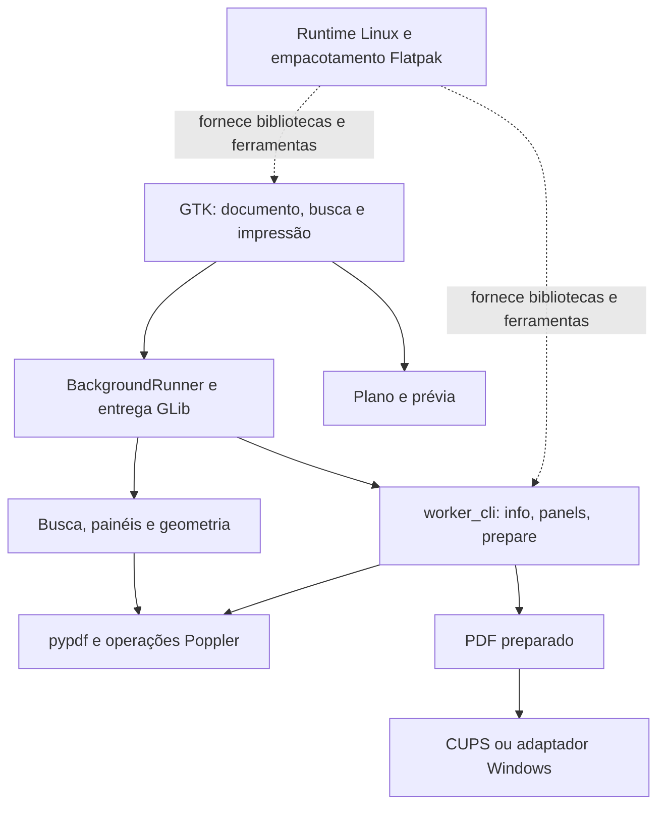

# Arquitetura da implementação independente

Revisão de **17/10/2026**, referente ao **Linuxit 0.1.1**, com Linux como destino
prioritário. A base própria MIT Print&View 3.4.0/Winux tem
[proveniência preservada](proveniencia-base.json); o pypdf tem
[licença BSD preservada](pypdf-LICENSE.txt). Os contratos Foxit orientam a
investigação, e seus binários, templates e descompilações ficam nos materiais
privados de análise. O código da aplicação é independente.

A arquitetura descreve o código atual e pontos de extensão planejados. O
[inventário estruturado](arquitetura-componentes.json) cobre os **19 módulos
Python próprios na raiz de `app/`**, sem contar módulos de terceiros como
componentes novos. As **25 famílias** estão ligadas à
[especificação funcional](especificacao-funcional.json). As extensões futuras
têm estado explícito de não implementadas.

## Componentes atuais

| Fronteira | Módulos | Responsabilidade e limites |
|---|---|---|
| Interface GTK | `main`, `presentation`, `print_window` | Documento e ações, apresentação, opções e prévia. Parte da coordenação ainda está diretamente nas janelas. |
| Aparência GTK | `appearance`, `themes` | Persistência e aplicação de system/light/dark; compatibilidade com nomes legados. |
| Agendamento GLib | `async_core` | Filas, eventos de cancelamento e entrega de callbacks por geração. Requer GLib, inclusive para testes desse agendador. |
| Serviços PDF | `search_engine`, `pdf_panels`, `imposition` | Busca, inspeção somente leitura e composição PDF. Marcas/legendas de mosaico têm dependência condicional de Cairo. |
| Processos | `rendering`, `worker_cli`, `platform_runtime` | Poppler, inspeção e preparação por linha de comando, escolha de Python e opções do sistema. |
| Impressão | `cups_backend`, `windows_print` | Filas/capacidades/envio CUPS e adaptador Win32/GTK. O contrato físico e a entrega Windows continuam pendentes. |
| Suporte | `page_cache`, `cancel_state`, `pdf_dependency`, `version` | LRU de imagens, evento por thread, localização do pypdf e versão. |
| Inicialização Windows | `windows_bootstrap` | Prepara caminhos de runtime Windows; não é evidência de distribuição Windows validada. |

O diagrama representa responsabilidades, não um grafo de imports sem ciclos.
`search_engine` importa `rendering`; o wrapper `rendering.search_text` importa
`TextSearchIndex` dentro da função. Esse ciclo adiado de compatibilidade existe
no código e deve ser considerado ao mudar a fronteira. UI, serviços e adaptadores
ainda usam chamadas diretas e dicionários; não há uma camada universal de plugins.

## Contratos entre as fronteiras

| Entrada | Contrato atual | Fonte |
|---|---|---|
| Documento | Caminho local; `document_info` devolve páginas, tamanhos e metadados. Índices internos começam em zero. | [rendering.py](../app/rendering.py) |
| Busca | `SearchOptions` imutável e `TextSearchIndex.search`; limite global, origens page/bookmark/comment, destino opcional e geometria conhecida. | [search_engine.py](../app/search_engine.py) |
| Painéis | `inspect_document_panels` devolve marcadores, comentários e nomes de camadas. A inspeção atual não grava alterações. | [pdf_panels.py](../app/pdf_panels.py) |
| Preparação PDF | `prepare_output(input_path, output_path, job)`; opções semânticas em dicionário. Prévia e saída usam a geometria própria. | [imposition.py](../app/imposition.py) |
| Worker | Argumentos `info`, `panels`, `prepare`; os dois primeiros devolvem JSON, `prepare` recebe opções JSON em stdin e devolve o caminho. Erros usam status não zero/stderr. | [worker_cli.py](../app/worker_cli.py) |
| Entrega assíncrona | `submit` identifica canal/geração; callback é entregue via GLib somente se atual e janela/runner aberto. | [async_core.py](../app/async_core.py) |
| Backend | `print_file` recebe o PDF já preparado e opções do dispositivo. Aceitação do trabalho não comprova papel impresso. | [cups_backend.py](../app/cups_backend.py) |
| Python de worker | `worker_python` usa o interpretador configurado pelo runtime e ajustes específicos do Windows. | [platform_runtime.py](../app/platform_runtime.py) |

Os contratos de falhas e critérios por família estão no
[registro da etapa 12](contratos-funcionais.md). Não foi criado um novo formato
de job nem uma API abstrata substituindo o código existente nesta revisão.

## Estado, concorrência e recursos

O estado visual do documento pertence à janela. Ao trocar documento/consulta,
as tarefas anteriores são invalidadas e os resultados obsoletos são filtrados.
`TextSearchIndex` conserva a identidade do arquivo e um cache limitado de
mapas de páginas; `PageCache` limita as imagens em memória. O índice atual é
por documento, sem um índice persistente de coleção.

Há três mecanismos distintos: cancelamento cooperativo de busca, evento de
thread usado pelo caminho Poppler e filtragem de callbacks por geração.
`BackgroundRunner` não interrompe toda chamada já em execução. Leituras pypdf
podem terminar antes da próxima checagem, e jobs que usam `subprocess.run`
dependem de seus próprios prazos. Não existe garantia uniforme de encerramento
imediato de todos os workers ao fechar uma janela.

`rendering._run` tem prazo e caminho de interrupção do processo; no Linux usa
`prlimit` quando disponível. `worker_cli` tenta limites POSIX de CPU/memória,
indisponíveis no Windows. Isso limita trabalho da implementação própria;
a contenção offline exigida para observar o Foxit continua separada.

A revisão de imports confirmou **sete módulos cujo fechamento local não
importa GTK/GLib via `gi` nem Cairo**: `cancel_state`, `page_cache`,
`pdf_dependency`, `pdf_panels`, `platform_runtime`, `rendering` e `search_engine`.
Isso permite parte das verificações portáveis, sem garantir a presença de
Poppler ou o comportamento em todas as plataformas.

Em `imposition._merge_poster_marks`, Cairo é importado somente para marcas e
legendas. Se o import falha, a função retorna sem essas marcas. Gerar um PDF
de livreto ou N-up em ambiente sem Cairo não valida esse ramo do mosaico.
O ambiente Linux completo e um caso específico de marcas/legendas precisam
ser usados para validar essa capacidade.

## Destinos e distribuição

O desenvolvimento e os testes completos ocorrem pelo código-fonte no Linux,
com GTK 3, Cairo, Poppler e clientes CUPS. Flatpak é gerado nos marcos de
entrega, mantendo o ID próprio e a branch `devel`; a versão continua 0.1.1.
O [empacotador](../scripts/build_flatpak.py) conserva o loader pareado,
`runtime-lib`, os módulos OpenSSL e avisos de licenças. Os detalhes operacionais
e testes históricos estão em [instalacao.md](instalacao.md).

Os adaptadores Windows existentes são pontos de continuidade para uma etapa
posterior. Portais de arquivos, associação de extensões, atualização e
impressão física ainda exigem integração e testes específicos de plataforma.
O fato de um módulo poder ser importado no Windows não comprova essa entrega.

## Evolução das famílias ainda abertas

As 14 famílias com subconjuntos atuais mantêm seus módulos existentes. A
estrutura não promove painéis somente leitura a edição, nem nomes de OCGs a
controle de camadas ou reprodução de mídia. As onze famílias classificadas
como propostas na etapa 12 continuam assim, inclusive a família completa de
integração de plataforma apesar dos adaptadores parciais existentes.

| Extensão planejada | Fronteira e condição de adoção |
|---|---|
| Anexos, coleção e consulta linguística | Provedores de conteúdo e modos de consulta distintos; índice persistente separado do cache atual. Definir origem, identidade, cancelamento e corpus antes da integração. |
| Marcadores, anotações e formulários | Modelo de edição, comandos/undo e persistência em cópia. Especificar AcroForm/XFA e testar reabertura antes de expor edição. |
| Assinaturas e proteção | Validação de integridade/confiança e fluxo de senha/permissões com laboratório próprio; diferenciar aparência visual e integrações externas. |
| Acessibilidade e calibração | Contratos com tecnologia assistiva/unidades e corpus mensurável; a distância simples atual cobre somente seu subconjunto. |
| Camadas, mídia, 3D e conversão | Contratos por tecnologia/formato e disponibilidade Reader confirmada; não adotar um controle extraído como prova de suporte. |
| Nuvem e sistema | Adaptadores por provedor/plataforma com falhas e estados locais testáveis. |

Essas fronteiras são decisões de planejamento, sem novos módulos de recurso
implementados nesta rodada. As fases A e B avançam por contrato suficiente;
a análise das demais famílias permanece aberta. Paridade exige observação do
original e resultado diferencial. Consulte [ETAPA-13.md](ETAPA-13.md) e o
[registro de pendências](../progresso/pendencias-analises.md).
