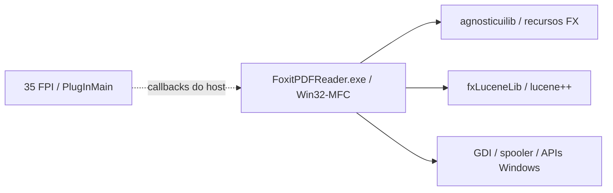

# Dependências e limites

O inventário reúne 141 PE e suas importações em `engenharia-reversa/dependencias.json`.
Uma aresta confirma a importação declarada; não confirma o carregamento ou a disponibilidade de uma função.

O desenho resume fronteiras observadas. Não indica que toda busca use Lucene,
nem identifica ainda o motor PDF completo. A presença dos plugins não prova
que suas funções estejam habilitadas no Reader.

A aplicação própria usa Python 3, GTK 3/Cairo, Poppler e pypdf 6.20.1; impressão
Linux via CUPS. O adaptador Windows anterior é preservado, mas ainda não foi
validado como Linuxit. As licenças da base e do pypdf permanecem no código.
