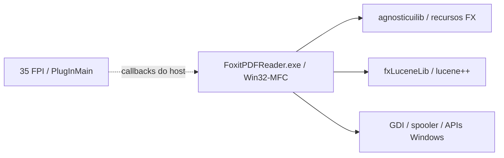

# Dependências e limites

O inventário reúne 141 PE e suas importações em `engenharia-reversa/dependencias.json`.
Uma aresta confirma a importação declarada; não confirma o carregamento ou a disponibilidade de uma função.

O desenho resume fronteiras observadas. Não indica que toda busca use Lucene,
nem identifica ainda o motor PDF completo. A presença dos plugins não prova
que suas funções estejam habilitadas no Reader.

A aplicação própria usa Python 3, GTK 3/Cairo, Poppler e pypdf 6.20.1; impressão
Linux via CUPS. O adaptador Windows anterior é preservado, mas ainda não foi
validado como Linuxit. As licenças da base e do pypdf permanecem no código.

As rodadas estáticas sem VM de 17/10/2026 aprofundaram consumidores de
impressão e getters da interface, conforme [registro](AVANCO-SEM-VM.md).
Alocação/preparação de buffers e polling de estados foram localizados dentro
do executável. Isso não identifica todos os motores/subsistemas nem fecha o
ciclo de vida dos 141 módulos: imports, objetos construídos, callbacks e
componentes carregados em execução continuam sendo evidências distintas.

A extensão própria de anexos 0.1.4 usa a mesma versão pypdf BSD já distribuída;
nenhuma dependência ou recurso Foxit foi incorporado para ler árvores e
anotações. O novo pacote deverá preservar o loader pareado, bibliotecas em
`runtime-lib`, módulos OpenSSL e a atribuição individual dos arquivos de runtime.

A leitura de RTTI confirmou CReader_PrintMgrEx, CFX_DIBitmap e
CXFA_RenderContext para três vtables ligadas aos corpos examinados.
TypeDescriptors de CPDF_Parser e handlers de segurança corroboram fronteiras
internas, com os [limites registrados](../testes/resultados/sem-vm-2026-10-17/technology-boundaries.json).
Isso não prova disponibilidade ou ciclo de vida integral de cada subsistema.

A fonte/pacote0.1.5 mantém essas dependências licenciadas para cópias com
marcador/nota/campo Tx. A preparação0x1b8d860 e o auxiliar0x1b8a2b0 foram
examinados estaticamente, com retenção/liberação parcial de recursos; isso
não fecha o ciclo de vida de todo componente. [Quarto lote](AVANCO-SEM-VM.md).
