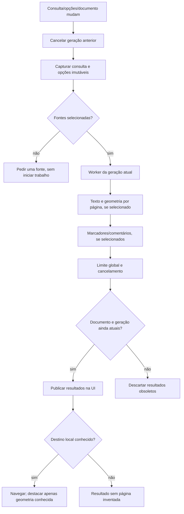
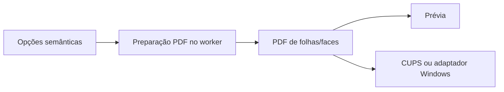
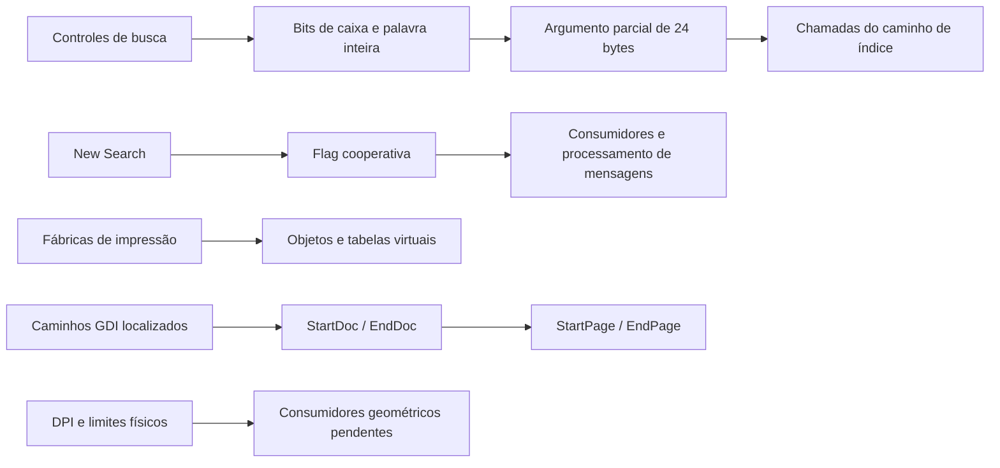
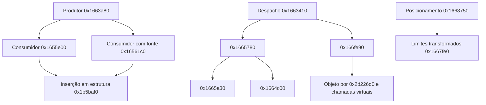
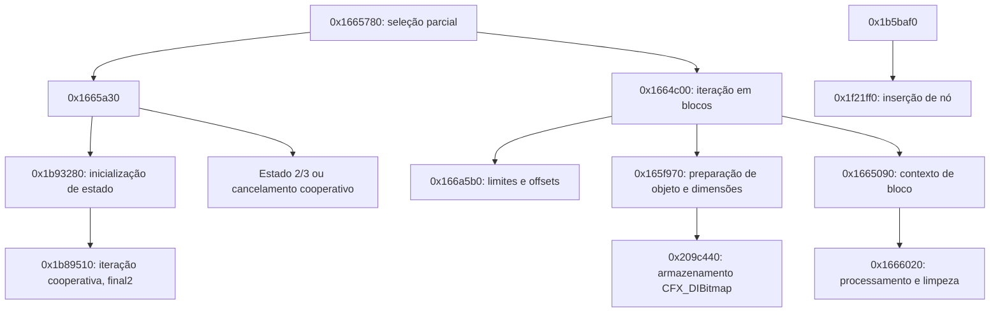
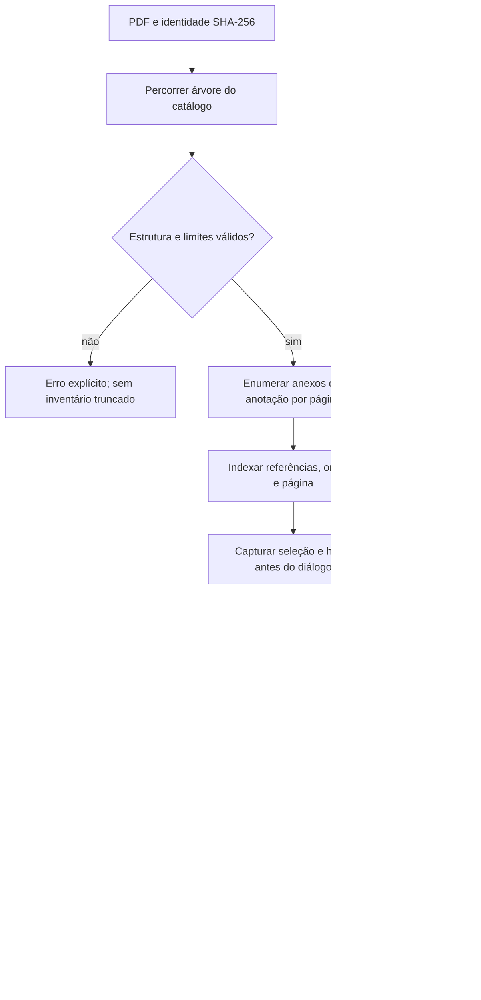
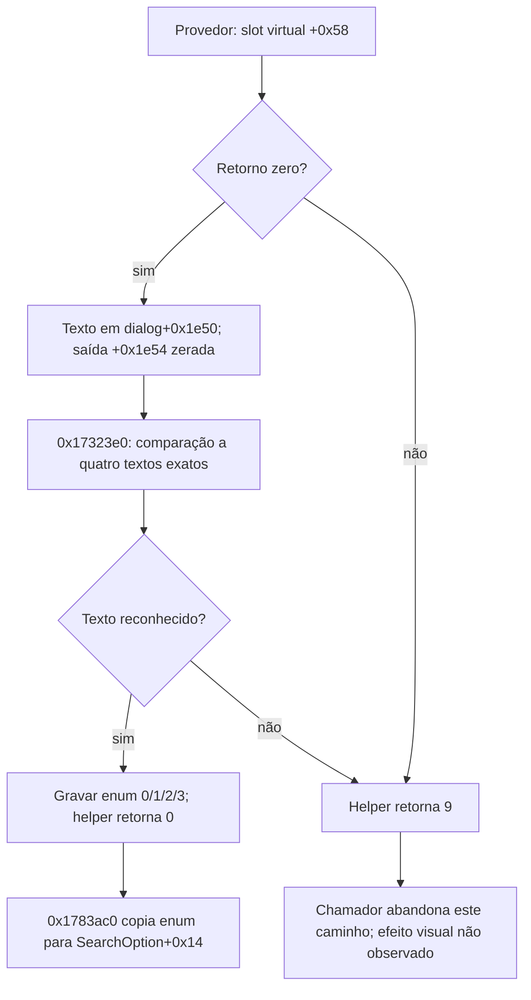

# Fluxos e estados

O fluxo do original permanece parcial. As ligações abaixo são da implementação
independente, apoiada nos contratos e nas observações em `FOXIT-REA.md`.

O índice de páginas rejeita mudanças na identidade do PDF. A leitura de
metadados pelo pypdf não pode ser interrompida no meio de uma chamada; o worker
confere cancelamento nas fronteiras, e a UI filtra gerações obsoletas.

Esse fluxo preservado da base própria não prova que a geometria resultante
seja idêntica à do Foxit. Os testes internos verificam exemplos de ordem,
quantidade, rotação e recorte; o spooler físico e os casos diferenciais estão
pendentes.

## Caminhos estáticos do Foxit examinados neste marco

O diagrama não une os objetos de fábrica ao spooler por uma aresta ainda não
demonstrada. Os caminhos completos e o comportamento dinâmico do original
continuam parciais; endereços e provas em `REA-BUSCA-IMPRESSAO.md`.

## Continuação dos consumidores e da geometria

As seis entradas da rodada seguinte estendem os caminhos observados, conforme
`REA-IMPRESSAO-CONSUMIDORES.md`. As setas mostram chamadas verificadas;
não representam uma integração completa com o spooler ou equivalência visual.

Assinaturas e tipos concretos permanecem provisórios. A montagem confirmou
que um slot inicialmente comparado como inteiro foi tipado como float pelo
decompilador devido ao reuso posterior; não transportar essa assinatura para
o código próprio sem completar o contrato.

## Continuação estática de 17/10/2026

Os 21 alvos das duas primeiras rodadas sem VM foram examinados e conferidos
com Capstone. As ligações abaixo são chamadas estáticas; não ligam uma
estrutura encadeada a uma impressora sem examinar seus consumidores.
Detalhes e limites: [avanço sem VM](AVANCO-SEM-VM.md).

Há estados/defaults e relações de chamada suficientes para aprofundamento,
mas não para nomear todas as flags, reconstruir assinaturas ou declarar o
fluxo integral de impressão. A assinatura de `0x1665090` tem artefatos de stack;
corpos de funções anteriores incluem destinos de salto em outros intervalos.
Os getters UI não identificaram a classe ativa; IDs 7911/7913 seguem ambíguos.

## Anexos da implementação independente — fonte 0.1.4

Extração já autorizada pode concluir após trocar o documento; callbacks antigos
não atualizam a nova janela. A leitura não executa o conteúdo incorporado.
O limite de 64 MiB é posterior à descompressão e não constitui limite de memória.

## Continuação estática adicional em17/10/2026

0x1666490 calcula fator limitado inferiormente a1 conforme campo+0x8c e
encaminha0x16664e0.0x1b8a2b0 prepara/continua auxiliar+0xe4 e o libera ao
terminar; retorno1 não é confirmação de impressão física.0x1b8d860 configura
recursos e referências compartilhadas, com tipos de chamada ainda provisórios.
0x880490 inicializa sob demanda objeto por área cliente/estado de rolagem;
classe e disponibilidade visual não confirmadas. [Evidências](AVANCO-SEM-VM.md).

A continuação0.1.6 confirmou por RTTI **CPDF_ImageRenderer** em1c68ca0 e
**CReflowViewerEx/IPDFViewer** em15c5010. O objeto criado por15c6550/880490
agora tem contexto de reflow identificado.0x20a6f70 pode retornar1 para clip
vazio; não tratar esse retorno como sucesso de impressão. Assinaturas/stack
permanecem provisórias. [Evidências](BUSCA-COLECOES.md).

## Texto do provedor e enum de busca — 18/10/2026

O [relatório estático](REA-ESTATICA-BUSCA-IMPRESSAO-2026-10-18.md) vincula
os pontos abaixo por assembly e dados PE. Não representa uma execução da UI.

Os textos são `1.0.0`, `1.1.0`, `1.2.0`, `1.3.0`. Não foram identificados como
versão do formato PDF ou do produto. O tipo concreto do provedor e os demais
campos da estrutura continuam parciais. Os fluxos completos do original não
foram fechados por este refinamento.

## Diagramas e estados por subsistema — 22/10/2026

Consolidação da tarefa A3. Cada subsistema abaixo tem um diagrama rastreável, ligado por assembly
e dados do PE (sem execução do original). A tabela indica o estado de cada um; "mapa estrutural"
significa fronteiras e fluxo na aplicação ligados de ponta a ponta, com a algoritmia interna
declarada como lacuna.

| Subsistema | Diagrama | Estado |
|---|---|---|
| Busca — criação do diálogo e provedor | [REA-FLUXO-BUSCA-2026-10-22.md](REA-FLUXO-BUSCA-2026-10-22.md) e [REA-PROVEDOR-BUSCA-2026-10-21.md](REA-PROVEDOR-BUSCA-2026-10-21.md) | mapa estrutural completo; algoritmo Lucene parcial |
| Busca — thread de limpeza de resultados | [REA-FLUXO-BUSCA-2026-10-22.md](REA-FLUXO-BUSCA-2026-10-22.md) e [errata dos objetos de UI, 23/10](REA-S1-OBJETOS-UI-2026-10-23.md) | mapa estático revisto: thread, evento e dois pares de seção crítica; helpers internos ainda parciais |
| Busca — opções e enum do provedor | [opções, 23/10](REA-S1-OPCOES-2026-10-23.md), [stemming](REA-S1-CONSULTA-E-CANCELAMENTO-2026-10-22.md) e seção de18/10 | +5 ligado a stemming, +6/+7 a largura/acentos, +0x10 a preferência de proximidade; +3/+0xc e consumo integral continuam parciais |
| Impressão — hierarquia de classes e estratégias | [REA-FLUXO-IMPRESSAO-2026-10-22.md](REA-FLUXO-IMPRESSAO-2026-10-22.md) | mapa estrutural; renderização/envio parcial |
| Impressão — consumidores e geometria | [REA-IMPRESSAO-CONSUMIDORES.md](REA-IMPRESSAO-CONSUMIDORES.md) | parcial |
| Impressão — GDI, DEVMODE e transporte RAW | [S2, 23/10](REA-S2-CONTINUACAO-2026-10-23.md) | quatro diagramas delimitados; total/modos, cancelamento da fila e serviços integrais ainda parciais |
| Busca — peso booleano e interseção com filtro | [pesos/scorers, 23/10](REA-S1-PESOS-E-SCORERS-2026-10-23.md) | dois diagramas delimitados; scores concretos e coletor/ranqueamento ainda abertos |
| Reflow — layout, geometria, arrays e transições | [REA-REFLOW.md](REA-REFLOW.md) e [S4, 23/10](REA-S4-REFLOW-2026-10-23.md) | arrays/extensões, escalar e limites ligados; unidades e domínio integral ainda parciais |
| Anotações, formulários, assinaturas e camadas | [S3/C1, 23/10](REA-S3-ESTADOS-2026-10-23.md) | quatro mapas com arestas S/C/R/L; recursos candidatos e lacunas explícitos, sem motores integrais |
| Resumo de comentários — seletores | [S3, 23/10](REA-S3-ANOTACOES-RESUMO-2026-10-23.md) | cinco layouts e helper de sete controles examinados; binding MFC e geração integral ainda abertos |

**Errata de 23/10/2026 na referência da limpeza de busca:** o mapa de 22/10
descrevia a chamada ao slot `+0x14` de `dialog+0x2044` como “reinicia o modelo”.
Essa leitura foi superada por construção, RTTI e assembly: o campo é uma
`CCriticalSection` embutida, e o slot executa `Unlock` da seção nativa em
`dialog+0x204c`. `0x1770a60` contém dois pares sucessivos de entrada/liberação,
ambos sobre o mesmo vetor em `dialog+0x2038`; não são um reset de modelo nem
uma operação comprovada sobre outro vetor de páginas. A classificação anterior
“completo (thread, evento, seção crítica)” fica preservada neste registro como
estado histórico e foi limitada na tabela acima ao mapa estático examinado.
[Evidências e lacunas](REA-S1-OBJETOS-UI-2026-10-23.md). S1 e o critério amplo
de reconstrução do fluxo continuam parciais.

Os documentos de22/10 preservam os mapas anteriores; os complementos de23/10 refinam
as ligações e distinguem instruções examinadas, associações de recursos, interpretações e
lacunas. O critério "Diagramas e estados rastreáveis por subsistema" (etapa9) continua
parcial: os mapas adicionais não recuperam por inteiro os motores de anotações, formulários,
assinaturas, camadas/mídia, busca ou impressão, nem substituem comparação em execução.
