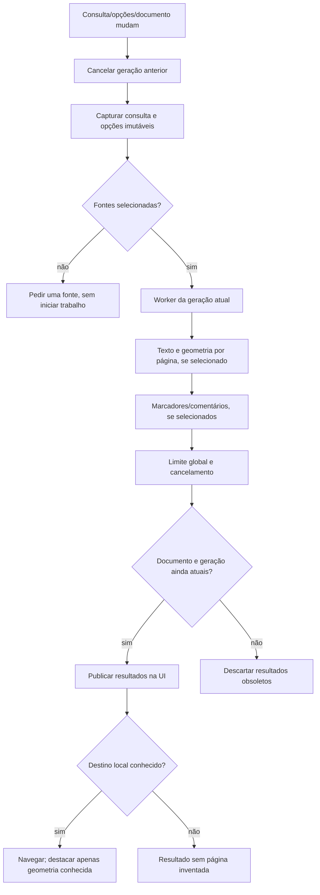
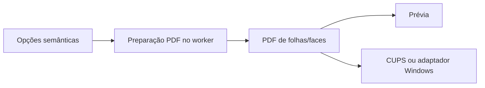
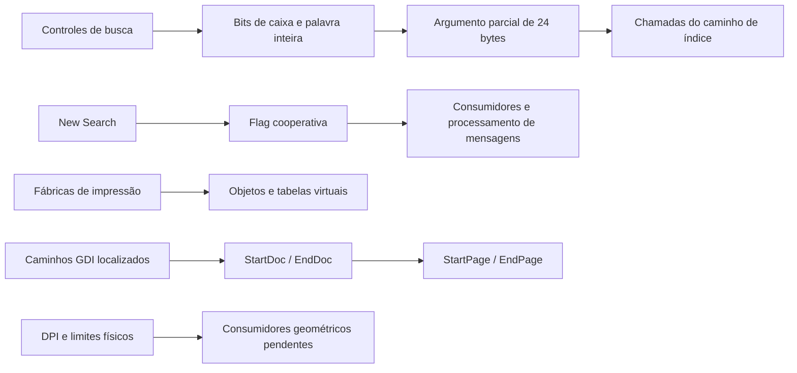
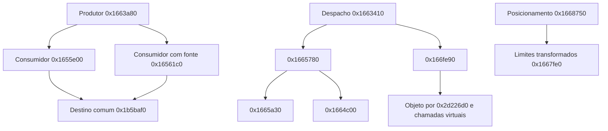

# Fluxos e estados

O fluxo do original permanece parcial. As ligações abaixo são da implementação
independente, apoiada nos contratos e nas observações em `FOXIT-REA.md`.

O índice de páginas rejeita mudanças na identidade do PDF. A leitura de
metadados pelo pypdf não pode ser interrompida no meio de uma chamada; o worker
confere cancelamento nas fronteiras, e a UI filtra gerações obsoletas.

Esse fluxo preservado da base própria não prova que a geometria resultante
seja idêntica à do Foxit. Os testes internos verificam exemplos de ordem,
quantidade, rotação e recorte; o spooler físico e os casos diferenciais estão
pendentes.

## Caminhos estáticos do Foxit examinados neste marco

O diagrama não une os objetos de fábrica ao spooler por uma aresta ainda não
demonstrada. Os caminhos completos e o comportamento dinâmico do original
continuam parciais; endereços e provas em `REA-BUSCA-IMPRESSAO.md`.

## Continuação dos consumidores e da geometria

As seis entradas da rodada seguinte estendem os caminhos observados, conforme
`REA-IMPRESSAO-CONSUMIDORES.md`. As setas mostram chamadas verificadas;
não representam uma integração completa com o spooler ou equivalência visual.

Assinaturas e tipos concretos permanecem provisórios. A montagem confirmou
que um slot inicialmente comparado como inteiro foi tipado como float pelo
decompilador devido ao reuso posterior; não transportar essa assinatura para
o código próprio sem completar o contrato.
