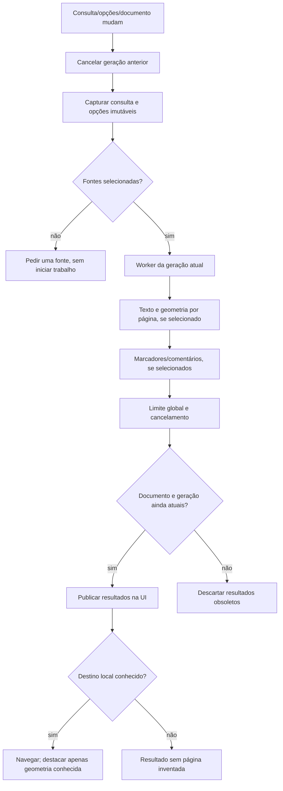
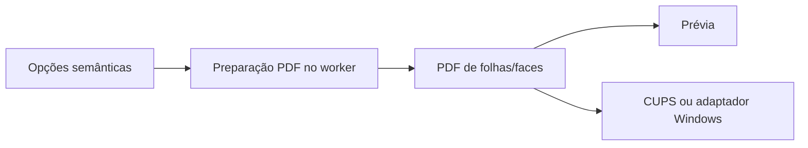

# Fluxos e estados

O fluxo do original permanece parcial. As ligações abaixo são da implementação
independente, apoiada nos contratos e nas observações em `FOXIT-REA.md`.

O índice de páginas rejeita mudanças na identidade do PDF. A leitura de
metadados pelo pypdf não pode ser interrompida no meio de uma chamada; o worker
confere cancelamento nas fronteiras, e a UI filtra gerações obsoletas.

Esse fluxo preservado da base própria não prova que a geometria resultante
seja idêntica à do Foxit. Os testes internos verificam exemplos de ordem,
quantidade, rotação e recorte; o spooler físico e os casos diferenciais estão
pendentes.
