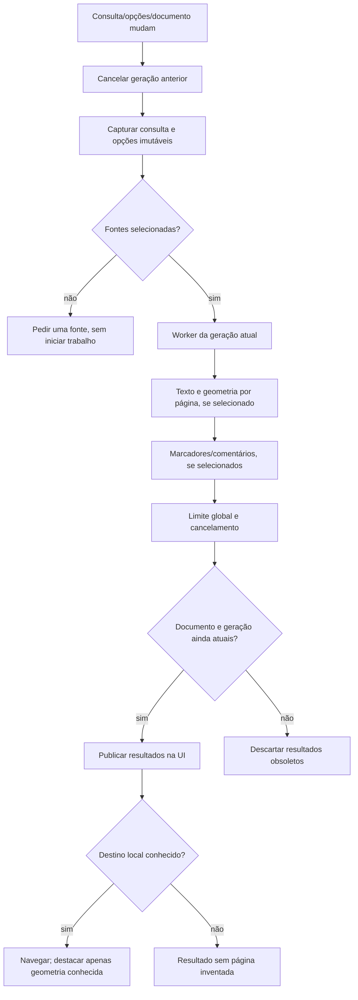
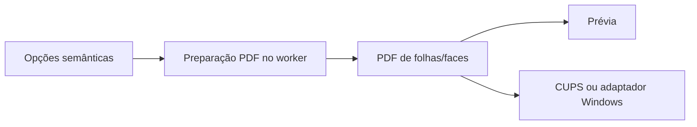
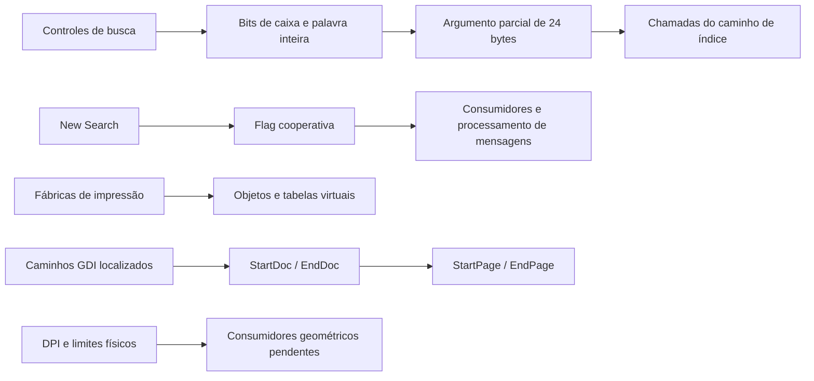
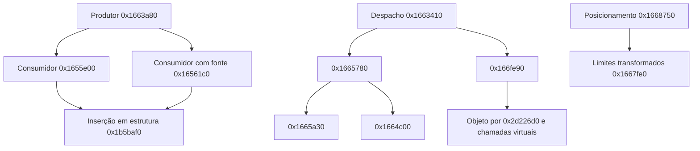
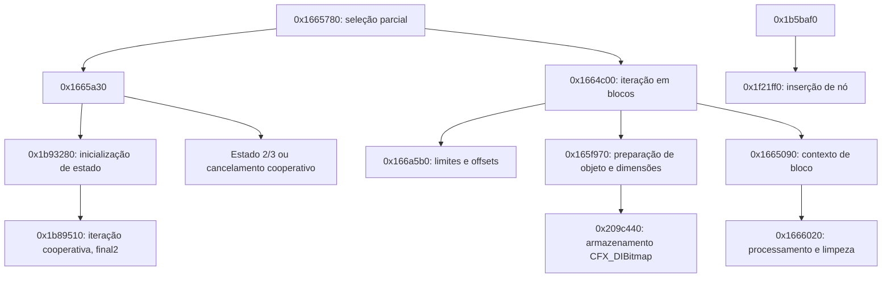
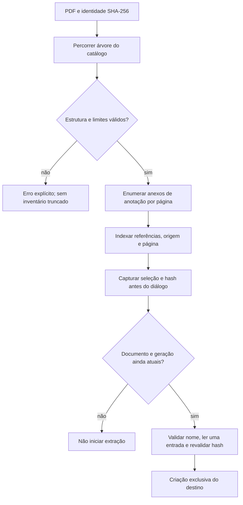

# Fluxos e estados

O fluxo do original permanece parcial. As ligações abaixo são da implementação
independente, apoiada nos contratos e nas observações em `FOXIT-REA.md`.

O índice de páginas rejeita mudanças na identidade do PDF. A leitura de
metadados pelo pypdf não pode ser interrompida no meio de uma chamada; o worker
confere cancelamento nas fronteiras, e a UI filtra gerações obsoletas.

Esse fluxo preservado da base própria não prova que a geometria resultante
seja idêntica à do Foxit. Os testes internos verificam exemplos de ordem,
quantidade, rotação e recorte; o spooler físico e os casos diferenciais estão
pendentes.

## Caminhos estáticos do Foxit examinados neste marco

O diagrama não une os objetos de fábrica ao spooler por uma aresta ainda não
demonstrada. Os caminhos completos e o comportamento dinâmico do original
continuam parciais; endereços e provas em `REA-BUSCA-IMPRESSAO.md`.

## Continuação dos consumidores e da geometria

As seis entradas da rodada seguinte estendem os caminhos observados, conforme
`REA-IMPRESSAO-CONSUMIDORES.md`. As setas mostram chamadas verificadas;
não representam uma integração completa com o spooler ou equivalência visual.

Assinaturas e tipos concretos permanecem provisórios. A montagem confirmou
que um slot inicialmente comparado como inteiro foi tipado como float pelo
decompilador devido ao reuso posterior; não transportar essa assinatura para
o código próprio sem completar o contrato.

## Continuação estática de 17/10/2026

Os 21 alvos das duas primeiras rodadas sem VM foram examinados e conferidos
com Capstone. As ligações abaixo são chamadas estáticas; não ligam uma
estrutura encadeada a uma impressora sem examinar seus consumidores.
Detalhes e limites: [avanço sem VM](AVANCO-SEM-VM.md).

Há estados/defaults e relações de chamada suficientes para aprofundamento,
mas não para nomear todas as flags, reconstruir assinaturas ou declarar o
fluxo integral de impressão. A assinatura de `0x1665090` tem artefatos de stack;
corpos de funções anteriores incluem destinos de salto em outros intervalos.
Os getters UI não identificaram a classe ativa; IDs 7911/7913 seguem ambíguos.

## Anexos da implementação independente — fonte 0.1.4

Extração já autorizada pode concluir após trocar o documento; callbacks antigos
não atualizam a nova janela. A leitura não executa o conteúdo incorporado.
O limite de 64 MiB é posterior à descompressão e não constitui limite de memória.

## Continuação estática adicional em17/10/2026

0x1666490 calcula fator limitado inferiormente a1 conforme campo+0x8c e
encaminha0x16664e0.0x1b8a2b0 prepara/continua auxiliar+0xe4 e o libera ao
terminar; retorno1 não é confirmação de impressão física.0x1b8d860 configura
recursos e referências compartilhadas, com tipos de chamada ainda provisórios.
0x880490 inicializa sob demanda objeto por área cliente/estado de rolagem;
classe e disponibilidade visual não confirmadas. [Evidências](AVANCO-SEM-VM.md).

A continuação0.1.6 confirmou por RTTI **CPDF_ImageRenderer** em1c68ca0 e
**CReflowViewerEx/IPDFViewer** em15c5010. O objeto criado por15c6550/880490
agora tem contexto de reflow identificado.0x20a6f70 pode retornar1 para clip
vazio; não tratar esse retorno como sucesso de impressão. Assinaturas/stack
permanecem provisórias. [Evidências](BUSCA-COLECOES.md).
